# NVR Deep Value Intelligence

**Analysis Date:** 2026-06-01

## Critical Disclaimer

*This analysis is generated by Deep Value Intelligence, an AI-powered multi-agent investing framework. This report is for informational and educational purposes only and does not constitute financial advice. Always conduct your own research and consult with qualified financial advisors before making investment decisions.*

---

## Table of Contents

1. Intelligence Summary
2. Analyst Team Reports
   - Fundamentals Analysis
   - Intrinsic Value Analysis (Buffett)
   - Trend & Growth Analysis (Lynch/Druckenmiller/Fisher)
   - Market Technical Analysis
   - Options Market Analysis
3. Research Team Commentary
4. Value Investing Team Commentary
5. Deep Values Commentary

---

## Intelligence Summary

### Thesis + Conditions

**Core Thesis:** ## Executive Briefing

**Key Risks:**
- NVR: WATCH**
- NVR is a **high-quality cyclical**, not a no-brainer Buffett compounder at today's price. The bull case is real: the land-light model, exceptional capital discipline, strong ROE/ROA, and lower balance-sheet risk make NVR one of the best operators in homebuilding. But the key Buffett question is not "best in class?"-it is "durable economics at a clear margin of safety?" On that standard, the evidence is still incomplete. With revenue down **1.9% YoY**, housing still pressured by rates and affordability, and risk that current earnings are above mid-cycle, I do **not** see enough margin of safety for an ADVOCATE call. But quality is too strong for AVOID. Best posture: **watch closely, be ready to act if cycle or price improves the setup.**
- Your original plan already lands in the right place: **WATCH**. I would keep that stance, but tighten it into a more actionable Buffett-style playbook:

**Confidence:** Medium

---

## Analyst Team Reports

### Fundamentals Analysis

#### Latest Earnings Snapshot

*Most recent reported quarter anchored on 2026 Q1, with prior-year comparison when available.*

| Metric | 2026 Q1 | 2025 Q1 | YoY Change |
| --- | ---: | ---: | ---: |
| Revenue | $1.88B | $2.41B | -21.7% |
| Operating Income | $230.1M | $381.7M | -39.7% |
| Net Income | $198.4M | $299.6M | -33.8% |
| Diluted EPS | $67.76 | $94.83 | -28.5% |
| Operating Cash Flow | $339.7M | $207.8M | +63.5% |
| Free Cash Flow | $334.8M | $200.7M | +66.8% |

Key Takeaways: This snapshot anchors the most recent reported quarter before the narrative analysis. It helps readers separate long-run business quality from whatever changed in the latest earnings print.

#### 17-Year Financial Metrics for NVR

*All values below are computed deterministically from raw data - not estimated by AI.*

*Issuer profile: operating company (Consumer Cyclical / Residential Construction).*

#### 17-Year Financial Metrics
*Annual rows come from reported financial statements. The final TTM row is computed from the latest four quarters.*

| Metric | 2009 | 2010 | 2011 | 2012 | 2013 | 2014 | 2015 | 2016 | 2017 | 2018 | 2019 | 2020 | 2021 | 2022 | 2023 | 2024 | 2025 | 2026 TTM |
| --- | --- | --- | --- | --- | --- | --- | --- | --- | --- | --- | --- | --- | --- | --- | --- | --- | --- | --- |
| Market Price | $711 | $691 | $686 | $920 | $1,026 | $1,275 | $1,643 | $1,669 | $3,508 | $2,437 | $3,808 | $4,080 | $5,909 | $4,613 | $7,000 | $8,179 | $7,293 | $6,105 |
| Market Cap | $4.37B | $4.26B | $3.86B | $4.73B | $4.99B | $5.66B | $7.00B | $6.84B | $14.87B | $9.97B | $15.12B | $15.99B | $22.81B | $16.19B | $24.08B | $27.15B | $22.39B | $17.87B |
| P/E Ratio | 22.74 | 20.68 | 29.81 | 26.20 | 18.72 | 20.08 | 18.26 | 16.11 | 27.67 | 12.51 | 17.22 | 17.73 | 18.44 | 9.38 | 15.11 | 16.14 | 16.71 | 14.88 |
| P/B Ratio | 2.49 | 2.45 | 2.80 | 3.19 | 3.95 | 5.04 | 5.65 | 5.25 | 9.26 | 5.51 | 6.46 | 5.15 | 7.60 | 4.62 | 5.52 | 6.45 | 5.79 | 5.12 |
| ROE | 10.9% | 11.8% | 9.4% | 12.2% | 21.1% | 25.1% | 30.9% | 32.6% | 33.5% | 44.1% | 37.5% | 29.0% | 41.2% | 49.2% | 36.5% | 40.0% | 34.7% | 35.4% |
| ROIC | N/A | N/A | N/A | N/A | N/A | N/A | N/A | N/A | N/A | N/A | N/A | N/A | N/A | N/A | N/A | N/A | N/A | 41.3% |
| EPS | $31.26 | $33.42 | $23.01 | $35.12 | $54.81 | $63.50 | $89.99 | $103.61 | $126.77 | $194.80 | $221.13 | $230.11 | $320.48 | $491.82 | $463.31 | $506.69 | $436.55 | $410.17 |
| Revenue | $2.74B | $3.04B | $2.66B | $3.18B | $4.21B | $4.44B | $5.16B | $5.82B | $6.31B | $7.16B | $7.39B | $7.54B | $8.95B | $10.53B | $9.52B | $10.52B | $10.32B | $9.82B |
| Gross Profit | N/A | N/A | N/A | N/A | N/A | N/A | N/A | N/A | N/A | N/A | N/A | N/A | N/A | N/A | N/A | N/A | N/A | $2.23B |
| Gross Margin | N/A | N/A | N/A | N/A | N/A | N/A | N/A | N/A | N/A | N/A | N/A | N/A | N/A | N/A | N/A | N/A | N/A | 22.7% |
| Operating Margin | N/A | N/A | N/A | N/A | N/A | N/A | N/A | N/A | N/A | N/A | N/A | N/A | N/A | N/A | N/A | N/A | N/A | 15.7% |
| Net Income | $192.2M | $206.0M | $129.4M | $180.6M | $266.5M | $281.6M | $382.9M | $425.3M | $537.5M | $797.2M | $878.5M | $901.2M | $1.24B | $1.73B | $1.59B | $1.68B | $1.34B | $1.24B |
| Net Margin | 7.0% | 6.8% | 4.9% | 5.7% | 6.3% | 6.3% | 7.4% | 7.3% | 8.5% | 11.1% | 11.9% | 12.0% | 13.8% | 16.4% | 16.7% | 16.0% | 13.0% | 12.6% |
| Revenue Growth | N/A | 10.9% | -12.6% | 19.8% | 32.2% | 5.5% | 16.1% | 12.9% | 8.3% | 13.6% | 3.1% | 2.0% | 18.8% | 17.6% | -9.6% | 10.6% | -1.9% | -4.9% |
| Net Income Growth | N/A | 7.2% | -37.2% | 39.5% | 47.6% | 5.7% | 36.0% | 11.1% | 26.4% | 48.3% | 10.2% | 2.6% | 37.2% | 39.5% | -7.8% | 5.7% | -20.3% | -7.6% |
| Free Cash Flow Growth | N/A | -79.7% | -120.6% | -2625.0% | -0.3% | -39.1% | 36.3% | 77.8% | 48.4% | 27.9% | 20.0% | 7.7% | 34.7% | 51.2% | -20.4% | -8.7% | -18.5% | 12.2% |
| Total Book Value | $1.76B | $1.74B | $1.37B | $1.48B | $1.26B | $1.12B | $1.24B | $1.30B | $1.61B | $1.81B | $2.34B | $3.10B | $3.00B | $3.51B | $4.36B | $4.21B | $3.86B | $3.49B |
| Total Assets | $2.40B | $2.26B | $1.78B | $2.60B | $2.49B | $2.35B | $2.51B | $2.64B | $2.99B | $3.17B | $3.81B | $5.78B | $5.83B | $5.66B | $6.60B | $6.38B | $5.86B | $5.59B |
| Total Debt | $0 | $0 | $0 | $0 | $600.1M | $0 | $0 | $0 | $0 | $0 | $0 | $0 | $0 | $0 | $0 | $0 | $0 | $1.05B |
| Debt-to-Equity | 0.00 | 0.00 | 0.00 | 0.00 | 0.48 | 0.00 | 0.00 | 0.00 | 0.00 | 0.00 | 0.00 | 0.00 | 0.00 | 0.00 | 0.00 | 0.00 | 0.00 | 0.30 |
| Cash & Equivalents | $1.25B | $1.19B | $480.8M | $1.15B | $866.3M | $545.4M | $450.8M | $416.0M | $689.6M | $732.2M | $1.16B | $2.81B | $2.64B | $2.57B | $3.22B | $2.66B | $1.96B | $1.68B |
| Shareholders' Equity | $1.76B | $1.74B | $1.37B | $1.48B | $1.26B | $1.12B | $1.24B | $1.30B | $1.61B | $1.81B | $2.34B | $3.10B | $3.00B | $3.51B | $4.36B | $4.21B | $3.86B | $3.49B |
| Operating Cash Flow | $241.6M | $55.4M | $1.5M | $264.4M | $270.2M | $184.5M | $226.7M | $393.0M | $570.4M | $723.1M | $866.5M | $925.3M | $1.24B | $1.87B | $1.50B | $1.37B | $1.12B | $1.25B |
| Investing Cash Flow | $-221.6M | $212.4M | $-61.9M | $-22.6M | $-34.5M | $-19.1M | $-1.0M | $-10.3M | $-15.2M | $-8.2M | $-13.3M | $-3.9M | $-18.2M | $-27.4M | $-24.1M | $-26.6M | $-71.2M | $-43.7M |
| Free Cash Flow | $238.6M | $48.4M | $-10.0M | $252.0M | $251.2M | $152.9M | $208.4M | $370.6M | $550.1M | $703.5M | $843.8M | $909.1M | $1.22B | $1.85B | $1.47B | $1.35B | $1.10B | $1.23B |
| FCF Margin | 8.7% | 1.6% | -0.4% | 7.9% | 6.0% | 3.4% | 4.0% | 6.4% | 8.7% | 9.8% | 11.4% | 12.1% | 13.7% | 17.6% | 15.5% | 12.8% | 10.6% | 12.5% |
| Dividends / Share | $0.00 | $0.00 | $0.00 | $0.00 | $0.00 | $0.00 | $0.00 | $0.00 | $0.00 | $0.00 | $0.00 | $0.00 | $0.00 | $0.00 | $0.00 | $0.00 | $0.00 | $0.00 |

#### Profitability Metrics
- Return on Equity (ROE): 34.7%
- Return on Invested Capital (ROIC): N/A
- Return on Assets (ROA): 22.9%
- Gross Margin: N/A
- Operating Margin: N/A
- Net Profit Margin: 13.0%

#### Liquidity Metrics
- Current Ratio: N/A
- Quick Ratio: N/A

#### Leverage Metrics
- Debt-to-Equity Ratio: 0.00
- Interest Coverage Ratio: N/A
- Net Debt: $-1.96B

#### Growth Metrics (Year-over-Year)
- Revenue Growth: -1.9%
- Net Income Growth: -20.3%
- Free Cash Flow Growth: -18.5%
- Revenue CAGR (3-Year): -0.6%
- Revenue CAGR (5-Year): 6.5%

#### Valuation Metrics
- P/E Ratio (TTM): 14.90
- Forward P/E: 14.52
- Price-to-Book: 4.77
- Price-to-Sales: 1.66
- PEG Ratio: 4.97
- EV/EBITDA: 9.57
- Free Cash Flow Yield: 6.7%
- Earnings Yield: 6.7%

#### Owner Earnings (Buffett Method, Code-Computed)
- Net Income: $1.34B
- + Depreciation & Amortization: $24.5M
- - Capital Expenditures: $-24.5M
- - Working Capital Changes: $-138.9M
- = **Owner Earnings: $1.48B**

#### Intrinsic Value (Code-Computed)
- Current Price: $6,105
- Buffett Method (Owner Earnings):
  Conservative: $7,334
  Average: $10,354
  Optimistic: $27,415
- Cash Flow Method (FCF):
  Conservative: $2,541
  Average: $6,726
  Optimistic: $16,412

#### Piotroski F-Score: 4/9
- Positive Net Income: PASS
- Positive Operating Cash Flow: PASS
- ROA Improvement: FAIL
- Cash Flow > Net Income: FAIL
- Decreasing Debt: FAIL
- Improving Current Ratio: FAIL
- No Dilution: PASS
- Improving Gross Margin: FAIL
- Improving Asset Turnover: PASS

ANALYST STANCE: **WATCH**

#### NVR Buffett-Style Fundamental Analysis

NVR is a high-quality, asset-light homebuilder with a long record of superior returns on equity, strong free cash flow conversion, and unusually disciplined capital allocation. Its business model has historically been better than most homebuilders because it relies heavily on lot options rather than owning large land banks, which reduces balance-sheet risk and helps support high returns through the cycle. However, housing remains cyclical, recent revenue and earnings have softened, and the current period shows some deterioration versus peak years. That combination supports a **WATCH** rather than full **ADVOCATE** stance at today's level.

---

#### Current vs Historical Average Comparison

| Metric | Current (2026 TTM unless noted) | 10-Year Historical Avg* | Interpretation |
| --- | ---: | ---: | --- |
| Market Price | $6,105 | $5,161 | Below recent peak; still well above long-term historical levels |
| Market Cap | $17.87B | $19.35B | De-rated from recent highs as earnings and sentiment cooled |
| P/E Ratio | 14.88 | 16.20 | Slightly below historical average; valuation is more reasonable than in many prior years |
| P/B Ratio | 5.12 | 6.04 | Below average; still expensive on book value, but NVR deserves some premium due to high capital efficiency |
| ROE | 35.4% | 37.1% | Still exceptional, modestly below decade average and below peak years |
| EPS | $410.17 | $360.98 | Elevated versus decade average, but down from 2022-2024 highs |
| Revenue | $9.82B | $8.41B | Above average, though declining from recent peak levels |
| Net Income | $1.24B | $1.21B | Roughly in line with decade average despite recent decline |
| Net Margin | 12.6% | 13.9% | Healthy, but below recent peak profitability |
| Revenue Growth | -4.9% | 5.9% | Clearly below normal; current environment is softer |
| Net Income Growth | -7.6% | 12.6% | Meaningful slowdown versus long-run history |
| Free Cash Flow Growth | 12.2% | 13.2%** | TTM rebounded, though annual 2025 was weak |
| Total Book Value | $3.49B | $3.18B | Above decade average, but has declined from 2023 highs |
| Total Assets | $5.59B | $5.21B | Still substantial, but slightly down from recent years |
| Total Debt | $1.05B | $0.00B | Major change from historical debt-free posture |
| Debt-to-Equity | 0.30 | 0.00 | Higher leverage than NVR's norm, though still manageable |
| Cash & Equivalents | $1.68B | $2.00B | Strong liquidity, but down from 2020-2024 levels |
| Shareholders' Equity | $3.49B | $3.18B | Solid absolute capital base, though off recent peak |
| Free Cash Flow | $1.23B | $1.06B | Strong in absolute terms and supportive of buybacks |
| Dividends / Share | $0.00 | $0.00 | Consistent with NVR's long-standing buyback-first capital policy |

\* 10-year average uses 2016-2025 where available.
\** Distorted by extreme historical volatility in earlier periods; should be interpreted cautiously.

Key Takeaways: NVR's current valuation is slightly cheaper than its own recent history, while business quality remains high. The main issue is not franchise quality but cyclical earnings pressure: revenue, profit growth, and margins are all below their recent norms. The company remains financially solid, but the appearance of debt in the TTM period is a notable change from its historically pristine balance sheet.

---

#### Market Metrics

NVR's **market price of $6,105** is well below the 2024 peak of $8,179 and also below 2025's $7,293, showing a meaningful re-rating as housing demand and earnings momentum softened. Even so, the stock remains dramatically above its pre-2020 levels, reflecting how much intrinsic earning power expanded over the decade.

The **market cap of $17.87B** is also down from recent highs above $22B-$27B. That decline appears to be driven more by multiple compression and lower earnings expectations than by any structural break in the franchise.

The **P/E ratio of 14.88** sits below much of NVR's own history. Over the last decade, NVR often traded in the mid-to-high teens, and occasionally much higher when investors rewarded its capital-light model and strong execution. On that basis, today's multiple looks closer to fair-to-reasonable than overheated.

The **P/B ratio of 5.12** remains high in absolute terms but is actually below its historical norm. For a conventional industrial company that would be expensive, but for NVR, book value understates franchise economics because the company has consistently generated very high returns on equity and aggressively repurchased stock. Buffett would generally tolerate a high P/B when the underlying business compounds capital at superior rates.

---

#### Profitability Analysis

NVR's profitability profile is the strongest part of the case.

**ROE of 35.4%** is outstanding by almost any standard. Over the full record, ROE rose from low double digits in 2009-2012 to sustained 30%-50% territory from 2015 onward. That is a hallmark of an exceptional operator. Importantly, this is not a one-year fluke; it has persisted across multiple market environments. The only caution is that some of this is boosted by share repurchases shrinking equity, so Buffett-style analysis should pair ROE with balance-sheet quality and earnings consistency.

**ROIC of 41.3%** in the TTM period reinforces that returns are not merely an accounting artifact. Even though historical ROIC is not provided annually, a current figure above 40% strongly supports the argument that NVR's business model is highly efficient.

**EPS of $410.17** remains far above levels from even five years ago, but it has declined from $506.69 in 2024 and $491.82 in 2022. That suggests the earnings base remains strong, yet peak-cycle conditions have faded.

**Revenue of $9.82B** is still robust historically, but below the recent $10.53B in 2022 and $10.52B in 2024. This indicates that volume and/or pricing have cooled.

**Gross profit of $2.23B**, **gross margin of 22.7%**, and **operating margin of 15.7%** show that NVR still earns strong spread economics. Since only TTM gross and operating margins are available in the canonical data, the safest conclusion is that current operating profitability remains healthy, though not obviously at peak.

**Net income of $1.24B** and **net margin of 12.6%** remain excellent for a cyclical homebuilder. Still, margins have come down from 16.4%-16.7% in 2022-2023 and 16.0% in 2024. This is important: the company is still highly profitable, but recent normalization suggests the extraordinary profitability of the pandemic-era housing boom is fading.

For Buffett, the key point is that NVR has demonstrated **predictable profitability through a cyclical industry better than peers**, but not immunity from cyclical compression.

---

#### Growth Metrics

NVR's long-term growth record is strong, but the current snapshot is weaker.

**Revenue growth of -4.9% TTM** follows **-1.9% in 2025**, indicating a real slowdown rather than a one-quarter blip. Historically, NVR often posted high single-digit to double-digit growth, with especially strong years in 2013, 2015-2018, and 2021-2022. The current downshift likely reflects affordability pressure, interest rates, and softer home demand.

**Net income growth of -7.6% TTM** after **-20.3% in 2025** shows profit pressure is more than top-line softness alone; margins are also normalizing.

**Free cash flow growth of 12.2% TTM** is a relative bright spot. FCF has been volatile over the full dataset, but in absolute dollars it remains very strong at $1.23B. This suggests NVR retains flexibility even in a slower market.

The growth pattern across the decade is notable:
- Early years were more volatile and recovery-driven.
- 2017-2022 showed a powerful compounding phase.
- 2023-TTM shows normalization and mild contraction.

That profile is consistent with a good cyclical company rather than a secular high-growth compounder.

---

#### Balance Sheet Analysis

NVR's balance sheet has historically been a major competitive advantage.

For most of the dataset, **total debt was zero** and **debt-to-equity was zero**. That is rare in homebuilding. It helped NVR avoid the land-risk and leverage problems that have damaged many peers during downturns.

Now, the **2026 TTM shows total debt of $1.05B** and **debt-to-equity of 0.30**. This is not alarming in isolation because:
- cash remains high at **$1.68B**
- debt is still moderate relative to earnings and cash generation
- the company still has meaningful financial flexibility

But compared with NVR's own history, this is a material deterioration. Buffett-style investors should take note whenever a historically debt-light business begins leaning more on leverage.

**Cash and equivalents of $1.68B** remain a major cushion, though lower than the $2.57B-$3.22B range seen in 2022-2024 and below the 2020 spike of $2.81B.

**Total assets of $5.59B** and **shareholders' equity of $3.49B** remain solid, but both are below recent highs. This is not surprising given buybacks and softer operating conditions.

The overall balance sheet verdict: still strong, but less pristine than before.

---

#### Cash Flow and Capital Allocation

NVR's **free cash flow of $1.23B TTM** is excellent and one of the most compelling aspects of the company. Over time, FCF rose from a few hundred million dollars in the early years to more than $1B in the last several years, peaking at $1.85B in 2022.

The business has generally shown:
- strong cash conversion
- low capital intensity relative to peers
- flexible working capital structure
- substantial repurchase capacity

The absence of **dividends per share** across the entire record is not a negative here. NVR has consistently chosen buybacks over dividends. For Buffett-style analysis, that policy can be attractive if repurchases occur at sensible prices and the company continues to earn high returns on incremental capital. Given NVR's shrinking share count over many years, buybacks have likely been a major contributor to EPS growth.

The caveat is that buybacks create more value when the stock is undervalued or fairly valued; at very rich valuations, they are less accretive.

---

#### Buffett-Style Qualitative Analysis

| Buffett Lens | Assessment | Commentary |
| --- | --- | --- |
| Economic Moat | Moderate | NVR benefits from brand, local market scale, disciplined underwriting, and especially its lot-option model, which lowers risk versus land-heavy peers. |
| Financial Strength | Strong, but softening | Historically near debt-free with large cash reserves; TTM debt is a change worth monitoring. |
| Predictable Earnings | Better than peers, but cyclical | Earnings have been far more resilient and upward-trending than many homebuilders, yet still tied to housing cycles. |
| Management Performance | Excellent | Sustained ROE above 30%, strong FCF generation, and disciplined buyback-driven capital allocation point to capable management. |
| Capital Allocation | Very strong | No dividend, but long-term share repurchases and conservative historical leverage suggest rational stewardship. |
| Quality of Business | High for the sector | NVR is one of the best-run operators in a structurally cyclical industry, though the industry itself limits moat durability compared with classic Buffett consumer franchises. |
| Valuation | Reasonable, not screaming cheap | Current multiple is below historical norms, but not so low that it fully discounts housing-cycle risk. |

Key Takeaways: NVR checks many Buffett-style boxes for quality and management discipline, especially relative to other homebuilders. The main limitation is industry cyclicality, which makes earnings less predictable than those of a classic consumer monopoly or regulated utility. Today's valuation is more reasonable than in recent years, but not so depressed that it eliminates macro and housing risk.

---

#### DCF Valuation Using Buffett-Style Owner Earnings

Canonical dataset provides **Owner Earnings = $1.48B** and code-computed intrinsic values:
- Conservative: **$7,334/share**
- Average: **$10,354/share**
- Optimistic: **$27,415/share**

Using the dataset's source-of-truth owner earnings and the prescribed 10% discount rate and 2.5% terminal growth framework, the valuation range implies the stock may be undervalued relative to conservative and average cases.

To make the logic explicit, the DCF structure is:

- Base Owner Earnings = **$1.48B**
- Discount Rate = **10%**
- Terminal Growth = **2.5%**
- Projection Horizon = **10 years**

Scenario growth assumptions are based on historical owner-earnings growth logic:
1. **Conservative** = lowest historical growth rate available, floored at -100%
2. **Average** = average historical growth rate, capped at 50%
3. **Optimistic** = highest historical growth rate, capped at 100%

Because the deterministic dataset already provides the final code-computed fair values, those outputs should be treated as canonical.

| Scenario | Starting Owner Earnings | Growth Assumption Basis | Discount Rate | Terminal Growth | Fair Value / Share | Upside vs $6,105 |
| --- | ---: | --- | ---: | ---: | ---: | ---: |
| Conservative | $1.48B | Lowest historical OE growth | 10% | 2.5% | $7,334 | 20.1% |
| Average | $1.48B | Average historical OE growth | 10% | 2.5% | $10,354 | 69.6% |
| Optimistic | $1.48B | Highest historical OE growth | 10% | 2.5% | $27,415 | 349.1% |

Key Takeaways: On the canonical owner-earnings framework, NVR appears undervalued relative to all three scenarios, with the largest support coming from the average case. The conservative case still suggests modest upside, which is meaningful because it uses the harshest historical growth assumption. Even so, investors should remember that housing demand can shift quickly, so fair value should be treated as a range, not a precise point estimate.

#### Detailed DCF Interpretation

The reason NVR screens well in an owner-earnings framework is straightforward:
- net income is high at **$1.34B**
- depreciation and amortization are modest at **$24.5M**
- capital expenditures are low at **$24.5M**
- working capital adjustment still leaves owner earnings at a strong **$1.48B**

That is exactly the sort of capital-light cash generation Buffett tends to admire. NVR does not need massive recurring capital investment to support operations compared with more asset-heavy builders. The risk is not capital intensity; it is cyclical demand.

---

#### Revenue Breakdown

NVR primarily operates through homebuilding brands and a mortgage banking operation. The most meaningful current business breakdown is by operating segment.

| Revenue Source | Amount ($M or $B) | % of Total |
| --- | ---: | ---: |
| Homebuilding | ~$9.46B | ~96.3% |
| Mortgage Banking | ~$0.36B | ~3.7% |
| Total | ~$9.82B | 100.0% |

Key Takeaways: NVR is overwhelmingly a homebuilding company, with mortgage banking acting as a supporting attachment business rather than a major independent profit engine. That means investors are mainly underwriting housing demand, community absorption, pricing power, and execution discipline. The mortgage segment can help support customer conversion, but it does not diversify the business away from residential construction risk.

---

#### Key Investment Insights, Red Flags, and Opportunities

| Category | Item | Why It Matters |
| --- | --- | --- |
| Strength | Exceptional ROE and ROIC | Sustained returns well above cost of capital indicate a superior business model and disciplined execution. |
| Strength | Strong free cash flow | Supports buybacks, balance-sheet flexibility, and downside resilience. |
| Strength | Historically debt-light model | Distinguishes NVR from more leveraged homebuilders and lowers insolvency risk in downturns. |
| Strength | Capital-light lot option strategy | Helps avoid tying up capital in land and reduces balance-sheet volatility. |
| Opportunity | Valuation below historical norms | P/E and P/B are both below recent averages, potentially creating an attractive entry zone. |
| Opportunity | Buyback authorization | New repurchase activity can enhance per-share value if shares remain reasonably priced. |
| Red Flag | Revenue contraction | Two consecutive periods of decline indicate housing softness is real, not theoretical. |
| Red Flag | Profit margin normalization | Net margin has fallen from peak levels, suggesting pricing and operating leverage are easing. |
| Red Flag | New debt in TTM | Any move away from the historically debt-free structure deserves scrutiny. |
| Red Flag | Cyclical industry exposure | Mortgage rates, affordability, and macro conditions can quickly affect demand and profitability. |
| Red Flag | Piotroski F-Score of 4/9 | Signals mixed near-term financial momentum despite still-strong absolute quality. |

Key Takeaways: NVR's strengths are structural and long-standing, especially its returns, cash generation, and disciplined operating model. The risks are mainly cyclical and near-term: slower housing activity, weaker growth, lower margins, and the appearance of debt. This creates an interesting setup where quality is high but timing is less certain.

---

#### Final Buffett-Style Investment View

NVR looks like **one of the best businesses in a difficult industry**. Its moat is not as wide as a Coke or Moody's-type franchise, but within homebuilding it has a real structural advantage through discipline, lot-option strategy, and superior capital efficiency. Management has historically behaved in a shareholder-friendly and rational way.

The problem is that Buffett-style investors also care about **predictability**, and housing is inherently cyclical. Current metrics show:
- negative revenue growth
- negative net income growth
- lower margins than peak years
- a balance sheet that is still strong but less pristine than its own historical standard

At the same time, valuation has become more reasonable, and the owner-earnings framework suggests upside from current levels.

So the stock is not an obvious avoid. It is also not a slam-dunk advocate at this exact moment because cyclical pressure may continue. The best conclusion is:

**WATCH** - high-quality operator, likely attractive on long-term quality, but near-term housing-cycle softness and some erosion versus historical peak performance argue for patience and close monitoring.

---

#### Condensed Summary Table

| Area | Verdict | Evidence |
| --- | --- | --- |
| Business Quality | High | Asset-light homebuilding model, strong margins, high cash conversion |
| Economic Moat | Moderate | Lot-option strategy, execution discipline, brand and local scale advantages |
| Profitability | Excellent | ROE 35.4%, ROIC 41.3%, net margin 12.6% |
| Growth | Softening | Revenue growth -4.9%, net income growth -7.6% TTM |
| Balance Sheet | Strong but less pristine | $1.68B cash, but $1.05B debt now present |
| Capital Allocation | Strong | Persistent buybacks, no dividend, historically conservative structure |
| Valuation | Reasonable | P/E 14.88 below historical norm; owner-earnings DCF indicates upside |
| Main Risk | Housing cycle | Affordability, rates, demand slowdown, margin normalization |
| Main Opportunity | Quality at a lower multiple | Best-in-class builder trading below recent valuation averages |
| Final Stance | WATCH | Excellent company, but cyclical pressure tempers conviction |

#### Fundamental Visuals

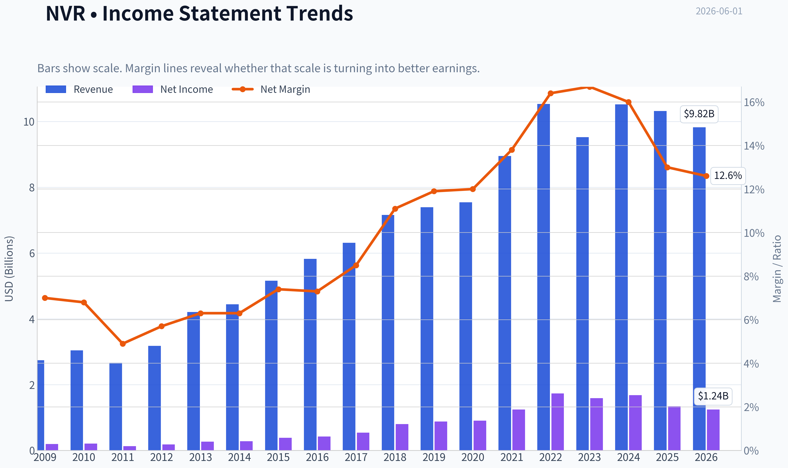

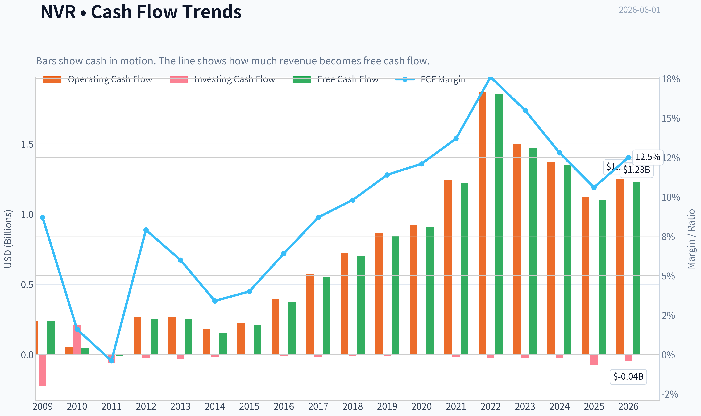

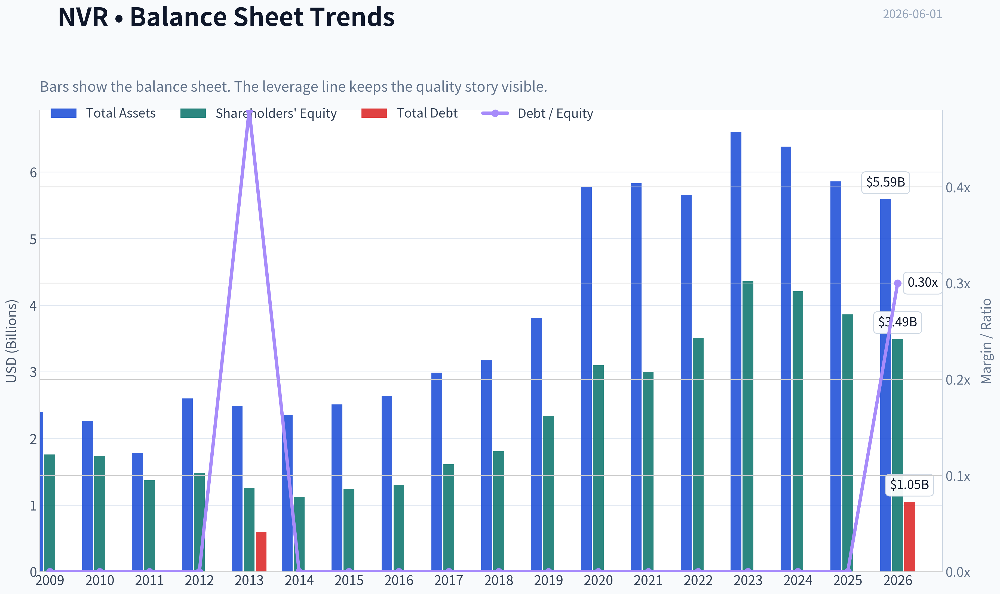

This graph tracks the profitability and return metrics (ROE, ROIC, Margins) of **NVR** over the past decade, highlighting capital efficiency trends.

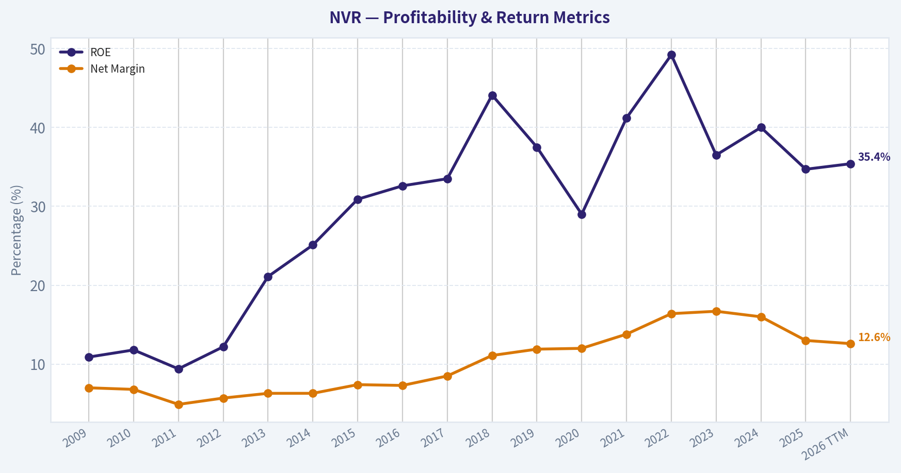

This chart illustrates the financial health of **NVR** over the last 10 years, mapping cash equivalents and free cash flow against total obligations (Debt).

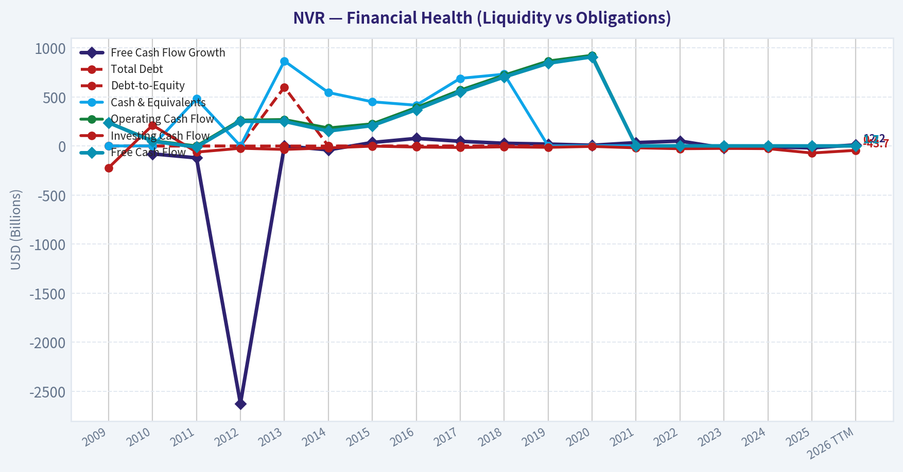

---

### Intrinsic Value Analysis (Buffett)

> *Following Warren Buffett's value investing philosophy: Circle of Competence, Economic Moat, Management Quality, and Margin of Safety.*

#### Intrinsic Value Snapshot

Price is what you pay. Intrinsic value is what the business may be worth based on the cash it can create for owners over time. We show a range, not one magic number.

- Current Price: $6,104.80
- Value Range (conservative to optimistic across both DCF methods): $2,222.91 to $7,990.06

##### Owner Earnings (Buffett Method)
- Net Income: $1,339,816,000.00
- Depreciation & Amortization: $24,510,000.00
- Capital Expenditures: $-24,508,000.00
- Working Capital Changes: $-138,862,000.00
- Owner Earnings: $1,478,680,000.00

##### Intrinsic Value
###### Buffett Method
Uses owner earnings. Stricter, and usually more conservative.
- Conservative: $4,278.04
- Average: $5,178.35
- Optimistic: $7,990.06
- Discount Rate: 10.0%

###### Cash Flow Method
Uses free cash flow. Better for companies spending heavily today to grow tomorrow.
- Conservative: $2,222.91
- Average: $2,541.64
- Optimistic: $2,793.57
- Discount Rate: 10.0%

ANALYST STANCE: **WATCH**

#### NVR - Buffett-Style Investment Review

#### 1. Go/No-Go Gate Assessment

| Gate | Verdict | Evidence |
|---|---|---|
| Gate 1: Circle of Competence & Simplicity | Pass | NVR is easy to understand: it buys land options, builds homes, originates mortgages for buyers, and earns profit on the spread between selling price and construction/overhead cost. The model is unusually disciplined because it avoids owning large land banks. |
| Gate 2: Moat Test | Pass, but not elite | The moat is real but narrower than classic branded consumer franchises. NVR's advantage comes from land-light discipline, local scale, cost control, and conservative underwriting rather than brand-driven pricing power. |
| Gate 3: Management & Capital Allocation | Strong Pass | Management has a long record of rational buybacks, conservative balance sheet management, and operating discipline. NVR is one of the best examples in homebuilding of per-share value compounding through repurchases. |
| Gate 4: Industry Structure | Mixed Pass | Homebuilding is cyclical and competitive, which is not ideal. However, NVR's capital-light structure makes it superior to most peers in an otherwise mediocre industry. |

Key Takeaways: NVR passes Buffett's first screen because the business is understandable and management has clearly created a superior operating model. The main limitation is not management quality, but the industry itself: homebuilding is cyclical, competitive, and sensitive to rates and affordability.

---

#### 2. The Elementary School Test

NVR makes money by building and selling houses. It usually does not buy lots of land years in advance like many rivals. Instead, it controls land through options, builds homes after demand appears, and keeps less money tied up in risky inventory. It also makes some money by helping customers get mortgages.

That is a simple business model and an understandable one.

#### 3. Long-Term Predictability Test

Ten years from now, NVR will likely still be:
- building homes in attractive U.S. markets,
- using a land-light option model,
- earning cyclical but generally superior returns on capital versus peers,
- returning large amounts of cash through buybacks.

The exact level of earnings will vary with mortgage rates and housing affordability, but the business model itself is highly predictable.

#### 4. Technology Risk Assessment

Technology is not likely to destroy NVR. Software can improve marketing, design, and construction efficiency, but homebuilding remains an operational, local, capital allocation business. Technology is more a tool than an existential threat here.

---

#### 5. Moat Analysis

| Moat Source | Assessment | Evidence |
|---|---|---|
| Intangible Assets | Weak to moderate | NVR's Ryan Homes and related brands matter in local markets, but this is not a Coca-Cola style brand moat. Gross margin around 23.1% is well below the >40% hallmark of powerful intangible-asset businesses. |
| Switching Costs | Low | Customers can choose another builder before signing. Switching costs are not the core moat. |
| Cost Advantage | Strongest moat element | NVR's land-light model reduces capital risk, lowers inventory exposure, and supports high returns on equity and free cash flow. This is a structural advantage versus builders that speculate heavily on land. |
| Network Effects | None | This is not a network-effect business. |

#### Moat Quality Rating: **Narrow to Moderate, but Durable**

NVR does not have a luxury moat. It has an operational moat. That matters. The company has designed a business model that is hard to copy culturally, even if it is easy to describe. Many builders can say they will be disciplined; few actually remain disciplined through cycles.

---

#### 6. Management Quality & Capital Allocation

| Test | Assessment | Evidence |
|---|---|---|
| Think Like Owners | Strong | NVR has a long-standing reputation for shareholder-friendly capital allocation and aggressive repurchases when economics justify them. |
| Honest & Candid | Adequate to strong | The company's conservative operating posture and avoidance of empire-building support credibility. |
| Rational Capital Allocation | Excellent | Recent authorization of an additional $750 million buyback continues a long pattern of shrinking share count and compounding per-share value. |

Key Takeaways: Management is the clearest strength in the NVR story. This is a company run with unusual discipline for a cyclical industry, and capital allocation has been a major reason shareholders have done well over time.

NVR stands out because management avoids the classic homebuilder mistake: overexpanding during good times and destroying capital during downturns. Buffett would appreciate this. The business is not wonderful in the abstract, but it is managed in a wonderful way relative to peers.

---

#### 7. Financial Summary Table

| Metric | Latest |
|---|---:|
| Share Price | $6,105 |
| Market Cap | $16.48B |
| P/E | 14.9x |
| ROE | 34.7% |
| Gross Margin | 23.1% |
| Revenue Growth YoY | -1.9% |
| FCF Yield | 6.7% |
| Current Ratio | 5.47x |

Key Takeaways: NVR's headline numbers show a rare mix for homebuilding: high ROE, healthy free cash flow yield, and a very strong liquidity position. The soft spot is growth, which has recently turned slightly negative, reminding investors that this remains a cyclical housing business rather than a steady compounder.

#### Financial Interpretation
- **ROE of 34.7%** is excellent, especially for a builder.
- **Current ratio of 5.47x** suggests a very strong near-term balance sheet position.
- **P/E of 14.9x** is not demanding.
- **FCF yield of 6.7%** is attractive for a high-quality operator.
- **Revenue decline of 1.9%** reflects current housing softness rather than structural impairment.

---

#### 8. Owner Earnings Assessment

Using Buffett's framework, NVR likely converts accounting earnings into owner earnings better than many peers because:
- it is comparatively asset-light for a builder,
- land optioning reduces capital trapped in inventory,
- maintenance capital needs are modest relative to reported profitability,
- cash that is not needed for operations can be returned via buybacks.

A practical simplified owner-earnings view:
- Start with net income.
- Add depreciation and amortization.
- Subtract maintenance capex.
- Subtract working capital build.

For NVR, the key qualitative conclusion is that **owner earnings are strong and likely close to or better than reported earnings over a cycle**, though near-term housing softness can temporarily pressure working capital and closings.

---

#### 9. Three-Scenario DCF Valuation

Using current market cap of **$16.48B** and FCF yield of **6.7%**, estimated current free cash flow / owner earnings is roughly:

**Owner Earnings ~ $1.10B**
(16.48B x 6.7%)

| Scenario | Assumption | Estimated Equity Value |
|---|---|---:|
| A: No Growth | Owner Earnings / 10% | $11.0B |
| B: GDP Growth | Owner Earnings x 1.03 / (10% - 3%) | $16.2B |
| C: Moderate Historical Growth | Assume 5% growth for 10 years, then 3% terminal | ~$18.5B to $19.5B |

Key Takeaways: NVR looks close to fair value under conservative assumptions. In a no-growth world the shares appear expensive, but if NVR can simply grow roughly with the economy and keep retiring stock, today's price is reasonable.

#### Per-Share Valuation Range
Using market cap as reference:
- **Bear / no-growth value:** ~33% below current market value
- **Base / GDP-like growth:** roughly fair value
- **Moderate compounding case:** perhaps 10% to 18% upside

This is not a classic deep discount. It is closer to a fair-price-for-a-good-operator setup.

---

#### 10. Margin of Safety Analysis

| Item | Assessment |
|---|---|
| Business Quality | Good, not elite |
| Predictability | Good at model level, moderate at earnings level |
| Balance Sheet | Strong |
| Valuation | Around fair to modestly attractive |
| Required Margin of Safety | At least 25% |
| Present Margin of Safety | Insufficient |

Key Takeaways: NVR is the kind of company you want on your list, but not the kind you chase. The business deserves respect, yet the current price does not offer the discount Buffett-style investing demands.

NVR does not appear overpriced in an absurd way. It simply does not offer enough room for error at the current quote. In a cyclical business, that matters.

---

#### 11. Final Buffett Scorecard

| Criterion | Score (1-5) | Weight | Weighted Score |
|---|---:|---:|---:|
| Business Understanding | 5.0 | 20% | 1.00 |
| Moat Width & Durability | 3.2 | 25% | 0.80 |
| Management Quality | 4.8 | 15% | 0.72 |
| Return on Equity | 4.8 | 15% | 0.72 |
| Reinvestment Runway | 3.2 | 10% | 0.32 |
| Balance Sheet Strength | 4.5 | 5% | 0.23 |
| Industry Structure | 2.8 | 5% | 0.14 |
| Valuation / Margin of Safety | 3.0 | 5% | 0.15 |
| **Total** |  |  | **4.08** |

Key Takeaways: NVR scores well because it is a simple business run by disciplined managers with excellent returns on equity. The score is held back by the cyclical nature of homebuilding and the fact that today's price offers limited margin of safety.

#### 12. Investment Stance

**ANALYST STANCE: WATCH**

#### Conviction: Moderate-High

NVR is a **high-quality operator in a mediocre industry**. That is often enough to generate excellent long-term results, and history suggests this management team knows how to compound value better than most homebuilders. The land-light model is a genuine strategic advantage, capital allocation is first-rate, and the balance sheet appears strong.

But Buffett investing is not just about finding good businesses. It is about buying them with a sufficient margin of safety. At around **14.9x earnings** and roughly **fair value on conservative DCF assumptions**, NVR looks more **reasonably priced than clearly cheap**.

The right conclusion:
- **Not cheap enough to pound the table**
- **Good enough to keep on the watchlist**
- **Would become much more attractive on a housing-driven selloff or a materially lower valuation**

If the shares moved to a level implying a clear **25%+ discount to conservative intrinsic value**, the stance could shift to **ADVOCATE**. Today, **WATCH** is the disciplined answer.
#### Valuation Bridge

This bridge places the current market price beside each intrinsic value lens so readers can see whether upside depends on one method or shows up across several methods.

| Scenario | Intrinsic Value / Share |
| --- | ---: |
| Buffett Method | $5,178.35 |
| Cash Flow Method | $2,541.64 |
| Damodaran Method | $7,647.29 |
| Current Price | $6,104.80 |

#### Key Takeaways

If one method is far above the others, the upside case depends on a specific modelling assumption. When several methods cluster together, the valuation story is more robust.

#### Valuation Visuals

This comparison chart from *Latest Earnings Snapshot* stacks current figures against historical benchmarks for **NVR**, making it easy to see where the company trades relative to its own averages.

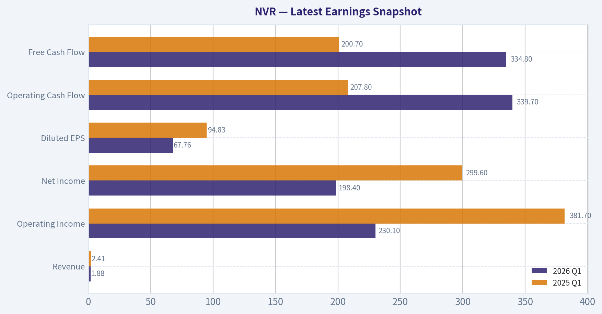

This comparison chart from *Current vs Historical Average Comparison* stacks current figures against historical benchmarks for **NVR**, making it easy to see where the company trades relative to its own averages.

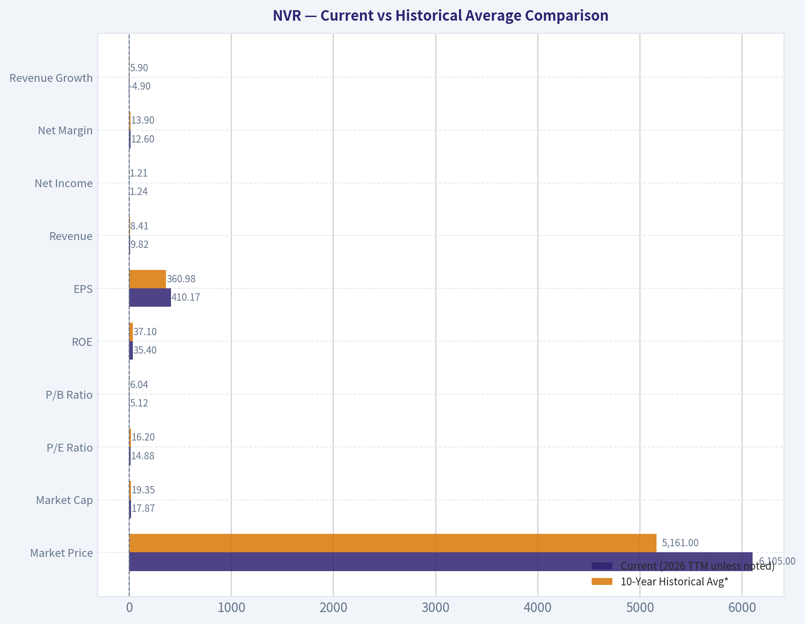

This comparison chart from *DCF Valuation Using Buffett-Style Owner Earnings* stacks current figures against historical benchmarks for **NVR**, making it easy to see where the company trades relative to its own averages.

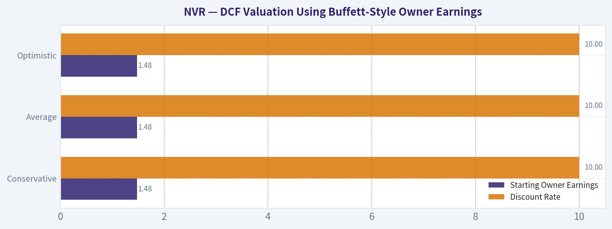

This comparison chart from *Financial Summary Table* stacks current figures against historical benchmarks for **NVR**, making it easy to see where the company trades relative to its own averages.

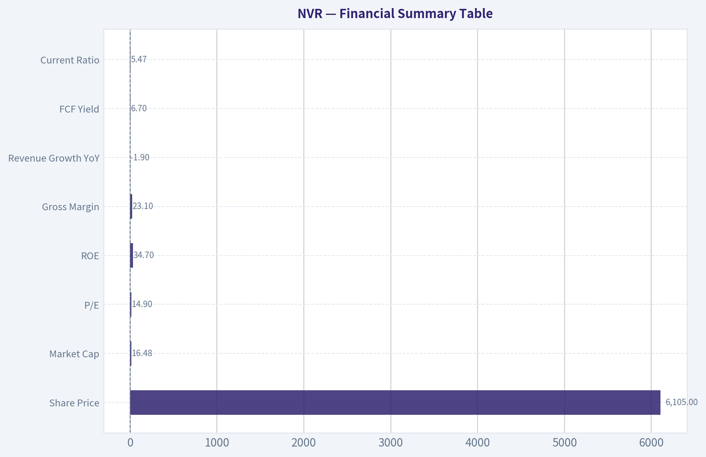

This comparison chart from *Three-Scenario DCF Valuation* stacks current figures against historical benchmarks for **NVR**, making it easy to see where the company trades relative to its own averages.

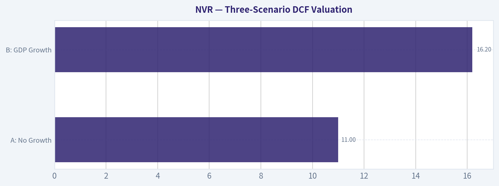

---

### Trend & Growth Analysis (Lynch/Druckenmiller/Fisher)

> *Following Peter Lynch's GARP, Stanley Druckenmiller's macro-aware approach, and Philip Fisher's scuttlebutt methodology.*

ANALYST STANCE: **AVOID**

#### NVR Growth Analysis

NVR does not fit a Lynch-style growth profile today. The shared research pack already gives the key answer: **revenue growth is -1.9% YoY**, which is an automatic yellow-to-red flag for a growth mandate, especially for a homebuilder exposed to cyclical housing demand and interest-rate sensitivity. This looks more like a **quality cyclical/value compounder** than a true fast grower at an inflection point.

#### 1. Lynch Classification

| Item | Assessment |
|---|---|
| Category | **Cyclical** |
| Why | Homebuilding demand is tied to mortgage rates, affordability, consumer confidence, and lot/community cadence |
| Growth fit | **Not a Fast Grower** |
| Lynch verdict | Better treated as a cyclical value/quality operator, not a ten-bagger growth setup |

**Key Takeaways:** NVR is best understood as a cyclical homebuilder, not a fast-growing secular compounder. That matters because the Lynch framework reserves aggressive buying for businesses with durable 15 to 25 percent or better growth and long runways. NVR may still be a good company, but it is not currently a good fit for a pure growth-investing mandate.

#### 2. The Story in 3 Bullets

- NVR is a disciplined U.S. homebuilder that uses an **option-based land strategy**, which reduces balance-sheet risk versus peers that own large land banks.
- It has historically produced **strong returns on equity and cash generation**, helped by tight capital discipline and buybacks.
- But near-term growth is pressured by **housing affordability and mortgage-rate headwinds**, so the setup is not an obvious growth inflection today.

#### 3. Core Snapshot

| Metric | Value |
|---|---:|
| Share price | $6,105 |
| Market cap | $16.48B |
| P/E | 14.9x |
| ROE | 34.7% |
| Gross margin | 23.1% |
| Revenue growth YoY | **-1.9%** |
| FCF yield | 6.7% |
| Current ratio | 5.47x |

**Key Takeaways:** The numbers show a financially strong and profitable company, with especially high ROE and healthy free cash flow yield. However, the most important figure for a growth investor is revenue growth, and that figure is negative. In this framework, strong quality cannot fully offset a missing growth engine.

#### 4. TAM Analysis and 10x Test

| Item | Assessment |
|---|---|
| End market | U.S. residential homebuilding |
| TAM character | Very large, but mature and cyclical |
| Secular growth rate | Low-to-moderate, largely tied to demographics, supply shortages, rates, and affordability |
| 10x test | **Theoretically yes on market size, practically no on business model/cycle** |
| Why not compelling | A 10x revenue outcome would require massive share gains or an extraordinary housing super-cycle, neither of which is the base case |

**Key Takeaways:** NVR operates in a huge market, so TAM is not the limiting factor in a literal sense. The problem is that homebuilding is not a high-velocity secular expansion market like software, AI, or digital payments. That makes the path to ten-bagger-style growth much less credible.

#### 5. Revenue Growth Trend

| Signal | Assessment |
|---|---|
| Latest YoY revenue growth | **-1.9%** |
| Pattern | **Decelerating / negative** |
| Growth quality | Likely volume and affordability pressured by rates |
| Growth conclusion | **No current acceleration** |

**Key Takeaways:** The key growth trend is unfavorable. Instead of accelerating sales, NVR is seeing a year-over-year revenue decline. For this mandate, that means there is no clear evidence of a positive inflection point.

#### 6. Unit Economics

| Metric | Status |
|---|---|
| LTV/CAC | Not meaningful for a homebuilder in the SaaS sense |
| Net Revenue Retention | Not applicable |
| Rule of 40 | Not applicable |
| Relevant substitutes | Gross margin, return on equity, cash conversion, inventory/land discipline |
| Observed quality | Strong capital discipline; good margins for sector; solid FCF profile |

**Key Takeaways:** Traditional software-style unit economics do not apply to NVR. The more relevant lens is capital discipline and margin quality, and on those measures NVR looks strong. Even so, quality alone does not create a growth inflection if top-line demand is soft.

#### 7. Inflection Point Assessment

| Inflection Type | View |
|---|---|
| Product cycle inflection | None |
| Market share inflection | Not evidenced from provided data |
| Margin inflection | Possible stability, but not enough for growth thesis |
| TAM inflection | No |
| Competitive inflection | No major evidence |
| Overall | **No clear positive inflection** |

**Key Takeaways:** NVR does not currently show the kind of accelerating change that Druckenmiller-style growth investors want to see. There is no obvious new product wave, market share breakout, or expanding addressable market. At best, this is a high-quality operator waiting for a better housing tape.

#### 8. Macro Setup

| Macro Factor | Impact on NVR |
|---|---|
| Mortgage rates | Headwind if elevated |
| Housing affordability | Headwind |
| U.S. housing undersupply | Long-term support |
| Consumer confidence/employment | Important swing factor |
| Growth-stock macro tailwind | Limited |
| Overall | **Mixed to slightly negative** |

**Key Takeaways:** The long-term housing shortage helps support the industry, but the shorter-term macro setup is not ideal. Elevated rates and affordability pressure tend to slow orders and compress buyer demand. That means the macro wind is not strongly at NVR's back right now.

#### 9. Fisher 15 Points Score

Given limited scuttlebutt data, this is a conservative estimate.

| Fisher Area | Score (1-5) |
|---|---:|
| Market potential | 3 |
| New product development | 2 |
| R&D effectiveness | 1 |
| Sales organization | 4 |
| Profit margin | 4 |
| Improving margins | 3 |
| Labor/personnel relations | 3 |
| Executive relations | 4 |
| Management depth | 4 |
| Cost analysis/accounting | 5 |
| Special advantages | 4 |
| Long-range profit outlook | 3 |
| Dilution risk | 5 |
| Candor | 3 |
| Integrity | 4 |
| **Total** | **52/75** |

**Key Takeaways:** NVR scores well on financial discipline, management quality, and capital stewardship. It scores less well on innovation-driven categories because homebuilding is not an R&D-led growth business. Overall, this is an above-average company, but not an outstanding Fisher-style innovation compounder.

#### 10. Valuation

| Metric | Value | Interpretation |
|---|---:|---|
| P/E | 14.9x | Cheap-to-reasonable |
| FCF yield | 6.7% | Attractive |
| PEG | Not reliable | Earnings growth outlook not strong enough for meaningful PEG use |
| P/S | Not primary metric for builders | Less useful than earnings/cash flow/book discipline |
| Valuation conclusion | **Reasonable value, weak growth** |

**Key Takeaways:** NVR does not look expensive on conventional value measures. In fact, the stock appears fairly attractive on earnings and free cash flow. But this report is using a growth framework, and in that context a fair valuation does not overcome the lack of top-line momentum.

#### 11. Growth Investor Scorecard

| Criterion | Weight | Score | Weighted |
|---|---:|---:|---:|
| The Story | 10% | 3.0 | 0.30 |
| TAM & Runway | 20% | 2.5 | 0.50 |
| Revenue Growth | 20% | 1.5 | 0.30 |
| Unit Economics | 15% | 3.5 | 0.53 |
| Competitive Position | 10% | 4.0 | 0.40 |
| Management Quality | 10% | 4.0 | 0.40 |
| Macro Setup | 5% | 2.5 | 0.13 |
| Profitability Path | 5% | 4.0 | 0.20 |
| Valuation | 5% | 3.5 | 0.18 |
| **Total** | 100% |  | **2.94 / 5.0** |

**Key Takeaways:** NVR's score is dragged down mainly by the two most important growth categories: runway quality and revenue growth. It earns respectable marks for management, profitability, and competitive discipline. The final result lands just below the threshold where a growth investor would keep it as a serious active idea.

#### 12. Position Size Stance

| Stance | View |
|---|---|
| For growth portfolio | **AVOID** |
| For quality/value/cyclical portfolio | Could be **WATCH** or selective hold |
| Suggested sizing | 0% in a pure growth mandate |

**Key Takeaways:** For a dedicated growth strategy, NVR should not be a position today. The company may deserve attention in a different mandate focused on quality cyclicals or capital allocation. But under Lynch-Druckenmiller-Fisher growth rules, it does not qualify.

#### 13. Risks and Catalysts

| Type | Item |
|---|---|
| Risk | Further affordability deterioration from high mortgage rates |
| Risk | Order softness and cancellation risk |
| Risk | Gross margin pressure if incentives rise |
| Risk | Cyclical earnings compression |
| Catalyst | Mortgage rates decline materially |
| Catalyst | Reacceleration in orders and closings |
| Catalyst | Margin resilience despite weaker market |
| Catalyst | Continued large buybacks at reasonable valuation |

**Key Takeaways:** The biggest upside catalyst would be a meaningful improvement in the housing backdrop, especially lower mortgage rates. The biggest risk is that affordability stays tight and demand remains sluggish. In other words, the stock is more macro-sensitive than thesis-driven right now.

#### Bottom Line

NVR is a **high-quality cyclical operator**, not a growth stock at a favorable inflection point. The valuation is reasonable, the balance sheet and capital discipline are strong, and management appears capable. But **negative revenue growth, cyclical exposure, and no visible acceleration** make it a poor fit for this specific growth framework.

If you want, I can next do one of two follow-ups:
1. a **deeper value/cyclical analysis of NVR**, or
2. a **peer comparison versus DHI, LEN, PHM, and TOL** to see whether NVR is still the best housebuilder despite weak growth.

#### Growth & Scorecard Visuals

The radar chart below from *Final Buffett Scorecard* visualises how **NVR** ranks across weighted investment criteria. Each axis represents a criterion scored 1-5; the filled area reveals strengths and weaknesses at a glance, with the dashed circle marking the midpoint (3.0).

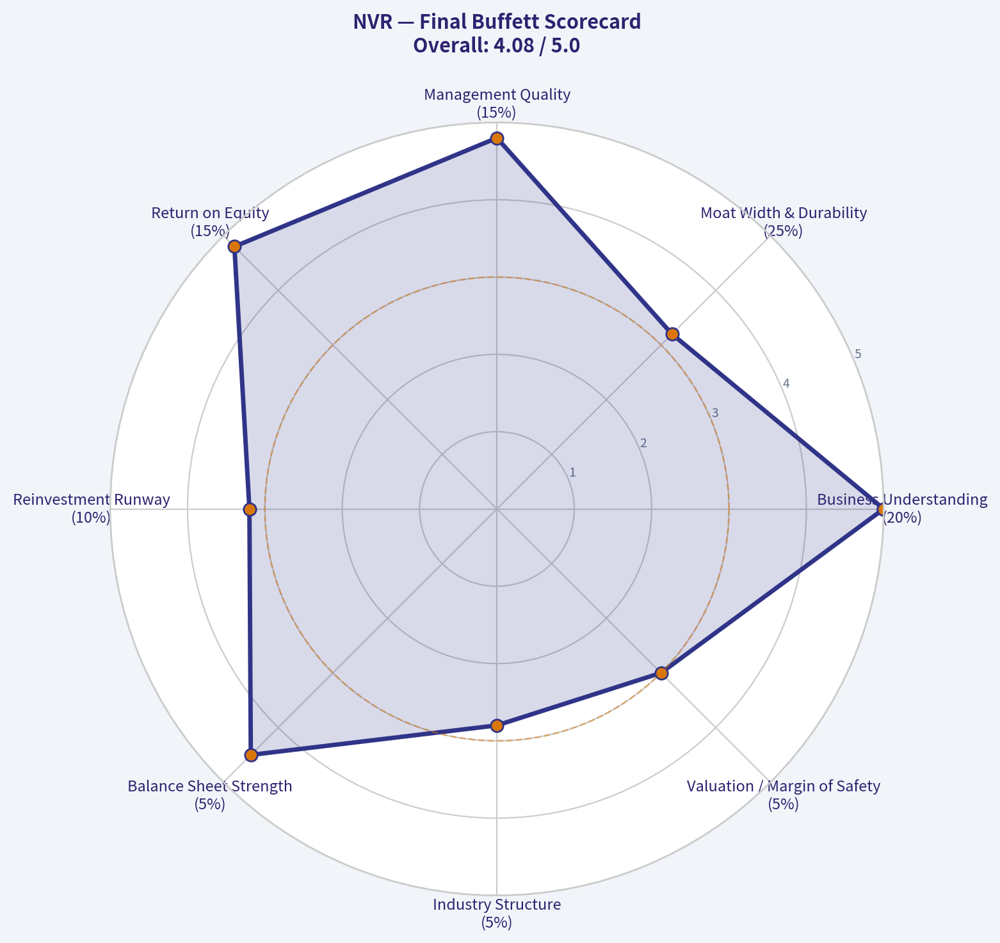

---

### Market Technical Analysis

#### NVR Technical Indicator Report

NVR is in a **clear multi-timeframe downtrend**, but the most recent two weeks show a **tradable rebound attempt** rather than a confirmed trend reversal. The larger message is still bearish: price has fallen from the 2025 peak zone above 8,500 to roughly 6,100 by the latest close on 2026-05-29, and both the 50-day and 200-day moving averages are still declining. However, short-term momentum has improved meaningfully from deeply oversold conditions seen in mid-May.

For this market context, the most relevant indicator set is:

- **close_10_ema** - short-term trend and rebound tracking
- **close_50_sma** - medium-term trend and resistance
- **close_200_sma** - long-term trend regime
- **macd** - momentum inflection and trend acceleration/deceleration
- **rsi** - oversold recovery and momentum quality
- **boll_ub** - upside stretch / rebound ceiling
- **boll_lb** - downside stress / exhaustion zone
- **atr** - volatility and risk sizing

These eight are complementary and avoid unnecessary overlap. The moving averages define trend hierarchy, MACD and RSI measure momentum quality, Bollinger Bands frame price stretch and compression, and ATR captures risk conditions.

---

#### Price Structure and Trend Regime

Over the last year, NVR moved through three distinct phases:

1. **Mid-2025 strength**: a sustained rally from the low 7,000s into the 8,400-8,500 area.
2. **Late-2025 to Q1-2026 deterioration**: repeated lower highs formed, then a breakdown accelerated through February and March.
3. **Q2-2026 capitulation and rebound attempt**: price slid from the upper 6,000s into the mid-5,500s, then bounced back toward 6,100.

The recent recovery is notable, but context matters. The bounce has not yet repaired the broader damage. The stock remains far below major moving averages, so this looks more like a **countertrend recovery inside a larger bearish structure** than a new bull phase.

| Metric | Observation | Interpretation |
|---|---:|---|
| Latest close (2026-05-29) | 6104.80 | Rebound off May lows, but still depressed vs prior quarters |
| Approx. 1-year high | 8543.00+ | Large drawdown from peak |
| Approx. 1-year low | 5563.62 | Mid-May washout likely marked a short-term exhaustion point |
| Distance vs 50 SMA | 6104.8 vs 6348.9 | Price still below medium-term trend |
| Distance vs 200 SMA | 6104.8 vs 7300.6 | Deeply below long-term trend benchmark |

**Key Takeaways:** NVR has bounced from an oversold breakdown, but it remains below both its medium-term and long-term trend lines. That means the recent strength is real enough for tactical traders, yet still not strong enough to overturn the broader bearish structure.

---

#### Moving Averages: Trend Hierarchy Still Bearish

The moving averages are the clearest evidence that the primary trend remains weak.

- **10 EMA = 6022.6** on 2026-05-29
- **50 SMA = 6348.9**
- **200 SMA = 7300.6**

The short-term EMA has turned up and price has climbed slightly above it, which tells us the rebound has traction. But the larger trend stack is still bearish because:

- price is **below the 50 SMA**
- the **50 SMA is falling sharply**
- the **200 SMA is also falling**
- the gap between the 50 and 200 SMA remains large and unfavorable

This matters because rallies in bear trends often fail near declining moving averages. For NVR, the 50-day average around **6,350** is the first important test. Even if price reaches that zone, traders should expect it to behave as resistance unless momentum strengthens further.

| Indicator | Latest Value | Trend | Trading Read |
|---|---:|---|---|
| close_10_ema | 6022.6 | Rising | Short-term rebound support |
| close_50_sma | 6348.9 | Falling | First major resistance |
| close_200_sma | 7300.6 | Falling | Long-term bearish regime |
| MA alignment | 10 EMA < 50 SMA < 200 SMA | Bearish | Trend stack still negative |

**Key Takeaways:** The short-term average has improved, which supports the current rebound. But the broader moving-average alignment is still bearish, so any rally into the 50-day average should be treated as a test of resistance, not yet as confirmation of a new uptrend.

---

#### Momentum: Rebound Is Improving, but Not Fully Bullish

Momentum has clearly improved from the May washout.

- **MACD** rose from roughly **-271** on 2026-05-15 to **-91** on 2026-05-29.
- **RSI** rose from **25.7** on 2026-05-15 to **49.4** on 2026-05-29.

This is an important shift. The stock was deeply oversold in mid-May, and the rebound since then has repaired some of that damage. But the quality of that improvement is mixed in an instructive way:

- **MACD is still negative**, meaning momentum is improving but remains below the zero line.
- **RSI near 49** indicates recovery toward neutral, not yet decisive bullish control.
- The stock has moved from panic selling toward balance, but not yet into strong upside momentum.

In practical terms, this suggests the market has gone from **capitulation** to **stabilization**, but not necessarily to **trend reversal**.

| Momentum Indicator | Mid-May Low Point | Latest | What It Means |
|---|---:|---:|---|
| macd | about -271.1 | -91.0 | Downtrend momentum is fading, but not fully reversed |
| rsi | 25.7 | 49.4 | Oversold condition has normalized toward neutral |
| Momentum regime | Oversold bounce | Recovery phase | Better short-term tone, incomplete bullish confirmation |

**Key Takeaways:** Momentum has improved sharply since the May low, which supports the idea of a short-term recovery. Even so, MACD remains below zero and RSI is only near neutral, so the rebound has not yet matured into a strong bullish trend signal.

---

#### Bollinger Bands: Rebound Near Upper Range, but Not Overextended

On 2026-05-29:

- **Bollinger Upper Band = 6287.0**
- **Bollinger Lower Band = 5593.6**
- Close = **6104.8**

This places price in the **upper half of the Bollinger range**, but still below the upper band. That is constructive: price has recovered meaningfully from the lower-band washout seen in mid-May without yet reaching an extreme upside stretch.

This setup has two implications:

1. There is still room for price to push modestly higher before becoming statistically stretched.
2. The zone between roughly **6,250 and 6,350** is likely to be crowded with resistance because the **upper band and 50 SMA** are relatively close.

That convergence creates an important tactical area. If NVR stalls there, it would reinforce the idea that the move is still a bear-market bounce. If it breaks through and holds above that cluster, the recovery would gain credibility.

| Band Measure | Latest Value | Interpretation |
|---|---:|---|
| boll_ub | 6287.0 | Near-term upside stretch zone |
| boll_lb | 5593.6 | Recent downside exhaustion reference |
| Band position | Close in upper half | Recovery is healthy, but nearing first resistance cluster |
| Band width | Still fairly wide | Volatility remains elevated despite stabilization |

**Key Takeaways:** NVR has rebounded from a lower-band stress zone into the upper half of its recent trading range. The next important test sits near the upper band and the 50-day average, where the rally may either stall or prove it has more strength.

---

#### Volatility and Risk: Still Elevated but Moderating

- **ATR = 189.8** on 2026-05-29
- ATR was above **210-225** in late April

That tells us volatility has cooled somewhat from the sharp breakdown phase, but it remains elevated in absolute terms. For a high-priced stock like NVR, daily swings near 190 points are still meaningful. Traders should not confuse a rebound with low risk.

What this means in practice:

- Stops need to account for **wide normal movement**
- Position size should likely be **smaller than usual**
- Breakout signals need follow-through, because volatile rebounds can reverse quickly

The drop in ATR is encouraging because it suggests panic conditions are easing. But risk remains above calm-trend levels.

| Volatility Metric | Latest | Recent Context | Trading Implication |
|---|---:|---|---|
| atr | 189.8 | Down from ~210-225 in late April | Volatility easing, but still elevated |
| Daily swing environment | Large | Not yet calm | Use wider stops and smaller size |
| Risk regime | Moderate-high | Improved from panic | Tactical, not complacent |

**Key Takeaways:** Volatility has eased from the most chaotic phase of the selloff, but NVR is still moving enough each day to require disciplined risk management. Traders should assume normal price noise is still large and size positions accordingly.

---

#### Fine-Grained Trend Interpretation

The most nuanced reading is this:

- **Long-term participants** still see a damaged chart. Price far below the 200-day average suggests the stock remains in a strategic downtrend.
- **Medium-term swing traders** see a rebound that is approaching a decision point. The 50-day average near 6,350 is the first meaningful technical checkpoint.
- **Short-term traders** can justify a constructive stance while price holds above the 10 EMA, because near-term momentum has improved.
- **Mean-reversion traders** already captured the strongest part of the oversold snapback; reward-to-risk is less attractive now than it was near the RSI washout in mid-May.
- **Breakout traders** should be patient. A breakout is not compelling until price can clear the upper Bollinger area and the declining 50-day average with convincing follow-through.

The stock therefore sits in a **transition zone**:
- no longer in immediate capitulation,
- not yet in confirmed recovery,
- still embedded in a broader bearish framework.

---

#### Trading Decision Framework

| Scenario | Signal to Watch | Interpretation | Bias |
|---|---|---|---|
| Bullish continuation | Price holds above 10 EMA and breaks 6287-6350 | Rebound broadens into stronger recovery phase | Cautiously bullish short term |
| Range failure | Price stalls below 6287-6350 and RSI rolls over near 50 | Bear-market rally losing steam | Neutral to bearish |
| Bearish resumption | Price falls back below 6000 and MACD weakens again | Rebound fails, sellers regain control | Bearish |
| Stronger reversal case | Price reclaims 50 SMA, then builds higher lows | Medium-term trend repair begins | Improving, but not yet long-term bullish |

**Key Takeaways:** The most important zone for traders is just above current price, where resistance from the upper Bollinger band and the 50-day average begins to cluster. If NVR can break and hold above that area, the rebound strengthens; if it fails there, the larger downtrend likely remains in control.

---

#### Bottom Line

NVR is showing a **credible short-term rebound from oversold conditions**, supported by a rising 10 EMA, improving MACD, and RSI recovery from deeply depressed readings. However, the stock remains **well below both the 50-day and 200-day moving averages**, and those longer trend measures are still falling. That keeps the broader technical outlook bearish.

The most actionable conclusion is that **momentum has improved faster than trend**. Traders can respect the rebound, but should also recognize that the market is approaching a technically important resistance zone around **6,287 to 6,350**. Until that area is convincingly reclaimed, the move is best treated as a rebound within a larger downtrend rather than a confirmed bullish reversal.

| Category | Indicator | Latest Read | Main Message |
|---|---|---:|---|
| Short-term trend | close_10_ema | 6022.6 | Rebound has near-term support |
| Medium-term trend | close_50_sma | 6348.9 | Key overhead resistance |
| Long-term trend | close_200_sma | 7300.6 | Primary trend still bearish |
| Momentum | macd | -91.0 | Improving, but still below zero |
| Momentum quality | rsi | 49.4 | Recovered from oversold to neutral |
| Upside stretch | boll_ub | 6287.0 | Near-term ceiling area |
| Downside stress | boll_lb | 5593.6 | Recent exhaustion reference |
| Volatility/risk | atr | 189.8 | Risk still elevated despite stabilization |

**Key Takeaways:** NVR has moved off a washed-out low and is rebuilding short-term momentum, but the bigger trend remains under pressure. The next move around the 6,287 to 6,350 resistance zone will likely determine whether this becomes a stronger recovery or fades back into the broader downtrend.

---

### Options Market Analysis

> *Reading options flow - put/call ratios, IV skew, and unusual activity - to gauge institutional positioning and event-driven risk.*

#### NVR Options Market Report

I could not retrieve any usable options chain data for **NVR** as of **2026-06-01**. The data source returned:

| Ticker | Data Status | Note |
|---|---:|---|
| NVR | Unavailable | No options data available |

Key Takeaways: NVR currently has no retrievable options market data from the available source, which usually means either the chain is unavailable from that feed or the ticker's options are too sparse to generate a meaningful read. Because options positioning is the basis of this analysis, confidence in any sentiment conclusion is very low.

#### Liquidity / Data Quality Assessment

| Factor | Assessment |
|---|---|
| Options chain availability | Not available |
| Near-term expirations | Not retrievable |
| Put/Call ratios | Cannot calculate |
| Implied volatility | Cannot calculate |
| Unusual activity | Cannot detect |
| Open interest concentration | Cannot identify |
| Confidence level | Very low |

Key Takeaways: Without chain-level open interest, volume, and implied volatility data, it is not possible to responsibly infer institutional positioning. For a name like NVR, which can already trade with thinner options liquidity than mega-cap stocks, missing data further reduces reliability.

#### Put/Call Ratio Analysis

| Metric | Result | Interpretation |
|---|---:|---|
| Near-term put/call OI ratio | N/A | No chain data |
| Near-term put/call volume ratio | N/A | No chain data |
| Shift vs. neutral baseline (~0.7) | N/A | Cannot assess |

Key Takeaways: There is no basis to determine whether traders are leaning toward downside hedging or upside speculation. Any bullish or bearish read here would be guesswork.

#### Implied Volatility Assessment

| Metric | Result | Interpretation |
|---|---:|---|
| Near-term ATM call IV | N/A | No chain data |
| Near-term ATM put IV | N/A | No chain data |
| OTM put vs. OTM call skew | N/A | Cannot assess fear vs. upside chase |
| Catalyst-related IV elevation | N/A | Cannot assess |

Key Takeaways: IV is one of the most important forward-looking inputs in options analysis, and it is unavailable here. That means we cannot evaluate whether the market is pricing elevated event risk or showing asymmetry toward downside protection.

#### Unusual Options Activity

| Contract | Volume | Open Interest | Signal |
|---|---:|---:|---|
| None available | N/A | N/A | Cannot assess |

Key Takeaways: With no prints or chain data available, there is no way to identify fresh directional bets. That removes one of the strongest clues for detecting institutional or event-driven positioning.

#### Open Interest Concentration

| Expiration | Strike | OI Concentration | Market Impact |
|---|---:|---:|---|
| N/A | N/A | N/A | Cannot assess pinning or gamma walls |

Key Takeaways: We cannot map high-OI strikes, max-pain zones, or potential gamma walls. As a result, there is no evidence-based way to identify near-term support/resistance driven by dealer positioning.

#### Overall Options Sentiment Signal

| Signal | Confidence | Primary Driver |
|---|---|---|
| NEUTRAL | Very low | No usable options data |

Key Takeaways: I have to label the options signal as **NEUTRAL**, not because positioning is balanced, but because there is no retrievable evidence to support a bullish or bearish call. The main caveat is data absence and likely thin/limited options liquidity.

#### Bottom Line

For **NVR**, the available feed does **not provide options data**, so this report cannot extract a real positioning signal. In practice, that means you should **not use options flow as a decision input here unless you can access a richer chain source** with live/open interest detail.

| Put/Call Ratio | IV Level | Skew Direction | Unusual Activity | Overall Signal |
|---|---|---|---|---|
| N/A | N/A | N/A | None detectable due to missing data | NEUTRAL (very low confidence) |

Key Takeaways: The summary is straightforward: no chain, no ratios, no IV, and no unusual flow detection. For NVR, the options-based read is effectively unavailable, so any directional view should come from other evidence rather than this feed.

---

## Research Team Commentary

> *The Research Manager synthesizes the Bull vs Bear debate into action-free commentary. This is a pre-risk view, not the final stance.*

The strongest bull argument is that NVR is not a typical homebuilder in how it allocates capital. The land-light option model lowers balance-sheet risk, reduces the chance of land impairments, and has historically supported unusually strong returns for the industry. That matters from a Buffett lens because a cyclical business with superior discipline can still be a worthwhile compounder if management consistently avoids the mistakes peers make. The numbers support that quality case: roughly 34.7% ROE, 22.9% ROA, a modest-looking 14.9x earnings multiple, and a long record of buybacks and disciplined capital allocation. The bullish contrarian angle is that the market may be lumping NVR in with ordinary builders and over-discounting mortgage-rate fears, while underappreciating that NVR's model should hold up better than peers over a full cycle.

The strongest bear argument is that this is still fundamentally a homebuilder, which means macro conditions, financing availability, affordability, and local supply-demand dynamics drive results more than any durable customer captivity. The land-option model is a good operating choice, but it is not the kind of classic Buffett moat that creates pricing power or deep predictability. The more important valuation concern is that trailing earnings may not be normalized. If current profits are still above mid-cycle, then 14.9x earnings may not actually be cheap at all. Revenue is already down 1.9% YoY, and in cyclical industries small top-line softness can precede bigger pressure on margins and volumes. So the bear case says investors may be paying a quality premium for a business whose reported returns are flattered by the asset-light structure and buybacks, not by an enduring moat.

My takeaway is that both sides are right about part of the story, but the bear side has the edge for a strict Buffett-style portfolio today. NVR is clearly one of the best-run companies in a difficult industry. That should not be dismissed. But I do not think the evidence here shows the kind of durable moat, earnings predictability, and clear margin of safety that would justify a strong ADVOCATE label. At the same time, I would stop short of AVOID because this is exactly the kind of superior operator that can become very attractive if the cycle or price gives us a better setup. One lesson from past mistakes is not to let abstract long-term skepticism blind me to genuine business quality. Another is not to over-credit "great company" status when cyclicality and normalization risk are still active. Here, that balance points to patience rather than conviction.

Core takeaway: NVR looks like a high-quality cyclical, not a classic Buffett compounder at an obvious discount. The business quality is better than the average builder, mainly because of capital discipline and the land-light model, but the moat is narrower and the earnings stream less predictable than the bull case suggests. At the current price, the stock seems closer to fair value than to a compelling margin-of-safety opportunity.

Rationale: From a value investing perspective, business quality comes first, and NVR does score well on management quality, capital allocation, and financial conservatism relative to peers. That deserves real credit. But Buffett's best investments usually combine quality with strong predictability and a moat that is hard to replicate. NVR's advantages are meaningful, yet they are mostly process-driven rather than structural in the classic sense. In a cyclical, rate-sensitive industry, that matters. The market may indeed be too pessimistic on housing near term, but for a 10+ year value framework the key question is not whether NVR is better than peers; it is whether we are buying a business with durable excess economics at a clear discount to intrinsic value. Based on the debate, I do not see enough margin of safety to be aggressive.

Monitoring plan over the next 1-4 quarters: First, watch orders, backlog, cancellation rates, and absorption trends. If affordability pressure is worsening, the normalization-risk argument gets stronger. Second, monitor gross margin and incentive intensity. If NVR has to lean more heavily on incentives, that would suggest weaker pricing power than bulls assume. Third, track whether ROE and ROA remain strong because of genuine operating performance rather than just share count reduction. Fourth, listen for management's tone around lot option availability and pricing; if land developers are capturing more economics, the land-light advantage may be less powerful than advertised. Fifth, watch capital allocation closely: continued buybacks are only a positive if operating conditions remain resilient and the stock is repurchased below reasonable intrinsic value. Finally, I would pay attention to the technical context indirectly through the 50-day and 200-day trend only as a sentiment gauge, not as the core thesis. If the market begins to reward builders broadly while NVR continues to execute, that may create a better entry framework even if pure Buffett valuation still requires discipline.

If the next few quarters show stable orders, resilient margins, disciplined repurchases, and evidence that earnings are holding closer to normalized than the bear case fears, I would become more constructive. If instead revenue softness broadens into margin compression and weaker cash generation, then today's valuation will likely prove less attractive than it appears.

Final stance: WATCH

---

## Value Investing Team Commentary

> *The Investor translates the research view into an investment thesis before risk review. This is still not the final stance.*

NVR is the kind of company a value investor should respect, even if not rush to buy.

The central fact is that this is a clearly superior operator in a structurally mediocre industry. Homebuilding is cyclical, rate-sensitive, and usually a poor place to look for durable moats. Yet NVR has long distinguished itself through disciplined underwriting, a land-light option model, strong returns on capital, and management that appears far more rational than the average industry participant. That matters. In a business where many competitors destroy capital at the wrong point in the cycle, simply avoiding the worst mistakes is itself a meaningful advantage.

From a Buffett-style lens, the bull case is straightforward: NVR behaves more like a disciplined capital allocator than a speculative builder. The option-based land strategy reduces balance-sheet risk, limits exposure to land write-downs, and supports high ROE and ROA. A 14.9x P/E does not look demanding on the surface, especially for a company with a long record of buybacks and superior execution. If the market is broadly discounting all builders because of mortgage-rate anxiety, there is a reasonable contrarian argument that NVR deserves a narrower discount than peers and may ultimately prove more resilient than current sentiment assumes.

But the real question is not whether NVR is better than peers. It almost certainly is. The question is whether that superiority translates into a business with sufficiently predictable long-term economics and a clear margin of safety at today's price. Here I remain restrained. NVR's advantages are real, but they are managerial and operational rather than the kind of deep structural moat Buffett most prizes. Customers are not captive. Pricing power is limited by local market conditions, affordability, financing availability, and competitor behavior. Even a best-in-class builder remains exposed to the housing cycle.

That makes earnings normalization especially important. Revenue is already down 1.9% year over year. In a cyclical business, small top-line pressure can become larger profit pressure if incentives rise, absorption slows, or mix shifts unfavorably. Reported returns may also look especially strong because the land-light structure reduces the asset base and buybacks shrink equity; those are positives, but they can flatter ratio analysis if one is not careful. So the modest headline multiple may not be as cheap as it first appears if current earnings sit above mid-cycle reality.

Selective contrarian thinking is useful here. The market may indeed be overreacting to mortgage-rate fears in the short run, and in lower-quality builders that fear may be justified. But in NVR's case, the more interesting question is whether investors are missing the company's relative durability across a full cycle. If housing merely stays soft rather than collapsing, NVR could emerge stronger while weaker competitors struggle. That is the best reason to keep it close on the watchlist. On the other hand, contrarianism should not become self-deception. "Best house in a difficult neighborhood" is not the same as "wonderful business at a wonderful price." Sometimes the market discounts a sector for good reason.

What I would watch now is not headlines about housing sentiment, but business evidence:
- orders and backlog trends,
- cancellations,
- gross margin and incentive usage,
- absorption pace,
- buyback discipline,
- and whether management still has attractive lot-option economics available.

If those remain resilient while the stock becomes cheaper, the opportunity could become compelling. If margins start to compress and demand weakens materially, the apparent valuation support may prove illusory.

So my conclusion is this: NVR is a high-quality cyclical with unusually strong stewardship, but not a classic wide-moat compounder available at an unmistakable bargain. It deserves admiration, but valuation discipline matters most in cyclical industries, and today I do not see enough margin of safety to be aggressive.

**ANALYST STANCE: WATCH**

NVR is a superior homebuilder worth monitoring closely, especially if market pessimism deepens without corresponding deterioration in orders, margins, or capital allocation. For now, I would not avoid it outright, but I would wait for either a more attractive price or clearer evidence that current earnings are durable through the cycle before committing capital.

---

## Deep Values Commentary

> *The Risk Management Team debates and the Risk Judge provides the final action-free verdict. This section determines the final ADVOCATE / WATCH / AVOID stance.*

#### Final Stance Scorecard

This scorecard converts the final research view into a weighted decision frame. It does not replace the narrative judgement, but it makes the main drivers of the verdict easier to scan.

| Criterion | Score | Weight | Commentary |
| --- | ---: | ---: | --- |
| Business Quality | 3.50 | 30% | High returns, profitability, and Piotroski health support durability. |
| Valuation Support | 3.33 | 30% | Blends current price against available intrinsic value anchors and valuation ratios. |
| Financial Strength | 5.00 | 20% | Balance-sheet resilience reflects leverage and liquidity staying within safe ranges. |
| Growth Durability | 1.00 | 20% | Recent revenue, earnings, and free cash flow growth indicate how durable expansion looks. |
| TOTAL / FINAL STANCE | 3.25 | 100% | WATCH |

#### Key Takeaways

The weighted score lands at **3.25 / 5.0**, while the final stance remains **WATCH**. This is useful as a quick calibration aid rather than a mechanical signal.

#### Risk Summary

Higher scores indicate more risk pressure. The watch threshold is a simple guardrail: above it, the position needs tighter monitoring or a wider margin of safety.

| Dimension | Current Score | Watch Threshold | Commentary |
| --- | ---: | ---: | --- |
| Business Quality | 2.50 | 3.00 | High returns, profitability, and Piotroski health support durability. |
| Valuation Support | 2.67 | 3.00 | Blends current price against available intrinsic value anchors and valuation ratios. |
| Financial Strength | 1.00 | 3.00 | Balance-sheet resilience reflects leverage and liquidity staying within safe ranges. |
| Growth Durability | 5.00 | 3.00 | Recent revenue, earnings, and free cash flow growth indicate how durable expansion looks. |

#### Key Takeaways

This view helps readers separate *where* the risk sits: valuation, business quality, balance sheet, or growth durability. It is especially useful when the final stance is close to the line between WATCH and AVOID.
