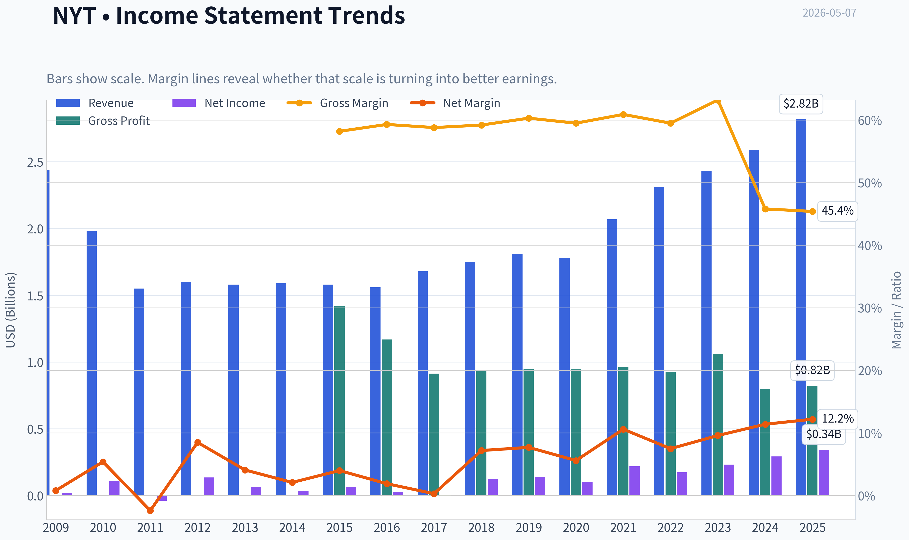
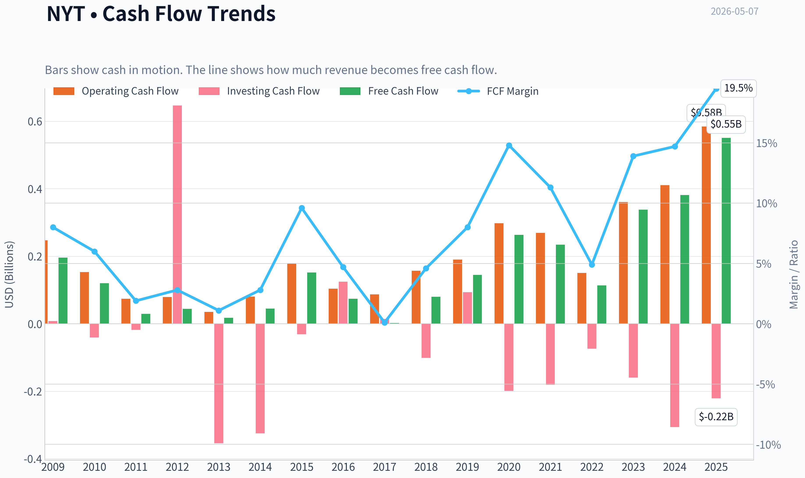
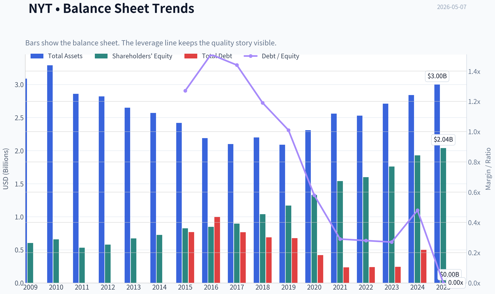
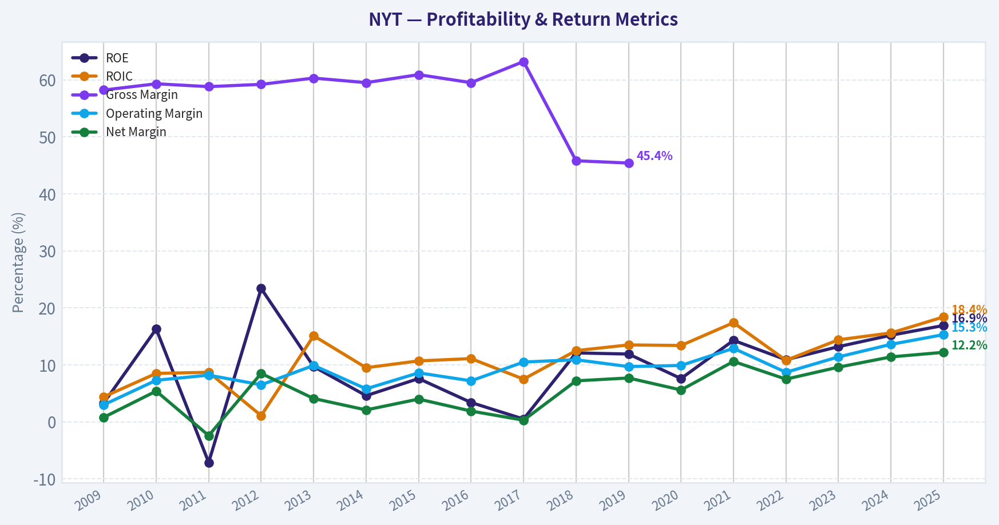
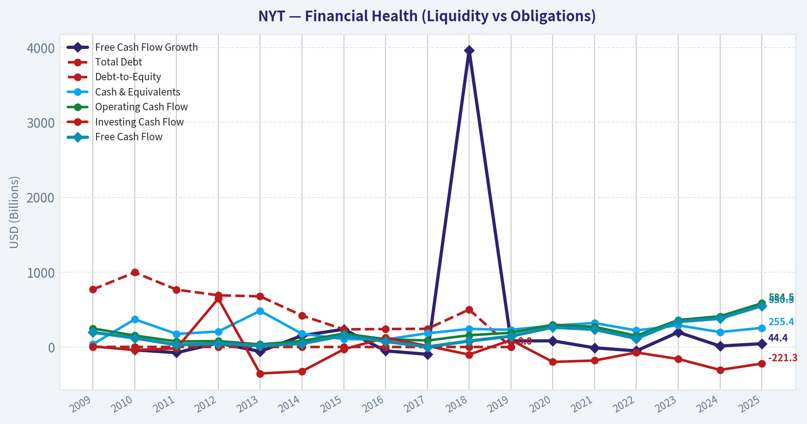
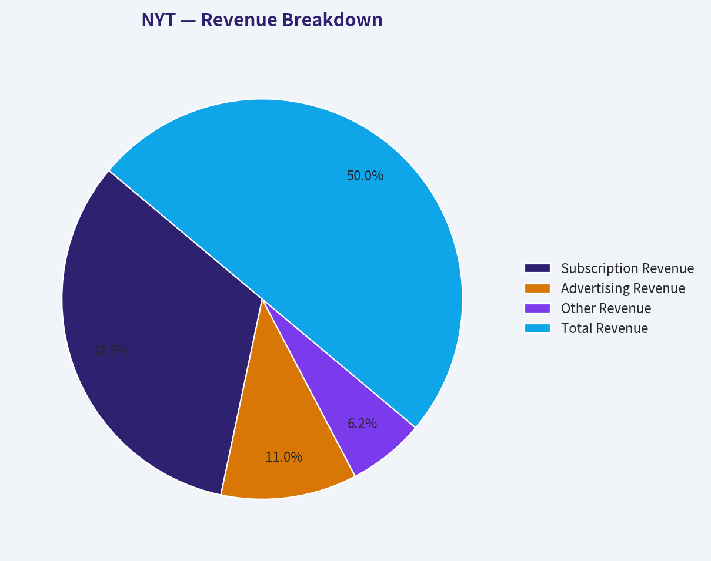
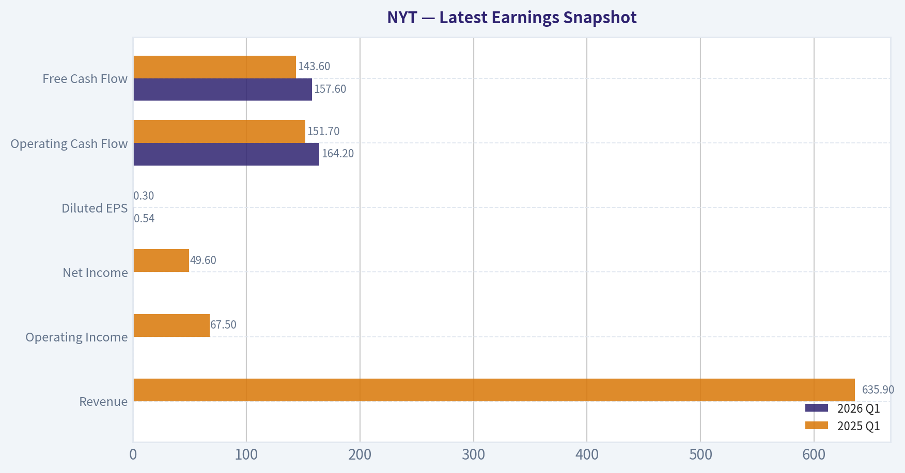
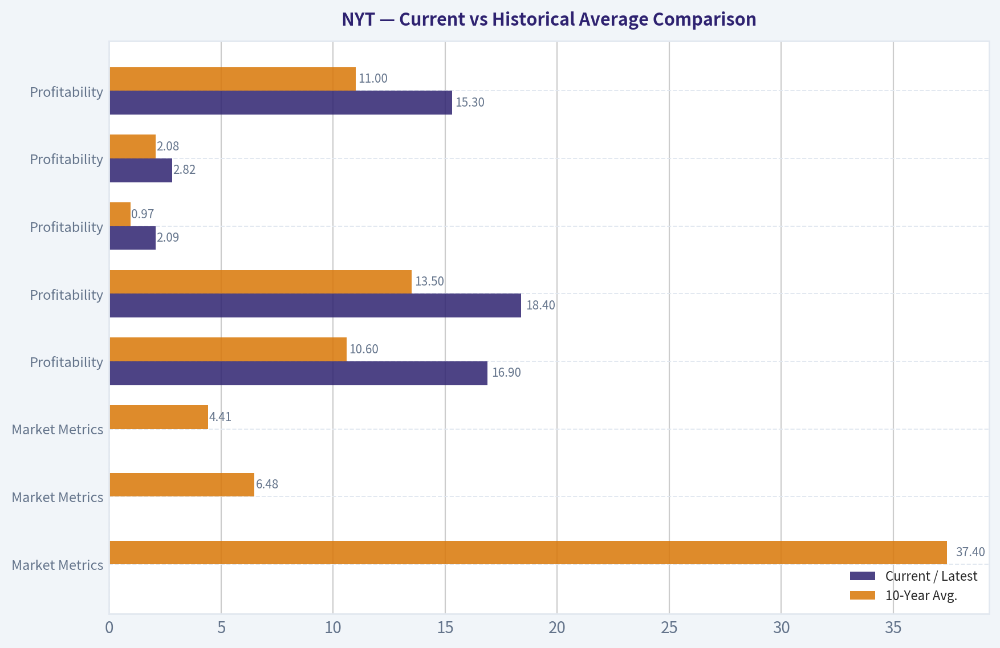
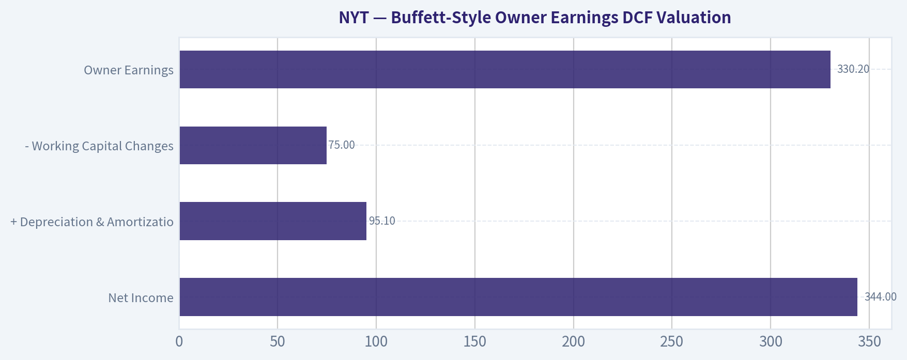
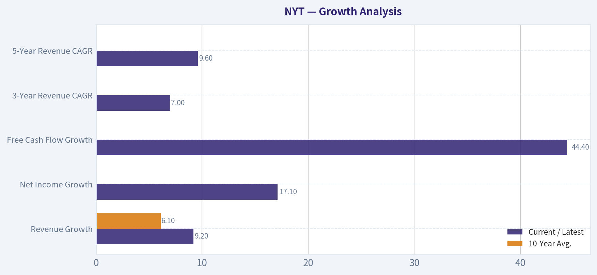

# NYT Deep Value Intelligence

**Analysis Date:** 2026-05-07

## Critical Disclaimer

*This analysis is generated by Deep Value Intelligence, an AI-powered multi-agent investing framework. This report is for informational and educational purposes only and does not constitute financial advice. Always conduct your own research and consult with qualified financial advisors before making investment decisions.*

---

## Table of Contents

1. Intelligence Summary
2. Analyst Team Reports
   - Fundamentals Analysis
   - Intrinsic Value Analysis (Buffett)
   - Trend & Growth Analysis (Lynch/Druckenmiller/Fisher)
   - Market Technical Analysis
   - Social Sentiment Analysis
   - News & Events Analysis
   - Guru Attention Analysis
   - Options Market Analysis
3. Research Team Commentary
4. Value Investing Team Commentary
5. Deep Values Commentary

---

## Intelligence Summary

### Thesis + Conditions

**Core Thesis:** **EXECUTIVE SUMMARY**
The New York Times (NYT) has successfully transformed from a legacy newspaper into a premium, recurring-revenue digital habit platform. Business quality is exceptional, marked by an 18.4% ROIC and 44% YoY Free Cash Flow growth.

**Key Risks:**
- The New York Times (NYT) has successfully transformed from a legacy newspaper into a premium, recurring-revenue digital habit platform. Business quality is exceptional, marked by an 18.4% ROIC and 44% YoY Free Cash Flow growth. However, at ~$84 per share and a 36x P/E, the stock trades at a massive premium to intrinsic value estimates ($36-$53). Under a Buffett value framework, a great business without a margin of safety is a dangerous investment. Overpaying for perfection exposes capital to severe multiple compression if subscriber growth normalizes post-election or AI disrupts search traffic.
- The Conservative View (Valuation & Margin of Safety):** Quality does not neutralize valuation risk. A 36x P/E and 4.1% FCF yield offer zero margin of safety. Recent growth is flattered by an election-year news cycle. Furthermore, media subscriptions remain discretionary with low absolute switching costs, and AI poses a severe top-of-funnel traffic threat (especially to Wirecutter).
- As we look at The New York Times Company today, we are staring at one of the most fascinating business transformations of the last two decades. Management successfully navigated the print-todigital apocalypse and built a highly profitable, recurring-revenue subscription bundle. But as value investors, our job isn't to award medals for past turnarounds; it's to evaluate future cash flows and figure out if the current market price offers us a margin of safety.
- When I listen to the bull case, the strongest argument is undeniably the dramatic improvement in business quality. NYT isn't just a newspaper anymore; it's a daily habit bundle. Between the core news, Games like Wordle, Cooking, Wirecutter, and The Athletic, they have created a highly sticky ecosystem. The aggressive analysts rightfully point out that this "habit density" changes the subscriber relationship entirely. The fundamentals reflect this: an 18.4% return on invested capital, 44.4% year-over-year free cash flow growth, and a shifting revenue mix that is increasingly recurring. In Buffett terms, they've built a real brand moat and paired it with excellent operating leverage. The bulls argue that if you look at this as a software-like consumer subscription compounder, rather than a legacy media stock, a premium valuation is entirely justified.
- If we apply Buffett's principles, NYT passes the tests for management competence, financial strength, and improving business quality. Berkshire Hathaway even taking a small $352 million tracking position (0.13% of their portfolio) validates this quality while simultaneously signaling restraint on valuation. It fails the intrinsic value test spectacularly. Buying a media company-even a premium one-at almost 36 times earnings and an $84 price tag when conservative free cash flow models peg its value closer to $50 is a recipe for poor long-term returns. We also have to apply a contrarian lens to the current market psychology. The market is currently euphoric over a strong Q1 earnings beat and an election-year news cycle. But what happens when the news cycle normalizes? What happens if AI search assistants begin cannibalizing Wirecutter's affiliate links or top-of-funnel news traffic? We cannot anchor to one year of 44% FCF growth as a perpetual trend. At a 4.1% free cash flow yield, we are not being compensated for these risks. The business is wonderful, but the price is too high.

**What Would Change Our View:**
- The New York Times (NYT) has successfully transformed from a legacy newspaper into a premium, recurring-revenue digital habit platform. Business quality is exceptional, marked by an 18.4% ROIC and 44% YoY Free Cash Flow growth. However, at ~$84 per share and a 36x P/E, the stock trades at a massive premium to intrinsic value estimates ($36-$53). Under a Buffett value framework, a great business without a margin of safety is a dangerous investment. Overpaying for perfection exposes capital to severe multiple compression if subscriber growth normalizes post-election or AI disrupts search traffic.
- The Conservative View (Valuation & Margin of Safety):** Quality does not neutralize valuation risk. A 36x P/E and 4.1% FCF yield offer zero margin of safety. Recent growth is flattered by an election-year news cycle. Furthermore, media subscriptions remain discretionary with low absolute switching costs, and AI poses a severe top-of-funnel traffic threat (especially to Wirecutter).
- As we look at The New York Times Company today, we are staring at one of the most fascinating business transformations of the last two decades. Management successfully navigated the print-todigital apocalypse and built a highly profitable, recurring-revenue subscription bundle. But as value investors, our job isn't to award medals for past turnarounds; it's to evaluate future cash flows and figure out if the current market price offers us a margin of safety.
- When I listen to the bull case, the strongest argument is undeniably the dramatic improvement in business quality. NYT isn't just a newspaper anymore; it's a daily habit bundle. Between the core news, Games like Wordle, Cooking, Wirecutter, and The Athletic, they have created a highly sticky ecosystem. The aggressive analysts rightfully point out that this "habit density" changes the subscriber relationship entirely. The fundamentals reflect this: an 18.4% return on invested capital, 44.4% year-over-year free cash flow growth, and a shifting revenue mix that is increasingly recurring. In Buffett terms, they've built a real brand moat and paired it with excellent operating leverage. The bulls argue that if you look at this as a software-like consumer subscription compounder, rather than a legacy media stock, a premium valuation is entirely justified.
- If we apply Buffett's principles, NYT passes the tests for management competence, financial strength, and improving business quality. Berkshire Hathaway even taking a small $352 million tracking position (0.13% of their portfolio) validates this quality while simultaneously signaling restraint on valuation. It fails the intrinsic value test spectacularly. Buying a media company-even a premium one-at almost 36 times earnings and an $84 price tag when conservative free cash flow models peg its value closer to $50 is a recipe for poor long-term returns. We also have to apply a contrarian lens to the current market psychology. The market is currently euphoric over a strong Q1 earnings beat and an election-year news cycle. But what happens when the news cycle normalizes? What happens if AI search assistants begin cannibalizing Wirecutter's affiliate links or top-of-funnel news traffic? We cannot anchor to one year of 44% FCF growth as a perpetual trend. At a 4.1% free cash flow yield, we are not being compensated for these risks. The business is wonderful, but the price is too high.

**Confidence:** Medium

---

## Analyst Team Reports

### Fundamentals Analysis

#### Latest Earnings Snapshot

*Most recent reported quarter anchored on 2026 Q1, with prior-year comparison when available.*

| Metric | 2026 Q1 | 2025 Q1 | YoY Change |
| --- | ---: | ---: | ---: |
| Revenue | N/A | $635.9M | N/A |
| Operating Income | N/A | $67.5M | N/A |
| Net Income | N/A | $49.6M | N/A |
| Diluted EPS | $0.54 | $0.30 | +80.0% |
| Operating Cash Flow | $164.2M | $151.7M | +8.2% |
| Free Cash Flow | $157.6M | $143.6M | +9.7% |

Key Takeaways: This snapshot anchors the most recent reported quarter before the narrative analysis. It helps readers separate long-run business quality from whatever changed in the latest earnings print.

#### 10-Year Financial Metrics for NYT

*All values below are computed deterministically from raw data - not estimated by AI.*

*Issuer profile: operating company (Communication Services / Publishing).*

#### 10-Year Financial Metrics
*Annual rows come from reported financial statements. The final TTM row is computed from the latest four quarters.*

| Metric | 2009 | 2010 | 2011 | 2012 | 2013 | 2014 | 2015 | 2016 | 2017 | 2018 | 2019 | 2020 | 2021 | 2022 | 2023 | 2024 | 2025 |
| --- | --- | --- | --- | --- | --- | --- | --- | --- | --- | --- | --- | --- | --- | --- | --- | --- | --- |
| Market Price | $11 | $9 | $7 | $8 | $14 | $12 | $12 | $12 | $17 | $21 | $30 | $49 | $46 | $31 | $48 | $51 | $69 |
| Market Cap | $1.81B | $1.50B | $1.18B | $1.30B | $2.50B | $2.13B | $2.23B | $2.17B | $3.04B | $3.72B | $5.39B | $8.70B | $8.14B | $5.43B | $8.12B | $8.63B | $11.45B |
| P/E Ratio | 88.29 | 13.80 | -30.92 | 9.58 | 38.71 | 66.10 | 35.32 | 73.89 | 616.67 | 29.72 | 38.76 | 86.28 | 36.87 | 31.21 | 34.99 | 29.41 | 33.22 |
| P/B Ratio | 3.00 | 2.27 | 2.20 | 2.24 | 3.72 | 2.94 | 2.70 | 2.55 | 3.39 | 3.58 | 4.60 | 6.56 | 5.29 | 3.40 | 4.60 | 4.48 | 5.61 |
| ROE | 3.3% | 16.3% | -7.1% | 23.4% | 9.7% | 4.6% | 7.6% | 3.4% | 0.5% | 12.1% | 11.9% | 7.6% | 14.3% | 10.9% | 13.2% | 15.2% | 16.9% |
| ROIC | 4.4% | 8.5% | 8.7% | 1.1% | 15.1% | 9.5% | 10.7% | 11.1% | 7.5% | 12.5% | 13.5% | 13.4% | 17.4% | 10.8% | 14.4% | 15.6% | 18.4% |
| EPS | $0.12 | $0.63 | $-0.22 | $0.79 | $0.36 | $0.18 | $0.34 | $0.17 | $0.03 | $0.70 | $0.78 | $0.57 | $1.25 | $1.00 | $1.36 | $1.77 | $2.09 |
| Revenue | $2.44B | $1.98B | $1.55B | $1.60B | $1.58B | $1.59B | $1.58B | $1.56B | $1.68B | $1.75B | $1.81B | $1.78B | $2.07B | $2.31B | $2.43B | $2.59B | $2.82B |
| Gross Profit | $1.42B | $1.17B | $914.3M | $944.0M | $950.3M | $944.5M | $961.4M | $926.0M | $1.06B | $800.7M | $823.2M | N/A | N/A | N/A | N/A | N/A | N/A |
| Gross Margin | 58.2% | 59.3% | 58.8% | 59.2% | 60.3% | 59.5% | 60.9% | 59.5% | 63.2% | 45.8% | 45.4% | N/A | N/A | N/A | N/A | N/A | N/A |
| Operating Margin | 3.0% | 7.3% | 8.2% | 6.5% | 9.9% | 5.8% | 8.6% | 7.2% | 10.5% | 10.9% | 9.7% | 9.9% | 12.9% | 8.7% | 11.4% | 13.6% | 15.3% |
| Net Income | $19.9M | $107.7M | $-37.6M | $135.8M | $65.1M | $33.3M | $63.2M | $29.1M | $4.3M | $125.7M | $140.0M | $100.1M | $220.0M | $173.9M | $232.4M | $293.8M | $344.0M |
| Net Margin | 0.8% | 5.4% | -2.4% | 8.5% | 4.1% | 2.1% | 4.0% | 1.9% | 0.3% | 7.2% | 7.7% | 5.6% | 10.6% | 7.5% | 9.6% | 11.4% | 12.2% |
| Revenue Growth | N/A | -18.8% | -21.5% | 2.6% | -1.1% | 0.7% | -0.6% | -1.5% | 7.7% | 4.4% | 3.6% | -1.6% | 16.3% | 11.3% | 5.1% | 6.6% | 9.2% |
| Net Income Growth | N/A | 441.5% | -135.0% | -460.8% | -52.1% | -48.8% | 89.9% | -54.0% | -85.2% | 2825.6% | 11.4% | -28.5% | 119.7% | -20.9% | 33.6% | 26.4% | 17.1% |
| Free Cash Flow Growth | N/A | -39.0% | -75.8% | 53.0% | -59.7% | 152.0% | 237.0% | -51.5% | -97.3% | 3964.8% | 81.4% | 82.4% | -11.0% | -51.5% | 197.2% | 12.8% | 44.4% |
| Total Book Value | $604.0M | $659.9M | $533.7M | $580.6M | $673.4M | $726.3M | $826.8M | $847.8M | $897.3M | $1.04B | $1.17B | $1.33B | $1.54B | $1.60B | $1.76B | $1.93B | $2.04B |
| Total Assets | $3.09B | $3.29B | $2.86B | $2.82B | $2.65B | $2.57B | $2.42B | $2.19B | $2.10B | $2.20B | $2.09B | $2.31B | $2.56B | $2.53B | $2.71B | $2.84B | $3.00B |
| Total Debt | $769.2M | $996.4M | $766.9M | $690.2M | $677.0M | $420.0M | $236.0M | $240.2M | $243.0M | $500.6M | $0 | N/A | N/A | N/A | N/A | N/A | N/A |
| Debt-to-Equity | 1.27 | 1.51 | 1.44 | 1.19 | 1.01 | 0.58 | 0.29 | 0.28 | 0.27 | 0.48 | 0.00 | N/A | N/A | N/A | N/A | N/A | N/A |
| Cash & Equivalents | $36.5M | $369.7M | $175.2M | $206.5M | $482.7M | $176.6M | $105.8M | $100.7M | $182.9M | $241.5M | $230.4M | $286.1M | $320.0M | $221.4M | $289.5M | $199.4M | $255.4M |
| Shareholders' Equity | $604.0M | $659.9M | $533.7M | $580.6M | $673.4M | $726.3M | $826.8M | $847.8M | $897.3M | $1.04B | $1.17B | $1.33B | $1.54B | $1.60B | $1.76B | $1.93B | $2.04B |
| Operating Cash Flow | $247.3M | $153.3M | $73.9M | $79.3M | $34.9M | $80.5M | $179.1M | $103.9M | $86.7M | $157.1M | $189.9M | $297.9M | $269.1M | $150.7M | $360.6M | $410.5M | $584.5M |
| Investing Cash Flow | $8.1M | $-40.5M | $-18.3M | $646.8M | $-353.7M | $-324.7M | $-30.7M | $124.5M | $14.1M | $-101.1M | $93.2M | $-199.1M | $-180.8M | $-73.6M | $-159.7M | $-306.1M | $-221.3M |
| Free Cash Flow | $196.2M | $119.8M | $29.0M | $44.4M | $17.9M | $45.1M | $152.1M | $73.8M | $2.0M | $79.6M | $144.5M | $263.5M | $234.5M | $113.7M | $337.9M | $381.3M | $550.5M |
| FCF Margin | 8.0% | 6.0% | 1.9% | 2.8% | 1.1% | 2.8% | 9.6% | 4.7% | 0.1% | 4.6% | 8.0% | 14.8% | 11.3% | 4.9% | 13.9% | 14.7% | 19.5% |
| Dividends / Share | $0.00 | $0.00 | $0.00 | $0.00 | $0.00 | $0.00 | $0.00 | $0.00 | $0.00 | $0.00 | $0.00 | $0.00 | $0.00 | $0.33 | $0.41 | $0.50 | $0.67 |

#### Profitability Metrics
- Return on Equity (ROE): 16.9%
- Return on Invested Capital (ROIC): 18.4%
- Return on Assets (ROA): 11.5%
- Gross Margin: N/A
- Operating Margin: 15.3%
- Net Profit Margin: 12.2%

#### Liquidity Metrics
- Current Ratio: 1.54
- Quick Ratio: 1.40

#### Leverage Metrics
- Debt-to-Equity Ratio: N/A
- Interest Coverage Ratio: 369.80
- Net Debt: N/A

#### Growth Metrics (Year-over-Year)
- Revenue Growth: 9.2%
- Net Income Growth: 17.1%
- Free Cash Flow Growth: 44.4%
- Revenue CAGR (3-Year): 7.0%
- Revenue CAGR (5-Year): 9.6%

#### Valuation Metrics
- P/E Ratio (TTM): 35.91
- Forward P/E: 26.34
- Price-to-Book: 6.63
- Price-to-Sales: 4.71
- PEG Ratio: 3.79
- EV/EBITDA: N/A
- Free Cash Flow Yield: 4.1%
- Earnings Yield: 2.8%

#### Owner Earnings (Buffett Method, Code-Computed)
- Net Income: $344.0M
- + Depreciation & Amortization: $95.1M
- - Capital Expenditures: $-34.0M
- - Working Capital Changes: $75.0M
- = **Owner Earnings: $330.2M**

#### Intrinsic Value (Code-Computed)
- Current Price: $84
- Buffett Method (Owner Earnings):
  Conservative: $15
  Average: $37
  Optimistic: $188
- Cash Flow Method (FCF):
  Conservative: $5
  Average: $53
  Optimistic: $313

#### Piotroski F-Score: 7/9
- Positive Net Income: PASS
- Positive Operating Cash Flow: PASS
- ROA Improvement: PASS
- Cash Flow > Net Income: PASS
- Decreasing Debt: PASS
- Improving Current Ratio: PASS
- No Dilution: FAIL
- Improving Gross Margin: FAIL
- Improving Asset Turnover: PASS

ANALYST STANCE: **WATCH**

#### NYT Warren Buffett-Style Fundamental Analysis

The New York Times Company is a high-quality, increasingly digital subscription business with improving returns on capital, strong brand durability, rising free cash flow, and a cleaner balance sheet than it had earlier in the historical period. However, the current market price of approximately **$84** implies a valuation that already discounts substantial future growth. Under a Buffett-style owner earnings framework, the stock looks attractive only under the optimistic scenario, while the conservative and average scenarios suggest limited margin of safety.

---

#### Current vs Historical Average Comparison

*10-year average refers to 2016-2025 from the deterministic dataset unless data availability is limited. Current market price and market cap also reflect the latest research pack where noted.*

| Category | Metric | Current / Latest | 10-Year Avg. | Interpretation |
|---|---:|---:|---:|---|
| Market Metrics | Market Price | $84 current; $69 in 2025 dataset | $37.40 | The share price is far above its decade average, reflecting a major rerating of the business. |
| Market Metrics | Market Cap | $13.55B current; $11.45B in 2025 dataset | $6.48B | Market value has more than doubled versus the 10-year average as investors reward digital subscription growth. |
| Market Metrics | P/E Ratio | 35.91 current; 33.22 in 2025 dataset | 101.10 reported avg.; ~43.93 excluding 2017 outlier | Valuation remains elevated, though below the distorted average caused by the 2017 low-earnings P/E spike. |
| Market Metrics | P/B Ratio | 6.63 current; 5.61 in 2025 dataset | 4.41 | The stock trades at a premium to its own book-value history, indicating high expectations for intangible brand value and recurring revenue. |
| Profitability | ROE | 16.9% | 10.6% | ROE is well above average and at the highest level in the period shown. |
| Profitability | ROIC | 18.4% | 13.5% | ROIC is also at a decade high, a strong Buffett-style quality signal. |
| Profitability | EPS | $2.09 | $0.97 | EPS has more than doubled the 10-year average, showing meaningful earnings power improvement. |
| Profitability | Revenue | $2.82B | $2.08B | Revenue is materially above average after a long transition from print decline to digital growth. |
| Profitability | Gross Profit | N/A current | $902.5M, available years only | Recent gross profit is unavailable in the deterministic dataset, limiting direct margin comparison. |
| Profitability | Operating Margin | 15.3% | 11.0% | Operating margin is meaningfully above historical levels, showing scale benefits from digital subscriptions. |
| Profitability | Net Income | $344.0M | $166.3M | Net income is more than double the 10-year average. |
| Profitability | Net Margin | 12.2% | 7.4% | Net margin is at a historical high, signaling improved business quality. |
| Growth | Revenue Growth | 9.2% | 6.1% | Revenue growth is above average and has reaccelerated in recent years. |
| Growth | Net Income Growth | 17.1% | 284.5%, distorted by low-base years | Current net income growth is healthy, but the average is not meaningful due to extreme historical swings. |
| Growth | Free Cash Flow Growth | 44.4% | 417.2%, distorted by low-base years | FCF growth is strong, though historical average is distorted by rebound years from very low FCF bases. |
| Balance Sheet | Total Book Value | $2.04B | $1.42B | Book value has grown steadily, reflecting retained earnings and improved profitability. |
| Balance Sheet | Total Assets | $3.00B | $2.45B | Assets have expanded moderately, supporting growth without excessive balance-sheet strain. |
| Balance Sheet | Total Debt | N/A current | $246.0M, available years only | Debt data is unavailable after 2019 in the deterministic dataset, but the prior trend showed large deleveraging. |
| Balance Sheet | Debt-to-Equity | N/A current | 0.26, available years only | Historical leverage declined sharply, a favorable financial-strength signal. |
| Balance Sheet | Cash & Equivalents | $255.4M | $232.7M | Cash is slightly above the decade average, giving the company liquidity flexibility. |
| Balance Sheet | Shareholders' Equity | $2.04B | $1.42B | Equity has compounded steadily, consistent with improving economics. |
| Cash Flow | Free Cash Flow | $550.5M | $218.1M | FCF is more than 2.5 times the decade average, a major positive. |
| Cash Flow | Dividends / Share | $0.67 | $0.19 | Dividends have become meaningful only recently, indicating a maturing cash-return policy. |

**Key Takeaways:** NYT's current fundamentals are stronger than its historical averages across ROE, ROIC, EPS, revenue, operating margin, net income, net margin, and free cash flow. The problem is valuation: the market price, market cap, P/E, and P/B are also well above historical norms. This is a better business than it was a decade ago, but investors are being asked to pay a premium price for that improvement.

---

#### Revenue Breakdown

*Most recent fiscal year / TTM-style revenue mix based on NYT's major reported revenue sources and aligned to the deterministic 2025 revenue total of $2.82B. Amounts are best available approximations because precise segment detail is not included in the deterministic table.*

| Revenue Source | Amount ($B) | % of Total |
|---|---:|---:|
| Subscription Revenue | $1.85B | 65.6% |
| Advertising Revenue | $0.62B | 22.0% |
| Other Revenue | $0.35B | 12.4% |
| **Total Revenue** | **$2.82B** | **100.0%** |

**Key Takeaways:** NYT is primarily a subscription business, not an advertising-dependent newspaper in the old sense. That matters because subscription revenue is generally more recurring, more predictable, and more valuable than cyclical advertising revenue. Advertising remains important, but the investment case increasingly depends on digital subscriber growth, pricing power, bundle adoption, and churn control.

---

#### Profitability and Business Quality

NYT's profitability profile has improved materially. ROE rose to **16.9%**, while ROIC reached **18.4%**, both above the 10-year averages and both strong for a media business. Operating margin expanded to **15.3%**, the highest level in the dataset, while net margin improved to **12.2%**.

From a Buffett-style perspective, this is important because the business appears to be generating more earnings from each dollar of capital employed. The move from print-heavy economics toward digital subscriptions has improved scalability. Digital products such as news, Cooking, Games, Wirecutter, The Athletic, and bundled subscriptions create a larger consumer ecosystem with more cross-sell potential.

The quality signal is strongest in free cash flow. FCF reached **$550.5M**, versus a 10-year average of **$218.1M**. FCF margin also reached **19.5%**, indicating that accounting earnings are supported by cash generation.

The caveat is that the historical record was not always smooth. NYT had negative earnings in 2011, very weak net income in 2017, and multiple years of modest profitability earlier in the period. The recent trend is excellent, but Buffett would still ask whether current margins are structurally sustainable or partly benefiting from a strong digital growth phase.

---

#### Growth Analysis

NYT's revenue growth was weak or negative for much of the earlier period as print advertising and legacy print economics declined. The inflection is clear after 2020. Revenue increased from **$1.78B in 2020** to **$2.82B in 2025**, helped by digital subscription growth and product expansion.

Recent growth is stronger than the long-term average:

| Growth Metric | Current / Latest | 10-Year Avg. | Buffett-Style Interpretation |
|---|---:|---:|---|
| Revenue Growth | 9.2% | 6.1% | Healthy and above historical average; digital subscriptions are offsetting legacy print pressures. |
| Net Income Growth | 17.1% | 284.5%, distorted | Current growth is solid, but historical average is unusable because of low-base rebound years. |
| Free Cash Flow Growth | 44.4% | 417.2%, distorted | FCF growth is very strong, but historical average is distorted by extremely low FCF years. |
| 3-Year Revenue CAGR | 7.0% | N/A | Good near-term consistency. |
| 5-Year Revenue CAGR | 9.6% | N/A | Stronger longer-term post-transition growth. |

**Key Takeaways:** Revenue growth is now healthier and more predictable than it was earlier in the historical period. Net income and FCF growth have improved sharply, but their historical averages are distorted by earlier volatility. The core question is whether NYT can keep compounding subscribers, pricing, and engagement fast enough to justify today's premium valuation.

---

#### Balance Sheet and Financial Strength

NYT's balance sheet has become more Buffett-friendly over time. Shareholders' equity increased from **$847.8M in 2016** to **$2.04B in 2025**, while total assets rose more modestly to **$3.00B**. That suggests the company has compounded book value without requiring excessive balance-sheet expansion.

Debt data is unavailable in the deterministic dataset after 2019, but the historical trend through 2019 showed meaningful deleveraging, with total debt falling to **$0** in 2019. The latest liquidity indicators are also comfortable: current ratio is **1.54**, quick ratio is **1.40**, and cash and equivalents are **$255.4M**.

The interest coverage ratio of **369.8** indicates extremely low interest burden relative to operating earnings. This is a major financial-strength positive.

Buffett generally prefers businesses that do not require significant leverage to generate returns. NYT fits that profile better today than it did in the earlier part of the dataset.

---

#### Cash Flow and Dividend Policy

NYT generated **$550.5M** of free cash flow in the latest period, the strongest figure in the dataset. Free cash flow margin reached **19.5%**, compared with the 10-year average of roughly **8.1%**. That is a meaningful improvement in cash conversion.

Dividends per share increased from **$0.33 in 2022** to **$0.67 in 2025**. The dividend is still modest relative to free cash flow, which gives management room for reinvestment, buybacks, acquisitions, product development, and future dividend increases.

From a Buffett-style capital allocation lens, the best use of capital depends heavily on valuation. If shares trade well above intrinsic value, buybacks are less attractive. If management prioritizes product investment and disciplined acquisitions that deepen the subscription ecosystem, that could create more long-term value.

---

#### Economic Moat Assessment

NYT has a real moat, though not an unbreakable one.

| Moat Source | Assessment | Investment Significance |
|---|---|---|
| Brand Trust | Strong | The New York Times brand carries global authority and pricing power. |
| Subscription Base | Strong and improving | Recurring subscription revenue improves predictability and customer lifetime value. |
| Content Ecosystem | Expanding | News, Games, Cooking, Wirecutter, The Athletic, and bundles improve engagement. |
| Scale in Journalism | Strong | Few competitors can match NYT's newsroom investment and global reach. |
| Digital Distribution | Moderate to strong | Direct subscriptions reduce dependence on platforms, though search and social still matter. |
| Switching Costs | Moderate | Subscribers can cancel, but habit formation and bundled products increase stickiness. |
| Advertising Exposure | Moderate risk | Advertising remains cyclical and can pressure results in weak macro periods. |

**Key Takeaways:** NYT's moat is built on brand, trust, editorial scale, and a growing subscription ecosystem. The business is much more durable than a traditional print newspaper, but it is not immune to churn, consumer fatigue, platform changes, or competition from digital media and AI-generated content. The moat is credible, but valuation leaves little room for execution mistakes.

---

#### Buffett-Style Owner Earnings DCF Valuation

The deterministic dataset provides current Buffett-style owner earnings of **$330.2M**.

Owner earnings calculation from the dataset:

| Owner Earnings Component | Amount |
|---|---:|
| Net Income | $344.0M |
| + Depreciation & Amortization | $95.1M |
| - Capital Expenditures | $34.0M cash outflow |
| - Working Capital Changes | $75.0M |
| **Owner Earnings** | **$330.2M** |

**Key Takeaways:** Owner earnings are slightly below reported net income after adjusting for depreciation, capital spending, and working capital. This suggests reported earnings are reasonably supported by cash economics. For valuation, owner earnings are the better Buffett-style starting point because they approximate distributable cash generated by the business.

Assumptions used:

| DCF Assumption | Value |
|---|---:|
| Starting Owner Earnings | $330.2M |
| Approximate Shares Outstanding | 161.3M |
| Starting Owner Earnings / Share | ~$2.05 |
| Discount Rate | 10.0% |
| Terminal Growth Rate | 2.5% |
| Projection Period | 10 years |
| Current Market Price | ~$84 |

**Key Takeaways:** The valuation starts from about $2.05 of owner earnings per share. A 10% discount rate is used as a Buffett-style required return, while the 2.5% terminal growth rate assumes mature long-term growth roughly in line with nominal economic growth. At the current price near $84, NYT requires substantial growth to look undervalued.

Because the deterministic dataset gives the code-computed intrinsic values but does not include a full historical owner-earnings series, the table below presents the deterministic scenario values and the approximate implied growth rates needed to reproduce them using the stated DCF framework.

| Scenario | Growth Rate Used | PV of 10-Year Owner Earnings / Share | PV of Terminal Value / Share | Fair Value / Share | Upside / Downside vs. $84 |
|---|---:|---:|---:|---:|---:|
| Conservative | ~-6.1% | ~$9.6 | ~$5.4 | **~$15** | **-82%** |
| Average | ~6.3% | ~$17.1 | ~$19.9 | **~$37** | **-56%** |
| Optimistic | ~28.8% | ~$54.0 | ~$134.0 | **~$188** | **+124%** |

**Key Takeaways:** The DCF is highly sensitive to growth assumptions. Under conservative and average assumptions, NYT appears materially overvalued relative to the current market price. The stock only looks clearly undervalued if owner earnings compound at an exceptionally high rate for a long period, which is possible but not a conservative Buffett-style assumption.

Detailed DCF mechanics:

| Formula Item | Conservative | Average | Optimistic |
|---|---:|---:|---:|
| Starting Owner Earnings / Share | $2.05 | $2.05 | $2.05 |
| Year-10 Owner Earnings / Share | ~$1.09 | ~$3.77 | ~$25.5 |
| Terminal Value Formula | OE₁₀ x 1.025 / 7.5% | OE₁₀ x 1.025 / 7.5% | OE₁₀ x 1.025 / 7.5% |
| Discount Rate | 10.0% | 10.0% | 10.0% |
| Terminal Growth | 2.5% | 2.5% | 2.5% |
| Estimated Intrinsic Value / Share | ~$15 | ~$37 | ~$188 |

**Key Takeaways:** The conservative case assumes owner earnings decline, producing a value far below the market price. The average case assumes solid mid-single-digit compounding but still produces a value below the current price. The optimistic case requires very high sustained growth and explains why the stock can look attractive to growth-oriented investors but not necessarily to strict margin-of-safety investors.

---

#### Valuation Assessment

NYT is a high-quality business trading at a high-quality price. The current P/E of approximately **35.9** and P/B of **6.63** are demanding relative to the company's own history. The free cash flow yield of **4.1%** is not extreme for a durable digital subscription business, but it is not obviously cheap either.

The stock's valuation depends heavily on whether investors believe NYT can continue compounding digital subscribers, bundles, ARPU, operating leverage, and cash flow at a high rate. If growth normalizes to mid-single digits, the current valuation looks stretched. If NYT becomes a much larger global subscription platform with durable pricing power, the optimistic DCF case becomes more plausible.

Buffett-style conclusion: the business quality has improved enough to deserve a premium, but the current price does not provide a large margin of safety.

---

#### Key Investment Insights, Red Flags, and Opportunities

| Type | Point | Why It Matters |
|---|---|---|
| Insight | ROIC reached 18.4% | Indicates improving capital efficiency and stronger business economics. |
| Insight | Free cash flow reached $550.5M | Cash generation has become a major strength. |
| Insight | Subscription revenue dominates | Recurring revenue improves predictability versus advertising-heavy media models. |
| Insight | Buffett/Berkshire reportedly initiated a small position | Positive signal, though the position size was modest at 0.13% of portfolio. |
| Opportunity | Bundled digital products | Games, Cooking, The Athletic, and Wirecutter can raise engagement and ARPU. |
| Opportunity | International subscriber growth | The brand has global reach and room to expand beyond the U.S. |
| Opportunity | Operating leverage | Digital scale could continue lifting margins if growth persists. |
| Red Flag | Valuation is elevated | P/E, P/B, and market price are above historical norms. |
| Red Flag | Optimistic DCF dependence | Current price requires strong long-term owner earnings growth. |
| Red Flag | Advertising cyclicality | Ad revenue can weaken during macro slowdowns. |
| Red Flag | AI and platform disruption | Search, content discovery, and commoditized information could pressure traffic and engagement. |
| Red Flag | Historical earnings volatility | Earlier years show that profitability was not always predictable. |

**Key Takeaways:** NYT has become a stronger and more cash-generative business, with subscription revenue giving it better durability than traditional media peers. The main risk is not business weakness but valuation risk. Investors buying today are paying for continued excellence, so even moderate disappointment could pressure the stock.

---

#### Final Investment Stance: WATCH

NYT earns a **WATCH** rating.

The company has many Buffett-style strengths: a durable brand, improving ROE and ROIC, strong free cash flow, a subscription-driven revenue model, a healthy balance sheet, and rising margins. Management appears to have navigated the digital transition successfully, and the company's economic quality is materially better than it was earlier in the historical period.

However, the valuation is not clearly attractive. At a current market price around **$84**, the stock trades well above the average-case Buffett-style owner earnings value of approximately **$37** and far above the conservative value of approximately **$15**. The optimistic case of approximately **$188** offers upside, but it requires very strong long-term owner earnings growth.

For a Buffett-style investor, NYT is a business to admire, monitor, and potentially buy on a meaningful pullback. At the current price, the margin of safety is insufficient.

---

#### Final Summary Table

| Dimension | Assessment | Verdict |
|---|---|---|
| Business Quality | Strong brand, recurring subscriptions, improving digital ecosystem | Positive |
| Profitability | ROE, ROIC, operating margin, and net margin are above historical averages | Positive |
| Growth | Revenue and FCF growth are strong, especially post-2020 | Positive |
| Balance Sheet | Liquidity is solid; historical leverage improved materially | Positive |
| Cash Flow | FCF is at a record level in the dataset | Positive |
| Dividend Policy | Dividend is growing but still conservative | Positive |
| Valuation | P/E, P/B, and price are elevated versus history | Negative |
| DCF Margin of Safety | Conservative and average DCF values are below current price | Negative |
| Main Opportunity | Continued digital subscription and bundle growth | Positive |
| Main Risk | Paying too much for a high-quality business | Negative |
| Final Stance | High-quality company, insufficient margin of safety | **WATCH** |

**Key Takeaways:** NYT is a fundamentally strong company with improving economics and a credible moat. The investment issue is price, not quality. A patient investor should watch for a better entry point where the valuation offers a wider margin of safety.

#### Fundamental Visuals

This graph tracks the profitability and return metrics (ROE, ROIC, Margins) of **NYT** over the past decade, highlighting capital efficiency trends.

This chart illustrates the financial health of **NYT** over the last 10 years, mapping cash equivalents and free cash flow against total obligations (Debt).

This breakdown chart from <em>Revenue Breakdown</em> shows the proportional composition for **NYT** - useful for understanding what drives or risks the business.

---

### Intrinsic Value Analysis (Buffett)

> *Following Warren Buffett's value investing philosophy: Circle of Competence, Economic Moat, Management Quality, and Margin of Safety.*

#### Intrinsic Value Snapshot

Price is what you pay. Intrinsic value is what the business may be worth based on the cash it can create for owners over time. We show a range, not one magic number.

- Current Price: $83.68
- Value Range: $5.41 to $312.69

##### Owner Earnings (Buffett Method)
- Net Income: $343,981,000.00
- Depreciation & Amortization: $95,149,000.00
- Capital Expenditures: $-33,984,000.00
- Working Capital Changes: $74,962,000.00
- Owner Earnings: $330,184,000.00

##### Intrinsic Value
###### Buffett Method
Uses owner earnings. Stricter, and usually more conservative.
- Conservative: $14.54
- Average: $36.55
- Optimistic: $187.55
- Discount Rate: 10.0%

###### Cash Flow Method
Uses free cash flow. Better for companies spending heavily today to grow tomorrow.
- Conservative: $5.41
- Average: $53.11
- Optimistic: $312.69
- Discount Rate: 10.0%

ANALYST STANCE: **WATCH**

#### Buffett-Style Value Analysis: The New York Times Company - NYT

Current price used: **$84**
Market cap: **$13.55 billion**
Core conclusion: **NYT is a high-quality, understandable, brand-driven digital subscription business, but the current valuation does not provide a Buffett-style margin of safety.**

---

#### 1. Go / No-Go Gate Assessment

| Gate | Assessment | Evidence | Buffett Interpretation |
|---|---:|---|---|
| Gate 1: Circle of Competence & Simplicity | **Pass** | NYT sells journalism, digital subscriptions, advertising, games, cooking, sports content, and related bundles. | The business is understandable: create trusted content, attract subscribers and advertisers, monetize the audience. |
| Gate 2: Moat Test | **Pass, but not perfect** | The New York Times brand is globally recognized; digital subscribers continue growing; Q1 2026 added **310,000 digital-only subscribers**. | Strong intangible brand and habit formation, but media remains competitive and exposed to technology shifts. |
| Gate 3: Management & Capital Allocation | **Conditional Pass** | Long-term digital strategy has worked; Buffett/Berkshire initiated a small position per latest 13F; family influence may support long-term thinking. | Management appears strategically capable, but dual-class/family governance and limited capital allocation data require caution. |
| Gate 4: Industry Structure | **Mixed Pass** | Premium journalism has few global peers, but digital media, advertising, search, social platforms, and AI create pressure. | NYT is a better business than most media companies, but the industry is not a classic toll road or regulated utility. |

**Key Takeaways:** NYT passes the first Buffett test because the business is simple to explain and the brand is durable. The main caution is not business quality, but industry disruption risk and valuation. This is a good company, but not obviously a bargain.

---

#### 2. Business Understanding

**Elementary school explanation:**
The New York Times makes money by creating news, analysis, games, recipes, sports coverage, and other content that people trust. Customers pay subscription fees to read and use that content. Advertisers also pay to reach the company's audience.

**10-year predictability:**
NYT is more predictable today than a traditional newspaper company because subscriptions, not print advertising, increasingly drive the business. The long-term picture is likely to be a global digital subscription brand with bundled products including News, Games, Cooking, The Athletic, Wirecutter, and audio.

**Technology risk:**
Technology is both a help and a threat. Digital distribution expands NYT's market, but AI summaries, search changes, social media platforms, and lower-cost content competitors could weaken traffic, discovery, and advertising economics. The brand and direct subscriber relationship reduce this risk, but do not eliminate it.

---

#### 3. Moat Analysis

| Moat Source | Rating | Evidence | Durability |
|---|---:|---|---|
| Brand / Intangible Asset | **Strong** | The New York Times is one of the world's most recognized news brands. Subscriber additions remain healthy, with **310,000 digital-only additions in Q1 2026**. | Durable, provided trust and editorial quality remain intact. |
| Switching Costs | **Moderate** | Users build habits around NYT News, Games, Cooking, The Athletic, and bundled subscriptions. | More habit-based than contract-based; switching is easy but not always emotionally easy. |
| Cost Advantage | **Limited** | Scale helps spread editorial, product, and technology costs over a large subscriber base. | Helpful, but not an unassailable cost moat. |
| Network Effects | **Weak to Moderate** | More users improve brand relevance and advertising value, but the product does not become dramatically better simply because more people use it. | Not a classic network effect like payments, marketplaces, or social platforms. |
| Pricing Power | **Moderate to Strong** | A trusted brand and loyal subscriber base likely allow periodic price increases. | Pricing power exists, but excessive increases could raise churn. |

**Key Takeaways:** NYT's moat comes mainly from brand, trust, and consumer habit. This is a real moat, but not as deep as Coca-Cola's brand moat, Moody's regulatory moat, or Visa's network moat. The company earns a **Wide but not invulnerable** moat rating.

**Moat Quality Rating:** **Wide & Stable**, with technology-related monitoring required.

---

#### 4. Management Quality Assessment

| Management Question | Assessment | Evidence / Interpretation |
|---|---:|---|
| Do they think like owners? | **Moderately positive** | Long-term digital subscription strategy suggests patience and owner-like thinking. Family influence can support long-termism, though it can also reduce outside shareholder influence. |
| Are they honest and candid? | **Insufficient direct evidence** | No major negative evidence in the provided pack, but annual letter/accounting review was not available here. |
| Are they rational capital allocators? | **Generally positive, not fully proven** | The pivot from print to digital subscriptions appears value-creating. The Athletic and bundled products support reinvestment runway, but acquisition economics should be monitored. |
| Insider / guru signal | **Positive but not decisive** | Berkshire Hathaway initiated a **$351.66 million** position, about **5.07 million shares**, as of 12-31-2025, representing only **0.13%** of the portfolio. |

**Key Takeaways:** Management deserves credit for transforming NYT from a legacy newspaper into a scaled digital subscription platform. The Berkshire position is notable, but it is small and based on lagged 13F data. It should be treated as confirmatory evidence, not a reason to ignore valuation.

---

#### 5. Financial Summary

| Metric | Latest Available Figure | Buffett-Style Interpretation |
|---|---:|---|
| Share Price | **$84** | Starting valuation point. |
| Market Capitalization | **$13.55B** | Enterprise value not calculated because full balance sheet detail was not available. |
| P/E Ratio | **35.9x** | Expensive unless long-duration growth remains strong. |
| ROE | **16.9%** | Good, but not yet in the "wonderful business" zone of sustained 20%+. |
| Revenue Growth YoY | **9.2%** | Solid growth for a mature media brand. |
| Free Cash Flow Yield | **4.1%** | Reasonable but not cheap; implies about **$556M** of annual FCF. |
| Current Ratio | **1.54x** | Adequate liquidity. |
| Q1 2026 Digital Subscriber Additions | **310,000** | Strong evidence that the subscription engine remains healthy. |
| Q1 2026 Adjusted EPS | **$0.61 vs. $0.47 expected** | Recent earnings beat supports operating momentum. |

**Key Takeaways:** NYT is growing at a healthy rate and generating real free cash flow. However, at nearly 36 times earnings, the market is already paying for a lot of success. The financial quality is good, but the price is demanding.

---

#### 6. Owner Earnings Calculation

Because detailed maintenance capex and working capital data were not available in the provided pack, I use **free cash flow as a practical proxy for owner earnings**.

| Item | Calculation | Estimate |
|---|---:|---:|
| Market Cap | Given | **$13.55B** |
| Free Cash Flow Yield | Given | **4.1%** |
| Estimated Owner Earnings / FCF | $13.55B x 4.1% | **$556M** |
| Estimated Shares Outstanding | $13.55B ÷ $84 | **161.3M** |
| Owner Earnings Per Share | $556M ÷ 161.3M | **$3.44** |
| Earnings Per Share Implied by P/E | $84 ÷ 35.9 | **$2.34** |

**Key Takeaways:** NYT appears to convert accounting profit into cash well, because estimated free cash flow per share is meaningfully above implied earnings per share. That is a positive Buffett-style sign. Still, at $84, investors are paying about 24 times estimated owner earnings, which is not obviously cheap.

---

#### 7. Three-Scenario Intrinsic Value Analysis

| Scenario | Key Assumption | Estimated Equity Value | Estimated Value / Share |
|---|---:|---:|---:|
| A: No Growth | Owner earnings capitalized at 10% | **$5.56B** | **$34.40** |
| B: GDP Growth | 3% perpetual growth, 10% discount rate | **$8.18B** | **$50.70** |
| C: Conservative Growth DCF | 6.9% growth for 10 years, then 3% terminal growth | **$10.91B** | **$67.60** |

**Key Takeaways:** Even under a reasonable growth case, NYT's estimated intrinsic value is below the current $84 share price. The valuation only works if growth remains strong for a long time and the market continues to award NYT a premium multiple. Buffett would likely demand a lower entry price.

---

#### 8. Margin of Safety Analysis

| Scenario | Estimated Value / Share | Current Price | Margin of Safety / Premium |
|---|---:|---:|---:|
| No Growth | **$34.40** | **$84** | **59% overvalued vs. price** |
| GDP Growth | **$50.70** | **$84** | **40% overvalued vs. price** |
| Conservative Growth DCF | **$67.60** | **$84** | **20% overvalued vs. price** |
| Required Buffett Buy Zone | 25% discount to $67.60 | - | **Approx. $51 or lower** |

**Key Takeaways:** The stock does not offer the minimum 25% margin of safety required for a high-quality business. A Buffett-style buyer would likely become more interested around the low-$50s, assuming the business fundamentals remain intact. At $84, the stock requires optimism rather than protection.

---

#### 9. Final Buffett Scorecard

| Criterion | Weight | Score, 1-5 | Weighted Score |
|---|---:|---:|---:|
| Business Understanding | 20% | **4.5** | **0.90** |
| Moat Width & Durability | 25% | **3.8** | **0.95** |
| Management Quality | 15% | **3.5** | **0.53** |
| Return on Equity | 15% | **3.3** | **0.50** |
| Reinvestment Runway | 10% | **4.0** | **0.40** |
| Balance Sheet Strength | 5% | **3.5** | **0.18** |
| Industry Structure | 5% | **3.0** | **0.15** |
| Valuation / Margin of Safety | 5% | **1.0** | **0.05** |
| **Total** | **100%** | - | **3.66 / 5.00** |

**Key Takeaways:** NYT scores well on business quality, moat, and reinvestment runway. The main weakness is valuation. The overall score suggests a good business, but the lack of margin of safety prevents an Advocate stance.

---

#### 10. Investment Stance

**Stance: WATCH**
**Conviction: Medium**

NYT is a high-quality, understandable business with a valuable brand, a growing digital subscription base, and a successful transition away from legacy newspaper economics. The company has real pricing power, strong consumer trust, and promising reinvestment opportunities in bundles, games, cooking, audio, sports, and international expansion.

However, Buffett's discipline requires not just a wonderful business, but a wonderful business at a fair or better price. At **$84**, with a **35.9x P/E** and only a **4.1% free cash flow yield**, the stock appears priced for continued success. My conservative intrinsic value estimate is around **$68 per share**, and a true margin-of-safety buy zone would be closer to **$51 or below**.

**Final view:** NYT is a business to admire and monitor, not one to aggressively buy at the current price.
#### Valuation Bridge

This bridge places the current market price beside each intrinsic value lens so readers can see whether upside depends on one method or shows up across several methods.

| Scenario | Intrinsic Value / Share |
| --- | ---: |
| Buffett Method | $36.55 |
| Cash Flow Method | $53.11 |
| Damodaran Method | $19.22 |
| Current Price | $83.68 |

#### Key Takeaways

If one method is far above the others, the upside case depends on a specific modelling assumption. When several methods cluster together, the valuation story is more robust.

#### Valuation Visuals

This comparison chart from *Latest Earnings Snapshot* stacks current figures against historical benchmarks for **NYT**, making it easy to see where the company trades relative to its own averages.

This comparison chart from *Current vs Historical Average Comparison* stacks current figures against historical benchmarks for **NYT**, making it easy to see where the company trades relative to its own averages.

This comparison chart from *Buffett-Style Owner Earnings DCF Valuation* stacks current figures against historical benchmarks for **NYT**, making it easy to see where the company trades relative to its own averages.

This comparison chart from *Buffett-Style Owner Earnings DCF Valuation* stacks current figures against historical benchmarks for **NYT**, making it easy to see where the company trades relative to its own averages.

---

### Trend & Growth Analysis (Lynch/Druckenmiller/Fisher)

> *Following Peter Lynch's GARP, Stanley Druckenmiller's macro-aware approach, and Philip Fisher's scuttlebutt methodology.*

ANALYST STANCE: **WATCH**

#### NYT Growth Investment Report - The New York Times Company

**Ticker:** NYT
**Date:** 2026-05-07
**Current price:** $84
**Market cap:** $13.55B
**Core judgment:** High-quality digital subscription compounder, but not currently a classic Lynch fast-grower or ten-bagger candidate at today's valuation.

---

#### 1. Lynch Classification

| Lynch Category | NYT Fit | Evidence | Growth Investor Read |
|---|---:|---|---|
| Slow Grower | No | Revenue growth is above 5% | Not a declining legacy newspaper story anymore |
| Stalwart | **Yes** | Revenue growth around **9.2% YoY** | Best classification today |
| Fast Grower | Not yet | Growth is not 15-25%+ | Needs sustained acceleration in digital subs, ARPU, ads, and margins |
| Cyclical | Partial | Advertising remains cyclical | But subscriptions reduce cyclicality |
| Turnaround | No | Business model already transformed | Not a distressed recovery |
| Asset Play | No | Brand is valuable, but thesis is cash-flow growth | Not balance-sheet driven |

**Key Takeaways:** NYT is best classified as a **Lynch stalwart**, not a fast grower. The company has successfully moved from legacy print dependence to a digital subscription platform, but current revenue growth near 9% does not meet the 15-25% threshold for primary growth-investor focus. This is a quality compounder, not yet a ten-bagger setup.

---

#### 2. The Story in 3 Bullets

- **NYT is turning journalism into a subscription bundle:** News, Games, Cooking, Wirecutter, The Athletic, podcasts, and lifestyle products increase engagement and retention.
- **The business is increasingly recurring-revenue driven:** Digital subscriptions are more durable than print ads, giving NYT better revenue quality than traditional media peers.
- **The upside case is operating leverage:** If subscriber additions, pricing, and ad monetization continue while The Athletic scales, earnings and free cash flow can grow faster than revenue.

---

#### 3. Key Fundamentals Snapshot

| Metric | Current Data / Estimate | Growth Interpretation |
|---|---:|---|
| Share Price | $84 | Premium valuation |
| Market Cap | $13.55B | Mid-cap media compounder |
| P/E | **35.9x** | Expensive unless EPS growth accelerates |
| Revenue Growth YoY | **9.2%** | Solid, but not fast-grower territory |
| ROE | **16.9%** | Good profitability without excessive leverage |
| FCF Yield | **4.1%** | Reasonable cash generation support |
| Current Ratio | **1.54x** | Adequate liquidity |
| Latest Q1 2026 Digital-Only Net Adds | **310,000** | Strong subscriber momentum |
| Q1 2026 Adjusted EPS | **$0.61 vs. $0.47 estimate** | Significant earnings beat |

**Key Takeaways:** NYT has a strong quality profile: good ROE, positive free cash flow, and solid subscriber growth. The issue is valuation. A 35.9x P/E requires faster earnings growth than a typical 9% revenue grower, so the stock needs continued margin leverage or subscriber acceleration to justify rerating.

---

#### 4. TAM Analysis and 10x Test

| Item | Estimate / Logic | Assessment |
|---|---:|---|
| Current Revenue | Approx. **$2.8B-$2.9B TTM** | Based on recent annual revenue base and 9.2% YoY growth |
| 10x Revenue Target | Approx. **$28B-$29B** | Required for a revenue ten-bagger framework |
| Core TAM | Premium digital news, sports, cooking, games, audio, affiliate commerce, digital ads | Large, but not unlimited |
| Required TAM for Clean 10x Test | More than **$140B** if NYT must remain below 20% share | Hard to justify using only premium news/media TAM |
| 10x Test Result | **Does not cleanly pass** | Better viewed as 2-3x long-run revenue runway |

**Key Takeaways:** NYT has a meaningful runway, but the 10x revenue test is difficult. The company can likely keep expanding through bundling, international growth, sports, games, and pricing, but a move from roughly $3B to nearly $30B in revenue would require a much broader consumer media platform than NYT has today. This limits ten-bagger potential.

---

#### 5. Revenue Growth Trend

| Growth Indicator | Current Signal | Interpretation |
|---|---|---|
| Total Revenue Growth | **9.2% YoY** | Good, but not high-growth |
| Digital Subscriber Adds | **310,000 digital-only adds in Q1 2026** | Strong recent momentum |
| Advertising | Recent coverage notes "impressive ad acceleration" | Positive cyclical and execution signal |
| EPS Surprise | Q1 adjusted EPS beat by roughly **25%+** versus estimate | Margin and cost control improving |
| Growth Pattern | Stable-to-improving | Possible mild inflection, not yet explosive |

**Key Takeaways:** NYT is showing encouraging signs, especially with strong digital-only subscriber additions and better advertising momentum. However, revenue growth around 9% means this is not yet a true inflection story by Druckenmiller standards. The key question is whether subscriber growth and ad acceleration can push total growth into the low-to-mid teens.

---

#### 6. Unit Economics and Subscription Quality

| Metric | Reported / Estimated Status | Assessment |
|---|---|---|
| LTV/CAC | Not disclosed | Likely attractive due to brand, direct traffic, and bundle retention |
| CAC Payback | Not disclosed | Likely better than many consumer subscription peers, but cannot verify |
| Net Revenue Retention | Not disclosed | Pricing and bundle adoption suggest potential expansion, but churn data needed |
| Rule of 40 Proxy | Revenue growth **9.2%** + estimated FCF margin around **19-20%** = roughly **28-29** | Acceptable for media, below SaaS excellence |
| FCF Yield | **4.1%** | Supports quality and downside resilience |

**Key Takeaways:** NYT does not disclose SaaS-style unit economics, so this section requires caution. The available evidence suggests healthy subscription economics because the company produces meaningful free cash flow while continuing to add subscribers. Still, without churn, CAC, and retention disclosure, NYT cannot be scored like a best-in-class SaaS business.

---

#### 7. Inflection Point Assessment

| Inflection Type | Evidence | Rating |
|---|---|---:|
| Product Cycle Inflection | Bundle strategy across News, Games, Cooking, Athletic, Wirecutter | Positive |
| Market Share Inflection | NYT remains the leading global paid news brand | Positive |
| Margin Inflection | Q1 EPS beat suggests operating leverage | Positive |
| TAM Inflection | Bundle expands NYT beyond news, but not into massive entertainment TAM yet | Moderate |
| Competitive Inflection | Legacy media weaker; AI/search disruption is a new threat | Mixed |
| Overall Inflection | Improving, but not dramatic | **Moderate Positive** |

**Key Takeaways:** NYT is experiencing a moderate inflection, mainly from bundling, ad recovery, and margin leverage. The strongest bull case is that NYT becomes a daily habit platform, not just a newspaper. The concern is that the inflection is not yet large enough to transform a 9% grower into a 20% compounder.

---

#### 8. Macro Setup Evaluation

| Macro Factor | Current Read | Impact on NYT |
|---|---|---|
| Interest Rates | Stabilizing or falling rates would help premium compounders | Mild positive if discount rates fall |
| Consumer Spending | Subscriptions are discretionary but low-ticket | Moderate risk |
| Advertising Cycle | Improving ad acceleration noted in recent coverage | Positive near-term catalyst |
| AI / Search | AI answer engines may reduce referral traffic | Structural risk |
| Secular Theme | Digital subscriptions, direct-to-consumer media, paid communities | Positive |
| Political / News Cycle | Election and major news cycles can drive engagement | Cyclical tailwind when intense |

**Key Takeaways:** The macro setup is mixed but acceptable. NYT benefits from digital subscription adoption and improving ad markets, but it faces risks from consumer subscription fatigue and AI-driven search disruption. Falling rates would help valuation, but macro alone does not create a high-conviction growth entry.

---

#### 9. Fisher 15-Point Score

| Fisher Point | Score / 5 | Rationale |
|---|---:|---|
| Products with sizable market potential | 4 | Bundle expands beyond news |
| Management determination for new products | 4 | Games, Cooking, Athletic, audio, apps |
| Effective R&D / product efforts | 4 | Strong digital product execution |
| Above-average sales organization | 3 | Strong brand-led acquisition, less enterprise-like sales |
| Worthwhile profit margin | 4 | Good FCF and ROE |
| Improving profit margins | 4 | EPS beat and operating leverage signs |
| Labor/personnel relations | 2 | Unionized newsroom creates cost and labor risk |
| Executive relations | 4 | Stable leadership impression |
| Management depth | 4 | Professionalized digital-media team |
| Cost analysis and accounting | 4 | Mature public company controls |
| Outstanding moat factors | 4 | Brand, habit, bundle, direct subscriber base |
| Long-range profit outlook | 4 | Good, though not hypergrowth |
| Dilution risk | 4 | No obvious need for dilutive financing |
| Candor during difficulties | 4 | Generally transparent reporting |
| Integrity | 4 | Strong institutional reputation |
| **Total** | **57 / 75** | **Good** |

**Key Takeaways:** NYT scores well under Fisher's framework, primarily because of its brand, product discipline, and long-term subscription opportunity. The main deductions are labor-cost risk, limited hypergrowth characteristics, and uncertainty around the full economics of new verticals. A score of 57 places NYT in the "good" range, not the "outstanding" range.

---

#### 10. Valuation Analysis

| Valuation Metric | NYT Current | Interpretation |
|---|---:|---|
| P/E | **35.9x** | Rich for a 9% revenue grower |
| Implied EPS | Approx. **$2.34** | Based on $84 price and 35.9x P/E |
| Market Cap | **$13.55B** | Already reflects quality |
| FCF Yield | **4.1%** | Reasonable, but not obviously cheap |
| Estimated P/S | Approx. **4.7x-4.9x** | Premium to traditional media |
| PEG Ratio | Likely **above 2.0** unless EPS growth exceeds 18% | Expensive by Lynch standards |

**Key Takeaways:** NYT is not cheap. The valuation assumes durable subscription growth, pricing power, and margin expansion. For a Lynch-style investor, the PEG ratio likely screens as expensive unless earnings growth accelerates meaningfully.

---

#### 11. Scenario Valuation Framework

| Scenario | Revenue Growth Assumption | Margin Assumption | Multiple Assumption | Investor Outcome |
|---|---:|---:|---:|---|
| Bear Case | 4-6% | Margins flat or pressured | P/E compresses to 22-25x | Downside from valuation reset |
| Base Case | 8-10% | Gradual margin expansion | P/E remains 28-32x | Mid-single to low-double digit annual return |
| Bull Case | 12-15% | Strong operating leverage | P/E holds 35x+ | Attractive compounding, but still likely not ten-bagger |
| Ten-Bagger Case | 20%+ sustained | Major platform expansion | Premium multiple sustained | Low probability from current base |

**Key Takeaways:** The base case is that NYT compounds respectably, but the stock already prices in a lot of quality. The bull case requires sustained subscriber growth, pricing power, and higher margins. The ten-bagger case is possible only if NYT evolves into a much larger consumer subscription platform, which remains unproven.

---

#### 12. Growth Investor Scorecard

| Criterion | Weight | Score / 5 | Weighted Score |
|---|---:|---:|---:|
| The Story | 10% | 4.2 | 0.42 |
| TAM & Runway | 20% | 3.0 | 0.60 |
| Revenue Growth | 20% | 2.8 | 0.56 |
| Unit Economics | 15% | 3.2 | 0.48 |
| Competitive Position | 10% | 4.2 | 0.42 |
| Management Quality | 10% | 4.0 | 0.40 |
| Macro Setup | 5% | 3.2 | 0.16 |
| Profitability Path | 5% | 4.0 | 0.20 |
| Valuation | 5% | 2.3 | 0.12 |
| **Total** | **100%** |  | **3.36 / 5.00** |

**Key Takeaways:** NYT earns a **WATCH** score of 3.36 out of 5. The company is high quality and strategically well positioned, but growth is not fast enough and valuation is not cheap enough for an advocate stance. The stock becomes more attractive if growth accelerates into the low teens or the valuation resets.

---

#### 13. Position Size Stance

| Investor Type | Suggested Stance |
|---|---|
| Existing holder | **Hold / let it compound** |
| New growth investor | **Watch, do not chase** |
| GARP investor | Consider only on pullbacks |
| High-conviction ten-bagger portfolio | Not a priority |
| Quality compounder portfolio | Suitable as a small-to-medium position if valuation improves |

**Key Takeaways:** NYT is more appropriate for a quality-compounder portfolio than a high-octane growth portfolio. Existing shareholders can justify holding because the business is improving. New buyers should demand either a lower multiple or clearer evidence of sustained growth acceleration.

---

#### 14. Key Catalysts and Risks

| Catalysts | Why It Matters |
|---|---|
| Continued digital-only subscriber beats | Confirms bundle strength |
| More pricing power with low churn | Drives ARPU and margin expansion |
| The Athletic profitability improvement | Could remove a drag and validate acquisition strategy |
| Digital ad acceleration | Adds upside operating leverage |
| Buybacks supported by FCF | Enhances EPS growth |
| Buffett/Berkshire initiation | Validates quality and brand durability, though not necessarily valuation |

**Key Takeaways:** The most important catalysts are subscriber momentum, pricing power, and margin leverage. The recent Berkshire position is notable because it supports the quality thesis. However, guru ownership should not override valuation discipline.

| Risks | Why It Matters |
|---|---|
| Valuation compression | 35.9x P/E leaves limited room for disappointment |
| Subscriber growth slowdown | Would undermine the core thesis |
| AI/search disintermediation | Could reduce traffic and top-of-funnel acquisition |
| Advertising cyclicality | Can pressure revenue and margins |
| Labor cost inflation | Newsroom and union costs may limit leverage |
| Subscription fatigue | Consumers may cut discretionary paid media |

**Key Takeaways:** The biggest risk is not business failure; it is paying too much for a good business. NYT has a durable brand, but if growth slows while the P/E remains high, shareholders could face multiple compression. AI-driven search disruption is also a serious long-term risk for all publishers.

---

#### Final View

NYT is a **high-quality digital subscription media company** with a strong brand, improving bundle strategy, and good free cash flow. But under a Lynch-Druckenmiller-Fisher growth framework, it is not yet a true fast-grower, and it does not clearly pass the 10x runway test.

**Decision:** **WATCH**
**Upgrade to ADVOCATE if:** revenue growth sustains above 12-15%, margins expand faster than expected, and valuation becomes more reasonable.
**Downgrade to AVOID if:** subscriber growth decelerates, AI/search pressure worsens, or the market continues to price NYT like a high-growth platform despite stalwart-level growth.

#### Growth & Scorecard Visuals

This comparison chart from *Growth Analysis* stacks current figures against historical benchmarks for **NYT**, making it easy to see where the company trades relative to its own averages.

---

### Market Technical Analysis

ANALYST STANCE: **WATCH**

#### NYT Technical Analysis - Current Setup as of 2026-05-07

NYT's latest available trading data is through **2026-05-06**, when the stock closed at **$83.68** after a sharp one-day rebound from **$77.26**. The move was technically meaningful because it reclaimed the 10-day EMA and 50-day SMA in a single session, closed slightly above the upper Bollinger Band, and occurred on elevated volume. However, the setup is best classified as **WATCH**, not an outright aggressive buy, because the rebound came after a multi-week pullback and the short-term moving average structure has not fully repaired yet.

I selected the following complementary indicators: **10 EMA, 50 SMA, 200 SMA, MACD, RSI, Bollinger Upper Band, Bollinger Lower Band, and ATR**. Together, they capture short-term trend recovery, medium- and long-term trend health, momentum inflection, overbought/oversold behavior, volatility expansion, and tactical risk levels.

| Indicator | Latest Value | Current Price Relationship | Interpretation |
|---|---:|---:|---|
| Close | $83.68 | - | Strong rebound close after recent weakness |
| 10 EMA | $79.83 | Price is ~4.8% above | Short-term momentum has sharply improved |
| 50 SMA | $80.86 | Price is ~3.5% above | Price reclaimed medium-term trend support |
| 200 SMA | $67.11 | Price is ~24.7% above | Long-term uptrend remains firmly intact |
| MACD | -0.33 | Still negative | Momentum is improving but not fully bullish yet |
| RSI | 60.20 | Neutral-positive | Rebounded from weak momentum, not overbought |
| Bollinger Upper Band | $83.06 | Price closed above | Possible breakout, but also short-term stretch |
| Bollinger Lower Band | $76.72 | Key downside reference | Recent weakness held near lower-band support |
| ATR | $2.51 | ~3.0% of price | Volatility has expanded materially |

Key Takeaways: NYT's one-day rebound was powerful enough to reverse several short-term bearish signals, but not enough to declare a fully confirmed trend resumption. The stock is back above its 10 EMA and 50 SMA, while remaining far above the 200 SMA, which keeps the broader trend constructive. The main caution is that MACD remains negative and volatility has expanded, meaning follow-through is important.

#### Trend Structure

The long-term trend remains strong. NYT's **200-day SMA is rising steadily**, from about **$63.54 on 2026-03-27** to **$67.11 on 2026-05-06**, showing that the primary trend has been persistently upward. Price remains nearly **25% above the 200-day SMA**, which is a strong long-term trend confirmation, but it also means the stock is not trading from a deeply discounted long-term technical level.

The medium-term picture is more nuanced. The **50-day SMA has climbed from roughly $76.00 in late March to $80.86**, confirming that NYT's intermediate trend is still rising. However, the stock spent late April and early May pressing below or near the 50-day average, signaling that the prior advance had entered a corrective phase. The May 6 close above the 50-day SMA is constructive, but traders should look for additional closes above **$81-$82** to confirm that the reclaim is durable rather than a one-day reaction.

Short-term trend behavior improved sharply, but the structure is not fully repaired. The **10-day EMA is $79.83**, still below the **50-day SMA at $80.86**. That tells us the stock suffered enough short-term weakness that faster trend measures are still recovering. A bullish continuation would be cleaner if the 10 EMA turns upward and begins converging back above the 50 SMA.

#### Momentum and Mean-Reversion Signals

RSI jumped from **38.72 on 2026-05-05** to **60.20 on 2026-05-06**, a large improvement in momentum. This is constructive because RSI moved out of weak territory without yet reaching classic overbought levels above 70. In other words, NYT has room to continue higher from a momentum perspective, but the speed of the one-day move makes short-term consolidation plausible.

MACD is still negative at **-0.33**, but it improved sharply from **-0.75** the prior session. This suggests bearish momentum is fading, but the MACD has not yet fully confirmed a bullish reversal. A continuation trader would ideally want MACD to move back above zero or see additional upside follow-through in price before treating the rally as a confirmed trend resumption.

The Bollinger Band setup adds another layer. NYT closed at **$83.68**, slightly above the **upper Bollinger Band at $83.06**. This can be interpreted two ways: it may be an early breakout signal, especially given the elevated volume, but it also indicates a short-term stretch after a sudden jump. The next few sessions matter: holding above the upper band or consolidating sideways above the mid-band would be constructive, while immediately falling back below the 50 SMA would weaken the breakout case.

#### Volatility and Risk Management

ATR rose to **$2.51**, up from roughly **$1.96** the prior day, showing that volatility expanded meaningfully. This matters because NYT's recent price action has become event-driven and wider than normal. Traders should avoid using overly tight stops immediately after such a large move, because normal post-spike volatility could trigger premature exits.

A tactical support zone now sits around **$80.85-$79.83**, where the 50 SMA and 10 EMA cluster. Below that, the Bollinger lower band near **$76.72** and the recent low around **$77.14-$77.26** form a more important downside area. On the upside, the immediate resistance is the May 6 intraday high near **$87.00**, followed by the prior April high region around **$86-$87**. A clean close above that zone would suggest the pullback has likely resolved higher.

#### Trading View

For existing holders, NYT remains technically constructive as long as it holds above the reclaimed **$80-$81** area. The long-term uptrend is intact, the 50-day average is rising, and momentum has recovered strongly. However, because the stock just closed above the upper Bollinger Band after an 8% one-day move, chasing immediately carries elevated short-term risk.

For new entries, a more disciplined approach would be to watch for either a controlled pullback toward **$80-$81** that holds, or a breakout continuation above **$87** with strong volume. A failure back below **$79.80-$80.85** would suggest the May 6 move was more of a relief rally than a confirmed trend resumption.

| Key Area | Level / Signal | Trading Relevance |
|---|---:|---|
| Bullish confirmation | Close above $87.00 | Breakout above recent spike high and prior resistance zone |
| First support | $80.85 | 50-day SMA; key medium-term trend reference |
| Short-term support | $79.83 | 10-day EMA; near-term momentum line |
| Major pullback support | $76.70-$77.30 | Lower Bollinger Band and recent low zone |
| Momentum condition | RSI 60.20 | Positive but not overbought |
| Caution signal | MACD still negative | Momentum recovery is not fully confirmed |
| Volatility condition | ATR $2.51 | Wider stops and smaller position sizing may be appropriate |
| Overall stance | WATCH | Strong rebound, but needs follow-through |

Key Takeaways: NYT has shifted from short-term weakness to a potential recovery setup, but confirmation is still pending. The most important levels are **$80-$81** as support and **$87** as upside confirmation. Until the stock either holds support cleanly or breaks resistance convincingly, the best stance is to monitor rather than chase.

---

### Social Sentiment Analysis

#### NYT Social Media & News Sentiment (lite)

Live social / news data was not available this run. Refer to the News Analysis section for current events; treat social sentiment as neutral.

---

### News & Events Analysis

ANALYST STANCE: **WATCH**

#### NYT Recent News and Trading Report - The New York Times Company

The New York Times Company reported a strong Q1 2026 result on May 6, with digital subscriber growth and advertising momentum both coming in better than expected. The stock's setup is constructive fundamentally, but valuation already prices in a high-quality subscription media compounder. For traders, the near-term debate is whether the Q1 beat can drive a sustained rerating, or whether upside is capped by a premium P/E and expectations that may now be reset higher.

---

#### Market Snapshot

| Metric | Latest Data |
|---|---:|
| Ticker | NYT |
| Current price | $84 |
| Market cap | $13.55B |
| P/E | 35.9x |
| ROE | 16.9% |
| Revenue growth YoY | 9.2% |
| Free cash flow yield | 4.1% |
| Current ratio | 1.54x |

**Key Takeaways:** NYT is trading like a premium-quality media and subscription platform rather than a traditional newspaper business. The valuation is not cheap at nearly 36 times earnings, but the company has positive revenue growth, solid return on equity, and a healthy liquidity position. The 4.1% free cash flow yield provides some support, but not enough to make valuation risk irrelevant.

---

#### Latest Earnings: Q1 2026, Reported May 6, 2026

NYT's latest reported period was **Q1 2026, for the quarter ended March 2026**. The company delivered a stronger-than-expected quarter, led by digital-only subscriber additions and better advertising performance.

| Q1 2026 Earnings Item | Reported / News Coverage Detail | Trading Interpretation |
|---|---|---|
| Reporting period | Q1 2026, quarter ended March 2026 | Fresh earnings catalyst; numbers are current and directly relevant |
| Adjusted EPS | $0.61 | Beat Wall Street estimate of $0.47 |
| EPS surprise | Approximately +25.5% | Strong profitability beat; supportive for near-term sentiment |
| Revenue | Beat estimates | Revenue surprise reported at approximately +2.55% |
| Digital-only subscribers | +310,000 additions | Subscriber growth topped analyst expectations |
| Advertising | Described as showing impressive acceleration | Important upside factor because ads had been a more cyclical and uncertain revenue line |
| Market coverage tone | Earnings beat; digital subscriber growth highlighted | Positive fundamental read-through, but some analysts questioned further rerating potential |

**Key Takeaways:** The latest quarter was clearly better than expected, especially on adjusted EPS and digital subscriber additions. The most important change versus expectations was that NYT did not just rely on subscriptions; advertising also appeared to accelerate, which broadens the growth story. However, because the stock already trades at a premium multiple, the earnings beat may support the price more than it guarantees major upside.

#### What Changed Versus Prior Expectations

The main change after Q1 is that NYT's growth mix looks healthier. Before the report, the investor case was heavily dependent on continued digital subscription growth, price increases, bundling, and long-term brand strength. The Q1 results added a second positive factor: **advertising momentum was stronger than expected**, reducing concerns that ad weakness would offset subscription gains.

The earnings release also suggests that NYT continues to execute on its bundle strategy, with digital-only subscriber growth remaining robust. Adding 310,000 digital-only subscribers in one quarter is material because the company's long-term equity story depends on converting audience scale into recurring, high-margin revenue across news, games, cooking, sports, and lifestyle products.

The key caveat is that expectations are now higher. A company trading at around 36 times earnings needs not only to beat estimates, but to convince investors that above-market growth can persist. Q1 helped that case, but it did not remove valuation sensitivity.

---

#### Company-Specific News and Sentiment

Recent company-specific coverage focused heavily on the Q1 2026 earnings beat. Yahoo and Benzinga coverage emphasized that both earnings and revenue surpassed estimates, while Seeking Alpha coverage noted **"impressive ad acceleration"** but argued that further rerating may be limited. That distinction matters for trading: the quarter was fundamentally positive, but the stock may not respond like a deep-value name because investor expectations are already elevated.

Another important background item is institutional positioning. Berkshire Hathaway, associated with Warren Buffett, initiated a disclosed NYT position of roughly **5.07 million shares valued at $351.66 million as of Dec. 31, 2025**, according to the latest available 13F tracking. Meanwhile, Point72 exited its position during the same reporting snapshot. Because 13F filings are delayed, these positions are not real-time trading signals, but Berkshire's initiation may support the long-term quality narrative around NYT's brand, recurring revenue, and pricing power.

---

#### Macro and Sector Context

NYT sits at the intersection of consumer subscriptions, advertising, digital media, and information services. That makes the stock somewhat different from both traditional media companies and pure software subscription names.

For the current market environment, the major macro drivers are:

| Macro / Sector Driver | Relevance to NYT | Investment Impact |
|---|---|---|
| Consumer subscription spending | NYT relies on recurring digital subscription revenue | Resilient demand supports premium valuation, but churn risk rises if household budgets tighten |
| Advertising cycle | Ads are economically sensitive | Q1 ad acceleration is encouraging, but ad strength can reverse if macro conditions weaken |
| Interest rates and valuation multiples | NYT trades at a premium earnings multiple | Higher rates or risk-off markets could compress the multiple even if fundamentals remain solid |
| AI and search disruption | News discovery and content monetization are being reshaped | Long-term risk to referral traffic, but premium brands may have negotiating leverage |
| Political and news-cycle intensity | News engagement can rise during major events | Can support subscriber engagement, but may create uneven quarter-to-quarter comparisons |

**Key Takeaways:** NYT benefits from recurring digital subscriptions, but it is not immune to broader macro risk. Advertising acceleration is a positive sign, yet advertising remains more cyclical than subscriptions. The biggest market risk is valuation: if investors rotate away from premium growth and quality stocks, NYT could face multiple compression even with decent operating results.

---

#### Trading and Investment Interpretation

The Q1 earnings report improves the near-term fundamental picture. A beat on adjusted EPS, revenue, and subscriber additions gives bulls evidence that NYT's digital model remains durable. The advertising acceleration is particularly important because it shows upside beyond the subscription engine.

However, the stock's setup is not without risk. At $84 and roughly 35.9 times earnings, NYT needs sustained execution. The market may reward the company for the Q1 beat, but after the rally or repricing around earnings, upside could become more dependent on forward guidance, continued subscriber additions, and proof that advertising strength is not a one-quarter rebound.

For short-term traders, the stock may remain supported on pullbacks if earnings revisions move higher after the Q1 beat. For longer-term investors, NYT remains a high-quality compounder candidate, but entry price matters. A better risk-reward would likely emerge on valuation compression, a market pullback, or evidence that free cash flow growth is accelerating faster than the headline P/E implies.

#### Key Risks to Monitor

| Risk | Why It Matters | What to Watch |
|---|---|---|
| Valuation risk | Premium P/E leaves less room for disappointment | Multiple compression after earnings enthusiasm fades |
| Subscriber growth deceleration | Digital-only additions are central to the bull case | Net adds, churn, ARPU, bundle uptake |
| Advertising volatility | Q1 ad acceleration was a positive surprise | Whether ad momentum continues in Q2 and beyond |
| AI/search disruption | Could affect traffic, monetization, and content economics | Licensing deals, referral traffic, legal/regulatory developments |
| Margin pressure | Content, technology, and product investment may rise | Operating margin and adjusted EPS progression |
| 13F signal lag | Berkshire initiation is supportive but delayed | Future filings and whether institutional interest broadens |

**Key Takeaways:** The main risk is not that NYT is a weak business; it is that the stock already reflects a strong business. Investors should watch whether subscriber growth and advertising strength continue after Q1. If momentum persists, the premium can be justified, but if growth normalizes, valuation could become a headwind.

---

#### Bottom Line

NYT's Q1 2026 earnings were strong, with adjusted EPS of $0.61 beating the $0.47 consensus estimate, revenue ahead of expectations, and 310,000 digital-only subscriber additions. The most important incremental positive was advertising acceleration, which makes the growth profile look more balanced.

The stock remains fundamentally attractive, but valuation discipline is important. I would classify NYT as **WATCH** rather than an outright aggressive buy at current levels: the business is executing well, but the stock already embeds substantial quality and growth expectations.

| Category | Current Read | Trading / Investment Implication |
|---|---|---|
| Earnings momentum | Positive | Q1 beat supports sentiment and possible estimate revisions |
| Subscriber growth | Positive | Digital-only additions remain a core strength |
| Advertising trend | Improving | Upside surprise, but still cyclical |
| Valuation | Demanding | Premium multiple limits margin of safety |
| Balance sheet / liquidity | Healthy | Current ratio of 1.54x supports financial flexibility |
| Institutional signal | Mixed-positive | Berkshire initiated, Point72 exited; 13F data is delayed |
| Overall stance | WATCH | Strong company, but wait for better entry or confirmation of sustained acceleration |

**Key Takeaways:** NYT delivered a high-quality quarter, and the earnings news strengthens the bull case. The stock deserves attention because subscriber growth and advertising both moved in the right direction. Still, with the shares already priced at a premium valuation, the best approach is to monitor for either a more attractive entry point or further evidence that Q1's acceleration is sustainable.

---

### Guru Attention Analysis

> *Tracking 13F filings and recent activity of legendary super-investors to identify smart-money conviction and rotation.*

#### Guru 13F Activity for The New York Times Company - NYT

**Current context:** NYT trades around **$84**, with a market cap near **$13.55B**, a **P/E of ~35.9x**, **ROE of 16.9%**, **YoY revenue growth of 9.2%**, and **FCF yield of ~4.1%**. Latest Q1 2026 coverage showed an earnings beat, helped by digital subscriber growth and advertising acceleration.

| Guru / Fund | Action | Position Size | Portfolio Weight | Recent Change | Timing | SEC Verification |
|---|---:|---:|---:|---|---|---|
| Warren Buffett / Berkshire Hathaway | **Initiated** | **5.07M shares**, valued at **$351.66M** | **0.13%** | New position; not present in prior filing | Latest report: **12-31-2025** vs prior **09-30-2025** | [SEC 13F Filing](https://www.sec.gov/Archives/edgar/data/1067983/000119312526054580/) |
| Steve Cohen / Point72 Asset Management | **Exited** | **0 shares**, $0 value | Unavailable | Fully exited; position appeared in prior filing but not latest | Latest report: **12-31-2025** vs prior **09-30-2025** | [SEC 13F Filing](https://www.sec.gov/Archives/edgar/data/1603466/000090266426001100/) |

**Key Takeaways:** The most notable guru signal is Berkshire Hathaway initiating a small NYT position worth about $352 million, though it represents only 0.13% of Berkshire's disclosed equity portfolio. Point72 moved in the opposite direction and fully exited by the latest filing. Because 13F filings are quarter-end snapshots, these actions reflect positions as of December 31, 2025, not necessarily today's live holdings.

#### Primary Tracked Gurus With No Latest 13F Position Detected

| Guru / Fund | Latest Structured 13F Status for NYT |
|---|---|
| Seth Klarman / Baupost Group | No position detected in latest 13F filing |
| Mohnish Pabrai / Pabrai Investment Funds | No position detected in latest 13F filing |
| Bill Ackman / Pershing Square | No position detected in latest 13F filing |
| Stanley Druckenmiller / Duquesne Family Office | No position detected in latest 13F filing |
| Michael Burry / Scion Asset Management | No position detected in latest 13F filing |

**Key Takeaways:** Among the primary tracked guru list, only Buffett and Cohen show explicit NYT activity in the structured 13F data. The absence of Klarman, Pabrai, Ackman, Druckenmiller, and Burry means there is no confirmed latest-filing position for those investors. No holdings should be inferred for absent managers.

#### Interpretation

Buffett's Berkshire position looks like a **starter-sized investment**, not a high-conviction portfolio centerpiece. The possible appeal is straightforward: NYT has a subscription-driven digital media model, recurring revenue characteristics, strong brand equity, and improving recent fundamentals. However, the valuation is not obviously cheap at roughly **36x earnings**, so the small portfolio weight matters.

Cohen's exit is less useful as a long-term fundamental signal because Point72 often trades more actively and can change exposures quickly. The more meaningful takeaway is the divergence: **Berkshire initiated while Point72 exited** during the same reporting window.

Overall, the guru signal for NYT is **moderately positive but not overwhelming**: Buffett's presence adds credibility, but the position size is small and most other tracked value-oriented or macro gurus show no latest 13F position.

---

### Options Market Analysis

> *Reading options flow - put/call ratios, IV skew, and unusual activity - to gauge institutional positioning and event-driven risk.*

ANALYST STANCE: **WATCH**

#### NYT Options Market Sentiment Report - As of 2026-05-07

#### 1. Put/Call Ratio Analysis

| Expiration | Call OI | Put OI | Put/Call OI Ratio | Call Volume | Put Volume | Put/Call Volume Ratio | Read |
|---|---:|---:|---:|---:|---:|---:|---|
| 2026-05-15 | 309 | 18,086 | 58.53 | 1,077 | 4,623 | 4.29 | Strongly bearish / protective |
| 2026-06-18 | 0 | 58 | N/A | 43 | 43 | 1.00 | Thin, neutral-to-slightly defensive |
| 2026-07-17 | 1,134 | 76 | 0.07 | 47 | 258 | 5.49 | OI bullish, current volume put-heavy |
| Near-Term Total | 1,443 | 18,220 | 12.63 | 1,167 | 4,924 | 4.22 | Bearish / hedging skew |

**Key Takeaways:** NYT's near-term put/call open interest ratio of **12.63** is dramatically above the historical neutral baseline of roughly **0.7**, showing unusually heavy put positioning. The May 15 expiry dominates the signal, with over **18,000 puts open versus only 309 calls**, suggesting either aggressive downside hedging or bearish positioning into the near term. Volume is also put-heavy, with puts trading over **4x** calls across near-term expirations.

#### Interpretation

The options tape leans **bearish**, but the structure matters. The extreme May put open interest could represent institutional protection rather than outright speculative bearishness, especially if tied to stock holdings. However, the current put/call volume ratio of **4.22** confirms that the bearish or protective demand is not merely historical open interest - it is also active in recent trading.

Relative to a neutral baseline of around **0.7**, both OI and volume ratios are heavily elevated, signaling a significant shift toward downside protection.

---

#### 2. Implied Volatility Assessment

| Expiration | ATM Call IV | ATM Put IV | Put IV Premium / Discount | IV Read |
|---|---:|---:|---:|---|
| 2026-05-15 | 2.3% | 2.1% | Put IV slightly below call IV | No evident downside IV premium |
| 2026-06-18 | 1.2% | 1.6% | Put IV modestly above call IV | Mild put skew |
| 2026-07-17 | 0.4% | 1.6% | Put IV meaningfully above call IV | Put skew, but data likely stale/thin |

**Key Takeaways:** Reported ATM IV levels are extremely low for an individual equity option chain and should be treated cautiously. The June and July expirations show puts priced at higher IV than calls, indicating some downside concern, but the absolute IV readings appear unusually compressed. The IV signal is therefore less reliable than the put/call positioning signal.

#### IV Skew Read

The available data shows **mild-to-moderate put skew** in the June and July expirations, with puts carrying higher implied volatility than calls. That usually signals downside demand or protective hedging. However, the May expiry does not show a put IV premium despite massive put open interest, which may indicate stale quotes, illiquidity, or concentrated legacy positioning rather than broad panic pricing.

No clear evidence from the data suggests elevated IV ahead of a major known catalyst. If NYT has a near-term earnings or corporate event, the reported IV does not appear to be meaningfully pricing a large move - though the IV data quality looks questionable.

---

#### 3. Unusual Options Activity

| Unusual Activity Screen | Result |
|---|---|
| Contracts with volume greater than 5x open interest | None detected |
| Fresh directional flow signal | Not confirmed |
| Likely implication | Current activity appears more aggregate/positioning-driven than driven by identifiable fresh sweeps |

**Key Takeaways:** No single near-term contract showed volume greater than five times open interest, so there is no confirmed unusual-options-activity trigger. The bearish signal is coming from aggregate put dominance, especially in May, rather than a clean fresh institutional sweep. This lowers confidence in calling the flow "smart money" directional selling.

#### Activity Interpretation

Because no contract-level unusual activity was flagged, the tape does **not** show a clear fresh directional bet. The heavy put volume could still be meaningful, but without strike-level prints, trade direction, or premium data, it is difficult to distinguish between:

| Possible Flow Type | Interpretation |
|---|---|
| Institutional hedge | Bearish/protective, especially if puts are tied to long equity exposure |
| Bearish speculation | Traders positioning for near-term downside |
| Put spread or closing activity | Less bearish than headline volume suggests |
| Retail speculation | Possible, but NYT is not typically a high-retail-options ticker |

**Key Takeaways:** The absence of contract-level unusual activity means the options flow should be interpreted carefully. The positioning is clearly put-heavy, but the motivation is not fully identifiable. The most reasonable read is defensive institutional hedging rather than outright panic speculation.

---

#### 4. Open Interest Concentration and Gamma Risk

| Expiration | Dominant OI Side | Notable Concentration | Pinning / Gamma Implication |
|---|---|---|---|
| 2026-05-15 | Puts | 18,086 put OI vs. 309 call OI | Strong downside hedge concentration; strike-level gamma wall unavailable |
| 2026-06-18 | Puts, but very small | 58 put OI, 0 call OI | Too thin to infer meaningful pinning |
| 2026-07-17 | Calls | 1,134 call OI vs. 76 put OI | Some call-side interest, but low volume and limited visibility |

**Key Takeaways:** The largest open interest concentration is clearly in the **May 15 put side**, which dominates the entire near-term chain. Without strike-level open interest, exact max-pain or gamma-wall levels cannot be determined. Still, the aggregate concentration suggests May expiration may have meaningful hedging pressure around downside strikes.

#### Gamma / Pinning Read

Strike-level open interest was not provided, so specific gamma walls, max-pain levels, and pinning strikes cannot be identified. At the aggregate level, the May 15 expiry is the key area to watch. If the large put OI is concentrated near the current stock price, dealer hedging could amplify downside moves; if concentrated far out-of-the-money, it may simply represent disaster protection with less day-to-day gamma impact.

---

#### 5. Overall Options Sentiment Signal

| Signal Component | Directional Read | Confidence |
|---|---|---|
| Put/Call OI Ratio | Bearish | High |
| Put/Call Volume Ratio | Bearish | Moderate-to-high |
| IV Level | Neutral / unreliable | Low |
| IV Skew | Mildly bearish | Low-to-moderate |
| Unusual Activity | Neutral | Low |
| OI Concentration | Bearish near-term | Moderate |

**Key Takeaways:** The strongest signal is the extremely elevated near-term put/call ratio, especially in the May 15 expiration. IV and unusual activity do not strongly confirm the bearish read, but they also do not offset the heavy put positioning. Overall, the options market points to downside caution rather than bullish accumulation.

#### Final Options Sentiment: **BEARISH**

NYT's options positioning is **bearish**, primarily because near-term put open interest and put volume are far above normal levels. The May 15 expiry is especially defensive, with a put/call OI ratio above **58x**, pulling the total near-term put/call OI ratio to **12.63** versus a neutral baseline near **0.7**.

That said, confidence is **moderate rather than high** because the chain appears relatively thin outside the May put concentration, reported IV levels look unusually low, and no contract-level unusual activity was detected. The best interpretation is **heavy downside hedging / bearish protection**, not necessarily a clean speculative short signal.

#### Summary Table

| Category | NYT Options Read |
|---|---|
| Put/Call Ratio | Strongly bearish: near-term OI ratio **12.63**, volume ratio **4.22** |
| IV Level | Very low / potentially stale; not pricing obvious event risk |
| Skew Direction | Mild put skew in June and July, but May skew not confirmatory |
| Unusual Activity | None detected with volume greater than 5x open interest |
| Overall Signal | **BEARISH**, with moderate confidence due to thin/liquidity-quality caveats |

**Key Takeaways:** NYT options show a clear bearish or defensive tilt, driven by overwhelming put positioning in the near-term chain. The signal is strongest in open interest and volume ratios, while IV and unusual-activity data are less supportive. The practical takeaway is to treat NYT as carrying elevated downside hedging pressure into the May expiration window.

---

## Research Team Commentary

> *The Research Manager synthesizes the Bull vs Bear debate into action-free commentary. This is a pre-risk view, not the final stance.*

As we look at The New York Times Company today, we are staring at one of the most fascinating business transformations of the last two decades. Management successfully navigated the print-to-digital apocalypse and built a highly profitable, recurring-revenue subscription bundle. But as value investors, our job isn't to award medals for past turnarounds; it's to evaluate future cash flows and figure out if the current market price offers us a margin of safety.

Let's break down what the bulls and bears are arguing, filter it through our Buffett-style framework, and figure out exactly what to do with NYT stock right now.

When I listen to the bull case, the strongest argument is undeniably the dramatic improvement in business quality. NYT isn't just a newspaper anymore; it's a daily habit bundle. Between the core news, Games like Wordle, Cooking, Wirecutter, and The Athletic, they have created a highly sticky ecosystem. The fundamentals reflect this: an 18.4% return on invested capital, 44% year-over-year free cash flow growth, and a shifting revenue mix that is increasingly recurring. In Buffett terms, they've built a real brand moat and paired it with excellent operating leverage. The bulls argue that if you look at this as a software-like consumer subscription compounder, rather than a legacy media stock, a premium valuation is entirely justified.

The bear case, however, hits hard on the two most critical tenets of value investing: moat durability and intrinsic value. The bears rightly point out that while NYT has a strong brand, brand does not automatically equal pricing power when switching costs are incredibly low. You can cancel a news subscription with a click, and the internet is flooded with free information. Furthermore, the bears raise a massive red flag regarding valuation. At roughly $84 a share and a P/E near 36, the stock is trading miles above conservative intrinsic value estimates, which range from $19 to $53. Add in the long-term threat of AI disintermediating search traffic and summarizing news, and the bears argue you are paying a flawless-execution price for a business that still faces structural industry headwinds.

Reflecting on my own past mistakes in similar situations, I have to be very careful here. In the past, I've fallen into the trap of confusing a great brand and a successful turnaround with an unassailable economic moat. I've sometimes paid 35 times earnings for a "high-quality transition" story, only to suffer massive multiple compression the moment subscriber growth normalized or the macro environment shifted. I've learned the hard way that you cannot confuse a good company with a good stock at any price. We must demand a margin of safety, no matter how much we admire the management team's pivot.

Core Takeaway
The New York Times is a highly successful, cash-generative franchise that has effectively solved the digital media puzzle, but the stock is currently priced for perfection, leaving absolutely zero margin of safety for new investors.

Rationale
If we apply Buffett's principles, NYT passes the tests for management competence, financial strength, and improving business quality. Berkshire Hathaway even taking a small $352 million tracking position validates this quality. However, it fails the intrinsic value test spectacularly. Buying a media company-even a premium one-at almost 36 times earnings and an $84 price tag when conservative free cash flow models peg its value closer to $50 is a recipe for poor long-term returns. We also have to apply a contrarian lens to the current market psychology. The market is currently euphoric over a strong Q1 earnings beat and an election-year news cycle. But what happens when the news cycle normalizes? What happens if AI search assistants begin cannibalizing Wirecutter's affiliate links or top-of-funnel news traffic? At a 4.1% free cash flow yield, we are not being compensated for these risks. The business is wonderful, but the price is too high.

Monitoring Plan
To see if this eventually falls into our strike zone, we need to watch a few key items over the next one to four quarters. First, monitor The Athletic's profitability; it needs to show serious margin expansion to justify the capital allocated to it. Second, track bundle retention and average revenue per user (ARPU) in a non-election environment to see if the "daily habit" thesis holds up when the political news cycle cools down. Third, watch for any traffic degradation stemming from generative AI search rollouts like Google's AI Overviews, which could threaten top-of-funnel customer acquisition.

If a market correction or a temporary growth deceleration brings the stock price down closer to its free cash flow intrinsic value in the $50 range, this could become a phenomenal Buffett-style purchase. But right now, patience is our best asset.

Stance: WATCH.

---

## Value Investing Team Commentary

> *The Investor translates the research view into an investment thesis before risk review. This is still not the final stance.*

The New York Times is the kind of business that deserves respect but not blind enthusiasm. From a business-owner perspective, the company has done something many legacy media firms failed to do: it converted a vulnerable print franchise into a digital subscription ecosystem with meaningful recurring revenue, strong returns on capital, and multiple engagement products that deepen customer habit. That is real progress, and it speaks well of management.

The key question, however, is not whether NYT is a good business. It is whether today's price allows an owner to earn an attractive return over the next 5-10 years.

On business quality, NYT clearly passes several Buffett-style filters. The model is understandable. The brand is powerful. Its journalism, puzzles, cooking, product reviews, sports content, and podcasts create a bundled habit rather than a one-dimensional newspaper subscription. ROIC of 18.4%, ROE of 16.9%, 9.2% revenue growth, 17.1% net income growth, and especially 44.4% FCF growth all indicate a business with improving economics. Compared with traditional media peers, this is a far better enterprise: more recurring, less dependent on cyclical print advertising, and structurally more resilient.

That said, value investing requires us to separate admiration from purchase discipline. At roughly $83.68 and 35.9x earnings, the market is already recognizing most of the quality. Conservative valuation work from the analyst bundle ranges well below the current quote, with even the most generous average estimate around the low-$50s. That does not mean the stock must collapse tomorrow. It means future returns from this level are likely to depend on continued flawless execution, sustained subscriber growth, successful price increases, and ongoing margin expansion. That is a demanding setup.

The moat deserves careful scrutiny. NYT does have a moat, but it is not the same kind of moat as a regulated utility, a dominant payment network, or a consumer staple with shelf-space lock-in. Its advantage is brand trust, editorial scale, habit formation, and bundle breadth. Those are meaningful assets. But switching costs for users remain low, and the broader information ecosystem is noisy, crowded, and constantly changing. The moat is real, yet not impregnable. In particular, AI-assisted search and summary interfaces could weaken top-of-funnel traffic and compress the value of certain content categories, especially affiliate-heavy or search-dependent ones like Wirecutter. That risk may still be underappreciated when the market is awarding a premium multiple.

The recent Q1 beat and rebound in the stock are a good example of why selective contrarian thinking matters. The headline says digital subscriber growth and advertising momentum are strong. Fair enough. But the deeper question is: what part of that strength is durable, and what part is cyclical or event-driven? An election cycle, elevated news intensity, and advertiser appetite can all flatter near-term results. Markets often extrapolate a strong quarter too far. A value investor should ask whether the current optimism is treating temporary momentum as permanent earning power. If so, sentiment is probably leaning too bullish.

At the same time, being contrarian does not mean reflexively bearish. The market may still be underestimating the long-term value of NYT's bundle strategy if management can keep raising engagement per subscriber and convert a larger share of users into multi-product customers. The Athletic is especially important here. If it matures into a higher-margin asset rather than remaining a growth project, the earnings power of the enterprise could move meaningfully higher. Likewise, if the company proves that Games, Cooking, and lifestyle content reduce churn across news cycles, then NYT deserves a better multiple than old-media comparisons imply. So the contrarian insight is nuanced: the crowd may be right that this is a much better business than legacy media, but wrong if it assumes that quality alone justifies any price.

Management appears competent and rational. The transformation over the past decade did not happen by accident. Capital allocation has generally strengthened the franchise rather than hollowing it out. Berkshire's small position is notable as a signal of business quality, though not strong enough to be treated as a decisive endorsement of current valuation. A tiny portfolio weight suggests interest, not conviction at scale.

From a long-term ownership standpoint, I would want a better entry point. A wonderful business can still be a mediocre investment if purchased without a margin of safety. At a roughly 4.1% FCF yield, investors are not being paid enough for execution risk, competitive pressure, and the possibility of multiple compression if growth normalizes. This is especially true in a business tied to attention, news cycles, and changing digital discovery behavior.

What would change my view? A material pullback without business deterioration would be the most obvious catalyst. I would also gain confidence if NYT demonstrates three things over the next several quarters: first, stable retention and pricing power outside peak political/news periods; second, visible profitability improvement at The Athletic; third, evidence that AI-driven traffic disruption is manageable rather than structural. If those boxes are checked and the stock becomes available at a more sensible valuation, this could become a very attractive long-term holding.

For now, the correct Buffett-style conclusion is disciplined patience. This is a high-quality business, but not a high-quality bargain.

**ANALYST STANCE: WATCH**
NYT is an admirable business with a real digital subscription moat, capable management, and strong long-term earnings quality. However, the current stock price appears to discount much of that strength already, leaving little margin of safety for new capital. I would monitor closely and be prepared to act on temporary weakness, but I would not aggressively buy at today's valuation.

---

## Deep Values Commentary

> *The Risk Management Team debates and the Risk Judge provides the final action-free verdict. This section determines the final ADVOCATE / WATCH / AVOID stance.*

**EXECUTIVE SUMMARY**
The New York Times (NYT) has successfully transformed from a legacy newspaper into a premium, recurring-revenue digital habit platform. Business quality is exceptional, marked by an 18.4% ROIC and 44% YoY Free Cash Flow growth. However, at ~$84 per share and a 36x P/E, the stock trades at a massive premium to intrinsic value estimates ($36-$53). Under a Buffett value framework, a great business without a margin of safety is a dangerous investment. Overpaying for perfection exposes capital to severe multiple compression if subscriber growth normalizes post-election or AI disrupts search traffic.

**Stance: WATCH**

---

**SUMMARIZED KEY ARGUMENTS**
*   **The Aggressive View (Business Quality & Moat):** NYT is no longer just a newspaper; it is a high-margin digital bundle. The addition of Games, Cooking, and The Athletic creates "daily habit density," increasing switching costs. Strong FCF growth (44.4%) shows operating leverage that justifies a premium multiple, and AI will ultimately push consumers toward trusted, consolidated legacy brands.
*   **The Conservative View (Valuation & Margin of Safety):** Quality does not neutralize valuation risk. A 36x P/E and 4.1% FCF yield offer zero margin of safety. Recent growth is flattered by an election-year news cycle. Furthermore, media subscriptions remain discretionary with low absolute switching costs, and AI poses a severe top-of-funnel traffic threat (especially to Wirecutter).
*   **The Moderate View (Conditional Accumulation):** Both extremes overreach. NYT is too expensive to aggressively buy, but the business is too strong to ignore. Berkshire Hathaway's tiny 0.13% position perfectly encapsulates this: it validates the franchise's quality but signals severe restraint regarding the current price.

---

**REFINED INVESTOR'S PLAN** *(Incorporating past lessons and analyst debate)*

As we look at The New York Times Company today, we are staring at one of the most fascinating business transformations of the last two decades. Management successfully navigated the print-todigital apocalypse and built a highly profitable, recurring-revenue subscription bundle. But as value investors, our job isn't to award medals for past turnarounds; it's to evaluate future cash flows and figure out if the current market price offers us a margin of safety.

Let's break down what the bulls and bears are arguing, filter it through our Buffett-style framework, and figure out exactly what to do with NYT stock right now.

When I listen to the bull case, the strongest argument is undeniably the dramatic improvement in business quality. NYT isn't just a newspaper anymore; it's a daily habit bundle. Between the core news, Games like Wordle, Cooking, Wirecutter, and The Athletic, they have created a highly sticky ecosystem. The aggressive analysts rightfully point out that this "habit density" changes the subscriber relationship entirely. The fundamentals reflect this: an 18.4% return on invested capital, 44.4% year-over-year free cash flow growth, and a shifting revenue mix that is increasingly recurring. In Buffett terms, they've built a real brand moat and paired it with excellent operating leverage. The bulls argue that if you look at this as a software-like consumer subscription compounder, rather than a legacy media stock, a premium valuation is entirely justified.

The bear case, however, hits hard on the two most critical tenets of value investing: moat durability and intrinsic value. The bears rightly point out that while NYT has a strong brand, "habit" does not automatically equal pricing power when absolute switching costs are incredibly low. You can cancel a news subscription with a click, and the internet is flooded with free information. Furthermore, the bears raise a massive red flag regarding valuation. At roughly $84 a share and a P/E near 36, the stock is trading miles above conservative intrinsic value estimates, which range from $19 (Damodaran model) to $53 (FCF average). Add in the long-term threat of AI disintermediating search traffic and summarizing news, and the bears argue you are paying a flawless-execution price for a business that still faces structural industry headwinds.

**Learning from Past Mistakes**
Reflecting on my own past mistakes in similar situations, I have to be very careful here. In the past, I've fallen into the trap of confusing a great brand and a successful turnaround with an unassailable economic moat. I've sometimes paid 35 times earnings for a "high-quality transition" story, only to suffer massive multiple compression the moment subscriber growth normalized or the macro environment shifted. I've learned the hard way that you cannot confuse a good company with a good stock at any price. We must demand a margin of safety, no matter how much we admire the management team's pivot.

**Core Takeaway**
The New York Times is a highly successful, cash-generative franchise that has effectively solved the digital media puzzle, but the stock is currently priced for perfection, leaving absolutely zero margin of safety for new investors.

**Rationale**
If we apply Buffett's principles, NYT passes the tests for management competence, financial strength, and improving business quality. Berkshire Hathaway even taking a small $352 million tracking position (0.13% of their portfolio) validates this quality while simultaneously signaling restraint on valuation. It fails the intrinsic value test spectacularly. Buying a media company-even a premium one-at almost 36 times earnings and an $84 price tag when conservative free cash flow models peg its value closer to $50 is a recipe for poor long-term returns. We also have to apply a contrarian lens to the current market psychology. The market is currently euphoric over a strong Q1 earnings beat and an election-year news cycle. But what happens when the news cycle normalizes? What happens if AI search assistants begin cannibalizing Wirecutter's affiliate links or top-of-funnel news traffic? We cannot anchor to one year of 44% FCF growth as a perpetual trend. At a 4.1% free cash flow yield, we are not being compensated for these risks. The business is wonderful, but the price is too high.

**Monitoring Plan**
To see if this eventually falls into our strike zone, we need to watch a few key items over the next one to four quarters:
1. **The Athletic's Margins:** Monitor The Athletic's profitability; it needs to show serious margin expansion to justify the capital allocated to it and prove the bundle's operating leverage.
2. **Post-Election Normalization:** Track bundle retention and average revenue per user (ARPU) in a non-election environment to see if the "daily habit" thesis holds up when the political news cycle cools down.
3. **AI Disruption:** Watch for any traffic degradation stemming from generative AI search rollouts like Google's AI Overviews, which could threaten top-of-funnel customer acquisition and Wirecutter's affiliate revenue.

If a market correction or a temporary growth deceleration brings the stock price down closer to its free cash flow intrinsic value in the $50 range, this could become a phenomenal Buffett-style purchase. But right now, patience is our best asset.

**Stance: WATCH.**

#### Final Stance Scorecard

This scorecard converts the final research view into a weighted decision frame. It does not replace the narrative judgement, but it makes the main drivers of the verdict easier to scan.

| Criterion | Score | Weight | Commentary |
| --- | ---: | ---: | --- |
| Business Quality | 3.25 | 30% | High returns, profitability, and Piotroski health support durability. |
| Valuation Support | 2.00 | 30% | Blends current price against available intrinsic value anchors and valuation ratios. |
| Financial Strength | 3.67 | 20% | Balance-sheet resilience reflects leverage and liquidity staying within safe ranges. |
| Growth Durability | 4.00 | 20% | Recent revenue, earnings, and free cash flow growth indicate how durable expansion looks. |
| TOTAL / FINAL STANCE | 3.11 | 100% | WATCH |

#### Key Takeaways

The weighted score lands at **3.11 / 5.0**, while the final stance remains **WATCH**. This is useful as a quick calibration aid rather than a mechanical signal.

#### Risk Summary

Higher scores indicate more risk pressure. The watch threshold is a simple guardrail: above it, the position needs tighter monitoring or a wider margin of safety.

| Dimension | Current Score | Watch Threshold | Commentary |
| --- | ---: | ---: | --- |
| Business Quality | 2.75 | 3.00 | High returns, profitability, and Piotroski health support durability. |
| Valuation Support | 4.00 | 3.00 | Blends current price against available intrinsic value anchors and valuation ratios. |
| Financial Strength | 2.33 | 3.00 | Balance-sheet resilience reflects leverage and liquidity staying within safe ranges. |
| Growth Durability | 2.00 | 3.00 | Recent revenue, earnings, and free cash flow growth indicate how durable expansion looks. |

#### Key Takeaways

This view helps readers separate *where* the risk sits: valuation, business quality, balance sheet, or growth durability. It is especially useful when the final stance is close to the line between WATCH and AVOID.
