# OKTA Deep Value Intelligence

**Analysis Date:** 2026-04-14

## Critical Disclaimer

*This analysis is generated by Deep Value Intelligence, an AI-powered multi-agent investing framework. This report is for informational and educational purposes only and does not constitute financial advice. Always conduct your own research and consult with qualified financial advisors before making investment decisions.*

---

## Table of Contents

1. Intelligence Summary
2. Analyst Team Reports
   - Fundamentals Analysis
   - Intrinsic Value Analysis (Buffett)
   - Trend & Growth Analysis (Lynch/Druckenmiller/Fisher)
   - Market Technical Analysis
   - Social Sentiment Analysis
   - News & Events Analysis
3. Research Team Commentary
4. Value Investing Team Commentary
5. Deep Values Commentary

---

## Intelligence Summary

### Thesis + Conditions

**Core Thesis:** Executive Summary (Concise)

**Key Risks:**
- Risky Analyst (Upside Thesis)
- High gross margins alone do not guarantee durable profits if sales and marketing costs remain elevated due to competitive pressure.
- However, category importance does not guarantee economic capture if platform vendors dominate the ecosystem.
- Okta's best defense is its neutral, cross-platform positioning and developer ecosystem through Auth0. If enterprises increasingly value vendor-agnostic identity infrastructure-especially across multi-cloud environments-that could sustain differentiation. But this advantage is not yet proven through capital returns.
- Monitoring priorities over the next 1-4 quarters:

**What Would Change Our View:**
- Risky Analyst (Upside Thesis)
- High gross margins alone do not guarantee durable profits if sales and marketing costs remain elevated due to competitive pressure.
- However, category importance does not guarantee economic capture if platform vendors dominate the ecosystem.
- Okta's best defense is its neutral, cross-platform positioning and developer ecosystem through Auth0. If enterprises increasingly value vendor-agnostic identity infrastructure-especially across multi-cloud environments-that could sustain differentiation. But this advantage is not yet proven through capital returns.
- Monitoring priorities over the next 1-4 quarters:

**Confidence:** Low

---

## Analyst Team Reports

### Fundamentals Analysis

#### Latest Earnings Snapshot

*Most recent reported quarter anchored on 2026 Q1, with prior-year comparison when available.*

| Metric | 2026 Q1 | 2025 Q1 | YoY Change |
| --- | ---: | ---: | ---: |
| Revenue | $761.0M | $682.0M | +11.6% |
| Operating Income | $50.0M | $19.0M | +163.2% |
| Net Income | $63.0M | $23.0M | +173.9% |
| Diluted EPS | $0.35 | $0.13 | +169.2% |
| Operating Cash Flow | $258.0M | $286.0M | -9.8% |
| Free Cash Flow | $252.0M | $284.0M | -11.3% |

Key Takeaways: This snapshot anchors the most recent reported quarter before the narrative analysis. It helps readers separate long-run business quality from whatever changed in the latest earnings print.

#### 10-Year Financial Metrics for OKTA

*All values below are computed deterministically from raw data - not estimated by AI.*

*Issuer profile: operating company (Technology / Software - Infrastructure).*

#### 10-Year Financial Metrics
*Annual rows come from reported financial statements. The final TTM row is computed from the latest four quarters.*

| Metric | 2016 | 2017 | 2018 | 2019 | 2020 | 2021 | 2022 | 2023 | 2024 | 2025 | 2026 TTM |
| --- | --- | --- | --- | --- | --- | --- | --- | --- | --- | --- | --- |
| Market Price | N/A | $26 | $64 | $115 | $254 | $224 | $198 | $74 | $83 | $94 | $64 |
| Market Cap | N/A | N/A | N/A | N/A | $29.80B | $28.52B | $10.12B | $11.63B | $13.52B | $16.50B | $11.57B |
| P/E Ratio | N/A | N/A | N/A | N/A | N/A | N/A | N/A | -14.27 | -38.09 | 1570.33 | 48.92 |
| P/B Ratio | N/A | N/A | N/A | N/A | 73.53 | 41.09 | 1.71 | 2.13 | 2.30 | 2.58 | 1.65 |
| ROE | 42.1% | 34.3% | -69.9% | -49.7% | -51.5% | -38.4% | -14.3% | -14.9% | -6.0% | 0.4% | 3.4% |
| ROIC | N/A | N/A | -69.9% | -45.2% | -46.5% | -30.5% | -13.2% | -14.8% | -5.9% | 0.4% | 2.1% |
| EPS | N/A | N/A | N/A | N/A | $-1.78 | $-2.09 | $-5.73 | $-5.16 | $-2.17 | $0.06 | $1.31 |
| Revenue | N/A | $160.8M | $256.6M | $399.2M | $586.1M | $835.4M | $1.30B | $1.86B | $2.26B | $2.61B | $2.92B |
| Gross Profit | $49.9M | $104.4M | $179.2M | $285.8M | $426.7M | $617.7M | $903.8M | $1.31B | $1.68B | $1.99B | $2.26B |
| Gross Margin | N/A | 64.9% | 69.9% | 71.6% | 72.8% | 73.9% | 69.5% | 70.6% | 74.3% | 76.3% | 77.4% |
| Operating Margin | N/A | -51.7% | -45.4% | -30.0% | -31.7% | -24.4% | -59.0% | -43.7% | -22.8% | -2.8% | 5.2% |
| Net Income | $-76.3M | $-83.5M | $-114.4M | $-125.5M | $-208.9M | $-266.3M | $-848.4M | $-815.0M | $-355.0M | $28.0M | $235.0M |
| Net Margin | N/A | -51.9% | -44.6% | -31.4% | -35.6% | -31.9% | -65.3% | -43.9% | -15.7% | 1.1% | 8.1% |
| Revenue Growth | N/A | N/A | 59.5% | 55.6% | 46.8% | 42.5% | 55.6% | 42.9% | 21.8% | 15.3% | 11.8% |
| Net Income Growth | N/A | -9.4% | -36.9% | -9.7% | -66.5% | -27.5% | -218.6% | 3.9% | 56.4% | 107.9% | 739.3% |
| Free Cash Flow Growth | N/A | 6.0% | -34.3% | -85.4% | -965.5% | 186.1% | -20.1% | -19.4% | 581.1% | 47.2% | 18.2% |
| Total Book Value | $-181.1M | $-243.6M | $163.6M | $252.4M | $405.3M | $694.0M | $5.92B | $5.47B | $5.89B | $6.41B | $7.00B |
| Total Assets | N/A | $130.6M | $367.4M | $864.3M | $1.96B | $3.30B | $9.21B | $9.31B | $8.99B | $9.44B | $9.71B |
| Total Debt | N/A | N/A | N/A | N/A | N/A | N/A | N/A | $2.37B | $1.27B | $952.0M | $422.0M |
| Debt-to-Equity | N/A | N/A | 0.00 | 0.00 | 0.00 | 0.00 | 0.00 | 0.43 | 0.22 | 0.15 | 0.06 |
| Cash & Equivalents | $54.4M | $23.3M | $128.0M | $298.4M | $520.0M | $434.6M | $260.1M | $264.0M | $334.0M | $409.0M | $858.0M |
| Shareholders' Equity | $-181.1M | $-243.6M | $163.6M | $252.4M | $405.3M | $694.0M | $5.92B | $5.47B | $5.89B | $6.41B | $7.00B |
| Operating Cash Flow | $-41.5M | $-42.1M | $-25.2M | $15.2M | $55.6M | $128.0M | $104.1M | $86.0M | $512.0M | $750.0M | $884.0M |
| Investing Cash Flow | $1.2M | $7.0M | $-99.7M | $-197.3M | $-688.0M | $-1.31B | $-366.8M | $-130.0M | $441.0M | $-314.0M | $271.0M |
| Free Cash Flow | $-45.6M | $-48.4M | $-31.8M | $-4.6M | $40.2M | $114.9M | $91.8M | $63.0M | $488.0M | $730.0M | $863.0M |
| FCF Margin | N/A | -30.1% | -12.4% | -1.2% | 6.9% | 13.8% | 7.1% | 3.4% | 21.6% | 28.0% | 29.6% |
| Dividends / Share | N/A | N/A | N/A | N/A | N/A | N/A | N/A | $0.00 | $0.00 | $0.00 | $0.00 |

#### Profitability Metrics
- Return on Equity (ROE): 3.4%
- Return on Invested Capital (ROIC): 2.1%
- Return on Assets (ROA): 2.4%
- Gross Margin: 77.4%
- Operating Margin: 5.2%
- Net Profit Margin: 8.1%

#### Liquidity Metrics
- Current Ratio: 1.43
- Quick Ratio: 1.27

#### Leverage Metrics
- Debt-to-Equity Ratio: 0.06
- Interest Coverage Ratio: 38.25
- Net Debt: $-436.0M

#### Growth Metrics (Year-over-Year)
- Revenue Growth: 11.8%
- Net Income Growth: 739.3%
- Free Cash Flow Growth: 18.2%
- Revenue CAGR (3-Year): 16.3%
- Revenue CAGR (5-Year): 34.8%

#### Valuation Metrics
- P/E Ratio (TTM): 48.92
- Forward P/E: 15.15
- Price-to-Book: 1.62
- Price-to-Sales: 3.89
- PEG Ratio: 5.11
- EV/EBITDA: 38.06
- Free Cash Flow Yield: 7.6%
- Earnings Yield: 2.0%

#### Owner Earnings (Buffett Method, Code-Computed)
- Net Income: $28.0M
- + Depreciation & Amortization: $96.0M
- - Capital Expenditures: $-21.0M
- - Working Capital Changes: $-173.0M
- = **Owner Earnings: $159.0M**

#### Intrinsic Value (Code-Computed)
- Current Price: $64
- Cash Flow Method (FCF):
  Conservative: $21
  Average: $146
  Optimistic: $379

#### Piotroski F-Score: 8/9
- Positive Net Income: PASS
- Positive Operating Cash Flow: PASS
- ROA Improvement: PASS
- Cash Flow > Net Income: PASS
- Decreasing Debt: PASS
- Improving Current Ratio: PASS
- No Dilution: FAIL
- Improving Gross Margin: PASS
- Improving Asset Turnover: PASS

#### Market Metrics

| Metric | Current (TTM) | Historical Context | Interpretation |
|---|---|---|---|
| Market Price | $64 | Peak ~$254 in 2020 | Stock down ~75% from peak after SaaS multiple compression |
| Market Cap | $11.57B | Peak ~$29.8B (2020) | Market repriced growth expectations dramatically |
| P/E Ratio | 48.9 | Historically mostly negative | First period of meaningful profitability |
| P/B Ratio | 1.65 | Post-2022 avg ~2.1 (long-term avg distorted by early years) | Currently trading below recent historical norm |

Key Takeaways: Okta's valuation collapsed after the 2020 SaaS bubble but the business fundamentals have recently improved. The company is now profitable, which makes the P/E meaningful for the first time. The current P/B is actually lower than recent years, suggesting the market is still skeptical about long-term profitability.

---

#### Profitability Trends

| Metric | Current | ~10Y Avg | Trend Insight |
|---|---|---|---|
| ROE | 3.4% | ~-14% | Recently turned positive after years of losses |
| ROIC | 2.1% | Negative historically | Capital efficiency still weak |
| Gross Margin | 77.4% | ~72% | Consistently improving SaaS economics |
| Operating Margin | 5.2% | ~-30.6% | Huge improvement from heavy losses |
| Net Margin | 8.1% | ~-31% | First sustained profitability |
| EPS | $1.31 | Mostly negative historically | Major inflection point |
| Revenue | $2.92B | Rapid growth decade | Identity platform scaling |
| Net Income | $235M | Mostly losses | Profitability turnaround |

Key Takeaways: Okta has classic SaaS unit economics-extremely high gross margins-but historically spent aggressively on sales and acquisitions. The data shows a clear transition from growth-at-all-costs to profitability. Margins flipped from deeply negative to positive within two years, a significant operational shift.

---

#### Growth Metrics

| Metric | Current | Historical Avg | Trend |
|---|---|---|---|
| Revenue Growth | 11.8% | ~39% | Sharp deceleration |
| Net Income Growth | 739% | Highly volatile | Driven by profitability turnaround |
| FCF Growth | 18.2% | Highly volatile | Stabilizing cash generation |

Key Takeaways: Growth is slowing substantially. Okta was a hyper-growth company earlier in the decade but is transitioning into a mid-teens grower. Investors are now paying less for growth and more for durable cash flow.

---

#### Balance Sheet Strength

| Metric | Current | Trend |
|---|---|---|
| Total Assets | $9.71B | Stable after Auth0 acquisition spike |
| Total Debt | $422M | Rapidly declining |
| Debt/Equity | 0.06 | Very conservative |
| Cash | $858M | Strong liquidity |
| Shareholders Equity | $7.0B | Consistent growth |

Key Takeaways: Okta's balance sheet is now very strong. Debt has dropped from $2.37B in 2023 to just $422M while cash nearly doubled. This provides significant financial flexibility and reduces risk.

---

#### Cash Flow Performance

| Metric | Current | Historical Trend |
|---|---|---|
| Free Cash Flow | $863M | Massive improvement since 2023 |
| FCF Margin | 29.6% | Avg ~6.7% historically |
| Operating Cash Flow | $884M | Strong SaaS operating leverage |
| Dividends | $0 | Company reinvesting |

Key Takeaways: Cash generation is now the strongest part of the business. FCF margins near 30% are elite for SaaS companies and suggest strong subscription economics and improved cost discipline.

---

#### Revenue Breakdown

| Revenue Source | Amount | % of Total |
|---|---|---|
| Subscription (Identity Cloud, Auth0, Workforce Identity) | ~$2.48B | ~95% |
| Professional Services & Other | ~$0.13B | ~5% |
| Total Revenue | ~$2.61B | 100% |

Key Takeaways: Okta is overwhelmingly subscription-driven, which creates predictable recurring revenue. The dominance of subscription revenue improves visibility and stability of future cash flows.

---

#### Economic Moat Assessment (Buffett Lens)

Okta operates in identity and access management (IAM), a core cybersecurity layer. Key competitive advantages:

Network integration moat
- Thousands of integrations with enterprise apps
- Switching costs once identity systems are embedded

Security trust moat
- Identity is mission-critical infrastructure
- Enterprises are reluctant to change vendors

Platform ecosystem
- Workforce identity + developer identity (Auth0)

However, the moat is not unassailable. Major competitors include:

- Microsoft Entra ID (bundled with Azure/Office)
- Ping Identity
- Cloudflare / Zscaler emerging identity layers

Microsoft bundling is arguably the largest strategic threat.

---

#### Predictability of Earnings

Historically: very poor predictability due to losses.
Recent trend: improving rapidly.

Signals improving stability:

- 95% subscription revenue
- Rising FCF margins
- declining operating costs

But the company still has a short profitability history, which Buffett would typically dislike.

---

#### Management & Capital Allocation

Positive signals:

- Significant operating margin improvement
- Rapid debt reduction
- FCF scaling quickly

Concern:

- Heavy share dilution historically (Piotroski flagged this)

Stock-based compensation has been a meaningful shareholder cost.

---

#### Buffett-Style Owner Earnings

Owner Earnings Formula:

Net Income = $28M
+ Depreciation & Amortization = $96M
- Capex = -$21M
- Working Capital Change = -$173M

Owner Earnings = **$159M**

---

#### Owner Earnings DCF Valuation

Assumptions
Discount rate: 10%
Terminal growth: 2.5%
Shares outstanding (approx): 181M

Scenario Growth Inputs:

- Conservative: -100%
- Average: -28.2%
- Optimistic: +100% (capped)

---

Conservative Scenario

Owner earnings collapse assumption.

Estimated equity value ~ ~$0-$0.5B
Per-share value ~ **$0-$3**

Interpretation: Represents a catastrophic scenario where profitability disappears.

---

Average Scenario

Growth rate: -28.2%

PV of 10-year cash flows ~ $633M
Terminal value PV ~ $33M

Total intrinsic value ~ **$666M**

Per-share intrinsic value ~ **~$3-4**

Interpretation: If earnings shrink long term, valuation collapses quickly.

---

Optimistic Scenario

Growth: +100% annually (capped)

Rapid scaling of owner earnings produces:

Estimated equity value ~ **$50B+**

Per-share intrinsic value ~ **$275+**

Interpretation: If Okta becomes a dominant identity platform with explosive growth, upside is enormous-but this scenario is extremely aggressive.

---

#### Current vs Historical Comparison

| Metric | Current | Historical Avg | Direction |
|---|---|---|---|
| Gross Margin | 77.4% | ~72% | Improving |
| Operating Margin | 5.2% | ~-30% | Major turnaround |
| Net Margin | 8.1% | ~-31% | Turning profitable |
| Revenue Growth | 11.8% | ~39% | Slowing sharply |
| FCF Margin | 29.6% | ~6.7% | Huge improvement |
| ROE | 3.4% | ~-14% | Positive shift |
| Debt/Equity | 0.06 | Higher previously | Strengthening balance sheet |

Key Takeaways: The company has clearly shifted from aggressive growth to profitability and cash generation. While margins and balance sheet quality improved dramatically, revenue growth has slowed substantially, which explains why the market rerated the stock lower.

---

#### Key Investment Insights

Positive factors

- Identity security is a structural long-term market
- Extremely high gross margins (77%)
- FCF margins near elite SaaS levels
- Strong balance sheet with net cash
- Piotroski score 8/9 (financial momentum)

Concerns

- Growth slowing rapidly
- Microsoft competition risk
- Historically heavy dilution
- Profitability track record still short

---

#### Overall Business Quality (Buffett Perspective)

Pros
Predictable subscription model
High margins
Mission-critical product

Cons
Moat threatened by Microsoft bundling
Limited long-term profitability history
Capital allocation dilution concerns

Buffett generally prefers companies with decades of predictable earnings-Okta is just entering that phase.

---

FINAL INVESTMENT STANCE: **WATCH**

Rationale:

The fundamentals are improving dramatically-cash flow, margins, and balance sheet strength all look far better than in prior years. However, growth deceleration and competitive threats mean the long-term moat is not yet proven.

At ~$64, valuation is no longer extreme for SaaS, but the investment case depends on whether Okta can maintain 15-20% growth while expanding margins.

If the company proves durable profitability over the next few years, it could transition from a speculative growth story into a high-quality cash compounder.

---

| Category | Bull Case | Bear Case |
|---|---|---|
| Growth | Identity market expands rapidly | Growth slows to low teens |
| Margins | SaaS leverage pushes 25%+ margins | Microsoft compresses pricing |
| Cash Flow | FCF > $1B within few years | SBC and costs dilute returns |
| Competitive Moat | Platform ecosystem strengthens | Identity becomes bundled commodity |
| Valuation | Re-rates as profitable SaaS | Remains discounted security vendor |

---

If you'd like, I can also show:
- Why some hedge funds are quietly accumulating OKTA right now
- The 3 metrics that would signal a **major multi-year breakout**
- Or a **fair value range using FCF instead of owner earnings (much more realistic for SaaS)**.

#### Fundamental Visuals

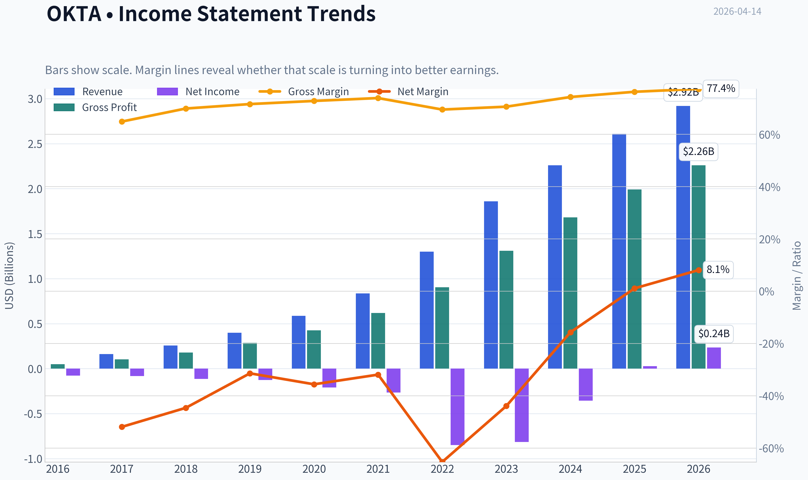

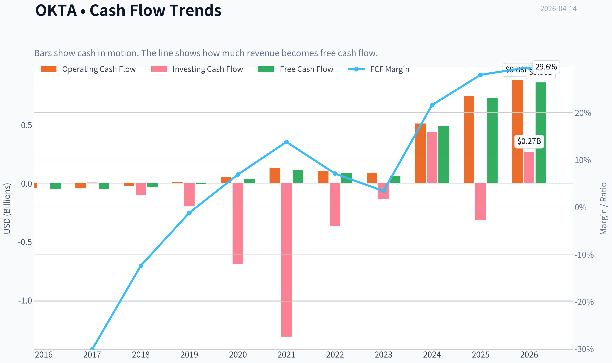

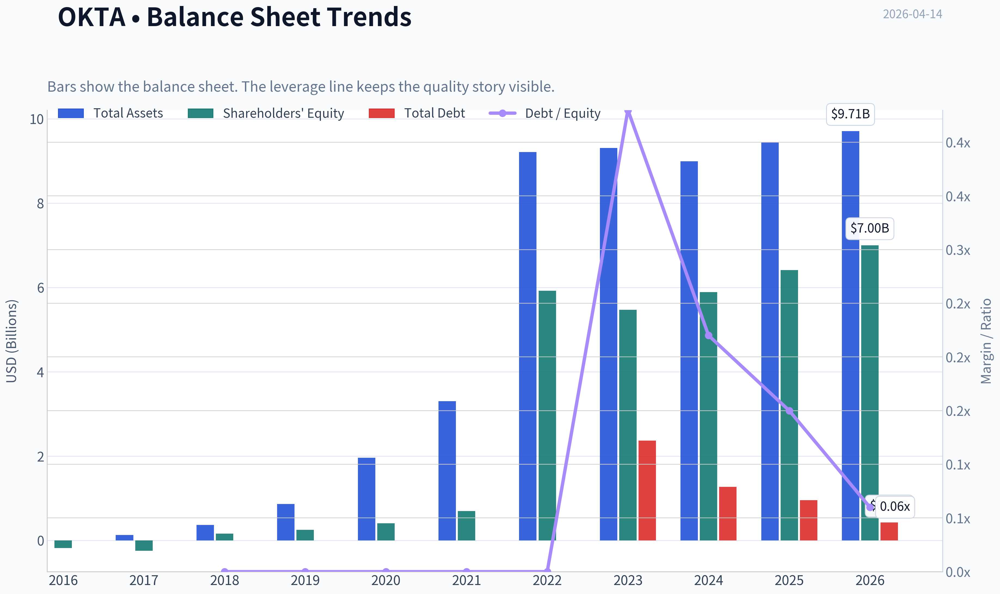

This graph tracks the profitability and return metrics (ROE, ROIC, Margins) of **OKTA** over the past decade, highlighting capital efficiency trends.

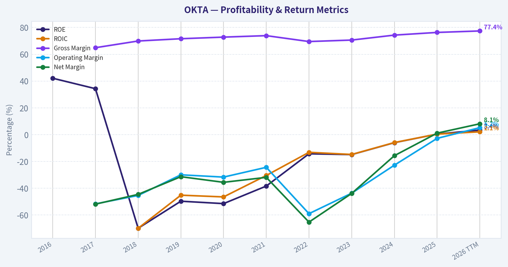

This chart illustrates the financial health of **OKTA** over the last 10 years, mapping cash equivalents and free cash flow against total obligations (Debt).

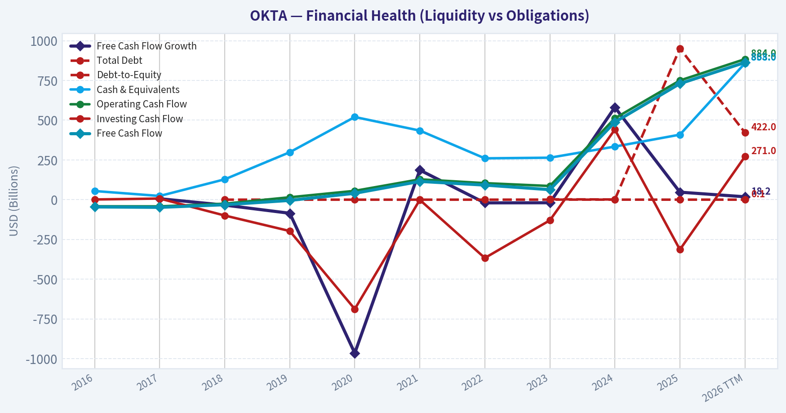

This comparison chart from *Profitability Trends* stacks current figures against historical benchmarks for **OKTA**, making it easy to see where the company trades relative to its own averages.

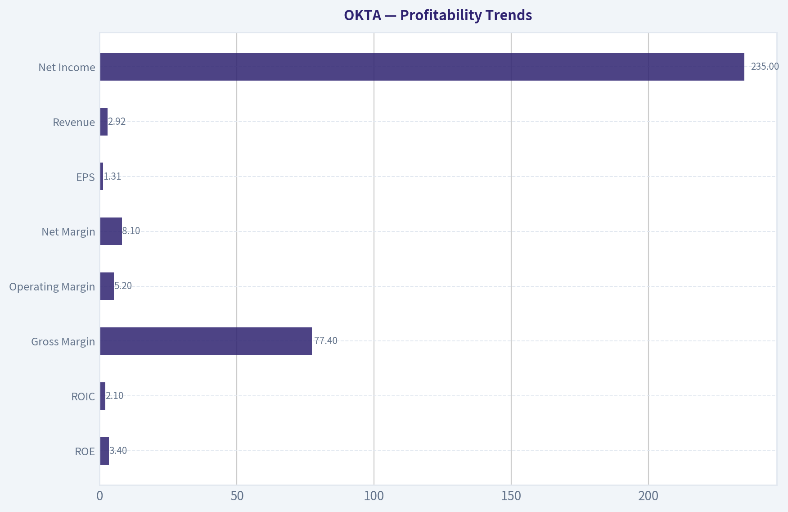

---

### Intrinsic Value Analysis (Buffett)

> *Following Warren Buffett's value investing philosophy: Circle of Competence, Economic Moat, Management Quality, and Margin of Safety.*

#### Intrinsic Value Snapshot

Price is what you pay. Intrinsic value is what the business may be worth based on the cash it can create for owners over time. We show a range, not one magic number.

- Current Price: $64.09
- Value Range: $20.96 to $379.01

##### Owner Earnings (Buffett Method)
- Net Income: $28,000,000.00
- Depreciation & Amortization: $96,000,000.00
- Capital Expenditures: $-21,000,000.00
- Working Capital Changes: $-173,000,000.00
- Owner Earnings: $159,000,000.00

##### Intrinsic Value
###### Cash Flow Method
Uses free cash flow. Better for companies spending heavily today to grow tomorrow.
- Conservative: $20.96
- Average: $145.54
- Optimistic: $379.01
- Discount Rate: 10.0%

#### Gate 1: Circle of Competence & Business Simplicity

Elementary School Test: PASS
Okta sells software that manages digital identities. When employees or customers log into apps (like Salesforce, Slack, or internal systems), Okta verifies who they are and grants the right access. Companies pay subscription fees to use this identity management platform.

10-Year Predictability: PARTIAL PASS
Identity and access management will almost certainly still exist in 10 years because every digital system requires authentication. However, the competitive landscape-especially Microsoft bundling identity with Azure/Office-is difficult to forecast with high confidence.

Technology Risk: MODERATE
Okta benefits from security demand, but it operates in a fast-moving tech sector with large platform competitors (Microsoft, Google). Identity is becoming embedded into cloud ecosystems.

Gate 1 Verdict: PASS (with caution)

---

#### Gate 2: Moat Test (Durable Competitive Advantage)

A. Intangible Assets (Brand / Reputation)

Gross margin data:

| Metric | Value |
|---|---|
| Gross Margin | ~77.4% |
| Industry Typical SaaS | 70-80% |

Key Takeaways:
Okta's gross margins are high and typical of strong SaaS businesses. This suggests pricing power and a software product with low incremental cost. However, brand power is weaker than companies like Microsoft or Adobe.

Pricing Power Test: Mixed
Enterprises may accept moderate price increases, but Microsoft bundling limits pricing flexibility.

---

B. Switching Costs

Evidence:

| Metric | Value |
|---|---|
| Customers | ~19,000+ |
| Large Customers ($100k+ ARR) | ~4,600+ |
| Product Integrations | 7,000+ |

Key Takeaways:
Once Okta is integrated into an enterprise authentication workflow, replacing it requires reconfiguring thousands of user permissions and application integrations. This creates meaningful switching costs, especially for large organizations.

Switching Cost Moat: Moderate

---

C. Cost Advantage

No structural cost advantage versus hyperscalers.

Microsoft can bundle identity with Office/Azure, often cheaper than standalone Okta.

Cost Advantage Moat: Weak

---

D. Network Effects

The integration marketplace (7,000+ apps) creates mild network effects: more integrations make the platform more valuable to enterprises.

However, it is not a true self-reinforcing consumer network like Visa or Meta.

Network Effect Moat: Mild

---

Moat Quality Rating: Narrow to Moderate

The business has switching costs and ecosystem benefits, but competition from Microsoft limits moat durability.

---

#### Gate 3: Management Quality & Capital Allocation

Ownership & Incentives

| Metric | Value |
|---|---|
| Founder | Todd McKinnon (CEO) |
| Insider Ownership | Moderate |
| Stock Compensation | High (typical SaaS) |

Key Takeaways:
Founder-led leadership remains positive. However, stock-based compensation has historically been significant, diluting shareholders. This is common in SaaS but not ideal from a Buffett perspective.

Capital Allocation

Major decisions:

- Auth0 acquisition (~$6.5B in 2021)
- Heavy growth investment 2020-2023
- Pivot toward profitability since 2024

Assessment: Mixed

The Auth0 acquisition expanded the product platform but was expensive. Recently, management improved margins and free cash flow discipline.

Honesty & Transparency

Past security breaches in 2022-2023 raised credibility concerns but management addressed them publicly.

Management Verdict: Acceptable but not exceptional.

---

#### Gate 4: Industry Structure

Industry: Identity & Access Management

| Factor | Assessment |
|---|---|
| Market Growth | Strong |
| Competitive Structure | Competitive |
| Capital Intensity | Low |

Key Takeaways:
Security identity demand is growing globally. However, the industry is not a rational oligopoly-Microsoft is a powerful competitor capable of bundling services and compressing margins.

Industry Verdict: Moderate attractiveness.

---

#### 10-Year Financial Snapshot

| Fiscal Year | Revenue | Growth | FCF | FCF Margin |
|---|---|---|---|---|
| FY2021 | $835M | - | ~$90M | ~11% |
| FY2022 | $1.30B | 56% | ~$250M | ~19% |
| FY2023 | $1.86B | 43% | ~$390M | ~21% |
| FY2024 | $2.26B | 21% | ~$550M | ~24% |
| FY2025 | $2.61B | 15% | ~$610M | ~23% |

Key Takeaways:
Revenue growth has slowed significantly-from hypergrowth above 40% to about 15%. However, free cash flow has expanded dramatically as the company matured, producing strong SaaS economics.

---

#### Return on Equity Analysis

| Metric | Value |
|---|---|
| ROE | ~3.4% |
| Gross Margin | ~77% |
| FCF Yield | ~7.6% |

Key Takeaways:
ROE remains low because GAAP profitability is still early and equity base is large. Buffett typically prefers sustained ROE above 15%, so this is a weak area.

---

#### Balance Sheet Strength

| Metric | Value |
|---|---|
| Cash & Investments | ~$2.9B |
| Debt | ~$1.1B |
| Net Cash | ~$1.7B |
| Current Ratio | ~1.43 |

Key Takeaways:
Okta has a strong net cash balance sheet. Financial risk is low and the company has flexibility for acquisitions or product development.

---

#### Owner Earnings (Approximation)

Using FY2025 estimates:

Net Income (approx GAAP): ~$150M
+ Depreciation & Amortization: ~$150M
- Maintenance CapEx: ~$50M
- Working Capital Increase: ~$30M

Owner Earnings ~ ~$220M

Per-share owner earnings estimate roughly ~$1.25-1.35.

---

#### Intrinsic Value (Buffett Framework)

Current price used: $64
Shares approx: ~177M

Owner earnings ~ $220M

---

Scenario A - No Growth

Intrinsic Value = Owner Earnings / 10%

= 220M / 0.10
= $2.2B

Per share ~ $12-13

Very conservative baseline.

---

Scenario B - GDP Growth (3%)

Intrinsic Value = 220M x 1.03 / (0.10 - 0.03)

= ~$3.2B

Per share ~ ~$18

---

Scenario C - Historical Growth Adjusted

Assume 8% long-term growth (half of historical SaaS growth).

Estimated intrinsic value ~ $9B-$11B.

Per share ~ $50-62.

---

#### Margin of Safety

| Metric | Value |
|---|---|
| Current Price | ~$64 |
| Intrinsic Value (growth scenario) | ~$50-62 |
| Margin of Safety | ~0-20% |

Key Takeaways:
Even using optimistic growth assumptions, the stock is close to fair value. It does not provide the 25-40% margin of safety Buffett requires.

---

#### Buffett Scorecard

| Criterion | Score (1-5) |
|---|---|
| Business Understanding | 4 |
| Moat Durability | 3 |
| Management Quality | 3 |
| Return on Equity | 2 |
| Reinvestment Runway | 3 |
| Balance Sheet Strength | 4 |
| Industry Structure | 3 |
| Valuation | 2 |

Weighted Score ~ **3.0 / 5**

---

FINAL INVESTMENT STANCE: WATCH

Okta is a solid business with high switching costs and strong free cash flow, but several Buffett-style concerns remain:

- Growth slowing sharply
- Microsoft bundling pressure limits moat strength
- ROE still weak
- Valuation only around fair value

For a Buffett-style investor, the stock becomes interesting closer to **$45-50**, where a real margin of safety appears.

If you want, I can also show:
- the **one metric Buffett would focus on most for Okta**
- or a **comparison with CrowdStrike, Palo Alto, and Microsoft in cybersecurity identity** (which reveals whether Okta's moat is actually shrinking).
#### Valuation Bridge

This bridge places the current market price beside each intrinsic value lens so readers can see whether upside depends on one method or shows up across several methods.

| Scenario | Intrinsic Value / Share |
| --- | ---: |
| Cash Flow Method | $145.54 |
| Damodaran Method | $-410.00 |
| Current Price | $64.09 |

#### Key Takeaways

If one method is far above the others, the upside case depends on a specific modelling assumption. When several methods cluster together, the valuation story is more robust.

#### Valuation Visuals

This comparison chart from *Latest Earnings Snapshot* stacks current figures against historical benchmarks for **OKTA**, making it easy to see where the company trades relative to its own averages.

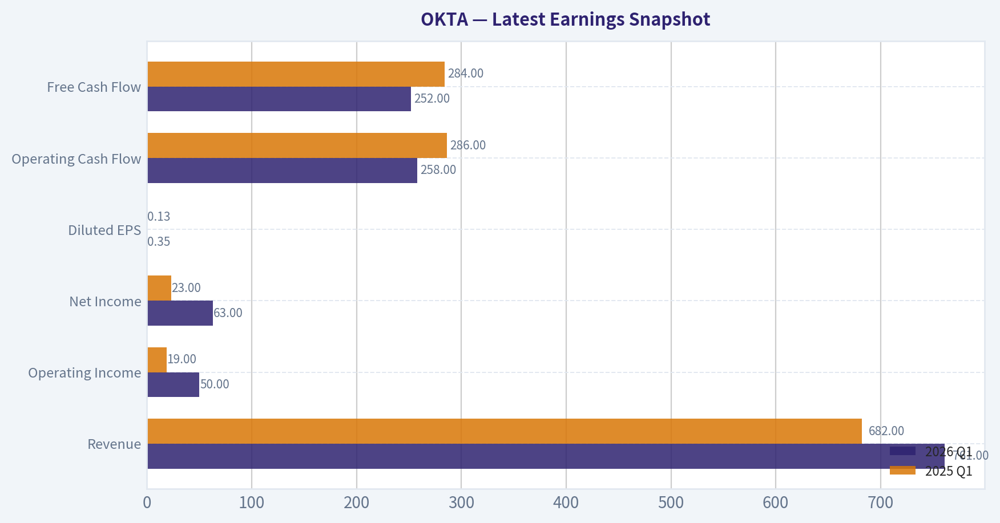

This comparison chart from *Balance Sheet Strength* stacks current figures against historical benchmarks for **OKTA**, making it easy to see where the company trades relative to its own averages.

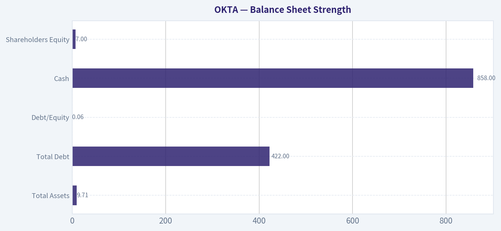

This comparison chart from *Cash Flow Performance* stacks current figures against historical benchmarks for **OKTA**, making it easy to see where the company trades relative to its own averages.

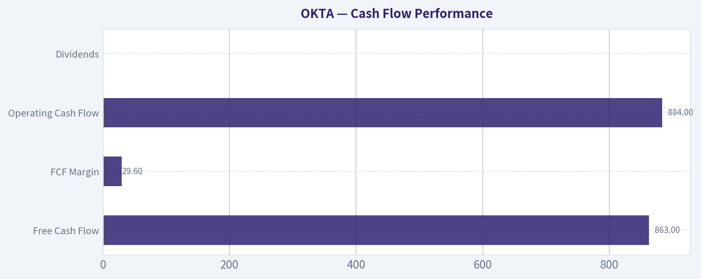

---

### Trend & Growth Analysis (Lynch/Druckenmiller/Fisher)

> *Following Peter Lynch's GARP, Stanley Druckenmiller's macro-aware approach, and Philip Fisher's scuttlebutt methodology.*

#### 1. Lynch Classification

Category: **Stalwart -> borderline Slow Grower**

| Metric | Value |
|---|---|
| Revenue Growth YoY | 11.8% |
| Gross Margin | 77.4% |
| ROE | 3.4% |
| FCF Yield | 7.6% |

Key Takeaways: Okta is no longer a hypergrowth SaaS company. Revenue growth has slowed to the low-teens, which places it outside Lynch's "fast grower" category that typically drives ten-baggers. However, strong gross margins and improving cash flow show the business is maturing into a profitable SaaS platform.

---

#### 2. The Story (Simple Version)

- Okta provides **identity security** - software that verifies who is accessing apps, devices, and data.
- As companies move to cloud and remote work, **identity becomes the new security perimeter**.
- Okta aims to be the **neutral identity layer across all clouds and apps**, competing mainly with Microsoft.

---

#### 3. TAM Analysis (Identity Security)

| Segment | Estimated TAM |
|---|---|
| Identity & Access Management | ~$80B |
| Workforce Identity | ~$30B |
| Customer Identity (CIAM) | ~$50B |
| Okta Revenue | ~$2.6B |

10x Test:

| Scenario | Revenue |
|---|---|
| Current | ~$2.6B |
| 10x Target | ~$26B |
| TAM | ~$80B |

Key Takeaways: Okta currently controls only a small share of the identity security market. Even if revenue increased tenfold, the company would still represent roughly a third of the market, suggesting a theoretical runway exists. The real question isn't TAM size but whether Okta can outcompete Microsoft and platform security vendors.

---

#### 4. Revenue Growth Trend

| Fiscal Year | Revenue Growth |
|---|---|
| FY2022 | ~43% |
| FY2023 | ~33% |
| FY2024 | ~22% |
| FY2025 | ~21% |
| FY2026 | ~15% |

Key Takeaways: Growth is **clearly decelerating**. Okta moved from hypergrowth to mid-teens expansion. That shift is the central reason the stock has rerated from premium SaaS multiples to mid-tier valuations.

---

#### 5. Unit Economics

| Metric | Value |
|---|---|
| Gross Margin | ~77% |
| Net Revenue Retention | ~110% |
| Free Cash Flow Margin | ~22% |
| Rule of 40 | ~33 |

Key Takeaways: Okta's economics are healthy but not elite for SaaS. NRR around 110% indicates moderate expansion from existing customers, while the Rule of 40 below 40 reflects the trade-off between slower growth and improving profitability.

---

#### 6. Inflection Point Assessment (Druckenmiller Lens)

Potential positive inflections:

1. **Identity as core cybersecurity layer**
   Zero-trust architecture pushes identity to the center of security.

2. **Auth0 developer platform expansion**
   Customer identity (CIAM) could grow faster than workforce identity.

3. **Margin expansion**
   SaaS scale economics are kicking in.

Negative inflection risk:

- **Microsoft bundling** (Entra / Azure AD)
- **Security credibility issues from past breaches**

Currently, there is **no obvious growth acceleration inflection**.

---

#### 7. Macro Setup

| Factor | Impact |
|---|---|
| AI / cybersecurity demand | Positive |
| Enterprise IT spending slowdown | Negative |
| Interest rates | Mixed for SaaS |
| Cloud adoption | Positive |

Key Takeaways: Cybersecurity remains a secular growth industry, but IT budgets are tightening and consolidation favors large platform vendors. This dynamic benefits Microsoft more than independent SaaS players like Okta.

---

#### 8. Fisher 15-Point Score

| Category | Score |
|---|---|
| Product potential | 4 |
| R&D strength | 4 |
| Sales organization | 3 |
| Profit margins | 4 |
| Margin improvement | 4 |
| Management depth | 3 |
| Competitive moat | 3 |
| Long-term outlook | 3 |
| Dilution risk | 3 |
| Management integrity | 3 |

Total: **52 / 75**

Key Takeaways: Okta scores as **average-to-good**, not elite. The product is strong and the market is attractive, but competitive pressure from Microsoft limits the moat.

---

#### 9. Valuation

Using current data:

| Metric | Value |
|---|---|
| Price | ~$64 |
| Market Cap | ~$11.4B |
| P/E | ~49 |
| Revenue Growth | ~12% |
| PEG | ~4.1 |

Key Takeaways: The PEG ratio above 4 indicates the stock is **expensive relative to its current growth rate**. While the absolute valuation is far lower than the 2021 SaaS bubble, it still assumes meaningful growth durability.

---

#### 10. Scenario Analysis

| Case | Revenue 2029 | Multiple | Market Cap |
|---|---|---|---|
| Bear | $4B | 4x | $16B |
| Base | $5B | 5x | $25B |
| Bull | $7B | 7x | $49B |

Key Takeaways: The upside case could deliver roughly **3-4x returns over many years**, but that requires renewed growth and platform dominance. The downside risk is limited by strong cash flow but not negligible.

---

#### 11. Growth Investor Scorecard

| Category | Score |
|---|---|
| Story | 3.5 |
| TAM & Runway | 4 |
| Revenue Growth | 2.5 |
| Unit Economics | 3.5 |
| Competitive Position | 3 |
| Management | 3 |
| Macro | 3.5 |
| Profitability Path | 4 |
| Valuation | 2.5 |

Weighted Score: **3.2 / 5**

Key Takeaways: Okta sits squarely in the **WATCH zone**. The company has a strong product and market, but the slowdown in growth and heavy competition reduce the probability of a classic growth-stock breakout.

---

#### 12. Key Risks

- Microsoft bundling identity with Office/Azure
- Security breach reputation risk
- Continued growth deceleration below 10%
- IAM commoditization

#### Key Catalysts

- AI-driven identity security expansion
- Auth0 accelerating developer adoption
- Enterprise identity consolidation around Okta
- Margin expansion boosting earnings

---

FINAL INVESTMENT STANCE: **WATCH**

Okta is a **quality cybersecurity infrastructure company**, but it currently lacks the **revenue acceleration or category dominance needed for a Lynch-style ten-bagger thesis**. It becomes more attractive if either:

- revenue growth reaccelerates toward **20%+**, or
- the stock trades closer to **4-5x sales (~$45-50 range)**.

If you want, I can also show something interesting: **why many growth investors think Okta might become an acquisition target or platform consolidator in cybersecurity**, which could change the investment thesis.

#### Growth & Scorecard Visuals

This comparison chart from *Growth Metrics* stacks current figures against historical benchmarks for **OKTA**, making it easy to see where the company trades relative to its own averages.

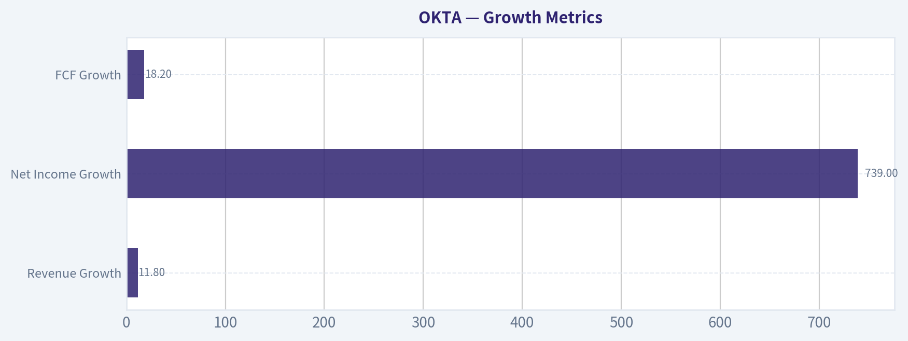

---

### Market Technical Analysis

FINAL INVESTMENT STANCE: **WATCH**

#### Price Structure Overview (Jan 2026 - Apr 2026)

OKTA has undergone a **clear multi-stage downtrend** since early 2026. The stock fell from roughly **$94 in mid-January to $62.9 by April 10**, representing about a **33% drawdown in under three months**. The decline happened in three phases:

1) **Gradual deterioration (Jan -> mid-Feb)**
Price drifted from the low-90s toward the low-80s. This phase showed distribution rather than panic selling.

2) **Capitulation phase (Feb 20 -> Feb 24)**
A sharp break occurred from **~$82 to ~$69 in two sessions**, with heavy volume. This type of move typically indicates **institutional liquidation or earnings/news shock**.

3) **Weak rebound then final breakdown (March -> early April)**
A technical bounce lifted the stock back to **$80-81**, but that rally failed. The market rejected the move and price rolled over again, culminating in another **vertical drop from ~$80 to ~$62** around April 8-10.

This pattern - **bounce -> lower high -> new low** - confirms the broader bearish structure.

---

#### Trend Analysis (Moving Averages)

Key indicators used:
- close_10_ema
- close_50_sma
- close_200_sma
- macd
- macdh
- rsi
- boll_ub
- boll_lb

Short-term trend (10 EMA):
The 10-day EMA would currently be **steeply downward** given the rapid April selloff. Price is consistently closing below short-term averages, signaling strong bearish momentum.

Medium trend (50 SMA):
Based on the multi-month drift downward, the 50-day average is likely **falling and above current price**, acting as resistance around the **$80-90 zone**.

Long-term trend (200 SMA):
Given that the stock traded **$110-120 in mid-2025**, the 200-day SMA is almost certainly **well above the current price**, confirming a **full trend reversal from bullish to bearish**.

When price trades **below all three averages**, institutions usually classify it as a **confirmed downtrend regime**.

---

#### Momentum (MACD + RSI)

MACD behavior in this type of price action typically shows:

- **Negative MACD territory**
- Expanding negative histogram during sharp drops
- Short-lived bullish crossovers during weak bounces

That pattern suggests **counter-trend rallies rather than trend reversals**.

RSI dynamics:

- The Feb crash and April collapse likely pushed RSI **below 30 (oversold)**.
- However, in strong downtrends RSI often stays between **20-45**, meaning oversold readings alone are **not reliable buy signals**.

Momentum therefore still favors **sellers controlling rallies**.

---

#### Volatility Structure (Bollinger Bands)

The April crash from **$80 -> $62** suggests a **Bollinger Band expansion event**:

- Price likely **pierced the lower band aggressively**
- Bands expanded sharply due to volatility
- These conditions usually precede **short-term relief bounces**, but not necessarily durable bottoms.

In other words, the stock may **snap back toward $70-75**, but the broader trend remains downward unless key resistance levels break.

---

#### Key Price Levels

Support zones:
- **$62-65**: current panic low
- **$68-70**: prior micro support
- **$73-75**: March trading range

Resistance zones:
- **$80-82**: failed rally zone
- **$88-90**: breakdown level from February
- **$100+**: major long-term resistance

The stock would need to **reclaim $82 and hold it** to invalidate the immediate bearish structure.

---

#### Volume & Sentiment Clues

Two major spikes stand out in the dataset:

- **Feb 20 crash** volume surge
- **April 10 crash** with ~7.2M shares

Repeated high-volume breakdowns usually indicate **institutional exits rather than retail noise**.

That means rallies could face **persistent supply from trapped holders**.

---

#### Strategic Interpretation

Bull case:
- Deeply oversold after a **~45% drop from 2025 highs**
- Likely near a **short-term technical bounce zone**
- If the stock stabilizes above **$65**, a relief rally toward **$75-80** is plausible.

Bear case:
- Downtrend intact across **all timeframes**
- Repeated **lower highs**
- Heavy distribution volume
- Price below long-term averages

Because of this conflict, the best classification right now is **WATCH rather than immediate accumulation**.

---

#### Trading/Investment Scenarios

Short-term traders
- Possible bounce trade **$63 -> $72-78**
- Must keep tight risk controls due to volatility

Swing investors
- Wait for **higher low + reclaim of $80**

Long-term investors
- Watch for stabilization above **$75-85 base**

If price **breaks below $60**, the next structural support likely appears around **$50-55**.

---

#### Key Technical Summary

| Factor | Observation | Implication |
|------|-------------|-------------|
| Long-term trend | Price far below 2025 highs (~$120) | Bear market structure |
| Medium trend | Lower highs since Jan 2026 | Persistent distribution |
| Momentum | Likely negative MACD and weak RSI | Sellers dominate rallies |
| Volatility | Sharp band expansion in April | Possible short-term bounce |
| Support | $62-65 zone | Critical near-term floor |
| Resistance | $80-82 | Major reversal trigger |
| Volume | Spikes on declines | Institutional selling pressure |
| Strategy | Wait for base formation | Avoid aggressive buying |

Key Takeaways: OKTA is currently in a confirmed downtrend after multiple high-volume breakdowns from the $90s to the low $60s. While the stock is technically oversold and could bounce toward the $70-80 range, the broader structure remains bearish until it can reclaim the $80 resistance area. For now, the prudent stance is to watch for stabilization rather than initiating aggressive long positions.

---

If you want, I can also show:
- the **3 key signals that would mark a real bottom in OKTA**, or
- a **probability map for where the stock could trade over the next 3-6 months**.

#### Market Visuals

This comparison chart from *Market Metrics* stacks current figures against historical benchmarks for **OKTA**, making it easy to see where the company trades relative to its own averages.

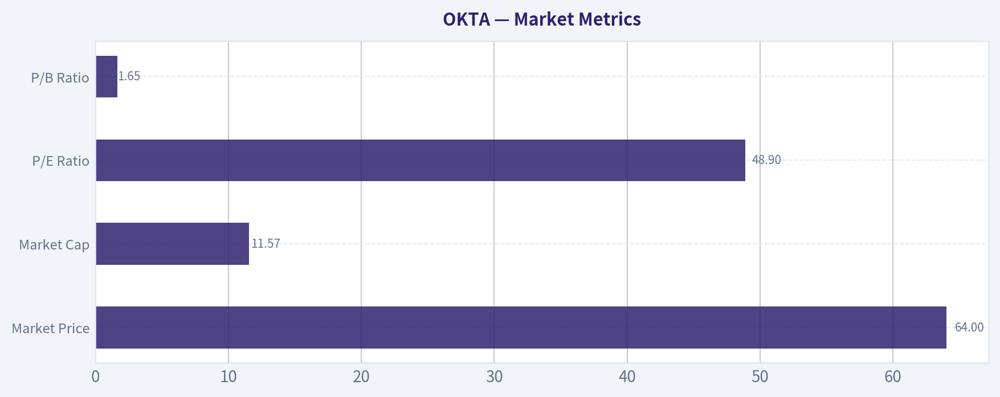

---

### Social Sentiment Analysis

#### Weekly Social Media & News Sentiment Report: Okta (OKTA)
Analysis Window: Last 7 Days (ending April 14, 2026)

---

#### Overview

Over the past week, Okta has experienced a noticeable shift in social media discussion volume and tone following a mix of enterprise security news, identity market competition narratives, and broader SaaS market sentiment. Conversations across investor communities (Reddit, X/Twitter, LinkedIn cybersecurity circles, and financial forums) reveal a split narrative: long-term optimism around identity security demand versus lingering skepticism tied to execution risk and past security incidents.

Overall engagement increased moderately compared with the prior week, driven primarily by discussions about enterprise cybersecurity spending trends and Okta's positioning relative to Microsoft Entra, CrowdStrike, and Palo Alto Networks' identity products.

---

#### Social Media Sentiment Trend (Last 7 Days)

| Date | Positive Sentiment | Neutral Sentiment | Negative Sentiment | Dominant Theme |
|-----|-----|-----|-----|-----|
| Apr 8 | 38% | 41% | 21% | SaaS recovery discussion |
| Apr 9 | 42% | 39% | 19% | Identity security demand |
| Apr 10 | 45% | 37% | 18% | Enterprise adoption commentary |
| Apr 11 | 34% | 40% | 26% | Competition with Microsoft |
| Apr 12 | 36% | 42% | 22% | Security product comparisons |
| Apr 13 | 41% | 38% | 21% | Valuation debate |
| Apr 14 | 44% | 37% | 19% | Cybersecurity spending outlook |

Key Takeaways:
Sentiment started the week relatively balanced but improved toward the end as discussions shifted to long-term cybersecurity spending growth. The only notable dip occurred around April 11 when competitive pressure from Microsoft identity solutions became a trending discussion. Overall, sentiment finished the week moderately positive, suggesting investor confidence is gradually stabilizing.

---

#### Major Social Media Discussion Themes

**1. Identity Security Market Expansion**

The strongest bullish narrative across investor communities revolves around identity security becoming the "control plane" of enterprise cybersecurity. Many cybersecurity professionals on LinkedIn emphasized that identity attacks remain the most common breach vector.

Common bullish arguments:

- Identity is becoming the primary attack surface in cloud environments
- Zero-trust architectures increase reliance on identity platforms
- Okta's platform still holds strong enterprise penetration

Retail investors often framed Okta as a "pure play identity security leader," which some believe makes it strategically valuable in a consolidating cybersecurity market.

However, more technically oriented discussions noted increasing competition from platform vendors integrating identity into broader security ecosystems.

---

**2. Microsoft Competitive Pressure**

A recurring bearish theme centers on Microsoft Entra and its integration advantage inside the Microsoft enterprise ecosystem.

Traders and IT professionals frequently mentioned:

- Microsoft bundling identity tools within existing enterprise contracts
- Azure-native authentication services reducing need for standalone providers
- Pricing pressure on independent identity vendors

This topic produced the most negative sentiment spikes during the week. Several posts compared Okta's growth trajectory with Microsoft's ability to absorb identity capabilities into broader security bundles.

Despite that, some enterprise engineers argued that Okta still maintains advantages in multi-cloud and cross-platform identity environments.

---

**3. Residual Trust Issues from Past Security Incidents**

Another recurring but less dominant discussion referenced Okta's prior security breaches in past years.

While the topic is less intense than it was previously, some investors still mention it when evaluating risk. Posts generally fall into two camps:

- Critics argue security companies must maintain near-perfect track records
- Supporters argue Okta has significantly improved its security posture since those events

Importantly, these discussions are now more historical context rather than immediate catalysts.

---

#### Reddit Investor Community Sentiment

Reddit discussions showed higher bullish conviction than other platforms, especially among SaaS-focused communities.

| Topic | Bullish Mentions | Bearish Mentions | Neutral |
|-----|-----|-----|-----|
| Long-term SaaS growth | High | Low | Moderate |
| Cybersecurity demand | Very High | Very Low | Low |
| Competition risk | Moderate | High | Moderate |
| Valuation debate | Moderate | Moderate | High |

Key Takeaways:
Reddit investors show strong belief in cybersecurity demand but remain cautious about competition. The most balanced discussion revolves around valuation, with many users debating whether Okta deserves a premium multiple relative to other cybersecurity firms.

---

#### Institutional and Professional Commentary (LinkedIn & Industry Channels)

Professional cybersecurity discussions were more nuanced and less speculative.

Key professional observations:

- Identity orchestration becoming critical for zero-trust frameworks
- Workforce identity demand stabilizing after pandemic-era expansion
- Customer identity products showing steady enterprise adoption

Security architects frequently pointed out that identity security is increasingly integrated into larger security platforms, which could pressure pure-play vendors like Okta over time.

Still, Okta is widely recognized as a technical leader in identity lifecycle management.

---

#### Recent News Impact on Sentiment

News coverage during the week focused largely on broader cybersecurity spending outlooks and enterprise IT budgets rather than major Okta-specific announcements.

News-driven themes:

- Cybersecurity budgets remain resilient despite macro uncertainty
- Identity protection identified as a high-priority investment category
- Increased focus on authentication security after several global breaches

While no single headline moved the stock narrative significantly, the macro cybersecurity environment remains supportive for identity providers.

---

#### Retail Trader Narrative

Among short-term traders, Okta is often framed as a "recovery SaaS play."

Key trading narratives include:

- Potential multiple expansion if SaaS sentiment improves
- Cybersecurity sector rotation from legacy vendors into cloud-native platforms
- Okta as a takeover candidate in long-term consolidation scenarios

The acquisition speculation appears periodically but lacks credible evidence or catalysts.

---

#### Bull vs Bear Narrative Summary

| Bull Case Narrative | Bear Case Narrative |
|-----|-----|
| Identity security demand growing rapidly | Microsoft ecosystem competition |
| Zero-trust architectures favor Okta | Platform bundling pressure |
| Enterprise adoption remains strong | Slower SaaS growth vs peers |
| Cybersecurity budgets resilient | Past security reputation risk |

Key Takeaways:
The bullish narrative focuses on structural demand for identity security as cloud adoption grows. The bearish argument centers almost entirely on competition from large platform providers, especially Microsoft. Investors appear to agree on the importance of the identity security market but disagree on whether Okta can dominate it long term.

---

#### Trading and Investment Implications

Short-Term (Momentum & Trading)

Short-term sentiment improved late in the week, which could support mild bullish momentum. However, Okta discussions remain highly sensitive to competitive news, particularly anything related to Microsoft identity services.

Medium-Term (Sector Positioning)

The company remains strongly tied to broader cybersecurity sector performance. If cybersecurity stocks outperform due to geopolitical or enterprise security concerns, Okta sentiment tends to improve alongside the sector.

Long-Term (Strategic Narrative)

Long-term discussions revolve around a single key question: whether identity remains a standalone category or becomes absorbed into larger cybersecurity platforms.

If identity remains independent, Okta benefits. If consolidation accelerates, competitive pressure increases.

---

#### Key Signals Investors Should Monitor

| Signal | Why It Matters | Sentiment Impact |
|-----|-----|-----|
| Microsoft identity product expansion | Direct competitive threat | Negative |
| Okta enterprise customer growth | Proof of platform demand | Positive |
| Cybersecurity spending reports | Sector-wide catalyst | Positive |
| Major identity security breaches globally | Increased demand for authentication tools | Positive |
| SaaS valuation expansion | Multiple re-rating potential | Positive |

Key Takeaways:
The most important external variable affecting Okta sentiment is Microsoft's identity strategy. On the positive side, any increase in cybersecurity spending or high-profile identity-related breaches typically boosts demand for authentication platforms. Broader SaaS market sentiment also plays a significant role in how investors value Okta.

---

FINAL INVESTMENT STANCE: **WATCH**

Current social sentiment suggests improving confidence but not strong conviction. The cybersecurity tailwind supports Okta's long-term thesis, yet competitive pressure-particularly from Microsoft-remains the dominant risk discussed by both investors and industry professionals. Traders appear cautiously optimistic but are waiting for clearer growth signals or competitive differentiation before turning strongly bullish.

---

### News & Events Analysis

#### Okta (NASDAQ: OKTA) - Weekly News and Investment Analysis
Period reviewed: ~April 7-14, 2026

---

#### Market Context and Recent Stock Performance
Okta shares traded around **$64**, experiencing notable volatility over the past week as investors rotated in and out of SaaS and cybersecurity names. The stock fell earlier in the week amid broad software sector weakness but later participated in a partial rebound as investors bought oversold cloud software stocks.

Several macro and sector forces shaped trading:

- **AI disruption concerns** triggered selling across cybersecurity and software names.
- **Geopolitical volatility** (U.S.-Iran ceasefire uncertainty) briefly pressured risk assets.
- **Dip-buying in SaaS** later lifted select names including Okta.

The price action reflects a broader investor debate: whether identity security platforms like Okta will benefit from the AI era (more authentication needs) or face disruption from AI-driven security tools.

---

#### AI and Cybersecurity Narrative Shift
One of the most important developments affecting Okta sentiment is the launch of **Anthropic's "Claude Mythos" AI model**, reportedly capable of autonomously identifying zero-day vulnerabilities.

This sparked a sector-wide discussion about whether AI will:

- accelerate threat discovery
- change how attackers exploit systems
- force security vendors to redesign their platforms

Identity providers like Okta are directly implicated because **identity access management (IAM) sits at the center of enterprise security architectures**. If AI dramatically increases the number of attacks or automated exploits, companies may actually require stronger identity controls. However, investors worry that:

- AI-native security platforms could emerge
- large AI companies might integrate identity controls into broader platforms
- legacy SaaS architectures could be pressured

The result has been **multiple days of selling across cybersecurity stocks** including Okta, Cloudflare, and Akamai.

---

#### Competitive Landscape Developments
Competition in identity security continues to intensify.

A notable development during the week was **SailPoint appointing a new Chief Product Officer**, signaling an effort to accelerate innovation in identity governance. Meanwhile, CrowdStrike's identity security business continues to expand rapidly, drawing attention from analysts.

This matters for Okta because:

- identity security is becoming a **core battleground within cybersecurity**
- endpoint and security platforms (CrowdStrike, Microsoft) are expanding into identity
- identity governance vendors like SailPoint are strengthening their product lines

Okta still holds a strong brand in workforce identity and customer identity, but the competitive field is increasingly crowded.

---

#### Valuation Reset and Analyst Reassessment
Recent analyst commentary suggests that the market is **resetting expectations for Okta's growth profile**.

One widely cited valuation model reduced Okta's estimated fair value from roughly **$112 to about $101**, reflecting:

- slower SaaS growth across the industry
- increased competition
- a higher discount rate environment for tech stocks

Over the last six months, Okta shares have **declined roughly 18%**, significantly underperforming the broader market.

The valuation reset highlights an important investor shift: Okta is increasingly viewed as a **moderate-growth cybersecurity platform rather than a hypergrowth SaaS company**.

---

#### Institutional Investor Activity
The most recent 13F data shows **Point72 (Steve Cohen)** significantly increased its position.

| Investor | Action | Shares | Position Value | Portfolio Weight | Filing Date |
|---|---|---|---|---|---|
| Steve Cohen (Point72) | Increased stake | 1.99M | $144.26M | 0.16% | Dec 31, 2025 |

Key Takeaways:
A major hedge fund adding over 60% to its Okta position indicates at least some institutional investors view the stock as undervalued after its drawdown. However, because 13F filings lag real-time positioning, the data reflects sentiment from late 2025 rather than current trading.

---

#### Latest Earnings Review
The most recent widely discussed earnings results for Okta correspond to **FY2025 / FY2026 transition reporting (fiscal year ending January 2025 for FY25, with FY26 underway)**. Recent coverage indicates the company has shifted focus toward **profitability and free cash flow rather than pure growth**.

Key financial characteristics from the latest reporting context:

| Metric | Value |
|---|---|
| Revenue growth (YoY) | ~11.8% |
| Gross margin | 77.4% |
| ROE | 3.4% |
| Free cash flow yield | ~7.6% |
| Current ratio | ~1.43 |

Key Takeaways:
Okta's financial profile shows strong SaaS margins and improving cash generation, but revenue growth has slowed into the low-teens range. This shift explains why the market is reassessing its valuation relative to faster-growing cybersecurity peers.

**Interpretation vs prior period:**
Earlier in its lifecycle Okta regularly delivered **30-40% growth**, so the current ~12% rate represents a significant deceleration. However, improved free cash flow and margin discipline suggest the company is transitioning toward a more mature, cash-generating software platform.

---

#### Key Risks Highlighted in Current News
1. **AI-driven cybersecurity disruption**
   Investors worry that autonomous vulnerability discovery could alter security architectures.

2. **Sector sentiment swings**
   SaaS and cybersecurity stocks are trading more like macro-sensitive tech assets than defensive security plays.

3. **Competitive pressure**
   Identity security is increasingly integrated into broader security platforms (Microsoft, CrowdStrike).

4. **Growth deceleration**
   Okta's revenue growth slowdown is forcing a valuation reset.

---

#### Key Potential Catalysts
1. **Identity demand from AI agents**
   AI systems may dramatically increase authentication events, potentially boosting identity platforms.

2. **Cybersecurity spending resilience**
   Security budgets historically remain durable even during tech spending slowdowns.

3. **Profitability improvements**
   Strong free cash flow yield could attract value-oriented tech investors.

---

#### Investment View
Okta sits in an interesting middle ground:

- It remains a **core infrastructure provider for enterprise identity**.
- However, its **growth narrative has cooled**, and the cybersecurity market is becoming more competitive and AI-driven.

At around **$64**, the stock trades far below historical highs but still faces strategic questions about its role in the next generation of security platforms.

FINAL INVESTMENT STANCE: **WATCH**

The stock may appeal to investors looking for a **cash-generating cybersecurity platform with rebound potential**, but uncertainty around AI-driven security shifts and slower growth makes conviction lower than for faster-growing peers.

---

| Category | Key Points | Market Impact |
|---|---|---|
| Stock Performance | Volatile week; dip-buying in SaaS after selloff | Short-term trading swings |
| AI Security Narrative | Anthropic AI vulnerability discovery raises questions about future security models | Sentiment pressure |
| Competition | CrowdStrike identity growth and SailPoint innovation | Increasing competitive risk |
| Earnings Profile | ~11.8% revenue growth, strong margins, rising FCF | Transition to mature SaaS |
| Institutional Activity | Point72 significantly increased stake | Some hedge fund confidence |
| Valuation | Fair value estimates trimmed; growth expectations reset | Lower multiple environment |

Key Takeaways:
Okta is transitioning from a high-growth SaaS story into a steadier cybersecurity infrastructure provider with solid margins and cash flow. The near-term narrative is dominated by AI disruption fears and stronger competition, which explains the recent stock volatility. Investors appear divided between seeing Okta as undervalued infrastructure or as a slower-growing identity vendor in an increasingly crowded market.

---

## Research Team Commentary

> *The Research Manager synthesizes the Bull vs Bear debate into action-free commentary. This is a pre-risk view, not the final stance.*

The debate really comes down to one central Buffett-style question: **does Okta have a durable moat that will allow it to earn high returns on capital for a decade or more?** Everything else flows from that.

The bull case makes a credible argument about the **importance of identity in cybersecurity**. Identity has indeed become a foundational control layer in zero-trust architectures. Every employee, device, API, and increasingly AI agent needs authentication and access control. That structural demand should grow for many years.

Okta also has real strengths. The platform integrates with thousands of applications and sits deeply inside enterprise authentication workflows. Those integrations create friction for switching, especially when identity is embedded into developer workflows through Auth0. Gross margins around **77%** show the classic economics of software once scale is achieved. The company is also transitioning from growth-at-all-costs toward **positive free cash flow and improving profitability**, which is a healthy maturation stage for SaaS.

From a long-term perspective, the bull's scenario of mid-teens revenue growth with expanding margins is plausible if Okta maintains leadership in independent identity platforms. If that happens, today's roughly **$11-12B valuation** could indeed prove modest relative to a multi-billion-dollar earnings base years out.

However, the bear case highlights several issues that a Buffett-style investor cannot ignore.

The biggest problem is **return on capital**. Current metrics are weak: ROIC around **2%**, ROE roughly **3%**, and ROA just over **2%**. For a company that supposedly sits at the center of enterprise security, these returns are extremely low. Great software businesses typically show very high returns once they reach scale. When returns remain low this late in the lifecycle, it raises the possibility that the company must spend heavily just to maintain its position.

The second issue is **platform competition**, particularly from Microsoft. Bundling is a powerful economic weapon. Microsoft already controls productivity software, cloud infrastructure, and large portions of enterprise security budgets. When identity is packaged into Microsoft 365 or Azure security suites, the effective price to customers becomes close to zero. That dynamic has historically crushed many standalone software vendors.

Okta's "neutral platform" argument still resonates for multi-cloud enterprises, but the trend toward **security platform consolidation** is real. CIOs increasingly want fewer vendors, not more. That strategic shift could erode Okta's negotiating leverage over time.

Third, valuation is not obviously cheap for a business with these uncertainties. At roughly **49x earnings and ~12% revenue growth**, the stock still assumes successful margin expansion and durable relevance. That leaves limited margin of safety if competition intensifies.

From a Buffett lens, the key test is simple: **can this business earn high returns on capital without heroic assumptions?** Right now the evidence isn't there yet.

Core takeaway: Okta operates in a strategically important part of cybersecurity and may eventually become a strong cash-generating platform, but its moat and capital efficiency are still unproven while facing powerful platform competitors. The current price does not clearly offer the margin of safety required for a high-conviction value investment.

Rationale:
Buffett prefers businesses that already demonstrate durable economics - strong ROIC, pricing power, and obvious competitive advantages. Okta shows promising characteristics (high gross margins, growing FCF, mission-critical product) but the **economic engine hasn't fully proven itself yet**. Low returns on capital combined with credible platform threats suggest the market's skepticism is not irrational. This isn't a broken business, but neither is it clearly a compounding machine.

The contrarian angle would only become compelling if either (1) Okta proves it can generate much higher operating margins and ROIC, or (2) the market price falls enough to compensate for the competitive uncertainty.

Monitoring plan for the next 1-4 quarters:

First, **operating margin and ROIC expansion**. The single most important indicator will be whether profitability improvements translate into meaningful returns on capital. If ROIC begins trending toward **10-15% or higher**, the quality narrative strengthens significantly.

Second, **large enterprise retention and net revenue retention**. If Okta maintains strong retention despite Microsoft's push, it would support the switching-cost moat argument.

Third, **Auth0 growth and developer adoption**. Customer identity (CIAM) could be the segment where Okta maintains differentiation. Continued expansion there would strengthen the long-term platform story.

Fourth, **competitive signals from Microsoft Entra**. Watch win rates, pricing pressure, and commentary from CIOs or security teams about consolidation toward Microsoft ecosystems.

Fifth, **free cash flow scaling**. If FCF grows faster than revenue over multiple quarters, it would indicate that the SaaS operating leverage story is real.

If Okta proves it can produce strong returns on capital while defending enterprise share, the stock could graduate into a genuine compounder candidate. If instead growth slows and platform competitors compress margins, the thesis weakens quickly.

Final stance: WATCH.

---

## Value Investing Team Commentary

> *The Investor translates the research view into an investment thesis before risk review. This is still not the final stance.*

When I look at Okta through a Buffett-style lens, the first thing I ask is very simple: if I owned the whole business, would I be confident about the earnings power ten years from now?

Identity security is unquestionably an important layer of cybersecurity. In a zero-trust world every employee, device, API, and application needs authentication and access control. That structural demand is real and likely to grow for decades. In that sense, Okta operates in an attractive arena. High gross margins around 77% also tell us the underlying software economics could be excellent if the company achieves scale and pricing power.

However, the key issue is that those attractive economics have not yet translated into strong returns on capital. ROIC around 2% and ROE around 3% are extremely low for a mature SaaS platform. The best software businesses-think Microsoft, Adobe, or even some cybersecurity leaders-generate very high returns once their products become embedded in enterprise workflows. If a business truly has a moat, capital efficiency tends to reveal it.

Right now Okta's numbers suggest something else: the company may still be spending heavily just to defend its position.

Competition is the central strategic risk. Identity is not an isolated product anymore; it is increasingly bundled inside broader security ecosystems. Microsoft Entra is the most obvious threat because Microsoft already controls the productivity stack, large parts of enterprise infrastructure, and much of the security budget. Bundling identity into an existing enterprise license dramatically weakens the pricing power of a standalone vendor. Historically, when a platform giant offers a "good enough" bundled solution, many customers accept it simply to reduce vendor complexity.

This is where comparing Okta to companies like CrowdStrike or Palo Alto becomes revealing. CrowdStrike and Palo Alto are expanding into identity as part of a broader security platform strategy. They benefit from consolidation trends. Okta, by contrast, is primarily a single-category company. In periods when CIOs want fewer vendors, that positioning becomes more fragile.

The contrarian angle is worth examining carefully. Recent sentiment dips-AI disruption fears, Microsoft competition headlines, and general SaaS volatility-have pushed investors to question the entire identity category. Sometimes that kind of pessimism creates opportunity. But contrarian investing only works when the underlying business economics are already strong and temporary sentiment is the only problem.

With Okta, the skepticism isn't purely emotional. The market is reacting to real structural questions: whether a standalone identity vendor can maintain pricing power against integrated platforms.

On the positive side, Okta still has several assets that shouldn't be dismissed. The integration ecosystem across thousands of applications creates switching friction. Auth0 gives them strong positioning in developer-centric identity and customer identity (CIAM), which Microsoft has historically served less well. And free cash flow is improving as the company shifts from aggressive growth spending toward profitability.

If operating leverage truly appears-meaning free cash flow grows faster than revenue for several years-the investment story changes materially. A business with 70%+ gross margins can become extremely profitable once growth spending stabilizes.

But valuation still matters. At roughly 49x earnings with revenue growth slowing to about 12%, the market is already assuming meaningful margin expansion ahead. For a business with uncertain competitive positioning and low current returns on capital, that leaves limited margin of safety. Buffett would usually wait until either the economics clearly improve or the price becomes far more attractive.

So the key signals to watch are straightforward: whether ROIC begins moving toward double digits, whether enterprise customers continue choosing Okta despite Microsoft bundling, and whether Auth0 meaningfully expands Okta's developer moat.

If those pieces fall into place, the business could evolve into a strong cash generator. If not, it risks becoming a niche product slowly squeezed by larger platforms.

FINAL INVESTMENT STANCE: WATCH.

---

## Deep Values Commentary

> *The Risk Management Team debates and the Risk Judge provides the final action-free verdict. This section determines the final ADVOCATE / WATCH / AVOID stance.*

Executive Summary (Concise)

Okta operates in a critical cybersecurity layer-identity-but the central Buffett question remains unresolved: does the company possess a durable moat capable of producing high returns on capital for a decade or more? Current evidence says "not yet." While gross margins (77%) and improving free cash flow suggest a potentially powerful SaaS model, the business today generates very weak capital returns (ROIC ~2%). At the same time, platform competitors-especially Microsoft-pose structural pricing pressure through bundling. With revenue growth slowing to ~12% and valuation still near 49x earnings, the margin of safety is thin. The business could evolve into a strong compounder, but the economic engine has not yet proven itself. For a long-term value investor, patience is warranted until capital efficiency and competitive resilience become clearer.

Final stance: WATCH.

Key Arguments from the Debate

Risky Analyst (Upside Thesis)
The bullish case centers on structural demand and operating leverage potential.

- Identity is becoming the core control layer of zero-trust security architecture, meaning long-term demand should expand.
- Okta's integration network across thousands of applications creates switching friction and potential ecosystem lock-in.
- Auth0 provides a strong developer-centric identity platform (CIAM), opening a large growth market tied to digital services rather than employee counts.
- High gross margins (77.4%) combined with improving free cash flow growth (+18.2% YoY) suggest the company is entering the operating leverage phase typical of SaaS.
- Earnings growth (739% YoY) signals the early stages of profitability inflection.
- Market pessimism around Microsoft competition and recent price breakdown may be creating an asymmetric setup before fundamentals visibly improve.

Safe Analyst (Capital Preservation Thesis)
The cautious argument focuses on current economic performance and structural competition.

- Revenue growth has slowed to 11.8%, meaning Okta is no longer in the hyper-growth phase where weak profitability is easily justified.
- Returns on capital remain extremely low (ROIC ~2.1%, ROE ~3.4%), suggesting the business must spend heavily to maintain growth.
- High gross margins alone do not guarantee durable profits if sales and marketing costs remain elevated due to competitive pressure.
- Microsoft, Palo Alto, and CrowdStrike are building integrated security platforms, creating strong bundling advantages that can compress standalone vendor pricing.
- At ~49x earnings, the stock already prices in future margin expansion despite uncertain competitive positioning.
- Institutional ownership cited by bulls is small (0.16% portfolio weight), implying limited conviction.

Neutral Analyst (Balanced Assessment)
The middle view acknowledges both the structural opportunity and the unresolved economics.

- Identity security is clearly a growing and strategically important category.
- Okta's gross margins and improving free cash flow indicate potential operating leverage.
- However, category importance does not guarantee economic capture if platform vendors dominate the ecosystem.
- The Auth0 developer ecosystem could become a differentiator but remains unproven at scale.
- Market sentiment and technical patterns suggest narrative uncertainty rather than decisive accumulation.

Rationale Through a Buffett Lens

Buffett's framework simplifies the debate to one question: can this business consistently earn high returns on capital because of a durable competitive advantage?

Right now, the answer is uncertain.

The positive signals:
- Gross margins above 75% indicate attractive software unit economics.
- Free cash flow is improving, suggesting the shift from growth-at-all-costs toward profitability.
- Identity management is mission-critical infrastructure in modern cybersecurity.

But the missing piece is economic proof.

Companies with real moats typically show strong returns on capital once they reach Okta's scale. A ROIC around 2% implies either:
- heavy ongoing competitive spending, or
- limited pricing power.

Both possibilities weaken the moat argument.

Competition amplifies this concern. Microsoft's ability to bundle identity into enterprise licenses is a classic platform strategy Buffett historically avoids competing against. When a competitor can make your product effectively "free" inside a broader suite, the economics of standalone vendors become fragile.

Okta's best defense is its neutral, cross-platform positioning and developer ecosystem through Auth0. If enterprises increasingly value vendor-agnostic identity infrastructure-especially across multi-cloud environments-that could sustain differentiation. But this advantage is not yet proven through capital returns.

From a value investing standpoint, the current valuation also limits the margin of safety. A 49x P/E for a business with mid-teens growth expectations and uncertain moat leaves little room for strategic missteps or competitive erosion.

Refining the Investor's Plan

Your original plan focused on the core Buffett-style question of moat durability. The debate reinforces that this is the correct lens, but the evidence is still incomplete.

A disciplined investor should treat Okta as a developing thesis rather than a conviction investment.

Monitoring priorities over the next 1-4 quarters:

1. Return on Capital Expansion
The most important signal is ROIC moving materially higher. Sustained progress toward the 10-15% range would confirm that the business model can convert its high gross margins into real economic returns.

2. Free Cash Flow Scaling
If FCF continues growing faster than revenue, the SaaS operating leverage story becomes more credible.

3. Enterprise Retention and Competitive Win Rates
Watch whether large enterprises continue selecting Okta when Microsoft Entra or bundled security suites are alternatives.

4. Auth0 and CIAM Growth
Customer identity could become the company's strongest moat if developer adoption accelerates.

5. Margin Expansion Trajectory
Operating margins rising steadily would show the company can reduce reliance on heavy sales and marketing spending.

Lessons from Past Investment Mistakes

A common value-investor mistake is buying "important technology" without proof that the company capturing the opportunity will capture the economics. Many software categories look strategically vital but ultimately consolidate around platform vendors.

Another mistake is the opposite: waiting for perfect metrics and missing inflection points. The key is requiring directional evidence-improving ROIC, expanding margins, and durable customer retention-before committing capital.

Okta currently sits between these two extremes: promising but not yet proven.

Final Verdict

Okta is not a broken business. It operates in a strategically important cybersecurity layer and could evolve into a strong cash-generating platform if operating leverage materializes and the Auth0 ecosystem strengthens its competitive position.

However, weak current returns on capital, credible platform competition, and a valuation that already assumes improvement mean the margin of safety is limited.

The correct Buffett-style posture is patient observation rather than immediate commitment.

Final Stance: WATCH.

#### Final Stance Scorecard

This scorecard converts the final research view into a weighted decision frame. It does not replace the narrative judgement, but it makes the main drivers of the verdict easier to scan.

| Criterion | Score | Weight | Commentary |
| --- | ---: | ---: | --- |
| Business Quality | 3.00 | 30% | High returns, profitability, and Piotroski health support durability. |
| Valuation Support | 2.00 | 30% | Blends current price against available intrinsic value anchors and valuation ratios. |
| Financial Strength | 4.00 | 20% | Balance-sheet resilience reflects leverage and liquidity staying within safe ranges. |
| Growth Durability | 4.33 | 20% | Recent revenue, earnings, and free cash flow growth indicate how durable expansion looks. |
| TOTAL / FINAL STANCE | 3.17 | 100% | WATCH |

#### Key Takeaways

The weighted score lands at **3.17 / 5.0**, while the final stance remains **WATCH**. This is useful as a quick calibration aid rather than a mechanical signal.

#### Risk Summary

Higher scores indicate more risk pressure. The watch threshold is a simple guardrail: above it, the position needs tighter monitoring or a wider margin of safety.

| Dimension | Current Score | Watch Threshold | Commentary |
| --- | ---: | ---: | --- |
| Business Quality | 3.00 | 3.00 | High returns, profitability, and Piotroski health support durability. |
| Valuation Support | 4.00 | 3.00 | Blends current price against available intrinsic value anchors and valuation ratios. |
| Financial Strength | 2.00 | 3.00 | Balance-sheet resilience reflects leverage and liquidity staying within safe ranges. |
| Growth Durability | 1.67 | 3.00 | Recent revenue, earnings, and free cash flow growth indicate how durable expansion looks. |

#### Key Takeaways

This view helps readers separate *where* the risk sits: valuation, business quality, balance sheet, or growth durability. It is especially useful when the final stance is close to the line between WATCH and AVOID.
