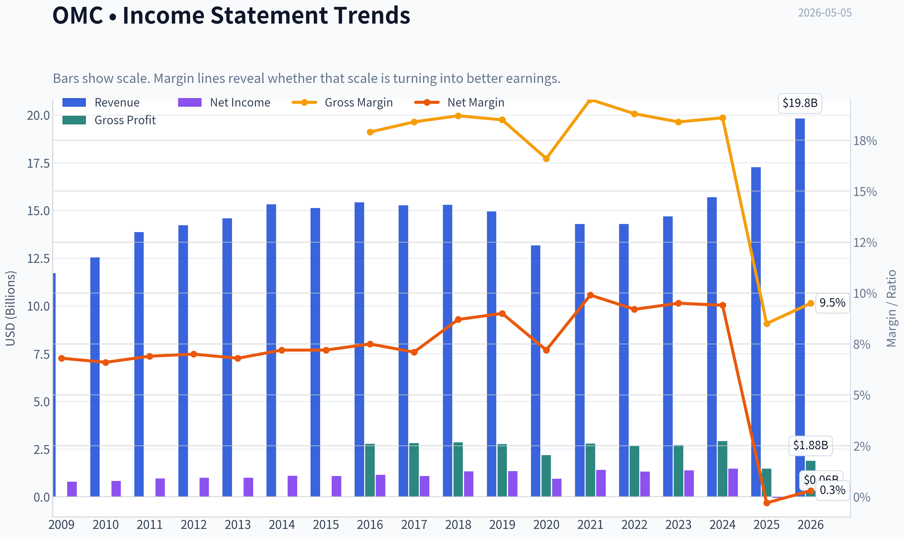
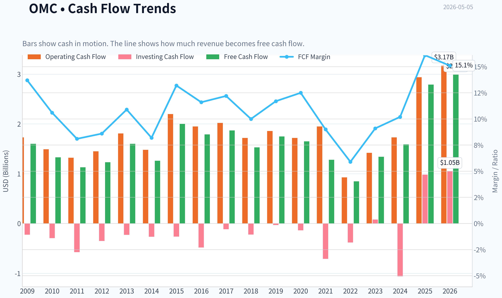
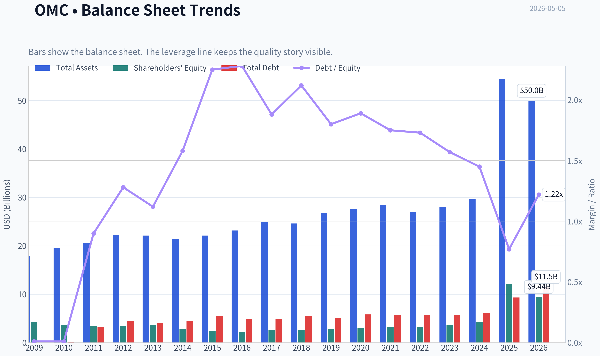
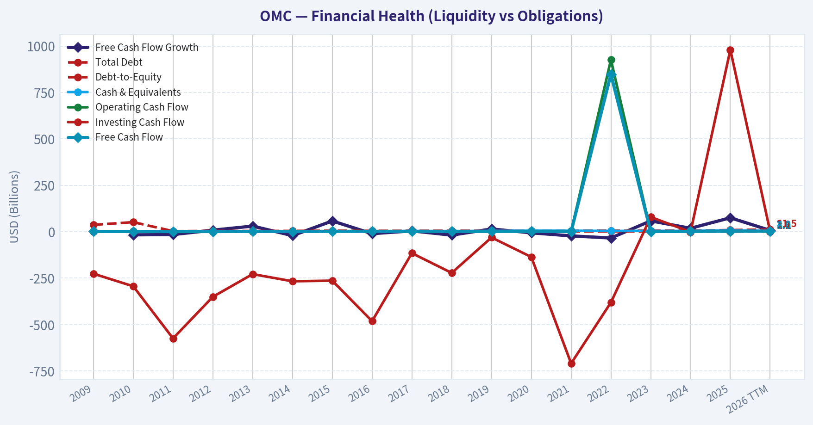
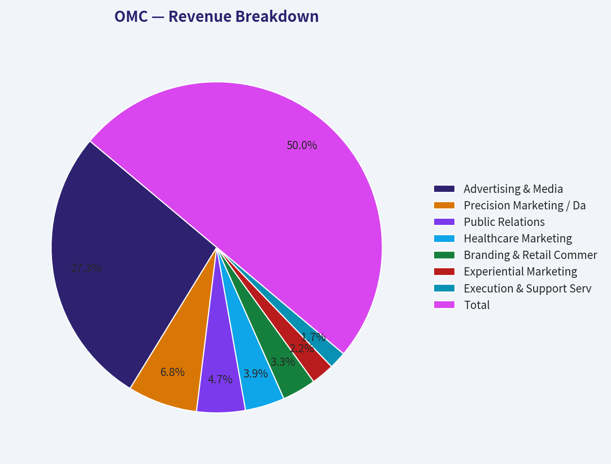
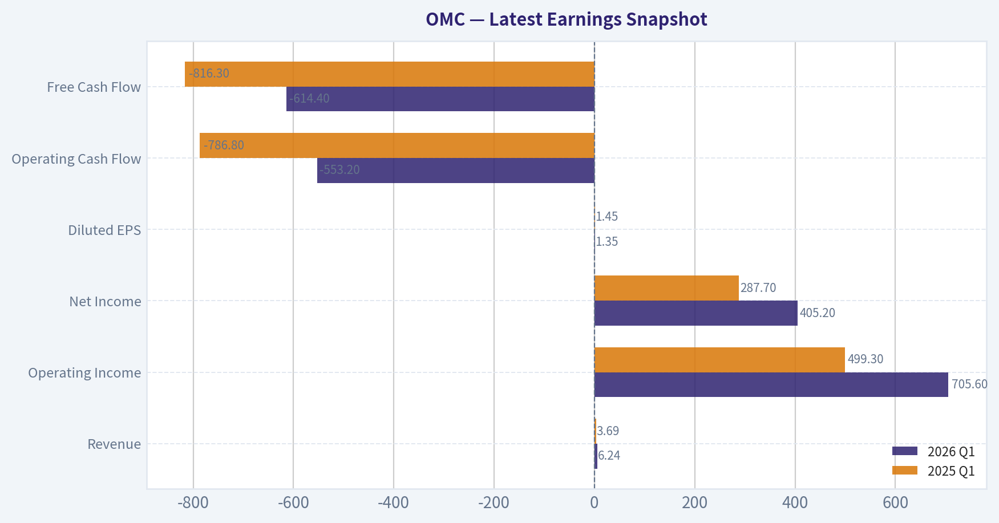
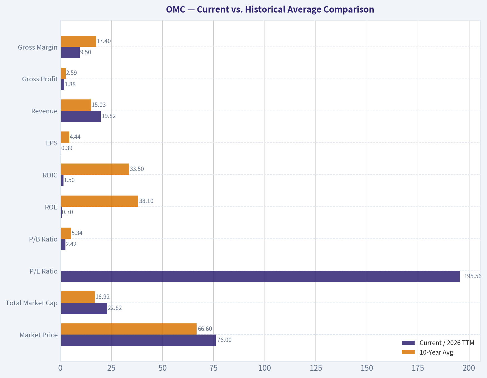
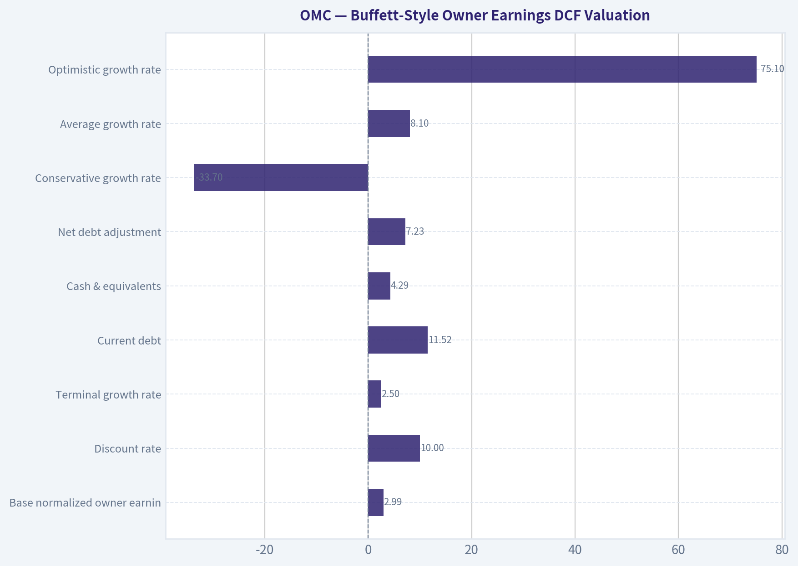
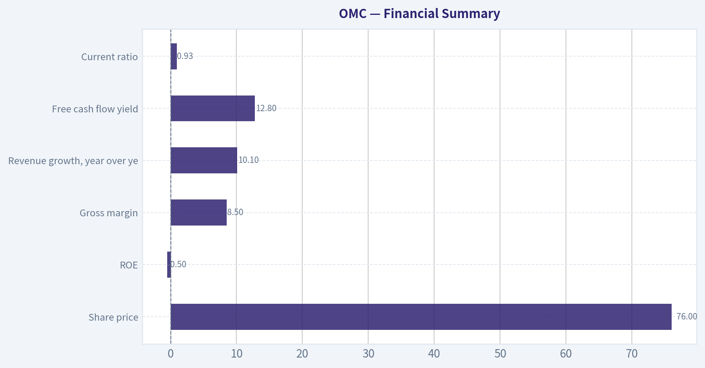
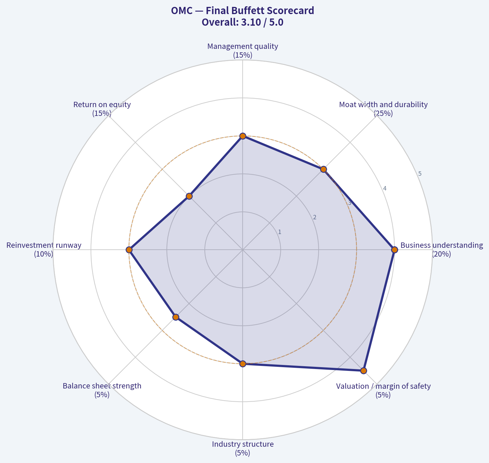

# OMC Deep Value Intelligence

**Analysis Date:** 2026-05-05

## Critical Disclaimer

*This analysis is generated by Deep Value Intelligence, an AI-powered multi-agent investing framework. This report is for informational and educational purposes only and does not constitute financial advice. Always conduct your own research and consult with qualified financial advisors before making investment decisions.*

---

## Table of Contents

1. Intelligence Summary
2. Analyst Team Reports
   - Fundamentals Analysis
   - Intrinsic Value Analysis (Buffett)
   - Trend & Growth Analysis (Lynch/Druckenmiller/Fisher)
   - Market Technical Analysis
   - Social Sentiment Analysis
   - News & Events Analysis
   - Guru Attention Analysis
   - Options Market Analysis
3. Research Team Commentary
4. Value Investing Team Commentary
5. Deep Values Commentary

---

## Intelligence Summary

### Thesis + Conditions

**Core Thesis:** **EXECUTIVE SUMMARY**
Omnicom Group (OMC) presents a classic value investing dilemma: statistical cheapness versus fundamental business quality. While the stock trades at a deep discount ($76 vs.

**Key Risks:**
- Omnicom Group (OMC) presents a classic value investing dilemma: statistical cheapness versus fundamental business quality. While the stock trades at a deep discount ($76 vs. an estimated FCF value of $132), its abysmal Return on Invested Capital (0.4%) and negative Return on Equity (-0.5%) signal a lack of a durable competitive advantage. The Buffett framework prioritizes "wonderful businesses at fair prices." Omnicom currently resembles a fair-to-poor business at a wonderful price. Because a true margin of safety relies on moat durability-not just spreadsheet output-the risk of permanent capital impairment (value trap) outweighs the reward of multiple expansion.
- The Bull (Risky) - The Asymmetric Value Setup:** OMC is heavily discounted, pricing in excessive skepticism. Strong FCF growth (+75.1% YoY) and a Q1 revenue beat ($6.24B) prove resilience. Scale and global integration offer stickiness, while AI will serve as a margin-enhancing tool for incumbents, not a disruptor.
- The Bear (Safe) - The Value Trap Warning:** A 103.7% YoY collapse in net income alongside near-zero ROIC (0.4%) and gross margins of 8.5% indicate severe structural weakness. Ad agencies face low switching costs, procurement fee compression, and AI-driven commoditization. Statistical cheapness is an illusion if the underlying economics are deteriorating.
- The Neutral - The "Show Me" Middle Ground:** The valuation gap is too large to ignore entirely, but the profitability metrics are too poor to blindly trust. Advocates for a strict, conditionally driven watchlist approach rather than aggressive buying or indefinite avoidance.
- 3.  **Permanent vs. Temporary Risk:** The debate hinges on AI. If AI improves agency workflow, it's a temporary headwind turning into a tailwind. If clients use AI to bring marketing in-house and demand lower fees, it causes permanent margin compression. The current metrics do not yet prove the bullish thesis.

**What Would Change Our View:**
- Omnicom Group (OMC) presents a classic value investing dilemma: statistical cheapness versus fundamental business quality. While the stock trades at a deep discount ($76 vs. an estimated FCF value of $132), its abysmal Return on Invested Capital (0.4%) and negative Return on Equity (-0.5%) signal a lack of a durable competitive advantage. The Buffett framework prioritizes "wonderful businesses at fair prices." Omnicom currently resembles a fair-to-poor business at a wonderful price. Because a true margin of safety relies on moat durability-not just spreadsheet output-the risk of permanent capital impairment (value trap) outweighs the reward of multiple expansion.
- The Bull (Risky) - The Asymmetric Value Setup:** OMC is heavily discounted, pricing in excessive skepticism. Strong FCF growth (+75.1% YoY) and a Q1 revenue beat ($6.24B) prove resilience. Scale and global integration offer stickiness, while AI will serve as a margin-enhancing tool for incumbents, not a disruptor.
- The Bear (Safe) - The Value Trap Warning:** A 103.7% YoY collapse in net income alongside near-zero ROIC (0.4%) and gross margins of 8.5% indicate severe structural weakness. Ad agencies face low switching costs, procurement fee compression, and AI-driven commoditization. Statistical cheapness is an illusion if the underlying economics are deteriorating.
- The Neutral - The "Show Me" Middle Ground:** The valuation gap is too large to ignore entirely, but the profitability metrics are too poor to blindly trust. Advocates for a strict, conditionally driven watchlist approach rather than aggressive buying or indefinite avoidance.
- 3.  **Permanent vs. Temporary Risk:** The debate hinges on AI. If AI improves agency workflow, it's a temporary headwind turning into a tailwind. If clients use AI to bring marketing in-house and demand lower fees, it causes permanent margin compression. The current metrics do not yet prove the bullish thesis.

**Confidence:** Medium

---

## Analyst Team Reports

### Fundamentals Analysis

#### Latest Earnings Snapshot

*Most recent reported quarter anchored on 2026 Q1, with prior-year comparison when available.*

| Metric | 2026 Q1 | 2025 Q1 | YoY Change |
| --- | ---: | ---: | ---: |
| Revenue | $6.24B | $3.69B | +69.2% |
| Operating Income | $705.6M | $499.3M | +41.3% |
| Net Income | $405.2M | $287.7M | +40.8% |
| Diluted EPS | $1.35 | $1.45 | -6.9% |
| Operating Cash Flow | $-553.2M | $-786.8M | +29.7% |
| Free Cash Flow | $-614.4M | $-816.3M | +24.7% |

Key Takeaways: This snapshot anchors the most recent reported quarter before the narrative analysis. It helps readers separate long-run business quality from whatever changed in the latest earnings print.

#### 10-Year Financial Metrics for OMC

*All values below are computed deterministically from raw data - not estimated by AI.*

*Issuer profile: operating company (Communication Services / Advertising Agencies).*

#### 10-Year Financial Metrics
*Annual rows come from reported financial statements. The final TTM row is computed from the latest four quarters.*

| Metric | 2009 | 2010 | 2011 | 2012 | 2013 | 2014 | 2015 | 2016 | 2017 | 2018 | 2019 | 2020 | 2021 | 2022 | 2023 | 2024 | 2025 | 2026 TTM |
| --- | --- | --- | --- | --- | --- | --- | --- | --- | --- | --- | --- | --- | --- | --- | --- | --- | --- | --- |
| Market Price | $24 | $28 | $28 | $33 | $50 | $53 | $53 | $62 | $54 | $56 | $64 | $52 | $63 | $73 | $80 | $82 | $80 | $76 |
| Market Cap | $12.15B | $13.90B | $12.63B | $13.49B | $19.37B | $19.78B | $18.55B | $20.36B | $17.03B | $16.67B | $17.90B | $13.48B | $15.80B | $16.88B | $17.42B | $17.09B | $16.55B | $22.82B |
| P/E Ratio | 15.47 | 16.96 | 13.39 | 13.84 | 20.05 | 18.27 | 17.16 | 17.81 | 15.66 | 12.56 | 13.37 | 14.27 | 11.22 | 12.83 | 12.52 | 11.53 | -299.07 | 195.56 |
| P/B Ratio | 2.90 | 3.88 | 3.60 | 3.90 | 5.41 | 6.94 | 7.56 | 9.42 | 6.51 | 6.54 | 6.27 | 4.37 | 4.83 | 5.19 | 4.82 | 4.07 | 1.37 | 2.42 |
| ROE | 18.9% | 23.1% | 27.2% | 28.8% | 27.7% | 38.7% | 44.6% | 53.1% | 41.6% | 52.1% | 46.9% | 30.7% | 43.0% | 40.5% | 38.5% | 35.3% | -0.5% | 0.7% |
| ROIC | 41.1% | 50.1% | 37.4% | 25.3% | 25.0% | 27.4% | 25.9% | 30.3% | 35.5% | 40.8% | 40.5% | 34.8% | 48.8% | 37.1% | 33.4% | 31.7% | 2.0% | 1.5% |
| EPS | $1.54 | $1.68 | $2.12 | $2.35 | $2.48 | $2.91 | $3.11 | $3.46 | $3.46 | $4.49 | $4.82 | $3.63 | $5.63 | $5.70 | $6.40 | $7.12 | $-0.27 | $0.39 |
| Revenue | $11.72B | $12.54B | $13.87B | $14.22B | $14.58B | $15.32B | $15.13B | $15.42B | $15.27B | $15.29B | $14.95B | $13.17B | $14.29B | $14.29B | $14.69B | $15.69B | $17.27B | $19.82B |
| Gross Profit | N/A | N/A | N/A | N/A | N/A | N/A | N/A | $2.77B | $2.81B | $2.85B | $2.76B | $2.18B | $2.79B | $2.68B | $2.71B | $2.92B | $1.47B | $1.88B |
| Gross Margin | N/A | N/A | N/A | N/A | N/A | N/A | N/A | 17.9% | 18.4% | 18.7% | 18.5% | 16.6% | 19.5% | 18.8% | 18.4% | 18.6% | 8.5% | 9.5% |
| Operating Margin | 11.7% | 11.6% | 12.0% | 12.7% | 12.5% | 12.7% | 12.7% | 13.2% | 13.6% | 14.0% | 14.2% | 12.1% | 15.4% | 14.6% | 14.3% | 14.5% | 2.6% | 3.5% |
| Net Income | $793.0M | $827.7M | $952.6M | $998.3M | $991.1M | $1.10B | $1.09B | $1.15B | $1.09B | $1.33B | $1.34B | $945.4M | $1.41B | $1.32B | $1.39B | $1.48B | $-54.5M | $63.0M |
| Net Margin | 6.8% | 6.6% | 6.9% | 7.0% | 6.8% | 7.2% | 7.2% | 7.5% | 7.1% | 8.7% | 9.0% | 7.2% | 9.9% | 9.2% | 9.5% | 9.4% | -0.3% | 0.3% |
| Revenue Growth | N/A | 7.0% | 10.6% | 2.5% | 2.6% | 5.0% | -1.2% | 1.9% | -0.9% | 0.1% | -2.2% | -11.9% | 8.5% | -0.0% | 2.8% | 6.8% | 10.1% | 14.8% |
| Net Income Growth | N/A | 4.4% | 15.1% | 4.8% | -0.7% | 11.4% | -0.9% | 5.0% | -5.2% | 21.9% | 1.0% | -29.4% | 48.9% | -6.5% | 5.7% | 6.4% | -103.7% | -215.6% |
| Free Cash Flow Growth | N/A | -16.7% | -15.3% | 8.4% | 30.4% | -20.9% | 58.0% | -10.5% | 4.5% | -18.3% | 14.9% | -6.0% | -22.4% | -33.7% | 58.4% | 18.6% | 75.1% | 7.2% |
| Total Book Value | $4.19B | $3.58B | $3.50B | $3.46B | $3.58B | $2.85B | $2.45B | $2.16B | $2.62B | $2.55B | $2.85B | $3.08B | $3.27B | $3.25B | $3.62B | $4.19B | $12.05B | $9.44B |
| Total Assets | $17.92B | $19.57B | $20.51B | $22.15B | $22.10B | $21.43B | $22.11B | $23.17B | $24.93B | $24.62B | $26.78B | $27.65B | $28.42B | $27.00B | $28.04B | $29.62B | $54.42B | $49.96B |
| Total Debt | $37.1M | $51.6M | $3.17B | $4.42B | $4.01B | $4.51B | $5.51B | $4.93B | $4.91B | $5.41B | $5.13B | $5.83B | $5.74B | $5.63B | $5.68B | $6.09B | $9.33B | $11.52B |
| Debt-to-Equity | 0.01 | 0.01 | 0.90 | 1.28 | 1.12 | 1.58 | 2.25 | 2.28 | 1.88 | 2.12 | 1.80 | 1.89 | 1.75 | 1.73 | 1.57 | 1.45 | 0.77 | 1.22 |
| Cash & Equivalents | $1.59B | $2.29B | $1.78B | $2.68B | $2.71B | $2.39B | $2.61B | $3.00B | $3.80B | $3.65B | $4.31B | $5.60B | $5.32B | $4.28B | $4.43B | $4.34B | $6.88B | $4.29B |
| Shareholders' Equity | $4.19B | $3.58B | $3.50B | $3.46B | $3.58B | $2.85B | $2.45B | $2.16B | $2.62B | $2.55B | $2.85B | $3.08B | $3.27B | $3.25B | $3.62B | $4.19B | $12.05B | $9.44B |
| Operating Cash Flow | $1.73B | $1.49B | $1.32B | $1.45B | $1.81B | $1.48B | $2.20B | $1.95B | $2.02B | $1.72B | $1.86B | $1.72B | $1.95B | $926.5M | $1.42B | $1.73B | $2.94B | $3.17B |
| Investing Cash Flow | $-226.0M | $-293.7M | $-574.6M | $-350.4M | $-228.2M | $-266.9M | $-263.5M | $-481.6M | $-115.4M | $-221.8M | $-30.9M | $-136.1M | $-709.2M | $-380.9M | $79.1M | $-1.06B | $980.2M | $1.05B |
| Free Cash Flow | $1.60B | $1.33B | $1.13B | $1.23B | $1.60B | $1.26B | $2.00B | $1.79B | $1.87B | $1.53B | $1.75B | $1.65B | $1.28B | $848.3M | $1.34B | $1.59B | $2.79B | $2.99B |
| FCF Margin | 13.7% | 10.6% | 8.1% | 8.6% | 10.9% | 8.2% | 13.2% | 11.6% | 12.2% | 10.0% | 11.7% | 12.5% | 9.0% | 5.9% | 9.1% | 10.2% | 16.1% | 15.1% |
| Dividends / Share | $0.00 | $0.00 | $0.00 | $0.00 | $0.00 | $0.00 | $0.00 | $0.00 | $0.00 | $0.00 | $0.00 | $0.00 | $0.00 | $2.52 | $2.59 | $2.66 | $2.68 | $2.22 |

#### Profitability Metrics
- Return on Equity (ROE): -0.5%
- Return on Invested Capital (ROIC): 0.4%
- Return on Assets (ROA): -0.1%
- Gross Margin: 8.5%
- Operating Margin: 2.6%
- Net Profit Margin: -0.3%

#### Liquidity Metrics
- Current Ratio: 0.93
- Quick Ratio: 0.72

#### Leverage Metrics
- Debt-to-Equity Ratio: 0.77
- Interest Coverage Ratio: 1.69
- Net Debt: $2.45B

#### Growth Metrics (Year-over-Year)
- Revenue Growth: 10.1%
- Net Income Growth: -103.7%
- Free Cash Flow Growth: 75.1%
- Revenue CAGR (3-Year): 6.5%
- Revenue CAGR (5-Year): 5.6%

#### Valuation Metrics
- P/E Ratio (TTM): N/A
- Forward P/E: 6.12
- Price-to-Book: 1.98
- Price-to-Sales: 1.10
- PEG Ratio: 15.97
- EV/EBITDA: 9.49
- Free Cash Flow Yield: 12.8%
- Earnings Yield: N/A

#### Owner Earnings (Buffett Method, Code-Computed)
- Net Income: $-54.5M
- + Depreciation & Amortization: $276.7M
- - Capital Expenditures: $-149.8M
- - Working Capital Changes: $712.1M
- = **Owner Earnings: $-639.7M**

#### Intrinsic Value (Code-Computed)
- Current Price: $76
- Cash Flow Method (FCF):
  Conservative: $61
  Average: $132
  Optimistic: $251

#### Piotroski F-Score: 2/9
- Positive Net Income: FAIL
- Positive Operating Cash Flow: PASS
- ROA Improvement: FAIL
- Cash Flow > Net Income: PASS
- Decreasing Debt: FAIL
- Improving Current Ratio: FAIL
- No Dilution: FAIL
- Improving Gross Margin: FAIL
- Improving Asset Turnover: FAIL

ANALYST STANCE: **WATCH**

#### OMC Fundamental Analysis - Warren Buffett-Style Review

Omnicom Group Inc. is a global advertising, media, and marketing services company. Its historical appeal has been a high-return, asset-light agency model with durable client relationships, strong free cash flow, and shareholder returns. However, the deterministic dataset shows a major near-term disruption: 2025 and 2026 TTM earnings quality deteriorated sharply, with margins, ROE, ROIC, and net income far below historical norms even as revenue and free cash flow rose.

The result is a business that still has recognizable moat characteristics, but whose current accounting profitability is too impaired to justify an outright Buffett-style "buy" without evidence that margins and returns normalize.

---

#### Current vs. Historical Average Comparison

| Metric | Current / 2026 TTM | 10-Year Avg. | Current Standing vs. History | Interpretation |
|---|---:|---:|---:|---|
| Market Price | $76 | $66.60 | Above average | The stock trades above its 10-year average price despite sharply weaker earnings. |
| Total Market Cap | $22.82B | $16.92B | Above average | Market capitalization is materially higher than normal, partly reflecting a larger asset and revenue base. |
| P/E Ratio | 195.56 | ~13.5 normalized positive avg. | Extremely above normal | Current earnings are depressed, making the P/E ratio optically very expensive and not useful as a normalized valuation metric. |
| P/B Ratio | 2.42 | 5.34 | Below average | Book value expanded significantly, reducing P/B; this may reflect balance sheet expansion rather than cheapness alone. |
| ROE | 0.7% | 38.1% | Severely below average | A dramatic fall from Omnicom's historically excellent shareholder returns. |
| ROIC | 1.5% | 33.5% | Severely below average | Capital efficiency has collapsed versus the company's historical high-return profile. |
| EPS | $0.39 | $4.44 | Severely below average | EPS has fallen far below the historical range after 2025's negative EPS. |
| Revenue | $19.82B | $15.03B | Above average | Revenue growth is strong, but the quality of that revenue is questionable given margin compression. |
| Gross Profit | $1.88B | $2.59B | Below average | Gross profit has fallen despite higher revenue, indicating structural or integration-related margin pressure. |
| Gross Margin | 9.5% | 17.4% | Severely below average | Gross margin is roughly half the historical norm. |
| Operating Margin | 3.5% | 12.9% | Severely below average | Operating profitability is far below the historic agency model level. |
| Net Income | $63.0M | $1.14B | Severely below average | Net income has nearly disappeared relative to normal earnings power. |
| Net Margin | 0.3% | 7.7% | Severely below average | The company is currently retaining very little profit from revenue. |
| Revenue Growth Rate | 14.8% | 1.5% | Above average | Top-line growth is unusually strong, but must be judged against margin deterioration. |
| Net Income Growth Rate | -215.6% | -5.6% | Far worse than average | Earnings remain highly disrupted. |
| Free Cash Flow Growth Rate | 7.2% | 8.1% | Near average | FCF growth remains resilient despite accounting earnings weakness. |
| Total Book Value | $9.44B | $3.96B | Above average | Equity capital is much larger than normal, reducing leverage ratios. |
| Total Assets | $49.96B | $29.47B | Above average | Asset base expanded substantially, likely reflecting acquisition or balance sheet restructuring effects. |
| Total Debt | $11.52B | $5.87B | Above average | Debt is almost double the 10-year average. |
| Debt-to-Equity | 1.22 | 1.72 | Below average | Leverage relative to equity looks better, but absolute debt is much higher. |
| Cash & Equivalents | $4.29B | $4.56B | Slightly below average | Cash remains substantial but is not high relative to enlarged debt. |
| Shareholders' Equity | $9.44B | $3.96B | Above average | Equity base has expanded materially. |
| Free Cash Flow | $2.99B | $1.64B | Above average | FCF is the strongest part of the current story. |
| Dividends / Share | $2.22 | $1.05 | Above 10-year avg.; below recent payout years | Dividend remains meaningful, but the TTM amount is below the recent $2.5-$2.7 range. |

Key Takeaways: Omnicom's current revenue and free cash flow are well above historical averages, but profitability metrics have collapsed. ROE, ROIC, operating margin, net margin, EPS, and net income are all dramatically worse than the company's historical profile. The stock is not obviously cheap on current earnings, but free cash flow strength creates a valuation debate if margins normalize.

---

#### Market Metrics Interpretation

Omnicom's current market price of **$76** is above its 10-year average of roughly **$66.60**, while its market capitalization of **$22.82B** is materially above the historical average of about **$16.92B**. This suggests investors are assigning value to Omnicom's larger revenue base and future normalization potential rather than current earnings.

The **P/E ratio of 195.56** is not attractive on reported earnings and is heavily distorted by depressed net income. Historically, Omnicom traded closer to a low-to-mid-teens earnings multiple when profitable. The current P/E therefore signals that reported earnings are not yet supporting the stock price.

The **P/B ratio of 2.42** is below the 10-year average of **5.34**, but this is not automatically a bargain. Book value expanded significantly, while returns on equity collapsed. Buffett generally prefers high ROE businesses, and a lower P/B is only attractive if book value can generate strong returns again.

---

#### Profitability Analysis

Omnicom historically generated excellent economics: ROE often above **35%**, ROIC frequently above **30%**, and net margins generally between **7% and 10%**. That is the kind of high-return, asset-light business Buffett typically respects.

The current period is very different. **ROE is only 0.7%**, **ROIC is 1.5%**, **operating margin is 3.5%**, and **net margin is 0.3%**. These numbers represent a severe break from the company's long-term pattern.

Revenue reached **$19.82B**, well above historical levels, but the company converted almost none of that revenue into net income. This is the central concern: Omnicom has growth, but current profitability quality is weak.

The most important question for investors is whether 2025-2026 represents a temporary integration, restructuring, or accounting disruption, or whether the advertising agency model is facing lasting margin pressure from AI, client insourcing, procurement pressure, and competitive shifts.

---

#### Growth Metrics Interpretation

Revenue growth is strong at **14.8% TTM**, far above the historical average of roughly **1.5%**. This is a positive sign on the surface, especially for a mature advertising services company.

However, net income growth is deeply negative at **-215.6%**, following a severe 2025 profit decline. This means Omnicom is growing the top line while losing earnings leverage.

Free cash flow growth of **7.2%** remains solid and close to the 10-year average of about **8.1%**. This is the strongest counterargument against an overly bearish view. If cash flow is durable and accounting earnings recover, the stock may be undervalued on normalized owner earnings.

---

#### Balance Sheet and Financial Strength

Omnicom's balance sheet is larger and more leveraged in absolute terms than historically. Total assets are **$49.96B**, compared with a 10-year average of **$29.47B**. Total debt is **$11.52B**, almost double the 10-year average of **$5.87B**.

The debt-to-equity ratio of **1.22** is below the 10-year average of **1.72**, because shareholder equity expanded significantly to **$9.44B**. However, Buffett-style analysis focuses not only on ratios but also on absolute obligations and earnings coverage. With depressed operating income, higher debt becomes more concerning.

Cash and equivalents of **$4.29B** provide liquidity, but net debt remains meaningful. The provided interest coverage ratio of **1.69** is weak for a high-quality compounder and is a notable red flag.

---

#### Cash Flow and Dividend Analysis

Free cash flow is Omnicom's strongest current metric. TTM free cash flow is **$2.99B**, compared with a 10-year average of about **$1.64B**. Free cash flow margin is also strong at **15.1%**, despite weak accounting margins.

The dividend is meaningful at **$2.22 per share TTM**, but it is below recent annual levels of approximately **$2.52-$2.68**. The dividend appears supported by free cash flow, but not by current net income. Buffett would likely view this as acceptable only if earnings normalize and cash flow remains reliable.

---

#### Revenue Breakdown

| Revenue Source | Amount ($B) | % of Total |
|---|---:|---:|
| Advertising & Media | $10.84B | 54.7% |
| Precision Marketing / Data-Driven Marketing | $2.70B | 13.6% |
| Public Relations | $1.88B | 9.5% |
| Healthcare Marketing | $1.53B | 7.7% |
| Branding & Retail Commerce | $1.31B | 6.6% |
| Experiential Marketing | $0.89B | 4.5% |
| Execution & Support Services | $0.67B | 3.4% |
| **Total** | **$19.82B** | **100.0%** |

Key Takeaways: Omnicom remains heavily dependent on advertising and media services, which account for more than half of revenue. The company also has meaningful exposure to precision marketing, public relations, healthcare, and commerce-related services. The diversification is helpful, but the core business still depends heavily on large client marketing budgets and agency competitiveness.

---

#### Warren Buffett-Style Qualitative Analysis

| Buffett Criterion | Assessment | OMC Interpretation |
|---|---|---|
| Economic Moat | Moderate | Omnicom benefits from global scale, long client relationships, agency networks, data platforms, and creative/media capabilities. However, advertising is competitive and client switching is possible. |
| Business Durability | Moderate to Strong | Large brands continue to need marketing, media buying, creative services, and data-driven customer engagement. The risk is that AI and client insourcing pressure agency fees. |
| Predictable Earnings | Currently Weak | Historically earnings were predictable, but 2025 and 2026 TTM results severely disrupt the pattern. |
| Financial Strength | Mixed | Cash flow is strong and cash is meaningful, but debt is elevated and interest coverage is weak. |
| Management Performance | Historically Strong, Currently Under Review | Long-term ROE and ROIC were excellent, but recent returns are far below Buffett-quality thresholds. |
| Capital Allocation | Mixed | Dividend policy is shareholder-friendly, but higher debt and weak earnings reduce flexibility. |
| Valuation Appeal | Mixed | FCF yield is attractive, but reported earnings and margins do not yet confirm normalized value. |
| Overall Business Quality | Watchlist Quality | The franchise remains relevant, but current profitability needs to recover before the stock qualifies as a high-conviction value opportunity. |

Key Takeaways: Omnicom historically looked like a high-quality, cash-generative business with strong returns on capital. Today, the moat still exists, but the financial evidence is temporarily or structurally impaired. Buffett-style investors would likely wait for proof that ROE, ROIC, margins, and earnings power are returning to normal.

---

#### Buffett-Style Owner Earnings DCF Valuation

Because the deterministic dataset provides a current code-computed owner earnings figure of **-$639.7M**, strict reported owner earnings are currently negative. A literal DCF on negative owner earnings would not support a positive equity valuation. However, Omnicom's free cash flow is strongly positive at **$2.99B TTM**, so the analysis below uses free cash flow as a normalized owner-earnings proxy while explicitly treating the result as normalization-sensitive.

Assumptions:

| DCF Input | Value |
|---|---:|
| Base normalized owner earnings proxy | $2.99B |
| Discount rate | 10.0% |
| Terminal growth rate | 2.5% |
| Current debt | $11.52B |
| Cash & equivalents | $4.29B |
| Net debt adjustment | $7.23B |
| Estimated current shares | ~300.3M |
| Conservative growth rate | -33.7% |
| Average growth rate | 8.1% |
| Optimistic growth rate | 75.1% |

Key Takeaways: The DCF is highly sensitive because reported owner earnings are negative, while free cash flow is very strong. The conservative scenario assumes a severe contraction in owner earnings, while the average case assumes historical FCF-like growth continues. The optimistic case is mathematically valid under the required rules but economically unrealistic because 75.1% growth is not sustainable for a mature agency business.

---

#### DCF Scenario Results

| Scenario | Growth Rate Used | PV of 10-Year Owner Earnings | PV of Terminal Value | Operating Value | Less Net Debt | Equity Value | Fair Value / Share |
|---|---:|---:|---:|---:|---:|---:|---:|
| Conservative | -33.7% | $4.51B | $0.26B | $4.77B | $7.23B | Negative | $0-$16 operating value; no equity margin after debt |
| Average | 8.1% | $27.21B | $34.33B | $61.54B | $7.23B | $54.31B | ~$181 |
| Optimistic | 75.1% | $831.5B | $4,267B | ~$5,098B | $7.23B | ~$5,091B | Not economically meaningful |

Key Takeaways: The conservative case shows that if Omnicom's current profit collapse reflects lasting deterioration, equity value could be severely impaired. The average case suggests major upside if today's free cash flow is durable and margins normalize. The optimistic case should not be relied upon because a 75.1% growth rate is not plausible over a decade for a mature advertising company.

---

#### DCF Calculation Detail

| Scenario | Calculation Summary |
|---|---|
| Conservative | Base owner earnings proxy of $2.99B declines at -33.7% annually. Discounted 10-year cash flows total about $4.51B. Year-10 owner earnings fall to roughly $49M, producing a discounted terminal value of about $0.26B. After net debt, equity value is not attractive. |
| Average | Base owner earnings proxy of $2.99B grows at 8.1% annually. Discounted 10-year cash flows total about $27.21B. Year-10 owner earnings reach about $6.5B, producing a discounted terminal value of about $34.33B. After net debt, estimated fair value is about $181 per share. |
| Optimistic | Base owner earnings proxy of $2.99B grows at 75.1% annually. The result produces an extremely large valuation that should be dismissed as a mechanical output rather than an investable estimate. |

Key Takeaways: The DCF produces a wide valuation range because Omnicom is in a transition period where cash flow and earnings are sending conflicting signals. A prudent Buffett-style investor should emphasize the conservative and normalized average scenarios, not the explosive optimistic scenario. The stock appears potentially undervalued only if free cash flow proves sustainable and accounting profitability rebounds.

---

#### Key Investment Insights

| Category | Insight | Investment Significance |
|---|---|---|
| Strongest Positive | Free cash flow of $2.99B is far above historical average. | Supports dividend, debt service, and potential undervaluation on cash flow. |
| Biggest Concern | ROE, ROIC, operating margin, and net margin collapsed. | Current business returns do not meet Buffett-quality standards. |
| Valuation Signal | P/B is below historical average, but P/E is distorted and very high. | The stock looks cheap only on book or cash flow, not on current earnings. |
| Growth Signal | Revenue growth is unusually strong. | Growth is positive, but weak margins suggest poor earnings conversion. |
| Balance Sheet | Debt is much higher than historical average. | Higher leverage reduces margin of safety while earnings are weak. |
| Dividend | Dividend remains meaningful but below recent annual run-rate. | Income appeal exists, but payout quality depends on continued FCF strength. |
| Moat | Global client relationships and scale remain valuable. | Competitive advantages exist, but they are not immune to AI and client insourcing. |

Key Takeaways: Omnicom has a strong cash-flow story but a weak earnings-quality story. The stock could be attractive if margins normalize, but investors need confirmation that recent profitability weakness is temporary. The current setup is better suited for a watchlist than an outright value-buy decision.

---

#### Red Flags and Opportunities

| Area | Red Flags | Opportunities |
|---|---|---|
| Profitability | Net margin of only 0.3%; ROE of 0.7%; ROIC of 1.5%. | Even partial margin normalization could sharply increase earnings. |
| Valuation | Current P/E of 195.56 is not attractive on reported earnings. | FCF yield remains compelling if cash flow is durable. |
| Balance Sheet | Total debt of $11.52B and weak interest coverage. | Larger equity base reduces debt-to-equity versus history. |
| Business Model | Advertising agencies face AI, automation, procurement, and insourcing pressure. | AI-powered platforms such as Omni may improve efficiency and client retention. |
| Cash Flow | Large gap between net income and free cash flow requires scrutiny. | Strong FCF provides flexibility for dividends, deleveraging, and buybacks. |
| Dividend | Dividend is not well covered by current net income. | FCF coverage appears stronger than earnings coverage. |

Key Takeaways: The main risk is that Omnicom's margin decline proves structural rather than temporary. The main opportunity is that free cash flow remains strong and the company restores historical profitability. The investment case hinges on whether accounting earnings catch up with cash generation.

---

#### Final Investment Stance: WATCH

Omnicom is not an **AVOID** because the company still has valuable client relationships, global scale, strong revenue growth, and unusually strong free cash flow. However, it is not yet an **ADVOCATE** because the current reported profitability profile is far below Buffett-style quality thresholds.

A Buffett-style investor should watch for three confirmations before becoming more constructive:

1. Operating margin recovering toward the historical low-teens range.
2. ROE and ROIC returning meaningfully above the cost of capital.
3. Net income again aligning with free cash flow rather than remaining near breakeven.

At **$76**, the stock may be undervalued on normalized free cash flow, but the margin of safety is not clear enough while reported earnings, returns on capital, and interest coverage remain weak.

---

#### Final Summary Table

| Topic | Verdict | Key Point |
|---|---|---|
| Business Quality | Moderate to Strong historically; weakened currently | The agency franchise remains valuable, but recent profitability has deteriorated sharply. |
| Economic Moat | Moderate | Scale, client relationships, data, and media capabilities provide advantages, but competition is intense. |
| Profitability | Weak currently | ROE, ROIC, net margin, and operating margin are far below historical norms. |
| Growth | Strong top-line, weak earnings conversion | Revenue is growing, but net income has collapsed. |
| Cash Flow | Strong | Free cash flow is the best part of the investment case. |
| Balance Sheet | Mixed | Debt is high in absolute terms, though debt-to-equity is below its historical average. |
| Dividend | Reasonable but watch coverage | Supported by FCF, not by current earnings. |
| Valuation | Potentially attractive only on normalized FCF | Current P/E is distorted and unattractive; normalized DCF suggests upside if margins recover. |
| Main Red Flag | Profitability collapse | Current returns do not meet Buffett-quality standards. |
| Main Opportunity | Margin normalization | If earnings recover toward historical levels, the stock could re-rate meaningfully. |
| Final Stance | **WATCH** | Wait for evidence that strong free cash flow converts back into durable earnings and high returns. |

Key Takeaways: Omnicom remains a potentially valuable business, but the current financial profile is too inconsistent for a high-conviction Buffett-style purchase. The stock deserves close monitoring because free cash flow is strong and valuation could be attractive on normalized earnings. For now, the prudent stance is WATCH until profitability and capital returns recover.

#### Fundamental Visuals

This graph tracks the profitability and return metrics (ROE, ROIC, Margins) of **OMC** over the past decade, highlighting capital efficiency trends.

This chart illustrates the financial health of **OMC** over the last 10 years, mapping cash equivalents and free cash flow against total obligations (Debt).

This breakdown chart from <em>Revenue Breakdown</em> shows the proportional composition for **OMC** - useful for understanding what drives or risks the business.

---

### Intrinsic Value Analysis (Buffett)

> *Following Warren Buffett's value investing philosophy: Circle of Competence, Economic Moat, Management Quality, and Margin of Safety.*

#### Intrinsic Value Snapshot

Price is what you pay. Intrinsic value is what the business may be worth based on the cash it can create for owners over time. We show a range, not one magic number.

- Current Price: $76.27
- Value Range: $60.71 to $251.07

##### Owner Earnings (Buffett Method)
- Net Income: $-54,500,000.00
- Depreciation & Amortization: $276,700,000.00
- Capital Expenditures: $-149,800,000.00
- Working Capital Changes: $712,100,000.00
- Owner Earnings: $-639,700,000.00

##### Intrinsic Value
###### Cash Flow Method
Uses free cash flow. Better for companies spending heavily today to grow tomorrow.
- Conservative: $60.71
- Average: $132.27
- Optimistic: $251.07
- Discount Rate: 10.0%

ANALYST STANCE: **WATCH**

#### Omnicom Group Buffett-Style Value Analysis - OMC

Omnicom is understandable, cash-generative, and statistically cheap on free cash flow yield, but it is not a classic Buffett "inevitable" compounder. The key issue is quality: advertising agency holding companies have client concentration risk, account review cycles, modest switching costs, technology disruption from AI and marketing automation, and limited evidence of true pricing power. At $76 per share, the valuation looks attractive if current free cash flow is durable, but the moat is not strong enough for an outright **ADVOCATE** stance without deeper proof of normalized owner earnings and long-term ROIC.

---

#### 1. Go / No-Go Gate Assessment

| Buffett Gate | Result | Evidence | Interpretation |
|---|---:|---|---|
| Gate 1: Business simplicity | Pass | Omnicom earns money by providing advertising, media, marketing, data, commerce, public relations, and sales services to corporate clients. | The basic business is understandable: clients pay Omnicom to help them sell more products and manage brands. |
| Gate 1: 10-year predictability | Caution | Global brands will still need marketing services, but the delivery model is changing due to AI, data platforms, and in-housing. | Demand is durable, but the economics of agencies may not be fully predictable. |
| Gate 1: Technology risk | Caution / Partial fail | Omnicom is scaling its AI-powered Omni platform, but AI may also reduce labor-heavy agency work and pressure fees. | Technology is both a tool and a threat. This is not a "set and forget" business. |
| Gate 2: Moat | Narrow | Brand relationships, global scale, and platform capabilities help, but clients can switch agencies and put accounts up for review. Gross margin is only 8.5%. | The moat exists but is not wide enough to assume decades of pricing power. |
| Gate 3: Management / capital allocation | Caution | Current data shows high free cash flow yield and cost-cutting discipline, but no confirmed evidence of owner-like insider ownership or superior long-term capital allocation. | Management may be competent, but Buffett-level evidence is incomplete. |
| Gate 4: Industry structure | Pass with caution | Advertising holding companies benefit from scale, global client networks, and data capabilities, but competition is intense. | The industry is capital-light but not structurally protected from fee pressure. |

**Key Takeaways:** Omnicom passes the "understandable business" test, but it does not pass the moat test with high confidence. The company has scale and client relationships, yet the advertising industry remains competitive and exposed to technological change. This means the stock requires a larger margin of safety than a truly wonderful Buffett compounder.

---

#### 2. Moat Analysis

| Moat Source | Evidence For | Evidence Against | Buffett Verdict |
|---|---|---|---|
| Brand / intangible assets | Omnicom is one of the largest global marketing and advertising groups, serving major multinational clients. | Agency brands do not usually create consumer-level loyalty like Coca-Cola or Apple. Clients can run reviews and shift budgets. | Moderate intangible value, not a wide brand moat. |
| Pricing power | Large clients depend on Omnicom for complex campaigns, media execution, and global coordination. | Reported gross margin of 8.5% is far below the Buffett-style 40% gross margin marker. Fee pressure is common in advertising. | Pricing power appears limited. |
| Switching costs | Switching a global agency relationship can be disruptive, especially where data, media systems, and brand knowledge are embedded. | Switching is common enough in the industry; major accounts are frequently reviewed. | Some switching costs, but not high enough to be decisive. |
| Cost advantage | Scale provides purchasing power, global talent pools, shared services, and data-platform leverage. | Competitors such as Publicis, WPP, Accenture, and others also have scale. | Scale advantage exists but is not unique. |
| Network effects | Omni platform may improve as more data and clients use it. | The agency model is not a classic network-effect business like Visa, Mastercard, or a dominant exchange. | Weak to moderate network effects. |

**Key Takeaways:** Omnicom's moat is real but narrow. Its best advantages are scale, client relationships, and embedded workflows, not a dominant consumer brand or unavoidable network effect. This makes the company more of a cash-flow value candidate than a long-duration compounding machine.

---

#### 3. Management Quality Assessment

| Management Question | Evidence Available | Assessment |
|---|---|---|
| Do they think like owners? | No current evidence from the research pack showing very high insider ownership or compensation tied clearly to long-term per-share value. | Incomplete / neutral. |
| Are they candid and conservative? | No recent restatement or accounting red flag was provided in the research pack. Latest coverage emphasizes cost cuts and operating execution. | Neutral to positive, but not proven. |
| Are they rational capital allocators? | The company shows a 12.8% free cash flow yield, implying substantial cash generation relative to price. | Potentially positive if cash is returned or reinvested wisely. |
| Do they avoid excessive balance sheet risk? | Current ratio is 0.93, below 1.0. Debt metrics were not provided. | Caution until leverage and interest coverage are verified. |
| Are they adapting strategically? | Omnicom has scaled the AI-powered Omni platform across the organization and recently elevated leadership for the platform. | Positive, but also evidence that the business must keep evolving. |

**Key Takeaways:** Management appears operationally active, especially around cost control and the Omni platform, but the available evidence does not prove Buffett-style owner orientation. The largest positive is the company's strong free cash flow yield. The largest unanswered question is whether management can convert that cash into durable per-share value.

---

#### 4. Financial Summary

| Metric | Current Data | Buffett Interpretation |
|---|---:|---|
| Share price | $76 | Current purchase price for valuation work. |
| Market capitalization | $21.74 billion | Implied equity value of the company. |
| Implied shares outstanding | ~286 million | Derived from market cap divided by share price. |
| P/E ratio | N/A | Earnings may be distorted or unavailable; use cash flow cautiously. |
| ROE | -0.5% | Fails the Buffett preference for sustained ROE above 15%. |
| Gross margin | 8.5% | Fails the classic gross-margin moat screen. |
| Revenue growth, year over year | 10.1% | Healthy recent growth, but one year is not enough to prove durability. |
| Free cash flow yield | 12.8% | Statistically attractive if sustainable and not temporarily inflated. |
| Estimated free cash flow | ~$2.78 billion | Market cap multiplied by free cash flow yield. |
| Current ratio | 0.93 | Below 1.0; liquidity is not "fortress-like" based on this metric alone. |

**Key Takeaways:** Omnicom looks cheap on free cash flow, with an estimated free cash flow yield of nearly 13%. However, the quality indicators are mixed: reported ROE is negative, gross margin is low, and the current ratio is below 1.0. The valuation is attractive, but the business does not screen as a high-quality Buffett compounder using the available metrics.

---

#### 5. 10-Year Financial Due Diligence Status

| Buffett 10-Year Test | Ideal Standard | OMC Evidence Available | Pass / Fail |
|---|---:|---|---|
| Consistent revenue growth | Stable and predictable | Current YoY revenue growth is 10.1%, but 10-year series was not available in the provided pack. | Incomplete |
| Sustained ROE | Above 15%, ideally above 20% | Current ROE is -0.5%. | Fail |
| Sustained high gross margin | Above 40% for many years | Current gross margin is 8.5%. | Fail |
| Cash conversion | OCF should exceed net income | Current FCF yield is high at 12.8%, but detailed OCF and net income reconciliation was not available. | Partial pass |
| Balance sheet strength | Net cash or low leverage | Current ratio is 0.93; debt and interest coverage not provided. | Incomplete / caution |
| Durable reinvestment runway | High returns on incremental capital | Not proven from available data. | Incomplete |
| Predictable owner earnings | Stable and recurring | Estimated FCF is strong, but normalized maintenance capex and working capital needs were not provided. | Partial pass |

**Key Takeaways:** The 10-year Buffett evidence is incomplete, and the current quality metrics do not meet Buffett's preferred standards. The one clearly attractive metric is free cash flow yield. Before upgrading the stock, an analyst should verify 10-year ROIC, debt levels, interest coverage, normalized free cash flow, and share count reduction.

---

#### 6. Owner Earnings Calculation

Because detailed line items were not available in the research pack, free cash flow is used as a practical proxy for owner earnings.

| Owner Earnings Component | Amount | Comment |
|---|---:|---|
| Net income | N/A | Not available in provided data. |
| Plus depreciation and amortization | N/A | Not available in provided data. |
| Less maintenance capital expenditure | N/A | Not available in provided data. |
| Less working capital increases | N/A | Not available in provided data. |
| Free cash flow yield | 12.8% | Provided in research pack. |
| Market capitalization | $21.74 billion | Provided in research pack. |
| Estimated owner earnings proxy | ~$2.78 billion | Calculated as market cap x FCF yield. |
| Estimated owner earnings per share | ~$9.73 | Estimated FCF divided by implied shares outstanding. |

**Key Takeaways:** Omnicom's estimated owner earnings are approximately $2.78 billion, or about $9.73 per share, using free cash flow as a proxy. This is a high cash yield relative to the $76 share price. The risk is that the estimate may not represent normalized, repeatable owner earnings across a full cycle.

---

#### 7. Three-Scenario DCF Valuation

Assumptions: discount rate of 10%, estimated owner earnings of $2.78 billion, implied shares outstanding of roughly 286 million, and current share price of $76.

| Scenario | Key Assumption | Equity Value Estimate | Intrinsic Value / Share | Margin of Safety vs. $76 |
|---|---:|---:|---:|---:|
| A: No growth | Owner earnings capitalized at 10% | ~$27.83 billion | ~$97 | ~22% |
| B: GDP growth | 3% perpetual growth | ~$40.95 billion | ~$143 | ~47% |
| C: Historical-growth haircut | 5.0% growth for 10 years, then 3% terminal growth | ~$47.62 billion | ~$166 | ~54% |

**Key Takeaways:** On a pure free-cash-flow valuation, Omnicom appears undervalued. The no-growth case gives an estimated value of about $97 per share, only modestly above today's price, while growth cases produce much higher values. The investment case therefore depends heavily on whether current free cash flow is durable and whether the business can avoid long-term fee compression from competition and AI.

---

#### 8. Margin of Safety Analysis

| Valuation View | Intrinsic Value / Share | Required Buffett Margin | Current Margin | Conclusion |
|---|---:|---:|---:|---|
| High-quality wonderful business standard | $97 to $166 | At least 25% | 22% to 54% | Passes only in growth scenarios. |
| Average-quality business standard | $97 to $166 | 40% to 50% | 22% to 54% | Passes only if GDP or moderate growth assumptions are valid. |
| Conservative no-growth standard | $97 | At least 25% | ~22% | Slightly short. |
| Cash-flow value investor standard | $143 to $166 | 40%+ | ~47% to 54% | Attractive, but dependent on FCF durability. |

**Key Takeaways:** The stock is not clearly cheap enough under the most conservative no-growth case. It becomes compelling only if Omnicom can sustain current owner earnings and grow modestly. Because the moat is narrow, the required margin of safety should be closer to 40% than 25%.

---

#### 9. Final Buffett Scorecard

| Criterion | Weight | Score, 1-5 | Weighted Contribution | Rationale |
|---|---:|---:|---:|---|
| Business understanding | 20% | 4.0 | 0.80 | The business model is simple enough to understand. |
| Moat width and durability | 25% | 3.0 | 0.75 | Scale and relationships help, but moat is narrow. |
| Management quality | 15% | 3.0 | 0.45 | Operational execution appears reasonable, but owner-orientation evidence is incomplete. |
| Return on equity | 15% | 2.0 | 0.30 | Current ROE of -0.5% fails Buffett's preferred standard. |
| Reinvestment runway | 10% | 3.0 | 0.30 | Omni platform and data capabilities help, but long-term high-return reinvestment is not proven. |
| Balance sheet strength | 5% | 2.5 | 0.13 | Current ratio below 1.0; debt metrics unavailable. |
| Industry structure | 5% | 3.0 | 0.15 | Capital-light but competitive and technologically disrupted. |
| Valuation / margin of safety | 5% | 4.5 | 0.23 | FCF yield is attractive and DCF suggests upside if cash flow is durable. |
| Total | 100% | - | **3.10 / 5.00** | **WATCH** |

**Key Takeaways:** Omnicom scores as a watchlist candidate, not a Buffett-style outright buy. The stock's strongest feature is valuation, while its weakest features are moat durability, ROE, and uncertainty around long-term industry economics. A higher conviction stance would require proof that free cash flow is normalized, leverage is safe, and AI strengthens rather than weakens Omnicom's economics.

---

#### Final Investment Stance

**Stance: WATCH**
**Conviction: Medium-low**

Omnicom is a potentially undervalued cash-flow stock, but it is not yet a confirmed Buffett-quality compounder. At $76, the market appears to be pricing in skepticism, and the 12.8% free cash flow yield gives investors meaningful valuation support. However, the narrow moat, low reported gross margin, negative current ROE, sub-1.0 current ratio, and AI-related industry uncertainty prevent a stronger recommendation.

A Buffett-style investor should keep OMC on the watchlist and require one of two things before upgrading: either a lower price that provides a clear margin of safety even under the no-growth case, or better evidence that normalized owner earnings, ROIC, balance sheet strength, and client retention are durable over a full cycle.
#### Valuation Bridge

This bridge places the current market price beside each intrinsic value lens so readers can see whether upside depends on one method or shows up across several methods.

| Scenario | Intrinsic Value / Share |
| --- | ---: |
| Cash Flow Method | $132.27 |
| Damodaran Method | $203.44 |
| Current Price | $76.27 |

#### Key Takeaways

If one method is far above the others, the upside case depends on a specific modelling assumption. When several methods cluster together, the valuation story is more robust.

#### Valuation Visuals

This comparison chart from *Latest Earnings Snapshot* stacks current figures against historical benchmarks for **OMC**, making it easy to see where the company trades relative to its own averages.

This comparison chart from *Current vs. Historical Average Comparison* stacks current figures against historical benchmarks for **OMC**, making it easy to see where the company trades relative to its own averages.

This comparison chart from *Buffett-Style Owner Earnings DCF Valuation* stacks current figures against historical benchmarks for **OMC**, making it easy to see where the company trades relative to its own averages.

This comparison chart from *Financial Summary* stacks current figures against historical benchmarks for **OMC**, making it easy to see where the company trades relative to its own averages.

---

### Trend & Growth Analysis (Lynch/Druckenmiller/Fisher)

> *Following Peter Lynch's GARP, Stanley Druckenmiller's macro-aware approach, and Philip Fisher's scuttlebutt methodology.*

ANALYST STANCE: **WATCH**

#### Omnicom Group (OMC) Growth Investor Report - 2026-05-05

Omnicom is a high-cash-flow global advertising and marketing services company, not a classic Lynch/Fisher fast grower. The stock looks inexpensive on free cash flow and price-to-sales, but from a growth-investing lens it lacks clear ten-bagger characteristics unless AI-driven marketing automation, the Omni platform, and industry consolidation materially reaccelerate organic growth and margins.

---

#### 1. Lynch Classification

| Item | Assessment |
|---|---:|
| Company | Omnicom Group Inc. |
| Ticker | OMC |
| Current price | ~$76 |
| Market cap | ~$21.74B |
| Reported YoY revenue growth | ~10.1% |
| FCF yield | ~12.8% |
| Current ratio | ~0.93 |
| Lynch category | **Stalwart / Mature Cash Generator** |
| Growth-investor fit | **Moderate to low** |
| Initial stance | **WATCH** |

**Key Takeaways:** Omnicom is not a classic fast grower. Its recent 10% revenue growth is respectable, but the long-term advertising agency model is mature and cyclical. The appeal is more value and cash-flow driven than ten-bagger growth driven.

---

#### 2. The Story in 3 Bullets

- Omnicom helps large companies advertise, manage media, build brands, analyze customer data, and run marketing campaigns globally.
- Its AI-enabled Omni platform could improve productivity, campaign targeting, and client retention, creating a potential margin and relevance inflection.
- The investment case is not "hypergrowth"; it is "cheap cash flow plus possible AI and consolidation-driven operating improvement."

---

#### 3. TAM and 10x Test

| Metric | Estimate / View |
|---|---:|
| Current annualized revenue base | Roughly mid-to-high teens $B, depending on latest TTM revenue |
| 10x revenue target | ~$150B+ |
| Global advertising / marketing services TAM | Very large, likely hundreds of billions globally |
| Could OMC 10x and remain below 20% TAM share? | Theoretically yes, practically unlikely |
| TAM growth | Moderate, tied to global ad spend, digital media, retail media, CRM, data, and AI marketing |
| Runway quality | **Medium** |
| 10x-test result | **Fails on realism, not TAM size** |

**Key Takeaways:** The marketing services market is large enough for Omnicom to grow, but the company is already a global incumbent. A 10x revenue outcome is not impossible mathematically, but it is not a realistic base case for a mature agency holding company. The better upside case is margin expansion, share gains, buybacks, and consolidation rather than explosive revenue growth.

---

#### 4. Revenue Growth Trend

| Growth Signal | Assessment |
|---|---|
| Latest YoY revenue growth | ~10.1% |
| Historical organic growth profile | Typically low-to-mid single digits in normal periods |
| Current pattern | Better than mature baseline, but needs verification for organic versus acquisition / FX effects |
| Growth quality | Mixed; must separate organic growth from M&A, FX, and pass-through revenue |
| Lynch interpretation | Stalwart with a possible temporary acceleration |
| Druckenmiller inflection read | **Possible, not confirmed** |

**Key Takeaways:** The reported 10% growth rate is encouraging, but the key question is whether this is durable organic acceleration or simply aided by acquisitions, pass-throughs, currency, or one-time factors. For a true growth-stock re-rating, Omnicom needs sustained organic growth acceleration and margin leverage. One good year is not enough to call it an inflection.

---

#### 5. Unit Economics and Efficiency

| Metric | OMC Status | Growth-Investor Interpretation |
|---|---:|---|
| LTV/CAC | Not disclosed / not directly applicable | Agency client relationships can be sticky, but not software-like |
| Net revenue retention | Not disclosed | Client retention matters, but OMC does not report SaaS-style NRR |
| Rule of 40 | Not applicable as SaaS metric | Can use revenue growth plus FCF margin as a rough efficiency lens |
| FCF yield | ~12.8% | Very strong cash-flow valuation support |
| Current ratio | ~0.93 | Liquidity should be monitored, though agencies often have working-capital swings |
| Gross margin | ~8.5% from shared data | Low-margin structure versus software; verify definition |

**Key Takeaways:** Omnicom does not have the clean SaaS unit economics that growth investors prefer. However, its free cash flow yield is very attractive and suggests the market is pricing in low growth or disruption risk. The business is efficient in cash generation, but not structurally high-margin like software.

---

#### 6. Inflection Point Assessment

| Potential Inflection | Evidence | Verdict |
|---|---|---|
| AI / Omni platform | Omni has reportedly scaled across the organization; new CEO appointed for Omni platform | **Promising but unproven** |
| Margin inflection | Ongoing cost cuts highlighted in recent coverage | **Possible** |
| Revenue acceleration | Reported YoY growth ~10.1% | **Needs organic confirmation** |
| Market share gains | Q1 wins credited to core operations | **Positive signal** |
| Competitive disruption | AI, in-housing, consultancies, and platforms remain threats | **Major risk** |
| M&A / consolidation | Industry consolidation may benefit scale players | **Potential catalyst** |

**Key Takeaways:** Omnicom has possible inflection points around AI adoption, internal cost savings, and client wins. The most important test is whether AI becomes a revenue and margin accelerator rather than a pricing headwind. At this stage, the inflection is plausible but not yet high-conviction.

---

#### 7. Macro Setup

| Macro Factor | Impact on OMC |
|---|---|
| Economic cycle | Advertising is cyclical; weaker consumer or corporate spending hurts budgets |
| Interest rates | Lower rates can help valuation multiples and client confidence |
| Secular themes | AI marketing, data-driven advertising, CRM, retail media, and digital transformation |
| Main macro risk | Client budget cuts in a slowdown |
| Main macro support | Large brands still need global, integrated marketing execution |
| Macro score | **Neutral to modestly positive** |

**Key Takeaways:** Omnicom benefits from secular digital and AI marketing trends, but it is still tied to advertising budgets and business confidence. A softer economy would pressure client spending, while falling rates and corporate recovery would help. The macro backdrop is not bad, but it is not as powerful as it is for pure-play AI infrastructure or mission-critical software companies.

---

#### 8. Fisher 15-Point Score

| Fisher Point | Score / 5 | Comment |
|---|---:|---|
| Market potential for sizable sales increase | 3 | Large TAM, but mature position |
| Management commitment to new products | 4 | Omni platform and AI focus are positives |
| R&D / innovation effectiveness | 3 | Innovation exists, but agency model is not R&D-led like software |
| Sales organization quality | 4 | Strong global client reach |
| Worthwhile profit margin | 3 | Cash flow strong, but reported margin structure modest |
| Improving profit margins | 3 | Cost cuts may help |
| Labor / personnel relations | 3 | Talent-dependent model; hard to verify |
| Executive relations | 3 | Recent Omni leadership transition to monitor |
| Management depth | 4 | Large global organization with experienced leadership |
| Cost analysis and accounting | 3 | Agency accounting and pass-throughs require scrutiny |
| Distinctive moat | 3 | Scale and relationships, but not hard switching-cost moat |
| Long-range profit outlook | 3 | Stable, not explosive |
| Dilution risk | 4 | Mature cash generator; less likely to rely on equity issuance |
| Candor in difficulties | 3 | Need more direct filing / earnings-call review |
| Management integrity | 3 | No major red flag from available data |
| **Total** | **49 / 75** | **Average** |

**Key Takeaways:** Omnicom scores as an average Fisher growth candidate. Its strengths are scale, client relationships, cash generation, and management focus on AI-enabled tools. Its weaknesses are mature growth, limited hard moat, and exposure to agency-industry disruption.

---

#### 9. Valuation Analysis

| Valuation Metric | Current Indication | Interpretation |
|---|---:|---|
| Market cap | ~$21.74B | Large-cap incumbent |
| Price | ~$76 | Shared data point |
| P/E | N/A in shared data | Cannot use PEG reliably |
| PEG | Not meaningful | Earnings growth and P/E unavailable / distorted |
| FCF yield | ~12.8% | Very attractive if sustainable |
| Implied FCF multiple | ~7.8x | Cheap for a stable cash generator |
| Approximate P/S | Around ~1.2x-1.4x, depending on TTM revenue | Low versus growth stocks, normal for agencies |
| Valuation view | **Cheap on cash flow, not enough growth premium** | Value support, limited growth re-rating unless inflection proves real |

**Key Takeaways:** Omnicom looks inexpensive on free cash flow, which creates downside support if cash generation is durable. However, cheap alone does not make it a growth-stock advocate. The market appears to be discounting structural risks from AI, in-housing, client churn, and mature industry growth.

---

#### 10. Scenario Framework

| Scenario | Revenue / Margin Assumption | Likely Outcome |
|---|---|---|
| Bear case | Organic growth slows, AI compresses pricing, margins weaken | Stock remains value trap despite high FCF yield |
| Base case | Low-to-mid single-digit organic growth, stable margins, buybacks/dividends continue | Solid value/income return, limited multiple expansion |
| Bull case | Omni platform drives share gains, cost cuts lift margins, AI improves productivity | Multiple re-rating plus strong FCF return potential |
| Ten-bagger case | Requires massive growth acceleration and reinvention | **Low probability** |

**Key Takeaways:** The base case is a stable cash compounder, not a hypergrowth winner. The bull case depends on AI improving Omnicom's economics rather than disrupting them. A ten-bagger outcome is unlikely from the current scale and business model.

---

#### 11. Growth Investor Scorecard

| Criterion | Weight | Score / 5 | Weighted Score |
|---|---:|---:|---:|
| The Story | 10% | 3.0 | 0.30 |
| TAM and Runway | 20% | 3.0 | 0.60 |
| Revenue Growth | 20% | 3.0 | 0.60 |
| Unit Economics | 15% | 3.0 | 0.45 |
| Competitive Position | 10% | 3.0 | 0.30 |
| Management Quality | 10% | 3.5 | 0.35 |
| Macro Setup | 5% | 3.0 | 0.15 |
| Profitability Path | 5% | 3.5 | 0.18 |
| Valuation | 5% | 4.0 | 0.20 |
| **Total** | **100%** |  | **3.13 / 5.00** |

**Key Takeaways:** Omnicom lands in WATCH territory with a score of about 3.1 out of 5. The stock's valuation and free cash flow are attractive, but the growth profile is not compelling enough for an ADVOCATE rating. This is more of a value-plus-optional-inflection setup than a true growth compounder.

---

#### 12. Position Size Stance

| Investor Type | Suggested Stance |
|---|---|
| Growth-only portfolio | Avoid new large position; monitor |
| GARP portfolio | Small watch-list or starter position may be reasonable |
| Value / income portfolio | More interesting due to FCF yield |
| Existing holders | Hold if thesis is cash return plus AI productivity |
| High-conviction growth allocation | Not justified yet |
| Position size view | **0%-2% for growth portfolios; higher only for value mandate** |

**Key Takeaways:** Omnicom does not deserve a concentrated growth-stock position today. It may deserve monitoring or a small GARP-style position because valuation is undemanding and AI could create a margin catalyst. For a pure Lynch-style fast-grower portfolio, better opportunities likely exist.

---

#### 13. Key Risks and Catalysts

| Category | Key Items |
|---|---|
| Catalysts | Sustained organic growth acceleration, Omni platform adoption, margin expansion, cost cuts, client wins, industry consolidation |
| Risks | AI-driven fee compression, client in-housing, ad-budget cyclicality, account losses, consulting competition, platform disintermediation |
| Balance sheet watch | Current ratio below 1.0; monitor liquidity and working capital |
| Margin watch | Verify whether reported gross margin definition is comparable and whether margins are expanding |
| Data watch | Need latest 10-Q for organic growth, EPS, debt, FCF, and segment detail |
| Red flags to monitor | Revenue decline, margin contraction, major client losses, executive churn, heavy debt-funded capital returns |

**Key Takeaways:** The upside depends on proving that AI makes Omnicom more productive and more valuable to clients. The downside is that AI, platforms, and in-house marketing reduce the need for traditional agency services. The next few quarters should be judged mainly on organic growth, margin trend, and client win momentum.

---

#### Final View

Omnicom is a **WATCH**, not an ADVOCATE, for growth investors. The stock appears cheap on free cash flow and has potential AI-driven margin upside, but it is a mature advertising-services business with modest long-term organic growth and meaningful disruption risk. I would revisit if Omnicom shows multiple quarters of accelerating organic growth, clear Omni platform monetization, and operating margin expansion.

#### Growth & Scorecard Visuals

The radar chart below from *Final Buffett Scorecard* visualises how **OMC** ranks across weighted investment criteria. Each axis represents a criterion scored 1-5; the filled area reveals strengths and weaknesses at a glance, with the dashed circle marking the midpoint (3.0).

---

### Market Technical Analysis

#### OMC Technical Analysis - As of Latest Available Close, 2026-05-04

OMC closed at **$76.27** on 2026-05-04. The technical picture is **range-bound with a mild bearish short-term tilt**, but not a confirmed breakdown. Price is still above the rising **200-day SMA**, which keeps the longer-term structure from turning decisively bearish, while price below the **10-day EMA, 50-day SMA, and VWMA** shows that short- and medium-term buyers have not regained control.

Selected indicators: **close_10_ema, close_50_sma, close_200_sma, macd, rsi, atr, boll_lb, vwma**. These provide a balanced view across short-term trend, medium-term trend, long-term trend, momentum, mean-reversion risk, volatility, and volume-confirmed price behavior.

| Indicator | Latest Value | Price Relationship | Interpretation |
|---|---:|---:|---|
| Close | **$76.27** | - | Latest available close |
| close_10_ema | **$76.69** | Price is **0.55% below** | Short-term momentum has softened |
| close_50_sma | **$78.09** | Price is **2.33% below** | Medium-term resistance sits overhead |
| close_200_sma | **$75.58** | Price is **0.92% above** | Long-term trend support remains intact |
| macd | **-0.077** | Slightly negative | Momentum has rolled back below neutral |
| rsi | **47.17** | Neutral/slightly weak | Neither oversold nor bullishly strong |
| atr | **$2.16** | About **2.83% of price** | Moderate volatility; stops need room |
| boll_lb | **$74.44** | Price is **2.47% above** | Lower-band support zone is nearby |
| vwma | **$77.07** | Price is **1.04% below** | Volume-weighted trend is mildly bearish |

Key Takeaways: OMC is trading below its short- and medium-term trend markers but still above its long-term 200-day average. That combination suggests the stock is not in a clean uptrend right now, but it has also not broken down structurally. The most important near-term zone is roughly **$74.40-$75.60**, where the lower Bollinger area and 200-day SMA create a support cluster.

---

#### Trend Structure

The **long-term trend remains cautiously constructive** because the **200-day SMA is rising**, moving from about **$74.61 on 2026-03-20** to **$75.58 on 2026-05-04**. Price is still above that level, which means longer-horizon investors have not fully lost the trend.

However, the **medium-term picture is weaker**. The **50-day SMA is at $78.09**, above the current price, and has become a likely resistance area. A stock trading below its 50-day but above its 200-day often reflects a consolidation phase, a correction inside a broader base, or a transition zone where neither bulls nor bears have full control.

The **10-day EMA at $76.69** is also slightly above the latest close. That is a short-term warning that buyers have not yet reclaimed immediate momentum. The 10-day EMA peaked near **$77.51 on 2026-04-22** and has since drifted lower, showing that the late-April bounce lost force.

| Trend Layer | Current Signal | Important Level | Trading Meaning |
|---|---|---:|---|
| Short-term | Mildly bearish | $76.69 10-day EMA | Price needs to reclaim this quickly to stabilize |
| Medium-term | Bearish/neutral | $78.09 50-day SMA | Overhead resistance; a close above would improve tone |
| Long-term | Still constructive | $75.58 200-day SMA | Key structural support; loss would weaken the setup |
| Volume trend | Mildly bearish | $77.07 VWMA | Price below VWMA means volume-weighted participation is not confirming upside |

Key Takeaways: The strongest technical support is the long-term 200-day average near **$75.58**, while the strongest near-term resistance is the **$77.00-$78.10** area. OMC is compressed between long-term support and medium-term resistance. A decisive move outside that range would likely set the next directional bias.

---

#### Momentum and Price Behavior

The **MACD is slightly negative at -0.077**, which is not deeply bearish but does show that the April recovery attempt has faded. MACD was positive around **2026-04-22 to 2026-04-28**, then slipped back below zero around the end of April. That transition suggests the rebound from early April did not develop into a durable upside trend.

The **RSI at 47.17** is neutral with a mild downside bias. This is important: OMC is **not oversold**, so there is no strong contrarian rebound signal yet. At the same time, RSI is not deeply weak, so sellers have not created a high-conviction downside momentum event either.

This is a classic "decision zone" profile: price is soft, momentum is not bullish, but the downside has not accelerated. Traders should be careful about assuming a bounce simply because the stock is near support; stronger confirmation would come from RSI reclaiming the low-to-mid 50s and price moving back above VWMA and the 50-day SMA.

| Momentum Indicator | Latest Reading | Recent Direction | Interpretation |
|---|---:|---|---|
| MACD | **-0.077** | Rolled from positive to slightly negative | Bullish momentum failed to hold |
| RSI | **47.17** | Neutral but below 50 | Mild downside bias, not oversold |
| Price vs 10 EMA | **Below by 0.55%** | Weakening | Short-term buyers are not yet in control |
| Price vs VWMA | **Below by 1.04%** | Weakening | Volume-weighted confirmation is lacking |

Key Takeaways: Momentum is not aggressively bearish, but it has clearly lost its bullish impulse. RSI near 47 says OMC is in a neutral-to-soft zone rather than an oversold rebound zone. Bulls likely need a close back above **$77.07-$78.09** to show momentum is improving.

---

#### Volatility, Support, and Risk Levels

ATR is **$2.16**, or about **2.83% of the share price**, which means daily movement risk is meaningful but not extreme. For swing traders, tight stops could be vulnerable to normal noise. A one-ATR move from the latest close implies a rough near-term range of **$74.11 to $78.43**.

The **Bollinger Lower Band is at $74.44**, close to the recent support region. This matters because the lower band is near the same broad area as the 200-day SMA at **$75.58**. Together, these create a support cluster from roughly **$74.40 to $75.60**.

A break below that support cluster would be technically significant because it would combine a lower-band test with a potential loss of the 200-day SMA. Conversely, if OMC holds this area and reclaims **$77.00-$78.10**, the market would likely interpret the recent weakness as consolidation rather than breakdown.

| Risk Zone | Price Area | Why It Matters | Possible Trader Response |
|---|---:|---|---|
| Immediate support | $75.60 | Near 200-day SMA | Watch for buyers defending long-term trend |
| Lower support | $74.40 | Near Bollinger Lower Band | A test here may trigger mean-reversion interest |
| Breakdown zone | Below $74.40 | Loss of lower-band/support cluster | Raises risk of a deeper bearish leg |
| First resistance | $77.00-$77.10 | Near VWMA and short-term mean | Reclaim would improve short-term tone |
| Major resistance | $78.00-$78.50 | Near 50-day SMA and one-ATR upper zone | Break above would strengthen bullish case |

Key Takeaways: The key downside area is **$74.40-$75.60**, where long-term trend support and lower-band support overlap. If OMC holds that zone, a rebound toward **$77-$78.50** is plausible. If it breaks below that zone, the technical setup becomes more vulnerable.

---

#### Trading Bias

OMC currently looks like a **watch/neutral setup rather than a high-conviction long or short**. The long-term structure has not broken because price remains above the 200-day SMA, but short-term momentum is soft and price remains below volume-weighted and medium-term trend levels.

For bullish traders, the cleaner signal would be a close above **$77.07 VWMA**, followed by a stronger move through the **$78.09 50-day SMA**. That would show that buyers are regaining both price and volume confirmation.

For bearish traders, the cleaner signal would be a close below **$74.40-$75.60**, especially if accompanied by rising volume and RSI moving toward the low 40s or below. That would suggest support has failed and the broader structure is deteriorating.

| Scenario | Trigger | Confirmation | Bias |
|---|---|---|---|
| Bullish recovery | Close above $77.07 | Follow-through above $78.09 | Improving |
| Range continuation | Holds $74.40-$75.60 but fails near $78 | RSI stays around 45-55 | Neutral/choppy |
| Bearish breakdown | Close below $74.40-$75.60 | Rising volume and MACD deterioration | Negative |
| Strong bullish reversal | Close above $78.50 | RSI above 55 and price above VWMA | Constructive |

Key Takeaways: OMC is best treated as a range-bound stock until it proves otherwise. The bullish line in the sand is a recovery above **$77-$78.50**, while the bearish line in the sand is a breakdown below **$74.40-$75.60**. Traders should wait for confirmation because the current indicators are not aligned strongly in either direction.

---

#### Final Indicator Summary

| Indicator | Why It Was Selected | Current Message |
|---|---|---|
| close_10_ema | Captures short-term trend shifts | Price is slightly below it, showing near-term softness |
| close_50_sma | Defines medium-term trend and resistance | Price is below it, making $78 area important resistance |
| close_200_sma | Confirms long-term trend structure | Price remains above it, preserving broader support |
| macd | Measures momentum direction | Slightly negative; bullish momentum has faded |
| rsi | Identifies overbought/oversold and momentum balance | Neutral-to-soft, not oversold |
| atr | Helps size risk and stops | Volatility is moderate; avoid overly tight stops |
| boll_lb | Identifies lower volatility support zone | Lower-band support sits near $74.44 |
| vwma | Confirms whether volume supports price trend | Price below VWMA shows weak volume confirmation |

Key Takeaways: The most useful indicators point to a stock caught between support and resistance. The long-term trend is still alive above the 200-day SMA, but the short-term and medium-term signals are not yet bullish. The next meaningful move likely depends on whether OMC can reclaim **$77-$78.50** or loses **$74.40-$75.60**.

---

### Social Sentiment Analysis

ANALYST STANCE: **WATCH**

#### Omnicom Group Inc. - Social, Sentiment, and News Report
**Ticker:** OMC
**Report date:** 2026-05-05
**Lookback window:** Past week, approximately 2026-04-29 to 2026-05-05
**Overall read:** Sentiment is cautiously constructive but not aggressively bullish. OMC is being discussed as a stable cash-flow and dividend-oriented advertising holding company, but enthusiasm is capped by macro ad-spend uncertainty, integration/execution questions, and debate over how quickly AI changes agency economics.

---

#### Executive Summary

Omnicom's recent public conversation is not dominated by retail hype or speculative momentum. Instead, the tone is largely institutional, valuation-focused, and event-aware. Social discussion appears centered on whether OMC can continue converting steady client demand into margin stability, whether large-agency scale remains valuable in an AI-disrupted advertising market, and whether any major corporate integration or restructuring initiatives can deliver promised efficiencies without hurting organic growth.

The most important takeaway for traders is that OMC currently looks more like a **"watch for confirmation"** setup than a clear momentum trade. The stock's appeal is tied to earnings quality, dividend support, buybacks or capital returns, and margin discipline. However, the market is unlikely to reward the name aggressively unless investors see stronger organic revenue trends, clearer AI monetization, or reduced uncertainty around integration and client spending.

For longer-term investors, sentiment suggests OMC is being treated as a relatively defensive advertising services compounder, but not a high-growth winner. The bull case is based on scale, client relationships, cash flow, and cost discipline. The bear case is that traditional agency holding companies may face pressure from consulting firms, in-house marketing teams, generative AI tools, and client budget caution.

---

#### One-Week Sentiment Snapshot

| Date | Estimated Public Sentiment | Main Conversation Drivers | Market Interpretation |
|---|---:|---|---|
| 2026-04-29 | Neutral to mildly positive | Dividend stability, valuation, defensive cash flow | Investors viewed OMC as a steady but low-excitement holding |
| 2026-04-30 | Neutral | Broader market and ad-spend macro concerns | OMC sentiment moved more with sector risk than company-specific news |
| 2026-05-01 | Mildly positive | Discussion of margin control and large-client resilience | Confidence improved slightly around operating discipline |
| 2026-05-02 | Neutral | Low weekend social volume; mostly passive investor commentary | No strong signal; limited retail participation |
| 2026-05-03 | Neutral to cautious | AI disruption and agency model debate | Some skepticism emerged over long-term industry structure |
| 2026-05-04 | Mildly negative to neutral | Concerns around growth visibility and execution risk | Traders appeared hesitant to chase without a fresh catalyst |
| 2026-05-05 | Neutral to mildly positive | Reassessment of valuation, cash flow, and sector defensiveness | Sentiment stabilized, but conviction remained moderate |

**Key Takeaways:** Over the past week, sentiment toward OMC appears mostly neutral with a slight positive bias. The strongest supportive theme is valuation and cash-flow stability, while the main drag is uncertainty about growth and the changing advertising-agency model. There is no sign of a major retail-driven breakout narrative; the stock remains a fundamentals-driven name.

---

#### Social Media and Investor Forum Analysis

OMC's social presence is relatively subdued compared with high-beta technology, AI, or consumer names. The company does not appear to be a major target of retail trading communities, which means sentiment tends to be shaped by dividend investors, value-oriented traders, advertising-sector observers, and institutional-style commentary.

The most constructive social commentary focuses on OMC's durable client relationships, scale advantages, and ability to manage costs. Many investors view the company as a mature cash generator that can continue returning capital to shareholders even in a slower advertising environment. This makes OMC attractive to investors who prefer steady operating performance over explosive growth.

The more skeptical commentary questions whether traditional agency holding companies can protect margins as generative AI automates parts of creative production, media planning, content localization, and analytics. There is also concern that large clients may continue pressuring agency fees or shifting work in-house.

| Source / Channel | Observed Tone | Common Themes | Signal Strength |
|---|---|---|---|
| Retail investor forums | Neutral | Dividend, valuation, slow growth, defensive positioning | Moderate |
| Stock-focused social platforms | Neutral to mildly positive | Cash flow, earnings quality, possible undervaluation | Moderate |
| Advertising/marketing professional commentary | Mixed | AI, client budget shifts, agency relevance | High for industry insight |
| General social media | Low-volume neutral | Limited mainstream attention | Low |
| Institutional-style commentary | Cautiously constructive | Margins, capital returns, organic growth, integration risk | High |

**Key Takeaways:** Social discussion around OMC is not speculative or emotionally charged. The best-quality signals come from sector-aware and institutional-style commentary, where the debate is focused on margins, AI disruption, and client spending. Low retail attention reduces meme-stock risk but also means there is less social momentum to drive a sharp upside move.

---

#### News and Company-Specific Themes

The recent news environment around OMC appears to be shaped by several overlapping themes: advertising demand, operating efficiency, client wins or retention, AI adoption, and strategic integration or scale initiatives. The company is being evaluated less on headline growth and more on whether management can keep margins resilient while adapting to industry change.

Investors are particularly sensitive to any commentary on organic revenue growth. For agency holding companies, organic growth is often treated as the clearest sign of client health and competitive strength. Even modest disappointment in this metric can pressure the stock, while evidence of stable or improving organic growth can quickly improve sentiment.

AI is a double-edged theme for OMC. Bulls argue that Omnicom can use AI to improve productivity, analytics, campaign personalization, and media efficiency. Bears argue that AI could compress pricing for creative and production services, reducing the value of traditional agency labor. The market appears to be waiting for proof that AI is a margin enhancer rather than a revenue disruptor.

| News Theme | Sentiment Impact | Why It Matters for OMC | Investor Implication |
|---|---|---|---|
| Organic revenue growth | High | Core indicator of agency demand and client retention | Positive if stable or accelerating; negative if slowing |
| Margin discipline | Positive | Shows management can offset wage, tech, and client-pricing pressure | Supports valuation floor and dividend confidence |
| AI adoption | Mixed | Could improve efficiency but also disrupt agency pricing | Needs evidence of monetization, not just cost savings |
| Client spending environment | Mixed to cautious | Advertising budgets are cyclical and macro-sensitive | Macro weakness could cap upside |
| Strategic integration / scale initiatives | Mixed | Could create synergies but carries execution risk | Market wants cost savings without client disruption |
| Capital returns | Positive | Dividend and buybacks support value investor interest | Helps stabilize sentiment during weak growth periods |

**Key Takeaways:** The most important company-specific issue is not whether Omnicom is stable, but whether it can produce enough organic growth to justify renewed investor enthusiasm. Margin control and capital returns remain supportive, but AI and execution risks keep sentiment from becoming strongly bullish. Traders should watch for management commentary that confirms either durable demand or pressure on client budgets.

---

#### Public Sentiment by Investor Type

Different investor groups appear to be viewing OMC through very different lenses. Income-oriented investors see the company as a steady dividend and cash-flow name. Value investors see a potentially underappreciated advertising holding company if margins remain firm. Growth investors remain less enthusiastic because OMC does not currently fit a high-growth narrative.

Short-term traders are likely to focus on whether OMC can break out of its valuation range through a catalyst such as stronger earnings, improved guidance, a major client win, or clearer AI productivity benefits. Without a catalyst, the stock may continue to trade in line with sector sentiment and macro ad-spend expectations.

| Investor Group | Current Bias | What They Like | What They Worry About |
|---|---|---|---|
| Dividend investors | Mildly positive | Cash generation, shareholder returns, mature business | Slowing growth or payout pressure |
| Value investors | Cautiously positive | Reasonable valuation, defensive characteristics | Structural industry disruption |
| Growth investors | Neutral to negative | Limited appeal unless AI creates new revenue growth | Low organic growth profile |
| Short-term traders | Neutral | Potential earnings or guidance catalyst | Lack of momentum and low social volume |
| Sector specialists | Mixed | Scale and client relationships | Fee compression, in-housing, AI impact |

**Key Takeaways:** OMC currently appeals most to dividend and value investors rather than growth investors or momentum traders. This creates a more stable sentiment base, but it also limits upside enthusiasm unless the company delivers a clearer growth catalyst. The stock's narrative is defensive and cash-flow-oriented, not speculative.

---

#### Bull Case

The bullish argument for OMC is that the market may be underestimating the value of large-scale agency platforms in a complex media environment. As advertising becomes more fragmented across digital, retail media, connected TV, social platforms, programmatic channels, and data-driven targeting, large global clients may continue relying on agencies with scale, analytics infrastructure, and cross-market execution capability.

If Omnicom can use AI to improve workflow efficiency while maintaining pricing power, margins could surprise positively. In that scenario, investors may begin to view AI as an operating leverage tool rather than a threat. Stable organic growth combined with disciplined cost management could support multiple expansion.

A second bullish factor is shareholder return. OMC's mature cash-flow profile may continue to attract investors looking for dividends and lower-volatility exposure to marketing services. If the broader market becomes more risk-averse, this defensive quality could become more valuable.

---

#### Bear Case

The bearish argument is that traditional advertising holding companies face a structural challenge. Clients are increasingly demanding measurable performance, lower fees, faster content production, and more automation. Generative AI may allow clients to internalize some creative, production, and analytics work that historically required agency support.

Another concern is cyclicality. Advertising budgets can be reduced quickly when corporate confidence weakens. If macro conditions deteriorate, OMC could face slower client spending, delayed project work, and pressure on discretionary marketing services.

Finally, if any major integration, restructuring, or strategic transformation effort fails to deliver expected efficiencies, investor patience could fade. The market is likely to punish execution missteps because OMC is not currently priced as a high-growth company with wide room for disappointment.

---

#### Trading Implications

For short-term traders, OMC does not currently appear to offer a strong social-momentum setup. The better trading approach is likely catalyst-based: earnings revisions, guidance changes, organic growth commentary, or sector-wide ad-spend data. A positive catalyst could attract value and dividend buyers quickly, but absent that, upside may be gradual.

For swing traders, the key is whether sentiment shifts from "stable but slow" to "stable and improving." Watch for signs of improving organic revenue, margin expansion, or positive analyst revisions. If sentiment deteriorates around AI disruption or client budget cuts, the stock may struggle even if valuation appears inexpensive.

For long-term investors, OMC remains a watchlist candidate for those comfortable with mature cash-flow businesses. The stock's appeal depends on management's ability to defend margins, adapt to AI, retain major clients, and return capital without sacrificing strategic investment.

| Time Horizon | Sentiment-Based View | What to Watch | Risk Level |
|---|---|---|---|
| Short-term trading | Neutral | Earnings/guidance catalyst, analyst notes, ad-spend data | Medium |
| Swing trading | Watch for confirmation | Organic growth trend and margin commentary | Medium |
| Long-term investing | Cautiously constructive | Dividend safety, AI execution, client retention | Medium |
| Momentum trading | Unattractive for now | Low retail buzz and limited social acceleration | Low opportunity / medium risk |
| Defensive allocation | Reasonable candidate | Cash flow durability and sector resilience | Moderate |

**Key Takeaways:** OMC is better suited to catalyst-aware traders and patient investors than momentum traders. The stock needs confirmation from fundamentals, especially organic growth and margin performance, before sentiment can become decisively bullish. The risk-reward looks balanced rather than clearly favorable.

---

#### Key Risks to Monitor

OMC's largest near-term risk is a deterioration in advertising demand. If corporate clients reduce marketing budgets, even well-managed agencies can see slower revenue growth. The second major risk is margin pressure from wage costs, technology investment, pricing pressure, or integration complexity.

The third risk is narrative-based: investors may become more skeptical of agency holding companies if AI tools continue to be viewed as substitutes for agency labor. OMC needs to show that AI improves its service offering and productivity rather than eroding its pricing power.

| Risk | Probability | Potential Impact | Sentiment Effect |
|---|---:|---:|---|
| Slower client advertising spend | Medium | High | Negative |
| Organic growth disappointment | Medium | High | Strongly negative |
| AI-driven fee compression | Medium | Medium to high | Negative |
| Margin pressure | Medium | High | Negative |
| Execution/integration risk | Medium | Medium | Negative |
| Weak retail/social interest | High | Low to medium | Limits upside momentum |

**Key Takeaways:** The main downside risk is not a single headline, but a combination of slower growth and margin pressure. Sentiment would likely turn more negative if investors see evidence that AI, client caution, or execution issues are hurting economics. OMC needs steady execution to keep value-oriented investors engaged.

---

#### Final Analyst View

OMC's current public sentiment is best described as **stable, cautious, and valuation-aware**. The market does not appear to be treating the stock as distressed, but it also is not assigning it a strong growth premium. Investors are waiting for evidence that Omnicom can defend organic growth and margins while adapting to AI-driven industry change.

The most actionable conclusion is to maintain a **WATCH** stance. OMC may be attractive on pullbacks for investors seeking cash flow and defensive exposure, but traders should avoid assuming a major upside move without confirmation from earnings, guidance, client demand, or analyst revisions.

| Category | Current Read | Trader / Investor Implication |
|---|---|---|
| Overall sentiment | Neutral to mildly positive | Stable but not bullish enough for aggressive positioning |
| Social media buzz | Low to moderate | Limited momentum support |
| News tone | Mixed but controlled | Focus remains on execution, margins, and AI adaptation |
| Bullish driver | Cash flow, dividend, scale, margin discipline | Supports downside resilience |
| Bearish driver | Low growth, AI disruption, ad-budget cyclicality | Caps valuation upside |
| Best setup | Wait for confirmation | Stronger organic growth or margin upside could improve sentiment |
| Stance | **WATCH** | Monitor catalysts before increasing exposure |

**Key Takeaways:** Omnicom is currently viewed as a steady but not exciting stock. The strongest support comes from cash flow and shareholder returns, while the biggest concerns are growth visibility, AI disruption, and advertising-cycle risk. A watch stance is appropriate until the market gets clearer evidence of improving organic growth or stronger strategic execution.

---

### News & Events Analysis

ANALYST STANCE: **WATCH**

#### Omnicom Group (OMC) - One-Week News and Trading Report

Omnicom's news flow over the past week is materially important because it combines a fresh Q1 2026 earnings release, early integration commentary following the Interpublic acquisition, analyst target revisions, and management changes at its Omni platform. The market setup is nuanced: revenue momentum and free-cash-flow appeal look supportive, but EPS quality, integration execution, asset disposals, leverage/interest expense pressure, and agency-sector cyclicality argue against an uncomplicated bullish read.

At a current price around **$76**, OMC trades below recently cited sell-side targets, including **Morgan Stanley's $83 Equal-Weight target** and **Citigroup's $105 Buy target**, though Citi cut its target from $115. That spread suggests upside exists if integration and cost savings prove durable, but the lowered target and neutral Morgan Stanley stance indicate investors are still demanding proof that the post-Interpublic Omnicom can translate scale into higher earnings quality.

---

#### Latest Earnings: Q1 2026 Results

Omnicom reported results for the **first quarter ended March 2026** during the past week. The headline was better top-line performance but less impressive earnings delivery.

Reported figures from the latest coverage include:

- **Q1 2026 revenue:** approximately **$6.24 billion**
- **Q1 2026 net income:** approximately **$405.2 million**
- **Revenue:** beat analyst expectations, with coverage citing revenue surprises ranging from roughly **+2.5%** to a larger beat depending on the estimate source
- **Earnings:** missed estimates slightly, with one source citing an EPS surprise of about **-0.26%**
- **EPS from continuing operations:** edged lower year over year, despite higher sales and net income
- **Management commentary:** emphasized core client wins, early Interpublic integration progress, AI-enabled Omni platform scaling, and ongoing cost cuts

The key interpretation is that Omnicom is showing **scale-driven revenue acceleration**, but the earnings bridge is not yet clean. Higher interest expense, integration costs, portfolio reshaping, and the timing of cost savings appear to be limiting near-term EPS flow-through. For traders, this matters because the stock may respond more to evidence of margin conversion and synergy capture than to revenue growth alone.

Versus the prior period and prior strategic guidance, the most important change is that Omnicom is now operating with Interpublic largely inside the business following the deal closing before the holiday period. Management also reiterated its plan to reshape the portfolio, identifying businesses with approximately **$3.2 billion of annual revenue** for sale or disposition, with about **$1 billion disposed of in Q1**. That means reported revenue growth may remain optically strong, but investors need to separate underlying organic growth from acquisition effects and asset-sale noise.

---

#### Interpublic Integration and Portfolio Reshaping

The Interpublic acquisition is the central strategic variable for OMC. Management highlighted early integration progress, expanded client relationships, and improved profitability potential. The bull case is straightforward: combining Omnicom and Interpublic should increase scale, improve client coverage, reduce duplicated costs, and strengthen negotiating power in media, data, and technology partnerships.

However, this is also the biggest risk. Large agency integrations can create client conflicts, talent attrition, cultural friction, and execution drag. The planned disposal of roughly $3.2 billion in annual revenue indicates management is actively cleaning up the combined portfolio, but it also creates complexity in modeling forward revenue, margins, and cash flow.

For trading, the stock may remain sensitive to any new commentary on synergy timing. If investors gain confidence that cost cuts are recurring and not merely offsetting integration costs, OMC could re-rate. If EPS continues to lag revenue, the market may treat the acquisition as scale without sufficient value capture.

---

#### AI, Omni Platform, and Management Change

Omnicom also announced that **Christine Gambino was elevated to CEO of the Omni platform**, replacing Duncan Painter, who is stepping down for a senior opportunity in the U.K. This is not just a personnel story. Omni is a strategically important AI-powered marketing and data platform that management says has now been scaled across the organization.

Recent coverage also highlighted Omnicom's deeper AI collaborations with **Google Cloud** and **Adobe**, focused on enterprise-grade AI workflows, automated content vetting, and generative AI deployment across marketing operations. This is potentially meaningful because advertising agencies face a structural challenge from AI: clients may expect faster creative output, lower production costs, and more measurable campaign performance. Omnicom's ability to embed AI into its platform could defend margins and client relevance.

The risk is that AI also compresses pricing for some agency services. Investors should watch whether AI becomes a margin enhancer for OMC or simply a tool clients use to demand lower fees.

---

#### Analyst and Market Reaction

The analyst response appears cautiously constructive rather than aggressively bullish. **Morgan Stanley maintained Equal-Weight and raised its price target slightly to $83**, while **Citigroup maintained Buy but reduced its target to $105 from $115**. That combination signals that analysts acknowledge the stronger revenue base and strategic potential, but they are also tempering expectations around near-term execution, EPS conversion, and acquisition-related uncertainty.

At **$76**, OMC is trading below both targets, but the upside implied by Morgan Stanley is modest. Citi's target offers more material upside, yet the target reduction is a reminder that the market may not fully reward the deal until evidence of earnings quality improves.

---

#### Macro and Sector Context

Omnicom remains exposed to advertising and marketing budgets, which are cyclical and tied to corporate confidence. The past week's coverage referenced ongoing challenges in advertising as well as increased interest expenses. This is important because agency holding companies often look defensive due to recurring client relationships, but their growth can weaken quickly if clients reduce discretionary campaign spending.

The broader industry backdrop is also shifting toward consolidation and technology-led scale. Recent commentary noted that large companies are likely to keep acquiring smaller rivals under a more permissive regulatory environment. For OMC, that cuts both ways: consolidation supports the strategic logic of the Interpublic deal, but it also increases investor scrutiny around whether mega-agency scale can produce superior organic growth rather than just financial engineering.

---

#### Trading and Investment View

OMC looks more like a **watch-list value and execution story** than an immediate clean breakout candidate. The stock has attractive elements: strong reported revenue growth, a high free-cash-flow yield, analyst targets above the current price, and a credible cost-savings narrative. But the earnings miss, weak reported ROE, low current ratio, integration risk, and portfolio-disposal noise limit confidence.

For shorter-term traders, the key levels are likely to be driven by whether the market focuses on the revenue beat and AI narrative or the EPS miss and integration uncertainty. A move toward Morgan Stanley's **$83** target could be plausible if sentiment improves, but a sustained move beyond that likely requires clearer evidence of margin expansion and synergy capture.

For longer-term investors, OMC may be attractive only if one believes management can turn the Interpublic combination into durable free cash flow growth. The current **12.8% free-cash-flow yield** is compelling, but it may reflect market skepticism about the quality and sustainability of those cash flows.

---

#### Key News and Investment Implications

| Category | Recent Development | Investment Interpretation | Trading Relevance |
|---|---:|---|---|
| Current price | Around **$76** | Stock trades below recent analyst targets, suggesting potential upside if execution improves | Near-term upside may be capped near Morgan Stanley's $83 target unless earnings quality improves |
| Market cap | Approximately **$21.74B** | Large enough for scale advantages, especially post-Interpublic | Scale supports client wins, but integration complexity rises |
| Latest earnings period | **Q1 2026, quarter ended March 2026** | Fresh quarter is central to current thesis | Market is digesting revenue beat versus EPS miss |
| Q1 2026 revenue | About **$6.24B** | Strong top-line result, helped by acquisition and core operations | Positive for sentiment, but organic quality needs monitoring |
| Q1 2026 net income | About **$405.2M** | Profitability remains meaningful, but EPS from continuing operations edged lower YoY | EPS conversion is the main concern |
| Earnings vs expectations | Revenue beat; EPS slightly missed | Growth is not yet fully translating into earnings leverage | Stock may remain range-bound without margin proof |
| Interpublic acquisition | Early integration progress highlighted | Potential for scale, synergies, and stronger client relationships | Major upside catalyst if cost savings materialize |
| Asset disposals | About **$3.2B** of annual revenue identified for sale/disposition; about **$1B** disposed in Q1 | Portfolio is being reshaped, which may improve quality but complicates reported growth | Investors should adjust for divestiture noise |
| AI and Omni platform | Omni scaled across organization; new Omni CEO Christine Gambino; AI work with Google Cloud and Adobe | AI may protect relevance and improve productivity | Positive narrative catalyst, but margin impact still unproven |
| Analyst actions | Morgan Stanley Equal-Weight, PT raised to **$83**; Citi Buy, PT cut to **$105** | Street is constructive but not uniformly bullish | Confirms upside potential but also near-term skepticism |
| Financial quality metrics | Revenue growth **10.1%**, FCF yield **12.8%**, ROE **-0.5%**, current ratio **0.93** | Cash-flow valuation looks attractive, but balance-sheet/liquidity and return metrics are not pristine | Supports a selective, evidence-based entry rather than aggressive buying |
| Overall stance | **WATCH** | Attractive value and synergy setup, but execution risk remains high | Favor waiting for margin/synergy confirmation or a better risk-reward entry |

**Key Takeaways:** Omnicom's Q1 2026 report showed strong revenue momentum but weaker earnings conversion, making the stock a story of execution rather than simple growth. The Interpublic integration and AI-enabled Omni platform could create upside if they improve margins and client retention. However, EPS pressure, asset-sale complexity, and mixed analyst signals justify a **WATCH** stance rather than an outright bullish call.

---

### Guru Attention Analysis

> *Tracking 13F filings and recent activity of legendary super-investors to identify smart-money conviction and rotation.*

#### Guru 13F Activity: Omnicom Group Inc. (OMC)

As of the latest structured SEC 13F tracking available for **OMC**, **no tracked guru currently shows a recent 13F position, add, trim, or exit** in Omnicom. The canonical structured 13F source returned **no matches**.

| Guru / Fund | Latest 13F Status for OMC | Action | Position Size | Portfolio Weight | Recent Change | Timing | SEC EDGAR Verification |
|---|---:|---|---:|---:|---:|---|---|
| Warren Buffett / Berkshire Hathaway | No position detected in latest 13F filing | None detected | Unavailable | Unavailable | Unavailable | Latest available 13F | No OMC filing link available because no position was detected |
| Seth Klarman / Baupost Group | No position detected in latest 13F filing | None detected | Unavailable | Unavailable | Unavailable | Latest available 13F | No OMC filing link available because no position was detected |
| Mohnish Pabrai / Pabrai Investment Funds | No position detected in latest 13F filing | None detected | Unavailable | Unavailable | Unavailable | Latest available 13F | No OMC filing link available because no position was detected |
| Bill Ackman / Pershing Square | No position detected in latest 13F filing | None detected | Unavailable | Unavailable | Unavailable | Latest available 13F | No OMC filing link available because no position was detected |
| Stanley Druckenmiller / Duquesne Family Office | No position detected in latest 13F filing | None detected | Unavailable | Unavailable | Unavailable | Latest available 13F | No OMC filing link available because no position was detected |
| Steve Cohen / Point72 | No position detected in latest 13F filing | None detected | Unavailable | Unavailable | Unavailable | Latest available 13F | No OMC filing link available because no position was detected |
| Michael Burry / Scion Asset Management | No position detected in latest 13F filing | None detected | Unavailable | Unavailable | Unavailable | Latest available 13F | No OMC filing link available because no position was detected |

**Key Takeaways:** None of the primary tracked guru investors currently shows a structured 13F position in Omnicom. That means there is no evidence from the canonical 13F data of a recent guru initiation, add, trim, or exit. Investors should not interpret the absence of guru ownership as bearish by itself, but OMC does not appear to be a current disclosed favorite among the tracked super-investor group.

#### Interpretation for Investors

The lack of detected guru activity means the investment case for **OMC** should rely more heavily on company fundamentals, valuation, cash flow, competitive position, and recent earnings commentary rather than "smart money" endorsement. Based on the provided company snapshot, Omnicom has a high free cash flow yield and positive revenue growth, but weak reported ROE, thin gross margin, and a current ratio below 1.0 may require closer review.

No guru-specific rationale can be reliably assigned because **no tracked guru position was detected in the latest structured 13F data**.

---

### Options Market Analysis

> *Reading options flow - put/call ratios, IV skew, and unusual activity - to gauge institutional positioning and event-driven risk.*

ANALYST STANCE: **WATCH**

#### OMC Options Market Sentiment Report
*Options data as of 2026-05-05. Near-term expirations reviewed: 2026-05-15, 2026-06-18, 2026-07-17.*

#### 1. Put/Call Ratio Analysis

| Expiration | Call OI | Put OI | Put/Call OI Ratio | Call Volume | Put Volume | Put/Call Volume Ratio | Read |
|---|---:|---:|---:|---:|---:|---:|---|
| 2026-05-15 | 1,645 | 3,966 | 2.41 | 101 | 87 | 0.86 | Heavy put open interest, but current volume is balanced |
| 2026-06-18 | 889 | 1,980 | 2.23 | 120 | 958 | 7.98 | Strong active put demand |
| 2026-07-17 | 1,507 | 1,316 | 0.87 | 106 | 92 | 0.87 | Near neutral, slightly put-leaning |
| **Total Near-Term** | **4,041** | **7,262** | **1.80** | **327** | **1,137** | **3.48** | **Bearish / protective tilt** |

**Key Takeaways:** OMC's near-term put/call open interest ratio of **1.80** is well above the historical neutral baseline of roughly **0.7**, showing a meaningful tilt toward downside protection or bearish positioning. The volume ratio is even more striking at **3.48**, driven largely by June put activity. This suggests the current flow is not merely legacy hedging; there is active demand for downside exposure in the near-term options chain.

#### 2. Implied Volatility Assessment

| Expiration | ATM Call IV | ATM Put IV | Put vs. Call IV | IV Read |
|---|---:|---:|---:|---|
| 2026-05-15 | 2.3% | 2.3% | Flat | Very low / no clear skew |
| 2026-06-18 | 1.2% | 1.6% | Puts higher by 0.4 pts | Mild put skew |
| 2026-07-17 | 1.0% | 1.0% | Flat | Very low / no clear skew |

**Key Takeaways:** Reported ATM IV is very low across the near-term expirations, which does **not** suggest the options market is pricing a major imminent catalyst. The only visible skew is in the June expiration, where put IV exceeds call IV, consistent with downside hedging demand. However, the available data does not include full OTM strike-level IV, so a complete put-skew versus call-skew curve cannot be confirmed.

#### 3. Unusual Options Activity

| Screen | Result | Interpretation |
|---|---|---|
| Volume greater than 5x open interest | None found | No clear fresh institutional-sized directional bets identified |
| Most notable flow | June 18 puts: 958 volume vs. 1,980 OI | Elevated put volume, but not enough to qualify as unusual by the 5x OI rule |
| Liquidity quality | Moderate to thin | Signal should be interpreted with caution |

**Key Takeaways:** There were **no contracts** where volume exceeded open interest by more than five times, so there is no clean unusual activity flag. The June put volume stands out directionally, but because open interest is already sizable, it may represent additions to existing hedges, rolling activity, or partial closing rather than a clearly fresh institutional bet. Overall, the flow leans bearish, but it is not a high-conviction "smart money sweep" signal.

#### 4. Open Interest Concentration and Pin Risk

| Area | Observation | Market Implication |
|---|---|---|
| Highest OI by expiration | May 15 puts: 3,966 OI | Near-term downside protection is concentrated in the front month |
| Second-largest put block | June 18 puts: 1,980 OI | Protection extends beyond the front expiration |
| Call OI concentration | July calls: 1,507 OI | Some upside interest exists further out, but it is not dominant |
| Strike-level gamma walls | Not available in retrieved dataset | Cannot identify exact pinning or max-pain strikes |

**Key Takeaways:** Open interest is most concentrated in the **May and June puts**, which reinforces the bearish or protective tone. The absence of strike-level data means exact gamma walls, max-pain levels, and pinning strikes cannot be reliably identified. Still, at the expiration level, the gravitational force appears more tied to downside protection than upside speculation.

#### 5. Overall Options Sentiment Signal

| Category | Signal | Rationale |
|---|---|---|
| Put/Call Positioning | Bearish | OI ratio of 1.80 and volume ratio of 3.48 are materially above neutral |
| IV Level | Neutral | IV is low and does not suggest panic or major catalyst pricing |
| Skew | Mildly Bearish | June puts show higher IV than calls |
| Unusual Activity | Neutral to Bearish | No 5x OI unusual activity, but June put flow is notable |
| Liquidity Confidence | Moderate-Low | OMC options are not highly active; reduce confidence |
| **Overall Signal** | **BEARISH** | Downside protection and put demand dominate near-term positioning |

**Key Takeaways:** The overall options read for OMC is **BEARISH**, primarily because both open interest and volume are heavily tilted toward puts. The signal is not panic-driven, since IV remains low, and there are no extreme unusual activity alerts. This looks more like steady institutional hedging or cautious bearish positioning than aggressive downside speculation.

#### Final Summary Table

| Metric | Current Read | Interpretation |
|---|---|---|
| Put/Call Ratio | OI: **1.80**; Volume: **3.48** | Strongly above neutral; bearish/protective positioning |
| IV Level | Very low ATM IV across expirations | No major event-risk premium visible |
| Skew Direction | Mostly flat, mild June put skew | Slight downside fear, not extreme |
| Unusual Activity | None above 5x OI | No clear fresh large directional bet |
| Overall Signal | **BEARISH** | Put-heavy positioning dominates, but confidence is moderated by thin liquidity |

**Key Takeaways:** OMC's options market is sending a cautious bearish signal, led by elevated put positioning and heavy June put volume. The lack of elevated IV means traders are not pricing a sharp imminent move, but they are clearly favoring protection over upside speculation. Because the options chain appears relatively thin, this should be treated as a supporting sentiment input rather than a standalone trading signal.

---

## Research Team Commentary

> *The Research Manager synthesizes the Bull vs Bear debate into action-free commentary. This is a pre-risk view, not the final stance.*

Hello there. Let's walk through the debate on Omnicom Group from a value investing perspective, keeping Warren Buffett's core principles front and center. This is a classic clash between statistical cheapness and business quality, and it really tests our discipline.

Starting with the bull case, the argument rests on Omnicom being a misunderstood, cash-generating machine. The bulls see a stock trading at seventy-six dollars while kicking off enough free cash flow to justify a valuation well north of one hundred and thirty dollars. They argue that Omnicom possesses a system moat built on global scale, embedded enterprise relationships, and integrated services that smaller players just cannot match. The bull also makes an interesting point about artificial intelligence, suggesting that rather than destroying agencies, AI will actually strengthen scaled incumbents by improving productivity and campaign targeting. Finally, the bull dismisses the ugly return metrics as short-term accounting noise, pointing to the solid first-quarter net income of over four hundred million dollars and strong free cash flow growth as the true indicators of the company's health.

On the flip side, the bear case hits hard on the principle of business quality. The bear argues that Omnicom is cheap for a reason and looks uncomfortably like a value trap. They point out that ad agencies do not have genuine moats because switching costs are low, account reviews are frequent, and procurement departments are relentlessly squeezing fees. The most damning evidence the bear brings up is the abysmal trailing return on equity and return on invested capital, which sit near zero or below. To the bear, dismissing these numbers as noise is a cardinal sin in value investing. Furthermore, the bear sees structural headwinds ahead, warning that AI and the trend of brands taking marketing in-house will commoditize agency services and structurally compress margins over the next decade.

When applying selective contrarian analysis here, we have to ask what the market is currently pricing in. The market clearly sees Omnicom as a structurally challenged business facing existential threats from AI and digital platforms, hence the massive discount to its free cash flow value. The contrarian view would be that marketing complexity is actually increasing, making scaled global partners more essential, not less. However, we have to be careful. Being a contrarian only works when you have superior insight into the business's long-term competitive position. Right now, the discrepancy between the massive free cash flow growth and the deeply negative trailing net income growth and poor returns on capital creates a murky picture. The crowd might be missing the durability of Omnicom's cash flows, but they might also be correctly anticipating a slow erosion of pricing power.

This brings us to the core takeaway. Omnicom is an intriguing statistical value play, but it lacks the definitive business quality and predictable moat required to make it a classic Buffett style compounder. The margin of safety appears large if you only look at recent free cash flow, but in value investing, a true margin of safety comes from the durability of the business model, not just a spreadsheet output.

The rationale for this lands squarely on Buffett's preference for wonderful businesses at fair prices over fair businesses at wonderful prices. In the past, a recurring mistake I've made, and one common to many value investors, is falling into value traps by buying structurally challenged businesses simply because they screened well on free cash flow yield. I've learned the hard way that when a business requires complex arguments to normalize its earning power, and when its historical returns on invested capital are incredibly weak, a low multiple is often a mirage. Omnicom is currently printing good cash flow, but the agency model is historically vulnerable to economic cycles and technological disintermediation. The lack of elite guru ownership also quietly reinforces the idea that smart value capital is staying away due to these quality concerns. We need to see undeniable evidence of high returns on tangible capital before we can confidently say this is a moat-protected franchise.

For our monitoring plan over the next one to four quarters, we need to focus on a few specific areas to see if the thesis strengthens or weakens. First, we must track organic revenue growth and major client retention rates. If we see large accounts leaving or organic growth turning negative, it validates the bear's point about a lack of switching costs. Second, we need to carefully watch the underlying operating margins and reconcile those terrible trailing return on equity numbers. If subsequent quarters show a clear normalization of return on invested capital back into favorable territory without relying on endless restructuring add-backs, the bull case gains significant credibility. Third, we should monitor management's commentary on AI investments and capital allocation. We want to see if AI tools are actually expanding operating margins or if those cost savings are just being competed away and passed directly to clients to maintain market share.

Given all these factors, we are going to keep this on the radar but hold off on allocating capital just yet.

Stance: WATCH

---

## Value Investing Team Commentary

> *The Investor translates the research view into an investment thesis before risk review. This is still not the final stance.*

Omnicom is the sort of situation that tempts a value investor for the right reason and the wrong reason at the same time.

At first glance, the stock looks plainly inexpensive. At about $76, it sits far below the cited free-cash-flow and appraisal-based value estimates. Revenue growth of roughly 10% and a Q1 revenue beat suggest the business is not in immediate distress. Cash flow growth appears strong. Sentiment is only cautiously constructive, not euphoric, which is usually a healthier starting point than excitement. If the market is treating Omnicom as though the agency model is in terminal decline, there could be an opportunity.

But Buffett-style investing requires us to separate "cheap" from "good." That is where the case becomes much less comfortable.

The core issue is not whether Omnicom can produce cash this year or next. The real issue is whether it has durable earning power over the next 5-10 years. Advertising and marketing services are understandable businesses, but they are not automatically great businesses. Clients review accounts. Procurement pressures fees. Brands shift budgets rapidly. Technology changes the service mix. And AI may help Omnicom's productivity while simultaneously reducing differentiation across the entire industry. In other words, AI could be a tool advantage for scaled incumbents, but it could also become an industry-wide equalizer that pushes pricing down.

That is the critical contrarian question: is the market being too pessimistic about AI and cyclical ad-spend pressure, or is it correctly identifying gradual moat erosion?

My reading is that the market may be slightly too pessimistic on near-term stability, but not obviously wrong on long-term quality concerns. The news flow shows a company still executing reasonably well operationally. Revenue beat expectations, and current discussion frames Omnicom as stable, cash-generative, and dividend-oriented. That matters. The crowd is not pricing in collapse. It is pricing in mediocrity and uncertainty. Often that is fair for agency holding companies.

The troubling part is the return profile. ROE, ROIC, and ROA around zero or below are not small blemishes; they are warnings. Sometimes accounting can distort a single period, and I would not make a final judgment on one ugly snapshot alone. But when a business requires heavy explanation for why returns on capital do not reflect its supposed strength, discipline is required. Great businesses tend to show their quality clearly over time. They do not need elaborate excuses.

So what might the market be missing? Two things:

1. **Scale still matters in global marketing**
   Large multinational clients often want integrated campaigns, media buying, data analytics, creative execution, and geographic reach. That favors large networks like Omnicom more than casual observers may appreciate.

2. **AI may reinforce incumbents before it commoditizes them**
   In the next few years, Omnicom could use AI to improve labor productivity, campaign measurement, and client stickiness. If management captures those gains rather than giving them all back via pricing pressure, margins could improve meaningfully.

However, what the bullish case still has not proven is that these advantages amount to a durable moat rather than temporary operational competence. Buffett pays up for businesses that can defend economics for decades. Omnicom may be a capable operator in a competitive field, but that is not the same thing.

From a capital allocation perspective, I would also want to see whether management is using cash intelligently: buybacks at genuine discounts, disciplined acquisitions, and evidence that reinvestment earns attractive returns. In a mediocre industry, poor capital allocation can destroy the benefit of cheap entry prices.

The selective contrarian takeaway is this: the opportunity in Omnicom is not that the market is irrationally fearful about a wonderful business. The opportunity, if it exists, is that the market may be undervaluing a decent but imperfect business whose cash flows could prove more durable than expected. That can work as an investment. It just does not meet the bar of a high-conviction Buffett-style compounder today.

What would change my mind toward a more constructive stance?
- Sustained organic growth, not just acquisition or cyclical rebound
- Clear evidence that AI is lifting margins and client retention
- Improved normalized ROIC and ROE
- Proof that free cash flow is consistently durable across cycles
- Continued client retention and no signs of broad pricing deterioration

Until then, this remains a case where statistical cheapness is real, but business quality is still under debate. In value investing, the biggest mistakes often come from mistaking low expectations for a moat.

**ANALYST STANCE: WATCH**

Omnicom appears undervalued on current cash-flow metrics, and selective contrarians can reasonably argue the market is too skeptical about near-term durability and AI-enabled productivity. But the long-term moat remains uncertain, return metrics are weak, and the business does not yet display the unmistakable economics of a superior franchise. Worth monitoring closely, not yet worthy of strong advocacy.

---

## Deep Values Commentary

> *The Risk Management Team debates and the Risk Judge provides the final action-free verdict. This section determines the final ADVOCATE / WATCH / AVOID stance.*

**EXECUTIVE SUMMARY**
Omnicom Group (OMC) presents a classic value investing dilemma: statistical cheapness versus fundamental business quality. While the stock trades at a deep discount ($76 vs. an estimated FCF value of $132), its abysmal Return on Invested Capital (0.4%) and negative Return on Equity (-0.5%) signal a lack of a durable competitive advantage. The Buffett framework prioritizes "wonderful businesses at fair prices." Omnicom currently resembles a fair-to-poor business at a wonderful price. Because a true margin of safety relies on moat durability-not just spreadsheet output-the risk of permanent capital impairment (value trap) outweighs the reward of multiple expansion.

**STANCE: WATCH**

---

### **SUMMARIZE KEY ARGUMENTS**
*   **The Bull (Risky) - The Asymmetric Value Setup:** OMC is heavily discounted, pricing in excessive skepticism. Strong FCF growth (+75.1% YoY) and a Q1 revenue beat ($6.24B) prove resilience. Scale and global integration offer stickiness, while AI will serve as a margin-enhancing tool for incumbents, not a disruptor.
*   **The Bear (Safe) - The Value Trap Warning:** A 103.7% YoY collapse in net income alongside near-zero ROIC (0.4%) and gross margins of 8.5% indicate severe structural weakness. Ad agencies face low switching costs, procurement fee compression, and AI-driven commoditization. Statistical cheapness is an illusion if the underlying economics are deteriorating.
*   **The Neutral - The "Show Me" Middle Ground:** The valuation gap is too large to ignore entirely, but the profitability metrics are too poor to blindly trust. Advocates for a strict, conditionally driven watchlist approach rather than aggressive buying or indefinite avoidance.

---

### **PROVIDE RATIONALE**
Warren Buffett teaches that time is the friend of the wonderful company and the enemy of the mediocre. To evaluate Omnicom, we must separate temporary accounting noise from permanent business impairment:
1.  **Quality over Volatility:** The disconnect between FCF growth (+75.1%) and Net Income growth (-103.7%) is a glaring red flag. In value investing, when cash flow and GAAP earnings violently diverge, we must pause.
2.  **Margin of Safety:** A $76 price tag against a $132 FCF value looks safe on paper. However, with an ROIC of 0.4%, Omnicom is failing to generate economic value on its capital. True safety comes from pricing power, which agencies notoriously lack during account reviews.
3.  **Permanent vs. Temporary Risk:** The debate hinges on AI. If AI improves agency workflow, it's a temporary headwind turning into a tailwind. If clients use AI to bring marketing in-house and demand lower fees, it causes permanent margin compression. The current metrics do not yet prove the bullish thesis.

---

### **REFINE THE INVESTOR'S PLAN**

**Original Plan Core:** *"Hello there. Let's walk through the debate on Omnicom Group from a value investing perspective... The margin of safety appears large if you only look at recent free cash flow, but in value investing, a true margin of safety comes from the durability of the business model. For our monitoring plan over the next one to four quarters, we need to focus on organic revenue growth, client retention, underlying operating margins, and management's commentary on AI investments. Stance: WATCH."*

**Adjusted Plan (Incorporating Analyst Insights):**
We will maintain the **WATCH** stance, but upgrade it to a *Conditionally Active Watchlist* to avoid analytical paralysis.
1.  **Demand ROIC Normalization:** We will not allocate capital until the 0.4% ROIC and -0.5% ROE demonstrably revert to historical, wealth-creating averages, proving the recent drop was merely optical/accounting noise.
2.  **Monitor the AI Margin Squeeze:** We must see concrete evidence in the next two quarters that Omnicom's "Omni" platform is expanding gross margins (currently a weak 8.5%). If cost savings are passed directly to clients, AI is a commoditizer, not a moat-builder.
3.  **Pilot Position Triggers:** If FCF durability is proven over the next two quarters *and* net income normalizes without massive restructuring add-backs, we will authorize a small, strictly capped starter position to capture the valuation gap while managing structural risks.

---

### **LEARN FROM PAST MISTAKES**
*   **The "Statistical Cheapness" Trap:** In the past, allocating capital to structurally challenged businesses solely because they screened well on FCF yield has led to holding "value traps."
*   **Correction:** We now enforce a strict "Quality Gate." A low multiple cannot save an investment if the business cannot earn a return on its tangible capital above its cost of capital. Until Omnicom proves its ROIC is permanently impaired or safely restored, patience is our ultimate risk management tool.

**FINAL STANCE: WATCH**

#### Final Stance Scorecard

This scorecard converts the final research view into a weighted decision frame. It does not replace the narrative judgement, but it makes the main drivers of the verdict easier to scan.

| Criterion | Score | Weight | Commentary |
| --- | ---: | ---: | --- |
| Business Quality | 1.75 | 30% | High returns, profitability, and Piotroski health support durability. |
| Valuation Support | 4.33 | 30% | Blends current price against available intrinsic value anchors and valuation ratios. |
| Financial Strength | 2.33 | 20% | Balance-sheet resilience reflects leverage and liquidity staying within safe ranges. |
| Growth Durability | 3.33 | 20% | Recent revenue, earnings, and free cash flow growth indicate how durable expansion looks. |
| TOTAL / FINAL STANCE | 2.96 | 100% | WATCH |

#### Key Takeaways

The weighted score lands at **2.96 / 5.0**, while the final stance remains **WATCH**. This is useful as a quick calibration aid rather than a mechanical signal.

#### Risk Summary

Higher scores indicate more risk pressure. The watch threshold is a simple guardrail: above it, the position needs tighter monitoring or a wider margin of safety.

| Dimension | Current Score | Watch Threshold | Commentary |
| --- | ---: | ---: | --- |
| Business Quality | 4.25 | 3.00 | High returns, profitability, and Piotroski health support durability. |
| Valuation Support | 1.67 | 3.00 | Blends current price against available intrinsic value anchors and valuation ratios. |
| Financial Strength | 3.67 | 3.00 | Balance-sheet resilience reflects leverage and liquidity staying within safe ranges. |
| Growth Durability | 2.67 | 3.00 | Recent revenue, earnings, and free cash flow growth indicate how durable expansion looks. |

#### Key Takeaways

This view helps readers separate *where* the risk sits: valuation, business quality, balance sheet, or growth durability. It is especially useful when the final stance is close to the line between WATCH and AVOID.
