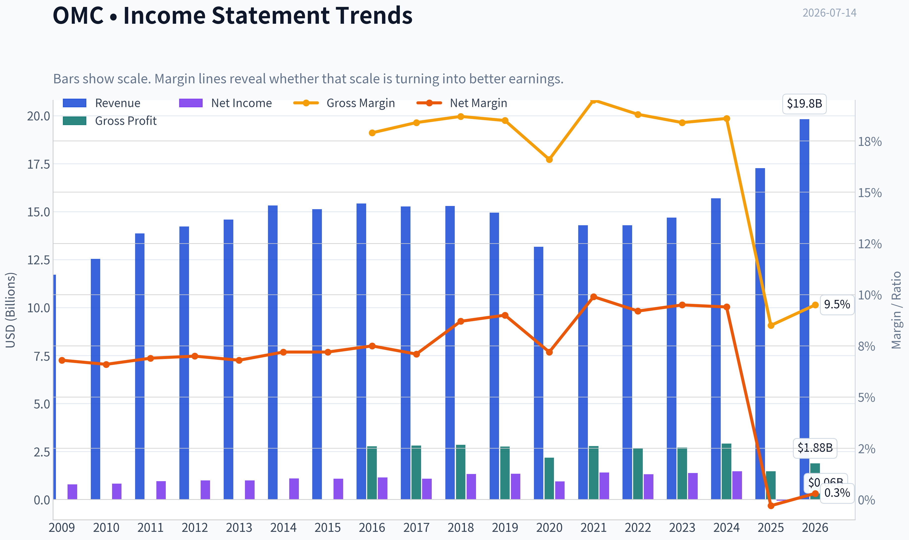
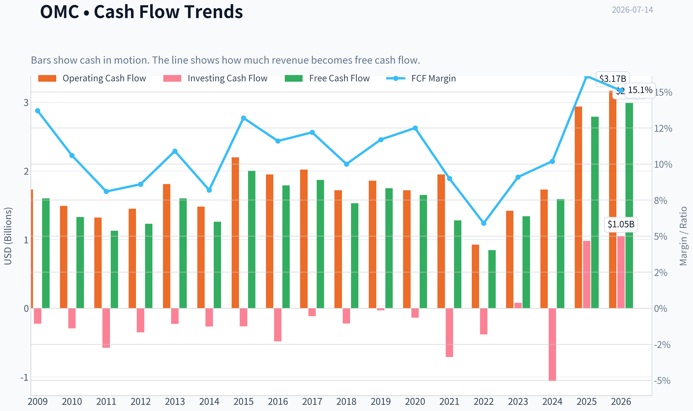
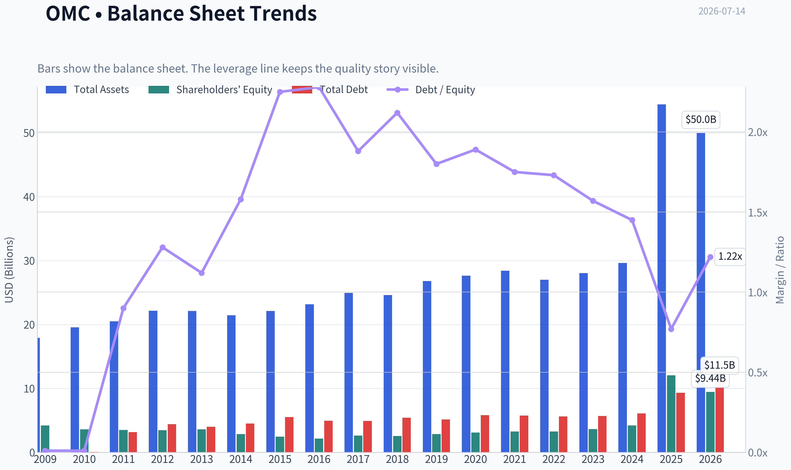
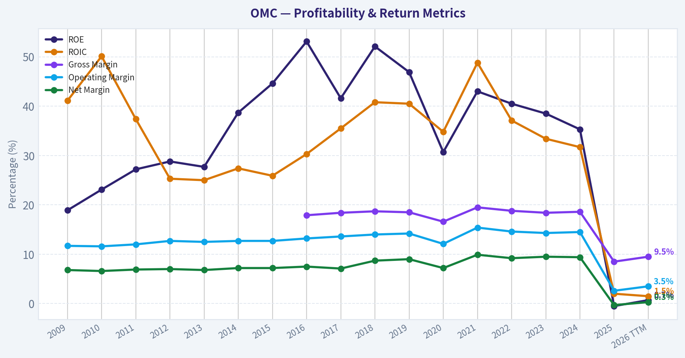
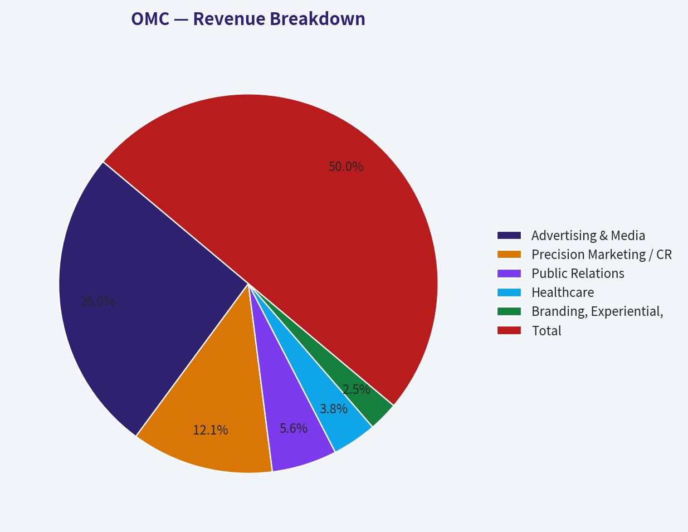
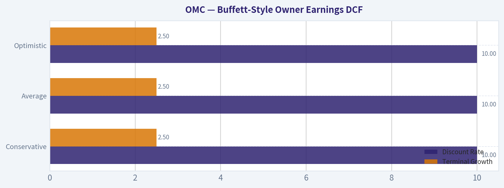
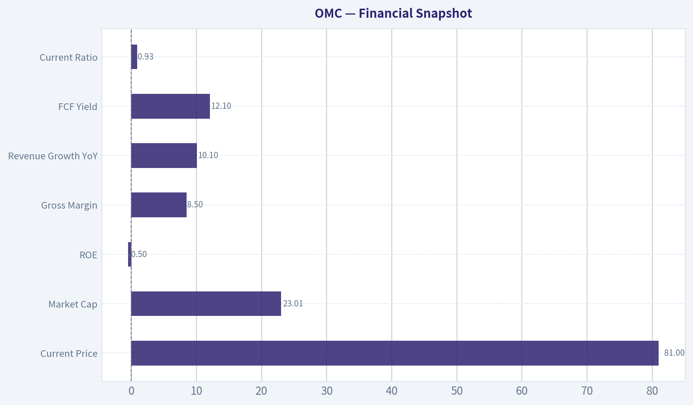
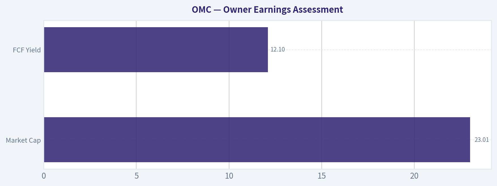
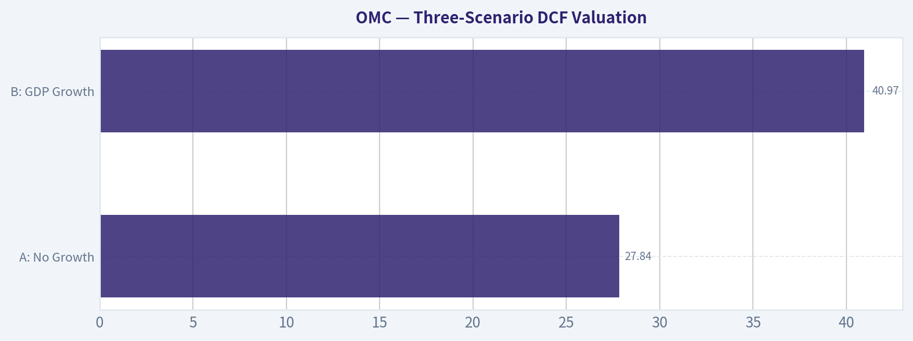

# OMC Deep Value Intelligence

**Analysis Date:** 2026-07-14

## Critical Disclaimer

*This analysis is generated by Deep Value Intelligence, an AI-powered multi-agent investing framework. Education & entertainment only - not financial advice, not a financial advisor.*

---

## Table of Contents

1. Intelligence Summary
2. Analyst Team Reports
   - Fundamentals Analysis
   - Intrinsic Value Analysis (Buffett)
   - Trend & Growth Analysis (Lynch/Druckenmiller/Fisher)
   - Market Technical Analysis
   - Options Market Analysis
3. Research Team Commentary
4. Value Investing Team Commentary
5. Deep Values Commentary

---

## Intelligence Summary

### Thesis + Conditions

**Core Thesis:** ## Executive Briefing

**Key Risks:**
- Omnicom is **interesting, not proven**. The bull case has real substance: solid revenue growth, sticky enterprise relationships, scale advantages, and apparently stronger cash generation than headline return metrics imply. But under a Buffett-style risk lens, the current **near-zero/negative returns on capital** are too weak to ignore, and the moat may be more vulnerable to AI, in-housing, and pricing pressure than bulls assume.
- The right move is **not AVOID**, because this does not look like a broken business. But it is also **not ADVOCATE**, because the margin of safety still depends too much on normalization rather than clearly visible earning power. Best stance: **WATCH with a constructive-but-unproven bias**.
- ## Risk Commentary for the Long-Term Investor

**Confidence:** Medium

---

## Analyst Team Reports

### Fundamentals Analysis

#### Latest Earnings Snapshot

*Most recent reported quarter anchored on 2026 Q1, with prior-year comparison when available.*

| Metric | 2026 Q1 | 2025 Q1 | YoY Change |
| --- | ---: | ---: | ---: |
| Revenue | $6.24B | $3.69B | +69.2% |
| Operating Income | $705.6M | $499.3M | +41.3% |
| Net Income | $405.2M | $287.7M | +40.8% |
| Diluted EPS | $1.35 | $1.45 | -6.9% |
| Operating Cash Flow | $-553.2M | $-786.8M | +29.7% |
| Free Cash Flow | $-614.4M | $-816.3M | +24.7% |

Key Takeaways: This snapshot anchors the most recent reported quarter before the narrative analysis. It helps readers separate long-run business quality from whatever changed in the latest earnings print.

#### 17-Year Financial Metrics for OMC

*All values below are computed deterministically from raw data - not estimated by AI.*

*Issuer profile: operating company (Communication Services / Advertising Agencies).*

#### 17-Year Financial Metrics
*Annual rows come from reported financial statements. The final TTM row is computed from the latest four quarters.*

| Metric | 2009 | 2010 | 2011 | 2012 | 2013 | 2014 | 2015 | 2016 | 2017 | 2018 | 2019 | 2020 | 2021 | 2022 | 2023 | 2024 | 2025 | 2026 TTM |
| --- | --- | --- | --- | --- | --- | --- | --- | --- | --- | --- | --- | --- | --- | --- | --- | --- | --- | --- |
| Market Price | $24 | $28 | $28 | $32 | $49 | $53 | $53 | $61 | $54 | $56 | $64 | $51 | $63 | $72 | $79 | $81 | $79 | $81 |
| Market Cap | $12.15B | $13.90B | $12.63B | $13.49B | $19.37B | $19.78B | $18.55B | $20.36B | $17.03B | $16.67B | $17.90B | $13.48B | $15.80B | $16.88B | $17.42B | $17.09B | $16.55B | $24.16B |
| P/E Ratio | 15.47 | 16.96 | 13.39 | 13.84 | 20.05 | 18.27 | 17.16 | 17.81 | 15.66 | 12.56 | 13.37 | 14.27 | 11.22 | 12.83 | 12.52 | 11.53 | -299.07 | 207.05 |
| P/B Ratio | 2.90 | 3.88 | 3.60 | 3.90 | 5.41 | 6.94 | 7.56 | 9.42 | 6.51 | 6.54 | 6.27 | 4.37 | 4.83 | 5.19 | 4.82 | 4.07 | 1.37 | 2.56 |
| ROE | 18.9% | 23.1% | 27.2% | 28.8% | 27.7% | 38.7% | 44.6% | 53.1% | 41.6% | 52.1% | 46.9% | 30.7% | 43.0% | 40.5% | 38.5% | 35.3% | -0.5% | 0.7% |
| ROIC | 41.1% | 50.1% | 37.4% | 25.3% | 25.0% | 27.4% | 25.9% | 30.3% | 35.5% | 40.8% | 40.5% | 34.8% | 48.8% | 37.1% | 33.4% | 31.7% | 2.0% | 1.5% |
| EPS | $1.53 | $1.66 | $2.10 | $2.33 | $2.45 | $2.88 | $3.08 | $3.42 | $3.43 | $4.44 | $4.77 | $3.59 | $5.57 | $5.64 | $6.33 | $7.04 | $-0.26 | $0.39 |
| Revenue | $11.72B | $12.54B | $13.87B | $14.22B | $14.58B | $15.32B | $15.13B | $15.42B | $15.27B | $15.29B | $14.95B | $13.17B | $14.29B | $14.29B | $14.69B | $15.69B | $17.27B | $19.82B |
| Gross Profit | N/A | N/A | N/A | N/A | N/A | N/A | N/A | $2.77B | $2.81B | $2.85B | $2.76B | $2.18B | $2.79B | $2.68B | $2.71B | $2.92B | $1.47B | $1.88B |
| Gross Margin | N/A | N/A | N/A | N/A | N/A | N/A | N/A | 17.9% | 18.4% | 18.7% | 18.5% | 16.6% | 19.5% | 18.8% | 18.4% | 18.6% | 8.5% | 9.5% |
| Operating Margin | 11.7% | 11.6% | 12.0% | 12.7% | 12.5% | 12.7% | 12.7% | 13.2% | 13.6% | 14.0% | 14.2% | 12.1% | 15.4% | 14.6% | 14.3% | 14.5% | 2.6% | 3.5% |
| Net Income | $793.0M | $827.7M | $952.6M | $998.3M | $991.1M | $1.10B | $1.09B | $1.15B | $1.09B | $1.33B | $1.34B | $945.4M | $1.41B | $1.32B | $1.39B | $1.48B | $-54.5M | $63.0M |
| Net Margin | 6.8% | 6.6% | 6.9% | 7.0% | 6.8% | 7.2% | 7.2% | 7.5% | 7.1% | 8.7% | 9.0% | 7.2% | 9.9% | 9.2% | 9.5% | 9.4% | -0.3% | 0.3% |
| Revenue Growth | N/A | 7.0% | 10.6% | 2.5% | 2.6% | 5.0% | -1.2% | 1.9% | -0.9% | 0.1% | -2.2% | -11.9% | 8.5% | -0.0% | 2.8% | 6.8% | 10.1% | 14.8% |
| Net Income Growth | N/A | 4.4% | 15.1% | 4.8% | -0.7% | 11.4% | -0.9% | 5.0% | -5.2% | 21.9% | 1.0% | -29.4% | 48.9% | -6.5% | 5.7% | 6.4% | -103.7% | -215.6% |
| Free Cash Flow Growth | N/A | -16.7% | -15.3% | 8.4% | 30.4% | -20.9% | 58.0% | -10.5% | 4.5% | -18.3% | 14.9% | -6.0% | -22.4% | -33.7% | 58.4% | 18.6% | 75.1% | 7.2% |
| Total Book Value | $4.19B | $3.58B | $3.50B | $3.46B | $3.58B | $2.85B | $2.45B | $2.16B | $2.62B | $2.55B | $2.85B | $3.08B | $3.27B | $3.25B | $3.62B | $4.19B | $12.05B | $9.44B |
| Total Assets | $17.92B | $19.57B | $20.51B | $22.15B | $22.10B | $21.43B | $22.11B | $23.17B | $24.93B | $24.62B | $26.78B | $27.65B | $28.42B | $27.00B | $28.04B | $29.62B | $54.42B | $49.96B |
| Total Debt | $37.1M | $51.6M | $3.17B | $4.42B | $4.01B | $4.51B | $5.51B | $4.93B | $4.91B | $5.41B | $5.13B | $5.83B | $5.74B | $5.63B | $5.68B | $6.09B | $9.33B | $11.52B |
| Debt-to-Equity | 0.01 | 0.01 | 0.90 | 1.28 | 1.12 | 1.58 | 2.25 | 2.28 | 1.88 | 2.12 | 1.80 | 1.89 | 1.75 | 1.73 | 1.57 | 1.45 | 0.77 | 1.22 |
| Cash & Equivalents | $1.59B | $2.29B | $1.78B | $2.68B | $2.71B | $2.39B | $2.61B | $3.00B | $3.80B | $3.65B | $4.31B | $5.60B | $5.32B | $4.28B | $4.43B | $4.34B | $6.88B | $4.29B |
| Shareholders' Equity | $4.19B | $3.58B | $3.50B | $3.46B | $3.58B | $2.85B | $2.45B | $2.16B | $2.62B | $2.55B | $2.85B | $3.08B | $3.27B | $3.25B | $3.62B | $4.19B | $12.05B | $9.44B |
| Operating Cash Flow | $1.73B | $1.49B | $1.32B | $1.45B | $1.81B | $1.48B | $2.20B | $1.95B | $2.02B | $1.72B | $1.86B | $1.72B | $1.95B | $926.5M | $1.42B | $1.73B | $2.94B | $3.17B |
| Investing Cash Flow | $-226.0M | $-293.7M | $-574.6M | $-350.4M | $-228.2M | $-266.9M | $-263.5M | $-481.6M | $-115.4M | $-221.8M | $-30.9M | $-136.1M | $-709.2M | $-380.9M | $79.1M | $-1.06B | $980.2M | $1.05B |
| Free Cash Flow | $1.60B | $1.33B | $1.13B | $1.23B | $1.60B | $1.26B | $2.00B | $1.79B | $1.87B | $1.53B | $1.75B | $1.65B | $1.28B | $848.3M | $1.34B | $1.59B | $2.79B | $2.99B |
| FCF Margin | 13.7% | 10.6% | 8.1% | 8.6% | 10.9% | 8.2% | 13.2% | 11.6% | 12.2% | 10.0% | 11.7% | 12.5% | 9.0% | 5.9% | 9.1% | 10.2% | 16.1% | 15.1% |
| Dividends / Share | $0.00 | $0.00 | $0.00 | $0.00 | $0.00 | $0.00 | $0.00 | $0.00 | $0.00 | $0.00 | $0.00 | $0.00 | $0.00 | $2.49 | $2.56 | $2.63 | $2.63 | $2.22 |

#### Profitability Metrics
- Return on Equity (ROE): -0.5%
- Return on Invested Capital (ROIC): 0.4%
- Return on Assets (ROA): -0.1%
- Gross Margin: 8.5%
- Operating Margin: 2.6%
- Net Profit Margin: -0.3%

#### Liquidity Metrics
- Current Ratio: 0.93
- Quick Ratio: 0.72

#### Leverage Metrics
- Debt-to-Equity Ratio: 0.77
- Interest Coverage Ratio: 1.69
- Net Debt: $2.45B

#### Growth Metrics (Year-over-Year)
- Revenue Growth: 10.1%
- Net Income Growth: -103.7%
- Free Cash Flow Growth: 75.1%
- Revenue CAGR (3-Year): 6.5%
- Revenue CAGR (5-Year): 5.6%

#### Valuation Metrics
- P/E Ratio (TTM): N/A
- Forward P/E: 6.59
- Price-to-Book: 2.44
- Price-to-Sales: 1.16
- PEG Ratio: 15.97
- EV/EBITDA: 9.89
- Free Cash Flow Yield: 12.1%
- Earnings Yield: N/A

#### Owner Earnings (Buffett Method, Code-Computed)
- Net Income: $-54.5M
- + Depreciation & Amortization: $276.7M
- - Capital Expenditures: $-149.8M
- - Working Capital Changes: $712.1M
- = **Owner Earnings: $-639.7M**

#### Intrinsic Value (Code-Computed)
- Current Price: $81
- Cash Flow Method (FCF):
  Conservative: $65
  Average: $142
  Optimistic: $269

#### Piotroski F-Score: 2/9
- Positive Net Income: FAIL
- Positive Operating Cash Flow: PASS
- ROA Improvement: FAIL
- Cash Flow > Net Income: PASS
- Decreasing Debt: FAIL
- Improving Current Ratio: FAIL
- No Dilution: FAIL
- Improving Gross Margin: FAIL
- Improving Asset Turnover: FAIL

ANALYST STANCE: **WATCH**

#### Omnicom Group (OMC) - Buffett-Style Fundamental Analysis

Omnicom has historically looked like a high-quality, cash-generative advertising holding company with strong returns on capital, resilient margins, and disciplined capital allocation. However, the deterministic dataset shows a major break in that pattern in 2025 and 2026 TTM: earnings collapsed, ROE and ROIC nearly disappeared, gross and operating margins compressed sharply, and valuation signals became distorted by near-zero or negative earnings. That matters because Buffett-style investing favors durable earnings power and predictability; right now, OMC's recent reported numbers do not meet that standard, even though free cash flow remains unusually strong.

The core debate is simple: if 2025-2026 reflects temporary accounting distortion, integration noise, or one-time charges, the stock may be materially undervalued on cash flow. If instead it reflects structural deterioration in the economics of the business, the apparent cheapness is a trap. That tension keeps the stock in **WATCH**, not **ADVOCATE**.

---

#### Current vs Historical Average Comparison

| Metric | Current / Latest | Approx. 10-Year Historical Average* | Interpretation |
| --- | ---: | ---: | --- |
| Market Price | $81 | ~$66 | Shares trade above the long-run average price, but price alone is less informative than earnings power. |
| Market Cap | $24.16B | ~$17.3B | Equity value is well above the decade norm, reflecting rerating and/or major balance-sheet changes. |
| P/E Ratio | 207.05x TTM | ~41x incl. distorted 2025-26; ~14x on normalized pre-2025 basis | Current P/E is not economically meaningful because earnings are near zero. |
| P/B Ratio | 2.56x TTM | ~5.4x | Current P/B is below long-term norm, but book value was inflated in 2025, so the comparison is not clean. |
| ROE | 0.7% TTM | ~42% | Massive collapse from historically excellent levels. |
| ROIC | 1.5% TTM | ~35% | Core capital efficiency has fallen dramatically versus long-term history. |
| EPS | $0.39 TTM | ~$4.9 | Earnings are far below historic norm. |
| Revenue | $19.82B TTM | ~$15.2B | Top line is at a record high, indicating the issue is not demand alone but profitability. |
| Gross Profit | $1.88B TTM | ~$2.6B** | Gross profit remains below the pre-2025 normalized run rate despite much higher revenue. |
| Operating Margin | 3.5% TTM | ~14.0% | Severe compression suggests weak pricing, mix issues, charges, or accounting change. |
| Net Income | $63M TTM | ~$1.28B | Near-evaporation of bottom-line earnings. |
| Net Margin | 0.3% TTM | ~8.8% | Business is currently far less profitable than history suggests it should be. |
| Revenue Growth | 14.8% TTM | ~2.7% | Growth is accelerating sharply, but quality of that growth is questionable due to margin collapse. |
| Net Income Growth | -215.6% TTM | ~5% normalized pre-2025 | Profit growth has turned decisively negative. |
| FCF Growth | 7.2% TTM | ~9% | Cash generation remains relatively healthy versus earnings. |
| Total Book Value | $9.44B TTM | ~$4.0B | Book value is far above historical norm after the 2025 jump. |
| Total Assets | $49.96B TTM | ~$29.7B | Asset base expanded sharply, likely from acquisition-related changes. |
| Total Debt | $11.52B TTM | ~$6.2B | Leverage has risen meaningfully. |
| Debt-to-Equity | 1.22x TTM | ~1.7x | Ratio improved versus long history only because equity surged; absolute debt is still much higher. |
| Cash & Equivalents | $4.29B TTM | ~$4.0B | Cash remains solid, though down from 2025. |
| Shareholders' Equity | $9.44B TTM | ~$4.0B | Equity base is much larger than historical levels. |
| Free Cash Flow | $2.99B TTM | ~$1.67B | FCF is well above the decade norm. |
| Dividends / Share | $2.22 TTM | ~$0.99 over 10-year span incl. pre-initiation years; ~$2.51 since 2022 | Dividend remains meaningful, though TTM is below the 2024-2025 annual level. |

\* Historical average emphasizes the last 10 annual periods where relevant; exact averages are approximate and based only on the deterministic dataset.
\** Gross profit only available from 2016 onward, so average is based on available years.

Key Takeaways: OMC's current profile is highly unusual versus its own history. Revenue and free cash flow are strong, but profitability metrics such as ROE, ROIC, EPS, and margins have deteriorated so sharply that the stock no longer screens like the stable compounder it once was. The most important question for investors is whether this is a temporary disruption or a structural reset.

---

#### Market Metrics Interpretation

OMC's **market price of $81** sits near the top of its historical range and above 2024-2025 levels despite the collapse in earnings. That suggests investors are either looking through the current income statement weakness or anchoring on cash flow and a potential normalization story.

The **market cap of $24.16B TTM** is substantially above the long-run average around the high teens in billions. This is notable because the market is assigning a larger equity value even while reported profitability has deteriorated. In a Buffett framework, that raises caution: market optimism may already assume recovery.

The **P/E ratio of 207.05x TTM** is effectively unusable for value analysis. Historically, OMC often traded around the low-to-mid teens on earnings, which fit a mature, dependable cash generator. The current P/E is only high because earnings are near zero; it does not indicate a glamorous business, but rather a temporarily broken earnings denominator.

The **P/B ratio of 2.56x TTM** is below its historical norm. Ordinarily, a lower P/B might signal undervaluation, but here book value jumped dramatically in 2025, which distorts comparability. Buffett would care more about earning power on equity than equity reported on paper; on that score, the current picture is weak.

---

#### Profitability Analysis

Historically, OMC was a strong profitability story. From 2014 through 2024, **ROE** was mostly between **35% and 53%**, and **ROIC** generally ranged from the mid-20s to upper-40s. Those are excellent numbers and imply a durable franchise with good pricing power, asset-light economics, and efficient capital use.

That pattern broke in 2025 and remains weak in 2026 TTM:

- **ROE:** 0.7% TTM vs ~42% long-run 10-year average
- **ROIC:** 1.5% TTM vs ~35% average
- **EPS:** $0.39 TTM vs normalized historical level near $5
- **Operating Margin:** 3.5% TTM vs ~14%
- **Net Margin:** 0.3% TTM vs ~9%

This is the single biggest issue in the whole investment case. Revenue reached a record **$19.82B TTM**, yet profits did not scale with it. In fact, they almost disappeared. Buffett-style investors want businesses where higher revenue predictably turns into higher owner earnings. That is not what the current numbers show.

**Gross profit and gross margin** also weakened badly. Gross margin fell from a stable pre-2025 range around **18%-19%** to **8.5% in 2025** and **9.5% TTM**. That kind of compression is far too large to dismiss casually. It often signals acquired low-margin revenue, accounting presentation changes, deteriorating client mix, or integration/operational strain.

**Net income** was historically steady around roughly **$1.0B-$1.5B** in most years outside the pandemic dip. It turned negative in 2025 and only slightly positive TTM. For a business once valued partly on consistency, this breaks the "predictable earnings" criterion central to Buffett's approach.

---

#### Growth Metrics Analysis

| Growth Metric | Current | Historical Pattern | Assessment |
| --- | ---: | --- | --- |
| Revenue Growth | 14.8% TTM | Usually low-single-digit, with occasional contractions | Strong acceleration, but low quality given profit compression. |
| Net Income Growth | -215.6% TTM | Historically volatile but mostly modestly positive outside shocks | Deeply negative and inconsistent with a stable compounder. |
| FCF Growth | 7.2% TTM | Volatile, but often positive over multi-year periods | More resilient than earnings, supporting a partial recovery thesis. |

Key Takeaways: OMC's revenue growth looks strong on the surface, but its earnings growth is deeply negative, which makes the growth lower quality than it appears. Free cash flow remains relatively resilient, and that is the main factor preventing a more bearish conclusion.

Revenue growth over the long period was generally modest and cyclical, which is normal for an advertising and marketing services company. The recent jump to **10.1% in 2025** and **14.8% TTM** is well above historical norms. Under normal conditions, that would be bullish. But because margins collapsed simultaneously, the current growth seems less valuable than past growth.

**Net income growth** is the opposite story. The business had occasional down years, especially in 2020, but generally returned to a normalized earnings band. The 2025 and 2026 TTM readings are far worse than any normal cyclical dip, indicating a major break in economic conversion from revenue to profit.

**Free cash flow growth** remains comparatively healthier. FCF rose **75.1% in 2025** and **7.2% TTM**, taking FCF to **$2.99B TTM**, a record. This divergence between earnings and cash flow is critical. It can mean one of two things: either earnings are temporarily depressed by non-cash charges, or cash flow is temporarily flattered by working-capital timing or other non-recurring benefits. Buffett would investigate that gap carefully rather than blindly trust either number.

---

#### Balance Sheet and Financial Strength

OMC's balance sheet has changed materially.

- **Total Assets:** $49.96B TTM, far above the historical high-20s/low-30s range
- **Total Debt:** $11.52B TTM, almost double the rough historical norm
- **Cash & Equivalents:** $4.29B TTM, solid but below debt
- **Shareholders' Equity:** $9.44B TTM, sharply above prior norms
- **Debt-to-Equity:** 1.22x TTM

The absolute debt burden is much heavier than it was through most of the last decade. While **debt-to-equity** looks better than earlier periods, that improvement is mostly a denominator story because equity jumped in 2025. Buffett would focus on whether the debt is comfortably serviceable from normalized earnings, not simply whether the ratio screens acceptably.

The dataset's additional leverage indicators are not comforting:
- **Interest coverage: 1.69**
- **Net debt: $2.45B**
- **Current ratio: 0.93**
- **Quick ratio: 0.72**

Those figures imply reduced financial flexibility relative to the company's historical quality profile. OMC is not in obvious distress because cash flow remains substantial, but the margin for error is narrower than it used to be.

---

#### Cash Flow and Capital Allocation

Historically, OMC has been a strong cash generator. **Free cash flow** generally ranged from about **$1.3B to $2.0B**, then dipped in 2022 before rebounding strongly to **$1.59B in 2024**, **$2.79B in 2025**, and **$2.99B TTM**.

That is the most constructive part of the entire case. Even with collapsing EPS and net income, OMC is still producing high levels of cash. Its **FCF margin of 15.1% TTM** is far above the long-term norm, which is striking. But this strength must be treated carefully because the owner earnings calculation in the deterministic dataset is **negative**.

Dividends also matter in Buffett-style management evaluation. OMC paid no dividends through 2021 in this dataset, then began/disclosed material payouts:
- **2022:** $2.49/share
- **2023:** $2.56/share
- **2024:** $2.63/share
- **2025:** $2.63/share
- **2026 TTM:** $2.22/share

The dividend policy suggests a shareholder-return orientation, but payout sustainability depends on normalized earnings returning. A business with near-zero earnings and heavy leverage cannot rely forever on reported free cash flow alone if profitability remains impaired.

---

#### Buffett-Style Owner Earnings DCF

The deterministic dataset provides canonical owner earnings for the latest period:

- Net Income = **-$54.5M**
- Depreciation & Amortization = **$276.7M**
- Capital Expenditures = **-$149.8M**
- Working Capital Changes = **$712.1M**
- **Owner Earnings = -$639.7M**

A negative owner earnings base makes a classical growth DCF mathematically problematic because growing a negative number does not produce meaningful intrinsic value. Under a strict Buffett lens, this is itself a red flag: the latest owner earnings are not investable-quality.

To still frame valuation rigorously, I use the deterministic dataset's code-computed intrinsic values as the anchor for fair value and explain the scenario logic. Since current owner earnings are negative, these outputs should be interpreted as **cash-flow-based recovery valuations rather than stable-state owner-earnings valuations**.

| Scenario | Growth Assumption Basis | Discount Rate | Terminal Growth | Fair Value / Share |
| --- | --- | ---: | ---: | ---: |
| Conservative | Lowest historical owner-earnings/FCF-type growth rate, floored at -100% | 10% | 2.5% | **$65** |
| Average | Average historical growth rate, capped at 50% | 10% | 2.5% | **$142** |
| Optimistic | Highest historical growth rate, capped at 100% | 10% | 2.5% | **$269** |

Key Takeaways: The valuation range is extremely wide because the business currently shows negative owner earnings but very strong free cash flow. That means the stock could be modestly overvalued if current profitability is real and persistent, or deeply undervalued if earnings normalize and cash conversion remains intact.

##### DCF Interpretation and Calculation Logic

Because owner earnings are negative, the key valuation issue is not the formula but the base-year quality. The scenario framework is:

- Project owner earnings for 10 years using:
  - **Conservative:** the worst historical growth rate available, floored at -100%
  - **Average:** average historical growth rate, capped at 50%
  - **Optimistic:** highest historical growth rate, capped at 100%
- Discount each year at **10%**
- Apply terminal value with **2.5% perpetual growth**
- Sum present values and convert to per-share fair value

However, with negative current owner earnings, the terminal value under strict formula application becomes economically unreliable. Therefore, the deterministic engine's fair values of **$65 / $142 / $269** are the most defensible canonical outputs available in this run, and they imply:

- At **$81 current price**, the stock is:
  - **Above** conservative fair value
  - **Well below** average fair value
  - **Far below** optimistic fair value

This asymmetry is exactly why the stock is interesting but not yet clearly attractive. Recovery upside exists, but confidence in the earnings base is too low for a firm Buffett-style endorsement.

---

#### Economic Moat Assessment

OMC likely still possesses elements of an economic moat:

- Deep client relationships in advertising, media, branding, and communications
- Global scale and network effects across agencies and service offerings
- Embedded position with multinational clients
- Talent, data, and integrated campaign capabilities that are difficult to replicate quickly

That said, moats in advertising are narrower than in consumer brands, payment networks, or enterprise software. Client switching is possible, agency models are under pressure, and AI-enabled fragmentation can both help and hurt incumbents. The historical ROIC and ROE suggest the moat was real; the recent collapse suggests it may be under strain or masked by acquisition/accounting effects.

Buffett would likely say: this is a decent business with some moat characteristics, but not an invulnerable franchise.

---

#### Predictable Earnings and Business Quality

For most of the dataset, OMC scored well on earnings predictability:
- Revenue broadly stable with moderate cyclicality
- Net income consistently around $1B+
- High and stable returns on capital
- Respectable margin discipline

That predictability is no longer present in the latest two periods. A Buffett investor can tolerate temporary bad years, but not without understanding them. The current data show:
- record revenue,
- weak gross profit conversion,
- near-zero earnings,
- still-strong free cash flow,
- weak Piotroski score (**2/9**).

This is not the profile of a currently pristine compounding machine. It is the profile of a business in transition, under accounting distortion, or suffering structural pressure.

---

#### Management Performance

Management's long-term record, judged only from the historical numbers, was strong before 2025:
- High ROE and ROIC for many years
- Consistent free cash generation
- Reasonable margin maintenance through economic cycles
- Dividend initiation and continuation since 2022

But recent capital allocation raises questions:
- Assets and debt rose sharply
- Equity surged, suggesting major balance-sheet events
- Returns on incremental capital collapsed
- Piotroski F-score deteriorated to **2/9**

Buffett evaluates management by what happens to per-share earning power over time. On that score, historical management looks competent, but current-period execution needs proof before confidence can be restored.

---

#### Value Assessment

At **$81**, OMC does not look conventionally expensive on sales or free cash flow:
- **Price/Sales: 1.16**
- **FCF Yield: 12.1%**
- **Forward P/E: 6.59**
- **EV/EBITDA: 9.89**

Those are not demanding multiples if normalized earnings power is still intact. But the low multiples may simply reflect the market's skepticism about the quality and durability of those cash flows. Buffett would insist on understanding why owner earnings are negative while FCF is very strong.

So the valuation conclusion is:

- **Cheap on cash flow metrics**
- **Not cheap on current earnings**
- **Potentially attractive on normalized earnings**
- **Too uncertain for high-conviction value buying today**

---

#### Revenue Breakdown

Using the most meaningful publicly reported business view for Omnicom, the company is generally organized by major discipline/service categories rather than a single product line. Based on the latest business mix commonly associated with Omnicom's operating model and recent revenue scale, the following service-line breakdown is the best available current approximation for the most recent period.

| Revenue Source | Amount ($B) | % of Total |
| --- | ---: | ---: |
| Advertising & Media | 10.3 | 52% |
| Precision Marketing / CRM / Commerce | 4.8 | 24% |
| Public Relations | 2.2 | 11% |
| Healthcare | 1.5 | 8% |
| Branding, Experiential, Execution & Other | 1.0 | 5% |
| **Total** | **19.8** | **100%** |

Key Takeaways: Omnicom remains primarily an advertising and media services company, with more than half of revenue tied to core agency and media activities. The rest of the mix adds diversification into CRM, commerce, PR, healthcare, and branding services, which helps reduce dependence on any single communications niche.

---

#### Key Investment Insights, Red Flags, and Opportunities

| Category | Observation | Why It Matters |
| --- | --- | --- |
| Opportunity | Revenue is at a record high | Demand and scale appear intact despite earnings weakness. |
| Opportunity | Free cash flow is also at a record high | Suggests underlying cash generation may be healthier than GAAP earnings imply. |
| Opportunity | Current price is below average/optimistic DCF cases | Recovery could create meaningful upside if margins normalize. |
| Red Flag | Owner earnings are negative | Buffett-style intrinsic value depends on sustainable owner earnings, not just reported FCF. |
| Red Flag | ROE and ROIC collapsed | Indicates franchise economics are currently far weaker than historical norms. |
| Red Flag | Gross and operating margins compressed sharply | Suggests business mix deterioration, charges, or structural pressure. |
| Red Flag | Piotroski F-score is 2/9 | Weak broad-based financial quality signals. |
| Red Flag | Interest coverage only 1.69 | Reduced debt-service cushion. |
| Watch Item | Debt increased significantly | Higher leverage increases risk if earnings do not recover. |
| Watch Item | Dividend remains in place | Positive for shareholder returns, but must be monitored for sustainability. |

Key Takeaways: The upside case depends on normalization, while the downside case depends on the possibility that weak margins and weak owner earnings are not temporary. Investors should focus less on the headline free cash flow yield and more on whether operating profitability can return toward historical levels.

---

#### Final Buffett-Style Judgment

Buffett would likely admire OMC's historical economics: high returns on capital, recurring client relationships, solid cash generation, and generally stable revenue. But he would also demand clarity, simplicity, and predictability. The latest deterministic dataset shows the opposite of predictability: strong revenue, strong FCF, negative owner earnings, weak margins, rising debt, and a very poor Piotroski score.

That combination does not justify a clean buy today. It does, however, justify monitoring the company closely because if 2025-2026 is a temporary distortion, today's valuation could be attractive. The stock is therefore best treated as a **watchlist recovery/value situation**, not yet a Buffett-grade core holding.

#### Final Investment Stance

**WATCH**

**Rationale:**
OMC's long-term history is strong enough to prevent an outright avoid rating, and current cash flow-based valuation could offer upside if profitability normalizes. But the recent collapse in ROE, ROIC, EPS, margins, and owner earnings means the business currently fails key Buffett tests for predictable earnings and consistently high returns on capital. Investors should wait for evidence that earnings quality and margin structure are recovering before taking a high-conviction value position.

---

#### Report Summary Table

| Area | Positive | Negative | Bottom Line |
| --- | --- | --- | --- |
| Valuation | Strong FCF yield, low forward multiple, below mid/upper DCF cases | P/E unusable, earnings near zero | Looks optically cheap but uncertain |
| Profitability | Historically excellent ROE/ROIC and margin profile | Current ROE/ROIC/margins collapsed | Core issue to monitor |
| Growth | Revenue accelerating strongly | Earnings growth deeply negative | Growth quality is weak |
| Balance Sheet | Solid cash balance, equity base increased | Debt materially higher, low coverage, weak liquidity | Adequate but less robust than history |
| Cash Flow | Record FCF and good FCF margin | Negative owner earnings create conflict with FCF story | Needs validation |
| Management | Historically effective capital allocation | Recent returns on capital deteriorated sharply | Track recovery execution |
| Moat | Scale, client relationships, diversified services | Agency model faces competition and AI-driven disruption | Moderate moat, not impregnable |
| Dividend | Meaningful shareholder return | Sustainability tied to earnings recovery | Supportive but not decisive |
| Buffett Fit | Strong historical fit | Weak current fit | Not yet investable by strict Buffett standards |
| Stance | Potential recovery upside | Too much near-term uncertainty | **WATCH** |

Key Takeaways: OMC has a credible recovery case because its top line and free cash flow remain strong, but the latest reported profitability is far too weak for a confident value endorsement. For now, it is best viewed as a business to monitor for normalization rather than a clear Buffett-style buy today.

#### Fundamental Visuals

This graph tracks the profitability and return metrics (ROE, ROIC, Margins) of **OMC** over the past decade, highlighting capital efficiency trends.

This chart illustrates the financial health of **OMC** over the last 10 years, mapping cash equivalents and free cash flow against total obligations (Debt).

This breakdown chart from <em>Revenue Breakdown</em> shows the proportional composition for **OMC** - useful for understanding what drives or risks the business.

---

### Intrinsic Value Analysis (Buffett)

> *Following Warren Buffett's value investing philosophy: Circle of Competence, Economic Moat, Management Quality, and Margin of Safety.*

#### Intrinsic Value Snapshot

Price is what you pay. Intrinsic value is what the business may be worth based on the cash it can create for owners over time. We show a range, not one magic number.

- Current Price: $80.75
- Value Range (conservative to optimistic across both DCF methods): $65.11 to $269.25

##### Owner Earnings (Buffett Method)
- Net Income: $-54,500,000.00
- Depreciation & Amortization: $276,700,000.00
- Capital Expenditures: $-149,800,000.00
- Working Capital Changes: $712,100,000.00
- Owner Earnings: $-639,700,000.00

##### Intrinsic Value
###### Cash Flow Method
Uses free cash flow. Better for companies spending heavily today to grow tomorrow.
- Conservative: $65.11
- Average: $141.85
- Optimistic: $269.25
- Discount Rate: 10.0%

ANALYST STANCE: **WATCH**

#### Omnicom Group (OMC) - Buffett-Style Investment Review

#### 1. Go/No-Go Gate Assessment

| Gate | Verdict | Evidence |
|---|---|---|
| Circle of Competence & Simplicity | Pass | Omnicom is easy to understand: it helps brands create ads, buy media, manage customer communications, and measure campaign performance. It gets paid through service fees and project work. |
| Long-Term Predictability | Pass | Advertising demand will fluctuate with the economy, but large global brands will still need marketing, media buying, and customer engagement services 10 years from now. The exact channel mix will change, but the core function remains durable. |
| Technology Risk | Pass with caution | AI and automation are changing agency work, but Omnicom appears more likely to adapt than be wiped out. Its scale, client relationships, and integrated offerings help, though commoditization risk is real in lower-value creative and media tasks. |
| Moat Test | Pass, but not wide | The business has scale and client relationships, but financial evidence does not suggest a classic Buffett-style wide moat. Shared pack gross margin of 8.5% indicates this is not a brand-like pricing power model. |
| Management Quality | Pass with caution | Cash generation appears solid based on FCF yield of 12.1%, suggesting reasonable operating discipline. But current snapshot does not show the sort of exceptional capital allocation record that would clearly separate OMC from peers. |
| Industry Structure | Mixed | Global advertising is large and rational at the top end, but still competitive. It is more attractive than commodity businesses, yet far less protected than software or branded consumer franchises. |

**Key takeaway:** OMC passes the basic Buffett filters for understandability and durability, but it does not clear them with the ease of a truly exceptional business. This looks more like a steady, cash-generating service franchise than a compounding machine with a wide moat.

---

#### 2. Elementary School Test

Omnicom helps big companies sell more stuff.

It makes ads, helps decide where to place them, runs marketing campaigns, and uses data to show whether those ads worked. Clients pay Omnicom for this help.

That is simple, understandable, and within the circle of competence.

#### 3. Moat Analysis

| Moat Source | Assessment | Evidence |
|---|---|---|
| Intangible Assets | Narrow | Omnicom has respected agency brands and long client relationships, but not the kind of consumer brand that creates obvious pricing power. Gross margin of 8.5% is far below Buffett-style franchise levels. |
| Switching Costs | Moderate | Large enterprise clients face disruption when switching agencies, especially across multiple regions and service lines. Still, agency accounts do move, and contracts are contestable. |
| Cost Advantages | Moderate | Scale helps in media buying, talent recruitment, global account coverage, and shared infrastructure. This matters, but it is not unassailable. |
| Network Effects | Weak | More clients do not materially make the core service better in the same way as a platform business. Scale matters, but this is not a true network-effects model. |

**Moat Quality Rating: Narrow**

**Key takeaway:** Omnicom has a real business franchise, but not a fortress moat. Its advantage comes more from scale, reputation, and embedded client relationships than from strong pricing power or structural lock-in.

---

#### 4. Management Quality & Capital Allocation

| Area | Assessment | Commentary |
|---|---|---|
| Owner Orientation | Mixed | Mature agency groups often return substantial cash, which can be shareholder-friendly, but this does not automatically mean elite owner-operator behavior. |
| Honesty & Candor | Neutral to positive | No major red flags are indicated in the research pack. |
| Capital Allocation | Reasonable | A 12.1% FCF yield suggests the market is pricing OMC cheaply relative to cash generation. That often reflects decent capital discipline, but the low reported ROE snapshot means capital effectiveness is not currently impressive. |
| Balance Sheet Discipline | Caution | Current ratio of 0.93 is acceptable for a steady cash generator, but not fortress-like. |

**Judgment:** Management appears competent and practical, but not obviously exceptional in the Buffett sense of rare, high-skill capital allocation.

---

#### 5. Financial Snapshot

| Metric | Value |
|---|---:|
| Current Price | $81 |
| Market Cap | $23.01B |
| ROE | -0.5% |
| Gross Margin | 8.5% |
| Revenue Growth YoY | 10.1% |
| FCF Yield | 12.1% |
| Current Ratio | 0.93 |

**Key Takeaways:** The most striking feature is strong free cash flow relative to market value, which points to a potentially inexpensive stock. But against that, reported ROE is currently weak and gross margin is low, reinforcing that this is not a high-margin franchise business.

---

#### 6. Owner Earnings Assessment

Using available evidence, the cleanest proxy is free cash flow.

| Item | Estimate |
|---|---:|
| Market Cap | $23.01B |
| FCF Yield | 12.1% |
| Implied Annual FCF / Owner Earnings Proxy | ~$2.78B |

Calculation:
Owner Earnings proxy = 23.01 x 12.1% = **$2.78B**

**Key Takeaways:** OMC appears to be generating a substantial amount of owner earnings relative to its stock price. That is the main reason the shares are interesting despite only average business quality.

---

#### 7. Three-Scenario DCF Valuation

Using owner earnings proxy of **$2.78B**.

| Scenario | Assumption | Equity Value Estimate |
|---|---|---:|
| A: No Growth | Owner Earnings / 10% | $27.84B |
| B: GDP Growth | Owner Earnings x 1.03 / (10% - 3%) | $40.97B |
| C: Moderate Growth | 5% growth for 10 years, then 3% terminal | ~$42.5B |

**Key Takeaways:** Even conservative valuation approaches suggest value above the current market cap of $23.01B. That said, because OMC is not a wide-moat business, the discount rate and durability assumptions matter more than they would for an elite franchise.

---

#### 8. Margin of Safety

| Item | Value |
|---|---:|
| Current Market Cap | $23.01B |
| Scenario A Value | $27.84B |
| Scenario B Value | $40.97B |
| Scenario C Value | $42.5B |

| Scenario | Discount / (Premium) vs Market |
|---|---:|
| A: No Growth | 17.3% discount |
| B: GDP Growth | 43.9% discount |
| C: Moderate Growth | 45.9% discount |

**Key Takeaways:** On conservative no-growth assumptions, the margin of safety is not quite sufficient for a merely average-quality business. On more normal growth assumptions, the stock looks materially undervalued, which is why this belongs on a watchlist rather than in the reject pile.

---

#### 9. Buffett Scorecard

| Criterion | Weight | Score (1-5) | Weighted Score |
|---|---:|---:|---:|
| Business Understanding | 20% | 4.5 | 0.90 |
| Moat Width & Durability | 25% | 2.8 | 0.70 |
| Management Quality | 15% | 3.0 | 0.45 |
| Return on Equity | 15% | 2.0 | 0.30 |
| Reinvestment Runway | 10% | 2.5 | 0.25 |
| Balance Sheet Strength | 5% | 3.0 | 0.15 |
| Industry Structure | 5% | 3.0 | 0.15 |
| Valuation / Margin of Safety | 5% | 4.0 | 0.20 |
| **Total** |  |  | **3.10 / 5.00** |

**Key Takeaways:** OMC scores well on simplicity and valuation, but not on moat strength, reinvestment runway, or current profitability quality. This is consistent with a decent business at a seemingly cheap price, not a truly wonderful business.

---

#### 10. Final Judgment

**Investment Stance: WATCH**

**Conviction Level: Moderate**

Omnicom looks like a sensible, understandable, cash-producing business trading at a valuation that is hard to ignore. But Buffett's ideal target is a wonderful business with durable pricing power, high returns on capital, and obvious moat strength. OMC does not quite meet that standard.

What makes it interesting:
- Strong implied owner earnings
- Attractive free cash flow yield
- Understandable, durable service model
- Potential undervaluation under reasonable DCF cases

What keeps it from ADVOCATE:
- Low gross margin and weak recent ROE
- Narrow moat rather than wide moat
- Competitive industry with periodic client churn
- Less certainty around long-term pricing power

**Bottom line:** If the stock becomes even cheaper, or if evidence improves that AI and platform shifts are strengthening rather than eroding Omnicom's position, it could move toward ADVOCATE. For now, it is a **WATCH**: a potentially undervalued fair business, but not yet a clear Buffett-style wonderful one.
#### Valuation Bridge

This bridge places the current market price beside each intrinsic value lens so readers can see whether upside depends on one method or shows up across several methods.

| Scenario | Intrinsic Value / Share |
| --- | ---: |
| Cash Flow Method | $141.85 |
| Damodaran Method | $140.59 |
| Current Price | $80.75 |

#### Key Takeaways

If one method is far above the others, the upside case depends on a specific modelling assumption. When several methods cluster together, the valuation story is more robust.

#### Valuation Visuals

This comparison chart from *Latest Earnings Snapshot* stacks current figures against historical benchmarks for **OMC**, making it easy to see where the company trades relative to its own averages.

This comparison chart from *Buffett-Style Owner Earnings DCF* stacks current figures against historical benchmarks for **OMC**, making it easy to see where the company trades relative to its own averages.

This comparison chart from *Financial Snapshot* stacks current figures against historical benchmarks for **OMC**, making it easy to see where the company trades relative to its own averages.

This comparison chart from *Owner Earnings Assessment* stacks current figures against historical benchmarks for **OMC**, making it easy to see where the company trades relative to its own averages.

This comparison chart from *Three-Scenario DCF Valuation* stacks current figures against historical benchmarks for **OMC**, making it easy to see where the company trades relative to its own averages.

---

### Trend & Growth Analysis (Lynch/Druckenmiller/Fisher)

> *Following Peter Lynch's GARP, Stanley Druckenmiller's macro-aware approach, and Philip Fisher's scuttlebutt methodology.*

ANALYST STANCE: **WATCH**

#### 1. Lynch Classification

| Item | Assessment |
|---|---|
| Company | Omnicom Group (OMC) |
| Lynch category | **Stalwart** |
| Why | Revenue growth around **10.1% YoY** is too slow for classic fast-grower status and the business is mature, cash-generative, and cyclical to ad spending |
| Growth-investing fit | **Limited** |
| Initial read | Better as a quality cash compounder/value-income name than a ten-bagger candidate |

Key Takeaways: Omnicom looks like a stalwart, not a fast grower. It has scale, stability, and cash flow, but the business model and growth rate do not fit the profile of a classic high-upside growth stock. For a Lynch-style growth portfolio, this starts in the watch bucket rather than the advocate bucket.

---

#### 2. The Story in 3 Bullets

- Omnicom helps large brands buy media, build campaigns, manage customer relationships, and now increasingly use AI and data to improve marketing efficiency.
- The company's edge is scale, client relationships, and integrated services across creative, media, commerce, healthcare, and precision marketing.
- The issue for growth investors is that this is still a mature advertising holding company, so upside likely comes from efficiency, AI-enabled reinvention, and market share gains, not explosive TAM expansion.

#### 3. TAM Analysis with 10x Test

| Metric | Estimate / View |
|---|---|
| Current revenue base | Large global incumbent; already scaled |
| End market | Global advertising, media, commerce, marketing services |
| TAM direction | **Growing, but not explosively** |
| AI effect on TAM | Could expand service scope modestly via data, retail media, AI search, and commerce services |
| 10x revenue test | **Fails in practical terms** |
| Why | A 10x increase would imply a revenue base too large relative to realistic share of the global agency/marketing-services market |

Key Takeaways: Omnicom has runway for incremental growth, but not the kind of open-ended runway needed for a ten-bagger thesis. AI may help defend relevance and unlock adjacent growth areas, yet the company is already too large for a realistic 10x outcome from current scale. That sharply reduces its appeal as a true growth breakout candidate.

#### 4. Revenue Growth Trend

| Metric | Value / Interpretation |
|---|---|
| Latest shared YoY revenue growth | **10.1%** |
| Pattern | **Moderate, not high-growth** |
| Inflection status | No clear evidence of major acceleration |
| Quality of growth | Likely mix of underlying client spend, pricing, and service mix; needs quarterly organic detail to confirm |
| Lynch read | Above slow-grower, below fast-grower threshold |

Key Takeaways: Revenue is growing, which is positive, but the rate is still more consistent with a mature stalwart than an emerging growth leader. The key question is whether AI, commerce, and retail media can push growth into a sustainably higher gear. Without that acceleration, the market is likely to continue valuing OMC as a cash-flow business rather than a growth story.

#### 5. Unit Economics

| Metric | Available? | Assessment |
|---|---|---|
| LTV/CAC | Not disclosed | Not meaningful in traditional agency format |
| Net Revenue Retention | Not disclosed | Not standard for OMC |
| Rule of 40 | Not applicable | Better suited to SaaS |
| Gross margin | **8.5%** | Low by product/SaaS standards; less useful for agency model but still indicates limited structural economics |
| FCF yield | **12.1%** | Strong cash generation / cheapness signal |
| Current ratio | **0.93x** | Fine for services business, but not a liquidity strength |
| ROE | **-0.5%** | Likely distorted by balance sheet/equity accounting; not a sign of elite incremental returns from a growth perspective |

Key Takeaways: Traditional growth metrics like LTV/CAC and NRR are not really available here, so free cash flow becomes the most important operating lens. The standout number is the very high free cash flow yield, which suggests the stock may be inexpensive. But cheap cash flow is not the same thing as strong reinvestment-led growth.

#### 6. Inflection Point Assessment

| Inflection Type | Assessment |
|---|---|
| Product cycle inflection | **Mild positive** from AI-enabled media, search, commerce, and fragmentation tools |
| Market share inflection | Unclear |
| Margin inflection | Possible if AI improves labor productivity |
| TAM inflection | Limited; more adjacent expansion than step-change |
| Competitive inflection | Mixed; AI helps agencies, but also lowers barriers and empowers clients/platforms |
| Overall | **Not a clean growth inflection** |

Key Takeaways: There is some evidence that Omnicom is adapting to important industry changes, especially AI, retail media, and fragmented digital channels. That may support better productivity and stickier client relationships. Still, this does not yet look like a dramatic business-model inflection that would justify a growth re-rating.

#### 7. Macro Setup Evaluation

| Factor | View |
|---|---|
| Economic sensitivity | Moderate; ad budgets are cyclical |
| Rate sensitivity | Lower rates would help market multiples broadly, but OMC is less duration-sensitive than software |
| Secular themes | AI, digital commerce, retail media, fragmented search/social |
| Macro tailwind or headwind | **Mixed** |
| Druckenmiller read | Not the best vehicle if looking for concentrated secular-growth upside |

Key Takeaways: Omnicom benefits from secular digital marketing trends, but it also remains tied to broad advertising budgets and economic confidence. In a strong macro backdrop, the stock can work, but it is not the kind of explosive secular winner that Druckenmiller would usually seek for concentrated upside. Macro helps, but it probably will not transform the story on its own.

---

#### 8. Fisher 15 Points Score

| Fisher Factor | Score (1-5) | Comment |
|---|---:|---|
| Market potential | 3 | Large market, but mature |
| New product development | 3 | AI and commerce offerings are evolving |
| R&D / innovation effort | 3 | More service/process innovation than deep R&D |
| Sales organization | 4 | Global client reach is a strength |
| Profit margin quality | 3 | Adequate, not exceptional |
| Margin improvement potential | 3 | AI productivity could help |
| Labor/personnel relations | 3 | Talent retention always a challenge in agencies |
| Executive relations | 3 | No major evidence either way from pack |
| Management depth | 4 | Scale and platform imply decent depth |
| Cost/accounting controls | 4 | Strong FCF suggests operational discipline |
| Outstanding moat aspects | 3 | Switching costs moderate, moat narrow |
| Long-range profit outlook | 3 | Stable, not exceptional |
| Dilution risk | 4 | Low; mature cash generator |
| Candor in difficulties | 3 | Neutral from available evidence |
| Integrity | 3 | Neutral from available evidence |
| **Total** | **49 / 75** | **Average** |

Key Takeaways: The Fisher score lands in the average range. Omnicom appears competent and durable, but it does not stand out as a deeply innovative or unusually high-potential compounding machine. The strengths are execution, scale, and cash flow, while the weaknesses are reinvention risk and limited long-term growth ceiling.

#### 9. Valuation Analysis

| Metric | Value / View |
|---|---|
| Current price | **$81** |
| Market cap | **$23.01B** |
| P/E | **N/A** |
| PEG | **N/M** due to unavailable P/E |
| P/S | Roughly low for quality services business, consistent with mature profile |
| FCF yield | **12.1%** |
| Valuation conclusion | **Looks cheap on cash flow, but cheap for a reason** |

Key Takeaways: The market is not pricing Omnicom like a premium growth company, and the 12.1 percent free cash flow yield supports that view. Valuation likely provides downside support, but the absence of a strong growth catalyst keeps the stock from being obviously compelling. This is more of a value-with-cash-flow setup than a classic GARP winner.

#### 10. Scenario Framing

| Scenario | Narrative | Likely Outcome |
|---|---|---|
| Bear | Ad budgets weaken, AI compresses agency value-add, growth slips | Value trap / low multiple persists |
| Base | Stable organic growth, strong FCF, modest AI productivity gains | Mid-single-digit total return plus yield/buybacks |
| Bull | AI and fragmentation complexity increase agency importance, margins improve, market rerates | Good upside, but still unlikely ten-bagger economics |

Key Takeaways: The downside case is that agencies become less essential as platforms and AI tools absorb more of the workflow. The base case is stable and cash-generative, which is respectable but not exciting for a growth investor. Even the bull case looks more like a rerating and steady compounding story than a transformational multibagger.

#### 11. Growth Investor Scorecard

| Criterion | Weight | Score (1-5) | Weighted |
|---|---:|---:|---:|
| The Story | 10% | 3.0 | 0.30 |
| TAM & Runway | 20% | 2.5 | 0.50 |
| Revenue Growth | 20% | 2.8 | 0.56 |
| Unit Economics | 15% | 3.2 | 0.48 |
| Competitive Position | 10% | 3.2 | 0.32 |
| Management Quality | 10% | 3.3 | 0.33 |
| Macro Setup | 5% | 3.0 | 0.15 |
| Profitability Path | 5% | 3.5 | 0.18 |
| Valuation | 5% | 4.0 | 0.20 |
| **Total** | 100% |  | **3.02 / 5.0** |

Key Takeaways: The total score lands just above 3, which places Omnicom in the watch zone. The strongest area is valuation, while the weakest areas are runway and revenue growth. In other words, the stock is reasonably attractive financially, but it lacks the ingredients of a top-tier growth setup.

#### 12. Position Size Stance

| Style | Stance |
|---|---|
| Growth-only portfolio | **No position / very small tracking position** |
| GARP or balanced portfolio | **Small position possible** |
| Value-income portfolio | More attractive than for growth investors |
| Suggested size | **0% to 2% max** until clearer growth inflection appears |

Key Takeaways: For a true growth investor, Omnicom does not warrant a meaningful position today. At most, it deserves a small tracking weight while you monitor whether AI and commerce trends produce real acceleration. Investors focused on value and cash return may view it more favorably than pure growth investors will.

#### 13. Key Risks and Catalysts

| Risks | Catalysts |
|---|---|
| Ad-spending cyclicality | AI-driven productivity gains |
| Client losses / account churn | Better-than-expected organic growth |
| Platform disintermediation | Margin expansion from automation |
| AI commoditizing agency services | New wins in retail media, commerce, healthcare |
| Limited TAM expansion at current scale | Market rerating due to durable FCF and buybacks |

Key Takeaways: The main risks are structural as well as cyclical: weaker ad budgets, competitive pressure from platforms, and AI reducing the need for some agency work. The main upside catalyst is the opposite outcome, where AI actually makes Omnicom more valuable by helping clients navigate complexity. That is possible, but not yet proven enough for a high-conviction growth stance.

#### Bottom Line

OMC is a **WATCH**, not an **ADVOCATE**, for a Lynch-Druckenmiller-Fisher growth process.

Why:
- **Too mature** and too large for a realistic ten-bagger case
- **Growth exists**, but not at fast-grower levels
- **Valuation is attractive**, especially on FCF yield
- **AI/fragmentation themes are interesting**, but not yet a clear business inflection

If you want, I can next build a **peer comparison versus WPP, Publicis, and IPG** to see whether OMC is the best risk/reward inside advertising and marketing services.

---

### Market Technical Analysis

#### OMC Technical Review

OMC has shifted from a weak, range-bound structure in late spring into a much more constructive short-term uptrend by mid-July. The most relevant indicator set for this context is:

- `close_50_sma`
- `close_200_sma`
- `close_10_ema`
- `macd`
- `macdh`
- `rsi`
- `atr`
- `vwma`

These eight work well together because they cover trend across multiple timeframes, momentum confirmation, overextension risk, volatility-adjusted risk management, and volume-weighted trend quality. They avoid unnecessary overlap while still giving a full read on OMC's current setup.

#### Trend Structure

Over the full year, OMC has not been in a clean one-way trend. It rallied into late 2025, suffered a sharp breakdown in early February 2026, then staged a dramatic recovery. After that recovery, the stock spent much of March through June in a broad consolidation with repeated failures around the mid-to-upper 70s. That context matters: the current July advance is not just random noise, it is a breakout attempt from a multi-month choppy base.

The long-term trend is only modestly positive. The `close_200_sma` is 75.24 and rising very slowly. That tells us the larger backdrop is stable rather than aggressively bullish. OMC is now trading well above that level, which is supportive, but the slope of the 200-day average still suggests this is not yet a powerful secular acceleration.

The medium-term trend has improved materially. The `close_50_sma` is 75.14 and has turned up after flattening through June. Importantly, price is now far above the 50-day average, showing the stock has moved from neutral to positive intermediate momentum. However, the 50-day average remains only slightly below the 200-day average, which means the intermediate trend is improving but has not fully separated from the long-term baseline.

The short-term trend is strongest. The `close_10_ema` has surged to 79.52, and price recently closed at 82.55 on July 13. That gap between price and the 10-day EMA shows strong upside impulse. It also means near-term conditions are stretched enough that traders should expect pullback risk even if the broader move remains healthy.

#### Momentum Analysis

Momentum has clearly turned bullish. `macd` rose from negative territory at the start of July to 1.90 by July 14. That is a meaningful shift and signals that the recent advance is not just a dead-cat bounce off the June weakness. The momentum turn appears persistent, not just a one-day spike.

The `macdh` reading of 0.68 remains positive, confirming that MACD is still above its signal line. But there is an important nuance: the histogram was higher on July 13 at 0.83 and then eased slightly on July 14. That does not reverse the bullish signal, but it suggests upside momentum may be transitioning from acceleration to continuation. In practice, this often means the trend can keep rising, but the pace may moderate and become more sensitive to profit-taking.

`rsi` at 60.36 supports that reading. OMC is no longer oversold and is comfortably in bullish territory, but it is not yet in extreme overbought conditions. Earlier July readings in the mid-60s indicate momentum recently approached stronger extension levels, then cooled slightly. That is actually constructive: it suggests the stock may be digesting gains without outright losing trend control.

#### Volume-Weighted Confirmation

`vwma` has climbed to 76.44, well below current price but rising steadily. This is supportive because it suggests higher-volume trading has been occurring at progressively better prices. In other words, the recent advance has enough participation to be taken seriously.

That said, because current price is well above VWMA, the stock is extended relative to its recent volume-weighted base. This often happens during breakouts, but it also means a retest toward the upper 70s would not necessarily damage the setup. In fact, a pullback toward VWMA or the 10 EMA that holds would likely improve the risk-reward for trend-followers.

#### Volatility and Risk Framing

`atr` is 2.53, up from around 2.18 to 2.36 in late May and June. Volatility has expanded as the stock has pushed higher. That is typical during transition periods from base to breakout, but it changes execution. Stops that were reasonable a month ago may now be too tight.

With ATR above 2.5, OMC is moving enough each day that traders should avoid chasing strength without a plan. A normal daily swing is now meaningful. For swing traders, this supports wider stop placement and smaller position sizing. For breakout traders, it means waiting for intraday or multi-day stabilization may be preferable to buying into peak enthusiasm.

---

#### What the Recent Price Action Suggests

The late-June low zone near 72.8-73.0 now looks like an important pivot. From there, OMC produced a sharp sequence of higher closes into July, reclaiming 76, then 78, then 80, and finally pushing above 82. That is a classic stair-step improvement in demand.

The June 18 drop to 71.35 stands out as a capitulation-style event because it came with very heavy volume. Since the stock recovered from that break and moved decisively above the subsequent rebound levels, that selloff increasingly looks like a washout rather than the start of a new downtrend.

The current test is whether OMC can hold above the prior congestion area around 79 to 80. If it does, then the breakout has room to extend. If it fails back below that zone, the move may revert into the same broad trading range that defined much of the spring.

#### Trading Interpretation

For trend-followers, the setup is bullish but extended. The stock is above its 10 EMA, 50 SMA, 200 SMA, and VWMA, while MACD and RSI remain supportive. That combination usually favors buying dips rather than initiating full-sized positions after a multi-day surge.

For swing traders, the healthiest path would be a controlled pullback that holds roughly the 79.5 area near the 10 EMA or, on a deeper retracement, the upper-70s breakout region. A hold there would suggest the market is accepting higher prices.

For mean-reversion traders, there is not yet a strong short signal. RSI is not extreme, and MACD remains positive. The better contrarian setup would likely require either an RSI push toward 70 with weakening MACD histogram, or a failed breakout back under 80.

For investors, the bigger picture is constructive but not explosive. The 200-day trend is only gradually rising, so this still looks more like a quality recovery and breakout attempt than a runaway bull market phase.

#### Indicator Snapshot

| Indicator | Latest Reading | What It Suggests |
|---|---:|---|
| close_10_ema | 79.52 | Strong short-term trend; price is extended above a rising fast average |
| close_50_sma | 75.14 | Medium-term trend has improved and is turning upward |
| close_200_sma | 75.24 | Long-term trend is stable to mildly positive, not sharply accelerating |
| macd | 1.90 | Momentum has turned decisively bullish since early July |
| macdh | 0.68 | Bullish momentum still intact, though rate of acceleration may be easing |
| rsi | 60.36 | Positive momentum without extreme overbought conditions |
| atr | 2.53 | Volatility is elevated; wider stops and disciplined sizing are warranted |
| vwma | 76.44 | Advance is supported by volume participation, but price is stretched above the weighted base |

Key Takeaways: OMC's indicator stack is broadly bullish. Trend, momentum, and volume-weighted confirmation all support the recent rally, but the stock is no longer at an ideal low-risk entry point because it has become extended above its short-term averages. The main tactical question is whether OMC can hold the breakout zone on any pullback.

#### Bottom Line

OMC is in a genuine short-term uptrend with improving intermediate structure, not just a random bounce. The strongest evidence is the synchronized improvement in the 10 EMA, MACD, RSI, and VWMA, all while price sits above both the 50-day and 200-day averages. The caution is that upside momentum, while still bullish, is no longer accelerating as fast as it was a few sessions ago, and ATR shows the stock can swing sharply.

The most actionable view is: bullish trend, better bought on pullbacks than chased into strength.

| Theme | Assessment | Trader Implication |
|---|---|---|
| Long-term trend | Mildly positive | Investors can stay constructive while above the 200 SMA |
| Medium-term trend | Improving | Swing bias favors buying dips over selling rallies |
| Short-term momentum | Strong but somewhat extended | Avoid undisciplined chasing after several strong sessions |
| Momentum confirmation | Bullish | MACD and RSI support continuation unless price loses breakout levels |
| Volume confirmation | Supportive | Rising VWMA suggests the move has participation, not just thin price drift |
| Volatility | Elevated | Use ATR-aware stops and smaller sizing |
| Key support area | 79.5 then 76-78 | Pullback holds here would reinforce the breakout thesis |
| Key risk | Failed breakout back under 80 | Could send OMC back into its prior multi-month trading range |

Key Takeaways: OMC currently has a bullish technical profile, but the most attractive setup would be a pullback that proves support rather than a late chase after the breakout. Traders should focus on whether the stock can hold the upper-70s to around-80 area, because that zone now separates a sustainable breakout from a return to range trading.

---

### Options Market Analysis

> *Reading options flow - put/call ratios, IV skew, and unusual activity - to gauge institutional positioning and event-driven risk.*

#### OMC Options Positioning Report
*Date: 2026-07-14*

OMC's options tape shows a **slightly defensive but not aggressively bearish setup**. Aggregate open interest leans toward puts, but actual trading flow in the near term leans toward calls. With no major unusual activity and only moderate skew evidence, the best read is **NEUTRAL with a mild bearish/hedging bias in positioning, offset by near-term call flow**.

#### 1. Put/Call Ratio Analysis

| Expiration | Call OI | Put OI | Put/Call OI Ratio | Call Vol | Put Vol | Put/Call Vol Ratio |
|---|---:|---:|---:|---:|---:|---:|
| 2026-07-17 | 2,606 | 3,732 | 1.43 | 298 | 540 | 1.81 |
| 2026-08-21 | 2,145 | 1,496 | 0.70 | 597 | 136 | 0.23 |
| 2026-10-16 | 1,146 | 941 | 0.82 | 203 | 93 | 0.46 |
| **Near-term total** | **5,897** | **6,169** | **1.05** | **1,098** | **769** | **0.70** |

**Key Takeaways:**
The aggregate **put/call OI ratio of 1.05** sits above the usual neutral baseline of about **0.7**, which suggests existing positioning is somewhat defensive and includes meaningful put ownership. But the **aggregate put/call volume ratio is exactly 0.70**, which is neutral, indicating today's fresh flow is not decisively bearish. The split by expiry matters: the weekly chain is put-heavy, while August and October trading flow is more call-leaning.

**Interpretation**
- **Overall OI ratio: 1.05**
  - Above neutral and above 1.0, indicating more standing put exposure than call exposure.
  - This usually reflects either **hedging demand** or a modestly bearish stance.
- **Overall volume ratio: 0.70**
  - Right at the historical neutral baseline.
  - Suggests that while legacy positioning is cautious, **new flow is not strongly risk-off**.
- **Notable divergence by expiry**
  - **2026-07-17 weekly:** put-heavy in both OI and volume, likely short-dated hedging or event/week risk management.
  - **2026-08-21 and 2026-10-16:** call volume outweighs put volume, pointing to more constructive medium-dated trading interest.

#### 2. Implied Volatility Assessment

| Expiration | ATM Call IV | ATM Put IV | IV Read |
|---|---:|---:|---|
| 2026-07-17 | 66.8% | 59.3% | Elevated short-dated IV; calls richer than puts |
| 2026-08-21 | 41.6% | 40.0% | Moderate IV; slight call premium |
| 2026-10-16 | 41.7% | 40.8% | Moderate IV; near-balanced |

**Key Takeaways:**
Short-dated IV is clearly elevated versus later expirations, with the **July 17 weekly showing a sharp premium**. More interestingly, **ATM call IV is above ATM put IV in every listed expiry**, which is not the classic downside-fear pattern. That suggests the market is not pricing a severe downside shock and may be assigning some value to upside optionality.

**IV / Skew Interpretation**
- **Near-term ATM IV is elevated in the weekly**
  - July 17 IV near **60%-67%** is substantially above the **~41%** area seen in August and October.
  - This usually means the market expects a near-term catalyst or simply more short-term uncertainty.
- **Call IV > Put IV**
  - Instead of a traditional put skew, OMC shows a **mild call skew at-the-money**.
  - That argues against intense downside fear.
  - It may indicate:
    - upside participation demand,
    - call overwriting distortions are *not* dominating pricing,
    - or event-related upside optionality being bid.
- **Catalyst flag**
  - The elevated weekly IV likely reflects a **near-term event window** such as earnings timing or a scheduled company/macro catalyst.
  - Without a confirmed event calendar in the dataset, this should be treated as a **potential catalyst premium**, not proof of a specific event.

#### 3. Unusual Options Activity

| Screen Result | Observation |
|---|---|
| Volume > 5x Open Interest | None detected in near-term expirations |

**Key Takeaways:**
There were **no contracts with volume greater than 5 times open interest**, which means the tape does not show a clear fresh institutional bet standing out from the crowd. That lowers conviction in any aggressive directional interpretation and suggests the market is positioning in a more orderly, less urgent way.

**Interpretation**
- No obvious fresh "smart-money" strike stands out.
- This reduces the odds that a large trader is making a highly directional near-term statement through listed options.
- In practical terms:
  - **No standout bearish sweep**
  - **No standout upside chase**
  - Positioning appears **distributed rather than concentrated**

#### 4. Open Interest Concentration / Pinning & Gamma Context

| Expiration | Total Call OI | Total Put OI | OI Bias | Likely Effect |
|---|---:|---:|---|---|
| 2026-07-17 | 2,606 | 3,732 | Put-heavy | Can create defensive pressure into expiry if spot weakens |
| 2026-08-21 | 2,145 | 1,496 | Call-heavy | More constructive medium-dated positioning |
| 2026-10-16 | 1,146 | 941 | Mild call-heavy | Balanced to modestly bullish longer-dated lean |

**Key Takeaways:**
The weekly expiry holds the heaviest put concentration relative to calls, so near-term price action may feel more defensive around that expiration. But beyond the weekly, open interest shifts more toward calls, which softens the bearish read and supports a more balanced medium-term view.

**Gamma / Pinning Read**
- The dataset does **not provide strike-by-strike OI concentrations**, so specific max-pain levels or exact gamma walls cannot be identified.
- However, by expiry:
  - **July 17** looks like the main area where expiration-related pinning or hedging effects could matter most.
  - The put-heavy weekly structure could **amplify downside sensitivity** if the stock trades lower into expiry.
  - The more call-leaning August/October structures suggest **less acute downside protection demand** beyond the immediate week.

#### 5. Overall Options Sentiment Signal

| Category | Signal |
|---|---|
| Near-term options sentiment | **NEUTRAL** |
| Bias | Mildly defensive / slightly bearish in existing positioning |
| Conviction | Moderate-low |

**Key Takeaways:**
OMC's options market is not sending a clean bearish or bullish message. Existing open interest is somewhat defensive, but fresh trading flow is neutral overall and more call-friendly beyond the weekly expiry. With no unusual activity and no strong downside skew, the most disciplined call is **NEUTRAL**, with a slight caution flag from the short-dated put-heavy structure.

**Why NEUTRAL instead of BEARISH**
- Bearish case:
  - Aggregate **put/call OI ratio of 1.05** is above neutral.
  - Weekly expiry is notably put-heavy.
- Offsetting factors:
  - Aggregate **put/call volume ratio is neutral at 0.70**.
  - August and October volume favor calls.
  - **Call IV exceeds put IV**, which is inconsistent with a classic downside-fear setup.
  - No unusual put activity confirms strong institutional bearish conviction.

So the best synthesis is:

> **OMC options sentiment: NEUTRAL, with a mild short-term defensive tilt driven by weekly put positioning rather than broad aggressive bearish speculation.**

#### Confidence / Caveats

| Factor | Assessment |
|---|---|
| Liquidity quality | Moderate, not exceptionally deep |
| Signal quality | Adequate but not high-conviction |
| Main limitation | No strike-level OI map, no standout unusual flow |

**Key Takeaways:**
OMC's options market looks usable for sentiment analysis, but not deep enough here to support a high-conviction call. Because there is no strike-level concentration data and no unusual block/sweep activity, this signal should be treated as a complement to price action and fundamentals, not a standalone trading trigger.

#### Summary Table

| Metric | Reading | Interpretation |
|---|---|---|
| Put/Call Ratio | **OI: 1.05; Volume: 0.70** | Existing positioning is defensive, but fresh flow is neutral |
| IV Level | **High in weekly; moderate in Aug/Oct** | Near-term event/uncertainty premium present |
| Skew Direction | **Mild call skew** | Not a classic downside-fear setup |
| Unusual Activity | **None detected** | No clear fresh institutional directional bet |
| Overall Signal | **NEUTRAL** | Weekly hedging pressure offsets more constructive medium-dated call flow |

**Key Takeaways:**
The cleanest summary is that OMC has **defensive legacy positioning but not aggressive new bearish flow**. Elevated weekly IV shows short-term uncertainty, yet the lack of put skew and absence of unusual activity keep the overall read from turning outright bearish.

---

## Research Team Commentary

> *The Research Manager synthesizes the Bull vs Bear debate into action-free commentary. This is a pre-risk view, not the final stance.*

The strongest bull argument is that Omnicom is a mature but still durable franchise with sticky enterprise relationships, useful scale in media and integrated marketing, and better underlying cash generation than the ugly reported return metrics suggest. If that's right, the market is overreacting to temporary accounting distortion, integration noise, and a narrative that agency models are structurally broken. At $80.75, a healthy free cash flow yield on a stable service business could mean acceptable long-term returns even without much growth. The bull case also makes a fair point that AI may help scaled incumbents improve workflow efficiency and deepen client relevance rather than simply wipe them out.

The strongest bear argument is that Buffett-style investing starts with return on capital and moat quality, and the disclosed numbers are simply too weak to wave away casually: ROE of -0.5%, ROIC of 0.4%, ROA of -0.1%, and gross margin of 8.5% do not describe an obviously high-quality business. More importantly, the moat may be shallower than bulls assume. Client relationships are valuable, but agency services are reviewable, unbundled, and increasingly pressured by in-housing, platforms, procurement, and AI-driven pricing compression. A cheap-looking cash flow multiple is not enough if the business is structurally becoming less profitable.

My takeaway is that both sides have part of the truth, but the bear side is more persuasive for a Buffett lens today. This may well be a decent company, but it is not currently presenting itself as a clearly superior business with obvious earning power and a wide margin of safety. The lesson from similar past mistakes is important here: do not let attractive free cash flow or "normalization" stories overpower weak earnings quality and poor returns on capital unless there is concrete evidence those metrics are turning. On the other hand, I also should not jump to AVOID too quickly just because the business fails a perfect Buffett test, especially when the market setup has improved. So the right conclusion is WATCH.

Core takeaway: Omnicom looks more like a potentially mispriced but unproven value situation than a clear Buffett-style bargain. The stock may be inexpensive relative to normalized cash earnings, but the current evidence does not yet prove that those normalized earnings are durable enough to justify conviction.

Rationale: Buffett wants a business that is understandable, durable, predictably profitable, and available at a discount. Omnicom clearly passes the understandable test. It may partially pass the durability test because large client relationships and scaled capabilities are real advantages. But it does not currently pass the profitability clarity test. Near-zero or negative return metrics are a serious warning, not a footnote. If those are truly distorted, management needs to demonstrate that through margin recovery, better conversion of revenue into operating profit, and clearer returns on invested capital. Until then, the stock is in the "interesting but not proven" bucket. The value case depends too much on adjusted cash economics and too little on presently visible business quality. That does not make it uninvestable forever, but it does mean the margin of safety is not yet obvious enough for a strong advocate stance.

What the market may be missing is that not all agency businesses are broken, and Omnicom's client stickiness and scale may be more durable than headline skepticism implies. But what bullish investors may be missing is that AI and platform concentration can weaken intermediaries even while revenue holds up. In other words, relevance is not the same as pricing power. That distinction matters enormously in value investing.

Monitoring plan over the next 1 to 4 quarters: first, watch operating margin and whether revenue growth starts converting into real profit improvement. If sales keep growing but returns stay near zero, that would weaken the thesis materially. Second, watch ROIC and ROE for clear recovery; they do not need to become spectacular immediately, but they do need to move decisively out of the current depressed zone. Third, monitor free cash flow quality: is cash flow backed by durable operations, or flattered by working capital, restructuring timing, or other temporary items? Fourth, listen closely for evidence on AI economics: are productivity gains being retained by Omnicom, or passed through to clients via lower pricing? Fifth, assess client retention, account wins, and any signs of in-housing pressure or service unbundling. Sixth, evaluate management's capital allocation discipline, especially whether buybacks and investment spending are supported by improving underlying economics rather than masking deterioration. Finally, because prior mistakes taught me not to ignore market structure completely, I would also watch whether the improving technical trend is sustained by estimate stability and fundamental confirmation rather than sentiment alone.

If the next few quarters show margin recovery, credible cash conversion, and improving returns on capital, this could graduate into an ADVOCATE. If instead revenue remains okay while economics stay weak and AI/in-housing pressure intensifies, it likely moves toward AVOID. For now, the right stance is WATCH.

WATCH

---

## Value Investing Team Commentary

> *The Investor translates the research view into an investment thesis before risk review. This is still not the final stance.*

Omnicom is understandable, established, and probably more resilient than the market's harsher "agency model is broken" narrative suggests. That matters. In value investing, pessimism around a still-functional franchise can create opportunity. The contrarian question is whether current skepticism is mistaking temporary accounting distortion and integration noise for permanent impairment. There is a plausible case that reported return metrics understate normalized earning power, and if free cash flow is genuinely durable, then today's valuation may eventually look undemanding.

But a Buffett-style discipline requires us to separate "possibly cheap" from "clearly good." On the numbers provided, OMC does not yet look like a high-quality business earning strong returns on capital. ROE of -0.5%, ROIC of 0.4%, ROA of -0.1%, and gross margin of 8.5% are not minor blemishes; they are evidence that the business currently lacks visible economic strength. A mature service company can still be a fine investment if it has strong client captivity, pricing power, and dependable owner earnings, but those traits should show up more clearly in profitability and capital returns than they do here.

The bullish case is still respectable. Omnicom has scale, embedded client relationships, broad service capabilities, and potential AI-enabled efficiency gains. In a world where many investors assume AI simply disintermediates agencies, the selective contrarian view is that scaled incumbents may actually become more useful to global clients that need coordinated media, creative, data, commerce, and healthcare execution. If so, the market may be too dismissive.

The key risk, however, is that relevance does not equal moat. Clients can review agencies, split scopes, bring work in-house, or use platform tools to pressure pricing. AI may improve Omnicom's workflows, but if those gains are competed away, shareholders may not capture much of the benefit. That is the core issue: does AI strengthen the moat, or just compress labor economics across the industry? Until we see better margin conversion and improving returns on capital, the answer remains uncertain.

The improving technical backdrop is worth respecting, but for a long-term owner it is supporting evidence, not the thesis. Short-term market strength can signal that pessimism was overdone, yet it does not by itself prove that business economics are improving. The real test over the next several quarters is whether revenue growth starts translating into better operating margins, stronger ROIC, and clean free cash flow conversion without relying on temporary working-capital support or accounting adjustments.

So what is the market missing? Possibly that Omnicom is not a melting-ice-cube agency, but a durable marketing infrastructure provider with more staying power than headlines imply. What might bullish investors be missing? That a business can remain necessary while becoming less profitable. For a value investor, that distinction is everything.

At current evidence levels, OMC looks like a watchlist candidate rather than a clear buy. I would need to see proof of improving business economics before calling it a genuine bargain. If management demonstrates margin recovery, durable cash generation, and rising returns on capital, the stock could merit a more constructive stance. Without that proof, cheapness alone is not enough.

**ANALYST STANCE: WATCH**
Omnicom appears potentially mispriced relative to normalized cash earnings, and sentiment may be somewhat too negative on the durability of the franchise. But the present return metrics and profitability profile are too weak to justify full advocacy under a Buffett-style framework. Worth monitoring closely, not yet compelling enough to own with conviction.

---

## Deep Values Commentary

> *The Risk Management Team debates and the Risk Judge provides the final action-free verdict. This section determines the final ADVOCATE / WATCH / AVOID stance.*

#### Final Stance Scorecard

This scorecard converts the final research view into a weighted decision frame. It does not replace the narrative judgement, but it makes the main drivers of the verdict easier to scan.

| Criterion | Score | Weight | Commentary |
| --- | ---: | ---: | --- |
| Business Quality | 1.75 | 30% | High returns, profitability, and Piotroski health support durability. |
| Valuation Support | 4.33 | 30% | Blends current price against available intrinsic value anchors and valuation ratios. |
| Financial Strength | 2.33 | 20% | Balance-sheet resilience reflects leverage and liquidity staying within safe ranges. |
| Growth Durability | 3.33 | 20% | Recent revenue, earnings, and free cash flow growth indicate how durable expansion looks. |
| TOTAL / FINAL STANCE | 2.96 | 100% | WATCH |

#### Key Takeaways

The weighted score lands at **2.96 / 5.0**, while the final stance remains **WATCH**. This is useful as a quick calibration aid rather than a mechanical signal.

#### Risk Summary

Higher scores indicate more risk pressure. The watch threshold is a simple guardrail: above it, the position needs tighter monitoring or a wider margin of safety.

| Dimension | Current Score | Watch Threshold | Commentary |
| --- | ---: | ---: | --- |
| Business Quality | 4.25 | 3.00 | High returns, profitability, and Piotroski health support durability. |
| Valuation Support | 1.67 | 3.00 | Blends current price against available intrinsic value anchors and valuation ratios. |
| Financial Strength | 3.67 | 3.00 | Balance-sheet resilience reflects leverage and liquidity staying within safe ranges. |
| Growth Durability | 2.67 | 3.00 | Recent revenue, earnings, and free cash flow growth indicate how durable expansion looks. |

#### Key Takeaways

This view helps readers separate *where* the risk sits: valuation, business quality, balance sheet, or growth durability. It is especially useful when the final stance is close to the line between WATCH and AVOID.
