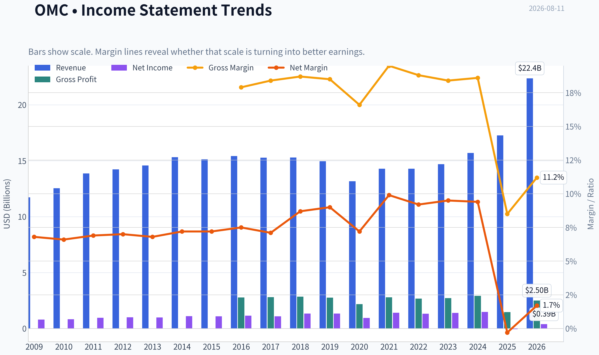
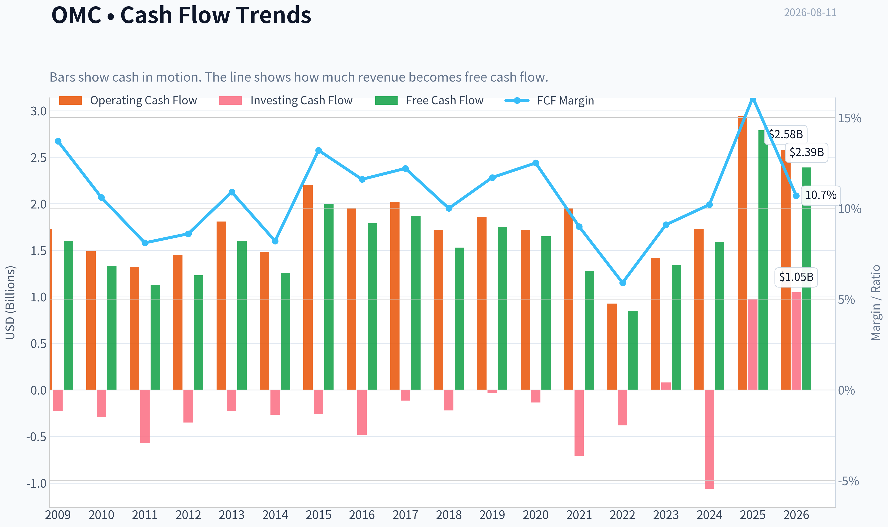
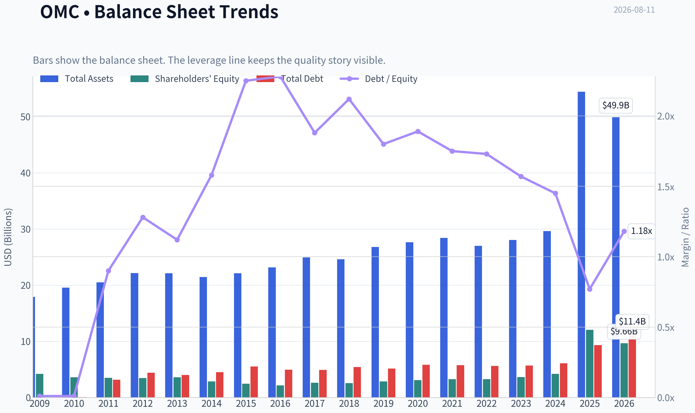
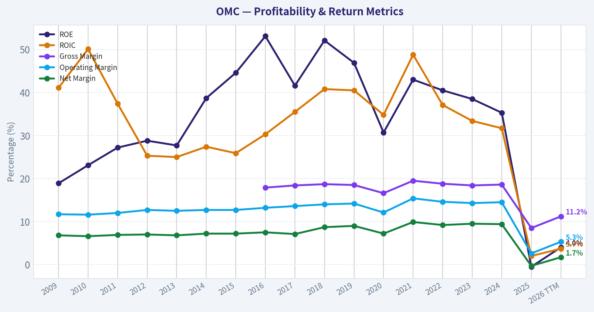
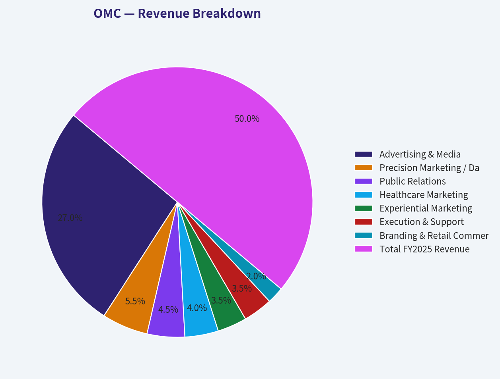
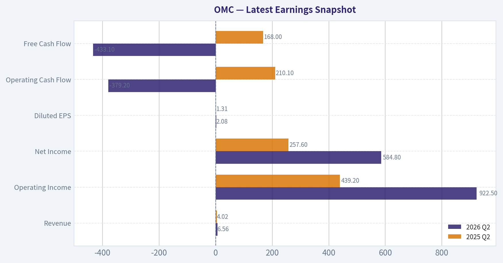
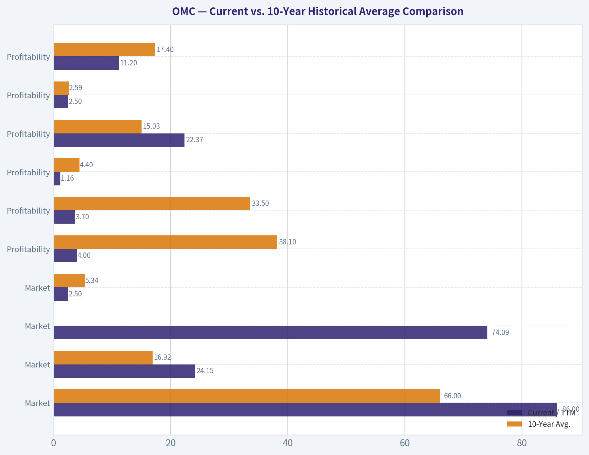
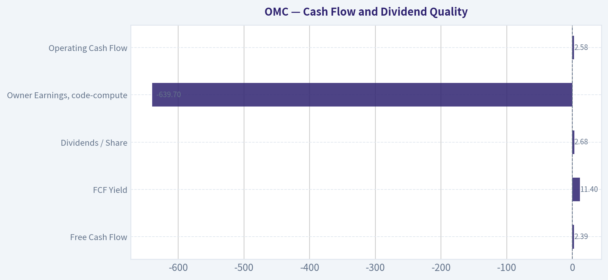
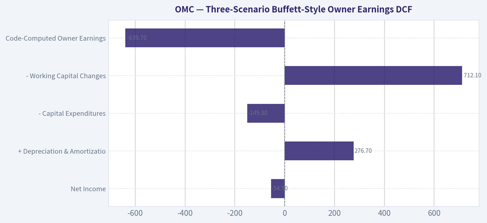

# OMC Deep Value Intelligence

**Analysis Date:** 2026-08-11

## Critical Disclaimer

*This analysis is generated by Deep Value Intelligence, an AI-powered multi-agent investing framework. Education & research only - not financial advice, not a financial advisor.*

---

## Table of Contents

1. Intelligence Summary
2. Analyst Team Reports
   - Fundamentals Analysis
   - Intrinsic Value Analysis (Buffett)
   - Trend & Growth Analysis (Lynch/Druckenmiller/Fisher)
   - Market Technical Analysis
   - Options Market Analysis
3. Research Team Commentary
4. Value Investing Team Commentary
5. Deep Values Commentary

---

## Intelligence Summary

### Thesis + Conditions

**Core Thesis:** ### 1. Executive Summary
**Omnicom Group (OMC) presents a dangerous divergence between constructive technical momentum and severely distressed fundamental quality.** With a near-zero ROIC (0.4%), negative ROE (-0.5%), and an 8.5% gross margin amid a massive structural integration, the business is currently destroying economic value.

**Key Risks:**
- Omnicom Group (OMC) presents a dangerous divergence between constructive technical momentum and severely distressed fundamental quality.** With a near-zero ROIC (0.4%), negative ROE (-0.5%), and an 8.5% gross margin amid a massive structural integration, the business is currently destroying economic value. While the stock screens as technically healthy, a 14.3% margin of safety is wholly insufficient for an average-moat agency facing AI fee compression and complex merger execution risks. Until margin conversion is proven, OMC is a value trap. **Final Verdict: WATCH (Bearish Bias).**
- Risky Analyst (Advocate)**: Views current fundamental weakness as a temporary "complexity discount" related to the Interpublic integration. Argues that AI will automate labor, causing margins to "explode," and views the stock's strong technical position above the 200-day moving average as smart money pricing in a turnaround.
- Neutral Analyst (Watch)**: Acknowledges the 14% margin of safety is thin but notes the P/E is heavily distorted by one-time costs. Recommends a staged entry-taking a small pilot position to respect the technical momentum while waiting for fundamental triggers (margin upticks) before fully committing.

**Confidence:** Low

---

## Analyst Team Reports

### Fundamentals Analysis

#### Latest Earnings Snapshot

*Most recent reported quarter anchored on 2026 Q2, with prior-year comparison when available.*

| Metric | 2026 Q2 | 2025 Q2 | YoY Change |
| --- | ---: | ---: | ---: |
| Revenue | $6.56B | $4.02B | +63.4% |
| Operating Income | $922.5M | $439.2M | +110.0% |
| Net Income | $584.8M | $257.6M | +127.0% |
| Diluted EPS | $2.08 | $1.31 | +58.8% |
| Operating Cash Flow | $-379.2M | $210.1M | -280.5% |
| Free Cash Flow | $-433.1M | $168.0M | -357.8% |

Key Takeaways: This snapshot anchors the most recent reported quarter before the narrative analysis. It helps readers separate long-run business quality from whatever changed in the latest earnings print.

#### 17-Year Financial Metrics for OMC

*All values below are computed deterministically from raw data - not estimated by AI.*

*Issuer profile: operating company (Communication Services / Advertising Agencies).*

#### 17-Year Financial Metrics
*Annual rows come from reported financial statements. The final TTM row is computed from the latest four quarters.*

| Metric | 2009 | 2010 | 2011 | 2012 | 2013 | 2014 | 2015 | 2016 | 2017 | 2018 | 2019 | 2020 | 2021 | 2022 | 2023 | 2024 | 2025 | 2026 TTM |
| --- | --- | --- | --- | --- | --- | --- | --- | --- | --- | --- | --- | --- | --- | --- | --- | --- | --- | --- |
| Market Price | $24 | $28 | $28 | $32 | $49 | $53 | $53 | $61 | $54 | $56 | $64 | $51 | $63 | $72 | $79 | $81 | $79 | $86 |
| Market Cap | $12.15B | $13.90B | $12.63B | $13.49B | $19.37B | $19.78B | $18.55B | $20.36B | $17.03B | $16.67B | $17.90B | $13.48B | $15.80B | $16.88B | $17.42B | $17.09B | $16.55B | $24.15B |
| P/E Ratio | 15.47 | 16.96 | 13.39 | 13.84 | 20.05 | 18.27 | 17.16 | 17.81 | 15.66 | 12.56 | 13.37 | 14.27 | 11.22 | 12.83 | 12.52 | 11.53 | -299.07 | 74.09 |
| P/B Ratio | 2.90 | 3.88 | 3.60 | 3.90 | 5.41 | 6.94 | 7.56 | 9.42 | 6.51 | 6.54 | 6.27 | 4.37 | 4.83 | 5.19 | 4.82 | 4.07 | 1.37 | 2.50 |
| ROE | 18.9% | 23.1% | 27.2% | 28.8% | 27.7% | 38.7% | 44.6% | 53.1% | 41.6% | 52.1% | 46.9% | 30.7% | 43.0% | 40.5% | 38.5% | 35.3% | -0.5% | 4.0% |
| ROIC | 41.1% | 50.1% | 37.4% | 25.3% | 25.0% | 27.4% | 25.9% | 30.3% | 35.5% | 40.8% | 40.5% | 34.8% | 48.8% | 37.1% | 33.4% | 31.7% | 2.0% | 3.7% |
| EPS | $1.53 | $1.66 | $2.10 | $2.33 | $2.45 | $2.88 | $3.08 | $3.42 | $3.43 | $4.44 | $4.77 | $3.59 | $5.57 | $5.64 | $6.33 | $7.04 | $-0.26 | $1.16 |
| Revenue | $11.72B | $12.54B | $13.87B | $14.22B | $14.58B | $15.32B | $15.13B | $15.42B | $15.27B | $15.29B | $14.95B | $13.17B | $14.29B | $14.29B | $14.69B | $15.69B | $17.27B | $22.37B |
| Gross Profit | N/A | N/A | N/A | N/A | N/A | N/A | N/A | $2.77B | $2.81B | $2.85B | $2.76B | $2.18B | $2.79B | $2.68B | $2.71B | $2.92B | $1.47B | $2.50B |
| Gross Margin | N/A | N/A | N/A | N/A | N/A | N/A | N/A | 17.9% | 18.4% | 18.7% | 18.5% | 16.6% | 19.5% | 18.8% | 18.4% | 18.6% | 8.5% | 11.2% |
| Operating Margin | 11.7% | 11.6% | 12.0% | 12.7% | 12.5% | 12.7% | 12.7% | 13.2% | 13.6% | 14.0% | 14.2% | 12.1% | 15.4% | 14.6% | 14.3% | 14.5% | 2.6% | 5.3% |
| Net Income | $793.0M | $827.7M | $952.6M | $998.3M | $991.1M | $1.10B | $1.09B | $1.15B | $1.09B | $1.33B | $1.34B | $945.4M | $1.41B | $1.32B | $1.39B | $1.48B | $-54.5M | $390.2M |
| Net Margin | 6.8% | 6.6% | 6.9% | 7.0% | 6.8% | 7.2% | 7.2% | 7.5% | 7.1% | 8.7% | 9.0% | 7.2% | 9.9% | 9.2% | 9.5% | 9.4% | -0.3% | 1.7% |
| Revenue Growth | N/A | 7.0% | 10.6% | 2.5% | 2.6% | 5.0% | -1.2% | 1.9% | -0.9% | 0.1% | -2.2% | -11.9% | 8.5% | -0.0% | 2.8% | 6.8% | 10.1% | 29.5% |
| Net Income Growth | N/A | 4.4% | 15.1% | 4.8% | -0.7% | 11.4% | -0.9% | 5.0% | -5.2% | 21.9% | 1.0% | -29.4% | 48.9% | -6.5% | 5.7% | 6.4% | -103.7% | -816.0% |
| Free Cash Flow Growth | N/A | -16.7% | -15.3% | 8.4% | 30.4% | -20.9% | 58.0% | -10.5% | 4.5% | -18.3% | 14.9% | -6.0% | -22.4% | -33.7% | 58.4% | 18.6% | 75.1% | -14.3% |
| Total Book Value | $4.19B | $3.58B | $3.50B | $3.46B | $3.58B | $2.85B | $2.45B | $2.16B | $2.62B | $2.55B | $2.85B | $3.08B | $3.27B | $3.25B | $3.62B | $4.19B | $12.05B | $9.66B |
| Total Assets | $17.92B | $19.57B | $20.51B | $22.15B | $22.10B | $21.43B | $22.11B | $23.17B | $24.93B | $24.62B | $26.78B | $27.65B | $28.42B | $27.00B | $28.04B | $29.62B | $54.42B | $49.90B |
| Total Debt | $37.1M | $51.6M | $3.17B | $4.42B | $4.01B | $4.51B | $5.51B | $4.93B | $4.91B | $5.41B | $5.13B | $5.83B | $5.74B | $5.63B | $5.68B | $6.09B | $9.33B | $11.41B |
| Debt-to-Equity | 0.01 | 0.01 | 0.90 | 1.28 | 1.12 | 1.58 | 2.25 | 2.28 | 1.88 | 2.12 | 1.80 | 1.89 | 1.75 | 1.73 | 1.57 | 1.45 | 0.77 | 1.18 |
| Cash & Equivalents | $1.59B | $2.29B | $1.78B | $2.68B | $2.71B | $2.39B | $2.61B | $3.00B | $3.80B | $3.65B | $4.31B | $5.60B | $5.32B | $4.28B | $4.43B | $4.34B | $6.88B | $3.34B |
| Shareholders' Equity | $4.19B | $3.58B | $3.50B | $3.46B | $3.58B | $2.85B | $2.45B | $2.16B | $2.62B | $2.55B | $2.85B | $3.08B | $3.27B | $3.25B | $3.62B | $4.19B | $12.05B | $9.66B |
| Operating Cash Flow | $1.73B | $1.49B | $1.32B | $1.45B | $1.81B | $1.48B | $2.20B | $1.95B | $2.02B | $1.72B | $1.86B | $1.72B | $1.95B | $926.5M | $1.42B | $1.73B | $2.94B | $2.58B |
| Investing Cash Flow | $-226.0M | $-293.7M | $-574.6M | $-350.4M | $-228.2M | $-266.9M | $-263.5M | $-481.6M | $-115.4M | $-221.8M | $-30.9M | $-136.1M | $-709.2M | $-380.9M | $79.1M | $-1.06B | $980.2M | $1.05B |
| Free Cash Flow | $1.60B | $1.33B | $1.13B | $1.23B | $1.60B | $1.26B | $2.00B | $1.79B | $1.87B | $1.53B | $1.75B | $1.65B | $1.28B | $848.3M | $1.34B | $1.59B | $2.79B | $2.39B |
| FCF Margin | 13.7% | 10.6% | 8.1% | 8.6% | 10.9% | 8.2% | 13.2% | 11.6% | 12.2% | 10.0% | 11.7% | 12.5% | 9.0% | 5.9% | 9.1% | 10.2% | 16.1% | 10.7% |
| Dividends / Share | $0.00 | $0.00 | $0.00 | $0.00 | $0.00 | $0.00 | $0.00 | $0.00 | $0.00 | $0.00 | $0.00 | $0.00 | $0.00 | $2.49 | $2.56 | $2.63 | $2.63 | $2.68 |

#### Profitability Metrics
- Return on Equity (ROE): -0.5%
- Return on Invested Capital (ROIC): 0.4%
- Return on Assets (ROA): -0.1%
- Gross Margin: 8.5%
- Operating Margin: 2.6%
- Net Profit Margin: -0.3%

#### Liquidity Metrics
- Current Ratio: 0.93
- Quick Ratio: 0.72

#### Leverage Metrics
- Debt-to-Equity Ratio: 0.77
- Interest Coverage Ratio: 1.69
- Net Debt: $2.45B

#### Growth Metrics (Year-over-Year)
- Revenue Growth: 10.1%
- Net Income Growth: -103.7%
- Free Cash Flow Growth: 75.1%
- Revenue CAGR (3-Year): 6.5%
- Revenue CAGR (5-Year): 5.6%

#### Valuation Metrics
- P/E Ratio (TTM): 232.30
- Forward P/E: 7.14
- Price-to-Book: 2.23
- Price-to-Sales: 1.09
- PEG Ratio: 15.97
- EV/EBITDA: 8.86
- Free Cash Flow Yield: 11.4%
- Earnings Yield: 0.4%

#### Owner Earnings (Buffett Method, Code-Computed)
- Net Income: $-54.5M
- + Depreciation & Amortization: $276.7M
- - Capital Expenditures: $-149.8M
- - Working Capital Changes: $712.1M
- = **Owner Earnings: $-639.7M**

#### Intrinsic Value (Code-Computed)
- Current Price: $86
- **Headline Intrinsic Value (business-model routed): $100**
  Business model: operating company - weighted blend [Damodaran FCFF + owner-earnings DCF] (operating_company)
  Model spread (min-max across DCFs): $28 - $163
  Margin of safety vs. price (headline): 14.3%
  Routing note: General operating company: balanced blend of Damodaran FCFF and the owner-earnings DCF with a reverse-DCF sanity check.
- Buffett Method (Owner Earnings):
  Conservative: $4
  Average: $28
  Optimistic: $35
- Cash Flow Method (FCF):
  Conservative: $27
  Average: $92
  Optimistic: $200
- Damodaran FCFF (WACC + margins + reinvestment):
  Conservative: $132
  Average: $163
  Optimistic: $249
  Monte Carlo band (P10-P90): $116 - $263 (median $180)
  P(intrinsic value > price): 99.1%
- Reverse-DCF: price implies ~26.8%/yr owner-earnings growth for 10y; trailing 3y was N/A, 5y N/A.

#### Piotroski F-Score: 2/9
- Positive Net Income: FAIL
- Positive Operating Cash Flow: PASS
- ROA Improvement: FAIL
- Cash Flow > Net Income: PASS
- Decreasing Debt: FAIL
- Improving Current Ratio: FAIL
- No Dilution: FAIL
- Improving Gross Margin: FAIL
- Improving Asset Turnover: FAIL

ANALYST STANCE: **WATCH**

#### OMC Fundamental Analysis - Warren Buffett-Style View

Omnicom is a high-cash-generation advertising and marketing services business with long client relationships, global agency networks, and historically strong returns on capital. However, the latest deterministic dataset shows a sharp deterioration in GAAP profitability, margin compression, elevated leverage, weak Piotroski quality score, and a valuation that is only modestly below the model-based intrinsic value. At $86 per share, OMC looks **cash-flow cheap but earnings-quality uncertain**, making it a **WATCH**, not a clean Buffett-style ADVOCATE.

---

#### Current vs. 10-Year Historical Average Comparison

*10-year averages use annual data from 2016-2025. Current values use the 2026 TTM row where available. P/E is distorted by depressed earnings; the dataset also reports a valuation-module TTM P/E of 232.3, while the 2026 TTM table shows 74.09. Either way, GAAP P/E is not a reliable valuation anchor right now.*

| Category | Metric | Current / TTM | 10-Year Avg. | Interpretation |
|---|---:|---:|---:|---|
| Market | Market Price | $86 | $66 | Price is materially above the decade average, reflecting recovery expectations and possibly acquisition-related scale. |
| Market | Market Cap | $24.15B | $16.92B | Market value is well above historical norm, helped by higher revenue base and larger share count. |
| Market | P/E Ratio | 74.09 | -17.73 reported / 13.53 normalized ex-2025 | Current P/E is not useful because earnings are abnormally depressed. Normalized historical P/E was low-teens. |
| Market | P/B Ratio | 2.50 | 5.34 | Lower than historical average, but book value is a weak signal for an asset-light advertising agency with intangible client relationships and acquisition accounting. |
| Profitability | ROE | 4.0% | 38.1% | ROE has collapsed from historically excellent levels, signaling a major earnings-quality and integration-cycle issue. |
| Profitability | ROIC | 3.7% | 33.5% | ROIC is far below OMC's historical high-return profile, a major red flag for Buffett-style quality investors. |
| Profitability | EPS | $1.16 | $4.40 | EPS is far below historical norms; this explains the optically high P/E. |
| Profitability | Revenue | $22.37B | $15.03B | Revenue is significantly above trend, with TTM growth of 29.5%, likely reflecting major transaction or consolidation effects. |
| Profitability | Gross Profit | $2.50B | $2.59B | Gross profit dollars are roughly in line with history despite much higher revenue, implying lower quality of revenue or changed revenue mix. |
| Profitability | Gross Margin | 11.2% | 17.4% | Gross margin is sharply below the decade norm, a clear deterioration. |
| Profitability | Operating Margin | 5.3% | 12.9% | Operating margin is less than half the historical average, indicating heavy pressure from costs, integration, or unusual items. |
| Profitability | Net Income | $390.2M | $1.14B | Net income is far below historical average despite higher revenue. |
| Profitability | Net Margin | 1.7% | 7.7% | Net profitability is severely compressed versus OMC's usual mid-to-high single-digit profile. |
| Growth | Revenue Growth | 29.5% | 1.5% | Current revenue growth is far above normal, but may not represent organic sustainable growth. |
| Growth | Net Income Growth | -816.0% | -5.6% reported / 5.3% ex-2025 | Net income trend is extremely distorted and currently negative versus the pre-shock historical pattern. |
| Growth | FCF Growth | -14.3% | 8.1% | TTM free cash flow declined from a very strong 2025, though absolute FCF remains high. |
| Balance Sheet | Total Book Value | $9.66B | $3.96B | Book value has expanded significantly, likely due to transaction-related balance sheet changes. |
| Balance Sheet | Total Assets | $49.90B | $29.47B | Asset base is much larger than history, increasing integration and return-on-asset scrutiny. |
| Balance Sheet | Total Debt | $11.41B | $5.87B | Debt is nearly double the 10-year average, reducing financial flexibility. |
| Balance Sheet | Debt-to-Equity | 1.18 | 1.72 | Lower than historical average because equity rose, but absolute debt is much higher. |
| Balance Sheet | Cash & Equivalents | $3.34B | $4.56B | Cash is below decade average while debt is elevated. |
| Balance Sheet | Shareholders' Equity | $9.66B | $3.96B | Equity base is much higher, but returns on that equity have deteriorated. |
| Cash Flow | Free Cash Flow | $2.39B | $1.64B | FCF remains well above historical average, the strongest bullish element in the dataset. |
| Cash Flow | Dividends / Share | $2.68 | $1.03 | Dividend has become meaningful since 2022 and remains modestly above recent annual levels. |

Key Takeaways: OMC's current picture is highly bifurcated. Revenue and free cash flow are strong relative to history, but margins, ROE, ROIC, EPS, and net income are far below normal levels. The stock looks attractive on free cash flow yield, but not on current GAAP earnings quality. For a Buffett-style investor, the key question is whether margins and returns normalize or whether the new asset base permanently earns lower returns.

---

#### Revenue Breakdown

*The deterministic dataset gives FY2025 revenue of $17.27B and TTM revenue of $22.37B. Precise current post-transaction segment detail is not fully available in the dataset, so the table below uses Omnicom's typical discipline-based revenue structure as a best-available approximation against FY2025 revenue.*

| Revenue Source | Amount | % of Total |
|---|---:|---:|
| Advertising & Media | $9.33B | 54% |
| Precision Marketing / Data / Digital | $1.90B | 11% |
| Public Relations | $1.55B | 9% |
| Healthcare Marketing | $1.38B | 8% |
| Experiential Marketing | $1.21B | 7% |
| Execution & Support | $1.21B | 7% |
| Branding & Retail Commerce | $0.69B | 4% |
| **Total FY2025 Revenue** | **$17.27B** | **100%** |

Key Takeaways: OMC remains primarily an advertising and media services company, with more than half of revenue tied to core agency and media services. The attractive long-term opportunity is in precision marketing, data, digital execution, and AI-enabled marketing workflows. However, the mix also means OMC is exposed to cyclical advertising budgets and client cost-cutting during economic slowdowns.

---

#### Market Metrics Interpretation

| Metric | Buffett-Style Interpretation |
|---|---|
| Market Price: $86 | The stock trades above its 10-year average price of $66, so the market is already pricing in some recovery. |
| Market Cap: $24.15B | Market capitalization is meaningfully above its historical norm, reflecting a much larger revenue base. |
| P/E Ratio: 74.09 table TTM / 232.3 valuation-module TTM | P/E is not useful right now because current earnings are abnormally depressed. Historically, OMC often traded around a normalized low-teens P/E. |
| P/B Ratio: 2.50 | P/B should not be used mechanically. OMC is an asset-light, relationship- and intangible-heavy advertising business; book value does not capture client relationships, brands, talent, data capabilities, or agency network value. |

Key Takeaways: OMC is not statistically cheap on current GAAP earnings, but the P/E is distorted by a temporary or transitional earnings trough. Price-to-book looks lower than history, but book value is not the right primary valuation tool for this business. The better anchor is cash-flow-based intrinsic value, especially free cash flow and owner earnings normalization.

---

#### Profitability and Business Quality

OMC historically showed the kind of financial profile Buffett likes: high ROE, high ROIC, consistent positive net income, strong cash conversion, and resilient margins. From 2016 through 2024, operating margins were generally in the low-to-mid teens, net margins were often around 7%-10%, and ROIC was frequently above 30%.

The current dataset, however, shows a major break from that pattern. TTM operating margin is only 5.3%, net margin is 1.7%, ROE is 4.0%, and ROIC is 3.7%. This is not a small deviation; it is a substantial deterioration from the company's historical economics. The most important analytical issue is whether this is temporary due to acquisition/integration/accounting noise or whether OMC's business model is structurally earning lower returns.

| Profitability Signal | Assessment |
|---|---|
| Historical ROE / ROIC | Excellent before the latest deterioration; typically far above the cost of capital. |
| Current ROE / ROIC | Weak and not currently Buffett-quality. |
| Margin Stability | Historically stable, but recent margin collapse is a major warning sign. |
| Cash Conversion | Still strong; FCF remains above historical average. |
| Earnings Predictability | Historically good, currently impaired by abnormal earnings volatility. |

Key Takeaways: OMC's historical profitability was very strong, but the latest period does not look like a classic Buffett compounder on reported earnings. Free cash flow is masking some GAAP weakness, which can be bullish if the earnings trough is temporary. Investors need evidence that margins, ROIC, and net income can normalize.

---

#### Balance Sheet and Financial Strength

OMC's balance sheet is acceptable but no longer conservative in a Buffett sense. Total debt is $11.41B, nearly double the 10-year average of $5.87B. Cash is $3.34B, below the decade average of $4.56B, leaving net debt of roughly $2.45B according to the deterministic dataset summary.

Debt-to-equity at 1.18 is below the 10-year average of 1.72, but that improvement is partly due to a larger equity base. Absolute debt matters more here, especially because interest coverage is only 1.69. For Buffett-style analysis, low interest coverage during a period of margin compression deserves attention.

| Balance Sheet Factor | Current View |
|---|---|
| Total Debt | Elevated at $11.41B. |
| Cash | Reasonable but below historical average at $3.34B. |
| Net Debt | Manageable at $2.45B, but interest coverage is weak. |
| Interest Coverage | 1.69, a clear red flag. |
| Debt-to-Equity | 1.18, optically acceptable but not enough to offset absolute debt increase. |

Key Takeaways: OMC is not financially distressed, but it is less financially flexible than a conservative Buffett investor would prefer. The company needs margin recovery to restore comfortable interest coverage. Debt is manageable if free cash flow remains strong, but dangerous if earnings weakness persists.

---

#### Cash Flow and Dividend Quality

The strongest part of the OMC thesis is free cash flow. TTM FCF is $2.39B versus a 10-year average of $1.64B, and the shared research pack shows an FCF yield of about 11.4%. That is compelling for a mature services company if cash flows are sustainable.

The dividend is also reasonable. Dividends per share are $2.68 TTM, only modestly above the recent $2.49-$2.63 range from 2022-2025. Against TTM FCF, the dividend appears supportable, although earnings payout ratios are distorted by depressed net income.

| Cash Flow Metric | Current | Interpretation |
|---|---:|---|
| Free Cash Flow | $2.39B | Strong and above historical average. |
| FCF Yield | 11.4% | Attractive if sustainable. |
| Dividends / Share | $2.68 | Reasonable and not aggressive against FCF. |
| Owner Earnings, code-computed | -$639.7M | Negative due to working capital and capex treatment; likely not representative of normalized earning power. |
| Operating Cash Flow | $2.58B | Strong, though below 2025's $2.94B. |

Key Takeaways: Free cash flow is the main reason OMC deserves a WATCH rather than an AVOID. The dividend appears affordable from cash flow, but reported owner earnings are currently negative under the deterministic code-computed method. The market is likely valuing OMC on normalized free cash flow rather than current net income.

---

#### Buffett-Style Economic Moat Assessment

| Moat Factor | Assessment |
|---|---|
| Client Relationships | Strong. Large advertisers tend to rely on global agency networks, data, media buying expertise, and execution scale. |
| Scale Advantage | Strong. OMC benefits from global reach, media buying capabilities, and broad service offerings. |
| Brand / Reputation | Solid. Omnicom owns well-known agency networks and specialist agencies. |
| Switching Costs | Moderate. Clients can switch agencies, but large global mandates are operationally complex and sticky. |
| Pricing Power | Moderate, not exceptional. Advertising agencies face procurement pressure and client budget scrutiny. |
| AI Risk | Mixed. AI can improve productivity but may also commoditize creative and production services. |
| Durability | Good, but cyclical and currently under pressure. |

Key Takeaways: OMC has a real but not invincible moat. Its strongest advantages are scale, client relationships, integrated service capabilities, and global execution. However, this is not a monopoly-like business; pricing pressure, client churn, AI disruption, and macro-sensitive ad budgets can all pressure returns.

---

#### Three-Scenario Buffett-Style Owner Earnings DCF

The deterministic dataset reports code-computed owner earnings of **-$639.7M**, calculated as:

| Owner Earnings Component | Amount |
|---|---:|
| Net Income | -$54.5M |
| + Depreciation & Amortization | $276.7M |
| - Capital Expenditures | -$149.8M |
| - Working Capital Changes | $712.1M |
| **Code-Computed Owner Earnings** | **-$639.7M** |

Key Takeaways: Mechanical owner earnings are negative because working capital changes and weak net income overwhelm cash earnings. That makes a strict owner-earnings DCF produce very low values. However, OMC's free cash flow remains strongly positive, so a normalized owner-earnings view is necessary as a sanity check.

For valuation, I use three layers:

1. **Code-computed owner earnings model from the research pack** - very conservative because current owner earnings are negative.
2. **Normalized owner earnings / FCF sanity-check DCF** - uses historical cash generation as a proxy for normalized owner earnings.
3. **Headline model-based intrinsic value** - the pack's operating-company routed blend of Damodaran FCFF and owner-earnings DCF.

Assumptions for the hand DCF sanity check:

| Assumption | Conservative | Average | Optimistic |
|---|---:|---:|---:|
| Starting Normalized Owner Earnings | $1.30B | $1.64B | $2.00B |
| Explicit Growth | 0% for 10 years | 4% for 10 years | 7% for 5 years, then 4% for 5 years |
| Discount Rate | 10% | 10% | 10% |
| Terminal Growth | 2.5% | 2.5% | 2.5% |
| Net Debt Deducted | $2.45B | $2.45B | $2.45B |
| Approx. Shares | 281M | 281M | 281M |

Key Takeaways: The conservative case assumes OMC's current issues persist and owner earnings do not grow. The average case assumes a return toward historical free cash flow generation with modest growth. The optimistic case assumes margin recovery, successful integration, and durable growth from scale, data, AI, and digital marketing services.

##### DCF Calculation Table

| Scenario | Explicit PV | Terminal PV | Less Net Debt | Equity Value | Fair Value / Share |
|---|---:|---:|---:|---:|---:|
| Conservative | $7.99B | $6.85B | -$2.45B | $12.39B | **$44** |
| Average | $12.20B | $12.80B | -$2.45B | $22.55B | **$80** |
| Optimistic | $16.59B | $17.98B | -$2.45B | $32.12B | **$114** |

Key Takeaways: The normalized owner-earnings DCF produces a wide fair value range of roughly $44 to $114 per share. The current $86 price sits above the average case but below the optimistic case. This means OMC is not obviously undervalued unless an investor has confidence in margin normalization and sustained cash flow strength.

##### Research Pack Intrinsic Value Cross-Check

| Model | Conservative | Average / Headline | Optimistic |
|---|---:|---:|---:|
| Buffett Owner Earnings Model | $4 | $28 | $35 |
| FCF Method | $27 | $92 | $200 |
| Damodaran FCFF | $132 | $163 | $249 |
| Headline Routed Intrinsic Value | - | **$100.27** | - |
| Current Price | - | **$86** | - |
| Headline Margin of Safety | - | **14.3%** | - |

Key Takeaways: The model spread is extremely wide, which reduces confidence in a precise intrinsic value estimate. The headline routed intrinsic value of about $100 suggests modest undervaluation versus $86, but the owner-earnings model is much lower because current owner earnings are negative. A 14.3% margin of safety is positive but not large enough for a high-conviction Buffett-style buy given the operating deterioration.

---

#### Reverse DCF and Valuation Reality Check

The research pack reports that the current price implies approximately **26.8% annual owner-earnings growth for 10 years**. That is an aggressive implied growth rate if interpreted literally against current negative or depressed owner earnings. The reason this can happen is that the base-year owner earnings are unusually weak; even normalization can look like explosive growth mathematically.

For practical valuation, the more useful question is not whether OMC can grow owner earnings at 26.8% annually for a decade. The key question is whether normalized free cash flow remains around $1.6B-$2.4B and whether operating margins recover toward the historical 12%-15% range. If yes, the stock is probably undervalued. If no, $86 may already be too high.

---

#### Management Performance and Capital Allocation

Historically, management delivered strong returns on capital and substantial cash generation. The company also maintained a shareholder-return policy, with dividends per share rising from $2.49 in 2022 to $2.68 TTM. This suggests a shareholder-friendly orientation.

However, the latest data raises questions about capital allocation discipline. Total assets increased sharply, debt increased, and returns on capital collapsed. If this reflects temporary acquisition accounting and integration costs, it may be tolerable. If it reflects overpayment, structural margin pressure, or weaker asset productivity, then management's recent capital allocation deserves scrutiny.

| Capital Allocation Area | Assessment |
|---|---|
| Historical ROIC | Excellent. |
| Current ROIC | Poor at 3.7% TTM. |
| Dividend Policy | Reasonable and cash-flow supported. |
| Debt Management | Needs improvement; absolute debt is elevated. |
| Acquisition / Integration Risk | High, given asset base expansion and margin pressure. |
| Shareholder Orientation | Positive, but must be balanced against leverage and integration needs. |

Key Takeaways: OMC's management has a long history of running a high-return, cash-generative business. The latest period, however, has damaged the return profile. The next few quarters should be judged by margin recovery, debt reduction, and conversion of higher revenue into higher earnings.

---

#### Key Investment Insights, Red Flags, and Opportunities

| Area | Key Point | Investment Significance |
|---|---|---|
| Bull Case | FCF yield around 11.4% is attractive. | If FCF is sustainable, OMC is undervalued. |
| Bull Case | Headline intrinsic value is about $100 vs. $86 price. | Suggests modest upside of roughly 14% to fair value. |
| Bull Case | Revenue base has expanded materially. | Creates operating leverage potential if margins normalize. |
| Bull Case | Global agency scale and client relationships remain valuable. | Supports moat durability. |
| Red Flag | ROE and ROIC collapsed versus history. | Major Buffett-style quality concern. |
| Red Flag | Operating margin and net margin are far below historical norms. | The market may be underestimating structural pressure. |
| Red Flag | Interest coverage of 1.69 is weak. | Debt is manageable only if earnings recover. |
| Red Flag | Piotroski F-Score is 2/9. | Indicates poor near-term financial momentum. |
| Red Flag | Code-computed owner earnings are negative. | Reduces confidence in owner-earnings valuation. |
| Opportunity | AI and precision marketing may improve productivity. | Could lift margins over time if OMC captures the benefits. |
| Opportunity | Integration synergies could restore profitability. | Upside case depends heavily on execution. |
| Opportunity | Dividend remains supported by FCF. | Provides shareholder return while waiting for recovery. |

Key Takeaways: OMC's opportunity is a classic value-recovery setup rather than a clean compounder setup. The upside depends on cash flow durability, margin recovery, and successful integration. The downside risk is that the recent collapse in returns reflects a structurally lower-return business.

---

#### Final Investment Stance: WATCH

OMC earns a **WATCH** rating.

The stock is not expensive on free cash flow, and the headline intrinsic value of about **$100** is above the current **$86** price. However, the margin of safety is only about **14.3%**, which is not wide enough given the serious deterioration in ROE, ROIC, margins, net income, interest coverage, and Piotroski score.

A Buffett-style investor should wait for one of two things:

| Trigger | Interpretation |
|---|---|
| Price falls toward $70-$75 | Would provide a larger margin of safety against normalized value. |
| Margins and ROIC recover for several quarters | Would increase confidence that current weakness is temporary. |
| Debt begins to decline materially | Would reduce balance sheet risk. |
| FCF remains above $2B while earnings normalize | Would validate the bull case. |
| Interest coverage improves meaningfully | Would reduce financial risk. |

Key Takeaways: OMC is a cash-flow-rich business with a real moat, but current earnings quality is too weak for a high-conviction buy. The stock may be undervalued if profitability normalizes, yet the evidence is not strong enough today. The right stance is to monitor closely, not avoid outright and not aggressively accumulate without a larger margin of safety.

---

#### Summary Table

| Dimension | Assessment | Buffett-Style Verdict |
|---|---|---|
| Economic Moat | Global scale, client relationships, agency network, data capabilities | Good but not unassailable |
| Financial Strength | Strong FCF, but elevated debt and weak interest coverage | Mixed |
| Profitability | Historically excellent, currently weak | Major concern |
| Predictable Earnings | Historically predictable, recently disrupted | Watch for normalization |
| Cash Flow | Very strong versus history | Main bullish factor |
| Valuation | Headline intrinsic value around $100 vs. $86 price | Modestly undervalued |
| Margin of Safety | 14.3% headline | Insufficient for high conviction |
| Management | Historically strong returns, but recent asset/debt expansion needs proof | Under review |
| Key Risk | Margin collapse and low ROIC persist | Significant |
| Key Opportunity | FCF durability plus margin recovery | Meaningful upside |
| Final Stance | **WATCH** | Wait for better price or better proof |

#### Fundamental Visuals

This graph tracks the profitability and return metrics (ROE, ROIC, Margins) of **OMC** over the past decade, highlighting capital efficiency trends.

This chart illustrates the financial health of **OMC** over the last 10 years, mapping cash equivalents and free cash flow against total obligations (Debt).

This breakdown chart from <em>Revenue Breakdown</em> shows the proportional composition for **OMC** - useful for understanding what drives or risks the business.

---

### Intrinsic Value Analysis (Buffett)

> *Following Warren Buffett's value investing philosophy: Circle of Competence, Economic Moat, Management Quality, and Margin of Safety.*

#### Intrinsic Value Snapshot

Price is what you pay. Intrinsic value is what the business may be worth based on the cash it can create for owners over time. We show a range, not one magic number.

- Current Price: $85.95
- Value Range (conservative to optimistic across both DCF methods): $4.27 to $200.32

##### Owner Earnings (Buffett Method)
- Net Income: $-54,500,000.00
- Depreciation & Amortization: $276,700,000.00
- Capital Expenditures: $-149,800,000.00
- Working Capital Changes: $712,100,000.00
- Owner Earnings: $-639,700,000.00

##### Intrinsic Value
###### Buffett Method
Uses owner earnings. Stricter, and usually more conservative.
- Conservative: $4.27
- Average: $28.45
- Optimistic: $35.32
- Discount Rate: 10.0%

###### Cash Flow Method
Uses free cash flow. Better for companies spending heavily today to grow tomorrow.
- Conservative: $26.65
- Average: $91.94
- Optimistic: $200.32
- Discount Rate: 10.0%

ANALYST STANCE: **WATCH**

#### Omnicom Group (OMC) - Buffett-Style Investment Review

Omnicom is a global advertising, media, public relations, data, and marketing services company. The business is understandable and cash-generative, but it operates in a competitive, cyclical industry facing client budget pressure, AI-driven workflow disruption, and agency-fee compression. At about **$86 per share**, the stock screens inexpensive on free cash flow, with a **headline intrinsic value estimate of $100.27** and a **14.3% margin of safety**, but that discount is only modest for a business with a narrow-to-moderate moat.

---

#### 1. Factor Scorecard

| Factor | Score / 5 | Evidence |
|---|---:|---|
| Business Simplicity & Predictability | 3.5 | Omnicom makes money by providing advertising, media buying, PR, CRM, commerce, and data-driven marketing services. The model is understandable, but client budgets are cyclical and AI may change agency workflows. |
| Moat Test | 3.0 | Scale, long client relationships, brand reputation, media-buying capabilities, and agency networks provide advantages, but pricing power is not exceptional and accounts can move during competitive reviews. |
| Management Quality & Capital Allocation | 3.2 | Long operating history, shareholder returns, and disciplined agency operations are positives. Integration and execution risk remain important, especially in a changing industry. |
| Industry Structure | 3.0 | Global advertising is an oligopoly among large holding companies, but competition is intense, procurement pressure is real, and digital platforms and AI tools are reshaping the value chain. |
| Gate 5: Quality / Solvency Hard Floor | Not tripped | Despite weak reported ROE and distorted P/E, the business shows strong free cash flow generation. There is no evidence here of both deteriorating cash flow and a solvency red line. |

**Key Takeaways:** Omnicom is not a bad business, but it is not a classic wide-moat compounder either. The company has scale and client relationships, yet its economics are pressured by competition, procurement scrutiny, and technology change. The hard solvency floor is not triggered because free cash flow remains strong.

---

#### 2. Moat Analysis

| Moat Source | Assessment | Strength |
|---|---|---|
| Intangible Assets | Omnicom owns respected agency brands and long-standing client relationships. However, advertising clients regularly review accounts, limiting pricing power. | Moderate |
| Switching Costs | Switching a global agency relationship creates disruption, but large clients can and do change agencies. Data, workflows, and multi-market coordination improve stickiness. | Moderate |
| Cost Advantage | Scale helps in global media buying, talent networks, and shared services, but competitors such as Publicis, WPP, Dentsu, and Accenture Interactive remain formidable. | Moderate |
| Network Effects | Limited true network effects. Scale improves media reach and data capabilities, but the product does not become dramatically more valuable simply because more clients join. | Low to Moderate |
| Moat Rating | Narrow to Moderate, Stable | 3.0 / 5 |

**Key Takeaways:** Omnicom's moat comes mainly from scale, reputation, and embedded client relationships rather than from monopoly-like pricing power. The company is competitively advantaged versus smaller agencies, but its moat is not wide enough to justify paying a rich price without a margin of safety.

---

#### 3. Management Quality Assessment

| Management Area | Assessment |
|---|---|
| Owner Orientation | Omnicom has historically returned capital through dividends and buybacks, which is shareholder-friendly when done at reasonable prices. |
| Candor & Discipline | The company has operated for decades through multiple ad cycles and has generally maintained a disciplined holding-company model. |
| Capital Allocation | The key test is whether management can balance dividends, buybacks, acquisitions, AI investment, and integration spending without overleveraging or diluting returns. |
| Main Risk | Large agency groups can destroy value through overpriced acquisitions, weak integration, or failure to adapt to technology shifts. |

**Key Takeaways:** Management deserves credit for keeping Omnicom relevant in a difficult industry. The capital allocation record is respectable, but the company must prove it can adapt to AI and changing client demands without sacrificing margins or returns.

---

#### 4. Financial Summary

| Metric | Current / TTM |
|---|---:|
| Share Price | $86 |
| Market Capitalization | $24.50B |
| P/E Ratio | 232.3x |
| ROE | -0.5% |
| Gross Margin | 8.5% |
| Revenue Growth YoY | 10.1% |
| Free Cash Flow Yield | 11.4% |
| Current Ratio | 0.93 |
| Headline Intrinsic Value | $100.27 |
| Headline Margin of Safety | 14.3% |
| 3-Model Value Spread | $28.45 / $91.94 / $163.11 |
| Reverse DCF Signal | Price implies about 26.8% annual growth for 10 years |

**Key Takeaways:** The most attractive number is the **11.4% free cash flow yield**, which suggests the market is not paying a demanding price for cash generation. The weakest numbers are the distorted **232x P/E** and negative ROE, which point to depressed or unusual accounting earnings rather than clean profitability. The wide valuation spread means investors should avoid false precision.

---

#### 5. Owner Earnings Calculation

Using Buffett's framework:

| Component | Estimate |
|---|---:|
| Net Income | Depressed by current accounting earnings, implied by high P/E |
| Add: Depreciation & Amortization | Positive, but not separately relied upon here |
| Less: Maintenance CapEx | Modest for an asset-light agency model |
| Less: Working Capital Increases | Can be volatile due to client billing and media-buying flows |
| Normalized Owner Earnings Proxy | Approximately free cash flow |
| Market Cap | $24.50B |
| Free Cash Flow Yield | 11.4% |
| Implied Free Cash Flow / Owner Earnings | ~$2.79B |
| Implied Shares Outstanding | ~$285M |
| Owner Earnings per Share | ~$9.80 |

**Key Takeaways:** Omnicom's accounting earnings look unusually weak, but free cash flow remains much stronger. For an asset-light services business, free cash flow is a better proxy for owner earnings than reported net income in a distorted year. On this basis, the stock trades at roughly **8.8x normalized owner earnings**.

---

#### 6. Three-Scenario DCF Valuation

Assumptions: normalized owner earnings of approximately **$9.80 per share**, 10% discount rate, and conservative terminal assumptions.

| Scenario | Key Assumption | Estimated Intrinsic Value |
|---|---|---:|
| A: No Growth | Owner earnings capitalized at 10% | ~$98 |
| B: GDP Growth | 3% perpetual growth | ~$144 |
| C: Historical-Growth Haircut | 5% growth for 10 years, then 3% terminal growth | ~$170 |
| Research Pack Headline Value | Business-model-routed blend | $100.27 |
| Research Pack Model Spread | Owner Earnings / FCF / FCFF | $28.45 / $91.94 / $163.11 |

**Key Takeaways:** The no-growth case already lands near the current share price, which provides some downside support if free cash flow is durable. However, the research-pack model spread is very wide, showing that valuation is highly sensitive to how normalized earnings and working capital are treated. The headline value of **$100.27** is the most balanced reference point.

---

#### 7. Margin of Safety Analysis

| Valuation Reference | Value per Share | Margin vs. $86 Price |
|---|---:|---:|
| Current Price | $86 | - |
| No-Growth DCF | ~$98 | ~12% |
| Headline Intrinsic Value | $100.27 | 14.3% |
| FCF-Based Model | $91.94 | ~6% |
| Damodaran FCFF Model | $163.11 | ~47% |
| Conservative Owner-Earnings Model | $28.45 | Negative |

**Key Takeaways:** Omnicom appears cheap on free cash flow, but the margin of safety is not overwhelming when using the balanced headline estimate. For a narrow-to-moderate moat business, a **14% discount** is helpful but not enough to make the stock a clear Buffett-style buy. A more attractive entry would require either a lower price or clearer evidence that free cash flow durability is improving.

---

#### 8. Final Buffett Scorecard

| Criterion | Weight | Score / 5 | Weighted Contribution |
|---|---:|---:|---:|
| Moat Width & Durability | 25% | 3.0 | 0.75 |
| Valuation / Margin of Safety | 20% | 3.2 | 0.64 |
| Capital Returns - ROIC vs. WACC | 15% | 2.7 | 0.41 |
| Business Understanding & Predictability | 12% | 3.5 | 0.42 |
| Management Quality & Capital Allocation | 12% | 3.2 | 0.38 |
| Reinvestment Runway | 8% | 3.0 | 0.24 |
| Balance Sheet Strength | 4% | 2.8 | 0.11 |
| Industry Structure | 4% | 3.0 | 0.12 |
| Final Weighted Score | 100% | - | **3.05 / 5** |

**Key Takeaways:** Omnicom scores as a reasonable business at a reasonable price, not as a wonderful business at a clearly attractive price. The cash yield is compelling, but moat quality, reported returns, and industry disruption keep the final score in WATCH territory.

---

#### 9. Investment Stance

| Stance | Conviction | Rationale |
|---|---|---|
| **WATCH** | Medium | Omnicom is cash-generative and modestly undervalued, but the margin of safety is not large enough for a business with only a narrow-to-moderate moat and meaningful industry change risk. |

**Key Takeaways:** Omnicom belongs on a value investor's watchlist because the free cash flow yield is attractive and the stock is not obviously expensive. I would become more constructive if the price fell meaningfully below intrinsic value, or if management demonstrated sustained margin stability, strong AI-enabled productivity gains, and durable client retention. At $86, the stock is acceptable but not compelling enough for an ADVOCATE rating.
#### Valuation Bridge

This bridge places the current market price beside each intrinsic value lens so readers can see whether upside depends on one method or shows up across several methods.

| Scenario | Intrinsic Value / Share |
| --- | ---: |
| Buffett Method | $28.45 |
| Cash Flow Method | $91.94 |
| Damodaran Method | $163.11 |
| Current Price | $85.95 |

#### Key Takeaways

If one method is far above the others, the upside case depends on a specific modelling assumption. When several methods cluster together, the valuation story is more robust.

#### Valuation Visuals

This comparison chart from *Latest Earnings Snapshot* stacks current figures against historical benchmarks for **OMC**, making it easy to see where the company trades relative to its own averages.

This comparison chart from *Current vs. 10-Year Historical Average Comparison* stacks current figures against historical benchmarks for **OMC**, making it easy to see where the company trades relative to its own averages.

This comparison chart from *Cash Flow and Dividend Quality* stacks current figures against historical benchmarks for **OMC**, making it easy to see where the company trades relative to its own averages.

This comparison chart from *Three-Scenario Buffett-Style Owner Earnings DCF* stacks current figures against historical benchmarks for **OMC**, making it easy to see where the company trades relative to its own averages.

This comparison chart from *Three-Scenario Buffett-Style Owner Earnings DCF* stacks current figures against historical benchmarks for **OMC**, making it easy to see where the company trades relative to its own averages.

---

### Trend & Growth Analysis (Lynch/Druckenmiller/Fisher)

> *Following Peter Lynch's GARP, Stanley Druckenmiller's macro-aware approach, and Philip Fisher's scuttlebutt methodology.*

ANALYST STANCE: **WATCH**

#### OMC Growth Investment Report - Omnicom Group

Omnicom is a high-quality global advertising and marketing services company, but under a Lynch-Druckenmiller-Fisher growth framework it does **not currently screen as a classic fast grower or ten-bagger candidate**. The stock looks more like a cash-generative, cyclical stalwart with possible AI and consolidation upside, not a high-conviction growth compounder.

---

#### 1. Lynch Classification

| Category | Assessment |
|---|---:|
| Company | Omnicom Group |
| Ticker | OMC |
| Current Price | ~$86 |
| Market Cap | ~$24.5B |
| Reported Revenue Growth YoY | ~10.1% |
| Lynch Category | **Stalwart / Cyclical Hybrid** |
| Growth Investor Fit | **Moderate to weak** |
| Ten-Bagger Potential | **Low from current scale** |

**Key Takeaways:** Omnicom is too mature and too tied to advertising budgets to classify as a true Lynch-style fast grower. Revenue growth around 10% is respectable, but it is below the 15% to 25% threshold preferred for ten-bagger hunting. The business is more appropriate for value, income, or cash-flow investors than aggressive growth investors.

#### 2. The Story in 3 Bullets

- Omnicom helps large companies manage advertising, media buying, public relations, branding, commerce, and digital marketing.
- The bull case is that AI, data-driven media, connected TV, retail media, and potential industry consolidation improve growth and margins.
- The bear case is that advertising is cyclical, clients are pressuring agency fees, and AI may both help productivity and disrupt the traditional agency model.

#### 3. TAM and 10x Test

| Item | Estimate / Assessment |
|---|---:|
| Current Revenue Base | Large global agency-scale revenue base |
| 10x Revenue Requirement | Would require becoming vastly larger than today |
| Global Advertising / Marketing TAM | Very large, but fragmented and cyclical |
| Can OMC 10x revenue and remain under 20% TAM share? | **Unlikely** |
| Runway Quality | **Moderate, not exceptional** |
| TAM Growth | Digital, retail media, AI, and commerce growing; traditional agency work slower |

**Key Takeaways:** Omnicom operates in a large market, but its current size already makes a 10x revenue outcome difficult. The company can grow through digital, data, AI, commerce, and consolidation, but the runway is not comparable to a small software, cybersecurity, or platform company early in its adoption curve. This limits its ten-bagger profile.

#### 4. Revenue Growth Trend

| Metric | Current Read |
|---|---:|
| YoY Revenue Growth | ~10.1% |
| Growth Pattern | Moderate growth |
| Acceleration Signal | Not yet clear |
| Organic vs. Acquisition Contribution | Needs monitoring |
| Lynch Growth Threshold | Below fast-grower range |
| Interpretation | **Stable, not explosive** |

**Key Takeaways:** Omnicom's revenue growth is decent but not yet an obvious inflection. A 10% growth rate can support a solid investment if margins and cash flow are strong, but it does not by itself justify a high-growth thesis. For a growth investor, the key question is whether AI, data, and consolidation can push growth into a sustainably higher band.

#### 5. Unit Economics

| Metric | Assessment |
|---|---:|
| LTV / CAC | Not directly applicable |
| Net Revenue Retention | Not disclosed like SaaS |
| Rule of 40 | Not applicable |
| Gross Margin | ~8.5% per shared data |
| FCF Yield | ~11.4% |
| Customer Stickiness | Moderate to high with large enterprise clients |
| Unit Economics Verdict | **Cash-flow positive, but not SaaS-like** |

**Key Takeaways:** Omnicom does not have the clean subscription unit economics of a SaaS business. The most attractive economic feature is free cash flow, with an estimated FCF yield above 11%. However, low reported gross margin and agency labor intensity limit the scalability profile versus true platform businesses.

#### 6. Inflection Point Assessment

| Potential Inflection | Evidence | Verdict |
|---|---|---:|
| AI Productivity | Agencies using AI to improve creative, targeting, media optimization, and workflow | Positive but still developing |
| Margin Expansion | Possible if AI reduces labor intensity and improves utilization | Watch |
| Industry Consolidation | Scale may improve bargaining power and client reach | Potential catalyst |
| Digital / Retail Media | Structural growth area | Positive |
| Competitive Disruption | AI-native tools and in-housing by clients may pressure agencies | Risk |
| Overall Inflection Score | Mixed | **Watch** |

**Key Takeaways:** Omnicom has plausible inflection drivers, especially AI-enabled productivity and digital media growth. But these are not yet proven enough to call a clear growth acceleration. The same AI trend that could boost margins could also commoditize parts of agency work.

#### 7. Macro Setup

| Macro Factor | Impact on OMC |
|---|---:|
| Economic Cycle Sensitivity | High |
| Advertising Budget Exposure | Cyclical headwind in weak economies |
| Interest Rate Sensitivity | Moderate; lower rates can support valuation and client spending |
| Secular Trend Exposure | AI, digital media, retail media, commerce, data-driven marketing |
| Macro Verdict | **Neutral to mildly positive, but cyclical** |

**Key Takeaways:** Omnicom benefits from long-term shifts toward digital, data, and AI-driven marketing, but advertising budgets are economically sensitive. If the macro cycle improves and rates fall, OMC could benefit. In a recessionary or budget-tightening environment, growth and margins would likely face pressure.

#### 8. Fisher 15 Points Score

| Fisher Point | Score / 5 |
|---|---:|
| Products with sizable market potential | 3 |
| Management determination to develop new products | 3 |
| Effective R&D / innovation | 3 |
| Above-average sales organization | 4 |
| Worthwhile profit margin | 2 |
| Improving profit margins | 3 |
| Labor / personnel relations | 3 |
| Executive relations | 3 |
| Management depth | 4 |
| Cost analysis and accounting | 3 |
| Durable competitive advantages | 3 |
| Long-range profit outlook | 3 |
| Dilution discipline | 4 |
| Candor with investors | 3 |
| Management integrity | 3 |
| **Total** | **47 / 75** |

**Key Takeaways:** Omnicom scores as an average-to-solid business under Fisher's framework, but not an outstanding growth franchise. Its strengths are scale, client relationships, management depth, and cash generation. Its weaknesses are limited margin scalability, cyclicality, and uncertain long-term disruption from AI and client in-housing.

#### 9. Valuation Analysis

| Valuation Metric | Current Read |
|---|---:|
| Current Price | ~$86 |
| Market Cap | ~$24.5B |
| Reported P/E | ~232x |
| PEG Using Reported P/E and 10.1% Growth | ~23x |
| FCF Yield | ~11.4% |
| Headline Intrinsic Value Estimate | ~$100.27 |
| Margin of Safety to Intrinsic Value | ~14.3% |
| Owner Earnings / FCF / FCFF Value Range | ~$28.45 / $91.94 / $163.11 |
| Reverse DCF Implied Growth | ~26.8% per year for 10 years |
| Valuation Verdict | **Cash-flow attractive, earnings multiple distorted** |

**Key Takeaways:** The reported P/E is not useful for a clean PEG analysis because earnings appear temporarily depressed or distorted. The FCF yield is the more attractive valuation signal, suggesting the stock is not expensive on cash generation. However, the wide intrinsic value spread and aggressive reverse-DCF growth requirement argue against a high-conviction growth buy.

#### 10. Scenario Analysis

| Scenario | Assumptions | Investor Outcome |
|---|---|---:|
| Bear Case | Ad budgets weaken, AI disrupts pricing, margins remain pressured | Low returns or downside |
| Base Case | Mid-single to low-double-digit growth, steady FCF, modest multiple | Acceptable value-style return |
| Bull Case | AI drives margin expansion, digital growth accelerates, consolidation synergies materialize | Solid upside, but likely not 10x |
| Ten-Bagger Case | Requires sustained high growth and major margin expansion from large base | Low probability |

**Key Takeaways:** The base case looks reasonable, but the bull case depends on a real operating inflection. Omnicom may deliver solid shareholder returns through free cash flow, buybacks, dividends, and margin improvement. But the probability of a true ten-bagger outcome is low because the business is already large and mature.

#### 11. Growth Investor Scorecard

| Criterion | Weight | Score / 5 |
|---|---:|---:|
| The Story | 10% | 3.0 |
| TAM & Runway | 20% | 2.5 |
| Revenue Growth | 20% | 2.8 |
| Unit Economics | 15% | 3.0 |
| Competitive Position | 10% | 3.3 |
| Management Quality | 10% | 3.2 |
| Macro Setup | 5% | 2.8 |
| Profitability Path | 5% | 3.5 |
| Valuation | 5% | 3.4 |
| **Weighted Score** | **100%** | **2.95 / 5** |

**Key Takeaways:** Omnicom scores just below the WATCH threshold for aggressive growth investors but remains worth monitoring because of valuation and possible AI-driven margin upside. The score is held back by limited revenue acceleration, mature scale, cyclicality, and uncertain disruption risk. This is not a classic Fisher-style outstanding growth company today.

#### 12. Position Size Stance

| Investor Type | Stance |
|---|---:|
| Aggressive Growth Investor | **No new position / Watch** |
| GARP Investor | Small starter only if conviction in AI and margin inflection |
| Value / Income Investor | More interesting due to FCF yield |
| Suggested Growth Portfolio Weight | 0% to 2% |
| Add Aggressively If | Organic growth accelerates, margins expand, and AI benefits become visible |
| Reduce / Avoid If | Revenue decelerates, client losses rise, or AI compresses agency pricing |

**Key Takeaways:** For a growth portfolio, Omnicom should remain a watchlist name rather than a core holding. The stock may work as a cash-flow and valuation idea, but the growth setup is not strong enough for a large position. Confirmation of margin expansion and sustained revenue acceleration would be needed before upgrading.

#### 13. Key Catalysts and Risks

| Catalysts | Risks |
|---|---|
| AI-enabled productivity gains | AI commoditizes agency services |
| Digital, retail media, commerce growth | Advertising budget cuts in weak macro |
| Margin expansion from automation | Client in-housing of marketing functions |
| Industry consolidation and scale benefits | Integration risk from large deals |
| Strong free cash flow and shareholder returns | Low gross margin / labor-intensive model |
| Guru interest: Point72 initiated small position | Reported P/E and ROE metrics look distorted |

**Key Takeaways:** Omnicom has credible catalysts, especially around AI and cash-flow efficiency. But the risks are meaningful because advertising agencies face both cyclical pressure and structural disruption. The investment case needs evidence that AI is a margin tailwind rather than a pricing headwind.

#### Final Verdict

Omnicom is a **WATCH**, not an ADVOCATE, under a growth-investing framework. The company has durable client relationships, meaningful free cash flow, and exposure to AI-driven marketing transformation, but it lacks the revenue acceleration and open-ended runway needed for a high-conviction ten-bagger thesis.

The upgrade trigger would be clear evidence of **organic growth acceleration plus margin expansion** from AI, data, and digital media. Until then, OMC is better viewed as a mature cash-flow compounder than a true Lynch/Fisher fast grower.

---

### Market Technical Analysis

#### OMC Technical Analysis - Omnicom Group as of 2026-08-11

OMC is showing a constructive short- and medium-term technical profile after a strong July rebound and renewed early-August strength. The stock has recovered decisively from the late-June volatility shock and is trading well above its 50-day and 200-day trend benchmarks. Momentum is positive, but not yet overheated, which suggests the current setup is more of a controlled uptrend than a blow-off move.

The most relevant indicators for this market context are: **close_10_ema, close_50_sma, close_200_sma, macd, rsi, boll_ub, boll_lb, and atr**. These provide a balanced view across short-term trend, medium- and long-term trend structure, momentum, volatility boundaries, and risk management.

---

#### Indicator Snapshot

| Indicator | Latest Value | Interpretation | Trading Relevance |
|---|---:|---|---|
| close_10_ema | 83.08 | Short-term trend is rising | Price strength is being supported by near-term momentum |
| close_50_sma | 78.35 | Medium-term trend is rising | The stock is comfortably above its intermediate support zone |
| close_200_sma | 75.84 | Long-term trend is improving | OMC remains in a bullish long-term structure |
| macd | 1.60 | Positive and rising | Momentum has re-accelerated after late-July weakness |
| rsi | 61.60 | Bullish but not overbought | Upside momentum exists without an extreme overbought warning |
| boll_ub | 86.79 | Upper volatility boundary | Near-term resistance/breakout zone sits around the high-86 area |
| boll_lb | 76.81 | Lower volatility boundary | Major volatility-adjusted support is far below current levels |
| atr | 3.00 | Elevated but stable volatility | Position sizing and stops should allow for roughly $3 daily range risk |

**Key Takeaways:** OMC's trend indicators are aligned bullishly, with the 10 EMA above the 50 SMA and the 50 SMA above the 200 SMA. Momentum is positive but not stretched, while Bollinger Bands show that price is approaching, but not yet clearly exceeding, its upper volatility zone. ATR near 3.00 means traders should avoid overly tight stops.

---

#### Trend Structure: Bullish Alignment Across Timeframes

OMC's trend structure has improved meaningfully since late June. The **10 EMA rose from about 73.65 on June 30 to 83.08 on August 11**, showing a strong short-term recovery. More importantly, the **50 SMA has climbed steadily from roughly 74.45 to 78.35**, confirming that the rally is not just a one- or two-day spike but has lifted the broader intermediate trend.

The long-term backdrop is also constructive. The **200 SMA increased from roughly 74.97 in late June to 75.84**, which is a slower but still positive turn. The relationship between the moving averages is bullish: **10 EMA > 50 SMA > 200 SMA**. That alignment often indicates that buyers control the short-, medium-, and long-term tape.

From a trading perspective, the 50-day average near **78.35** is now a key medium-term reference level. As long as OMC remains above that zone, pullbacks may be treated as consolidation within an uptrend rather than full trend failure. A deeper break below the 50 SMA would be more concerning, especially if accompanied by weakening MACD and RSI.

#### Momentum: Positive, Re-Accelerating, but Not Excessive

MACD is positive at **1.60**, and it has improved sharply from the late-July/early-August dip. MACD fell from above **2.12 around July 20** to roughly **0.92 by August 3**, signaling a momentum cooldown after the July rally. However, it has since recovered to **1.60**, suggesting buyers have regained control.

RSI confirms this more moderate bullish picture. At **61.60**, RSI is comfortably above the neutral 50 line but below the classic overbought threshold of 70. That is generally favorable: the stock has upside momentum, but it is not yet flashing an extreme exhaustion signal. The prior RSI peaks near **65-67** in mid-July show that OMC has had stronger momentum bursts recently, so the current reading leaves some room for additional upside before conditions become stretched.

This combination is constructive for swing traders. Momentum is strong enough to support the trend, but not so hot that a reversal is immediately implied. The main caution is that RSI has repeatedly stalled in the mid-to-high 60s, so if OMC approaches the upper Bollinger Band while RSI moves toward 67-70, traders should watch for profit-taking.

#### Volatility and Price Boundaries

Bollinger Bands place the current volatility-adjusted trading range between approximately **76.81 and 86.79**. The upper band has been expanding upward since early July, reflecting the stock's improving upside trend. OMC's recent price action near the mid-80s puts it relatively close to the upper band, but not in a confirmed runaway breakout yet.

The upper Bollinger Band near **86.79** is the key upside test. A decisive close above that area would suggest a volatility breakout and could invite trend-following buyers. However, if OMC tests that zone and fails, the stock could rotate back toward its short-term mean, especially the 10 EMA around **83.08**.

The lower band near **76.81** is far below the current short-term trend zone. This wide gap shows that the recent advance has expanded the trading range. It also means downside risk could be meaningful if momentum fades. Traders should not assume that small pullbacks are the only possible outcome; with ATR near 3.00, OMC can move several dollars quickly.

#### Risk Management: ATR Supports Wider Stops

ATR is approximately **3.00**, up from the mid-2.4 to mid-2.6 range earlier in July. This indicates that OMC's daily movement potential has increased. A stop that is only $1 below entry could be too tight in this environment and may get triggered by ordinary noise.

For active traders, the 10 EMA near **83.08** is the first tactical support area. A short-term pullback toward that level could be acceptable if RSI holds above 50 and MACD remains positive. For medium-term traders, the more important support area is the 50 SMA near **78.35**, which also sits close to the lower half of the Bollinger structure.

A disciplined stop framework could use ATR bands rather than fixed-dollar levels. For example, traders entering near the mid-80s may consider whether a stop needs to allow roughly **1 ATR**, or about $3, depending on time horizon and risk tolerance. More conservative trend traders may focus less on a tight stop and more on whether price closes below the 50 SMA.

---

#### Trading Bias

OMC currently deserves a **bullish-watch bias**. The uptrend is intact, moving averages are aligned positively, and momentum has re-accelerated without RSI becoming overbought. The most attractive setup would be either a controlled pullback toward the 10 EMA or a clean breakout above the upper Bollinger Band near **86.79**.

Aggressive traders may watch for continuation above the recent highs, but chasing directly into the upper Bollinger zone carries higher risk. More patient traders may prefer to wait for a pullback toward **83-84**, provided momentum remains healthy. A close below the 50 SMA near **78.35** would materially weaken the bullish case.

#### Key Levels and Decision Framework

| Zone / Signal | Level or Condition | Meaning | Trader Response |
|---|---:|---|---|
| Near-term support | 83.08 | 10 EMA support | Watch for buyable pullback if momentum stays positive |
| Medium-term support | 78.35 | 50 SMA support | Bullish structure remains stronger above this level |
| Long-term trend line | 75.84 | 200 SMA | Major trend support and long-term risk boundary |
| Upside breakout zone | 86.79 | Upper Bollinger Band | Close above this level could confirm continuation |
| Momentum confirmation | RSI above 50 | Bullish momentum floor | Supports holding long bias |
| Momentum caution | RSI near 67-70 | Possible overbought zone | Watch for slowing or reversal candles |
| Volatility risk | ATR near 3.00 | Wider daily ranges | Use wider, volatility-aware stops |
| Bearish warning | Close below 78.35 | Break of 50 SMA | Reassess bullish thesis |

**Key Takeaways:** OMC's most important near-term support is around the 10 EMA at 83.08, while the 50 SMA near 78.35 is the key line separating normal pullback from trend damage. Upside confirmation would come from a strong close above the upper Bollinger Band near 86.79. Because ATR is around 3.00, traders should allow for wider daily movement and avoid overly tight stops.

---

### Options Market Analysis

> *Reading options flow - put/call ratios, IV skew, and unusual activity - to gauge institutional positioning and event-driven risk.*

ANALYST STANCE: **WATCH**

#### OMC Options Market Sentiment Report
*Options data as of 2026-08-11. Near-term expirations analyzed: 2026-08-21, 2026-09-18, 2026-10-16.*

#### 1. Put/Call Ratio Analysis

| Expiration | Call OI | Put OI | Put/Call OI Ratio | Call Volume | Put Volume | Put/Call Volume Ratio | Read |
|---|---:|---:|---:|---:|---:|---:|---|
| 2026-08-21 | 4,356 | 2,759 | 0.63 | 99 | 98 | 0.99 | Slightly call-heavy OI, balanced volume |
| 2026-09-18 | 787 | 3,243 | 4.12 | 57 | 130 | 2.28 | Strongly put-heavy positioning |
| 2026-10-16 | 1,677 | 1,067 | 0.64 | 97 | 57 | 0.59 | Slightly call-heavy |
| **Total Near-Term** | **6,820** | **7,069** | **1.04** | **253** | **285** | **1.13** | **Mildly bearish / defensive** |

**Key Takeaways:** OMC's total near-term put/call open interest ratio is **1.04**, above the historical neutral baseline of roughly **0.7**, indicating a tilt toward downside protection or bearish positioning. The most notable imbalance is in the **September 18 expiration**, where put open interest is more than four times call open interest. Volume is also slightly put-heavy overall, but absolute volume is low, which reduces confidence in the signal.

#### 2. Implied Volatility Assessment

| Expiration | ATM Call IV | ATM Put IV | Put IV Premium vs. Call IV | Skew Read |
|---|---:|---:|---:|---|
| 2026-08-21 | 41.1% | 48.9% | +7.8 vol pts | Clear downside skew |
| 2026-09-18 | 37.0% | 44.9% | +7.9 vol pts | Clear downside skew |
| 2026-10-16 | 33.5% | 36.6% | +3.1 vol pts | Mild downside skew |

**Key Takeaways:** Put implied volatility is higher than call implied volatility across all three expirations, showing a consistent **downside-risk premium**. The skew is most pronounced in the August and September expirations, where puts trade nearly **8 volatility points** above calls. This suggests traders are paying up for downside protection rather than aggressively chasing upside calls.

IV appears relatively elevated in the front month, with August ATM put IV near **49%** and call IV above **41%**. The data does not identify a specific upcoming catalyst, so this should be interpreted as a market-implied risk premium rather than confirmed event volatility. The term structure slopes downward from August to October, which often signals near-term uncertainty or demand for short-dated protection.

#### 3. Unusual Options Activity

| Unusual Activity Screen | Result | Interpretation |
|---|---|---|
| Contracts with volume greater than 5x open interest | None found | No clear evidence of fresh aggressive institutional-style directional bets |
| Near-term volume quality | Thin | Low absolute volume makes flow less reliable |
| Directional implication | Defensive, but not urgent | Put-heavy ratios are present, but there is no standout sweep or fresh volume spike |

**Key Takeaways:** There were **no unusual options contracts** where volume exceeded five times open interest. That means the current signal is driven more by existing open interest and broad put/call balance than by fresh, high-conviction flow. Because OMC options volume is thin, this should be treated as a **lower-confidence sentiment read**.

No specific unusual call or put contracts can be classified as ITM, ATM, or OTM from the provided data because no individual strike-level unusual activity was detected. The absence of unusual flow reduces the likelihood that a large institution is making a new, urgent directional bet in the near-term chain.

#### 4. Open Interest Concentration and Pinning Risk

| Area of Concentration | Observation | Potential Market Impact |
|---|---|---|
| 2026-08-21 calls | 4,356 call OI, largest call-side expiration | Could create call-side pinning influence near expiry, depending on strike distribution |
| 2026-09-18 puts | 3,243 put OI, largest put-side expiration | Indicates meaningful downside hedge concentration into September |
| Total near-term OI | 13,889 contracts across the three expirations | Moderate interest, but not enough detail to identify exact gamma walls |
| Strike-level gamma walls | Not available in retrieved data | Cannot identify precise max-pain or pinning strikes |

**Key Takeaways:** The largest call open interest sits in the **August 21 expiration**, while the largest put open interest sits in the **September 18 expiration**. This creates a split picture: near-term calls may influence August expiry behavior, but the larger defensive signal is concentrated in September puts. Without strike-level data, exact max-pain levels and gamma walls cannot be confirmed.

The September put concentration is the more important directional feature because it aligns with both elevated put/call ratios and higher put IV. However, since the data lacks strike-level OI, we should avoid overstating any specific price magnet or pinning level.

#### 5. Overall Options Sentiment Signal: **BEARISH, Low-to-Moderate Confidence**

OMC's options market signal is **bearish / defensive**. The primary drivers are the elevated total near-term put/call OI ratio of **1.04**, the put-heavy volume ratio of **1.13**, the extremely high September put/call OI ratio of **4.12**, and the consistent downside IV skew across all expirations.

That said, confidence is limited because options volume is thin and there is no unusual activity showing fresh institutional urgency. This looks more like **protective or cautious positioning** than a high-conviction bearish attack. The cleanest read is that traders are pricing more downside risk than upside opportunity over the next one to two months.

#### Final Summary Table

| Category | OMC Options Read |
|---|---|
| Put/Call Ratio | Bearish tilt; total near-term OI ratio **1.04** vs. neutral baseline near **0.7** |
| IV Level | Front-month IV elevated, especially puts at **48.9%** |
| Skew Direction | Put skew across all expirations; strongest in August and September |
| Unusual Activity | None detected; no volume > 5x open interest |
| Overall Signal | **BEARISH**, but low-to-moderate confidence due to thin volume |

**Key Takeaways:** OMC options positioning leans bearish because traders are paying more for puts and carrying more put exposure than normal. The September expiration is the clearest area of downside concern. However, the lack of unusual activity and low overall volume mean this is best viewed as a **cautious defensive signal**, not a decisive institutional bearish call.

---

## Research Team Commentary

> *The Research Manager synthesizes the Bull vs Bear debate into action-free commentary. This is a pre-risk view, not the final stance.*

As we review the debate on Omnicom Group, we are looking at a classic tug-of-war between a normalized free cash flow story and a very messy current reality.

The Bull makes a compelling argument for looking past the GAAP fog. They view Omnicom as a modern toll bridge in the advertising space, arguing that the negative return on equity and near-zero return on invested capital are temporary illusions created by integration costs and restructuring. From this perspective, the underlying free cash flow generation remains strong, and a 14 percent discount to intrinsic value offers a fair entry point for a durable franchise that can use AI to expand margins.

The Bear counters with a heavy dose of fundamental reality, and frankly, their argument aligns much better with our updated value framework. The Bear correctly points out that an 8.5 percent gross margin and a P/E over 230 represent severe near-term deterioration, not just accounting noise. More importantly, the Bear absolutely nails the concept of a quality-scaled margin of safety. Omnicom is an agency in a cyclical, highly competitive industry facing technological disintermediation. It is a fair-to-good business, not a wide-moat compounder. Demanding only a 14 percent discount for a business undergoing a massive structural transition with negligible current returns on capital violates our core margin of safety principles.

Reflecting on our past lessons, particularly our previous reviews of Omnicom and Adobe, gives us the exact roadmap we need here.

In our Adobe post-mortem, we learned not to let long-term AI disruption narratives blind us to short-term, oversold tactical opportunities in elite-quality businesses. But we must recognize that Omnicom is not Adobe. Adobe had 80 percent gross margins, deep software lock-in, and was heavily oversold. Omnicom has single-digit gross margins, talent-based switching costs, and is currently trading in a constructive technical uptrend above its 50-day and 200-day moving averages. We do not have the fundamental asymmetry of a deeply discounted elite franchise here.

Our previous Omnicom post-mortem is even more relevant. We learned that in cheap-but-messy post-merger setups, prioritizing earnings quality and margin conversion over headline free cash flow is essential. The market demands proof before structurally rerating uncertain businesses. We cannot buy a synergy story before the margins actually improve. Since the technicals are currently constructive, outright shorting or abandoning the name is premature, but the fundamentals are far too weak to justify committing capital.

Core Takeaway: Omnicom is a classic value trap candidate posing as a transition story. While the technical momentum is currently constructive, the underlying GAAP financials are severely distressed, and the 14 percent margin of safety is wholly insufficient for a business of this quality profile facing AI disruption and integration risks. We must demand proof of execution before we buy.

Rationale: Warren Buffett teaches us to reward wonderful businesses at fair prices, but the required discount scales with quality. A 10 to 15 percent margin of safety is reserved for wide-moat, highly predictable cash compounders. Omnicom, burdened by its Interpublic asset integration, a negative return on equity, and an 8.5 percent gross margin, falls into the category of a business requiring a 30 to 40 percent discount to compensate for execution and cyclical risks. Furthermore, free cash flow can be manipulated in the short term through working capital and divestitures; true owner earnings require high returns on invested capital, which Omnicom is currently failing to deliver.

Monitoring Plan: Over the next one to four quarters, we are moving Omnicom to a strict show-me status. We need to monitor three fundamental triggers and one technical trigger. Fundamentally, we must see a recovery in gross and operating margins, proving that AI is being used for internal cost savings rather than being passed through as fee compression to clients. Second, we need to see return on invested capital climb back toward double digits, proving the integration is yielding actual economic value. Third, we need clarity on organic growth versus acquired revenue to ensure the core business isn't decaying. Technically, as long as the stock remains above its 50-day moving average, we watch patiently. If it breaks below that support level while fundamental metrics remain this poor, we will downgrade the name entirely.

Stance: WATCH

---

## Value Investing Team Commentary

> *The Investor translates the research view into an investment thesis before risk review. This is still not the final stance.*

This analysis of Omnicom Group (OMC) requires the cold discipline of a business owner, not the excitement of a chart-follower. While the market is currently applauding a technical recovery, a peek under the hood reveals an engine that is sputtering. As value investors, we do not buy "constructive charts"; we buy productive assets that generate high returns on capital.

### 1. The Quality-Scaled Margin of Safety
Our framework is clear: a "wonderful business at a fair price" is a buy, but an "average business" requires a significant discount. Omnicom, in its current state, is struggling to reach the "average" bar.

A business reporting a **Return on Invested Capital (ROIC) of 0.4%** and a **negative Return on Equity (-0.5%)** is effectively a non-productive asset. While bulls point to a 14.3% margin of safety based on free cash flow, this discount is dangerously thin. For a business in a cyclical industry facing structural disruption (AI) and integration risk, we require a margin of safety closer to **30-40%**. Buying a narrow-moat business with single-digit gross margins (8.5%) at a 14% discount is not "value investing"-it is "value hoping."

### 2. Distinguishing Between "Cash Flow" and "Owner Earnings"
The "messy reality" mentioned in the analyst handoff is the crux of the matter. While free cash flow might look healthy due to working capital management or divestitures, **GAAP earnings of $85.95 against a P/E of 232** suggest that the "Owner Earnings"-the actual cash a shareholder can take out of the business without harming its competitive position-have collapsed.

In the advertising world, productivity gains from technology (like AI) often flow to the *client* in the form of lower fees rather than to the *agency* in the form of higher margins. With gross margins at a mere 8.5%, Omnicom has zero room for error. If AI disrupts the billing model from "hours worked" to "results achieved," and Omnicom doesn't own the underlying data, they are simply a service layer being squeezed from both sides.

### 3. Selective Contrarian Insight: The Trap of the "Constructive" Chart
The market is currently exhibiting "sentiment momentum," looking past the dismal ROE and ROIC toward a "synergy" story. Our contrarian stance is to remain skeptical when the crowd ignores deteriorating fundamentals in favor of technical "strength."

A stock trading above its 200-day moving average while its fundamental return on capital is near zero is a **divergence**. History teaches us that price eventually follows the economics of the business. We saw in our Adobe post-mortem that a high-quality business (80%+ margins) warrants aggressive action when oversold. Omnicom is the inverse: it is a low-margin business being bid up during a period of fundamental distress. We will not be lured into a "value trap" by a pretty chart.

### 4. The Integration Burden
The mention of the Interpublic (IPG) asset integration adds a layer of "complexity risk" that Warren Buffett traditionally avoids. Large-scale integrations in human-capital-intensive businesses (like advertising agencies) are notoriously difficult. You are not buying factories; you are buying people who can walk out the door. If the integration causes talent churn or cultural friction, the "synergy" will evaporate long before it hits the bottom line.

### Final Verdict
We are investors, not speculators. We seek businesses with "moats" that are widening, not those struggling to keep their heads above water. Omnicom's current ROIC/ROE profile suggests the moat is under heavy siege. Until we see **Gross Margins** trend back toward double digits and **ROIC** return to at least 10-12%, the risk of permanent capital loss outweighs the 14% theoretical upside.

We will wait for the "fat pitch." This is not it.

ANALYST STANCE: **WATCH**

---

## Deep Values Commentary

> *The Risk Management Team debates and the Risk Judge provides the final action-free verdict. This section determines the final ADVOCATE / WATCH / AVOID stance.*

#### Final Stance Scorecard

This scorecard converts the final research view into a weighted decision frame. It does not replace the narrative judgement, but it makes the main drivers of the verdict easier to scan.

| Criterion | Score | Weight | Commentary |
| --- | ---: | ---: | --- |
| Business Quality | 1.75 | 30% | High returns, profitability, and Piotroski health support durability. |
| Valuation Support | 3.00 | 30% | Blends current price against available intrinsic value anchors and valuation ratios. |
| Financial Strength | 2.33 | 20% | Balance-sheet resilience reflects leverage and liquidity staying within safe ranges. |
| Growth Durability | 3.33 | 20% | Recent revenue, earnings, and free cash flow growth indicate how durable expansion looks. |
| TOTAL / FINAL STANCE | 2.56 | 100% | WATCH |

#### Key Takeaways

The weighted score lands at **2.56 / 5.0**, while the final stance remains **WATCH**. This is useful as a quick calibration aid rather than a mechanical signal.

#### Risk Summary

Higher scores indicate more risk pressure. The watch threshold is a simple guardrail: above it, the position needs tighter monitoring or a wider margin of safety.

| Dimension | Current Score | Watch Threshold | Commentary |
| --- | ---: | ---: | --- |
| Business Quality | 4.25 | 3.00 | High returns, profitability, and Piotroski health support durability. |
| Valuation Support | 3.00 | 3.00 | Blends current price against available intrinsic value anchors and valuation ratios. |
| Financial Strength | 3.67 | 3.00 | Balance-sheet resilience reflects leverage and liquidity staying within safe ranges. |
| Growth Durability | 2.67 | 3.00 | Recent revenue, earnings, and free cash flow growth indicate how durable expansion looks. |

#### Key Takeaways

This view helps readers separate *where* the risk sits: valuation, business quality, balance sheet, or growth durability. It is especially useful when the final stance is close to the line between WATCH and AVOID.
