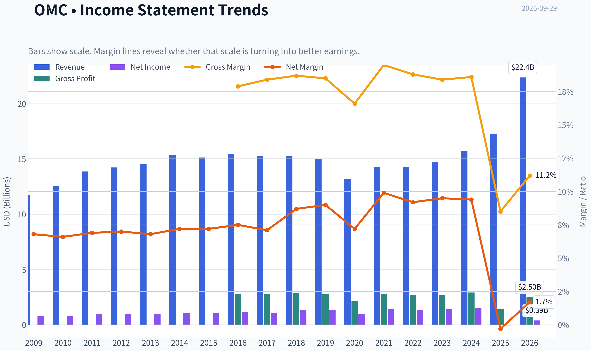
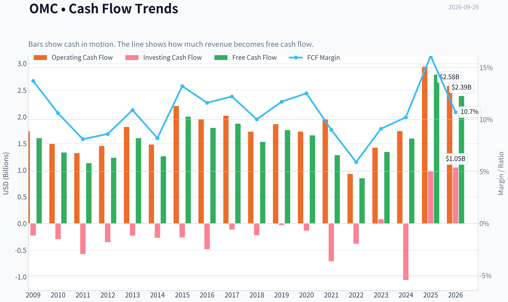
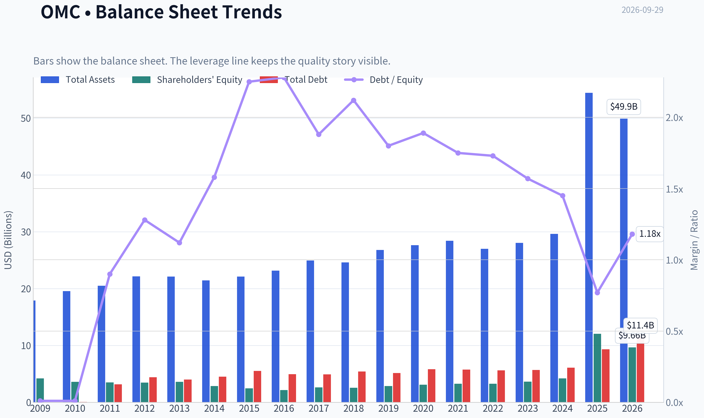
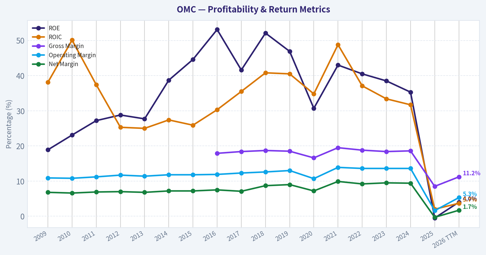
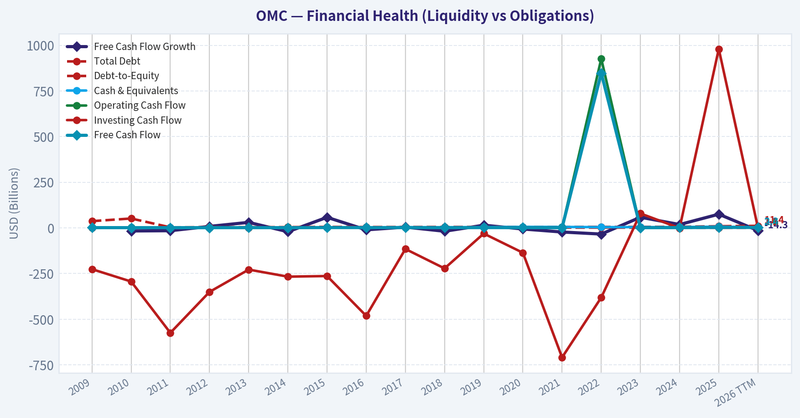
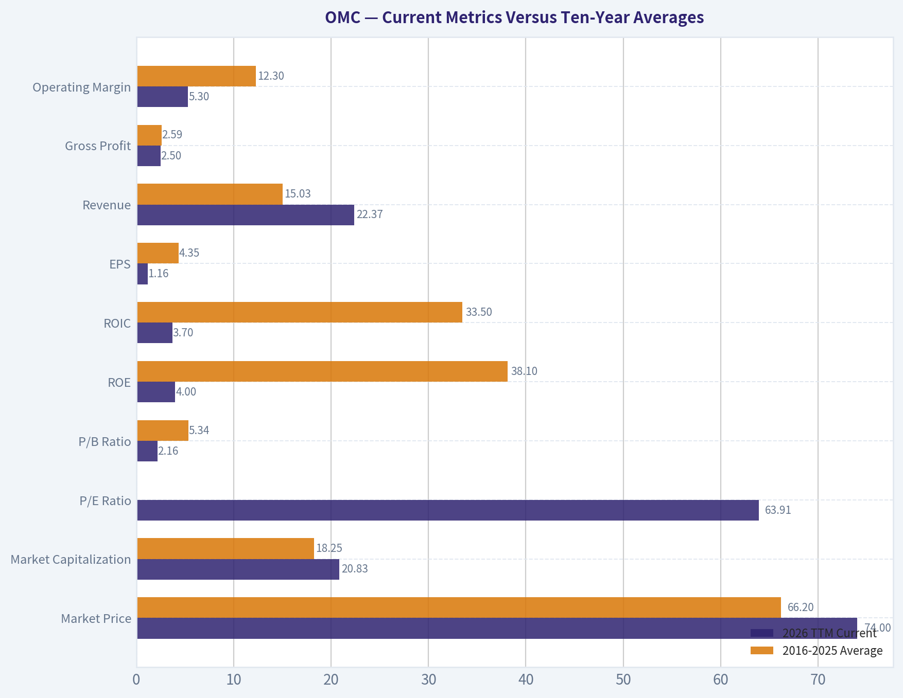
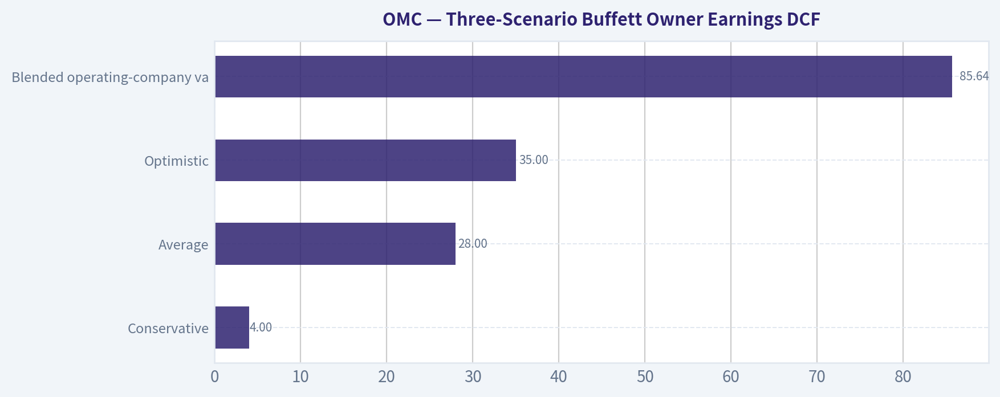
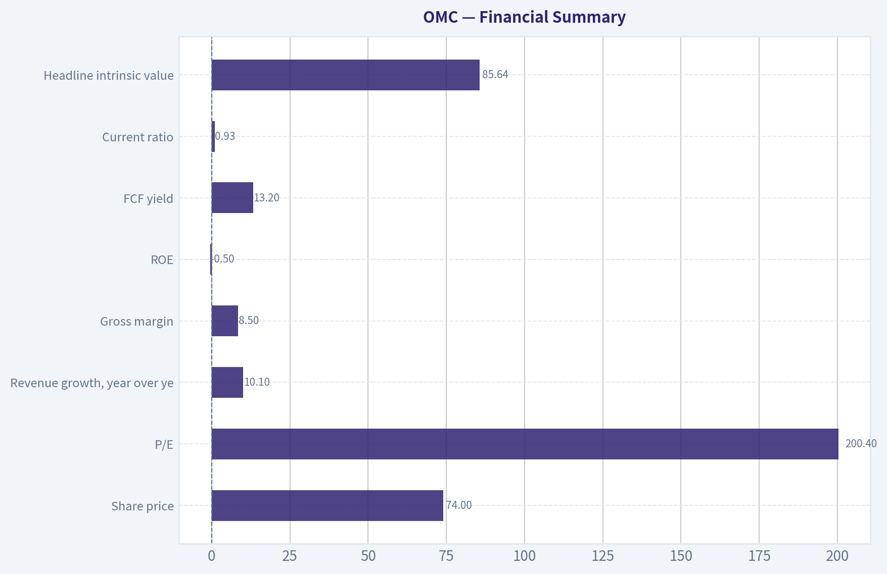
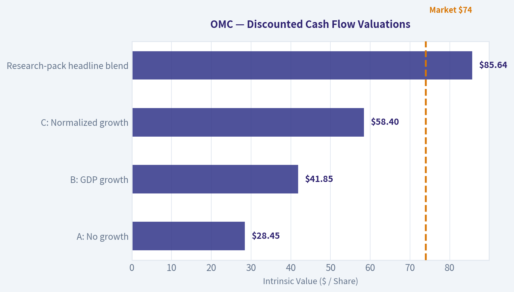
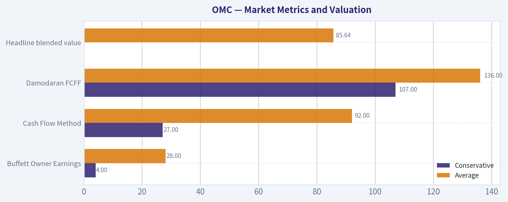

# OMC Deep Value Intelligence

**Analysis Date:** 2026-09-29

## Critical Disclaimer

*This analysis is generated by Deep Value Intelligence, an AI-powered multi-agent investing framework. Education & research only - not financial advice, not a financial advisor.*

---

## Table of Contents

1. Intelligence Summary
2. Analyst Team Reports
   - Fundamentals Analysis
   - Intrinsic Value Analysis (Buffett)
   - Trend & Growth Analysis (Lynch/Druckenmiller/Fisher)
   - Market Technical Analysis
   - Options Market Analysis
3. Research Team Commentary
4. Value Investing Team Commentary
5. Deep Values Commentary

---

## Intelligence Summary

### Thesis + Conditions

**Core Thesis:** # Executive Briefing

**Key Risks:**
- The main risk is not short-term price volatility. It is permanent impairment from client conflicts, talent losses, excessive leverage, recurring restructuring, or AI-driven fee compression.
- ## Risky Analyst: strongest points
- The Risky Analyst correctly argues that waiting for complete normalization could forfeit part of a rerating. Several reported metrics likely reflect the same merger-related disruption rather than four separate failures:

**Confidence:** Low

---

## Analyst Team Reports

### Fundamentals Analysis

#### Latest Earnings Snapshot

*Most recent reported quarter anchored on 2026 Q2, with prior-year comparison when available.*

| Metric | 2026 Q2 | 2025 Q2 | YoY Change |
| --- | ---: | ---: | ---: |
| Revenue | $6.56B | $4.02B | +63.4% |
| Operating Income | $922.5M | $439.2M | +110.0% |
| Net Income | $584.8M | $257.6M | +127.0% |
| Diluted EPS | $2.08 | $1.31 | +58.8% |
| Operating Cash Flow | $-379.2M | $210.1M | -280.5% |
| Free Cash Flow | $-433.1M | $168.0M | -357.8% |

Key Takeaways: This snapshot anchors the most recent reported quarter before the narrative analysis. It helps readers separate long-run business quality from whatever changed in the latest earnings print.

#### 17-Year Financial Metrics for OMC

*All values below are computed deterministically from raw data - not estimated by AI.*

*Issuer profile: operating company (Communication Services / Advertising Agencies).*

#### 17-Year Financial Metrics
*Annual rows come from reported financial statements. The final TTM row is computed from the latest four quarters.*

| Metric | 2009 | 2010 | 2011 | 2012 | 2013 | 2014 | 2015 | 2016 | 2017 | 2018 | 2019 | 2020 | 2021 | 2022 | 2023 | 2024 | 2025 | 2026 TTM |
| --- | --- | --- | --- | --- | --- | --- | --- | --- | --- | --- | --- | --- | --- | --- | --- | --- | --- | --- |
| Market Price | $23 | $28 | $28 | $32 | $49 | $52 | $52 | $60 | $53 | $55 | $63 | $51 | $62 | $72 | $78 | $80 | $78 | $74 |
| Market Cap | $12.15B | $13.90B | $12.63B | $13.49B | $19.37B | $19.78B | $18.55B | $20.36B | $17.03B | $16.67B | $17.90B | $13.48B | $15.80B | $16.88B | $17.42B | $17.09B | $16.55B | $20.83B |
| P/E Ratio | 15.47 | 16.96 | 13.39 | 13.84 | 20.05 | 18.27 | 17.16 | 17.81 | 15.66 | 12.56 | 13.37 | 14.27 | 11.22 | 12.83 | 12.52 | 11.53 | -299.07 | 63.91 |
| P/B Ratio | 2.90 | 3.88 | 3.60 | 3.90 | 5.41 | 6.94 | 7.56 | 9.42 | 6.51 | 6.54 | 6.27 | 4.37 | 4.83 | 5.19 | 4.82 | 4.07 | 1.37 | 2.16 |
| ROE | 18.9% | 23.1% | 27.2% | 28.8% | 27.7% | 38.7% | 44.6% | 53.1% | 41.6% | 52.1% | 46.9% | 30.7% | 43.0% | 40.5% | 38.5% | 35.3% | -0.5% | 4.0% |
| ROIC | 38.1% | 50.1% | 37.4% | 25.3% | 25.0% | 27.4% | 25.9% | 30.3% | 35.5% | 40.8% | 40.5% | 34.8% | 48.8% | 37.1% | 33.4% | 31.7% | 2.0% | 3.7% |
| EPS | $1.51 | $1.64 | $2.08 | $2.30 | $2.43 | $2.85 | $3.05 | $3.39 | $3.39 | $4.39 | $4.72 | $3.56 | $5.51 | $5.58 | $6.27 | $6.97 | $-0.26 | $1.16 |
| Revenue | $11.72B | $12.54B | $13.87B | $14.22B | $14.58B | $15.32B | $15.13B | $15.42B | $15.27B | $15.29B | $14.95B | $13.17B | $14.29B | $14.29B | $14.69B | $15.69B | $17.27B | $22.37B |
| Gross Profit | N/A | N/A | N/A | N/A | N/A | N/A | N/A | $2.77B | $2.81B | $2.85B | $2.76B | $2.18B | $2.79B | $2.68B | $2.71B | $2.92B | $1.47B | $2.50B |
| Gross Margin | N/A | N/A | N/A | N/A | N/A | N/A | N/A | 17.9% | 18.4% | 18.7% | 18.5% | 16.6% | 19.5% | 18.8% | 18.4% | 18.6% | 8.5% | 11.2% |
| Operating Margin | 10.9% | 10.8% | 11.2% | 11.7% | 11.4% | 11.8% | 11.8% | 11.9% | 12.3% | 12.6% | 13.0% | 10.7% | 13.9% | 13.6% | 13.6% | 13.6% | 1.6% | 5.3% |
| Net Income | $793.0M | $827.7M | $952.6M | $998.3M | $991.1M | $1.10B | $1.09B | $1.15B | $1.09B | $1.33B | $1.34B | $945.4M | $1.41B | $1.32B | $1.39B | $1.48B | $-54.5M | $390.2M |
| Net Margin | 6.8% | 6.6% | 6.9% | 7.0% | 6.8% | 7.2% | 7.2% | 7.5% | 7.1% | 8.7% | 9.0% | 7.2% | 9.9% | 9.2% | 9.5% | 9.4% | -0.3% | 1.7% |
| Revenue Growth | N/A | 7.0% | 10.6% | 2.5% | 2.6% | 5.0% | -1.2% | 1.9% | -0.9% | 0.1% | -2.2% | -11.9% | 8.5% | -0.0% | 2.8% | 6.8% | 10.1% | 29.5% |
| Net Income Growth | N/A | 4.4% | 15.1% | 4.8% | -0.7% | 11.4% | -0.9% | 5.0% | -5.2% | 21.9% | 1.0% | -29.4% | 48.9% | -6.5% | 5.7% | 6.4% | -103.7% | -816.0% |
| Free Cash Flow Growth | N/A | -16.7% | -15.3% | 8.4% | 30.4% | -20.9% | 58.0% | -10.5% | 4.5% | -18.3% | 14.9% | -6.0% | -22.4% | -33.7% | 58.4% | 18.6% | 75.1% | -14.3% |
| Total Book Value | $4.19B | $3.58B | $3.50B | $3.46B | $3.58B | $2.85B | $2.45B | $2.16B | $2.62B | $2.55B | $2.85B | $3.08B | $3.27B | $3.25B | $3.62B | $4.19B | $12.05B | $9.66B |
| Total Assets | $17.92B | $19.57B | $20.51B | $22.15B | $22.10B | $21.43B | $22.11B | $23.17B | $24.93B | $24.62B | $26.78B | $27.65B | $28.42B | $27.00B | $28.04B | $29.62B | $54.42B | $49.90B |
| Total Debt | $37.1M | $51.6M | $3.17B | $4.42B | $4.01B | $4.51B | $5.51B | $4.93B | $4.91B | $5.41B | $5.13B | $5.83B | $5.74B | $5.63B | $5.68B | $6.09B | $9.33B | $11.41B |
| Debt-to-Equity | 0.01 | 0.01 | 0.90 | 1.28 | 1.12 | 1.58 | 2.25 | 2.28 | 1.88 | 2.12 | 1.80 | 1.89 | 1.75 | 1.73 | 1.57 | 1.45 | 0.77 | 1.18 |
| Cash & Equivalents | $1.59B | $2.29B | $1.78B | $2.68B | $2.71B | $2.39B | $2.61B | $3.00B | $3.80B | $3.65B | $4.31B | $5.60B | $5.32B | $4.28B | $4.43B | $4.34B | $6.88B | $3.34B |
| Shareholders' Equity | $4.19B | $3.58B | $3.50B | $3.46B | $3.58B | $2.85B | $2.45B | $2.16B | $2.62B | $2.55B | $2.85B | $3.08B | $3.27B | $3.25B | $3.62B | $4.19B | $12.05B | $9.66B |
| Operating Cash Flow | $1.73B | $1.49B | $1.32B | $1.45B | $1.81B | $1.48B | $2.20B | $1.95B | $2.02B | $1.72B | $1.86B | $1.72B | $1.95B | $926.5M | $1.42B | $1.73B | $2.94B | $2.58B |
| Investing Cash Flow | $-226.0M | $-293.7M | $-574.6M | $-350.4M | $-228.2M | $-266.9M | $-263.5M | $-481.6M | $-115.4M | $-221.8M | $-30.9M | $-136.1M | $-709.2M | $-380.9M | $79.1M | $-1.06B | $980.2M | $1.05B |
| Free Cash Flow | $1.60B | $1.33B | $1.13B | $1.23B | $1.60B | $1.26B | $2.00B | $1.79B | $1.87B | $1.53B | $1.75B | $1.65B | $1.28B | $848.3M | $1.34B | $1.59B | $2.79B | $2.39B |
| FCF Margin | 13.7% | 10.6% | 8.1% | 8.6% | 10.9% | 8.2% | 13.2% | 11.6% | 12.2% | 10.0% | 11.7% | 12.5% | 9.0% | 5.9% | 9.1% | 10.2% | 16.1% | 10.7% |
| Dividends / Share | $0.00 | $0.00 | $0.00 | $0.00 | $0.00 | $0.00 | $0.00 | $0.00 | $0.00 | $0.00 | $0.00 | $0.00 | $0.00 | $2.46 | $2.53 | $2.60 | $2.60 | $2.68 |

#### Profitability Metrics
- Return on Equity (ROE): -0.5%
- Return on Invested Capital (ROIC): 0.2%
- Return on Assets (ROA): -0.1%
- Gross Margin: 8.5%
- Operating Margin: 1.6%
- Net Profit Margin: -0.3%

#### Liquidity Metrics
- Current Ratio: 0.93
- Quick Ratio: 0.72

#### Leverage Metrics
- Debt-to-Equity Ratio: 0.77
- Interest Coverage Ratio: 1.06
- Net Debt: $2.45B

#### Growth Metrics (Year-over-Year)
- Revenue Growth: 10.1%
- Net Income Growth: -103.7%
- Free Cash Flow Growth: 75.1%
- Revenue CAGR (3-Year): 6.5%
- Revenue CAGR (5-Year): 5.6%

#### Valuation Metrics
- P/E Ratio (TTM): 200.38
- Forward P/E: 6.31
- Price-to-Book: 2.11
- Price-to-Sales: 0.94
- PEG Ratio: 15.97
- EV/EBITDA: 8.05
- Free Cash Flow Yield: 13.2%
- Earnings Yield: 0.5%

#### Owner Earnings (Buffett Method, Code-Computed)
- Net Income: $-54.5M
- + Depreciation & Amortization: $276.7M
- - Capital Expenditures: $-149.8M
- - Working Capital Changes: $712.1M
- = **Owner Earnings: $-639.7M**

#### Intrinsic Value (Code-Computed)
- Current Price: $74
- **Headline Intrinsic Value (business-model routed): $86**
  Business model: operating company - weighted blend [Damodaran FCFF + owner-earnings DCF] (operating_company)
  Model spread (min-max across DCFs): $28 - $136
  Margin of safety vs. price (headline): 13.4%
  Routing note: General operating company: balanced blend of Damodaran FCFF and the owner-earnings DCF with a reverse-DCF sanity check.
- Buffett Method (Owner Earnings):
  Conservative: $4
  Average: $28
  Optimistic: $35
- Cash Flow Method (FCF):
  Conservative: $27
  Average: $92
  Optimistic: $200
- Damodaran FCFF (WACC + margins + reinvestment):
  Conservative: $107
  Average: $136
  Optimistic: $203
  Monte Carlo band (P10-P90): $96 - $227 (median $148)
  P(intrinsic value > price): 98.7%
- Reverse-DCF: price implies ~23.6%/yr owner-earnings growth for 10y; trailing 3y was N/A, 5y N/A.

#### Piotroski F-Score: 2/9
- Positive Net Income: FAIL
- Positive Operating Cash Flow: PASS
- ROA Improvement: FAIL
- Cash Flow > Net Income: PASS
- Decreasing Debt: FAIL
- Improving Current Ratio: FAIL
- No Dilution: FAIL
- Improving Gross Margin: FAIL
- Improving Asset Turnover: FAIL

ANALYST STANCE: **WATCH**

#### Executive Summary

Omnicom Group, Inc. (OMC) is currently priced at **$74 per share** with a deterministic 2026 TTM market capitalization of **$20.83 billion**. The business has historically produced strong returns on capital, recurring free cash flow, and a durable position in global advertising and marketing services. However, the latest TTM figures show a sharp deterioration in earnings quality and balance-sheet resilience, apparently associated with the IPG combination, integration costs, working-capital investment, and accounting effects.

The stock looks inexpensive on cash flow and forward earnings, but expensive on reported trailing earnings. The deterministic dataset's headline intrinsic value is approximately **$86 per share**, implying about **13% upside**. Nevertheless, the range across valuation models is unusually wide, from **$28 to $136**, while the Owner Earnings model produces only **$4 to $35** per share. This dispersion makes OMC a recovery and integration situation rather than a straightforward Buffett-quality compounder at present.

#### Current Metrics Versus Ten-Year Averages

The comparison below uses the ten completed annual periods from **2016 through 2025**, where available. Averages are arithmetic averages and are not substitutes for normalized earnings. The P/E average is shown on a normalized basis excluding the abnormal 2025 loss-year distortion.

| Metric | 2026 TTM Current | 2016-2025 Average | Current Versus Average |
|---|---:|---:|---|
| Market Price | $74 | $66.20 | 11.8% above |
| Market Capitalization | $20.83B | $18.25B | 14.1% above |
| P/E Ratio | 63.91 | 13.98 normalized | Far above |
| P/B Ratio | 2.16 | 5.34 | Below, but not meaningful for this issuer |
| ROE | 4.0% | 38.1% | Material deterioration |
| ROIC | 3.7% | 33.5% | Material deterioration |
| EPS | $1.16 | $4.35 | 73% below |
| Revenue | $22.37B | $15.03B | 48.8% above |
| Gross Profit | $2.50B | $2.59B | 3.6% below |
| Operating Margin | 5.3% | 12.3% | 7.0 percentage points below |
| Net Income | $390.2M | $1.14B | 65.8% below |
| Net Margin | 1.7% | 7.7% | 6.0 percentage points below |
| Revenue Growth | 29.5% | 1.5% | Much higher |
| Net Income Growth | -816.0% | -5.6% | Severely weaker |
| Free Cash Flow Growth | -14.3% | 8.1% | Below average |
| Total Book Value | $9.66B | $3.76B | Much higher |
| Total Assets | $49.90B | $29.47B | 69.3% above |
| Total Debt | $11.41B | $6.27B | 82.0% above |
| Debt-to-Equity | 1.18 | 1.72 | Lower, but still meaningful leverage |
| Cash and Equivalents | $3.34B | $4.56B | 26.8% below |
| Shareholders' Equity | $9.66B | $3.76B | Much higher |
| Free Cash Flow | $2.39B | $1.64B | 45.3% above |
| Dividends per Share | $2.68 | $1.29 | 108% above |

**Key Takeaways:** OMC's revenue and reported equity expanded substantially, but profitability has not yet caught up. Current ROE, ROIC, margins, EPS, and net income are all far below historical norms, while debt is materially higher and cash is lower. The most important positive is that free cash flow remains strong relative to earnings, although even FCF declined 14.3% year over year.

#### Market Metrics and Valuation

- **Market price:** $74, versus a ten-year average of approximately $66.20. The stock is not trading near its decade-low price levels, despite current earnings being severely depressed.
- **Market capitalization:** $20.83 billion, above the ten-year average of approximately $18.25 billion. The market is already assigning value to the enlarged post-combination business.
- **P/E ratio:** 63.91 on the deterministic TTM data. This is far above the normalized ten-year average of approximately 14.0. The high multiple is primarily a denominator problem: trailing earnings are unusually weak.
- **P/B ratio:** 2.16 versus a ten-year average of approximately 5.34. However, OMC is an asset-light advertising and intellectual-property-driven operating company. Book value is heavily affected by acquisitions, goodwill, intangible assets, buybacks, and purchase accounting. Therefore, P/B should not be interpreted mechanically as evidence that OMC is cheap.
- **Cash-flow valuation:** The more relevant measures are FCF yield, normalized owner earnings, and the ability of the enlarged company to restore historical operating margins. The data pack reports an FCF yield of approximately **13.2%**, which is attractive if current free cash flow is sustainable.

The headline intrinsic value is **$85.64**, derived from a weighted blend of Damodaran FCFF and Owner Earnings DCF. This implies approximately **13.4% upside** from $74. The model spread is very wide:

| Valuation Method | Conservative | Average | Optimistic |
|---|---:|---:|---:|
| Buffett Owner Earnings | $4 | $28 | $35 |
| Cash Flow Method | $27 | $92 | $200 |
| Damodaran FCFF | $107 | $136 | $203 |
| Headline blended value | - | **$85.64** | - |

**Key Takeaways:** The valuation depends heavily on whether OMC's cash flow converts back into earnings and whether post-merger margins recover. The Owner Earnings model is very cautious because current working-capital changes make calculated owner earnings negative, while FCFF is much more favorable. This unusually wide range argues for a margin-of-safety purchase only after evidence of integration progress and profit normalization.

#### Profitability and Earnings Quality

OMC's historical profitability was exceptional for a service company:

- Historical average ROE was approximately **38.1%**, with several years above 40%.
- Historical average ROIC was approximately **33.5%**, indicating strong economics and limited capital intensity.
- Operating margins generally ranged from roughly **10.7% to 13.9%** from 2016 through 2024.
- Net margins were generally between **7% and 10%** during the same period.

The latest TTM period is markedly different:

- **ROE:** 4.0%, compared with 38.1% historically.
- **ROIC:** 3.7%, compared with 33.5% historically.
- **Operating margin:** 5.3%, compared with 12.3% historically.
- **Net margin:** 1.7%, compared with 7.7% historically.
- **EPS:** $1.16, compared with a ten-year average of $4.35.
- **Net income:** $390.2 million, compared with a ten-year average of approximately $1.14 billion.

Revenue growth of **29.5%** is impressive but should not be confused with organic growth. The enlarged revenue base likely reflects the IPG transaction and consolidation. Gross profit is only **$2.50 billion**, slightly below the 2016-2025 average despite much higher revenue, causing gross margin to fall to **11.2%** from a historical average near 18%. This is a significant warning sign.

The latest data also show an unusual divergence between earnings and cash flow:

- Net income: $390.2 million.
- Free cash flow: $2.39 billion.
- Operating cash flow: $2.58 billion.
- Computed owner earnings: **negative $639.7 million**, after a large working-capital deduction.

This divergence may reflect timing, acquisition-related working-capital movements, restructuring, or integration costs. It should not automatically be treated as permanent, but it does make reported FCF difficult to normalize.

#### Growth Analysis

Revenue grew 29.5% year over year and the three-year and five-year revenue CAGRs were reported at 6.5% and 5.6%, respectively. However, much of the latest step-up appears acquisition-related rather than purely organic.

Net income growth of **-816%** is not economically interpretable as a normal operating trend because it compares a modest positive current result with the prior year's loss. It nevertheless confirms that OMC has not yet restored normal profitability.

Free cash flow declined **14.3%** on the deterministic TTM comparison, despite remaining well above the ten-year average in absolute dollars. FCF has been volatile historically, with large positive and negative annual changes. That volatility reduces confidence in applying a high perpetual growth rate.

#### Balance Sheet and Financial Strength

OMC's balance sheet expanded significantly:

- Assets increased to **$49.90 billion**, versus a 2016-2025 average of approximately $29.47 billion.
- Debt increased to **$11.41 billion**, versus an average of approximately $6.27 billion.
- Cash fell to **$3.34 billion**, versus an average of approximately $4.56 billion.
- Net debt is reported at approximately **$2.45 billion**.
- Debt-to-equity is **1.18**, below the historical average of 1.72 but still meaningful for a business whose operating margin has recently compressed.
- Interest coverage is only **1.06**, which is a major near-term risk indicator.
- Current ratio is **0.93** and quick ratio is **0.72**. These liquidity measures are flagged as less useful for an operating company with significant client-related working-capital flows, but they still warrant monitoring because they indicate limited conventional balance-sheet liquidity.

The lower debt-to-equity ratio is partly explained by the large increase in equity after the transaction. It should not be interpreted as a clean deleveraging event, because absolute debt is substantially higher and cash is lower.

#### Cash Flow and Dividend Policy

OMC generated **$2.39 billion of FCF** in the latest TTM period, compared with a ten-year average of approximately $1.64 billion. This is the strongest part of the current investment case.

The dividend is **$2.68 per share**, compared with a ten-year average of approximately $1.29. At the current price, the dividend yield is approximately **3.6%**. The dividend provides shareholder support, but its safety depends on whether FCF remains available after integration spending, debt service, restructuring costs, and working-capital requirements.

The negative owner earnings calculation is important:

- Net income: **-$54.5 million** under the code-computed owner-earnings period.
- Add depreciation and amortization: **$276.7 million**.
- Subtract capital expenditures: **$149.8 million**.
- Subtract working-capital investment: **$712.1 million**.
- Calculated owner earnings: **-$639.7 million**.

This result makes a conventional Buffett owner-earnings valuation unreliable on unadjusted current figures. A normalized model must determine whether the working-capital outflow is temporary or structurally recurring.

#### Revenue Breakdown

The deterministic dataset does not provide a precise current-year breakdown by business segment, product line, or geography. OMC is a diversified global marketing-services company whose major economic revenue sources include advertising and media, precision marketing, public relations, healthcare marketing, branding, experiential marketing, and related communications services. Because exact segment amounts are unavailable in the supplied canonical data, the table does not fabricate allocations.

| Revenue Source | Amount ($B) | % of Total |
|---|---:|---:|
| Advertising and media services | Not disclosed in supplied dataset | Not available |
| Precision marketing and customer relationship services | Not disclosed in supplied dataset | Not available |
| Public relations and communications | Not disclosed in supplied dataset | Not available |
| Healthcare and specialized marketing services | Not disclosed in supplied dataset | Not available |
| Branding, experiential, and other agency services | Not disclosed in supplied dataset | Not available |
| **Total reported revenue** | **$22.37B** | **100%** |

**Key Takeaways:** The supplied data confirm total TTM revenue of $22.37 billion but do not provide defensible dollar amounts for individual segments. The business is diversified across marketing categories, which supports durability, but the absence of precise segment data limits analysis of organic growth, client concentration, and the profitability of the acquired operations.

#### Buffett-Style Qualitative Assessment

**Economic moat:** OMC benefits from global scale, long-standing client relationships, creative talent, data and technology capabilities, and the ability to coordinate campaigns across media channels and geographies. Switching agencies can be disruptive for large multinational clients, creating relationship-based switching costs. The moat is real but less secure than that of a consumer brand or regulated utility because advertising budgets are cyclical, clients can rebid contracts, and digital platforms compete for marketing economics.

**Business durability:** Demand for brand building, customer acquisition, public relations, and digital engagement should remain durable. However, the industry is exposed to economic cycles, client concentration, media disintermediation, artificial intelligence, and changing advertising technology. The IPG combination may improve scale but also increases execution complexity.

**Predictable earnings:** Historically, earnings were reasonably predictable, with net income positive in almost every year and operating margins generally stable. The 2025 loss and the current depressed margins materially reduce that predictability. Until the company demonstrates several quarters of margin recovery, historical consistency should not be extrapolated automatically.

**Management and capital allocation:** OMC has historically returned capital through dividends and buybacks while producing strong ROE and ROIC. The current transaction enlarged the company but also increased debt, assets, and integration demands. Management's most important test is now whether it can convert the larger revenue base into margins approaching the historical 11%-14% operating range without sacrificing client retention or increasing leverage further.

**Financial strength:** Cash generation is encouraging, but absolute debt is high relative to recent earnings and interest coverage is weak. The company can be financially sound if cash flow normalizes, but it has less room for error during an integration downturn than it had historically.

#### Three-Scenario Buffett Owner Earnings DCF

A Buffett-style DCF values the cash that can be withdrawn by owners without impairing the competitive position of the business. The standard framework is:

\[
\text{Equity Value} =
\sum_{t=1}^{10}\frac{OE_t}{(1+r)^t}
+
\frac{OE_{10}(1+g_T)}{(r-g_T)(1+r)^{10}}
\]

where:

- \(OE_t\) is normalized owner earnings,
- \(r\) is the discount rate, approximately 10%,
- \(g_T\) is the terminal growth rate, 2.5%.

The current code-computed owner earnings figure is **negative $639.7 million**, so using it mechanically would create an economically meaningless negative valuation. The supplied model therefore produces very conservative scenario values based on normalization assumptions:

| Scenario | Core Assumption | Model Fair Value | Interpretation |
|---|---|---:|---|
| Conservative | Minimal recovery; working-capital and integration pressure persist | $4 | Severe downside if current owner-earnings weakness is structural |
| Average | Partial recovery toward normalized cash generation | $28 | Indicates insufficient margin of safety at $74 |
| Optimistic | Strong recovery, but still below a permanent high-growth assumption | $35 | Positive recovery case, though conservative relative to FCFF |
| Blended operating-company value | Weighted FCFF and Owner Earnings approach | **$85.64** | Approximately 13.4% above current price |

For reference, the cash-flow model produces **$27, $92, and $200** under conservative, average, and optimistic assumptions. The Damodaran FCFF model produces **$107, $136, and $203**. The latter assumes substantially better margin recovery and reinvestment economics than the raw current owner-earnings calculation.

A hand DCF using current FCF of $2.39 billion illustrates the sensitivity:

- Shares implied by market capitalization and price: approximately **281.5 million**.
- At 10% discount rate and 2.5% terminal growth:
  - **3% near-term FCF growth:** approximately $124 per share before net-debt adjustment.
  - **8% near-term FCF growth:** approximately $173 per share before net-debt adjustment.
  - **12% near-term FCF growth:** approximately $234 per share before net-debt adjustment.

These figures are not used to override the model-based valuation because current FCF may contain acquisition-related timing benefits and does not reconcile cleanly with owner earnings. After subtracting approximately $2.45 billion of net debt, the values would be lower, but still highly sensitive to the assumed sustainability of current FCF.

The reverse DCF is particularly demanding: the current price implies approximately **23.6% annual owner-earnings growth for ten years** under the relevant model. That is difficult to justify from the current negative owner-earnings base. The reverse-DCF result suggests that the market price is not necessarily discounting a modest recovery; it may be discounting a very substantial cash-flow normalization.

#### Key Risks, Red Flags, and Opportunities

| Category | Observation | Investment Significance |
|---|---|---|
| Red flag | ROE fell from a ten-year average near 38% to 4% | Capital efficiency has temporarily collapsed |
| Red flag | ROIC fell from approximately 33.5% to 3.7% | Integration or acquisition economics may be diluting returns |
| Red flag | Operating margin fell to 5.3% from a 12.3% average | Margin recovery is central to the thesis |
| Red flag | Interest coverage is only 1.06 | Debt service could constrain flexibility |
| Red flag | Piotroski F-score is 2/9 | Broad evidence of deteriorating financial quality |
| Red flag | Owner earnings are negative | Current cash conversion requires normalization analysis |
| Opportunity | FCF remains $2.39B | Strong cash generation could support debt reduction and dividends |
| Opportunity | Forward P/E is reported at 6.31 | Large earnings recovery is already expected by forward estimates |
| Opportunity | Headline intrinsic value is $85.64 | Moderate modeled upside exists |
| Opportunity | Global scale and client relationships | Potentially durable competitive advantages |
| Opportunity | IPG synergies | Successful integration could restore margins and expand cross-selling |

**Key Takeaways:** The opportunity is a potentially mispriced recovery in which OMC converts enlarged revenue into historical-level margins and uses cash flow to reduce leverage. The red flags are equally substantial: weak interest coverage, a low Piotroski score, negative owner earnings, and sharply depressed returns on capital. The stock offers upside only if the integration thesis is substantially correct.

#### Final Investment Stance

**WATCH**

OMC has many characteristics that attract value investors: a recognizable global franchise, historically high ROIC, recurring client relationships, strong absolute FCF, a meaningful dividend, and a headline intrinsic value above the current share price. At $74, the stock is not obviously overvalued if FCF normalizes and the IPG combination produces expected synergies.

However, a Buffett-style investment requires both an understandable business and high confidence in normalized owner earnings. That confidence is currently lacking. Earnings, margins, ROE, ROIC, interest coverage, and the Piotroski score all signal material deterioration. The valuation range is exceptionally wide, and the reverse DCF requires approximately 23.6% annual owner-earnings growth for a decade.

A more attractive entry would require one or more of the following:

1. Operating margin recovery toward at least 8%-10%.
2. Sustained positive owner earnings after working-capital investment.
3. Interest coverage moving comfortably above current levels.
4. Evidence that debt is declining from the current $11.41 billion.
5. Confirmation that revenue growth is organic and that client retention remains strong.

Until those conditions appear, OMC is better treated as a **watch-list recovery candidate** than as a high-conviction Buffett-quality purchase.

| Key Point | Assessment |
|---|---|
| Business quality | Historically strong, currently disrupted |
| Economic moat | Meaningful scale and relationships, but exposed to digital competition |
| Revenue trend | Strong reported growth, partly acquisition-driven |
| Margin trend | Severely below historical norms |
| Cash flow | Strong in absolute terms but volatile and difficult to normalize |
| Balance sheet | More leveraged with weaker liquidity than historical levels |
| Valuation | Headline value modestly above price, but model dispersion is extreme |
| Dividend | Attractive, but dependent on sustained cash flow |
| Main catalyst | Margin recovery and successful IPG integration |
| Main risk | Debt and interest burden if earnings recovery fails |
| Final stance | **WATCH** |

#### Fundamental Visuals

This graph tracks the profitability and return metrics (ROE, ROIC, Margins) of **OMC** over the past decade, highlighting capital efficiency trends.

This chart illustrates the financial health of **OMC** over the last 10 years, mapping cash equivalents and free cash flow against total obligations (Debt).

---

### Intrinsic Value Analysis (Buffett)

> *Following Warren Buffett's value investing philosophy: Circle of Competence, Economic Moat, Management Quality, and Margin of Safety.*

#### Intrinsic Value Snapshot

Price is what you pay. Intrinsic value is what the business may be worth based on the cash it can create for owners over time. We show a range, not one magic number.

- Current Price: $74.14
- Value Range (conservative to optimistic across both DCF methods): $4.27 to $200.32

##### Owner Earnings (Buffett Method)
- Net Income: $-54,500,000.00
- Depreciation & Amortization: $276,700,000.00
- Capital Expenditures: $-149,800,000.00
- Working Capital Changes: $712,100,000.00
- Owner Earnings: $-639,700,000.00

##### Intrinsic Value
###### Buffett Method
Uses owner earnings. Stricter, and usually more conservative.
- Conservative: $4.27
- Average: $28.45
- Optimistic: $35.32
- Discount Rate: 10.0%

###### Cash Flow Method
Uses free cash flow. Better for companies spending heavily today to grow tomorrow.
- Conservative: $26.65
- Average: $91.94
- Optimistic: $200.32
- Discount Rate: 10.0%

ANALYST STANCE: **AVOID**

#### Executive Conclusion

Omnicom is a recognizable global advertising-services company with meaningful scale, customer relationships, and a strong industry position. However, the investment case is weakened by an uncertain moat in an AI-disrupted industry, negative reported ROE, a very high P/E caused by depressed or distorted earnings, and a valuation that depends heavily on optimistic cash-flow assumptions.

At $74 per share, the headline intrinsic value is $85.64, implying only a 13.4% margin of safety. That discount is inadequate for a business with modest predictability, narrow competitive advantages, and substantial model uncertainty.

#### 1. Factor Scorecard

| Factor | Score | Assessment |
|---|---:|---|
| Circle of Competence & Simplicity | 3/5 | Simple model: Omnicom provides advertising, media, branding, and marketing services. However, agency economics are changing rapidly because of AI, automation, data ownership, and client insourcing. |
| Moat | 3/5 | Global scale, customer relationships, creative reputation, and integrated capabilities provide a narrow moat, but switching costs are not absolute and service offerings can be replicated. |
| Management & Capital Allocation | 3/5 | Omnicom has a long operating history and shareholder-return orientation, but the IPG combination increases execution, integration, and balance-sheet risks. |
| Industry Structure | 2/5 | Advertising services remain competitive and increasingly exposed to technology platforms, procurement pressure, and AI-driven commoditization. |

**Gate 5-Quality/Solvency hard floor:** **Not tripped.** The available information does not establish both worsening fundamentals and a solvency red line such as interest coverage below 1.0 times. The balance sheet and integration risks remain important scorecard deductions, but they do not constitute the hard-floor condition.

#### 2. Moat Analysis

Omnicom's moat is best classified as **narrow and stable, with uncertain durability**.

| Moat Source | Evidence | Rating |
|---|---|---:|
| Intangible assets | Established agency brands, creative reputation, and major-client relationships | Moderate |
| Switching costs | Campaign history, institutional knowledge, data, and embedded workflows help retention, but clients can rebid and consolidate agencies | Moderate-low |
| Cost advantage | Global scale and shared infrastructure create efficiencies, but large digital platforms and specialized competitors remain powerful | Moderate |
| Network effects | Limited traditional network effects; scale improves capabilities and purchasing power, but does not create strong user-driven lock-in | Low-moderate |

Omnicom's 8.5% gross margin reflects the labor-intensive, pass-through nature of the agency model rather than a high-margin software or branded-consumer franchise. Its principal defense is scale and relationship depth, not an unassailable technological or network-effect moat.

AI is a two-sided force. It can improve productivity and expand Omnicom's service capabilities, but it can also reduce the value of traditional creative labor and allow clients to bring more work in-house. The company must demonstrate that AI expands operating margins and client value rather than simply lowering industry prices.

#### 3. Management Quality and Capital Allocation

Omnicom's management has historically operated a mature, shareholder-oriented business and has returned substantial capital through dividends and repurchases. Its long operating history supports a reasonable level of trust.

The principal concern is capital allocation around strategic consolidation. The IPG transaction may create meaningful cost and cross-selling synergies, but acquisitions in advertising can destroy value if clients, talent, or agency cultures do not transfer successfully. The transaction also raises the importance of debt discipline and post-merger execution.

Overall assessment: **competent and experienced, but not sufficiently demonstrated as exceptional under the current strategic transition.**

#### 4. Financial Summary

| Metric | Latest available figure |
|---|---:|
| Share price | $74.00 |
| Market capitalization | $21.13 billion |
| P/E | 200.4x |
| Revenue growth, year over year | 10.1% |
| Gross margin | 8.5% |
| ROE | -0.5% |
| FCF yield | 13.2% |
| Current ratio | 0.93x |
| Headline intrinsic value | $85.64 |
| Reverse-DCF implied annual growth | Approximately 23.6% for 10 years |

**Key Takeaways:** Revenue growth is healthy, and the 13.2% free-cash-flow yield suggests cash generation is materially better than reported earnings imply. However, negative ROE, a 200-times P/E, and the wide gap between accounting earnings and cash-flow valuation reduce confidence in the quality and durability of the earnings base. The current ratio is not decisive for an agency business, where working-capital characteristics can be unusual.

#### 5. Owner Earnings Calculation

The owner-earnings DCF implies the following normalized owner earnings per share:

| Component | Per-share amount |
|---|---:|
| Net income | Not separately normalized in the available valuation model |
| Depreciation and amortization | Included in normalized cash flow |
| Maintenance capital expenditure | Deducted in normalized cash flow |
| Working-capital investment | Reflected in normalized cash flow |
| **Implied owner earnings per share** | **$2.845** |
| Approximate implied total owner earnings | **$0.81 billion** |

The $2.845 owner-earnings figure is derived from the no-growth DCF value of $28.45 per share at a 10% discount rate:

**$28.45 x 10% = $2.845 owner earnings per share**

This is substantially below the free-cash-flow estimate implied by the 13.2% FCF yield, which indicates unusually high uncertainty regarding normalization, acquisition effects, or the treatment of cash flow.

**Key Takeaways:** The owner-earnings framework produces a conservative value substantially below the current share price, while the FCF-based framework is considerably more favorable. That dispersion is itself a warning: investors do not have a single dependable measure of normalized earnings power.

#### 6. Three-Scenario DCF Valuation

| Scenario | Key assumption | Intrinsic value per share |
|---|---|---:|
| A: No growth | Owner earnings of $2.845 per share discounted at 10% | **$28.45** |
| B: GDP growth | 3% perpetual growth, 10% discount rate | **$41.85** |
| C: Normalized growth | Approximately 5% annual growth for 10 years, then 5% terminal growth | **$58.40** |
| Research-pack headline blend | Weighted owner earnings, FCF, and Damodaran FCFF models | **$85.64** |

Scenario C uses a moderate normalized-growth assumption rather than the 23.6% annual growth implied by the current price under the reverse DCF.

**Key Takeaways:** The conservative owner-earnings scenarios produce values below the $74 share price. The $85.64 headline value is supported mainly by FCF and FCFF methodologies, not by the owner-earnings model. The valuation range-from $28.45 to $135.67 across the underlying models-is too wide to support a high-conviction purchase.

#### 7. Margin of Safety Analysis

| Valuation measure | Value per share | Margin of safety versus $74 |
|---|---:|---:|
| Owner-earnings DCF | $28.45 | **Negative 160%** |
| FCF model | $91.94 | **19.5%** |
| Damodaran FCFF model | $135.67 | **45.5%** |
| Headline weighted intrinsic value | $85.64 | **13.4%** |

The 13.4% headline margin of safety is acceptable only for a highly predictable, wide-moat compounder. Omnicom does not currently meet that standard. Additionally, the reverse DCF says the stock price assumes approximately 23.6% annual growth for a decade, which appears aggressive for a mature advertising-services business.

#### 8. Buffett Scorecard

| Criterion | Weight | Score | Weighted contribution |
|---|---:|---:|---:|
| Moat width and durability | 25% | 3/5 | 0.75 |
| Valuation and margin of safety | 20% | 2/5 | 0.40 |
| Capital returns versus WACC | 15% | 2/5 | 0.30 |
| Business understanding and predictability | 12% | 3/5 | 0.36 |
| Management quality and capital allocation | 12% | 3/5 | 0.36 |
| Reinvestment runway | 8% | 3/5 | 0.24 |
| Balance-sheet strength | 4% | 3/5 | 0.12 |
| Industry structure | 4% | 2/5 | 0.08 |
| **Total** | **100%** |  | **2.61/5** |

#### 9. Investment Stance

**AVOID - Moderate conviction**

Omnicom is not a distressed company, and its cash generation, scale, and customer relationships could produce attractive returns if the IPG integration succeeds and AI improves productivity. Nevertheless, the present evidence does not show a sufficiently durable moat or sufficiently reliable intrinsic value estimate.

A more attractive entry point would require either:

- A materially lower share price, preferably near or below the conservative cash-flow scenarios; or
- Clear evidence that post-merger synergies are expanding margins, reducing leverage, and converting AI investment into durable competitive advantages.

At $74, the stock offers too little margin of safety for the uncertainty involved.
#### Valuation Bridge

This bridge places the current market price beside each intrinsic value lens so readers can see whether upside depends on one method or shows up across several methods.

| Scenario | Intrinsic Value / Share |
| --- | ---: |
| Buffett Method | $28.45 |
| Cash Flow Method | $91.94 |
| Damodaran Method | $135.67 |
| Current Price | $74.14 |

#### Key Takeaways

If one method is far above the others, the upside case depends on a specific modelling assumption. When several methods cluster together, the valuation story is more robust.

#### Valuation Visuals

This comparison chart from *Latest Earnings Snapshot* stacks current figures against historical benchmarks for **OMC**, making it easy to see where the company trades relative to its own averages.

This comparison chart from *Current Metrics Versus Ten-Year Averages* stacks current figures against historical benchmarks for **OMC**, making it easy to see where the company trades relative to its own averages.

This comparison chart from *Three-Scenario Buffett Owner Earnings DCF* stacks current figures against historical benchmarks for **OMC**, making it easy to see where the company trades relative to its own averages.

This comparison chart from *Financial Summary* stacks current figures against historical benchmarks for **OMC**, making it easy to see where the company trades relative to its own averages.

The following chart maps the **OMC** Owner Earnings DCF valuation scenarios (Conservative, Average, Optimistic) to visually represent the margin of safety based on intrinsic value calculations.

---

### Trend & Growth Analysis (Lynch/Druckenmiller/Fisher)

> *Following Peter Lynch's GARP, Stanley Druckenmiller's macro-aware approach, and Philip Fisher's scuttlebutt methodology.*

ANALYST STANCE: **AVOID**

#### Executive Conclusion

Omnicom is a **value/income and merger-integration situation**, not a high-growth investment. The company has a strong agency franchise, recognized digital capabilities, potentially meaningful IPG synergies, and a discounted valuation based on forward earnings. However, reported revenue growth is only about 10%, gross margin is low by technology-company standards, and the current valuation data are distorted by merger-related or one-time earnings effects.

The setup may suit a value investor seeking cash flow and dividends, but it does not currently meet the Lynch/Druckenmiller requirement for an accelerating, 15-25%+ growth company with clear ten-bagger potential.

#### 1. Lynch Classification

| Category | Assessment |
|---|---|
| Classification | Stalwart / value-oriented merger integration |
| Revenue growth | 10.1% year over year |
| Growth-investor fit | Weak |
| Dividend/value characteristics | More attractive than growth characteristics |
| Ten-bagger potential | Low from the current business model and scale |

**Key Takeaways:** OMC is growing faster than a traditional slow-growth advertising holding company, but not fast enough to qualify as a primary Lynch fast grower. Its investment case depends more on synergies, cash flow, dividends, and valuation normalization than on sustained organic compounding.

#### 2. The Story in Three Bullets

- Omnicom is combining with IPG to create a larger global marketing-services platform with potential cost and revenue synergies.
- Its agencies retain strong competitive positions, including recognition by Gartner as a leader in global digital marketing agencies.
- Artificial intelligence, data-driven marketing, commerce media, and digital transformation could support growth, but the company remains exposed to advertising cycles and client budget pressure.

#### 3. TAM and 10x Test

| Item | Assessment |
|---|---|
| Current market capitalization | $21.1 billion |
| Approximate current revenue base | Roughly $16 billion, based on the combined agency scale |
| 10x revenue test | Approximately $160 billion revenue |
| Global advertising and marketing-services TAM | Very large, measured in hundreds of billions to over $1 trillion depending on scope |
| Can revenue grow 10x while remaining below 20% share? | Technically yes |
| Practical growth constraint | Mature industry, fragmented client budgets, modest organic growth |

**Key Takeaways:** The addressable market is large enough for OMC to grow substantially without approaching market saturation. However, a large TAM does not automatically create a high-growth opportunity: advertising agencies are mature, competitive, and generally constrained by client spending growth and pricing power.

#### 4. Revenue Growth Trend

| Metric | Result | Interpretation |
|---|---:|---|
| Latest year-over-year revenue growth | 10.1% | Stalwart-level growth |
| Evidence of acceleration | Not established | No confirmed 20%-35% acceleration |
| Growth quality | Mixed | Combination of industry growth, client activity, and merger effects |
| Organic growth visibility | Unclear | Requires separation from IPG consolidation |
| Customer concentration | Not provided | Must monitor major-account exposure |

**Key Takeaways:** The available data show positive but insufficient growth for a fast-growth thesis. The key test is whether organic revenue growth accelerates after the IPG transaction rather than merely increasing through consolidation.

#### 5. Unit Economics and Efficiency

| Metric | Data / Assessment |
|---|---|
| LTV/CAC | Not disclosed or not meaningful at the consolidated agency level |
| Net revenue retention | Not disclosed |
| Rule of 40 | Not applicable; OMC is not a SaaS subscription business |
| Gross margin | 8.5% reported |
| FCF yield | 13.2% |
| Current ratio | 0.93 |
| ROE | -0.5% |

**Key Takeaways:** Free-cash-flow generation is the strongest financial feature, reflected in the 13.2% FCF yield. Conversely, the reported gross margin, slightly sub-1.0 current ratio, and negative ROE suggest that the balance sheet and accounting picture need careful review during the merger integration.

#### 6. Inflection-Point Assessment

| Potential inflection | Current evidence | Rating |
|---|---|---|
| Product cycle | AI-enabled marketing and digital services | Positive but early |
| Market-share inflection | Gartner leadership recognition | Positive |
| Margin inflection | IPG cost synergies could improve profitability | Potentially significant |
| TAM inflection | Digital, commerce, data, and AI marketing | Positive |
| Competitive inflection | No clear major competitor failure | Neutral |
| Revenue acceleration | Not yet demonstrated | Negative / unproven |

**Key Takeaways:** The most credible inflection is operational: IPG synergies could improve margins and earnings. This is different from a true revenue-growth inflection, and investors should demand evidence through organic growth, retention, and margin expansion before upgrading the thesis.

#### 7. Macro Setup

| Macro factor | Assessment |
|---|---|
| Economic cycle | Mixed; advertising budgets remain economically sensitive |
| Interest rates | Lower rates would support valuation and corporate marketing budgets |
| AI trend | Strong secular tailwind, but also a potential threat to traditional agency work |
| Digital advertising | Structural growth area |
| Recession sensitivity | Meaningful |
| Overall macro setup | Neutral to mildly favorable |

**Key Takeaways:** OMC benefits from digital transformation and AI adoption, but it is not a pure-play beneficiary. Economic slowdowns can quickly affect client spending, while AI may both increase demand for sophisticated services and automate lower-value agency work.

#### 8. Fisher's 15-Point Score

| Fisher criterion | Score / 5 | Comment |
|---|---:|---|
| Market potential | 4 | Large global marketing market |
| New-product determination | 3 | AI and digital initiatives, but limited visibility |
| R&D effectiveness | 3 | More technology deployment than traditional R&D |
| Sales organization | 4 | Strong global agency network |
| Profit margins | 3 | Cash generation is attractive, but reported gross margin is low |
| Margin improvement | 4 | IPG synergies provide a possible catalyst |
| Labor relations | 3 | Agency talent and retention are important but not fully assessed |
| Executive relations | 3 | Merger execution remains the key test |
| Management depth | 4 | Large, established global platform |
| Cost analysis/accounting | 3 | Merger complexity reduces clarity |
| Outstanding moat | 4 | Brands, relationships, scale, and client switching costs |
| Long-range profit outlook | 3 | Durable but mature |
| Dilution risk | 3 | Merger financing and share-count effects require monitoring |
| Candor | 3 | Insufficient evidence from the provided data |
| Integrity | 4 | Established public-company history |
| **Total** | **51 / 75** | **Average** |

**Key Takeaways:** OMC scores well on scale, client relationships, management depth, and competitive positioning. It scores only average overall because long-term organic growth, post-merger economics, accounting clarity, and AI-era competitive dynamics remain uncertain.

#### 9. Valuation Analysis

| Valuation measure | Result | Interpretation |
|---|---:|---|
| Current price | $74 | Reference price |
| Market capitalization | $21.13 billion | Large established company |
| Reported P/E | 200.4x | Not economically useful if earnings are distorted |
| Forward P/E cited in market coverage | Approximately 7.2x | Attractive if normalized earnings are achieved |
| FCF yield | 13.2% | Strong value signal |
| Headline intrinsic value | $85.64 | Approximately 13.4% upside |
| Owner-earnings DCF | $28.45 | Bearish model outcome |
| FCF valuation model | $91.94 | Moderate upside |
| Damodaran FCFF model | $135.67 | Bullish model outcome |
| Reverse DCF | Implies approximately 23.6% annual growth for 10 years | Demands aggressive assumptions |

**Key Takeaways:** Valuation is highly model-sensitive. The cash-flow yield and potential forward P/E look attractive, but the wide intrinsic-value range-from $28.45 to $135.67-shows that merger synergies, normalized earnings, and cash-flow durability are not yet settled. The reported P/E produces a PEG ratio of approximately 13.4 using 15% expected EPS growth, but that PEG is distorted and should not be relied upon.

#### 10. Scenario Analysis

| Scenario | Key assumptions | Indicative outcome |
|---|---|---|
| Bear | Weak advertising cycle, limited synergies, persistent earnings distortion | Value could fall materially below current price |
| Base | Successful integration, moderate organic growth, improved margins | Near headline intrinsic value of approximately $86 |
| Bull | Strong AI/digital demand, major synergies, 15%+ EPS growth | Upside toward the higher cash-flow valuation range |

**Key Takeaways:** The bull case is driven primarily by execution and margin improvement rather than explosive revenue growth. The downside is meaningful if the merger fails to produce expected synergies or if advertising demand weakens.

#### 11. Growth Investor Scorecard

| Criterion | Weight | Score / 5 |
|---|---:|---:|
| Lynch story | 10% | 3.0 |
| TAM and runway | 20% | 3.5 |
| Revenue growth | 20% | 2.5 |
| Unit economics | 15% | 2.5 |
| Competitive position | 10% | 4.0 |
| Management quality | 10% | 3.0 |
| Macro setup | 5% | 3.0 |
| Profitability path | 5% | 3.5 |
| Valuation | 5% | 4.0 |
| **Weighted score** | **100%** | **3.1 / 5** |

**Key Takeaways:** OMC lands in the WATCH-to-AVOID range for a growth portfolio. Its valuation, competitive position, and potential synergies are appealing, but growth and unit-economic evidence are not strong enough to justify a high-conviction growth allocation.

#### 12. Position Size Stance

| Investor type | Position stance |
|---|---|
| Growth investor seeking ten-baggers | No position |
| Value or dividend investor | Small starter position may be considered |
| Existing shareholder | Hold and monitor integration |
| Speculative merger-synergy investor | Maximum 1%-2% position until evidence improves |

**Key Takeaways:** OMC should not be a core growth holding today. A small position could be justified for investors specifically seeking cash flow, dividends, and merger synergies, but the position should remain limited until organic growth and margin expansion are verified.

#### 13. Key Catalysts and Risks

| Catalysts | Risks |
|---|---|
| IPG cost synergies exceed expectations | Integration failure or delayed synergies |
| Organic growth accelerates above 10% | Advertising recession or client budget cuts |
| AI and commerce-media revenue scale rapidly | AI automates lower-value agency services |
| Margin expansion and earnings normalization | Reported earnings remain distorted |
| Dividend and buyback support | Balance-sheet pressure and potential dilution |
| New large digital-marketing wins | Client concentration or account losses |

**Key Takeaways:** The principal catalyst is successful IPG integration combined with accelerating digital and AI-related revenue. The principal risk is that OMC becomes a financial-engineering or cost-synergy story without durable organic growth.

#### Final Assessment

OMC is a potentially attractive **value and cash-flow recovery trade**, but not a compelling growth-stock purchase under Lynch, Druckenmiller, and Fisher criteria. I would upgrade it to **WATCH**, or potentially **ADVOCATE**, only after seeing:

1. Sustained organic revenue growth above 10%, ideally accelerating toward 15%-20%.
2. Clear post-IPG margin expansion.
3. Stable or improving client retention and new-business wins.
4. Reduced earnings distortion and a more reliable PEG calculation.
5. Evidence that AI is expanding, rather than compressing, the company's economic moat.

---

### Market Technical Analysis

ANALYST STANCE: **WATCH**

#### OMC technical snapshot

The latest available trading session is September 28, 2026, with OMC closing at $75.10. Although the requested current date is September 29, no September 29 trading record was available, so this assessment uses the September 28 close and indicator readings.

The technical picture has deteriorated materially since the late-August high near $88.66. OMC is now below its short-, medium-, and long-term reference averages, while momentum remains negative. However, the RSI is approaching oversold territory and the stock is trading near a prior support zone, so the setup is more appropriately classified as **watch**, rather than an immediate sell or short signal.

| Indicator | Latest reading | Recent direction | Interpretation |
|---|---:|---|---|
| Close | $75.10 | Down from $88.66 August high | Price has experienced a sizable correction |
| 10 EMA | $76.54 | Falling sharply | Short-term momentum remains bearish |
| 50 SMA | $81.55 | Gradually declining | Medium-term trend has weakened |
| 200 SMA | $76.89 | Still gently rising | Long-term trend is not decisively broken, but price is below it |
| MACD | -2.13 | Negative and worsening versus late August | Bearish momentum regime |
| MACD Histogram | -0.38 | Negative, though less severe than September 21-24 | Selling momentum may be moderating, but no bullish reversal is confirmed |
| RSI | 36.5 | Recovered from approximately 33 on September 24 | Weak momentum; approaching, but not yet at, conventional oversold territory |
| ATR | $2.16 | Lower than early September | Daily volatility remains meaningful at roughly 2.9% of price |
| VWMA | $76.88 | Falling substantially | Volume-weighted trading pressure remains above the current price |

Key Takeaways: OMC is below every major moving-average and volume-weighted benchmark, confirming broad technical weakness. RSI has improved modestly from its recent low, and the MACD histogram is less negative than it was several sessions ago, but these are early signs of stabilization rather than a confirmed reversal.

#### Trend structure and moving averages

The short-term trend is clearly bearish. The 10-day EMA has fallen from $86.59 on August 31 to $76.54 on September 28, while OMC's close is $1.44 below that average. This indicates that recent sellers still control the near-term trend. A sustained close above the 10 EMA would be the first indication that the decline is losing momentum, but it would not by itself establish a larger trend reversal.

The 50-day SMA stands at $81.55, approximately 8.6% above the latest close. That separation is significant: OMC would need to recover through the $76.50-$76.90 area first, then reclaim the $81.50 region, before the medium-term trend could be considered repaired. The 50-day average has also turned lower from approximately $82.34 in mid-September, confirming that the weakening is not simply a one- or two-day pullback.

The 200-day SMA is near $76.89 and has risen gradually from approximately $76.06 at the end of August. This creates an important conflict in the chart. The long-term average itself is still rising, but the stock has closed below it for several sessions. A decisive break beneath the $74-$75 support area would make the breach of the 200-day SMA more consequential and could signal a transition from a correction within a longer-term uptrend to a more durable bearish phase.

#### Momentum: MACD and RSI

MACD is decisively negative at -2.13. It moved from positive territory at the end of August to negative territory by September 9 and continued deteriorating through September 21. The sequence shows a meaningful loss of upside momentum rather than a minor oscillation around the zero line.

The MACD histogram remains below zero at -0.38. Importantly, it has improved from approximately -0.77 on September 21 and -0.67 on September 23, suggesting that the rate of deterioration has slowed. This can precede a short-term rebound, especially when combined with an RSI near the mid-30s. Nevertheless, the histogram is still negative, so there is no validated bullish momentum crossover yet.

RSI at 36.5 reflects weak momentum but not an extreme oversold condition. The decline toward 33 on September 24 was followed by a modest recovery, which may indicate that selling pressure is becoming less aggressive. Traders should distinguish between a rebound from oversold conditions and a genuine trend change: in a persistent downtrend, RSI can remain below 50 for an extended period. A move above 45-50, accompanied by price reclaiming the 10 EMA, would provide stronger evidence of improving momentum.

#### Volume-weighted trend confirmation

The VWMA is $76.88, nearly identical to the 200-day SMA and $1.78 above the current close. This alignment is useful because it shows that OMC is trading beneath both a long-term price benchmark and a volume-weighted benchmark. In other words, the weakness is not confined to lightly traded price action; the average price paid across recent volume remains higher than the current market price.

Several unusually high-volume sessions occurred during the period, including the September 18 dividend-related session and the September 2 decline. These events can distort short-term volume averages, so the VWMA should not be interpreted in isolation. Still, its persistent downward slope from approximately $86.47 on August 31 to $76.88 on September 28 confirms that volume-adjusted trend pressure has been consistently negative.

#### Volatility and risk management

ATR is $2.16, down from approximately $2.62 on September 9 and $2.50 on September 2. Volatility has therefore moderated from the sharp selloff phase, but a $2.16 average true range is still substantial relative to a $75.10 share price. A normal daily move can approach 3% of the stock price, so tight stops may be vulnerable to ordinary fluctuations.

The recent decline also included several wide-range sessions, particularly around September 2 and September 9. Risk controls should therefore be based on the stock's volatility rather than arbitrary percentage distances. For example, a stop placed only a few cents below support could be triggered by routine noise; traders should instead consider an ATR-adjusted level and reduce position size accordingly.

#### Key price levels and scenarios

Near-term support is concentrated around $74.70-$75.00, based on the recent September lows and the latest closing area. A break below $74.00, particularly on increasing volume, would weaken the case for a short-term bounce and expose the stock to a possible move toward the low-$72 area, where trading activity and prior lows may provide the next reference zone.

Initial resistance is clustered between $76.50 and $76.90, corresponding to the 10 EMA, 200 SMA, and VWMA. OMC would need to reclaim that zone and hold above it to establish a credible short-term recovery. The next major resistance is near $79-$80, followed by the declining 50 SMA near $81.55.

A bullish tactical setup would require a close above the $76.90 area, improving RSI toward or above 45, and a MACD histogram that continues rising toward zero. A bearish continuation setup would involve a failure near $76-$77 followed by a high-volume break under $74.70. Until one of those conditions develops, the risk-reward profile is inconclusive: downside momentum remains dominant, but the stock is sufficiently close to support and modestly oversold to make chasing weakness unattractive.

#### Indicator selection

The selected indicators are **close_10_ema, close_50_sma, close_200_sma, macd, macdh, rsi, atr, and vwma**. The moving averages separate short-, medium-, and long-term trend conditions; MACD and its histogram assess momentum and changes in momentum; RSI identifies whether the decline is becoming stretched; ATR quantifies risk; and VWMA adds volume-weighted trend confirmation. Bollinger Band indicators were not prioritized because the available set already captures trend, momentum, volatility, and volume without adding unnecessary overlap.

| Area | Evidence | Trading implication |
|---|---|---|
| Short-term trend | Close at $75.10 versus 10 EMA at $76.54 | Bearish until price reclaims approximately $76.50 |
| Medium-term trend | Close well below 50 SMA at $81.55 | Recovery remains technically incomplete |
| Long-term trend | Close below 200 SMA at $76.89, while the average is still rising | Important test: possible long-term trend deterioration if support fails |
| Momentum | MACD -2.13 and histogram -0.38 | Bearish momentum persists, though the histogram is improving from its worst recent levels |
| RSI | 36.5 | Weak and nearing oversold, but not yet a strong reversal signal |
| Volume confirmation | VWMA $76.88, above market price | Recent volume-weighted positioning favors sellers |
| Volatility | ATR $2.16 | Use wider, volatility-adjusted stops and smaller position sizing |
| Key support | Approximately $74.70-$75.00, then low-$72 area | A break below support would favor bearish continuation |
| Key resistance | $76.50-$76.90, then $79-$81.55 | Reclaiming the first zone is required before considering a stronger rebound |
| Overall view | Broad weakness with early stabilization signals | Watch for confirmation; avoid aggressive entries before a support hold or moving-average reclaim |

Key Takeaways: OMC remains technically weak, with the strongest evidence coming from its position below the 10 EMA, 50 SMA, 200 SMA, and VWMA. The improving MACD histogram and low RSI create the possibility of a relief bounce, but traders should wait for a reclaim of $76.50-$76.90 or a clearly defended $74.70-$75.00 support zone before treating the setup as constructive.

#### Market Visuals

This comparison chart from *Market Metrics and Valuation* stacks current figures against historical benchmarks for **OMC**, making it easy to see where the company trades relative to its own averages.

---

### Options Market Analysis

> *Reading options flow - put/call ratios, IV skew, and unusual activity - to gauge institutional positioning and event-driven risk.*

#### OMC Options Market Report

**As of September 29, 2026.** The available data covers the October 16, November 20, and December 18, 2026 expirations. No current share price or strike-level chain was provided, so ITM/ATM/OTM classification of individual contracts and precise gamma-wall analysis are limited.

#### Put/Call Ratio Analysis

| Expiration | Call OI | Put OI | Put/Call OI Ratio | Call Volume | Put Volume | Put/Call Volume Ratio |
|---|---:|---:|---:|---:|---:|---:|
| Oct. 16, 2026 | 2,553 | 1,025 | 0.40 | 47 | 206 | 4.38 |
| Nov. 20, 2026 | 1,088 | 6,101 | 5.61 | 228 | 38 | 0.17 |
| Dec. 18, 2026 | 2,036 | 3,904 | 1.92 | 156 | 232 | 1.49 |
| **Total** | **5,677** | **11,030** | **1.94** | **431** | **476** | **1.10** |

**Key Takeaways:** Aggregate put open interest is nearly twice call open interest, materially above the approximately 0.7 neutral baseline. The November expiration is especially put-heavy by open interest, while current volume is close to balanced overall. This suggests a defensive or bearish structural positioning bias, although the volume data does not show aggressive, broad-based put buying today.

#### Implied Volatility Assessment

| Expiration | Call ATM IV | Put ATM IV | Call-Put IV Difference | Assessment |
|---|---:|---:|---:|---|
| Oct. 16, 2026 | 36.4% | 38.0% | -1.6 percentage points | Mild put premium |
| Nov. 20, 2026 | 40.5% | 31.9% | +8.6 percentage points | Call IV premium |
| Dec. 18, 2026 | 64.4% | 37.1% | +27.3 percentage points | Very strong call IV premium |
| **Overall** | - | - | - | Mixed, with longer-dated call premium |

**Key Takeaways:** Near-term October IV is relatively balanced, with a modest premium for puts that is consistent with limited downside hedging demand. November and especially December show substantially higher call ATM IV, which may reflect upside speculation or a known event premium. Because only ATM IV was supplied, a true OTM put-versus-OTM call skew cannot be calculated; the call premium in later expirations should not automatically be interpreted as bullish conviction.

No confirmed earnings, product launch, or other catalyst was supplied with the options data. The elevated December call IV could therefore reflect a future scheduled catalyst, demand for upside exposure, or simply a less liquid long-dated market.

#### Unusual Options Activity

| Finding | Interpretation |
|---|---|
| No contracts exceeded 5 times open interest | No statistically unusual fresh activity identified |
| Contract-level directional flow | Insufficient data to distinguish sweeps, blocks, or opening trades |
| Smart-money versus retail activity | Cannot be determined from the available summary |

**Key Takeaways:** There are no contracts meeting the provider's unusual-activity threshold. This reduces the evidence for a specific new institutional directional bet and means the bearish read is driven mainly by existing open-interest concentration rather than fresh, high-conviction flow.

#### Open Interest Concentration and Gamma Levels

| Expiration | Highest-Level OI Information Available | Potential Implication |
|---|---|---|
| Oct. 16, 2026 | 2,553 call OI versus 1,025 put OI | Call-side positioning may provide upside pinning or resistance, but strikes are unavailable |
| Nov. 20, 2026 | 6,101 put OI versus 1,088 call OI | Largest structural concentration is on the put side; potential downside hedge or bearish positioning |
| Dec. 18, 2026 | 3,904 put OI versus 2,036 call OI | Put-heavy longer-dated positioning, despite elevated call IV |
| All expirations | No strike-level OI supplied | Exact max-pain and gamma-wall levels cannot be identified |

**Key Takeaways:** November is the dominant open-interest concentration and is heavily skewed toward puts, making it the most important expiration for monitoring defensive positioning. However, without strike-level data, it is not possible to identify whether these puts are clustered near the current price or far out of the money. Consequently, exact pinning, max pain, and gamma amplification conclusions remain low confidence.

#### Overall Options Sentiment

**Signal: BEARISH, with moderate-to-low confidence.**

The primary driver is the aggregate put/call open-interest ratio of **1.94**, well above the approximately **0.7 neutral baseline**, combined with particularly heavy put open interest in November and December. This indicates that OMC options positioning is structurally defensive and may reflect downside hedging or bearish exposure.

The signal is tempered by three factors:

1. The aggregate put/call volume ratio is only **1.10**, indicating no major surge in fresh put activity.
2. No unusual contracts were detected, so there is no clear evidence of aggressive new institutional selling or hedging.
3. Later-dated call IV is materially higher than put IV, which could indicate upside speculation or event-driven call demand.

Overall, the options market leans bearish based on positioning already outstanding, but conviction is limited because the data lacks strike-level detail, trade direction, and confirmation from unusual flow. OMC's options activity is also fairly thin, so the ratios may be more sensitive to individual positions than those of a highly liquid large-cap name.

#### Summary

| Category | Assessment |
|---|---|
| Put/Call Ratio | **Bearish structural bias** - OI ratio 1.94 versus ~0.7 neutral; volume ratio near neutral at 1.10 |
| IV Level | **Moderate near term; elevated in December**, especially for calls |
| Skew Direction | **Mixed** - mild October put premium, but strong November/December call IV premium; true OTM skew unavailable |
| Unusual Activity | **None detected** - no contracts with volume greater than 5 times open interest |
| Overall Signal | **BEARISH**, moderate-to-low confidence, driven primarily by heavy put open interest |

**Key Takeaways:** OMC's options positioning is defensively tilted, with puts dominating open interest and November showing the strongest concentration. Current trading volume is not aggressively bearish, and elevated long-dated call IV creates an important counter-signal. The best overall read is bearish, but the absence of strike-level and trade-direction data warrants reduced confidence.

---

## Research Team Commentary

> *The Research Manager synthesizes the Bull vs Bear debate into action-free commentary. This is a pre-risk view, not the final stance.*

Core takeaway: Omnicom may become a stronger global marketing-services platform after integrating IPG, but at roughly $75 the market already assumes a meaningful recovery in cash generation. The business has real franchise value, yet its current economics do not justify treating it as a proven high-ROIC compounder deserving only a modest margin of safety. I would keep it on WATCH rather than commit capital or label it an outright AVOID.

The strongest bull argument is that Omnicom is more defensible than a generic advertising agency. Its global reach, recognized digital capabilities, embedded client workflows, data infrastructure, and ability to coordinate complex campaigns create meaningful switching friction. The combined company should also have opportunities to eliminate duplicated overhead, consolidate technology and real estate, and spread AI and data investments across a larger revenue base. If management retains key clients and talent, modest organic growth combined with cost savings, productivity gains, and debt reduction could produce attractive per-share cash-flow growth without requiring an advertising boom.

The stock's decline from approximately $88.66 in late August to about $75 also indicates that some integration skepticism is already reflected in the price. Options data do not show panic or unusually aggressive institutional hedging. This leaves open the contrarian possibility that investors are mistaking temporary merger-related accounting damage for permanent deterioration.

The strongest bear argument, however, is more decisive today: the apparent valuation depends on an unverified normalized cash-flow base. The reverse DCF does not require heroic future growth, but it does require Omnicom to begin with roughly $4.26 of sustainable free cash flow per share under a 4% growth assumption, or nearly $5 under a 2% growth assumption. That is the hidden hurdle. Modest growth is not conservative when it begins from earnings power that has not yet been demonstrated.

At about $75, approximately $4.25 of normalized FCFE with 4% growth produces little or no valuation discount. A more favorable $4.75-$5.00 outcome might support values around $84-$88, but that offers only a 10%-15% discount and depends on successful execution. Such a narrow margin of safety may be appropriate for a predictable, wide-moat, high-ROIC compounder. It is not yet appropriate for a cyclical, integration-heavy company reporting negative ROE, approximately zero ROIC, and heavily depressed earnings.

The reported 200x P/E and near-zero returns should not be read literally without reconciling merger accounting, restructuring charges, and the enlarged invested-capital base. Gross-margin comparisons can also be distorted by agency revenue presentation. Nevertheless, these figures remain warnings, not facts that can simply be normalized away. The burden is on management to show that the costs are genuinely temporary and that adjusted earnings convert into cash after interest, taxes, recurring restructuring, capital spending, and normal working-capital requirements.

The merger also cuts both ways. Scale can improve procurement and technology economics, but it can create client conflicts, talent departures, cultural friction, and systems complexity. Cost savings are valuable only when they exceed integration expenses and revenue dis-synergies. A rising margin produced by cutting account teams while organic revenue and client retention deteriorate would not validate the thesis.

AI deserves similarly cautious treatment. It could improve productivity and reinforce the advantages of companies with trusted data, global execution, governance, and measurement capabilities. It could also commoditize routine creative and production work, while clients capture much of the savings through lower fees or more deliverables. AI should receive material valuation credit only when it improves retained margins, client retention, pricing, or revenue per employee.

Management quality is still an open question. The strategic rationale for the merger is credible, but capital-allocation skill must be judged through per-share owner earnings and returns on incremental capital. During the next phase, management should prioritize client and talent retention, net synergy capture, leverage reduction, and disciplined technology investment. Buybacks would be less persuasive if funded while leverage remains elevated or if normalized intrinsic value remains uncertain.

The market psychology is not signaling a clear bargain. The sharp decline and deteriorating technical picture indicate lost confidence, but the absence of capitulation or unusual bearish options activity means there is no strong evidence of forced selling creating a temporary mispricing. This is skepticism, not panic. The stock could stabilize before the fundamentals improve, but there is no urgency to buy ahead of proof.

Over the next one to four quarters, I would monitor merger-adjusted organic growth, major account retention and losses, employee and senior-talent departures, and whether revenue synergies offset client conflicts. Operating margins should improve without deterioration in service quality or organic revenue. Integration and restructuring charges should decline in both absolute terms and as a percentage of revenue rather than becoming recurring costs under changing labels.

Cash flow is the most important checkpoint. Omnicom should demonstrate normalized FCFE trending toward at least $4.25-$4.75 per share, supported by earnings rather than temporary working-capital releases. I would also track adjusted ROIC against the cost of capital, net leverage, debt maturities, interest coverage, and the allocation of incremental cash between deleveraging, dividends, and repurchases.

For AI, the relevant evidence is revenue per employee, labor utilization, operating-margin improvement, pricing stability, client retention, and whether productivity benefits are retained by Omnicom rather than passed entirely to clients. General statements about AI capabilities are not enough.

A materially lower quotation could alter the risk-reward even before full normalization. A price in the mid-$60s would provide more protection relative to favorable cash-flow scenarios, although it would not be an automatic purchase if organic growth, client retention, or solvency metrics were deteriorating. Conversely, an upgrade near the current price would require several quarters of improving margins, cash conversion, ROIC, and leverage alongside stable organic growth.

The lesson from prior similar situations is to avoid buying the spreadsheet before earnings quality confirms the story. Omnicom has enough moat and strategic potential to remain under active review, but low-looking normalized valuation cannot overrule unproven owner earnings. It is not a clear short or a demonstrated distress case; it is a potentially attractive business transition for which the current price provides insufficient compensation for execution risk.

Final stance: WATCH.

---

## Value Investing Team Commentary

> *The Investor translates the research view into an investment thesis before risk review. This is still not the final stance.*

### Investment Commentary

At roughly **$74-$75 per share**, Omnicom is best viewed as an **unproven business transition**, not yet as a high-quality compounder available at an attractive price. The IPG combination may create a more capable global marketing platform, but investors are currently being asked to pay for a meaningful normalization of cash flow before management has demonstrated that the enlarged company can retain clients, capture synergies, reduce leverage, and earn attractive returns on incremental capital.

### Business quality and moat

Omnicom has more franchise value than a conventional advertising agency. Its strongest competitive advantages include:

- Long-standing relationships with large global clients
- Embedded workflows and meaningful switching friction
- Global campaign execution and regulatory capabilities
- Data, measurement, commerce-media, and digital-marketing infrastructure
- Scale sufficient to spread technology and AI investment across a broad revenue base

These advantages are real, but the moat is not invulnerable. Advertising services remain exposed to client budget cycles, account reviews, employee mobility, fee pressure, and technological disruption. The merger may strengthen Omnicom's scale advantage, but scale alone does not guarantee superior economics. Client conflicts, talent departures, cultural friction, and systems complexity could offset some of the planned savings.

The key question is not whether the combined company becomes larger. It is whether it becomes **more valuable per share**.

### Financial quality and valuation

The reported **200x P/E, negative ROE, and approximately zero ROIC** are likely distorted by merger accounting, restructuring charges, and the enlarged capital base. Gross-margin comparisons may also be unreliable because agency revenue can be presented on different net or gross bases. These figures therefore should not be interpreted mechanically.

Nevertheless, they cannot simply be dismissed. They indicate that current reported earnings do not support the valuation and that the investment case depends heavily on normalization.

The reverse-DCF assumptions expose the central risk:

- At approximately **$4.25 of sustainable free cash flow per share** and 4% long-term growth, the current price offers little or no discount.
- At **$4.75-$5.00 per share**, estimated value could reach approximately **$84-$88**.
- Against a price near $75, that favorable scenario offers only about **11%-15% upside to estimated intrinsic value**.

A 10%-15% discount can be sufficient for a predictable, wide-moat, high-ROIC compounder. Omnicom does not currently meet that standard. It is cyclical, integration-heavy, and reporting weak returns. Such a business ordinarily warrants a margin of safety closer to **25%-35%**, not merely 10%-15%.

That suggests a more interesting entry point could emerge in the **mid-$60s**, assuming the decline is driven by temporary integration uncertainty rather than worsening client retention, organic growth, or financial stability. Even then, price alone would not make it a purchase.

### Selective contrarian interpretation

The contrarian opportunity is plausible but premature. The decline from approximately $88.66 to the mid-$70s suggests that the market has begun discounting integration risk. Meanwhile, the absence of unusually aggressive put activity indicates that sentiment is skeptical rather than panicked.

That distinction matters. Fear can create bargains when investors indiscriminately sell a durable franchise because of temporary accounting damage. Here, however, there is no clear evidence of forced liquidation or capitulation. The market may simply be rationally demanding proof that normalized earnings power exists.

What the market could be missing is the operating leverage available if Omnicom:

1. Retains major clients and senior talent;
2. Eliminates duplicated corporate, technology, and real-estate costs;
3. Spreads data and AI investment over a larger revenue base;
4. Converts productivity gains into retained margins; and
5. Uses cash flow to reduce leverage rather than pursuing premature repurchases.

If those conditions materialize, the current accounting results could prove misleadingly weak and the combined company could generate attractive per-share cash-flow growth without requiring rapid industry growth.

But the bearish interpretation is equally credible: merger costs may persist, client conflicts may create revenue losses, and AI may reduce the value of routine agency work. Productivity gains also may accrue primarily to clients through lower fees rather than to Omnicom shareholders. The absence of panic is therefore not itself a contrarian buy signal.

### AI: opportunity or commoditization risk

AI should not receive valuation credit based on announcements or broad capability claims. It becomes economically meaningful only if it produces measurable improvements in:

- Revenue and profit per employee
- Labor utilization
- Client retention
- Pricing stability
- Operating margins
- Campaign effectiveness
- Incremental return on invested capital

AI may reinforce Omnicom's advantages in trusted data, governance, measurement, and global execution. Conversely, it may commoditize creative production and allow clients to demand more output for the same or lower fees. The relevant issue is not whether Omnicom adopts AI, but **who retains the economic benefit**.

### Management and capital allocation

Management's strategic logic is credible, but capital-allocation quality remains unproven. The appropriate priorities are:

1. Preserve major client relationships and key personnel;
2. Capture net synergies after integration expenses and revenue dis-synergies;
3. Reduce leverage and improve interest coverage;
4. Invest selectively in technology with measurable returns;
5. Maintain a sustainable dividend; and
6. Repurchase shares only when leverage is controlled and intrinsic value is reasonably established.

Cost reductions should not be celebrated in isolation. If margins rise because account teams are cut while organic revenue, service quality, or retention deteriorates, the apparent improvement will not represent durable owner earnings.

### Evidence required for an upgrade

The investment case would become more attractive if several quarters demonstrate:

- Stable or improving merger-adjusted organic growth
- Strong client and senior-talent retention
- Declining integration and restructuring charges
- Sustainable operating-margin expansion
- Free cash flow supported by earnings rather than working-capital releases
- Normalized FCFE approaching at least **$4.25-$4.75 per share**
- Improving adjusted ROIC relative to the cost of capital
- Lower net leverage and stronger interest coverage
- AI productivity gains that are retained in margins or pricing

A materially lower price could also create sufficient compensation before every operational issue is resolved. However, deteriorating organic growth or leverage would reduce intrinsic value and could make even a mid-$60s quotation unattractive.

**ANALYST STANCE: WATCH.** Omnicom possesses genuine franchise value and credible merger upside, but the current price offers only a modest discount to favorable cash-flow scenarios while execution, leverage, and earnings quality remain uncertain. The prudent course is to wait for either a larger margin of safety-potentially in the mid-$60s-or concrete evidence that synergies are translating into durable per-share owner earnings, improving ROIC, and lower financial risk.

---

## Deep Values Commentary

> *The Risk Management Team debates and the Risk Judge provides the final action-free verdict. This section determines the final ADVOCATE / WATCH / AVOID stance.*

#### Final Stance Scorecard

This scorecard converts the final research view into a weighted decision frame. It does not replace the narrative judgement, but it makes the main drivers of the verdict easier to scan.

| Criterion | Score | Weight | Commentary |
| --- | ---: | ---: | --- |
| Business Quality | 1.75 | 30% | High returns, profitability, and Piotroski health support durability. |
| Valuation Support | 3.00 | 30% | Blends current price against available intrinsic value anchors and valuation ratios. |
| Financial Strength | 2.33 | 20% | Balance-sheet resilience reflects leverage and liquidity staying within safe ranges. |
| Growth Durability | 3.33 | 20% | Recent revenue, earnings, and free cash flow growth indicate how durable expansion looks. |
| TOTAL / FINAL STANCE | 2.56 | 100% | WATCH |

#### Key Takeaways

The weighted score lands at **2.56 / 5.0**, while the final stance remains **WATCH**. This is useful as a quick calibration aid rather than a mechanical signal.

#### Risk Summary

Higher scores indicate more risk pressure. The watch threshold is a simple guardrail: above it, the position needs tighter monitoring or a wider margin of safety.

| Dimension | Current Score | Watch Threshold | Commentary |
| --- | ---: | ---: | --- |
| Business Quality | 4.25 | 3.00 | High returns, profitability, and Piotroski health support durability. |
| Valuation Support | 3.00 | 3.00 | Blends current price against available intrinsic value anchors and valuation ratios. |
| Financial Strength | 3.67 | 3.00 | Balance-sheet resilience reflects leverage and liquidity staying within safe ranges. |
| Growth Durability | 2.67 | 3.00 | Recent revenue, earnings, and free cash flow growth indicate how durable expansion looks. |

#### Key Takeaways

This view helps readers separate *where* the risk sits: valuation, business quality, balance sheet, or growth durability. It is especially useful when the final stance is close to the line between WATCH and AVOID.
