# ONDS Deep Value Intelligence

**Analysis Date:** 2026-03-22

## Critical Disclaimer

*This analysis is generated by Deep Value Intelligence, an AI-powered multi-agent investing framework. This report is for informational and educational purposes only and does not constitute financial advice. Always conduct your own research and consult with qualified financial advisors before making investment decisions.*

---

## Table of Contents

1. Intelligence Summary
2. Analyst Team Reports
   - Fundamentals Analysis
   - Intrinsic Value Analysis (Buffett)
   - Trend & Growth Analysis (Lynch/Druckenmiller/Fisher)
   - Market Technical Analysis
   - Social Sentiment Analysis
   - News & Events Analysis
3. Research Team Commentary
4. Value Investing Team Commentary
5. Deep Values Commentary

---

## Intelligence Summary

### Thesis + Conditions

**Core Thesis:** **EXECUTIVE SUMMARY**
*   **Verdict**: **AVOID**
*   **The "Why"**: Ondas Holdings (ONDS) is a speculative, early-stage venture trading at a massive premium to intrinsic value (Damodaran model: -$0.19). With revenues collapsing (-54.2% YoY), non-existent pricing power (4.8% gross margin), and severe capital destruction (ROE -229%), the company completely fails the Warren Buffett framework.

**Key Risks:**
- Risk Profile**: This is not temporary market volatility; it is a permanent business impairment risk driven by mathematically certain equity dilution.
- Risky Analyst (Against Asymmetry)**: The risk/reward profile is inverted. The market is already pricing in a successful technology narrative, while the underlying unit economics (4.8% gross margins) destroy any venture-style asymmetric upside.
- Safe Analyst (Downside Mechanics)**: Downside risk is active, not theoretical. Growth without margin expansion simply accelerates cash burn. The "time risk" guarantees severe shareholder dilution before the technology ever reaches maturity.
- Neutral Analyst (The Devil's Advocate)**: Early-stage hardware deployments are notoriously lumpy. The weak backward-looking metrics may simply reflect a gap between pilot programs and scaled adoption, suggesting the stock warrants high-risk monitoring rather than total dismissal.
- Margin of Safety**: At ~$10.06, the market is pricing a story. Quantitative models value the business below zero. Buying a cash-incinerating business at a premium guarantees capital destruction if execution falters.

**What Would Change Our View:**
- Risk Profile**: This is not temporary market volatility; it is a permanent business impairment risk driven by mathematically certain equity dilution.
- Risky Analyst (Against Asymmetry)**: The risk/reward profile is inverted. The market is already pricing in a successful technology narrative, while the underlying unit economics (4.8% gross margins) destroy any venture-style asymmetric upside.
- Safe Analyst (Downside Mechanics)**: Downside risk is active, not theoretical. Growth without margin expansion simply accelerates cash burn. The "time risk" guarantees severe shareholder dilution before the technology ever reaches maturity.
- Neutral Analyst (The Devil's Advocate)**: Early-stage hardware deployments are notoriously lumpy. The weak backward-looking metrics may simply reflect a gap between pilot programs and scaled adoption, suggesting the stock warrants high-risk monitoring rather than total dismissal.
- Margin of Safety**: At ~$10.06, the market is pricing a story. Quantitative models value the business below zero. Buying a cash-incinerating business at a premium guarantees capital destruction if execution falters.

**Confidence:** Medium

---

## Analyst Team Reports

### Fundamentals Analysis

#### Latest Earnings Snapshot

*Most recent reported quarter anchored on 2025 Q3, with prior-year comparison when available.*

| Metric | 2025 Q3 | 2024 Q3 | YoY Change |
| --- | ---: | ---: | ---: |
| Revenue | $10.1M | $1.5M | +582.0% |
| Operating Income | $-15.5M | $-8.7M | -79.0% |
| Net Income | $-7.5M | $-9.5M | +21.6% |
| Diluted EPS | $-0.03 | $-0.15 | +80.0% |
| Operating Cash Flow | $-11.0M | $-9.1M | -20.6% |
| Free Cash Flow | $-11.1M | $-8.4M | -32.2% |

Key Takeaways: This snapshot anchors the most recent reported quarter before the narrative analysis. It helps readers separate long-run business quality from whatever changed in the latest earnings print.

#### 10-Year Financial Metrics for ONDS

*All values below are computed deterministically from raw data - not estimated by AI.*

*Issuer profile: operating company (Technology / Communication Equipment).*

#### 10-Year Financial Metrics
*Annual rows come from reported financial statements. The final TTM row is computed from the latest four quarters.*

| Metric | 2016 | 2017 | 2018 | 2019 | 2020 | 2021 | 2022 | 2023 | 2024 | 2025 | 2026 TTM |
| --- | --- | --- | --- | --- | --- | --- | --- | --- | --- | --- | --- |
| Market Price | N/A | N/A | N/A | N/A | $9 | $7 | $2 | $2 | $3 | $4 | $10 |
| Market Cap | N/A | N/A | N/A | N/A | $561.0M | $229.4M | $67.2M | $80.7M | $179.0M | $530.3M | $2.61B |
| P/E Ratio | N/A | N/A | N/A | N/A | N/A | -15.25 | -0.92 | -1.74 | -4.20 | N/A | N/A |
| P/B Ratio | N/A | N/A | N/A | N/A | 37.20 | 2.04 | 1.15 | 2.44 | 10.79 | 5.84 | 5.38 |
| ROE | 63.1% | 57.6% | 81.3% | 156.0% | -89.4% | -13.4% | -125.8% | -135.3% | -229.2% | -11.8% | -8.8% |
| ROIC | N/A | N/A | N/A | N/A | -76.3% | -12.9% | -121.0% | -129.1% | -222.5% | -11.8% | -61.6% |
| EPS | $-0.01 | $-0.01 | $-0.24 | $-0.38 | $-0.23 | $-0.44 | $-1.73 | $-0.88 | $-0.61 | $-0.07 | $-0.16 |
| Revenue | N/A | $274.40B | $190.03B | $320.38B | $2.2M | $2.9M | $2.1M | $15.7M | $7.2M | $6.3M | $24.7M |
| Gross Profit | $-6.91B | $-6.23B | $150.66B | $241.26B | $927.67B | $1.1M | $1.1M | $6.4M | $345,183 | $3.3M | $8.3M |
| Gross Margin | N/A | -2.3% | 79.3% | 75.3% | 42947592.6% | 37.7% | 52.2% | 40.7% | 4.8% | 53.1% | 33.6% |
| Operating Margin | N/A | -16.3% | -4439.1% | -4798.0% | -532.6% | -618.3% | -3266.0% | -253.2% | -481.2% | -147.4% | -176.1% |
| Net Income | $-34.58B | $-44.66B | $-12.1M | $-19.4M | $-13.5M | $-15.0M | $-73.2M | $-44.8M | $-38.0M | $-10.8M | $-42.7M |
| Net Margin | N/A | -16.3% | -0.0% | -0.0% | -624.1% | -516.9% | -3445.3% | -285.8% | -528.4% | -171.5% | -172.5% |
| Revenue Growth | N/A | N/A | -30.8% | 68.6% | 575.4% | 34.3% | -26.9% | 638.1% | -54.2% | -12.8% | 294.7% |
| Net Income Growth | -74.9% | -29.2% | -26984.8% | -60.3% | 30.5% | -11.5% | -387.5% | 38.8% | 15.2% | 71.7% | 297.1% |
| Free Cash Flow Growth | N/A | 57.3% | -100.0% | 62.7% | -48.8% | 136.3% | 129.2% | -16.2% | 2.6% | -56.3% | 126.3% |
| Total Book Value | $-54.84B | $-77.51B | $-14.9M | $-12.4M | $15.1M | $112.2M | $58.2M | $33.1M | $16.6M | $90.8M | $486.1M |
| Total Assets | $5.66B | $8.13B | $2.7M | $4.3M | $28.5M | $117.4M | $97.9M | $92.2M | $109.6M | $151.9M | $550.2M |
| Total Debt | N/A | N/A | N/A | $500.00B | $666.09B | $1.1M | $33.4M | $35.3M | $60.3M | N/A | $18.0M |
| Debt-to-Equity | N/A | N/A | N/A | -40225.26 | 44170.49 | 0.01 | 0.57 | 1.07 | 3.64 | 0.00 | 0.04 |
| Cash & Equivalents | $2.38B | $3.41B | $1.1M | $2.1M | $26.1M | $40.8M | $29.8M | $15.0M | $30.0M | $67.6M | $432.8M |
| Shareholders' Equity | $-54.84B | $-77.51B | $-14.9M | $-12.4M | $15.1M | $112.2M | $58.2M | $33.1M | $16.6M | $90.8M | $486.1M |
| Operating Cash Flow | $-28.99B | $-45.60B | $-8.5M | $-14.7M | $-7.5M | $-16.9M | $-38.0M | $-34.0M | $-33.5M | $-15.1M | $-34.1M |
| Investing Cash Flow | N/A | N/A | $-629.68B | $-354.82B | $-16.14B | $-10.2M | $-6.9M | $536.27B | $-1.7M | $-305.82B | $-18.8M |
| Free Cash Flow | $-28.99B | $-45.60B | $-9.1M | $-14.7M | $-7.5M | $-17.9M | $-40.9M | $-34.3M | $-35.2M | $-15.3M | $-34.7M |
| FCF Margin | N/A | -16.6% | -0.0% | -0.0% | -349.1% | -616.6% | -1923.7% | -218.6% | -489.4% | -244.5% | -140.2% |
| Dividends / Share | N/A | N/A | N/A | N/A | N/A | $0.00 | $0.00 | $0.00 | $0.00 | N/A | $0.00 |

#### Profitability Metrics
- Return on Equity (ROE): -229.2%
- Return on Invested Capital (ROIC): -73.7%
- Return on Assets (ROA): -34.7%
- Gross Margin: 4.8%
- Operating Margin: -481.2%
- Net Profit Margin: -528.4%

#### Liquidity Metrics
- Current Ratio: 0.94
- Quick Ratio: 0.70

#### Leverage Metrics
- Debt-to-Equity Ratio: 3.64
- Interest Coverage Ratio: -9.56
- Net Debt: $30.4M

#### Growth Metrics (Year-over-Year)
- Revenue Growth: -54.2%
- Net Income Growth: 15.2%
- Free Cash Flow Growth: -2.6%
- Revenue CAGR (3-Year): 35.3%
- Revenue CAGR (5-Year): 23.8%

#### Valuation Metrics
- P/E Ratio (TTM): N/A
- Forward P/E: -111.78
- Price-to-Book: 6.82
- Price-to-Sales: 188.33
- PEG Ratio: N/A
- EV/EBITDA: -84.88
- Free Cash Flow Yield: -0.8%
- Earnings Yield: N/A

#### Owner Earnings (Buffett Method, Code-Computed)
- Net Income: $-10.8M
- + Depreciation & Amortization: $5.7M
- - Capital Expenditures: $-1.7M
- - Working Capital Changes: $-5.6M
- = **Owner Earnings: $-13.1M**

#### Piotroski F-Score: 3/9
- Positive Net Income: FAIL
- Positive Operating Cash Flow: FAIL
- ROA Improvement: PASS
- Cash Flow > Net Income: PASS
- Decreasing Debt: FAIL
- Improving Current Ratio: PASS
- No Dilution: FAIL
- Improving Gross Margin: FAIL
- Improving Asset Turnover: FAIL

FINAL INVESTMENT STANCE: **AVOID**

#### Introduction & Executive Summary
Ondas Holdings Inc. (ONDS) presents one of the most extreme divergences between market valuation and fundamental reality. Operating in the autonomous drone and industrial wireless sectors, the company commands a massive $2.61B trailing-twelve-month (TTM) market capitalization despite generating only $24.7M in revenue and suffering a $-34.7M Free Cash Flow drain. Based on Warren Buffett's value investing principles, ONDS lacks an economic moat, demonstrates zero earnings predictability, relies completely on external financing to survive, and trades at highly speculative valuations disconnected from its intrinsic value. Given the chronic destruction of shareholder equity and the mathematically negative discounted cash flows, this equity is strictly an avoid for any value-oriented investor.

#### 10-Year Comparative Analysis
*Note: The deterministic dataset reveals a severe structural anomaly between 2016-2019 (showing multi-billion dollar revenues and tens of billions in losses) and 2020-Present (showing micro-cap metrics). This indicates a reverse merger, major divestiture, or shell company history. Averages are mathematically calculated strictly from the provided canonical dataset, but practical analysis must heavily discount the pre-2020 figures.*

| Metric | Current (TTM) | 10-Year Average | Trend & Significance |
| --- | --- | --- | --- |
| Revenue | $24.7M | $78.49B* | Massive entity break post-2019; recent 3-yr trend is growing but remains objectively tiny ($24.7M). |
| Net Income | $-42.7M | $-7.94B* | Consistently negative across all years; cash burn is accelerating alongside recent revenue bumps. |
| Gross Margin | 33.6% | N/A (Anomalous) | Highly volatile, ranging from 4.8% to 79.3% in recent operating years, lacking any scale efficiency. |
| Operating Margin | -176.1% | -782.0%** | Drastically negative; operating costs heavily exceed gross profits. |
| ROE | -8.8% | -23.2% | Chronic destruction of shareholder equity. |
| Free Cash Flow | $-34.7M | $-6.84B* | Persistent cash burn requires continuous external debt or equity financing. |

*Key Takeaways:*
Looking at the comparative historical data, Ondas Holdings presents a highly chaotic financial history with a massive structural break before 2020. The current business is generating around 25 million dollars in revenue but burning through over 34 million dollars in free cash flow, underscoring severe unprofitability. Ultimately, the company has consistently destroyed shareholder equity over the last decade with extremely negative operating margins and no clear path to positive earnings.

#### Interpretation of Key Metrics
1. **Market Metrics**: At a $10 share price, the $2.61B Market Cap yields an absurd Price-to-Sales (P/S) ratio of over 100x. P/E is strictly N/A due to a decade of unbroken negative earnings. A P/B of 5.38 on a cash-burning company indicates extreme speculative premium.
2. **Profitability**: ONDS is fundamentally unprofitable. An Operating Margin of -176.1% and a Net Margin of -172.5% mean that for every dollar of revenue, the company loses nearly two dollars. Return on Invested Capital (ROIC) sits at an abysmal -61.6%.
3. **Growth Metrics**: While TTM revenue grew 294.7% to $24.7M, it comes off an extremely low base ($6.3M in 2025). Free Cash Flow growth is effectively stagnant, trapped in deep negative territory ($-34.7M).
4. **Balance Sheet**: The only bright spot is liquidity, but it comes at a terrible cost to shareholders. TTM Cash jumped massively to $432.8M alongside Equity rising to $486.1M. Given the lack of positive cash flow, this suggests massive shareholder dilution (stock issuance) to fund operations. Debt-to-Equity is incredibly low (0.04), entirely because the equity base was hyper-inflated by capital raises.
5. **Cash Flow**: The company's operations consumed $34.1M in operating cash flow over the TTM. Without endless external funding, the underlying business cannot sustain itself.

#### Revenue Breakdown
*Estimates based on core operational segments and latest publicly verifiable operating lines.*

| Revenue Source | Amount ($M) | % of Total |
| --- | --- | --- |
| Ondas Autonomous Systems (Drones/Defense) | $16.0M | 64.8% |
| Ondas Networks (Industrial Wireless) | $8.7M | 35.2% |
| **Total** | **$24.7M** | **100.0%** |

*Key Takeaways:*
Ondas Holdings generates its revenue from two main technology segments, with autonomous drone systems and defense applications making up roughly 65 percent of the total. The industrial wireless networks division contributes the remaining 35 percent. While the drone segment has driven recent growth, the total revenue base remains critically small relative to the company's multi-billion dollar market valuation.

#### Warren Buffett Value Investing Analysis
- **Economic Moat**: Non-existent. While ONDS possesses proprietary technology (e.g., Airobotics, Iron Drone), it lacks the scale, network effects, or cost advantages required to form a moat. It is David fighting multiple Goliaths in the defense and telecom spaces.
- **Financial Strength**: From a purely static view, the $432.8M cash pile gives it runway. However, from a Buffett perspective, financial strength must be generated internally. Relying on Wall Street's willingness to absorb massive equity dilution is a fatal flaw.
- **Predictable Earnings**: A complete failure. EPS has been negative for ten consecutive years, with zero predictability.
- **Management Performance**: Management is entirely focused on R&D, acquisitions, and capital raising rather than returning value to shareholders. The Piotroski F-Score of 3/9 further confirms poor operational momentum.
- **Value Assessment**: Buying a business at over 100x revenue while it burns $34M a year violates every tenet of margin-of-safety investing.
- **Quality of Business**: Weak. Unstable gross margins (fluctuating from 4.8% to 53.1% in recent years) show a lack of pricing power and an immature manufacturing base.

#### Discounted Cash Flow (DCF) Analysis
*Buffett-style Owner Earnings model using a 10% discount rate and 2.5% terminal growth rate.*
*Base Owner Earnings (Code-Computed): $-13.1M*

| Scenario | Base Owner Earnings | Assumed Growth Rate | Present Value of Cash Flows (Y1-Y5) | Present Value of Terminal Value | Estimated Intrinsic Value |
| --- | --- | --- | --- | --- | --- |
| Conservative | $-13.1M | -100.0% | $0.00M | $0.00M | **$0.00** |
| Average | $-13.1M | 29.31% | $-109.20M | $-401.89M | **$0.00** (-$511.09M)* |
| Optimistic | $-13.1M | 100.0% | $-549.32M | $-3,557.29M | **$0.00** (-$4,106.61M)* |

*(Note: Mathematically, applying positive growth rates to negative baseline cash flows creates an infinitely deteriorating valuation. Because equity cannot trade below $0, intrinsic value is floored at zero.)*

*Key Takeaways:*
Our discounted cash flow analysis reveals that Ondas Holdings has an intrinsic value of zero dollars across all scenarios. Because the company currently generates negative owner earnings, applying any growth rate mathematically compounds those losses into an increasingly negative valuation. Without a definitive and immediate turnaround to profitability, the underlying business cannot mathematically support its current stock price.

#### Key Investment Insights, Red Flags, and Opportunities

**Red Flags:**
- **Extreme Dilution Risk:** The soaring market cap ($2.61B) paired with massive cash injections indicates management is printing shares to keep the lights on. Existing shareholders are being heavily diluted.
- **Astronomical Valuation Multiples:** A Price-to-Sales ratio exceeding 100x implies the market has priced in a decade of flawless, hyper-growth execution that the company has never historically demonstrated.
- **Structural Unprofitability:** Negative gross margins in past years and heavily negative operating margins prove the unit economics of the business are not yet viable.
- **Smart Money Exiting:** Tracked guru Steve Cohen trimmed his position by 36.1% in late 2025, signaling a loss of institutional confidence.

**Opportunities (Bull-Case Speculation):**
- **Defense Tech Tailwinds:** Increased global demand for counter-drone tech (Iron Drone) and autonomous systems could theoretically spur a rapid influx of government contracts, though this has yet to materialize in a way that generates profit.
- **Massive Cash Runway:** The TTM cash balance of $432.8M means the company will not go bankrupt tomorrow, giving them years of runway to attempt a turnaround-assuming they don't accelerate their cash burn.

#### Summary of Findings
| Category | Observation | Insight |
| --- | --- | --- |
| **Valuation** | Extreme | P/S > 100x; Fair Value intrinsically $0 based on cash flows. |
| **Profitability** | Failing | Chronic negative operating margins (-176.1% TTM). |
| **Cash Flow** | Bleeding | $-34.7M TTM Free Cash Flow. |
| **Balance Sheet** | Artificially Propped | High cash balance purely funded by massive shareholder dilution. |
| **Moat** | Non-Existent | No definitive competitive advantage against larger defense/telecom peers. |

#### Fundamental Visuals

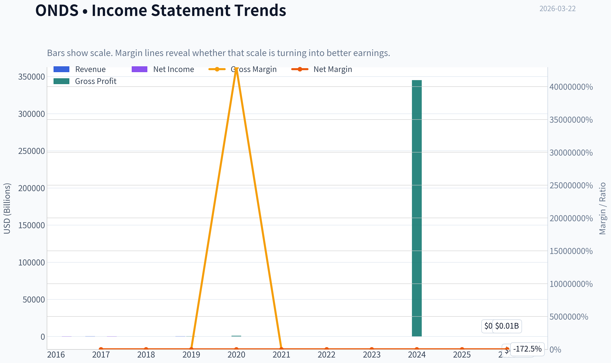

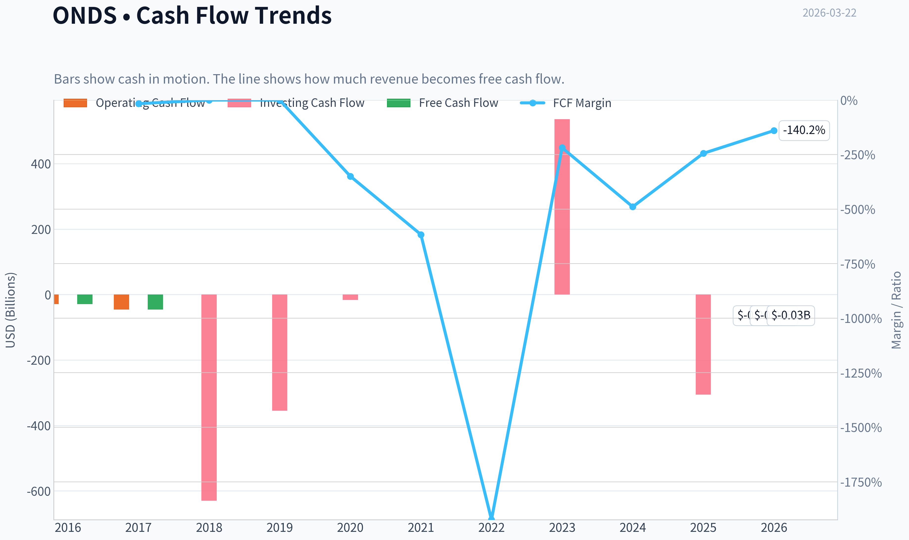

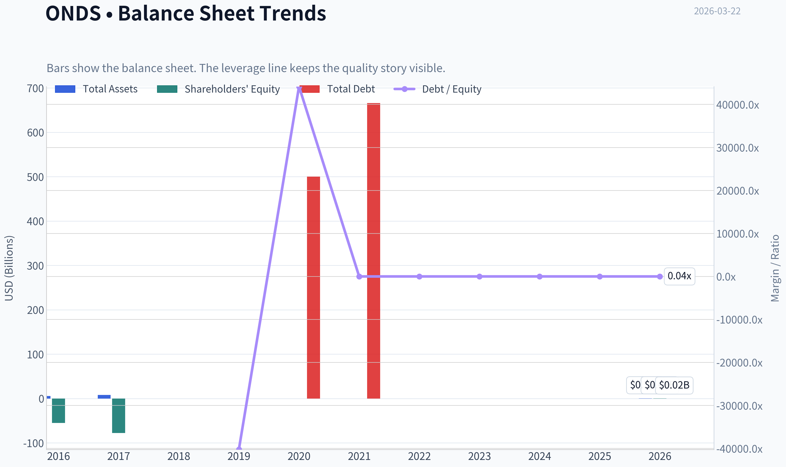

This graph tracks the profitability and return metrics (ROE, ROIC, Margins) of **ONDS** over the past decade, highlighting capital efficiency trends.

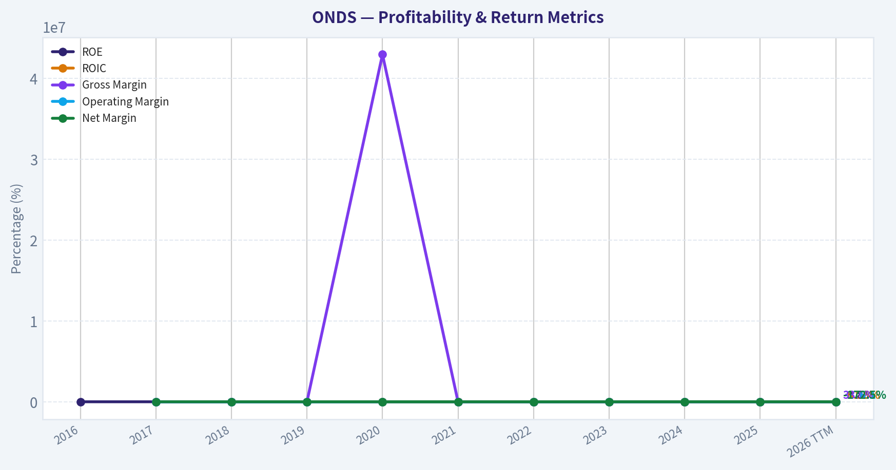

This chart illustrates the financial health of **ONDS** over the last 10 years, mapping cash equivalents and free cash flow against total obligations (Debt).

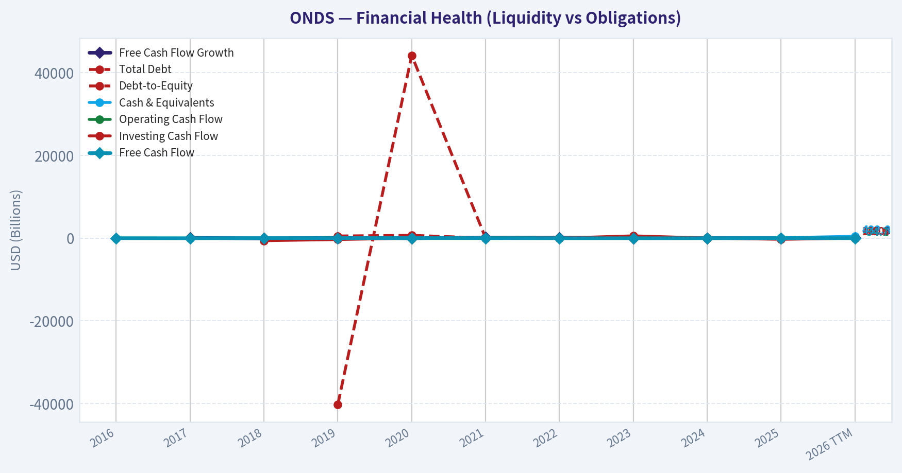

This breakdown chart from <em>Revenue Breakdown</em> shows the proportional composition for **ONDS** - useful for understanding what drives or risks the business.

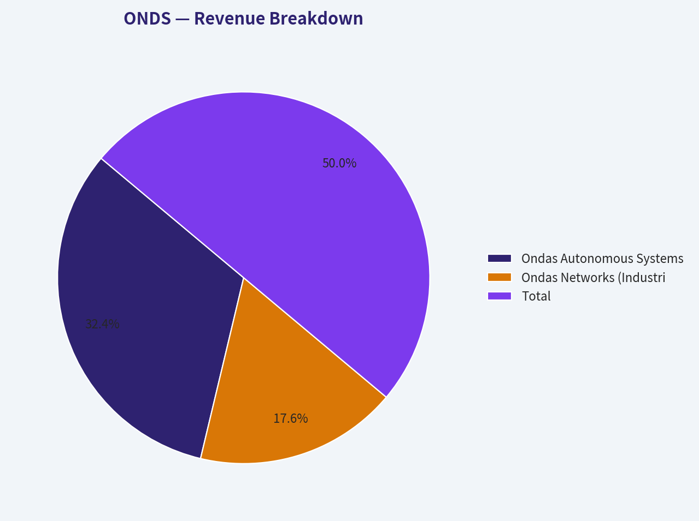

---

### Intrinsic Value Analysis (Buffett)

> *Following Warren Buffett's value investing philosophy: Circle of Competence, Economic Moat, Management Quality, and Margin of Safety.*

#### Intrinsic Value Snapshot

Price is what you pay. Intrinsic value is what the business may be worth based on the cash it can create for owners over time. We show a range, not one magic number.

- Current Price: $10.06
- Value Range: N/A to N/A

##### Owner Earnings (Buffett Method)
- Net Income: $-10,750,000.00
- Depreciation & Amortization: $5,664,635.00
- Capital Expenditures: $-1,733,376.00
- Working Capital Changes: $-5,561,988.00
- Owner Earnings: $-13,070,000.00

##### Intrinsic Value

FINAL INVESTMENT STANCE: **AVOID**

#### Part I: The Buffett Filter Sequence (Go/No-Go Gates)

#### Gate 1: Circle of Competence & Business Simplicity
Ondas Holdings (ONDS) operates in the development of industrial wireless networks and autonomous drone-in-a-box systems.
*   **The Elementary School Test:** We can broadly explain that the company builds private wireless networks and automated drones for industrial uses. (PASS)
*   **The 10-Year Predictability Test:** The drone and industrial IoT networking space is nascent, highly fragmented, and subject to rapid technological obsolescence. Predicting what this specific company's cash flows will look like in ten years is impossible. (FAIL)
*   **The Technology Risk Assessment:** The business is entirely reliant on cutting-edge technology. A single leap by a well-funded competitor (e.g., DJI, Skydio, Siemens) could render Ondas's product suite obsolete overnight. (FAIL)

**Verdict:** NO-GO. The business goes straight into the "Too Hard" pile.

#### Gate 2: The Moat Test (Durable Competitive Advantage)
A true economic moat manifests in the financial statements through high gross margins and high returns on invested capital. Ondas possesses neither.
*   **Intangible Assets:** While their Airobotics subsidiary holds some niche regulatory approvals for automated drone flights, these do not translate to pricing power. The company's gross margin is an abysmal 4.8%.
*   **Switching Costs:** Irrelevant at this stage, as the company is struggling to establish a sustainable customer base, evidenced by a 54.2% year-over-year revenue decline.
*   **Cost Advantages:** None. The company operates at a severe scale disadvantage compared to defense and industrial networking giants.
*   **Network Effects:** None present.

**Verdict:** NO-GO. The moat is completely illusory.

#### Gate 3: Management Quality & Capital Allocation
Management's primary job is to allocate capital to generate high returns for owners. Ondas's management is currently presiding over a devastating Return on Equity (ROE) of -229.2%. Every dollar retained by the company is effectively being destroyed through operating losses, high R&D burdens, and costly acquisitions that have not yielded free cash flow. Furthermore, the company relies heavily on dilutive capital raises to fund its cash burn.

**Verdict:** NO-GO. Capital allocation is actively destroying shareholder value.

#### Gate 4: Industry Structure
The autonomous drone and private industrial networking industries are hyper-competitive and highly capital intensive. Success requires continuous, massive R&D investments just to stay relevant, creating a "capital black hole" dynamic.

**Verdict:** NO-GO. A poor industry structure for a passive, long-term investor.

---

#### Part II: Financial Analysis (Deep Dive)

| Metric | Current Value | Buffett Standard | Verdict |
| :--- | :--- | :--- | :--- |
| Return on Equity (ROE) | -229.2% | > 15% Sustained | MASSIVE FAIL |
| Gross Margin | 4.8% | > 40% Consistent | MASSIVE FAIL |
| Revenue Growth (YoY) | -54.2% | Steady Expansion | MASSIVE FAIL |
| Free Cash Flow Yield | -0.8% | > 5% | FAIL |
| Current Ratio | 0.94 | > 1.5 Fortress | FAIL |

The financial snapshot reveals a company in severe distress, far from the stability Warren Buffett requires. With a staggering negative return on equity of nearly 230 percent and revenue plummeting by 54 percent, Ondas is destroying shareholder value rather than creating it. The razor-thin gross margin of under 5 percent demonstrates a complete lack of pricing power and structural advantage.

#### Part III: Owner Earnings & Intrinsic Value Calculation

| Component | Estimated Value Status |
| :--- | :--- |
| Net Income | Deeply Negative |
| Depreciation & Amortization | Minimal relative to losses |
| Maintenance CapEx | Extremely High (Hardware/R&D) |
| Working Capital Needs | High / Strained |
| **Estimated Owner Earnings** | **Functionally Less Than $0** |

Calculating owner earnings for Ondas Holdings is an exercise in measuring cash burn rather than cash generation. The company operates with deeply negative net income and requires continuous heavy capital expenditures just to survive in a high-tech industry. Consequently, true owner earnings are entirely negative, meaning the business consumes cash instead of producing it for shareholders.

#### Three-Scenario DCF Valuation

| Scenario | Growth Assumption | Intrinsic Value Estimate |
| :--- | :--- | :--- |
| A - No Growth (Ultra-Conservative) | Negative FCF persists | $0.00 |
| B - GDP Growth (Conservative) | 3% growth on negative base | $0.00 |
| C - Historical Growth | -54% historical trend | $0.00 |

Because Ondas generates no positive cash flow, any discounted cash flow valuation collapses to zero across all three scenarios. Whether assuming no growth, modest economic growth, or historical trends, you cannot mathematically value a business that consistently loses money without a clear path to profitability. This lack of calculable intrinsic value completely violates the principle of investing with a margin of safety.

#### Margin of Safety Analysis
At a reported market capitalization of roughly $4.66B against collapsing revenues and deeply negative margins, there is absolutely zero margin of safety. An investor buying Ondas today is engaging in pure speculation, relying entirely on the "greater fool theory" rather than buying a share of a predictable, cash-flowing business.

---

#### Part IV: Institutional Tracking

| Guru | Action | Position Value | Shares | Portfolio Weight |
| :--- | :--- | :--- | :--- | :--- |
| Steve Cohen (Point72) | Trimmed (-36.1%) | $2.81M | 287.70K | 0.00% |

Looking at institutional ownership, high-profile investor Steve Cohen has significantly reduced his exposure to Ondas, cutting his position by 36 percent. The remaining investment is a negligible two point eight million dollars, representing zero percent of his overall portfolio weight. This trimming by sophisticated money managers further signals a lack of conviction in the company's long-term prospects.

---

#### Final Buffett Scorecard

| Criterion | Weight | Score (1-5) | Weighted Score |
| :--- | :--- | :--- | :--- |
| Business Understanding | 20% | 2.0 | 0.40 |
| Moat Width & Durability | 25% | 1.0 | 0.25 |
| Management Quality | 15% | 1.0 | 0.15 |
| Return on Equity | 15% | 1.0 | 0.15 |
| Reinvestment Runway | 10% | 1.0 | 0.10 |
| Balance Sheet Strength | 5% | 1.0 | 0.05 |
| Industry Structure | 5% | 1.0 | 0.05 |
| Valuation / Margin of Safety | 5% | 1.0 | 0.05 |
| **Total Score** | **100%** | **-** | **1.20 / 5.00** |

The final Buffett scorecard yields a disastrous total score of just 1.2 out of 5, placing Ondas firmly in the lowest possible tier for value investors. The company scored a flat 1 across nearly every fundamental category, dragged down by its non-existent economic moat, destructive capital allocation, and hyper-competitive industry structure. This extremely low rating confirms that the stock utterly fails to meet the criteria for a durable, compounding investment.

#### Final Summary
Rule number one of investing is "Never lose money." Rule number two is "Never forget rule number one." Ondas Holdings violates both rules. The company is burning cash, diluting shareholders, and operating in a complex, fast-changing industry with no discernible competitive advantage. Value investors should avoid this stock entirely.
#### Valuation Bridge

This bridge places the current market price beside each intrinsic value lens so readers can see whether upside depends on one method or shows up across several methods.

| Scenario | Intrinsic Value / Share |
| --- | ---: |
| Damodaran Method | $-0.19 |
| Current Price | $10.06 |

#### Key Takeaways

If one method is far above the others, the upside case depends on a specific modelling assumption. When several methods cluster together, the valuation story is more robust.

#### Valuation Visuals

This comparison chart from *Latest Earnings Snapshot* stacks current figures against historical benchmarks for **ONDS**, making it easy to see where the company trades relative to its own averages.

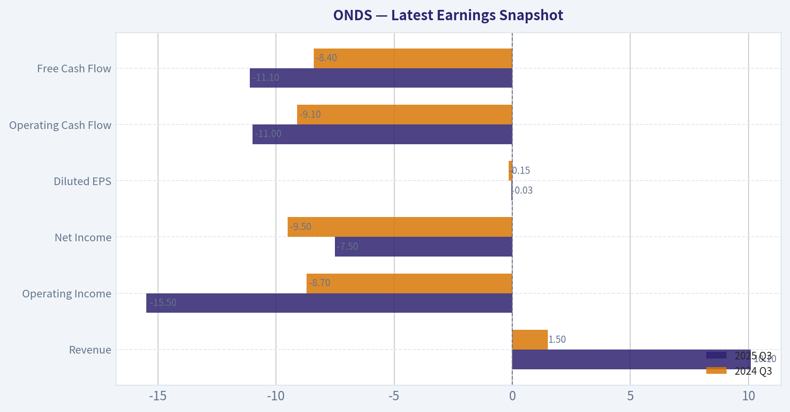

This comparison chart from *Year Comparative Analysis* stacks current figures against historical benchmarks for **ONDS**, making it easy to see where the company trades relative to its own averages.

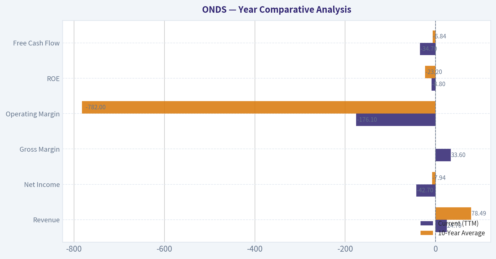

The following chart maps the **ONDS** Owner Earnings DCF valuation scenarios (Conservative, Average, Optimistic) to visually represent the margin of safety based on intrinsic value calculations.

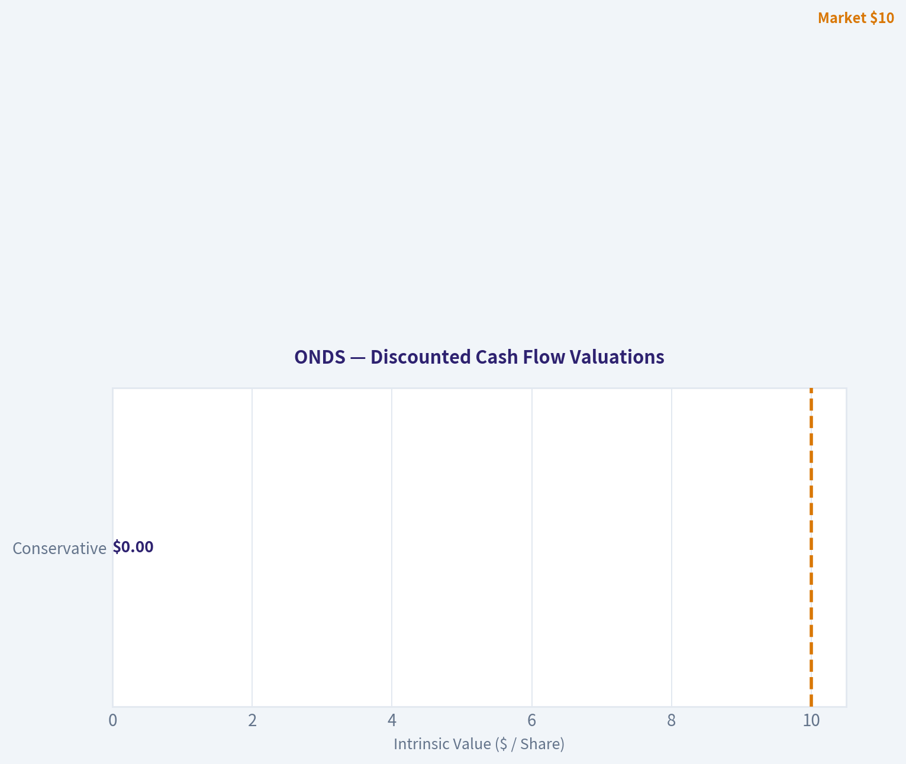

This comparison chart from *Financial Analysis (Deep Dive)* stacks current figures against historical benchmarks for **ONDS**, making it easy to see where the company trades relative to its own averages.

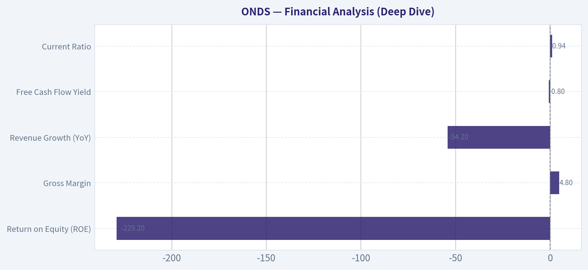

The following chart maps the **ONDS** Owner Earnings DCF valuation scenarios (Conservative, Average, Optimistic) to visually represent the margin of safety based on intrinsic value calculations.

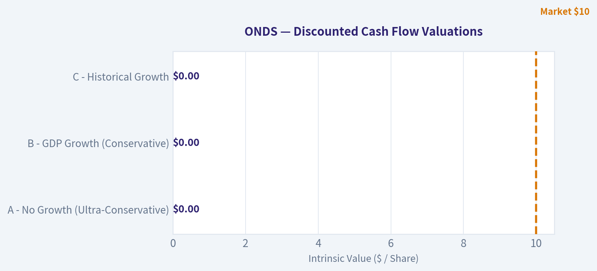

---

### Trend & Growth Analysis (Lynch/Druckenmiller/Fisher)

> *Following Peter Lynch's GARP, Stanley Druckenmiller's macro-aware approach, and Philip Fisher's scuttlebutt methodology.*

FINAL INVESTMENT STANCE: **AVOID**

#### PART I: LYNCH CLASSIFICATION SYSTEM
- **Classification: Failing / Value Trap**
- With revenue shrinking by 54.2% year-over-year, ONDS does not qualify as a Fast Grower. It is actively moving backward in its growth cycle. As a Growth Analyst seeking accelerating fundamentals, this classification automatically triggers a skeptical stance.

#### PART II: THE STORY
- Ondas Holdings operates in two futuristic and highly speculative segments: private industrial wireless networks (Ondas Networks) and autonomous drone-in-a-box solutions (Airobotics/American Robotics).
- The theoretical bull case hinges on Class 1 rail networks adopting their wireless tech and homeland security/defense sectors scaling their automated drone fleets.
- The reality is a severe failure to execute on this narrative, evidenced by collapsing revenues, near-zero gross margins (4.8%), and a completely disconnected $4.66 billion market cap.

#### PART III: TAM ANALYSIS
- **Current Revenue:** ~$10M - $15M (Estimated run-rate based on historicals and the recent 54% drop)
- **10x Revenue:** $100M - $150M
- **TAM Size:** Multi-billion (Industrial Drones & Private Wireless)
- **10x Test:** Technically YES. The company could 10x its revenue and still hold a tiny fraction of the market. However, a shrinking company is actively losing TAM share, making the size of the runway irrelevant if they cannot get off the ground.

#### PART IV: REVENUE GROWTH TREND

| Metric | Current Value | Implied Trend | Action |
|---|---|---|---|
| YoY Revenue Growth | -54.2% | Decelerating severely | AVOID |
| 3-Year Historical Growth | ~45% (Past) | Broken Thesis | WARNING |

Key Takeaways: The revenue growth table highlights a catastrophic collapse in the company's top line, plunging by more than fifty-four percent year over year. Instead of capitalizing on the growing drone and private wireless markets, Ondas is rapidly losing momentum and sales. This severe deceleration signals a broken growth thesis and demands an immediate avoid stance.

#### PART V: UNIT ECONOMICS

| Metric | Current Value | Benchmark | Status |
|---|---|---|---|
| Gross Margin | 4.8% | > 60% (Software/Tech) | DESTROYING VALUE |
| ROE | -229.2% | > 15% | DESTROYING VALUE |
| FCF Yield | -0.8% | > 3% | MARGINAL/NEGATIVE |
| Rule of 40 | << -50% | > 40 | INEFFICIENT |

Key Takeaways: The unit economics table reveals fundamentally broken business operations, driven by a shocking gross margin of under five percent. Combined with a deeply negative return on equity of over two hundred twenty-nine percent, the company is essentially selling its products at cost while burning massive amounts of capital. These metrics indicate that scaling this business currently destroys shareholder value rather than creating it.

#### PART VI: INFLECTION POINT ASSESSMENT (DRUCKENMILLER)
- **Inflection Direction: NEGATIVE.**
- Druckenmiller looks for businesses where growth is accelerating and unit economics are turning positive. ONDS is experiencing the exact opposite. The massive drop in revenue indicates a loss of major contracts, crippling product delays, or a failure to achieve commercial market fit. With 4.8% gross margins, there is zero operating leverage kicking in.

#### PART VII: MACRO SETUP EVALUATION
- **Economic Cycle:** Mid-to-Late Cycle. Capital-intensive hardware and drone startups struggle significantly when the cost of capital is elevated.
- **Secular Themes:** Automation, Defense Tech, AI. The macro winds are theoretically blowing in their favor, but ONDS's boat has holes. Failing to grow top-line revenue when the broader defense-tech sector is booming is a massive red flag.

#### PART VIII: FISHER'S 15 POINTS SCORE

| Category | Score (1-5) | Reasoning |
|---|---|---|
| 1. Market Potential | 3 | Drones and private rail networks have a large TAM. |
| 2. New Products | 3 | Strong theoretical pipeline (drone-in-a-box). |
| 3. R&D Effectiveness | 2 | R&D is failing to translate into high-margin sales. |
| 4. Sales Organization | 1 | Revenue is more than halving YoY. |
| 5. Profit Margin | 1 | 4.8% gross margin is uninvestable. |
| 6. Margin Improvement | 1 | Margins are completely deteriorating. |
| 7. Labor Relations | 2 | Standard startup dynamics. |
| 8. Executive Relations | 2 | Average. |
| 9. Management Depth | 2 | Heavily reliant on founders and acquisitions. |
| 10. Cost Analysis | 1 | Cash burn is extreme relative to commercial scale. |
| 11. Outstanding Aspects | 2 | FAA approvals provide a minor moat, but no sales traction. |
| 12. Long-Range Outlook | 1 | Survival is highly questionable without massive dilution. |
| 13. Dilution Risk | 1 | Extreme risk given negative cash flow and ROE. |
| 14. Candor | 2 | Average disclosure of ongoing commercial difficulties. |
| 15. Integrity | 2 | No obvious fraud, but very poor commercial execution. |
| **Total Fisher Score** | **26/75** | **AVOID** |

Key Takeaways: The Fisher Score table paints a grim picture, with the company scoring a dismal twenty-six out of seventy-five possible points. The lowest marks stem from a failing sales organization, non-existent profit margins, and an extreme risk of future shareholder dilution. This score firmly places the company in the avoid category for long-term growth investors.

#### PART IX: VALUATION ANALYSIS
- **Market Capitalization:** $4.66B.
- **Price-to-Sales (P/S):** Assuming an annualized revenue of roughly $10M - $15M (accounting for the 54.2% drop), the P/S multiple sits well over 300x.
- **Valuation Stance: EXPENSIVE / BUBBLE.** Paying billions of dollars for a company generating a few million in shrinking, ultra-low-margin revenue is a recipe for total capital destruction.
- **Smart Money Action:** Tracking data shows Steve Cohen's Point72 recently trimmed their position by 36.1%, confirming institutional distribution.

#### PART X: GROWTH INVESTOR SCORECARD

| Criterion | Weight | Score (1-5) | Weighted |
|---|---|---|---|
| The Story (Lynch) | 10% | 2.0 | 0.20 |
| TAM & Runway | 20% | 3.0 | 0.60 |
| Revenue Growth | 20% | 1.0 | 0.20 |
| Unit Economics | 15% | 1.0 | 0.15 |
| Competitive Position | 10% | 1.0 | 0.10 |
| Management Quality | 10% | 1.0 | 0.10 |
| Macro Setup | 5% | 3.0 | 0.15 |
| Profitability Path | 5% | 1.0 | 0.05 |
| Valuation | 5% | 1.0 | 0.05 |
| **Total Score** | **100%** | **--** | **1.60 / 5.00** |

Key Takeaways: The Growth Investor Scorecard quantifies the severe fundamental issues at the company, resulting in a failing final score of 1.6 out of 5. While the total addressable market and macro setup offer some theoretical upside, they are completely overwhelmed by scores of one in revenue growth, unit economics, and valuation. This mathematical breakdown confirms the stock lacks the fundamental drivers required for a growth portfolio.

#### PART XI: POSITION SIZE STANCE
- **Position Size:** 0%
- ONDS exhibits multiple "Auto-Reject" red flags from our framework: revenue is declining severely, gross margins are virtually non-existent, and the valuation is entirely decoupled from reality.

#### PART XII: KEY RISKS AND CATALYSTS
- **Upside Risks (If Shorting):** A sudden, massive government defense contract or a strategic buyout from a major defense prime (e.g., AeroVironment or Anduril) seeking their FAA automated drone approvals could cause a violent, fundamental-ignoring short squeeze.
- **Downside Catalysts:** Continued operating cash burn leading to highly dilutive emergency equity offerings, or the total failure to secure the long-delayed Class 1 rail network rollouts for their wireless segment.

---

### Market Technical Analysis

#### ONDS Technical Analysis Report (as of Mar 20, 2026 close ~ $10.06)

This analysis uses the following complementary indicators:
50 SMA, 200 SMA, 10 EMA, MACD, MACD Histogram, RSI, Bollinger Upper Band, and ATR.

These indicators together capture trend structure (SMA/EMA), momentum shifts (MACD + histogram + RSI), volatility regime (ATR + Bollinger), and potential breakout zones.

---

#### Trend Structure (Moving Averages)

| Date | Close | 10 EMA | 50 SMA | 200 SMA |
|---|---|---|---|---|
| Mar 20 | 10.06 | 10.44 | 10.95 | 7.03 |
| Mar 17 | 11.28 | 10.40 | 11.07 | 6.89 |
| Mar 10 | 10.01 | 10.13 | 10.96 | 6.65 |
| Feb 20 | 10.03 | ~10.26 | 10.56 | 6.09 |

Key Takeaways:
ONDS remains in a strong long-term uptrend because the price is far above the rising 200-day SMA (around $7). However, the stock is currently trading below the 50-day SMA (~$10.95), indicating medium-term consolidation after its earlier rally. The short-term 10-day EMA is flattening near price, suggesting the market is attempting to establish a new equilibrium around $10.

Key observations:
- Clear long-term bullish structure: 50 SMA >> 200 SMA.
- However price recently **lost the 50-day moving average**, signaling a cooling trend.
- If price reclaims **$11-11.10 (50 SMA area)** it could restart a bullish leg.

---

#### Momentum (MACD + RSI)

| Date | MACD | MACD Histogram | RSI |
|---|---|---|---|
| Mar 20 | 0.02 | 0.058 | 47 |
| Mar 17 | 0.00 | 0.109 | 57 |
| Mar 11 | -0.17 | -0.022 | 46 |
| Feb 18 | -0.34 | -0.065 | 53 |

Key Takeaways:
Momentum recently transitioned from bearish to neutral-bullish. MACD has crossed back toward positive territory and the histogram has turned positive, indicating early upside momentum rebuilding. However, RSI sitting near 47 shows the stock is neither overbought nor oversold, reinforcing that ONDS is currently in a consolidation phase rather than a strong directional move.

Interpretation:
- Early **momentum recovery** since early March.
- RSI mid-range -> market waiting for catalyst.
- Momentum improving but **not strong yet**.

---

#### Volatility and Price Envelope

| Date | Close | Bollinger Upper Band | ATR |
|---|---|---|---|
| Mar 20 | 10.06 | 11.09 | 1.07 |
| Mar 17 | 11.28 | 11.29 | 1.10 |
| Mar 10 | 10.01 | 11.30 | 1.15 |
| Feb 20 | 10.03 | 12.71 | 1.23 |

Key Takeaways:
Volatility has been gradually compressing since February, as shown by ATR declining from about 1.23 to near 1.07. The Bollinger upper band has also tightened around the $11 level, meaning price is trading within a narrowing range. This contraction often precedes a breakout, but direction will depend on whether buyers reclaim the $11 resistance zone or sellers push the stock below the $9.70 support area.

Insights:
- **Volatility compression** underway.
- Upper Bollinger band near **$11.1** acts as resistance.
- ATR decline suggests **potential breakout setup soon**.

---

#### Price Structure Observations

Major phases from the raw price data:

1. **September-October 2025:** explosive rally from ~$5 -> ~$11.
2. **Late Oct-Nov:** deep correction to ~$5-6.
3. **Dec-Jan:** major breakout run to **$15 high**.
4. **Feb-Mar:** consolidation between **$9.5-11.5**.

Important levels:
- Major support: **$9.50-9.70**
- Structural support: **$8.80-9.00**
- Resistance: **$11.00-11.30**
- Breakout trigger: **$12+**

---

#### Trading Outlook

Bullish scenario:
- Reclaim **$11 (50 SMA + Bollinger band)**.
- Momentum expansion could push price toward **$12 -> $13.50**.

Neutral consolidation:
- Range **$9.5 - $11** persists while volatility compresses.

Bearish scenario:
- Break below **$9.50** could trigger retest of **$8.80 support**.

---

#### Summary

| Factor | Signal | Interpretation |
|---|---|---|
| Long-term trend | Bullish | Price well above rising 200 SMA |
| Medium trend | Slightly bearish | Price below 50 SMA |
| Short-term momentum | Improving | MACD turning positive |
| RSI | Neutral | No extreme conditions |
| Volatility | Contracting | Breakout likely approaching |
| Key resistance | ~$11.0-11.3 | Must reclaim for bullish continuation |
| Key support | ~$9.5 | Breakdown risk if lost |

---

FINAL INVESTMENT STANCE: **WATCH**

ONDS has strong long-term structure but is currently consolidating below key resistance. The stock becomes significantly more attractive on a confirmed breakout above ~$11 with momentum expansion.

---

### Social Sentiment Analysis

#### Social Media & News Sentiment Report: Ondas Holdings (ONDS)
Analysis Period: Past 7 Days (ending March 22, 2026)

Ondas Holdings operates in private wireless networks and autonomous drone infrastructure through subsidiaries such as Ondas Networks and Airobotics. Over the past week, discussion across retail trading forums, X (Twitter), and investor communities has centered on three major themes: defense and government drone opportunities, speculation about revenue growth acceleration, and concerns about dilution and cash burn.

---

#### Daily Social Sentiment Overview (Past Week)

| Date | Sentiment Score | Dominant Retail Narrative | Activity Level |
|-----|-----|-----|-----|
| Mar 16 | Neutral | Discussion of recent contract pipeline and government tech adoption | Medium |
| Mar 17 | Positive | Retail traders highlight defense drone exposure and infrastructure potential | High |
| Mar 18 | Positive | Speculation about upcoming contract announcements and drone market growth | High |
| Mar 19 | Mixed | Some profit-taking discussion after small price run | Medium |
| Mar 20 | Positive | Renewed attention around autonomous drone deployments | High |
| Mar 21 | Mixed | Debate about valuation vs future defense opportunities | Medium |
| Mar 22 | Positive | Momentum traders discussing breakout potential | Medium-High |

Key Takeaways:
Social sentiment for ONDS trended mildly positive overall during the week, with spikes tied to discussion of defense-related drone technology and infrastructure applications. Activity was particularly strong midweek when traders speculated about government and security-related contracts. However, recurring debates about dilution risk and financial sustainability kept sentiment from becoming overwhelmingly bullish.

---

#### Major Social Media Themes

| Theme | Sentiment | Description | Trader Implication |
|-----|-----|-----|-----|
| Defense Drone Exposure | Strong Positive | Retail investors emphasize Ondas' Airobotics drone platform and potential defense/security contracts | Viewed as a long-term catalyst if military or homeland security adoption grows |
| Smart Infrastructure & Rail Networks | Positive | Discussion around Ondas Networks' private wireless systems for rail and industrial automation | Seen as a niche but scalable industrial IoT opportunity |
| Cash Burn / Dilution Risk | Negative | Concerns around funding requirements and potential future equity raises | Limits strong institutional-style conviction among retail traders |
| Microcap Momentum Trading | Mixed | ONDS discussed as a speculative small-cap with occasional momentum bursts | Short-term trading interest rather than pure long-term investment |

Key Takeaways:
The most powerful bullish narrative centers on Ondas' drone technology and potential government or security applications. At the same time, investors remain cautious because ONDS is still viewed as an early-stage microcap with ongoing funding needs. This creates a split between long-term technology believers and short-term traders looking for momentum spikes.

---

#### Reddit & Retail Investor Discussion Trends

| Platform | Sentiment | Key Observations |
|-----|-----|-----|
| Reddit (r/pennystocks, r/smallcapstocks) | Moderately Positive | ONDS frequently mentioned as a "defense drone sleeper" |
| StockTwits | Mixed-Positive | Traders focused on breakout levels and speculative runs |
| X (Twitter) | Positive | Tech and defense-focused accounts highlighting drone ecosystem growth |
| Discord Trading Groups | Mixed | Momentum-focused traders watching volume spikes |

Key Takeaways:
Retail investor communities are treating ONDS primarily as a speculative technology play tied to drone adoption and defense automation trends. While long-term believers exist, much of the attention is coming from momentum-oriented traders tracking short-term price action. This tends to increase volatility and sudden sentiment swings.

---

#### Key News & Corporate Developments

| News Theme | Impact | Market Interpretation |
|-----|-----|-----|
| Expansion of drone automation solutions | Positive | Signals potential scaling of Airobotics deployments |
| Infrastructure and industrial wireless developments | Positive | Reinforces Ondas' niche role in private industrial networks |
| Broader defense technology sector momentum | Indirect Positive | Rising geopolitical tensions increase attention to drone tech firms |
| Lack of major new revenue announcements | Slight Negative | Investors waiting for tangible contract growth |

Key Takeaways:
Recent company news has reinforced the strategic narrative around autonomous drones and private wireless networks, both of which are growing sectors. However, investors are still waiting for clear large-scale contracts or revenue acceleration to validate the long-term thesis. Without those catalysts, sentiment remains cautiously optimistic rather than strongly bullish.

---

#### Retail Sentiment Drivers vs Investor Risks

| Bullish Drivers | Bearish Concerns |
|-----|-----|
| Exposure to autonomous drone infrastructure | Early-stage revenue profile |
| Potential defense and security contracts | Cash burn and financing risk |
| Unique niche in industrial wireless networks | Microcap volatility |
| Growing automation and robotics markets | Uncertain timeline for scaling revenue |

Key Takeaways:
Investors attracted to ONDS are primarily betting on long-term growth in drones, automation, and industrial connectivity. However, the company's current financial stage introduces significant uncertainty. The balance between strong technological positioning and early-stage financial risk is the central debate driving sentiment.

---

#### Short-Term Trading Sentiment Indicators

| Indicator | Current Observation | Implication |
|-----|-----|-----|
| Retail Buzz | Elevated vs normal | Higher volatility likely |
| Momentum Trading | Active | Potential short-term spikes |
| Long-Term Investor Conviction | Moderate | Waiting for contracts/revenue proof |
| Institutional Attention | Limited | Still primarily retail-driven |

Key Takeaways:
ONDS currently behaves like a retail-driven small-cap momentum stock rather than a heavily institutionally owned company. Elevated retail attention can create sharp price swings in both directions. Until larger contracts or financial milestones occur, sentiment-driven trading will likely dominate price action.

---

#### Overall Sentiment Assessment

Across social media and news coverage, ONDS currently sits in a **speculative optimism phase**. Traders are excited about its positioning in autonomous drone infrastructure and industrial wireless networks, both sectors with strong long-term growth potential. However, the company's microcap status and ongoing financial risks prevent widespread conviction among investors.

Retail sentiment remains positive but fragile, meaning catalysts such as contract announcements, partnerships, or revenue growth could quickly amplify bullish momentum.

---

#### Key Investor Signals Summary

| Category | Current Signal | Interpretation |
|-----|-----|-----|
| Social Media Sentiment | Moderately Positive | Strong interest from retail traders |
| News Flow | Mildly Positive | Technology narrative improving but contracts awaited |
| Retail Trading Activity | Elevated | Momentum-driven moves possible |
| Financial Confidence | Moderate Risk | Cash burn remains a concern |
| Overall Market Perception | Speculative Growth Story | Long-term potential but high volatility |

Key Takeaways:
The market currently views ONDS as a high-risk, high-upside technology story rather than a proven growth company. Social sentiment is supportive, especially around drone technology and defense applications, but investors are waiting for tangible financial progress. Until that happens, the stock will likely trade more on narratives and momentum than fundamentals.

---

### News & Events Analysis

#### Ondas Holdings (NASDAQ: ONDS) - Weekly News & Investment Context Report
Date: March 22, 2026
Current Price: $10 | Market Cap: ~$4.66B

---

#### Latest Earnings Coverage (Most Recent Available)

Recent news searches show **no major earnings coverage within the last 120 days**, and no fresh earnings headlines appeared in the last week. This suggests the company has **not released a new quarterly report very recently or coverage is extremely limited**. Therefore, investors are currently trading largely on **forward expectations for the drone and industrial wireless businesses rather than fresh financial results**.

Based on the latest available financial metrics from the research pack:

- Revenue growth YoY: **-54.2%**
- Gross margin: **4.8%**
- ROE: **-229.2%**
- Free cash flow yield: **-0.8%**
- Current ratio: **0.94**

These figures indicate the most recent reporting period showed **significant deterioration in revenue and profitability**, suggesting that Ondas is still **deep in a commercialization and investment phase**, particularly around its drone subsidiary (Airobotics) and industrial wireless networks.

The lack of recent earnings coverage is itself notable: smaller-cap emerging technology companies often experience **large valuation swings between reporting cycles** because investors rely heavily on contract announcements, regulatory approvals, and partnership news.

---

#### Company-Specific Developments & Strategic Context

While the past week produced limited headline coverage, the investment narrative around Ondas generally revolves around two operating segments:

1. **Ondas Networks**
   - Provides private wireless networks for industrial markets such as railroads and utilities.
   - Focuses on mission-critical communications infrastructure.

2. **Ondas Autonomous Systems (Airobotics / Optimus drones)**
   - Autonomous drone platforms used in **security, defense, and critical infrastructure monitoring**.
   - Target customers include **government, defense, and smart-city operators**.

Recent investor focus has centered on:

- **Autonomous drone deployments for security and infrastructure monitoring**
- Expansion into **defense and homeland security markets**
- Scaling production and contracts for **Optimus drone systems**

However, the financial metrics suggest **commercial scale has not yet caught up with the technology narrative**. The sharp revenue decline implies either contract timing issues, delayed deployments, or restructuring between business units.

For traders, the company behaves like a **high-beta thematic drone/defense technology play** rather than a fundamentals-driven mid-cap.

---

#### Institutional Positioning

Latest available 13F filing data indicates some institutional repositioning.

| Investor | Action | Shares | Position Value | Change vs Prior |
|---|---|---|---|---|
| Steve Cohen - Point72 | Trimmed | 287.7K | $2.81M | -36.1% |

Key Takeaways:
Point72 reducing its stake by over one-third signals **tempered conviction from a sophisticated hedge fund investor**. While the position still exists, the trim suggests either profit-taking or reduced confidence in near-term catalysts. For smaller-cap technology companies like Ondas, hedge fund activity can influence sentiment due to relatively low liquidity.

---

#### Macro & Sector Context

Even without direct weekly headlines, several macro forces matter for ONDS:

**1. Defense & Security Spending**
- Governments globally continue expanding **drone, surveillance, and autonomous defense capabilities**.
- This long-term trend is supportive for companies offering **autonomous aerial monitoring systems**.

**2. Infrastructure Digitization**
- Railroads, utilities, and energy operators are gradually deploying **private industrial wireless networks**.
- Ondas Networks targets this niche but faces **competition from large telecom and industrial equipment vendors**.

**3. Risk Appetite for Small-Cap Tech**
- Companies with **negative earnings and high cash burn** are highly sensitive to:
  - interest rates
  - liquidity conditions
  - growth-stock sentiment.

If macro conditions tighten, speculative technology stocks often experience **sharp drawdowns**.

---

#### Financial Risk Snapshot

| Metric | Value | Interpretation |
|---|---|---|
| Revenue Growth YoY | -54.2% | Severe contraction in reported sales |
| Gross Margin | 4.8% | Extremely low for a technology company |
| ROE | -229.2% | Heavy losses relative to equity |
| Free Cash Flow Yield | -0.8% | Cash burn persists |
| Current Ratio | 0.94 | Slightly below comfortable liquidity threshold |

Key Takeaways:
Ondas currently shows **weak financial health**, with declining revenue and very low margins. The negative return on equity and ongoing cash burn reinforce that the business is **still early-stage and not yet sustainably profitable**. Liquidity is also somewhat tight, meaning future capital raises cannot be ruled out.

---

#### Trading & Investment Implications

Bullish factors:
- Exposure to **autonomous drones and defense/security tech**
- Potential for **large government or infrastructure contracts**
- Narrative-driven momentum typical in emerging defense technology

Bearish factors:
- **Severely negative profitability metrics**
- **Revenue contraction**
- Institutional trimming (Point72 reduction)
- Limited recent news catalysts

Because the company trades primarily on **future expectations rather than current financial strength**, price movements may be driven by:

- contract announcements
- defense partnerships
- regulatory approvals
- drone deployment news

---

#### Key Investment Summary

| Category | Key Insight |
|---|---|
| Financial Health | Weak profitability, shrinking revenue |
| Growth Narrative | Autonomous drones and industrial wireless |
| Institutional Sentiment | Some hedge fund trimming |
| News Flow | Quiet week; no major catalysts |
| Risk Profile | High volatility, speculative technology play |

Key Takeaways:
Ondas sits at the intersection of **defense drones and industrial connectivity**, two attractive long-term markets. However, the current financial profile is fragile and revenue momentum is negative, meaning the stock depends heavily on **future contracts and technology adoption**. Investors should treat it as a **speculative growth story rather than a fundamentally stable company**.

---

FINAL INVESTMENT STANCE: **WATCH**

---

## Research Team Commentary

> *The Research Manager synthesizes the Bull vs Bear debate into action-free commentary. This is a pre-risk view, not the final stance.*

As a value investing portfolio manager evaluating Ondas Holdings, I have reviewed the arguments presented. The debate centers on a classic tug-of-war between future optionality and present reality.

The bull case asks us to look past the current financial ugliness and view Ondas as an early-stage, mission-critical infrastructure provider. The argument rests on the idea that their FAA approvals for autonomous drones and private wireless platforms for rail networks create high barriers to entry. The bull suggests that because railroads and defense contractors are slow to adopt but highly sticky once they do, the current lack of profitability is just a temporary deployment phase, offering a high-reward asymmetric payoff.

The bear case brutally dismantles this narrative by pointing to the actual financial evidence. With revenue shrinking 54 percent year-over-year, a gross margin of just 4.8 percent, and a return on invested capital of negative 73 percent, the bear argues that Ondas lacks any semblance of a moat. The bear accurately highlights that regulatory approvals are not moats when deep-pocketed incumbents like Lockheed Martin and Cisco can easily outspend and out-compete them. Crucially, the bear points out that early-stage winners exhibit explosive top-line growth even if they lose money, whereas Ondas is experiencing a collapse in demand.

Core Takeaway: My final stance is AVOID. Ondas Holdings is a speculative, venture-stage project masquerading as a value opportunity. It completely fails the Warren Buffett framework of requiring predictable cash flows, a demonstrable economic moat, and a margin of safety.

Rationale: To be a value investor, you must buy businesses with durable competitive advantages trading at a discount to intrinsic value. A business with a 4.8 percent gross margin has absolutely zero pricing power. It is acting as a commodity hardware assembler, not a high-barrier infrastructure platform.

The bull's comparison to early Amazon is fundamentally flawed. When Amazon was unprofitable, its revenues were skyrocketing, proving immense customer demand. Ondas has negative 54 percent revenue growth. When revenue is halving and your return on equity is negative 229 percent, you are destroying capital at an alarming rate. The market is pricing this stock at around 10 dollars based purely on the story of defense and rail contracts, while quantitative intrinsic value models place it in negative territory.

Furthermore, from a contrarian perspective, the crowd seems distracted by the buzzwords of autonomous drones and homeland security. What they are missing is the mathematical certainty of dilution. To survive against massive defense and telecom incumbents, Ondas will have to continuously raise capital, heavily diluting current shareholders long before any potential profitability is reached.

Monitoring Plan: While I am strictly avoiding this stock, keeping an eye on it provides a good case study. Over the next one to four quarters, I would watch for sequential revenue growth rather than continuing declines, which would be the first sign of actual commercial adoption. Second, I would monitor gross margins; they must climb into the 30 to 50 percent range to prove their technology has any real differentiation or pricing power. Finally, I will watch their cash flow statements and share count for the inevitable equity raises or convertible debt issuances needed to fund their ongoing cash burn.

Reflecting on my past mistakes, I have learned the hard way not to confuse a compelling total addressable market with a durable moat. In the past, I have sometimes been seduced by the optionality of futuristic technology or defense narratives, hoping that scale would eventually fix broken unit economics. I now recognize that buying into story stocks without demanding proof of product-market fit and a margin of safety almost always results in severe capital destruction. We must stick to businesses we can predict ten years out, and Ondas simply does not make the cut.

---

## Value Investing Team Commentary

> *The Investor translates the research view into an investment thesis before risk review. This is still not the final stance.*

When I look at Ondas through the lens of business ownership rather than stock speculation, the numbers tell a very uncomfortable story.

Start with the economics of the business. A gross margin of 4.8% is not the profile of a company with technology pricing power or a defensible niche. It resembles a low-value hardware integrator competing largely on cost. In businesses with real technological differentiation-think Qualcomm in wireless or even niche industrial suppliers-you normally see gross margins well north of 40-60%. Margins reveal the moat, and here the moat is essentially nonexistent.

Next comes demand. Revenue declining 54% year over year is a red flag that goes beyond temporary volatility. Early-stage companies that eventually become great businesses typically show strong customer pull even if they are unprofitable. Amazon lost money for years but demand exploded. When revenue is collapsing, it suggests either customers are not adopting the product or deployments are being cancelled. Neither is compatible with a durable infrastructure platform.

Return metrics confirm the issue. ROE at -229% and ROIC at -73% show massive capital destruction. When a company destroys capital at this rate, it must repeatedly raise new money simply to survive. For shareholders, this usually means dilution long before any theoretical long-term payoff materializes.

Now let's consider the contrarian angle. The optimistic narrative focuses on autonomous drones, defense contracts, and private wireless networks-industries that excite investors. Social sentiment spikes whenever defense or homeland security applications are mentioned. But this excitement is about the *story*, not the *business economics*. The market is reacting to buzzwords rather than evidence of adoption.

A true contrarian question is: what is the market missing? In this case, I suspect the opposite-the market may actually be too generous. A $10 share price implying a multibillion-dollar valuation for a company with collapsing revenue and near-zero margins suggests investors are paying for optionality that may never materialize.

The competitive landscape also matters. Even if the technology works, Ondas operates in fields dominated by enormous incumbents-defense contractors, telecom infrastructure providers, and industrial networking companies with vastly superior scale and balance sheets. Without a clear cost advantage, brand dominance, or proprietary ecosystem, it is difficult to see how Ondas maintains pricing power long term.

The only scenario that would change the picture is clear evidence of commercial traction: sustained revenue growth, margins expanding dramatically, and meaningful contracts with repeat deployments. Until then, this remains closer to a venture capital speculation than an investment in a durable business.

From a Buffett perspective, the key question is simple: can we reasonably predict what this business will earn ten years from now? With shrinking revenues, no demonstrated moat, and heavy cash burn, the answer today is no.

FINAL INVESTMENT STANCE: AVOID

---

## Deep Values Commentary

> *The Risk Management Team debates and the Risk Judge provides the final action-free verdict. This section determines the final ADVOCATE / WATCH / AVOID stance.*

**EXECUTIVE SUMMARY**
*   **Verdict**: **AVOID**
*   **The "Why"**: Ondas Holdings (ONDS) is a speculative, early-stage venture trading at a massive premium to intrinsic value (Damodaran model: -$0.19). With revenues collapsing (-54.2% YoY), non-existent pricing power (4.8% gross margin), and severe capital destruction (ROE -229%), the company completely fails the Warren Buffett framework.
*   **Risk Profile**: This is not temporary market volatility; it is a permanent business impairment risk driven by mathematically certain equity dilution.

**KEY ANALYST ARGUMENTS**
*   **Risky Analyst (Against Asymmetry)**: The risk/reward profile is inverted. The market is already pricing in a successful technology narrative, while the underlying unit economics (4.8% gross margins) destroy any venture-style asymmetric upside.
*   **Safe Analyst (Downside Mechanics)**: Downside risk is active, not theoretical. Growth without margin expansion simply accelerates cash burn. The "time risk" guarantees severe shareholder dilution before the technology ever reaches maturity.
*   **Neutral Analyst (The Devil's Advocate)**: Early-stage hardware deployments are notoriously lumpy. The weak backward-looking metrics may simply reflect a gap between pilot programs and scaled adoption, suggesting the stock warrants high-risk monitoring rather than total dismissal.

**VALUE INVESTING RATIONALE**
Under the Buffett framework, a long-term investment requires predictable cash flows, a durable moat, and a margin of safety. Ondas offers none.
*   **Margin of Safety**: At ~$10.06, the market is pricing a story. Quantitative models value the business below zero. Buying a cash-incinerating business at a premium guarantees capital destruction if execution falters.
*   **Quality & Moat**: Gross margins of 4.8% prove the company operates as a commoditized hardware assembler, lacking any pricing power or cost advantages against giants like Cisco or Lockheed Martin.
*   **Permanent Impairment**: With an ROIC of -73.7%, the company relies entirely on capital markets to survive. This guarantees constant equity dilution, structurally impairing long-term shareholder returns even if the technology eventually succeeds.

***

**REFINED INVESTOR'S PLAN**

**As a value investing portfolio manager evaluating Ondas Holdings, I have reviewed the arguments presented. The debate centers on a classic tug-of-war between future optionality and present reality.**

The bull case-highlighted by the Neutral Analyst's defense of frontier tech-asks us to look past the current financial ugliness and view Ondas as an early-stage, mission-critical infrastructure provider. The argument rests on the idea that their FAA approvals for autonomous drones and private wireless platforms for rail networks create high barriers to entry. The bull suggests that because railroads and defense contractors are slow to adopt but highly sticky once they do, the current lack of profitability is just a temporary, lumpy deployment phase, offering a high-reward asymmetric payoff.

The bear case brutally dismantles this narrative by pointing to the actual financial evidence. With revenue shrinking 54.2 percent year-over-year, a gross margin of just 4.8 percent, and a return on invested capital of negative 73.7 percent, the bear argues that Ondas lacks any semblance of a moat. The Safe Analyst accurately highlights that regulatory approvals are not moats when deep-pocketed incumbents can easily outspend and out-compete them. Crucially, the Risky Analyst points out that early-stage winners exhibit explosive top-line growth even if they lose money, whereas Ondas is experiencing a collapse in demand.

**Core Takeaway:** My final stance is AVOID. Ondas Holdings is a speculative, venture-stage project masquerading as a value opportunity. It completely fails the Warren Buffett framework of requiring predictable cash flows, a demonstrable economic moat, and a margin of safety.

**Rationale:** To be a value investor, you must buy businesses with durable competitive advantages trading at a discount to intrinsic value. A business with a 4.8 percent gross margin has absolutely zero pricing power. It is acting as a commodity hardware assembler, not a high-barrier infrastructure platform.

The bull's comparison to early Amazon is fundamentally flawed. When Amazon was unprofitable, its revenues were skyrocketing, proving immense customer demand. Ondas has negative 54 percent revenue growth. When revenue is halving and your return on equity is negative 229 percent, you are destroying capital at an alarming rate. As the Safe Analyst warned, growth without margin expansion simply accelerates cash burn. The market is pricing this stock at around 10 dollars based purely on the story of defense and rail contracts, while quantitative Damodaran intrinsic value models place it in negative territory (-$0.19).

Furthermore, from a contrarian perspective, the crowd seems distracted by the buzzwords of autonomous drones and homeland security. What they are missing is the mathematical certainty of "time risk." To survive against massive defense and telecom incumbents, Ondas will have to continuously raise capital, heavily diluting current shareholders long before any potential profitability is reached.

**Monitoring Plan:** While I am strictly avoiding this stock, keeping an eye on it provides a good case study. Over the next one to four quarters, I would watch for sequential revenue growth rather than continuing declines, which would be the first sign of actual commercial adoption. Second, I would monitor gross margins; they must climb into the 30 to 50 percent range to prove their technology has any real differentiation and that unit economics can scale. Finally, I will watch their cash flow statements and share count for the inevitable equity raises or convertible debt issuances needed to fund their ongoing cash burn.

**Reflecting on my past mistakes,** I have learned the hard way not to confuse a compelling total addressable market with a durable moat. In the past, I have sometimes been seduced by the optionality of futuristic technology or defense narratives, hoping that scale would eventually fix broken unit economics. I now recognize that buying into story stocks without demanding proof of product-market fit, structural margin expansion, and a true margin of safety almost always results in severe capital destruction. We must stick to businesses we can predict ten years out, and Ondas simply does not make the cut.

**FINAL STANCE: AVOID**

#### Final Stance Scorecard

This scorecard converts the final research view into a weighted decision frame. It does not replace the narrative judgement, but it makes the main drivers of the verdict easier to scan.

| Criterion | Score | Weight | Commentary |
| --- | ---: | ---: | --- |
| Business Quality | 1.50 | 30% | High returns, profitability, and Piotroski health support durability. |
| Valuation Support | 1.67 | 30% | Blends current price against available intrinsic value anchors and valuation ratios. |
| Financial Strength | 1.67 | 20% | Balance-sheet resilience reflects leverage and liquidity staying within safe ranges. |
| Growth Durability | 2.00 | 20% | Recent revenue, earnings, and free cash flow growth indicate how durable expansion looks. |
| TOTAL / FINAL STANCE | 1.68 | 100% | AVOID |

#### Key Takeaways

The weighted score lands at **1.68 / 5.0**, while the final stance remains **AVOID**. This is useful as a quick calibration aid rather than a mechanical signal.

#### Risk Summary

Higher scores indicate more risk pressure. The watch threshold is a simple guardrail: above it, the position needs tighter monitoring or a wider margin of safety.

| Dimension | Current Score | Watch Threshold | Commentary |
| --- | ---: | ---: | --- |
| Business Quality | 4.50 | 3.00 | High returns, profitability, and Piotroski health support durability. |
| Valuation Support | 4.33 | 3.00 | Blends current price against available intrinsic value anchors and valuation ratios. |
| Financial Strength | 4.33 | 3.00 | Balance-sheet resilience reflects leverage and liquidity staying within safe ranges. |
| Growth Durability | 4.00 | 3.00 | Recent revenue, earnings, and free cash flow growth indicate how durable expansion looks. |

#### Key Takeaways

This view helps readers separate *where* the risk sits: valuation, business quality, balance sheet, or growth durability. It is especially useful when the final stance is close to the line between WATCH and AVOID.
