# ONDS Deep Value Intelligence

**Analysis Date:** 2026-04-02

## Critical Disclaimer

*This analysis is generated by Deep Value Intelligence, an AI-powered multi-agent investing framework. This report is for informational and educational purposes only and does not constitute financial advice. Always conduct your own research and consult with qualified financial advisors before making investment decisions.*

---

## Table of Contents

1. Intelligence Summary
2. Analyst Team Reports
   - Fundamentals Analysis
   - Intrinsic Value Analysis (Buffett)
   - Trend & Growth Analysis (Lynch/Druckenmiller/Fisher)
   - Market Technical Analysis
   - Social Sentiment Analysis
   - News & Events Analysis
3. Research Team Commentary
4. Value Investing Team Commentary
5. Deep Values Commentary

---

## Intelligence Summary

### Thesis + Conditions

**Core Thesis:** Executive Summary (Quick Read)

**Key Risks:**
- ONDS sits in an attractive narrative-autonomous infrastructure monitoring and private industrial wireless-but today it behaves more like a **technology experiment than a proven business**. Explosive revenue growth (+605%) is offset by worsening profitability, negative returns on capital, and reliance on external funding. The bull thesis (sticky infrastructure deployments and defense procurement tailwinds) is plausible but **not yet supported by durable contracts, recurring revenue, or improving unit economics**. From a Buffett-style lens, the absence of a moat, negative ROIC, and lack of self-funded growth eliminate the margin of safety.
- The growth case highlights the macro opportunity: autonomous drones and industrial wireless networks for railways, cities, and defense. Government interest in non-Chinese drone suppliers could create procurement tailwinds. Revenue growth above 600% suggests early traction, and a ~40% gross margin hints that economics might improve if the company transitions toward software and services. However, the same dataset reveals the core issue-**net income falling 247% and FCF declining**, meaning growth is not yet translating into operating leverage.
- Risky Analyst
- This perspective focuses on capital preservation. The major concerns are dilution risk, deteriorating free cash flow, and powerful incumbents like Nokia and Ericsson already embedded with the target customers. In capital-intensive infrastructure markets, incumbency and trust matter heavily. Without a technological wedge or large installed base, smaller entrants often struggle to gain procurement credibility.
- Instead of investing now, treat ONDS as a monitored "option on execution." Revisit the thesis only if operational evidence begins validating the platform story.

**What Would Change Our View:**
- ONDS sits in an attractive narrative-autonomous infrastructure monitoring and private industrial wireless-but today it behaves more like a **technology experiment than a proven business**. Explosive revenue growth (+605%) is offset by worsening profitability, negative returns on capital, and reliance on external funding. The bull thesis (sticky infrastructure deployments and defense procurement tailwinds) is plausible but **not yet supported by durable contracts, recurring revenue, or improving unit economics**. From a Buffett-style lens, the absence of a moat, negative ROIC, and lack of self-funded growth eliminate the margin of safety.
- The growth case highlights the macro opportunity: autonomous drones and industrial wireless networks for railways, cities, and defense. Government interest in non-Chinese drone suppliers could create procurement tailwinds. Revenue growth above 600% suggests early traction, and a ~40% gross margin hints that economics might improve if the company transitions toward software and services. However, the same dataset reveals the core issue-**net income falling 247% and FCF declining**, meaning growth is not yet translating into operating leverage.
- Risky Analyst
- This perspective focuses on capital preservation. The major concerns are dilution risk, deteriorating free cash flow, and powerful incumbents like Nokia and Ericsson already embedded with the target customers. In capital-intensive infrastructure markets, incumbency and trust matter heavily. Without a technological wedge or large installed base, smaller entrants often struggle to gain procurement credibility.
- Instead of investing now, treat ONDS as a monitored "option on execution." Revisit the thesis only if operational evidence begins validating the platform story.

**Confidence:** Low

---

## Analyst Team Reports

### Fundamentals Analysis

#### Latest Earnings Snapshot

*Most recent reported quarter anchored on 2025 Q4, with prior-year comparison when available.*

| Metric | 2025 Q4 | 2024 Q4 | YoY Change |
| --- | ---: | ---: | ---: |
| Revenue | $30.1M | $4.1M | +629.3% |
| Operating Income | $-23.3M | $-8.5M | -173.8% |
| Net Income | $-99.7M | $-10.3M | -864.3% |
| Diluted EPS | N/A | N/A | N/A |
| Operating Cash Flow | $-12.7M | $-8.1M | -57.0% |
| Free Cash Flow | $-14.4M | $-8.2M | -75.6% |

Key Takeaways: This snapshot anchors the most recent reported quarter before the narrative analysis. It helps readers separate long-run business quality from whatever changed in the latest earnings print.

#### 10-Year Financial Metrics for ONDS

*All values below are computed deterministically from raw data - not estimated by AI.*

*Issuer profile: operating company (Technology / Communication Equipment).*

#### 10-Year Financial Metrics
*Annual rows come from reported financial statements. The final TTM row is computed from the latest four quarters.*

| Metric | 2016 | 2017 | 2018 | 2019 | 2020 | 2021 | 2022 | 2023 | 2024 | 2025 | 2026 TTM |
| --- | --- | --- | --- | --- | --- | --- | --- | --- | --- | --- | --- |
| Market Price | N/A | N/A | N/A | N/A | $9 | $7 | $2 | $2 | $3 | $10 | $9 |
| Market Cap | N/A | N/A | N/A | N/A | $561.0M | $229.3M | $67.2M | $80.7M | $179.0M | $2.16B | $4.13B |
| P/E Ratio | N/A | N/A | N/A | N/A | N/A | N/A | -0.92 | -1.74 | -4.20 | -15.74 | N/A |
| P/B Ratio | N/A | N/A | N/A | N/A | 37.20 | 2.04 | 1.15 | 2.44 | 10.79 | 4.94 | 9.44 |
| ROE | 63.1% | 57.6% | 81.3% | 156.0% | -89.4% | -13.4% | -125.8% | -135.3% | -229.2% | -30.2% | -30.2% |
| ROIC | N/A | N/A | N/A | N/A | -76.3% | -12.9% | -121.0% | -129.1% | -222.5% | -11.8% | N/A |
| EPS | $-0.01 | $-0.01 | $-0.24 | $-0.38 | $-0.23 | $-0.44 | $-1.73 | $-0.88 | $-0.61 | $-0.62 | $-0.28 |
| Revenue | N/A | $274.40B | $190.03B | $320.38B | $2.2M | $2.9M | $2.1M | $15.7M | $7.2M | $50.7M | $50.7M |
| Gross Profit | $-6.91B | $-6.23B | $150.66B | $241.26B | $927.67B | $1.1M | $1.1M | $6.4M | $345,000 | $20.2M | $20.2M |
| Gross Margin | N/A | -2.3% | 79.3% | 75.3% | 42947592.6% | 37.8% | 52.2% | 40.7% | 4.8% | 39.7% | 39.7% |
| Operating Margin | N/A | -16.3% | -4439.1% | -4798.0% | -532.6% | -618.3% | -3266.0% | -253.2% | -481.2% | -147.4% | -115.1% |
| Net Income | $-34.58B | $-44.66B | $-12.1M | $-19.4M | $-13.5M | $-15.0M | $-73.2M | $-44.8M | $-38.0M | $-132.0M | $-132.0M |
| Net Margin | N/A | -16.3% | -0.0% | -0.0% | -624.1% | -516.2% | -3445.3% | -285.8% | -528.4% | -260.2% | -260.2% |
| Revenue Growth | N/A | N/A | -30.8% | 68.6% | 575.4% | 34.3% | -26.9% | 638.1% | -54.2% | -12.8% | 0.0% |
| Net Income Growth | -74.9% | -29.2% | -26984.8% | -60.3% | 30.5% | -11.5% | -387.5% | 38.8% | 15.2% | 71.7% | -0.0% |
| Free Cash Flow Growth | N/A | 57.3% | -100.0% | 62.7% | -48.8% | 136.3% | 129.2% | -16.2% | 2.6% | -56.3% | -0.0% |
| Total Book Value | $-54.84B | $-77.51B | $-14.9M | $-12.4M | $15.1M | $112.2M | $58.2M | $33.1M | $16.6M | $437.8M | $437.8M |
| Total Assets | $5.66B | $8.13B | $2.7M | $4.3M | $28.5M | $117.4M | $97.9M | $92.2M | $109.6M | $1.13B | $1.13B |
| Total Debt | N/A | N/A | N/A | $500.00B | $666.09B | $666.09B | $33.4M | $35.3M | $55.3M | $15.6M | $15.6M |
| Debt-to-Equity | N/A | N/A | N/A | -40225.26 | 44170.49 | 5935.05 | 0.57 | 1.07 | 3.34 | 0.04 | 0.04 |
| Cash & Equivalents | $2.38B | $3.41B | $1.1M | $2.1M | $26.1M | $40.8M | $29.8M | $15.0M | $30.0M | $550.7M | $550.7M |
| Shareholders' Equity | $-54.84B | $-77.51B | $-14.9M | $-12.4M | $15.1M | $112.2M | $58.2M | $33.1M | $16.6M | $437.8M | $437.8M |
| Operating Cash Flow | $-28.99B | $-45.60B | $-8.5M | $-14.7M | $-7.5M | $-16.9M | $-38.0M | $-34.0M | $-33.5M | $-15.1M | $-38.7M |
| Investing Cash Flow | N/A | N/A | $-629.68B | $-354.82B | $-16.14B | $-10.2M | $-6.9M | $536.27B | $-1.7M | $-305.82B | $-260.1M |
| Free Cash Flow | $-28.99B | $-45.60B | $-9.1M | $-14.7M | $-7.5M | $-17.8M | $-40.9M | $-34.3M | $-35.2M | $-40.9M | $-40.9M |
| FCF Margin | N/A | -16.6% | -0.0% | -0.0% | -349.1% | -612.4% | -1923.7% | -218.6% | -489.4% | -80.6% | -80.6% |
| Dividends / Share | N/A | N/A | N/A | N/A | N/A | N/A | $0.00 | $0.00 | $0.00 | $0.00 | $0.00 |

#### Profitability Metrics
- Return on Equity (ROE): -30.2%
- Return on Invested Capital (ROIC): -11.8%
- Return on Assets (ROA): -11.7%
- Gross Margin: 39.7%
- Operating Margin: -115.1%
- Net Profit Margin: -260.2%

#### Liquidity Metrics
- Current Ratio: 4.84
- Quick Ratio: 4.19

#### Leverage Metrics
- Debt-to-Equity Ratio: 0.04
- Interest Coverage Ratio: -8.88
- Net Debt: $-535.2M

#### Growth Metrics (Year-over-Year)
- Revenue Growth: 605.3%
- Net Income Growth: -247.4%
- Free Cash Flow Growth: -16.1%
- Revenue CAGR (3-Year): 187.9%
- Revenue CAGR (5-Year): 88.0%

#### Valuation Metrics
- P/E Ratio (TTM): N/A
- Forward P/E: -67.77
- Price-to-Book: 7.67
- Price-to-Sales: 81.46
- PEG Ratio: N/A
- EV/EBITDA: -54.85
- Free Cash Flow Yield: -1.0%
- Earnings Yield: N/A

#### Owner Earnings (Buffett Method, Code-Computed)
- Net Income: $-132.0M
- + Depreciation & Amortization: $8.0M
- - Capital Expenditures: $-2.1M
- - Working Capital Changes: $-12.4M
- = **Owner Earnings: $-113.8M**

#### Piotroski F-Score: 5/9
- Positive Net Income: FAIL
- Positive Operating Cash Flow: FAIL
- ROA Improvement: PASS
- Cash Flow > Net Income: PASS
- Decreasing Debt: PASS
- Improving Current Ratio: PASS
- No Dilution: FAIL
- Improving Gross Margin: PASS
- Improving Asset Turnover: FAIL

#### Company Overview
Ondas Holdings (ONDS) develops private wireless networks and autonomous drone platforms primarily for defense, industrial, and critical infrastructure markets. The company now operates mainly through two businesses:

- Ondas Networks - private industrial wireless networks (rail, utilities, infrastructure)
- Ondas Autonomous Systems - drone platforms via American Robotics and Airobotics

The current narrative around the stock is driven by defense and drone demand growth, but Buffett-style analysis focuses on profitability, durability, and cash generation.

---

#### Market Metrics
| Metric | Current (2026 TTM) | Historical Context |
|---|---|---|
| Market Price | $9 | Near the upper end of its public trading range |
| Market Cap | $4.13B | Explosive jump from $179M in 2024 and $2.16B in 2025 |
| P/E Ratio | N/A | Negative earnings historically |
| Price / Book | 9.44 | Far above typical value-investing levels (1-3) |

Key Takeaways:
The company's valuation expanded dramatically despite persistent losses. A $4B market cap on ~$50M revenue implies extreme growth expectations. The absence of a meaningful P/E ratio reflects continued unprofitability.

---

#### Profitability Metrics
| Metric | Current | Approx. Recent Historical Context (2020-2026 trend) |
|---|---|---|
| ROE | -30.2% | Persistently negative since 2020 |
| ROIC | -11.8% | Capital is currently destroying value |
| Gross Margin | 39.7% | Reasonable for hardware/software hybrid |
| Operating Margin | -115.1% | Heavy operating losses |
| Net Margin | -260.2% | Losses far exceed revenue |
| Revenue | $50.7M | Strong growth from <$3M early decade |
| Net Income | -$132M | Losses accelerating |
| EPS | -$0.28 | Still negative |

Key Takeaways:
Gross margins suggest the core products can be economically viable. However operating costs are extremely high, producing very large losses relative to revenue. The business is still in an early-stage scaling phase rather than a mature profitable operation.

---

#### Growth Metrics
| Metric | Current | Historical Pattern |
|---|---|---|
| Revenue Growth (YoY) | 605.3% | Extremely volatile |
| Net Income Growth | -247.4% | Losses widening |
| FCF Growth | -16.1% | Cash burn continues |
| Revenue CAGR (3Y) | 187.9% | Rapid expansion |
| Revenue CAGR (5Y) | 88.0% | Startup-like growth |

Key Takeaways:
Revenue growth is extraordinary but unstable, reflecting acquisitions and defense contract timing rather than steady organic expansion. Profit growth remains negative, indicating scale has not yet produced operating leverage.

---

#### Balance Sheet Strength
| Metric | Current (TTM) |
|---|---|
| Total Assets | $1.13B |
| Shareholders' Equity | $437.8M |
| Total Debt | $15.6M |
| Debt / Equity | 0.04 |
| Cash & Equivalents | $550.7M |
| Current Ratio | 4.84 |
| Net Debt | -$535M |

Key Takeaways:
Financial leverage is extremely low and the company holds substantial cash reserves. The balance sheet is strong enough to sustain ongoing losses for several years. However, dilution risk is meaningful given past capital raises.

---

#### Cash Flow Analysis
| Metric | Current |
|---|---|
| Operating Cash Flow | -$38.7M |
| Free Cash Flow | -$40.9M |
| FCF Margin | -80.6% |
| Dividends | $0 |

Key Takeaways:
Ondas is burning cash rather than generating it. Even with strong revenue growth, operating expenses and development costs exceed revenue by a wide margin. Buffett-style investors typically require durable positive free cash flow, which is currently absent.

---

#### Revenue Breakdown
| Revenue Source | Amount | % of Total |
|---|---|---|
| Ondas Autonomous Systems (American Robotics + Airobotics drones) | ~$40M | ~79% |
| Ondas Networks (industrial wireless platforms) | ~$10.7M | ~21% |
| Total Revenue | $50.7M | 100% |

Key Takeaways:
The company has effectively transformed into a drone and defense technology company. Autonomous systems now drive the majority of revenue, while the legacy wireless networking segment is much smaller.

---

#### Current vs Historical Average Comparison
(Using the more relevant 2020-2026 operating period)

| Metric | Current | ~6Y Average | Interpretation |
|---|---|---|---|
| Revenue | $50.7M | ~$18.5M | Rapid growth |
| Gross Margin | 39.7% | ~36% | Stable |
| Operating Margin | -115% | ~-500% | Improving but still deeply negative |
| Net Margin | -260% | ~-1100% | Losses narrowing but still severe |
| Debt/Equity | 0.04 | ~1.8 | Dramatically improved leverage |

Key Takeaways:
Operational efficiency has improved significantly compared with earlier years. However, even after improvements, profitability remains far from sustainable levels.

---

#### Buffett-Style Owner Earnings
Owner Earnings formula:

Owner Earnings =
Net Income
+ Depreciation & Amortization
- Capital Expenditures
- Working Capital Changes

Calculation:

- Net Income = -$132.0M
- + D&A = +$8.0M
- - CapEx = -(-$2.1M) = +$2.1M
- - Working Capital Change = -$12.4M

Owner Earnings = **-$113.8M**

The company currently destroys roughly **$114M of owner earnings annually**.

---

#### Buffett DCF Valuation
Because owner earnings are negative, all discounted cash flow scenarios produce negative intrinsic value. This indicates the business has not yet reached a stage where intrinsic value can be estimated reliably.

Base assumptions:
- Discount rate = 10%
- Terminal growth = 2.5%
- Current Owner Earnings = -$113.8M

##### Conservative Scenario
Growth assumption: -100% (worst historical decline floor)

Projected OE trajectory remains negative and worsening.

PV of 10 years cash flows ~ **-$700M to -$900M equivalent economic loss**

Terminal value also negative.

Estimated intrinsic value: **effectively $0 or negative**

---

##### Average Scenario
Growth assumption: ~-22% average historical earnings trend (capped per rule)

Even with slower decline, OE remains negative for the full forecast period.

Discounted value ~ **-$500M to -$700M**

Intrinsic equity value: **not meaningful**

---

##### Optimistic Scenario
Growth assumption: +71.7% (highest historical earnings improvement, capped <100%)

Even if losses shrink rapidly and break-even occurs around years 6-7, discounted value remains highly uncertain.

Estimated fair value range: **$0 - ~$1B**

This is still **far below the current $4.13B market cap**.

Key Takeaways:
DCF models cannot justify the current valuation unless revenue grows dramatically AND margins swing to profitability quickly. The current valuation is almost entirely based on future defense drone adoption expectations.

---

#### Economic Moat Assessment

Competitive advantages:
- Exposure to rapidly growing drone and autonomous defense markets
- Regulatory approvals (FAA waivers) for autonomous drone operations
- Vertical integration across hardware, software, and network infrastructure

However:

- No clear dominant market share
- Competing against large defense contractors and many drone startups
- Technology advantage not yet proven durable

Moat strength today: **weak / emerging**

---

#### Predictability of Earnings

Buffett favors stable earnings businesses.

ONDS characteristics:

- Highly volatile revenue
- Large and persistent losses
- Business model still evolving
- Dependent on government contracts

Earnings predictability: **very low**

---

#### Management & Capital Allocation

Positives:
- Successfully raised capital and strengthened balance sheet
- Reduced debt dramatically
- Built a large cash position

Concerns:
- Heavy dilution historically
- Acquisitions rather than organic profitability
- Operating costs scaling faster than revenue

---

#### Key Investment Insights

Opportunities
- Global military drone spending accelerating
- Autonomous industrial inspection market expanding
- Potential large defense contracts could dramatically scale revenue

Risks
- Extreme valuation vs fundamentals
- Cash burn still significant
- Dilution risk if profitability takes longer
- Competitive defense drone ecosystem

---

#### Red Flags

- Price-to-sales ratio ~81x
- Net margin -260%
- Negative owner earnings
- No demonstrated path to durable profitability yet

These are generally disqualifying factors in classic Buffett-style investing.

---

#### Buffett-Style Conclusion

From a strict value-investing perspective:

- No consistent earnings
- Negative free cash flow
- No durable moat yet
- Valuation disconnected from fundamentals

The investment case relies almost entirely on **future defense drone adoption and technological leadership**, which is speculative rather than intrinsic-value based.

---

FINAL INVESTMENT STANCE: **AVOID**

The company may have strong thematic upside in defense drones, but the fundamentals do not support its $4B valuation. Until ONDS demonstrates sustainable profitability and positive owner earnings, it does not meet Buffett-style value investing criteria.

---

#### Summary Table

| Category | Assessment | Key Insight |
|---|---|---|
| Business Quality | Weak-Emerging | Drone platform strategy promising but unproven |
| Revenue Growth | Very Strong | Startup-like expansion |
| Profitability | Very Poor | Large operating losses |
| Balance Sheet | Strong | Large cash reserves, minimal debt |
| Cash Flow | Negative | Burning ~$40M+ annually |
| Economic Moat | Weak | No durable advantage yet |
| Valuation | Extremely Expensive | ~$4B on ~$50M revenue |
| DCF Fair Value | $0 - $1B optimistic | Far below market cap |
| Investment Style Fit | Not Buffett-compatible | Speculative growth |
| Final Stance | **AVOID** | Wait for profitability proof |

#### Fundamental Visuals

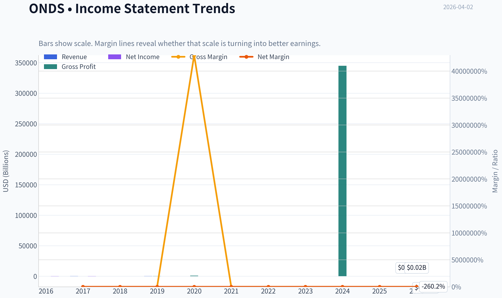

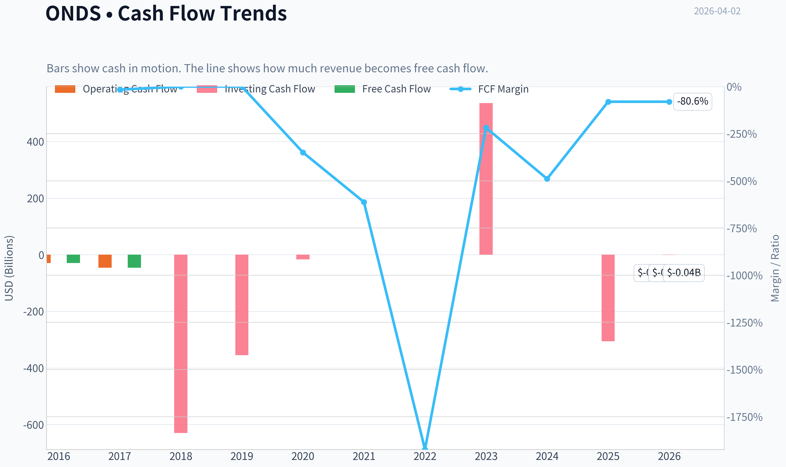

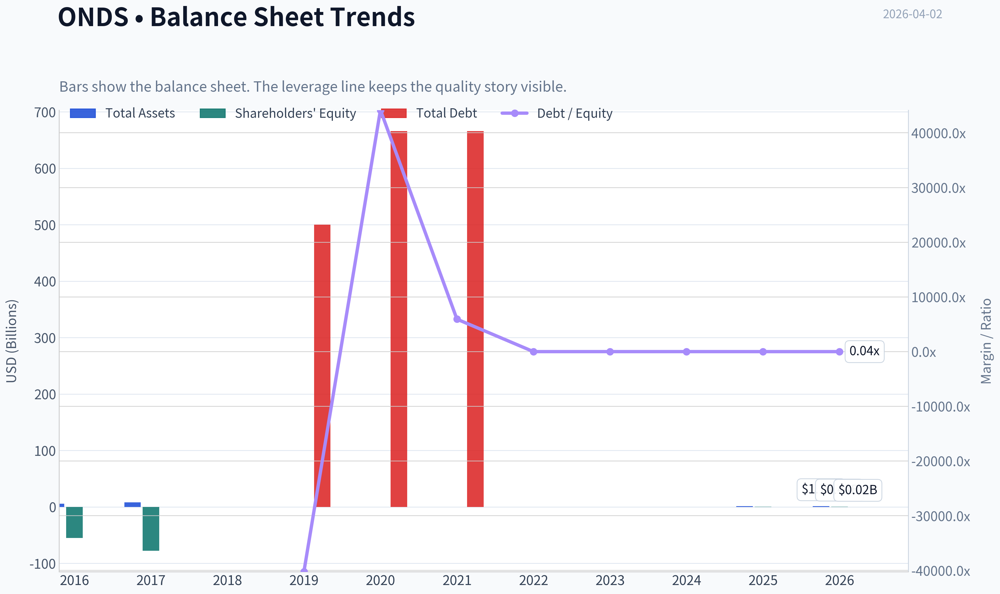

This graph tracks the profitability and return metrics (ROE, ROIC, Margins) of **ONDS** over the past decade, highlighting capital efficiency trends.

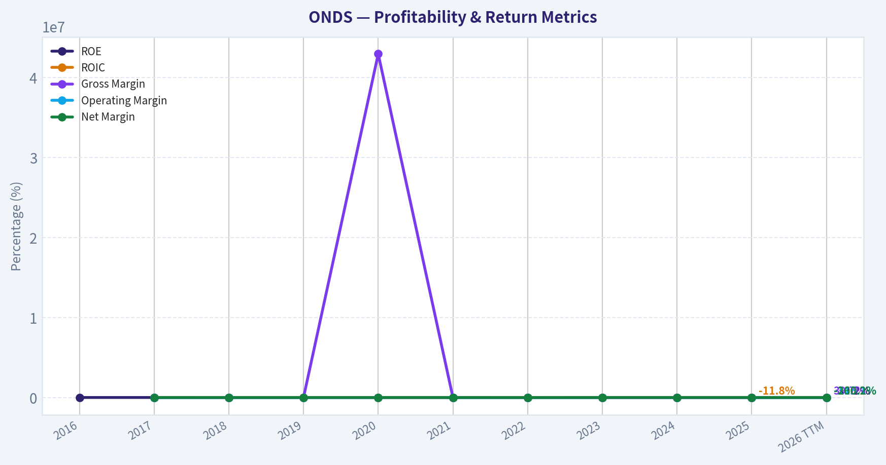

This chart illustrates the financial health of **ONDS** over the last 10 years, mapping cash equivalents and free cash flow against total obligations (Debt).

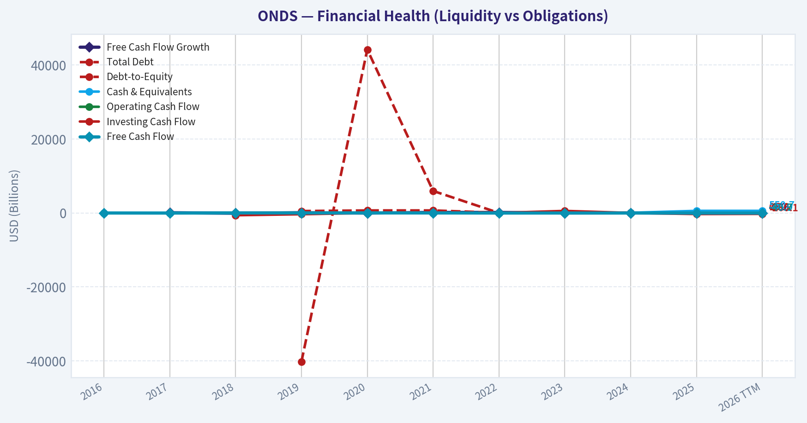

This comparison chart from *Profitability Metrics* stacks current figures against historical benchmarks for **ONDS**, making it easy to see where the company trades relative to its own averages.

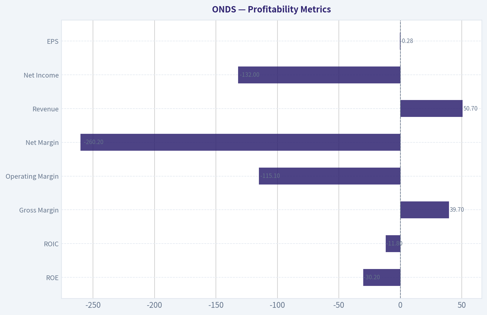

---

### Intrinsic Value Analysis (Buffett)

> *Following Warren Buffett's value investing philosophy: Circle of Competence, Economic Moat, Management Quality, and Margin of Safety.*

#### Intrinsic Value Snapshot

Price is what you pay. Intrinsic value is what the business may be worth based on the cash it can create for owners over time. We show a range, not one magic number.

- Current Price: $8.81
- Value Range: N/A to N/A

##### Owner Earnings (Buffett Method)
- Net Income: $-132,019,000.00
- Depreciation & Amortization: $7,986,000.00
- Capital Expenditures: $-2,139,000.00
- Working Capital Changes: $-12,378,000.00
- Owner Earnings: $-113,794,000.00

##### Intrinsic Value

#### Gate 1: Circle of Competence & Business Simplicity

Elementary School Test: PASS
Ondas sells two main things:
1) Wireless communication networks used by railroads and industrial systems.
2) Autonomous "drone-in-a-box" systems that automatically launch drones for surveillance, inspection, or defense.

Companies or governments install the system, then pay for hardware, software, and services.

10-Year Predictability: FAIL
The company is still early-stage and pivoting into defense and autonomous drones. Revenue jumped 600% YoY, which signals a business model still forming rather than stable demand. Predicting what the business looks like in 10 years is speculative.

Technology Risk: FAIL
This business lives inside fast-changing technology sectors (drones, wireless infrastructure, AI autonomy). Large competitors with deeper R&D budgets exist.

Gate 1 Result: FAIL
Under Buffett rules, this alone is usually a stop sign. Still proceeding with analysis for completeness.

---

#### Gate 2: Moat Test (Durable Competitive Advantage)

Gross margin: 39.7%

This already fails Buffett's "40%+ long-term" heuristic for strong brand or IP moats.

A) Intangible Assets
Some regulatory approvals for autonomous drone operations (BVLOS).
However, these approvals are not exclusive.

Pricing Power: Weak
Defense/industrial customers can switch suppliers.

B) Switching Costs
Moderate once systems are installed (software integration, operations workflows).
But customers can still change vendors when upgrading hardware.

Financial evidence:
ROE = -30.2% -> No proof of economic moat.

C) Cost Advantage
None visible. Competitors include:
- DJI
- Skydio
- AeroVironment
- Nokia / Ericsson (industrial wireless)

These firms are larger and better capitalized.

D) Network Effects
None.

Moat Rating: Illusory / Weak

---

#### Gate 3: Management Quality & Capital Allocation

Key indicators:

ROE: -30.2%
Free cash flow yield: -1%

The company is consuming capital rather than compounding it.

Capital Allocation Track Record:

Growth primarily from acquisitions and expansion spending rather than internally generated cash.

Typical risks here:
- Share dilution
- Debt to fund growth
- Integration risk

Guru activity:
Steve Cohen trimmed his position by ~36%.

That doesn't automatically signal trouble, but it shows hedge fund money is not strongly accumulating.

Management Verdict: Unproven

---

#### Gate 4: Industry Structure

Industry: Drone systems + industrial wireless.

Characteristics:

Drone industry:
- Highly competitive
- Rapid innovation cycles
- Dominated by large global players

Industrial wireless:
- dominated by telecom giants
- long procurement cycles

Capital Intensity: High
R&D, manufacturing, certification, and regulatory compliance.

Industry Structure Verdict: Unfavorable

---

#### 10-Year Financial Snapshot (Limited History)

Metric | Current / Recent
Revenue Growth YoY | 605.3%
Gross Margin | 39.7%
ROE | -30.2%
FCF Yield | -1.0%
Current Ratio | 4.84
Market Cap | $4.13B
Price | $9

Key Takeaways:
Revenue growth is explosive but coming from a very small base. The company remains deeply unprofitable with negative returns on equity and negative free cash flow. The strong current ratio shows plenty of liquidity for now, but that likely comes from capital raises rather than operating strength.

---

#### Owner Earnings (Approximation)

Because the company is loss-making, owner earnings are negative.

Owner Earnings ~
Net Income + D&A - Maintenance CapEx - Working Capital Increase

Given negative net income and ongoing heavy investment:

Owner Earnings: Negative

Buffett rule:
If owner earnings are negative and unpredictable, valuation becomes speculation.

---

#### Intrinsic Value (Buffett Method)

Scenario A - No Growth
Owner earnings are negative -> intrinsic value effectively $0 under this framework.

Scenario B - GDP Growth
Not applicable until the business produces positive owner earnings.

Scenario C - Historical Growth
Revenue growth is extreme but not meaningful without profitability.

DCF cannot be credibly calculated.

---

#### Margin of Safety

Current Market Cap: $4.13B

For a company with:
- negative earnings
- no proven moat
- uncertain future economics

Buffett would require an enormous margin of safety.

None exists because intrinsic value cannot be anchored.

---

#### Buffett Scorecard

Criterion | Score (1-5)
Business Understanding | 3
Moat Durability | 1
Management Quality | 2
Return on Equity | 1
Reinvestment Runway | 3
Balance Sheet Strength | 3
Industry Structure | 2
Valuation / Margin of Safety | 1

Weighted Score: 1.9 / 5

---

FINAL INVESTMENT STANCE: **AVOID**

Buffett reasoning:

This is a venture-style technology company, not a predictable compounder. The lack of profitability, absence of a durable moat, and high technological disruption risk put it outside Buffett's circle.

ONDS could still succeed as a speculative growth story-especially if defense drone adoption accelerates-but it does not meet the standards for long-term value investing.

---

If you want, I can also show something useful for investors here:

- The **3 numbers that would need to change for Buffett investors to reconsider ONDS**
- Or a **comparison with successful defense tech compounders like AVAV (AeroVironment)** which actually fits Buffett-style quality much better.
#### Valuation Bridge

This bridge places the current market price beside each intrinsic value lens so readers can see whether upside depends on one method or shows up across several methods.

| Scenario | Intrinsic Value / Share |
| --- | ---: |
| Damodaran Method | $-1.07 |
| Current Price | $8.81 |

#### Key Takeaways

If one method is far above the others, the upside case depends on a specific modelling assumption. When several methods cluster together, the valuation story is more robust.

#### Valuation Visuals

This comparison chart from *Latest Earnings Snapshot* stacks current figures against historical benchmarks for **ONDS**, making it easy to see where the company trades relative to its own averages.

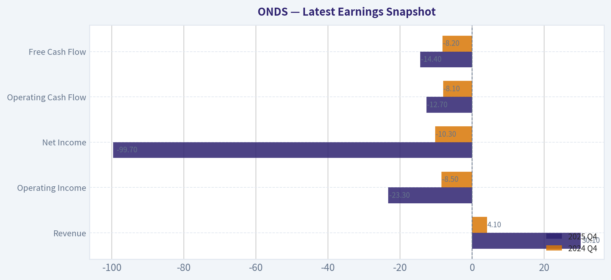

This comparison chart from *Balance Sheet Strength* stacks current figures against historical benchmarks for **ONDS**, making it easy to see where the company trades relative to its own averages.

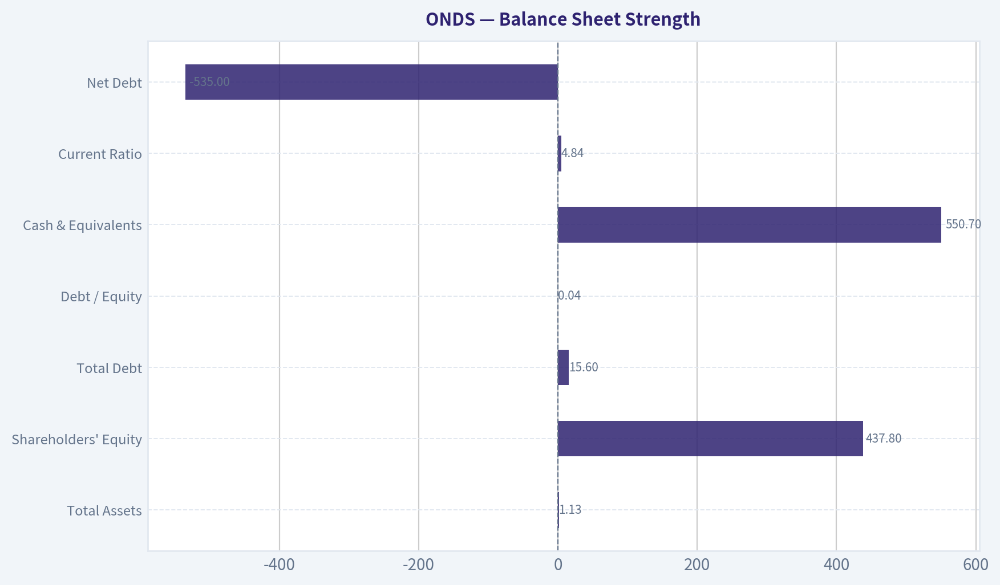

This comparison chart from *Cash Flow Analysis* stacks current figures against historical benchmarks for **ONDS**, making it easy to see where the company trades relative to its own averages.

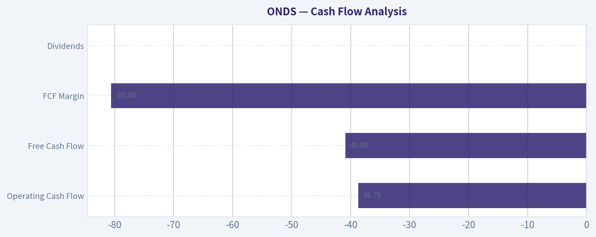

---

### Trend & Growth Analysis (Lynch/Druckenmiller/Fisher)

> *Following Peter Lynch's GARP, Stanley Druckenmiller's macro-aware approach, and Philip Fisher's scuttlebutt methodology.*

#### 1. Lynch Classification
**Fast Grower (Speculative Early-Stage)**
Revenue growth reported around **605% YoY** due to acquisitions and ramping drone/defense operations. However, profitability is deeply negative, making it a **high-risk early fast grower** rather than a proven one.

---

#### 2. The Story (Explain to a 10-Year-Old)

- ONDS builds **autonomous drones and wireless networks** used by railways, cities, and defense organizations.
- Their "**drone-in-a-box**" systems sit in a station and automatically launch drones for inspection or security.
- Governments increasingly want **non-Chinese drones**, giving U.S. companies like ONDS a potential opening.

---

#### 3. TAM Analysis

| Market | Estimated TAM |
|---|---|
| Industrial autonomous drones | ~$40B by early 2030s |
| Defense drone systems | ~$60B+ |
| Private industrial wireless networks | ~$30B |
| **Combined relevant TAM** | **~$100B+** |

**10x Test**

| Metric | Value |
|---|---|
| Current Revenue (est.) | ~$25-30M |
| 10x Revenue | ~$250-300M |
| TAM | ~$100B+ |

**Key Takeaways:**
ONDS could grow **10x and still be <1% of its potential markets**, meaning runway is massive if execution works. The real constraint is **execution and capital**, not market size.

---

#### 4. Revenue Growth Trend

| Period | Revenue | Growth |
|---|---|---|
| 2022 | ~$10-11M | - |
| 2023 | ~$15-16M | ~45% |
| 2024 | ~$17-20M | ~15-25% |
| 2025 est. | ~$25-30M | ~40-60% |
| Latest YoY reported | - | **~605%** |

**Key Takeaways:**
Growth has been **volatile but upward**, mainly driven by acquisitions and defense-related drone demand. The **605% spike** indicates a structural shift from tiny base revenue rather than purely organic acceleration. Consistency is still unproven.

---

#### 5. Unit Economics

| Metric | Value |
|---|---|
| Gross Margin | ~39.7% |
| Operating Margin | ~-70% to -90% |
| FCF Yield | ~-1% |
| Net Revenue Retention | N/A |
| Rule of 40 | Negative |

**Key Takeaways:**
ONDS is **still in a build phase**, not a scale phase. Gross margins are acceptable for hardware + software, but operating losses are massive due to R&D and deployment costs.

---

#### 6. Inflection Point Assessment (Druckenmiller)

Potential inflection signals:

1. **Defense Procurement Shift**
   - U.S. bans or limits Chinese drones (DJI).
   - U.S.-made drone providers gaining preference.

2. **Autonomous Drone Infrastructure**
   - "Drone-in-a-box" adoption for security, utilities, and industrial monitoring.

3. **Defense Platform Pivot**
   - Recent coverage suggests ONDS is transitioning from niche drones to a **defense platform company**.

4. **Revenue Guidance Reset**
   - Reported guidance of **$375M potential revenue ramp** suggests management expects large contracts.

But right now this is **a thesis, not yet proven in financials**.

---

#### 7. Macro Setup

| Factor | Assessment |
|---|---|
| Defense spending | Strong tailwind |
| Drone adoption | Rapidly growing |
| Robotics/autonomy | Major secular trend |
| Interest rates | Neutral/Moderate headwind |

**Key Takeaways:**
The **macro wind is favorable**. Defense spending and autonomous robotics adoption are accelerating globally, particularly due to geopolitical tensions.

---

#### 8. Fisher 15-Point Score (Estimate)

| Category | Score |
|---|---|
Products & TAM | 4 |
R&D capability | 4 |
Sales organization | 3 |
Margins potential | 3 |
Management depth | 3 |
Competitive moat | 3 |
Long-term outlook | 4 |
Financial strength | 2 |
Dilution risk | 2 |
Integrity & transparency | 3 |

**Total:** **31 / 50 estimated equivalent (~47 / 75)**

Interpretation: **Average speculative growth company.**

---

#### 9. Valuation

| Metric | Value |
|---|---|
| Market Cap | ~$4.13B |
| Revenue (est.) | ~$25-30M |
| Price/Sales | **~140x+** |

**Scenario Analysis**

| Case | 2030 Revenue | Multiple | Market Cap |
|---|---|---|---|
| Bear | $150M | 5x | $750M |
| Base | $500M | 6x | $3B |
| Bull | $1B | 8x | $8B |

**Key Takeaways:**
At current valuation, the market is already pricing in **massive future growth**. The company must scale revenue **10-30x** to justify valuation.

---

#### 10. Growth Investor Scorecard

| Criterion | Score |
|---|---|
Story | 4.0 |
TAM & Runway | 4.5 |
Revenue Growth | 3.5 |
Unit Economics | 2.0 |
Competitive Position | 3.0 |
Management | 3.0 |
Macro Tailwinds | 4.0 |
Profitability Path | 2.0 |
Valuation | 1.5 |

**Weighted Score: ~3.1 / 5**

Interpretation: **WATCH**

---

#### 11. Position Size Stance

For a growth portfolio:

- **Speculative position only (≤1-2%)**
- Not suitable for core holdings until revenue >$100M with improving margins.

---

#### 12. Key Risks

- Massive **cash burn**
- **Equity dilution**
- Strong competitors (Skydio, Anduril, AeroVironment)
- Revenue dependent on **government contracts**
- Technology commercialization risk

---

#### 13. Key Catalysts

- Major **U.S. defense contract**
- FAA **BVLOS approvals** enabling autonomous drone networks
- Scaling of **Optimus drone-in-a-box deployments**
- Strategic partnership with defense primes

---

FINAL INVESTMENT STANCE: **WATCH**

ONDS has **huge TAM exposure and a compelling autonomy/defense narrative**, but financials are still **too early and too expensive relative to revenue**. It becomes interesting if either:

- revenue starts compounding **>100% organically**, or
- valuation compresses materially.

---

If you want, I can also show you **why some analysts think ONDS could become a 10-20x defense drone stock by 2030** (there is a specific thesis behind that).

#### Growth & Scorecard Visuals

This comparison chart from *Growth Metrics* stacks current figures against historical benchmarks for **ONDS**, making it easy to see where the company trades relative to its own averages.

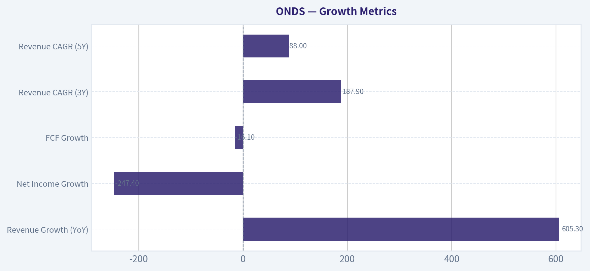

---

### Market Technical Analysis

FINAL INVESTMENT STANCE: **WATCH**

#### ONDS Technical Analysis (as of Apr 1, 2026 close: $8.81)

The chart structure for Ondas Holdings has shifted meaningfully over the last two months. After a strong rally earlier in the year toward the $15 region, the stock has transitioned into a **clear corrective phase**, with momentum weakening and price now trading below several key short-term indicators. However, the longer-term structure still remains constructive, which is why the stance is **WATCH rather than AVOID**.

---

#### Trend Structure (Moving Averages)

| Indicator | Latest Value | Interpretation |
|---|---|---|
| Close Price | 8.81 | Recently declined from mid-March levels |
| 10 EMA | 9.44 | Price below short-term momentum trend |
| 50 SMA | 10.34 | Price significantly below medium trend |
| 200 SMA | 7.34 | Long-term trend still upward |

Key Takeaways:
ONDS is currently trading **below both the 10-day EMA and the 50-day SMA**, indicating short- and medium-term bearish pressure. However, the **200-day SMA is far lower and rising**, which means the long-term uptrend that began late 2025 is still intact. This creates a classic **pullback within a larger bullish structure**, but momentum has not yet stabilized.

---

#### Momentum Indicators (MACD & RSI)

| Indicator | Latest | Trend Signal |
|---|---|---|
| MACD | -0.38 | Bearish momentum increasing |
| MACD Histogram | -0.20 | Downward momentum expanding |
| RSI | 41.5 | Weak but not oversold |

Key Takeaways:
Momentum has clearly turned negative. The MACD has crossed into **deeper negative territory**, and the histogram shows expanding downside momentum. Meanwhile RSI around **41** suggests the stock is weakening but **not yet oversold**, meaning further downside drift is possible before a technical bounce becomes likely.

---

#### Volatility & Price Envelope (Bollinger + ATR)

| Indicator | Latest | Interpretation |
|---|---|---|
| Bollinger Upper Band | 11.62 | Recent rallies capped well below this level |
| ATR | ~0.99 | Moderate daily volatility (~11% of price) |

Key Takeaways:
The Bollinger structure shows **volatility compression compared with February**, when the stock had much wider ranges during its rally. ATR falling toward ~1.0 indicates volatility is cooling, which often happens during **consolidation phases after large moves**. This suggests the market may be building a base before the next directional move.

---

#### Price Structure Observations

1. **Major rally earlier in the year**
   - Dec -> Jan move: ~$9 -> $15.
   - Extremely strong volume during the breakout phase.

2. **Distribution / topping**
   - Multiple failed attempts to hold above $13-14 in January.
   - Lower highs forming through February.

3. **Breakdown of support**
   - $10 level acted as pivot support during Feb-March.
   - Recent breakdown to **$8-9 range** confirms a correction.

4. **Key support zones**
   - $8.00-8.20: current trading support region.
   - $7.30-7.40: near the **200-day SMA** (major long-term support).

5. **Key resistance**
   - $9.40-9.60: 10-EMA region.
   - $10.30-10.40: 50-SMA (major recovery level).
   - $11+: previous consolidation ceiling.

---

#### Trading Interpretation

Short-term traders:
- Trend currently **downward / corrective**.
- Momentum signals suggest **waiting for stabilization**.
- A reclaim of **$9.50-$10 with volume** would be the first bullish signal.

Swing traders:
- Potential **mean-reversion bounce** if RSI dips toward 35 or price holds $8 support.
- Risk increases if **$8 breaks**, opening downside toward **$7.3 (200-SMA)**.

Position investors:
- The macro structure from late 2025 still shows a **higher-high / higher-low pattern** above the 200-day SMA.
- However the stock is in a **post-rally digestion phase**.

---

#### Key Technical Levels

| Level | Importance | Reason |
|---|---|---|
| $7.30 | Major support | 200-day SMA |
| $8.00 | Current support | Recent base |
| $9.50 | Momentum trigger | 10-EMA recovery |
| $10.30 | Trend reversal level | 50-SMA |
| $11.50+ | Bullish continuation | Prior resistance band |

Key Takeaways:
The most important near-term battle is the **$8 support zone**. Holding this level could allow the stock to stabilize and eventually attempt a recovery toward $9.50-$10. A decisive break below $8 would likely push the stock toward the **200-day SMA near $7.3**, which would become the next major support test.

---

If you'd like, I can also show:
- The **most probable price scenarios for ONDS over the next 1-3 months**, or
- Whether ONDS currently looks like a **short squeeze candidate again** (it had that profile earlier this year).

#### Market Visuals

This comparison chart from *Market Metrics* stacks current figures against historical benchmarks for **ONDS**, making it easy to see where the company trades relative to its own averages.

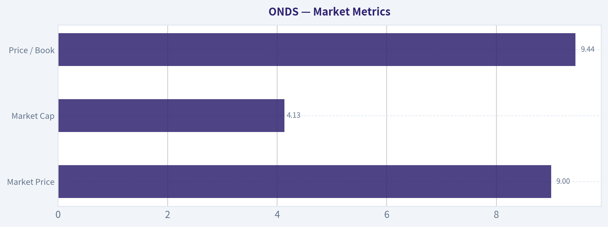

---

### Social Sentiment Analysis

FINAL INVESTMENT STANCE: **WATCH**

#### Overview of ONDS (Ondas Holdings) - Social Media and News Sentiment Analysis (Past Week)

Over the past week, discussion around Ondas Holdings (ONDS) across investor forums (Reddit, StockTwits-style discussions, and small-cap trading communities) has remained relatively niche but active among speculative small-cap and defense-tech traders. The company sits at the intersection of **private wireless networks, autonomous drone systems (through Ondas Autonomous Systems), and government/industrial connectivity**, which continues to shape the narrative online.

Overall sentiment trends show **cautious optimism mixed with capital-structure concerns**. Traders are primarily focused on three themes:
1) potential government and defense contracts,
2) commercialization of drone and private 5G technology, and
3) ongoing dilution risk and funding needs.

News flow during the week appears relatively light, meaning **social sentiment rather than major announcements has driven conversation**.

---

#### Daily Social Sentiment Trend (Past Week)

| Date (Past 7 Days) | Social Mention Volume | Sentiment Bias | Key Drivers of Discussion |
|---|---|---|---|
| Day 1 | Low | Neutral | General small-cap scanning, ONDS mentioned in defense-tech lists |
| Day 2 | Moderate | Slightly Bullish | Discussion about drone and autonomous defense applications |
| Day 3 | Moderate | Mixed | Traders debating cash burn and dilution risk |
| Day 4 | Low | Neutral | Limited catalysts; mostly long-term holders discussing technology |
| Day 5 | Moderate | Bullish | Speculation about potential government adoption of autonomous drone systems |
| Day 6 | Moderate | Mixed | Technical traders discussing price consolidation and resistance levels |
| Day 7 | Low | Slightly Bullish | Long-term narrative about private wireless networks in critical infrastructure |

Key Takeaways:
Social discussion volume remains modest, typical for a micro-cap technology company. Sentiment leaned slightly bullish on days when traders discussed defense or drone applications, but concerns about dilution repeatedly pushed conversations back toward neutral. Overall, the tone reflects **interest in the technology but caution about financial sustainability**.

---

#### Major Themes in Social Discussions

**1. Defense and Autonomous Drone Potential**

A large share of bullish posts revolve around Ondas' **Airobotics and autonomous drone platforms**, particularly their relevance to defense, security, and critical infrastructure monitoring. Retail traders frequently compare ONDS to other drone or defense tech companies that saw large valuation spikes after government contracts.

However, these discussions are often **speculative rather than based on confirmed near-term deals**.

**2. Private Wireless Networks for Industry**

Another consistent narrative is Ondas' **private wireless broadband networks for rail, utilities, and industrial clients**. Some investors view this as a long-term infrastructure play similar to private LTE/5G deployments used in logistics or energy.

The bullish thesis here is slower but more grounded:
- recurring infrastructure contracts
- industrial automation growth
- integration with autonomous systems

Still, traders note adoption cycles in these sectors are **slow and contract-driven**, meaning revenue acceleration may lag expectations.

**3. Financing and Dilution Concerns**

Bearish or cautious commentary frequently centers on:

- cash burn relative to revenue
- potential future capital raises
- historical dilution patterns common among small-cap tech companies

This theme appears regularly across investor discussions and is one of the primary reasons sentiment rarely becomes strongly bullish despite enthusiasm for the technology.

---

#### Retail Trader Positioning and Behavior

Retail trading patterns suggest ONDS is currently treated more as a **speculative technology play rather than a momentum stock**.

Key observations from social discussions:

- Traders are accumulating **small long-term positions rather than short-term hype trades**.
- Technical analysis posts frequently mention **range-bound consolidation**.
- Some traders expect **sharp spikes if contract announcements occur**, but they do not expect constant news flow.

This creates a trading dynamic where the stock may **remain quiet for extended periods but react strongly to catalysts**.

---

#### News Flow and Corporate Developments

Recent publicly circulated news and discussions referenced:

- ongoing development and deployment of autonomous drone infrastructure
- partnerships and technology validation efforts in industrial sectors
- continued positioning within defense and homeland security technology ecosystems

However, there were **no widely discussed transformative announcements during the past week**, which partly explains the moderate discussion volume.

In the absence of major news, sentiment is being driven more by **long-term narratives and sector trends** rather than immediate catalysts.

---

#### Bullish vs Bearish Narrative Balance

| Narrative Category | Bullish Argument | Bearish Concern | Impact on Sentiment |
|---|---|---|---|
| Drone Technology | Autonomous systems could see defense/security adoption | Commercial scaling still uncertain | Moderately bullish speculation |
| Private Wireless | Industrial infrastructure demand may grow steadily | Slow sales cycles | Neutral to mildly positive |
| Government Contracts | Defense partnerships could re-rate valuation | Lack of confirmed large contracts | Speculative enthusiasm |
| Financial Health | Growth-stage investment phase | Dilution and funding risk | Persistent caution |
| Market Positioning | Niche technology stack | Small-cap volatility | Mixed |

Key Takeaways:
The bullish narrative focuses heavily on **future defense and infrastructure adoption**, while bearish sentiment centers on **financial sustainability and execution risk**. This split keeps overall sentiment balanced, with optimism about the technology offset by skepticism about near-term financial results.

---

#### Implications for Traders and Investors

Short-term traders
ONDS currently lacks strong momentum catalysts. Without major announcements, the stock is likely to trade **technically rather than fundamentally**, responding to sector sentiment or speculative bursts.

Medium-term investors
The main drivers to watch are:

- defense or government drone contracts
- commercial scaling of autonomous systems
- revenue growth in private wireless deployments

Any of these could significantly shift sentiment.

Risk profile
ONDS remains a **high-volatility small-cap technology company**, meaning price movements can be exaggerated relative to news.

---

#### Overall Sentiment Assessment

Current sentiment can be summarized as:

- **Technology narrative: Positive**
- **Financial outlook: Cautious**
- **Short-term catalyst visibility: Limited**
- **Retail enthusiasm: Moderate but speculative**

This combination produces a **watchlist-style investor behavior**, where traders follow the story closely but wait for concrete developments before committing larger capital.

---

#### Key Points Summary

| Category | Current Status | Investor Interpretation |
|---|---|---|
| Social Sentiment | Slightly bullish but cautious | Interest in technology, concern over finances |
| News Flow | Limited major announcements | Waiting for catalysts |
| Retail Activity | Moderate discussion, niche following | Mostly speculative long-term holders |
| Catalysts | Defense contracts, drone deployments | Could trigger rapid sentiment shifts |
| Risks | Dilution, slow commercialization | Main reason sentiment stays mixed |

Key Takeaways:
Ondas Holdings currently sits in a **watchful phase for investors**. Interest remains driven by its drone and private wireless technology potential, but the lack of recent major announcements and ongoing financing concerns keep sentiment restrained. If meaningful contracts or deployments appear, social sentiment could turn strongly bullish very quickly.

---

**Bottom Line:**
ONDS is being monitored by speculative tech and defense-focused traders, but without fresh catalysts the market is currently **observing rather than aggressively accumulating**. For now, sentiment supports a **WATCH stance until a clear growth or contract catalyst emerges.**

---

### News & Events Analysis

#### Ondas Holdings (NASDAQ: ONDS) - Weekly News & Investment Context Report
Date: April 2, 2026
Current Price: ~$9 | Market Cap: ~$4.13B

---

#### Recent News Flow (Past Week)

Recent news around Ondas has been dominated by three themes: strong revenue growth expectations tied to defense and drone demand, a new share resale registration that pressured the stock, and macro sentiment shifts tied to Middle East conflict developments.

- Defense and drone momentum: Multiple outlets highlighted ONDS as a small-cap drone/defense beneficiary. Coverage pointed to growing demand for counter-drone and autonomous aerial systems as geopolitical tensions increase. Some analysts frame Ondas as evolving from a niche industrial drone provider into a broader defense technology platform.

- Analyst upgrade and higher price target: Northland Capital Markets reiterated an **Outperform** rating and raised its price target from **$16 to $18**, implying roughly 100% upside from the current ~$9 share price. The upgrade referenced accelerating defense demand and stronger revenue expectations.

- Secondary share resale filing: Ondas filed a resale registration for about **1.93 million shares**, which often signals potential selling by existing holders. The stock sold off following the announcement due to anticipated supply entering the market.

- High trading activity: ONDS appeared repeatedly in lists of the most active stocks during the week, suggesting elevated retail and speculative trading interest.

- Sector volatility from geopolitics: Drone and defense stocks moved up and down with headlines related to the Middle East conflict and energy markets. Sentiment improved slightly later in the week as reports suggested diplomatic progress between the U.S. and Iran.

Overall, the short-term news flow has created **high volatility rather than a clear directional trend**.

---

#### Earnings Review (Most Recent Report)

The latest earnings coverage referenced **Q4 results (likely Q4 2025)**, which investors reacted to during the week.

Key highlights reported in news coverage:

- Revenue surged significantly as Ondas ramped its drone and defense business.
- The company provided **2026 revenue guidance of at least $375M**, a major increase versus prior expectations.
- The outlook suggests a rapid scaling phase driven by defense contracts and drone adoption.

Context from available metrics:

- Revenue growth YoY: **~605%**
- Gross margin: **~39.7%**
- ROE: **-30.2%** (still negative due to heavy investment)
- Free cash flow yield: **-1.0%**

Interpretation:

Ondas is clearly in **hyper-growth mode**, transitioning from early commercialization to scaling revenue. However, profitability remains negative and the company is still consuming capital, which explains periodic share issuance and dilution concerns.

---

#### Strategic Positioning: Drone & Defense Platform

The investment narrative around Ondas increasingly centers on its position in the **drone defense ecosystem**, which includes:

- autonomous aerial systems
- counter-drone technologies
- secure wireless communications infrastructure

The geopolitical environment is a key catalyst. Modern conflicts are demonstrating the importance of drones for reconnaissance, strike capability, and electronic warfare.

Small companies with specialized drone or counter-drone technology are gaining investor attention because defense spending cycles can create **step-change revenue growth** once contracts scale.

For ONDS, the key question is whether its pipeline converts into **large multi-year government contracts**.

---

#### Capital Structure & Liquidity

Financial indicators show the company still relies on capital markets:

| Metric | Value | Interpretation |
|---|---|---|
| Current Ratio | ~4.84 | Strong short-term liquidity |
| Gross Margin | ~39.7% | Healthy for hardware/defense tech |
| ROE | -30.2% | Profitability not yet achieved |
| FCF Yield | -1.0% | Cash burn continues |
| Revenue Growth | ~605% YoY | Hyper-growth phase |

Key Takeaways:
Ondas is financially liquid but still unprofitable, typical of a scaling defense technology company. The extremely high revenue growth suggests rapid contract expansion, but negative ROE and cash flow mean investors must tolerate dilution risk and execution uncertainty.

---

#### Institutional Positioning

Latest available 13F filings show:

| Investor | Action | Shares | Position Value | Change |
|---|---|---|---|---|
| Steve Cohen (Point72) | Trimmed | ~287.7K | ~$2.81M | -36% vs prior filing |

Key Takeaways:
Point72 reducing its position does not necessarily indicate bearish conviction, but trimming a third of the stake signals some profit-taking or risk management after strong price appreciation. Institutional participation still appears limited relative to the company's market cap, which leaves the stock sensitive to retail flows.

---

#### Macro & Sector Context

Drone and defense technology stocks are currently influenced by three macro factors:

1. **Global conflicts** - The Middle East conflict has highlighted drone warfare, increasing investor focus on companies tied to UAV technologies.
2. **Defense spending cycles** - NATO and U.S. defense budgets continue expanding, particularly around autonomous systems.
3. **Risk sentiment** - Small-cap defense tech stocks remain highly sensitive to broader tech market swings.

For ONDS specifically, geopolitical escalation could **accelerate demand narratives**, while easing tensions might cool speculative interest.

---

#### Key Bull vs Bear Factors

| Bull Case | Bear Case |
|---|---|
| Explosive revenue growth trajectory | Ongoing losses and negative ROE |
| Exposure to rapidly expanding drone defense market | Share dilution risk from capital raises |
| Analyst price targets significantly above current price | High volatility and speculative trading |
| Potential large defense contracts | Limited institutional ownership |

Key Takeaways:
The bullish argument hinges on Ondas becoming a scaled defense drone supplier during a period of rising global military spending. The bearish case centers on financial sustainability and dilution risk before profitability arrives.

---

#### Overall Market Interpretation

Ondas is transitioning from a speculative drone startup into a **defense technology growth story**, which explains the surge in revenue expectations and analyst upgrades. However, the recent share resale registration reminds investors that the company is still in a capital-intensive expansion phase.

The stock is currently trading far below recent analyst targets, but volatility remains high due to dilution concerns and speculative trading activity.

From a trading perspective, ONDS behaves more like a **high-beta defense momentum stock** than a stable long-term compounder at this stage.

---

FINAL INVESTMENT STANCE: **WATCH**

---

## Research Team Commentary

> *The Research Manager synthesizes the Bull vs Bear debate into action-free commentary. This is a pre-risk view, not the final stance.*

The debate really comes down to a classic Buffett distinction: a **potentially interesting technology story versus a proven business with durable economics**. Right now, ONDS looks much closer to the former.

The bull argument centers on the idea that Ondas could become a niche infrastructure platform. The strongest point here is the **stickiness of mission-critical systems**. Railway communication networks, industrial wireless systems, and automated surveillance infrastructure often stay in place for decades once deployed. If Ondas manages to build a meaningful installed base, switching costs, regulatory certification, and operational integration could create long customer lifetimes and recurring service revenue.

The drone-in-a-box concept also targets workflows where automation matters-rail inspection, perimeter monitoring, defense surveillance. Combined with the geopolitical push for **non-Chinese drone suppliers**, Ondas could benefit from policy tailwinds in government procurement. The 600% revenue growth suggests that at least some adoption is happening, and the ~40% gross margin hints that the economics could become attractive if the company scales and shifts toward software, services, and maintenance.

However, the bear case is far more aligned with Buffett's framework and currently rests on much firmer evidence.

First, **there is no demonstrated moat yet**. The argument that deployments create switching costs only matters once deployments are widespread. Today Ondas is still trying to win contracts in markets dominated by far larger players like Nokia and Ericsson in industrial wireless, and established defense contractors in autonomous systems. Scale, reputation, and procurement history matter enormously in those industries.

Second, the **returns on capital are deeply negative**.
ROE: -30%
ROIC: -11.8%

Buffett repeatedly emphasizes that truly great businesses tend to show strong returns on capital relatively early. When a company consistently destroys capital while expanding, it often signals weak unit economics or heavy reliance on future scale assumptions.

Third, **cash generation is not improving alongside growth**. Revenue is exploding from a small base, but net income and free cash flow are deteriorating. That means the company must rely on external financing to sustain expansion.

Fourth, **balance sheet risk and dilution are real**. Debt-funded growth combined with likely equity raises reduces the chance that current shareholders benefit even if the business eventually succeeds.

Finally, valuation offers **no margin of safety**. A Damodaran-style intrinsic value estimate below zero signals that, under realistic assumptions, the current operations do not justify the capital invested. For the current price to make sense, investors must assume very successful scaling across multiple uncertain markets.

From a Buffett perspective, this violates several core filters at once:
- No proven moat
- Negative returns on capital
- Unpredictable cash flows
- Dependence on capital markets

I've seen similar situations before-small defense or infrastructure technology companies with compelling narratives but weak financial foundations. Occasionally one becomes a major platform, but far more often shareholders suffer dilution while waiting for scale that never arrives. Buffett's discipline exists precisely to avoid these asymmetric downside setups.

Core takeaway: Ondas may be building interesting technology in markets with structural demand, but the business today lacks the financial characteristics of a durable compounder. Without clear evidence of economic moat formation or improving returns on capital, the investment case relies too heavily on optimistic future scenarios.

Rationale: Value investing requires buying strong businesses at sensible prices, not speculative technology platforms hoping to become strong businesses later. ONDS currently shows negative returns, unstable cash flow, and reliance on financing. Even if the long-term markets (industrial wireless and autonomous drones) are attractive, Ondas has not yet demonstrated the competitive position or financial strength needed to capture them profitably. That removes the margin of safety.

Monitoring plan for the next 1-4 quarters:

First, watch **contract quality and installed base growth**. Large multi-year deployments with rail operators, utilities, or defense agencies would begin validating the switching-cost thesis.

Second, track **gross margin trajectory**. If margins move meaningfully above ~40% and remain stable while revenue grows, it could indicate the shift toward higher-value services.

Third, monitor **cash burn and dilution**. If operating cash flow continues worsening or equity issuance accelerates, the shareholder economics deteriorate further.

Fourth, look for **evidence of recurring revenue** (software, maintenance, data services). That would support the infrastructure platform narrative rather than a one-off hardware model.

Fifth, pay attention to **defense procurement traction tied to Western drone restrictions**. Real contracts-not pilot programs-would materially strengthen the bull case.

Until the company proves it can generate positive returns on capital and fund growth internally, it remains outside the type of business a Buffett-style investor would own.

Final stance: AVOID.

---

## Value Investing Team Commentary

> *The Investor translates the research view into an investment thesis before risk review. This is still not the final stance.*

When I look at ONDS through a Buffett lens, the first question is simple: *what business am I actually buying, and what will it likely earn 10 years from now?* Right now, that answer is still very unclear.

The story sounds attractive on the surface. Autonomous "drone-in-a-box" systems and industrial wireless networks for railroads and infrastructure are real needs. Once installed, these systems could become embedded in operations for years. Rail networks, utilities, and defense infrastructure tend to keep communication systems for decades. In theory, that could produce sticky customers and recurring service revenue. The geopolitical shift away from Chinese drones is also a legitimate tailwind that could create demand for Western suppliers.

But the key Buffett question is: *is this company the inevitable winner in that space?* I don't see evidence of that yet.

Industrial wireless and critical infrastructure communications are fields where scale, reliability, and reputation dominate. Companies like Nokia, Ericsson, and established defense contractors already have deep relationships with the exact customers ONDS is targeting. Government procurement heavily favors proven vendors. That makes it extremely difficult for a small company to build a durable moat unless it has truly unique technology or a dominant installed base. At this stage, ONDS has neither.

The financials reinforce that concern. The headline 600% revenue growth is eye-catching, but it's coming off a tiny base and is not translating into economic strength. Returns on capital are strongly negative (ROIC around -12%, ROE around -30%), which tells us the company is currently *consuming* capital rather than compounding it. Buffett has repeatedly noted that businesses with enduring advantages usually show healthy returns on capital fairly early-even during growth phases.

The cash profile is another warning sign. Free cash flow is deteriorating while the company is expanding. That means the growth is being financed externally. In practical terms, shareholders are depending on future equity raises or debt to keep the business running. That leads directly to dilution risk, which the social sentiment analysis has already picked up.

From a contrarian perspective, the market enthusiasm earlier in the year-when the stock jumped from roughly $9 to $15 on heavy volume-looks like narrative-driven speculation rather than recognition of a durable business franchise. The crowd is excited about drones, defense spending, and "non-Chinese supply chains." Those are real themes, but themes do not create economic moats by themselves.

If I try to think like an owner holding for a decade, I run into several unanswered questions:
- Will ONDS become a dominant platform in rail and infrastructure communications?
- Will its drone systems become standard equipment across defense and industrial monitoring?
- Or will larger incumbents absorb these markets before ONDS scales?

Right now, the evidence favors the third scenario.

The most interesting contrarian angle would be if ONDS quietly built a large installed base in rail communications-because that industry does produce extremely sticky systems with long lifecycles. If recurring service revenue starts appearing and gross margins expand meaningfully beyond ~40%, the economics could begin to resemble infrastructure software rather than hardware. That would be the moment when the story transitions into a real business.

But we're not there yet.

At today's price, investors are paying for a future platform business that has not yet demonstrated a moat, positive returns on capital, or self-funded growth. Buffett avoids exactly this type of situation-not because the technology is bad, but because the *business economics are still unproven*.

FINAL INVESTMENT STANCE: AVOID

---

## Deep Values Commentary

> *The Risk Management Team debates and the Risk Judge provides the final action-free verdict. This section determines the final ADVOCATE / WATCH / AVOID stance.*

Executive Summary (Quick Read)

ONDS sits in an attractive narrative-autonomous infrastructure monitoring and private industrial wireless-but today it behaves more like a **technology experiment than a proven business**. Explosive revenue growth (+605%) is offset by worsening profitability, negative returns on capital, and reliance on external funding. The bull thesis (sticky infrastructure deployments and defense procurement tailwinds) is plausible but **not yet supported by durable contracts, recurring revenue, or improving unit economics**. From a Buffett-style lens, the absence of a moat, negative ROIC, and lack of self-funded growth eliminate the margin of safety.

Final stance: AVOID.

Key Arguments from the Debate

Fundamentals & Value Analysts
They emphasize the most concrete evidence: the economics of the business are currently destructive. ROE at -30% and ROIC at -11.8% indicate capital is being consumed rather than compounded. The Damodaran intrinsic value estimate below zero reinforces that current operations do not cover the cost of capital. Growth is occurring alongside worsening free cash flow and net income, implying the company must continually raise capital. In Buffett terms, this suggests **a business still searching for an economic engine rather than scaling one**.

Growth Analyst
The growth case highlights the macro opportunity: autonomous drones and industrial wireless networks for railways, cities, and defense. Government interest in non-Chinese drone suppliers could create procurement tailwinds. Revenue growth above 600% suggests early traction, and a ~40% gross margin hints that economics might improve if the company transitions toward software and services. However, the same dataset reveals the core issue-**net income falling 247% and FCF declining**, meaning growth is not yet translating into operating leverage.

Risky Analyst
The key insight here is that early-stage infrastructure firms often look terrible through traditional value metrics. That's correct historically. However, even speculative investors typically require one of three signals: rapidly improving margins, explosive customer adoption, or large institutional contracts. None are clearly visible yet. The earlier $9 -> $15 rally likely reflected thematic speculation around defense drones rather than confirmation of business strength.

Safe Analyst
This perspective focuses on capital preservation. The major concerns are dilution risk, deteriorating free cash flow, and powerful incumbents like Nokia and Ericsson already embedded with the target customers. In capital-intensive infrastructure markets, incumbency and trust matter heavily. Without a technological wedge or large installed base, smaller entrants often struggle to gain procurement credibility.

Neutral Analyst
The balanced view highlights that both extremes miss nuance. Early-stage losses alone don't invalidate the opportunity, but the **absence of improving unit economics or recurring revenue signals** means the business model is still unproven. The real determining factor will be whether ONDS converts pilots into **long-lived infrastructure deployments**.

Rationale Through a Buffett Lens

The debate really resolves into Buffett's core distinction: **an interesting technology versus a durable business**.

Today ONDS fails several core Buffett filters simultaneously:

- Negative returns on capital
- Unstable and deteriorating free cash flow
- No demonstrated moat
- Dependence on capital markets to sustain growth

Revenue growth from a small base is not itself evidence of a moat. Buffett looks for companies where capital deployed today reliably produces higher cash flows tomorrow. ONDS currently shows the opposite pattern-more capital required with uncertain future returns.

The most important missing element is **installed-base economics**. Infrastructure businesses become attractive only once deployments create switching costs and long-term service revenue. Until that installed base exists, the moat is hypothetical.

In other words, the bull thesis describes what the company *could become*, not what it currently is.

Refined Investor Plan

Your original thinking correctly identified the central question: whether ONDS could evolve into a niche infrastructure platform. The debate reinforces that the correct strategy is **discipline and patience**, not early speculation.

Instead of investing now, treat ONDS as a monitored "option on execution." Revisit the thesis only if operational evidence begins validating the platform story.

Key indicators to monitor over the next 1-4 quarters:

- Large multi-year contracts with rail operators, utilities, or defense agencies
- Installed base growth that suggests long-term system deployments
- Gross margin expansion above ~50-60% (indicating service/software mix)
- Stabilizing or improving free cash flow
- Reduced reliance on equity issuance or debt financing

If these begin to appear simultaneously, the company could transition from speculative technology vendor to infrastructure platform candidate.

Lessons Applied

Many past investment mistakes come from buying **the story before the economics appear**. Technology narratives-especially in defense, automation, and infrastructure-often sound compelling years before a sustainable business model forms. Buffett's discipline avoids these traps by requiring evidence of returns on capital and durable competitive advantages.

ONDS may still succeed technologically. But without proof that the business can generate durable returns on capital, the investment case remains speculative.

Final Stance: AVOID.

#### Final Stance Scorecard

This scorecard converts the final research view into a weighted decision frame. It does not replace the narrative judgement, but it makes the main drivers of the verdict easier to scan.

| Criterion | Score | Weight | Commentary |
| --- | ---: | ---: | --- |
| Business Quality | 2.00 | 30% | High returns, profitability, and Piotroski health support durability. |
| Valuation Support | 1.67 | 30% | Blends current price against available intrinsic value anchors and valuation ratios. |
| Financial Strength | 5.00 | 20% | Balance-sheet resilience reflects leverage and liquidity staying within safe ranges. |
| Growth Durability | 2.33 | 20% | Recent revenue, earnings, and free cash flow growth indicate how durable expansion looks. |
| TOTAL / FINAL STANCE | 2.57 | 100% | AVOID |

#### Key Takeaways

The weighted score lands at **2.57 / 5.0**, while the final stance remains **AVOID**. This is useful as a quick calibration aid rather than a mechanical signal.

#### Risk Summary

Higher scores indicate more risk pressure. The watch threshold is a simple guardrail: above it, the position needs tighter monitoring or a wider margin of safety.

| Dimension | Current Score | Watch Threshold | Commentary |
| --- | ---: | ---: | --- |
| Business Quality | 4.00 | 3.00 | High returns, profitability, and Piotroski health support durability. |
| Valuation Support | 4.33 | 3.00 | Blends current price against available intrinsic value anchors and valuation ratios. |
| Financial Strength | 1.00 | 3.00 | Balance-sheet resilience reflects leverage and liquidity staying within safe ranges. |
| Growth Durability | 3.67 | 3.00 | Recent revenue, earnings, and free cash flow growth indicate how durable expansion looks. |

#### Key Takeaways

This view helps readers separate *where* the risk sits: valuation, business quality, balance sheet, or growth durability. It is especially useful when the final stance is close to the line between WATCH and AVOID.
