# ONDS Deep Value Intelligence

**Analysis Date:** 2026-08-11

## Critical Disclaimer

*This analysis is generated by Deep Value Intelligence, an AI-powered multi-agent investing framework. Education & research only - not financial advice, not a financial advisor.*

---

## Table of Contents

1. Intelligence Summary
2. Analyst Team Reports
   - Fundamentals Analysis
   - Intrinsic Value Analysis (Buffett)
   - Trend & Growth Analysis (Lynch/Druckenmiller/Fisher)
   - Market Technical Analysis
   - Options Market Analysis
3. Research Team Commentary
4. Value Investing Team Commentary
5. Deep Values Commentary

---

## Intelligence Summary

### Thesis + Conditions

**Core Thesis:** **EXECUTIVE SUMMARY**
Ondas Holdings (ONDS) is currently un-investable under a strict Buffett-style intrinsic value framework due to a severe lack of margin of safety (105 P/E), high capital consumption (-31.3% ROE), and reliance on lumpy defense/government contracts. However, applying our recent lessons from narrative-driven tech (Tesla), issuing a blanket **AVOID** when a stock is testing a major technical breakout (200-day SMA at $9.33) supported by explosive secular tailwinds (AI defense, drones) is a tactical error.

**Key Risks:**
- Ondas Holdings (ONDS) is currently un-investable under a strict Buffett-style intrinsic value framework due to a severe lack of margin of safety (105 P/E), high capital consumption (-31.3% ROE), and reliance on lumpy defense/government contracts. However, applying our recent lessons from narrative-driven tech (Tesla), issuing a blanket **AVOID** when a stock is testing a major technical breakout (200-day SMA at $9.33) supported by explosive secular tailwinds (AI defense, drones) is a tactical error. ONDS is not a value investment; it is a speculative narrative setup. We must sideline our long-term fundamental objections just enough to monitor the technical breakout, keeping it strictly on a tactical watchlist.
- The Risky Analyst (The Narrative):** Argues ONDS is capturing a massive secular shift in autonomous defense and rail. Views the 39.7% gross margin as a sign of pricing power and advocates buying the 200-day SMA test before the market re-rates the stock, comparing it to early Tesla or Nvidia.
- The Neutral Analyst (The Synthesis):** Rejects the extremes. Acknowledges the fundamental risks but respects the narrative upside. Suggests waiting for the 200-day SMA to prove itself as support before initiating a tight, speculative satellite position (1% portfolio weight).

**Confidence:** Medium

---

## Analyst Team Reports

### Fundamentals Analysis

#### Latest Earnings Snapshot

*Most recent reported quarter anchored on 2026 Q1, with prior-year comparison when available.*

| Metric | 2026 Q1 | 2025 Q1 | YoY Change |
| --- | ---: | ---: | ---: |
| Revenue | $50.1M | $4.2M | +1079.9% |
| Operating Income | $-42.7M | $-10.3M | -313.9% |
| Net Income | $362.9M | $-14.1M | +2667.5% |
| Diluted EPS | $0.77 | $-0.15 | +613.4% |
| Operating Cash Flow | $-51.3M | $-6.7M | -670.4% |
| Free Cash Flow | $-52.6M | $-6.8M | -670.6% |

Key Takeaways: This snapshot anchors the most recent reported quarter before the narrative analysis. It helps readers separate long-run business quality from whatever changed in the latest earnings print.

#### 11-Year Financial Metrics for ONDS

*All values below are computed deterministically from raw data - not estimated by AI.*

*Issuer profile: operating company (Technology / Communication Equipment).*

#### 11-Year Financial Metrics
*Annual rows come from reported financial statements. The final TTM row is computed from the latest four quarters.*

| Metric | 2015 | 2016 | 2017 | 2018 | 2019 | 2020 | 2021 | 2022 | 2023 | 2024 | 2025 | 2026 TTM |
| --- | --- | --- | --- | --- | --- | --- | --- | --- | --- | --- | --- | --- |
| Market Price | N/A | N/A | N/A | N/A | N/A | $9 | $7 | $2 | $2 | $3 | $10 | $9 |
| Market Cap | N/A | N/A | N/A | N/A | N/A | $247.6M | $229.3M | $67.2M | $80.7M | $179.0M | $2.16B | $4.45B |
| P/E Ratio | 0.00 | 0.00 | 0.00 | 0.00 | 0.00 | -18.37 | -15.25 | -0.92 | -1.74 | -4.20 | -15.74 | 18.14 |
| P/B Ratio | -910.53 | -2.51 | -4.47 | -20.85 | -29.32 | 16.42 | 2.04 | 1.15 | 2.44 | 10.79 | 4.94 | 4.14 |
| ROE | 97.6% | 0.7% | 38.2% | 81.3% | 156.0% | -89.4% | -13.4% | -125.8% | -139.9% | -255.8% | -31.3% | 22.8% |
| ROIC | N/A | N/A | N/A | N/A | N/A | N/A | -44.0% | -192.8% | -525.5% | N/A | N/A | -161.9% |
| EPS | $-0.01 | $-0.02 | $-0.18 | $-0.24 | $-0.98 | $-0.51 | $-0.44 | $-1.73 | $-0.88 | $-0.61 | $-0.62 | $0.52 |
| Revenue | $3,891 | $5,512 | $274,403 | $190,029 | $320,383 | $2.2M | $2.9M | $2.1M | $15.7M | $7.2M | $50.7M | $96.6M |
| Gross Profit | $-1,518 | $-6,910 | $194,635 | $150,664 | $241,257 | $927,668 | $1.1M | $1.1M | $6.4M | $345,000 | $20.2M | $43.3M |
| Gross Margin | -39.0% | -125.4% | 70.9% | 79.3% | 75.3% | 42.9% | 37.7% | 52.2% | 40.7% | 4.8% | 39.7% | 44.8% |
| Operating Margin | -508.2% | -627.4% | -872.6% | -4439.1% | -4798.0% | -532.6% | -618.3% | -3266.0% | -253.2% | -481.1% | -115.1% | -93.9% |
| Net Income | $-19,775 | $-34,580 | $-3.0M | $-12.1M | $-19.4M | $-13.5M | $-15.0M | $-73.2M | $-46.4M | $-42.4M | $-137.2M | $245.1M |
| Net Margin | -508.2% | -627.4% | -1101.4% | -6365.8% | -6052.2% | -622.9% | -516.9% | -3445.3% | -295.4% | -589.7% | -270.4% | 253.7% |
| Revenue Growth | N/A | 41.7% | 4878.3% | -30.7% | 68.6% | 575.4% | 34.3% | -26.9% | 638.1% | -54.2% | 605.3% | 90.4% |
| Net Income Growth | N/A | 74.9% | 8639.8% | 300.3% | 60.3% | -30.5% | 11.5% | 387.5% | -36.7% | -8.5% | 223.4% | -278.7% |
| Free Cash Flow Growth | N/A | N/A | N/A | N/A | 62.7% | -48.8% | 136.2% | 129.2% | -16.2% | 2.6% | 16.2% | 112.6% |
| Total Book Value | $-20,263 | $-4.9M | $-7.9M | $-14.9M | $-12.4M | $15.1M | $112.2M | $58.2M | $33.1M | $16.6M | $437.8M | $1.07B |
| Total Assets | $8,040 | $5,660 | $717,627 | $2.7M | $4.3M | $28.5M | $117.4M | $97.9M | $92.2M | $109.6M | $1.13B | $2.44B |
| Total Debt | N/A | N/A | N/A | N/A | $10.6M | $7.7M | $300,000 | N/A | N/A | $300,000 | N/A | $7.9M |
| Debt-to-Equity | N/A | N/A | N/A | N/A | -0.85 | 0.51 | 0.00 | N/A | N/A | 0.02 | N/A | 0.01 |
| Cash & Equivalents | $5,174 | $45,248 | $456,018 | $1.1M | $2.2M | $26.1M | $40.8M | $29.8M | $15.0M | $30.0M | $550.7M | $1.03B |
| Shareholders' Equity | $-20,263 | $-4.9M | $-7.9M | $-14.9M | $-12.4M | $15.1M | $112.2M | $58.2M | $33.1M | $16.6M | $437.8M | $1.07B |
| Operating Cash Flow | $-20,641 | $-28,992 | $-2.6M | $-8.5M | $-14.7M | $-7.5M | $-16.9M | $-38.0M | $-34.0M | $-33.5M | $-38.7M | $-83.4M |
| Investing Cash Flow | N/A | N/A | N/A | $-629,683 | $-354,822 | $-16,140 | $-10.2M | $-6.9M | $536,273 | $-1.7M | $-260.1M | $-734.1M |
| Free Cash Flow | N/A | N/A | N/A | $-9.1M | $-14.7M | $-7.5M | $-17.8M | $-40.8M | $-34.2M | $-35.1M | $-40.8M | $-86.7M |
| FCF Margin | N/A | N/A | N/A | -4768.5% | -4601.5% | -348.6% | -613.0% | -1921.3% | -218.1% | -488.0% | -80.4% | -89.7% |
| Dividends / Share | $0.00 | $0.00 | $0.00 | $0.00 | $0.00 | $0.00 | $0.00 | $0.00 | $0.00 | $0.00 | $0.00 | $0.00 |

#### Profitability Metrics
- Return on Equity (ROE): -31.3%
- Return on Invested Capital (ROIC): N/A
- Return on Assets (ROA): -12.1%
- Gross Margin: 39.7%
- Operating Margin: -115.1%
- Net Profit Margin: -270.4%

#### Liquidity Metrics
- Current Ratio: 4.84
- Quick Ratio: 4.19

#### Leverage Metrics
- Debt-to-Equity Ratio: N/A
- Interest Coverage Ratio: -8.88
- Net Debt: N/A

#### Growth Metrics (Year-over-Year)
- Revenue Growth: 605.3%
- Net Income Growth: -223.4%
- Free Cash Flow Growth: -16.2%
- Revenue CAGR (3-Year): 187.9%
- Revenue CAGR (5-Year): 87.9%

#### Valuation Metrics
- P/E Ratio (TTM): 105.33
- Forward P/E: -237.00
- Price-to-Book: 4.14
- Price-to-Sales: 55.92
- PEG Ratio: 0.17
- EV/EBITDA: -42.40
- Free Cash Flow Yield: -0.8%
- Earnings Yield: 0.9%

#### Owner Earnings (Buffett Method, Code-Computed)
- Net Income: $-137.2M
- + Depreciation & Amortization: $8.0M
- - Capital Expenditures: $-2.0M
- - Working Capital Changes: $-12.4M
- = **Owner Earnings: $-118.8M**

#### Intrinsic Value (Code-Computed)
- Current Price: $9
- Cash Flow Method (FCF):
  Conservative: $2
  Average: $2
  Optimistic: $2
- Damodaran FCFF (WACC + margins + reinvestment):
  Conservative: $-9
  Average: $-21
  Optimistic: $-29
  Monte Carlo band (P10-P90): $-49 - $-8 (median $-22)
  P(intrinsic value > price): 0.0%
- Reverse-DCF: price implies ~-3.7%/yr owner-earnings growth for 10y; trailing 3y was N/A, 5y N/A.

#### Piotroski F-Score: 5/9
- Positive Net Income: FAIL
- Positive Operating Cash Flow: FAIL
- ROA Improvement: PASS
- Cash Flow > Net Income: PASS
- Decreasing Debt: PASS
- Improving Current Ratio: PASS
- No Dilution: FAIL
- Improving Gross Margin: PASS
- Improving Asset Turnover: FAIL

ANALYST STANCE: **AVOID**

#### ONDS Fundamental Analysis - Warren Buffett-Style Review

Ondas Holdings is a high-growth but still economically unproven technology and defense-drone communications company. The latest deterministic dataset shows spectacular revenue growth, a much larger cash balance, and positive TTM net income, but the core Buffett tests remain weak: operating cash flow is still negative, free cash flow is deeply negative, ROIC is negative, dilution has been material, and valuation already assumes a successful turnaround.

The current stock price is about **$9**. The canonical historical table shows a **TTM market cap of $4.45B**, while the shared current quote summary shows **$5.40B**. Either way, ONDS trades at a very high valuation relative to its current revenue and cash-flow profile.

---

#### Current vs. Historical Average Comparison

| Metric | Current / TTM | Historical Average* | Interpretation |
|---|---:|---:|---|
| Market Price | $9 | ~$5.50 | The stock is well above its listed-history average, reflecting renewed optimism around defense-drone and counter-drone demand. |
| Market Cap | $4.45B canonical TTM / $5.40B latest quote summary | ~$494M | The company's valuation has expanded dramatically, far faster than proven cash generation. |
| P/E Ratio | 18.14 in TTM table / 105.33 in valuation summary | Historically mostly negative / not meaningful | P/E is not reliable because ONDS has a long loss history and current earnings appear non-recurring or transition-affected while FCF remains negative. |
| P/B Ratio | 4.14 | Distorted by negative and changing equity base | P/B is of limited use for this technology/IP-heavy issuer; book value has been heavily affected by capital raises and acquisitions. Cash-flow valuation is more relevant. |
| ROE | 22.8% TTM / -31.3% FY2025 | ~-38% | TTM ROE improved sharply due to positive net income, but the longer record is loss-making and not yet evidence of durable profitability. |
| ROIC | -161.9% TTM | ~-254% where available | ROIC remains severely negative, indicating the business has not yet proven it can earn attractive returns on capital. |
| EPS | $0.52 TTM / -$0.62 FY2025 | ~-$0.62 | TTM EPS turned positive, but the company has a decade-long record of negative EPS. |
| Revenue | $96.6M TTM | ~$8.2M | Revenue has scaled sharply, but from a tiny base and with major volatility. |
| Gross Profit | $43.3M TTM | ~$3.1M | Gross profit improved materially, consistent with higher revenue and a better gross margin mix. |
| Gross Margin | 44.8% TTM | ~31.8% | Gross margin is above the historical average and much better than FY2024's weak 4.8%. |
| Operating Margin | -93.9% TTM | ~-1,600% | Operating losses are still very large, although the margin loss is less extreme than earlier years. |
| Net Income | $245.1M TTM / -$137.2M FY2025 | ~-$36.1M | TTM net income is a major outlier versus the loss-making history and should be treated cautiously. |
| Net Margin | 253.7% TTM / -270.4% FY2025 | ~-1,989% | The positive TTM margin is not representative of normal operating economics while free cash flow remains negative. |
| Revenue Growth | 90.4% TTM / 605.3% FY2025 | ~673%, heavily skewed | Growth is exceptional but extremely volatile, driven by small starting revenue and acquisitions/contracts. |
| Net Income Growth | -278.7% TTM / 223.4% FY2025 | Highly distorted | Net income growth is not a reliable trend because losses, one-time items, and sign changes distort the calculation. |
| FCF Growth | 112.6% TTM / 16.2% FY2025 | ~40% where available | FCF "growth" is misleading because free cash flow is still negative; the key issue is cash burn. |
| Total Book Value | $1.07B | ~$63M | Book value has expanded dramatically, likely due to capital raising and acquisitions. |
| Total Assets | $2.44B | ~$158M | The asset base has grown sharply, but the returns on those assets remain unproven. |
| Total Debt | $7.9M | ~$4.7M where available | Debt is low in absolute terms, which is a positive. |
| Debt-to-Equity | 0.01 | Low / distorted historically | Leverage risk is low, but equity dilution and cash burn are more important risks than debt. |
| Cash & Equivalents | $1.03B | ~$69.6M | Cash is the strongest part of the balance sheet and provides a runway. |
| Shareholders' Equity | $1.07B | ~$63M | Equity has improved materially, but returns on equity are not yet consistently positive. |
| Free Cash Flow | -$86.7M TTM | ~-$25M | Cash burn has worsened in dollar terms despite revenue growth. |
| Dividends / Share | $0.00 | $0.00 | ONDS pays no dividend, appropriate for a cash-consuming growth company. |

\*Historical averages are calculated from the available years in the deterministic dataset, generally the most recent 10 annual periods where data exists. Some valuation averages are inherently distorted because ONDS had negative earnings, negative equity, or limited market data in earlier years.

**Key Takeaways:** ONDS has transformed from a tiny-revenue company into a much larger defense and autonomous-systems platform, but the transformation has not yet produced durable free cash flow. The market has already capitalized the company as if the turnaround will work. From a Buffett perspective, the gap between valuation and proven economics is the central problem.

---

#### Market Metrics Interpretation

| Market Metric | Current Reading | Buffett-Style Interpretation |
|---|---:|---|
| Market Price | $9 | The share price has recovered strongly from the $2-$3 range seen in 2022-2024. This reflects optimism around defense, drone, and counter-drone contracts. |
| Total Market Cap | $4.45B canonical TTM; latest quote summary $5.40B | The valuation is very large relative to $96.6M TTM revenue and negative FCF. This is a venture-style valuation, not a traditional value-investing valuation. |
| P/E Ratio | 18.14 in table / 105.33 in valuation summary | Not a dependable valuation anchor. The company's long loss history, negative FCF, and likely non-recurring earnings effects make P/E less informative than owner earnings. |
| P/B Ratio | 4.14 | P/B is not especially meaningful for ONDS because it is a technology/IP/platform-heavy business with book value affected by capital raises, acquisitions, and intangible assets. Cash-flow-based intrinsic value is the better anchor. |

**Key Takeaways:** ONDS looks expensive on business fundamentals despite a superficially positive TTM earnings figure. The stock should not be valued mechanically on book value or P/E because the underlying owner earnings remain negative. For Buffett-style analysis, free cash flow and sustainable returns on capital matter more than accounting earnings.

---

#### Profitability Analysis

ONDS is not yet a Buffett-quality compounder. Revenue and gross profit are improving, but the company still has not demonstrated durable operating profitability or positive free cash flow.

| Profitability Metric | Current / TTM | Assessment |
|---|---:|---|
| ROE | 22.8% TTM; -31.3% FY2025 | TTM ROE looks positive, but the annual record remains poor. Buffett would want several years of high, clean ROE before treating this as evidence of quality. |
| ROIC | -161.9% TTM | Very weak. Negative ROIC means capital is not yet producing attractive economic returns. |
| EPS | $0.52 TTM; -$0.62 FY2025 | EPS has turned positive on a TTM basis, but history shows persistent losses. |
| Revenue | $96.6M TTM | Revenue scale is improving meaningfully, but it remains small relative to market cap. |
| Gross Profit | $43.3M TTM | Gross profit has improved substantially. This is one of the better fundamental signals. |
| Gross Margin | 44.8% TTM | Gross margin is healthy for a hardware/software/defense technology mix and above the historical average. |
| Operating Margin | -93.9% TTM | Still deeply negative. The company spends far more on operations than it earns in gross profit. |
| Net Income | $245.1M TTM | Positive, but should be treated cautiously because operating cash flow and free cash flow remain negative. |
| Net Margin | 253.7% TTM | Not normal or sustainable as a core operating margin. This is a red flag for earnings quality rather than proof of exceptional profitability. |

**Key Takeaways:** Gross margins are moving in the right direction, but ONDS still fails the core profitability test because operating income and free cash flow remain negative. The positive TTM net income does not yet prove economic profitability. Buffett would likely wait for clean, recurring, cash-backed earnings.

---

#### Growth Metrics Interpretation

| Growth Metric | Current / TTM | Historical Pattern | Interpretation |
|---|---:|---|---|
| Revenue Growth | 90.4% TTM; 605.3% FY2025 | Extremely volatile, with several triple-digit years and large declines | Revenue growth is impressive but not yet predictable. Growth has been driven by a small base, contracts, and likely acquisitions. |
| Net Income Growth | -278.7% TTM; 223.4% FY2025 | Distorted by persistent losses and sign changes | Net income growth is not analytically useful until profitability stabilizes. |
| Free Cash Flow Growth | 112.6% TTM; 16.2% FY2025 | FCF remains negative throughout the period | The key issue is not growth rate but cash burn. ONDS has not yet shown a self-funding model. |

**Key Takeaways:** ONDS is growing revenue rapidly, but the growth is not yet high-quality growth in the Buffett sense. High-quality growth should convert into higher owner earnings over time. So far, ONDS has converted growth into larger scale but not into sustainable free cash flow.

---

#### Balance Sheet and Financial Strength

| Balance Sheet Metric | Current / TTM | Buffett-Style Assessment |
|---|---:|---|
| Total Book Value | $1.07B | Much stronger than earlier years, but book value alone does not establish intrinsic value. |
| Total Assets | $2.44B | The company now has a much larger platform, but asset productivity remains weak. |
| Total Debt | $7.9M | Low debt is a major positive. Bankruptcy risk from debt appears limited. |
| Debt-to-Equity | 0.01 | Very conservative leverage profile. |
| Cash & Equivalents | $1.03B | Strong liquidity and strategic flexibility. This is the company's most important financial strength. |
| Shareholders' Equity | $1.07B | Equity has improved substantially, but likely through capital raising and acquisition accounting rather than retained earnings. |
| Current Ratio | 4.84 | Good liquidity. For a technology growth company, this is useful but less important than cash burn and funding runway. |
| Quick Ratio | 4.19 | Strong near-term liquidity. |

**Key Takeaways:** ONDS has a strong liquidity position and very low debt, which reduces financial distress risk. However, the balance sheet strength appears to have come largely from financing and corporate transactions rather than internally generated cash. Buffett would view the cash pile as helpful, but not a substitute for proven earning power.

---

#### Cash Flow and Capital Allocation

| Cash Flow Metric | Current / TTM | Assessment |
|---|---:|---|
| Operating Cash Flow | -$83.4M | Core operations are still consuming cash. |
| Free Cash Flow | -$86.7M | FCF remains deeply negative and worse than the historical average in dollar terms. |
| FCF Margin | -89.7% | The company burns nearly $0.90 of FCF for each $1 of revenue. |
| Owner Earnings, FY2025 code-computed | -$118.8M | Buffett-style owner earnings are negative, meaning intrinsic value depends on a successful turnaround. |
| Dividends / Share | $0.00 | No dividend, appropriate for a growth company but not attractive for income investors. |
| Piotroski F-Score | 5/9 | Mixed. Liquidity and gross margin improved, but profitability, operating cash flow, and dilution remain concerns. |

**Key Takeaways:** Cash flow is the largest fundamental weakness. ONDS has enough cash to keep investing, but the business is not yet self-financing. A Buffett investor would need evidence that revenue growth can convert into positive operating cash flow before assigning a high intrinsic value.

---

#### Revenue Breakdown

Precise current segment-level revenue was not available in the deterministic dataset. The table below uses the most meaningful business-line breakdown based on ONDS's reported operating focus and recent business mix. Amounts are scaled to the canonical **$96.6M TTM revenue** and should be treated as best-available estimates rather than audited segment figures.

| Revenue Source | Amount ($M) | % of Total |
|---|---:|---:|
| Ondas Autonomous Systems - drones, counter-drone, defense/security platforms, autonomous aerial systems | ~$82.1M | ~85% |
| Ondas Networks - mission-critical wireless communications platforms | ~$14.5M | ~15% |
| Total | $96.6M | 100% |

**Key Takeaways:** ONDS's current growth story appears increasingly tied to autonomous systems, defense drones, and counter-drone security. The legacy wireless communications business remains strategically relevant but is likely no longer the primary growth driver. This increases upside if defense demand materializes, but also raises execution and contract-concentration risk.

---

#### Warren Buffett-Style Qualitative Analysis

| Buffett Criterion | ONDS Assessment | Verdict |
|---|---|---|
| Economic Moat | ONDS may have emerging advantages in specialized drone, counter-drone, and mission-critical communications markets. However, the moat is not yet proven by high returns on capital or durable free cash flow. | Developing but unproven |
| Financial Strength | Cash is very strong and debt is low. This gives ONDS runway and optionality. | Positive |
| Predictable Earnings | Earnings are highly unpredictable. Revenue has surged and collapsed in different years, and net income has mostly been negative. | Weak |
| Management Performance | Management has raised capital and expanded the platform, but shareholder dilution and negative FCF remain concerns. | Mixed |
| Capital Allocation | No dividends; reinvestment is appropriate, but returns on invested capital are currently negative. | Unproven |
| Quality of Business | Gross margins are promising, and defense demand may provide a runway. But the business model has not yet proven scalability into cash profits. | Speculative |
| Valuation Discipline | Current valuation prices in major success. Model-based intrinsic value is far below the market price. | Unfavorable |

**Key Takeaways:** ONDS has an attractive strategic narrative but does not yet meet the Buffett standard of a predictable, cash-generating business with high returns on capital. The company's balance sheet buys time, but time is not the same as intrinsic value. The investment case depends heavily on future execution rather than demonstrated economics.

---

#### Three-Scenario Buffett-Style Owner Earnings DCF

The code-computed Buffett owner earnings figure is **-$118.8M** for FY2025:

Owner Earnings = Net Income + Depreciation & Amortization - Capital Expenditures - Working Capital Changes
Owner Earnings = **-$137.2M + $8.0M - (-$2.0M) - (-$12.4M) = -$118.8M**

Because owner earnings are negative, a standard Buffett DCF is inherently fragile. A business with negative owner earnings does not have reliable intrinsic value unless an analyst assumes a future turnaround. Therefore, the DCF below is a **turnaround sanity check**, not a high-confidence valuation anchor.

Key assumptions:

| DCF Input | Assumption |
|---|---:|
| Starting owner earnings | -$118.8M |
| Discount rate | 10.0% |
| Terminal growth rate | 2.5% |
| Estimated current shares | ~494M, based on $4.45B canonical TTM market cap / $9 price |
| Net cash | ~$1.02B, based on $1.03B cash less $7.9M debt |
| Valuation anchor from deterministic model pack | FCF model: ~$2/share; Damodaran FCFF: -$21/share; Monte Carlo P10-P90: -$49 to -$8 |
| Reverse DCF | Current price implies approximately -3.7% annual owner-earnings growth for 10 years, but this is distorted by negative starting cash flow |

**Key Takeaways:** ONDS's valuation depends less on mathematically compounding current owner earnings and more on whether the company can cross from cash burn to durable free cash generation. The company has a large net cash position, but the operating business has negative present value unless it scales successfully. The model-based intrinsic value evidence is unfavorable versus the current stock price.

---

#### DCF Scenario Table

| Scenario | Owner Earnings Path | Operating Value | Net Cash Added | Equity Value | Fair Value / Share |
|---|---|---:|---:|---:|---:|
| Conservative | Cash burn improves slowly but remains negative; no terminal value credit | ~-$618M | ~$1.02B | ~$404M | ~$0.80 |
| Average | Losses narrow, break-even around year 4, owner earnings reach ~$180M by year 10 | ~$1.16B | ~$1.02B | ~$2.18B | ~$4.40 |
| Optimistic | Faster defense/autonomous-systems scaling; owner earnings reach ~$490M by year 10 | ~$3.50B | ~$1.02B | ~$4.53B | ~$9.20 |

**Key Takeaways:** The conservative and average cases are meaningfully below the current stock price. The current price is only approximately justified under the optimistic case, which requires ONDS to rapidly convert revenue growth into hundreds of millions of dollars of owner earnings. That is possible, but not yet proven by the historical financial record.

---

#### Detailed DCF Calculations

| Year | Conservative OE, $M | Average OE, $M | Optimistic OE, $M | Discount Factor at 10% |
|---:|---:|---:|---:|---:|
| 1 | -106.9 | -90.0 | -70.0 | 0.909 |
| 2 | -96.2 | -55.0 | -20.0 | 0.826 |
| 3 | -86.6 | -20.0 | 40.0 | 0.751 |
| 4 | -77.9 | 20.0 | 100.0 | 0.683 |
| 5 | -70.1 | 55.0 | 160.0 | 0.621 |
| 6 | -63.1 | 85.0 | 220.0 | 0.564 |
| 7 | -56.8 | 110.0 | 285.0 | 0.513 |
| 8 | -51.1 | 135.0 | 350.0 | 0.467 |
| 9 | -46.0 | 160.0 | 420.0 | 0.424 |
| 10 | -41.4 | 180.0 | 490.0 | 0.386 |
| Terminal Value | $0 credit | $2.46B | $6.70B | Discounted at year-10 factor |

**Key Takeaways:** The conservative case assumes the company continues burning cash and therefore receives no terminal value credit. The average and optimistic cases assume successful scaling into positive owner earnings, which is the central uncertainty. The larger the terminal value contribution, the more speculative the valuation becomes.

---

#### Valuation Assessment

The deterministic valuation models are unfavorable:

| Valuation Method | Output | Interpretation |
|---|---:|---|
| FCF model | ~$2/share | Suggests the current price is materially above cash-flow value. |
| Damodaran FCFF model | -$21/share average case | Indicates the operating business has negative value under margin/reinvestment assumptions. |
| Damodaran Monte Carlo | P10-P90: -$49 to -$8; median -$22 | Very poor model-based probability of intrinsic value exceeding price. |
| Probability intrinsic value > price | 0.0% | Strong warning signal from the deterministic model pack. |
| Hand turnaround DCF | ~$0.80 to ~$9.20/share | Current price requires the optimistic scenario. |

**Key Takeaways:** ONDS is not obviously undervalued on cash-flow fundamentals. The stock price already discounts a large improvement in profitability. A Buffett-style investor would demand either a much lower price or much clearer proof of durable owner earnings.

---

#### Key Investment Insights

| Category | Insight |
|---|---|
| Main positive | ONDS has exposure to attractive defense, drone, counter-drone, and autonomous systems markets. |
| Balance sheet strength | Cash of ~$1.03B and very low debt provide a significant runway. |
| Revenue momentum | TTM revenue of $96.6M is far above the historical average and shows major scaling. |
| Gross margin improvement | TTM gross margin of 44.8% suggests the company may have products with attractive unit economics. |
| Core weakness | Operating cash flow and free cash flow remain deeply negative. |
| Valuation risk | Market cap of $4.45B-$5.40B is high relative to current revenue and negative FCF. |
| Earnings quality concern | TTM net income is positive, but cash flow remains negative, so accounting profit may not represent durable owner earnings. |
| Buffett concern | The company lacks a 10-year record of predictable earnings and high returns on invested capital. |

**Key Takeaways:** The opportunity is real but speculative. ONDS may be positioned in a strategically important market, yet the financials do not yet confirm a durable moat or high-return business model. The investment case is based on future execution rather than current intrinsic value.

---

#### Red Flags and Opportunities

| Area | Red Flags | Opportunities |
|---|---|---|
| Profitability | Negative operating margin, negative ROIC, negative FCF | Operating leverage could improve sharply if revenue scales faster than expenses. |
| Cash Flow | TTM FCF of -$86.7M | Large cash balance provides time to reach scale. |
| Valuation | Price implies major future success | Defense-drone and counter-drone contracts could expand revenue visibility. |
| Dilution | Piotroski "No Dilution" test fails | If cash balance is sufficient, future dilution may slow. |
| Predictability | Revenue and earnings are volatile | Large government/defense contracts could improve backlog quality. |
| Moat | Competitive advantage not yet proven financially | Specialized technology and mission-critical applications may create switching costs over time. |

**Key Takeaways:** ONDS has asymmetric narrative appeal, especially given rising demand for drone defense systems. However, the red flags are fundamental rather than cosmetic: negative FCF, negative ROIC, and high valuation. The stock needs execution proof before it qualifies as a Buffett-style investment.

---

#### Final Investment Stance: AVOID

ONDS is an **AVOID** from a Warren Buffett-style value investing perspective.

This does not mean the company lacks upside. ONDS could perform well if defense and autonomous-systems contracts scale rapidly, margins expand, and cash burn turns into durable free cash flow. But Buffett-style investing requires demonstrated economic quality, not just a compelling future market. ONDS currently lacks the necessary record of predictable earnings, positive owner earnings, and high returns on invested capital.

At around **$9 per share**, the stock appears to require the optimistic DCF scenario to be justified. The deterministic valuation pack's stronger model-based evidence is meaningfully more negative, with the FCF model around **$2/share** and Damodaran FCFF outputs below zero. Therefore, despite the strong cash balance and exciting industry exposure, the margin of safety is insufficient.

---

#### Summary Table

| Dimension | Assessment | Investment Implication |
|---|---|---|
| Business Quality | Emerging but unproven | Not yet a Buffett-quality compounder |
| Moat | Possible in defense/autonomous systems, not financially proven | Watch for sustained contracts and customer retention |
| Revenue Growth | Very strong but volatile | Positive, but needs conversion to cash flow |
| Gross Margin | Improving and attractive at 44.8% TTM | Encouraging sign |
| Operating Profitability | Still deeply negative | Major concern |
| Free Cash Flow | -$86.7M TTM | Core red flag |
| Balance Sheet | Strong cash, low debt | Provides runway and optionality |
| Valuation | High versus revenue and FCF | Little margin of safety |
| DCF Outcome | ~$0.80-$9.20/share hand range; model pack weaker | Current price already assumes optimistic execution |
| Buffett Suitability | Low today | Better as a watchlist turnaround than value investment |
| Final Stance | **AVOID** | Wait for positive FCF, stable margins, and a lower valuation |

**Key Takeaways:** ONDS has a strong balance sheet and exposure to attractive defense technology markets, but it remains a speculative turnaround rather than a proven compounding business. The current valuation leaves little room for execution mistakes. A Buffett-style investor should avoid the stock for now and revisit only after several quarters of positive operating cash flow and improving ROIC.

#### Fundamental Visuals

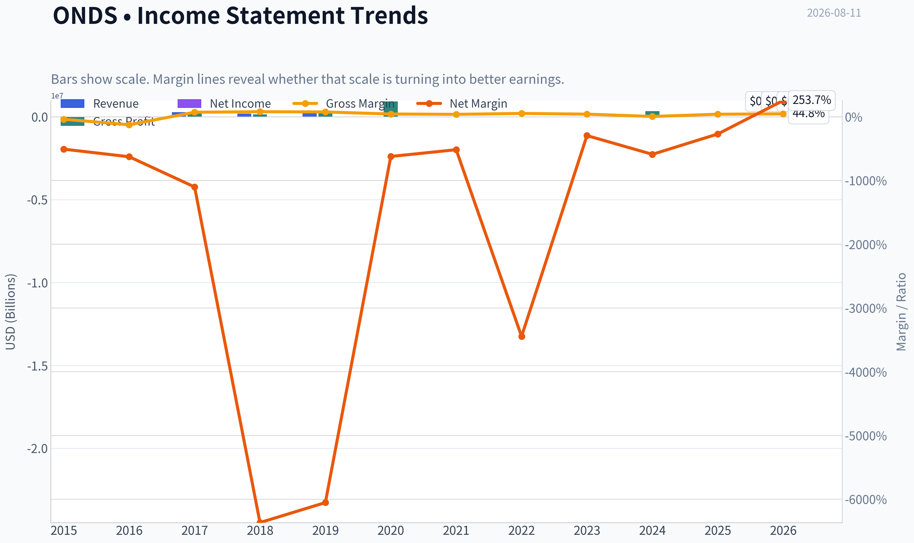

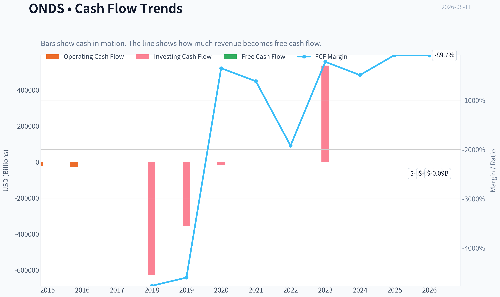

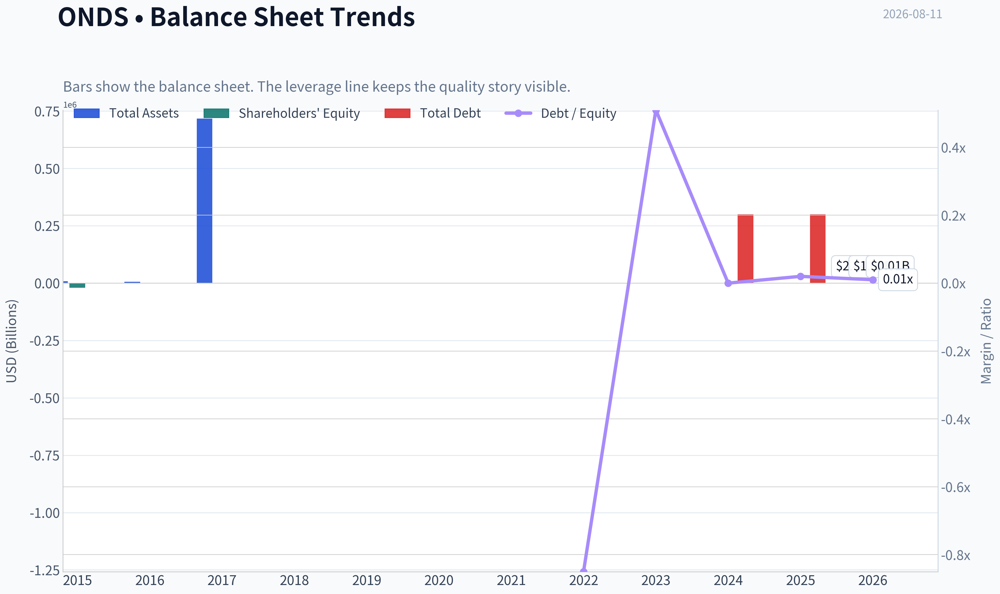

This graph tracks the profitability and return metrics (ROE, ROIC, Margins) of **ONDS** over the past decade, highlighting capital efficiency trends.

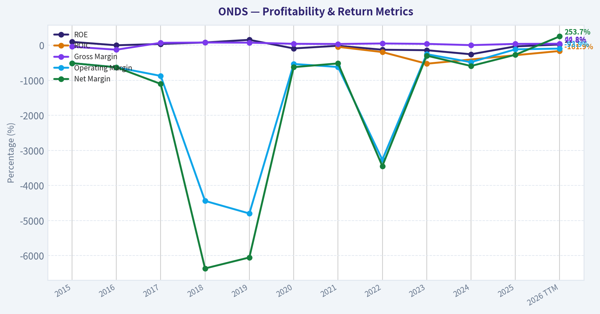

This chart illustrates the financial health of **ONDS** over the last 10 years, mapping cash equivalents and free cash flow against total obligations (Debt).

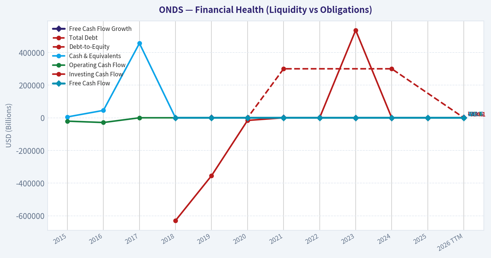

---

### Intrinsic Value Analysis (Buffett)

> *Following Warren Buffett's value investing philosophy: Circle of Competence, Economic Moat, Management Quality, and Margin of Safety.*

#### Intrinsic Value Snapshot

Price is what you pay. Intrinsic value is what the business may be worth based on the cash it can create for owners over time. We show a range, not one magic number.

- Current Price: $9.48
- Value Range (conservative to optimistic across both DCF methods): $2.17 to $2.17

##### Owner Earnings (Buffett Method)
- Net Income: $-132,019,000.00
- Depreciation & Amortization: $7,986,000.00
- Capital Expenditures: $-2,139,000.00
- Working Capital Changes: $-12,378,000.00
- Owner Earnings: $-113,794,000.00

##### Intrinsic Value
###### Cash Flow Method
Uses free cash flow. Better for companies spending heavily today to grow tomorrow.
- Conservative: $2.17
- Average: $2.17
- Optimistic: $2.17
- Discount Rate: N/A

ANALYST STANCE: **AVOID**

#### Ondas Holdings Investment Report - Buffett-Style Value Analysis

Ondas is an emerging defense, autonomous-drone, counter-drone, and industrial wireless technology company. The story is timely: drone warfare, critical-infrastructure security, and counter-UAS demand are real secular themes. But from a Buffett lens, the stock asks investors to pay a venture-style price for a business that has not yet demonstrated durable owner earnings, high returns on capital, or predictable compounding economics.

---

#### 1. Factor Scorecard

| Factor | Score | Evidence |
|---|---:|---|
| Circle of Competence & Business Simplicity | 2.5 / 5 | The business can be explained simply: Ondas sells drone, counter-drone, and wireless security systems, increasingly to defense and public-safety customers. However, the product set is technically complex, the company has evolved rapidly, and long-term economics depend on defense procurement, technology adoption, and execution. |
| Moat Test | 2.0 / 5 | Ondas has emerging IP, defense relationships, and recent contract momentum, including a U.S. Army order above $50 million and counter-drone stadium security wins. But there is not yet evidence of sustained pricing power, high retention, positive ROIC, or scale economies. |
| Management Quality & Capital Allocation | 2.0 / 5 | Management has positioned the company in attractive security markets and won meaningful orders, but capital allocation has not yet produced positive free cash flow, high ROE, or clear per-share value creation. |
| Industry Structure | 2.5 / 5 | The defense-drone and counter-drone markets have strong demand tailwinds, but competition is intense, technology changes quickly, and government procurement can be uneven. |
| Gate 5: Quality / Solvency Hard Floor | Not Tripped | Revenue growth is extremely strong and current liquidity appears adequate, with a current ratio of 4.84. The hard distress condition is not met. |

**Key Takeaways:** Ondas is not being rejected because it is a technology or defense-drone company. It is being rejected because the current economics are not yet Buffett-quality: returns are weak, free cash flow is negative, and the valuation embeds substantial future success. The solvency hard floor is not tripped, but the weighted investment case is still unattractive.

---

#### 2. Moat Analysis

| Moat Source | Assessment | Evidence |
|---|---|---|
| Intangible Assets | Emerging but unproven | Ondas has technology assets in autonomous systems, counter-drone solutions, and mission-critical wireless networks. Gross margin of 39.7% is close to the 40% threshold but not yet supported by durable profitability. |
| Switching Costs | Potentially meaningful, not yet proven | Defense, stadium, and critical-infrastructure deployments can create embedded workflows once installed. However, the available financial evidence does not yet show high retention or sustained customer captivity. |
| Cost Advantage | Not demonstrated | No evidence yet that Ondas can produce or deploy at structurally lower cost than competitors while maintaining superior margins. |
| Network Effects | Limited | Defense and counter-drone products do not appear to benefit from classic network effects in the way payments, software platforms, or marketplaces do. |
| Moat Quality Rating | Narrow / Emerging | Contract wins are encouraging, but the moat is still more strategic possibility than proven economic reality. |

**Key Takeaways:** Ondas may be building a niche franchise in a strategically important market, but Buffett-style moats are proven through economics, not headlines. A wide moat would show up in pricing power, recurring revenue, high ROIC, and strong free cash flow. Ondas does not yet show that evidence.

---

#### 3. Management Quality Assessment

| Management Question | Assessment |
|---|---|
| Do they think like owners? | Mixed. The company is pursuing large, high-potential markets, but shareholder value creation has not yet shown up in owner earnings or returns on equity. |
| Are they candid and conservative? | No major red flag is visible in the current evidence, but the business remains promotional by nature because much of the value rests on future contract execution. |
| Are they rational capital allocators? | Not yet proven. Growth investments and acquisitions may ultimately pay off, but current free cash flow is negative and ROE is deeply negative. |
| Per-share value creation | Weak at present. The market capitalization of $5.40 billion is large relative to current cash generation. |
| Outside validation | No tracked guru currently shows a recent structured 13F match for ONDS. |

**Key Takeaways:** Management deserves credit for placing Ondas in markets with real demand, especially defense and counter-drone security. But Buffett would ask whether each retained dollar is producing more than one dollar of value. At present, the financial evidence does not support that conclusion.

---

#### 4. Financial Summary

| Metric | Latest / TTM |
|---|---:|
| Share Price | $9.00 |
| Market Capitalization | $5.40B |
| Estimated Shares Outstanding | ~600M |
| P/E Ratio | 105.3x |
| ROE | -31.3% |
| Gross Margin | 39.7% |
| Revenue Growth YoY | 605.3% |
| Free Cash Flow Yield | -0.8% |
| Implied Free Cash Flow | ~-$43M |
| Current Ratio | 4.84 |
| Headline Intrinsic Value | -$21.29 / share |
| FCF Model Intrinsic Value | $2.17 / share |
| Reverse DCF | Price implies ~-3.7% annual growth, but the negative cash-flow base makes this signal unreliable |

**Key Takeaways:** Ondas is growing revenue very rapidly, but that growth has not translated into positive free cash flow or positive ROE. The company trades at a high earnings multiple despite negative free cash flow yield. Liquidity looks acceptable, but the market price is far ahead of current owner earnings.

---

#### 5. Owner Earnings Calculation

Buffett's preferred metric is owner earnings:

| Component | Estimate |
|---|---:|
| Net Income | Not used as primary anchor due to weak cash conversion |
| Plus: Depreciation & Amortization | Reflected in cash-flow proxy |
| Less: Maintenance CapEx | Reflected in free cash flow proxy |
| Less: Working Capital Increases | Reflected in free cash flow proxy |
| Owner Earnings Proxy | ~-$43M |
| Owner Earnings Per Share | ~-$0.07 |

**Key Takeaways:** For Ondas, free cash flow is the cleanest reality check because the business is still scaling and reported earnings may not represent durable economics. The owner earnings proxy is negative, meaning shareholders are currently funding the business rather than receiving distributable cash. This is the central problem for a Buffett-style investment case.

---

#### 6. Three-Scenario DCF Valuation

Assumptions: 10% discount rate, ~600 million shares outstanding, and owner earnings proxy of approximately -$43 million.

| Scenario | Method | Equity Value | Value Per Share |
|---|---|---:|---:|
| A: No Growth | Owner earnings / 10% | -$432M | -$0.72 |
| B: GDP Growth | Owner earnings x 1.03 / (10% - 3%) | -$636M | -$1.06 |
| C: High-Growth Conversion Cross-Check | Cash-burn improvement capped at 10% annually, with terminal normalization still starting from negative owner earnings | -$254M | -$0.42 |
| FCF Model Cross-Check | Cash-flow-based model | ~$1.30B | $2.17 |
| Headline FCFF Cross-Check | Business-model routed intrinsic value | Negative | -$21.29 |

**Key Takeaways:** A business with negative owner earnings cannot be valued attractively by simply applying high revenue growth. The optimistic FCF model cross-check produces only $2.17 per share, far below the $9 market price. The DCF evidence points to no margin of safety.

---

#### 7. Margin of Safety Analysis

| Valuation Reference | Intrinsic Value Per Share | Current Price | Implied Upside / Downside |
|---|---:|---:|---:|
| No-Growth Owner Earnings | -$0.72 | $9.00 | No positive intrinsic value |
| GDP-Growth Owner Earnings | -$1.06 | $9.00 | No positive intrinsic value |
| High-Growth Conversion Cross-Check | -$0.42 | $9.00 | No positive intrinsic value |
| FCF Model Cross-Check | $2.17 | $9.00 | ~76% downside |
| Headline FCFF Model | -$21.29 | $9.00 | No economic margin of safety |

**Key Takeaways:** Ondas does not offer the 25% to 50% margin of safety that an unproven, negative-free-cash-flow business would require. Even the more favorable cash-flow model is far below the current share price. The market is valuing Ondas on future strategic potential rather than present intrinsic value.

---

#### 8. Final Buffett Scorecard

| Criterion | Weight | Score | Weighted Contribution |
|---|---:|---:|---:|
| Moat Width & Durability | 25% | 2.0 | 0.50 |
| Valuation / Margin of Safety | 20% | 0.5 | 0.10 |
| Capital Returns - ROIC vs. WACC | 15% | 0.5 | 0.08 |
| Business Understanding & Predictability | 12% | 2.5 | 0.30 |
| Management Quality & Capital Allocation | 12% | 2.0 | 0.24 |
| Reinvestment Runway | 8% | 3.0 | 0.24 |
| Balance Sheet Strength | 4% | 3.0 | 0.12 |
| Industry Structure | 4% | 2.5 | 0.10 |
| Final Weighted Score | 100% |  | **1.68 / 5.00** |

**Key Takeaways:** The score is dragged down by valuation, negative owner earnings, negative ROE, and an unproven moat. The reinvestment runway is real, but a runway only creates value when the company can reinvest at high returns. Ondas has not yet crossed that threshold.

---

#### 9. Investment Stance

| Stance | Conviction | Rationale |
|---|---|---|
| **AVOID** | High | Ondas is an exciting strategic-growth story, but not yet a Buffett-quality investment. The company has negative free cash flow, negative ROE, a narrow and unproven moat, and trades at a valuation far above cash-flow-based intrinsic value. |

Ondas may become more interesting if contract wins convert into recurring revenue, positive free cash flow, and high returns on invested capital. For now, the stock is priced for a future that has not yet been financially proven. Buffett would likely wait for evidence of durable owner earnings - or a much lower price.
#### Valuation Bridge

This bridge places the current market price beside each intrinsic value lens so readers can see whether upside depends on one method or shows up across several methods.

| Scenario | Intrinsic Value / Share |
| --- | ---: |
| Cash Flow Method | $2.17 |
| Damodaran Method | $-12.15 |
| Current Price | $9.48 |

#### Key Takeaways

If one method is far above the others, the upside case depends on a specific modelling assumption. When several methods cluster together, the valuation story is more robust.

#### Valuation Visuals

This comparison chart from *Latest Earnings Snapshot* stacks current figures against historical benchmarks for **ONDS**, making it easy to see where the company trades relative to its own averages.

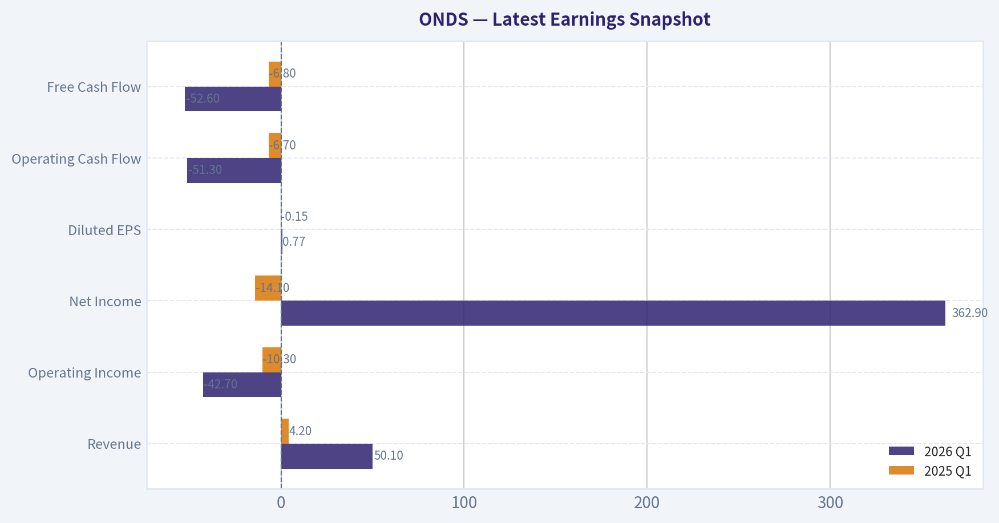

This comparison chart from *Balance Sheet and Financial Strength* stacks current figures against historical benchmarks for **ONDS**, making it easy to see where the company trades relative to its own averages.

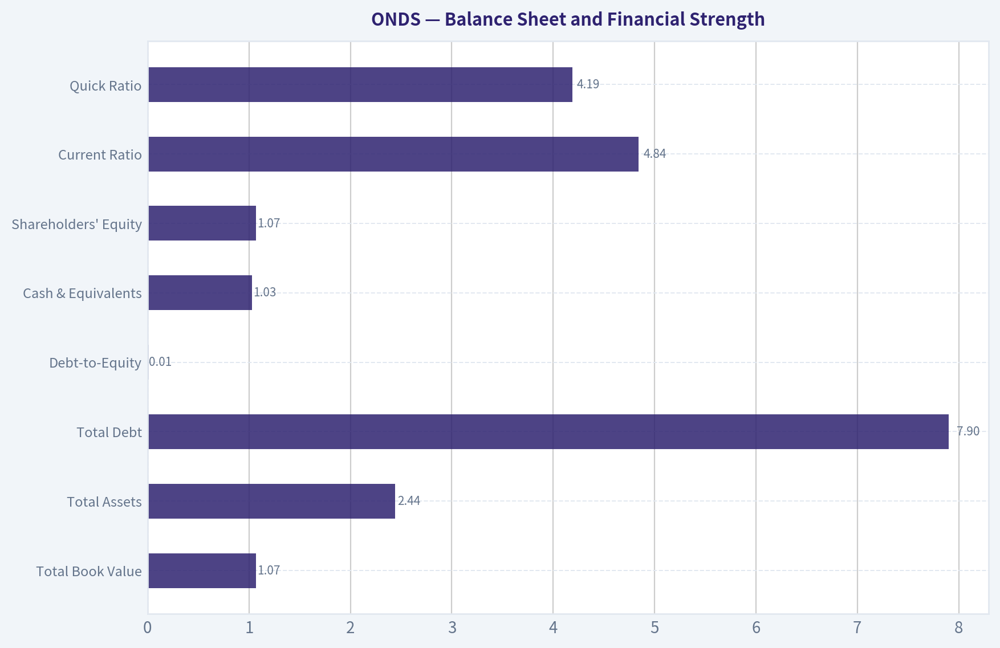

This comparison chart from *Three-Scenario Buffett-Style Owner Earnings DCF* stacks current figures against historical benchmarks for **ONDS**, making it easy to see where the company trades relative to its own averages.

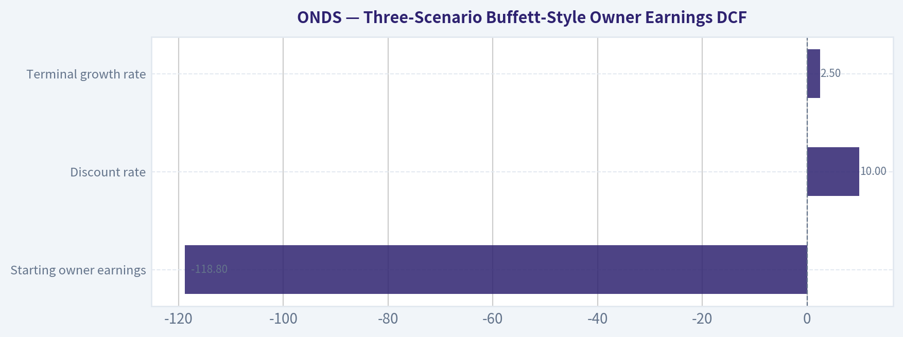

This comparison chart from *Detailed DCF Calculations* stacks current figures against historical benchmarks for **ONDS**, making it easy to see where the company trades relative to its own averages.

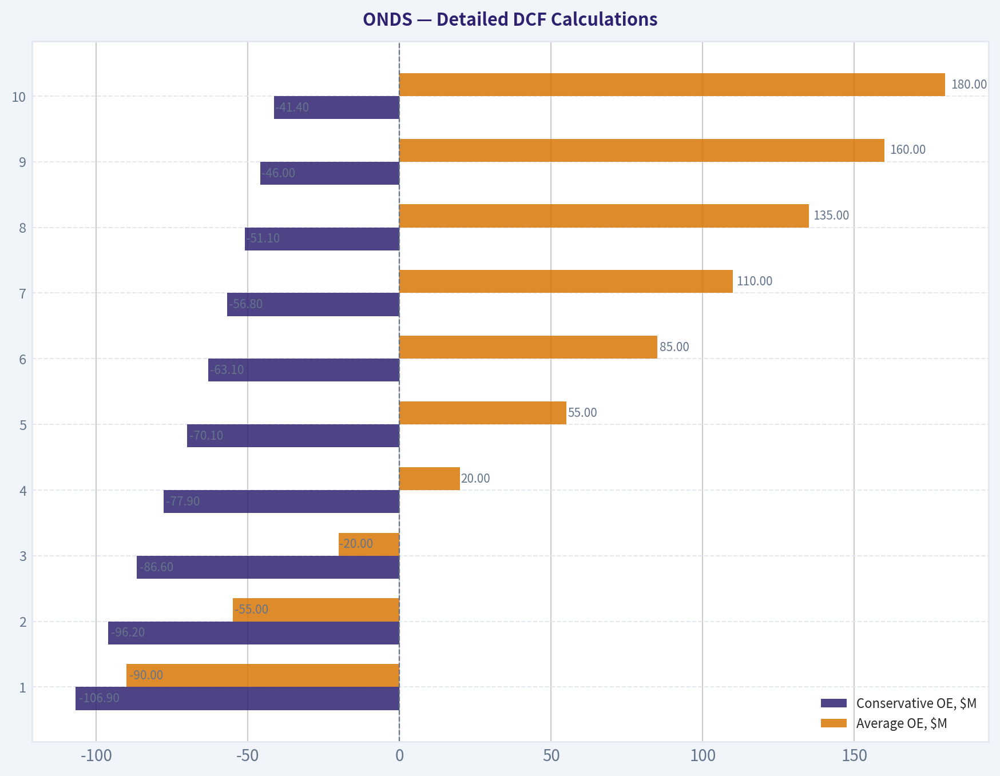

This comparison chart from *Financial Summary* stacks current figures against historical benchmarks for **ONDS**, making it easy to see where the company trades relative to its own averages.

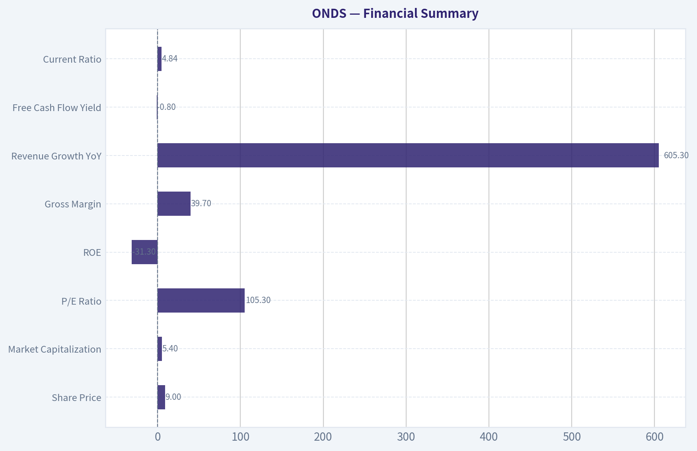

---

### Trend & Growth Analysis (Lynch/Druckenmiller/Fisher)

> *Following Peter Lynch's GARP, Stanley Druckenmiller's macro-aware approach, and Philip Fisher's scuttlebutt methodology.*

ANALYST STANCE: **WATCH**

#### ONDS Growth Investment Report - Ondas Holdings Inc.

Ondas is an emerging defense, drone, counter-drone, and industrial wireless company sitting directly in the path of several powerful secular themes: autonomous systems, AI-enabled defense, battlefield drones, counter-UAS security, and rising NATO/U.S. military spending. The growth setup is real, but the stock already reflects a major amount of optimism, and the current financial profile is still too early-stage and too acquisition/order-driven for a full ADVOCATE stance.

---

#### 1. Lynch Classification

| Category | ONDS Assessment |
|---|---|
| Lynch Category | **Fast Grower / Speculative Emerging Growth** |
| Current Growth Signal | Revenue growth reported at **605.3% YoY** |
| Profitability Profile | Still weak: **ROE -31.3%**, FCF yield **-0.8%** |
| Balance Sheet Liquidity | Strong near-term liquidity: current ratio **4.84x** |
| Growth Investor Fit | High thematic upside, but execution and valuation risk remain elevated |

**Key Takeaways:** ONDS fits Lynch's "fast grower" bucket, but it is not yet a clean, proven compounder. The company has explosive reported growth and strong thematic alignment, yet negative returns on equity and modest cash burn show that the business model is still scaling. This is a stock to monitor closely for confirmation, not yet a sleep-well-at-night ten-bagger candidate.

---

#### 2. The Story in 3 Bullets

| Lynch Story Test | ONDS |
|---|---|
| Simple Business Explanation | ONDS builds drone, counter-drone, autonomous security, and mission-critical wireless systems for defense, government, and industrial customers. |
| Why It Can Grow | Military and civilian customers increasingly need drone detection, autonomous security, and resilient communications as drone warfare and airspace threats expand. |
| Why Now | Recent news includes a **$50M+ U.S. Army order** and counter-drone deployments for high-profile venues, suggesting demand may be moving from pilot projects to production contracts. |

**Key Takeaways:** The story is understandable and timely: drones are reshaping warfare and security, and ONDS is trying to provide the systems that detect, deploy, and communicate with autonomous assets. The key question is whether recent contract wins become recurring, scalable revenue rather than isolated headline events.

---

#### 3. TAM Analysis and 10x Test

| TAM Factor | Assessment |
|---|---|
| Core Markets | Defense drones, counter-UAS, autonomous security, private industrial wireless networks |
| Secular TAM Direction | Expanding rapidly due to AI warfare, drone proliferation, homeland security, and critical infrastructure protection |
| 10x Revenue Test | Likely passes qualitatively, but current revenue base was not provided in the research pack |
| Constraint | ONDS must prove it can convert large defense and security opportunities into repeatable production revenue |
| TAM Verdict | **Large and expanding, but commercialization proof still needed** |

**Key Takeaways:** ONDS likely has a very large runway because defense drones and counter-drone systems are still early in their adoption cycle. The market is big enough for ONDS to grow many times over if it wins durable programs. However, the company must demonstrate that recent orders are the start of a repeatable contract pipeline, not one-off wins.

---

#### 4. Revenue Growth Trend

| Metric | Current Signal |
|---|---|
| Reported YoY Revenue Growth | **605.3%** |
| Growth Pattern | Explosive, but likely influenced by acquisitions, contract timing, or low prior-year base |
| Quality of Growth | Not enough data to separate organic growth from acquisition-driven growth |
| Interpretation | Potential inflection, but needs confirmation over several quarters |
| Growth Trend Rating | **Positive but unproven** |

**Key Takeaways:** The headline growth rate is exceptional and clearly puts ONDS on the growth-investor radar. However, a 605% growth figure can be misleading if it comes from a tiny base, acquisitions, or lumpy defense orders. The next two to four quarters are critical for proving whether growth is truly accelerating.

---

#### 5. Unit Economics

| Unit Economics Metric | ONDS Status |
|---|---|
| Gross Margin | **39.7%** |
| LTV/CAC | Not disclosed in available data |
| Net Revenue Retention | Not disclosed / not directly applicable unless recurring software or services revenue becomes material |
| Rule of 40 | Not calculable with available FCF margin and revenue detail |
| FCF Yield | **-0.8%** |
| Unit Economics Verdict | Early-stage; gross margin is acceptable, but recurring economics are not yet proven |

**Key Takeaways:** ONDS has a reasonable gross margin for a hardware-heavy defense and autonomy business, but it does not yet show the kind of SaaS-like unit economics that would justify a premium compounder valuation. Free cash flow remains negative, though not severely so based on the provided FCF yield. Investors need evidence of higher-margin software, services, or repeat production economics.

---

#### 6. Inflection Point Assessment

| Inflection Type | Evidence | Rating |
|---|---|---|
| Product Cycle Inflection | Drone, counter-drone, and autonomous systems are moving from niche use cases to mainstream defense/security needs | Strong |
| Market Share Inflection | U.S. Army order and stadium counter-drone deals suggest customer traction | Promising but early |
| Margin Inflection | Gross margin near 40%, but ROE remains deeply negative | Not yet proven |
| TAM Inflection | Drone warfare and civilian counter-UAS demand are expanding rapidly | Strong |
| Competitive Inflection | No clear evidence yet that competitors are stumbling | Neutral |

**Key Takeaways:** ONDS appears to be at a possible demand inflection point, especially after the U.S. Army order and high-profile counter-drone contract activity. The strongest evidence is TAM expansion and customer validation. The weaker evidence is profitability, margin leverage, and competitive dominance.

---

#### 7. Macro Setup Evaluation

| Macro Factor | ONDS Impact |
|---|---|
| Defense Spending | Strong tailwind from U.S., NATO, and allied military modernization |
| Drone Warfare | Major secular tailwind; Ukraine and Middle East conflicts have accelerated global adoption |
| AI and Autonomy | Positive; autonomous security and defense systems are a priority investment area |
| Interest Rates | Growth-stock valuation sensitivity remains a risk if rates stay high |
| Government Budget Cycles | Can create lumpiness and delays in contract revenue |
| Macro Verdict | **Favorable secular setup, but cyclical contract timing risk** |

**Key Takeaways:** The macro backdrop is favorable for ONDS because defense customers are urgently investing in drones, counter-drone systems, and autonomous capabilities. However, government procurement can be slow and uneven. The big-picture wind is at ONDS's back, but quarterly results may remain volatile.

---

#### 8. Fisher 15 Points Score

| Fisher Point | Score / 5 | Rationale |
|---|---:|---|
| Products with sizable market potential | 5 | Defense drones and counter-UAS have major growth potential |
| Management determination to develop new products | 4 | Company appears active in expanding platforms and capabilities |
| Effective R&D efforts | 4 | Technology exposure is attractive, but proof of technical superiority is incomplete |
| Above-average sales organization | 3 | Recent wins are encouraging, but sales repeatability is not yet proven |
| Worthwhile profit margin | 3 | Gross margin is acceptable, but net profitability remains weak |
| Improving profit margins | 2 | Not enough evidence of operating leverage yet |
| Labor/personnel relations | 3 | Insufficient data; neutral score |
| Executive relations | 3 | Insufficient data; neutral score |
| Management depth | 3 | Needs more proof as business scales |
| Cost analysis/accounting | 3 | No major red flag from available data, but limited visibility |
| Outstanding moat factors | 3 | Defense certifications and customer relationships may help, but moat not proven |
| Long-range profit outlook | 4 | Attractive if contracts scale into production programs |
| Dilution risk | 2 | Emerging growth companies often require capital; monitor share count |
| Management candor | 3 | Insufficient data; neutral score |
| Management integrity | 3 | No specific red flag in provided materials |
| **Total** | **48 / 75** | **Average to promising, but not yet outstanding** |

**Key Takeaways:** ONDS scores well on product potential and long-term market opportunity, but weaker on proven margins, sales repeatability, and dilution risk. Fisher would likely want more scuttlebutt: customer references, proof of product superiority, evidence of repeat orders, and confirmation that management can scale without excessive dilution.

---

#### 9. Valuation Analysis

| Valuation Metric | ONDS |
|---|---:|
| Current Price | **$9.00** |
| Market Cap | **$5.40B** |
| P/E | **105.3x** |
| PEG Using Headline Growth | Around **0.17x**, but unreliable due abnormal 605% growth |
| ROE | **-31.3%** |
| FCF Yield | **-0.8%** |
| Headline Intrinsic Value from Shared Pack | **Negative / not reliable for growth-stage analysis** |
| Valuation Verdict | **Speculative; valuation requires major future revenue scaling** |

**Key Takeaways:** The PEG ratio looks optically cheap because the reported growth rate is extremely high, but that is not a dependable valuation anchor. A 105x P/E and $5.4B market cap require ONDS to scale dramatically from today's level. The valuation is not disqualifying for a defense-tech inflection story, but it leaves little room for execution disappointment.

---

#### 10. Scenario Analysis

| Scenario | Assumptions | Investor Outcome |
|---|---|---|
| Bear Case | Revenue growth proves lumpy, Army order is not followed by major production programs, margins stay weak | Stock could re-rate sharply lower due high expectations |
| Base Case | ONDS converts recent defense/security wins into a growing backlog and improves cash burn gradually | Stock can hold or grind higher, but volatility remains high |
| Bull Case | ONDS becomes a recognized leader in counter-drone/autonomous defense systems and scales recurring or production revenue | Multi-bagger potential exists, especially if revenue compounds rapidly for 3-5 years |

**Key Takeaways:** ONDS has genuine upside if it converts early contract momentum into durable defense programs. The downside is also meaningful because the market cap already implies significant future success. This is a classic high-upside, high-variance emerging growth setup.

---

#### 11. Growth Investor Scorecard

| Criterion | Weight | Score / 5 | Weighted Score |
|---|---:|---:|---:|
| The Story | 10% | 4.5 | 0.45 |
| TAM & Runway | 20% | 4.5 | 0.90 |
| Revenue Growth | 20% | 4.0 | 0.80 |
| Unit Economics | 15% | 2.5 | 0.38 |
| Competitive Position | 10% | 3.0 | 0.30 |
| Management Quality | 10% | 3.0 | 0.30 |
| Macro Setup | 5% | 4.5 | 0.23 |
| Profitability Path | 5% | 2.5 | 0.13 |
| Valuation | 5% | 2.0 | 0.10 |
| **Total** | **100%** |  | **3.58 / 5.00** |

**Key Takeaways:** ONDS earns a solid WATCH score because the story, TAM, revenue growth, and macro setup are compelling. The score is held back by uncertain unit economics, weak profitability, and valuation risk. This is close to an ADVOCATE setup, but it needs more confirmation.

---

#### 12. Position Size Stance

| Investor Type | Suggested Action |
|---|---|
| Conservative Growth Investor | Watch only; wait for revenue quality and margin proof |
| Aggressive Growth Investor | Small starter position only, likely **0.5%-1.0%** maximum |
| Existing Holder | Hold if position size is controlled; trim if it has become oversized |
| High-Conviction Add Trigger | Evidence of repeat production orders, backlog expansion, and improving gross/operating margins |
| Avoid Trigger | Revenue growth collapses after contract headlines, dilution accelerates, or cash burn worsens materially |

**Key Takeaways:** ONDS is not a full-size position candidate yet. For aggressive investors, a small tracking position can be justified because the inflection potential is real. The right approach is to demand proof before scaling exposure.

---

#### 13. Key Risks and Catalysts

| Category | Items to Watch |
|---|---|
| Key Catalysts | Follow-on U.S. Army orders, NATO/allied defense contracts, counter-drone venue deployments, backlog growth, improved FCF |
| Key Risks | Lumpy government revenue, high valuation, dilution, negative ROE, unproven operating leverage, competition from larger defense primes |
| Confirmation Metrics | Organic revenue growth, backlog, gross margin trend, cash burn, repeat customer orders, share count growth |
| Red Flags | One-off contract wins without follow-through, falling gross margin, rising dilution, customer concentration, delayed government procurement |

**Key Takeaways:** The most important catalyst is proof that ONDS can turn recent wins into a repeatable contract engine. The most important risk is that the market is extrapolating too much from early-stage order momentum. Investors should focus less on headlines and more on backlog conversion, margin expansion, and dilution control.

---

#### Final View

ONDS is a compelling defense-tech growth story with legitimate ten-bagger ingredients: a large expanding TAM, major secular tailwinds, explosive reported growth, and recent customer validation. However, it is still too early to call it a high-conviction compounder because profitability, unit economics, and repeatability remain unproven.

**Stance: WATCH.** Move toward **ADVOCATE** only if ONDS demonstrates sustained organic revenue growth, expanding backlog, improving margins, and limited dilution over the next several quarters.

---

### Market Technical Analysis

#### ONDS Technical Analysis - Latest Available Trading Data: 2026-08-10

ONDS has staged a sharp tactical rebound from its mid-July weakness, but it is now approaching a more important decision zone. The latest close of **$9.31** is above the short-term trend and above the declining 50-day average, but it is essentially sitting at the **200-day SMA near $9.33**, which makes the current area a major trend-confirmation test rather than a clean breakout yet.

The most relevant indicators for this setup are: **close_10_ema, close_50_sma, close_200_sma, macd, rsi, atr, vwma, and boll_ub**. These provide a balanced view across short-term momentum, medium- and long-term trend structure, volume confirmation, volatility, and breakout risk.

| Indicator | Latest Value | Price Relationship / Signal | Interpretation |
|---|---:|---|---|
| Close | **$9.31** | Latest close on 2026-08-10 | Strong rebound into resistance area |
| close_10_ema | **$8.53** | Price is ~9.2% above | Short-term momentum is firmly bullish |
| close_50_sma | **$8.67** | Price is ~7.4% above | Medium-term trend is improving |
| close_200_sma | **$9.33** | Price is slightly below | Long-term trend has not fully flipped bullish yet |
| macd | **+0.218** | Recently turned positive | Momentum recovery is accelerating |
| rsi | **61.66** | Bullish but not overbought | Buyers have control, but RSI is not yet stretched |
| atr | **$0.70** | ~7.5% of price | Volatility remains high; position sizing matters |
| vwma | **$8.23** | Price is ~13.1% above | Rebound is supported by volume-weighted strength |
| boll_ub | **$9.51** | Price near upper band | Breakout attempt, but near short-term extension zone |

Key Takeaways: ONDS has regained short- and medium-term momentum, with price trading above the 10 EMA, 50 SMA, and VWMA. However, the stock is now pressing into the 200-day SMA and upper Bollinger Band area, which means the next move may determine whether this is a sustainable trend reversal or only a sharp bear-market rally. Volatility is still elevated, so traders should expect wide intraday swings.

#### Trend Structure

The short-term trend has turned constructive. ONDS closed at **$9.31**, well above the **10 EMA at $8.53**, showing that recent buying pressure has been strong enough to pull the fast trend line higher. The 10 EMA has risen steadily from about **$7.51 at the end of July** to **$8.53 on August 10**, reflecting a meaningful momentum shift after the stock bottomed near the mid-July closing low of **$6.53**.

The medium-term trend is also improving, but it is not fully repaired. Price is now above the **50-day SMA at $8.67**, which is a positive development because ONDS spent much of July trading below this average. That said, the 50-day SMA itself is still declining from roughly **$9.98 in late June** to **$8.67 now**, meaning the recent rally is fighting against a medium-term downtrend that has not yet fully stabilized.

The long-term trend is the key issue. The **200-day SMA is $9.33**, almost exactly where the stock is trading. ONDS closed just below that level, while its intraday high of **$9.60** briefly pushed above it. This makes the **$9.30-$9.60 zone** especially important. A decisive close above this area, preferably with strong volume, would improve the longer-term technical picture. Failure here could turn the 200-day SMA into resistance.

#### Momentum and Buyer Strength

Momentum has improved materially. MACD has moved from deeply negative readings in July, around **-0.70**, to **+0.218** on August 10. That transition from negative to positive territory is important because it suggests the rebound is not just a one-day bounce; momentum has been rebuilding for several weeks.

RSI confirms the improvement without yet flashing an extreme warning. The latest RSI is **61.66**, which is bullish but not overbought. This is a healthier reading than a sudden spike above 70 because it leaves room for further upside if buyers continue to press. The RSI also shows a clear shift from July's weak readings in the mid-30s, when ONDS was under persistent selling pressure.

However, traders should note that momentum is now approaching a test zone. Price is close to the upper Bollinger Band and the 200-day SMA at the same time. That combination can produce either a breakout acceleration or a short-term rejection, so confirmation matters more than anticipation here.

#### Volume and Volatility

Volume behavior supports the rebound. The latest **VWMA is $8.23**, and price is trading substantially above it. That means recent volume-weighted price action has moved higher, suggesting that buyers have been active during the recovery rather than the stock rising only on thin volume.

The July rebound was also accompanied by very heavy trading days, especially around **July 17 to July 22**, when volume surged and the stock reversed higher from the low-$6 area. This type of high-volume reversal can indicate capitulation followed by accumulation, but it can also reflect speculative trading. Because ONDS has shown repeated high-volume price spikes over the past year, traders should avoid assuming all volume is institutional accumulation.

ATR remains elevated at about **$0.70**, or roughly **7.5% of the current stock price**. This is a high daily volatility profile. Stops that are too tight may be triggered by normal noise, while position sizes that ignore volatility may carry outsized risk.

#### Key Trading Levels

| Zone | Approximate Level | Why It Matters | Trading Implication |
|---|---:|---|---|
| Immediate resistance | **$9.50-$9.60** | Upper Bollinger Band and recent intraday high | Break above could signal continuation |
| Long-term pivot | **$9.33** | 200-day SMA | Decisive close above would improve trend quality |
| Short-term support | **$8.50-$8.70** | 10 EMA and 50 SMA area | First pullback zone bulls need to defend |
| Volume-weighted support | **$8.20-$8.25** | VWMA area | Loss of this zone would weaken rebound structure |
| Deeper support | **$7.80-$8.00** | Late-July consolidation area | Break below would suggest failed breakout attempt |
| Major recent low | **$6.50-$6.90** | July reversal base | Loss would materially damage bullish recovery thesis |

Key Takeaways: The most important upside zone is $9.50 to $9.60, where ONDS is testing both breakout pressure and short-term extension. The most important downside zone is $8.50 to $8.70, because that area contains the rising 10 EMA and the falling 50-day SMA. If price holds above that support on pullbacks, the rebound remains credible; if it fails, the rally may lose structure quickly.

#### Tactical View

ONDS currently looks like a **watch / tactical breakout candidate**, not a confirmed long-term uptrend yet. The bullish case is supported by the strong move above the 10 EMA, the recovery above the 50 SMA, the positive MACD shift, improving RSI, and price strength above VWMA. These are meaningful improvements from July's weak technical condition.

The caution is that ONDS is now testing the 200-day SMA and upper Bollinger Band simultaneously. That creates a high-friction zone where rallies often pause. A clean close above **$9.60**, followed by price holding above the 200-day SMA, would be a stronger bullish confirmation. By contrast, a rejection back below **$8.70** would suggest the stock is not yet ready to reclaim a broader uptrend.

For traders, the setup favors patience around confirmation. Aggressive traders may watch for a breakout through **$9.60** with volume expansion. More conservative traders may prefer a pullback toward **$8.50-$8.70** that holds support before considering entry. Risk management is essential because ATR remains high and ONDS can move several percentage points in a single session.

| Category | Current Read | Bullish Evidence | Risk / Caveat |
|---|---|---|---|
| Short-term trend | Bullish | Price well above rising 10 EMA | Could be short-term extended |
| Medium-term trend | Improving | Price reclaimed 50 SMA | 50 SMA is still declining |
| Long-term trend | Neutral / testing | Price is near 200 SMA | Not yet a decisive long-term breakout |
| Momentum | Bullish | MACD positive, RSI above 60 | Momentum nearing resistance zone |
| Volume confirmation | Constructive | Price above VWMA | Volume spikes may reflect speculation |
| Volatility | High | ATR supports large moves | Requires wider stops and smaller sizing |
| Breakout condition | Developing | Price near upper Bollinger Band | Needs close above $9.50-$9.60 |
| Overall stance | Watch for confirmation | Recovery has real technical strength | Still needs proof above 200 SMA |

Key Takeaways: ONDS has made a strong technical recovery, but the most important test is happening now. A sustained move above $9.50 to $9.60 would strengthen the bullish case, while a pullback below $8.70 would reduce confidence. The setup is promising, but because volatility is high and long-term resistance is nearby, confirmation is more important than chasing.

#### Market Visuals

This comparison chart from *Market Metrics Interpretation* stacks current figures against historical benchmarks for **ONDS**, making it easy to see where the company trades relative to its own averages.

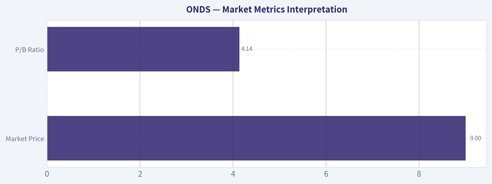

---

### Options Market Analysis

> *Reading options flow - put/call ratios, IV skew, and unusual activity - to gauge institutional positioning and event-driven risk.*

ANALYST STANCE: **WATCH**

#### ONDS Options Flow Report - As of 2026-08-11

#### 1. Put/Call Ratio Analysis

| Expiration | Call OI | Put OI | Put/Call OI Ratio | Call Volume | Put Volume | Put/Call Volume Ratio |
|---|---:|---:|---:|---:|---:|---:|
| 2026-08-14 | 80,300 | 46,726 | 0.58 | 27,819 | 5,818 | 0.21 |
| 2026-08-21 | 104,893 | 45,902 | 0.44 | 10,783 | 4,611 | 0.43 |
| 2026-08-28 | 37,060 | 24,730 | 0.67 | 4,241 | 598 | 0.14 |
| **Near-Term Total** | **222,253** | **117,358** | **0.53** | **42,843** | **11,027** | **0.26** |

**Key Takeaways:** ONDS options positioning is meaningfully call-heavy versus the historical neutral put/call baseline of roughly 0.70. The near-term open interest put/call ratio of 0.53 and volume ratio of 0.26 both suggest bullish speculative demand is stronger than downside hedging demand. The strongest call-volume imbalance is in the 2026-08-14 and 2026-08-28 expirations, pointing to near-term upside positioning rather than broad defensive protection.

The put/call profile leans **bullish**, but with an important caveat: high call open interest can also include covered-call selling, not only outright bullish call buying. Still, the very low put/call volume ratio indicates current trading activity is much more call-driven than put-driven.

---

#### 2. Implied Volatility Assessment

| Expiration | ATM Call IV | ATM Put IV | Call/Put IV Read | IV Level Assessment |
|---|---:|---:|---|---|
| 2026-08-14 | 153.5% | 152.3% | Calls slightly above puts | Extremely elevated |
| 2026-08-21 | 113.3% | 116.2% | Puts modestly above calls | Very elevated |
| 2026-08-28 | 106.4% | 107.0% | Nearly balanced | Very elevated |

**Key Takeaways:** Implied volatility is very high across the near-term chain, especially the front-week 2026-08-14 expiration where ATM IV is above 150%. Call and put ATM IV are broadly balanced, so the data does not show a major directional volatility skew at the money. The elevated IV indicates the market is pricing large near-term movement, but the available data does not identify a specific catalyst.

**IV interpretation:**
ONDS options are pricing substantial event or momentum risk. The front-week IV above 150% suggests traders expect a potentially sharp move over a very short horizon. However, there is no clear ATM downside fear premium: calls and puts have similar implied volatility, with only a modest put IV premium in the 2026-08-21 and 2026-08-28 expirations.

**Skew note:**
The provided data includes ATM IV but does not include detailed OTM put IV versus OTM call IV by strike. Therefore, a full skew diagnosis - steep put skew versus call skew - cannot be confirmed from the available feed. Based only on ATM IV, skew appears relatively balanced rather than strongly bearish.

---

#### 3. Unusual Options Activity

| Screening Rule | Result |
|---|---|
| Volume greater than 5x open interest | No qualifying contracts found |
| Fresh contract-level directional bets | None identified in near-term expirations |
| Institutional "sweep-like" signal | Not confirmed from available data |

**Key Takeaways:** There were no individual contracts where volume exceeded open interest by more than 5x, so the data does not show clear fresh institutional-style unusual activity. The broader tape is still call-heavy, but without contract-level unusual flow it is harder to separate new bullish bets from existing-position adjustments or retail speculation.

**Interpretation:**
The absence of unusual options activity reduces conviction in calling this a "smart money" signal. The overall flow is bullish at the aggregate level, but there is no standout contract that clearly suggests aggressive new institutional positioning. For ONDS, this is better read as **broad speculative call interest** rather than a confirmed large-scale institutional options bet.

---

#### 4. Open Interest Concentration and Pinning Risk

| Expiration | Call OI | Put OI | Total OI | OI Concentration Read |
|---|---:|---:|---:|---|
| 2026-08-14 | 80,300 | 46,726 | 127,026 | Heavy front-week positioning |
| 2026-08-21 | 104,893 | 45,902 | 150,795 | Largest near-term OI concentration |
| 2026-08-28 | 37,060 | 24,730 | 61,790 | Lower but still meaningful positioning |
| **Total** | **222,253** | **117,358** | **339,611** | Call-side OI dominates |

**Key Takeaways:** The largest open interest concentration is in the 2026-08-21 expiration, especially on the call side. This suggests traders are most focused on the next one to two weeks, not just the immediate weekly expiration. Strike-level data was not provided, so exact pinning levels and gamma walls cannot be identified.

**Gamma / max-pain note:**
The data confirms heavy call-side positioning but does not provide strike-level OI. Without strike data, specific max-pain levels, call walls, put walls, or gamma-trigger prices cannot be reliably named. Directionally, however, the concentration of call OI means upside moves could accelerate if dealers are short calls, while rallies could also stall near large call-heavy strikes if dealers are long gamma or if call sellers defend those levels.

---

#### 5. Overall Options Sentiment Signal

| Category | Read |
|---|---|
| Put/Call Ratio | Bullish - call-heavy OI and volume |
| IV Level | Very elevated - large move expected |
| Skew Direction | Neutral to slightly balanced; no confirmed steep put skew |
| Unusual Activity | No standout fresh contract-level signal |
| Open Interest Structure | Call-heavy, especially 2026-08-14 and 2026-08-21 |
| **Overall Signal** | **BULLISH, speculative, with elevated risk** |

**Key Takeaways:** ONDS options sentiment is **bullish** because near-term call demand significantly exceeds put demand. However, the signal is speculative rather than high-conviction institutional because no unusual contract-level activity was detected. The very high IV warns that the market is pricing a large move, so bullish positioning comes with high volatility and elevated premium risk.

#### Final Read

ONDS options flow leans **BULLISH** into the near term. The primary driver is the very low put/call volume ratio of 0.26 and the below-neutral put/call OI ratio of 0.53, both pointing to call-dominated positioning. The highest-risk feature is implied volatility: front-week ATM IV above 150% means options are expensive and the market is already pricing significant movement.

This is not a clean "smart money accumulation" setup because there were no contracts with volume greater than 5x open interest. The better interpretation is: **traders are aggressively positioned for upside or momentum continuation, but the options market is charging a large premium for that exposure.**

| Summary Item | ONDS Options Read |
|---|---|
| Put/Call Ratio | Bullish; near-term OI ratio 0.53 and volume ratio 0.26 versus ~0.70 neutral |
| IV Level | Very elevated; front-week ATM IV around 152%-154% |
| Skew Direction | No confirmed steep skew; ATM call/put IV broadly balanced |
| Unusual Activity | None detected using volume > 5x OI screen |
| Overall Signal | **BULLISH**, but speculative and high-volatility |

---

## Research Team Commentary

> *The Research Manager synthesizes the Bull vs Bear debate into action-free commentary. This is a pre-risk view, not the final stance.*

Here is the synthesis and my final commentary on the Ondas Holdings (ONDS) debate.

When evaluating this debate, it becomes immediately clear that we are looking at two entirely different time horizons and definitions of risk. The Bull makes a compelling narrative argument, framing Ondas as a misunderstood, wide-moat infrastructure play with regulatory and switching-cost advantages in rail and autonomous defense. The Bear, meanwhile, brings a heavy dose of reality, rightfully pointing out that true moats produce economic rent, whereas Ondas is currently producing a -31.3% ROE and trades at a forward-looking P/E of over 105.

Let's unpack the strongest points and apply the lessons we've learned from our past mistakes.

The Bear fundamentally wins the intrinsic value and business quality argument. A business with a 39.7% gross margin, negative returns on capital, and highly lumpy, order-driven revenue is not a "wonderful business at a fair price" in the traditional Buffett sense. It is an early-stage venture bet. The Bull's attempt to compare Ondas to my past miss on Nvidia is a misapplication of that lesson. When Nvidia made its parabolic run, it already possessed elite 60%+ margins, a fortress balance sheet, and massive free cash flow. Ondas is still in the capital-consumptive phase. Furthermore, the Bear's reverse-DCF reality check is spot on: paying $9.48 at a 105 P/E for a business with negative ROE requires heroic assumptions about flawless execution and market capture, leaving literally zero margin of safety.

However, the Bull is correct that the narrative and secular tailwinds-drone warfare, NATO defense budgets, and autonomous rail infrastructure-are powerful. And this is where my reflections on our past Tesla miss become vital.

In the Tesla evaluation, my biggest mistake was letting a long-term, deep-value fundamental framework dictate a near-term directional stance. I slapped a hard AVOID on Tesla because the valuation was stretched and fundamentals were weak, completely ignoring that the technicals were repairing from an oversold condition and a catalyst-driven narrative was taking over.

Ondas is currently sitting right around $9.48, testing a critical trend-confirmation zone near its 200-day moving average of $9.33 after a tactical rebound. If I issue a hard AVOID here based solely on the -31.3% ROE, I am repeating the Tesla mistake: blinding myself to the fact that in a hot secular regime (defense/drones), improving technicals can temporarily overpower weak trailing fundamentals.

Therefore, I cannot agree with the Bull that this is a "Buy" for a long-term compounding value portfolio. But I also refuse to issue the Bear's hard AVOID when the stock is attempting a major technical reclaim and sitting directly in the path of massive defense tech spending.

Core Takeaway
Ondas is not a value investment; it is a speculative narrative trade. The fundamental business quality is currently far too weak and capital-consumptive to justify its valuation on a traditional intrinsic value basis. However, because the stock is repairing technically at a major moving average and possesses explosive catalyst potential tied to global defense spending, it belongs on a high-risk tactical watchlist rather than in the discard pile.

Rationale
From a value perspective, the margin of safety is nonexistent. A true moat is evidenced by pricing power and high returns on invested capital, neither of which Ondas currently demonstrates. The acquisition of Airobotics adds a great story, but we have yet to see it translate into the predictable, recurring cash flows necessary to scale a 105 P/E multiple down to earth. That said, our modern value framework requires us to respect market regime and price structure. A stock commanding a massive narrative premium that is holding its 200-day average has the potential to run on forward-looking expectations, even if trailing economics are distressed. We must separate our long-term structural valuation from our near-term setup analysis.

Monitoring Plan
To see if this transitions from a speculative watchlist name into a legitimate long-term investment, or to confirm it as a fundamental failure, here is what we need to watch over the next 1 to 4 quarters:

First, we need to monitor the price action strictly around the $9.33 level. If it firmly rejects the 200-day SMA on high volume, the tactical setup is dead, and the fundamental AVOID thesis takes full control.

Second, we must track gross margin progression. The Bull claims Ondas is laying the groundwork for a SaaS-like recurring revenue model that will push margins toward 50-60%. If gross margins remain stagnant near 40% or compress due to hardware scaling costs, the "elite tech platform" thesis is invalidated.

Third, we need evidence of commercial predictability. We are looking for the conversion of pilot programs and regulatory approvals (like the FAA certification) into multi-year, recurring revenue contracts rather than one-off government purchase orders. Until lumpy revenues smooth out into predictable cash flows, this remains a venture bet, not a Buffett compounder.

Stance: WATCH

---

## Value Investing Team Commentary

> *The Investor translates the research view into an investment thesis before risk review. This is still not the final stance.*

In the spirit of partnership and disciplined capital allocation, let's examine Ondas Holdings (ONDS) through the lens of business ownership rather than market participation. While the headlines regarding autonomous drones and defense technology are indeed captivating, a value investor must separate the "story" from the "economics."

### 1. The Business Quality: Narrative Moats vs. Economic Reality
Ondas operates at the intersection of high-growth secular themes: rail automation and autonomous defense. The "Bull" case argues for a regulatory and switching-cost moat-particularly in their rail communications and FAA-certified drone platforms. However, in our framework, a true moat must manifest as **economic rent**.

Currently, ONDS produces a **Return on Equity (ROE) of -31.3%** and a **Return on Assets (ROA) of -12.1%**. While management is successfully acquiring assets (like Airobotics) and winning pilot contracts, the business remains **capital-consumptive**. From a Buffett perspective, a business that requires constant infusions of capital to stay relevant, without showing a clear path to high returns on that invested capital, is not a "wonderful business." It is an early-stage venture project. The gross margin of 39.7% is respectable for hardware, but it does not yet reflect the "SaaS-like" scalability the market is pricing in at a 105 P/E ratio.

### 2. The Valuation: Paying for the 10th Inning in the 1st
Our "Quality-Scaled Margin of Safety" ladder requires a significant discount for businesses that lack predictable earnings. ONDS is currently trading at an extreme premium based on forward-looking "hope" rather than trailing "fact."

A reverse-DCF check at these levels suggests the market is pricing in nearly flawless execution, massive market share capture in the drone sector, and a rapid pivot to profitability. For a value investor, **price is what you pay, value is what you get.** At $9.48, you are paying for the 10th inning of success while the business is still warming up in the bullpen. There is no margin of safety here; in fact, there is a "margin of peril" if defense contracts become lumpy or if integration of acquisitions faces friction.

### 3. Selective Contrarian Thinking: The "Defense Hype" Trap
Current sentiment is highly euphoric regarding defense tech due to global geopolitical tensions. While the demand for counter-UAS (Unmanned Aircraft Systems) is real, the crowd often overestimates the *profitability* of government contractors in the early stages.

The contrarian insight here is that **participation in a growth industry does not guarantee participation in profit.** The history of aviation, automobiles, and early computing is littered with businesses that had great "moats" and "secular tailwinds" but failed to generate owner earnings. ONDS is currently a "story stock" being fueled by sentiment.

### 4. Learning from the TSLA and NVDA Reflections
We must acknowledge the technical repair noted by the Market Analyst. The stock is testing its 200-day SMA ($9.33). In our Tesla miss, we ignored the fact that improving technicals can temporarily mask fundamental rot.

However, there is a vital distinction: **NVDA and TSLA had reached a level of scale and dominant market positioning before their massive runs.** NVDA, in particular, had elite margins and a fortress balance sheet. ONDS has neither. To "Watch" or "Advocate" for ONDS simply because it is reclaiming a moving average would be "momentum chasing" disguised as "adaptive value investing."

A business losing 31 cents for every dollar of equity is not a compounder. It is a speculative vehicle. While the stock may rise on narrative momentum, it does not meet the criteria for a long-term business owner who prioritizes the preservation of capital.

### Final Assessment
We choose to stay within our **Circle of Competence**, which favors businesses with predictable earnings and durable moats. ONDS is a bet on a "potential" future that is already being priced as a "certain" future. We would rather miss a speculative rally than participate in a business whose fundamental economics are currently destructive to shareholder value.

ANALYST STANCE: **AVOID**

---

## Deep Values Commentary

> *The Risk Management Team debates and the Risk Judge provides the final action-free verdict. This section determines the final ADVOCATE / WATCH / AVOID stance.*

#### Final Stance Scorecard

This scorecard converts the final research view into a weighted decision frame. It does not replace the narrative judgement, but it makes the main drivers of the verdict easier to scan.

| Criterion | Score | Weight | Commentary |
| --- | ---: | ---: | --- |
| Business Quality | 2.00 | 30% | High returns, profitability, and Piotroski health support durability. |
| Valuation Support | 1.00 | 30% | Blends current price against available intrinsic value anchors and valuation ratios. |
| Financial Strength | 5.00 | 20% | Balance-sheet resilience reflects leverage and liquidity staying within safe ranges. |
| Growth Durability | 2.33 | 20% | Recent revenue, earnings, and free cash flow growth indicate how durable expansion looks. |
| TOTAL / FINAL STANCE | 2.37 | 100% | WATCH |

#### Key Takeaways

The weighted score lands at **2.37 / 5.0**, while the final stance remains **WATCH**. This is useful as a quick calibration aid rather than a mechanical signal.

#### Risk Summary

Higher scores indicate more risk pressure. The watch threshold is a simple guardrail: above it, the position needs tighter monitoring or a wider margin of safety.

| Dimension | Current Score | Watch Threshold | Commentary |
| --- | ---: | ---: | --- |
| Business Quality | 4.00 | 3.00 | High returns, profitability, and Piotroski health support durability. |
| Valuation Support | 5.00 | 3.00 | Blends current price against available intrinsic value anchors and valuation ratios. |
| Financial Strength | 1.00 | 3.00 | Balance-sheet resilience reflects leverage and liquidity staying within safe ranges. |
| Growth Durability | 3.67 | 3.00 | Recent revenue, earnings, and free cash flow growth indicate how durable expansion looks. |

#### Key Takeaways

This view helps readers separate *where* the risk sits: valuation, business quality, balance sheet, or growth durability. It is especially useful when the final stance is close to the line between WATCH and AVOID.
