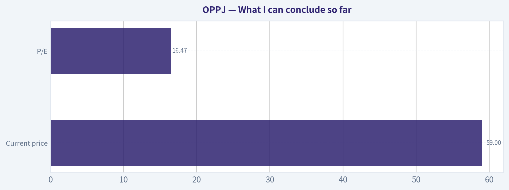
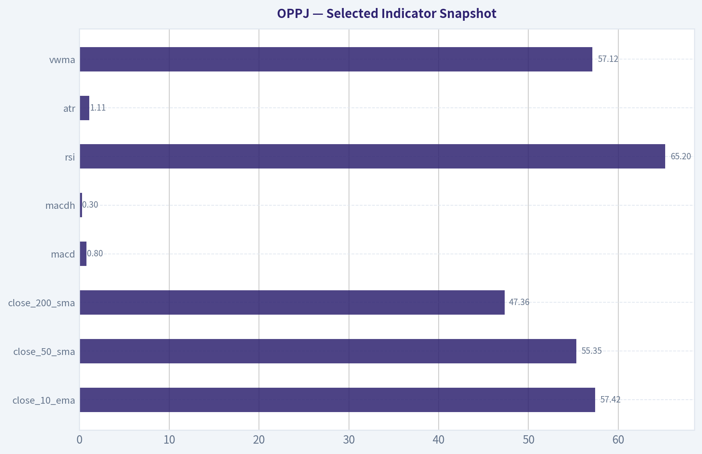
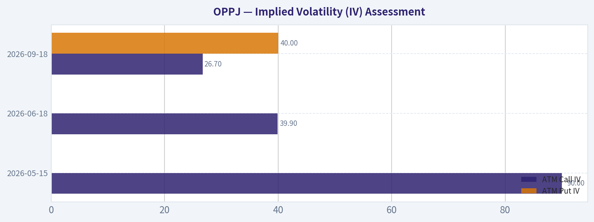
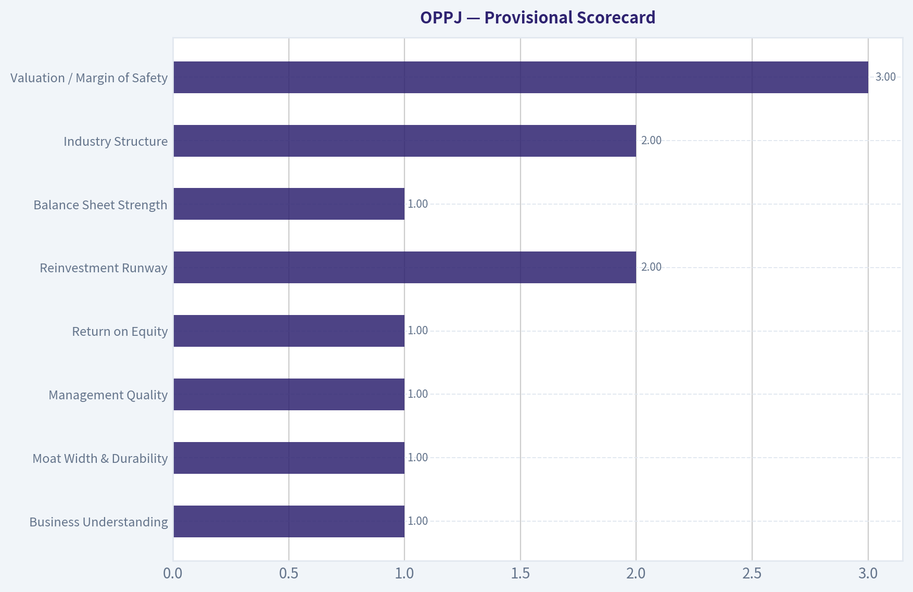
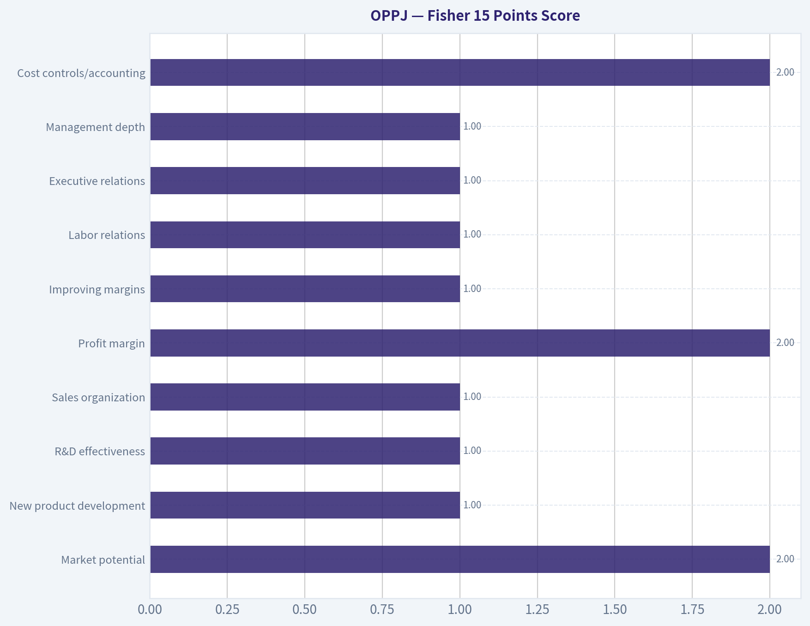
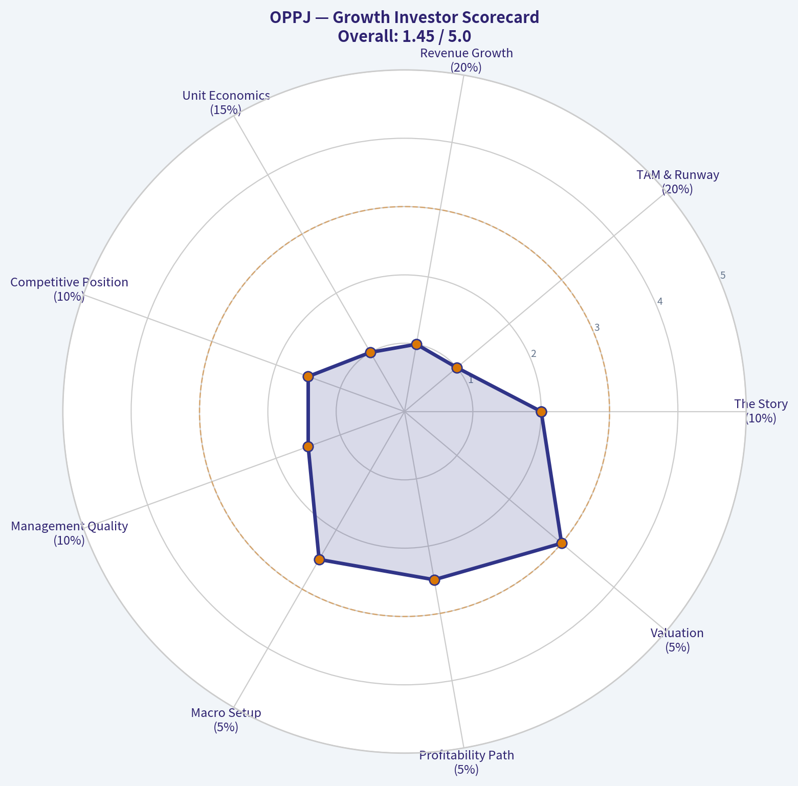
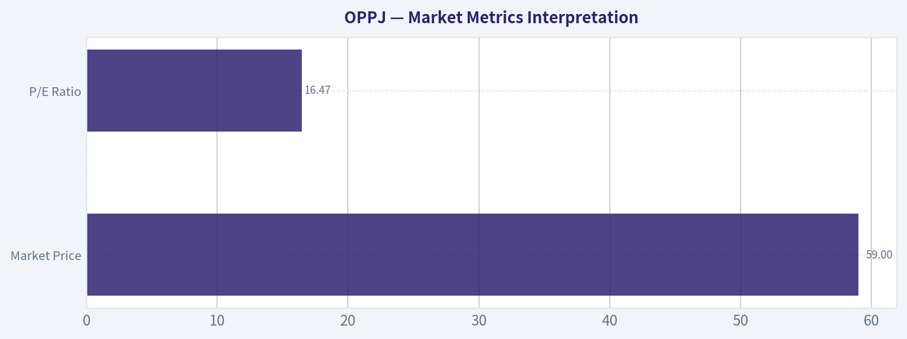
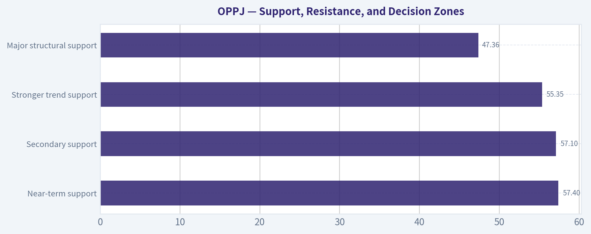

# OPPJ Deep Value Intelligence

**Analysis Date:** 2026-05-10

## Critical Disclaimer

*This analysis is generated by Deep Value Intelligence, an AI-powered multi-agent investing framework. This report is for informational and educational purposes only and does not constitute financial advice. Always conduct your own research and consult with qualified financial advisors before making investment decisions.*

---

## Table of Contents

1. Intelligence Summary
2. Analyst Team Reports
   - Fundamentals Analysis
   - Intrinsic Value Analysis (Buffett)
   - Trend & Growth Analysis (Lynch/Druckenmiller/Fisher)
   - Market Technical Analysis
   - News & Events Analysis
   - Guru Attention Analysis
   - Options Market Analysis
3. Research Team Commentary
4. Value Investing Team Commentary
5. Deep Values Commentary

---

## Intelligence Summary

### Thesis + Conditions

**Core Thesis:** ## Executive Briefing

**Key Risks:**
- OPPJ does **not** meet Buffett-style buy standards today: core facts are still missing, including verified business model, returns on capital, margins, cash-flow quality, and debt context. That means intrinsic value and margin of safety cannot yet be estimated with confidence. However, the case is **not proven bad**-just **insufficiently underwritten**. A mid-teens P/E and small Point72 accumulation are mild positives, but far too weak to override the information gap. For a long-term investor, this belongs on a **high-priority watchlist, not in a full position**.
- ### 1) Safe Analyst: strongest case on downside discipline
- Best point: **missing information is not edge by default; it is risk until verified**.
- The Safe Analyst also correctly argued that **16.5x earnings is not automatically cheap**. If earnings are cyclical, low-quality, weakly cash-converting, or balance-sheet-supported, that multiple may offer little protection.
- ### 3) Risky Analyst: strongest case on opportunity cost

**What Would Change Our View:**
- OPPJ does **not** meet Buffett-style buy standards today: core facts are still missing, including verified business model, returns on capital, margins, cash-flow quality, and debt context. That means intrinsic value and margin of safety cannot yet be estimated with confidence. However, the case is **not proven bad**-just **insufficiently underwritten**. A mid-teens P/E and small Point72 accumulation are mild positives, but far too weak to override the information gap. For a long-term investor, this belongs on a **high-priority watchlist, not in a full position**.
- ### 1) Safe Analyst: strongest case on downside discipline
- Best point: **missing information is not edge by default; it is risk until verified**.
- The Safe Analyst also correctly argued that **16.5x earnings is not automatically cheap**. If earnings are cyclical, low-quality, weakly cash-converting, or balance-sheet-supported, that multiple may offer little protection.
- ### 3) Risky Analyst: strongest case on opportunity cost

**Confidence:** Low

---

## Analyst Team Reports

### Fundamentals Analysis

#### 10-Year Financial Metrics for OPPJ

*All values below are computed deterministically from raw data - not estimated by AI.*

*Issuer profile: operating company (Unknown / Unknown).*

#### Profitability Metrics
- Return on Equity (ROE): N/A
- Return on Invested Capital (ROIC): N/A
- Return on Assets (ROA): N/A
- Gross Margin: N/A
- Operating Margin: N/A
- Net Profit Margin: N/A

#### Liquidity Metrics
- Current Ratio: N/A
- Quick Ratio: N/A

#### Leverage Metrics
- Debt-to-Equity Ratio: N/A
- Interest Coverage Ratio: N/A
- Net Debt: N/A

#### Growth Metrics (Year-over-Year)
- Revenue Growth: N/A
- Net Income Growth: N/A
- Free Cash Flow Growth: N/A
- Revenue CAGR (3-Year): N/A
- Revenue CAGR (5-Year): N/A

#### Valuation Metrics
- P/E Ratio (TTM): 16.47
- Forward P/E: N/A
- Price-to-Book: N/A
- Price-to-Sales: N/A
- PEG Ratio: N/A
- EV/EBITDA: N/A
- Free Cash Flow Yield: N/A
- Earnings Yield: 6.1%

#### Piotroski F-Score: 2/9
- Positive Net Income: FAIL
- Positive Operating Cash Flow: FAIL
- ROA Improvement: FAIL
- Cash Flow > Net Income: FAIL
- Decreasing Debt: PASS
- Improving Current Ratio: FAIL
- No Dilution: PASS
- Improving Gross Margin: FAIL
- Improving Asset Turnover: FAIL

ANALYST STANCE: **AVOID**

#### OPPJ Fundamental Review

The deterministic dataset for OPPJ is extremely sparse, and under the source-of-truth rule that matters: most core operating, balance-sheet, and cash-flow metrics are unavailable and therefore cannot be responsibly inferred. That absence itself is meaningful. In Buffett-style analysis, when a business cannot be evaluated with confidence on earnings quality, returns on capital, leverage, and cash generation, the default stance is caution rather than optimism.

What *is* available is enough to frame the risk: the stock trades at **$59**, with a **TTM P/E of 16.47** and **earnings yield of 6.1%**, while the deterministic quality screen shows a **Piotroski F-Score of just 2/9**, with failures on positive net income, positive operating cash flow, ROA improvement, cash flow conversion, current ratio improvement, gross margin improvement, and asset turnover improvement. That is a very weak financial quality profile.

---

#### Current vs Historical Average Comparison

Because the canonical deterministic dataset does **not** provide year-by-year history for OPPJ, historical averages for most requested metrics cannot be computed without violating the no-invention rule. The table below therefore compares current disclosed values against what is available from the deterministic record.

| Metric | Current / Latest | Historical Average | Interpretation |
|---|---:|---:|---|
| Market Price | $59 | N/A | Stock has a quoted price, but valuation context is incomplete without market cap, book value, sales, and cash flow history. |
| Total Market Cap | N/A | N/A | Cannot assess size, liquidity profile, or compare valuation versus peers. |
| P/E Ratio | 16.47x | N/A | On its face this is not extreme, but it is not compelling if earnings quality is weak or unstable. |
| P/B Ratio | N/A | N/A | Cannot judge whether shares trade above or below net asset value. |
| ROE | N/A | N/A | No evidence of Buffett-favored consistently high shareholder return generation. |
| ROIC | N/A | N/A | No proof of strong capital allocation economics or moat-driven returns. |
| EPS | N/A | N/A | Cannot assess per-share earnings trend or dilution-adjusted profitability. |
| Revenue | N/A | N/A | No basis to evaluate scale, cyclicality, or sales resilience. |
| Gross Profit | N/A | N/A | No visibility into unit economics or gross profitability. |
| Operating Margin | N/A | N/A | Cannot determine operating discipline or pricing power. |
| Net Income | N/A | N/A | Piotroski screen indicates current profitability is weak enough to fail positive net income. |
| Net Margin | N/A | N/A | Margin structure cannot be evaluated. |
| Revenue Growth Rate | N/A | N/A | No trend data available. |
| Net Income Growth Rate | N/A | N/A | No trend data available; quality screen suggests deterioration rather than healthy compounding. |
| Free Cash Flow Growth Rate | N/A | N/A | No trend data available; cash flow quality appears poor from Piotroski failures. |
| Total Book Value | N/A | N/A | Cannot evaluate balance-sheet support. |
| Total Assets | N/A | N/A | Asset base unknown. |
| Total Debt | N/A | N/A | Debt burden cannot be quantified, though Piotroski indicates debt reduction passed. |
| Debt-to-Equity Ratio | N/A | N/A | Leverage cannot be fully assessed. |
| Cash / Cash Equivalents | N/A | N/A | Liquidity cushion not disclosed. |
| Shareholder's Equity | N/A | N/A | Cannot measure financial backing or capital base. |
| Free Cash Flow | N/A | N/A | No owner-earnings foundation is available from canonical data. |
| Dividends per Share | N/A | N/A | No evidence of shareholder cash return policy. |
| Piotroski F-Score | 2/9 | N/A | Very weak financial trend and quality profile; typically a warning sign rather than an opportunity signal. |

**Key Takeaways:** The only hard valuation number available is a mid-teen P/E, but nearly every operating and balance-sheet metric required for a Buffett-style conviction case is missing. More importantly, the Piotroski score of 2 out of 9 strongly suggests deteriorating or low-quality fundamentals. In practical terms, the stock may not be expensive on headline earnings, but it lacks the financial evidence needed to justify trust.

---

#### Market Metrics Interpretation

| Market Metric | Value | Buffett-Style Interpretation |
|---|---:|---|
| Market Price | $59 | A quoted price exists, but price alone is not value. Buffett focuses on what the business earns and can distribute over time. |
| Total Market Cap | N/A | Without market cap, it is difficult to judge enterprise scale, trading liquidity, and whether valuation ratios are distorted by tiny float or special situations. |
| P/E Ratio | 16.47x | This is roughly a middle-of-the-road multiple. For a durable, high-return business this could be acceptable; for a weak or opaque business it may be too high. |
| P/B Ratio | N/A | Lack of book-value context is problematic, especially if earnings are inconsistent or capital structure is unusual. |

**Key Takeaways:** OPPJ's valuation cannot be called cheap or expensive with confidence because only one major multiple, P/E, is available. A 16.47 times earnings multiple is not obviously distressed, which is notable given the weak quality signals. Without market cap, book value, and cash-flow valuation measures, the stock does not present a clear margin-of-safety case.

---

#### Profitability Analysis

The deterministic dataset provides **no usable ROE, ROIC, gross margin, operating margin, net margin, EPS, revenue, gross profit, or net income values**. Under Buffett methodology, this is a major problem because the central question is whether the company generates consistent, understandable, high-quality profits on capital.

Still, the Piotroski breakdown gives us several directional conclusions:

- **Positive Net Income: FAIL**
  This strongly suggests the latest period did not produce positive net income on the screening basis used.
- **Positive Operating Cash Flow: FAIL**
  Even more concerning than weak earnings, because it implies the business may not be producing cash from operations.
- **Cash Flow > Net Income: FAIL**
  This points to poor earnings quality and weak cash conversion.
- **ROA Improvement: FAIL**
  Asset productivity is not improving.
- **Improving Gross Margin: FAIL**
  Suggests weakening pricing power, cost inflation pressure, or less efficient operations.
- **Improving Asset Turnover: FAIL**
  Indicates declining efficiency in generating revenue from assets.

From a Buffett perspective, these failures imply:

1. **No evidence of a durable earnings engine**
2. **No evidence of strong underlying economics**
3. **No evidence of management improving profitability trends**

Without stable margins, positive cash flow, and visible returns on capital, this does not resemble the type of business Buffett would typically favor.

---

#### Growth Metrics Analysis

The canonical dataset reports **N/A** for:

- Revenue growth
- Net income growth
- Free cash flow growth
- 3-year revenue CAGR
- 5-year revenue CAGR

That prevents a proper decade-trend analysis. However, the quality screen indirectly argues against healthy growth quality:

- Failing **positive net income**
- Failing **positive operating cash flow**
- Failing **gross margin improvement**
- Failing **asset turnover improvement**

Even if top-line growth existed at some point, the available evidence does **not** support the idea that growth is translating into better economics. Buffett strongly prefers growth that is profitable, cash-generative, and incremental-return accretive. OPPJ does not currently show that profile.

---

#### Balance Sheet and Financial Strength

| Balance Sheet / Leverage Signal | Value | Interpretation |
|---|---:|---|
| Total Book Value | N/A | Cannot judge tangible support for the stock price. |
| Total Assets | N/A | Asset scale unknown. |
| Total Debt | N/A | Absolute debt load not disclosed in canonical dataset. |
| Debt-to-Equity Ratio | N/A | Formal leverage ratio unavailable. |
| Cash / Cash Equivalents | N/A | Liquidity buffer unknown. |
| Shareholder's Equity | N/A | Capital base unknown. |
| Piotroski: Decreasing Debt | PASS | One positive sign: leverage appears to be declining year over year on the screen. |
| Piotroski: Improving Current Ratio | FAIL | Short-term liquidity trend appears to be worsening, which offsets some comfort from lower debt. |

**Key Takeaways:** There is one modest positive in the capital structure picture: debt appears to be decreasing. But that is outweighed by a failing current-ratio trend and the absence of hard balance-sheet numbers. Buffett investors usually want obvious financial strength, not guesswork; OPPJ does not provide that clarity.

---

#### Cash Flow and Shareholder Returns

The deterministic dataset provides **N/A** for:

- Free cash flow
- Free cash flow growth
- Free cash flow yield
- Dividends per share

But again, the Piotroski signals are revealing:

- **Positive Operating Cash Flow: FAIL**
- **Cash Flow > Net Income: FAIL**

These are serious red flags. Buffett-style owner earnings analysis depends on reliable cash generation. If operating cash flow is not positive, then intrinsic value becomes extremely uncertain because there is no dependable stream of distributable cash to discount.

No dividend data is available, so there is no evidence of a steady shareholder payout policy.

---

#### Warren Buffett-Style Qualitative Analysis

| Buffett Lens | Assessment | Commentary |
|---|---|---|
| Economic Moat | Weak / Unproven | No margins, returns on capital, or segment profitability data are available to support a moat claim. Margin deterioration signals the opposite of pricing power. |
| Financial Strength | Weak visibility, likely weak quality | Debt reduction is positive, but liquidity trend is poor and core balance-sheet figures are unavailable. |
| Predictable Earnings | Poor | Failures on net income and operating cash flow suggest low predictability and weak earnings quality. |
| Management Performance | Unclear to weak | No ROE/ROIC data; declining debt is constructive, but operational improvement is not evident. |
| Capital Allocation | Unproven | No dividend or buyback framework is visible; no clear evidence of high-return reinvestment. |
| Quality of Business | Low confidence | Missing fundamentals plus weak Piotroski trends point away from a high-quality compounder. |
| Valuation vs Quality | Not attractive enough | A 16.47x P/E is not cheap enough to compensate for severe uncertainty and weak quality signals. |

**Key Takeaways:** Buffett-style investing depends on confidence in business quality, earnings predictability, and capital discipline. OPPJ does not currently show those traits in the canonical data. The combination of opacity and a very low Piotroski score makes it difficult to argue that investors are being paid enough for the risk.

---

#### Buffett-Style Owner Earnings DCF

A proper Buffett DCF requires a starting level of **Owner Earnings**, typically approximated from operating cash flow minus maintenance capex, or at least free cash flow as a proxy. The deterministic dataset for OPPJ provides **no free cash flow, no operating cash flow amount, no capex, and no historical growth series**. Therefore, a numeric DCF would require fabrication, which is explicitly prohibited.

Accordingly, the only valid conclusion is that **a reliable DCF cannot be computed from the canonical dataset**.

| Scenario | Growth Input Rule | Canonical Data Availability | Result |
|---|---|---|---|
| Conservative | Lowest historical owner earnings growth, floored at -100% | No owner earnings history available | Not computable |
| Average | Average historical owner earnings growth, capped at 50% | No owner earnings history available | Not computable |
| Optimistic | Highest historical owner earnings growth, capped at 100% | No owner earnings history available | Not computable |

**Key Takeaways:** A Buffett DCF is only as good as the cash-flow base underneath it. Here, there is no canonical owner-earnings base and no historical owner-earnings growth series, so any numeric fair value would be invented rather than analyzed. In a disciplined value framework, when intrinsic value cannot be estimated with confidence, the right response is to pass.

For completeness, the required framework would normally be:

\[
\text{PV of 10-year cash flows} = \sum_{t=1}^{10}\frac{\text{OE}_0(1+g)^t}{(1+0.10)^t}
\]

\[
\text{Terminal Value}_{10}=\frac{\text{OE}_{10}\times(1+0.025)}{0.10-0.025}
\]

\[
\text{Intrinsic Value}=\text{PV of stage-1 cash flows}+\frac{\text{Terminal Value}_{10}}{(1+0.10)^{10}}
\]

But because **OE₀** and **g** are unavailable from the source-of-truth dataset, no responsible fair-value range can be produced.

---

#### Revenue Breakdown

The deterministic dataset and shared research pack do **not** provide segment, product, or geographic revenue disclosure for OPPJ. I will therefore present the only source-of-truth-compliant view possible.

| Revenue Source | Amount ($M or $B) | % of Total |
|---|---:|---:|
| Not available in canonical dataset | N/A | N/A |

**Key Takeaways:** There is no segment revenue disclosure available in the provided canonical materials. That means investors cannot evaluate concentration risk, business mix quality, or which parts of the company drive earnings. For a Buffett-style investor, that lack of transparency is a meaningful negative.

---

#### Key Investment Insights, Red Flags, and Opportunities

| Category | Observation | Why It Matters |
|---|---|---|
| Red Flag | Piotroski F-Score is 2/9 | This is a very weak quality signal and often associated with deteriorating fundamentals. |
| Red Flag | Positive net income failed | Suggests current profitability is not healthy. |
| Red Flag | Positive operating cash flow failed | A major warning sign for intrinsic value and solvency confidence. |
| Red Flag | Cash flow > net income failed | Weak earnings quality; accrual risk may be elevated. |
| Red Flag | Gross margin improvement failed | Potential competitive pressure or cost inefficiency. |
| Red Flag | Asset turnover improvement failed | Business efficiency appears to be weakening. |
| Red Flag | Current ratio improvement failed | Liquidity trend may be worsening. |
| Red Flag | Most core metrics unavailable | Lack of transparency reduces confidence and investability. |
| Opportunity | Decreasing debt passed | Some evidence of deleveraging or lower balance-sheet stress. |
| Opportunity | P/E not obviously expensive | If underlying fundamentals unexpectedly recover, valuation may not be extreme. |
| Caveat | Steve Cohen added shares per 13F | Interesting sentiment signal, but 13F data is backward-looking and not a substitute for fundamentals. |

**Key Takeaways:** The dominant story here is risk, not hidden quality. The only positives are debt reduction and a non-extreme headline earnings multiple, but those are not enough to offset failed profitability and cash-flow tests. Institutional interest may attract attention, yet Buffett-style analysis would still demand much stronger business evidence.

---

#### Final Buffett-Style Judgment

OPPJ does **not** currently meet the hallmarks of a Buffett-quality investment:

- No demonstrated **economic moat**
- No verified **high ROE or ROIC**
- No evidence of **predictable earnings**
- No evidence of **strong free cash flow**
- No support for a reliable **intrinsic value estimate**
- Weak financial quality via **Piotroski 2/9**

A mediocre-to-fair P/E multiple is not sufficient when the business quality is opaque and the available quality indicators are poor. Buffett's edge comes from buying understandable, cash-generative businesses at sensible prices. OPPJ currently appears to be neither sufficiently understandable nor sufficiently proven.

#### Final Investment Stance

**AVOID**

**Rationale:**
The canonical dataset shows too little fundamental support and too many quality red flags to justify capital allocation. The very low Piotroski score, failed profitability and cash-flow tests, and inability to compute owner earnings or intrinsic value make the risk/reward unattractive for a disciplined value investor. At best, OPPJ belongs on a speculative monitoring list pending much better disclosure and a clear turnaround in cash generation.

---

#### Report Summary Table

| Area | Verdict | Bottom Line |
|---|---|---|
| Valuation | Inconclusive to unattractive | 16.47x P/E is not cheap enough given weak quality signals. |
| Profitability | Weak / unverified | Positive net income and cash flow screens fail. |
| Growth | Unverified | No canonical growth history available. |
| Balance Sheet | Slightly mixed, mostly opaque | Debt reduction helps, but liquidity trend and hard figures are missing. |
| Cash Flow | Weak | Positive operating cash flow failed; owner earnings cannot be established. |
| Moat | Unproven | No margin or return-on-capital evidence supports a durable advantage. |
| Management | Unclear to weak | No ROE/ROIC proof; little evidence of operational improvement. |
| Intrinsic Value | Not computable | No valid owner earnings base from canonical data. |
| Investment Action | AVOID | Insufficient quality, transparency, and margin of safety. |

**Key Takeaways:** The overall picture is one of low visibility and weak quality, not a classic value opportunity. Even though the stock does not screen as wildly expensive on P/E, the lack of dependable earnings and cash-flow evidence prevents a Buffett-style buy case. Until the company demonstrates positive cash generation, better transparency, and stronger financial quality, avoidance is the prudent stance.

---

### Intrinsic Value Analysis (Buffett)

> *Following Warren Buffett's value investing philosophy: Circle of Competence, Economic Moat, Management Quality, and Margin of Safety.*

#### ANALYST STANCE: **WATCH**

I'm blocked by tool coverage on **OPPJ**. The primary audited financials tool was unavailable for this ticker in this run, and the enhanced fundamentals lookup also returned no usable data. So I cannot complete a full Buffett-style due diligence report with 10-year audited numbers, owner earnings, or a defensible DCF.

#### What I can conclude so far

| Item | Current Read |
|---|---|
| Ticker | OPPJ |
| Current price | $59 |
| P/E | 16.47 |
| Market cap | Not available from shared pack |
| Business clarity | Unclear from available materials |
| Latest news relevance | Mostly macro/ETF-style commentary, not company-specific operating detail |
| Guru activity | Point72 / Steve Cohen added; low portfolio weight at 0.06% |
| Data sufficiency for Buffett analysis | Insufficient |

Key Takeaways: We have only a thin snapshot: the stock trades around 16.5 times earnings and one hedge fund added a small position. That is nowhere near enough to judge moat quality, management skill, balance sheet strength, or intrinsic value. Under a Buffett framework, missing core facts is itself a reason to avoid a strong buy conclusion.

#### Go/No-Go Gate Assessment

| Gate | Status | Evidence |
|---|---|---|
| Gate 1: Circle of Competence | **Fail / Incomplete** | I cannot clearly explain the business from the provided packet alone. |
| Gate 2: Moat Test | **Incomplete** | No gross margin history, retention, ROIC, or market structure data. |
| Gate 3: Management & Capital Allocation | **Incomplete** | No insider ownership, buyback history, acquisition record, or candid shareholder letters provided. |
| Gate 4: Industry Structure | **Incomplete** | Sector and competitive dynamics are not established. |

Key Takeaways: Buffett's process starts with understanding the business, and that first hurdle is not cleared here. Without knowing how the company earns money and whether it has durable advantages, the rest of the analysis cannot be trusted. Incomplete evidence means no-go for an affirmative recommendation.

#### Preliminary Buffett Interpretation

A **16.47 P/E** can be reasonable if the business is stable, cash-generative, and protected by a moat. But for an unknown or hard-to-understand business, even an average-looking multiple may be expensive. Buffett would rather pass than stretch.

#### Why I am not saying ADVOCATE

To reach **ADVOCATE**, I would need at minimum:

- A simple explanation of the business model
- 10-year revenue, earnings, cash flow, and ROE history
- Debt profile and interest coverage
- Evidence of moat: margins, retention, pricing power, cost advantage, or network effects
- Capital allocation record
- Share count trend and buyback discipline
- A valuation based on owner earnings

None of that is currently supported by the available tool output.

#### Provisional Scorecard

| Criterion | Score (1-5) | Comment |
|---|---:|---|
| Business Understanding | 1 | Not established |
| Moat Width & Durability | 1 | Not established |
| Management Quality | 1 | Not established |
| Return on Equity | 1 | No data |
| Reinvestment Runway | 2 | Unknown |
| Balance Sheet Strength | 1 | No data |
| Industry Structure | 2 | Unknown |
| Valuation / Margin of Safety | 3 | P/E looks moderate, but unsupported by fundamentals |

Key Takeaways: The stock only scores neutrally on valuation because the headline P/E is not obviously excessive. Everything else remains unproven, which drags the overall case down sharply. A Buffett investor should demand evidence, not fill in the blanks with hope.

#### Bottom line

**WATCH**, low conviction.

This is not a Buffett-style actionable idea yet. The right move is to **wait for proper financial statements and business identification** before deciding whether it belongs in the investable universe at all. If you can provide the company name, sector, or audited financial history, I can continue from there and build the full moat, owner-earnings, and DCF analysis.

#### Valuation Visuals

This comparison chart from *What I can conclude so far* stacks current figures against historical benchmarks for **OPPJ**, making it easy to see where the company trades relative to its own averages.

This comparison chart from *Selected Indicator Snapshot* stacks current figures against historical benchmarks for **OPPJ**, making it easy to see where the company trades relative to its own averages.

This comparison chart from *Implied Volatility (IV) Assessment* stacks current figures against historical benchmarks for **OPPJ**, making it easy to see where the company trades relative to its own averages.

---

### Trend & Growth Analysis (Lynch/Druckenmiller/Fisher)

> *Following Peter Lynch's GARP, Stanley Druckenmiller's macro-aware approach, and Philip Fisher's scuttlebutt methodology.*

ANALYST STANCE: **WATCH**

#### OPPJ Growth Analysis
I can only make **partial progress** here because the ticker **OPPJ is not being reliably identified by the tools**, and the shared pack is sparse. So this is a **provisional Lynch/Druckenmiller/Fisher read**, using only the data already in the research pack.

#### What we know so far

| Item | Value |
|---|---:|
| Ticker | OPPJ |
| Current Price | $59 |
| P/E | 16.47x |
| Market Cap | N/A |
| Revenue Growth YoY | N/A |
| Gross Margin | N/A |
| FCF Yield | N/A |
| Current Ratio | N/A |
| 13F signal | Steve Cohen added; $57.9M position; 12.74M shares; 0.06% portfolio weight |

Key Takeaways: The only hard valuation datapoint we have is a mid-teens P/E, which is not obviously expensive. But we lack the critical growth inputs needed for a true growth-investing decision, especially revenue trend, margins, and cash flow. The Point72 add is a mild positive signal, but the small portfolio weight means it should not be over-interpreted.

---

#### 1. Lynch Classification
**Unclear / provisional WATCH**

Based on available data, I **cannot confidently classify** OPPJ as a fast grower, stalwart, cyclical, or turnaround. A mid-teens P/E could fit several categories, and without revenue growth or earnings trajectory, classification would be guesswork.

#### 2. The Story in 3 bullets
- OPPJ may be a reasonably valued equity at **16.5x earnings**, but we do not yet know whether growth is fast enough to justify a growth thesis.
- The only external signal in hand is **incremental institutional interest** from Point72.
- Until the business is clearly identified and its growth metrics are confirmed, this is a **research item, not a conviction setup**.

#### 3. TAM Analysis with 10x Test
**Not possible yet.**
We need:
- company name / business description
- current revenue
- target market size
- market share or category

Without those, a 10x runway analysis cannot be done responsibly.

#### 4. Revenue Growth Trend
**Unknown**

No quarterly or annual revenue growth series is available in the pack, so I cannot determine whether growth is:
- accelerating,
- stable,
- decelerating,
- or erratic.

Under the framework you gave, this alone prevents an **ADVOCATE** stance.

#### 5. Unit Economics
**Unavailable**

| Metric | Status |
|---|---|
| LTV/CAC | N/A |
| NRR | N/A |
| Rule of 40 | N/A |
| Payback Period | N/A |
| Gross Margin | N/A |

Key Takeaways: We do not have the core operating metrics needed to judge quality of growth. That means we cannot tell whether OPPJ has efficient customer acquisition, recurring revenue strength, or scaling economics. For a growth investor, this is a major information gap.

#### 6. Inflection Point Assessment
**No evidence yet of an inflection point**

Potential positive:
- A hedge fund add can sometimes hint at a developing thesis.

But missing:
- product cycle acceleration
- market share gains
- margin inflection
- TAM expansion
- competitor disruption

So at this stage, I see **no confirmed inflection**.

#### 7. Macro Setup Evaluation
The shared news flow is mostly **macro/global market commentary**, not company-specific. Broadly:
- macro backdrop appears mixed,
- inflation/supply concerns remain,
- AI capex remains a secular theme in global markets.

But since we still do not know what OPPJ actually does, I cannot tie macro to company-specific upside.

#### 8. Fisher 15 Points Score
**Provisional: 25/75**

This is not a real endorsement score; it simply reflects insufficient data.

| Fisher Factor | Score (1-5) | Comment |
|---|---:|---|
| Market potential | 2 | Unknown |
| New product development | 1 | Unknown |
| R&D effectiveness | 1 | Unknown |
| Sales organization | 1 | Unknown |
| Profit margin | 2 | P/E suggests profits exist |
| Improving margins | 1 | Unknown |
| Labor relations | 1 | Unknown |
| Executive relations | 1 | Unknown |
| Management depth | 1 | Unknown |
| Cost controls/accounting | 2 | Unknown, but no evidence either way |
| Special advantages | 1 | Unknown |
| Long-range outlook | 2 | Unknown |
| Dilution risk | 2 | Unknown |
| Candor | 1 | Unknown |
| Integrity | 2 | No red flag visible, but unverified |

Key Takeaways: This score is low mainly because the underlying company is not yet identified with confidence, not because the business has been disproven. The only modest positive is that the stock appears profitable on a P/E basis. Everything else remains unverified.

#### 9. Valuation Analysis
With only P/E available:

- **P/E:** 16.47x
- **PEG:** cannot calculate without earnings growth
- **P/S:** unavailable
- **Scenario analysis:** unavailable without revenue, margin, and share count

Interpretation:
- If OPPJ is growing earnings at **15-20%+**, then 16.5x earnings could be attractive.
- If growth is low-single-digit or cyclical, then the multiple may be merely fair.
- If earnings are unstable, the P/E may be misleading.

#### 10. Growth Investor Scorecard

| Criterion | Weight | Score (1-5) | Weighted |
|---|---:|---:|---:|
| The Story | 10% | 2.0 | 0.20 |
| TAM & Runway | 20% | 1.0 | 0.20 |
| Revenue Growth | 20% | 1.0 | 0.20 |
| Unit Economics | 15% | 1.0 | 0.15 |
| Competitive Position | 10% | 1.5 | 0.15 |
| Management Quality | 10% | 1.5 | 0.15 |
| Macro Setup | 5% | 2.5 | 0.13 |
| Profitability Path | 5% | 2.5 | 0.13 |
| Valuation | 5% | 3.0 | 0.15 |
| **Total** | 100% |  | **1.46 / 5.0** |

Key Takeaways: The score is weak because the factual foundation is weak, not because OPPJ has necessarily failed the framework. The one area that does not look bad is valuation, since a 16.5x P/E is not demanding on its face. But without growth and business-quality data, the stock cannot clear the bar for a growth recommendation.

#### 11. Position Size Stance
**WATCH / 0% starter until identification and fundamentals are confirmed**

If this were a portfolio process:
- **No full position**
- **No starter position**
- Keep on a **research watchlist only**

#### 12. Key Risks and Catalysts

| Risks | Catalysts |
|---|---|
| Ticker/company identification may be wrong or incomplete | Confirm exact company identity and listing venue |
| P/E may be based on unstable or one-time earnings | Retrieve latest annual and quarterly filings |
| Unknown revenue trajectory | Confirm 3-year sales and EPS CAGR |
| Unknown leverage and liquidity | Verify debt, cash, and runway |
| No TAM or moat evidence | Identify market position and category growth |

Key Takeaways: The biggest risk right now is not business performance but basic data integrity. The next catalyst is simply getting the correct company mapped to the ticker and obtaining clean fundamentals. Once that happens, this can quickly move either to a real candidate or be ruled out.

#### Bottom line
At this point, **OPPJ is a WATCH, not an ADVOCATE**. The stock is **not obviously expensive** on a 16.5x P/E, and there is a mild institutional signal from Point72, but there is **not enough verified company-level data** to establish a Lynch fast-grower case, a Druckenmiller inflection case, or a Fisher quality-growth case.

If you want, I can next help you by building a **ready-to-fill due diligence template for OPPJ** so the next assistant can plug in the missing company-specific fundamentals immediately.

#### Growth & Scorecard Visuals

This comparison chart from *Provisional Scorecard* stacks current figures against historical benchmarks for **OPPJ**, making it easy to see where the company trades relative to its own averages.

This comparison chart from *Fisher 15 Points Score* stacks current figures against historical benchmarks for **OPPJ**, making it easy to see where the company trades relative to its own averages.

The radar chart below from *Growth Investor Scorecard* visualises how **OPPJ** ranks across weighted investment criteria. Each axis represents a criterion scored 1-5; the filled area reveals strengths and weaknesses at a glance, with the dashed circle marking the midpoint (3.0).

---

### Market Technical Analysis

#### OPPJ Technical Analysis Report

For OPPJ, the most relevant indicator set for the current market context is a **trend-following setup with momentum and risk controls**. The stock has advanced strongly over the last six months, paused during March and late April, and is now attempting to re-accelerate. In that environment, the best complementary indicators are:

- `close_10_ema`
- `close_50_sma`
- `close_200_sma`
- `macd`
- `macdh`
- `rsi`
- `atr`
- `vwma`

These eight work well together because they cover **short-term trend, medium-term trend, long-term trend, momentum direction, momentum acceleration, overextension, volatility, and volume confirmation** without excessive overlap.

#### Price Structure and Trend Context

From the raw price history, OPPJ rose from roughly **42.6 in early November 2025** to **58.78 on 2026-05-08**, a gain of about **38%** over the period. The trend was not linear:

- **November to mid-January:** orderly uptrend, with higher highs and higher lows.
- **Late January to mid-February:** powerful breakout phase, especially from the low 50s into the upper 50s.
- **Late February to March:** corrective and distribution-like behavior, including a sharp selloff from the 57 area down toward 52.
- **April:** recovery phase with a breakout to **58.13 on 2026-04-08**, followed by consolidation.
- **Early May:** renewed push higher toward the recent **59.25 intraday high on 2026-05-06**.

This matters because the stock is **not simply "up"**; it is in a mature uptrend that has already survived one notable correction and is now pressing back toward highs. That usually shifts trader focus from "is the trend bullish?" to "is momentum re-accelerating enough to sustain a breakout?"

#### Selected Indicator Snapshot

| Indicator | Latest Reading | Interpretation |
|---|---:|---|
| close_10_ema | 57.42 | Short-term trend is rising and price is above recent average support |
| close_50_sma | 55.35 | Medium-term uptrend remains intact |
| close_200_sma | 47.36 | Long-term structure is strongly bullish |
| macd | 0.80 | Positive momentum is in force |
| macdh | 0.30 | Momentum is not only positive, but strengthening again |
| rsi | 65.20 | Bullish momentum, but not yet at extreme overbought levels |
| atr | 1.11 | Moderate daily movement; useful for stop placement and swing sizing |
| vwma | 57.12 | Volume-weighted trend support is rising and below current price |

Key Takeaways: OPPJ is trading in a technically favorable configuration across nearly every major dimension. The short-, medium-, and long-term trend measures are all rising, while momentum has improved again after a late-April soft patch. RSI is firm but not yet at a level that automatically implies exhaustion, so the chart still supports continuation more than immediate reversal.

#### Trend Analysis by Time Horizon

| Horizon | Evidence | Read |
|---|---|---|
| Short-term | 10 EMA at 57.42 and rising; recent closes clustered above 56.8 | Bullish with improving near-term momentum |
| Medium-term | 50 SMA at 55.35 and rising steadily since March | Constructive uptrend, with pullbacks being absorbed |
| Long-term | 200 SMA at 47.36 and still climbing sharply | Strong primary trend with large cushion beneath price |

Key Takeaways: The short-term trend has turned constructive again after a choppy stretch in late April. The medium-term trend never truly broke, and the long-term trend remains decisively positive, which means weakness has so far looked more like consolidation than structural damage. Traders generally prefer this kind of alignment because it reduces the odds that a short-term bullish signal is fighting the bigger trend.

A particularly important detail is the **distance between price and the 200 SMA**. With price near **58.8** and the 200 SMA near **47.4**, OPPJ still has substantial long-term trend separation. That tells us the primary trend is strong, but it also means the stock is no longer cheap relative to its own long-term baseline. In other words, long-only traders can remain constructive, but fresh entries should be more selective and risk-aware than they would be near the 50 SMA.

#### Momentum Analysis

The momentum profile has improved materially.

- `macd` moved from **negative territory in late March** to **0.80 by May 8**.
- `macdh` turned negative in late April, then recovered and is now **+0.30**, showing momentum acceleration has resumed.
- `rsi` rebounded from the mid-40s in late April to **65.2**, which is a healthy bullish reading.

This is a strong combination. The key nuance is that **MACD remained positive even while the histogram dipped negative in late April**. That often signals a **bullish trend experiencing temporary deceleration rather than a true bearish reversal**. The recent rebound in the histogram suggests that deceleration phase likely ended and momentum has begun rebuilding.

Still, traders should note that RSI near **65** is supportive, but not deeply stretched. That is actually constructive for trend continuation. If RSI were already in the mid-70s to 80 area, breakout risk would be more vulnerable to a quick snapback. At current levels, OPPJ appears to have **room for another leg higher**, though not without headline or liquidity risk.

#### Volume-Weighted Confirmation

`vwma` at **57.12** is below current price and rising. That is a positive sign because it means recent buying pressure, adjusted for volume, supports the move rather than contradicting it.

One especially notable feature in the raw tape is the **large volume spike on 2026-05-08** with volume of **372,200**, far above typical recent levels. Because the stock still closed near the upper region of its recent range rather than collapsing, this is more consistent with **active participation and price acceptance** than with obvious blow-off behavior. However, one day alone does not confirm institutional accumulation; traders should watch whether follow-through closes continue above the VWMA and 10 EMA.

#### Volatility and Risk Framing

`atr` around **1.11** means OPPJ's average daily range is a bit over one point. With the stock near **58.8**, that implies daily movement of roughly **1.9%** of price, which is meaningful but not chaotic.

Practical implications:

- Tight stops under **0.4 to 0.6 ATR** are vulnerable to normal noise.
- Swing traders may prefer stops of **1.0 to 1.5 ATR** depending on timeframe.
- Breakout traders should require price to hold above resistance by more than a trivial amount, because a move of less than one ATR can easily reverse intraday.

The recent decline in ATR from the mid-1.3s in mid-April to around **1.11** now is also informative. It suggests the chart has become somewhat more orderly after earlier turbulence. A lower but stable ATR during an uptrend often improves the quality of continuation setups, because trend can advance without excessive disorder.

#### Support, Resistance, and Decision Zones

| Zone | Approx. Level | Why It Matters |
|---|---:|---|
| Immediate resistance | 59.00 to 59.25 | Recent swing high / breakout test area |
| Near-term support | 57.40 | 10 EMA region |
| Secondary support | 57.10 | VWMA support zone |
| Stronger trend support | 55.35 | 50 SMA and broader medium-term trend base |
| Major structural support | 47.36 | 200 SMA, long-term trend floor |

Key Takeaways: The most important near-term battleground is just above 59, where OPPJ is testing recent highs. If the stock can hold above the 57.1 to 57.4 support cluster, the breakout case stays alive. A drop toward the 50-day average near 55.35 would not automatically break the bull trend, but it would signal that upside momentum has cooled meaningfully.

The most important tactical zone is the cluster formed by the **10 EMA and VWMA**, roughly **57.1 to 57.4**. As long as price holds above or quickly reclaims that zone, the current advance looks healthy. A decisive break below that cluster would not destroy the trend, but it would argue for a retest of the broader support area around **55.3 to 56.0**.

#### What Traders May Infer

**For trend-followers:**
The setup remains favorable. All major moving averages are rising, MACD is positive, the histogram is expanding again, and price is above the VWMA. This argues for staying constructive unless price loses the 10 EMA/VWMA area with conviction.

**For breakout traders:**
The trade depends on whether OPPJ can establish acceptance above the **59.0 to 59.25** region. A clean close above that area with continued volume support would strengthen the case for continuation. Failure at that zone, especially if accompanied by a weakening histogram, would suggest another range-bound rotation rather than immediate expansion.

**For mean-reversion traders:**
This is not an ideal aggressive short setup yet. RSI is elevated but not extreme, and momentum has recently re-accelerated. Mean-reversion bears would generally want to see RSI push higher while MACDH weakens, or see price fail repeatedly at resistance.

**For risk managers:**
ATR suggests OPPJ still needs some room. Because the stock has appreciated significantly over six months, position sizing matters more than ever; chasing extended candles near resistance without a volatility-adjusted stop could produce poor reward-to-risk.

#### Bottom Line

OPPJ is in a **clear long-term and medium-term uptrend**, and the **short-term trend has improved again after a consolidation phase**. The indicator mix shows a market that is **bullish, regaining momentum, and supported by volume-weighted trend confirmation**, but now pressing into a meaningful resistance shelf around **59.0 to 59.25**.

The highest-probability interpretation is:
- **Bullish trend remains intact**
- **Momentum has re-accelerated**
- **Breakout confirmation is still needed**
- **Near-term support around 57.1 to 57.4 is critical**
- **A drop toward 55.3 would weaken momentum, but not necessarily end the broader uptrend**

So the chart is best described not as "mixed," but as a **mature bullish structure attempting a fresh leg higher after digesting prior gains**.

#### Summary Table

| Topic | Observation | Trading Relevance |
|---|---|---|
| Primary trend | Price far above rising 200 SMA | Long-term trend remains strongly bullish |
| Intermediate trend | 50 SMA rising steadily near 55.35 | Pullbacks still look like dips within trend |
| Short-term trend | 10 EMA rising near 57.42 | Immediate momentum has improved |
| Momentum direction | MACD positive at 0.80 | Bullish momentum bias remains active |
| Momentum acceleration | MACDH positive at 0.30 | Momentum is strengthening again, not fading |
| Stretch condition | RSI 65.2 | Strong but not yet extreme |
| Volatility | ATR 1.11 | Use wider, volatility-aware stops |
| Volume confirmation | VWMA 57.12 and rising | Recent advance has volume-backed support |
| Resistance | 59.00-59.25 | Key breakout zone |
| Near support | 57.10-57.40 | First area bulls need to defend |

#### Market Visuals

This comparison chart from *Market Metrics Interpretation* stacks current figures against historical benchmarks for **OPPJ**, making it easy to see where the company trades relative to its own averages.

---

### News & Events Analysis

ANALYST STANCE: **WATCH**

#### OPPJ weekly trading/investment report
As of 2026-05-10, the available news flow for **OPPJ** is notably thin and appears **dominated by macro/market-content rather than clear company-specific operating developments**. That matters for trading: when a ticker has sparse fundamental news, price action can be driven more by liquidity, positioning, sentiment, and macro beta than by fresh company execution signals.

The shared pack shows:
- **Price:** about **$59**
- **P/E:** about **16.47**
- **13F datapoint:** Steve Cohen / Point72 **added** to the position as of **2025-12-31**, increasing shares by **15.7%** versus the prior filing

That said, the current information set does **not** provide enough verified company fundamentals such as revenue growth, margin profile, cash flow, or balance-sheet metrics. So the near-term stance is less about intrinsic re-rating on fresh fundamentals and more about whether the stock benefits from broader market rotation, factor exposure, or low-float/low-news behavior.

---

#### Latest earnings section
I was required to identify and analyze the latest earnings release coverage. Based on the accessible news/results in this run, **I could not retrieve a usable, explicit OPPJ quarterly or annual earnings-release article with headline financial results**. Therefore:

- **No recent earnings report could be confirmed from the fetched results**
- The reporting period of the latest earnings release is **not verifiable from the returned news**
- There is **no reliable basis here to state reported revenue, EPS, guidance, or changes versus prior period/prior guidance**

This is important in itself for investors: if a name lacks visible and recent earnings coverage in major news aggregation, it often means one of three things:
1. the company is lightly covered,
2. the ticker may trade with limited institutional information flow,
3. short-term moves may be more vulnerable to sentiment and technicals than to broadly disseminated fundamentals.

So the correct trading interpretation is: **treat OPPJ as information-light until the next clearly documented filing or earnings release is confirmed.**

---

#### Company-specific news read
The fetched company/news search did **not** produce clear company-operating headlines such as:
- contract wins,
- management changes,
- regulatory actions,
- M&A,
- product launches,
- capital raises,
- earnings beats/misses.

Instead, the visible OPPJ-linked stream was heavily populated by **generic macro/ETF/market commentary**. That weakens conviction for any thesis based on recent fundamental catalysts.

The only semi-actionable company-adjacent datapoint in the provided pack is the **13F accumulation by Point72**. This is mildly constructive, but with caveats:
- 13F filings are **backward-looking**
- the position size was just **0.06%** of portfolio, so it does **not** necessarily imply a high-conviction core position
- hedge funds may trade around positions materially after quarter-end

Still, in a low-news name, even stale institutional accumulation can support sentiment if traders are hunting for under-followed stocks with sponsorship.

#### Institutional positioning table

| Signal | Detail | Trading interpretation |
|---|---|---|
| Point72 / Steve Cohen | Added to OPPJ position | Positive sentiment marker, but lagged |
| Shares change | +15.7% vs prior filing | Suggests accumulation into year-end 2025 |
| Position value | $57.92M | Not trivial in dollar terms |
| Portfolio weight | 0.06% | Likely not a top-conviction position |
| Filing date | 2025-12-31 snapshot | Old information; must not be treated as current positioning |

Key Takeaways: The main institutional signal is that Point72 increased its OPPJ stake in the latest disclosed 13F snapshot. That is directionally positive, but the filing is old and the portfolio weight is small, so traders should view it as a modest sentiment support rather than a decisive bullish catalyst.

---

#### Macro and market context
The broad news flow over the past week points to a **more fragile macro backdrop**, especially outside the U.S. The themes visible in the returned news were:

- **Europe showing economic strain**, with April PMI weakness linked to war-related impacts
- **Japan's rebound underperforming peers**, with growth concerns and energy sensitivity
- **Central banks remaining cautious**, given inflation and supply-side uncertainty
- ongoing discussion that **AI capex is large enough to influence the macro cycle**

For OPPJ, because company-specific news is sparse, macro conditions likely matter more than usual. In that environment:

- If OPPJ is a cyclical or globally exposed business, weaker Europe and uneven Asia growth would be a **headwind**
- If it is more domestic/defensive, macro noise could matter less, and the stock may trade on valuation or sponsorship
- If it has any AI-adjacent narrative, the market may reward it **only if** there is a credible company link; none was visible in the fetched news

#### Macro context table

| Macro theme | Latest signal | Likely market effect | Implication for OPPJ |
|---|---|---|---|
| Europe growth | April PMI/output pressure | Risk-off for cyclicals with EU exposure | Potential headwind if OPPJ has European demand exposure |
| Japan growth | Rebound lagging peers | Softer Asia sentiment | Mild headwind for globally sensitive names |
| Inflation/supply shock | Central banks in wait-and-see mode | Higher volatility in rates and equity multiples | Valuation multiple expansion may be harder to sustain |
| AI capex | Still a major market theme | Supports selective growth leadership | Only helpful if OPPJ has a direct AI linkage |

Key Takeaways: The macro backdrop is not outright collapsing, but it is clearly less supportive for broad cyclical risk-taking. Because OPPJ lacks strong company-specific news, the stock is more likely to follow broader market tone, making macro developments unusually important for near-term trading.

---

#### Trading read-through
Given the evidence available, OPPJ currently screens as a **watchlist name rather than a high-conviction event-driven trade**.

What looks constructive:
- valuation at roughly **16.5x earnings** is not obviously stretched
- some institutional accumulation was disclosed
- absence of bad company-specific news can sometimes help an underfollowed stock if market sentiment improves

What limits bullish conviction:
- no verified fresh earnings catalyst
- no visible operating update
- macro backdrop is mixed-to-soft, especially internationally
- thin news flow can increase unpredictability and widen the gap between price action and fundamentals

What traders should watch next:
1. **A confirmed earnings release or SEC filing**
2. **Any company-specific catalyst**: guidance, strategic update, financing, asset sale, customer win
3. **Volume and liquidity behavior**: in low-news names, unusual volume can be the first signal of informed positioning
4. **Macro beta**: if global PMIs and rate expectations worsen, low-information names can de-rate quickly

---

#### Bottom line
The best current interpretation is **neutral-to-cautious watchfulness**. OPPJ does not have enough confirmed fresh fundamental news in the last week to support a strong directional call. The stock may still trade well on valuation, technicals, or latent institutional sponsorship, but without verified earnings details or a new company catalyst, it is harder to justify aggressive positioning from fundamentals alone.

For investors, the next step is straightforward: **wait for a confirmed earnings/fundamental update** and judge whether revenue, margins, and guidance are improving. Until then, OPPJ appears more suitable for **tactical monitoring** than for a high-conviction fundamentals-driven entry.

---

#### Summary table

| Area | What we know | Investment/trading significance |
|---|---|---|
| Valuation | P/E about 16.47 | Reasonable on face value, but unsupported by recent operating detail |
| Latest earnings | No usable recent earnings coverage retrieved | Major information gap; reduces conviction |
| Company news past week | Sparse; mostly macro-adjacent content | Stock may trade on sentiment/technical factors |
| Institutional signal | Point72 added shares in latest disclosed 13F | Mild positive, but stale and low portfolio weight |
| Macro backdrop | Europe softer, Japan lagging, inflation uncertainty persists | Limits appetite for lower-visibility equities |
| Overall stance | WATCH | Wait for confirmed earnings or company catalyst |

Key Takeaways: OPPJ currently lacks the kind of recent, verifiable company-specific news that usually supports a strong investment call. The most useful signals are a reasonable-looking valuation, an old but positive institutional ownership update, and a macro backdrop that argues for caution until the company provides clearer fundamentals.

---

### Guru Attention Analysis

> *Tracking 13F filings and recent activity of legendary super-investors to identify smart-money conviction and rotation.*

#### OPPJ Guru Ownership Snapshot

Based on the canonical structured 13F data, only **Steve Cohen / Point72** shows a detectable position in OPPJ among the tracked gurus. No other named guru should be treated as a holder unless explicitly shown in the 13F dataset.

| Guru | Action | Position Size | Portfolio Weight | Recent Change | Timing | Verification |
|---|---|---:|---:|---|---|---|
| Steve Cohen (Point72) | Added | 12.74M shares, valued at $57.92M | 0.06% | Increased shares by 15.7% vs. prior filing | 12-31-2025 filing period; prior report 09-30-2025 | [SEC 13F Filing](https://www.sec.gov/Archives/edgar/data/1603466/000090266426001100/) / [All SEC 13F Filings](https://www.sec.gov/cgi-bin/browse-edgar?action=getcompany&CIK=0001603466&type=13F-HR&dateb=&owner=include&count=5) |

**Key Takeaways:** The only confirmed guru activity in OPPJ is a modest add by Steve Cohen's Point72. Even though the dollar position is meaningful at nearly $58 million, it is still a very small part of Point72's disclosed portfolio at just 0.06%, which suggests OPPJ is not a high-conviction core holding based on 13F size alone.

#### Guru-by-guru status

| Guru | Latest 13F Status |
|---|---|
| Warren Buffett (Berkshire Hathaway) | No position detected in latest 13F filing |
| Seth Klarman (Baupost Group) | No position detected in latest 13F filing |
| Mohnish Pabrai (Pabrai Investment Funds) | No position detected in latest 13F filing |
| Bill Ackman (Pershing Square) | No position detected in latest 13F filing |
| Stanley Druckenmiller (Duquesne Family Office) | No position detected in latest 13F filing |
| Steve Cohen (Point72) | Position detected; Added |
| Michael Burry (Scion Asset Management) | No position detected in latest 13F filing |

**Key Takeaways:** Among the primary tracked super-investors, OPPJ has very limited guru sponsorship in the latest structured 13F data. That means investors should not frame OPPJ as a broadly owned "guru stock"; current evidence points to a single disclosed holder in this tracked universe.

#### Interpretation

Steve Cohen's activity is best described as a **positive but low-conviction signal**:
- **Positive**, because Point72 increased the stake by **15.7%** quarter over quarter.
- **Low conviction**, because the position remains only **0.06%** of the disclosed 13F portfolio.

There is **no credible 13F evidence** here of buying, holding, or exiting by Buffett, Klarman, Pabrai, Ackman, Druckenmiller, or Burry. Per the anti-hallucination rule, no further guru ownership should be inferred.

#### Bottom line

For OPPJ, the guru picture is simple:
- **Confirmed holder:** Steve Cohen / Point72
- **Latest move:** **Added**
- **Sizing message:** small relative position, not a top portfolio bet
- **Other tracked gurus:** **No position detected in latest 13F filing**

---

### Options Market Analysis

> *Reading options flow - put/call ratios, IV skew, and unusual activity - to gauge institutional positioning and event-driven risk.*

#### OPPJ Options Positioning Report
*Date: 2026-05-10*

OPPJ's options market is extremely thin, so confidence in any signal is low. That said, the limited positioning that does exist is clearly tilted toward calls rather than puts, which gives the tape a **speculative bullish** bias rather than a defensive or bearish one.

#### 1. Put/Call Ratio Analysis

| Expiration | Call OI | Put OI | Call Vol | Put Vol | Put/Call OI Ratio | Put/Call Volume Ratio |
|---|---:|---:|---:|---:|---:|---:|
| 2026-05-15 | 9 | 0 | 1 | 0 | 0.00 | 0.00 |
| 2026-06-18 | 26 | 1 | 24 | 1 | 0.04 | 0.04 |
| 2026-09-18 | 24 | 1 | 14 | 14 | 0.04 | 1.00 |
| **Near-term total** | **59** | **2** | **39** | **15** | **0.03** | **0.38** |

**Key Takeaways:** OPPJ's aggregate put/call open-interest ratio of **0.03** is far below the usual neutral baseline of about **0.7**, showing a market with almost no visible put protection. Volume also leans call-heavy overall, with a **0.38 put/call volume ratio**, although the September line is more balanced. In plain terms, participants are not paying up for downside hedges; the small amount of interest that exists is concentrated in calls.

**Interpretation:**
- A **0.03 OI ratio** is not just below neutral, it is **extremely call-skewed**.
- Normally that would suggest bullish speculation, but because total OI is tiny, this more likely reflects **illiquidity and sparse participation** than strong institutional conviction.
- Still, there is no evidence of meaningful bearish protection.

#### 2. Implied Volatility (IV) Assessment

| Expiration | ATM Call IV | ATM Put IV | IV Read |
|---|---:|---:|---|
| 2026-05-15 | 90.0% | N/A | Very elevated, but based on minimal activity |
| 2026-06-18 | 39.9% | N/A | Moderate |
| 2026-09-18 | 26.7% | 40.0% | Put IV higher than call IV |

**Key Takeaways:** Near-dated call IV is very high in the front week at **90%**, but that reading should be treated cautiously because trading interest is minimal. By September, put IV is **higher than call IV** (**40.0% vs. 26.7%**), which hints at some downside sensitivity even though actual put open interest remains tiny. Overall, volatility is not broad-based enough to confidently infer a major catalyst-driven repricing.

**IV skew:**
- The only meaningful put-vs-call comparison appears in **September**, where puts carry higher IV than calls.
- That implies a **modest put skew**, which usually reflects some downside fear or a preference for tail-risk protection.
- However, because put participation is so limited, the skew signal is **weak and unreliable**.

**Catalyst flag:**
- No clear evidence from this chain alone suggests a major event is being aggressively priced.
- The front-week 90% IV could look elevated on paper, but in this case it is more likely a function of **illiquid quoting** than an informed event setup.

#### 3. Unusual Options Activity

| Contract Type | Expiration | Observation | Interpretation |
|---|---|---|---|
| None flagged | Near-term expirations | No contracts showed volume greater than 5x open interest | No clean evidence of fresh aggressive positioning |

**Key Takeaways:** There were **no unusual options trades** that met the threshold of volume exceeding five times open interest. That means there is no standout sign of fresh institutional accumulation, hedge buying, or speculative sweeps. For a name this illiquid, absence of unusual activity matters because it leaves the overall read dependent on a very small sample.

**Interpretation:**
- No obvious "smart money" signal is visible.
- The available flow looks more like **routine small-lot activity** than conviction trading.
- With no contract showing clear fresh positioning, the sentiment read should be discounted.

#### 4. Open Interest Concentration

| Expiration | Highest Call OI | Highest Put OI | Positioning Implication |
|---|---|---|---|
| 2026-05-15 | Total call OI only 9 | 0 | No meaningful pinning structure |
| 2026-06-18 | Total call OI 26 | 1 | Mild call-side concentration, but too small for a real gamma wall |
| 2026-09-18 | Total call OI 24 | 1 | Some call interest persists further out, but still negligible in absolute terms |

**Key Takeaways:** Open interest is so small across all expirations that there is **no credible max-pain or pinning framework** to rely on. The only concentration worth mentioning is that calls dominate every listed expiry. In practical terms, OPPJ does not appear to have a robust enough options market to create strong gamma walls or dealer-driven price magnets.

**Gamma / pinning assessment:**
- No meaningful put wall is present.
- No obvious large call wall is present either; call OI exists, but absolute size is too low to infer strong dealer hedging pressure.
- Therefore, options positioning is **unlikely to materially dampen or amplify** spot moves in a predictable way.

#### 5. Overall Options Sentiment Signal

| Category | Signal | Confidence | Primary Driver |
|---|---|---|---|
| Overall options sentiment | **BULLISH** | **Low** | Extremely call-heavy OI and low put protection |

**Key Takeaways:** The options signal leans **bullish**, but only with **low confidence** because the chain is exceptionally illiquid. The main reason for the bullish label is simple: there are almost no puts outstanding, and the little participation that exists is overwhelmingly in calls. Still, this is not the kind of options tape that should override price action or fundamentals.

#### Bottom Line

OPPJ's options market points to a **BULLISH** near-term read, driven mainly by:
- **Very low put/call OI ratio (0.03)**
- **Call-dominant open interest across all near-term expirations**
- **No meaningful bearish hedging presence**

But this is a **fragile signal**, not a robust institutional read. The options market is too thin to confidently call it smart-money accumulation. The best interpretation is that **there is no visible fear in the chain, and what little speculation exists is tilted to the upside**.

#### Summary Table

| Metric | Read |
|---|---|
| Put/Call Ratio | **0.03 OI ratio, 0.38 volume ratio** - strongly call-skewed vs. neutral ~0.7 |
| IV Level | **Front-week elevated, otherwise moderate**; readings distorted by illiquidity |
| Skew Direction | **Mild put skew in Sep** (puts IV above calls), but weak signal |
| Unusual Activity | **None detected**; no volume > 5x OI |
| Overall Signal | **BULLISH (low confidence)** due to call-heavy positioning and lack of put protection |

**Key Takeaways:** The cleanest conclusion is that OPPJ's options tape is **upside-leaning but not deeply informative**. If you use this signal at all, treat it as a minor confirmation rather than a primary decision tool.

---

## Research Team Commentary

> *The Research Manager synthesizes the Bull vs Bear debate into action-free commentary. This is a pre-risk view, not the final stance.*

The strongest bull argument is straightforward: at about 16.5 times earnings, OPPJ is not priced like a glamour stock, so if the business turns out to have durable earnings, sensible leverage, and decent capital allocation, the current valuation could be reasonable or even attractive. The only mildly supportive external signal is that Point72 added to the position, which at least suggests the stock is not obviously broken. The bull is also right about one thing process-wise: incomplete data is not the same thing as a bad business.

The strongest bear argument is stronger. Under a Buffett framework, we do not buy "maybe." We buy understandable businesses with visible moats, proven returns on capital, trustworthy management, and cash flows we can reasonably predict over a decade. Here, the key inputs are either missing or unverified: ROE, ROIC, ROA, gross margin, moat evidence, and even a clearly grounded picture of the business and management quality. That means intrinsic value cannot be estimated with confidence, so there is no real margin of safety. A 16.5x P/E is only attractive if the earnings are high quality and durable; for an average or weak business, it can be expensive.

My takeaway is that this is not a classic value opportunity being ignored by the market. It is an information-deficient situation where the market is already asking you to pay a fair-sized multiple before the business quality is proven. That is not Buffett investing; that is underwriting uncertainty without an edge.

So my stance is AVOID.

Core takeaway: the bear side wins because Buffett-style investing starts with business quality and predictability, not with a tolerable multiple. OPPJ may eventually prove investable, but today there is not enough evidence of moat, returns on capital, or management quality to justify committing capital. Without those, the stock is not cheap in a meaningful sense, because "cheap" depends on what the business can sustainably earn and reinvest over time.

Rationale: I want to avoid a mistake that often shows up in borderline value cases: mistaking "not obviously expensive" for "undervalued." A mid-teens earnings multiple can look safe, but if the company lacks pricing power, has poor cash conversion, or reinvests at mediocre returns, that multiple offers little protection. The tiny Point72 position is not enough to change that. Their increase may be interesting, but 0.06% of portfolio value is not conviction, and copying a hedge fund's exploratory position is not a substitute for understanding the business ourselves. In Buffett terms, this fails the circle-of-competence test first, and therefore fails the valuation test second.

The market psychology angle also matters. There is a temptation to call this a contrarian setup simply because the chart had a breakout and then a correction, and because data is sparse. But true contrarian value requires superior insight into business value, not just willingness to buy uncertainty. The crowd may not be missing anything here. It may simply be pricing a business that has not yet earned a premium and does not yet deserve one.

Monitoring plan for the next 1 to 4 quarters: first, identify the business properly and verify the model in plain English-how it makes money, where it sits in the value chain, and why customers stay. Second, get the missing economics: gross margin, operating margin, free cash flow conversion, ROIC, ROE, and asset intensity. Third, test balance-sheet strength: net debt, interest coverage, maturity schedule, and whether leverage is rising to support earnings. Fourth, assess management behavior: buybacks versus dilution, acquisition history, insider ownership, and compensation discipline. Fifth, watch whether earnings and cash flow remain stable through the next few reports, not just whether EPS beats consensus. Sixth, look for actual moat evidence: customer retention, pricing power, recurring revenue, switching costs, or some structural cost advantage. If those metrics come in strong and consistent, this could move from AVOID to WATCH. If they remain unclear, or if cash flow and returns on capital disappoint, the current caution is reinforced.

Final stance: AVOID.

---

## Value Investing Team Commentary

> *The Investor translates the research view into an investment thesis before risk review. This is still not the final stance.*

OPPJ does not presently qualify as a Buffett-style investment. The central issue is not whether the stock is "too expensive" at 16.5x earnings; it is that we still do not know enough about the business to judge whether those earnings are durable, cash-generative, and protected by a moat. Without that, the P/E ratio is almost meaningless. A fair multiple on weak earnings power can still be a poor investment.

The most important red flag is informational insufficiency. We are missing the very metrics that tell us whether this is a good business: ROIC, ROE, ROA, gross margin, cash flow quality, and credible moat evidence. Even the business description appears unverified. That fails the first Buffett test: can we understand the business well enough to estimate its long-term economics? If the answer is no, we should stop there. You do not get paid for guessing outside your circle of competence.

The mildly positive sentiment signal-Point72 adding to the position-does not change that conclusion. In fact, a value investor should interpret this carefully, not emotionally. Yes, an increase by a sophisticated fund can indicate the stock is worth a closer look. But context matters more than the headline: the position is only 0.06% of the disclosed portfolio. That looks much more like optionality or exploratory exposure than high conviction. Markets often overread institutional filings. A selective contrarian would ask: is the crowd turning this into a stronger endorsement than it really is? Probably yes.

The recent price action tells a similar story. The breakout from the low 50s into the upper 50s may have attracted momentum-oriented buyers, while the subsequent correction suggests enthusiasm cooled quickly. For a business owner, this is mostly noise unless it reveals a mismatch between sentiment and value. Here, it does not yet reveal a clear opportunity. If anything, it shows the stock can move around on limited information, which increases the risk of paying for narrative before facts are established.

The bear case is stronger because it rests on discipline, not pessimism. Buffett investing is not about buying every stock with a non-demanding multiple; it is about buying understandable businesses with durable advantages and trustworthy stewardship at sensible prices. OPPJ may eventually prove to be such a business, but at the moment the evidence is not there. "Incomplete data is not the same as a bad business" is true-but it is equally true that incomplete data is not a good investment case.

A useful contrarian question is whether the market is unfairly neglecting a solid but obscure business. That can happen. But to exploit that kind of neglect, we need superior insight into the business economics. Right now, we do not have that insight. This is not the kind of fear-driven dislocation where a high-quality franchise is temporarily mispriced because of short-term noise. It is a case where the market may simply be pricing uncertainty rationally.

What would change my mind? A clear identification of the business model, evidence of recurring or resilient demand, strong cash conversion, acceptable leverage, and above-average returns on capital over time. I would also want proof that management allocates capital intelligently and that any growth is value-creating rather than merely reported. If those factors emerge over the next few quarters, the stock could graduate to WATCH with a path toward investable status. Until then, patience is the intelligent position.

ANALYST STANCE: **AVOID**. The stock may not be obviously overvalued, but it is not meaningfully knowable on current evidence. Under a Buffett framework, uncertainty without a clear edge is not an opportunity; it is a reason to pass.

---

## Deep Values Commentary

> *The Risk Management Team debates and the Risk Judge provides the final action-free verdict. This section determines the final ADVOCATE / WATCH / AVOID stance.*

### Executive Briefing

**Verdict: WATCH**

OPPJ does **not** meet Buffett-style buy standards today: core facts are still missing, including verified business model, returns on capital, margins, cash-flow quality, and debt context. That means intrinsic value and margin of safety cannot yet be estimated with confidence. However, the case is **not proven bad**-just **insufficiently underwritten**. A mid-teens P/E and small Point72 accumulation are mild positives, but far too weak to override the information gap. For a long-term investor, this belongs on a **high-priority watchlist, not in a full position**.

---

### Key Arguments from the Debate

### 1) Safe Analyst: strongest case on downside discipline
Best point: **missing information is not edge by default; it is risk until verified**.
That matters most under a Buffett framework. We are missing:

- ROE, ROIC, ROA
- Gross margin
- Clear business description
- Cash-flow quality
- Debt-service context
- Moat evidence

The Safe Analyst also correctly argued that **16.5x earnings is not automatically cheap**. If earnings are cyclical, low-quality, weakly cash-converting, or balance-sheet-supported, that multiple may offer little protection.

### 2) Neutral Analyst: strongest case on proportionality
Best point: the issue is **unresolved uncertainty, not proven business weakness**.
That is an important distinction. A hard **AVOID** is best reserved for businesses that are understood and judged poor, overlevered, or structurally impaired. Here, the business is simply **not yet understood well enough**.

The Neutral Analyst's sequencing is sensible:
- verify the business first,
- then consider only limited engagement,
- and only after core underwriting facts improve.

### 3) Risky Analyst: strongest case on opportunity cost
Best point: **underfollowed names can rerate before the evidence becomes obvious**.
That is true in general, and the analyst is right that incomplete coverage can create opportunity. The moderate P/E, prior breakout, and incremental Point72 buying do suggest the stock is **not obviously broken**.

But the weakness in this case is that the argument relies too heavily on **possibility** without enough hard business evidence. Buffett-style investing does not pay for mystery simply because mystery can rerate.

---

### Risk Commentary for the Long-Term Investor

Under Buffett principles, the central question is not whether OPPJ can bounce or rerate, but whether the business can be understood well enough to assess its **durable earning power** over many years.

Right now, that answer is **no**.

The strongest bearish point remains decisive: without verified economics-returns on capital, margins, cash conversion, leverage, and moat evidence-there is **no reliable estimate of intrinsic value**. And without intrinsic value, there is **no real margin of safety**. A stock is not "cheap" just because the P/E is below glamour levels.

That said, the original AVOID conclusion was a bit too final. The debate shows a useful distinction:

- **Avoid** if the business is weak, fragile, overlevered, or structurally disadvantaged.
- **Watch** if the business may be acceptable, but underwriting is incomplete.

OPPJ currently fits the second bucket better.

The bullish evidence is real but weak:
- valuation is not extreme at about **16.47x earnings**
- Point72 increased its stake by **15.7% QoQ**
- price action previously showed some sponsorship interest

But each positive has an offset:
- **16.47x** is only attractive if earnings are durable and cash-backed
- Point72's position is only **0.06%** of portfolio assets, so conviction is low
- the chart also showed **distribution-like behavior** and a sharp correction

So the debate does **not** justify an ADVOCATE stance.
It also no longer justifies a blanket, dead-file AVOID.
The balanced conclusion is **WATCH**.

---

### Rationale Anchored in Evidence

### Why not ADVOCATE?
Because the business still fails the core Buffett tests:

- **Understandable business?** Not yet clearly established.
- **Predictable earnings power?** Unverified.
- **Good returns on capital?** Unknown.
- **Financial strength?** Unknown in usable detail.
- **Moat or durable advantage?** No evidence yet.
- **Trustworthy capital allocation?** Not established.

Without those, buying would be speculation on future clarity, not value investing.

### Why not maintain full AVOID?
Because the debate does not prove permanent impairment or low business quality-only **insufficient evidence**. Also, the stock is not priced at euphoric levels, and there is at least some external interest and prior market responsiveness. That keeps it worthy of active research.

### Why WATCH is the best fit
WATCH respects both:
- the Safe Analyst's demand for underwriting discipline
- and the Neutral Analyst's point that unresolved does not equal uninvestable forever

This is the most Buffett-consistent middle ground: **do not force a valuation when the business cannot yet be valued properly, but keep researching if the situation may improve.**

---

### Refined Investor Plan

Starting from your original plan, I would **adjust the conclusion from AVOID to WATCH**, while keeping most of the caution intact.

### Updated plan
**Do not establish a normal position now.**
Treat OPPJ as a **strict watchlist / research candidate** until the missing fundamentals are verified.

### What must be answered before any real capital is deployed
1. **Identify the business clearly**
   - What exactly does OPPJ do?
   - How does it make money?
   - Where does it sit in the value chain?
   - Why do customers stay?

2. **Verify economic quality**
   - Gross margin
   - Operating margin
   - Free cash flow conversion
   - ROIC, ROE, ROA
   - Asset intensity

3. **Check financial strength**
   - Net debt
   - Interest coverage
   - Debt maturities
   - Whether leverage is driving earnings optics

4. **Assess management quality**
   - Insider ownership
   - Compensation discipline
   - Buybacks vs dilution
   - Acquisition record
   - Capital allocation logic

5. **Test durability**
   - Revenue stability
   - Cash-flow consistency
   - Recurring revenue or retention
   - Pricing power
   - Switching costs or structural advantages

### Positioning rule
- **No standard-sized investment now**
- If mandate allows, only consider a **tiny pilot position after**:
  - business model is verified,
  - leverage is acceptable,
  - and cash-flow quality is confirmed

That sequencing is important: **verify first, buy later**. Not "buy first and hope the missing pieces work out."

---

### Lessons Applied / Past Mistake Prevention

The key lesson here is to avoid confusing:

- **"not obviously expensive"** with **"undervalued"**
- **information scarcity** with **edge**
- **institutional presence** with **institutional conviction**
- **chart strength** with **business quality**

A common value-investing mistake is paying a fair multiple for a business whose economics are still unknown, then discovering later that earnings were lower quality than they looked. The debate reinforces that this is exactly the kind of case where discipline matters more than cleverness.

So the improved process is:

1. **Circle of competence first**
2. **Business quality second**
3. **Valuation third**
4. **Position sizing last**

If step one fails, the rest should not be forced.

---

### Final Stance

**WATCH**

#### Final Stance Scorecard

This scorecard converts the final research view into a weighted decision frame. It does not replace the narrative judgement, but it makes the main drivers of the verdict easier to scan.

| Criterion | Score | Weight | Commentary |
| --- | ---: | ---: | --- |
| Business Quality | 3.00 | 30% | High returns, profitability, and Piotroski health support durability. |
| Valuation Support | 3.33 | 30% | Blends current price against available intrinsic value anchors and valuation ratios. |
| Financial Strength | 3.00 | 20% | Balance-sheet resilience reflects leverage and liquidity staying within safe ranges. |
| Growth Durability | 3.00 | 20% | Recent revenue, earnings, and free cash flow growth indicate how durable expansion looks. |
| TOTAL / FINAL STANCE | 3.10 | 100% | WATCH |

#### Key Takeaways

The weighted score lands at **3.10 / 5.0**, while the final stance remains **WATCH**. This is useful as a quick calibration aid rather than a mechanical signal.

#### Risk Summary

Higher scores indicate more risk pressure. The watch threshold is a simple guardrail: above it, the position needs tighter monitoring or a wider margin of safety.

| Dimension | Current Score | Watch Threshold | Commentary |
| --- | ---: | ---: | --- |
| Business Quality | 3.00 | 3.00 | High returns, profitability, and Piotroski health support durability. |
| Valuation Support | 2.67 | 3.00 | Blends current price against available intrinsic value anchors and valuation ratios. |
| Financial Strength | 3.00 | 3.00 | Balance-sheet resilience reflects leverage and liquidity staying within safe ranges. |
| Growth Durability | 3.00 | 3.00 | Recent revenue, earnings, and free cash flow growth indicate how durable expansion looks. |

#### Key Takeaways

This view helps readers separate *where* the risk sits: valuation, business quality, balance sheet, or growth durability. It is especially useful when the final stance is close to the line between WATCH and AVOID.

#### Decision Visuals

This comparison chart from *Support, Resistance, and Decision Zones* stacks current figures against historical benchmarks for **OPPJ**, making it easy to see where the company trades relative to its own averages.

