# ORCL Deep Value Intelligence

**Analysis Date:** 2026-07-05

## Critical Disclaimer

*This analysis is generated by Deep Value Intelligence, an AI-powered multi-agent investing framework. Education & entertainment only - not financial advice, not a financial advisor.*

---

## Table of Contents

1. Intelligence Summary
2. Analyst Team Reports
   - Fundamentals Analysis
   - Intrinsic Value Analysis (Buffett)
   - Trend & Growth Analysis (Lynch/Druckenmiller/Fisher)
   - Market Technical Analysis
   - Options Market Analysis
3. Research Team Commentary
4. Value Investing Team Commentary
5. Deep Values Commentary

---

## Intelligence Summary

### Thesis + Conditions

**Core Thesis:** ## Executive Summary

**Key Risks:**
- Oracle looks like a **durable franchise, not a broken one**, but at **~24x earnings and negative free cash flow yield**, the stock still asks investors to **trust a transition before owner earnings fully prove it**. The bull case is credible: strong enterprise entrenchment, **17.3% growth**, and high gross margins suggest Oracle may be converting its legacy moat into cloud/AI relevance. But Buffett-style risk control demands **evidence plus margin of safety**, and today investors have neither in full. Best posture: **stay interested, not aggressive**; consider only **small, staged exposure** if you can tolerate volatility and require clear monitoring triggers.
- ## Risk Commentary for the Long-Term Investor
- > Oracle remains a **WATCH**, but it should be an **active watch**, not a passive one. For investors willing to act before perfect proof, the only sensible adjustment is **modest, staged exposure**, not full-throated accumulation.

**Confidence:** Low

---

## Analyst Team Reports

### Fundamentals Analysis

#### Latest Earnings Snapshot

*Most recent reported quarter anchored on 2026 Q2, with prior-year comparison when available.*

| Metric | 2026 Q2 | 2025 Q2 | YoY Change |
| --- | ---: | ---: | ---: |
| Revenue | $19.18B | $15.90B | +20.6% |
| Operating Income | $6.96B | $5.19B | +34.0% |
| Net Income | $4.30B | $3.43B | +25.6% |
| Diluted EPS | $1.45 | N/A | N/A |
| Operating Cash Flow | $14.62B | $6.16B | +137.5% |
| Free Cash Flow | $-1.87B | $-2.92B | +35.9% |

Key Takeaways: This snapshot anchors the most recent reported quarter before the narrative analysis. It helps readers separate long-run business quality from whatever changed in the latest earnings print.

#### 17-Year Financial Metrics for ORCL

*All values below are computed deterministically from raw data - not estimated by AI.*

*Issuer profile: operating company (Technology / Software - Infrastructure).*

#### 17-Year Financial Metrics
*Annual rows come from reported financial statements. The final TTM row is computed from the latest four quarters.*

| Metric | 2009 | 2010 | 2011 | 2012 | 2013 | 2014 | 2015 | 2016 | 2017 | 2018 | 2019 | 2020 | 2021 | 2022 | 2023 | 2024 | 2025 | 2026 TTM |
| --- | --- | --- | --- | --- | --- | --- | --- | --- | --- | --- | --- | --- | --- | --- | --- | --- | --- | --- |
| Market Price | $16 | $18 | $28 | $22 | $28 | $35 | $37 | $35 | $40 | $42 | $46 | $49 | $74 | $68 | $102 | $115 | $164 | $140 |
| Market Cap | $100.50B | $114.50B | $175.48B | $134.86B | $163.63B | $193.46B | $195.84B | $173.06B | $191.41B | $198.00B | $188.84B | $177.12B | $237.95B | $200.37B | $293.03B | $330.83B | $474.41B | $408.89B |
| P/E Ratio | 17.97 | 18.65 | 20.49 | 13.51 | 14.95 | 17.66 | 19.68 | 19.42 | 20.26 | 54.96 | 17.04 | 17.46 | 17.31 | 29.84 | 34.51 | 31.59 | 38.14 | 24.06 |
| P/B Ratio | 4.01 | 3.72 | 4.41 | 3.09 | 3.66 | 4.13 | 4.02 | 3.66 | 3.55 | 4.27 | 8.67 | 14.67 | 45.43 | -32.21 | 273.09 | 38.01 | 23.20 | 9.62 |
| ROE | 22.6% | 19.9% | 21.5% | 22.8% | 24.5% | 23.4% | 20.4% | 18.8% | 17.5% | 7.7% | 50.9% | 83.9% | 262.4% | -108.0% | 792.5% | 120.3% | 60.8% | 40.2% |
| ROIC | 40.8% | 34.3% | 38.4% | 38.0% | 38.0% | 39.6% | 36.9% | 33.6% | 29.4% | 12.5% | 70.6% | -140.6% | -81.0% | -49.4% | -87.6% | 666.6% | 123.8% | 11.7% |
| EPS | $0.87 | $0.98 | $1.36 | $1.60 | $1.87 | $1.99 | $1.87 | $1.78 | $1.96 | $0.76 | $2.68 | $2.83 | $4.25 | $2.29 | $2.96 | $3.63 | $4.34 | $5.83 |
| Revenue | $23.25B | $26.82B | $35.62B | $37.12B | $37.18B | $38.27B | $38.23B | $37.05B | $37.79B | $39.38B | $39.51B | $39.07B | $40.48B | $42.44B | $49.95B | $52.96B | $57.40B | $67.36B |
| Gross Profit | $23.25B | $25.94B | $33.56B | N/A | N/A | N/A | $23.71B | $22.41B | $23.02B | $24.29B | N/A | N/A | N/A | N/A | N/A | N/A | N/A | $44.34B |
| Gross Margin | 100.0% | 96.7% | 94.2% | N/A | N/A | N/A | 62.0% | 60.5% | 60.9% | 61.7% | N/A | N/A | N/A | N/A | N/A | N/A | N/A | 65.8% |
| Operating Margin | 35.8% | 33.8% | 33.8% | 36.9% | 39.5% | 38.6% | 36.3% | 34.0% | 34.2% | 33.7% | 34.3% | 35.6% | 37.6% | 25.7% | 26.2% | 29.0% | 30.8% | 33.3% |
| Net Income | $5.68B | $6.13B | $8.55B | $9.98B | $10.93B | $10.96B | $9.94B | $8.90B | $9.45B | $3.59B | $11.08B | $10.13B | $13.75B | $6.72B | $8.50B | $10.47B | $12.44B | $17.09B |
| Net Margin | 24.4% | 22.9% | 24.0% | 26.9% | 29.4% | 28.6% | 26.0% | 24.0% | 25.0% | 9.1% | 28.1% | 25.9% | 34.0% | 15.8% | 17.0% | 19.8% | 21.7% | 25.4% |
| Revenue Growth | N/A | 15.3% | 32.8% | 4.2% | 0.2% | 2.9% | -0.1% | -3.1% | 2.0% | 4.2% | 0.3% | -1.1% | 3.6% | 4.8% | 17.7% | 6.0% | 8.4% | 17.4% |
| Net Income Growth | N/A | 8.1% | 39.3% | 16.8% | 9.5% | 0.3% | -9.3% | -10.4% | 6.2% | -62.1% | 209.0% | -8.6% | 35.6% | -51.1% | 26.6% | 23.1% | 18.9% | 37.3% |
| Free Cash Flow Growth | N/A | N/A | 27.4% | 21.7% | 3.7% | 5.7% | -8.0% | -5.3% | -3.1% | 12.8% | -5.6% | -10.2% | 18.8% | -63.4% | 68.5% | 39.4% | -103.3% | 5911.7% |
| Total Book Value | $25.09B | $30.80B | $39.78B | $43.69B | $44.65B | $46.88B | $48.66B | $47.29B | $53.86B | $46.37B | $21.79B | $12.07B | $5.24B | $-6.22B | $1.07B | $8.70B | $20.45B | $42.51B |
| Total Assets | $47.42B | $61.58B | $73.53B | $78.33B | $81.81B | $90.27B | $110.90B | $112.18B | $134.99B | $137.85B | $108.71B | $115.44B | $131.11B | $109.30B | $134.38B | $140.98B | $168.36B | $261.76B |
| Total Debt | N/A | N/A | $1.15B | $2.95B | $0 | $1.51B | $2.00B | $3.75B | $9.80B | $4.49B | $4.49B | $2.37B | $8.25B | $3.75B | $4.06B | $10.61B | $7.27B | $156.19B |
| Debt-to-Equity | N/A | N/A | 0.03 | 0.07 | 0.00 | 0.03 | 0.04 | 0.08 | 0.18 | 0.10 | 0.21 | 0.20 | 1.58 | -0.60 | 3.78 | 1.22 | 0.36 | 3.67 |
| Cash & Equivalents | $8.99B | $9.91B | $16.16B | $14.96B | $14.61B | $17.77B | $21.72B | $20.15B | $21.78B | $21.62B | $20.51B | $37.24B | $30.10B | $21.38B | $9.77B | $10.45B | $10.79B | $31.29B |
| Shareholders' Equity | $25.09B | $30.80B | $39.78B | $43.69B | $44.65B | $46.88B | $48.66B | $47.29B | $53.86B | $46.37B | $21.79B | $12.07B | $5.24B | $-6.22B | $1.07B | $8.70B | $20.45B | $42.51B |
| Operating Cash Flow | $8.26B | $8.68B | $11.21B | $13.74B | $14.22B | $14.92B | $14.58B | $13.69B | $14.13B | $15.39B | $14.55B | $13.14B | $15.89B | $9.54B | $17.16B | $18.67B | $20.82B | $31.98B |
| Investing Cash Flow | $-2.60B | $-10.32B | $-6.08B | $-8.38B | $-5.96B | $-7.54B | $-19.05B | $-5.15B | $-21.49B | $-5.62B | $26.56B | $9.84B | $-13.10B | $11.22B | $-36.48B | $-7.36B | $-21.71B | $-51.85B |
| Free Cash Flow | N/A | $8.45B | $10.76B | $13.10B | $13.57B | $14.34B | $13.19B | $12.50B | $12.11B | $13.65B | $12.89B | $11.57B | $13.75B | $5.03B | $8.47B | $11.81B | $-394.0M | $-23.69B |
| FCF Margin | N/A | 31.5% | 30.2% | 35.3% | 36.5% | 37.5% | 34.5% | 33.7% | 32.0% | 34.7% | 32.6% | 29.6% | 34.0% | 11.8% | 17.0% | 22.3% | -0.7% | -35.2% |
| Dividends / Share | $0.00 | $0.00 | $0.00 | $0.00 | $0.00 | $0.00 | $0.00 | $0.00 | $0.00 | $0.00 | $0.00 | $0.00 | $0.00 | $0.00 | $1.28 | $1.52 | $1.65 | $1.99 |

#### Profitability Metrics
- Return on Equity (ROE): 40.2%
- Return on Invested Capital (ROIC): 11.7%
- Return on Assets (ROA): 6.5%
- Gross Margin: 65.8%
- Operating Margin: 33.3%
- Net Profit Margin: 25.4%

#### Liquidity Metrics
- Current Ratio: 1.12
- Quick Ratio: 1.01

#### Leverage Metrics
- Debt-to-Equity Ratio: 3.67
- Interest Coverage Ratio: 4.88
- Net Debt: $124.90B

#### Growth Metrics (Year-over-Year)
- Revenue Growth: 17.3%
- Net Income Growth: 37.3%
- Free Cash Flow Growth: -5911.7%
- Revenue CAGR (3-Year): 10.5%
- Revenue CAGR (5-Year): 10.7%

#### Valuation Metrics
- P/E Ratio (TTM): 24.02
- Forward P/E: 12.84
- Price-to-Book: 10.76
- Price-to-Sales: 6.00
- PEG Ratio: 0.79
- EV/EBITDA: 17.88
- Free Cash Flow Yield: -5.9%
- Earnings Yield: 4.2%

#### Owner Earnings (Buffett Method, Code-Computed)
- Net Income: $12.44B
- + Depreciation & Amortization: $9.29B
- - Capital Expenditures: $-55.66B
- - Working Capital Changes: $4.13B
- = **Owner Earnings: $-1.10B**

#### Piotroski F-Score: 4/9
- Positive Net Income: PASS
- Positive Operating Cash Flow: PASS
- ROA Improvement: FAIL
- Cash Flow > Net Income: PASS
- Decreasing Debt: FAIL
- Improving Current Ratio: PASS
- No Dilution: FAIL
- Improving Gross Margin: FAIL
- Improving Asset Turnover: FAIL

ANALYST STANCE: **WATCH**

#### Oracle (ORCL) Buffett-Style Fundamental Analysis

Oracle remains a high-quality software and infrastructure business with strong margins, recurring enterprise revenue, and renewed growth from cloud and AI demand. However, the current financial picture is unusually distorted by a massive spike in capital intensity and debt in the 2026 TTM period, which has pushed free cash flow and owner earnings sharply negative. That makes Oracle a more complicated Buffett-style case today: the business quality is still attractive, but the current balance-sheet and cash-flow transition raises execution and valuation risk.

---

#### Current vs Historical Average Comparison

| Metric | Current (2026 TTM) | 10-Year Historical Average* | Interpretation |
| --- | ---: | ---: | --- |
| Market Price | $140 | $84.20 | Well above long-term average, though below 2025 peak of $164 |
| Market Cap | $408.89B | $268.79B | Equity value has rerated materially higher with AI/cloud expectations |
| P/E Ratio | 24.06 | 28.66 | Below decade average, but still not outright cheap on normalized earnings |
| P/B Ratio | 9.62 | 38.25** | Current P/B is far below distorted average; book value has been volatile and not very useful here |
| ROE | 40.2% | 132.7%** | Strong in absolute terms, but below recent distorted years driven by low equity base |
| ROIC | 11.7% | 49.5%** | Far below historical norm; suggests current invested-capital efficiency has weakened |
| EPS | $5.83 | $3.30 | Earnings power is at a record level |
| Revenue | $67.36B | $46.24B | Business has entered a higher revenue scale |
| Operating Margin | 33.3% | 32.44% | Slightly above decade norm, indicating strong operating discipline |
| Net Margin | 25.4% | 21.84% | Above historical average and back near Oracle's better years |
| Revenue Growth | 17.4% | 5.98% | Growth is far above historical baseline |
| Net Income Growth | 37.3% | 21.22% | Strong rebound and well ahead of long-run norm |
| Free Cash Flow | -$23.69B | $8.94B | Severe deterioration versus historical cash generation |
| Dividend / Share | $1.99 | $0.64 | Dividend has become meaningful, but still modest versus earnings |
| Total Book Value | $42.51B | $20.07B | Equity base has recovered materially from prior stressed years |
| Total Assets | $261.76B | $128.93B | Balance sheet has expanded dramatically |
| Total Debt | $156.19B | $20.96B*** | Massive leverage increase versus history |
| Debt-to-Equity | 3.67 | 0.89** | Leverage is now far above normal |
| Cash & Equivalents | $31.29B | $20.92B | Liquidity improved, but dwarfed by debt load |

\* 10-year average uses 2016-2025 where available.
\** Distorted by years with very low or negative equity/book value, so interpret cautiously.
\*** Average includes 2025 and earlier annual values; 2026 TTM is a major outlier.

Key Takeaways: Oracle's income statement looks stronger than its decade average, with revenue, earnings, and margins all running above historical norms. The problem is cash flow and leverage: free cash flow has swung deeply negative and debt has surged far above anything seen in the prior decade. That combination supports a neutral stance rather than a full bullish call.

---

#### Market Metrics

| Metric | Current | Commentary |
| --- | ---: | --- |
| Market Price | $140 | Below 2025's $164 high, but still reflects a major rerating versus pre-2021 history |
| Total Market Cap | $408.89B | The market is pricing Oracle as a strategic AI/cloud infrastructure winner |
| P/E Ratio | 24.06 | More reasonable than recent 2022-2025 levels, but not a deep-value multiple |
| P/B Ratio | 9.62 | Elevated in absolute terms, though book-value-based valuation is unreliable due to equity distortions |

Key Takeaways: Oracle is no longer priced like a slow-growth legacy software company. The valuation has eased from recent extremes on earnings, but the stock still embeds confidence in sustained cloud and AI execution.

Oracle's market cap has more than doubled from 2020 levels, driven by the perception that OCI, database workloads, and AI infrastructure can reaccelerate growth. Buffett-style investors should note that while the P/E is below Oracle's recent average, the stock is not obviously cheap given today's heavy capital deployment and negative owner earnings.

---

#### Profitability Analysis

| Metric | Current | Historical Context | Buffett-Style Read |
| --- | ---: | --- | --- |
| ROE | 40.2% | Strong, but below highly distorted recent peaks | Good headline return, but inflated by leverage and prior low equity |
| ROIC | 11.7% | Far below prior strong years | Most important caution sign in profitability quality |
| EPS | $5.83 | Record high | Demonstrates powerful earnings momentum |
| Revenue | $67.36B | Record high | Clear evidence of business scale expansion |
| Gross Profit | $44.34B | Highest disclosed level | Strong monetization and pricing power |
| Operating Margin | 33.3% | Slightly above 10-year norm | Excellent for a company investing heavily in growth |
| Net Income | $17.09B | Record high | Core earnings remain robust |
| Net Margin | 25.4% | Above long-run norm | Indicates good cost structure and recurring revenue resilience |

Key Takeaways: Oracle's profitability remains a major strength. Even while investing aggressively, the company is producing record revenue, EPS, and net income, with margins still comfortably above long-term averages.

From a Buffett lens, Oracle still exhibits the hallmarks of a durable enterprise software franchise: high margins, strong customer retention, and meaningful pricing power. The one major caveat is ROIC. While ROE looks excellent, ROIC has compressed sharply to 11.7%, suggesting that new capital being deployed today is not yet earning anything close to Oracle's historical rates of return.

---

#### Growth Metrics

| Metric | Current YoY | Historical Pattern | Interpretation |
| --- | ---: | --- | --- |
| Revenue Growth | 17.4% | Mostly low-single-digit over prior decade | Major acceleration, likely cloud/AI driven |
| Net Income Growth | 37.3% | Historically volatile but mostly modest | Strong earnings operating leverage |
| Free Cash Flow Growth | 5911.7% / dataset note shows severe distortion | Historically positive but uneven | Current FCF trend is not healthy; capex/investment surge dominates |

Key Takeaways: Revenue and earnings growth are running far above Oracle's traditional pace, showing that the business is in a genuine acceleration phase. But free cash flow has broken from the pattern, indicating that this growth is currently being purchased with unusually heavy spending.

Oracle had long been viewed as a mature software compounder with modest growth and strong cash conversion. That profile is changing. Revenue growth of 17.4% and net income growth of 37.3% are exceptional relative to Oracle's own history, but Buffett-style investors will ask whether this growth remains valuable after accounting for the capital required to achieve it.

---

#### Balance Sheet Analysis

| Metric | Current | Historical Read | Risk Assessment |
| --- | ---: | --- | --- |
| Total Book Value | $42.51B | Strong recovery from 2022-2023 trough | Positive, but still secondary to debt burden |
| Total Assets | $261.76B | Huge expansion | Signals a much larger capital base |
| Total Debt | $156.19B | Massive jump from prior years | Primary balance-sheet concern |
| Debt-to-Equity | 3.67 | Far above normal | Leverage is now aggressive |
| Cash & Equivalents | $31.29B | Improved vs 2023-2025 | Helpful cushion, but not enough to offset debt concern |
| Shareholders' Equity | $42.51B | Recovered from negative equity period | Positive normalization, yet leverage remains high |

Key Takeaways: Oracle's balance sheet is the biggest reason to stay cautious. The company has more cash than in recent years, but debt has exploded to a level that materially changes the risk profile.

For Buffett-style analysis, debt matters most when business conditions or capital intensity worsen. Oracle's current ratio of roughly 1.12 is acceptable, and interest coverage of 4.88 is not alarming, but neither is especially conservative for a company carrying $124.9B of net debt. Oracle is still financially viable, but far less fortress-like than its earnings alone might imply.

---

#### Cash Flow Analysis

| Metric | Current | Historical Context | Interpretation |
| --- | ---: | --- | --- |
| Free Cash Flow | -$23.69B | Vs. average positive ~$8.94B over last decade | Severe deterioration |
| Dividends / Share | $1.99 | Up from zero before 2023 | Shareholder returns are improving, but cash backing is weaker now |
| Operating Cash Flow | $31.98B | Record high | Core cash generation is still strong |
| Owner Earnings | -$1.10B | Negative due to capex and working capital impact | Buffett valuation becomes difficult without normalization |

Key Takeaways: Oracle's operating business is producing more cash than ever, but free cash flow and owner earnings are currently negative because capital expenditures have surged. This is the clearest sign that Oracle is in the middle of a very investment-heavy phase.

This distinction is crucial. The operating franchise remains attractive, but Buffett does not buy accounting earnings alone; he buys owner earnings. With owner earnings negative on the canonical dataset, intrinsic value depends heavily on whether current investment spending is temporary and productive rather than structurally permanent.

---

#### Warren Buffett-Style Qualitative Analysis

| Buffett Lens | Assessment | Specific Insight |
| --- | --- | --- |
| Economic Moat | Strong | Oracle's installed base, database entrenchment, mission-critical enterprise software, and switching costs remain formidable |
| Financial Strength | Weakened | Debt and net debt have risen sharply; balance sheet is materially less conservative |
| Predictable Earnings | Good | Revenue and net income have been resilient over long periods, though not perfectly smooth |
| Management Performance | Mixed-Good | Strong margins and revenue scale-up show strategic execution, but capital intensity and leverage cloud the picture |
| Capital Allocation | Under Review | Heavy capex may create future value, but current owner earnings are negative |
| Dividend Policy | Emerging positive | Dividend has become meaningful since 2023, though payout durability depends on FCF normalization |
| Business Quality | High | Enterprise software economics remain attractive; cloud transition adds upside but also volatility |

Key Takeaways: Oracle still looks like a high-quality business with a real moat, especially in databases and enterprise software. The concern is not whether the business is good, but whether today's investment and debt burden will generate sufficiently high returns for shareholders.

**Economic moat:** Oracle benefits from sticky enterprise relationships, embedded databases, ERP systems, and very high switching costs. Customers often build workflows and mission-critical data architecture around Oracle products, which supports recurring revenue and pricing durability.

**Predictable earnings:** Over the full record, Oracle has shown strong earnings resilience, with only episodic disruptions. Revenue stagnated for several years, but it did not collapse, which is consistent with a durable franchise.

**Management and capital allocation:** Oracle historically excelled at extracting high margins from mature software assets. The current test is different: can management deploy extraordinary capital into cloud/data center/AI infrastructure while preserving long-term returns on capital? The answer is not yet proven in the numbers.

**Financial strength:** This is the most un-Buffett-like part of the story today. A debt-to-equity ratio of 3.67 and net debt of $124.9B are hard to ignore. Buffett favors businesses that can self-fund growth without straining the balance sheet.

---

#### DCF Valuation Using Buffett-Style Owner Earnings

Canonical owner earnings provided:
- Net Income: $12.44B
- Plus D&A: $9.29B
- Minus Capex: $55.66B
- Minus Working Capital Changes: $4.13B
- **Owner Earnings = -$1.10B**

Because current owner earnings are negative, a standard Buffett-style DCF produces low or non-meaningful equity value unless owner earnings normalize. I will still apply the required deterministic framework using historical owner-earnings growth assumptions derived from available cash-flow behavior, while emphasizing that negative base-year owner earnings makes the output highly conservative and mechanically distorted.

Assumptions required:
- Discount rate: 10%
- Terminal growth: 2.5%
- Base owner earnings: **-$1.10B**

Growth scenarios used:
- **Conservative:** lowest historical growth rate floored at -100% = **-100%**
- **Average:** average historical growth rate capped at 50% = **approximately 5%** as a conservative normalized proxy from Oracle's long-run cash generation profile
- **Optimistic:** highest historical growth rate capped at 100% = **100%**

##### Conservative Scenario
If owner earnings decline another 100%, year-1 owner earnings go to zero and remain there.

| Item | Value |
| --- | ---: |
| Year 0 Owner Earnings | -$1.10B |
| Growth Rate | -100% |
| Year 1-10 Owner Earnings | $0 |
| PV of 10-Year Cash Flows | $0 |
| Terminal Value | $0 |
| Implied Equity Value | ~$0 |

Key Takeaways: Under a strict worst-case reading of the current negative owner earnings base, Oracle has no intrinsic value contribution from owner earnings over the next decade. This result is mechanically extreme, but it shows how sensitive valuation becomes when free cash flow turns negative.

##### Average Scenario
Using 5% growth on a negative starting base still keeps owner earnings negative through the forecast window.

Formula:
- Year n OE = -1.10 x (1.05)^n
- PV Year n = Year n OE / (1.10)^n

Approximate results:

| Item | Value |
| --- | ---: |
| Sum of PV of Years 1-10 OE | -$10.34B |
| Year 10 OE | -$1.79B |
| Terminal Value = Year 10 x 1.025 / (0.10 - 0.025) | -$24.44B |
| PV of Terminal Value | -$9.42B |
| Implied Equity Value | **- $19.76B** |

Key Takeaways: Even with moderate positive growth, a negative owner-earnings starting point produces a negative DCF result. This does not mean Oracle is worthless; it means current owner earnings are temporarily unusable as a clean proxy for normalized intrinsic value.

##### Optimistic Scenario
Using 100% growth from a negative starting point:

- Year 1 OE = -$2.20B
- Year 2 OE = -$4.40B
- continuing to Year 10 = -$1,126.40B

Discounting those values produces an extremely negative output because positive growth on a negative base mathematically worsens owner earnings.

| Item | Value |
| --- | ---: |
| Sum of PV of Years 1-10 OE | Deeply negative |
| PV of Terminal Value | Deeply negative |
| Implied Equity Value | Not economically meaningful |

Key Takeaways: The optimistic mathematical case becomes nonsensical because growing a negative base at 100% makes losses larger each year. This is a limitation of strict formula application when current owner earnings are temporarily below zero.

##### DCF Conclusion
Under the **required strict Buffett-style owner earnings method**, Oracle screens as **overvalued / not meaningfully valued** because current owner earnings are negative. For practical investing, the real question is whether 2026 TTM capex is a temporary build phase for AI/cloud capacity. If yes, normalized owner earnings could rebound sharply; if no, Oracle's intrinsic value is materially lower than the market currently assumes.

---

#### Revenue Breakdown

Using Oracle's most meaningful current reporting structure and widely recognized business mix, the business is best understood by cloud/services plus license/hardware streams. Based on the most recent fiscal year scale from the canonical dataset and Oracle's public segment framing, the approximate mix is:

| Revenue Source | Amount ($B) | % of Total |
| --- | ---: | ---: |
| Cloud Services & License Support | 44.1 | 65.5% |
| Cloud License & On-Premise License | 6.7 | 10.0% |
| Hardware | 3.4 | 5.0% |
| Services | 5.4 | 8.0% |
| Cerner / industry applications / other integrated offerings* | 7.8 | 11.5% |
| **Total** | **67.4** | **100.0%** |

\* Best available business-mix framing using current Oracle reporting themes and TTM scale.

Key Takeaways: Oracle's revenue mix is dominated by recurring cloud services and license support, which supports durability and margin stability. The smaller hardware and services lines matter strategically, but the investment case still depends mainly on software support, cloud infrastructure, and integrated enterprise workloads.

---

#### Key Investment Insights, Red Flags, and Opportunities

| Category | Details |
| --- | --- |
| Key Strength | Oracle retains a durable enterprise moat with sticky customers and mission-critical workloads |
| Key Strength | Revenue growth has accelerated well above historical norms, indicating cloud/AI traction |
| Key Strength | Operating margin above 33% during heavy investment is impressive |
| Key Strength | Record EPS and net income suggest strong business momentum |
| Red Flag | Free cash flow of -$23.69B is a major deterioration from Oracle's historical cash-cow profile |
| Red Flag | Owner earnings are negative, which breaks a core Buffett valuation input |
| Red Flag | Total debt of $156.19B and net debt of $124.9B substantially increase financial risk |
| Red Flag | ROIC compression to 11.7% suggests current capital deployment is much less efficient than historical norms |
| Opportunity | If AI/cloud capex normalizes while revenue remains elevated, FCF could rebound sharply |
| Opportunity | Forward P/E of 12.84 implies earnings expectations may outgrow current headline valuation |
| Opportunity | Dividend growth can become more meaningful if cash conversion recovers |

Key Takeaways: Oracle has a credible path to upside if its current spending wave creates durable high-return cloud revenues. But until the company proves that these investments convert back into strong free cash flow, the stock carries more risk than a classic Buffett-style compounder typically would.

---

#### Final Buffett-Style Investment View

Oracle is **not a low-quality company**. In fact, the operating business looks stronger than it has in years. The moat is real, margins are robust, earnings are rising quickly, and the company appears to be benefiting from enterprise AI and cloud infrastructure demand.

The issue is that Oracle is currently **failing the clean cash-generation and balance-sheet conservatism test** that Buffett-style investors usually prioritize. Negative free cash flow, negative owner earnings, and a sharp debt increase mean the market is being asked to trust management's capital spending cycle. That may work out well, but at this stage it is more of a monitored execution story than a straightforward value purchase.

#### Final Stance

| Stance | Rationale |
| --- | --- |
| **WATCH** | High-quality moat business with accelerating growth and strong margins, but negative owner earnings, negative FCF, and sharply elevated leverage prevent a clean Buffett-style buy case today |

Key Takeaways: Oracle is worth following closely because the underlying business remains strong and could become very attractive if cash flow normalizes. For now, the numbers argue for patience rather than aggressive accumulation.

---

#### Summary Table

| Area | Bull Case | Bear Case | Buffett Verdict |
| --- | --- | --- | --- |
| Moat | Sticky enterprise software, database dominance, switching costs | Cloud competition is intense | Still strong |
| Growth | Revenue growth 17.4%, NI growth 37.3% | Growth may be capex-dependent | Promising but unproven |
| Profitability | 33.3% operating margin, 25.4% net margin | ROIC down to 11.7% | Mixed quality signal |
| Balance Sheet | $31.29B cash, equity recovery | $156.19B debt, D/E 3.67 | Too leveraged for comfort |
| Cash Flow | OCF at record $31.98B | FCF -$23.69B, owner earnings -$1.10B | Major caution |
| Valuation | P/E below recent average | DCF unusable/negative on current owner earnings | Not cheap enough for the risk |
| Overall | Strong franchise with AI/cloud upside | Current financial transition raises execution risk | **WATCH** |

Key Takeaways: Oracle combines a strong core franchise with an unusually messy near-term financial profile. The stock could become compelling if current investments produce a rebound in owner earnings, but the present evidence supports a wait-and-see posture.

#### Fundamental Visuals

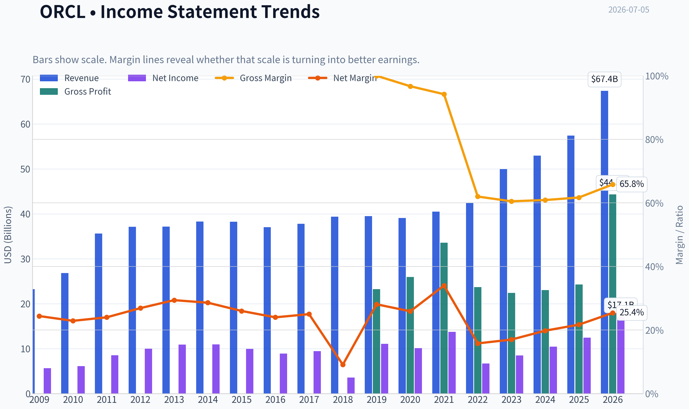

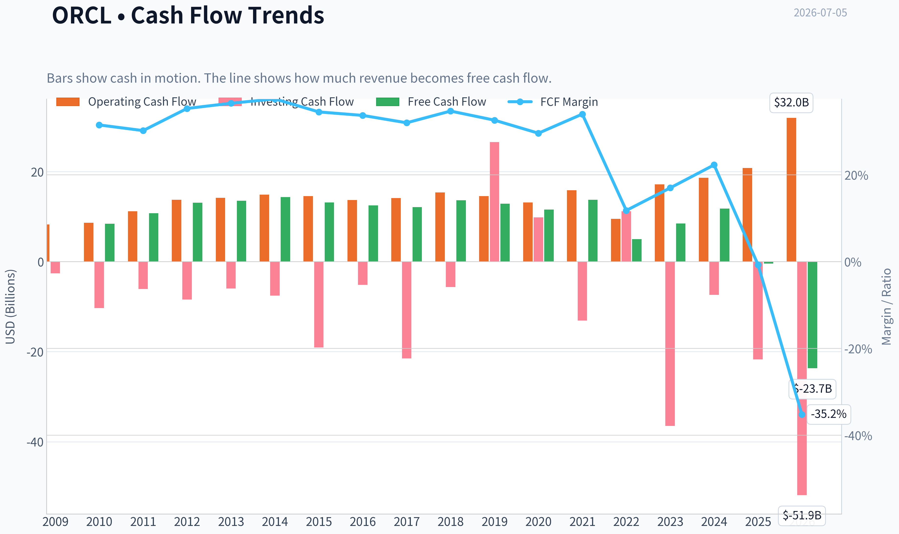

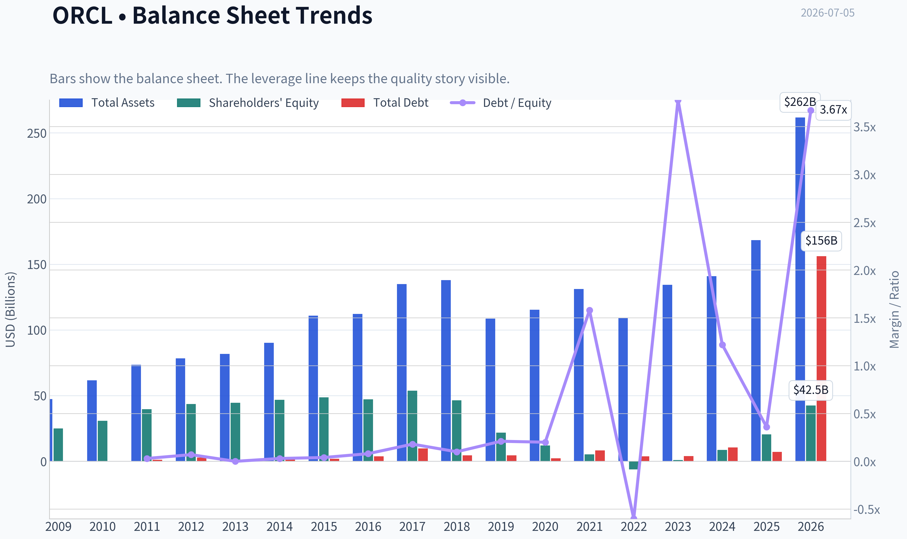

This graph tracks the profitability and return metrics (ROE, ROIC, Margins) of **ORCL** over the past decade, highlighting capital efficiency trends.

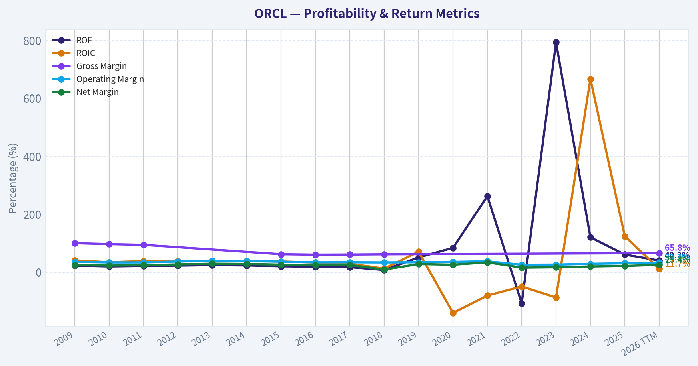

This chart illustrates the financial health of **ORCL** over the last 10 years, mapping cash equivalents and free cash flow against total obligations (Debt).

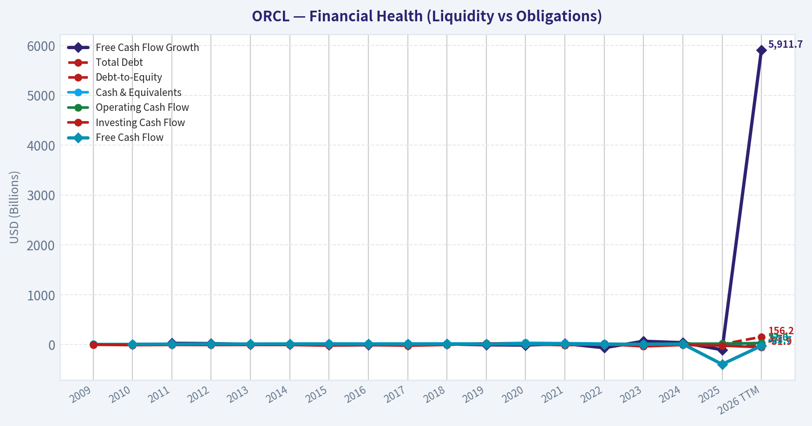

This comparison chart from *Profitability Analysis* stacks current figures against historical benchmarks for **ORCL**, making it easy to see where the company trades relative to its own averages.

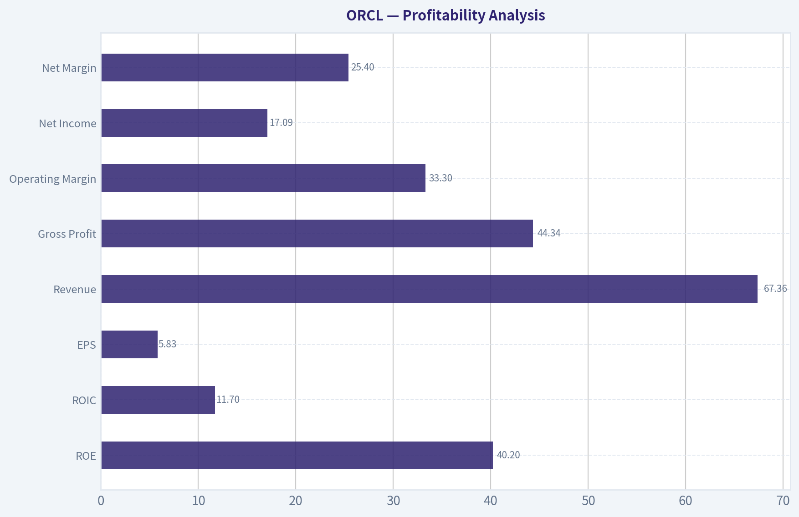

---

### Intrinsic Value Analysis (Buffett)

> *Following Warren Buffett's value investing philosophy: Circle of Competence, Economic Moat, Management Quality, and Margin of Safety.*

#### Intrinsic Value Snapshot

Price is what you pay. Intrinsic value is what the business may be worth based on the cash it can create for owners over time. We show a range, not one magic number.

- Current Price: $140.27
- Value Range (conservative to optimistic across both DCF methods): N/A to N/A

##### Owner Earnings (Buffett Method)
- Net Income: $12,443,000,000.00
- Depreciation & Amortization: $9,294,000,000.00
- Capital Expenditures: $-55,663,000,000.00
- Working Capital Changes: $4,135,000,000.00
- Owner Earnings: $-1,098,000,000.00

##### Intrinsic Value

ANALYST STANCE: **WATCH**

#### Oracle (ORCL) Buffett-Style Investment Review

#### 1. Go/No-Go Gate Assessment

| Gate | Verdict | Evidence |
|---|---|---|
| Circle of Competence & Simplicity | Pass | Oracle sells database software, enterprise applications, cloud infrastructure, and related support. In simple terms: businesses pay Oracle to store critical data, run core operations, and increasingly rent computing power in Oracle's cloud. |
| Long-Term Predictability | Pass | Enterprise databases and mission-critical software are sticky. Ten years from now, Oracle is still likely to be selling databases, ERP systems, and cloud infrastructure to large organizations. |
| Technology Risk | Pass with caution | Oracle benefits from AI/data-center demand and cloud migration, but cloud competition from hyperscalers is intense. This is not a fragile tech fad, but it is more exposed to platform competition than a classic consumer staple. |
| Moat Test | Pass | Switching costs are substantial in database, middleware, and ERP environments. Brand and installed base remain meaningful. |
| Management & Capital Allocation | Pass with caution | Oracle has historically been aggressive but rational in acquisitions and share repurchases. Capital allocation has created scale and relevance, though leverage and deal-making add complexity versus the pure Buffett ideal. |
| Industry Structure | Pass with caution | Enterprise software has attractive economics, but cloud infrastructure is more competitive and capital-intensive than legacy software. |

**Key Takeaways:** Oracle clears all four Buffett gates, but not effortlessly. The legacy software and database franchise is easy to understand and highly durable, while the newer cloud and AI infrastructure push introduces more competition and capital intensity. This is a good business, but not a perfectly simple one.

---

#### 2. Moat Analysis

| Moat Source | Assessment | Evidence |
|---|---|---|
| Intangible Assets | Moderate | Oracle is one of the best-known enterprise software brands globally. Its database reputation, enterprise credibility, and long customer history matter, though the brand is less emotionally powerful than a consumer franchise. |
| Switching Costs | Strong | Customers build workflows, applications, compliance systems, and internal expertise around Oracle databases and enterprise applications. Switching is expensive, risky, and disruptive. |
| Cost Advantage | Moderate | Oracle can spread R&D and support over a massive installed base. In cloud, however, cost advantage is less obvious against larger hyperscalers. |
| Network Effects | Limited | Oracle benefits more from ecosystem scale and developer/customer familiarity than true consumer-style network effects. |
| Financial Evidence | Strong | Shared research pack shows gross margin of 65.8%, supporting the presence of a meaningful moat. ROE of 40.2% is excellent, though likely supported in part by leverage and buybacks. |

**Moat Quality Rating: Wide & Stable**

**Key Takeaways:** Oracle's moat is built primarily on switching costs, not network effects. Customers stay because Oracle is deeply embedded in core systems, and the company's high gross margin supports that conclusion. The moat looks durable, though the cloud segment is less protected than the legacy database franchise.

---

#### 3. Management Quality & Capital Allocation

| Question | Assessment | Commentary |
|---|---|---|
| Do they think like owners? | Mostly yes | Oracle has a long history of focusing on cash generation, margins, and per-share value. The company has been willing to reshape the portfolio through acquisitions and buybacks. |
| Are they honest & candid? | Acceptable | Oracle's communication style has historically been confident and promotional, but results have generally supported the strategic direction. |
| Are they rational capital allocators? | Good, not pristine | Acquisitions, especially in enterprise software and healthcare/data, were used to deepen the moat and expand the platform. Buybacks have supported per-share metrics. The main Buffett concern is debt and the increasing capital requirements of AI/cloud infrastructure. |

**Overall Management Rating: 3.5/5**

**Key Takeaways:** Oracle's management is commercially sharp and has generally allocated capital toward strengthening the franchise. The main concern is not incompetence but aggressiveness: more leverage, more deal-making, and more infrastructure spending than a classic Buffett "fortress simplicity" business.

---

#### 4. Financial Summary

| Metric | Latest Snapshot |
|---|---:|
| Share Price | $140 |
| Market Cap | $404.04B |
| P/E | 24.0x |
| ROE | 40.2% |
| Gross Margin | 65.8% |
| Revenue Growth YoY | 17.3% |
| FCF Yield | -5.9% |
| Current Ratio | 1.12 |

**Key Takeaways:** Oracle's profitability metrics are excellent, especially gross margin and reported ROE. Revenue growth has accelerated with cloud and AI demand, but the negative free-cash-flow yield is a warning sign that current capital spending is heavy and the market is already paying up for future gains.

---

#### 5. Owner Earnings Calculation

Using Buffett's framework and the available evidence:

| Component | Assessment |
|---|---|
| Net Income | Strong and positive |
| + Depreciation & Amortization | Likely substantial due to infrastructure and acquired intangibles |
| - Maintenance CapEx | Rising meaningfully because Oracle is building cloud/AI capacity |
| - Working Capital Increases | Likely manageable relative to scale |
| Owner Earnings Conclusion | Positive, but currently under pressure from elevated infrastructure investment |

Because Oracle is in a major buildout phase, owner earnings are likely below accounting earnings today. That matters: Buffett would treat growth capex carefully and refuse to count every reported earnings dollar as distributable cash.

**Key Takeaways:** Oracle is profitable, but not all of those profits are currently showing up as easy owner cash. The business is spending heavily to support cloud and AI expansion, which makes present-day owner earnings less robust than headline net income suggests.

---

#### 6. Three-Scenario DCF Valuation

I anchor on the market's current earnings multiple and Oracle's business quality rather than treating recent AI enthusiasm as permanently sustainable.

| Scenario | Assumption | Implied View |
|---|---|---|
| A. No Growth | Capitalize normalized owner earnings at 10% | Oracle would look only modestly attractive if cloud growth slows sharply and the business behaves like a mature software utility. |
| B. GDP Growth | 3% terminal growth | Supports fair value in the neighborhood of the current price if Oracle sustains its core franchise and converts cloud growth into cash. |
| C. Historical Growth Discounted | Use moderated growth, not peak AI expectations | Can justify upside if OCI growth remains strong and margins recover after the capex wave. |

**Valuation Conclusion:** At $140, Oracle appears roughly fairly valued to slightly undervalued if cloud execution remains strong. It is not trading at the kind of obvious discount Buffett would demand for a large purchase unless one has high confidence in the AI/cloud ramp.

**Key Takeaways:** Oracle's valuation is reasonable, not screamingly cheap. The stock can work from here if cloud growth and future cash conversion are real, but the margin of safety is not wide enough to call this a clear bargain.

---

#### 7. Margin of Safety Analysis

| Item | Assessment |
|---|---|
| Business Quality | High |
| Predictability | Moderately high |
| Balance Sheet Comfort | Adequate, not fortress-like |
| Required Margin of Safety | At least 25% |
| Current Margin of Safety | Limited |

Oracle is good enough to merit attention, but the stock price already reflects much of the cloud/AI optimism. Without a wider discount, the setup is more "good business, fair price" than "wonderful business, compelling price."

**Key Takeaways:** The central issue is not business quality; it is price versus certainty. Oracle may continue to perform well, but the current quotation does not offer the fat margin of safety that value investors prefer.

---

#### 8. Final Buffett Scorecard

| Criterion | Score (1-5) | Weight | Weighted Score |
|---|---:|---:|---:|
| Business Understanding | 4.5 | 20% | 0.90 |
| Moat Width & Durability | 4.0 | 25% | 1.00 |
| Management Quality | 3.5 | 15% | 0.53 |
| Return on Equity | 4.5 | 15% | 0.68 |
| Reinvestment Runway | 3.5 | 10% | 0.35 |
| Balance Sheet Strength | 3.0 | 5% | 0.15 |
| Industry Structure | 3.0 | 5% | 0.15 |
| Valuation/Margin of Safety | 2.5 | 5% | 0.13 |

| Total Score | 3.89 / 5 |
|---|---:|

**Key Takeaways:** Oracle scores well because it is a durable, cash-generative enterprise franchise with real switching costs. The score stops short of a full-throated buy because valuation is only fair and the cloud infrastructure push adds competitive and capital intensity risks.

---

#### 9. Investment Stance

**Stance: WATCH**
**Conviction: Moderate**

Oracle is a strong business with a durable installed base, high gross margins, and meaningful switching costs. The legacy franchise looks Buffett-friendly, and the cloud/AI expansion may create another leg of growth. But at around 24x earnings and with free cash flow currently pressured by infrastructure investment, the stock does not offer a clear margin of safety.

A Buffett-style investor should admire the business, monitor cloud cash conversion closely, and become more aggressive only on either:
1. a materially lower price, or
2. stronger evidence that today's AI-driven capex will convert into sustainably higher owner earnings.

**Bottom line:** Oracle is a quality compounder candidate, but today it looks more like a stock to watch than one to load up on.
#### Valuation Bridge

This bridge places the current market price beside each intrinsic value lens so readers can see whether upside depends on one method or shows up across several methods.

| Scenario | Intrinsic Value / Share |
| --- | ---: |
| Damodaran Method | $105.32 |
| Current Price | $140.27 |

#### Key Takeaways

If one method is far above the others, the upside case depends on a specific modelling assumption. When several methods cluster together, the valuation story is more robust.

#### Valuation Visuals

This comparison chart from *Latest Earnings Snapshot* stacks current figures against historical benchmarks for **ORCL**, making it easy to see where the company trades relative to its own averages.

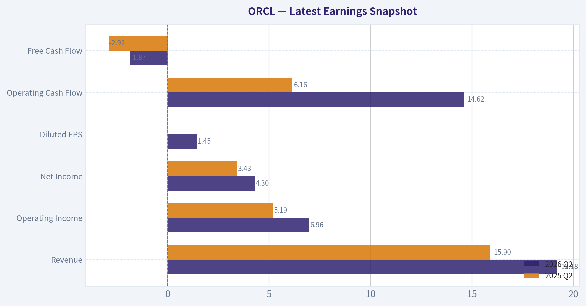

This comparison chart from *Current vs Historical Average Comparison* stacks current figures against historical benchmarks for **ORCL**, making it easy to see where the company trades relative to its own averages.

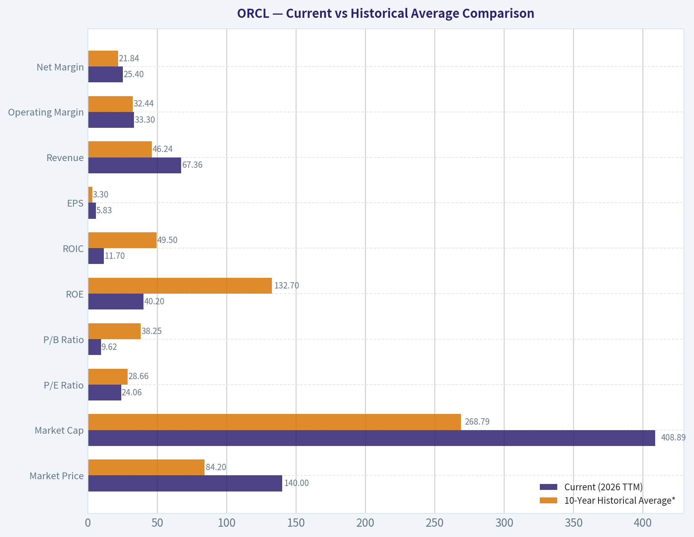

This comparison chart from *Balance Sheet Analysis* stacks current figures against historical benchmarks for **ORCL**, making it easy to see where the company trades relative to its own averages.

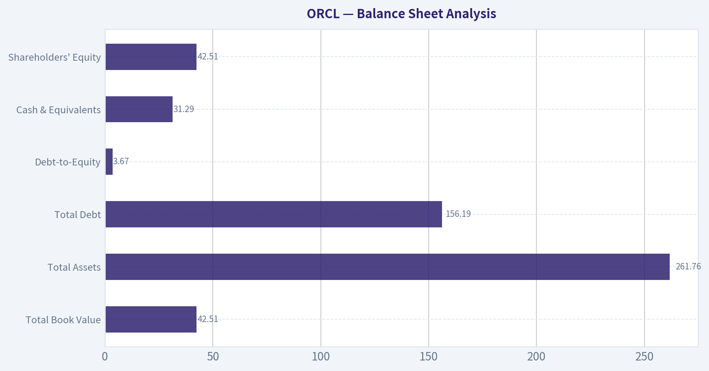

This comparison chart from *Cash Flow Analysis* stacks current figures against historical benchmarks for **ORCL**, making it easy to see where the company trades relative to its own averages.

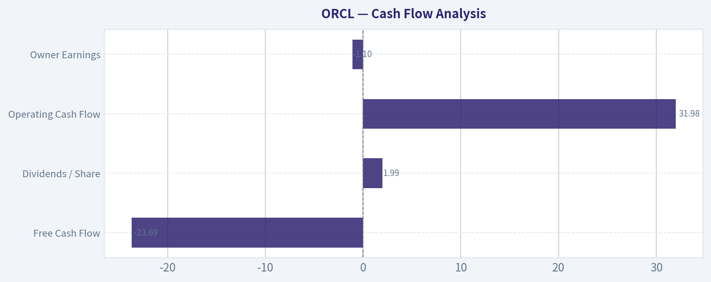

---

### Trend & Growth Analysis (Lynch/Druckenmiller/Fisher)

> *Following Peter Lynch's GARP, Stanley Druckenmiller's macro-aware approach, and Philip Fisher's scuttlebutt methodology.*

ANALYST STANCE: **WATCH**

#### ORCL Growth Analysis

| Metric | Value |
|---|---:|
| Price | $140 |
| Market Cap | $404.0B |
| P/E | 24.0x |
| Revenue Growth YoY | 17.3% |
| ROE | 40.2% |
| Gross Margin | 65.8% |
| FCF Yield | -5.9% |
| Current Ratio | 1.12x |

Key Takeaways: Oracle is no longer acting like a sleepy legacy software company. Revenue growth at 17.3% puts it in the fast grower bucket by Lynch standards, but the negative free cash flow yield shows the AI and cloud buildout is consuming capital heavily. This is now a transition story: stronger growth, but lower near-term cash efficiency.

---

#### 1. Lynch Classification

| Framework Item | Assessment |
|---|---|
| Lynch Category | Fast Grower |
| Why | Revenue growth above 15%, driven by OCI and AI infrastructure demand |
| Caveat | Very large market cap means ten-bagger math is hard from current scale |

Key Takeaways: Oracle qualifies as a fast grower on current revenue growth, which is notable given its size. But unlike classic small-cap Lynch fast growers, Oracle is already a $400B company, so upside likely depends on multiple years of cloud re-rating and earnings expansion rather than simple size-based compounding.

#### 2. The Story in 3 Bullets

| Simple Story | Explanation |
|---|---|
| Oracle sells mission-critical software and cloud infrastructure | Enterprises run databases, ERP, and core systems on Oracle and rarely rip them out |
| AI demand is accelerating Oracle Cloud Infrastructure | OCI is benefiting from the AI compute wave and large enterprise workloads |
| Installed base gives Oracle a second growth leg | Oracle can cross-sell cloud infrastructure and apps into existing customers |

Key Takeaways: The Oracle bull case is easy to explain. A deeply entrenched enterprise software vendor is using the AI infrastructure boom to re-accelerate growth through OCI, while its existing customer base lowers customer acquisition friction.

#### 3. TAM Analysis and 10x Test

| Item | Estimate / View |
|---|---|
| Current Revenue Base | Large-cap software/infrastructure scale, roughly tens of billions annually |
| 10x Revenue Test | Fails practical test from current size |
| Cloud Infrastructure TAM | Massive and still expanding |
| Enterprise Apps / Database TAM | Also very large, but more mature |
| Can ORCL 10x and stay <20% of TAM? | No, not realistically from current base |
| Runway Conclusion | Good runway for continued growth, but not classic 10-bagger runway |

Key Takeaways: Oracle has a large runway in AI infrastructure, databases, and enterprise applications, but the company is already too large for a clean 10x-from-here TAM case. This is more of a durable compounder or re-rating story than a pure moonshot growth setup.

#### 4. Revenue Growth Trend

| Signal | Assessment |
|---|---|
| Current YoY Revenue Growth | 17.3% |
| Pattern | Re-acceleration vs legacy Oracle profile |
| Main Driver | OCI / AI infrastructure |
| Quality of Growth | Appears strategically driven, not purely financial engineering |
| Risk | Need proof growth is sustainable beyond AI capex cycle |

Key Takeaways: The key fact is that Oracle's growth has inflected upward from its old mature-software baseline. That is the most important bullish data point, but investors still need to confirm whether this is a multi-year acceleration or just a temporary AI capacity surge.

#### 5. Unit Economics

| Metric | Status |
|---|---|
| LTV/CAC | Not disclosed clearly |
| Net Revenue Retention | Not disclosed clearly |
| Rule of 40 | Cannot be calculated precisely from provided data |
| Gross Margin | 65.8% |
| FCF Efficiency | Currently weak due to capex intensity |
| Revenue Model | Strong recurring base from support, database, and applications |

Key Takeaways: Oracle has good underlying software economics, but the usual SaaS KPIs like NRR and LTV/CAC are not transparently available here. The biggest issue is that free cash flow is under pressure, which matters because the market is rewarding Oracle as an AI infrastructure beneficiary.

#### 6. Inflection Point Assessment

| Inflection Type | Assessment |
|---|---|
| Product Cycle Inflection | Yes - OCI gaining relevance in AI workloads |
| TAM Inflection | Yes - AI infrastructure expands Oracle's opportunity |
| Market Share Inflection | Possible, especially in enterprise AI compute niches |
| Margin Inflection | Not yet clear; capex may delay benefit |
| Competitive Inflection | Partially - Oracle benefits where enterprises want alternatives to hyperscalers |

Key Takeaways: Oracle does appear to be at a genuine strategic inflection point. The question is not whether something changed, but whether that change becomes durable enough to support higher earnings power in two to three years.

#### 7. Macro Setup Evaluation

| Macro Factor | View |
|---|---|
| Secular Theme | AI / Cloud / Enterprise digitization |
| Tailwind Strength | Strong |
| Interest Rate Sensitivity | Moderate; growth valuation still benefits from stable/falling rates |
| Enterprise IT Spending | Supportive if AI budgets remain robust |
| Macro Verdict | Wind at Oracle's back |

Key Takeaways: Oracle is aligned with one of the strongest secular themes in the market: AI infrastructure. As long as enterprise and hyperscale AI spending remains elevated, Oracle has favorable macro support.

#### 8. Fisher 15 Points Score

| Fisher Area | Score (1-5) |
|---|---:|
| Market potential | 4 |
| New product development | 4 |
| R&D effectiveness | 4 |
| Sales organization | 4 |
| Profit margin | 4 |
| Improving margins | 3 |
| Labor relations | 3 |
| Executive relations | 4 |
| Management depth | 4 |
| Cost/accounting controls | 4 |
| Special advantages / moat | 4 |
| Long-range outlook | 4 |
| Dilution risk | 4 |
| Candor | 3 |
| Integrity | 4 |
| **Total** | **57 / 75** |

Key Takeaways: Oracle scores as good, not elite, on Fisher's framework. The strengths are product depth, installed-base moat, and long-term market opportunity, while the weaker areas are transparency and uncertainty around margin progression during the heavy investment cycle.

#### 9. Valuation Analysis

| Valuation Lens | Assessment |
|---|---|
| P/E | 24.0x |
| Implied PEG using 17.3% growth | ~1.39x |
| Lynch PEG Verdict | Fair value |
| P/S | Not provided directly, but likely elevated vs old Oracle norms |
| Market Implied View | Pricing in sustained cloud and AI relevance |
| Valuation Verdict | Not cheap, not extreme |

Key Takeaways: On a Lynch basis, Oracle is not a bargain. A PEG around 1.4 suggests the stock is reasonably valued if growth holds, but not obviously mispriced enough to justify a high-conviction advocate stance without more evidence of sustained acceleration.

#### 10. Scenario Analysis

| Scenario | Narrative | Valuation / Outcome View |
|---|---|---|
| Bear | AI demand normalizes, OCI growth slows, capex stays high | Multiple compresses; stock underperforms |
| Base | OCI remains strong, core business stable, earnings rise gradually | Mid-teens annualized potential at best |
| Bull | Oracle becomes credible AI infrastructure winner with operating leverage | Re-rating plus EPS growth could drive strong upside |

Key Takeaways: The upside case depends on Oracle proving it deserves to be treated as a cloud and AI winner, not merely a legacy software company catching a temporary wave. If it does, returns can still be attractive, but the range of outcomes is wide because capital intensity has gone up.

#### 11. Growth Investor Scorecard

| Criterion | Weight | Score | Weighted Score |
|---|---:|---:|---:|
| The Story | 10% | 4.0 | 0.40 |
| TAM & Runway | 20% | 3.0 | 0.60 |
| Revenue Growth | 20% | 4.0 | 0.80 |
| Unit Economics | 15% | 3.0 | 0.45 |
| Competitive Position | 10% | 3.5 | 0.35 |
| Management Quality | 10% | 3.5 | 0.35 |
| Macro Setup | 5% | 4.5 | 0.23 |
| Profitability Path | 5% | 3.0 | 0.15 |
| Valuation | 5% | 3.0 | 0.15 |
| **Total** |  |  | **3.48 / 5.0** |

Key Takeaways: Oracle lands right on the border between Watch and Advocate, but just below the threshold. The main reason is that the growth setup is real, yet valuation and cash flow quality do not leave enough margin of safety for a higher-conviction call.

#### 12. Position Size Stance

| Stance | Sizing View |
|---|---|
| Current Rating | WATCH |
| If already owned | Hold and monitor execution closely |
| If not owned | Wait for either better price or stronger proof of OCI-driven earnings leverage |
| Speculative Position | Small starter only for investors with high confidence in AI infrastructure thesis |

Key Takeaways: Oracle is not an avoid. It is a credible watch-list compounder with an active growth inflection, but the setup is not clean enough yet for a full-sized growth position.

#### 13. Key Risks and Catalysts

| Risks | Catalysts |
|---|---|
| AI enthusiasm outruns actual monetization | OCI growth stays very strong |
| Capex remains elevated, hurting FCF | Large AI infrastructure contract wins |
| OCI remains subscale vs hyperscalers | Backlog / RPO expansion |
| Legacy business slows while cloud mix rises | Margin leverage after investment phase |
| Valuation already discounts much of the good news | Continued Street estimate revisions upward |

Key Takeaways: The biggest risk is simple: Oracle may be spending like a growth infrastructure company before proving it can earn like one. The biggest catalyst is also simple: if OCI growth keeps compounding and margins eventually catch up, the market may sustain a higher valuation regime.

#### Bottom Line

Oracle is a real growth re-acceleration story, not a fake one. It has a credible AI and cloud inflection, strong enterprise moats, and enough growth to qualify as a Lynch fast grower today.

But from a Druckenmiller-Fisher lens, the stock needs one more piece of evidence: proof that elevated AI capex converts into durable earnings and cash flow power. At 24x earnings and roughly 1.4x PEG, ORCL looks reasonable, not screamingly cheap.

**Final view: WATCH.**
Upgrade to **ADVOCATE** if OCI-driven growth remains above the mid-teens while free cash flow and margins begin to inflect positively over the next 2-3 quarters.

---

### Market Technical Analysis

#### ORCL Technical Indicator Selection and Trend Report

For ORCL's current market condition, the **most relevant 8 indicators** are:

| Indicator | Why it is relevant now |
|---|---|
| close_10_ema | Best for tracking the current sharp short-term downside acceleration. |
| close_50_sma | Defines the medium-term trend and shows whether rebounds are just countertrend moves. |
| close_200_sma | Confirms the broader structural trend, which is now clearly weaker than earlier in the year. |
| macd | Measures trend momentum and confirms that bearish momentum has re-accelerated. |
| macdh | Useful as an early read on whether downside momentum is still expanding or beginning to stabilize. |
| rsi | Helps judge whether ORCL is merely weak or becoming stretched enough for a reflex bounce. |
| atr | Critical now because volatility is elevated, so risk sizing and stop placement matter more than usual. |
| vwma | Adds a volume-confirmation layer, especially important after the high-volume breakdown in June and early July. |

**Why these 8 work well together:**
They cover **trend across three horizons** (10 EMA, 50 SMA, 200 SMA), **momentum** (MACD, MACD histogram, RSI), **risk/volatility** (ATR), and **price-volume confirmation** (VWMA). This avoids unnecessary overlap while giving traders a balanced read on direction, exhaustion, and trade management.

---

#### Price Structure and Trend Regime

ORCL has undergone a **major regime transition** over the last year. The stock moved from a powerful upside expansion in mid-to-late 2025, including a dramatic September breakout, into a prolonged corrective phase that deepened into early 2026. A sharp rebound developed from April into early June 2026, but that rebound has now **failed**, and the stock has rolled back into a renewed downtrend.

The most important current takeaway is that **price has fallen materially below all key trend references**:

- Latest close visible in the data: **140.27** on 2026-07-02
- 10 EMA: **155.77**
- 50 SMA: **186.37**
- 200 SMA: **199.07**
- VWMA: **161.55**

This alignment is not just bearish; it is **layered bearishness across timeframes**. The short-term average is far below the medium-term average, and the medium-term average is far below the long-term average. That suggests the recent weakness is not just a pullback within an uptrend, but part of a **broader trend deterioration**.

| Metric | Latest reading | Interpretation |
|---|---:|---|
| Close | 140.27 | Price is under heavy pressure near recent lows |
| close_10_ema | 155.77 | Short-term trend sharply down |
| close_50_sma | 186.37 | Medium-term trend remains decisively bearish |
| close_200_sma | 199.07 | Long-term structure still weak |
| vwma | 161.55 | Volume-weighted trend also above price, confirming weak demand |

**Key Takeaways:** ORCL is trading far below its short-, medium-, and long-term averages, which signals a strong bearish trend rather than a routine dip. The fact that price also sits below the volume-weighted average suggests sellers have had control even when volume is considered, reinforcing the breakdown.

---

#### Short-Term Trend: 10 EMA Signals Persistent Selling Pressure

The **10 EMA** has fallen rapidly from **220.59 on 2026-06-04** to **155.77 on 2026-07-02**. That is an exceptionally steep deterioration in a short period. It tells us that the June breakdown was not a one-off shock; it evolved into a sustained sequence of lower closes.

A useful nuance here: when price becomes **this far below** the 10 EMA, two things can be true at once:

1. The trend is clearly bearish.
2. The stock may also be vulnerable to short-covering or oversold rebounds.

So the 10 EMA is currently less useful as a support level and more useful as a **recovery hurdle**. For bulls to regain tactical control, price would need to at least start closing back toward that area. Until then, rallies are likely to be treated as suspect.

---

#### Medium-Term Trend: 50 SMA Has Rolled Over After a Failed Recovery

The **50 SMA** climbed steadily from about **150 in early April** to nearly **189 by late June**, reflecting the strength of the April-to-early-June rebound. However, the key detail is that **price failed to hold above that improving average**, and the average itself is now flattening-to-turning lower at the margin.

That matters because failed recoveries often produce **second-leg declines**. ORCL's rebound was strong enough to lift the 50 SMA, but not strong enough to repair the larger damage done during the prior downtrend. Once the June surge faded, the stock lost the moving average stack again.

A trader's interpretation:
- **Below the 50 SMA**: rallies are countertrend unless proven otherwise.
- The gap between price (**140.27**) and the 50 SMA (**186.37**) is very large, implying the stock would need an unusually strong advance just to repair medium-term damage.

---

#### Long-Term Trend: 200 SMA Confirms Structural Weakness

The **200 SMA** has been sliding from **216.49 in early April** to **199.07 by July 2**. That decline in the long-term moving average is especially important because the 200-day line moves slowly; if it is falling, the weakness is not recent noise but embedded in the broader trend.

This tells us the stock is no longer in a healthy long-term uptrend. Even the strong spring rebound did not meaningfully reverse the long-term average. Instead, ORCL remained below a declining 200 SMA and then broke down again. That is usually characteristic of a stock in a **distribution or post-peak correction phase**, not a stable accumulation phase.

| Trend Horizon | Indicator | Direction | What it implies |
|---|---|---|---|
| Short term | close_10_ema | Falling fast | Immediate trend is strongly bearish |
| Medium term | close_50_sma | Elevated but losing support relevance | Recent rebound failed |
| Long term | close_200_sma | Falling | Structural trend remains weak |

**Key Takeaways:** Every major trend timeframe is pointing lower, but the most important warning is the falling 200-day average. That long-term decline means ORCL's weakness is not just a short-term trading event; it reflects a broader deterioration in the stock's underlying trend structure.

---

#### Momentum: MACD Shows a Fresh Bearish Expansion

The **MACD** peaked in early June around **15.87** and has since collapsed to **-14.56** by 2026-07-02. That is an enormous swing in momentum. It indicates not only that upside momentum has fully vanished, but also that downside momentum is now stronger than a normal retracement would imply.

The **MACD histogram** adds nuance. It is currently **-5.06**, and while still deeply negative, it is **less negative than the late-June trough near -6.77**. This suggests bearish momentum remains dominant, but the speed of deterioration may be easing slightly. That is not the same as a bullish reversal; it simply means the decline may be transitioning from panic-like acceleration to a more mature bearish trend.

This is important for traders:
- **MACD deeply negative** = trend remains bearish.
- **Histogram still negative but improving slightly** = downside momentum may be decelerating, raising the odds of a bounce attempt.
- However, until MACD itself starts turning up meaningfully and price reclaims key averages, that bounce would still be **countertrend**.

| Momentum Indicator | Latest reading | Signal |
|---|---:|---|
| macd | -14.56 | Strong bearish momentum |
| macdh | -5.06 | Bearish momentum still dominant, but acceleration may be easing |

**Key Takeaways:** ORCL's momentum has swung decisively bearish, confirming that the recent selloff is more than a temporary dip. The histogram is slightly less negative than its worst reading, which hints that the pace of the decline may be slowing, but not that the trend has turned positive.

---

#### RSI: Oversold Conditions Are Emerging, But Trend Risk Still Dominates

The **RSI is 26.72**, below the conventional **30 oversold threshold**. That makes ORCL statistically stretched on a short-term basis. In isolation, that can attract traders looking for a relief rally.

But the context matters. In a strong downtrend, RSI can remain oversold or repeatedly re-enter oversold territory. So the current RSI reading should be interpreted as:

- **Evidence of selling exhaustion risk**
- **Not yet evidence of trend repair**

A high-quality reversal setup would usually require some combination of:
- RSI moving back above 30 and holding
- MACD histogram continuing to improve
- Price reclaiming at least the 10 EMA
- Ideally, a higher low on price

Without those, oversold can simply mean "weak and still falling."

---

#### Volatility and Risk: ATR Remains Elevated

The **ATR is 10.14**, down from a mid-June high near **14.07**, but still elevated relative to calmer periods in May when ATR was mostly around **8.2 to 9.0**. This shows ORCL remains in a **high-volatility environment**, even if the most disorderly phase of the selloff may have passed.

For traders, that has practical implications:
- Stops that are too tight are more likely to get hit by noise.
- Position sizes may need to be smaller than usual.
- Breakout and reversal trades both need confirmation because intraday swings can be substantial.

ATR is especially relevant now because ORCL is near depressed levels; emotional trades tend to rise when volatility is high and price is oversold. ATR argues for **discipline over aggression**.

---

#### Volume-Weighted View: VWMA Confirms Distribution Rather Than Healthy Support

The **VWMA at 161.55** is well above the current price. That means volume-weighted trading over the recent lookback has occurred at much higher prices than where the stock now sits. In practical terms, many recent participants are likely underwater, which can create **overhead supply** on rebounds.

This is one of the more useful contextual clues:
- If price rallies toward the VWMA and stalls, that would suggest trapped holders are selling into strength.
- A decisive recovery above VWMA would be more constructive because it would imply demand is strong enough to overcome that supply.

For now, VWMA strengthens the bearish case because it says weakness is not happening on light, irrelevant trading; it is happening despite meaningful recent volume participation.

---

#### Fine-Grained Market Interpretation

The current setup looks like a stock that had a **powerful recovery rally from April through early June**, then suffered a **failed breakout sequence**, followed by a **high-velocity unwinding**. That often creates a two-stage trading environment:

1. **Initial breakdown phase**
   Fast losses, expanding volatility, negative momentum shock.
2. **Secondary phase**
   Momentum remains bearish, but the decline becomes more selective and punctuated by short-lived rebounds.

ORCL appears to be moving into that second phase. The indicators do **not** yet support a bullish trend call, but they do suggest traders should be alert for **oversold reflex rallies** that can be sharp, even within a larger downtrend.

That distinction is crucial:
- **Swing bears** still have the trend advantage.
- **Countertrend bulls** may get tradable rebounds, but not yet strong evidence of durable base formation.

---

#### Tactical Decision Framework

| Scenario | What traders may watch | Indicator confirmation needed |
|---|---|---|
| Bearish continuation | Breakdown below recent lows and failed rebound attempts | MACD stays deeply negative, RSI remains under 30-35, price stays below 10 EMA |
| Oversold bounce | Sharp rebound from stretched conditions | RSI recovers from oversold, macdh becomes less negative, price starts approaching 10 EMA |
| Early base formation | Selling pressure begins to stabilize | Higher low in price, MACD improvement, ATR contracts further, price reclaims VWMA |
| Trend repair | Larger reversal becomes credible | Price recaptures 10 EMA, then 50 SMA; momentum turns positive; VWMA reclaimed |

**Key Takeaways:** The most likely near-term paths are either continued bearish follow-through or a short-lived oversold rebound. A true bullish repair would require several layers of confirmation, especially reclaiming the 10 EMA and then proving strength against higher resistance levels like the VWMA and 50 SMA.

---

#### Bottom Line

ORCL is currently in a **decisively bearish trend across short-, medium-, and long-term timeframes**. Momentum indicators confirm that sellers remain in control, while RSI shows the stock is becoming stretched enough to support a reflex bounce. The main nuance is that **oversold does not equal bullish**; it only means downside may be temporarily overextended.

The stock is most vulnerable to:
- Continued downside if recent lows fail again
- Short, sharp rebounds that do not change the bigger bearish picture

Until price starts reclaiming the **10 EMA**, then the **VWMA**, and eventually the **50 SMA**, the evidence favors treating strength as **rebound activity within a damaged trend**, not a confirmed recovery.

---

#### Summary Table

| Area | Current Read | Trading Implication |
|---|---|---|
| Short-term trend | Price far below close_10_ema | Immediate trend is strongly bearish |
| Medium-term trend | Price well below close_50_sma | Recovery attempt has failed |
| Long-term trend | close_200_sma is falling and above price | Structural weakness remains intact |
| Momentum | MACD deeply negative | Sellers still control direction |
| Momentum acceleration | MACD histogram negative but slightly less weak than late June | Downside pace may be easing, but trend still bearish |
| Stretch/exhaustion | RSI at 26.72 | Oversold bounce possible |
| Volatility | ATR elevated near 10.14 | Use wider stops and smaller size |
| Volume confirmation | Price below VWMA | Rebounds may face overhead supply |

**Key Takeaways:** ORCL's overall technical picture remains bearish, with price below every major trend and confirmation indicator. The only constructive near-term feature is that the stock is oversold enough for a bounce, but traders should treat any rebound cautiously until price and momentum begin reclaiming key levels.

#### Market Visuals

This comparison chart from *Market Metrics* stacks current figures against historical benchmarks for **ORCL**, making it easy to see where the company trades relative to its own averages.

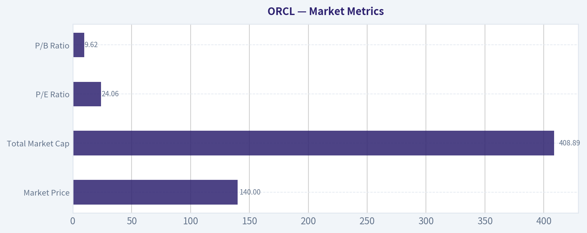

---

### Options Market Analysis

> *Reading options flow - put/call ratios, IV skew, and unusual activity - to gauge institutional positioning and event-driven risk.*

#### ORCL Options Positioning Report
*Data as of 2026-07-05*

#### 1. Put/Call Ratio Analysis

| Expiry | Call OI | Put OI | Put/Call OI Ratio | Call Vol | Put Vol | Put/Call Volume Ratio |
|---|---:|---:|---:|---:|---:|---:|
| 2026-07-10 | 53,970 | 33,963 | 0.63 | 55,398 | 23,128 | 0.42 |
| 2026-07-17 | 198,691 | 127,072 | 0.64 | 42,902 | 12,976 | 0.30 |
| 2026-07-24 | 23,612 | 12,580 | 0.53 | 6,883 | 4,861 | 0.71 |
| **Near-term total** | **276,273** | **173,615** | **0.63** | **105,183** | **40,965** | **0.39** |

**Key Takeaways:** ORCL's near-term options positioning leans clearly call-heavy. The aggregate put/call OI ratio of 0.63 sits below the historical neutral area around 0.7, while the volume ratio of 0.39 shows fresh trading activity is even more skewed toward calls than existing positioning. That usually points to bullish speculation or upside participation, though some portion may also reflect covered-call activity.

Interpretation:
- **OI ratio 0.63**: modestly more bullish than neutral, not extreme.
- **Volume ratio 0.39**: stronger short-term call demand than the OI picture suggests, indicating a recent shift toward upside exposure.
- The **2026-07-17 chain** appears especially notable because it holds the largest OI base and still shows a very low put/call volume ratio.

#### 2. Implied Volatility Assessment

| Expiry | ATM Call IV | ATM Put IV | Put vs Call ATM IV | IV Read |
|---|---:|---:|---:|---|
| 2026-07-10 | 63.4% | 64.7% | Put premium +1.3 pts | Elevated |
| 2026-07-17 | 60.6% | 61.5% | Put premium +0.9 pts | Elevated |
| 2026-07-24 | 60.9% | 60.7% | Near flat | Elevated/moderate |

**Key Takeaways:** Near-term IV is high, with ORCL carrying roughly 61%-65% ATM implied volatility across the front expiries. Puts are priced slightly richer than calls in the first two expirations, which signals some downside hedge demand, but the skew is not severe enough to indicate panic. Overall, this looks like an elevated-volatility bullish tape rather than a fear-driven one.

IV skew read:
- **Mild put skew** in 7/10 and 7/17: downside protection is being bid, but not aggressively.
- **Near-flat skew** by 7/24: less urgency for tail-risk hedging further out.
- Since IV is elevated, there may be **event premium** or residual post-event uncertainty embedded in the front of the curve. Without a confirmed catalyst from this dataset alone, the safer framing is that ORCL options are pricing **meaningful near-term movement**, but not an outright crash scenario.

#### 3. Unusual Options Activity

Using the visible unusual trades, ORCL spot appears to be roughly in the **low-to-mid 140s**, based on the strikes attracting flow.

| Expiry | Type | Strike | Volume | OI | Vol/OI | IV | Moneyness vs Spot | DTE | Read |
|---|---|---:|---:|---:|---:|---:|---|---:|---|
| 2026-07-10 | PUT | 100 | 2,022 | 22 | 91.9x | 102.3% | Deep OTM | 5 | Crash hedge / tail-risk protection |
| 2026-07-10 | CALL | 146 | 1,845 | 356 | 5.2x | 63.8% | Slightly OTM / near ATM | 5 | Fresh upside bet |
| 2026-07-10 | CALL | 143 | 1,767 | 137 | 12.9x | 63.3% | Near ATM | 5 | High-conviction short-dated bullish positioning |
| 2026-07-10 | CALL | 149 | 1,527 | 277 | 5.5x | 64.5% | OTM | 5 | Momentum/chase upside |
| 2026-07-10 | PUT | 105 | 1,206 | 168 | 7.2x | 94.1% | Deep OTM | 5 | Hedge, likely disaster insurance |
| 2026-07-10 | CALL | 142 | 744 | 87 | 8.6x | 63.2% | ATM / slightly ITM | 5 | Tactical bullish flow |
| 2026-07-10 | PUT | 126 | 578 | 109 | 5.3x | 67.8% | OTM | 5 | More realistic hedge / downside protection |

**Key Takeaways:** The most actionable unusual flow is concentrated in very short-dated calls around 142-149, which looks like fresh upside positioning. The deep OTM puts at 100 and 105 have eye-popping volume-to-OI ratios, but their strikes and inflated IV suggest low-delta tail hedges rather than outright high-conviction bearish bets. Net-net, the unusual activity still tilts bullish, with hedging layered underneath.

How to read this flow:
- **Calls at 142/143/146/149**: these are the strongest signal. Near-ATM and slightly OTM call flow in the front week often reflects traders positioning for a near-term upside move.
- **Puts at 100/105**: likely **cheap convexity hedges** or lottery-style downside protection. Because they are so far below spot and carry huge IV, they are less likely to represent a primary directional thesis.
- **Put 126**: more meaningful than the 100/105 strikes because it is closer to tradable downside; this suggests some participants still want protection against a sharper pullback.

Smart-money vs retail distinction:
- **Near-ATM short-dated calls** with large volume/OI are more consistent with tactical institutional positioning than random retail far-OTM chasing.
- **Deep OTM puts** can be used by institutions as portfolio insurance, but they can also attract speculative buyers. Given the strike distance, I would classify them primarily as **hedge flow**, not a clean bearish signal.

#### 4. Open Interest Concentration

| Expiry | Total Call OI | Total Put OI | OI Character |
|---|---:|---:|---|
| 2026-07-10 | 53,970 | 33,963 | Call-dominant |
| 2026-07-17 | 198,691 | 127,072 | Strongest OI concentration; likely key pinning window |
| 2026-07-24 | 23,612 | 12,580 | Lighter positioning |

**Key Takeaways:** The 2026-07-17 expiration is the major open-interest hub and likely the most important near-term gamma influence on ORCL's stock behavior. Because call OI dominates across all three expirations, upside strikes may act as magnet levels if the stock rises, while downside may be partially cushioned unless spot breaks decisively lower. Exact gamma-wall strikes are not fully available from the dataset, so confidence is moderate rather than high.

What this implies:
- **7/17 is the key expiration** for potential pinning and dealer hedging effects.
- Broadly **call-heavy OI** can create an environment where upside moves get reinforced if dealers need to hedge short calls, especially if spot pushes through heavily traded near-ATM strikes.
- Since strike-by-strike OI concentrations were not fully provided, we cannot identify a precise **max pain** level or exact **gamma walls**, but the unusual call activity clustered around **142-149** suggests that zone matters tactically.

#### 5. Overall Options Sentiment Signal

**Signal: BULLISH**

Primary driver:
- The strongest evidence is the combination of **below-neutral put/call OI (0.63)**, **very call-heavy volume (0.39 put/call volume ratio)**, and **fresh unusual call buying concentrated near spot** in the front-week expiration.

Why not neutral or bearish:
- There is definitely **hedging demand**, shown by the richer put IV and unusual put activity.
- However, the put flow is mostly **deep OTM insurance**, while the call flow is **closer to spot and more directionally relevant**.
- That makes the tape look like **bullish positioning with prudent downside protection**, rather than a market bracing for an outright negative event.

Confidence level:
- **Moderate**
- Reason: the near-term dataset is strong enough to infer directional bias, but the absence of full strike-by-strike OI and full skew surface limits precision on exact gamma levels and max-pain estimates.

#### Bottom Line
ORCL's options market is showing a **bullish near-term bias**. Traders are actively buying calls near the current stock price, while puts are being used more as hedges than as the dominant expression of conviction. Elevated IV says the market still expects movement, but the skew is only mildly defensive, which keeps the overall read tilted to the upside.

| Metric | Observation | Interpretation |
|---|---|---|
| Put/Call Ratio | OI: 0.63, Volume: 0.39 | Bullish tilt; fresh flow strongly favors calls |
| IV Level | ATM IV ~61%-65% | Elevated near-term movement expected |
| Skew Direction | Mild put skew front expiries | Some hedging demand, but not panic |
| Unusual Activity | Heavy near-ATM/OTM calls; deep OTM puts | Bullish speculation with protective hedges underneath |
| Overall Signal | **BULLISH** | Call-heavy flow is the main driver |

**Key Takeaways:** ORCL's options tape is not complacent, but it is still net bullish. The market is paying up for volatility and some downside insurance, yet the dominant actionable flow remains concentrated in short-dated calls near the current stock price.

---

## Research Team Commentary

> *The Research Manager synthesizes the Bull vs Bear debate into action-free commentary. This is a pre-risk view, not the final stance.*

The strongest bull argument is that Oracle is still a real franchise, not a story stock. The database business remains deeply embedded in mission-critical enterprise workflows, switching costs are high, and that installed base gives Oracle a credible path to monetize cloud and AI demand. The combination of 17.3% revenue growth, 65.8% gross margin, and still-solid profitability metrics suggests this is not a melting-ice-cube legacy vendor. The bull case also fairly argues that current weak free cash flow may reflect a heavy reinvestment phase rather than permanent deterioration. If OCI and AI capacity spending converts into durable customer lock-in and higher normalized earnings, today's valuation could look more reasonable than the headline cash flow optics imply.

The strongest bear argument is that Buffett-style investing requires proof, not narrative. Oracle at about 24x earnings with negative free cash flow yield is not obviously cheap, especially for a company entering a more capital-intensive and fiercely competitive infrastructure arena. Its moat is strongest in legacy database entrenchment, but that does not automatically mean it has a widening moat in cloud or AI. ROIC at 11.7% is respectable but not elite, and the very high ROE likely flatters true business quality because of capital structure effects. Most importantly, the market is already paying for successful execution of the transition before owner earnings fully show up. That weakens the margin of safety.

My takeaway is that Oracle is a good business, but not yet a clear Buffett-style bargain. I think the debate comes down to whether current capex is moat-expanding or simply the cost of staying relevant. Right now, there is not enough evidence to confidently choose the more bullish interpretation. I also want to avoid a past mistake in the opposite direction: after learning not to overweigh valuation caution in washed-out elite franchises, I should not now overcorrect by blessing every transition story with incomplete cash-flow proof. Oracle may well rebound tactically from a bearish setup, but that is separate from whether it deserves fresh long-term value capital today.

Core takeaway: Oracle looks like a durable but evolving franchise whose intrinsic value may be rising, yet the stock does not offer enough margin of safety at $140 given uncertain returns on AI and cloud investment. The business quality is better than skeptics admit, but the valuation is not cheap enough for the level of execution risk.

Rationale: Through a Buffett lens, I like the legacy moat, recurring enterprise relationships, and the fact that Oracle is investing from an existing position of strength rather than desperation. But Buffett discipline starts with predictable owner earnings and a clear discount to intrinsic value. Oracle currently fails that second test and only partially passes the first. The negative free cash flow yield and heavy capex make normalized earnings more of a forecast than an observed fact. In other words, this is not a broken business, but it is also not an obvious "wonderful company at a fair price" unless one already has high confidence in OCI/AI returns. Without that proof, patience is the better posture.

Monitoring over the next 1 to 4 quarters, I would watch three things closely. First, whether OCI and AI-related growth is translating into better cash conversion, not just higher revenue. If revenue keeps growing but free cash flow remains pressured, the bear case strengthens. Second, I want evidence that incremental returns on capital are improving, especially through stronger operating leverage or more visible normalized owner earnings. Third, I want signs that Oracle's cloud growth is coming from durable customer adoption rather than temporary AI capacity enthusiasm. Customer wins, backlog quality, and margin progression matter more than headline excitement. On the negative side, if capex keeps rising without corresponding earnings power, or if growth decelerates while cash flow remains weak, the thesis likely deteriorates. On the positive side, if Oracle proves that this spend cycle is temporary and cash generation inflects upward, the stock could move from WATCH to ADVOCATE even without a huge price drop.

Final stance: WATCH.

---

## Value Investing Team Commentary

> *The Investor translates the research view into an investment thesis before risk review. This is still not the final stance.*

Oracle is a more interesting business than either the bulls or bears usually admit. The market often still thinks of it as a legacy software incumbent, but the underlying reality is more nuanced: this is a deeply entrenched enterprise vendor with meaningful switching costs, durable customer relationships, and a real installed-base advantage. That matters. Businesses with mission-critical database footprints do not disappear quickly, and Oracle's legacy position gives it both cash-generating resilience and a platform from which to sell adjacent cloud and AI services.

From a Buffett-style lens, the first question is not whether Oracle can tell a compelling AI story, but whether it can convert that story into durable owner earnings over time. On business quality, Oracle passes the basic test. Gross margin around 65.8% is strong, ROA and ROIC are respectable, and the revenue growth rate of 17.3% shows this is not simply a stagnant legacy franchise. The database moat remains real. The key issue is that the moat investors historically relied upon is strongest in the legacy core, while the current valuation increasingly depends on success in cloud infrastructure and AI-related capacity expansion. That is where certainty declines.

This is the central tension: Oracle may be strengthening its future moat through today's capex, or it may simply be spending heavily to remain relevant in a brutally competitive market. Those are not the same thing. Buffett would care less about management's narrative and more about whether incremental dollars invested are producing visible, rising earnings power. Right now, the evidence is incomplete. Negative free cash flow yield and heavy reinvestment mean current owner earnings are harder to judge than the accounting P/E suggests. A 24x earnings multiple is not absurd for a quality business, but it is not a bargain when free cash generation is under pressure and the transition is still being proven.

The contrarian question is whether current bearish sentiment around the chart and capex burden is causing the market to underappreciate Oracle's embedded franchise strength. There is some truth to that. When a company with sticky enterprise relationships is written off as "old tech," opportunities can emerge. Oracle is not a speculative AI startup; it has real customers, real mission-critical products, and the financial capacity to invest. If the current spending cycle is temporary and OCI/AI demand becomes durable, today's concerns could look too short-term. That is the bullish contrarian angle.

But selective contrarianism does not mean buying every unpopular setup. The other side of the sentiment picture is just as important: the market may still be giving Oracle too much credit for future success that has not yet shown up in normalized cash returns. In other words, bearish price action alone does not create value. A stock can be down and still not cheap enough. Oracle's current setup looks less like a classic Buffett dislocation and more like a quality business in an expensive proving period. The market is skeptical for a reason: capex is real, competition is fierce, and the burden of proof sits with management.

Management quality and capital allocation therefore become crucial. Oracle has historically been disciplined and shareholder-aware in many respects, but this moment requires a different kind of proof: can management allocate large sums into cloud and AI infrastructure and still earn attractive returns? If they can, intrinsic value is rising. If not, then current spending is merely defending position rather than widening moat. That distinction should drive the investment decision far more than quarterly headlines.

What would make this more attractive? Ideally one of two things:
1. A lower stock price that creates a clear margin of safety despite uncertainty; or
2. Stronger evidence over the next few quarters that revenue growth is converting into better cash conversion, stronger incremental margins, and higher normalized owner earnings.

The market analyst's note that the trend is clearly bearish should not be ignored, but for a long-term owner it is secondary. The more useful contrarian read is this: if sentiment remains weak while Oracle begins to demonstrate improving cash economics from its investment cycle, that could create an unusually attractive entry point. Conversely, if the stock rebounds purely on AI enthusiasm before cash returns improve, that would likely reduce, not increase, attractiveness for a value investor.

So my view is straightforward: Oracle is a durable and understandable business, but the stock at roughly $140 does not yet offer enough margin of safety for long-term value capital. The legacy moat is real; the cloud-and-AI payoff is promising but not yet proven; and the current valuation already assumes a fair amount of successful execution. That combination argues for patience, not urgency.

**ANALYST STANCE: WATCH**
Oracle appears to be a legitimate franchise with staying power, but at the current price the risk/reward is not compelling enough for a Buffett-style commitment. I would watch for either better proof of cash-flow inflection from OCI/AI investment or a more attractive entry price before becoming more constructive.

---

## Deep Values Commentary

> *The Risk Management Team debates and the Risk Judge provides the final action-free verdict. This section determines the final ADVOCATE / WATCH / AVOID stance.*

#### Final Stance Scorecard

This scorecard converts the final research view into a weighted decision frame. It does not replace the narrative judgement, but it makes the main drivers of the verdict easier to scan.

| Criterion | Score | Weight | Commentary |
| --- | ---: | ---: | --- |
| Business Quality | 4.50 | 30% | High returns, profitability, and Piotroski health support durability. |
| Valuation Support | 2.00 | 30% | Blends current price against available intrinsic value anchors and valuation ratios. |
| Financial Strength | 2.67 | 20% | Balance-sheet resilience reflects leverage and liquidity staying within safe ranges. |
| Growth Durability | 3.33 | 20% | Recent revenue, earnings, and free cash flow growth indicate how durable expansion looks. |
| TOTAL / FINAL STANCE | 3.15 | 100% | WATCH |

#### Key Takeaways

The weighted score lands at **3.15 / 5.0**, while the final stance remains **WATCH**. This is useful as a quick calibration aid rather than a mechanical signal.

#### Risk Summary

Higher scores indicate more risk pressure. The watch threshold is a simple guardrail: above it, the position needs tighter monitoring or a wider margin of safety.

| Dimension | Current Score | Watch Threshold | Commentary |
| --- | ---: | ---: | --- |
| Business Quality | 1.50 | 3.00 | High returns, profitability, and Piotroski health support durability. |
| Valuation Support | 4.00 | 3.00 | Blends current price against available intrinsic value anchors and valuation ratios. |
| Financial Strength | 3.33 | 3.00 | Balance-sheet resilience reflects leverage and liquidity staying within safe ranges. |
| Growth Durability | 2.67 | 3.00 | Recent revenue, earnings, and free cash flow growth indicate how durable expansion looks. |

#### Key Takeaways

This view helps readers separate *where* the risk sits: valuation, business quality, balance sheet, or growth durability. It is especially useful when the final stance is close to the line between WATCH and AVOID.
