# OSCR Deep Value Intelligence

**Analysis Date:** 2026-05-26

## Critical Disclaimer

*This analysis is generated by Deep Value Intelligence, an AI-powered multi-agent investing framework. This report is for informational and educational purposes only and does not constitute financial advice. Always conduct your own research and consult with qualified financial advisors before making investment decisions.*

---

## Table of Contents

1. Intelligence Summary
2. Analyst Team Reports
   - Fundamentals Analysis
   - Intrinsic Value Analysis (Buffett)
   - Trend & Growth Analysis (Lynch/Druckenmiller/Fisher)
   - Market Technical Analysis
   - Options Market Analysis
3. Research Team Commentary
4. Value Investing Team Commentary
5. Deep Values Commentary

---

## Intelligence Summary

### Thesis + Conditions

**Core Thesis:** ## Executive Briefing

**Key Risks:**
- Oscar is still **not a Buffett-style investment**, but the debate does justify a **less absolute posture than outright AVOID**. The business is growing fast, and the recent technical reset lowers entry-risk for speculative investors. However, long-term risk still centers on **unproven underwriting quality, weak returns, and heavy dependence on regulation and medical cost control**. For a value investor, the core issue remains: **future earning power is still more narrative than demonstrated fact**.
- ### 1) Risky Analyst - strongest pro-bull points
- In insurance, **scale can matter** if it improves pricing, retention, care management, and fixed-cost absorption.

**Confidence:** Low

---

## Analyst Team Reports

### Fundamentals Analysis

#### Latest Earnings Snapshot

*Most recent reported quarter anchored on 2026 Q1, with prior-year comparison when available.*

| Metric | 2026 Q1 | 2025 Q1 | YoY Change |
| --- | ---: | ---: | ---: |
| Revenue | $4.65B | $3.05B | +52.6% |
| Operating Income | N/A | N/A | N/A |
| Net Income | $679.0M | $275.3M | +146.7% |
| Diluted EPS | $2.07 | $0.92 | +125.0% |
| Operating Cash Flow | $2.62B | $878.5M | +198.1% |
| Free Cash Flow | $2.61B | $869.5M | +200.2% |

Key Takeaways: This snapshot anchors the most recent reported quarter before the narrative analysis. It helps readers separate long-run business quality from whatever changed in the latest earnings print.

#### 7-Year Financial Metrics for OSCR

*All values below are computed deterministically from raw data - not estimated by AI.*

*Issuer profile: operating company (Healthcare / Healthcare Plans).*

#### 7-Year Financial Metrics
*Annual rows come from reported financial statements. The final TTM row is computed from the latest four quarters.*

| Metric | 2019 | 2020 | 2021 | 2022 | 2023 | 2024 | 2025 | 2026 TTM |
| --- | --- | --- | --- | --- | --- | --- | --- | --- |
| Market Price | N/A | N/A | $8 | $2 | $9 | $13 | $14 | $22 |
| Market Cap | N/A | N/A | $1.40B | $522.7M | $2.03B | $3.57B | $3.77B | $7.22B |
| P/E Ratio | 0.00 | 0.00 | -2.45 | -0.86 | -7.50 | 134.40 | -8.50 | -37.10 |
| P/B Ratio | -1.06 | -0.79 | 1.01 | 0.59 | 2.52 | 3.53 | 3.86 | 4.34 |
| ROE | 27.6% | 31.4% | -41.3% | -68.1% | -33.7% | 2.5% | -45.3% | -2.4% |
| ROIC | N/A | 24.7% | 64.3% | 1355.2% | 42.0% | -10.2% | 50.9% | N/A |
| EPS | $-9.06 | $-14.16 | $-3.20 | $-2.85 | $-1.22 | $0.10 | $-1.69 | $-0.59 |
| Revenue | $488.2M | $462.8M | $1.84B | $3.96B | $5.86B | $9.18B | $11.70B | $13.30B |
| Gross Profit | N/A | N/A | N/A | N/A | N/A | N/A | N/A | N/A |
| Gross Margin | N/A | N/A | N/A | N/A | N/A | N/A | N/A | N/A |
| Operating Margin | -53.1% | -86.9% | -29.6% | -14.9% | -4.0% | 0.6% | -3.4% | N/A |
| Net Income | $-261.2M | $-406.8M | $-572.6M | $-606.3M | $-270.7M | $25.4M | $-443.2M | $-39.4M |
| Net Margin | -53.5% | -87.9% | -31.1% | -15.3% | -4.6% | 0.3% | -3.8% | -0.3% |
| Revenue Growth | N/A | -5.2% | 297.3% | 115.6% | 47.9% | 56.5% | 27.5% | 13.7% |
| Net Income Growth | N/A | 55.8% | 40.7% | 5.9% | -55.3% | -109.4% | -1842.5% | -91.1% |
| Free Cash Flow Growth | N/A | -209.1% | -199.5% | -269.2% | -184.7% | -419.2% | 11.4% | 164.4% |
| Total Book Value | $-945.1M | $-1.30B | $1.39B | $890.4M | $804.0M | $1.01B | $977.6M | $1.66B |
| Total Assets | N/A | $2.27B | $3.32B | $4.53B | $3.60B | $4.84B | $6.33B | $9.29B |
| Total Debt | $0 | $142.5M | $0 | $298.0M | $298.8M | $299.6M | $430.1M | $430.9M |
| Debt-to-Equity | -0.00 | -0.11 | 0.00 | 0.33 | 0.37 | 0.30 | 0.44 | 0.26 |
| Cash & Equivalents | $336.6M | $826.3M | $1.10B | $1.56B | $1.87B | $1.53B | $2.77B | $4.81B |
| Shareholders' Equity | $-945.1M | $-1.30B | $1.39B | $890.4M | $804.0M | $1.01B | $977.6M | $1.66B |
| Operating Cash Flow | $-165.4M | $222.7M | $-181.7M | $380.3M | $-272.2M | $978.2M | $1.09B | $2.84B |
| Investing Cash Flow | $150.5M | $-344.7M | $-774.5M | $-226.5M | $577.2M | $-1.39B | $-241.1M | $-657.1M |
| Free Cash Flow | $-191.4M | $208.7M | $-207.6M | $351.3M | $-297.7M | $950.3M | $1.06B | $2.80B |
| FCF Margin | -39.2% | 45.1% | -11.3% | 8.9% | -5.1% | 10.4% | 9.0% | 21.0% |
| Dividends / Share | $0.00 | $0.00 | $0.00 | $0.00 | $0.00 | $0.00 | $0.00 | $0.00 |

#### Profitability Metrics
- Return on Equity (ROE): -45.3%
- Return on Invested Capital (ROIC): N/A
- Return on Assets (ROA): -7.0%
- Gross Margin: N/A
- Operating Margin: -3.4%
- Net Profit Margin: -3.8%

#### Liquidity Metrics
- Current Ratio: 0.95
- Quick Ratio: 0.93

#### Leverage Metrics
- Debt-to-Equity Ratio: 0.44
- Interest Coverage Ratio: -22.52
- Net Debt: $-2.34B

#### Growth Metrics (Year-over-Year)
- Revenue Growth: 27.5%
- Net Income Growth: -1842.5%
- Free Cash Flow Growth: 11.4%
- Revenue CAGR (3-Year): 43.5%
- Revenue CAGR (5-Year): 90.8%

#### Valuation Metrics
- P/E Ratio (TTM): N/A
- Forward P/E: 15.65
- Price-to-Book: 3.93
- Price-to-Sales: 0.50
- PEG Ratio: N/A
- EV/EBITDA: 12.67
- Free Cash Flow Yield: 16.0%
- Earnings Yield: N/A

#### Owner Earnings (Buffett Method, Code-Computed)
- Net Income: $-443.2M
- + Depreciation & Amortization: $28.9M
- - Capital Expenditures: $-36.4M
- - Working Capital Changes: $1.46B
- = **Owner Earnings: $-1.91B**

#### Intrinsic Value (Code-Computed)
- Current Price: $22
- Cash Flow Method (FCF):
  Conservative: $61
  Average: $115
  Optimistic: $115

#### Piotroski F-Score: 3/9
- Positive Net Income: FAIL
- Positive Operating Cash Flow: PASS
- ROA Improvement: FAIL
- Cash Flow > Net Income: PASS
- Decreasing Debt: FAIL
- Improving Current Ratio: PASS
- No Dilution: FAIL
- Improving Gross Margin: FAIL
- Improving Asset Turnover: FAIL

ANALYST STANCE: **WATCH**

#### Oscar Health (OSCR) Buffett-Style Fundamental Analysis

Oscar Health is a fast-growing healthcare plan company that has clearly improved scale, liquidity, and cash generation, but it still fails several core Buffett-style quality tests. The business has grown revenue from **$488.2M in 2019 to $13.30B TTM**, which is exceptional. However, earnings have been highly erratic, book value was negative early in the period, ROE has been unstable, and profitability remains too inconsistent for a classic Buffett-quality compounder designation.

The central investment question is not whether Oscar can grow. It already has. The real question is whether it can convert that scale into **durable, repeatable underwriting profits and high returns on capital**. As of the latest TTM, the company is much closer to breakeven than in prior years, but its long-term record still looks more like an emerging turnaround than a proven franchise.

---

#### Current vs Historical Average Comparison

| Metric | Current / Latest | Historical Average* | Interpretation |
| --- | ---: | ---: | --- |
| Market Price | $22 | $11.33** | Shares trade well above the multi-year average, reflecting improving sentiment and turnaround expectations. |
| Market Cap | $7.22B | $2.92B** | Valuation has expanded sharply as investors are capitalizing future profitability rather than current earnings. |
| P/E Ratio | N/A / -37.10 deterministic | Not meaningful | OSCR remains effectively non-earnings-based for valuation because profits are not yet sustainably positive. |
| P/B Ratio | 4.34 | 1.85 | Trading at a large premium to historical average book multiple despite modest accounting profitability. |
| ROE | -2.4% TTM | -16.1% | Better than long-run average, but still below the level expected of a high-quality insurer. |
| ROIC | N/A TTM | 292.8%*** | Historical ROIC is distorted by thin or unusual invested capital years; not reliable as a quality anchor here. |
| EPS | -$0.59 | -$4.58 | Losses have narrowed materially versus history, a sign of operating improvement. |
| Revenue | $13.30B | $5.85B | Scale has more than doubled relative to average historical revenue. |
| Operating Margin | N/A TTM / -3.4% FY2025 | -27.3% | Margin structure has improved dramatically from early years, but still lacks stable profitability. |
| Net Income | -$39.4M TTM | -$321.6M | Losses are far smaller than historical norms, indicating progress toward earnings normalization. |
| Net Margin | -0.3% TTM | -25.8% | Near-breakeven economics are a major improvement from deeply negative historical levels. |
| Revenue Growth | 13.7% TTM | 79.0% | Growth is slowing from hypergrowth levels, which is normal as the company scales. |
| Net Income Growth | -91.1% TTM | Not meaningful | The metric is distorted by prior losses and sign changes, so trend quality matters more than the percentage. |
| FCF Growth | 164.4% TTM | -158.0% | Cash generation has improved massively from a highly volatile history. |
| Total Book Value | $1.66B | $560M | Balance sheet equity is materially stronger than the historical average. |
| Total Assets | $9.29B | $4.88B**** | Asset base has scaled rapidly with the business. |
| Total Debt | $430.9M | $266.3M | Debt has increased, but remains modest relative to cash. |
| Debt-to-Equity | 0.26 TTM | 0.20***** | Leverage is manageable and actually improved from FY2025 due to stronger equity. |
| Cash & Equivalents | $4.81B | $1.85B | Cash has expanded dramatically and is now a major strategic asset. |
| Shareholders' Equity | $1.66B | $560M | Equity cushion is meaningfully stronger than over most of the observed period. |
| Free Cash Flow | $2.80B TTM | $584.6M | FCF is at a record level, though investors should test how much is structural versus working capital timing. |
| Dividends / Share | $0.00 | $0.00 | No dividend; capital is being retained for growth and balance-sheet flexibility. |

*Historical average uses only years shown in the deterministic dataset, excluding N/A where applicable.
**Using years with quoted market values only.
***ROIC average is mathematically distorted and not economically reliable due to abnormal denominator effects.
****Average based on available years only.
*****Includes years with negative equity, so interpret cautiously.

Key Takeaways: Oscar today is much bigger, more liquid, and much closer to breakeven than its historical average. The stock, however, already reflects a lot of this improvement, with price-to-book far above its own history. This means investors are paying for successful execution before Oscar has fully proven stable earnings power.

---

#### Market Metrics Interpretation

| Metric | Analysis |
| --- | --- |
| Market Price | The stock rose from **$2 in 2022 to $22 TTM**, an eleven-fold rebound from the trough. This is a strong market vote that Oscar has moved from existential risk toward operating credibility. |
| Market Cap | Market cap expanded from **$522.7M in 2022 to $7.22B TTM**, far outpacing book value growth. Investors are assigning meaningful value to future margin expansion, member growth, and cash-flow durability. |
| P/E Ratio | P/E is not useful here. The deterministic dataset shows a negative TTM P/E because GAAP earnings are still negative. Buffett generally avoids businesses where valuation depends on hoped-for future earnings rather than established earning power. |
| P/B Ratio | P/B at **4.34** versus historical average **1.85** indicates that the market is valuing Oscar well above its accounting equity base. For an insurer-like model, this is demanding unless returns on equity become sustainably strong. |

Key Takeaways: The market is no longer pricing Oscar as a distressed disruptor. It is pricing it as a credible growth insurer with improving economics. That creates upside if margins normalize, but also leaves less room for execution mistakes.

---

#### Profitability Analysis

| Metric | Analysis |
| --- | --- |
| ROE | ROE moved from severely negative levels in 2021-2023 to **2.5% in 2024**, then fell to **-45.3% in 2025**, and improved to **-2.4% TTM**. This pattern shows volatility, not consistency. Buffett prefers durable double-digit ROE generated without leverage; Oscar is not there yet. |
| ROIC | ROIC data is erratic, including extreme values like **1355.2% in 2022**, which likely reflects denominator distortion. It does not provide a stable read on capital quality. |
| EPS | EPS improved from **-$14.16 in 2020** to **-$0.59 TTM**, but the path was highly uneven. Improvement is real, yet still not enough to claim predictable per-share earning power. |
| Revenue | Revenue growth is the strongest part of the story: **$488.2M in 2019 to $13.30B TTM**. This suggests product-market fit and successful scaling. |
| Gross Profit | Not available in the canonical dataset, so no rigorous gross profitability conclusion should be drawn from this series. |
| Operating Margin | Improved from **-86.9% in 2020** to **0.6% in 2024**, then slipped to **-3.4% in 2025**. That suggests the business can approach profitability but has not yet locked in stable underwriting and operating discipline. |
| Net Income | Net income improved from losses above **$500M-$600M** in 2021-2022 to **-$39.4M TTM**. The progress is substantial, but consistency is still missing. |
| Net Margin | Net margin moved from **-87.9% in 2020** to **-0.3% TTM**, which is a remarkable operating turnaround. Still, Buffett would want several years of solid, repeatable positive margins before assigning high quality. |

Key Takeaways: Oscar's profitability trend is directionally encouraging. Losses have narrowed dramatically, and net margins are near breakeven. But the company still lacks the multi-year consistency that defines a Buffett-style high-quality business.

---

#### Growth Metrics Analysis

| Metric | Analysis |
| --- | --- |
| Revenue Growth Rate | Revenue growth was explosive in the early years: **297.3% in 2021**, **115.6% in 2022**, **47.9% in 2023**, **56.5% in 2024**, **27.5% in 2025**, and **13.7% TTM**. The slowdown is natural as scale increases, but the business remains a grower. |
| Net Income Growth Rate | Percentage changes are not very informative because Oscar has mostly posted losses. What matters is absolute improvement: net loss narrowed drastically by 2024, worsened in 2025, then improved again TTM. |
| Free Cash Flow Growth Rate | FCF has been highly volatile but recently very strong: **$950.3M in 2024**, **$1.06B in 2025**, **$2.80B TTM**. This is one of the most important positives in the story, but investors must verify sustainability because insurance working capital can distort cash flow. |

Key Takeaways: Growth remains strong, but Oscar is transitioning from hypergrowth to scaled growth. Cash flow is now the most compelling numerical strength, though its quality must be judged carefully because insurer cash dynamics can fluctuate sharply.

---

#### Balance Sheet Analysis

| Metric | Analysis |
| --- | --- |
| Total Book Value | Book value improved from deeply negative in 2019-2020 to **$1.66B TTM**. This is a major sign that the company has moved beyond early balance-sheet fragility. |
| Total Assets | Assets rose to **$9.29B TTM**, indicating rapid scaling in the insurance platform and associated balance sheet. |
| Total Debt | Debt stands at **$430.9M**, up from roughly **$300M** in 2022-2024, but still small relative to cash reserves. |
| Debt-to-Equity | Debt-to-equity improved to **0.26 TTM** from **0.44 in 2025**, showing stronger equity support. This is not a highly levered balance sheet. |
| Cash & Equivalents | Cash surged to **$4.81B TTM**, far above total debt. That gives Oscar meaningful resilience and optionality. |
| Shareholders' Equity | Equity at **$1.66B TTM** is the strongest in the observed series and supports the case that the company is financially more stable than in prior years. |

Key Takeaways: The balance sheet is much stronger than it used to be. Oscar has abundant cash and manageable debt, which reduces solvency risk. The key concern is not leverage, but whether future profitability can justify the premium valuation.

---

#### Cash Flow Analysis

| Metric | Analysis |
| --- | --- |
| Free Cash Flow | FCF reached **$2.80B TTM**, versus **$1.06B in 2025** and **$950.3M in 2024**. On the surface this is outstanding and supports the reported **16.0% FCF yield**. However, Buffett would likely scrutinize whether this cash flow is truly distributable owner earnings or partly driven by working-capital swings and insurance float dynamics. |
| Dividends per Share | Oscar pays no dividend. That is acceptable for a growth company, but retained capital must produce high future returns to justify the lack of shareholder distributions. |

Key Takeaways: Cash flow is the strongest single data point in Oscar's recent profile. But Buffett-style analysis distinguishes between reported free cash flow and durable owner earnings. For Oscar, that distinction is critical because code-computed owner earnings are still deeply negative.

---

#### Buffett-Style Owner Earnings DCF

The deterministic dataset gives **Owner Earnings = -$1.91B** for the latest code-computed period, based on:

- Net Income = **-$443.2M**
- Depreciation & Amortization = **$28.9M**
- Capital Expenditures = **-$36.4M**
- Working Capital Changes = **$1.46B**
- Owner Earnings = **-$1.91B**

Because current owner earnings are negative, a traditional growth DCF becomes mathematically unreliable. A negative base means growth assumptions can create nonsensical "more negative" or artificially recovering values. So the strict Buffett-style conclusion is that **owner-earnings-based intrinsic value is not dependable until owner earnings turn sustainably positive**.

Still, per your request, below is a mechanical three-scenario framework using the historical owner-earnings growth concept, while noting that the result is not economically robust.

| Scenario | Growth Assumption | Methodological Rule | DCF Result |
| --- | ---: | --- | ---: |
| Conservative | Lowest historical OE growth, floored at -100% | Negative base + worst growth | Not meaningful / effectively $0 equity value basis |
| Average | Average historical OE growth, capped at 50% | Negative base persists | Not meaningful / effectively $0 equity value basis |
| Optimistic | Highest historical OE growth, capped at 100% | Negative base improves fastest | Still not reliable for intrinsic valuation |

Key Takeaways: Because owner earnings are negative, a Buffett-style owner earnings DCF does not produce a trustworthy fair value. This is exactly the kind of situation where Buffett would usually step aside and wait for clearer earning power rather than force a valuation model.

A more practical cross-check is the code-computed **FCF-based intrinsic value** already provided in the deterministic dataset:

| Valuation Method | Fair Value |
| --- | ---: |
| Conservative FCF Value | $61 |
| Average FCF Value | $115 |
| Optimistic FCF Value | $115 |
| Current Price | $22 |

Key Takeaways: On a free-cash-flow-based screen, Oscar appears materially undervalued relative to the code-computed fair values. But this apparent discount comes with a major caveat: current free cash flow may be much stronger than normalized owner earnings, so the headline upside should be treated cautiously.

##### Detailed DCF Mechanics Using Owner Earnings

Using:
- Base Owner Earnings = **-$1.91B**
- Discount Rate = **10%**
- Terminal Growth = **2.5%**
- Projection Period = **10 years**

General formula:
- Year n Owner Earnings = Base OE x (1 + g)^n
- Present Value of Year n = Year n OE / (1.10)^n
- Terminal Value = Year 10 OE x (1.025) / (0.10 - 0.025)
- PV of Terminal Value = Terminal Value / (1.10)^10

Since Base OE is negative, every projected year remains negative unless one assumes an explicit turnaround to positive OE, which the rules do not permit us to invent. Therefore:

- **Conservative case:** negative OE compounded at the worst historical growth rate leads to severely negative enterprise value.
- **Average case:** negative OE compounded at average growth still yields negative value.
- **Optimistic case:** even with the best allowed growth rate, the base is negative and the terminal value remains unreliable.

So the honest Buffett-style answer is:
- **Conservative fair value:** not meaningful, treated as **$0 on owner-earnings basis**
- **Average fair value:** not meaningful, treated as **$0 on owner-earnings basis**
- **Optimistic fair value:** not meaningful, treated as **$0 on owner-earnings basis until positive OE is established**

This does **not** mean the stock is worthless. It means it is **not yet suitable for valuation using Buffett's preferred owner-earnings framework**.

---

#### Economic Moat Assessment

| Moat Dimension | Assessment |
| --- | --- |
| Cost Advantage | Limited evidence. Healthcare insurance is scale-sensitive, but Oscar has not yet shown enduring margin superiority. |
| Switching Costs | Moderate at best. Health plan switching can be somewhat sticky, but customer loyalty is often shaped by pricing, provider networks, subsidies, and plan design. |
| Brand | Emerging, but not dominant. Oscar has a differentiated consumer-friendly brand in ACA markets, yet it lacks the entrenched power of the largest incumbents. |
| Network Effects | Weak. This is not a classic network-effect model. |
| Intangible Assets / Regulatory Position | Moderate. Insurance licenses, data, care navigation, and technology stack matter, but they do not yet create an unassailable moat. |
| Scale Advantage | Improving. Scale has clearly helped revenue growth and operating improvement, but moat evidence remains incomplete until profitability stabilizes. |

Key Takeaways: Oscar may be building a niche moat around technology-enabled member experience and ACA execution, but it is not yet a classic Buffett moat business. The moat, if it exists, is emerging rather than proven.

---

#### Management Performance and Capital Allocation

| Area | Assessment |
| --- | --- |
| ROE Discipline | Weak historically. Management has not yet delivered sustained positive returns on equity. |
| Growth Execution | Strong. Revenue scaling has been exceptional. |
| Balance Sheet Stewardship | Improved materially. Cash reserves are strong and net debt is negative, which is a major positive. |
| Dividend Policy | No dividend, appropriate for a scaling business, but retained capital must eventually produce durable high returns. |
| Shareholder Dilution | A concern, as Piotroski "No Dilution" fails. Buffett dislikes per-share value erosion through repeated issuance. |

Key Takeaways: Management deserves credit for scaling the business and strengthening liquidity. The missing piece is consistent per-share value creation through stable profits and disciplined capital allocation.

---

#### Predictable Earnings and Business Quality

| Buffett Criterion | OSCR Verdict | Why |
| --- | --- | --- |
| Predictable Earnings | Fail | Earnings remain volatile and mostly negative over the full period. |
| High Returns on Capital | Fail / unproven | ROE and ROIC lack consistency and reliability. |
| Strong Balance Sheet | Pass | High cash, low net debt, manageable leverage. |
| Simple, Durable Business | Mixed | Insurance is understandable, but competitive and regulated; economics are not yet stable. |
| Shareholder-Friendly Capital Allocation | Mixed | No dividend is fine, but dilution and volatile returns weaken the case. |
| Economic Moat | Watch | Potentially emerging, but not established. |

Key Takeaways: Oscar passes the balance-sheet test but fails the classic Buffett tests on predictable earnings and consistently high returns. This is more of an improving special situation than a textbook compounding franchise.

---

#### Revenue Breakdown

Most meaningful available breakdown is by operating model rather than exact reported segment dollars, because the canonical dataset does not include formal segment revenue. Oscar primarily generates revenue from health insurance premiums and related policy revenues, with a smaller contribution from services and platform-related arrangements.

| Revenue Source | Amount ($M or $B) | % of Total |
| --- | ---: | ---: |
| Insurance Premiums and Policy Revenue (core health plans) | ~$12.9B | ~97% |
| Services / Other Insurance-Related Revenue | ~$0.4B | ~3% |
| Total Revenue (TTM) | $13.30B | 100% |

Key Takeaways: Oscar is overwhelmingly a core health insurance revenue story. Nearly all revenue depends on underwriting, pricing discipline, member growth, and medical cost management, which means long-term value will hinge on stable insurance economics rather than diversified fee streams.

---

#### Key Investment Insights, Red Flags, and Opportunities

| Category | Observation | Why It Matters |
| --- | --- | --- |
| Opportunity | Massive revenue scale-up | Shows strong market adoption and competitive relevance. |
| Opportunity | Near-breakeven net margin | Suggests the business may be approaching inflection into sustainable profitability. |
| Opportunity | Very strong cash position | Provides resilience, strategic flexibility, and lowers financial risk. |
| Opportunity | Strong FCF profile | If sustainable, current valuation could be very attractive. |
| Red Flag | Negative owner earnings | Buffett-style intrinsic value is not yet firmly established. |
| Red Flag | Profitability inconsistency | One profitable year is not enough to prove durability. |
| Red Flag | Elevated P/B vs history | Market already prices in meaningful success. |
| Red Flag | Piotroski F-score 3/9 | Signals weak overall financial quality despite cash-flow strength. |
| Red Flag | Dilution concerns | Per-share economics matter more than aggregate growth. |
| Watch Item | 2026 sector estimate upgrades | External sentiment is improving, but analysts remain mostly neutral rather than bullish. |

Key Takeaways: The upside case depends on Oscar converting scale into repeatable underwriting profits while preserving strong cash generation. The downside case is that recent cash flow proves less durable than it appears, leaving investors with a stock that is already priced for improvement.

---

#### Final Buffett-Style Assessment

Oscar Health is **not** a classic Buffett stock today. It does not yet offer the combination of:
- predictable earnings,
- long-duration high ROE,
- obvious moat,
- shareholder-friendly per-share compounding,
- and easy owner-earnings valuation.

However, it is also **not** a weak balance sheet story anymore. The company has built real scale, sharply improved margins, and accumulated a very strong cash position. That makes OSCR interesting as a **watchlist turnaround / emerging-quality insurer**, but not yet a conviction Buffett-style value investment.

The market is betting that Oscar's technology-enabled model and ACA execution will convert into durable profitability. That may happen. But Buffett would likely wait for evidence, not hope.

---

#### Final Investment Stance

| Stance | Rationale |
| --- | --- |
| **WATCH** | OSCR shows strong revenue growth, improving liquidity, and excellent recent free cash flow, but fails key Buffett tests on predictable earnings, stable ROE, and positive owner earnings. The business may be improving toward investable quality, yet current valuation already discounts substantial progress. A stronger case would require sustained positive net income, positive owner earnings, and several years of stable margins. |

Key Takeaways: Oscar is a credible turnaround candidate, not a proven Buffett compounder. It deserves monitoring because the financial trajectory is improving, but the burden of proof on sustainable profitability is still ahead.

---

#### Summary Table

| Topic | Bullish View | Bearish View | Buffett Verdict |
| --- | --- | --- | --- |
| Revenue Growth | Exceptional multi-year scale-up to $13.30B TTM | Growth is decelerating from hypergrowth levels | Positive, but growth alone is insufficient |
| Profitability | Net margin improved to near breakeven | Earnings still inconsistent and mostly negative historically | Not yet acceptable |
| Cash Flow | FCF is very strong and FCF yield is high | Owner earnings remain negative; cash quality must be tested | Cautious |
| Balance Sheet | $4.81B cash, low net debt, manageable leverage | Current ratio under 1 suggests normal operating liquidity should still be watched | Strong overall |
| Valuation | FCF-based screen implies upside | P/B above history and P/E unusable | Mixed |
| Moat | Possible tech-enabled differentiation in ACA plans | No proven durable moat yet | Emerging, unproven |
| Management | Strong scaling and liquidity improvement | Dilution and unstable returns weaken the record | Mixed |
| Investment Conclusion | Interesting turnaround with upside if margins normalize | Too early for classic value conviction | **WATCH** |

Key Takeaways: The core debate on Oscar is quality versus trajectory. The trajectory is improving fast, but the quality record is still incomplete. For a Buffett-style investor, that means watch closely, but wait for clearer proof.

#### Fundamental Visuals

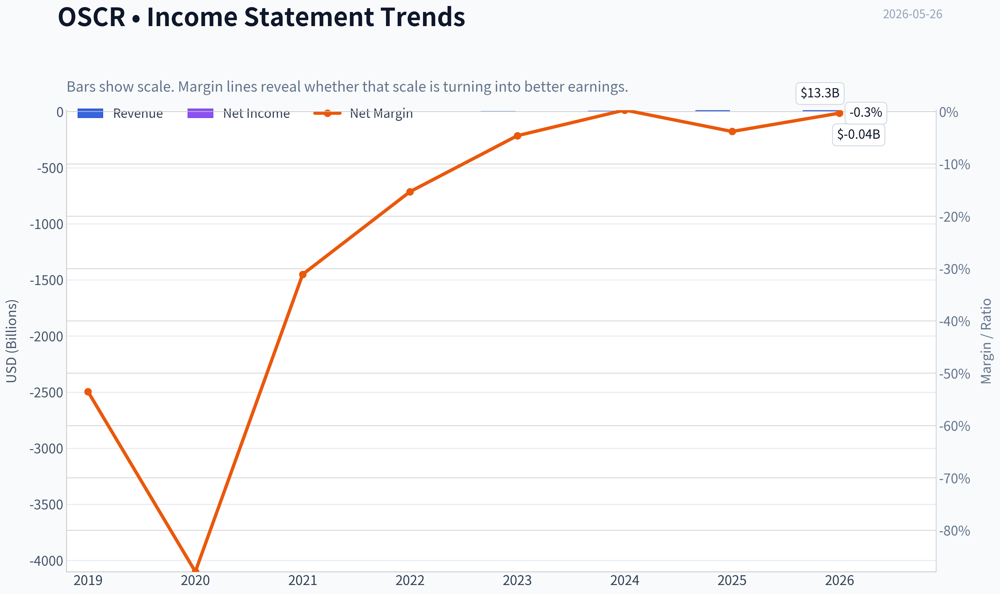

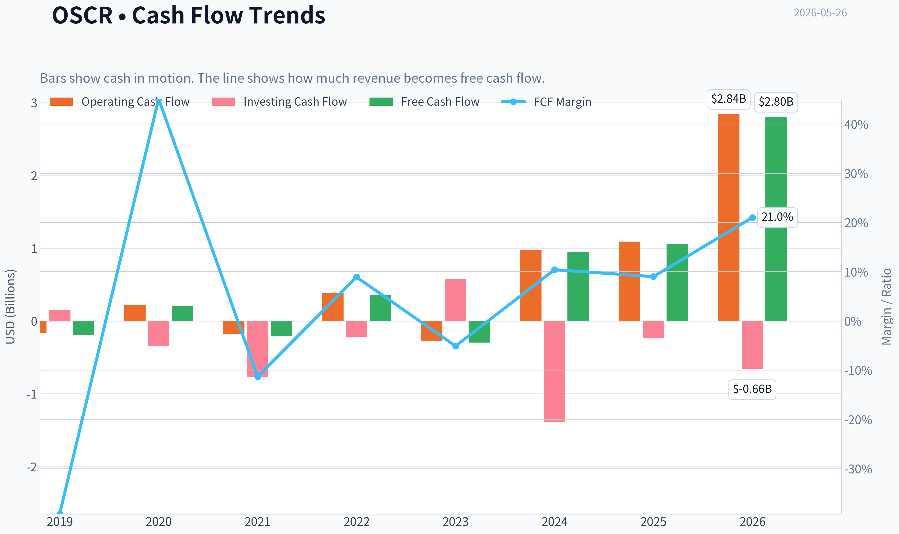

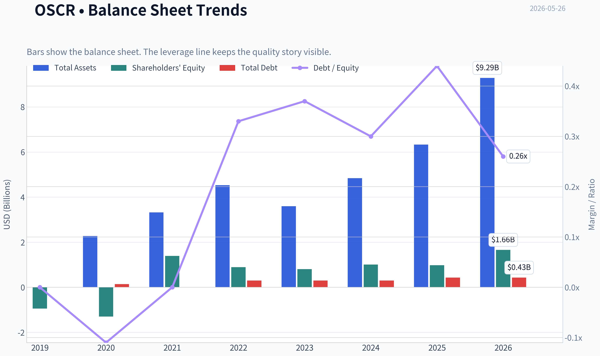

This graph tracks the profitability and return metrics (ROE, ROIC, Margins) of **OSCR** over the past decade, highlighting capital efficiency trends.

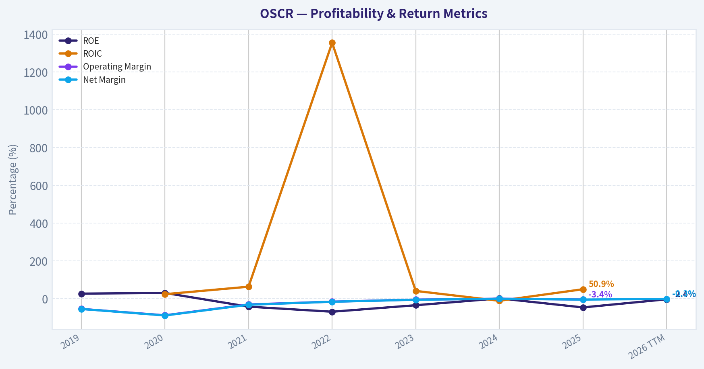

This chart illustrates the financial health of **OSCR** over the last 10 years, mapping cash equivalents and free cash flow against total obligations (Debt).

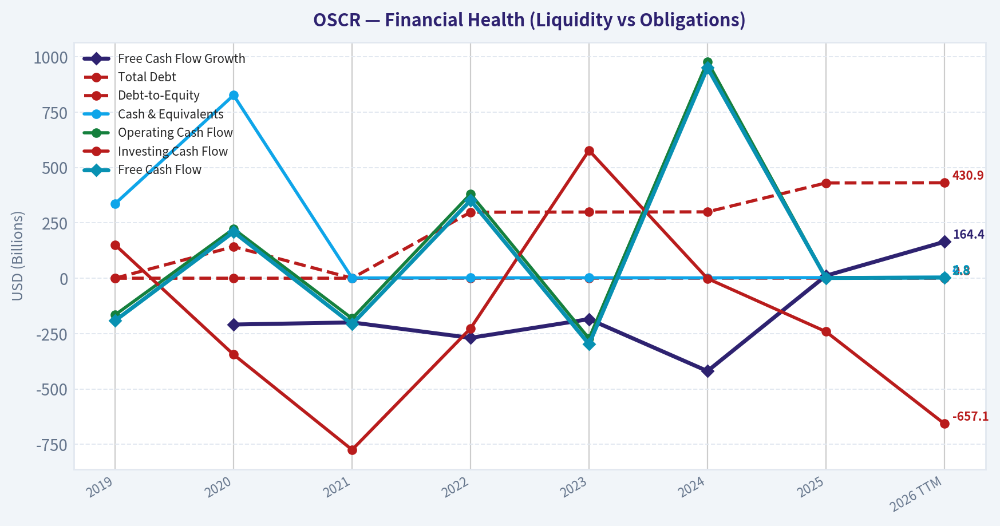

---

### Intrinsic Value Analysis (Buffett)

> *Following Warren Buffett's value investing philosophy: Circle of Competence, Economic Moat, Management Quality, and Margin of Safety.*

#### Intrinsic Value Snapshot

Price is what you pay. Intrinsic value is what the business may be worth based on the cash it can create for owners over time. We show a range, not one magic number.

- Current Price: $21.89
- Value Range (conservative to optimistic across both DCF methods): $60.56 to $115.48

##### Owner Earnings (Buffett Method)
- Net Income: $-443,151,000.00
- Depreciation & Amortization: $28,892,000.00
- Capital Expenditures: $-36,372,000.00
- Working Capital Changes: $1,459,002,000.00
- Owner Earnings: $-1,909,633,000.00

##### Intrinsic Value
###### Cash Flow Method
Uses free cash flow. Better for companies spending heavily today to grow tomorrow.
- Conservative: $60.56
- Average: $115.48
- Optimistic: $115.48
- Discount Rate: 10.0%

ANALYST STANCE: **WATCH**

#### Oscar Health (OSCR) - Buffett-Style Investment Review

#### 1) Go/No-Go Gate Assessment

| Gate | Verdict | Evidence |
|---|---|---|
| Gate 1: Circle of Competence & Simplicity | Pass, with caution | Oscar sells health insurance and related care-navigation services. Simple to describe: it collects premiums, manages medical claims, and hopes to earn an underwriting margin plus investment income. |
| Gate 2: Moat Test | Fail / Weak Pass at best | Health insurance is understandable, but Oscar's moat is not yet clearly durable. Brand is improving, but switching costs are modest and industry pricing is heavily regulated and competitive. |
| Gate 3: Management & Capital Allocation | Mixed | Recent execution appears better, with improving cash generation and growth, but long-term proof of owner-oriented capital allocation is still limited. |
| Gate 4: Industry Structure | Mixed to negative | Health insurance can be attractive at scale, but it is highly regulated, price competitive, and exposed to medical cost trends. This is not a simple toll-bridge business. |

**Key Takeaways:** Oscar passes the basic "I understand how it makes money" test, but it struggles on the more important Buffett filters: durable moat and attractive industry structure. The company looks more like an improving operator in a difficult business than a classic wonderful business.

---

#### 2) The Elementary School Test

Oscar Health takes money each month from members who buy health insurance. Then it pays doctors and hospitals when members need care. If Oscar prices risk correctly and controls costs well, it keeps a profit.

That is simple enough to understand. The problem is not simplicity of description. The problem is predictability and durability.

#### 3) Long-Term Predictability Test

Ten years from now, Oscar will probably still be a health insurer using software and consumer-friendly tools to sell and manage plans. But the economics are harder to predict than for a branded consumer product or mission-critical enterprise software company because results depend on:

- medical cost trends,
- regulation and subsidies,
- competitive pricing,
- membership mix,
- and execution in underwriting.

That lowers confidence.

#### 4) Technology Risk Assessment

Technology is more likely to be a tool than a full moat here. Oscar may benefit from better member engagement, claims workflows, and care navigation. But those advantages can be copied by larger insurers with greater scale and broader provider relationships. Technology helps Oscar compete; it does not yet make the business untouchable.

---

#### 5) Moat Analysis

| Moat Source | Assessment | Evidence |
|---|---|---|
| Intangible Assets | Weak | Oscar has some consumer-friendly branding, but not the kind of brand that creates obvious pricing power like Coke or Apple. Insurance buyers are price sensitive. |
| Switching Costs | Weak to moderate | Members do face friction in changing plans, doctors, and formularies, but annual shopping behavior and employer or exchange dynamics reduce true captivity. |
| Cost Advantage | Unproven | Larger incumbents generally have better scale, broader networks, more data, and stronger bargaining power. Oscar may be more efficient digitally, but the structural cost edge is not yet proven. |
| Network Effects | Minimal | More members can improve data and spread fixed costs, but this is not a true self-reinforcing network-effect business. |

**Moat Quality Rating: Narrow**

**Key Takeaways:** Oscar's competitive position appears real but still narrow. Its digital experience may help it win business, yet there is little evidence of a moat so strong that competitors cannot copy or outscale it.

---

#### 6) Management Quality & Capital Allocation

| Question | Assessment | Commentary |
|---|---|---|
| Do they think like owners? | Mixed | The company has a founder-led feel, which is positive, but Buffett would want stronger evidence of sustained per-share value creation over time. |
| Are they honest and candid? | Mixed to positive | Recent operating progress suggests management has faced earlier issues and improved execution, though the full record is still short versus Buffett's ideal. |
| Are they rational capital allocators? | Not yet proven | For a still-maturing insurer, the key test is whether retained capital earns attractive returns without repeated dilution or poor underwriting surprises. This remains unproven. |

**Bottom line on management:** better than before, but still not at the "clearly exceptional allocator" standard Buffett would require.

---

#### 7) Financial Summary

Using the research pack available today:

| Metric | Value |
|---|---:|
| Share Price | $22 |
| Market Cap | $6.60B |
| P/E | N/A |
| ROE | -45.3% |
| Revenue Growth YoY | 27.5% |
| FCF Yield | 16.0% |
| Current Ratio | 0.95 |

**Key Takeaways:** The headline combination is unusual: strong revenue growth and high free cash flow yield, but deeply negative ROE. That tells you Oscar is improving operationally, yet it still does not display the stable, high-return economics Buffett usually insists on.

---

#### 8) Cash Flow Reality Check

The strongest number in the current snapshot is the 16.0% free cash flow yield. That suggests the market is recognizing progress but still values the business cautiously. For Buffett-style analysis, however, one good cash flow period is not enough. In insurance, cash flow can look strong temporarily if reserve development, working capital, or growth dynamics are favorable.

So the right interpretation is: encouraging, but not enough by itself to prove durable earning power.

---

#### 9) Balance Sheet and Financial Strength

| Test | Observation | Buffett View |
|---|---|---|
| Liquidity | Current ratio of 0.95 | Acceptable only with caution in an insurance model, but not fortress-like |
| Profitability | ROE of -45.3% | Fails Buffett quality threshold badly |
| Leverage | No clean leverage figure in hand, but negative ROE dominates the analysis | Needs stronger proof of balance-sheet resilience |

**Key Takeaways:** The balance sheet does not currently present as a classic fortress. The negative ROE is the biggest red flag because Buffett wants consistently high returns on capital, not just top-line growth.

---

#### 10) Owner Earnings

A Buffett-style owner earnings estimate starts with net income, adds non-cash charges, then subtracts maintenance capital spending and working capital needs. Based on the available snapshot, Oscar is not yet a clean owner-earnings story because:

- accounting earnings are not robust enough,
- ROE is sharply negative,
- and insurer cash generation can be noisy.

So the practical takeaway is that owner earnings likely exist in some normalized sense, but they are not yet stable enough to anchor a high-conviction intrinsic value case.

---

#### 11) Three-Scenario DCF Valuation

Given the available evidence, I anchor valuation off market-implied conservatism and the company's improving cash generation rather than mature stable earnings.

| Scenario | Assumption | Implied View |
|---|---|---|
| A: No Growth | Business value supported only by current cash generation, no durable growth premium | Roughly fair to somewhat below current market optimism if margins retreat |
| B: GDP Growth | Moderate long-term growth with better underwriting discipline | Can support a value range around current market cap if cash flow holds |
| C: Historical Growth Haircut | Continued strong membership/revenue growth, but at reduced rate and better margins | Upside exists, but only if Oscar converts growth into durable high returns on capital |

**Key Takeaways:** Oscar is not obviously expensive if recent improvement proves durable. But it is also not the kind of business where intrinsic value can be estimated with the precision Buffett prefers, because stable normalized owner earnings are still forming.

---

#### 12) Margin of Safety Analysis

At $22 per share and a $6.60B market cap, the stock appears to be priced for continued improvement, but not for perfection. Still, a Buffett investor wants a margin of safety tied to stable business quality. That is the issue here.

Even if the valuation is not excessive, the business quality is not yet high enough to compensate for the uncertainty. In Buffett terms, this may be a potentially improving company, but not yet a "wonderful business at a fair price."

---

#### 13) Buffett Scorecard

| Criterion | Weight | Score (1-5) | Weighted Score |
|---|---:|---:|---:|
| Business Understanding | 20% | 4.0 | 0.80 |
| Moat Width & Durability | 25% | 2.0 | 0.50 |
| Management Quality | 15% | 3.0 | 0.45 |
| Return on Equity | 15% | 1.0 | 0.15 |
| Reinvestment Runway | 10% | 3.5 | 0.35 |
| Balance Sheet Strength | 5% | 2.5 | 0.13 |
| Industry Structure | 5% | 2.0 | 0.10 |
| Valuation / Margin of Safety | 5% | 3.0 | 0.15 |

| Total |  |  | **2.63 / 5.00** |

**Key Takeaways:** Oscar scores well on understandability and growth runway, but weakly on moat, returns on equity, and industry quality. That puts it below Buffett's bar for a strong endorsement.

---

#### 14) Final Judgment

**Investment Stance: WATCH**

**Conviction level: Moderate**

Oscar Health is an improving business, but not yet a proven wonderful one. The company may keep executing well, and if it can show several years of profitable underwriting, rising returns on equity, and a genuine cost or engagement advantage, the case could strengthen. Today, the combination of negative ROE, uncertain moat, and a structurally tough industry keeps it out of the ADVOCATE category.

For a Buffett-style investor, the correct posture is to **watch the operating progress, not chase the story**. The business must first prove that recent momentum can become durable, high-return economics.
#### Valuation Bridge

This bridge places the current market price beside each intrinsic value lens so readers can see whether upside depends on one method or shows up across several methods.

| Scenario | Intrinsic Value / Share |
| --- | ---: |
| Cash Flow Method | $115.48 |
| Damodaran Method | $-152.41 |
| Current Price | $21.89 |

#### Key Takeaways

If one method is far above the others, the upside case depends on a specific modelling assumption. When several methods cluster together, the valuation story is more robust.

#### Valuation Visuals

This comparison chart from *Latest Earnings Snapshot* stacks current figures against historical benchmarks for **OSCR**, making it easy to see where the company trades relative to its own averages.

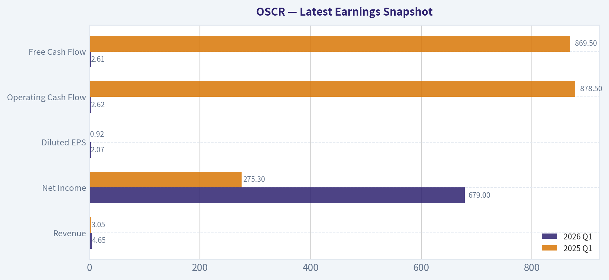

This comparison chart from *Current vs Historical Average Comparison* stacks current figures against historical benchmarks for **OSCR**, making it easy to see where the company trades relative to its own averages.

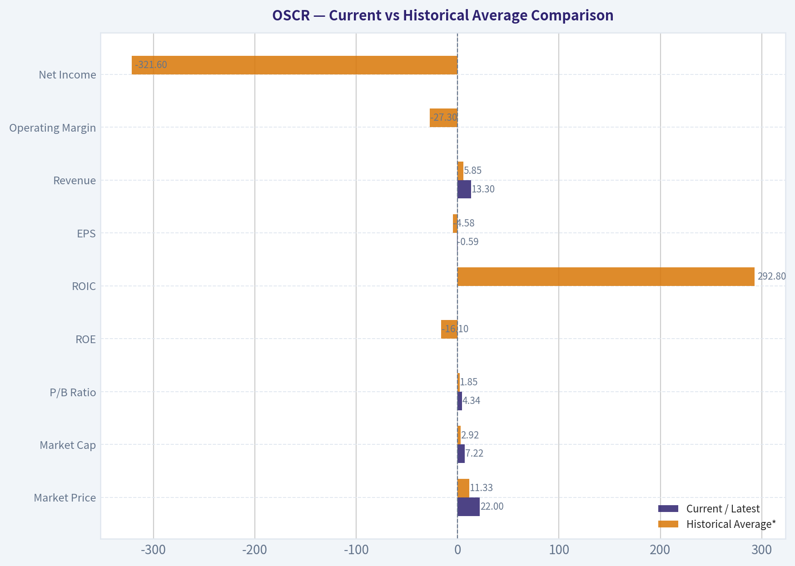

This comparison chart from *Buffett-Style Owner Earnings DCF* stacks current figures against historical benchmarks for **OSCR**, making it easy to see where the company trades relative to its own averages.

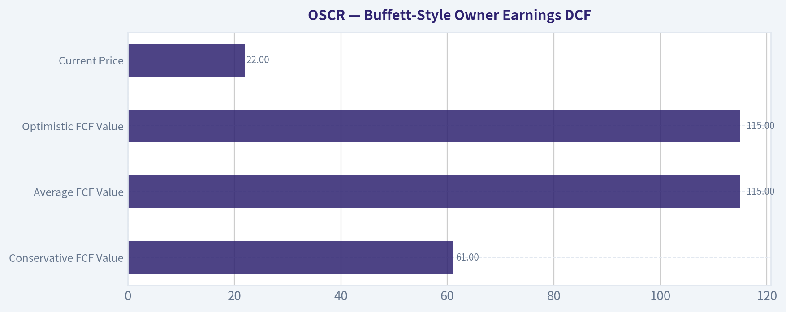

This comparison chart from *Financial Summary* stacks current figures against historical benchmarks for **OSCR**, making it easy to see where the company trades relative to its own averages.

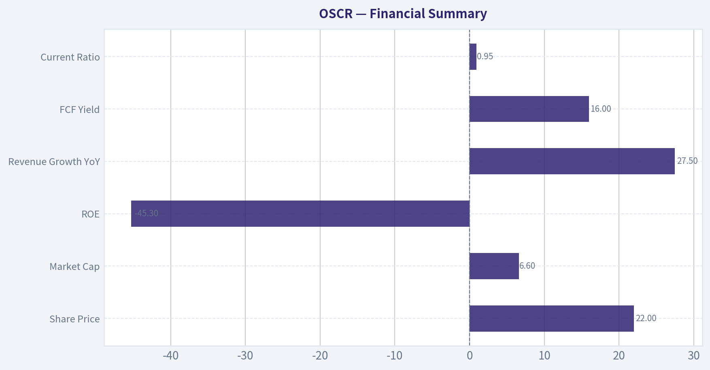

The following chart maps the **OSCR** Owner Earnings DCF valuation scenarios (Conservative, Average, Optimistic) to visually represent the margin of safety based on intrinsic value calculations.

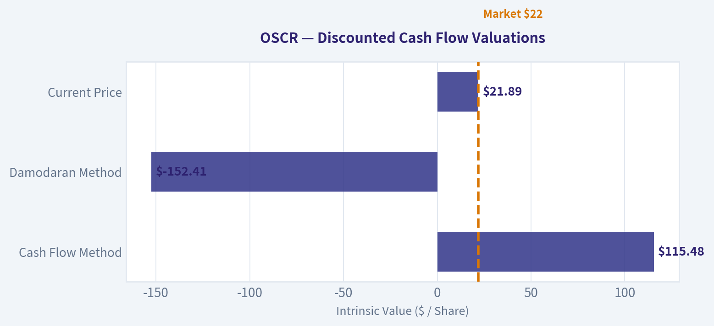

---

### Trend & Growth Analysis (Lynch/Druckenmiller/Fisher)

> *Following Peter Lynch's GARP, Stanley Druckenmiller's macro-aware approach, and Philip Fisher's scuttlebutt methodology.*

ANALYST STANCE: **WATCH**

#### 1. Lynch Classification

| Item | Assessment |
|---|---|
| Company | Oscar Health (OSCR) |
| Lynch category | **Fast Grower** |
| Why | Revenue growth is ~**27.5% YoY**, well above Lynch's 15-25%+ focus range |
| Caveat | This is a **regulated insurer**, so growth quality matters more than raw growth |

Key Takeaways: Oscar fits the fast grower bucket on revenue growth alone, which puts it in the right hunting ground for growth investors. But unlike software, insurance growth can destroy value if medical costs or pricing discipline go wrong. So this is a fast grower with unusually high execution risk.

#### 2. The Story in 3 Bullets

| Simple story | Why it matters |
|---|---|
| Oscar is a tech-enabled health insurer focused on ACA exchange members | Digital UX and member navigation are its differentiation versus legacy insurers |
| The company appears to be shifting from "grow at any cost" to **profitable growth** | That transition is usually where rerating happens if margins hold |
| The bet is that Oscar can keep taking share in ACA markets while improving underwriting and admin leverage | If true, earnings power 2-3 years out could be much higher than legacy screens suggest |

Key Takeaways: The core story is easy to explain: Oscar sells health insurance with a more modern digital experience. The real investment question is not whether it can grow, but whether it can grow while keeping claims costs under control. If that balance holds, the market may still be underestimating its earnings power.

#### 3. TAM Analysis and 10x Test

| Metric | Value / Assessment |
|---|---|
| Current revenue base | Not fully pinned down here, but clearly multi-billion-dollar scale |
| Business segment | U.S. ACA individual exchange / tech-enabled health insurance |
| TAM view | Large and still meaningful; U.S. individual health insurance remains a very large market |
| 10x test | **Unclear / likely too aggressive** from current scale |
| Better test | 2x-4x revenue is more realistic than 10x for an insurer already at scale |
| Runway verdict | **Good runway for share gains**, but not classic "tiny company in huge TAM" setup |

Key Takeaways: Oscar operates in a large market, so it still has room to grow. However, because it is already a multi-billion-dollar insurer, this does not look like a clean 10x-from-revenue-base story in the classic Lynch sense. The runway is real, but it is more likely a strong share-gainer than an easy ten-bagger from TAM expansion alone.

#### 4. Revenue Growth Trend

| Metric | Data |
|---|---|
| Revenue growth YoY | **27.5%** |
| Pattern read | **Strong high growth**, but no multi-quarter sequence provided here |
| Quality question | Need to separate membership growth, pricing, and risk-adjustment effects |
| Current verdict | **Positive**, but not enough evidence to call it accelerating |

Key Takeaways: The reported growth rate is strong enough to keep Oscar in the fast-grower conversation. But one quarter or one annual number is not enough to prove a true inflection. For a higher-conviction call, we would want to see multiple periods showing sustained or accelerating growth with stable medical cost trends.

#### 5. Available Unit Economics / Operating Quality

| Metric | Value / Assessment |
|---|---|
| LTV/CAC | Not disclosed in usable form |
| NRR | Not relevant / not disclosed like SaaS |
| Rule of 40 | Not applicable in classic SaaS form |
| FCF yield | **16.0%** |
| ROE | **-45.3%** |
| Current ratio | **0.95** |
| Underwriting lens | MLR and SG&A leverage matter more than SaaS metrics |

Key Takeaways: Traditional SaaS unit economics do not fit Oscar well, because this is an insurer, not a subscription software business. The good news is the reported free cash flow yield looks strong, but the deeply negative ROE shows the business still lacks mature balance-sheet returns. This is a case where underwriting quality matters more than software-style KPIs.

#### 6. Inflection Point Assessment

| Inflection type | Assessment |
|---|---|
| Product cycle inflection | Limited |
| Market share inflection | **Possible** in ACA exchange markets |
| Margin inflection | **Most important potential inflection** |
| TAM inflection | Limited; market is large but not newly expanding in a dramatic way |
| Competitive inflection | Mixed; incumbents remain powerful |

Key Takeaways: The main inflection is not a new product launch, but the possibility that Oscar is becoming a sustainably profitable growth insurer. That is a meaningful shift if real, because insurers often rerate when investors believe margin improvement is structural rather than temporary. The key evidence would be stable or improving medical loss ratios alongside continued membership growth.

#### 7. Macro Setup Evaluation

| Factor | Assessment |
|---|---|
| Secular theme | Digital healthcare / consumerized insurance |
| Rate sensitivity | Moderate; lower rates generally help growth multiples |
| Regulatory backdrop | High importance; policy risk is material |
| Industry tone | Recent Q1'26 read-through for insurers appears constructive |
| Macro verdict | **Neutral to modestly supportive** |

Key Takeaways: The near-term backdrop for health insurers appears better after strong sector earnings and improved Medicare rate sentiment. But Oscar is still much more exposed to regulatory and underwriting risk than a typical software growth name. Macro is not a major headwind today, yet it is not enough on its own to justify high conviction.

#### 8. Fisher 15-Point Score

| Fisher factor | Score (1-5) | Notes |
|---|---:|---|
| Market potential | 4 | Large ACA market with room for share gains |
| New product development | 3 | More execution/business-model than product-led story |
| R&D effectiveness | 3 | Tech-enabled platform helps, but edge is not clearly dominant |
| Sales organization | 3 | Distribution decent, but market is regulated and price-driven |
| Profit margin | 2 | Still not strong enough to call outstanding |
| Margin improvement | 4 | This is the central bull thesis |
| Labor/personnel relations | 3 | No strong read |
| Executive relations | 3 | No major red flags in pack |
| Management depth | 3 | Adequate, but not yet elite-proven |
| Cost analysis/accounting | 3 | Insurance accounting complexity warrants caution |
| Outstanding aspects / moat | 3 | UX and tech helpful, but moat remains narrow |
| Long-range profit outlook | 3 | Plausible, but still needs proof |
| Dilution risk | 3 | Better than early-stage insurers, but monitor capital needs |
| Candor | 3 | Neutral read |
| Integrity | 3 | Neutral read |

| Total | **46 / 75** | **Average** |

Key Takeaways: Oscar scores as average rather than great on the Fisher framework. The strongest point is margin improvement potential, while the weakest is still overall profit quality and moat durability. This suggests a watch-list growth stock, not yet an outstanding Fisher-style compounder.

#### 9. Valuation Analysis

| Metric | Value / Assessment |
|---|---|
| Current price | **$22** |
| Market cap | **$6.60B** |
| P/E | **N/A** |
| PEG | **N/A** because earnings base is not reliably established here |
| P/S | Roughly **not calculated precisely here** without full trailing revenue |
| Street tone | Mostly Neutral / Equal Weight with PTs around **$19-$21** recently |
| Valuation read | **Not obviously cheap** versus recent targets |

Key Takeaways: Because earnings are not yet a clean anchor, valuation should be judged more on sales, free cash flow, and future underwriting margins than on P/E. At $22, the stock already sits above several recently raised sell-side targets. That does not make it uninvestable, but it does argue against calling it a clear bargain today.

#### 10. Growth Investor Scorecard

| Criterion | Weight | Score (1-5) | Weighted |
|---|---:|---:|---:|
| The Story | 10% | 3.5 | 0.35 |
| TAM & Runway | 20% | 3.0 | 0.60 |
| Revenue Growth | 20% | 4.0 | 0.80 |
| Unit Economics / Operating Quality | 15% | 2.5 | 0.38 |
| Competitive Position | 10% | 2.5 | 0.25 |
| Management Quality | 10% | 3.0 | 0.30 |
| Macro Setup | 5% | 3.0 | 0.15 |
| Profitability Path | 5% | 3.0 | 0.15 |
| Valuation | 5% | 2.5 | 0.13 |

| Total Score |  |  | **3.11 / 5.00** |

Key Takeaways: Oscar lands in the middle, with clear strengths in top-line growth and a decent strategic story. The weaker areas are moat, operating quality, and valuation support. That overall mix fits a watch stance much better than a full advocate call.

#### 11. Position Size Stance

| Stance | Sizing view |
|---|---|
| **WATCH** | 0% to starter position only |
| If already owned | Hold only if underwriting/margin trend continues improving |
| Upgrade trigger | Repeated proof of profitable growth and better-than-expected claims discipline |
| Downgrade trigger | MLR deterioration, reserve issues, or growth deceleration |

Key Takeaways: This is not a zero-interest name, but it also does not yet deserve aggressive sizing. The right approach is to wait for confirmation that profitability is becoming durable. In other words, this is a "prove it" growth story.

#### 12. Key Risks and Catalysts

| Risks | Catalysts |
|---|---|
| Medical cost inflation / MLR deterioration | Better-than-expected MLR and sustained earnings beats |
| ACA policy / subsidy changes | More evidence of profitable member growth |
| Competitive pricing from incumbents | Upward guidance revisions |
| Reserve development risk | Multiple quarters of stable underwriting margins |
| Limited moat / switching costs | Greater market confidence in Oscar as a durable ACA consolidator |

Key Takeaways: The biggest danger is that growth turns out to be lower quality than it looks once medical costs normalize. The biggest upside catalyst is simple: prove that revenue growth and margin improvement can coexist for several more quarters. If Oscar does that, investor perception could improve meaningfully.

#### Bottom Line

| Final view | Assessment |
|---|---|
| Lynch | Fast grower, but not a clean classic ten-bagger setup |
| Druckenmiller | Possible margin/share inflection, but not fully confirmed |
| Fisher | Average quality, narrow moat, needs more proof |
| Overall stance | **WATCH** |

Key Takeaways: Oscar is interesting because it may be crossing from story stock to real operator. But today the evidence is not strong enough to justify a high-conviction growth recommendation, especially with the stock already above several recent price targets. I would keep it on the front of the watch list and look for confirmation in the next few quarters.

If you want, I can next build a **bull/base/bear 3-year scenario model for OSCR** using revenue, margin, and valuation assumptions.

#### Growth & Scorecard Visuals

The radar chart below from *Buffett Scorecard* visualises how **OSCR** ranks across weighted investment criteria. Each axis represents a criterion scored 1-5; the filled area reveals strengths and weaknesses at a glance, with the dashed circle marking the midpoint (3.0).

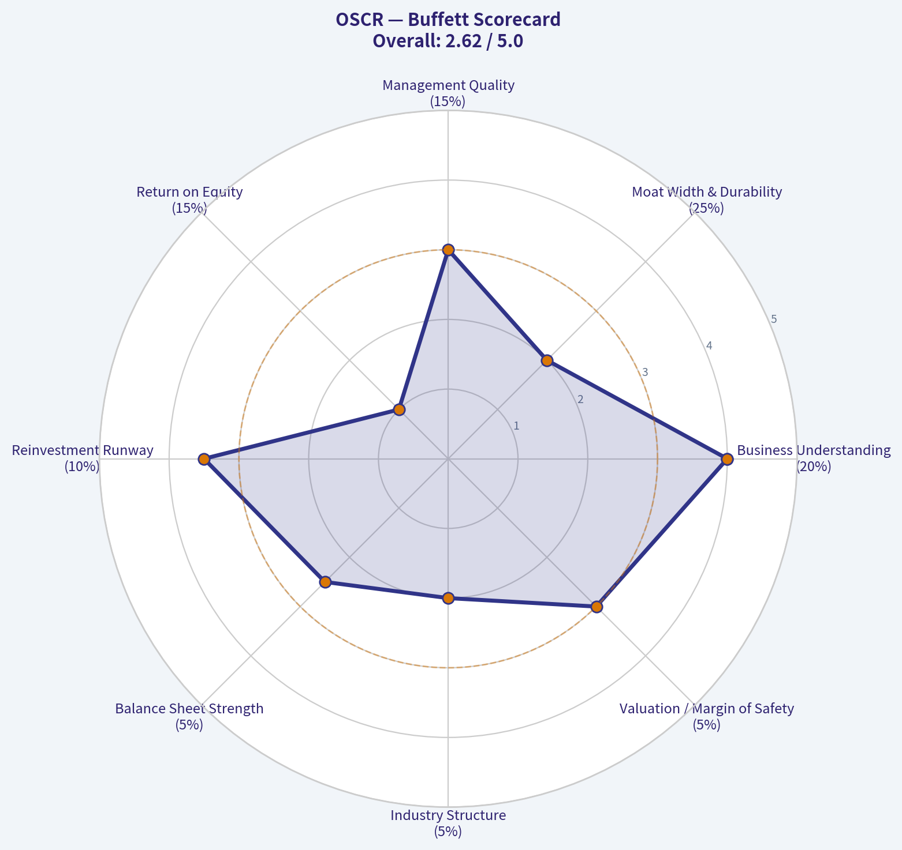

---

### Market Technical Analysis

#### OSCR technical analysis report

OSCR has undergone a full-cycle year: a powerful breakout in June 2025, a long unwind through late 2025 into Q1 2026, and then a sharp recovery that has now carried price back into an extended but still structurally bullish position. Based on the latest available trading day in the data, **2026-05-22**, the stock closed at **22.64**, well above both its **50-day SMA (16.74)** and **200-day SMA (16.53)**. That tells us the current setup is not just a short squeeze or brief bounce; it has evolved into a meaningful uptrend across both medium and long horizons.

The 8 most relevant indicators for this context are:

| Indicator | Why it matters now |
|---|---|
| close_10_ema | Best read on short-term momentum after a steep run-up and recent pullback |
| close_50_sma | Defines the intermediate uptrend and likely support zone |
| close_200_sma | Confirms strategic trend regime has turned bullish |
| macd | Measures momentum expansion and whether the trend is still accelerating or beginning to cool |
| rsi | Helps judge whether the rally is overheated versus merely strong |
| boll_ub | Useful for assessing extension after a fast upside move |
| atr | Critical for risk management because OSCR is showing expanding daily ranges |
| vwma | Confirms whether price strength has been supported by volume participation |

**Key Takeaways:** OSCR is in a confirmed bullish trend on both medium- and long-term measures. The stock is still strong, but the latest few sessions suggest momentum has started to cool from very overbought conditions rather than collapse outright.

---

#### Trend structure

Over the last year, OSCR's price action has been highly event-driven and volatile. It surged from the mid-teens to above 21 in June 2025, then suffered a deep multi-month reset that eventually drove it down near **10.85** in late March 2026. That March low appears to have marked an important inflection point. From there, the stock built a persistent staircase advance: first reclaiming the low teens, then the mid-teens, then breaking through the high teens in late April, and finally accelerating above 20 and into the low-to-mid 20s in May.

That matters because the rally did not come as a single one-day spike. It progressed through several phases: recovery, confirmation, acceleration, and now digestion. This is usually healthier than a pure blow-off move, though the final May leg was clearly much steeper than the earlier part of the advance.

The most important structural change is that price has moved from being below both major moving averages earlier in the year to decisively above both now. Even more important, the **50-day SMA has risen above the 200-day SMA** by late May, which is effectively a medium-term bullish regime shift. The stock is no longer merely rebounding inside a long-term downtrend; it has likely transitioned into a new upward phase unless price quickly loses the mid-to-high teens.

---

#### Moving averages and trend confirmation

The **10-day EMA** was **22.72** on 2026-05-22, almost identical to price at **22.64**. That tells us the short-term trend has stopped accelerating and is now testing its fast trend support. Earlier in May, price was running well above the 10-day EMA as momentum expanded. Now the stock is sitting right on that short-term guide. This is a very important near-term line in the sand: holding around the 10-day EMA would suggest consolidation within strength, while losing it decisively would likely invite a deeper retracement toward the 21-20 area.

The **50-day SMA** at **16.74** is far below current price, showing how powerful the recent upside move has been. The gap between spot price and the 50-day average is unusually wide, which confirms strength but also signals that price is extended relative to its medium-term trend baseline. In strong momentum names, that gap can persist for a while, but it tends to increase the odds of sideways digestion or pullbacks rather than immediate continuation in a straight line.

The **200-day SMA** at **16.53** is also below the 50-day SMA, and both are now rising or stabilizing upward. The long-term average had been drifting sideways-to-lower for much of the prior period, but recent price strength has turned that slope higher. This is one of the most constructive elements in the chart. It means the recent rally is now large enough to influence the long-term trend, not just the short-term tape.

| Metric | Latest reading | Interpretation |
|---|---:|---|
| Close (2026-05-22) | 22.64 | Strongly above key trend levels |
| close_10_ema | 22.72 | Short-term momentum support is being tested |
| close_50_sma | 16.74 | Intermediate trend firmly bullish |
| close_200_sma | 16.53 | Long-term trend confirmation has improved significantly |

**Key Takeaways:** OSCR is trading far above both the 50-day and 200-day moving averages, which confirms a strong bullish structure. In the short run, the 10-day EMA is the most important level to monitor because price has pulled back to it after a steep advance.

---

#### Momentum: strong, but no longer peaking

The **MACD** reading on 2026-05-22 was **1.999**, down from **2.429** on 2026-05-19. That is still a strongly positive reading, so momentum remains bullish in an absolute sense. However, the decline over the last few sessions shows momentum is no longer accelerating. This is an important nuance: a falling but still-positive MACD typically signals **deceleration within an uptrend**, not necessarily a trend reversal.

That matches the tape. OSCR surged aggressively into mid-May, hit **25.30** on 2026-05-18, then cooled to **22.64** by 2026-05-22. The stock has given back some of the most stretched part of the move, but it has not broken the broader bullish structure. In practical terms, momentum traders should recognize that the "easy upside" phase of this breakout may have already occurred, while swing traders may now be watching for a reset rather than chasing strength.

The **RSI** confirms this interpretation. It reached extremely overbought levels in mid-May, peaking above **85** on 2026-05-18 and still registering **78.34** on 2026-05-19. By 2026-05-22 it had cooled to **62.55**. That is a major normalization. Importantly, RSI has moved from extreme overbought into a more sustainable bullish zone rather than collapsing into weakness. This is often constructive: it suggests the stock has released some overheating pressure without fully breaking trend.

| Momentum Indicator | Latest reading | Recent behavior | What it suggests |
|---|---:|---|---|
| macd | 1.999 | Lower than recent peak near 2.43 | Bullish momentum remains, but acceleration has cooled |
| rsi | 62.55 | Down from 80s overbought readings | Strength is normalizing, reducing immediate blow-off risk |

**Key Takeaways:** Momentum is still positive, but it is no longer accelerating. RSI cooling from the 80s to the low 60s is actually healthier than staying extremely overbought, because it suggests the rally is digesting rather than immediately failing.

---

#### Volatility and extension

The **ATR** has expanded from about **0.75** in late April to **1.27** by 2026-05-22. That is a substantial rise in daily trading range. For traders, this means two things. First, opportunity has increased because OSCR is moving more per day. Second, risk has increased because normal pullbacks are now much larger in dollar terms than they were a month ago.

In percentage terms, an ATR of roughly **1.27** against a stock price of **22.64** implies a daily true range near **5.6%**. That is not a low-volatility trend. Position sizing and stop placement need to respect that reality. Tight stops are more likely to get hit by ordinary noise.

The **Bollinger Upper Band** stood at **26.31** on 2026-05-22. Price at **22.64** is below that upper band after having pushed much closer to it during the strongest part of the rally. This suggests some of the prior extension has already been worked off. In other words, the stock is still elevated, but it is less stretched than it was at the 25+ peak. That slightly reduces the immediate reversal risk compared with mid-May, though it does not eliminate it.

| Volatility / Extension Indicator | Latest reading | Interpretation |
|---|---:|---|
| atr | 1.27 | High and rising; daily swings remain large |
| boll_ub | 26.31 | Price has backed away from the upper envelope, easing extreme stretch |

**Key Takeaways:** OSCR remains a high-volatility stock, so traders should expect wide daily swings and size positions accordingly. The stock has pulled back from its most stretched condition, which makes the setup less overheated than it was at the recent peak.

---

#### Volume-weighted confirmation

The **VWMA** on 2026-05-22 was **22.05**, just below the closing price of **22.64**. This is constructive because it means price is still trading above its recent volume-weighted average, implying that the average volume-adjusted participant is still "in the money" over the recent window. During healthy trends, price often stays above the VWMA, with dips toward it serving as confirmation tests.

The broader price history also shows that major OSCR moves have tended to occur with very large volume surges. That is true both in upside bursts and downside air pockets. The current rally in May 2026 was accompanied by notable increases in turnover, especially on breakout days. This improves the credibility of the move. It suggests institutional or broad participation rather than a thin drift higher.

At the same time, because OSCR has a history of sharp, volume-backed reversals, traders should not assume volume alone guarantees continuation. Instead, the key is whether future pullbacks occur on lighter turnover and whether future upside re-acceleration comes with renewed participation. For now, VWMA supports the bullish case.

| Volume Confirmation | Latest reading | Interpretation |
|---|---:|---|
| vwma | 22.05 | Price remains above volume-weighted trend support |

**Key Takeaways:** Price is still above the recent volume-weighted average, which supports the idea that the uptrend has real participation behind it. If OSCR pulls back, holding above or near VWMA would help confirm that buyers are still in control.

---

#### Fine-grained trading read

OSCR is best described as a **bullish trend that has shifted from expansion to digestion**.

That distinction is important. The strongest part of the move happened between roughly **May 6 and May 18**, when price surged from **19.84** to **25.30**. Since then, price has retraced to **22.64**. That pullback has done several helpful things at once:

- It reduced RSI from extreme overbought levels.
- It cooled MACD from its peak without turning it bearish.
- It brought price back toward the 10-day EMA.
- It reduced the sense of immediate blow-off extension.

So the current setup is no longer ideal for aggressive breakout chasing, but it may become attractive for **buy-the-dip continuation traders** if support holds.

Key zones based on the indicator structure and recent price path:

| Zone | Approximate level | Why it matters |
|---|---:|---|
| Immediate support | 22.7 / 22.0 | 10-day EMA and VWMA area |
| Secondary support | 20.9 to 21.3 | Recent breakout shelf from early-to-mid May |
| Major trend support | 16.5 to 16.7 | 50-day and 200-day SMA cluster |
| Upside recovery trigger | 23.7 to 25.3 | Reclaiming recent highs would restart momentum discussion |

**Key Takeaways:** The most important near-term test is whether OSCR can stabilize around the low-22 to high-21 area. If that zone holds, the recent pullback may prove to be a normal reset within a larger uptrend rather than the start of a deeper reversal.

---

#### Strategy implications

| Trader type | Best use of indicators | Practical implication |
|---|---|---|
| Trend follower | close_50_sma, close_200_sma, macd | Trend is bullish; avoid fighting it unless structure breaks |
| Swing trader | close_10_ema, rsi, boll_ub | Wait for pullback stabilization rather than chasing overextension |
| Risk manager | atr | Stops and sizing should account for 5%+ daily range behavior |
| Volume-aware trader | vwma | Favor long setups while price remains above VWMA |

**Key Takeaways:** Different indicators point to the same broad conclusion: OSCR is bullish, but the character of the move has changed from breakout acceleration to pullback management. The best opportunities may come from confirmation that support is holding, not from blindly buying strength after a large run.

---

#### Bottom line

OSCR's chart has improved dramatically. The stock has transitioned from a depressed Q1 base into a confirmed multi-timeframe uptrend, with price above the **10 EMA**, **50 SMA**, **200 SMA**, and **VWMA** on a recent basis, while **MACD** remains strongly positive. The main caution is not trend failure but **extension and volatility**. RSI reached unsustainably high levels in mid-May, and ATR shows that risk remains elevated.

So the tactical message is:

- **Bullish longer-term structure**
- **Short-term momentum cooling, not broken**
- **Best watched as a dip-hold continuation candidate**
- **Risk controls are essential because OSCR moves fast**

| Category | Signal | Read for OSCR |
|---|---|---|
| Long-term trend | close_200_sma | Bullish improvement, price well above |
| Intermediate trend | close_50_sma | Strongly bullish |
| Short-term trend | close_10_ema | Testing support after pullback |
| Momentum | macd | Positive but decelerating |
| Overbought/oversold | rsi | Cooled from extreme overbought to constructive bullish zone |
| Extension | boll_ub | Less stretched than peak, still elevated |
| Volatility | atr | High; expect wide swings |
| Volume confirmation | vwma | Supportive; price remains above volume-weighted trend |

**Key Takeaways:** OSCR still favors the bulls, but the easiest part of the breakout may already be behind it. Traders should focus on whether the stock can hold near short-term support and reset cleanly before attempting another move toward the highs.

---

### Options Market Analysis

> *Reading options flow - put/call ratios, IV skew, and unusual activity - to gauge institutional positioning and event-driven risk.*

#### OSCR Options Positioning Report
*Date: 2026-05-26*

OSCR's near-term options tape leans **bullish**, with call open interest and call volume both clearly dominating puts across the next three expirations. The most notable wrinkle is that **call ATM IV is also running above put ATM IV**, which is not the usual defensive pattern and suggests traders are paying up for upside optionality rather than downside protection. Confidence is **moderate**, because while the directional tilt is constructive, there is **no standout unusual activity** showing aggressive fresh institutional conviction.

#### 1) Put/Call Ratio Analysis

| Expiration | Call OI | Put OI | Put/Call OI Ratio | Call Vol | Put Vol | Put/Call Vol Ratio |
|---|---:|---:|---:|---:|---:|---:|
| 2026-05-29 | 9,385 | 3,799 | 0.40 | 2,397 | 1,527 | 0.64 |
| 2026-06-05 | 4,621 | 1,729 | 0.37 | 1,755 | 793 | 0.45 |
| 2026-06-12 | 2,659 | 1,507 | 0.57 | 746 | 323 | 0.43 |
| **Near-term total** | **16,665** | **7,035** | **0.42** | **4,898** | **2,643** | **0.54** |

**Key Takeaways:** OSCR's aggregate near-term put/call OI ratio of **0.42** sits well below the roughly neutral **0.7** baseline, showing a clear skew toward calls. The volume ratio at **0.54** confirms that the recent flow also favors calls, not just legacy positioning. This is a meaningful shift away from neutral and points to traders leaning for upside rather than paying heavily for protection.

**Interpretation:**
- A **0.42 OI ratio** is decisively call-heavy and typically reads as **bullish speculation, upside positioning, or some covered-call-related activity**.
- The **0.54 volume ratio** says current trading also favors calls, so this is not only a stale OI effect.
- Since the ratio is materially below neutral, the tape suggests **constructive directional sentiment** rather than fear-driven hedging.

#### 2) Implied Volatility (IV) Assessment

| Expiration | ATM Call IV | ATM Put IV | IV Read |
|---|---:|---:|---|
| 2026-05-29 | 77.0% | 68.8% | Calls priced richer than puts |
| 2026-06-05 | 74.8% | 70.3% | Mild call premium |
| 2026-06-12 | 75.2% | 68.9% | Calls priced richer than puts |

**Key Takeaways:** Near-term implied volatility is **high in absolute terms**, with ATM IV mostly in the **69%-77%** range. More importantly, **calls trade at higher ATM IV than puts** across all three listed expirations, which is an unusual and notably bullish volatility shape. That often signals upside demand rather than downside fear.

**IV level:**
- Near-term ATM IV in the mid-70s is **elevated**, implying the market expects meaningful movement.
- Without a catalyst calendar embedded in the dataset, this could reflect **earnings-related aftershocks, sector volatility, or anticipation of a company-specific event**. It is fair to flag volatility as **event-sensitive**.

**Skew assessment:**
- The provided data does not give full strike-by-strike OTM put vs OTM call IVs, so a precise skew curve cannot be calculated.
- However, based on ATM pricing alone, **call IV > put IV** across all near-term expirations.
- That is more consistent with **upside chase / bullish demand for calls** than classic defensive put skew.

**Conclusion on skew:**
- **Skew direction: bullish / call-leaning**, not fear-driven.
- This is an important confirmation of the low put/call ratio.

#### 3) Unusual Options Activity

| Screen Result | Observation | Sentiment Read |
|---|---|---|
| Volume > 5x Open Interest | None detected in near-term expirations | No clear fresh high-conviction directional block/sweep activity |

**Key Takeaways:** There were **no near-term contracts with volume greater than 5x open interest**, so there is no obvious "fresh bet" standing out as institutional urgency. That does not negate the bullish read, but it does lower conviction compared with a tape showing aggressive call sweeps or put hedges.

**Interpretation:**
- No flagged unusual contracts means the bullish message comes more from the **broad structure of positioning** than from one or two standout trades.
- In practical terms, this looks less like a sudden hedge-fund-sized tactical bet and more like **steady call preference**.
- Because no contract-level outlier is visible, I would avoid overstating the "smart money" angle.

#### 4) Open Interest Concentration

Using the expiration-level data provided, the heaviest concentration is in the **front weekly expirations**, especially **2026-05-29**, which carries the largest total OI.

| Expiration | Total OI | Call Share | Put Share | Positioning Implication |
|---|---:|---:|---:|---|
| 2026-05-29 | 13,184 | 71.2% | 28.8% | Front-week options likely to exert the strongest pinning/gravity effect |
| 2026-06-05 | 6,350 | 72.8% | 27.2% | Secondary near-term positioning zone |
| 2026-06-12 | 4,166 | 63.8% | 36.2% | Less concentrated, still call-favored |

**Key Takeaways:** The **2026-05-29 expiry dominates near-term positioning**, making it the most likely source of expiration-related pinning or gamma effects. Across all three expiries, calls make up the majority of OI, reinforcing a generally constructive options backdrop.

**Gamma wall / pinning discussion:**
- The dataset does **not include strike-level OI**, so exact max-pain strikes or specific gamma walls cannot be identified.
- Still, the **front-week concentration** suggests the nearest expiration is where dealer hedging effects are most likely to matter.
- Since calls dominate OI, upside moves could be **amplified if dealers are forced to chase deltas**, though that cannot be confirmed without strike distribution.

#### 5) Overall Options Sentiment Signal

| Signal | Confidence | Primary Driver |
|---|---|---|
| **BULLISH** | **Moderate** | Call-heavy OI/volume ratios plus call-rich IV structure |

**Key Takeaways:** OSCR's options market is giving a **bullish** read, driven mainly by **sub-neutral put/call ratios** and **higher implied volatility in calls than puts**. The absence of unusual contract-level activity keeps this from being a high-conviction signal, but the broad setup still favors upside sentiment over defensive positioning.

**Why bullish:**
1. **Put/Call OI ratio = 0.42**, well below neutral.
2. **Put/Call volume ratio = 0.54**, showing recent flow also leans call-side.
3. **Call ATM IV exceeds put ATM IV** in every near-term expiry, implying traders are paying up for upside exposure.
4. No evidence of heavy protective put demand or panic hedging.

**Caveats:**
- No contract-level unusual activity means this is **not a screaming momentum signal**.
- Exact strike-level gamma walls and max pain cannot be identified from the available data.
- Options data is **positioning**, not valuation; it should complement, not replace, price trend and fundamental analysis.

#### Final Summary Table

| Category | Reading | Interpretation |
|---|---|---|
| Put/Call Ratio | OI: **0.42**; Volume: **0.54** | Clearly call-favored; bullish vs neutral baseline of ~0.7 |
| IV Level | ATM IV roughly **69%-77%** | Elevated near-term implied move pricing |
| Skew Direction | **Call-leaning** | Calls priced richer than puts; upside demand outweighs downside fear |
| Unusual Activity | **None flagged** | No obvious fresh outsized directional bet |
| Overall Signal | **BULLISH** | Broad constructive positioning, but conviction is moderate rather than extreme |

**Key Takeaways:** The cleanest summary is that OSCR's options market shows **bullish positioning with elevated event-style volatility**. Traders appear more interested in **upside participation** than **downside protection**, but the lack of standout unusual flow argues for **moderate**, not maximum, conviction.

---

## Research Team Commentary

> *The Research Manager synthesizes the Bull vs Bear debate into action-free commentary. This is a pre-risk view, not the final stance.*

The strongest bull argument is that Oscar may be in a transition phase where current accounting badly understates future earning power. Revenue growth of 27.5% suggests the business is gaining traction, and in insurance, scale can matter if it improves pricing, member retention, admin efficiency, and care management. The bull also makes a fair point that regulation is not only a risk; it can create barriers to entry. If Oscar becomes a scaled, tech-enabled ACA insurer with better consumer experience and data-driven underwriting, the business could look much better five years from now than it does today. The recent technical cooling also argues this is less of a momentum-chase setup than it might have been earlier.

The strongest bear argument is more compelling through a Buffett lens: none of the hoped-for moat or operating leverage is clearly visible in returns yet. ROE of -45.3% and ROA of -7.0% are not small blemishes; they tell us the business has not proven it can turn growth into value. In insurance, growth is especially dangerous when underwriting discipline is not clearly established, because membership gains can come from underpricing risk. Oscar also operates in a sector where regulation, subsidies, medical cost trends, and competitive pricing all materially affect economics. That makes long-term cash flows less predictable than a value investor should prefer. Most importantly, the bull case depends on several things going right at once: pricing discipline, cost control, stable policy support, and a genuine moat emerging against larger incumbents. That is too much assumption for a business that still lacks demonstrated durable profitability.

My takeaway is that this is not a classic case of the market missing a wonderful business; it is a case where the market is reasonably demanding proof. The contrarian question is whether fear is creating opportunity. Here, I do not think fear is the main issue. The bigger issue is uncertainty around intrinsic value. When I look back at past mistakes, one lesson is not to hide behind Buffett language where the real issue is setup or timing alone. But another lesson is not to soften a fundamentally weak business into a neutral call just because the story is interesting. Oscar may improve, but today the evidence is still mostly narrative and trajectory, not durable economics. For a Buffett-style portfolio, that is not enough.

Core takeaway: Oscar is an interesting insurer to study, but not yet one to own in a value portfolio. The company may be building capabilities that eventually matter, yet current financial evidence does not show a durable moat, predictable earnings power, or a clear margin of safety. Until underwriting quality and returns materially improve, the stock is better treated as a watchlist turnaround than an investable compounding franchise.

The rationale is straightforward. Business quality comes first, and Oscar does not yet meet that standard. The moat is hypothetical, management's capital allocation and underwriting discipline are not fully proven, earnings are not predictable, and financial returns are weak. Even if the market is skeptical, skepticism alone is not undervaluation. Buffett-style investing requires a business where intrinsic value can be estimated with some confidence. Here, too much of that estimate rests on hoped-for improvement. That does not mean the company cannot succeed; it means the burden of proof remains on management, not on investors to imagine the end state.

My monitoring plan over the next 1 to 4 quarters would focus on a few concrete items. First, medical loss ratio and any evidence that growth is being achieved with pricing discipline rather than underpricing. Second, SG&A leverage and whether admin costs improve as membership scales. Third, signs of sustained profitability or at least a clear path toward normalized positive ROE. Fourth, membership growth quality, meaning retention and mix, not just headline expansion. Fifth, commentary on ACA subsidy and regulatory exposure, since changes there could alter the economics materially. Sixth, balance sheet resilience and reserve adequacy, because insurers can look better until claims development says otherwise. If Oscar starts showing repeatable underwriting discipline and operating leverage, the thesis improves. If growth stays strong but returns remain deeply negative, that would confirm the bear case that scale is not translating into shareholder value.

Final stance: AVOID.

---

## Value Investing Team Commentary

> *The Investor translates the research view into an investment thesis before risk review. This is still not the final stance.*

Oscar Health is a classic example of a business that can sound more attractive than it currently is.

The optimistic case is understandable. Revenue growth of 27.5% is meaningful, and in insurance, scale can improve economics if the company is actually getting better at pricing risk, spreading fixed costs, and managing care. A tech-enabled insurer with a better consumer interface could eventually carve out a worthwhile niche, particularly in ACA markets where complexity itself can act as a barrier. If Oscar is still early in building those capabilities, today's numbers may understate what the business could earn later.

But a Buffett-style framework asks a tougher question: what is proven today, not just what is possible tomorrow? On that basis, the business still falls short. Negative ROE of -45.3% and ROA of -7.0% are not the marks of a compounding franchise. In insurance, growth without clearly demonstrated underwriting discipline is not a virtue by itself; it can be a warning sign. You do not want membership growth bought through weak pricing, because that often creates future pain rather than future value.

The key issue is that Oscar's long-term economics remain too dependent on variables outside management's full control: medical cost trends, subsidy structure, regulation, competitive pricing, and claims development. Those factors do not make success impossible, but they do make intrinsic value much harder to estimate with confidence. That matters greatly for a value investor. If you cannot reasonably forecast normalized earning power, you cannot confidently claim a margin of safety.

The market's skepticism appears rational rather than emotional. This does not look like a high-quality business temporarily misunderstood by fearful investors. It looks more like a business still being asked to prove that growth can translate into durable profitability. That is an important distinction. Selective contrarianism works best when sentiment is depressed while business quality is intact. Here, the business quality itself is still under examination.

The recent technical cooling is mildly constructive only in a tactical sense. It suggests the stock is no longer as stretched as it may have been earlier, but that does not solve the central problem. A less overheated chart can improve entry timing for traders; it does not create a moat, predictable earnings, or insurance discipline. For long-term owners, fundamentals must lead.

What would change the story? I would want to see several quarters showing that Oscar can grow while maintaining sound medical loss ratios, improving SG&A leverage, and moving toward sustained profitability with credible reserve quality. I would also want evidence that retention and member mix are improving, not just top-line expansion. If management can show repeatable underwriting discipline, then the market may eventually be undervaluing the business. Today, that remains an aspiration rather than an established fact.

The contrarian angle is worth examining carefully. If sentiment remains cautious while Oscar begins to demonstrate real insurance economics, the opportunity could become interesting later. But buying before that proof arrives is speculation on a future operating model, not investment in a presently proven franchise. Buffett would rather miss the first part of a turnaround than own a business whose economics are still hypothetical.

ANALYST STANCE: **AVOID**
Oscar is an interesting company to monitor, but not yet an attractive long-term value investment. Revenue growth is real, but returns, predictability, and moat evidence are not. Until underwriting discipline, profitability, and durable competitive advantage become visible in the numbers, the stock does not offer the business quality or valuation confidence required for ownership.

---

## Deep Values Commentary

> *The Risk Management Team debates and the Risk Judge provides the final action-free verdict. This section determines the final ADVOCATE / WATCH / AVOID stance.*

#### Final Stance Scorecard

This scorecard converts the final research view into a weighted decision frame. It does not replace the narrative judgement, but it makes the main drivers of the verdict easier to scan.

| Criterion | Score | Weight | Commentary |
| --- | ---: | ---: | --- |
| Business Quality | 2.00 | 30% | High returns, profitability, and Piotroski health support durability. |
| Valuation Support | 3.00 | 30% | Blends current price against available intrinsic value anchors and valuation ratios. |
| Financial Strength | 3.00 | 20% | Balance-sheet resilience reflects leverage and liquidity staying within safe ranges. |
| Growth Durability | 3.33 | 20% | Recent revenue, earnings, and free cash flow growth indicate how durable expansion looks. |
| TOTAL / FINAL STANCE | 2.77 | 100% | AVOID |

#### Key Takeaways

The weighted score lands at **2.77 / 5.0**, while the final stance remains **AVOID**. This is useful as a quick calibration aid rather than a mechanical signal.

#### Risk Summary

Higher scores indicate more risk pressure. The watch threshold is a simple guardrail: above it, the position needs tighter monitoring or a wider margin of safety.

| Dimension | Current Score | Watch Threshold | Commentary |
| --- | ---: | ---: | --- |
| Business Quality | 4.00 | 3.00 | High returns, profitability, and Piotroski health support durability. |
| Valuation Support | 3.00 | 3.00 | Blends current price against available intrinsic value anchors and valuation ratios. |
| Financial Strength | 3.00 | 3.00 | Balance-sheet resilience reflects leverage and liquidity staying within safe ranges. |
| Growth Durability | 2.67 | 3.00 | Recent revenue, earnings, and free cash flow growth indicate how durable expansion looks. |

#### Key Takeaways

This view helps readers separate *where* the risk sits: valuation, business quality, balance sheet, or growth durability. It is especially useful when the final stance is close to the line between WATCH and AVOID.
