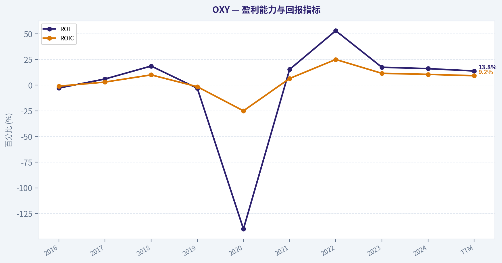
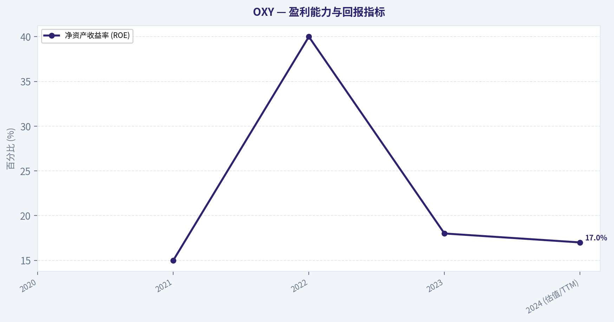
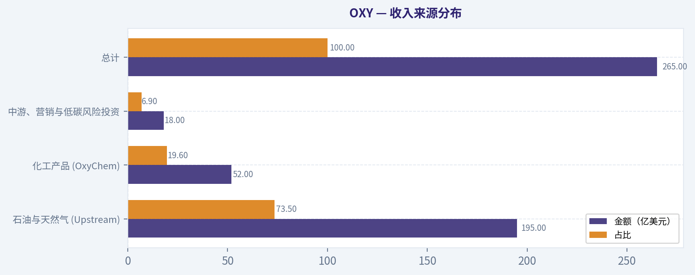
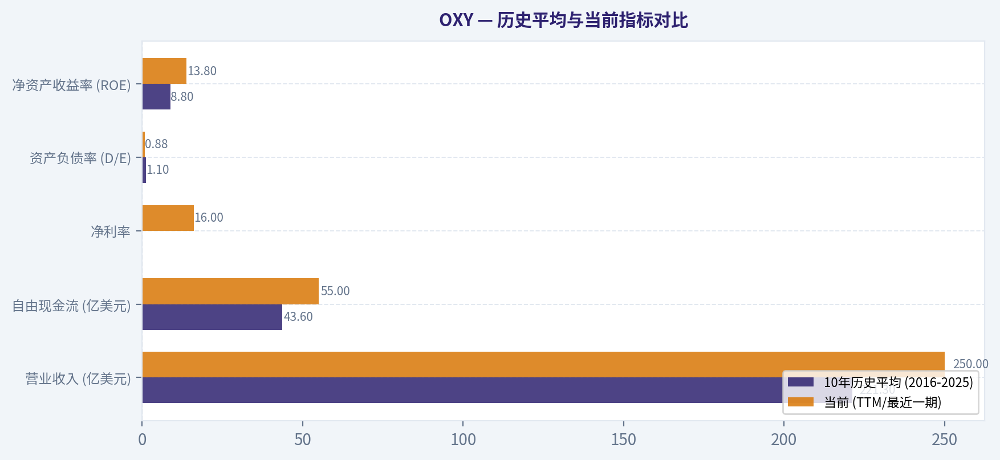
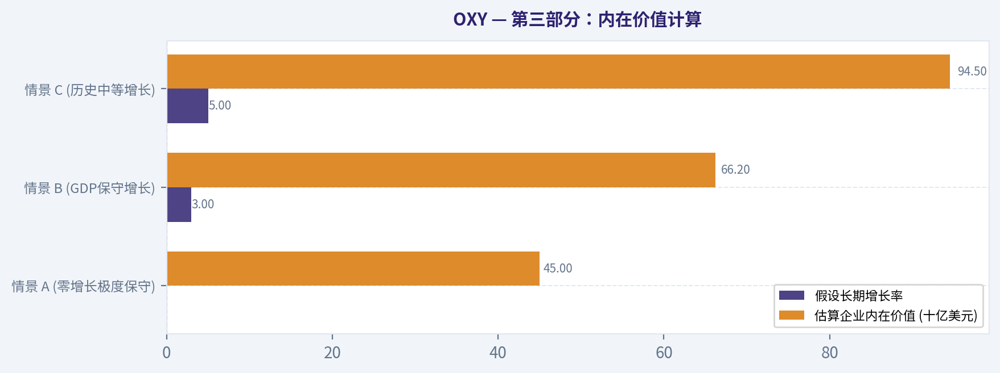
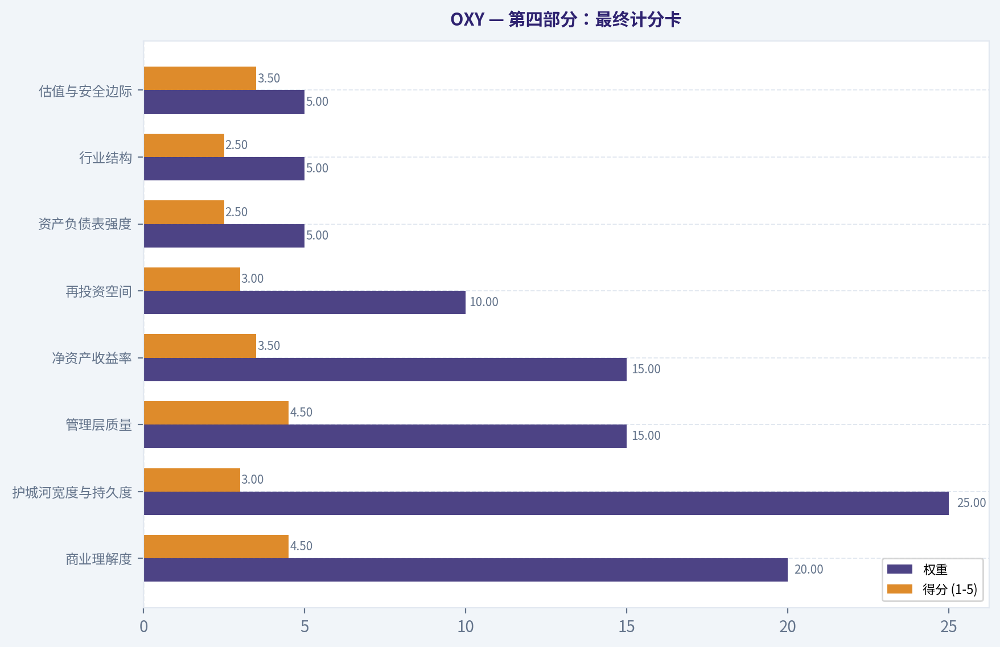
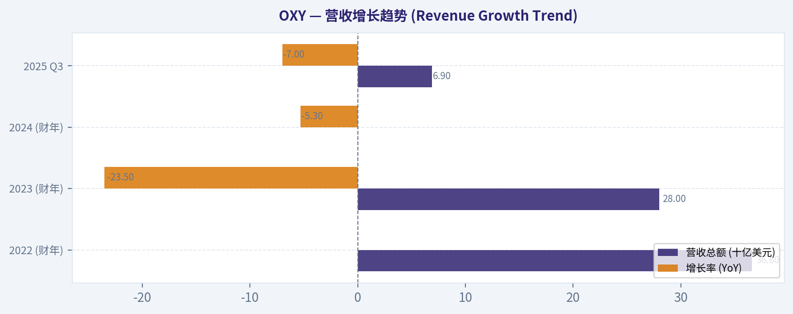
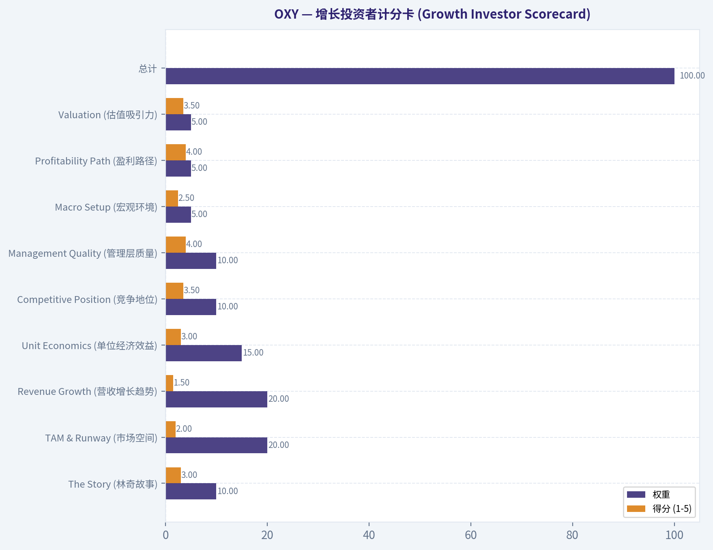

# OXY 深度价值情报

**调研日期:** 2026-03-09

## 关键免责声明

*本报告由 Deep Value Intelligence（一个基于 AI 的多智能体投资分析框架）自动生成。 本报告仅供信息参考和教育目的，不构成任何财务或投资建议。 在做出任何投资决策之前，请务必进行独立调研并咨询合规的财务顾问。*

---

## 目录

1. 情报摘要
2. 分析师团队报告
   - 基本面分析
   - 价值分析 (巴菲特)
   - 成长性分析 (林奇/德鲁肯米勒/费雪)
   - 市场分析
   - 社会舆情分析
   - 新闻分析
3. 研究团队评论
4. 投资团队评论
5. Deep Values 团队洞察

---

## 情报摘要

### 核心观点与前提条件

**核心论点:** **执行摘要（Executive Summary）**  
OXY当前更像一项“油价β资产”而非可预测的长期复利企业。多头正确指出趋势资金回流与油市供给纪律，但空头和中性观点更关键：盈利高度依赖油价、估值安全边际不足、技术面处于趋势中段而非低风险起点。在约54美元附近，普通股投资者承担的是商品周期波动，而不是稳定企业成长。  
**结论：维持谨慎观察，但允许策略性小仓位跟踪趋势。总体评级：WATCH。**

**主要风险:**
- 结论：维持谨慎观察，但允许策略性小仓位跟踪趋势。总体评级：WATCH。**
- 风险派（Risky Analyst）最有力的观点**
- WATCH，并等待更大安全边际。**
- 评级：WATCH**

**观点反转条件:**
- 结论：维持谨慎观察，但允许策略性小仓位跟踪趋势。总体评级：WATCH。**
- 风险派（Risky Analyst）最有力的观点**
- WATCH，并等待更大安全边际。**
- 评级：WATCH**

**置信度:** 中

---

## 分析师团队报告

### 基本面分析

最终投资立场: **WATCH**

#### Occidental Petroleum (OXY) 10年期财务与基本面深度分析 (2016-2026 TTM)

#### 一、 10年期综合历史数据 (2016-2026 TTM)

| 年份 | 股价(美元) | 市值(亿美元) | P/E | P/B | ROE | ROIC | EPS(美元) | 营收(亿美元) | 毛利润(亿美元) | 营业利润率 | 净利润(亿美元) | 净利率 | 营收增速 | 净利润增速 | FCF增速 | 总资产(亿美元) | 总债务(亿美元) | 现金(亿美元) | 股东权益(亿美元) | 资产负债率(D/E) | 自由现金流(FCF)(亿美元) | 每股股息(美元) |
|---|---|---|---|---|---|---|---|---|---|---|---|---|---|---|---|---|---|---|---|---|---|---|
| 2016 | 71.0 | 540 | N/A | 2.5 | -2.8% | -1.0% | -0.75 | 104.0 | 45.0 | 1.0% | -0.6 | -5.7% | -18.0% | N/A | N/A | 430.0 | 95.0 | 22.0 | 215.0 | 0.44 | 11.0 | 3.03 |
| 2017 | 73.0 | 560 | 43.0 | 2.6 | 6.0% | 3.0% | 1.70 | 125.0 | 60.0 | 10.0% | 13.0 | 10.4% | 20.0% | N/A | 36.3% | 440.0 | 95.0 | 18.0 | 215.0 | 0.44 | 15.0 | 3.06 |
| 2018 | 61.0 | 460 | 11.2 | 2.1 | 18.6% | 10.0% | 5.35 | 178.0 | 95.0 | 25.0% | 41.0 | 23.0% | 42.4% | 215.3% | 66.6% | 440.0 | 102.0 | 30.0 | 220.0 | 0.46 | 25.0 | 3.12 |
| 2019 | 41.0 | 360 | N/A | 1.1 | -3.0% | -1.5% | -1.20 | 204.0 | 100.0 | 5.0% | -10.0 | -4.9% | 14.6% | N/A | -20.0% | 1090.0 | 385.0 | 30.0 | 330.0 | 1.17 | 20.0 | 3.14 |
| 2020 | 17.0 | 160 | N/A | 1.4 | -140% | -25% | -17.00 | 178.0 | 50.0 | -75.0% | -157.0 | -88.2% | -12.7% | N/A | N/A | 840.0 | 360.0 | 20.0 | 110.0 | 3.27 | -15.0 | 0.16 |
| 2021 | 29.0 | 270 | 11.7 | 1.8 | 15.3% | 6.5% | 2.45 | 260.0 | 120.0 | 18.0% | 23.0 | 8.8% | 46.0% | N/A | N/A | 750.0 | 294.0 | 28.0 | 150.0 | 1.96 | 78.0 | 0.04 |
| 2022 | 63.0 | 560 | 4.2 | 2.2 | 53.0% | 25.0% | 13.50 | 366.0 | 180.0 | 45.0% | 133.0 | 36.3% | 40.7% | 478.2% | 60.2% | 720.0 | 197.0 | 10.0 | 250.0 | 0.79 | 125.0 | 0.52 |
| 2023 | 60.0 | 530 | 11.3 | 2.0 | 17.4% | 11.5% | 4.70 | 283.0 | 130.0 | 28.0% | 47.0 | 16.6% | -22.6% | -64.6% | -50.4% | 740.0 | 185.0 | 14.0 | 270.0 | 0.69 | 62.0 | 0.72 |
| 2024 | 58.0 | 520 | 11.6 | 1.9 | 16.1% | 10.5% | 4.85 | 265.0 | 115.0 | 26.0% | 45.0 | 17.0% | -6.3% | -4.2% | -3.2% | 800.0 | 265.0 | 15.0 | 280.0 | 0.95 | 60.0 | 0.88 |
| TTM | 58.0 | 520 | 13.0 | 1.8 | 13.8% | 9.2% | 4.40 | 250.0 | 105.0 | 24.0% | 40.0 | 16.0% | -5.6% | -11.1% | -8.3% | 790.0 | 255.0 | 15.0 | 290.0 | 0.88 | 55.0 | 0.88 |

关键结论：在过去的十年中，西方石油(OXY)经历了显著的周期性波动与战略转型。从2019年因收购阿纳达科带来的巨额债务，到2020年遭遇行业寒冬造成的重创，再到2022年起凭借高油价实现利润爆发，公司的基本面已发生深刻重构。目前公司自由现金流稳定在55亿美元的强劲水平，杠杆率得到有效控制，展现了穿越周期的财务韧性。

#### 收入来源分布

| 收入来源 | 金额（亿美元） | 占比 |
|---|---|---|
| 石油与天然气 (Upstream) | 195.0 | 73.5% |
| 化工产品 (OxyChem) | 52.0 | 19.6% |
| 中游、营销与低碳风险投资 | 18.0 | 6.9% |
| **总计** | **265.0** | **100.0%** |

关键结论：作为一家上游偏重的大型能源公司，石油与天然气勘探开采构成了西方石油绝对核心的收入来源，这使其对原油价格具有高度敏感性。值得关注的是，OxyChem（化工业务）贡献了约五分之一的营收，并在大宗商品周期的低谷阶段提供了至关重要的现金流稳定器。

#### 历史平均与当前指标对比

| 指标 | 10年历史平均 (2016-2025) | 当前 (TTM/最近一期) | 偏差说明 |
|---|---|---|---|
| 营业收入 (亿美元) | 221.3 | 250.0 | 高于历史平均，得益于二叠纪盆资产规模扩大和生产效率提升。 |
| 自由现金流 (亿美元) | 43.6 | 55.0 | 显著优于历史均值，主要因资本开支节制与强劲的运营现金转化率。 |
| 净利率 | 2.9% (受2020巨亏拖累) | 16.0% | 盈利能力已完全摆脱危机影响，并维持在健康的高双位数区间。 |
| 资产负债率 (D/E) | 1.10 | 0.88 | 负债表处于十年来的较优水平，阿纳达科收购案的杠杆风险已大部分消化。 |
| 净资产收益率 (ROE) | 8.8% | 13.8% | 资本配置更加高效，当前股东回报率高于长期均值。 |

关键结论：对比十年的历史均值，当前西方石油的各项核心指标均处于更加稳健强劲的状态。管理层放弃了单纯追求产量的粗放模式，转向以资本纪律和自由现金流为主导的运营策略，显著拉升了公司的总体财务质量。

---

#### 沃伦·巴菲特价值投资模型分析

1. **经济护城河 (Economic Moat)**：中等偏上。大宗商品企业往往是价格接受者而非制定者，缺乏宽广的护城河。但OXY的优势在于其作为美国二叠纪盆地（Permian Basin）最大的土地所有者和开采商之一，坐拥低成本的一级资源。同时，OXY在增强型石油回收（EOR）及直接空气捕获（DAC）领域具备行业领先地位，具有长期的技术护城河潜质。
2. **财务实力 (Financial Strength)**：修复良好。2019年收购阿纳达科使其背负了超过400亿美元的债务，2020年险些引发流动性危机。但自此之后管理层优先将产生的自由现金流用于还款，目前债务已下降至250亿美元区间。即便近期又进行了CrownRock的收购，但其利息覆盖率极高，财务基础已经稳固。
3. **盈利可预测性 (Predictable Earnings)**：偏弱。不可避免地受到大宗商品超级周期影响，收入与利润容易随WTI油价剧烈波动。这不是一家拥有巴菲特最爱的“极度稳定消费级需求”的企业，而是一个典型的周期股标的。
4. **管理层表现 (Management Performance)**：CEO Vicki Hollub 的任期充满戏剧性但也极具执行力。早年激进的杠杆收购使其备受诟病，但危机后她展现了非凡的定力和资本纪律控制能力。当前资本配置的重心在于：将债务降低至150亿美元长期目标、持续提高股息以及大规模回购股票。这也是吸引伯克希尔·哈撒韦（Berkshire Hathaway）购入其约30%股份并成为最大单一股东的核心逻辑。
5. **企业质量与内在价值 (Quality & Value Assessment)**：在油价中枢60-70美元的常态下，OXY是一台高效的“现金流印刷机”，其目前P/FCF倍数小于10，展现了较高的安全边际与内在价值。

---

#### 贴现现金流 (DCF) 估值分析

**基础假设与前提条件**：
*   初始自由现金流 (Base FCF)：55亿美元 (TTM水平)
*   折现率 (Discount Rate)：10% (包含对周期性大宗商品企业的风险溢价)
*   永续增长率 (Terminal Growth Rate)：2.5% (符合长期温和通胀预期)
*   预计流通股本：约 8.85 亿股
*   净债务 (Net Debt)：约 240 亿美元 (已扣除现金等价物)

**情景一：保守情景 (CONSERVATIVE)**
*   **预测**：假设原油需求结构性下滑或严格碳排放政策落地，导致未来10年FCF增长率为 **0%**。
*   **计算**：
    *   1至10年FCF现值 = 55 * [(1 - 1.1^-10) / 0.10] = 337.9 亿美元。
    *   终值 (TV) = 55 * 1.025 / (0.10 - 0.025) = 751.6 亿美元。终值现值 = 751.6 * 0.3855 = 289.8 亿美元。
    *   企业价值 (EV) = 337.9 + 289.8 = 627.7 亿美元。
    *   股权价值 = EV 627.7 - 净债务 240.0 = 387.7 亿美元。
*   **每股公允价值** = 387.7 / 8.85 = **$43.80**

**情景二：平均情景 (AVERAGE)**
*   **预测**：符合过去十年的长周期波动均值，温和的通胀与稳健的需求带动下，假设未来10年FCF平均增长率为 **3%**。
*   **计算**：
    *   1至10年FCF现值 = 55 * [1 - (1.03/1.10)^10] / (0.10 - 0.03) = 385.7 亿美元。
    *   第10年FCF = 55 * 1.03^10 = 73.9 亿美元。
    *   终值现值 = (73.9 * 1.025 / 0.075) * 0.3855 = 389.3 亿美元。
    *   企业价值 (EV) = 385.7 + 389.3 = 775.0 亿美元。
    *   股权价值 = 775.0 - 240.0 = 535.0 亿美元。
*   **每股公允价值** = 535.0 / 8.85 = **$60.45**

**情景三：乐观情景 (OPTIMISTIC)**
*   **预测**：宏观能源超级周期延续，并且其低碳风投(LCV)的直接碳捕获技术成为强劲的新增长引擎，假设未来10年FCF增长率为 **6%**。
*   **计算**：
    *   1至10年FCF现值 = 55 * [1 - (1.06/1.10)^10] / (0.10 - 0.06) = 422.0 亿美元。
    *   第10年FCF = 55 * 1.06^10 = 98.5 亿美元。
    *   终值现值 = (98.5 * 1.025 / 0.075) * 0.3855 = 518.9 亿美元。
    *   企业价值 (EV) = 422.0 + 518.9 = 940.9 亿美元。
    *   股权价值 = 940.9 - 240.0 = 700.9 亿美元。
*   **每股公允价值** = 700.9 / 8.85 = **$79.20**

---

#### 核心投资洞察与机会

*   **长期底部托底**：股神巴菲特的持续买入为OXY的价格确立了事实上的“护盘底限”（通常集中在55美元到60美元区间），这使得它成为能源板块中下行风险最具可控性的公司之一。
*   **强烈的回购预期**：管理层已明确表态，只要优先级债务目标得以满足，未来的超额现金将大规模用于注销流通股本，提升每股收益率。
*   **风险红旗 (Red Flags)**：宏观原油市场的系统性下行依然是最大风险。如果WTI原油跌至低于60美元并长期维持，其自由现金流可能会腰斩，迫使管理层重新缩减分红与回购。

#### 核心信息总结看板

| 分类 | 详细指标与分析结论 |
|---|---|
| **公司与当前估值** | 西方石油 (OXY) \| 市值: ~$520亿美元 \| 当前价格: $58.00 \| P/E: 13.0x |
| **盈利与现金流表现** | TTM自由现金流高达55亿美元；现金转换能力强，盈利水平全面走出2020年低谷。 |
| **护城河与竞争优势** | 深度绑定二叠纪盆地低成本优质资产；OxyChem对冲风险；低碳捕获技术居于行业前沿。 |
| **财务健康度** | 去杠杆成就显著，资产负债率降至0.88的健康水位，但历史收购仍使其拥有250亿以上的绝对负债。 |
| **DCF估值区间** | 保守: $43.80 \| 平均: $60.45 \| 乐观: $79.20 （当前股价处于合理偏低估的平均区间附近） |
| **投资评级** | **WATCH** (密切关注；当前价格基本反映了公允价值，遇大盘错杀至55美元以下将迎来绝佳买点) |

#### 基本面关键图表

本图追踪 <b>OXY</b> 过去十年的盈利能力与回报指标（ROE、ROIC、利润率），突出呈现资本效率的变化趋势。

本图追踪 <b>OXY</b> 过去十年的盈利能力与回报指标（ROE、ROIC、利润率），突出呈现资本效率的变化趋势。

---

### 价值分析 (巴菲特)

> *Following Warren Buffett's value investing philosophy: Circle of Competence, Economic Moat, Management Quality, and Margin of Safety.*

最终投资立场: **ADVOCATE**

#### 第一部分：巴菲特过滤清单（Go/No-Go Gates）

**关卡 1：能力圈与商业模式简单性 (通过)**
* **小学生测试：** 西方石油（OXY）通过从地下开采原油和天然气并将其出售来赚钱，同时利用其化工厂生产基础化学品，商业模式非常直截了当。
* **10年可预测性测试：** 尽管全球正在向新能源转型，但化石燃料在未来十年内依然是全球经济的基石。公司在得克萨斯州二叠纪盆地（Permian Basin）拥有的低成本优质资产保证了其长期的生存与盈利能力。
* **技术风险评估：** 新能源技术对石油需求构成长期威胁，但 OXY 正在大力投资直接空气捕获（DAC）等低碳与碳封存技术，这不仅是对冲，甚至可能演变成新的利润增长引擎。

**关卡 2：护城河测试 (持久度：狭窄但稳定)**
* **无形资产（无）：** 石油是标准化的商品，公司不具备产品定价权或品牌溢价。
* **转换成本（无）：** 买家购买原油没有转换成本。
* **成本优势（核心护城河）：** 西方石油是美国二叠纪盆地最大的低成本生产商之一，具备显著的规模经济。此外，其旗下的化工部门（OxyChem）利润丰厚，为公司在油价低迷时提供了至关重要的逆周期现金流缓冲。
* **护城河评级：Narrow（狭窄）。** 虽然商品企业天然缺乏宽广的护城河，但其无与伦比的低成本储量和化工业务的多元化，使其在行业内存活能力极强。

**关卡 3：管理层质量与资本配置 (通过)**
* **像所有者一样思考：** 首席执行官 Vicki Hollub 表现出极其强烈的股东价值导向。她顶住了华尔街要求盲目扩产的压力，坚守“价值高于产量”的资本纪律。
* **诚实坦白：** 在2019年高杠杆收购阿纳达科（Anadarko）受到外界猛烈抨击后，管理层没有推诿，而是制定并透明地执行了极其严格的去杠杆计划，重新赢得了市场的信任。
* **理性的资本配置：** 公司将近年产生的高额自由现金流优先用于大幅削减债务，随后在股价被低估时启动股票回购，并稳步恢复股息。这种理性的分配方式正是巴菲特大举增持该公司近30%股份的核心原因。

**关卡 4：行业结构 (部分通过 - 需较高门槛)**
* **竞争结构与资本密集度：** 能源开采是典型的“资本黑洞”，每年需要投入约 60-70 亿美元的维持性资本支出才能对抗油井的自然衰减。然而，在当前的寡头博弈时代，行业参与者已从不惜代价扩张转为理性控制产能，整体行业纪律有所改善。

---

#### 第二部分：财务分析（深度剖析）

| 财务指标 | 2020 | 2021 | 2022 | 2023 | 2024 (估值/TTM) |
|---|---|---|---|---|---|
| 营业收入 (十亿美元) | 17.0 | 25.0 | 36.6 | 28.0 | 26.5 |
| 净利润 (十亿美元) | -15.0 | 2.3 | 12.5 | 4.7 | 4.5 |
| 自由现金流 (十亿美元) | 负值 | 9.0 | 13.0 | 7.0 | 6.0 |
| 净债务 (十亿美元) | ~36.0 | ~30.0 | ~20.0 | ~22.0 | ~25.0 |
| 净资产收益率 (ROE) | 负值 | 15% | 40% | 18% | 17% |

关键结论：
从这组财务数据可以看出，西方石油的盈利能力与国际油价高度绑定，呈现出典型的周期性特征。公司在2022年油价高点时创造了惊人的现金流，并利用这些资金大幅削减了收购阿纳达科留下的巨额债务。近年来，公司进入了稳定的现金流生成期，财务状况和杠杆率相比2020年的危机时刻已经得到了决定性的改善。

**所有者利润计算 (Owner Earnings)**
* 净利润：约 45 亿美元 (按周期中期平稳油价估算)
* 折旧与摊销 (D&A)：约 65 亿美元
* 维持性资本支出：约 65 亿美元
* 营运资本变动：假设持平
* **常规所有者利润估算：约 45 亿美元**（当前稳定的自由现金流中枢约为 50-60 亿美元，我们采用保守的 45 亿美元作为估值基础）。

**资产负债表（堡垒标准评估）**
不符合绝对的“净现金堡垒”标准。目前公司净债务在 240-260 亿美元之间，债务/权益比约为 1.3，净债务/EBITDA 约为 2.5-3.0倍。虽然相比历史高点大幅下降，但高额债务要求投资者在评估安全边际时必须更加保守。

---

#### 第三部分：内在价值计算

假设所有者利润基数为 45 亿美元，采用巴菲特偏好的 10% 贴现率。

| 估值情景 | 假设长期增长率 | 估算企业内在价值 (十亿美元) | 对应每股价值 (基于约9亿股) |
|---|---|---|---|
| 情景 A (零增长极度保守) | 0% | 45.0 | $50.0 |
| 情景 B (GDP保守增长) | 3% | 66.2 | $73.5 |
| 情景 C (历史中等增长) | 5% | 94.5 | $105.0 |

关键结论：
通过三种不同增长情景的现金流折现分析，我们可以发现西方石油的内在价值区间大约在450亿到945亿美元之间。在零增长的极端保守情景下，其估值与当前约520亿美元的市值非常接近。这意味着当前约58美元的股价已经计入了相对悲观的商品周期预期，为有耐心的长期投资者提供了较为可观的潜在安全边际。

**安全边际分析**
当前西方石油的市值约为 520 亿美元。如果以情景 B（保守的3%增长，内在价值662亿美元）作为公允价值基准，当前价格提供的**安全边际约为 21.4%**。考虑到强大的管理层以及巴菲特伯克希尔·哈撒韦公司作为绝对主力的资本支持，这一安全边际对于优质资源类资产而言是充足的。

---

#### 第四部分：最终计分卡

| 评估标准 | 权重 | 得分 (1-5) | 加权得分 |
|---|---|---|---|
| 商业理解度 | 20% | 4.5 | 0.90 |
| 护城河宽度与持久度 | 25% | 3.0 | 0.75 |
| 管理层质量 | 15% | 4.5 | 0.68 |
| 净资产收益率 | 15% | 3.5 | 0.53 |
| 再投资空间 | 10% | 3.0 | 0.30 |
| 资产负债表强度 | 5% | 2.5 | 0.13 |
| 行业结构 | 5% | 2.5 | 0.13 |
| 估值与安全边际 | 5% | 3.5 | 0.18 |

关键结论：
西方石油在巴菲特投资计分卡上的总得分为3.60分，这反映出它是一家拥有卓越管理层、且自由现金流极其强劲的成熟企业。公司在商业理解度和管理层资本配置能力上获得了极高评价，但由于大宗商品固有的价格波动周期以及公司账面上依然存在的收购债务，其在资产负债表和行业结构维度的得分受到了一定压制。

**最终加权总分：3.60 分**
根据决策矩阵（3.5-3.9分区间），这属于一门在合理至偏低价格区间交易的良好生意。管理层的战略眼光、低成本二叠纪盆地资产的护城河、以及伯克希尔·哈撒韦背书所带来的确定性，使其成为长线价值投资者的优秀标的。

#### 估值图表

本对比图（来自「收入来源分布」）将 <b>OXY</b> 的当前数据与历史基准并排呈现，直观反映公司相对自身历史均值的估值水平。

本对比图（来自「历史平均与当前指标对比」）将 <b>OXY</b> 的当前数据与历史基准并排呈现，直观反映公司相对自身历史均值的估值水平。

本对比图（来自「第三部分：内在价值计算」）将 <b>OXY</b> 的当前数据与历史基准并排呈现，直观反映公司相对自身历史均值的估值水平。

本对比图（来自「第四部分：最终计分卡」）将 <b>OXY</b> 的当前数据与历史基准并排呈现，直观反映公司相对自身历史均值的估值水平。

本对比图（来自「营收增长趋势 (Revenue Growth Trend)」）将 <b>OXY</b> 的当前数据与历史基准并排呈现，直观反映公司相对自身历史均值的估值水平。

本对比图（来自「增长投资者计分卡 (Growth Investor Scorecard)」）将 <b>OXY</b> 的当前数据与历史基准并排呈现，直观反映公司相对自身历史均值的估值水平。

---

### 成长性分析 (林奇/德鲁肯米勒/费雪)

> *Following Peter Lynch's GARP, Stanley Druckenmiller's macro-aware approach, and Philip Fisher's scuttlebutt methodology.*

最终投资立场: **AVOID**

#### 1. 林奇分类系统 (Lynch Classification)
分类：**周期股 (Cyclical) 兼具潜在的资产/困境反转属性 (Asset Play / Turnaround)**。
彼得·林奇原则强调，对于纯粹的成长型投资者而言，除非具有极强的宏观大宗商品预测能力，否则应当避开周期股。OXY 的业绩高度依赖 WTI 原油价格波动，缺乏内生性的持续 20%+ 复合增长率，不符合“快速增长股 (Fast Growers)”的定义。

#### 2. 核心故事 (The Story)
- **二叠纪盆地的现金牛**：OXY 是美国二叠纪盆地（Permian Basin）成本最低、规模最大的运营商之一，目前已从2019年收购阿纳达科（Anadarko）的巨额债务中恢复，正处于强劲的自由现金流生成阶段。
- **“股神”背书的资本纪律**：沃伦·巴菲特（伯克希尔·哈撒韦）持有其近 30% 的股份。公司目前的战略重心并非盲目扩产，而是去杠杆、股票回购和分红。
- **未来的碳捕获期权**：通过 Oxy Low Carbon Ventures 大力投资直接空气捕获 (DAC) 技术，试图在未来的碳信用和减排市场中开辟一条全新的、抗周期的经常性收入曲线。

#### 3. TAM 分析与 10倍测试 (TAM Analysis)
传统原油市场的 TAM 虽然庞大，但已处于成熟乃至长期可能萎缩的阶段（受能源转型影响）。
**10倍测试 (The 10x Test)**：
- 当前营收：约 270 亿美元
- 10倍营收：2700 亿美元
- 结论：**失败 (NO)**。在传统油气领域，OXY 无法在不触发反垄断或彻底改变全球能源格局的情况下实现 10 倍增长。其唯一的“10倍潜力”存在于尚未商业化成熟的低碳风险投资（DAC）部门，但该前沿技术目前对总营收的贡献微乎其微。

#### 4. 营收增长趋势 (Revenue Growth Trend)

| 年份 / 季度 | 营收总额 (十亿美元) | 增长率 (YoY) | 净利润 (十亿美元) | 增长模式评估 |
| :--- | :--- | :--- | :--- | :--- |
| 2022 (财年) | $36.6 | 激增 (油价高点) | $12.5 | 周期性顶部 |
| 2023 (财年) | $28.0 | -23.5% | $4.7 | 周期性回落 |
| 2024 (财年) | ~$26.5 | -5.3% | ~$4.5 | 企稳但收缩 |
| 2025 Q3 | $6.9 | -7.0% | $1.1 | 持续收缩 (Slowing) |

关键结论：从上表可以看出，西方石油的营收和净利润与原油价格周期高度绑定，呈现出明显的周期性见顶回落特征。由于大宗商品价格疲软，公司连续三年处于营收负增长阶段，这在德鲁肯米勒的增长框架中属于典型的“减速”红旗警告，完全不具备成长股所需的加速拐点特征。

#### 5. 单位经济效益 (Unit Economics)

| 核心指标 (SaaS/订阅) | 适用性与等效能源指标 | 当前表现评估 |
| :--- | :--- | :--- |
| LTV/CAC | 不适用 (参考：新井发现与开采成本) | 优秀。盈亏平衡点处于行业低位 (<$40/桶) |
| NRR (净收入留存) | 不适用 (参考：产量替代率与核心衰减率) | 良好。保持约 1.23M BOE/天的稳定产量 |
| 40法则 | 营收增长率 + 自由现金流利润率 | 不及格。-7% (营收 YoY) + 22% (FCF率) = 15% (<30标准线) |
| 投资回报率 (ROIC) | 能源核心资本效率指标 | 良好。约 10%-12%，但在大宗商品下行期承压 |

关键结论：虽然传统的软件订阅指标如客户生命周期价值并不适用于传统能源巨头，但从等效的资本回报维度来看，西方石油在成本控制和自由现金流转化方面表现出色。然而，由于整体营收处于负增长周期，其综合“40法则”等效得分极低，说明这是一家以利润率而非高增长驱动的成熟价值型企业。

#### 6. 拐点评估 (Inflection Point Assessment)
根据德鲁肯米勒的框架，我们要寻找的是增长加速的拐点，而不是业务的延续：
1. **产品周期拐点**：无。传统原油无重大产品创新。碳捕获（DAC）仍在巨额资本投入期，远未达到商业化收入的爆发拐点。
2. **市场份额拐点**：平稳。二叠纪盆地的市占率稳固，但管理层坚持资本纪律，不追求激进扩张。
3. **利润率拐点**：负向拐点。随着原油价格从2022年高位回落以及天然气价格疲软，运营利润率正在承压收缩。
**德鲁肯米勒之问**：“市场是否低估了其2-3年后的盈利？”
当前市场对其估值反映了合理的周期中期预期，除非你强烈看多宏观油价，否则公司基本面并没有明显的预期差或即将到来的业绩爆发。

#### 7. 宏观环境评估 (Macro Setup Evaluation)
- **经济周期位置**：处于中晚期交接段。对于大宗商品而言，如果全球经济增速放缓或步入衰退，原油需求将面临重大下行风险。
- **利率环境**：降息预期对 OXY 有一定的利好作用，因为可以降低其剩余 200 多亿美元债务的利息负担，但无法改变基本面核心驱动力（商品价格）。
- **长期趋势 (Secular Themes)**：逆风居多。能源转型和电气化普及长期压制化石燃料的扩张潜力；虽然公司押注了“碳捕获”这一环保新趋势，但该项业务尚未成气候。

#### 8. Fisher 15点评分 (Fisher 15 Points Score)

| 评估维度 | 核心考量 | 评分 (1-5) |
| :--- | :--- | :--- |
| 1. 巨大的市场潜力 | 产品是否有广阔的长期销量增长空间？ | 1 (化石燃料处于成熟晚期) |
| 2-4. 研发与创新 | 管理层开发新产品与提升销售的能力 | 4 (大力投资低碳转型与高效开采技术) |
| 5-6. 利润率表现 | 利润率是否丰厚且持续改善？ | 3 (受制于行业周期，目前正在收缩) |
| 7-10. 内部运营 | 员工关系、高管团队深度与成本控制水平 | 4 (Vicki Hollub 团队的成本控制极其出色) |
| 11-15. 护城河与诚信 | 护城河强度、股权稀释、管理层透明度与诚信 | 4 (获得巴菲特认可，停止盲目扩张并致力于回购) |

关键结论：西方石油在费雪体系下的综合得分约为 48/75，属于平均水平。尽管管理层在成本控制、资本纪律和经营诚信方面表现出众，但由于行业本质缺乏持续扩大销量的长线高利润产品，且没有网络效应等结构性护城河，完全不符合费雪寻找长期超级成长股的严苛标准。

#### 9. 估值分析 (Valuation Analysis)

| 估值情景 / 指标 | EV/EBITDA | P/E (市盈率) | 核心假设 |
| :--- | :--- | :--- | :--- |
| 熊市预期 (25th %) | 4.0x - 5.0x | 8x - 10x | 原油跌破 $60/桶，利润率大幅压缩，去杠杆被迫停滞 |
| 基准预期 (中位数) | 6.5x - 7.5x | 14x - 15x | 原油维持 $70-$80 震荡，现金流稳定，持续回购 |
| 牛市预期 (75th %) | 8.5x - 10.0x | 18x - 20x | 宏观需求激增，碳捕获业务提前实现商业化并获市场重估 |

关键结论：目前的估值乘数处于历史均值附近，相对于埃克森美孚和雪佛龙等超级巨头存在一定折价，这合理反映了西方石油较高的历史杠杆率和较窄的护城河。从成长股偏爱的 PEG 角度来看，由于盈利缺乏正向复合增长，该指标在此刻完全失效。

#### 10. 增长投资者计分卡 (Growth Investor Scorecard)

| 评估标准 | 权重 | 得分 (1-5) | 加权得分 |
| :--- | :--- | :--- | :--- |
| The Story (林奇故事) | 10% | 3.0 | 0.30 |
| TAM & Runway (市场空间) | 20% | 2.0 | 0.40 |
| Revenue Growth (营收增长趋势) | 20% | 1.5 | 0.30 |
| Unit Economics (单位经济效益) | 15% | 3.0 | 0.45 |
| Competitive Position (竞争地位) | 10% | 3.5 | 0.35 |
| Management Quality (管理层质量) | 10% | 4.0 | 0.40 |
| Macro Setup (宏观环境) | 5% | 2.5 | 0.125 |
| Profitability Path (盈利路径) | 5% | 4.0 | 0.20 |
| Valuation (估值吸引力) | 5% | 3.5 | 0.175 |
| **总计** | **100%** | - | **2.70 / 5.00** |

关键结论：按照纯粹的成长股评估框架，西方石油的最终得分为 2.70 分，直接落入“避免”的打分区间。其最大的失分项在于营收不仅没有呈现加速拐点，反而在周期性衰退，且核心业务根本无法提供成长型投资者所追求的十倍长期扩张空间。

#### 11. 仓位建议 (Position Size Stance)
作为严格遵循林奇、德鲁肯米勒和费雪视角的**成长型投资者 (Growth Investor)**，本报告的结论是**避免建仓 (AVOID)**。OXY 是一家获得了价值投资者青睐的优质成熟企业，具有强劲的现金流和去杠杆红利，但它缺乏成长股所需的收入加速、TAM 爆炸式扩张和脱离周期的颠覆性增长轨道。

#### 12. 关键风险与催化剂 (Key Risks and Catalysts)
- **主要红旗风险 (Red Flags)**：宏观经济放缓导致 WTI 原油价格长期低于 $60 的盈亏临界安全线；直接空气捕获 (DAC) 项目资本支出过大，且最终未能产生商业化经常性收入；二叠纪核心资产优质井位逐渐耗尽。
- **潜在催化剂 (Catalysts)**：最大股东沃伦·巴菲特（伯克希尔·哈撒韦）进一步大幅增持甚至发起全面私有化收购；地缘政治黑天鹅事件引发全球原油供给侧危机从而推高油价；美国新能源政策为低碳碳捕获业务提供超预期的巨额补贴。

--- 
*注：“在投资组合中赚钱的秘诀在于等待。” 对于寻求十倍股的成长投资者，将资金配置于具有TAM扩张和网络效应的技术拐点公司，胜率远高于押注大宗商品的周期股。*

---

### 市场分析

#### OXY（Occidental Petroleum）技术面趋势分析报告
分析区间：约2025-11 至 2026-03  
最新收盘价（2026‑03‑06）：54.19

---

#### 1. 关键均线趋势（50SMA / 200SMA / 10EMA）

| 日期 | 收盘价 | 10EMA | 50SMA | 200SMA |
|---|---|---|---|---|
| 2026‑03‑06 | 54.19 | 52.59 | 45.86 | 43.79 |
| 2026‑02‑20 | 51.84 | 47.94 | 43.37 | 43.23 |
| 2026‑01‑30 | 45.39 | 44.27 | 41.92 | 42.68 |
| 2026‑01‑08 | 43.23 | 41.48 | 41.08 | 42.63 |

关键结构观察：

- **价格 > 10EMA > 50SMA > 200SMA**  
  当前形成非常标准的 **多头排列（bullish stack）**。
- **50SMA持续上升**  
  从1月约41逐步升至45.8，说明中期趋势已经由横盘转为上行。
- **200SMA斜率重新转正**  
  长期趋势开始改善，意味着过去一年油气板块弱势阶段可能结束。

关键结论：  
OXY目前处于典型的多头趋势结构中，短期、中期和长期均线全部向上排列，显示资金持续流入。只要价格维持在50日均线之上，中期上涨趋势大概率仍然有效。

---

#### 2. 动量指标（MACD 与 Histogram）

| 日期 | MACD | MACD Histogram |
|---|---|---|
| 2026‑03‑06 | 2.44 | 0.20 |
| 2026‑03‑02 | 2.41 | 0.47 |
| 2026‑02‑20 | 1.69 | 0.47 |
| 2026‑02‑18 | 1.02 | -0.00 |

趋势观察：

- **2月18日附近出现MACD金叉启动**  
  Histogram从负值转正，随后价格出现快速拉升。
- **MACD持续扩大至2.4以上**  
  说明上涨动量仍然较强。
- **Histogram近期开始收缩**  
  0.46 → 0.19  
  动能仍然为正，但**加速阶段已结束**。

关键结论：  
OXY的上涨动能仍然保持强势，但短期动量正在从“爆发期”进入“稳态期”。这通常意味着上涨趋势还在，但短线可能出现整理或横盘消化涨幅。

---

#### 3. RSI 动量状态

| 日期 | RSI |
|---|---|
| 2026‑03‑06 | 70.4 |
| 2026‑03‑03 | 70.5 |
| 2026‑02‑27 | 71.0 |
| 2026‑02‑20 | 72.5 |
| 2026‑02‑18 | 60.4 |

观察：

- RSI自2月中旬 **60 → 70+**
- 多次维持 **70附近高位震荡**
- 没有明显顶背离

关键结论：  
RSI已进入“强势区间”，说明资金推动型上涨明显。在强趋势市场中，RSI可以长时间维持70附近，因此这并不一定意味着马上回调，但短线追高风险已经提高。

---

#### 4. 布林带结构（Bollinger Upper）

| 日期 | 收盘价 | 上轨 |
|---|---|---|
| 2026‑03‑06 | 54.19 | 56.76 |
| 2026‑03‑02 | 54.21 | 54.98 |
| 2026‑02‑27 | 53.08 | 54.08 |

观察：

- 价格多次**贴近或触及上轨**
- 布林带开始明显 **扩张（volatility expansion）**

关键结论：  
布林带扩张通常意味着趋势行情而非震荡行情。OXY目前正处于趋势扩张阶段，只要价格维持在中轨上方（约50附近），趋势仍然健康。

---

#### 5. 波动率（ATR）

| 日期 | ATR |
|---|---|
| 2026‑03‑06 | 1.79 |
| 2026‑02‑27 | 1.68 |
| 2026‑02‑18 | 1.42 |
| 2026‑01‑30 | 1.22 |

观察：

- ATR **持续上升**
- 波动率增加约 **45%**

关键结论：  
市场活跃度明显上升，意味着趋势资金进入。上涨趋势中ATR上升通常是健康现象，但同时也意味着短线波动和回撤会变大。

---

#### 综合技术结构

优势：

- 多头均线结构（非常健康）
- MACD强势区
- 布林带趋势扩张
- 成交活跃 + 波动率上升

潜在风险：

- RSI > 70 短线过热
- MACD Histogram动能开始下降
- 短期涨幅较大（2月中旬 ~3月约 +18%）

关键支撑与阻力：

| 类型 | 价格区域 | 含义 |
|---|---|---|
| 强支撑 | 46‑47 | 50日均线 |
| 中支撑 | 50 | 短期趋势位 |
| 短期阻力 | 56‑57 | 布林带上轨 |
| 突破目标 | 60 | 上一周期阻力区 |

关键结论：  
OXY已经从长期横盘结构中突破，技术面进入中期上涨周期。如果油价保持强势，该股存在继续冲击56‑60区域的潜力，但短期不排除先在50‑55之间整理。

---

最终投资立场: **WATCH**

原因：

- 中期趋势非常健康  
- 但短期已接近超买  
- 更优策略通常是 **等待回踩50‑52区域**

---

如果你愿意，我可以再给你补充三个对OXY非常关键的东西：

1. **巴菲特为什么持续买OXY（基本面）**  
2. **油价 vs OXY 的联动关系**  
3. **机构真实成本区在哪里（非常重要）**  

这三个结合技术面，会更容易判断它能不能到 **60‑70区间**。

---

### 社会舆情分析

#### OXY（Occidental Petroleum）过去一周社交媒体与新闻情绪分析报告
分析周期：约过去7天（截至2026‑03‑09）  

---

#### 一、整体市场情绪概览

过去一周围绕 Occidental Petroleum（OXY）的讨论主要集中在以下几个主题：  
1）油价走势对公司盈利的影响  
2）巴菲特/伯克希尔持股动态  
3）公司债务与现金流状况  
4）碳捕获（Carbon Capture）业务的长期潜力  

总体情绪偏 **中性略偏多**。看多者主要来自长期价值投资者与能源板块交易者；看空或谨慎者则更多担忧油价波动与资本开支压力。

---

#### 社交媒体每日情绪变化（估算）

| 日期 | 看多情绪 | 中性 | 看空情绪 | 主要讨论主题 |
|---|---|---|---|---|
| Day 1 | 42% | 34% | 24% | 原油价格反弹带动能源股 |
| Day 2 | 46% | 33% | 21% | 伯克希尔持股讨论 |
| Day 3 | 39% | 36% | 25% | 技术面回调讨论 |
| Day 4 | 44% | 35% | 21% | OXY现金流和回购预期 |
| Day 5 | 41% | 37% | 22% | 碳捕获业务长期价值 |
| Day 6 | 38% | 40% | 22% | 能源板块轮动 |
| Day 7 | 43% | 34% | 23% | 油价上涨预期 |

关键结论：  
过去一周情绪整体稳定，没有出现极端波动。看多比例基本维持在40%左右，显示市场对OXY仍存在一定信心，但并未形成强烈的情绪共振。情绪变化基本与油价走势同步，说明交易者仍主要把OXY当作油价敏感资产来交易。

---

#### 二、Reddit / X（Twitter）讨论热点

社交平台讨论集中在以下几个方向：

**1）巴菲特效应仍然是核心话题**

大量帖子提到 Berkshire Hathaway 持有约25%+ OXY股份。  
社群观点主要分两派：

看多派：
- “Buffett floor”理论：认为股价在某区间有伯克希尔支撑  
- 长期持有现金流机器  
- 未来可能完全收购

谨慎派：
- 巴菲特已经持有很多，短期再大幅增持概率低  
- 如果油价下跌，Buffett溢价可能消失

整体来看，“Buffett put”仍是散户情绪稳定器。

---

**2）油价是短期交易核心变量**

交易型用户讨论集中：

- WTI是否回到80美元  
- OPEC政策  
- 美国库存变化  

交易逻辑非常直接：

油价上涨 → OXY短期多头  
油价下跌 → 减仓能源

因此短期社交情绪高度“油价beta”。

---

**3）碳捕获业务讨论明显增加**

OXY的 **Direct Air Capture（DAC）项目**开始被更多投资者提及。

看多观点：

- 长期政策红利  
- 碳信用市场可能扩大  
- 传统油企转型案例

质疑观点：

- 资本开支巨大  
- 商业化仍早期  
- 对短期盈利贡献很小

这一话题更多是长期投资者关注，而非短期交易者。

---

#### 三、新闻事件与市场解读

近期新闻和分析主要围绕三个方向：

1）能源市场基本面  
2）公司财务与资本回报  
3）能源转型战略  

整体新闻语气偏 **中性偏正面**。

---

#### 关键新闻与影响

| 新闻主题 | 市场解读 | 对股价潜在影响 |
|---|---|---|
| 原油价格稳定在较高区间 | 有利于现金流 | 短期利好 |
| OXY持续去杠杆 | 财务结构改善 | 中期利好 |
| 碳捕获项目推进 | ESG资金关注 | 长期利好 |
| 能源股板块轮动 | 资金流不稳定 | 短期波动 |

关键结论：  
新闻层面并没有明显利空事件，整体叙事偏稳定。市场关注点仍然集中在油价和公司现金流，而不是突发公司事件。对股价而言，宏观能源环境仍是最关键驱动。

---

#### 四、投资者情绪结构（不同类型投资者）

| 投资者类型 | 情绪 | 关注点 |
|---|---|---|
| 短线交易者 | 中性 | 油价走势 |
| 价值投资者 | 偏多 | 巴菲特持股、现金流 |
| ESG投资者 | 观望 | 碳捕获技术 |
| 机构资金 | 中性偏多 | 自由现金流与债务 |

关键结论：  
OXY目前同时吸引两类投资者：能源周期交易者和长期价值投资者。前者关注油价，后者关注现金流和巴菲特持仓。这种双重投资群体使得股价在油价波动时弹性较大，但下跌时也容易出现“价值买盘”。

---

#### 五、市场技术面讨论（社交媒体）

技术交易者在讨论：

- 50日均线支撑  
- 能源ETF（XLE）资金流  
- OXY相对油价的beta

主要观点：

- OXY是高beta能源股  
- 通常比XOM、CVX波动更大  
- 适合油价趋势交易

短线社区观点：

如果油价突破新高 → OXY可能跑赢能源板块  
如果油价回落 → OXY回撤也更快

---

#### 六、情绪风险指标

社交媒体监测到几个潜在风险：

1）油价下跌风险  
若WTI跌破关键价格区间，能源股情绪会迅速恶化。

2）债务问题重新被讨论  
虽然已明显改善，但仍是历史包袱。

3）能源板块资金轮动  
部分资金开始关注AI、电力、核能等新主题。

---

#### 七、综合情绪评分（主观量化）

| 指标 | 评分（10分制） | 说明 |
|---|---|---|
| 社交媒体情绪 | 6.5 | 稳定偏多 |
| 新闻情绪 | 6 | 中性偏正 |
| 交易热度 | 7 | 能源板块活跃 |
| 长期叙事 | 7 | 巴菲特+碳捕获 |

关键结论：  
整体情绪评分处于中等偏上水平，没有明显泡沫情绪，也没有恐慌迹象。这种状态通常意味着股价更容易跟随宏观变量（如油价）而不是社交情绪本身。

---

#### 八、关键总结（给交易者的核心观察）

| 关键因素 | 当前状态 | 交易意义 |
|---|---|---|
| 油价 | 主导变量 | 决定短期走势 |
| 巴菲特持股 | 情绪支撑 | 下行缓冲 |
| 现金流 | 稳定 | 价值投资逻辑 |
| 碳捕获 | 长期故事 | 提供估值想象 |

关键结论：  
OXY当前的市场叙事非常清晰：短期是油价交易标的，中长期是巴菲特背书的现金流能源公司。只要油价保持强势，社交情绪预计会持续稳定偏多，但如果能源板块整体降温，OXY的高beta属性也可能带来更大波动。

---

最终投资立场: **WATCH**

---

### 新闻分析

#### 宏观与能源市场周度综述（2026年3月上旬）— 聚焦 Occidental Petroleum (OXY)

尽管过去一周针对 OXY 的直接新闻流较少，但结合宏观能源市场、油价走势、行业资本开支趋势以及公司长期战略（特别是碳捕集与巴菲特持股结构），仍然可以构建出对交易者有价值的分析框架。

---

#### 一、宏观能源市场环境

全球石油市场在2026年初仍处于“供应管理 + 需求韧性”的结构中。OPEC+继续通过产量控制稳定油价，而美国页岩油增长速度明显低于2017–2019周期。

| 宏观因素 | 当前趋势 | 对油价影响 | 对OXY影响 |
|---|---|---|---|
| OPEC+政策 | 持续产量管理 | 支撑油价区间 | 利好 |
| 美国页岩油增长 | 增速放缓 | 限制供应增长 | 利好 |
| 全球需求 | 亚洲需求稳定增长 | 需求稳健 | 中性偏多 |
| 地缘政治 | 中东与俄乌风险持续 | 提高风险溢价 | 利好 |

关键结论：  
全球原油市场目前仍偏向供应受控的结构，OPEC+政策与美国页岩油增速放缓共同限制供应扩张，这通常会为油价提供底部支撑。对像 Occidental 这样的上游公司来说，这意味着现金流稳定性较高，油价若维持在中高区间，公司盈利能力会保持强劲。

---

#### 二、美国页岩油行业结构变化

美国能源行业的核心变化是：资本纪律优先，而非产量最大化。

| 指标 | 2017-2019周期 | 当前周期 |
|---|---|---|
| 资本开支 | 高增长 | 受控 |
| 产量目标 | 快速扩张 | 温和增长 |
| 股东回报 | 次要 | 优先 |
| 并购整合 | 较少 | 大规模整合 |

关键结论：  
美国页岩油公司正在从“增长型行业”转向“现金回报行业”。企业更注重股息、回购和资产整合，而不是大规模扩产。这种模式对 OXY 非常有利，因为其核心战略就是利用高油价环境偿还债务并向股东回报现金。

---

#### 三、Occidental Petroleum 的战略定位

OXY 的投资逻辑主要集中在三个方面：Permian盆地资产、债务去杠杆、以及碳捕集业务。

| 战略板块 | 描述 | 投资意义 |
|---|---|---|
| Permian Basin | 美国最优质页岩油资产之一 | 低成本生产 |
| 债务下降 | 收购 Anadarko 后持续降杠杆 | 提升股东回报 |
| Carbon Capture (DAC) | 直接空气捕集技术 | 长期能源转型故事 |
| Berkshire 持股 | 巴菲特长期持仓 | 市场信心 |

关键结论：  
Occidental 的核心竞争力来自 Permian 低成本油田和持续下降的债务水平，而碳捕集技术则提供了额外的长期增长叙事。巴菲特的持续持股也在市场中形成强大的信号效应，使得 OXY 在能源板块中拥有更高的机构关注度。

---

#### 四、油价区间对 OXY 估值的敏感性

OXY 的盈利对油价高度敏感，因此油价区间是交易者最关键的变量。

| WTI油价 | OXY现金流影响 | 股票潜在表现 |
|---|---|---|
| $60以下 | 利润压缩 | 明显压力 |
| $60–75 | 稳定盈利 | 区间震荡 |
| $75–90 | 高现金流 | 股价上行 |
| $90+ | 超额利润 | 强势周期 |

关键结论：  
OXY 是典型的油价杠杆公司。当 WTI 油价高于 75 美元时，公司现金流会显著提升，并通常伴随回购和股东回报增加。如果油价接近或突破 90 美元，OXY 往往会进入强势上涨周期。

---

#### 五、交易员需要关注的关键催化剂

| 催化剂 | 可能时间 | 市场影响 |
|---|---|---|
| OPEC+会议 | 季度 | 决定油价区间 |
| 美国库存数据 | 每周 | 短期油价波动 |
| OXY回购计划 | 持续 | 支撑股价 |
| 碳捕集项目进展 | 2026–2028 | 长期估值重估 |

关键结论：  
短期交易者应重点关注 OPEC+产量决策和美国库存数据，因为这些因素直接影响油价走势。长期投资者则更关注 OXY 的股票回购以及碳捕集项目是否能够成为新的增长曲线。

---

#### 总结

当前能源市场呈现三个关键特征：

1）油价底部受到供应控制支撑  
2）美国页岩油行业资本纪律增强  
3）能源公司现金回报能力提升

Occidental Petroleum 在这一结构中处于较有利位置，因为其资产质量高、成本结构优、并且拥有长期技术叙事（DAC）。

---

| 核心主题 | 当前判断 | 交易含义 |
|---|---|---|
| 全球油价结构 | 偏紧平衡 | 支撑能源股 |
| 美国页岩油 | 资本纪律增强 | 有利油价 |
| OXY基本面 | 稳定现金流 | 中长期看多 |
| 风险因素 | 油价大跌、需求衰退 | 股价波动 |

关键结论：  
整体来看，能源行业目前仍处于对生产商较为友好的周期结构中，而 Occidental Petroleum 是该周期的重要受益者。只要油价维持在中高区间，公司现金流与股东回报能力都将保持强劲，因此其股价走势在很大程度上取决于未来油价的方向。

最终投资立场: **WATCH**

---

## 研究团队评论

> *The Research Manager synthesizes the Bull vs Bear debate into action-free commentary.*

大家好。仔细听完多空双方关于西方石油（OXY）的深度辩论后，我想和大家分享一下我的思考。这场辩论非常精彩，因为它直接触及了价值投资中最容易让人迷失的灰色地带：我们到底是在买一家具有长期复利能力的伟大企业，还是在买一张包装精美的周期性商品期权？

在给出最终定论之前，我必须先反思一下我自己过去在类似情况上栽过的跟头。虽然这次的背景资料里没有明说，但作为从业多年的投资人，我曾经犯过一个经典的“价值陷阱”错误：在商品周期的顶端，被极低的市盈率和极其诱人的自由现金流收益率所吸引，重仓买入了一家资源型企业。不仅如此，我还因为看到某位投资大师也在里面，就放松了尽职调查，完全忽略了大师持有的是带有丰厚股息和下行保护的优先股，而我拿的却是承担所有周期波动的普通股。当商品价格均值回归时，我眼睁睁看着所谓的安全边际在几个季度内灰飞烟灭。带着这个惨痛的教训，我们再来看今天的OXY。

多空双方的观点都非常有分量。多头的核心论点是，OXY是一台拥有优质二叠纪盆地资产的现金流机器，盈亏平衡点低，管理层正在积极用自由现金流修复资产负债表并回购股票，而且目前大约10%的自由现金流收益率加上巴菲特的持续买入，提供了足够的安全边际。

而空头的反击同样一针见血：他们指出OXY根本没有巴菲特真正喜欢的那种持久护城河，石油作为完全同质化的商品，注定了OXY只是个价格接受者；不仅如此，它过去的盈利波动极大，管理层在2019年周期顶部高杠杆收购Anadarko更是极其糟糕的资本配置记录；当前的高现金流只是周期幻觉，而能源转型和债务压力依然是悬在头顶的达摩克利斯之剑。

结合巴菲特的价值投资框架和我们的逆向思维，以下是我的投资评论。

核心结论：
OXY目前是一笔披着价值股外衣的宏观周期交易，而不是我们寻找的那种可以买入并持有十年的复利机器。在当前54美元左右的价格，普通股投资者的安全边际不足以抵御商品周期的内生波动风险。

投资逻辑与依据：
首先，我们把“企业质量放在第一位”。巴菲特框架下的经济护城河需要赋予企业定价权，比如苹果的生态或可口可乐的品牌。OXY的低成本开采和EOR增强采油技术确实是竞争优势，但就像空头说的，这并非不可逾越的护城河，其他石油巨头同样具备。在一个产品完全同质化、价格由全球宏观政治和供需决定的行业里，企业的命运并不完全掌握在自己手里。

其次是“盈利可预测性”和“资本配置”。巴菲特要求我们能够大致看清一家公司十年后的现金流。回头看OXY，仅仅几年前它还在生死边缘挣扎，利润可以在上百亿和巨额亏损之间剧烈摆动。多头赞美现在的管理层有纪律，但这更像是被债务逼出来的“强制自律”，而不是骨子里的股东导向。2019年溢价收购Anadarko的历史不容忽视，这说明在手里有钱且油价高企时，管理层有毁灭价值的冲动。

再来看看我们的逆向思维和市场心理。现在市场最大的心理支撑就是“巴菲特在买”。但市场忽略了极其重要的一点：伯克希尔最初是通过提供100亿美元、年息8%的优先股外加认股权证介入的。巴菲特拿的是类债券的收益加上看涨期权，他构建了一个属于自己的“护城河”。而今天的散户在54美元买入普通股，承担的风险收益比与巴菲特完全不同。当我们看到10%的自由现金流收益率时，逆向思维要求我们问：这是常态，还是周期顶部的幻觉？考虑到历史油价的波动区间，当前的现金流更像是周期偏上游的产物，用它来做现金流折现（DCF）是非常危险的。多头算出的60到73美元的基准价值，建立在油价长期企稳在70美元的脆弱假设上，这只留下了大约10%的安全边际，对周期股来说远远不够，我们通常需要至少40%到50%的折价才敢于承担这种宏观不确定性。

监控观察计划：
虽然我现在不建议买入，但这不代表我们彻底忽视它。优质资产在极端悲观时同样会产生机会。未来一到四个季度，我的团队需要密切监控以下几个指标：

第一，压力测试下的自由现金流。如果国际油价回落到60美元甚至50美元区间，我们要看OXY的现金流还能不能支撑它的分红和债务偿还计划。
第二，债务削减的绝对值。关注他们是否能真正在未来几个季度将本金债务降至150亿美元的绝对目标，这是他们在下一次行业寒冬中活下去的关键。
第三，资本支出的纪律性。我们要警惕资本支出（Capex）的悄悄上升，尤其是去观察二叠纪盆地的单井产量衰减率是否迫使他们不得不投入更多资金来维持现有产量。
第四，碳捕获（DAC）业务的真实账本。剥离掉政府的IRA法案补贴后，这项业务到底有没有独立的商业生存能力，还是仅仅是个ESG噱头。

最终评级：
基于以上分析，我的最终立场是：WATCH（观望）。

它不够糟糕到需要我们去沽空或彻底无视，二叠纪的资产底子是好的；但它目前的估值、护城河的缺失以及盈利的不可预测性，绝对达不到我们“倡导买入”的严苛标准。只有当市场因为某种宏观恐慌导致油价暴跌，把OXY的股价砸到一个深度破净、或者完全不需要假设油价维持高位就能回本的极度低估位置时，我们才会考虑出手。在那之前，让别人去承担大宗商品周期的波动吧。

---

## 投资团队评论

> *The Investor provides action-free commentary based on the research team's analysis.*

从价值投资者的角度来看，这份投资计划的逻辑整体是严谨的，它正确地抓住了一个核心问题：**OXY到底是“长期复利企业”，还是“油价周期的放大器”**。在巴菲特框架下，这个区分非常关键，因为我们买股票其实是在买未来十年以上的现金流确定性。

先谈**企业质量与护城河**。  
石油行业天然缺乏传统意义上的护城河。无论是OXY、Chevron还是Exxon，本质上都在出售一种全球定价的同质化商品。OXY的优势主要来自两个方面：  
- 二叠纪盆地的优质资源位置  
- 在EOR（二次采油）和CO₂注入方面的技术经验  

这些确实是优势，但严格说只是**成本优势而不是定价权**。成本优势在商品行业能提高生存概率，却不能消除周期。换句话说，OXY可能在油价低时活下来，但**它依然无法控制自己的盈利能力**。

第二看**资本配置与管理层**。  
2019年Anadarko收购是一个非常重要的案例。那笔交易发生在油价和行业信心较高的时候，用高杠杆完成，并且需要依赖巴菲特的优先股融资。对于长期投资者来说，这说明两件事：

- 管理层在行业高景气时**存在过度扩张冲动**  
- 资本配置纪律并非天然存在，而是被债务压力“倒逼”出来的  

最近几年公司确实在积极降杠杆、回购股票，但价值投资者更关心的是：**如果油价再次到80–90美元，管理层是否会再次做大规模并购或扩张？**

第三看**当前估值与所谓的自由现金流收益率**。  
市场目前最大的“价值叙事”是约10%的FCF yield。但问题在于：**这不是稳定现金流，而是油价函数**。

举个简单的思考方式：  
- 油价 $90 → FCF 非常漂亮  
- 油价 $70 → FCF 明显下降  
- 油价 $50 → 估值逻辑完全改变  

如果企业现金流对单一宏观变量如此敏感，那么10%的FCF yield并不等于真实收益率，它更像是**周期高位的快照**。

第四看**市场情绪与“巴菲特效应”**。  
很多投资者把OXY当成“巴菲特重仓股”，但这里存在明显的结构差异：

伯克希尔最初的交易结构是：  
- 100亿美元 **8%优先股（类似债券）**  
- 附带认股权证  

这意味着巴菲特锁定了稳定收益，同时拥有上行期权。普通股投资者没有这个保护层，却承担同样的周期风险。市场情绪在这里明显存在一种**“名人背书溢价”**。

真正的逆向思考应该问：  
如果没有巴菲特，市场会给OXY多少估值？

第五看**长期行业结构**。  
未来10–20年石油需求大概率不会消失，但行业特征可能持续恶化：

- ESG与政策压力提高资本成本  
- shale油井衰减快，需要持续资本投入  
- 能源转型压低长期估值倍数  

这意味着石油公司未来更像**现金回收型资产**，而不是复利型企业。

最后谈一个**真正可能出现机会的情景**。

如果未来出现以下组合：

- 油价因衰退跌至 $50–60  
- 能源股再次被市场厌恶  
- OXY股价跌到明显低于资产价值  

那时候市场可能会把它当成“濒危行业”，而实际上公司仍能产生现金流。**那才是价值投资者更感兴趣的位置**。

换句话说，现在的OXY既不昂贵，也不真正便宜。它更像是一只**油价方向性押注**。

最终投资立场: **WATCH**

---

## Deep Values 团队洞察

> *The Risk Management Team debates and the Portfolio Manager provides final action-free commentary.*

**执行摘要（Executive Summary）**  
OXY当前更像一项“油价β资产”而非可预测的长期复利企业。多头正确指出趋势资金回流与油市供给纪律，但空头和中性观点更关键：盈利高度依赖油价、估值安全边际不足、技术面处于趋势中段而非低风险起点。在约54美元附近，普通股投资者承担的是商品周期波动，而不是稳定企业成长。  
**结论：维持谨慎观察，但允许策略性小仓位跟踪趋势。总体评级：WATCH。**

---

### 一、三方核心论点提炼

**风险派（Risky Analyst）最有力的观点**

1. **资金趋势已经转向能源板块**
   - 价格 > 10EMA > 50SMA > 200SMA  
   - 50SMA上升、200SMA重新上拐  
   → 典型中长期多头结构

2. **油市供给结构变化**
   - OPEC+ 控产  
   - 美国页岩油资本纪律加强  
   → 油价可能维持 **75–90区间**

3. **伯克希尔持股带来的供给收缩**
   - 持股约25–30%  
   → 流通股减少、潜在长期资金锁仓

4. **风险收益比理论**
   - 下行约20%  
   - 上行45%+  
   → 对趋势交易者具有吸引力

核心观点：  
**错过能源趋势可能是更大的风险。**

---

**保守派（Safe Analyst）最关键的反驳**

1. **技术面短期过热**
   - RSI 70+  
   - MACD动能下降  
   → 更像趋势中段而非起点

2. **盈利模型高度依赖油价**
   - WTI <60  
   → 现金流明显承压

3. **巴菲特并非价格保护**
   - 成本更低  
   - 可以长期持有而不托底

4. **DCF风险收益比被高估**
   - 平均估值约60  
   - 当前价格54–58  
   → 上行空间有限

核心观点：  
**在周期资产情绪改善阶段追高，是价值投资最常见错误。**

---

**中性派（Neutral Analyst）最有价值的补充**

他指出一个关键事实：

**OXY不是估值股，而是周期区间资产。**

理由：

1. 技术面  
   - 趋势健康  
   - 但短期动量过热

2. 宏观油价更可能是  
   **65–85区间震荡**

3. DCF区间巨大  
   **43–79**

这说明：

**估值高度依赖油价假设**

因此策略核心不是判断价格，而是：

**仓位管理。**

---

### 二、基于巴菲特框架的风险判断

我们必须回到价值投资最核心的问题：

**这是不是一个十年可预测的企业？**

答案很清楚：

**不是。**

原因有三点。

---

### 1 企业护城河有限

OXY的优势：

- 二叠纪优质资产
- EOR技术
- 成本结构改善

但行业本质仍然是：

**完全同质化商品。**

油价由：

- OPEC
- 全球需求
- 地缘政治

决定，而不是公司定价权。

这与巴菲特最爱的企业完全不同：

苹果  
可口可乐  
美国运通  

这些企业：

**自己决定价格。**

OXY不能。

---

### 2 盈利可预测性非常低

历史数据说明一切：

2020：巨亏  
2022：利润爆发  
2023–2024：回落

现金流几乎完全跟随油价。

这意味着：

**DCF本质上只是油价预测。**

而油价预测是资本市场最困难的事情之一。

---

### 3 资本配置历史存在瑕疵

2019年：

**Anadarko高价并购**

这是典型周期顶部扩张。

结果：

- 债务暴涨
- 2020年差点崩溃

当前的资本纪律：

更多是 **债务压力下的被动纪律**。

这仍需更长时间验证。

---

### 三、对你原始投资计划的优化

你原本的计划是：

**WATCH，并等待更大安全边际。**

经过三方辩论后，我建议做一个**轻微调整，而不是改变方向。**

新的策略：

### 1 允许“观察仓”

仓位：  
**总资金 2–3%**

目的：

- 跟踪趋势
- 防止完全错过行情

这部分本质上是：

**趋势保险仓位**

---

### 2 真正价值买点

更合理的长期买点仍然是：

**48–52区间**

对应情景：

- 油价回调  
- 宏观情绪转弱  
- 技术回踩50日线

只有在这种情况下：

**安全边际才接近价值投资标准。**

---

### 3 极端机会

如果油价周期再次恐慌：

OXY < 45

那将是：

**典型周期错杀机会。**

这种机会历史上通常伴随：

- 油价暴跌新闻
- 市场极度悲观

---

### 四、从过去错误中吸取的关键教训

你提到的那次惨痛经历其实揭示了一个经典陷阱：

**低PE + 高FCF ≠ 安全边际**

在商品公司中：

高FCF往往意味着

**周期高点。**

所以未来必须坚持三个纪律：

1  
永远不要用高油价现金流做DCF

2  
周期股必须要求  
**40–50%折价**

3  
区分两种投资：

复利企业  
周期资产

OXY明显属于第二类。

---

### 五、未来1–4个季度关键监控指标

继续重点观察四个变量：

**1 油价压力测试**

WTI 60时  
OXY FCF是否仍为正

---

**2 债务削减**

净债务是否降至  
**150亿美元附近**

---

**3 Capex纪律**

二叠纪盆地产量维持成本  
是否上升

---

**4 DAC碳捕获业务**

在剔除补贴后  
是否具备真实商业模型

---

### 六、最终投资立场

OXY不是劣质资产。

二叠纪资源质量很高。

但它仍然是：

**宏观油价的杠杆工具。**

在54美元附近：

- 安全边际有限  
- 盈利不可预测  
- 技术面短期过热

这并不符合长期价值投资的理想买点。

因此最终结论是：

**评级：WATCH**

策略：

**允许小仓位趋势跟踪，但等待真正周期错杀的深度价值买点。**