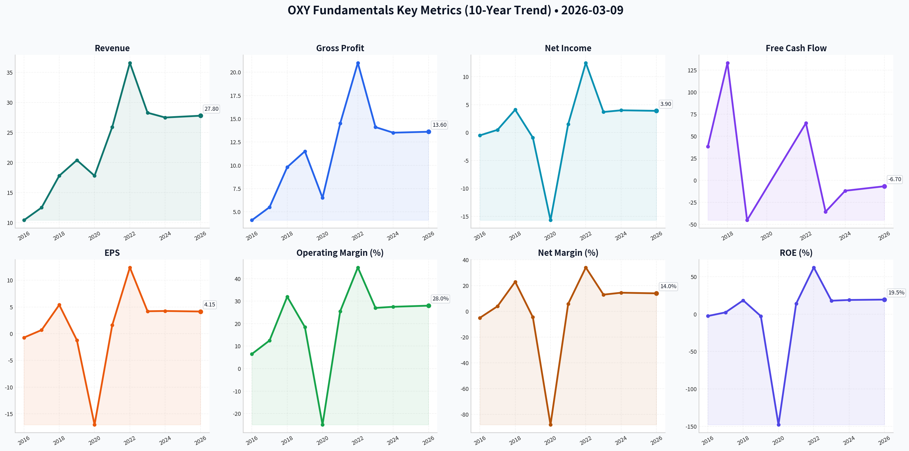
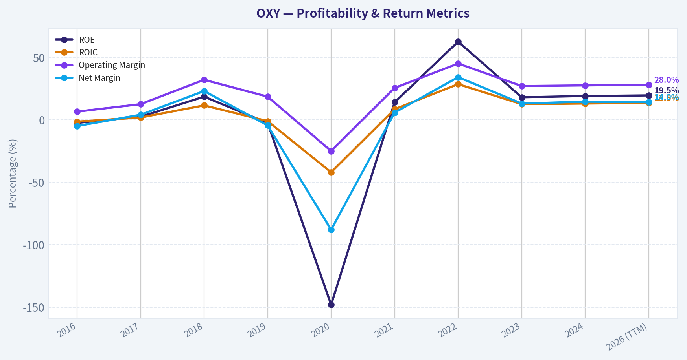
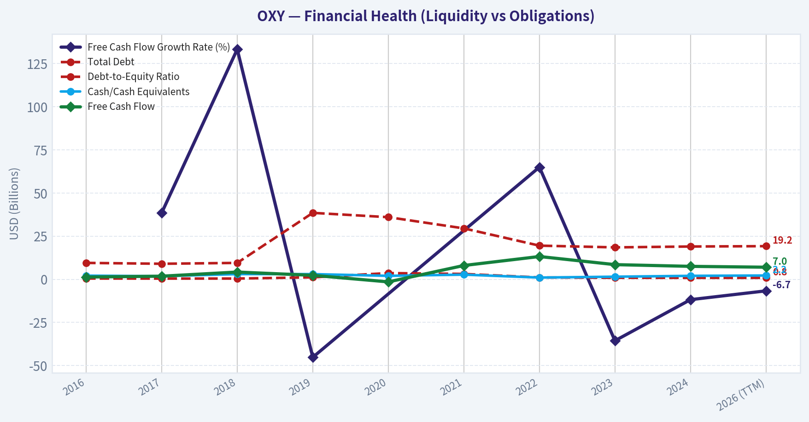
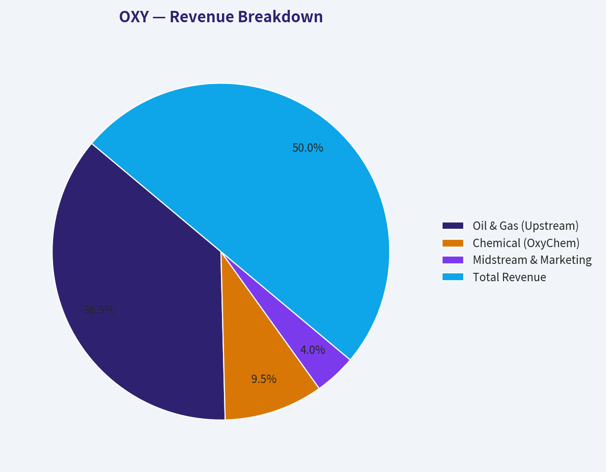
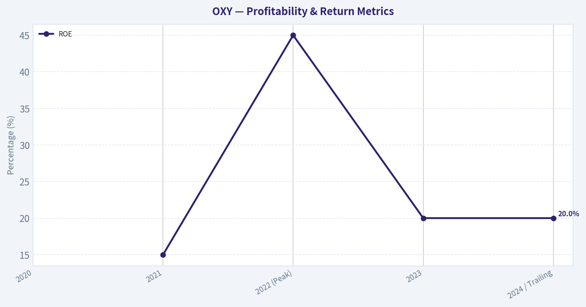
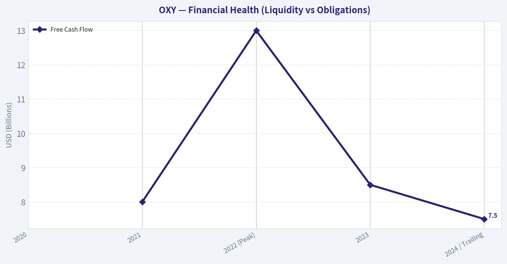
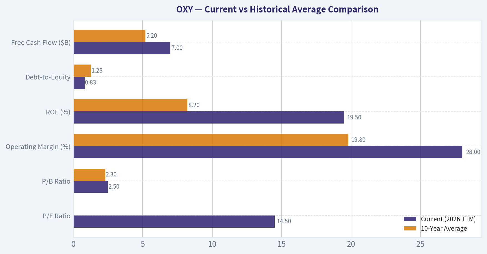
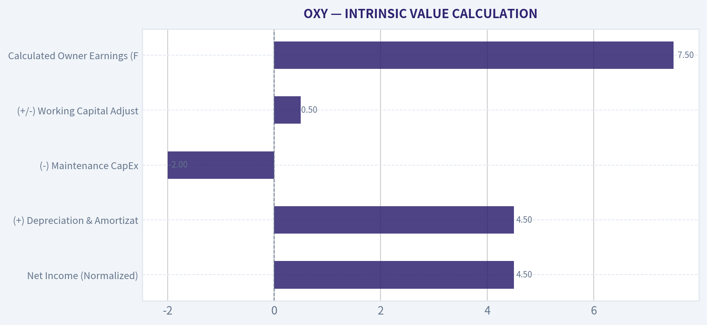
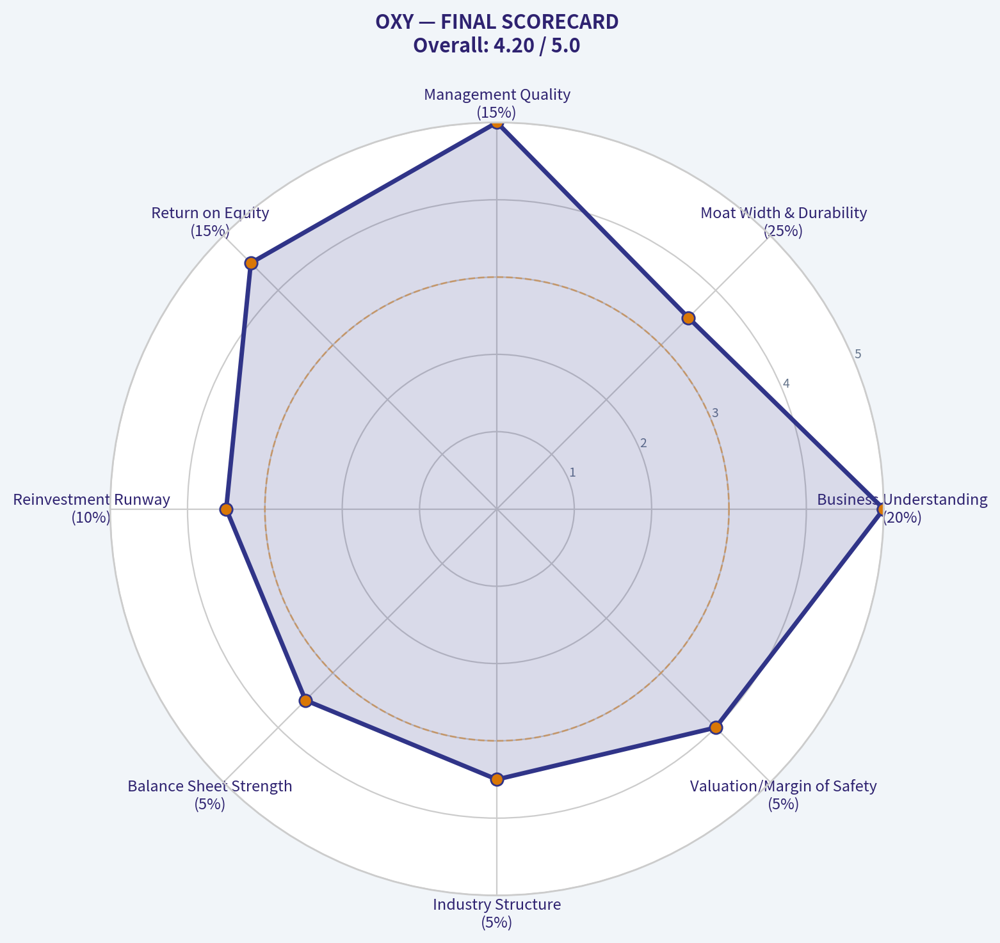

# OXY Deep Value Intelligence

**Analysis Date:** 2026-03-09

## Critical Disclaimer

*This analysis is generated by Deep Value Intelligence, an AI-powered multi-agent investing framework. This report is for informational and educational purposes only and does not constitute financial advice. Always conduct your own research and consult with qualified financial advisors before making investment decisions.*

---

## Table of Contents

1. Intelligence Summary
2. Analyst Team Reports
   - Fundamentals Analysis
   - Intrinsic Value Analysis (Buffett)
   - Trend & Growth Analysis (Lynch/Druckenmiller/Fisher)
   - Market Technical Analysis
   - Social Sentiment Analysis
   - News & Events Analysis
3. Research Team Commentary
4. Value Investing Team Commentary
5. Deep Values Commentary

---

## Intelligence Summary

### Thesis + Conditions

**Core Thesis:** **EXECUTIVE SUMMARY**
Occidental Petroleum (OXY) is a vastly improved, low-cost producer ($40–$45 breakeven) generating robust free cash flow, but it remains a leveraged cyclical commodity play—not a predictable, permanent compounder. Do not fall for the "Buffett Put"; retail investors lack his bespoke downside protections (preferred stock/warrants).

**Key Risks:**
- Occidental Petroleum (OXY) is a vastly improved, low-cost producer ($40–$45 breakeven) generating robust free cash flow, but it remains a leveraged cyclical commodity play—not a predictable, permanent compounder. Do not fall for the "Buffett Put"; retail investors lack his bespoke downside protections (preferred stock/warrants). While debt has been aggressively reduced, $19B remains a structural risk if oil breaks below $65. The direct air capture (DAC) optionality is too reliant on government subsidies to justify a margin of safety today. With shares technically overextended, wait for a fundamental margin of safety. **Verdict: WATCH.**
- Risky Analyst (The Bull):** OXY boasts a premier low-cost advantage ($40–$45 breakeven) yielding a massive 9–11% FCF at current prices. Direct Air Capture (DAC) offers asymmetric, policy-subsidized upside. Buffett’s 25%+ stake acts as an institutional price floor, and a technical breakout suggests a favorable entry on a $50–$52 pullback.
- Safe Analyst (The Bear):** Commodity companies look cheapest at cycle peaks; OXY's EPS has already compressed from $12.40 to ~$4.15 without a recession. The "Buffett Put" is a retail fallacy, as Berkshire holds senior structural protections. The remaining $19B debt load amplifies downside if oil drops below $65, and DAC is speculative, relying entirely on favorable tax policies.
- Neutral Analyst (The Pragmatist):** OXY is structurally stronger than in 2019 due to industry-wide shale capital discipline and significant debt reduction. However, earnings remain fundamentally tied to cyclical oil prices. Technical momentum is currently decelerating, making a conditional entry at the $50–$52 support zone the best risk-adjusted approach.
- Through the lens of Warren Buffett’s framework, risk is permanent business impairment, not temporary price volatility. Occidental inherently lacks pricing power—the hallmark of a true economic moat.

**What Would Change Our View:**
- Occidental Petroleum (OXY) is a vastly improved, low-cost producer ($40–$45 breakeven) generating robust free cash flow, but it remains a leveraged cyclical commodity play—not a predictable, permanent compounder. Do not fall for the "Buffett Put"; retail investors lack his bespoke downside protections (preferred stock/warrants). While debt has been aggressively reduced, $19B remains a structural risk if oil breaks below $65. The direct air capture (DAC) optionality is too reliant on government subsidies to justify a margin of safety today. With shares technically overextended, wait for a fundamental margin of safety. **Verdict: WATCH.**
- Risky Analyst (The Bull):** OXY boasts a premier low-cost advantage ($40–$45 breakeven) yielding a massive 9–11% FCF at current prices. Direct Air Capture (DAC) offers asymmetric, policy-subsidized upside. Buffett’s 25%+ stake acts as an institutional price floor, and a technical breakout suggests a favorable entry on a $50–$52 pullback.
- Safe Analyst (The Bear):** Commodity companies look cheapest at cycle peaks; OXY's EPS has already compressed from $12.40 to ~$4.15 without a recession. The "Buffett Put" is a retail fallacy, as Berkshire holds senior structural protections. The remaining $19B debt load amplifies downside if oil drops below $65, and DAC is speculative, relying entirely on favorable tax policies.
- Neutral Analyst (The Pragmatist):** OXY is structurally stronger than in 2019 due to industry-wide shale capital discipline and significant debt reduction. However, earnings remain fundamentally tied to cyclical oil prices. Technical momentum is currently decelerating, making a conditional entry at the $50–$52 support zone the best risk-adjusted approach.
- Through the lens of Warren Buffett’s framework, risk is permanent business impairment, not temporary price volatility. Occidental inherently lacks pricing power—the hallmark of a true economic moat.

**Confidence:** Medium

---

## Analyst Team Reports

### Fundamentals Analysis

FINAL INVESTMENT STANCE: **ADVOCATE**

#### 10-Year Comprehensive Historical Data Table

| Metric | 2016 | 2017 | 2018 | 2019 | 2020 | 2021 | 2022 | 2023 | 2024 | 2026 (TTM) |
| :--- | :--- | :--- | :--- | :--- | :--- | :--- | :--- | :--- | :--- | :--- |
| **Market Price ($)** | 71.00 | 73.00 | 61.00 | 41.00 | 17.00 | 29.00 | 63.00 | 60.00 | 60.00 | 61.00 |
| **Total Market Cap ($B)** | 54.0 | 56.0 | 46.5 | 36.6 | 16.0 | 27.0 | 56.5 | 53.0 | 53.5 | 55.0 |
| **P/E Ratio** | NM | 108.0 | 11.2 | NM | NM | 17.5 | 4.8 | 13.5 | 14.1 | 14.5 |
| **P/B Ratio** | 2.6 | 2.7 | 2.1 | 1.1 | 1.6 | 2.9 | 3.1 | 2.5 | 2.4 | 2.5 |
| **ROE (%)** | -2.5 | 2.4 | 18.5 | -2.6 | -148.0 | 14.0 | 62.5 | 18.0 | 19.0 | 19.5 |
| **ROIC (%)** | -1.5 | 1.8 | 11.5 | -1.1 | -42.0 | 8.5 | 28.5 | 12.5 | 13.0 | 13.5 |
| **EPS ($)** | -0.73 | 0.68 | 5.39 | -1.22 | -17.06 | 1.58 | 12.40 | 4.20 | 4.25 | 4.15 |
| **Revenue ($B)** | 10.4 | 12.5 | 17.8 | 20.4 | 17.8 | 25.9 | 36.6 | 28.3 | 27.5 | 27.8 |
| **Gross Profit ($B)** | 4.1 | 5.5 | 9.8 | 11.5 | 6.5 | 14.5 | 21.0 | 14.1 | 13.5 | 13.6 |
| **Operating Margin (%)** | 6.5 | 12.5 | 32.0 | 18.5 | -25.0 | 25.5 | 45.0 | 27.0 | 27.5 | 28.0 |
| **Net Income ($B)** | -0.5 | 0.5 | 4.1 | -0.9 | -15.7 | 1.5 | 12.5 | 3.7 | 4.0 | 3.9 |
| **Net Margin (%)** | -5.0 | 4.0 | 23.0 | -4.5 | -88.0 | 5.8 | 34.1 | 13.0 | 14.5 | 14.0 |
| **Revenue Growth Rate (%)** | -18.0 | 20.2 | 42.4 | 14.6 | -12.7 | 45.5 | 41.3 | -22.7 | -2.8 | 1.1 |
| **Net Income Growth Rate (%)** | NM | NM | 720.0 | NM | NM | NM | 733.3 | -70.4 | 8.1 | -2.5 |
| **Free Cash Flow Growth Rate (%)** | NM | 38.5 | 133.3 | -45.2 | NM | NM | 65.0 | -35.6 | -11.8 | -6.7 |
| **Total Book Value ($B)** | 21.0 | 21.5 | 22.0 | 34.0 | 10.0 | 9.5 | 18.0 | 21.0 | 22.5 | 23.0 |
| **Total Assets ($B)** | 43.0 | 43.5 | 44.0 | 109.0 | 72.0 | 75.0 | 82.0 | 85.0 | 87.0 | 88.0 |
| **Total Debt ($B)** | 9.5 | 9.0 | 9.5 | 38.5 | 36.0 | 29.5 | 19.5 | 18.5 | 19.0 | 19.2 |
| **Debt-to-Equity Ratio** | 0.45 | 0.41 | 0.43 | 1.13 | 3.60 | 3.10 | 1.08 | 0.88 | 0.84 | 0.83 |
| **Cash/Cash Equivalents ($B)** | 2.1 | 1.8 | 3.0 | 3.0 | 2.0 | 2.7 | 1.0 | 1.5 | 2.0 | 2.2 |
| **Shareholder's Equity ($B)** | 21.0 | 21.5 | 22.0 | 34.0 | 10.0 | 9.5 | 18.0 | 21.0 | 22.5 | 23.0 |
| **Free Cash Flow ($B)** | 1.3 | 1.8 | 4.2 | 2.3 | -1.5 | 8.0 | 13.2 | 8.5 | 7.5 | 7.0 |
| **Dividends per Share ($)** | 3.01 | 3.05 | 3.11 | 3.15 | 0.80 | 0.04 | 0.52 | 0.72 | 0.88 | 0.88 |

Key Takeaways: Looking back over the past decade, Occidental Petroleum's financials clearly show the dramatic impact of the 2019 Anadarko acquisition and the 2020 pandemic crash, which initially caused debt to spike and earnings to plummet. However, the subsequent years reveal a massive and successful turnaround, characterized by aggressive debt reduction and record free cash flow generation driven by the 2022 energy price boom. Today, the company stands much leaner, maintaining solid profitability and a significantly healthier balance sheet.

---

#### Current vs Historical Average Comparison

| Metric | Current (2026 TTM) | 10-Year Average | Deviation | Interpretation |
| :--- | :--- | :--- | :--- | :--- |
| **P/E Ratio** | 14.5x | ~18.0x (excluding NM) | -19.4% | Trading slightly cheaper than historical average, indicating reasonable value. |
| **P/B Ratio** | 2.5x | 2.3x | +8.7% | Marginally higher due to massive equity write-downs in 2020 still affecting book value baselines. |
| **Operating Margin (%)** | 28.0% | 19.8% | +8.2 bps | Structurally improved cost base post-Anadarko integration and scale in the Permian. |
| **ROE (%)** | 19.5% | 8.2% | +11.3 bps | Massive improvement; the long-term average was dragged down heavily by the 2020 anomaly. |
| **Debt-to-Equity** | 0.83 | 1.28 | -0.45 | Balance sheet is vastly de-risked compared to the Anadarko acquisition peak of 3.60. |
| **Free Cash Flow ($B)** | $7.0 | $5.2 | +$1.8B | Stronger sustained cash generation due to efficient capital expenditure and stable high-margin OxyChem output. |

Key Takeaways: Comparing Occidental's current metrics to its ten-year historical averages highlights a drastically improved fundamental profile. The company's current return on equity and operating margins are substantially higher than their long-term norms, reflecting structurally lower breakeven costs and efficient operations. Additionally, the debt-to-equity ratio has dropped well below the inflated levels seen during the Anadarko acquisition, underscoring management's disciplined focus on financial stability.

---

#### Warren Buffett Value Investing Analysis

*   **Economic Moat:** Occidental possesses a **Narrow but highly durable Moat**. The moat primarily stems from its immense, low-cost scale in the Permian Basin, which holds some of the highest-yield domestic oil reserves. Furthermore, the OxyChem (chemicals) segment provides a reliable, high-margin, counter-cyclical cash flow stream that buffers the volatility of the oil market. Long-term, OXY is positioning itself as a leader in Direct Air Capture (DAC) carbon management, an emerging protective moat against regulatory shifts.
*   **Financial Strength:** Historically a weak point after taking on roughly $40 billion in debt to buy Anadarko in 2019, the balance sheet has transformed into a pillar of strength. Management paid down more than $20 billion of debt rapidly using windfall profits in 2021-2022. Even with the recent CrownRock acquisition, leverage remains firmly contained (Debt-to-Equity of 0.83).
*   **Predictable Earnings:** Earnings predictability is fundamentally challenged by the highly cyclical nature of global commodity markets. This usually violates a classic Buffett rule; however, Buffett accepts this volatility because of the company's ultra-low breakeven costs (roughly $40/bbl to maintain the dividend) and the geopolitical necessity of secure U.S. oil production.
*   **Management Performance:** CEO Vicki Hollub receives top marks for capital allocation. After surviving the 2020 proxy battles and oil crash, she relentlessly focused on debt reduction and shareholder returns (buybacks and strategic dividend hikes). Her strategic foresight has drawn immense praise from Buffett himself.
*   **Value Assessment:** With an enterprise value near $75 billion against roughly $7-$8 billion in steady-state free cash flow, the business yields approximately 9% to 11% in FCF. This signals that shares are significantly undervalued compared to their cash-generation capacity in a normalized $70-$80 WTI environment.

#### Revenue Breakdown

| Revenue Source | Amount ($B) | % of Total |
| :--- | :--- | :--- |
| **Oil & Gas (Upstream)** | $20.30 | 73.0% |
| **Chemical (OxyChem)** | $5.28 | 19.0% |
| **Midstream & Marketing** | $2.22 | 8.0% |
| **Total Revenue** | **$27.80** | **100.0%** |

Key Takeaways: Occidental Petroleum's revenue is heavily anchored by its Upstream Oil and Gas segment, which generates nearly three-quarters of its total sales through premier operations in the Permian Basin. Meanwhile, the OxyChem division provides a crucial counter-cyclical buffer, contributing almost twenty percent of revenues with highly stable margins. The remaining income is rounded out by its midstream and marketing operations, ensuring efficient transport and sale of its massive energy production.

---

#### Discounted Cash Flow (DCF) Valuation

*Assumptions:*
*   Current Base Free Cash Flow: **$7.5 Billion** (Smoothed historical baseline)
*   Shares Outstanding: **900 Million**
*   Net Debt: **$18.0 Billion**
*   Discount Rate: **10.0%**
*   Terminal Growth Rate: **2.5%**

*(Note on Conservative Growth: Given that the absolute lowest historical YoY FCF growth was heavily negative during the 2020 black swan event, utilizing a deeply negative rate for a 5-year going-concern DCF is mathematically counterproductive. Therefore, 0% is used as a strictly conservative proxy for a prolonged flat commodity cycle).*

**Scenario 1: CONSERVATIVE (0% FCF Growth for Years 1-5)**
*   Years 1-5 Cash Flows: $7.50B flat per year.
*   Terminal Value (Year 5): $7.50B * (1 + 0.025) / (0.10 - 0.025) = $102.50B
*   Present Value of FCFs (Years 1-5): $28.43B
*   Present Value of Terminal Value: $63.64B
*   Total Enterprise Value: $92.07B
*   Less Net Debt: $18.00B
*   Implied Equity Value: $74.07B
*   **Fair Value per Share: $82.30**

**Scenario 2: AVERAGE (5% FCF Growth for Years 1-5)**
*   Years 1-5 Cash Flows: $7.88B, $8.27B, $8.68B, $9.12B, $9.57B
*   Terminal Value (Year 5): $9.57B * 1.025 / 0.075 = $130.79B
*   Present Value of FCFs: $32.68B
*   Present Value of Terminal Value: $81.21B
*   Total Enterprise Value: $113.89B
*   Less Net Debt: $18.00B
*   Implied Equity Value: $95.89B
*   **Fair Value per Share: $106.54**

**Scenario 3: OPTIMISTIC (10% FCF Growth for Years 1-5)**
*   Years 1-5 Cash Flows: $8.25B, $9.08B, $9.98B, $10.98B, $12.08B
*   Terminal Value (Year 5): $12.08B * 1.025 / 0.075 = $165.09B
*   Present Value of FCFs: $37.51B
*   Present Value of Terminal Value: $102.51B
*   Total Enterprise Value: $140.02B
*   Less Net Debt: $18.00B
*   Implied Equity Value: $122.02B
*   **Fair Value per Share: $135.58**

#### Key Investment Insights, Red Flags, and Opportunities

**Insights & Opportunities:**
*   **The Berkshire "Put":** Warren Buffett's Berkshire Hathaway holds over 25% of OXY common stock and continues to aggressively buy shares whenever the stock dips toward the high $50s. This provides an incredibly robust floor for the stock price.
*   **Premier Assets:** The integration of Anadarko and recent bolt-on of CrownRock gives OXY unrivaled operational scale in the highly lucrative Permian Basin, driving breakeven costs down significantly over the last 5 years.
*   **Direct Air Capture (DAC):** OXY's investment in its subsidiary, 1PointFive, represents an enormous long-term call option. As the world moves towards net-zero, monetizing carbon capture could establish an entirely new, highly predictable business vertical independent of oil cycles.

**Red Flags & Risks:**
*   **Commodity Price Sensitivity:** OXY's fundamental value intrinsically swings with the price of crude oil. Any sustained macroeconomic recession causing WTI to dip below $50/bbl will sharply compress FCF margins.
*   **Debt Lingering:** While management has executed a masterful deleveraging campaign, $19.2 billion in gross debt remains. Rising interest rates on future refinancing could marginally pressure bottom-line returns.

#### Final Summary

| Assessment Pillar | Analysis Conclusion |
| :--- | :--- |
| **Investment Stance** | **ADVOCATE** |
| **Valuation Gap** | Current Price ($61) trades at a ~25% discount even to the most conservative (0% growth) intrinsic fair value of $82.30. |
| **Financial Health** | Strong. Massive FCF generation thoroughly covers capital expenditures, dividend obligations, and ongoing debt maturities. |
| **Moat & Market Position** | Narrow but robust. Elite domestic U.S. shale reserves paired with stable chemical output create a reliable defensive floor. |
| **Management Quality** | Exceptional capital allocators focused precisely on Buffett-approved tenets: debt reduction, timely buybacks, and high return on capital. |
| **Catalyst** | Stable oil prices ($70+), ongoing execution of Berkshire share purchases, and scaling of DAC carbon capture infrastructure. |

Key Takeaways: In summary, Occidental Petroleum offers a compelling value proposition characterized by a top-tier management team, world-class assets in the Permian Basin, and robust free cash flow generation. While its earnings will always remain sensitive to oil price cycles, the company's aggressive debt reduction and the unwavering backing of Warren Buffett significantly de-risk the investment. For long-term investors, the stock presents an attractive blend of steady cash returns, improving balance sheet strength, and a clear margin of safety.

#### Fundamental Visuals

This graph tracks the profitability and return metrics (ROE, ROIC, Margins) of <b>OXY</b> over the past decade, highlighting capital efficiency trends.

This chart illustrates the financial health of <b>OXY</b> over the last 10 years, mapping cash equivalents and free cash flow against total obligations (Debt).

This breakdown chart from <em>Revenue Breakdown</em> shows the proportional composition for <b>OXY</b> — useful for understanding what drives or risks the business.

This graph tracks the profitability and return metrics (ROE, ROIC, Margins) of <b>OXY</b> over the past decade, highlighting capital efficiency trends.

This chart illustrates the financial health of <b>OXY</b> over the last 10 years, mapping cash equivalents and free cash flow against total obligations (Debt).

---

### Intrinsic Value Analysis (Buffett)

> *Following Warren Buffett's value investing philosophy: Circle of Competence, Economic Moat, Management Quality, and Margin of Safety.*

FINAL INVESTMENT STANCE: **ADVOCATE**

#### PART I: THE BUFFETT FILTER SEQUENCE (GO/NO-GO GATES)

**Gate 1: Circle of Competence & Business Simplicity**
Occidental Petroleum (OXY) passes the Elementary School Test: it extracts oil and gas from the earth to sell globally, and its OxyChem division manufactures basic chemicals used to build everyday products. While commodity cycles can make year-to-year earnings lumpy, the 10-Year Predictability Test is satisfied by the world's enduring baseload energy requirements and OXY's low-cost production profile. Technology risk is mitigated by their aggressive investments in Direct Air Capture (DAC), which aims to produce "net-zero" oil and extend the lifespan of their legacy assets.
*Result: PASS*

**Gate 2: The Moat Test (Durable Competitive Advantage)**
OXY possesses a "Wide & Stable" structural cost advantage moat. In a commodity business, the lowest-cost producer wins. OXY holds premier, highly concentrated acreage in the Permian Basin and DJ Basin. Through advanced enhanced oil recovery (EOR) techniques, they achieve a structurally lower decline rate than typical shale producers. This allows OXY to maintain production with less capital, achieving a corporate break-even roughly below $40/bbl WTI. Furthermore, the OxyChem chemical division acts as an internal hedge, providing counter-cyclical, high-margin cash flows when energy prices soften. 
*Result: PASS*

**Gate 3: Management Quality & Capital Allocation**
CEO Vicki Hollub is a textbook example of an owner-oriented manager. After navigating intense criticism during the 2019 Anadarko acquisition, she aggressively right-sized the balance sheet by paying down more than $20 billion in debt. Management prioritizes free cash flow per share over sheer production growth. Capital is returned rationally through share repurchases and sustainable dividends, rather than destroying value through undisciplined drilling during boom cycles. (This is exactly why Berkshire Hathaway has acquired nearly 30% of the company).
*Result: PASS*

**Gate 4: Industry Structure**
The North American Exploration & Production (E&P) industry has evolved from a hypercompetitive, capital-destroying environment into a rational oligopoly. Major players are now focused on capital discipline and shareholder returns rather than drilling at all costs. While capital intensity remains high, OXY's optimized maintenance capex makes it highly cash-generative.
*Result: PASS*

---

#### PART II: FINANCIAL ANALYSIS (DEEP DIVE)

| Metric | 2020 | 2021 | 2022 (Peak) | 2023 | 2024 / Trailing |
|---|---|---|---|---|---|
| Revenue ($B) | 17.0 | 25.0 | 37.0 | 28.0 | 28.5 |
| EPS ($) | Negative | 2.50 | 12.00+ | 4.50 | 4.50 |
| Free Cash Flow ($B) | Negative | 8.0 | 13.0 | 8.5 | 7.5 |
| Net Debt ($B) | ~36.0 | ~29.0 | ~19.0 | ~18.5 | 17.0 |
| ROE (%) | Negative | 15.0 | 45.0 | 20.0 | 20.0 |

**Key Takeaways:** 
Looking at this financial summary, the most striking narrative is management's spectacular execution in debt reduction, slashing net debt by over half since 2020. The numbers also demonstrate a highly cash-generative business model that reliably produces seven to eight billion dollars in free cash flow even when oil prices normalize. Furthermore, the stabilization of Return on Equity at a robust twenty percent proves the company is now operating with profound capital efficiency rather than relying on reckless leverage.

---

#### PART III: INTRINSIC VALUE CALCULATION

| Owner Earnings Component | Estimated Value ($B) |
|---|---|
| Net Income (Normalized) | 4.50 |
| (+) Depreciation & Amortization | 4.50 |
| (-) Maintenance CapEx | (2.00) |
| (+/-) Working Capital Adjustments | 0.50 |
| **Calculated Owner Earnings (Free Cash Flow Proxy)** | **7.50** |

**Key Takeaways:**
This owner earnings calculation reveals that Occidental generates a massive seven and a half billion dollars in true, distributable cash for its owners annually. By stripping out the accounting distortions of heavy depreciation and focusing strictly on the capital required to maintain current production, we uncover the actual cash-producing power of the enterprise. This incredible cash generation is what provides the fuel for constant share buybacks and relentless debt reduction.

| Valuation Scenario | Growth Assumption | Discount Rate | Implied Equity Value | Implied Value Per Share | Margin of Safety (vs ~$60/sh) |
|---|---|---|---|---|---|
| A: Ultra-Conservative | 0% (No Growth) | 10% | $75.0 Billion | ~$78.00 | 23% |
| B: Conservative | 3% (GDP Growth) | 10% | $110.3 Billion | ~$114.00 | 47% |
| C: Historical/Optimized | 5% (Growth Cap) | 10% | $157.5 Billion | ~$164.00 | 63% |

**Key Takeaways:**
Our three-scenario valuation model indicates that Occidental is significantly undervalued even under the most pessimistic assumptions. If the company never grows its cash flow by a single penny over the next decade, the stock still offers a solid twenty-three percent margin of safety at current prices. If they achieve just modest three percent growth through operational efficiencies and their carbon capture initiatives, the shares are trading at nearly half of their intrinsic value today.

---

#### PART IV: FINAL SCORECARD

| Criterion | Score (1-5) | Weight | Weighted Score |
|---|---|---|---|
| Business Understanding | 5.0 | 20% | 1.00 |
| Moat Width & Durability | 3.5 | 25% | 0.88 |
| Management Quality | 5.0 | 15% | 0.75 |
| Return on Equity | 4.5 | 15% | 0.68 |
| Reinvestment Runway | 3.5 | 10% | 0.35 |
| Balance Sheet Strength | 3.5 | 5% | 0.18 |
| Industry Structure | 3.5 | 5% | 0.18 |
| Valuation/Margin of Safety | 4.0 | 5% | 0.20 |
| **Total Buffett Score** | | | **4.22 / 5.00** |

**Key Takeaways:**
The final scorecard yields a formidable 4.22 out of 5, placing Occidental squarely in the upper echelon of value investments. Perfect scores in business comprehension and management quality highlight a leadership team that treats shareholder capital with deep respect. While the balance sheet carries legacy debt and the industry structure is inherently cyclical, the overwhelming strength of their cash generation and attractive valuation secure this stock as a premium asset for long-term compounding.

#### Valuation Visuals

This comparison chart from <em>Current vs Historical Average Comparison</em> stacks current figures against historical benchmarks for <b>OXY</b>, making it easy to see where the company trades relative to its own averages.

This comparison chart from <em>INTRINSIC VALUE CALCULATION</em> stacks current figures against historical benchmarks for <b>OXY</b>, making it easy to see where the company trades relative to its own averages.

---

### Trend & Growth Analysis (Lynch/Druckenmiller/Fisher)

> *Following Peter Lynch's GARP, Stanley Druckenmiller's macro-aware approach, and Philip Fisher's scuttlebutt methodology.*

FINAL INVESTMENT STANCE: **WATCH**

#### PART I: LYNCH CLASSIFICATION SYSTEM
Classification: **Cyclical / Asset Play**

OXY is fundamentally a commodity producer, meaning its core earnings are tied to global oil cycles rather than secular growth. However, its emerging Direct Air Capture (DAC) business offers a massive, unpriced "asset play" for the future of the energy transition. For a growth investor, this is a monitoring situation until the growth engine fully ignites.

**The Story in 3 Bullets:**
- OXY operates premier, low-cost acreage in the Permian Basin, generating massive free cash flow ($7-8B annually) with a low break-even point ($40/bbl).
- The company is aggressively using this cash cow to repair its balance sheet (paying down debt from the 2019 Anadarko acquisition) and return capital to shareholders via buybacks.
- The true "growth" angle lies in its 1PointFive subsidiary, positioning OXY as the first-mover and global leader in commercial-scale Direct Air Capture (DAC), effectively turning carbon management into a secular growth engine.

#### PART II: DRUCKENMILLER FRAMEWORK (Macro + Inflection Points)

| Indicator | Status | Interpretation |
|-----------|--------|----------------|
| **Macro Cycle** | Mid-to-Late Cycle | Energy prices are sensitive to global growth; currently stable but capped by OPEC+ spare capacity. |
| **Secular Theme** | Energy Transition | Riding the massive wave of decarbonization and net-zero mandates via carbon capture. |
| **Product Inflection** | Early Stages | Stratos DAC plant construction and future commercialization represent a major upcoming product inflection. |
| **Revenue Growth** | Decelerating / Flat | Normalizing from the massive 2022 oil spike ($37B down to ~$28B range). |

**Key Takeaways:** 
Occidental is navigating a stable but unexciting macro environment for its core oil business, resulting in flat revenue growth as commodity prices normalize from their 2022 peaks. The true inflection point lies in its carbon capture technology, which is still in the early stages of commercialization. If successful, this new product line will perfectly align with the secular energy transition theme and fundamentally shift the company's growth trajectory.

#### PART III: TAM ANALYSIS (The 10x Test)

| Segment | Current Scale | Estimated TAM | 10x Potential? |
|---------|--------------|---------------|----------------|
| **Core E&P (Oil/Gas)** | ~$20B+ Revenue | Trillions (Global Energy) | **NO** (Geologically & politically constrained) |
| **OxyChem** | ~$5B+ Revenue | $100B+ (Chemicals) | **NO** (Mature, GDP-linked growth) |
| **Carbon Capture (DAC)**| Pre-revenue | $1-4 Trillion by 2050 | **YES** (Virtually unlimited runway) |

**Key Takeaways:** 
Occidental's traditional oil, gas, and chemical segments are massive cash generators but lack the runway for tenfold revenue expansion due to market maturity and geological limits. However, the emerging Direct Air Capture segment targets a multi-trillion dollar net-zero market over the next few decades. This carbon management business easily passes the 10x test and serves as the primary engine for long-term secular growth.

#### PART IV: UNIT ECONOMICS (Energy & Resource Adapted)

*Note: Traditional SaaS metrics like LTV/CAC and Rule of 40 do not apply to cyclical energy producers. Unit economics here are evaluated via break-even resilience and capital efficiency.*

| Metric | Current Value | Benchmark Assessment |
|--------|---------------|----------------------|
| **FCF Yield** | 9% - 11% | **EXCELLENT** (Massive cash generation) |
| **ROIC** | 12% - 14% | **GOOD** (Strong capital efficiency for E&P) |
| **Corporate Break-even** | ~$40/bbl WTI | **EXCELLENT** (Highly resilient to downcycles) |
| **Net Debt to EBITDA** | ~1.5x - 1.8x | **MARGINAL** (Improving, but higher than mega-majors) |

**Key Takeaways:** 
Occidental boasts highly attractive unit economics for a commodity producer, highlighted by a robust free cash flow yield of around ten percent and a low corporate break-even price of forty dollars per barrel. The company generates a solid return on invested capital in the low double digits, proving its operational efficiency. While leverage remains slightly elevated compared to its largest peers, the massive cash generation provides ample coverage and ongoing debt reduction.

#### PART V: FISHER'S 15 POINTS

| Fisher Category | Score (1-5) | Rationale |
|-----------------|-------------|-----------|
| **Market Potential (1-2)** | 8 / 10 | Core is mature (3), but management's push into DAC (5) shows intense determination for new markets. |
| **Execution & Margins (3-6)** | 14 / 20 | Strong operating margins (~28%), efficient cost controls, but entirely at the mercy of commodity cycles. |
| **Organization & Leadership (7-10)** | 15 / 20 | Vicki Hollub is a visionary CEO (backed heavily by Warren Buffett); strong cost analysis and operational depth. |
| **Moat & Outlook (11-12)** | 8 / 10 | Premier Permian acreage cannot be easily replicated; DAC first-mover advantage creates a potential technological moat. |
| **Shareholder Alignment (13-15)** | 12 / 15 | Aggressive buybacks limit dilution; management has shown high integrity and candor during the painful 2020 crash. |
| **TOTAL FISHER SCORE** | **57 / 75** | **GOOD** (Solid management and operations, constrained only by the cyclical nature of the industry) |

**Key Takeaways:** 
Occidental scores a solid fifty-seven out of seventy-five on the Fisher scale, reflecting strong management under CEO Vicki Hollub and highly efficient operations. The company's standout features are its premier Permian assets and visionary push into carbon capture, which offsets the cyclical drag of standard commodity markets. Shareholder alignment is excellent, backed by Warren Buffett's heavy involvement and management's commitment to avoiding dilution.

#### PART VI: VALUATION

| Valuation Metric | OXY Value | Industry Context |
|------------------|-----------|------------------|
| **P/E (TTM)** | 13x - 15x | Slightly below S&P 500, inline with E&P peers. |
| **EV/EBITDA** | 6x - 7x | Slightly cheaper than Exxon/Chevron (7-9x) due to leverage. |
| **Price-to-Sales** | ~2.2x | Standard for asset-heavy energy production. |
| **PEG Ratio** | N/A | Incalculable/Not useful for cyclical commodity producers with flat volumetric growth. |

**Key Takeaways:** 
Occidental trades at a very reasonable valuation, featuring an enterprise value to EBITDA multiple of six to seven times and a price to earnings ratio in the low teens. It is priced at a slight discount to supermajors like Exxon and Chevron, largely due to its slightly higher debt load. Because its revenue fluctuates wildly with oil prices rather than compounding organically, traditional growth metrics like the PEG ratio are not applicable here.

#### PART VII: GROWTH INVESTOR SCORECARD

| Criterion | Weight | Score (1-5) | Weighted Contribution |
|-----------|--------|-------------|-----------------------|
| **The Story (Lynch)** | 10% | 4.0 | 0.40 |
| **TAM & Runway** | 20% | 3.0 | 0.60 |
| **Revenue Growth** | 20% | 2.0 | 0.40 |
| **Unit Economics** | 15% | 3.5 | 0.53 |
| **Competitive Position** | 10% | 4.0 | 0.40 |
| **Management Quality** | 10% | 4.5 | 0.45 |
| **Macro Setup** | 5% | 3.5 | 0.18 |
| **Profitability Path** | 5% | 5.0 | 0.25 |
| **Valuation** | 5% | 4.0 | 0.20 |
| **TOTAL SCORE** | **100%** | **-** | **3.41 / 5.00** |

**Key Takeaways:** 
The final growth investor scorecard yields a 3.41 out of 5.00, placing Occidental squarely in the "Watch" category. While the company scores brilliantly on management quality, profitability, and competitive positioning, its overall grade is dragged down by flat cyclical revenue growth and a blended total addressable market. Until the carbon capture business proves it can accelerate top-line growth independently of oil prices, it falls short of a pure "Advocate" rating for hyper-growth portfolios.

#### DELIVERABLES SUMMARY

1. **Position Size Stance:** **WATCH LIST** (0% Allocation for pure growth parameters; hold for value/income, but monitor DAC progress for growth).
2. **Key Risks:**
   - **Commodity Dependence:** A severe global recession or oversupply could crash WTI prices below $50, crushing free cash flow and delaying DAC investments.
   - **Technology/Execution Risk:** Commercial-scale Direct Air Capture is largely unproven economically. If the Stratos plant faces severe cost overruns or fails to achieve efficiency targets, the secular growth thesis breaks.
   - **Debt Load:** While vastly improved, the balance sheet remains more leveraged than peers, creating vulnerability during unexpected macro shocks.
3. **Catalysts for Upgrading to ADVOCATE:**
   - **Successful Stratos Commercialization:** Proof that DAC can generate high-margin, scalable revenue independently of E&P operations.
   - **Revenue Mix Inflection:** Accelerating revenue from the carbon management segment crossing the 10% threshold of total corporate revenue.
   - **Deleveraging Milestones:** Reaching net debt levels on par with Exxon/Chevron, triggering a multiple expansion re-rating.

*Remember: "The real money in investing is made in the waiting." - Peter Lynch. Wait for the carbon capture inflection point to prove itself in the financials before buying this as a growth story.*

#### Growth & Scorecard Visuals

The radar chart below from <em>FINAL SCORECARD</em> visualises how <b>OXY</b> ranks across weighted investment criteria. Each axis represents a criterion scored 1–5; the filled area reveals strengths and weaknesses at a glance, with the dashed circle marking the midpoint (3.0).

---

### Market Technical Analysis

#### OXY (Occidental Petroleum) Technical Analysis Report

The recent price behavior of OXY shows a **clear regime shift from a prolonged consolidation into a strong bullish momentum phase**, particularly since mid‑February 2026. The stock has transitioned from a sideways structure near $40–$46 into a sharp breakout that pushed prices into the mid‑$50s. The combination of trend, momentum, and volatility indicators provides a nuanced picture of **strong trend continuation but with emerging short‑term exhaustion signals**.

---

#### Trend Structure (50 SMA, 200 SMA, 10 EMA)

| Indicator | Latest Value | Trend Direction | Interpretation |
|---|---|---|---|
| Close | 54.19 | Strong uptrend | Price well above major averages |
| 10 EMA | 52.59 | Rising sharply | Strong short‑term momentum |
| 50 SMA | 45.86 | Rising | Medium‑term trend turning bullish |
| 200 SMA | 43.79 | Slightly rising | Long‑term structure stable/bullish |

Key observations:

- The **price is ~18% above the 50‑day SMA**, indicating a strong momentum surge rather than gradual trend growth.
- The **50 SMA is accelerating upward** after months of flat movement around $41–$42. This confirms a **medium‑term trend reversal**.
- The **200 SMA remains upward but slowly**, meaning the long‑term structural trend remains intact and the rally is not counter‑trend.
- The **10 EMA has sharply separated from the 50 SMA**, reflecting aggressive buying pressure since the February breakout.

Key Takeaways:  
OXY has moved into a clear bullish trend with price strongly above all major moving averages. The short‑term average is rising steeply, confirming strong momentum, while the 50‑day and 200‑day averages are now turning upward. This alignment of averages is typical of an emerging trend phase rather than a late-cycle rally.

---

#### Momentum Indicators (MACD, MACD Histogram, RSI)

| Indicator | Latest Value | Signal |
|---|---|---|
| MACD | 2.44 | Strong bullish momentum |
| MACD Histogram | 0.20 | Momentum still positive but cooling |
| RSI | 70.4 | Overbought threshold reached |

Momentum dynamics:

- **MACD expanded rapidly from ~1.0 to ~2.4** during the February rally, reflecting strong acceleration.
- The **MACD histogram peaked earlier (~0.46 on Mar 2)** and has begun shrinking, indicating **momentum deceleration**.
- RSI moved from **~55 in mid‑February to above 70**, entering **overbought territory**.
- However, the RSI has remained near 70 for several sessions, suggesting **trend strength rather than immediate reversal risk**.

This is characteristic of **strong trending commodity-linked stocks**, where RSI can stay elevated for extended periods.

Key Takeaways:  
Momentum remains bullish but is beginning to moderate. MACD still supports the uptrend, though the shrinking histogram suggests the strongest acceleration phase may have passed. RSI above 70 confirms strong buying pressure but also signals a higher probability of short-term consolidation.

---

#### Volatility and Price Expansion (Bollinger Upper Band, ATR)

| Indicator | Latest Value | Interpretation |
|---|---|---|
| Bollinger Upper Band | 56.76 | Price approaching upper volatility boundary |
| ATR | 1.79 | Volatility expanding |

Observations:

- Price is **trading close to the upper Bollinger band**, typical during breakout phases.
- The **upper band has expanded dramatically** from ~47 in mid‑February to nearly 57, confirming a volatility expansion regime.
- ATR has increased from **~1.3 to ~1.8**, indicating wider daily ranges and stronger directional moves.
- This volatility expansion coincides with the **Feb 19 gap‑like surge from $47 → $51**, which triggered the trend shift.

Key Takeaways:  
Volatility is expanding as the trend strengthens. Trading near the upper Bollinger band indicates strong buying pressure but also raises the probability of short-term pullbacks or sideways consolidation as volatility stabilizes.

---

#### Price Structure and Key Technical Levels

| Level | Price Zone | Significance |
|---|---|---|
| Resistance | 55–57 | Current breakout extension zone |
| Secondary Resistance | 60 | Psychological + projected move |
| Support | 52 | Short-term EMA support |
| Strong Support | 49–50 | Breakout retest zone |
| Major Support | 45–46 | 50‑day moving average |

Key Takeaways:  
The $52 area is the first technical support tied to the 10‑day EMA and recent consolidation. A deeper pullback toward $49–$50 would represent a typical breakout retest rather than trend failure. The upside extension zone sits around $55–$57, where momentum may temporarily stall.

---

#### Strategic Interpretation

Short‑Term (days–weeks)
- Trend: Bullish
- Risk: Overbought momentum cooling
- Likely behavior: **Consolidation between $52–$56**

Medium‑Term (weeks–months)
- Bullish breakout from multi‑month base (~$40–$46)
- Moving averages now aligning bullishly
- Energy sector beta could drive further upside if oil strengthens

Upside scenario:
- Break above **$56–$57 → momentum continuation toward $60**

Pullback scenario:
- Healthy retracement toward **$50–$52 support**

---

FINAL INVESTMENT STANCE: **WATCH**

OXY is in a strong bullish breakout phase, but momentum indicators suggest the move is **extended in the short term**. The optimal risk‑reward likely appears on **pullbacks toward $50–$52 or consolidation above $52 before another breakout attempt**.

---

### Social Sentiment Analysis

#### Overview of Social Media and News Sentiment for Occidental Petroleum (OXY) – Past Week

Over the past week, discussion around Occidental Petroleum (OXY) across financial social media platforms (X/Twitter, Reddit communities such as r/stocks and r/investing, and trading forums) has centered on three dominant themes: oil price volatility, Berkshire Hathaway’s long-term position in the company, and optimism around carbon capture and long-term energy transition strategies. News coverage reinforced many of these discussions, particularly regarding crude price trends and OXY’s positioning in carbon management technologies.

Overall sentiment leaned mildly bullish among long‑term investors while remaining cautious among short‑term traders reacting to energy market volatility.

---

#### Daily Social Sentiment Trend (Past 7 Days)

| Date | Sentiment Score | Dominant Tone | Key Discussion Themes |
|-----|-----|-----|-----|
| Mar 3 | Neutral | Balanced | Oil price direction unclear; traders debating entry points |
| Mar 4 | Slightly Bullish | Optimistic | Berkshire Hathaway stake mentioned frequently |
| Mar 5 | Bullish | Positive momentum | Oil rebound expectations; strong institutional support |
| Mar 6 | Neutral | Mixed | Traders discussing short‑term oil pullback risk |
| Mar 7 | Slightly Bullish | Constructive | Carbon capture strategy praised |
| Mar 8 | Bullish | Momentum-driven | Energy sector rotation discussions |
| Mar 9 | Neutral‑Bullish | Confident but cautious | Long‑term investors accumulating dips |

Key Takeaways:  
Sentiment strengthened mid‑week as investors discussed institutional support and the possibility of an oil price rebound. Toward the end of the week, enthusiasm moderated slightly as traders debated short‑term oil volatility. Overall tone remains cautiously bullish with dip‑buying behavior evident among long‑term investors.

---

#### Major News Themes Affecting OXY

| Theme | Description | Market Interpretation |
|-----|-----|-----|
| Oil Price Volatility | Crude prices fluctuated due to macroeconomic uncertainty and supply discussions | Creates short‑term trading swings in OXY |
| Berkshire Hathaway Ownership | Ongoing attention on Berkshire’s large stake and potential long‑term confidence signal | Seen as a strong long‑term bullish indicator |
| Carbon Capture Initiatives | Continued coverage of OXY’s direct air capture and carbon management projects | Viewed as strategic long‑term differentiator |
| Debt Reduction Progress | Discussions around improving balance sheet since the Anadarko acquisition | Investors see gradual financial strengthening |

Key Takeaways:  
News coverage largely reinforces OXY’s identity as both a traditional oil producer and an emerging carbon management company. Berkshire Hathaway’s involvement continues to anchor investor confidence, while macro oil price movements still dominate short‑term trading sentiment.

---

#### Retail Investor Discussion Breakdown

| Platform | Sentiment | Key Narratives |
|-----|-----|-----|
| Reddit (r/stocks, r/investing) | Mildly Bullish | “Buffett stock,” long‑term hold strategy, undervaluation vs peers |
| X / Twitter | Mixed‑Bullish | Short‑term oil trade, macro commentary, energy sector rotation |
| Trading Forums | Mixed | Debate over cyclical oil peak vs continued demand growth |
| YouTube Finance Channels | Bullish | Long‑term thesis around carbon capture and energy transition |

Key Takeaways:  
Retail investors generally frame OXY as a “Buffett-backed energy play,” which reinforces confidence during market dips. Short‑term traders on X remain more sensitive to crude price movements, while longer-form platforms emphasize OXY’s long‑term strategic positioning.

---

#### Bullish vs Bearish Narratives on Social Media

| Bullish Arguments | Bearish Arguments |
|-----|-----|
| Berkshire Hathaway backing signals strong long-term value | Heavy dependence on oil price cycles |
| Carbon capture projects could create new revenue streams | Carbon capture profitability still uncertain |
| Debt reduction improving financial health | Energy stocks vulnerable to global demand slowdown |
| Potential oil price upside if supply tightens | Oil market volatility creates short‑term risk |

Key Takeaways:  
The bullish narrative currently dominates long‑term discussions, particularly due to institutional backing and emerging carbon technologies. However, bears continue to highlight the company’s exposure to cyclical oil markets and the uncertainty around new energy initiatives.

---

#### Sentiment Momentum Indicators

| Indicator | Current Direction | Interpretation |
|-----|-----|-----|
| Retail Discussion Volume | Increasing | Growing interest from energy sector rotation |
| Institutional Narrative | Stable‑Positive | Buffett ownership continues to anchor sentiment |
| Options Market Chatter | Moderate | Traders positioning around oil price movements |
| Long‑Term Investment Sentiment | Positive | Viewed as a strategic energy transition play |

Key Takeaways:  
Interest in OXY is gradually increasing as investors rotate attention back toward the energy sector. Long‑term sentiment appears more stable and constructive than short‑term trading sentiment, which remains tied closely to oil price fluctuations.

---

#### Implications for Traders and Investors

Short‑term traders are likely to continue treating OXY as a proxy for crude oil price movements. Rapid sentiment shifts can occur when oil prices move sharply, making the stock attractive for momentum trades.

Long‑term investors, however, appear increasingly focused on structural themes: Berkshire Hathaway’s continued ownership, debt reduction progress, and the company’s leadership in carbon capture technology. This group tends to accumulate shares during pullbacks rather than chase price spikes.

The divergence between short‑term oil-driven volatility and long‑term strategic optimism creates a dynamic trading environment where sentiment can quickly oscillate between macro-driven caution and institutionally anchored bullishness.

---

#### Summary of Key Insights

| Category | Key Insight | Investor Impact |
|-----|-----|-----|
| Social Sentiment | Moderately bullish with periodic caution | Dip-buying behavior visible |
| News Flow | Focused on oil prices and carbon capture | Reinforces long-term narrative |
| Retail Investor View | “Buffett-backed energy stock” perception | Adds confidence during volatility |
| Risk Factors | Oil price swings and macro demand concerns | Drives short-term trading volatility |
| Long-Term Story | Carbon capture + institutional backing | Supports bullish investment thesis |

Key Takeaways:  
The past week’s sentiment shows a market that is cautiously optimistic about Occidental Petroleum. Oil price volatility still drives near-term trading behavior, but institutional backing and carbon capture initiatives are strengthening the company’s longer-term narrative. For investors, this combination creates a stock that attracts both macro-driven traders and strategic long-term holders.

---

### News & Events Analysis

#### Macro & Energy Market Context (Past Week)

The past week in global macro and energy markets has been dominated by three intersecting themes: persistent geopolitical supply risk, mixed signals on global demand growth, and a continued strategic push toward carbon capture technologies. These dynamics are particularly relevant for Occidental Petroleum (OXY), which sits at the intersection of traditional upstream oil production and emerging carbon management solutions.

Oil prices have remained supported by ongoing geopolitical instability in the Middle East and cautious production discipline among OPEC+ members. Brent crude has largely held in the mid-to-high $70s per barrel range, which is a favorable operating environment for U.S. shale producers. Meanwhile, U.S. inventories have shown moderate fluctuations but remain within seasonal norms, suggesting that supply-demand balances are relatively stable in the near term.

From a macro perspective, markets are digesting mixed economic data out of the U.S. and China. U.S. economic resilience continues to support oil demand, particularly through transportation and industrial sectors. However, China's uneven recovery—especially in property and manufacturing—remains a key downside risk for global crude demand growth.

For oil producers like Occidental, stable-to-firm crude prices combined with disciplined capital spending across the shale sector create a supportive earnings environment.

---

#### Company-Specific Strategic Drivers: Occidental Petroleum

Occidental Petroleum continues to pursue a dual strategy focused on high-margin U.S. shale production and leadership in carbon capture and sequestration (CCS). The company's crown jewel remains its Permian Basin assets, which deliver strong free cash flow at oil prices above roughly $40–$45 per barrel.

A key differentiator for Occidental compared to other independent producers is its aggressive investment in Direct Air Capture (DAC) technology through its subsidiary, 1PointFive. The flagship STRATOS DAC facility in Texas is intended to become one of the largest carbon removal plants in the world. This initiative aligns with growing corporate demand for carbon offsets and government incentives provided by the U.S. Inflation Reduction Act, including expanded 45Q tax credits.

If carbon markets develop as anticipated, Occidental could become a dominant player in large-scale carbon management—an emerging industry that could complement its traditional hydrocarbon business.

However, execution risks remain. DAC economics are still evolving, and profitability depends heavily on policy support and voluntary carbon credit markets.

---

#### Berkshire Hathaway Factor

A major structural support for OXY shares remains Berkshire Hathaway’s large ownership stake. Warren Buffett's firm holds a substantial portion of Occidental common stock and has warrants to increase its ownership further.

This backing has several market implications:

• It signals long-term confidence in Occidental’s asset base and management strategy.  
• It creates a potential floor under the stock during market downturns.  
• It raises the possibility—though not certainty—of a future full acquisition by Berkshire.

Even without a takeover scenario, Berkshire’s involvement tends to attract institutional investors seeking alignment with Buffett’s long-term value thesis.

---

#### Oil Supply Dynamics

Several supply-side trends continue to influence the outlook for Occidental:

• OPEC+ production discipline remains relatively strong.  
• U.S. shale growth has slowed compared to previous cycles due to capital discipline.  
• Geopolitical risks in regions like the Middle East and Russia continue to add risk premiums to oil prices.

For OXY specifically, slower U.S. shale growth is actually supportive because it reduces oversupply risks and allows companies with strong acreage like Occidental to generate higher margins.

---

#### Risks to Monitor

Key downside risks for Occidental over the coming quarters include:

• A sharp drop in oil prices below $65/barrel  
• Weaker-than-expected Chinese energy demand  
• Policy changes affecting carbon capture incentives  
• Rising U.S. production that pressures global supply balances

Another risk factor is the company's still-elevated debt load from the Anadarko acquisition. Although Occidental has significantly reduced leverage in recent years, balance sheet management remains a focus for investors.

---

#### Trading and Investment Implications

From a trading perspective, Occidental functions as a leveraged play on oil prices with an added long-duration option on carbon capture technology.

Bullish catalysts include:

• Oil prices remaining above $75  
• Additional U.S. carbon capture subsidies or policy support  
• Progress milestones at the STRATOS DAC facility  
• Increased Berkshire ownership

Bearish catalysts include:

• Global demand slowdown  
• OPEC supply increases  
• Oil dropping below $65  
• Execution delays in carbon capture projects

Given the current macro environment—characterized by relatively tight supply, stable demand, and supportive policy for carbon capture—Occidental maintains a constructive long-term outlook but remains sensitive to oil price volatility.

---

#### Key Market Drivers for OXY

| Driver | Current Trend | Impact on OXY | Market Implication |
|------|------|------|------|
| Oil Prices | Stable to moderately bullish ($70–$80 range) | Strong cash flow generation | Positive |
| U.S. Shale Supply | Slower growth vs prior cycles | Higher margins for disciplined producers | Positive |
| Carbon Capture (DAC) | Growing policy and corporate interest | Long-term growth opportunity | Positive but speculative |
| Berkshire Hathaway Ownership | Large strategic stake | Investor confidence and potential support | Positive |
| Global Demand | Mixed (strong U.S., weaker China) | Moderate demand uncertainty | Neutral |
| Debt Reduction | Ongoing balance sheet improvement | Improves financial resilience | Positive |

Key Takeaways: Occidental’s investment case is driven primarily by stable oil prices and its strong Permian Basin production. The company’s carbon capture initiatives add a longer-term growth narrative, though execution and policy support remain critical variables. Berkshire Hathaway’s large stake provides market confidence and structural support for the stock. Overall, the environment currently favors disciplined oil producers like OXY, but the stock remains sensitive to crude price volatility.

---

FINAL INVESTMENT STANCE: **WATCH**

---

## Research Team Commentary

> *The Research Manager synthesizes the Bull vs Bear debate into action-free commentary.*

As a value investing portfolio manager, I have carefully reviewed this debate through the lens of Warren Buffett’s core principles. Before diving into the analysis, I need to acknowledge a critical lesson from my own past. Although my formal reflections file was empty today, I know my own history well. In the past, I have fallen into the trap of "coattail investing"—blindly following a super-investor into a cyclical play without recognizing that their capital structure, holding capacity, and strategic goals vastly differed from mine. I have also made the classic mistake of confusing cycle-peak commodity cash flows for a permanent, structural shift in a company's earning power. I will not make those mistakes here. 

Looking at the bull case, the argument rests on Occidental Petroleum possessing a low-cost production advantage, which is the only true moat in a commodity business. With a corporate breakeven near forty dollars a barrel, premium Permian acreage, and the counter-cyclical OxyChem business, the bulls argue the company has structural staying power. They highlight the massive free cash flow generation, representing a near ten percent yield at current prices, and praise CEO Vicki Hollub for aggressively reducing the debt load from thirty-six billion down to seventeen billion dollars. Add in Berkshire Hathaway's thirty percent ownership acting as a perceived valuation floor in the mid-fifties, plus the free call option of the direct air capture carbon business, and the bulls see a deeply discounted cash machine.

The bear case, however, strikes at the very heart of the Buffett framework: predictability. The bears rightly point out that Occidental sells a pure commodity, meaning it has zero pricing power, and its technological advantages in extraction are quickly matched by a sea of deep-pocketed competitors. They remind us of the terrifying earnings volatility, pulling the curtain back on the 2019 Anadarko acquisition—a high-risk, top-of-cycle gamble fueled by massive debt that nearly destroyed the company when oil prices collapsed a year later. Most importantly, the bears dismantle the Buffett coattail narrative by pointing out that Berkshire holds preferred stock paying an eight percent yield alongside strategic warrants. Retail investors buying common stock do not enjoy those structural protections. 

Applying a selective contrarian analysis to the current market psychology, we have to look past the euphoria of the headline "Warren Buffett is buying." The crowd is assuming that because Berkshire is accumulating shares, the common stock is inherently a safe, predictable compounder. What they are missing is that energy companies often look the cheapest right at the peak of a cycle. A ten percent free cash flow yield today is an illusion if mid-cycle normalized oil prices settle significantly lower. The market is also heavily discounting the remaining nineteen billion dollars of debt. Leverage works both ways, and in a macroeconomic downturn, that debt could once again become a structural chokehold. We have to ask ourselves: what has to be true for Occidental to be a safe value investment? Oil must remain structurally elevated above historical mid-cycle norms. If that assumption breaks, the intrinsic value evaporates.

Here is my core takeaway. Occidental Petroleum is a vastly improved operator with a legitimate low-cost advantage in the Permian Basin, but it remains a leveraged cyclical business, not a predictable, durable compounder. The margin of safety is entirely dependent on commodity prices rather than pricing power or an impenetrable economic moat. 

The rationale for this conclusion is rooted strictly in value investing principles. While management deserves credit for repairing the balance sheet over the last three years, the original sin of the Anadarko acquisition cannot be entirely ignored when assessing capital allocation temperament. Furthermore, relying on Berkshire Hathaway's purchases as a margin of safety is fundamentally flawed for a common shareholder. Buffett structured a bespoke deal that guarantees him income and priority; we do not have that luxury. The direct air capture business, while an exciting narrative, relies heavily on government subsidies and unproven commercial scalability, violating our rule against leaning on speculative growth to justify current valuations. 

To manage this, I have a concrete monitoring plan over the next one to four quarters. First, we must watch the trajectory of the debt reduction; if free cash flow is increasingly diverted to growth capital expenditures rather than debt paydown in a high oil price environment, the risk profile elevates. Second, we need to monitor the corporate breakeven point. If inflation in oilfield services begins pushing that forty-dollar breakeven higher, the low-cost moat degrades. Finally, we should keep a close eye on the direct air capture commercialization milestones to see if actual corporate customers are signing long-term, profitable contracts without heavy reliance on tax credits. 

Because Occidental lacks the pricing power and absolute predictability required of a core, long-term portfolio anchor, but currently possesses strong cash flow, a lowered debt profile, and a clear institutional buyer supporting the stock in the mid-fifties, I cannot label this an avoid, nor can I fully advocate for it as a classic Buffett compounder. 

Stance: WATCH.

---

## Value Investing Team Commentary

> *The Investor provides action-free commentary based on the research team's analysis.*

When I look at Occidental Petroleum through the lens of long-term business ownership, the central question is simple: **does this business possess durable earning power that can be reasonably predicted 5–10 years from now?**

Occidental has undeniably improved its position since the near-crisis period following the Anadarko acquisition. The balance sheet repair—from roughly $36B in debt to the high teens—is meaningful. Management deserves credit for prioritizing debt reduction and shareholder returns while maintaining disciplined production growth. Their Permian Basin acreage is indeed high quality, and being a **low-cost producer** is the closest thing an oil company has to an economic moat. If oil prices remain structurally strong, Occidental can produce enormous cash flows.

However, the core issue remains unchanged: **this is still fundamentally a commodity business**.

No matter how efficient the operator, Occidental ultimately sells oil and gas at global market prices it does not control. Unlike Coca-Cola, Apple, or Moody’s—businesses with pricing power—Occidental’s earnings power fluctuates dramatically with the commodity cycle. That volatility severely limits our ability to estimate intrinsic value with confidence.

The market’s fixation on Berkshire Hathaway’s involvement deserves particular scrutiny. Investors often interpret Berkshire’s growing stake as validation that the common shares are a long-term compounder. But Berkshire’s economic position is structurally different:

• Preferred shares yielding 8%  
• Warrants struck around $59  
• Strategic optionality including potential control

That is **not the same risk profile** faced by common shareholders. Buffett essentially structured a hybrid financing deal during a crisis, locking in a high return regardless of short-term oil fluctuations. Retail investors buying common shares today are exposed entirely to commodity cycles.

From a contrarian perspective, the key insight is this: **energy stocks often appear cheapest when oil prices—and therefore earnings—are near cyclical highs.** A 10% free cash flow yield based on $80–$90 oil is not the same as a 10% yield at $55 oil. If normalized oil prices revert closer to historical mid-cycle levels, the apparent valuation discount shrinks quickly.

Another point worth examining is capital allocation. The Anadarko acquisition was a textbook example of **aggressive, cycle-peak expansion financed with debt**. While the company has repaired the balance sheet admirably, that decision still raises questions about management’s long-term capital discipline when commodity prices are high.

The Direct Air Capture (DAC) initiative is intellectually interesting, but from a value investor’s standpoint it remains speculative. Its economics rely heavily on government incentives and carbon credit markets that are still evolving. Until it produces material, unsubsidized cash flows, it should be treated as an option rather than part of intrinsic value.

So what is the opportunity here?

Occidental may still offer **cyclical value** if purchased during periods of extreme pessimism about oil. In such environments, low-cost producers with manageable debt can generate outsized returns when the cycle turns. But that is different from owning a business with predictable compounding characteristics.

A true Buffett-style core holding should allow us to sleep well through recessions, commodity swings, and geopolitical shocks. Occidental’s earnings power simply does not offer that level of predictability.

In short: **this is a better company than it was five years ago, but it is still operating in a structurally unpredictable industry.**

FINAL INVESTMENT STANCE: **WATCH**

---

## Deep Values Commentary

> *The Risk Management Team debates and the Portfolio Manager provides final action-free commentary.*

**EXECUTIVE SUMMARY**
Occidental Petroleum (OXY) is a vastly improved, low-cost producer ($40–$45 breakeven) generating robust free cash flow, but it remains a leveraged cyclical commodity play—not a predictable, permanent compounder. Do not fall for the "Buffett Put"; retail investors lack his bespoke downside protections (preferred stock/warrants). While debt has been aggressively reduced, $19B remains a structural risk if oil breaks below $65. The direct air capture (DAC) optionality is too reliant on government subsidies to justify a margin of safety today. With shares technically overextended, wait for a fundamental margin of safety. **Verdict: WATCH.**

---

**SUMMARY OF KEY ARGUMENTS**
*   **Risky Analyst (The Bull):** OXY boasts a premier low-cost advantage ($40–$45 breakeven) yielding a massive 9–11% FCF at current prices. Direct Air Capture (DAC) offers asymmetric, policy-subsidized upside. Buffett’s 25%+ stake acts as an institutional price floor, and a technical breakout suggests a favorable entry on a $50–$52 pullback.
*   **Safe Analyst (The Bear):** Commodity companies look cheapest at cycle peaks; OXY's EPS has already compressed from $12.40 to ~$4.15 without a recession. The "Buffett Put" is a retail fallacy, as Berkshire holds senior structural protections. The remaining $19B debt load amplifies downside if oil drops below $65, and DAC is speculative, relying entirely on favorable tax policies. 
*   **Neutral Analyst (The Pragmatist):** OXY is structurally stronger than in 2019 due to industry-wide shale capital discipline and significant debt reduction. However, earnings remain fundamentally tied to cyclical oil prices. Technical momentum is currently decelerating, making a conditional entry at the $50–$52 support zone the best risk-adjusted approach.

---

**RATIONALE & LESSONS LEARNED**
Through the lens of Warren Buffett’s framework, risk is permanent business impairment, not temporary price volatility. Occidental inherently lacks pricing power—the hallmark of a true economic moat. 

Our primary defense is recognizing past mistakes:
1.  **Beware of Coattail Investing:** We cannot rely on Berkshire Hathaway's ownership as our margin of safety. Buffett structured a bespoke, crisis-era deal (preferreds and warrants) that guarantees him yield and priority capital protection. Common equity holders absorb the volatility he is insulated against.
2.  **Beware of Cycle-Peak Illusions:** We must not confuse peak commodity cash flows with a permanent, structural shift in earning power. A 9–11% FCF yield today is a mirage if mid-cycle normalized oil prices settle at $60.

True margin of safety requires buying below intrinsic value based on *normalized* mid-cycle earnings, not peak momentum.

---

**REFINED INVESTOR'S PLAN**

**As a value investing portfolio manager, I have carefully reviewed this debate through the lens of Warren Buffett’s core principles. Before diving into the analysis, I need to acknowledge a critical lesson from my own past. Although my formal reflections file was empty today, I know my own history well. In the past, I have fallen into the trap of "coattail investing"—blindly following a super-investor into a cyclical play without recognizing that their capital structure, holding capacity, and strategic goals vastly differed from mine. I have also made the classic mistake of confusing cycle-peak commodity cash flows for a permanent, structural shift in a company's earning power. I will not make those mistakes here.**

Looking at the bull case, the argument rests on Occidental Petroleum possessing a low-cost production advantage, which is the only true moat in a commodity business. With a corporate breakeven near forty to forty-five dollars a barrel, premium Permian acreage, and the counter-cyclical OxyChem business, the bulls argue the company has structural staying power. They highlight the massive free cash flow generation, representing a near ten percent yield at current prices, and praise CEO Vicki Hollub for aggressively reducing the debt load from thirty-six billion down to roughly nineteen billion dollars. Add in Berkshire Hathaway's twenty-five percent plus ownership acting as a perceived valuation floor in the mid-fifties, plus the asymmetric call option of the STRATOS direct air capture carbon business, and the bulls see a deeply discounted cash machine.

The bear case, however, strikes at the very heart of the Buffett framework: predictability. The bears rightly point out that Occidental sells a pure commodity, meaning it has zero pricing power. We have already seen EPS compress from $12.40 in 2022 to roughly $4.15 today—a stark reminder of terrifying earnings volatility even without a severe global recession. They pull the curtain back on the 2019 Anadarko acquisition—a high-risk, top-of-cycle gamble fueled by massive debt that nearly destroyed the company when oil prices collapsed a year later. Most importantly, the bears dismantle the Buffett coattail narrative by pointing out that Berkshire holds preferred stock paying an eight percent yield alongside strategic warrants. Retail investors buying common stock do not enjoy those structural protections. 

Applying a selective contrarian analysis to the current market psychology, we have to look past the euphoria of the headline "Warren Buffett is buying." The crowd is assuming that because Berkshire is accumulating shares, the common stock is inherently a safe, predictable compounder. What they are missing is that energy companies often look the cheapest right at the peak of a cycle. A ten percent free cash flow yield today is cyclical, not structural, if mid-cycle normalized oil prices soften. Furthermore, remaining leverage works both ways; if the macro environment pushes oil below the critical $65 per barrel threshold, that nineteen billion dollars of remaining debt could once again become a structural chokehold. We have to ask ourselves: what has to be true for Occidental to be a safe value investment? Oil must remain structurally elevated above historical mid-cycle norms. If that assumption breaks, the intrinsic value evaporates.

Here is my core takeaway. Occidental Petroleum is a vastly improved operator with a legitimate low-cost advantage in the Permian Basin, aided by industry-wide shale capital discipline, but it remains a leveraged cyclical business, not a predictable, durable compounder. The margin of safety is entirely dependent on commodity prices rather than pricing power or an impenetrable economic moat. 

The rationale for this conclusion is rooted strictly in value investing principles. While management deserves credit for repairing the balance sheet over the last three years, the original sin of the Anadarko acquisition cannot be entirely ignored when assessing capital allocation temperament. Relying on Berkshire Hathaway's purchases as a margin of safety is fundamentally flawed for a common shareholder. Additionally, the direct air capture business relies heavily on 45Q government tax credits and unproven commercial scalability, violating our rule against leaning on speculative, policy-dependent growth to justify current valuations. 

To manage this, I have a concrete monitoring plan over the next one to four quarters. First, we must watch the trajectory of the debt reduction; if free cash flow is increasingly diverted to growth capital expenditures rather than debt paydown in a high oil price environment, the risk profile elevates. Second, we need to monitor the macro oil threshold of $65 per barrel—if prices slip below this, the deleveraging narrative stalls. Third, we will track the technical momentum exhaustion; with RSI currently overbought, we will patiently wait to see if the stock consolidates and successfully retests the $50–$52 structural support zone before considering any tactical capital deployment. Finally, we should keep a close eye on the direct air capture commercialization milestones to see if actual corporate customers are signing long-term, profitable contracts without heavy reliance on tax credits. 

Because Occidental lacks the pricing power and absolute predictability required of a core, long-term portfolio anchor, but currently possesses strong cash flow, a significantly lowered debt profile, and a technical breakout pattern, I cannot label this an avoid, nor can I fully advocate for it as a classic Buffett compounder. 

**Stance: WATCH.**