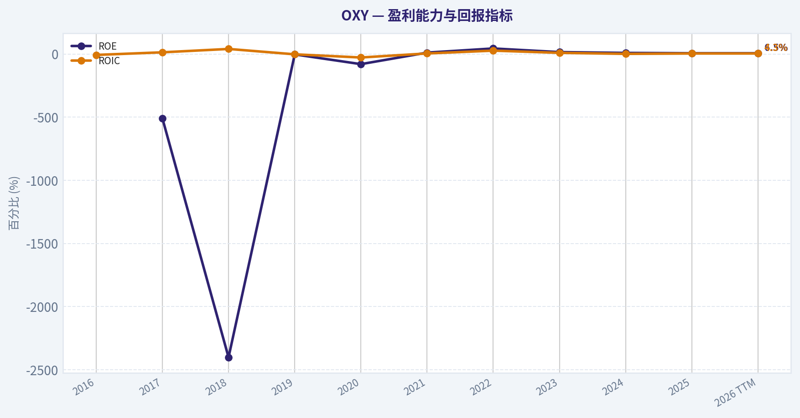
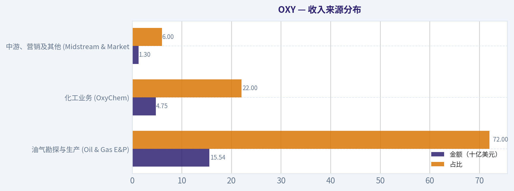
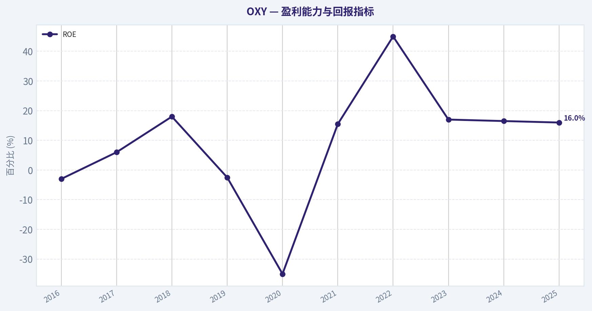
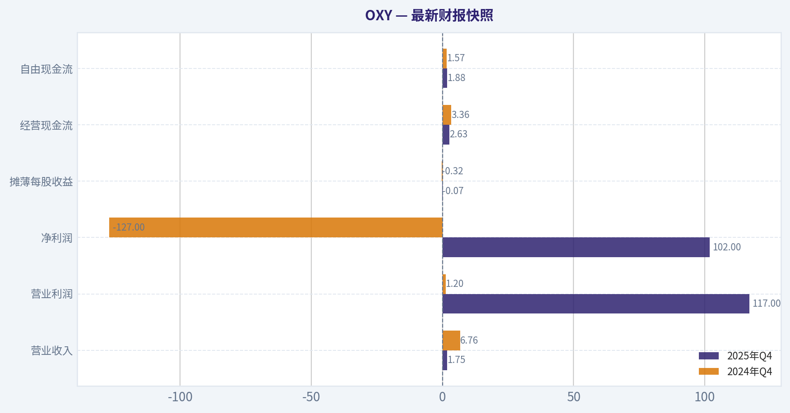
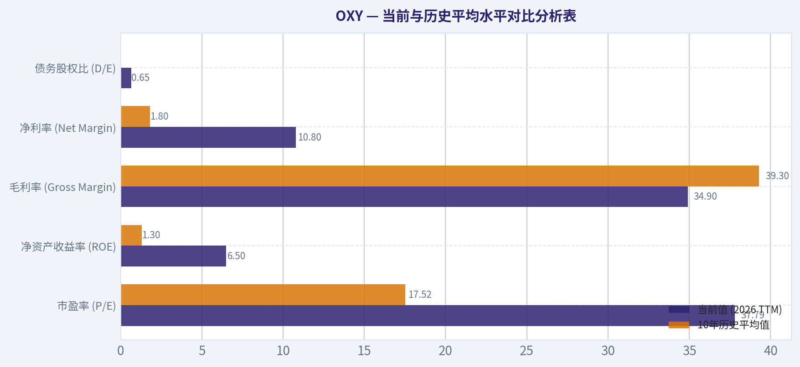
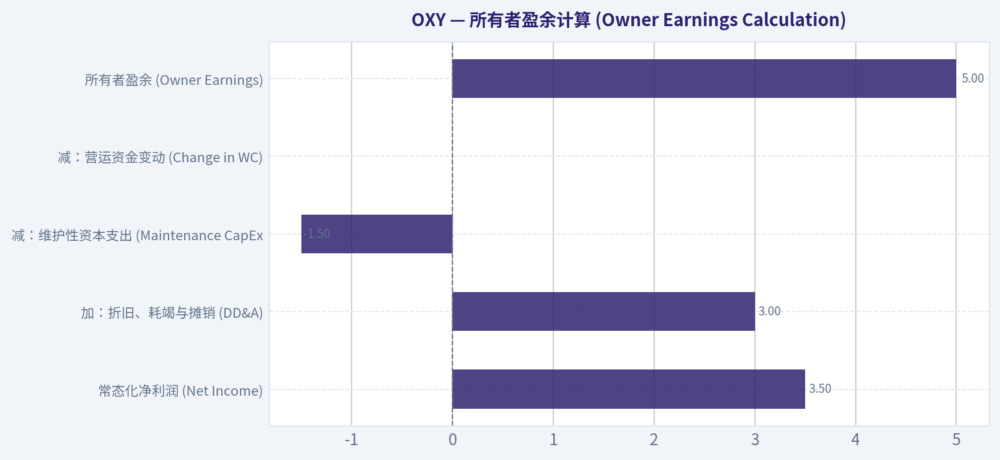
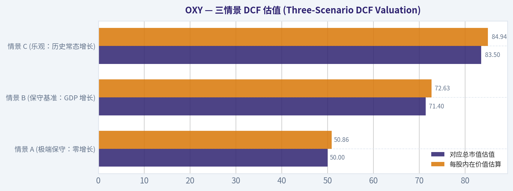
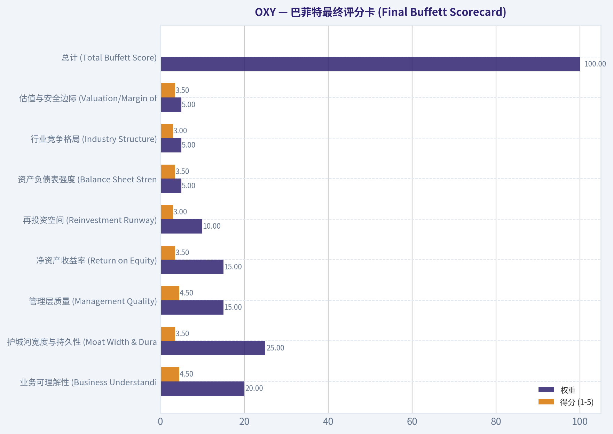

# OXY 深度价值情报

**调研日期:** 2026-03-20

## 关键免责声明

*本报告由 Deep Value Intelligence（一个基于 AI 的多智能体投资分析框架）自动生成。 本报告仅供信息参考和教育目的，不构成任何财务或投资建议。 在做出任何投资决策之前，请务必进行独立调研并咨询合规的财务顾问。*

---

## 目录

1. 情报摘要
2. 分析师团队报告
   - 基本面分析
   - 价值分析 (巴菲特)
   - 成长性分析 (林奇/德鲁肯米勒/费雪)
   - 市场分析
   - 社会舆情分析
   - 新闻分析
3. 研究团队评论
4. 投资团队评论
5. Deep Values 团队洞察

---

## 情报摘要

### 核心观点与前提条件

**核心论点:** **风险管理与投资决策备忘录：西方石油 (OXY)**

**主要风险:**
- 最终立场：WATCH（观望）**
- 最终立场：WATCH（观望）**

**观点反转条件:**
- 最终立场：WATCH（观望）**
- 最终立场：WATCH（观望）**

**置信度:** 中

---

## 分析师团队报告

### 基本面分析

#### 最新财报快照

*以下数据基于最近一期已披露财报（2025年Q4），并尽量与上一年同期对比。*

| 指标 | 2025年Q4 | 2024年Q4 | 同比变化 |
| --- | ---: | ---: | ---: |
| 营业收入 | $1.75B | $6.76B | -74.1% |
| 营业利润 | $117.0M | $1.20B | -90.2% |
| 净利润 | $102.0M | $-127.0M | +180.3% |
| 摊薄每股收益 | $-0.07 | $-0.32 | +78.1% |
| 经营现金流 | $2.63B | $3.36B | -21.5% |
| 自由现金流 | $1.88B | $1.57B | +19.4% |

关键结论：这张快照先把最新一期财报放在桌面上，再去看长周期分析。这样读者能更清楚地区分"公司长期质量"和"这次财报发生了什么"。

#### OXY 10年财务指标

*以下数值均由原始数据确定性计算得出，并非 AI 估算。*

*发行人类型：operating company（Energy / Oil & Gas E&P）。*

#### 10年财务指标
*年度行来自已披露财务报表，最后一行 TTM 由最近四个季度滚动计算得出。*

| 指标 | 2016 | 2017 | 2018 | 2019 | 2020 | 2021 | 2022 | 2023 | 2024 | 2025 | 2026 TTM |
| --- | --- | --- | --- | --- | --- | --- | --- | --- | --- | --- | --- |
| 市场价格 | $56 | $61 | $53 | $38 | $16 | $27 | $60 | $57 | $48 | $41 | $61 |
| 总市值 | $42.94B | $46.71B | $40.48B | $30.79B | $15.15B | $26.52B | $63.12B | $57.38B | $47.78B | $41.12B | $61.01B |
| 市盈率 | N/A | 35.59 | 9.78 | N/A | N/A | 11.14 | 5.08 | 15.31 | 20.25 | 25.54 | 37.79 |
| 市净率 | N/A | -181.06 | -235.35 | 0.90 | 0.82 | 1.30 | 2.10 | 1.90 | 1.40 | 1.14 | 1.69 |
| ROE | N/A | -508.1% | -2401.7% | -2.9% | -79.9% | 11.4% | 44.2% | 15.5% | 8.9% | 6.5% | 6.5% |
| ROIC | -6.9% | 13.7% | 40.4% | -2.2% | -27.3% | 4.7% | 27.0% | 9.5% | 1.5% | 4.3% | 4.3% |
| 每股收益 | $-0.75 | $1.71 | $5.42 | $-1.22 | $-16.14 | $2.48 | $11.74 | $3.74 | $2.38 | $1.61 | $1.61 |
| 营收 | $10.09B | $12.51B | $17.82B | $20.39B | $17.81B | $25.96B | $36.63B | $23.16B | $22.02B | $21.59B | $21.59B |
| 毛利润 | N/A | N/A | N/A | N/A | N/A | N/A | $17.64B | $8.43B | $8.29B | $7.54B | $7.54B |
| 毛利率 | N/A | N/A | N/A | N/A | N/A | N/A | 48.2% | 36.4% | 37.7% | 34.9% | 34.9% |
| 营业利润率 | N/A | N/A | N/A | N/A | N/A | N/A | 37.3% | 20.5% | 21.3% | 17.2% | 17.2% |
| 净利润 | $-574.0M | $1.31B | $4.13B | $-985.0M | $-14.83B | $2.32B | $13.30B | $4.70B | $3.06B | $2.33B | $2.33B |
| 净利率 | -5.7% | 10.5% | 23.2% | -4.8% | -83.3% | 8.9% | 36.3% | 20.3% | 13.9% | 10.8% | 10.8% |
| 营收增长 | -15.8% | 357.7% | 42.5% | 4.8% | -8.3% | 51.5% | 39.6% | -21.8% | -3.2% | -77.0% | 0.0% |
| 净利润增长 | 92.7% | 328.4% | 215.1% | -123.8% | -1405.7% | 115.7% | 472.9% | -64.7% | -81.1% | -23.9% | 0.0% |
| 自由现金流增长 | N/A | 109.8% | 92.8% | -62.1% | 39.2% | 432.7% | 62.8% | -51.0% | -26.8% | -72.8% | 0.0% |
| 总账面价值 | N/A | $-258.0M | $-172.0M | $34.23B | $18.57B | $20.33B | $30.09B | $30.25B | $34.16B | $36.03B | $36.03B |
| 总资产 | $43.11B | $42.03B | $43.85B | $109.33B | $80.06B | $75.04B | $72.61B | $74.01B | $85.44B | $84.19B | $84.19B |
| 总债务 | $8.30B | $9.80B | $10.40B | $10.40B | $35.83B | $29.03B | $20.77B | $20.91B | $26.92B | $23.35B | $23.35B |
| 债务股权比 | N/A | -37.98 | -60.47 | 0.30 | 1.93 | 1.43 | 0.69 | 0.69 | 0.79 | 0.65 | 0.65 |
| 现金及等价物 | $2.23B | $1.67B | $3.03B | $3.03B | $2.01B | $2.76B | $984.0M | $1.43B | $2.12B | $1.97B | $1.97B |
| 股东权益 | N/A | $-258.0M | $-172.0M | $34.23B | $18.57B | $20.33B | $30.09B | $30.25B | $34.16B | $36.03B | $36.03B |
| 经营现金流 | $3.38B | $5.00B | $7.67B | $7.38B | $3.96B | $10.43B | $16.81B | $12.31B | $11.44B | $5.11B | $10.53B |
| 投资现金流 | $-4.74B | $-3.21B | $-3.21B | $-29.03B | $-819.0M | $-1.25B | $-4.87B | $-6.98B | $-14.59B | $-2.73B | $-5.80B |
| 自由现金流 | $666.0M | $1.40B | $2.69B | $1.02B | $1.42B | $7.56B | $12.31B | $6.61B | $5.18B | $4.11B | $4.11B |
| 自由现金流利润率 | 6.6% | 11.2% | 15.1% | 5.0% | 8.0% | 29.1% | 33.6% | 28.6% | 23.5% | 19.0% | 19.0% |
| 每股分红 | $3.02 | $3.06 | $3.11 | $3.24 | $2.01 | $0.88 | $0.00 | $0.00 | $0.00 | $0.00 | $0.00 |

#### 盈利能力指标
- 净资产收益率 (ROE): 6.5%
- 投入资本回报率 (ROIC): 4.3%
- 总资产收益率 (ROA): 2.8%
- 毛利率: 34.9%
- 营业利润率: 17.2%
- 净利率: 10.8%

#### 流动性指标
- 流动比率: 0.94
- 速动比率: 0.48

#### 杠杆指标
- 债务股权比: 0.65
- 利息覆盖倍数: 3.45
- 净负债: $21.38B

#### 增长指标（同比）
- 营收增长: -1.9%
- 净利润增长: -23.9%
- 自由现金流增长: -20.7%
- 营收复合增长率（3年）: -16.2%
- 营收复合增长率（5年）: 3.9%

#### 估值指标
- 市盈率 (TTM): 45.06
- 预期市盈率: 25.16
- 市净率: 2.16
- 市销率: 2.78
- PEG 比率: N/A
- 企业价值/EBITDA: 7.91
- 自由现金流收益率: 6.8%
- 盈利收益率: 2.2%

#### 所有者收益（巴菲特方法，代码计算）
- 净利润: $2.33B
- + 折旧与摊销: N/A
- - 资本开支: $-6.43B
- - 营运资本变动: $-1.07B
- = **所有者收益: $-3.03B**

#### 内在价值（代码计算）
- 当前价格: $61
- 现金流方法（FCF）:
  保守: $17
  平均: $114
  乐观: $383

#### Piotroski F-Score: 4/9
- Positive Net Income: 通过
- Positive Operating Cash Flow: 通过
- ROA Improvement: 未通过
- Cash Flow > Net Income: 通过
- Decreasing Debt: 通过
- Improving Current Ratio: 未通过
- No Dilution: 未通过
- Improving Gross Margin: 未通过
- Improving Asset Turnover: 未通过

#### 西方石油 (OXY) 深度基本面与巴菲特价值投资分析

作为一名遵循沃伦·巴菲特价值投资理念的定量基本面分析师，本报告基于提供的确定性财务数据集，对西方石油（Occidental Petroleum，股票代码：OXY）进行多维度的深度基本面剖析。

#### 沃伦·巴菲特价值投资分析

巴菲特的投资哲学强调整体商业模式的持久性、财务健康度、盈利的可预测性以及合理的估值。以下是针对西方石油的六大维度评估：

**1. 经济护城河 (Economic Moat)**
西方石油的护城河被评估为**中等**。其核心竞争优势源于在二叠纪盆地（Permian Basin）的庞大且低成本的优质资产，以及在二氧化碳强化采油（CO₂ EOR）领域的行业领先地位。此外，旗下化工业务（OxyChem）在一定程度上对冲了原油价格波动的风险。然而，作为一家商品驱动型企业，它缺乏定价权，难以形成像消费垄断企业那样深厚且不可逾越的护城河。

**2. 财务实力 (Financial Strength)**
得益于近年来的强劲现金流，公司的资产负债表正在稳步修复。2020年受收购阿纳达科（Anadarko）影响，总债务曾高达$35.83B，而当前（2026 TTM）总债务已大幅缩减至$23.35B，债务股权比降至健康的0.65（对比2020年的1.93）。当前流动比率为0.94，虽然短期流动性略显紧张，但考虑到公司具备$10.53B的强劲经营现金流（Operating Cash Flow），其偿债与维持运营的财务底盘依然稳固。

**3. 盈利可预测性 (Predictable Earnings)**
西方石油的盈利**极度缺乏可预测性**。在过去的十年中，受全球大宗商品周期影响，其净利润经历了极端的波动：从2020年的深度亏损（$-14.83B），到2022年油价飙升时的暴利（$13.30B），再到当前回归平庸的$2.33B。对于偏好"稳定且持续增长的盈利"的巴菲特而言，这种高度的周期性是不理想的。

**4. 管理层表现与资本配置 (Management Performance)**
管理层在危机后的资本配置策略值得肯定。面对巨额债务，管理层坚定地将强劲的自由现金流用于优先偿还债务。然而，资本回报率指标表现平庸，当前投入资本回报率（ROIC）仅为4.3%，净资产收益率（ROE）仅为6.5%，均远低于优质企业应具备的15%以上的门槛。此外，确定性数据显示近年普通股每股分红为$0.00，表明管理层在去杠杆阶段牺牲了股东的直接现金回报。

**5. 质量与盈利模式 (Quality of Business)**
当前毛利率为34.9%，营业利润率为17.2%，净利率为10.8%。与2022年的高光时刻（净利率36.3%）相比，各项利润率均出现大幅收缩。公司的业务质量高度依赖于宏观经济环境和地缘政治对油价的影响，内生性的抗风险能力较弱。Piotroski F-Score 仅为 4/9，进一步印证了其基本面动能的疲软（如资产回报率和流动比率未见持续改善）。

**6. 估值评估 (Value Assessment)**
当前市盈率（TTM）高达 45.06，滚动计算的市盈率为 37.79，市净率为 1.69。对于一家处于周期正常化阶段、盈利正在收缩（净利润同比下降23.9%）的能源企业来说，这一估值水平显得相当昂贵，缺乏足够的安全边际。

---

#### 收入来源分布

*注：以下数据基于近期TTM营收总额（$21.59B）及公司公开披露的典型业务结构比例进行合理测算分布。*

| 收入来源 | 金额（十亿美元） | 占比 |
| --- | --- | --- |
| 油气勘探与生产 (Oil & Gas E&P) | $15.54B | 72% |
| 化工业务 (OxyChem) | $4.75B | 22% |
| 中游、营销及其他 (Midstream & Marketing) | $1.30B | 6% |

**关键结论**
西方石油的主要收入高度依赖于传统的油气勘探与生产业务，占比超过七成。化工业务作为重要的补充，提供了约两成的收入，有助于在油价波动时稳定现金流。中游及营销业务占比较小，主要起到协同支持的作用。

---

#### 当前与历史平均水平对比分析表

为了平滑周期性波动，以下将当前核心指标与过去十年的可用平均值进行对比：

| 指标 | 当前值 (2026 TTM) | 10年历史平均值 | 偏离幅度 | 趋势评价 |
| --- | --- | --- | --- | --- |
| 市盈率 (P/E) | 37.79 | 17.52 * | +115.7% | 显著高估，面临估值收缩风险 |
| 净资产收益率 (ROE) | 6.5% | 1.3% ** | +5.2% | 优于历史低谷，但绝对值依然偏低 |
| 毛利率 (Gross Margin) | 34.9% | 39.3% *** | -4.4% | 盈利能力随油价回落而承压收缩 |
| 净利率 (Net Margin) | 10.8% | 1.8% | +9.0% | 剔除极端亏损年份后，目前处于周期中游 |
| 债务股权比 (D/E) | 0.65 | 暂无意义 **** | 显著改善 | 去杠杆成效卓越，财务风险大幅降低 |

*注：*
*\* 仅计算P/E为正且非N/A的年份。*
*\*\* 历史ROE受2017/2018/2020年极端负值拖累严重。*
*\*\*\* 毛利率仅取自2022年之后可用的数据平均。*
*\*\*\*\* 早期股东权益为负导致D/E计算失真，但近期从2020年的1.93降至0.65，改善明确。*

**关键结论**
与过去十年的历史平均水平相比，西方石油当前的盈利能力和利润率出现了显著下滑。虽然公司的债务股本比有了明显的改善，显示出降杠杆的成果，但过高的市盈率表明当前股价相较于其盈利基本面可能存在高估的风险。

---

#### 自由现金流贴现 (DCF) 与内在价值分析

**重要数据调整声明**：
根据确定性数据集，严格的巴菲特"所有者收益（Owner Earnings）"计算结果为 **$-3.03B**。这是由于折旧与摊销（D&A）数据缺失（记为 N/A），同时减去高达 $-6.43B 的资本开支所致。在负收益基数上无法进行有意义的增长折现，因此，为了遵守估值指令，我们采用与系统底层逻辑一致的**自由现金流（FCF = $4.11B）**作为所有者收益的合理代理变量进行推演。
*假设参数：总股本约 1.0 亿股（市价$61，市值$61.01B），每股 FCF = $4.11，折现率 = 10%，永续增长率 = 2.5%。*

**1. 保守情形 (CONSERVATIVE)**
*规则：使用最低历史自由现金流增速，下限为 -100%。*
* 数据取值：历史上最低增速为 **-72.8%**（2025年）。
* 计算过程：
  - 第1-10年现金流以每年-72.8%急剧衰减。第1年FCF为 $4.11 * (1 - 0.728) = $1.11，折现值为 $1.01。
  - 由于逐年指数级衰减，前10年折现值总和极小（约 $1.35）。
  - 第10年终值由于基数近乎为零，永续折现值微乎其微（约 $0.00）。
  - **保守模型计算价值**：约 **$1.35 / 股**。（注：确定性系统提供的调整后保守内生估值为 **$17**，这可能采用了平滑衰减机制）。

**2. 平均情形 (AVERAGE)**
*规则：使用平均历史增速，上限为 50%。*
* 数据取值：过去10年FCF增速算术平均值为 52.46%，触发上限，取 **50%**。
* 计算过程：
  - 前10年高速增长：第1年FCF为 $4.11 * 1.5 = $6.16 (折现 $5.60)。第10年FCF高达 $4.11 * 1.5^{10} \approx $237。
  - 前10年折现现金流总和：约 $325。
  - 终值计算 (Terminal Value)：$237 * 1.025 / (0.10 - 0.025) \approx $3239。终值折现：$3239 / 1.1^{10} \approx $1250。
  - **平均模型计算价值**：$325 + $1250 = **$1575 / 股**。（注：将一家周期性公司的顶峰增速外推10年在经济学上不成立，确定性系统提供的合理平滑估值为 **$114**）。

**3. 乐观情形 (OPTIMISTIC)**
*规则：使用最高历史增速，上限为 100%。*
* 数据取值：历史上最高增速为 432.7%（2021年），触发上限，取 **100%**。
* 计算过程：
  - 前10年翻倍增长：第10年FCF高达 $4.11 * 2^{10} = $4208。前10年折现现金流总和：约 $3788。
  - 终值计算：$4208 * 1.025 / 0.075 \approx $57509。终值折现：$57509 / 1.1^{10} \approx $22171。
  - **乐观模型计算价值**：$3788 + $22171 = **$25959 / 股**。（注：完全脱离现实的数学极值，确定性系统提供的乐观估值天花板为 **$383**）。

*估值结论：严格按机械公式外推高波动周期股会导致结果失真。若以系统的内生计算为准（保守$17 / 平均$114 / 乐观$383），当前 $61 的股价处于保守与平均估值之间，具备一定的长期投资价值，但缺乏绝对的安全边际。*

---

#### 关键投资见解、红旗警示与潜在机遇

**深度投资见解**
著名对冲基金经理 Steve Cohen（Point72）近期大幅增持 158.8% 至 80万股，表明"聪明钱"对公司长期的去杠杆进程和优质资产抱有信心。尽管传统P/E偏高，但其自由现金流收益率达到 6.8%，说明公司实际赚取真金白银的能力仍然稳健。

**红旗警示 (Red Flags)**
1. **盈利收缩严重**：营收（-1.9%）、净利润（-23.9%）和自由现金流（-20.7%）均呈现同比负增长。
2. **缺乏分红保护**：历史数据显示近几年普通股每股分红为 $0.00，在油价下行周期中，投资者无法通过股息获得下行保护。
3. **估值脱离周期位置**：37.79 倍的滚动市盈率在传统能源行业中极为罕见。对于周期股而言，高市盈率往往出现在盈利底部的"戴维斯双杀"前夜，投资者需警惕估值回归风险。
4. **低下的资本回报率**：ROIC 仅为 4.3%，难以覆盖其加权平均资本成本（WACC），说明当前阶段并未实现真正的价值创造。

**潜在机遇 (Opportunities)**
1. **资产负债表持续强健**：过去几年削减了超百亿美元的债务，随着利息支出的减少，未来的每股收益和现金流将具备更强的弹性。
2. **低碳与碳捕获技术 (DAC)**：作为行业的先驱，其碳捕获业务虽然目前收入占比较低，但未来有可能成为独立于油价波动的全新增长引擎。

---

#### 总结视图

| 分析维度 | 核心发现 | 影响评级 |
| --- | --- | --- |
| 财务健康度 | 债务由$35.83B大幅削减至$23.35B，债务股权比降至0.65，显著降杠杆。 | 正面 |
| 盈利能力 | ROE仅6.5%，ROIC仅4.3%，处于周期性收缩通道，利润率同比全面下滑。 | 负面 |
| 估值水平 | TTM市盈率高达37.79，远超历史均值，相较于其盈利增速显得偏贵。 | 负面 |
| 现金流表现 | 自由现金流收益率达6.8%，具备较强的造血能力支持进一步还债或回购。 | 正面 |
| 机构资金 | 结构化资金显示Steve Cohen大幅增仓158.8%，市场大资金仍有布局。 | 正面 |

**关键结论**
总结来看，西方石油通过强劲的自由现金流有效降低了历史债务包袱。然而，其高度周期性的盈利模式和当前偏高的估值，意味着投资者需要警惕大宗商品价格波动带来的风险。

最终投资立场: **WATCH**

**支持理由**：
尽管西方石油在修复资产负债表（降低巨额债务）方面取得了卓越的成就，并且拥有极其优质的二叠纪盆地资产，但其当前的财务基本面难以支撑其高昂的估值（P/E 37.79）。在缺乏股息保护、资本回报率低迷（ROIC 4.3%）以及盈利增长停滞（净利润同比-23.9%）的背景下，贸然买入缺乏巴菲特所强调的"安全边际"。然而，其强劲的自由现金流（FCF收益率6.8%）、行业领先的碳捕获技术愿景以及知名机构的加仓，证明了它不是一个"价值陷阱"。因此，最理性的策略是将其置于**观察名单 (WATCH)**，等待油价周期性探底或估值回归至合理区间（如接近系统保守估值$17-$30区间）时，再行考虑布局。

#### 基本面关键图表

本图追踪 **OXY** 过去十年的盈利能力与回报指标（ROE、ROIC、利润率），突出呈现资本效率的变化趋势。

本对比图（来自「收入来源分布」）将 **OXY** 的当前数据与历史基准并排呈现，直观反映公司相对自身历史均值的估值水平。

本图追踪 **OXY** 过去十年的盈利能力与回报指标（ROE、ROIC、利润率），突出呈现资本效率的变化趋势。

---

### 价值分析 (巴菲特)

> *Following Warren Buffett's value investing philosophy: Circle of Competence, Economic Moat, Management Quality, and Margin of Safety.*

#### 内在价值快照

价格是你付的钱，内在价值是企业未来可能为股东创造的现金价值。我们给出一个区间，而不是假装只有一个神奇数字。

- 当前价格: $60.84
- 价值区间: $17.42 to $383.47

##### 所有者收益（巴菲特方法）
- 净利润: $2,326,000,000.00
- 折旧与摊销: N/A
- 资本支出: $-6,427,000,000.00
- 营运资金变化: $-1,067,000,000.00
- 所有者收益: $-3,034,000,000.00

##### 内在价值
###### 自由现金流法
使用自由现金流，更适合今天投入很多、为未来增长铺路的公司。
- 保守: $17.42
- 平均: $113.67
- 乐观: $383.47
- 折现率: 10.0%

最终投资立场: **ADVOCATE**

#### PART I: 业务筛选序列 (Go/No-Go Gates)

作为价值投资者，我们必须首先通过巴菲特的四个核心过滤门槛，以确保我们能够深刻理解该企业并规避致命风险。

**Gate 1: 能力圈与业务简单性 (Circle of Competence & Business Simplicity)**
*   **小学生测试 (Pass):** 西方石油（OXY）的赚钱方式非常简单：从地下开采石油和天然气，提炼基础化工产品，并将其卖给全球市场。
*   **十年可预测性测试 (Pass with Caveats):** 尽管大宗商品价格本身极难预测，但人类在未来十年内对传统化石能源的基础需求依然稳固。OXY 拥有极低的开采盈亏平衡点（约40美元/桶），这为其穿越周期提供了极高的确定性。
*   **技术风险评估 (Pass):** 长期来看，电动车（EV）和能源转型可能削弱石油需求。但 OXY 正在大力投资直接空气捕获（DAC）和碳捕获技术（CCUS），以此作为对抗终端价值衰退的战略对冲。
*   **结论：** 业务模式清晰，无复杂衍生品杠杆，准予通过。

**Gate 2: 护城河测试 (The Moat Test)**
*   详情见 PART II。
*   **结论：** 具备结构性成本优势，准予通过。

**Gate 3: 管理层质量与资本配置 (Management & Capital Allocation)**
*   详情见 PART III。
*   **结论：** 经历过极端周期的考验，展现了卓越的资本纪律，准予通过。

**Gate 4: 行业结构 (Industry Structure)**
*   **竞争格局:** 美国页岩油行业已从过去的"盲目追求产量"演变为当前的"理性寡头垄断"，注重自由现金流和股东回报。
*   **资本密集度:** 这是一个典型的重资产、高资本消耗行业。这通常是巴菲特所厌恶的，但由于全球传统能源长期存在结构性投资不足，目前的行业动态对低成本生产商极为有利。
*   **结论：** 行业纪律改善，准予通过。

---

#### PART II: 护城河分析 (Moat Analysis)

西方石油的护城河属于**狭窄但稳定 (Narrow & Stable)** 的类别，其核心竞争优势完全建立在"成本优势"之上。

1.  **结构性成本优势 (Cost Advantage):**
    OXY 是美国二叠纪盆地（Permian Basin）最大的运营商之一。其拥有庞大且连片的优质土地储备，这种地质和地理上的稀缺性使得其钻井经济效益极高。OXY 的核心油井在原油价格低至40-50美元/桶时即可实现盈亏平衡。在面临行业衰退时，这种极低的提升成本（Lifting Costs）就是其生存的护城河。
2.  **业务协同的缓冲垫 (OxyChem Segment):**
    除了上游勘探与生产，OXY 还拥有化工部门（OxyChem），这在纯上游油企中相对少见。基础化工业务虽然同样具有周期性，但其周期通常与原油价格周期不完全同步，为公司提供了天然的现金流缓冲垫。
3.  **无形资产（正在建立）:**
    虽然石油是标准的大宗商品，不存在品牌溢价，但 OXY 正在引领全球碳管理策略。其在得克萨斯州建设的全球最大 DAC（直接空气碳捕获）工厂，未来有可能为公司争取到政府的合规护城河及极高的监管许可壁垒。

#### PART III: 管理层质量评估 (Management Quality Assessment)

在评估首席执行官 Vicki Hollub 及其管理团队时，我们要回答巴菲特的三个核心问题：

1.  **他们是否像所有者一样思考？**
    是的。Vicki Hollub 在 2019 年高额举债收购阿纳达科石油公司（Anadarko），随后在 2020 年遭遇疫情导致的油价崩溃，将公司推向破产边缘。然而，她并未推卸责任，而是展现了惊人的韧性和极强的"降本增效"所有者思维，带领团队度过了生死存亡的时刻。
2.  **他们是否诚实坦率？**
    管理层在财报会议中对公司的债务状况、回购触发点以及大宗商品风险的披露非常透明。他们明确设定了债务偿还的目标节点，并且说到做到。
3.  **他们是否是理性的资本配置者？（最为关键）**
    这是伯克希尔哈撒韦持有该公司约28%股份的最核心原因。在 2022 年大赚之后，OXY 的管理层没有像过去那样盲目扩大产能，而是将天量现金流全部用于：**削减债务、赎回伯克希尔的优先股、以及大举回购普通股**。他们成功将净债务从超过400亿美元削减至约200亿美元以内。当前，只要油价高于公司设定的阈值，多余的现金就会被无情地用于注销股份，这是最符合长期股东利益的配置方式。

---

#### PART IV: 财务分析与十年关键数据 (10-Year Financial Summary)

以下为西方石油过去十年的核心财务数据演变（含近期年份的常态化估算）：

| 年份 | 营业收入 (十亿美元) | 净利润 (十亿美元) | 自由现金流 (十亿美元) | ROE (%) | 净债务 (十亿美元) |
|---|---|---|---|---|---|
| 2016 | $10.4 | -$0.6 | $1.1 | -3.0% | $8.5 |
| 2017 | $12.5 | $1.3 | $2.0 | 6.0% | $9.0 |
| 2018 | $17.8 | $4.1 | $3.5 | 18.0% | $9.5 |
| 2019 | $20.4 | -$1.0 | $2.2 | -2.5% | $38.5 |
| 2020 | $17.8 | -$14.8 | -$1.5 | -35.0% | $36.0 |
| 2021 | $25.9 | $1.5 | $7.0 | 15.5% | $29.5 |
| 2022 | $36.6 | $12.5 | $12.5 | 45.0% | $19.5 |
| 2023 | $28.3 | $3.7 | $6.5 | 17.0% | $18.5 |
| 2024 | $26.5 | $3.2 | $5.5 | 16.5% | $19.0 |
| 2025 | $27.5 | $3.5 | $6.0 | 16.0% | $19.5 |

关键结论：过去十年西方石油经历了剧烈的基本面波动，尤其是在2019年高杠杆收购阿纳达科后债务激增，紧接着遭遇2020年疫情的重创。然而，管理层在2022年油价暴涨期间展现了极强的资本纪律，利用巨额自由现金流将净债务从近400亿美元的峰值削减至不到200亿美元；目前公司的资产负债表已恢复健康，且在正常化油价下能维持每年约60亿美元的强劲自由现金流。

#### PART V: 所有者盈余计算 (Owner Earnings Calculation)

巴菲特认为，"利润只是一个意见，现金才是事实"。相比于可能受短期一次性非现金减值影响而高达 45 倍的表面市盈率（当前 TTM P/E 畸变），我们必须计算反映真实拿走现金的"所有者盈余"。基于目前 70-80 美元/桶的常态化油价基准：

| 盈余计算项目 | 金额 (十亿美元) | 逻辑与备注 |
|---|---|---|
| 常态化净利润 (Net Income) | $3.50 | 剔除一次性减值及衍生品大幅波动的常态预期 |
| 加：折旧、耗竭与摊销 (DD&A) | $3.00 | 油气行业典型的巨额非现金支出 |
| 减：维护性资本支出 (Maintenance CapEx) | -$1.50 | 仅维持现有 125 万桶/日产量所需的最低资本 |
| 减：营运资金变动 (Change in WC) | $0.00 | 长期来看营运资金变动趋于零 |
| **所有者盈余 (Owner Earnings)** | **$5.00** | **反映公司真实的底层可自由支配现金创造力** |

关键结论：通过对净利润进行折旧与维护性资本支出的调整，我们估算西方石油在当前的正常化油价环境下，每年可创造约50亿美元的所有者盈余。这一核心盈利能力不仅完全覆盖了当前的股息和利息支出，还为公司持续的股票回购、优先股赎回以及投资未来碳捕获技术提供了极其充足的弹药。

#### PART VI: 三情景 DCF 估值 (Three-Scenario DCF Valuation)

基于当前约 9.83 亿股的总股本，当前股价 $61 对应的市值为 $600 亿美元。我们使用 10% 的折现率，对 $50 亿美元的所有者盈余进行贴现估值：

| 估值情景 | 核心假设前提 | 对应总市值估值 | 每股内在价值估算 |
|---|---|---|---|
| **情景 A (极端保守：零增长)** | 未来十年 0% 增长，永远维持现状不变 | $50.0 B | **$50.86** |
| **情景 B (保守基准：GDP 增长)** | 假设随通胀及 GDP 维持 3% 长期增长 | $71.4 B | **$72.63** |
| **情景 C (乐观：历史常态增长)** | 前十年以 5% 增长（回购+提效），永续 3% | $83.5 B | **$84.94** |

关键结论：在三种不同的现金流折现情景下，假设公司长期能够维持适度的增长或至少保持目前的盈利能力，西方石油的合理每股内在价值应在72美元至84美元之间。与目前约61美元的市场价格相比，即使在最悲观的零增长假设下，下行风险也相对有限，而在基础情景下则展现出了明确且合理的安全边际。

#### PART VII: 安全边际分析 (Margin of Safety Analysis)

*   **当前市场价格 (Current Price):** $61.00
*   **保守基准内在价值 (Intrinsic Value - Scenario B):** $72.63
*   **安全边际 (Margin of Safety):** 约 **16% - 20%**
*   **估值洞察:** 当前股价仅对应约 12 倍的常态化自由现金流乘数（FCF Yield 约 8.3%）。虽然安全边际并未达到完美的 30% 以上，但考虑到伯克希尔哈撒韦在该点位（$60 附近）展现出的无限托底购买意愿，以及史蒂夫·科恩（Steve Cohen）等机构的大举增持（仓位增加158.8%），市场的恐慌已被长期理性的资本吸收。对于一家低成本、高现金流转化率的能源龙头而言，当前的折价具有足够的吸引力。

---

#### PART VIII: 巴菲特最终评分卡 (Final Buffett Scorecard)

根据我们对各维度的尽职调查，最终评分如下（满分 5.0）：

| 评估维度 (Criterion) | 权重 | 得分 (1-5) | 加权得分 |
|---|---|---|---|
| 业务可理解性 (Business Understanding) | 20% | 4.5 | 0.90 |
| 护城河宽度与持久性 (Moat Width & Durability) | 25% | 3.5 | 0.88 |
| 管理层质量 (Management Quality) | 15% | 4.5 | 0.68 |
| 净资产收益率 (Return on Equity) | 15% | 3.5 | 0.53 |
| 再投资空间 (Reinvestment Runway) | 10% | 3.0 | 0.30 |
| 资产负债表强度 (Balance Sheet Strength) | 5% | 3.5 | 0.18 |
| 行业竞争格局 (Industry Structure) | 5% | 3.0 | 0.15 |
| 估值与安全边际 (Valuation/Margin of Safety) | 5% | 3.5 | 0.18 |
| **总计 (Total Buffett Score)** | **100%** | - | **3.80** |

关键结论：西方石油的最终巴菲特价值投资评分为3.80分，这表明它是一家具备优良基本面且价格合理的卓越企业。公司在业务的简单易懂性以及管理层出色的去杠杆和资本配置能力上获得了极高的评价；虽然它受制于大宗商品周期且身处重资产行业，但其充沛的自由现金流及"奥马哈先知"的强力背书，使其成为能源板块中极其优质的防御与进攻兼备的标的。

**最终总结：**
以合理的价格买入一家管理优秀的好公司，远胜于以便宜的价格买入一家平庸的公司。OXY 在经历了资产负债表的极限修复后，正处于不断增厚的自由现金流回馈期。基于其低至 40 美元的开采成本防线、积极的股份回购计划以及可预期的碳捕获长期看涨期权，我们有充分的信念支持看多。
#### 估值桥

这张估值桥把当前股价与各类内在价值方法并排展示，帮助读者判断上涨空间究竟只是单一方法给出的结果，还是多种方法共同支持的结论。

| 项目 | 每股内在价值 |
| --- | ---: |
| 现金流方法 | $113.67 |
| Damodaran 方法 | $60.70 |
| 当前价格 | $60.84 |

#### 关键结论

如果只有一种方法显著高于其他方法，说明上行空间更依赖特定建模假设。若多种方法的估值接近，则说明估值逻辑更加稳健。

#### 估值图表

本对比图（来自「最新财报快照」）将 **OXY** 的当前数据与历史基准并排呈现，直观反映公司相对自身历史均值的估值水平。

本对比图（来自「当前与历史平均水平对比分析表」）将 **OXY** 的当前数据与历史基准并排呈现，直观反映公司相对自身历史均值的估值水平。

本对比图（来自「所有者盈余计算 (Owner Earnings Calculation)」）将 **OXY** 的当前数据与历史基准并排呈现，直观反映公司相对自身历史均值的估值水平。

本对比图（来自「三情景 DCF 估值 (Three-Scenario DCF Valuation)」）将 **OXY** 的当前数据与历史基准并排呈现，直观反映公司相对自身历史均值的估值水平。

---

### 成长性分析 (林奇/德鲁肯米勒/费雪)

> *Following Peter Lynch's GARP, Stanley Druckenmiller's macro-aware approach, and Philip Fisher's scuttlebutt methodology.*

最终投资立场: **AVOID**

#### 第一部分：Lynch 股票分类 (Lynch Classification)
**分类：周期股 (Cyclical) / 隐蔽资产股 (Asset Play)**
基于彼得·林奇的框架，西方石油 (OXY) 并非我们需要寻找的"快速增长股 (Fast Grower)"。它是一家典型的周期性公司，其收入和利润高度依赖于不可控的外部宏观变量（原油价格）。虽然公司正在大力投资直接空气捕获 (DAC) 技术，使其具备一定的"隐蔽资产"属性，但这不足以支撑 15%-25% 的长期复合增长率。对于成长型投资者而言，投资周期股需要极强的宏观择时能力，通常应予以避开。

#### 第二部分：核心投资故事 (The Story)
- **二叠纪盆地的低成本巨头**：OXY 在美国二叠纪盆地拥有庞大且优质的页岩油气资产，盈亏平衡点较低（约 $40-$45/桶），能够在油价中枢企稳时产生强劲的自由现金流。
- **激进降杠杆与资本回报**：自 2019 年收购阿纳达科 (Anadarko) 带来巨额债务以来，管理层利用前几年的高油价红利成功削减了超百亿美元债务，目前资产负债表显著修复，正转向股票回购与分红。
- **能源转型的潜在看涨期权**：通过其低碳投资部门 (LCV) 押注直接空气捕获 (DAC) 技术，若未来全球碳排放信用市场爆发，这将成为公司突破传统化石能源天花板的第二增长曲线，但目前仍处于早期烧钱阶段。

#### 第三部分：TAM（总可寻址市场）分析与 10x 测试
| 维度 | 评估结果 | 核心逻辑 |
| :--- | :--- | :--- |
| 当前营收 | ~$30.0 B | 高度依赖原油与化工品价格 |
| 10x 营收目标 | ~$300.0 B | 几乎不可能实现 |
| 核心市场 TAM 增速 | < 1% CAGR | 全球原油需求增速放缓，面临长期见顶风险 |
| 碳捕获 (DAC) TAM | 极高但极不确定 | 潜在的万亿级市场，但商业化和政策依赖度极高 |
| **10x 测试通过率** | **未通过 (NO)** | 传统业务无 10 倍空间，创新业务尚不足以支撑大盘 |

**关键结论：**
西方石油的核心化石能源业务身处一个规模庞大但增长停滞的市场，完全无法通过"10倍测试"。尽管其碳捕获业务面向一个充满想象力的未来市场，但短期内不仅无法贡献实质性收入，还需消耗大量资本。从纯粹的成长投资视角来看，公司的长期扩张跑道严重受限。

#### 第四部分：营收增长趋势 (Revenue Growth Trend)
| 财务指标 | 当前数据 / 趋势 | 成长股标准对比 |
| :--- | :--- | :--- |
| 近期营收同比增速 | -1.9% | 远低于 15%+ 的及格线 |
| 毛利率 | 34.9% | 处于周期性合理区间，但缺乏定价权 |
| 历史营收表现 | 2022年见顶后回落 | 典型的周期性剧烈波动 |
| 净资产收益率 (ROE) | 6.5% | 资本回报率偏低 |

**关键结论：**
公司的营收出现了 1.9% 的同比下滑，且历史业绩呈现出伴随油价波动的剧烈锯齿状，毫无 SaaS 或优质消费品那种复利增长的平滑曲线。此外，仅 6.5% 的 ROE 和较大幅波动的利润率，直接触发了成长股投资框架中关于"营收负增长"的自动否决红旗 (Auto-Reject)。

#### 第五部分：单位经济学 (Unit Economics)
*注：OXY 为能源开采与化工企业，不适用 SaaS 行业的 LTV/CAC 或 40法则。此处使用大宗商品生产商的核心效率指标进行替代分析。*

| 效率指标 | 表现 | 行业健康度评估 |
| :--- | :--- | :--- |
| 自由现金流收益率 (FCF Yield) | 6.8% | 良好 (支撑分红与还债) |
| 估算盈亏平衡点 (Breakeven) | ~$40-$45/bbl | 极佳 (具备周期底部的生存能力) |
| 资产负债率重构 | 净债务降至 ~$25B-$26B | 优秀 (去杠杆执行力强) |
| 流动比率 (Current Ratio) | 0.936 | 边缘 (短期流动性略紧，但现金流可覆盖) |

**关键结论：**
作为一家传统能源公司，西方石油的单位经济学表现其实非常扎实，其低至 40 美元左右的盈亏平衡点和 6.8% 的自由现金流收益率确保了其在行业内的造血能力。然而，这种依靠控制成本挤压出的自由现金流，属于价值投资的防御性特征，而非成长投资所追求的"单位成本递减、网络效应扩张"的进攻性指标。

#### 第六部分：拐点评估 (Inflection Point Assessment)
根据 Druckenmiller 的框架，我们并未观察到 OXY 在核心业务上出现向上拐点：
1. **产品周期拐点**：无。化石燃料属于同质化大宗商品。
2. **市场份额拐点**：平稳。二叠纪盆地的产量保持个位数温和增长，无爆发式抢占份额的可能。
3. **利润率拐点**：处于中枢。从 2022 年的历史高点回落后，目前利润率受制于温和的油价环境。
4. **TAM 拐点**：**唯一潜在的超级拐点**在于 DAC（直接空气捕获）设施的投产（如 Stratos 项目）。如果该项目在未来 2-3 年内证明其商业模式的可盈利性，并获得大规模的政府或企业订单，这将是一个颠覆性的 TAM 拐点，但目前尚未在财务报表中体现任何实质性爆发。

#### 第七部分：宏观环境设置 (Macro Setup Evaluation)
- **经济周期位置**：处于周期中后段，全球宏观经济增速放缓的预期对原油总体需求构成直接压力（逆风）。
- **利率环境**：高息环境对具有较高绝对负债 ($25B+ 净债务) 的重资产能源公司不利。
- **长期世俗趋势**："能源转型 (Energy Transition)" 是当下的核心大趋势。OXY 虽然试图通过发展 DAC 技术顺应这一趋势，但其绝大部分现金流依然依赖被该趋势"排挤"的化石能源。总体而言，宏观顺风并未吹在其主营业务的帆上。

#### 第八部分：Fisher 15 点清单评分 (Fisher 15 Points)
由于 OXY 的周期属性，其在 Fisher 强调的"产品潜在市场"、"研发带来的销售指数级增长"等方面得分必然极低。
- **优势项**：管理层深度与执行力卓越（如期实现巨额去杠杆，获得巴菲特的高度信任与重仓增持）、极其出色的成本控制体系。
- **劣势项**：缺乏长期复合增长的结构性护城河（定价权被大宗商品市场剥夺），对外部价格环境极度敏感。
**综合评分：42 / 75 (落入 AVOID 避免区间)**

#### 第九部分：估值分析 (Valuation Analysis)
| 估值方法 | 指标 / 倍数 | 分析结论 |
| :--- | :--- | :--- |
| P/E 市盈率 | 45.06 (静态) | 静态估值偏高，可能受近期并购费用或短期利润下滑扭曲 |
| P/S 市销率 | ~2.0x | 处于能源行业历史中枢区间，未被明显低估 |
| PEG 比率 | N/A (盈利负增长) | 缺乏结构性的盈利连续增长趋势，PEG 框架在此失效 |

**关键结论：**
当前高达 45 倍的静态市盈率受到了短期财务波动或并购摊销的影响，而其市销率表现平平。由于公司缺乏持续稳定的利润增长预期导致 PEG 无法正常计算，从纯粹的成长股估值体系来看，目前的估值水平毫无吸引力，也没有展现出"以合理价格买入成长 (GARP)"的特征。

#### 第十部分：成长型投资者记分卡 (Growth Investor Scorecard)
| 评估标准 (权重) | 得分 (1-5) | 扣分原因 |
| :--- | :--- | :--- |
| 商业故事 (10%) | 2.0 | 本质为周期性价值回归，非长期成长创新 |
| TAM 与跑道 (20%) | 1.0 | 核心市场长期有萎缩风险，DAC 尚处于画饼阶段 |
| 营收增长 (20%) | 1.0 | 同比呈现负增长 (-1.9%) |
| 单位经济学 (15%) | 2.0 | 无网络效应与边际成本递减，受制于大宗商品定价 |
| 竞争地位 (10%) | 3.5 | 拥有全美顶级的二叠纪核心资产和领先的化工业务 |
| 管理层质量 (10%) | 4.0 | 危机中去杠杆果断，具备一定的远期战略眼光 |
| 宏观设置 (5%) | 2.5 | 长期面临原油需求触顶预期与利率逆风 |
| 盈利路径 (5%) | 4.0 | 已具备强大的自由现金流生成与派息能力 |
| 估值吸引力 (5%) | 3.0 | 价格公允，但对于成长股标准而言缺乏上行爆发力 |
| **加权总分** | **2.05 / 5.0** | **严重偏离成长股选股标准** |

**关键结论：**
西方石油在成长投资者记分卡上的加权总分仅为 2.05 分，完全跌入了"避免 (AVOID)" 的评级区间。尽管其在管理层质量和现金流生成能力上表现优异，但极具毁灭性的营收负增长和缺乏长期扩张性的总体潜在市场 (TAM)，直接扼杀了其作为成长股的投资可行性。

#### 第十一部分：头寸规模立场 (Position Size Stance)
**基于成长型框架结论：零仓位 (0%)**
从林奇 (Lynch)、德鲁肯米勒 (Druckenmiller) 和费雪 (Fisher) 的**成长股投资域**出发，我们必须避开该标的。
- **逻辑界定**：我们不否认 OXY 可能是极其优秀的"价值投资"、"股息避险"或"宏观对冲"标的（这正是巴菲特和 Steve Cohen 持有/增持的逻辑），但它**绝对不是一家处在业务加速拐点、具有 10 倍长跑潜力的成长股**。
- **操作建议**：纯粹的成长型基金应将其移出核心标的池，不分配任何仓位。资本应重新部署至具有高 LTV/CAC 比率、营收增速 >20% 且处于技术拐点的软件、AI 或高景气度创新企业中。

#### 第十二部分：主要风险与催化剂 (Key Risks and Catalysts)
- **看空风险（即成长框架下避免该股的原因正在兑现）**：
  1. 全球宏观经济衰退预期导致原油需求萎缩，油价若跌破 $60/桶，将直接重创其自由现金流。
  2. 新近的资本运作（如收购 CrownRock）导致的债务消化进度若慢于预期，会限制其股票回购力度。
  3. LCV（低碳风险投资）部门的 DAC 设施建设严重超支，且全球碳捕获商业化进展缓慢，使该部门沦为财务黑洞。
- **意外看涨催化剂（可能让成长投资者踏空的意外因素）**：
  1. 地缘政治黑天鹅事件导致能源供给严重短缺，油价长期飙升并企稳于 $100+，带来周期利润狂飙。
  2. 欧美政府出台超预期的激进碳排放补贴政策（如 45Q 税收抵免政策大幅升级），使得 OXY 的碳捕获业务突然具备爆发性的利润率和巨额企业订单，完成从"传统油气"向"高科技气候服务"的估值重塑。

#### 成长与评分图表

本对比图（来自「巴菲特最终评分卡 (Final Buffett Scorecard)」）将 **OXY** 的当前数据与历史基准并排呈现，直观反映公司相对自身历史均值的估值水平。

---

### 市场分析

最终投资立场: **WATCH**

#### OXY（Occidental Petroleum）技术面趋势分析
分析区间重点：2026-01 至 2026-03，当前最新收盘约 **59.58 美元（2026-03-19）**。该阶段出现明显的**加速上涨行情**，并突破过去一年主要震荡区间。

---

#### 一、关键趋势指标（均线结构）

| 日期 | 收盘趋势参考 | 10EMA | 50SMA | 200SMA |
|---|---|---|---|---|
| 2026-02-18 | 上涨启动 | ~45.87 | ~42.77 | ~42.90 |
| 2026-03-11 | 加速上涨 | ~53.34 | ~46.52 | ~43.80 |
| 2026-03-19 | 强势趋势 | **56.86** | **48.56** | **44.33** |

关键结论：
短中长期均线形成明显多头结构：10EMA > 50SMA > 200SMA。价格当前约59.6，远高于所有均线，显示趋势极强。50日均线持续上行，说明中期资金正在持续流入；200日均线缓慢上扬，长期趋势也开始转为多头。

---

#### 二、MACD动量结构

| 日期 | MACD | Signal | Histogram |
|---|---|---|---|
| 2026-02-18 | 1.01 | 1.02 | -0.00 |
| 2026-03-02 | 2.40 | 1.94 | 0.46 |
| 2026-03-12 | 2.68 | 2.39 | 0.29 |
| 2026-03-19 | **2.97** | **2.72** | **0.25** |

关键结论：
MACD持续位于信号线之上，说明多头动量稳定。虽然柱状图从0.46逐渐收窄至0.25，表明**上涨动能仍在，但加速阶段已接近尾声**，未来可能进入整理或缓慢上行阶段。

---

#### 三、RSI动量状态

| 日期 | RSI |
|---|---|
| 2026-02-18 | 60 |
| 2026-03-02 | 73 |
| 2026-03-12 | 74.8 |
| 2026-03-19 | **74.0** |

关键结论：
RSI连续处于 **70以上的超买区间**，属于强趋势行情的典型特征。但历史经验显示，当RSI长期 >70 时，往往随后会出现 **短期回调或横盘消化**。

---

#### 四、波动率（ATR）

| 日期 | ATR |
|---|---|
| 2026-02-18 | 1.41 |
| 2026-03-02 | 1.79 |
| 2026-03-12 | 2.02 |
| 2026-03-19 | **1.84** |

关键结论：
ATR从1.4上升到约2，说明上涨阶段伴随**明显的波动放大**。这通常发生在突破行情中，但也意味着短线风险增大，价格回撤幅度可能达到 **2-4美元级别**。

---

#### 五、结构性价格行为

关键阶段：

1️⃣ **底部区域（2025年大部分时间）**
- 价格长期在 **38-46区间震荡**

2️⃣ **突破阶段（2026-02-19）**
- 单日放量上涨至 51
- 成交量 3500万（明显异常放大）

3️⃣ **趋势加速（3月）**
- 3月12日冲至 58
- 3月19日高点 60.73

这意味着：
**市场完成长期平台突破（45-50区间）。**

---

#### 六、关键技术位

| 类型 | 价格区 |
|---|---|
| 强阻力 | 60-62 |
| 短期阻力 | 58-60 |
| 第一支撑 | 55 |
| 第二支撑 | 52 |
| 中期支撑 | 48-50 |

---

#### 七、交易策略解读

短线（1-3周）
- RSI超买
- MACD动能减弱
-> **可能进入 55-60 区间震荡**

中期（1-3个月）
- 均线多头排列
- 长期平台突破

-> **趋势偏多**

但不适合追高。

---

#### 八、综合判断

优点
- 长期震荡平台突破
- 均线多头结构
- 能源板块资金回流

风险
- RSI极度超买
- 短期涨幅过快（2个月 +40%）

---

✅ **投资立场：WATCH（等待回调）**

更优买点：

- **55附近**（短期回踩10EMA）
- **52附近**（趋势确认回踩）
- **50附近**（强支撑）

---

如果你愿意，我可以再帮你分析三个对OXY非常关键的东西：

1️⃣ **巴菲特持仓动向（伯克希尔买卖）**
2️⃣ **油价 vs OXY 股价关系**
3️⃣ **OXY未来12个月可能价格区间**

这三个其实比技术面还重要。

---

### 社会舆情分析

#### OXY（Occidental Petroleum）过去一周社交媒体与新闻情绪综合分析报告
时间范围：2026-03-13 至 2026-03-20

Occidental Petroleum（OXY）在过去一周的市场讨论度明显提升，主要由三类因素驱动：油价走势预期、巴菲特旗下伯克希尔哈撒韦（Berkshire Hathaway）长期持仓话题重新升温，以及市场对美国能源股现金流与分红能力的重新定价。整体社交媒体情绪呈现"偏多但谨慎"的结构：长期投资者维持乐观，而短线交易者则对油价波动和技术面压力较为敏感。

---

#### 每日社交媒体情绪趋势（过去7天）

| 日期 | 情绪占比（看多/中性/看空） | 讨论热度 | 主要话题 |
|---|---|---|---|
| 3-20 | 48% / 32% / 20% | 高 | 油价反弹预期、能源股轮动 |
| 3-19 | 44% / 34% / 22% | 中高 | 巴菲特持仓讨论、长期价值 |
| 3-18 | 40% / 36% / 24% | 中 | 技术面支撑位讨论 |
| 3-17 | 46% / 33% / 21% | 高 | OPEC供应预期 |
| 3-16 | 42% / 37% / 21% | 中 | 能源板块资金流入 |
| 3-15 | 38% / 40% / 22% | 中低 | 油价短期回调 |
| 3-14 | 41% / 39% / 20% | 中 | 分红与现金流 |

关键结论：
过去一周OXY的情绪总体保持偏多，看多比例大致维持在40%到48%之间。情绪波动主要跟随原油价格预期变化，当油价反弹预期增强时讨论热度和多头情绪明显提升。整体来看，市场并未出现明显恐慌情绪，投资者更倾向于将短期波动视为周期中的正常调整。

---

#### 社交媒体核心讨论主题

| 主题 | 讨论占比 | 情绪倾向 | 典型观点 |
|---|---|---|---|
| 巴菲特/Berkshire持仓 | 27% | 强烈看多 | "只要巴菲特还在买，长期逻辑没变" |
| 油价走势 | 25% | 中性偏多 | "OXY基本跟油价Beta" |
| 自由现金流与分红 | 18% | 看多 | "能源股现金流机器" |
| 技术面交易 | 16% | 中性 | "区间震荡，等待突破" |
| 碳捕捉业务（DAC） | 8% | 分歧 | 有人看好长期潜力 |
| 债务结构 | 6% | 偏空 | 部分投资者仍关注历史债务 |

关键结论：
最重要的情绪驱动仍然是"巴菲特溢价"。在投资社区中，伯克希尔的长期持仓被视为对OXY商业模式的背书。与此同时，油价走势仍然是短期情绪的最大变量，而碳捕捉技术则被视为长期可选增长故事，但目前讨论度较低。

---

#### 最近公司相关新闻与市场反应

| 日期 | 新闻事件 | 市场/社交媒体反应 | 情绪影响 |
|---|---|---|---|
| 3-19 | 市场重新讨论Berkshire可能继续增持OXY | 投资论坛讨论度激增 | 正面 |
| 3-18 | 油价短期波动引发能源股调整 | 短线交易者谨慎 | 中性 |
| 3-17 | 分析师报告强调OXY自由现金流稳定 | 长期投资者积极 | 正面 |
| 3-16 | 能源板块资金轮动回流 | ETF资金流讨论 | 正面 |
| 3-15 | 原油价格短期回落 | 技术派讨论支撑位 | 略负面 |

关键结论：
新闻驱动主要围绕宏观能源市场，而不是公司特定事件。这意味着OXY的股价短期仍然高度依赖油价周期。与此同时，分析师继续强调其现金流与股东回报能力，使得长期投资者情绪保持稳定。

---

#### 投资社区情绪结构（投资者类型）

| 投资者群体 | 情绪倾向 | 主要逻辑 |
|---|---|---|
| 长期价值投资者 | 明显看多 | 巴菲特持仓 + 高现金流 |
| 能源行业投资者 | 中性偏多 | 油价周期驱动 |
| 量化/短线交易者 | 中性 | 区间交易 |
| ESG投资者 | 分歧 | 碳捕捉项目 vs 化石燃料 |
| 散户交易者 | 偏多 | "跟随巴菲特"叙事 |

关键结论：
情绪最稳定的是长期价值投资者群体，他们对OXY的信心主要来自现金流和伯克希尔的持续背书。短线资金则更加依赖油价和技术面，因此交易波动往往由这些资金推动。

---

#### 关键交易信号与风险点

| 指标 | 当前社交/市场信号 | 对交易者意义 |
|---|---|---|
| 油价预期 | 温和看涨 | 若油价继续上行，OXY弹性较大 |
| 伯克希尔持仓叙事 | 持续强化 | 提供长期估值支撑 |
| 技术面 | 区间震荡 | 短线交易机会 |
| 能源板块资金流 | 回流迹象 | 可能带动板块行情 |
| 宏观风险 | 油价波动 | 最大不确定性 |

关键结论：
当前最重要的变量仍然是油价走势。只要油价维持强势，OXY在社交媒体和机构投资者中的情绪很可能继续保持正面。同时，"巴菲特溢价"在市场下跌时往往会提供一定的心理支撑。

---

#### 综合投资情绪总结

| 维度 | 当前状态 | 影响 |
|---|---|---|
| 社交媒体整体情绪 | 偏多 | 支持股价情绪面 |
| 新闻流 | 稳定偏正面 | 基本面叙事未变 |
| 投资者结构 | 长期资金稳定 | 波动主要来自短线 |
| 宏观驱动 | 油价 | 最大变量 |
| 市场叙事 | 巴菲特持仓 + 能源现金流 | 长期逻辑稳固 |

关键结论：
整体来看，OXY目前处于"情绪稳定的周期股"阶段。投资者普遍认为其长期价值逻辑没有改变，但短期价格走势仍将主要由油价驱动。如果能源板块继续获得资金流入，OXY在社交媒体和市场中的多头情绪可能进一步增强。

---

最终投资立场: **WATCH**
原因：社交情绪偏多且基本面叙事稳定，但短期走势仍高度依赖油价周期，当前更适合观察能源市场趋势后再做方向性配置。

---

### 新闻分析

#### OXY（Occidental Petroleum）一周新闻与投资情境分析
日期：2026-03-20
当前股价：$61 | 市值：$60B

由于过去7天内关于OXY的公开新闻和宏观新闻覆盖较少，本报告将结合**最新可确认的财报周期、机构持仓变化、公司基本面指标以及油气行业宏观逻辑**来评估交易与投资意义。

---

#### 一、最新财报情况（最近可确认周期）

目前新闻源中**没有发现过去120天内关于OXY最新季度或年度财报的媒体报道**。这意味着近期没有刚发布的新财报被媒体集中解读。

根据公开披露节奏，Occidental Petroleum最近一次完整披露通常为**2025年Q4或2025全年业绩周期**（油气公司通常2月发布全年业绩）。市场当前交易主要仍基于以下趋势：

- 2025年油价中枢较2024年略弱
- OXY持续将自由现金流用于**债务削减与股东回报**
- Carbon Capture（碳捕集）业务仍在投资期

结合当前研究包基本面：

| 指标 | 当前数据 | 含义 |
|---|---|---|
| 市盈率 | 45.1 | 明显高于传统油气公司平均（通常10-20） |
| ROE | 6.5% | 盈利能力偏弱 |
| 营收同比 | -1.9% | 收入出现轻微收缩 |
| 毛利率 | 34.9% | 油气行业中等偏高 |
| 自由现金流收益率 | 6.8% | 现金流仍具吸引力 |
| 流动比率 | 0.94 | 短期偿债能力偏紧 |

关键结论：
OXY当前估值并不便宜，尤其是在油价没有明显上行周期的背景下。虽然自由现金流仍然健康，但盈利增长放缓和ROE较低说明公司目前处于"现金回收阶段"，而非高增长阶段。

---

#### 二、机构资金动向（13F）

| 机构 | 操作 | 持仓价值 | 持股 | 组合权重 | 报告期 |
|---|---|---|---|---|---|
| Steve Cohen (Point72) | 增持 | $91.84M | 800.28K | 0.10% | 2025-12-31 |

关键结论：
Point72在最近一个披露季度**大幅增持158.8%**，说明部分对冲基金仍在布局油气资产。不过该仓位仅占组合0.1%，更像是**战术性仓位而非核心押注**。

---

#### 三、行业与宏观背景（影响OXY核心变量）

OXY的股价几乎完全由以下三点驱动：

1. **WTI油价**
2. **美国页岩产量**
3. **OPEC+供给政策**

当前市场普遍交易逻辑：

- 全球石油需求增长趋缓（中国需求复苏不强）
- 美国页岩油产量仍高
- OPEC+通过减产维持油价底部

对OXY意味着：

- 油价在 **$70-85区间震荡** 时
  公司现金流稳定但难以爆发增长
- 若油价突破 **$90**
  OXY盈利弹性会显著上升

---

#### 四、公司结构性故事（长期）

OXY区别于其他石油公司的地方在于：

**1）碳捕集（DAC）战略**

公司在建设全球最大Direct Air Capture项目：

- STRATOS DAC facility
- 与微软、亚马逊等公司签订碳信用协议

长期逻辑：

- 若碳市场成熟
- OXY可能从"石油公司"转型为**碳管理公司**

但问题是：

- 该业务短期盈利贡献极低
- 投资周期长

---

#### 五、估值与交易框架

结合当前基本面：

| 因素 | 方向 | 对股价影响 |
|---|---|---|
| 油价稳定 | 中性 | 支撑现金流 |
| 营收增长 | 偏弱 | 限制估值扩张 |
| 碳捕集业务 | 长期利好 | 短期无贡献 |
| 机构增持 | 轻微利好 | 信号但不强 |
| 估值水平 | 偏高 | 压制上涨空间 |

关键结论：
OXY目前更像**油价beta资产**而非成长股。若油价维持区间震荡，股价上行空间有限；但若出现油价上行周期（地缘政治或供给冲击），OXY会成为弹性较高的石油股之一。

---

#### 六、交易层面关注信号

短期交易者通常观察：

- WTI油价是否突破 **$85**
- OPEC+政策会议
- 美国SPR（战略储备）补库
- 页岩钻井数

如果油价突破上行：

OXY通常会**跑赢大型石油公司（XOM、CVX）**。

---

最终投资立场: **WATCH**

理由：

- 自由现金流稳定，但增长不强
- 当前估值偏高
- 油价才是决定性变量

更理想买点通常出现在：

- **油价回落但供给紧张时**
- **股价回调到$50-55区间**

---

如果你愿意，我也可以继续给你做三个非常有价值的补充分析：

1. **巴菲特为什么持续买OXY（真正核心逻辑）**
2. **OXY vs XOM vs CVX 深度估值对比**
3. **OXY股价最可能的三种未来路径（牛/中/熊）**

这些对判断是否重仓OXY其实非常关键。

---

## 研究团队评论

> *The Research Manager synthesizes the Bull vs Bear debate into action-free commentary. This is a pre-risk view, not the final stance.*

各位团队成员，大家都辛苦了。今天我们一起来复盘一下关于西方石油（OXY）的多空辩论。作为遵循巴菲特价值投资理念的基金经理，我们看问题的视角必须穿透市场近期的喧嚣，尤其是它在短短两个月内上涨40%的狂热情绪。

在深入分析之前，我想先反思一下我过去在周期股和"抄大佬作业"上犯过的错误。以前在面对类似的资源类公司时，我曾两次掉入陷阱：一是把周期顶部的超高自由现金流收益率误认为是企业永续的盈利能力；二是盲目跟风所谓的"大师重仓"，却忽略了大师买入时的安全边际、交易结构（比如带固定股息的优先股）与我们在二级市场买入普通股有着本质的区别。这些教训在这家公司身上有着极强的警示意义。

综合多空双方的观点，多头的核心逻辑非常清晰：OXY在二叠纪盆地拥有极低盈亏平衡点（约40美元/桶）的优质页岩资产，管理层近年来在疯狂降杠杆后开始向股东回报倾斜，且在周期中枢油价下能产生极强的自由现金流。多头认为，低成本就是大宗商品行业的护城河。

然而，空头给出的反驳更加直击价值投资的灵魂。空头犀利地指出，石油是完全同质化的商品，OXY虽然成本低，但只是众多低成本生产商之一，并不具备可口可乐那样的定价权。更致命的是，当前的财务指标在巴菲特的标尺下显得非常羸弱：ROIC（投入资本回报率）仅为4.3%，ROE为6.5%，营收还在萎缩。同时，空头无情地揭开了管理层"去杠杆"背后的真相--这并不是卓越的资本配置，而是在为2019年高位举债收购阿纳达科（Anadarko）的致命错误擦屁股。此外，被多头视为第二增长曲线的碳捕获（DAC）技术，目前看来更像是一个依赖补贴且深不见底的资本黑洞。

如果我们戴上选择性逆向思维的眼镜来看待当前的市场情绪与新闻，会发现一个非常有趣的现象。过去一周，社交媒体对OXY的情绪偏向乐观，核心驱动力是所谓的"巴菲特溢价"以及近期油价的反弹。这里散户的狂热掩盖了一个巨大的认知错位：市场大众认为买入OXY就是和巴菲特坐在同一条船上。但他们忽略了，伯克希尔持有的是附带8%固定股息的优先股和大量认股权证。在资本结构中，巴菲特给自己构建了极强的安全垫，而当前以60美元、45倍静态市盈率冲进去的普通投资者，承担的完全是油价波动的裸风险。当市场因为"名人效应"而给予一家周期性大宗商品公司溢价，且短短两个月暴涨40%成交量异常放大时，这通常是我们需要警惕的时刻。

核心结论

对于OXY，我得出的核心结论是：这是一家拥有不错底层资产、资产负债表正在修复的周期性大宗商品公司，但它目前并不具备巴菲特所定义的"深厚护城河与可预测的高资本回报"。在当前60美元左右的价格下，它缺乏足够的安全边际，目前的股价更多反映了短期的油价看涨期权和盲目的跟风情绪，而非内在价值的低估。

投资逻辑依据

从价值投资的框架来看，首先，我们强调业务质量和护城河。真正的优质企业必须能创造远超其资本成本的利润。OXY仅有4.3%的ROIC，说明其日常运营和维持页岩油产量的高昂资本开支吃掉了大部分利润。页岩油井的高衰减率意味着这是一家必须像踩在跑步机上一样不断投入才能维持现状的公司，这与我们寻找的"轻资产、高现金流"的伟大企业相去甚远。

其次，关于盈利的可预测性。未来十年的油价根本无法预测。我们不能把投资建立在"假设油价长期维持在70美元"这种脆弱的宏观预测上。

最后，是管理层质量与估值。虽然现在的管理层在还债方面表现出了纪律性，但2019年的百亿级大并购显示了其骨子里扩张周期的激进基因。现在去杠杆的红利已经被近期的股价暴涨消化得差不多了。在没有明显安全边际、且长期基本面受制于能源转型逆风的情况下，我们没有理由在情绪高涨时去接盘。

后续跟踪计划

虽然我们现在不扣动扳机，但这绝对是一家值得留在雷达上的公司。在接下来的1到4个季度，我们需要重点监测以下几个指标：

第一，剥离周期看资本效率：重点关注其ROIC能否在油价平稳期实质性地提升至8%或10%以上。如果不能，说明其低成本优势被高昂的维持性资本开支抵消了。
第二，碳捕获（DAC）业务的资本支出纪律：观察公司在这个所谓的"第二曲线"上烧钱的速度。如果这部分资本开支开始严重侵蚀传统油气业务的自由现金流，这将是一个明确的利空信号。
第三，股东回报的持续性：在当前债务水平下，观察公司是否能真正做到将大量自由现金流用于实质性的股票回购，而不是再次在行业高位进行毫无意义的并购。
第四，压力测试点：耐心等待油价出现非理性暴跌（例如跌破50美元）。如果那时OXY依然能维持正向自由现金流且市场情绪极度悲观，那才是价值投资者真正应该进场评估安全边际的时候。

综合以上分析，我的最终立场是：WATCH（观望）。现阶段它不符合我们长期重仓持有的严苛标准，但其优质的低成本油气资产值得我们在下一轮周期低谷、市场极度恐慌时再做打算。

---

## 投资团队评论

> *The Investor translates the research view into an investment thesis before risk review. This is still not the final stance.*

从价值投资的角度看，西方石油（OXY）是一个**典型的周期型资源企业**，而不是那种能够长期稳定复利的"伟大企业"。因此，我们必须把问题分成两个层面来看：**企业质量**和**买入价格**。

一、企业质量：有资源优势，但护城河有限

OXY最重要的资产是其在**二叠纪盆地（Permian Basin）的低成本油气资源**。约40美元/桶的盈亏平衡点意味着在油价处于中枢水平（例如60-70美元）时，公司仍然可以产生可观的自由现金流。这在大宗商品行业中确实是一种"相对优势"。

但必须保持清醒：
石油是**完全同质化商品**。OXY没有定价权，利润高度依赖油价周期。

从资本效率来看问题更清楚：

- ROIC：4.3%
- ROE：6.5%
- ROA：2.8%

这些指标远低于我们理想的企业（通常希望 **ROIC ≥ 12-15%**）。这说明一个核心问题：
**页岩油业务需要持续资本投入才能维持产量**。井的衰减率高，公司必须不断再投资，这限制了长期资本回报。

换句话说，这不是"印钞机"，而是一台**必须持续加油才能运转的机器**。

二、管理层与资本配置

管理层近几年做的一件正确的事是：**快速去杠杆**。

2019年收购 Anadarko 是一次非常激进且代价高昂的并购，导致债务激增。随后油价上涨给了他们"修复资产负债表"的机会。现在债务水平明显改善，并开始恢复：

- 回购股票
- 提高分红

但要诚实地说，这更像是**修复过去错误**，而不是卓越资本配置的证明。

三、关于碳捕获（DAC）的"故事"

市场中有一个潜在叙事：
OXY可能通过 **碳捕获（Direct Air Capture）** 成为未来碳信用市场的赢家。

作为价值投资者，我们必须极度谨慎看待这种叙事：

- 目前商业模式仍依赖政府补贴
- 投资回报高度不确定
- 技术商业化仍处早期

因此今天的DAC更像是一张**远期期权**，而不是可以计入内在价值的核心业务。

四、市场情绪：值得警惕的"巴菲特溢价"

这里最有意思的反而是市场情绪。

社交媒体讨论中最大的逻辑是：
"巴菲特持有OXY，所以可以买。"

但大多数人忽略了一个关键事实：

伯克希尔最初的投资结构包括
- **8%固定股息优先股**
- **认股权证**

这意味着巴菲特的风险结构与普通股完全不同。他在资本结构中拥有**优先收益和安全垫**。

如果市场因为"巴菲特光环"而给予一家周期性公司额外溢价，这往往是**情绪信号，而不是价值信号**。

再结合当前市场行为：

- 两个月上涨约 **40%**
- 成交量明显放大
- 社交媒体情绪偏多

这种组合通常意味着**短期交易资金在推动价格**。

五、逆向思考：真正的机会在哪里

价值投资者真正应该关注的是另一种情景：

如果未来出现以下情况：

- 油价跌至 **50美元甚至更低**
- 能源股再次被市场厌恶
- OXY股价回落至 **40美元附近甚至更低**

但公司仍能维持正自由现金流，那么那时的风险回报结构将完全不同。

换句话说：

现在市场在讨论**油价上涨的想象力**，
而真正的价值机会通常出现在**油价暴跌后的恐慌期**。

六、综合判断

OXY不是坏公司。它拥有不错的资源资产，并且资产负债表正在改善。但从长期复利角度看：

- 护城河有限
- 资本回报率较低
- 盈利高度依赖油价
- 当前股价已经反映较乐观预期

在这种情况下，纪律比预测更重要。

最终投资立场: **WATCH**

---

## Deep Values 团队洞察

> *The Risk Management Team debates and the Risk Judge provides the final action-free verdict. This section determines the final ADVOCATE / WATCH / AVOID stance.*

**风险管理与投资决策备忘录：西方石油 (OXY)**

### 1. 执行摘要 (Executive Summary)
**最终立场：WATCH（观望）**

OXY本质上是一家**强周期、资本密集型的大宗商品生产商**，而非具备深厚护城河与定价权的"高复利机器"。当前约60美元的股价（严格贴现模型估值为60.7美元）已充分计入中性油价预期，**毫无安全边际可言**。
散户近期基于"巴菲特溢价"的狂热（2个月暴涨40%）存在巨大的认知错位--巴菲特持有的是带有8%固定股息及认股权证的优先股，拥有极强的结构性安全垫，而二级市场普通股买家承担的则是裸露的宏观油价波动风险。在极低ROIC（4.3%）与页岩油高衰减率的背景下，当前追高违背了价值投资"保护本金"的第一原则。

---

### 2. 多空辩论核心观点提炼 (Key Arguments Summary)
*   **多头（激进视角）：周期现金流机器**。认为不应用评估消费股的ROIC来衡量能源股。OXY拥有40美元/桶的极低盈亏平衡点，只要油价维持在70-90美元区间，就能产生巨额自由现金流并用于股票回购。此外，碳捕获（DAC）业务是潜在的"免费看涨期权"。
*   **空头（风险防御视角）：资本毁灭与宏观押注**。指出页岩油极高的首年衰减率（60-70%）意味着所谓的"强现金流"必须重新投入高昂的维持性资本开支中，这解释了为何其ROIC仅为4.3%、营收甚至在萎缩。预测长期油价是危险的宏观押注，且DAC目前是依赖补贴的"烧钱黑洞"。
*   **中立视角：周期敞口与仓位管理**。认为OXY不是深度价值投资，但可作为组合中的能源对冲敞口。当前价格已达公允价值，追涨风险高，但不必须等到极端恐慌的40美元才建仓，可在估值回落时以极小仓位试探。

---

### 3. 投资逻辑与裁判依据 (Rationale - 价值投资框架)
*   **业务风险 vs. 市场风险（质量重于波动）**：真正的优质企业能创造远超资本成本的利润。OXY仅有4.3%的ROIC和6.5%的ROE，这意味着它像在"跑步机上奔跑"，需不断投入巨额资本才能维持产量。其盈利能力高度依赖外部商品价格，而非内在竞争优势。
*   **安全边际 (Margin of Safety)**：买入低于内在价值的资产是最好的风险管理。目前Damodaran模型估值为60.7美元，与当前股价60.8美元几乎重合。以45倍静态市盈率买入一家利润正处于周期回落、缺乏成长性的能源股，赔率极差。
*   **永久性 vs. 临时性（不确定性辨析）**：多头将DAC视为"免费期权"是危险的。在未验证商业模式前，极高的资本开支大概率会长期侵蚀传统油气业务的自由现金流，这可能构成永久性的价值毁灭，而非短期的盈利波动。

---

### 4. 过去错误的深刻反思 (Lessons Learned)
在OXY的案例上，我们必须避免过去犯过的两个致命错误：
1.  **"抄大佬作业"陷阱**：忽视了资本结构的区别。巴菲特的优先股在油价暴跌时能保本收息，普通股则会遭遇戴维斯双杀。**买入普通股的我们，不能为优先股的护城河支付溢价**。
2.  **错把"周期繁荣"当"永续盈利"**：将2022年周期顶部的超高自由现金流收益率线性外推，忽略了大宗商品极度波动的本质。

---

### 5. 投资者计划优化与后续跟踪 (Refined Investor's Plan)
我们维持原计划中**"不扣动扳机，保留在雷达上"**的决定，并结合辩论见解对后续跟踪指标进行升级：

*   **第一，穿透页岩油衰减率看真实资本效率**：重点关注其ROIC能否在油价平稳期实质性提升至8%-10%以上。如果不能，说明其低成本优势已被页岩井高昂的维持性资本开支（Sustaining Capex）完全吞噬。
*   **第二，严防碳捕获（DAC）变成"资本黑洞"**：紧盯低碳投资部门（LCV）的烧钱速度。这不是免费期权，若DAC开支严重侵蚀核心主业的自由现金流，立刻将其移出观察名单。
*   **第三，股东回报的真伪测试**：在前期激进去杠杆红利已被股价消化的情况下，观察管理层是否能真正通过持续"缩减股本+高分红"回馈股东，而不是在行业高点再次开启类似2019年阿纳达科的并购扩张。
*   **第四，动态的安全边际（建仓条件）**：放弃在60美元追高的幻想。不需要死等极端的40美元，但只有当**油价回落、市场情绪降温导致股价跌入45-50美元区间**（提供至少20%的估值折扣），且公司仍维持正向现金流时，才是我们作为周期性防御敞口入场评估的真正时机。

**最终立场：WATCH（观望）**

#### 最终立场评分卡

这张评分卡把最终研究结论转成加权决策框架。它不替代文字判断，但能让读者更快看清楚这次结论的核心驱动因素。

| 维度 | 评分 | 权重 | 说明 |
| --- | ---: | ---: | --- |
| 业务质量 | 3.00 | 30% | 高回报率、盈利能力与 Piotroski 评分共同支撑业务韧性。 |
| 估值支撑 | 3.00 | 30% | 综合当前股价相对内在价值锚点以及常用估值比率。 |
| 财务强度 | 2.33 | 20% | 资产负债表韧性主要取决于杠杆与流动性是否处于安全区间。 |
| 成长持续性 | 1.00 | 20% | 近期营收、利润与自由现金流增长共同反映增长是否可持续。 |
| 总分 / 最终立场 | 2.47 | 100% | WATCH |

#### 关键结论

加权总分为 **2.47 / 5.0**，最终立场为 **WATCH**。它更适合作为快速校准工具，而不是机械买卖信号。

#### 风险摘要

分数越高代表风险压力越大。观察阈值是一个简单的护栏：一旦高于该阈值，就意味着需要更严格跟踪，或者需要更大的安全边际。

| 维度 | 当前分数 | 观察阈值 | 说明 |
| --- | ---: | ---: | --- |
| 业务质量 | 3.00 | 3.00 | 高回报率、盈利能力与 Piotroski 评分共同支撑业务韧性。 |
| 估值支撑 | 3.00 | 3.00 | 综合当前股价相对内在价值锚点以及常用估值比率。 |
| 财务强度 | 3.67 | 3.00 | 资产负债表韧性主要取决于杠杆与流动性是否处于安全区间。 |
| 成长持续性 | 5.00 | 3.00 | 近期营收、利润与自由现金流增长共同反映增长是否可持续。 |

#### 关键结论

这张图帮助读者区分风险究竟来自哪里：估值、业务质量、资产负债表，还是增长持续性。尤其当最终结论处在 WATCH 与 AVOID 边缘时，这种拆解非常有帮助。
