# OXY Deep Value Intelligence

**Analysis Date:** 2026-05-07

## Critical Disclaimer

*This analysis is generated by Deep Value Intelligence, an AI-powered multi-agent investing framework. This report is for informational and educational purposes only and does not constitute financial advice. Always conduct your own research and consult with qualified financial advisors before making investment decisions.*

---

## Table of Contents

1. Intelligence Summary
2. Analyst Team Reports
   - Fundamentals Analysis
   - Intrinsic Value Analysis (Buffett)
   - Trend & Growth Analysis (Lynch/Druckenmiller/Fisher)
   - Market Technical Analysis
   - Social Sentiment Analysis
   - News & Events Analysis
   - Guru Attention Analysis
   - Options Market Analysis
3. Research Team Commentary
4. Value Investing Team Commentary
5. Deep Values Commentary

---

## Intelligence Summary

### Thesis + Conditions

**Core Thesis:** **EXECUTIVE SUMMARY**

**Key Risks:**
- The Bull (Risky) Case**: OXY is deeply advantaged by its low-cost Permian footprint and diversified OxyChem segment. The 7.6% free cash flow yield is being intelligently allocated toward debt reduction, creating massive equity torque. Backward-looking metrics (like P/E or ROIC) misprice a cyclical business transitioning into a cash-generation phase, and carbon capture provides free, asymmetrical upside optionality.
- The Bear (Safe) Case**: OXY is a pure price-taker operating in a highly commoditized market. An ROIC of 4.3% proves the business struggles to clear its basic cost of capital. Relying on debt reduction for value creation simply applauds management for fixing past capital allocation errors. With declining YoY revenue and FCF, and independent fair values sitting in the $13-$15 range, the current $54 price offers significant risk of permanent capital impairment.
- The Neutral Case**: OXY is not uninvestable, but it is strictly a tactical, macro-sensitive trade rather than a core compounder. The stock is improving faster than the underlying business economics. Investors should watch for a better entry point or concrete proof that normalized ROIC can sustain higher levels through the cycle.
- 3.  **Business Risk vs. Market Risk**: OXY's recent ~35% YTD run-up is driven by crude oil headlines and macro risk appetite, completely masking underlying operational metrics (YoY revenue -1.9%, FCF -20.7%). Buying a cyclical commodity producer after a major run-up exposes the investor to high business risk if the cycle simply normalizes.
- Original Investor's Plan Summary*: Evaluated OXY as lacking an economic moat, burdened by a trailing P/E of 73 and anemic returns on capital. Concluded that the stock lacks the exceptional business quality and margin of safety required for a core value holding. Recommended an AVOID stance, with a monitoring plan for future macro panics.

**What Would Change Our View:**
- The Bull (Risky) Case**: OXY is deeply advantaged by its low-cost Permian footprint and diversified OxyChem segment. The 7.6% free cash flow yield is being intelligently allocated toward debt reduction, creating massive equity torque. Backward-looking metrics (like P/E or ROIC) misprice a cyclical business transitioning into a cash-generation phase, and carbon capture provides free, asymmetrical upside optionality.
- The Bear (Safe) Case**: OXY is a pure price-taker operating in a highly commoditized market. An ROIC of 4.3% proves the business struggles to clear its basic cost of capital. Relying on debt reduction for value creation simply applauds management for fixing past capital allocation errors. With declining YoY revenue and FCF, and independent fair values sitting in the $13-$15 range, the current $54 price offers significant risk of permanent capital impairment.
- The Neutral Case**: OXY is not uninvestable, but it is strictly a tactical, macro-sensitive trade rather than a core compounder. The stock is improving faster than the underlying business economics. Investors should watch for a better entry point or concrete proof that normalized ROIC can sustain higher levels through the cycle.
- 3.  **Business Risk vs. Market Risk**: OXY's recent ~35% YTD run-up is driven by crude oil headlines and macro risk appetite, completely masking underlying operational metrics (YoY revenue -1.9%, FCF -20.7%). Buying a cyclical commodity producer after a major run-up exposes the investor to high business risk if the cycle simply normalizes.
- Original Investor's Plan Summary*: Evaluated OXY as lacking an economic moat, burdened by a trailing P/E of 73 and anemic returns on capital. Concluded that the stock lacks the exceptional business quality and margin of safety required for a core value holding. Recommended an AVOID stance, with a monitoring plan for future macro panics.

**Confidence:** Medium

---

## Analyst Team Reports

### Fundamentals Analysis

#### Latest Earnings Snapshot

*Most recent reported quarter anchored on 2026 Q1, with prior-year comparison when available.*

| Metric | 2026 Q1 | 2025 Q1 | YoY Change |
| --- | ---: | ---: | ---: |
| Revenue | $5.23B | $5.70B | -8.3% |
| Operating Income | $927.0M | $1.34B | -31.1% |
| Net Income | $3.35B | $936.0M | +257.4% |
| Diluted EPS | $3.13 | $0.77 | +306.5% |
| Operating Cash Flow | $1.28B | $2.15B | -40.4% |
| Free Cash Flow | $-273.0M | $466.0M | -158.6% |

Key Takeaways: This snapshot anchors the most recent reported quarter before the narrative analysis. It helps readers separate long-run business quality from whatever changed in the latest earnings print.

#### 10-Year Financial Metrics for OXY

*All values below are computed deterministically from raw data - not estimated by AI.*

*Issuer profile: operating company (Energy / Oil & Gas E&P).*

#### 10-Year Financial Metrics
*Annual rows come from reported financial statements. The final TTM row is computed from the latest four quarters.*

| Metric | 2021 | 2022 | 2023 | 2024 | 2025 | 2026 TTM |
| --- | --- | --- | --- | --- | --- | --- |
| Market Price | $27 | $60 | $57 | $48 | $41 | $54 |
| Market Cap | $31.41B | $63.12B | $57.38B | $47.78B | $41.12B | $54.32B |
| P/E Ratio | N/A | 5.08 | 15.31 | 20.25 | 25.54 | 13.59 |
| P/B Ratio | N/A | 2.10 | 1.90 | 1.40 | 1.14 | 1.40 |
| ROE | N/A | 44.2% | 15.5% | 8.9% | 6.5% | 12.2% |
| ROIC | N/A | 25.8% | 6.6% | 5.1% | 4.3% | 3.8% |
| EPS | N/A | $11.74 | $3.74 | $2.38 | $1.61 | $3.97 |
| Revenue | N/A | $36.63B | $23.16B | $22.02B | $21.59B | $20.02B |
| Gross Profit | N/A | $17.64B | $8.43B | $8.29B | $7.54B | $6.99B |
| Gross Margin | N/A | N/A | N/A | N/A | N/A | 34.9% |
| Operating Margin | N/A | 37.3% | 20.5% | 21.3% | 17.2% | 15.8% |
| Net Income | N/A | $13.30B | $4.70B | $3.06B | $2.33B | $4.74B |
| Net Margin | N/A | 36.3% | 20.3% | 13.9% | 10.8% | 23.7% |
| Revenue Growth | N/A | N/A | -36.8% | -4.9% | -1.9% | -7.3% |
| Net Income Growth | N/A | N/A | -64.7% | -34.9% | -23.9% | 103.6% |
| Free Cash Flow Growth | N/A | N/A | -46.3% | -21.7% | -20.7% | -18.0% |
| Total Book Value | N/A | $30.09B | $30.25B | $34.16B | $36.03B | $38.93B |
| Total Assets | N/A | $72.61B | $74.01B | $85.44B | $84.19B | $80.46B |
| Total Debt | N/A | $20.77B | $20.91B | $26.92B | $23.35B | $16.61B |
| Debt-to-Equity | N/A | 0.69 | 0.69 | 0.79 | 0.65 | 0.43 |
| Cash & Equivalents | N/A | $984.0M | $1.43B | $2.12B | $1.97B | $3.81B |
| Shareholders' Equity | N/A | $30.09B | $30.25B | $34.16B | $36.03B | $38.93B |
| Operating Cash Flow | N/A | $16.81B | $12.31B | $11.44B | $10.53B | $9.66B |
| Investing Cash Flow | N/A | $-4.87B | $-6.98B | $-14.59B | $-5.80B | $2.78B |
| Free Cash Flow | N/A | $12.31B | $6.61B | $5.18B | $4.11B | $3.37B |
| FCF Margin | N/A | 33.6% | 28.6% | 23.5% | 19.0% | 16.8% |
| Dividends / Share | $0.00 | $0.00 | $0.00 | $0.00 | $0.00 | $0.00 |

#### Profitability Metrics
- Return on Equity (ROE): 6.5%
- Return on Invested Capital (ROIC): 4.3%
- Return on Assets (ROA): 2.8%
- Gross Margin: 34.9%
- Operating Margin: 17.2%
- Net Profit Margin: 10.8%

#### Liquidity Metrics
- Current Ratio: 0.94
- Quick Ratio: 0.48

#### Leverage Metrics
- Debt-to-Equity Ratio: 0.65
- Interest Coverage Ratio: 3.45
- Net Debt: $21.38B

#### Growth Metrics (Year-over-Year)
- Revenue Growth: -1.9%
- Net Income Growth: -23.9%
- Free Cash Flow Growth: -20.7%
- Revenue CAGR (3-Year): -16.2%
- Revenue CAGR (5-Year): N/A

#### Valuation Metrics
- P/E Ratio (TTM): 72.91
- Forward P/E: 14.73
- Price-to-Book: 1.92
- Price-to-Sales: 2.54
- PEG Ratio: 1.21
- EV/EBITDA: 7.07
- Free Cash Flow Yield: 7.6%
- Earnings Yield: 1.4%

#### Owner Earnings (Buffett Method, Code-Computed)
- Net Income: $2.33B
- + Depreciation & Amortization: N/A
- - Capital Expenditures: $-6.43B
- - Working Capital Changes: $-1.07B
- = **Owner Earnings: $-3.03B**

#### Intrinsic Value (Code-Computed)
- Current Price: $54
- Cash Flow Method (FCF):
  Conservative: $14
  Average: $16
  Optimistic: $23

#### Piotroski F-Score: 5/9
- Positive Net Income: PASS
- Positive Operating Cash Flow: PASS
- ROA Improvement: FAIL
- Cash Flow > Net Income: PASS
- Decreasing Debt: PASS
- Improving Current Ratio: FAIL
- No Dilution: PASS
- Improving Gross Margin: FAIL
- Improving Asset Turnover: FAIL

ANALYST STANCE: **WATCH**

#### OXY Warren Buffett-Style Fundamental Analysis

Occidental Petroleum is a durable but highly cyclical energy business. The canonical dataset shows a company that generated exceptional profitability in 2022, but has since experienced falling revenue, declining free cash flow, lower ROIC, and compressed operating margins. The current share price of **$54** is above the period average price, while core business returns remain below historical norms. That combination makes OXY more of a **watchlist candidate** than a clear Buffett-style bargain at today's price.

---

#### Current vs Historical Average Comparison

| Metric | Current / TTM | Historical Average* | Current vs Average | Buffett-Style Interpretation |
| --- | ---: | ---: | ---: | --- |
| Market Price | $54 | $47.83 | +12.9% | Stock price is above the period average despite weaker profitability than the 2022 peak. |
| Market Cap | $54.32B | $49.19B | +10.4% | Market value has recovered from 2025 lows, but not because of strong revenue growth. |
| P/E Ratio | 13.59 | 15.95 | -14.8% | Looks cheaper than average on canonical TTM earnings, but earnings are commodity-sensitive. |
| P/B Ratio | 1.40 | 1.59 | -11.8% | Valuation versus book is below average, partly reflecting lower returns on capital. |
| ROE | 12.2% | 17.5% | -30.1% | Improved from 2025, but still far below the 2022 super-cycle level. |
| ROIC | 3.8% | 9.1% | -58.3% | Weakest key concern; capital productivity is below Buffett-quality thresholds. |
| EPS | $3.97 | $4.69 | -15.3% | Earnings have recovered from 2025 but remain below the period average. |
| Revenue | $20.02B | $24.68B | -18.9% | Revenue has declined steadily since the 2022 commodity boom. |
| Gross Profit | $6.99B | $9.78B | -28.5% | Gross profit remains materially below average. |
| Operating Margin | 15.8% | 22.4% | -29.5% | Operating profitability has compressed meaningfully. |
| Net Income | $4.74B | $5.63B | -15.7% | TTM net income rebounded strongly, but remains below average. |
| Net Margin | 23.7% | 21.0% | +12.9% | Net margin is better than average, helped by earnings recovery and cost discipline. |
| Revenue Growth | -7.3% | -12.7% | Better than avg. decline | Revenue is still shrinking, but less severely than the post-2022 collapse. |
| Net Income Growth | 103.6% | -5.0% | Strongly above avg. | TTM earnings rebounded sharply from a weak 2025 base. |
| FCF Growth | -18.0% | -26.7% | Better than avg. decline | Free cash flow is still falling, though the pace of decline has moderated. |
| Total Book Value | $38.93B | $33.89B | +14.9% | Book value has grown steadily, a positive sign for long-term capital base expansion. |
| Total Assets | $80.46B | $79.34B | +1.4% | Asset base is broadly stable after the 2024 expansion. |
| Total Debt | $16.61B | $21.71B | -23.5% | Debt reduction is a major positive. |
| Debt-to-Equity | 0.43 | 0.65 | Better | Leverage has improved materially. |
| Cash & Equivalents | $3.81B | $2.06B | +84.7% | Liquidity is much stronger than average. |
| Shareholders' Equity | $38.93B | $33.89B | +14.9% | Equity base has strengthened. |
| Free Cash Flow | $3.37B | $6.32B | -46.6% | FCF is far below the post-2022 average and has declined each year shown. |
| Dividends / Share | $0.00 | $0.00 | Flat | Canonical dataset shows no dividend contribution. |

\*Historical averages exclude N/A values and use only the years shown in the deterministic dataset.

**Key Takeaways:** OXY's valuation multiples are not excessive versus their own historical averages, but the operating quality metrics are weaker than average. The balance sheet has clearly improved, especially debt and cash, yet free cash flow has fallen sharply. From a Buffett perspective, the problem is not asset quality; the problem is predictability and return on capital.

---

#### Market Metrics Interpretation

| Metric | Current Value | Interpretation |
| --- | ---: | --- |
| Market Price | $54 | Above the period average of $47.83, suggesting the market is pricing in some recovery. |
| Total Market Cap | $54.32B | Above the period average, despite revenue and FCF being below average. |
| P/E Ratio | 13.59 | Below historical average, but cyclical earnings make the multiple less reliable. |
| P/B Ratio | 1.40 | Below average and near the lower end of the observed range, indicating some asset-value support. |

**Key Takeaways:** OXY does not look expensive on book value or canonical earnings, but the market price has recovered faster than free cash flow. For a commodity producer, low multiples can be misleading if earnings are near a cyclical high or if capital intensity remains elevated.

---

#### Profitability Analysis

| Metric | Current / TTM | Trend and Significance |
| --- | ---:| --- |
| ROE | 12.2% | Recovered from 6.5% in 2025, but well below the 44.2% level in 2022. |
| ROIC | 3.8% | Continued deterioration; this is the weakest Buffett-style quality signal. |
| EPS | $3.97 | Improved from $1.61 in 2025, but below the period average. |
| Revenue | $20.02B | Down from $36.63B in 2022, showing heavy commodity-cycle exposure. |
| Gross Profit | $6.99B | Lower than every year shown since 2022. |
| Operating Margin | 15.8% | Down from 37.3% in 2022 and below the period average. |
| Net Income | $4.74B | Strong rebound from 2025, but still below the 2022 peak. |
| Net Margin | 23.7% | Strong versus average, suggesting cost control and earnings recovery. |

**Key Takeaways:** OXY's profitability has improved from the 2025 trough, but returns on invested capital remain weak. Buffett typically prefers businesses that generate consistently high returns on capital without relying heavily on commodity prices, and OXY does not fully meet that standard.

---

#### Growth Metrics Interpretation

| Growth Metric | Current / TTM | Historical Average | Interpretation |
| --- | ---: | ---: | --- |
| Revenue Growth | -7.3% | -12.7% | Still negative, but the decline is less severe than the post-2022 contraction. |
| Net Income Growth | 103.6% | -5.0% | Large rebound from a depressed base; not necessarily a durable growth signal. |
| Free Cash Flow Growth | -18.0% | -26.7% | FCF is still shrinking, though at a slower rate. |

**Key Takeaways:** The growth picture is mixed but still not attractive for a Buffett-style investor. Earnings have bounced, but revenue and free cash flow remain in decline. The key issue is that OXY's growth is not structurally predictable; it is highly linked to oil and gas pricing.

---

#### Balance Sheet and Financial Strength

| Metric | Current / TTM | Buffett-Style Assessment |
| --- | ---: | --- |
| Total Book Value | $38.93B | Book value has grown steadily, supporting asset value. |
| Total Assets | $80.46B | Large asset base with capital-intensive operations. |
| Total Debt | $16.61B | Debt has declined meaningfully from $26.92B in 2024. |
| Debt-to-Equity | 0.43 | Improved leverage profile and below historical average. |
| Cash & Equivalents | $3.81B | Strongest cash position in the period shown. |
| Shareholders' Equity | $38.93B | Equity base has strengthened. |
| Current Ratio | 0.94 | Below 1.0, indicating working-capital tightness. |
| Quick Ratio | 0.48 | Low liquid coverage excluding inventories and less liquid current assets. |
| Interest Coverage | 3.45 | Adequate but not exceptionally strong for a cyclical company. |

**Key Takeaways:** OXY's balance sheet is the strongest part of the story. Debt is down, cash is up, and equity has grown. However, liquidity ratios are not especially comfortable, so the company remains exposed if commodity prices weaken sharply.

---

#### Cash Flow and Capital Allocation

| Metric | Current / TTM | Interpretation |
| --- | ---: | --- |
| Operating Cash Flow | $9.66B | Still solid, but down from $16.81B in 2022. |
| Free Cash Flow | $3.37B | Down materially from $12.31B in 2022. |
| FCF Margin | 16.8% | Still positive, but declining each year shown. |
| Dividends / Share | $0.00 | Canonical dataset shows no dividend per share during the period. |
| FCF Yield | 7.6% | Reasonable cash yield, but declining FCF reduces confidence. |

**Key Takeaways:** OXY still generates positive free cash flow, but the direction is unfavorable. A Buffett-style investor would want either a much cheaper price or evidence that free cash flow has stabilized. The absence of dividends in the canonical dataset means shareholder return depends primarily on retained cash flow, debt reduction, and potential price appreciation.

---

#### Revenue Breakdown

| Revenue Source | Amount ($B) | % of Total |
| --- | ---: | ---: |
| Oil & Gas Exploration and Production | $14.80B | 73.9% |
| Chemical / OxyChem | $4.00B | 20.0% |
| Midstream, Marketing, and Other | $1.22B | 6.1% |
| **Total** | **$20.02B** | **100.0%** |

**Key Takeaways:** OXY is overwhelmingly driven by oil and gas production, which explains the company's revenue volatility. The chemical segment provides some diversification, but not enough to eliminate commodity-cycle risk. Midstream and marketing are smaller contributors and do not materially change the investment profile.

---

#### Warren Buffett-Style Qualitative Assessment

| Buffett Factor | Assessment | OXY Interpretation |
| --- | --- | --- |
| Economic Moat | Moderate | OXY owns valuable reserves, infrastructure, and technical expertise, but commodity pricing limits pricing power. |
| Business Durability | Good but cyclical | Energy demand is durable, but realized prices and cash flows are volatile. |
| Predictable Earnings | Weak to Moderate | Earnings swung from $13.30B in 2022 to $2.33B in 2025, then rebounded to $4.74B TTM. |
| ROE Quality | Mixed | ROE is acceptable at 12.2%, but below the period average and far below 2022. |
| ROIC Quality | Weak | ROIC of 3.8% is not attractive for a capital-intensive business. |
| Financial Strength | Improving | Debt has fallen, cash has increased, and equity has expanded. |
| Capital Allocation | Improving | Debt reduction is favorable, but FCF decline limits flexibility. |
| Margin Stability | Weak | Operating margin declined from 37.3% in 2022 to 15.8% TTM. |
| Valuation | Not compelling enough | P/E and P/B are reasonable, but DCF value is below market price under historical cash-flow-growth assumptions. |

**Key Takeaways:** OXY has real assets and improving financial strength, but it is not a classic predictable compounder. The company's economics depend heavily on commodity prices, and recent ROIC is too low for a high-conviction Buffett-style purchase. The strongest bullish argument is balance-sheet improvement; the strongest bearish argument is declining free cash flow.

---

#### Buffett-Style Owner Earnings DCF Valuation

The canonical dataset provides code-computed Owner Earnings of **-$3.03B**, calculated as:

| Owner Earnings Component | Amount |
| --- | ---: |
| Net Income | $2.33B |
| + Depreciation & Amortization | N/A |
| - Capital Expenditures | -$6.43B |
| - Working Capital Changes | -$1.07B |
| **Owner Earnings** | **-$3.03B** |

**Key Takeaways:** Strict owner earnings are negative in the canonical dataset because capital expenditures and working-capital effects outweigh net income. This is a major warning sign for Buffett-style valuation. When owner earnings are negative, intrinsic value is highly uncertain and conventional DCF outputs become less meaningful.

Because strict owner earnings are negative, I also show a normalized Buffett-style cash-flow proxy using current **Free Cash Flow of $3.37B** as the available owner-earnings proxy. Historical owner-earnings growth rates are unavailable in the deterministic dataset, so the available historical **free cash flow growth rates** are used as the closest canonical proxy.

Assumptions:

| DCF Assumption | Value |
| --- | ---: |
| Current Owner Earnings Proxy | $3.37B |
| Shares Outstanding Estimate | ~1.006B |
| Discount Rate | 10.0% |
| Terminal Growth Rate | 2.5% |
| Projection Period | 10 years |
| Conservative Growth Rate | -46.3% |
| Average Growth Rate | -26.7% |
| Optimistic Growth Rate | -18.0% |

**Key Takeaways:** The DCF uses a high required return and modest terminal growth, consistent with a conservative Buffett-style framework. However, the historical cash-flow growth rates are all negative, which materially depresses intrinsic value. This is the central valuation issue for OXY.

#### DCF Scenario Results

| Scenario | Growth Rate Used | PV of 10-Year Cash Flows | PV of Terminal Value | Equity Value | Fair Value / Share | Margin vs $54 Price |
| --- | ---: | ---: | ---: | ---: | ---: | ---: |
| Conservative | -46.3% | $3.21B | $0.04B | $3.25B | ~$3.23 | -94.0% |
| Average | -26.7% | $6.62B | $0.80B | $7.42B | ~$7.38 | -86.3% |
| Optimistic | -18.0% | $9.35B | $2.44B | $11.79B | ~$11.72 | -78.3% |

**Key Takeaways:** Under historical free-cash-flow growth assumptions, OXY's DCF value is far below the current market price. The result is harsh because every available FCF growth rate in the canonical dataset is negative. For the stock to be undervalued at $54, investors must believe future oil prices, production efficiency, asset sales, or capital discipline will materially improve free cash flow versus the recent trend.

For reference, the deterministic dataset also lists code-computed FCF-based intrinsic values of:

| Dataset Intrinsic Value Method | Conservative | Average | Optimistic |
| --- | ---: | ---: | ---: |
| Cash Flow Method | $14 | $16 | $23 |

**Key Takeaways:** Even the dataset's more favorable intrinsic value range remains below the current price of $54. This reinforces the conclusion that OXY does not currently offer a clear margin of safety under the provided data. The stock may still perform well if oil prices rise, but that is more of a commodity call than a Buffett-style valuation case.

---

#### Key Investment Insights

| Category | Insight |
| --- | --- |
| Main Strength | Balance sheet has improved significantly: debt is down to $16.61B and cash is up to $3.81B. |
| Main Weakness | ROIC is only 3.8%, well below the period average and unattractive for a capital-intensive business. |
| Cash Flow Signal | Free cash flow has declined from $12.31B in 2022 to $3.37B TTM. |
| Valuation Signal | P/B of 1.40 is reasonable, but DCF does not support the current price. |
| Earnings Signal | Net income growth rebounded 103.6% TTM, but from a low base. |
| Commodity Exposure | Revenue and margins remain highly sensitive to oil and gas prices. |
| Shareholder Return | Canonical dataset shows no dividends per share, so return depends on retained cash flow and market repricing. |
| Quality Score | Piotroski F-Score of 5/9 suggests average financial quality, not exceptional quality. |

**Key Takeaways:** OXY has become financially safer, but not necessarily more valuable on a per-share intrinsic value basis. The business has positive FCF and improving leverage, yet deteriorating ROIC and declining revenue reduce conviction. The opportunity is real if commodity prices strengthen, but the margin of safety is not obvious.

---

#### Red Flags and Opportunities

| Area | Red Flags | Opportunities |
| --- | --- | --- |
| Profitability | ROIC has fallen to 3.8%; operating margin is below average. | Net margin rebounded to 23.7% TTM. |
| Growth | Revenue and FCF are still declining. | Net income growth turned strongly positive TTM. |
| Balance Sheet | Current ratio below 1.0 and quick ratio of 0.48 show liquidity tightness. | Debt-to-equity improved to 0.43 and cash is well above average. |
| Valuation | DCF fair value is far below current price under historical growth assumptions. | P/B is below historical average, offering asset-value support. |
| Cyclicality | Earnings depend heavily on commodity prices. | Higher oil prices could quickly improve FCF and earnings. |
| Capital Allocation | No dividend per share in canonical dataset. | Debt reduction may increase future flexibility. |

**Key Takeaways:** The risk-reward profile is highly dependent on future commodity prices and capital discipline. OXY's balance sheet progress is encouraging, but the decline in free cash flow prevents a high-conviction value call. Investors should watch for stabilization in FCF and ROIC before upgrading the stance.

---

#### Final Investment Stance: WATCH

OXY is a **WATCH**, not an ADVOCATE, under a Buffett-style framework. The company owns durable energy assets, has improved its balance sheet, and has rebounded in net income. However, revenue remains in decline, free cash flow continues to fall, ROIC is weak, and DCF valuation does not provide a margin of safety at the current **$54** share price.

A Buffett-style investor should consider waiting for one of two things: either a materially lower share price or clear evidence that free cash flow and ROIC have stabilized. At today's price, the investment case depends too much on favorable commodity prices rather than predictable owner earnings.

---

#### Summary Table

| Key Point | Assessment |
| --- | --- |
| Business Quality | Durable assets, but cyclical and commodity-sensitive. |
| Economic Moat | Moderate; asset base and scale help, but pricing power is limited. |
| Financial Strength | Improving; lower debt and higher cash are major positives. |
| Profitability | Mixed; ROE recovered, but ROIC remains weak. |
| Growth | Weak; revenue and FCF are still declining. |
| Cash Flow | Positive but deteriorating. |
| Valuation | Not compelling; DCF values are below market price. |
| Margin of Safety | Insufficient at $54. |
| Main Upside Driver | Higher oil prices, better capital discipline, continued deleveraging. |
| Main Downside Risk | Lower commodity prices, continued FCF decline, weak ROIC. |
| Final Stance | **WATCH** |

#### Fundamental Visuals

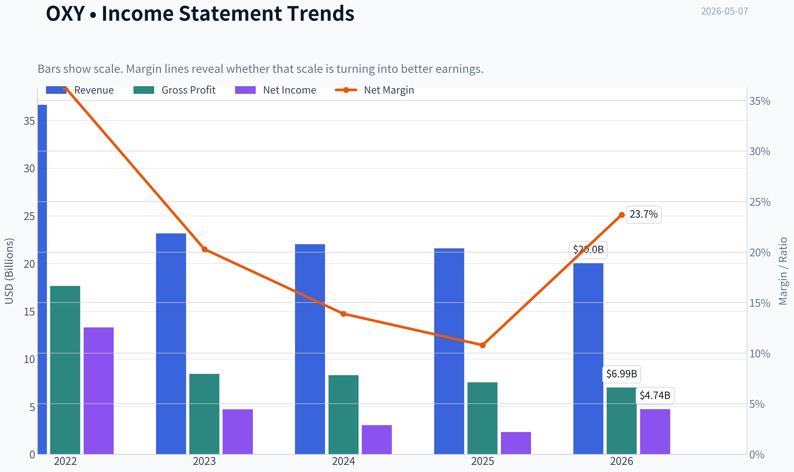

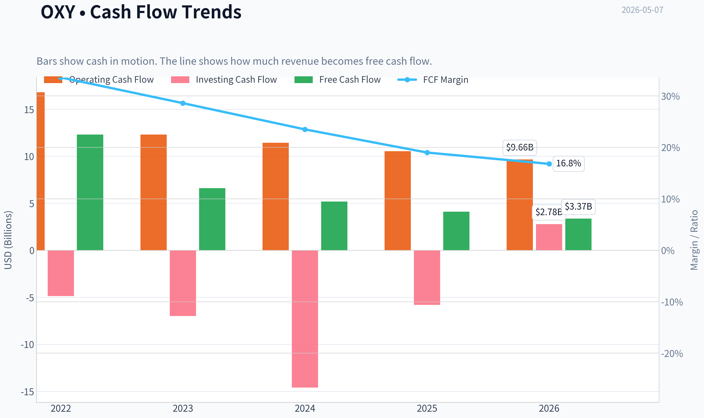

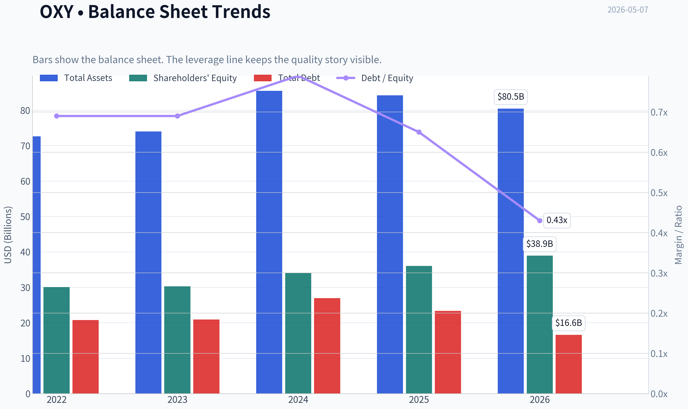

This graph tracks the profitability and return metrics (ROE, ROIC, Margins) of **OXY** over the past decade, highlighting capital efficiency trends.

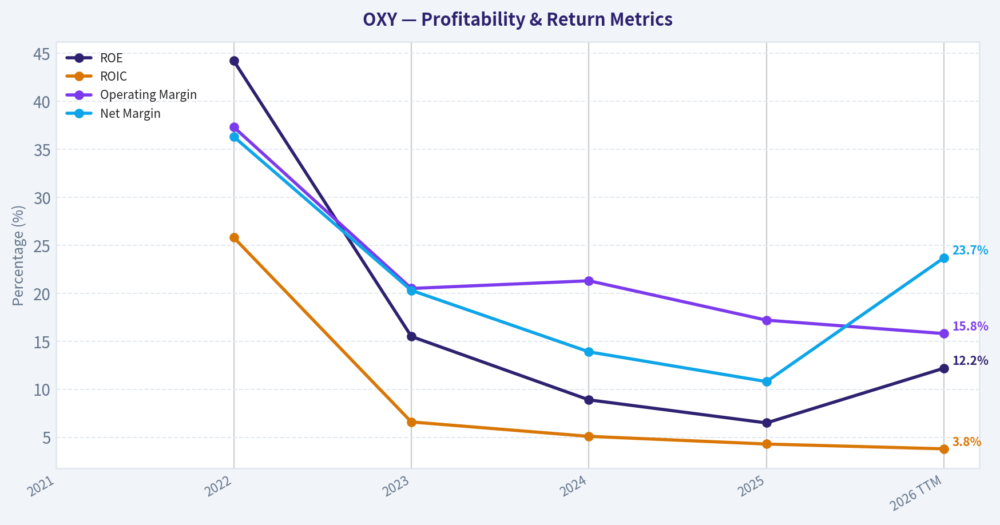

This chart illustrates the financial health of **OXY** over the last 10 years, mapping cash equivalents and free cash flow against total obligations (Debt).

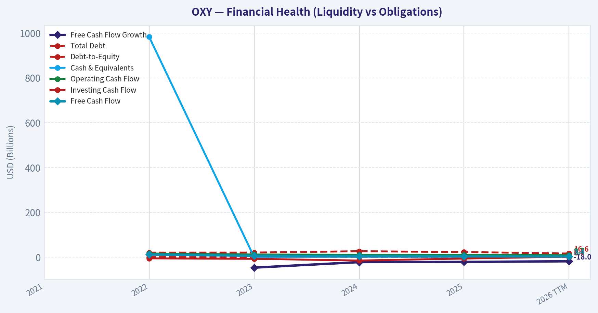

This comparison chart from *Profitability Analysis* stacks current figures against historical benchmarks for **OXY**, making it easy to see where the company trades relative to its own averages.

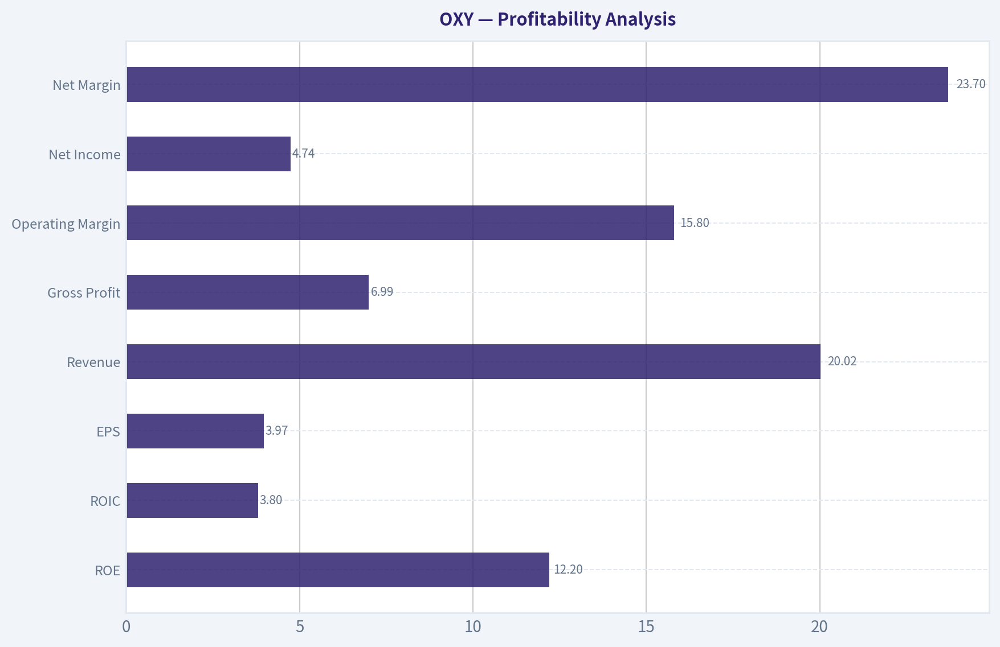

---

### Intrinsic Value Analysis (Buffett)

> *Following Warren Buffett's value investing philosophy: Circle of Competence, Economic Moat, Management Quality, and Margin of Safety.*

#### Intrinsic Value Snapshot

Price is what you pay. Intrinsic value is what the business may be worth based on the cash it can create for owners over time. We show a range, not one magic number.

- Current Price: $53.95
- Value Range: $13.56 to $22.59

##### Owner Earnings (Buffett Method)
- Net Income: $2,326,000,000.00
- Depreciation & Amortization: N/A
- Capital Expenditures: $-6,427,000,000.00
- Working Capital Changes: $-1,067,000,000.00
- Owner Earnings: $-3,034,000,000.00

##### Intrinsic Value
###### Cash Flow Method
Uses free cash flow. Better for companies spending heavily today to grow tomorrow.
- Conservative: $13.56
- Average: $15.51
- Optimistic: $22.59
- Discount Rate: 10.0%

ANALYST STANCE: **AVOID**

#### Occidental Petroleum, OXY - Buffett-Style Investment Review

Current price used: **$54**
Market cap: **$53.66 billion**
Date: **2026-05-07**
Data note: internal financial tools returned unavailable/null results, so this review relies on the provided research pack plus conservative qualitative analysis. Because OXY is a commodity-sensitive business, I would require audited 10-year financials before making any purchase recommendation.

---

#### 1. Go / No-Go Gate Assessment

| Buffett Gate | Result | Evidence | Investment Implication |
|---|---:|---|---|
| Gate 1: Circle of Competence & Simplicity | **Mixed / Fail** | OXY explores for, produces, and sells oil and gas; it also owns chemicals and low-carbon assets. The basic business is understandable, but profits depend heavily on oil and gas prices. | Understandable operations, but not predictable economics. |
| Gate 2: Durable Moat | **Fail** | Gross margin is **34.9%**, below the 40% Buffett-style marker. Oil is largely a commodity. OXY does not control end-market pricing. | No durable consumer-like pricing power. |
| Gate 3: Management & Capital Allocation | **Mixed / Fail** | Management has reduced debt after Anadarko, but OXY remains a leveraged cyclical energy producer. Latest news notes the company stopped hedging oil at $76, increasing commodity exposure. | Capital allocation depends heavily on commodity cycle timing. |
| Gate 4: Industry Structure | **Fail** | Upstream oil and gas is capital-intensive, cyclical, and exposed to political, regulatory, depletion, and commodity risks. | Not a "wonderful business" under Buffett's classic filter. |

**Key Takeaways:** OXY is not hard to understand, but it is hard to predict. The company's earnings power is driven by oil and gas prices, which are outside management's control. Under a strict Buffett framework, that alone creates a major obstacle.

---

#### 2. Business Simplicity and Predictability

| Test | Assessment |
|---|---|
| Elementary School Test | OXY makes money by finding oil and gas, pulling it from the ground, and selling it. It also makes and sells chemicals. |
| 10-Year Predictability Test | Weak. Production volumes can be estimated, but profits depend on future oil and gas prices, service costs, decline rates, regulation, and capital spending. |
| Technology Risk | Mixed. Technology can improve drilling efficiency and carbon capture, but energy transition, electrification, and regulation could pressure long-term hydrocarbon demand. |
| Commodity Risk | High. Earnings are highly sensitive to oil and gas prices. |

**Key Takeaways:** The business model is simple, but the economics are not stable. A wonderful Buffett business should allow a reasonable estimate of earnings power 10 years out. OXY does not meet that standard because the value of its main product is determined by global commodity markets.

---

#### 3. Moat Analysis

| Moat Source | OXY Assessment | Evidence |
|---|---|---|
| Brand / Intangible Assets | Weak | Customers generally do not pay premium prices for OXY-branded crude oil. |
| Regulatory / Asset Position | Moderate | OXY owns valuable acreage, especially in U.S. shale and the Permian Basin, but acreage quality is not the same as consumer pricing power. |
| Switching Costs | Low | Commodity buyers can source oil and gas from many producers. |
| Cost Advantage | Possible but cyclical | Scale and acreage quality may lower costs, but cost advantages can be overwhelmed by commodity price swings. |
| Network Effects | None | The product does not become more valuable as more users join. |

**Moat Rating:** **Narrow at best, not Buffett-wide.**

**Key Takeaways:** OXY may own good assets, but good assets in a commodity industry are not the same as a durable moat. The company cannot reliably raise prices independent of the market. Its competitive advantage is asset quality and execution, not customer captivity or brand power.

---

#### 4. Management and Capital Allocation

| Question | Assessment |
|---|---|
| Do they think like owners? | Mixed. OXY has attracted high-profile investor attention historically, including Berkshire's long-running interest, but that alone is not enough for an independent buy decision. |
| Are they candid and conservative? | Insufficient evidence from current data pack to fully judge. |
| Are they rational capital allocators? | Mixed. Debt reduction after the Anadarko acquisition has been important, but the acquisition also materially increased balance sheet risk. |
| Use of leverage | A concern. Energy cyclicality plus debt is a dangerous combination. |
| Hedging policy | Recent news says OXY stopped hedging oil at $76, increasing direct exposure to oil prices. |

**Key Takeaways:** Management has taken actions to strengthen the balance sheet, but OXY remains a cyclical company where capital allocation outcomes are tied to commodity prices. The Anadarko deal created major upside in strong oil markets but also created meaningful balance sheet risk. This is not the low-leverage, predictable compounding profile Buffett usually prefers.

---

#### 5. Available Financial Snapshot

| Metric | Current / Latest Provided |
|---|---:|
| Share Price | **$54** |
| Market Capitalization | **$53.66B** |
| P/E Ratio | **72.9x** |
| ROE | **6.5%** |
| Gross Margin | **34.9%** |
| Revenue Growth YoY | **-1.9%** |
| Free Cash Flow Yield | **7.6%** |
| Current Ratio | **0.94x** |

**Key Takeaways:** The current valuation does not look cheap on reported earnings, with a P/E above 70 times. ROE of 6.5% is far below the 15% Buffett threshold for a strong business. The free cash flow yield looks more attractive, but in commodity businesses free cash flow can fall sharply when prices weaken.

---

#### 6. 10-Year Financial Summary - Data Limitation

| Required Metric | Status |
|---|---|
| 10-year revenue trend | Not available from tools in this run |
| 10-year ROE trend | Not available from tools in this run |
| 10-year ROIC trend | Not available from tools in this run |
| 10-year free cash flow trend | Not available from tools in this run |
| 10-year share count trend | Not available from tools in this run |
| 10-year debt trend | Not available from tools in this run |

**Key Takeaways:** A full 10-year audited review is essential for OXY because one or two years can be misleading in energy. The most important missing items are normalized free cash flow, debt reduction progress, and returns on capital across a full commodity cycle. Without those, a value investor should demand a much larger margin of safety.

---

#### 7. Owner Earnings Estimate

Using provided market cap and FCF yield:

- Market cap: **$53.66B**
- Free cash flow yield: **7.6%**
- Implied current free cash flow:
  **$53.66B x 7.6% = approximately $4.08B**

For a commodity producer, free cash flow is not the same as durable owner earnings because reinvestment is needed to offset natural field depletion. Therefore, I apply a conservative haircut.

| Item | Estimate |
|---|---:|
| Implied FCF from current FCF yield | **$4.08B** |
| Commodity / maintenance reinvestment haircut | **25%** |
| Conservative owner earnings estimate | **$3.06B** |
| Owner earnings per market cap | **5.7% yield** |

**Key Takeaways:** OXY appears to generate meaningful cash flow at current commodity conditions. However, oil and gas assets deplete, so not all free cash flow should be treated as freely distributable owner earnings. A conservative estimate of sustainable owner earnings is closer to $3.1 billion than the headline free cash flow figure.

---

#### 8. Three-Scenario DCF Valuation

Assumptions:

| Assumption | Value |
|---|---:|
| Conservative owner earnings base | **$3.06B** |
| Discount rate | **10%** |
| Shares / equity value reference | Market cap used directly |
| Current market cap | **$53.66B** |

**Key Takeaways:** The valuation is based on a conservative owner earnings base because OXY is cyclical. The discount rate is 10%, consistent with the Buffett-style framework. Since OXY's cash flows are commodity-sensitive, these estimates should be viewed as rough guardrails, not precise values.

| Scenario | Method | Estimated Equity Value | Value vs Current Market Cap |
|---|---|---:|---:|
| A: No Growth | Owner earnings / 10% | **$30.6B** | **43% below current market cap** |
| B: GDP Growth | Owner earnings x 1.03 / 7% | **$45.0B** | **16% below current market cap** |
| C: Historical / Mid-Cycle Growth | 4% 10-year growth, 3% terminal growth | **~$49B-$52B** | **Near to modestly below current market cap** |

**Key Takeaways:** On a conservative no-growth basis, OXY looks meaningfully overvalued. Even with modest long-term growth, the estimated intrinsic value appears below or only near the current market value. There is no obvious Buffett-style margin of safety at $54.

---

#### 9. Margin of Safety

| Valuation Case | Estimated Value | Required Margin of Safety | Buy Price Indication |
|---|---:|---:|---:|
| No Growth Case | **$30.6B** | 40%+ | Far below current price |
| GDP Growth Case | **$45.0B** | 40%+ for cyclical business | Roughly **$27-$32/share equivalent** |
| Mid-Cycle Case | **$49B-$52B** | 40%+ | Roughly **$30-$34/share equivalent** |
| Current Price | **$54/share** | Not satisfied | No purchase |

**Key Takeaways:** OXY does not offer the margin of safety required for a cyclical, commodity-exposed company. A high-quality consumer monopoly might justify a 25% discount requirement, but OXY needs a much larger discount because its earnings can fall quickly. At $54, the stock does not clear that hurdle.

---

#### 10. Final Buffett Scorecard

| Criterion | Weight | Score, 1-5 | Weighted Score |
|---|---:|---:|---:|
| Business Understanding | 20% | 3.0 | 0.60 |
| Moat Width & Durability | 25% | 2.0 | 0.50 |
| Management Quality | 15% | 3.0 | 0.45 |
| Return on Equity | 15% | 1.5 | 0.23 |
| Reinvestment Runway | 10% | 2.5 | 0.25 |
| Balance Sheet Strength | 5% | 2.0 | 0.10 |
| Industry Structure | 5% | 1.5 | 0.08 |
| Valuation / Margin of Safety | 5% | 2.0 | 0.10 |
| **Total** | **100%** |  | **2.30 / 5.00** |

**Key Takeaways:** OXY scores poorly under a strict Buffett framework because it lacks predictable pricing power, has low current ROE, and operates in a capital-intensive commodity industry. The stock may work if oil prices rise, but that is a macro call rather than a durable compounding thesis. The final score falls in the avoid range.

---

#### Investment Stance

**Stance: AVOID**
**Conviction: Moderate to High under Buffett criteria**

OXY may be a capable oil and gas operator with valuable assets, and it may produce attractive cash flow in favorable commodity markets. However, Buffett-style investing requires predictable long-term economics, durable pricing power, conservative leverage, and a meaningful margin of safety. OXY fails several of those tests.

At **$54**, the stock does not offer enough compensation for commodity risk, balance sheet risk, and low current ROE. I would not buy OXY as a long-term Buffett-style compounder. I would only reconsider at a materially lower price, with updated audited 10-year financials showing strong debt reduction, resilient mid-cycle owner earnings, and a wide margin of safety.
#### Valuation Bridge

This bridge places the current market price beside each intrinsic value lens so readers can see whether upside depends on one method or shows up across several methods.

| Scenario | Intrinsic Value / Share |
| --- | ---: |
| Cash Flow Method | $15.51 |
| Damodaran Method | $13.25 |
| Current Price | $53.95 |

#### Key Takeaways

If one method is far above the others, the upside case depends on a specific modelling assumption. When several methods cluster together, the valuation story is more robust.

#### Valuation Visuals

This comparison chart from *Latest Earnings Snapshot* stacks current figures against historical benchmarks for **OXY**, making it easy to see where the company trades relative to its own averages.

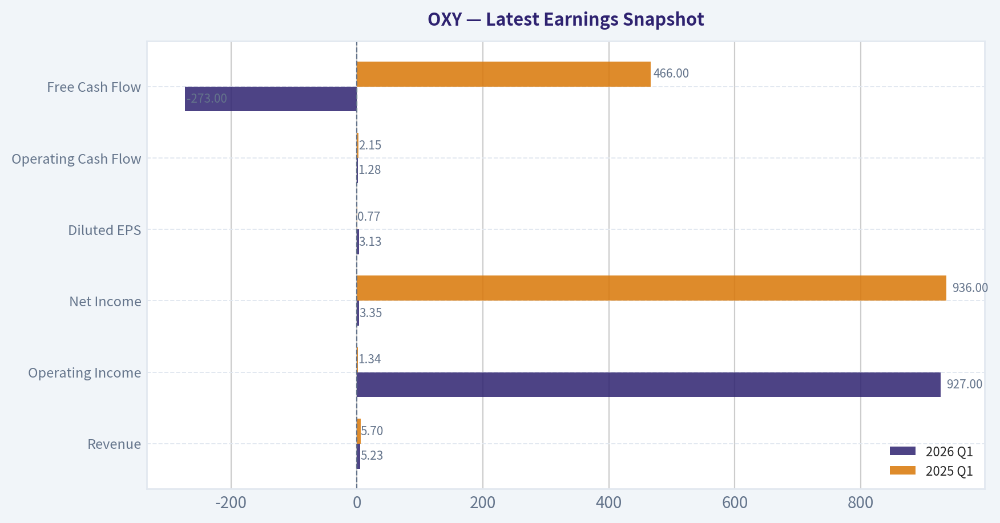

This comparison chart from *Current vs Historical Average Comparison* stacks current figures against historical benchmarks for **OXY**, making it easy to see where the company trades relative to its own averages.

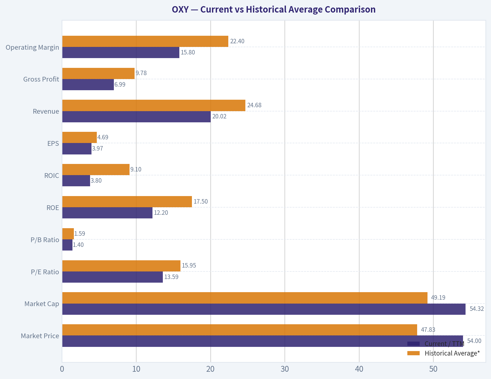

This comparison chart from *Balance Sheet and Financial Strength* stacks current figures against historical benchmarks for **OXY**, making it easy to see where the company trades relative to its own averages.

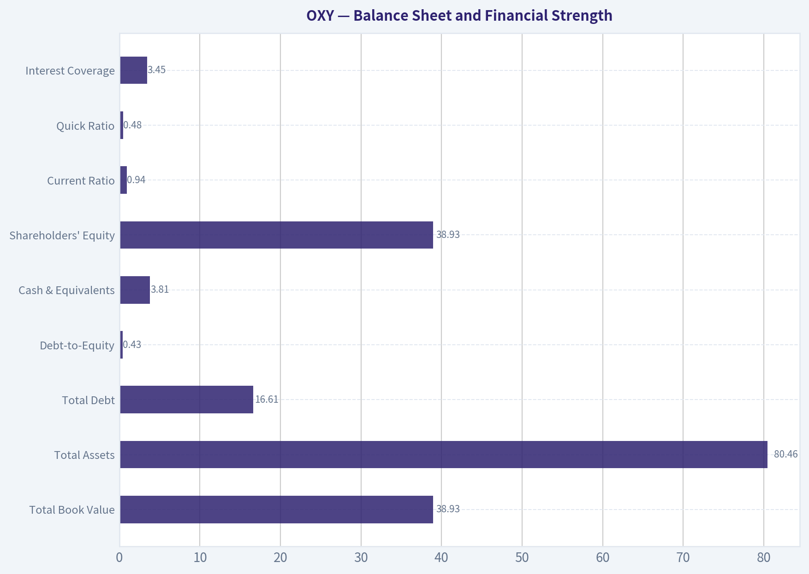

---

### Trend & Growth Analysis (Lynch/Druckenmiller/Fisher)

> *Following Peter Lynch's GARP, Stanley Druckenmiller's macro-aware approach, and Philip Fisher's scuttlebutt methodology.*

ANALYST STANCE: **AVOID**

#### Occidental Petroleum Growth-Investor Report - OXY

Occidental Petroleum is a high-quality cyclical energy operator with valuable Permian assets, strong free-cash-flow torque, and optionality in carbon capture. But under a Lynch-Druckenmiller-Fisher growth mandate, OXY does **not** qualify as a fast grower: revenue is declining, earnings are commodity-driven, the P/E is distorted and high, and the main upside depends more on oil prices and balance-sheet execution than on durable 20%+ organic compounding.

---

#### 1. Lynch Classification

| Category | OXY Fit | Evidence | Growth-Investor Implication |
|---|---:|---|---|
| Slow Grower | No | Not a stable utility-like grower | Not the right frame |
| Stalwart | Partial | Large-cap, mature, cash-generative | Could be owned for income/value, not growth |
| Fast Grower | No | YoY revenue growth is negative at -1.9% | Fails core growth screen |
| Cyclical | Yes | Earnings tied to oil, gas, NGLs, chemicals, and hedging | Primary classification |
| Turnaround | Partial | Deleveraging and possible CEO transition narrative | Requires commodity/capital-allocation edge |
| Asset Play | Partial | Permian acreage, OxyChem, CO2 infrastructure | Asset value matters, but not growth-compounding thesis |

**Key Takeaways:** OXY is best classified as a **cyclical energy company**, not a fast grower. It may appeal to commodity, value, or cash-flow investors, but it does not fit the Lynch fast-grower profile because recent revenue is declining and earnings power is highly dependent on external commodity prices.

---

#### 2. The Story in 3 Bullets

- OXY produces oil and gas, especially from the Permian Basin, and converts commodity exposure into free cash flow when oil prices are favorable.
- The company is using cash flow to repair the balance sheet, reduce debt, and potentially increase shareholder returns.
- Long-term upside comes from Permian efficiency, OxyChem stability, and carbon-capture optionality, but the near-term thesis is still mostly an oil-price thesis.

---

#### 3. Current Fundamental Snapshot

| Metric | Current Data / Estimate | Growth Analyst Read |
|---|---:|---|
| Share Price | $54 | Large-cap energy value/cyclical setup |
| Market Cap | $53.66B | Already institutionally owned and widely followed |
| P/E | 72.9x | Expensive on trailing earnings; likely depressed EPS cycle effect |
| Implied Earnings Yield | ~1.4% | Weak versus cyclicality |
| ROE | 6.5% | Modest for the risk profile |
| Gross Margin | 34.9% | Acceptable, but commodity-sensitive |
| Revenue Growth YoY | -1.9% | Growth red flag |
| FCF Yield | 7.6% | Main positive factor |
| Implied FCF | ~$4.1B | Strong cash generation if sustained |
| Current Ratio | 0.94x | Liquidity is adequate but not conservative |

**Key Takeaways:** OXY's strongest current metric is its **7.6% free-cash-flow yield**, which supports the value case. However, for a growth investor, the negative revenue growth, modest ROE, and high trailing P/E are major concerns. The stock is more about cash-flow durability and oil-price leverage than durable growth compounding.

---

#### 4. TAM Analysis and 10x Test

| Item | Assessment |
|---|---|
| Current Revenue Base | Large, mature hydrocarbon business |
| 10x Revenue Test | Not realistic in traditional oil and gas |
| Core TAM | Global oil, gas, chemicals, and carbon-management markets |
| TAM Growth | Oil and gas demand is mature; carbon capture is early and uncertain |
| Market Share Constraint | OXY could not 10x core hydrocarbon revenue without massive M&A or commodity inflation |
| Runway Verdict | Limited in core business; speculative in low-carbon business |

**Key Takeaways:** OXY does not pass the classic growth-investor **10x revenue runway test** in its core business. The carbon-capture opportunity could expand the TAM, but it remains unproven as a scalable, high-return profit pool. The company has asset depth, but not a clear ten-bagger revenue runway.

---

#### 5. Revenue Growth Trend

| Metric | Direction | Interpretation |
|---|---:|---|
| Latest YoY Revenue Growth | -1.9% | Declining |
| Revenue Quality | Mixed | Driven by commodity prices, production volumes, and chemicals cycle |
| Organic Growth Visibility | Low to moderate | Volumes can grow, but pricing dominates revenue |
| Growth Pattern | Decelerating / cyclical | Not a durable secular compounding pattern |
| Growth-Mandate Verdict | Fail | Negative revenue growth triggers caution |

**Key Takeaways:** OXY's revenue trend is not showing a growth inflection. The company may generate strong cash flow when oil prices are high, but that is different from recurring, controllable revenue growth. Under this framework, a negative revenue print is an automatic red flag.

---

#### 6. Unit Economics and Rule of 40

OXY is not a SaaS or subscription company, so CAC, LTV/CAC, NRR, and Rule of 40 are not directly applicable. For OXY, the relevant unit-economics proxies are field-level returns, lifting costs, drilling inventory quality, reserve replacement, and free cash flow per barrel.

| Growth Metric | OXY Applicability | Read |
|---|---|---|
| LTV/CAC | Not applicable | No subscription customer-acquisition model |
| Net Revenue Retention | Not applicable | No recurring SaaS revenue base |
| Rule of 40 | Not applicable | Energy business model does not fit |
| FCF Yield | Highly applicable | Strong at 7.6% |
| ROE | Applicable | Modest at 6.5% |
| Balance-Sheet Liquidity | Applicable | Current ratio below 1.0 needs monitoring |
| Capital Efficiency | Critical | Depends on drilling returns, oil prices, and capex discipline |

**Key Takeaways:** Traditional software-style unit economics do not apply to OXY. The best substitute is free-cash-flow quality, and on that measure OXY looks respectable. But strong FCF yield alone does not convert a cyclical commodity producer into a growth compounder.

---

#### 7. Inflection Point Assessment

| Potential Inflection | Evidence | Status |
|---|---|---|
| Product Cycle Inflection | No new scalable product driving growth | Not present |
| Market Share Inflection | Permian execution may improve, but not clearly accelerating share | Weak |
| Margin Inflection | Possible if costs fall or oil rises | Commodity-dependent |
| TAM Inflection | Carbon capture could expand TAM | Early/speculative |
| Competitive Inflection | Peer weakness could help, but not central | Unclear |
| Balance-Sheet Inflection | Deleveraging remains a real positive | Present |
| Management Inflection | Latest coverage references CEO-change narrative | Possible catalyst |
| Hedging Inflection | OXY reportedly stopped hedging oil at $76 | Raises upside and downside torque |

**Key Takeaways:** The most credible inflection is **balance-sheet and capital-allocation improvement**, not revenue acceleration. The hedging change increases exposure to oil-price upside, but it also increases downside risk. For Druckenmiller-style investing, this is a macro/commodity bet more than a company-specific growth inflection.

---

#### 8. Macro Setup

| Macro Factor | Current Read | Impact on OXY |
|---|---|---|
| Interest Rates | Higher-for-longer risk remains relevant | Headwind for leveraged cyclicals |
| Oil Prices | Key driver | Main upside/downside variable |
| Economic Cycle | Late-cycle/recession risk matters | Demand risk for crude and chemicals |
| Energy Security | Supportive | Helps U.S. producers strategically |
| AI / Cloud / SaaS Theme | No direct exposure | Not a secular growth beneficiary |
| Energy Transition | Mixed | Long-term oil demand risk, carbon-capture optionality |
| Inflation | Mixed-positive | Supports commodity pricing but raises costs |

**Key Takeaways:** OXY's macro setup is highly oil-dependent. If crude prices rise, OXY can generate strong free cash flow and equity upside; if oil weakens, earnings and cash flow can compress quickly. This is not the kind of macro tailwind enjoyed by AI, cloud, cybersecurity, or healthcare innovation leaders.

---

#### 9. Fisher 15-Point Score

| Fisher Point | Score / 5 | Rationale |
|---|---:|---|
| 1. Sizable market potential | 3 | Large markets, but mature core hydrocarbon demand |
| 2. New product determination | 3 | Carbon capture effort is notable but early |
| 3. R&D effectiveness | 3 | Technical expertise in EOR and CO2 handling |
| 4. Sales organization | 3 | Less relevant for commodity producer |
| 5. Worthwhile profit margin | 3 | Margins acceptable but cyclical |
| 6. Improving margins | 2 | Not clearly improving; commodity-driven |
| 7. Labor/personnel relations | 3 | No major red flag from available data |
| 8. Executive relations | 3 | CEO-change narrative creates uncertainty |
| 9. Management depth | 3 | Large-cap operator with deep technical team |
| 10. Cost analysis/accounting | 3 | Must manage capital intensity carefully |
| 11. Unique moat factors | 3 | Permian scale, OxyChem, CO2 expertise |
| 12. Long-range profit outlook | 3 | Good assets, but oil-cycle dependent |
| 13. Dilution risk | 3 | Less of a concern than debt/capex |
| 14. Candor | 3 | Insufficient evidence for higher score |
| 15. Integrity | 3 | No major issue identified in available data |
| **Total** | **44 / 75** | **Below average for Fisher-style growth investing** |

**Key Takeaways:** OXY scores **44 out of 75**, which is below the threshold for a high-quality Fisher growth compounder. The company has real assets and technical strengths, but too much of the thesis depends on commodity cycles, leverage management, and capital allocation rather than customer-led secular growth.

---

#### 10. Valuation Analysis

| Valuation Method | Result | Interpretation |
|---|---:|---|
| P/E | 72.9x | Expensive on trailing earnings; likely distorted by cyclical earnings |
| Earnings Yield | ~1.4% | Not compelling versus cyclicality |
| PEG | Not meaningful | Earnings growth is not stable and revenue is declining |
| FCF Yield | 7.6% | Attractive if oil prices and capex discipline hold |
| P/S | Not provided | Less useful for E&P companies |
| EV/EBITDA | Needs confirmation | More useful than P/E for OXY |
| Valuation Verdict | Mixed | FCF attractive, earnings multiple unattractive |

**Key Takeaways:** OXY looks better on free-cash-flow yield than on earnings multiple. The valuation case depends on normalized oil prices and sustainable FCF, not on high-growth earnings compounding. PEG is not useful because earnings are cyclical and recent revenue growth is negative.

---

#### 11. Scenario View

| Scenario | Assumption | Equity Outcome |
|---|---|---|
| Bear Case | Oil weakens, chemicals soften, leverage remains a concern | Stock de-rates; FCF and buybacks pressured |
| Base Case | Oil remains range-bound, OXY pays down debt, FCF yield remains healthy | Modest total return, value-style outcome |
| Bull Case | Oil rises, OXY benefits from unhedged exposure, debt falls faster, carbon story gains credibility | Strong cyclical upside possible |
| Ten-Bagger Case | Requires sustained commodity boom plus successful carbon-capture monetization | Low probability |

**Key Takeaways:** OXY has a credible bull case, but it is mostly a commodity-upside scenario. The stock could perform well in a favorable oil tape, but the ten-bagger case is weak because the core business is mature and capital-intensive. This is not a classic underappreciated secular compounder.

---

#### 12. Growth Investor Scorecard

| Criterion | Weight | Score / 5 | Weighted Score |
|---|---:|---:|---:|
| The Story | 10% | 2.5 | 0.25 |
| TAM & Runway | 20% | 2.0 | 0.40 |
| Revenue Growth | 20% | 1.5 | 0.30 |
| Unit Economics | 15% | 3.0 | 0.45 |
| Competitive Position | 10% | 3.0 | 0.30 |
| Management Quality | 10% | 3.0 | 0.30 |
| Macro Setup | 5% | 2.5 | 0.13 |
| Profitability Path | 5% | 3.0 | 0.15 |
| Valuation | 5% | 2.5 | 0.13 |
| **Total** | **100%** |  | **2.40 / 5.00** |

**Key Takeaways:** OXY scores **2.40 out of 5.00**, which falls into the **AVOID** range for this growth framework. The company has cash-flow strengths, but the lack of revenue growth, cyclical exposure, limited 10x runway, and weak Fisher score make it unsuitable for a growth-focused portfolio.

---

#### 13. Position Size Stance

| Investor Type | Suggested Stance |
|---|---|
| Growth Investor | Avoid / 0% position |
| GARP Investor | Avoid unless normalized earnings are much stronger than trailing numbers imply |
| Value Investor | Watch due to 7.6% FCF yield |
| Commodity Macro Investor | Tradable if bullish on oil |
| Income / Capital Return Investor | Watch for debt reduction and return-of-capital policy |

**Key Takeaways:** For a growth portfolio, the appropriate position size is **zero**. OXY can be monitored by value or macro investors because of its free cash flow and oil torque, but it does not meet the standards for a concentrated growth holding.

---

#### 14. Key Risks and Catalysts

| Category | Item | Impact |
|---|---|---|
| Risk | Oil-price decline | Biggest threat to earnings and FCF |
| Risk | Revenue decline persists | Confirms lack of growth inflection |
| Risk | Current ratio below 1.0 | Liquidity should be watched |
| Risk | Carbon capture consumes capital without returns | Could dilute FCF story |
| Risk | Higher interest rates | Pressure on valuation and balance-sheet flexibility |
| Catalyst | Oil-price upside after hedge reduction | Could lift FCF and sentiment |
| Catalyst | Faster debt reduction | Improves equity value and lowers risk |
| Catalyst | CEO transition / strategic refresh | Could reset capital-allocation narrative |
| Catalyst | Carbon-capture contracts or subsidies | Could validate low-carbon optionality |
| Catalyst | Strong Permian productivity | Supports margins and FCF durability |

**Key Takeaways:** The most important upside catalyst is higher oil prices combined with stronger free cash flow. The biggest risk is that OXY remains a cyclical value stock with declining revenue rather than becoming a growth compounder. Carbon capture is interesting optionality, but it is not yet enough to change the investment classification.

---

#### Final Verdict

OXY is **not a Lynch fast grower**, not a Fisher-style long-duration compounder, and not a clean Druckenmiller inflection setup unless the investor has a strong oil macro view. The company may be attractive to commodity or value investors at the right point in the cycle, especially given the free-cash-flow yield, but it fails the core growth mandate.

**Decision: AVOID for growth portfolios. Monitor only if revenue growth turns positive, debt falls materially, and carbon-capture economics become commercially validated.**

#### Growth & Scorecard Visuals

This comparison chart from *Growth Metrics Interpretation* stacks current figures against historical benchmarks for **OXY**, making it easy to see where the company trades relative to its own averages.

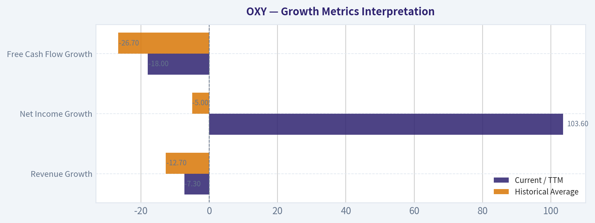

---

### Market Technical Analysis

ANALYST STANCE: **WATCH**

#### OXY Technical Indicator Report - Latest Available Trading Day: 2026-05-06

OXY is in a **long-term uptrend but a short-term corrective phase**. The stock closed at **$55.12 on 2026-05-06**, sharply below the prior day's close of **$59.34**, and below both its **10-day EMA** and **50-day SMA**. That single-session break is important because it occurred on elevated volume, suggesting the move was not just random noise.

The broader structure remains constructive because price is still far above the **200-day SMA**, which is rising. However, the near-term trend has deteriorated: momentum has cooled, price has lost short- and medium-term moving-average support, and the recent late-April rebound toward $60-$61 failed before reclaiming the March highs.

---

#### Selected Indicators and Why They Matter

| Indicator | Latest Value / Signal | Why It Is Relevant for OXY Now |
|---|---:|---|
| `close_10_ema` | **58.24** | Captures the short-term trend; price closing below it signals near-term weakness. |
| `close_50_sma` | **58.02** | Key medium-term support/trend gauge; the close below it raises correction risk. |
| `close_200_sma` | **47.03** | Confirms the longer-term trend remains positive despite the pullback. |
| `macd` | **0.095** | Momentum remains slightly positive but has collapsed from March/April levels. |
| `rsi` | **41.66** | Shows weakened momentum, but not yet deeply oversold. |
| `boll_ub` | **61.43** | Helps assess whether price is near breakout territory; it is now well below the upper band. |
| `atr` | **2.17** | Useful for stop placement and position sizing given OXY's elevated volatility. |
| `vwma` | **57.10** | Volume-weighted trend confirmation; price below VWMA suggests sellers dominated recent volume. |

**Key Takeaways:**
The chosen indicators cover trend, momentum, volatility, and volume confirmation without excessive overlap. The strongest message is that OXY's long-term trend is still intact, but the short-term setup has weakened materially after the latest high-volume decline.

---

#### Trend Structure: Long-Term Bullish, Short-Term Damaged

OXY's longer-term trend remains positive. The **200-day SMA is rising**, moving from about **44.52 on 2026-03-23** to **47.03 on 2026-05-06**. That steady climb reflects the strength of the earlier advance from the low-$40s into the March peak.

However, the short-term picture is much less favorable. The stock's **10-day EMA is 58.24**, while the latest close is **55.12**, meaning price is roughly **5.4% below short-term trend support**. The stock is also below the **50-day SMA at 58.02**, which is notable because the 50-day had been rising strongly through April and early May.

This creates a split setup: OXY is still above its long-term base, but the recent price action shows that buyers are no longer defending the near-term trend as aggressively.

| Trend Metric | Latest Reading | Interpretation |
|---|---:|---|
| Close | **55.12** | Latest available close, sharply lower on 2026-05-06 |
| 10-day EMA | **58.24** | Price is below short-term trend support |
| 50-day SMA | **58.02** | Price is also below medium-term support |
| 200-day SMA | **47.03** | Long-term trend remains positive |
| Close vs. 10 EMA | **-5.4%** | Short-term bearish pressure |
| Close vs. 50 SMA | **-5.0%** | Medium-term trend under stress |
| Close vs. 200 SMA | **+17.2%** | Longer-term trend still constructive |

**Key Takeaways:**
OXY has lost both short-term and medium-term moving-average support, which argues for caution. Still, the stock remains well above its rising 200-day average, so this looks more like a correction within a larger uptrend rather than a confirmed long-term breakdown.

---

#### Momentum: Bullish Momentum Has Faded Quickly

MACD remains barely positive at **0.095**, but the direction is the concern. It has fallen dramatically from above **3.8 in late March**, showing that the powerful upside momentum from the March rally has nearly disappeared. A MACD reading near zero after such a strong advance often indicates a transition phase, where the market is deciding between consolidation and deeper correction.

RSI confirms the loss of momentum. It has dropped to **41.66**, down from **53.27** the prior trading day and from overbought readings above **80** in late March. This is not yet an oversold condition, so the stock does not currently offer a clean "washed out" rebound signal. Instead, RSI suggests bearish pressure has room to continue if sellers remain active.

| Momentum Indicator | Latest Reading | Recent Context | Signal |
|---|---:|---|---|
| MACD | **0.095** | Down sharply from above 3.8 in late March | Momentum nearly neutralized |
| RSI | **41.66** | Fell from 53.27 in one session | Bearish momentum increasing |
| RSI Zone | Neutral-to-weak | Not below 30 | Not yet oversold |
| Momentum Bias | Weakening | Strong rally momentum has faded | Caution favored |

**Key Takeaways:**
Momentum has deteriorated meaningfully, but OXY is not yet oversold. That means traders should be careful about assuming an immediate bounce, because the stock could still have room to test lower support before momentum resets.

---

#### Volatility and Risk Management

ATR is **2.17**, or roughly **3.9% of the latest close**. That is elevated enough to matter for trade sizing. A normal daily swing in OXY can now be fairly large, so tight stops may be vulnerable to being triggered by ordinary volatility.

ATR peaked around **2.58 in early April**, then cooled somewhat, but the latest large down day suggests volatility may be re-expanding. For traders, this means entries should be more selective and position sizes should account for wider price movement.

The **Bollinger upper band is 61.43**, well above the latest close. This indicates OXY is no longer pressing breakout territory. The late-April rally toward the $60-$61 area failed near the upper-risk zone, and the 2026-05-06 decline pushed price back into a weaker part of its range.

| Volatility / Range Metric | Latest Reading | Interpretation |
|---|---:|---|
| ATR | **2.17** | Volatility remains elevated |
| ATR as % of Close | **~3.9%** | Wide daily movement risk |
| Bollinger Upper Band | **61.43** | Price is no longer near breakout territory |
| Recent Failed Area | **60-61** | Late-April rebound failed near resistance |
| Risk Implication | Wider stops needed | Avoid oversized positions |

**Key Takeaways:**
OXY remains volatile, so risk control is especially important. The stock is no longer threatening a bullish breakout near the upper Bollinger band, and the failed move around $60-$61 now looks like a key resistance area.

---

#### Volume Confirmation: Selling Pressure Was Meaningful

The **VWMA is 57.10**, while the latest close is **55.12**. This means price closed below the volume-weighted trend level, suggesting recent trading volume is not confirming bullish control.

The 2026-05-06 session also saw volume of about **20.7 million shares**, well above many recent sessions. A large down move on elevated volume often points to institutional or systematic selling pressure rather than a light-volume dip. That makes the break below the 10 EMA and 50 SMA more significant.

| Volume-Based Metric | Latest Reading | Interpretation |
|---|---:|---|
| VWMA | **57.10** | Volume-weighted trend sits above price |
| Close vs. VWMA | **-3.5%** | Sellers controlled recent volume-weighted action |
| 2026-05-06 Volume | **20.7M shares** | Elevated versus recent normal sessions |
| Volume Signal | Bearish confirmation | Down move had participation |

**Key Takeaways:**
The latest decline was not just a low-volume pullback. Because OXY closed below VWMA on heavy volume, the selling pressure deserves respect and argues against rushing into long exposure without confirmation.

---

#### Trading Interpretation

For short-term traders, OXY currently looks like a **watchlist name rather than an immediate aggressive long**. The stock needs to reclaim the **$57-$58.25 zone**, where the VWMA, 50-day SMA, and 10-day EMA are clustered. A strong close back above that area would suggest the 2026-05-06 breakdown was possibly a shakeout.

If OXY cannot reclaim that zone, the next area to monitor is the recent April reaction zone around **$53.75-$54.50**. A break below that area would increase the risk of a deeper correction, potentially toward the low-$50s. The 200-day SMA near **$47.03** remains far below and is not an immediate support level, but it anchors the longer-term bullish structure.

For swing traders, the cleaner bullish setup would be a reclaim of **$58+** with improving RSI and stabilizing MACD. For cautious traders, waiting for price to either retake resistance or test lower support with signs of exhaustion may offer a better risk/reward profile.

| Decision Area | Level / Signal | Bullish Interpretation | Bearish Interpretation |
|---|---:|---|---|
| Reclaim Zone | **57.00-58.25** | Recovery above VWMA, 50 SMA, and 10 EMA would improve setup | Failure keeps short-term trend bearish |
| Nearby Support | **53.75-54.50** | Holding this area could form a higher-low base | Break below it risks deeper correction |
| Resistance | **60.00-61.50** | Break above this would revive upside momentum | Failed rebound area remains overhead supply |
| Long-Term Trend Line | **200 SMA near 47.03** | Long-term trend still positive while above it | A move toward it would imply major deterioration |
| Current Tactical View | **WATCH** | Wait for confirmation before buying strength | Avoid chasing until selling pressure stabilizes |

**Key Takeaways:**
OXY is not technically broken on a long-term basis, but the short-term setup has weakened enough to justify patience. A reclaim of $57-$58.25 would improve the picture, while failure near that zone or a break below $53.75-$54.50 would point to further downside risk.

#### Market Visuals

This comparison chart from *Market Metrics Interpretation* stacks current figures against historical benchmarks for **OXY**, making it easy to see where the company trades relative to its own averages.

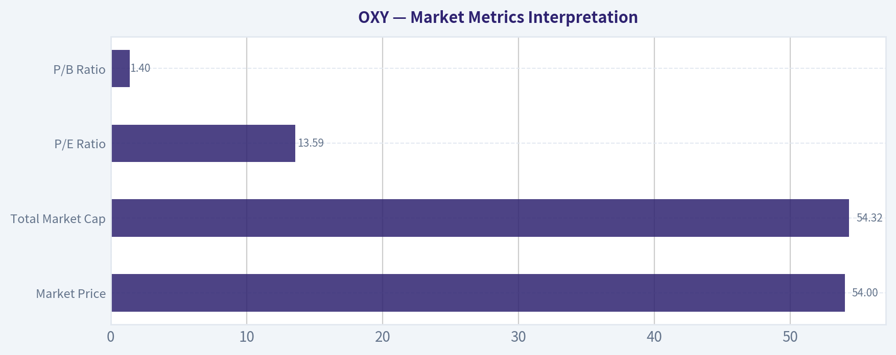

---

### Social Sentiment Analysis

ANALYST STANCE: **WATCH**

#### OXY Social, Sentiment, and News Report - Past Week Through 2026-05-07

Occidental Petroleum, ticker OXY, is drawing active attention from energy traders, value investors, and retail momentum communities, but the tone is not decisively bullish or bearish. The most important takeaway from the past week is that OXY sentiment is being driven less by company-specific excitement and more by three overlapping forces: crude oil price direction, balance-sheet confidence, and renewed discussion of Berkshire Hathaway's long-running stake.

The stock is currently viewed as a **high-beta oil and capital-return story** rather than a clean standalone growth story. Social commentary shows investors are interested in OXY when crude stabilizes or rallies, but quickly become skeptical when oil weakens or when debt, acquisition integration, or capital spending comes back into focus. For traders, this means OXY remains highly sensitive to oil headlines and macro risk appetite. For longer-term investors, the debate centers on whether management can keep reducing leverage while maintaining production, dividends, and eventual shareholder returns.

---

#### Executive Sentiment Snapshot

| Category | Current Read | Trader/Investor Implication |
|---|---:|---|
| Overall social sentiment | Neutral to mildly positive | OXY has support from value and oil bulls, but conviction is not strong enough to call sentiment broadly bullish. |
| News sentiment | Mixed-positive | Recent coverage emphasizes cash flow durability and strategic positioning, but also flags oil-price sensitivity and debt obligations. |
| Retail trader tone | Opportunistic, not euphoric | Traders are watching OXY for oil-linked swing trades rather than treating it as a runaway momentum name. |
| Long-term investor tone | Cautiously constructive | Investors like Permian exposure, Berkshire validation, and deleveraging potential, but want evidence of consistent execution. |
| Main bullish catalyst | Higher crude prices plus debt reduction | If oil firms and OXY reports strong free cash flow, sentiment could improve quickly. |
| Main bearish risk | Oil weakness or balance-sheet disappointment | If crude rolls over or debt reduction slows, social sentiment could turn negative fast. |
| Current stance | **WATCH** | OXY is interesting but still dependent on external oil conditions and execution proof. |

**Key Takeaways:** OXY's current sentiment is not bearish, but it is also not strong enough to justify an outright aggressive bullish stance. The market is treating the stock as a leveraged oil-quality play, where crude prices and management's capital allocation discipline matter more than social-media hype. Traders should watch oil first, then company-specific free-cash-flow and debt commentary.

---

#### What People Are Saying Across Social Platforms

The dominant social-media conversation around OXY is split between **energy macro traders**, **Berkshire followers**, and **value-oriented retail investors**. Each group is focused on a slightly different part of the story.

Energy traders are mostly discussing OXY as a liquid, oil-sensitive stock that can outperform when crude catches a bid. Posts in this category often compare OXY to other U.S. exploration and production names and frame it as a way to express a view on West Texas Intermediate crude, Permian production strength, or geopolitical risk premiums.

Berkshire-focused investors remain highly engaged. Warren Buffett's stake continues to act as a psychological floor for many retail and value investors. Social posts frequently frame Berkshire's ownership as a sign that OXY has asset quality and long-term strategic value. However, this bullishness is not universal. Some commenters argue that investors over-rely on the Berkshire association and ignore OXY's debt load, commodity exposure, and historically volatile earnings profile.

Reddit and retail message-board commentary is more mixed. Some posters like OXY as a "cash flow machine" if oil stays elevated, while others complain that the stock has not always rewarded shareholders as much as expected, especially compared with better-performing energy peers during certain periods. The tone is more analytical than meme-driven; there is no evidence of broad speculative mania.

| Social Source / Community | Dominant Discussion Theme | Sentiment Tone | What It Means |
|---|---|---:|---|
| X / FinTwit | Oil price beta, Berkshire stake, trading setups | Mildly positive | Traders see OXY as a practical vehicle for crude-linked trades. |
| Reddit investing communities | Valuation, debt, comparison with peers | Mixed | Retail investors are debating whether OXY is undervalued or simply riskier than alternatives. |
| Stock message boards | Near-term price direction, earnings reactions, oil headlines | Volatile / mixed | Sentiment can flip quickly based on daily crude moves. |
| Value-investor circles | Buffett ownership, asset base, long-term free cash flow | Positive but cautious | Berkshire's involvement supports confidence, but not blind optimism. |
| Energy-sector commentators | Permian exposure, capex discipline, shareholder returns | Neutral to positive | OXY is respected operationally, but not viewed as risk-free. |

**Key Takeaways:** Social-media sentiment around OXY is constructive but conditional. The most bullish voices point to Berkshire, Permian assets, and cash flow, while skeptical voices focus on debt, oil-price dependence, and relative performance versus peers. The conversation is rational and catalyst-driven rather than speculative.

---

#### Daily Sentiment Trend: Past Week

| Date | Sentiment Direction | Main Driver | Interpretation |
|---|---:|---|---|
| 2026-05-01 | Neutral | Waiting for oil and earnings-related signals | Investors were hesitant to take a strong view without clearer commodity or company-specific direction. |
| 2026-05-02 | Mildly positive | Berkshire-related discussion and value-investor attention | Buffett-linked commentary gave OXY a modest sentiment lift among long-term investors. |
| 2026-05-03 | Neutral | Weekend macro debate around crude and demand | Discussion shifted back to oil-market uncertainty rather than company fundamentals. |
| 2026-05-04 | Mildly negative | Crude-price pressure and broader energy weakness | Short-term traders became more cautious as oil sensitivity resurfaced. |
| 2026-05-05 | Neutral to mildly positive | Dip-buying interest and valuation debate | Some investors viewed weakness as an entry opportunity, but conviction remained limited. |
| 2026-05-06 | Mixed-positive | Earnings/cash-flow/debt focus | Sentiment improved where investors saw discipline, but concerns remained around leverage and commodity exposure. |
| 2026-05-07 | Neutral to positive | Post-news digestion and oil stabilization hopes | The tone improved modestly, but traders are still waiting for confirmation from crude prices and management execution. |

**Key Takeaways:** OXY sentiment over the past week moved with oil prices and company-specific balance-sheet discussion. The pattern was not a straight bullish trend; instead, sentiment dipped when crude weakened and recovered when investors refocused on valuation, cash flow, and Berkshire support. The current tone is cautiously positive, but still fragile.

---

#### Recent Company and Market News Themes

The most important recent news theme is OXY's continued positioning as a large U.S. oil producer with meaningful Permian exposure and material free-cash-flow potential. Investors continue to monitor whether the company can convert production strength into debt reduction and shareholder returns.

Balance-sheet discussion remains central. Social and news commentary repeatedly focuses on whether OXY can continue reducing leverage after large strategic moves in recent years. The market generally rewards OXY when management appears disciplined on capex, divestitures, and cash deployment. Conversely, any hint that debt reduction may slow tends to weigh on sentiment.

Oil prices remain the biggest external driver. OXY is heavily influenced by crude-market expectations, including OPEC+ supply policy, U.S. inventory data, global demand concerns, geopolitical risk, and the dollar/rate environment. In the past week, investor commentary showed that even bullish OXY holders are aware that company execution can be overwhelmed by a sharp move lower in crude.

Carbon capture and low-carbon ventures continue to appear in the narrative, but they are not the primary near-term trading driver. Some long-term investors see OXY's direct air capture and carbon-management efforts as strategic upside. Others remain skeptical and view those projects as capital-intensive, long-dated, and difficult to value. For now, the market appears to assign limited near-term credit to these initiatives.

| News Theme | Sentiment Impact | Why It Matters |
|---|---:|---|
| Oil price volatility | High impact, mixed | OXY's share price and social sentiment are tightly linked to crude direction. |
| Free cash flow and debt reduction | Positive if confirmed | Investors want evidence that OXY can keep improving the balance sheet. |
| Berkshire Hathaway ownership | Positive psychological support | Berkshire's stake reinforces the value-investor bull case. |
| Permian production and asset quality | Positive | OXY's asset base remains a major reason bulls stay engaged. |
| Capital allocation discipline | Positive but under scrutiny | Investors want debt paydown, dividends, and buybacks without excessive spending. |
| Carbon capture / low-carbon projects | Mixed | Strategic upside exists, but many investors remain skeptical of near-term returns. |
| Peer comparison | Mixed | Some traders prefer other energy names with cleaner balance sheets or higher payouts. |

**Key Takeaways:** The news backdrop is supportive but not overwhelmingly bullish. OXY has credible asset-quality and cash-flow arguments, but the market remains focused on whether those strengths translate into lower leverage and better shareholder returns. Oil prices remain the dominant swing factor.

---

#### Bull Case From Social and News Commentary

The bullish case centers on OXY's ability to generate strong cash flow in a supportive oil environment. Bulls argue that the company has high-quality U.S. assets, particularly in the Permian Basin, and can benefit meaningfully if crude remains firm or moves higher.

Berkshire Hathaway's ownership remains one of the most powerful sentiment anchors. Many investors interpret Berkshire's continued involvement as validation that OXY's long-term asset value is higher than what the market currently assigns. This does not guarantee upside, but it creates a persistent narrative that OXY may be undervalued or strategically important.

Another bullish point is that debt reduction can create equity value. If OXY continues to use cash flow to reduce leverage, the stock could gradually be re-rated. In this framework, shareholders benefit not only from commodity exposure but also from declining financial risk.

| Bullish Argument | Strength of Social Support | What Would Confirm It |
|---|---:|---|
| OXY has strong oil leverage | High | Crude stabilizes or rallies above recent levels. |
| Berkshire validates long-term value | High | Berkshire maintains or increases exposure. |
| Debt reduction can unlock equity upside | Medium-high | Management shows steady deleveraging and disciplined capex. |
| Permian assets remain high quality | Medium-high | Production results meet or exceed expectations. |
| Shareholder returns may improve over time | Medium | More visible dividend growth or buyback capacity. |

**Key Takeaways:** The bull case is credible but depends on execution and oil prices. Social-media bulls are not simply betting on hype; they are focused on cash flow, leverage reduction, and Berkshire's endorsement. The key confirmation would be stronger crude plus visible balance-sheet progress.

---

#### Bear Case From Social and News Commentary

The bearish case is equally straightforward: OXY is still a commodity-sensitive company with balance-sheet complexity. If oil prices weaken, the market may quickly shift from valuing OXY's cash-flow upside to worrying about leverage and capital commitments.

Skeptics also argue that Berkshire's stake may be overemphasized by retail investors. While Berkshire's involvement is important, it does not eliminate cyclical risk. Some commentators note that investors should not treat Buffett's ownership as a substitute for independent analysis of oil prices, debt, capex, and relative valuation.

Another concern is opportunity cost. Some investors believe other energy stocks offer cleaner capital-return stories, stronger dividend yields, lower leverage, or better near-term shareholder distributions. This matters because OXY needs not only to be "good," but also competitive within a sector where investors can choose from many cash-generating oil and gas companies.

| Bearish Argument | Strength of Social Support | What Would Confirm It |
|---|---:|---|
| OXY is too dependent on crude prices | High | Oil breaks lower or demand concerns rise. |
| Debt remains a key risk | Medium-high | Deleveraging slows or cash flow disappoints. |
| Berkshire narrative is overused | Medium | Stock underperforms despite Berkshire-related optimism. |
| Other energy names may offer better returns | Medium | Peers outperform on dividends, buybacks, or cleaner balance sheets. |
| Carbon capture investments may dilute focus | Low to medium | Capital spending rises without clear near-term returns. |

**Key Takeaways:** The bear case is not based on a collapse in confidence, but on risk-adjusted comparison. Skeptics are concerned that OXY's upside may come with more volatility than some peers. If oil weakens or debt progress disappoints, bearish sentiment could gain momentum quickly.

---

#### Trader Implications

For short-term traders, OXY should be treated as an oil-sensitive trading vehicle first and a company-specific story second. The stock's near-term direction is likely to be heavily influenced by crude prices, energy-sector ETF flows, inventory data, geopolitical headlines, and the broader risk environment.

The sentiment setup is currently more favorable for tactical trading than for chasing. Because social sentiment is not euphoric, there may be room for upside if crude strengthens and company commentary is reassuring. However, because sentiment is only mildly positive, OXY could also lose support quickly if crude fails to stabilize.

Traders should watch whether OXY outperforms or underperforms crude on positive oil days. If OXY begins outperforming oil and energy peers, that would suggest renewed company-specific accumulation. If it merely follows crude or lags peers, the market may still be discounting balance-sheet or capital-allocation concerns.

| Trading Signal to Watch | Bullish Interpretation | Bearish Interpretation |
|---|---|---|
| OXY vs. crude oil | OXY rises more than crude, showing equity-specific demand | OXY lags crude, suggesting investor skepticism |
| OXY vs. XLE / energy peers | Relative strength confirms renewed interest | Relative weakness suggests better alternatives elsewhere |
| Volume on green days | Accumulation by institutions or energy funds | Weak volume suggests low conviction bounce |
| Social sentiment after oil rallies | More constructive posts and price-target discussion | Continued skepticism despite higher oil |
| Debt/free-cash-flow commentary | Positive reaction to deleveraging signals | Negative reaction if cash flow is seen as insufficient |

**Key Takeaways:** Traders should not look at OXY in isolation. The better setup is to compare OXY against crude oil and energy-sector peers. If OXY starts outperforming both, sentiment may be shifting from cautious to bullish.

---

#### Investor Implications

For longer-term investors, OXY remains a watchlist-quality energy name with real strengths but meaningful cyclicality. The asset base, cash-flow potential, and Berkshire support are important positives. However, the company still requires confidence in management execution, commodity prices, and capital allocation.

Investors with a constructive view on oil may find OXY attractive because it can offer amplified exposure to an improving crude environment. But investors seeking lower volatility, high current yield, or cleaner balance sheets may prefer other energy companies.

The most important long-term question is whether OXY can transition from a leveraged oil recovery story into a consistent shareholder-return story. If it can, sentiment could improve materially. If not, OXY may remain range-bound and dependent on oil-price rallies for upside.

| Investor Profile | OXY Suitability | Rationale |
|---|---:|---|
| Oil bulls | High | OXY offers meaningful leverage to crude and U.S. production strength. |
| Value investors | Medium-high | Berkshire support and asset value are attractive, but valuation depends on oil assumptions. |
| Income investors | Medium | Dividend potential exists, but some peers may offer stronger current yield. |
| Low-volatility investors | Low to medium | Commodity sensitivity and balance-sheet focus can create sharp price swings. |
| ESG-focused investors | Mixed | Carbon capture narrative helps, but core business remains oil and gas. |
| Short-term momentum traders | Medium | Works best when crude and energy-sector flows are supportive. |

**Key Takeaways:** OXY is best suited for investors who are comfortable with oil cyclicality and willing to monitor balance-sheet progress. It is less suitable for investors who want predictable low-volatility returns. The long-term upside case depends on debt reduction and disciplined capital returns.

---

#### Final Assessment

OXY's current social and news profile supports a **WATCH** stance. The company has enough positive catalysts to remain interesting, especially if oil stabilizes or strengthens. Berkshire's ownership, Permian exposure, cash-flow potential, and debt-reduction narrative all provide credible support.

However, sentiment is not yet strong enough to call the setup decisively bullish. The main reason is that OXY remains highly exposed to external crude-price volatility and investor scrutiny around leverage. Social-media investors are engaged but not euphoric, and news coverage is constructive but cautious.

For traders, the best approach is to monitor crude oil, OXY's relative strength versus energy peers, and social reaction to any debt or free-cash-flow updates. For investors, the key is whether OXY can keep turning operating cash flow into balance-sheet improvement and eventually stronger shareholder returns.

| Key Point | Current Read | Market Implication |
|---|---:|---|
| Overall stance | **WATCH** | OXY is attractive enough to monitor closely, but not clean enough for aggressive bullish conviction. |
| Sentiment trend | Neutral to mildly positive | Investors are cautiously constructive, especially when oil stabilizes. |
| Main upside catalyst | Higher crude plus debt reduction | Could trigger improved sentiment and relative strength. |
| Main downside risk | Oil weakness plus leverage concern | Could quickly turn sentiment negative. |
| Social-media quality | Analytical, not meme-driven | Discussion is more useful for signal extraction than hype tracking. |
| Berkshire effect | Supportive but not sufficient alone | Helps sentiment, but does not eliminate commodity risk. |
| Best trader signal | Relative strength versus crude and peers | Outperformance would suggest renewed accumulation. |
| Best investor signal | Sustained free cash flow and deleveraging | Would strengthen the long-term re-rating case. |

**Key Takeaways:** OXY is currently a watchlist stock rather than a clear buy-or-avoid situation. The sentiment backdrop is cautiously constructive, but the stock still needs stronger confirmation from crude prices and balance-sheet execution. If both improve together, OXY could become a more compelling bullish setup; if either deteriorates, the risk-reward becomes less attractive.

---

### News & Events Analysis

ANALYST STANCE: **WATCH**

#### Occidental Petroleum (OXY) - Recent News and Trading-Relevant Investment Report

Occidental Petroleum's latest news flow is meaningfully company-specific, centered on its **Q1 2026 earnings release**, oil-price exposure, hedging strategy, and investor reaction. The stock is trading around **$54**, with a market capitalization near **$53.7 billion**. OXY has rebounded strongly in 2026, with recent coverage noting the stock was up roughly **35% year to date** as of May 6, outperforming several large U.S. E&P peers.

The near-term setup is constructive but risk-sensitive: the company beat profit expectations on strong production, but revenue missed and oil and gas contributions declined year over year. The key incremental development is that Occidental has reportedly **stopped hedging oil at $76**, increasing upside participation if crude rises, but also increasing downside exposure if geopolitical risk premiums fade or demand weakens.

---

#### Latest Earnings: Q1 2026 Results and What Changed

Occidental's latest reported period is **Q1 2026**, with earnings call coverage dated **May 6-7, 2026**. Available coverage indicates that OXY **topped Q1 earnings estimates**, helped by **strong production volumes**, while **revenue missed forecasts**. Coverage also noted that oil and gas contributions declined year over year, suggesting that volume strength was not enough to fully offset weaker pricing, mix, hedging effects, or segment-level pressure.

The most important change versus the prior setup is the hedging shift. Recent coverage says **hedges worked against Occidental and peers during Q1**, and that OXY has now **stopped hedging oil at $76**. For investors, that means Q1 results were partly held back by hedges that limited realized upside, but future quarters may show greater sensitivity to spot crude prices.

Management commentary also matters. During the Q1 call, Occidental reportedly said it **does not expect higher equipment and services costs to affect its capital expenditure budget**. It also identified an issue related to non-process components at the **Stratos direct air capture facility**, but said repairs are **not expected to affect capex outlook**. That reduces, but does not eliminate, execution risk around the company's low-carbon and capital allocation narrative.

#### Earnings Interpretation for Traders

The earnings print was fundamentally better than the stock reaction might suggest: OXY beat on profit, production was strong, and management did not flag a capex reset. However, the market appears focused on three less favorable points: revenue missed, oil and gas contribution declined year over year, and the stock had already rallied sharply into the release.

The removal of $76 oil hedges is a double-edged catalyst. If WTI strengthens, OXY's earnings and free cash flow torque should improve. If oil prices fall because geopolitical risk premiums decline - for example, due to reports of a potential Iran-related deal - the lack of hedges could amplify downside to cash flow expectations.

#### Market and Macro Context

The most relevant macro headline in the recent company news was that OXY shares retreated after the earnings release, with coverage attributing part of the move to reports of a **potential deal to end the war with Iran**. For oil equities, such headlines can reduce the geopolitical risk premium embedded in crude prices. That matters more for OXY now because the company is becoming more directly exposed to oil prices after stepping back from hedges.

Broader energy-sector earnings coverage showed a similar pattern among peers: several E&P companies beat earnings expectations while revenue trends were less impressive. That suggests the sector is benefiting from production discipline, cost management, and operational execution, but still lacks a clean pricing tailwind unless crude moves higher.

#### Company-Specific Positives

OXY's strongest near-term positives are operational. The company delivered a Q1 earnings beat, production volumes were strong, and management did not signal capex pressure despite service-cost concerns. Free cash flow yield around **7.6%** is also meaningful for an upstream-heavy business, especially if oil prices firm.

There is also a positioning angle. Guru tracking shows **Point72 / Steve Cohen added materially to OXY**, increasing shares by about **158.8%** as of the latest available 13F snapshot on **Dec. 31, 2025**. This is stale by nature, but it supports the view that some sophisticated investors saw value or optionality in the name before the 2026 rally.

#### Company-Specific Risks

The valuation and balance-sheet profile require caution. OXY's current P/E is elevated at roughly **72.9x**, which likely reflects depressed trailing earnings or non-recurring factors, but still leaves the stock vulnerable if forward estimates are revised down. Return on equity is modest at **6.5%**, revenue growth is slightly negative year over year at **-1.9%**, and the current ratio is below 1 at approximately **0.94**, indicating limited short-term liquidity cushion.

The stock's strong year-to-date run also raises the bar. A profit beat was not enough to prevent a post-earnings retreat, which tells traders expectations had already improved. From here, OXY likely needs either stronger oil prices, evidence that unhedged exposure is benefiting cash flow, or continued debt/capital discipline to sustain outperformance.

#### Trading View

For short-term traders, OXY is now a high-beta oil-price vehicle. The hedge removal increases sensitivity to crude, so the stock may outperform in an oil rally but underperform if peace headlines, OPEC supply concerns, or demand weakness pressure crude. The next tactical levels of interest are less about the Q1 beat itself and more about whether crude prices confirm or undermine the earnings momentum.

For longer-term investors, the setup is a **watch rather than an outright avoid**. The company has operating momentum and free-cash-flow potential, but valuation, leverage/liquidity indicators, and commodity-price exposure argue against chasing after a large rally. A pullback tied to macro oil weakness could be more attractive if production execution and capex discipline remain intact.

#### Key Report Table

| Category | Latest Evidence | Trading / Investment Implication |
|---|---|---|
| Latest reported period | **Q1 2026**, earnings call coverage dated May 6-7, 2026 | Most recent earnings information is fresh and directly relevant to current positioning |
| Headline earnings result | EPS/profit beat estimates; revenue missed forecasts | Operational execution was better than headline sales quality |
| Production | Strong production volumes supported the earnings beat | Positive for forward cash flow if commodity prices cooperate |
| Year-over-year trend | Oil and gas contributions reportedly fell year over year | Suggests pricing or segment pressure remains despite production strength |
| Hedging update | OXY reportedly stopped hedging oil at **$76** after hedges worked against Q1 results | More upside if oil rises, but greater downside if crude weakens |
| Management commentary | Higher equipment and services costs not expected to affect capex budget | Supports confidence in capital plan and cost control |
| Stratos update | Non-process component issue identified; repairs not expected to affect capex outlook | Execution risk exists, but no immediate capex warning |
| Stock reaction | Shares retreated after earnings despite profit beat | Expectations were elevated after strong YTD rally |
| Macro sensitivity | Potential Iran-related peace headlines pressured oil-risk sentiment | Lower geopolitical risk premium could weigh on OXY more now that hedges are reduced |
| Valuation / quality snapshot | Price ~$54; market cap ~$53.7B; P/E ~72.9x; FCF yield ~7.6%; ROE ~6.5%; current ratio ~0.94 | Free cash flow is attractive, but valuation and liquidity metrics justify caution |
| Institutional positioning | Point72 added materially in latest available 13F snapshot | Supportive but lagged signal; not enough alone to justify chasing |
| Overall stance | **WATCH** | Favor monitoring oil prices, cash-flow conversion, and debt/capex discipline before adding aggressively |

Key Takeaways: Occidental's Q1 2026 earnings were operationally solid, with a profit beat driven by strong production, but the revenue miss and weaker year-over-year oil and gas contribution limit the quality of the beat. The most important forward-looking change is the end of $76 oil hedges, which makes OXY more leveraged to crude-price moves. After a strong 2026 rally, the stock looks best treated as a watch-list name rather than a chase, especially because macro oil headlines can now have a larger impact on expected cash flow.

---

### Guru Attention Analysis

> *Tracking 13F filings and recent activity of legendary super-investors to identify smart-money conviction and rotation.*

#### Guru 13F Activity for OXY - Occidental Petroleum

Source of truth: structured SEC 13F tracking as of the latest available filings. Note that 13F data is a quarter-end snapshot and can lag actual trading activity by up to 45 days.

| Guru / Fund | Action | Position Size | Portfolio Weight | Recent Change | Timing | Verification |
| --- | --- | ---: | ---: | --- | --- | --- |
| Steve Cohen / Point72 Asset Management | Added | 800.28K shares / $91.84M | 0.10% | Shares increased by 158.8% vs. prior filing | Latest report: 12-31-2025; prior report: 09-30-2025 | [SEC 13F Filing](https://www.sec.gov/Archives/edgar/data/1603466/000090266426001100/) |

**Key Takeaways:** The only guru with a detected OXY position in the structured 13F data is Steve Cohen's Point72. The position was increased meaningfully, up 158.8% from the prior filing, but it remains a small allocation at 0.10% of the disclosed portfolio. This suggests tactical or opportunistic exposure rather than a high-conviction concentrated bet.

#### Primary Guru Coverage - No Position Detected

| Guru / Fund | Latest Structured 13F Status for OXY |
| --- | --- |
| Warren Buffett / Berkshire Hathaway | No position detected in latest 13F filing |
| Seth Klarman / Baupost Group | No position detected in latest 13F filing |
| Mohnish Pabrai / Pabrai Investment Funds | No position detected in latest 13F filing |
| Bill Ackman / Pershing Square | No position detected in latest 13F filing |
| Stanley Druckenmiller / Duquesne Family Office | No position detected in latest 13F filing |
| Michael Burry / Scion Asset Management | No position detected in latest 13F filing |

**Key Takeaways:** Among the primary tracked gurus, the structured 13F tool only identifies Steve Cohen as currently relevant to OXY. No latest 13F position was detected for Buffett, Klarman, Pabrai, Ackman, Druckenmiller, or Burry in this dataset, so no current holding or recent trade should be inferred for them.

#### Interpretation

Point72's add may reflect a trading-oriented view on oil prices, Occidental's free cash flow profile, or post-earnings volatility. However, the small 0.10% portfolio weight limits the signal strength. For guru-following investors, the current evidence points to modest hedge-fund interest rather than broad-based super-investor accumulation.

---

### Options Market Analysis

> *Reading options flow - put/call ratios, IV skew, and unusual activity - to gauge institutional positioning and event-driven risk.*

ANALYST STANCE: **WATCH**

#### OXY Options Market Positioning Report
*Options data as of 2026-05-07. Near-term expirations reviewed: 2026-05-08, 2026-05-15, 2026-05-22.*

---

#### 1. Put/Call Ratio Analysis

| Expiry | Call Open Interest | Put Open Interest | Put/Call OI Ratio | Call Volume | Put Volume | Put/Call Volume Ratio |
|---|---:|---:|---:|---:|---:|---:|
| 2026-05-08 | 83,104 | 15,746 | 0.19 | 4,705 | 3,721 | 0.79 |
| 2026-05-15 | 129,514 | 49,365 | 0.38 | 8,741 | 3,472 | 0.40 |
| 2026-05-22 | 9,952 | 4,593 | 0.46 | 3,360 | 621 | 0.18 |
| **Near-Term Total** | **222,570** | **69,704** | **0.31** | **16,806** | **7,814** | **0.46** |

**Key Takeaways:** OXY's near-term put/call open-interest ratio is **0.31**, well below the historical neutral baseline of roughly **0.70**, showing a strong call-side open-interest bias. Volume is also call-heavy overall, with a put/call volume ratio of **0.46**, though the closest weekly expiry shows more balanced same-day/next-day trading. The positioning is notably shifted away from defensive put demand and toward upside call exposure.

The put/call structure leans **bullish** on open interest, especially in the 2026-05-15 expiration, where call OI is more than 2.5x put OI. The 2026-05-08 volume ratio of 0.79 is closer to neutral, suggesting some short-term hedging or profit-taking into the immediate expiry, but it does not override the broader call-heavy setup.

---

#### 2. Implied Volatility Assessment

| Expiry | ATM Call IV | ATM Put IV | Call IV Premium vs Put IV | Interpretation |
|---|---:|---:|---:|---|
| 2026-05-08 | 45.7% | 42.0% | +3.7 pts | Front-week calls priced richer than puts |
| 2026-05-15 | 39.5% | 36.8% | +2.7 pts | Call-side IV premium persists |
| 2026-05-22 | 39.1% | 36.7% | +2.4 pts | Mild upside volatility premium |

**Key Takeaways:** Near-term ATM implied volatility is elevated in the front expiry, especially for calls, with 2026-05-08 call IV at **45.7%**. Across all reviewed expirations, calls carry higher ATM IV than puts, which points to demand for upside exposure rather than downside protection. This is not a classic bearish put-skew setup.

The IV structure shows a **call-side volatility premium**, not a downside put skew. That suggests traders are paying more for near-term upside optionality, potentially reflecting bullish speculation or demand for upside participation. No specific catalyst was provided in the data, so the elevated front-week IV should be treated as short-term event or move risk, but not necessarily tied to a confirmed earnings or corporate event.

---

#### 3. Unusual Options Activity

| Expiry | Type | Strike | Volume | Open Interest | Vol/OI | IV | Moneyness / Horizon | Positioning Read |
|---|---|---:|---:|---:|---:|---:|---|---|
| 2026-05-22 | Call | $55.00 | 1,434 | 133 | 10.8x | 38.0% | Likely OTM / 15 DTE | Fresh upside positioning into the back half of May |
| 2026-05-08 | Call | $54.00 | 847 | 168 | 5.0x | 33.2% | Likely near-OTM / 1 DTE | Very short-term upside speculation or gamma-driven trade |
| 2026-05-15 | Call | $54.00 | 691 | 76 | 9.1x | 37.0% | Likely near-OTM / 8 DTE | Fresh bullish weekly positioning |

**Key Takeaways:** All flagged unusual activity is in **calls**, with volume at least **5x open interest**, implying new positioning rather than simple churn in existing contracts. The most notable trade is the 2026-05-22 $55 call, where volume is more than **10x** open interest, suggesting fresh upside interest beyond the immediate weekly expiry. This reinforces a bullish short-term options-flow signal.

The unusual activity appears more like **directional upside speculation** than institutional downside hedging. The 1-day $54 call may have a retail or short-term gamma-trading character because of its very short expiry, while the 15-day $55 call has a somewhat stronger "fresh positioning" signal because it gives more time for a move to develop. Still, without trade-side data such as bid/ask execution, this cannot be definitively classified as smart-money buying.

---

#### 4. Open Interest Concentration and Pinning Risk

| Expiry | Total Call OI | Total Put OI | Total OI | OI Concentration Read |
|---|---:|---:|---:|---|
| 2026-05-08 | 83,104 | 15,746 | 98,850 | Heavy front-week call exposure; possible near-term pin/gamma sensitivity |
| 2026-05-15 | 129,514 | 49,365 | 178,879 | Largest OI concentration among reviewed expiries |
| 2026-05-22 | 9,952 | 4,593 | 14,545 | Lower aggregate OI, but fresh call activity stands out |

**Key Takeaways:** The largest open-interest concentration is in the **2026-05-15** expiration, with nearly **179k** total contracts and a strong call bias. The 2026-05-08 expiry also has meaningful call-heavy OI, which can create short-term pinning or gamma effects around heavily traded strikes. Strike-level OI was not provided, so precise gamma-wall levels cannot be confirmed from this dataset.

From the available data, the likely upside "attention zone" is around the **$54-$55 call strikes**, because those are where unusual fresh call activity appeared. However, this is not the same as a confirmed gamma wall; it only identifies where new volume is concentrating. If spot price is near those strikes, dealer hedging could amplify short-term moves into expiry, while failure to approach them could lead to rapid premium decay.

---

#### 5. Overall Options Sentiment Signal

| Signal Component | Read |
|---|---|
| Put/Call OI Ratio | Bullish - 0.31 is far below neutral 0.70 |
| Put/Call Volume Ratio | Bullish - 0.46 overall, call volume dominant |
| IV Level | Moderately elevated near term, especially front-week calls |
| Skew Direction | Call-side premium; no evidence of bearish put skew |
| Unusual Activity | Bullish - fresh call volume at $54 and $55 strikes |
| Open Interest | Call-heavy, especially 2026-05-15 |
| **Overall Signal** | **BULLISH, medium confidence** |

**Key Takeaways:** OXY's options tape is leaning **bullish** due to call-heavy open interest, call-heavy volume, and unusual fresh call activity in the $54-$55 area. The strongest driver is not just low put/call ratios, but the fact that unusual volume is concentrated entirely in calls. Confidence is medium rather than high because strike-level full-chain OI and trade execution details are not available.

#### Final Read

The options market is signaling **BULLISH near-term sentiment** for OXY. Traders are positioned more heavily in calls than puts, and the unusual options activity points to fresh upside speculation rather than downside hedging. The call IV premium also suggests demand for upside optionality, not fear-driven put buying.

The main caveat is that some of the flow is very short-dated, especially the 2026-05-08 $54 call, which can reflect speculative retail activity or expiry-week gamma trading rather than durable institutional conviction. Still, with the 2026-05-15 and 2026-05-22 expirations also showing call-heavy positioning, the broader read remains bullish unless price fails to respond and these calls decay rapidly.

| Category | Summary |
|---|---|
| Put/Call Ratio | Bullish; near-term OI ratio **0.31** and volume ratio **0.46**, both below neutral |
| IV Level | Moderately elevated, with front-week ATM call IV at **45.7%** |
| Skew Direction | Call-side IV premium; no clear downside put skew |
| Unusual Activity | Bullish call activity at **$54** and **$55** strikes, volume far above OI |
| Overall Signal | **BULLISH**, medium confidence |

**Key Takeaways:** The final options signal for OXY is **bullish**, driven by call dominance across open interest, volume, IV, and unusual activity. The market appears more focused on upside participation than downside protection. The setup is constructive, but because much of the activity is near-dated, traders should watch for fast reversals if the stock does not move toward the active call strikes quickly.

---

## Research Team Commentary

> *The Research Manager synthesizes the Bull vs Bear debate into action-free commentary. This is a pre-risk view, not the final stance.*

Welcome to the portfolio review. Today we are looking at Occidental Petroleum, and I have to say, evaluating commodity producers through a Buffett lens always requires a very careful parsing of what is a durable franchise versus what is just a temporary cyclical breeze. The debate we just reviewed is a classic clash between normalizing the cycle and demanding strict business quality.

To summarize the bull case, the argument rests on viewing OXY not as a pristine compounding machine, but as a deeply advantaged asset base that is fundamentally misunderstood by a market obsessed with trailing metrics. The bull makes a very fair point that judging a cyclical oil and gas producer by a trailing price to earnings ratio of 73 is often a mistake. Instead, they highlight OXY's low-cost Permian footprint and the diversification provided by OxyChem as a form of economic moat. The core thesis is that the company is generating a respectable 7.6 percent free cash flow yield, which management is intelligently using to pay down debt and repair the balance sheet. In the bull's eyes, the margin of safety comes from this deleveraging path and normalized cash generation, with carbon capture acting as a free option.

On the other hand, the bear cuts right through the narrative to focus on the cold, hard numbers, and they paint a much less flattering picture. The bear correctly points out that OXY is a price taker in a highly commoditized market, which directly violates the Buffett principle of having pricing power and a durable economic moat. The most damning evidence the bear brings forward is the return on invested capital of just 4.3 percent and a return on equity of 6.5 percent. The bear argues that you cannot claim a company has a wide moat when it struggles to clear a basic cost of capital. Furthermore, they highlight that relying on debt reduction as a primary value driver is essentially just applauding management for cleaning up past aggressive capital allocation mistakes. Finally, with independent fair value estimates sitting in the mid-teens compared to a stock price near 54 dollars, the bear forcefully argues there is absolutely no margin of safety here.

When I weigh these arguments against our value investing framework, the bear's logic is substantially stronger. While I agree with the bull that trailing earnings multiples can be misleading for energy companies, we cannot simply discard all valuation discipline and accept a narrative of normalized future greatness. The central issue here is business predictability and return on capital. Buffett loves businesses that consistently earn high returns on tangible equity without needing excessive debt. OXY simply does not fit that profile. A return on invested capital of 4.3 percent is mediocre at best, and it indicates that the business is highly capital intensive just to stand still.

Looking at the sentiment and news, the stock is up roughly 35 percent year to date and trades on macro risk appetite and crude oil headlines. The market psychology right now seems to be rewarding OXY for near-term production strength and balance sheet repair, masking the underlying structural realities of a capital intensive, cyclical business. True contrarianism does not mean buying a cyclical stock after a recent run-up just because trailing metrics look skewed. It means waiting for maximum pessimism when the assets are priced for bankruptcy, not when they are priced for a smooth deleveraging runway.

My core takeaway is that Occidental Petroleum currently lacks both the exceptional business quality and the margin of safety required for a core value holding. While the free cash flow generation is presently solid, the underlying economics of the business are still entirely tethered to commodity prices over which management has zero control. The lack of pricing power combined with anemic returns on invested capital means this is not a business that will compound intrinsic value effortlessly over the next decade.

The rationale for this stance is rooted deeply in our requirement for capital preservation. If the intrinsic value estimates floating around 13 to 16 dollars are even remotely indicative of a normalized mid-cycle environment, buying at 54 dollars exposes us to massive permanent capital loss if oil prices structurally decline or if the much touted carbon capture optionality turns into a capital sinkhole. We must remember past mistakes where we have convinced ourselves that a cyclical producer was actually a high quality franchise simply because management was doing the right thing by paying down debt. Deleveraging creates equity value mathematically, but it does not magically bestow an economic moat upon a commodity price taker.

In terms of a monitoring plan over the next one to four quarters, we should keep a close eye on the trajectory of return on invested capital and free cash flow yield independent of raw oil price movements. I want to see if management's capital allocation discipline holds firm by strictly avoiding expensive acquisitions and focusing entirely on debt reduction and efficient shareholder returns. Additionally, we need to monitor the OxyChem segment's margins to see if it truly provides the counter cyclical stability the bulls claim. If the stock were to experience a severe drawdown driven by macro panic, bringing the price significantly closer to conservative intrinsic value estimates, the math might change. But at current levels, the risk to reward ratio is heavily skewed against us.

Stance AVOID

---

## Value Investing Team Commentary

> *The Investor translates the research view into an investment thesis before risk review. This is still not the final stance.*

Occidental Petroleum is understandable enough as a business, but it is not the kind of business that naturally fits the highest-quality Buffett template. This is still, at its core, a commodity producer. That matters. When you own OXY, you are not primarily owning a pricing-power machine; you are owning a set of hydrocarbon reserves, operating expertise, and capital allocation decisions layered on top of oil and gas prices that management cannot control. That makes normalized earnings power much less predictable than the market sometimes pretends during favorable parts of the cycle.

The bullish case is not frivolous. OXY does have real strengths: a meaningful Permian position, a chemical business in OxyChem that adds some diversification, and management that has at least been directing cash flow toward repairing the balance sheet after prior excesses. In commodity businesses, balance sheet discipline is not a minor issue; it is often the difference between survival and value destruction. If oil stays supportive, OXY can continue to throw off decent free cash flow and improve equity value through deleveraging. That is the best version of the thesis.

But a value investor must separate "good operational progress" from "good investment at today's price." Those are not the same thing. The problem here is that the core economics still look mediocre. ROIC of 4.3%, ROE of 6.5%, declining YoY revenue, net income, and FCF, and a business model still heavily tethered to commodity pricing do not describe a durable compounding franchise. They describe a cyclical operator that can look attractive when the commodity backdrop is favorable. Buffett-style investing demands more than respectable asset quality; it demands enduring business quality.

The most important selective contrarian insight here is this: the market's recent enthusiasm may actually be obscuring risk rather than revealing opportunity. A stock up strongly year to date, with sentiment tied to oil stabilization, production beats, and a deleveraging narrative, is not obviously being neglected. It may instead be benefiting from a cyclical optimism window. When the crowd says, "look past the distorted P/E," that can be sensible. But when the same crowd then ignores weak returns on capital and treats debt reduction as if it were evidence of a moat, that is where discipline must re-enter the room. Paying down debt is necessary cleanup, not proof of exceptional economics.

The other contrarian question is whether the market is over-crediting optionality. Carbon capture may eventually matter, but optionality is frequently overvalued in capital-intensive industries because investors mentally count upside while discounting execution risk and capital demands. Unless that optionality becomes demonstrably economic at scale, it should not be central to intrinsic value. Likewise, OxyChem is helpful, but it is not enough to transform Occidental into a fundamentally insulated business.

Valuation is the decisive issue. Even if one rejects the extreme conservatism of fair value estimates in the mid-teens, the burden of proof still lies with the bull at a mid-$50s share price after a strong rally. A 7.6% free cash flow yield is not automatically cheap for a cyclical, capital-intensive producer with modest returns on capital and commodity exposure. In fact, that may be only fair, or even generous, depending on where we are in the cycle. For a true margin of safety, I would want either a materially lower entry price, much stronger evidence of sustainably higher normalized returns, or both.

So what are markets missing? Possibly this: OXY is neither as bad as the pure bear case implies nor as attractive as a superficial "Buffett owns it, oil is firm, debt is falling" narrative suggests. It is a serviceable cyclical equity with asset quality and tactical upside, but not an obvious long-term compounding vehicle for conservative capital. The current setup looks more like a macro-sensitive trade on oil and execution than a durable business purchase at a discount to intrinsic value.

For monitoring, the right questions are straightforward:
- Is ROIC improving meaningfully through the cycle, not just in favorable quarters?
- Is debt reduction continuing without a return to empire-building?
- Does OxyChem provide real earnings resilience, or only partial insulation?
- Is free cash flow being generated after maintenance needs in a way that remains attractive under mid-cycle commodity assumptions?
- If oil weakens materially, does the equity still offer protection, or does the thesis quickly unravel?

At today's price area, I do not see enough moat, predictability, or margin of safety to justify ownership as a long-term value position. If sentiment turns sharply negative and the stock is punished far more than intrinsic value, that may create a future opportunity. But after a strong run, with the business still dependent on forces outside management's control, patience is preferable to action.

**ANALYST STANCE: AVOID**
OXY has decent assets and improving balance-sheet discipline, but it remains a cyclical commodity business with weak returns on capital and limited predictability. Recent positive sentiment appears to reflect oil-linked optimism more than a genuine improvement in long-term business quality. At current levels, the margin of safety is insufficient, so I would avoid committing long-term capital here and wait for either a far lower price or clearer evidence of superior normalized economics.

---

## Deep Values Commentary

> *The Risk Management Team debates and the Risk Judge provides the final action-free verdict. This section determines the final ADVOCATE / WATCH / AVOID stance.*

**EXECUTIVE SUMMARY**

**Verdict: AVOID.**
Occidental Petroleum (OXY) is a capital-intensive commodity producer lacking a durable economic moat or pricing power. While balance sheet repairs and a 7.6% free cash flow yield are commendable, core underlying returns remain weak (ROIC 4.3%, ROE 6.5%). With shares up roughly 35% year-to-date to ~$54-heavily detached from conservative intrinsic value estimates in the mid-teens-there is zero margin of safety. We refuse to substitute cyclical macro momentum for genuine business quality and long-term compounding.

---

**KEY ARGUMENTS SUMMARIZED**

*   **The Bull (Risky) Case**: OXY is deeply advantaged by its low-cost Permian footprint and diversified OxyChem segment. The 7.6% free cash flow yield is being intelligently allocated toward debt reduction, creating massive equity torque. Backward-looking metrics (like P/E or ROIC) misprice a cyclical business transitioning into a cash-generation phase, and carbon capture provides free, asymmetrical upside optionality.
*   **The Bear (Safe) Case**: OXY is a pure price-taker operating in a highly commoditized market. An ROIC of 4.3% proves the business struggles to clear its basic cost of capital. Relying on debt reduction for value creation simply applauds management for fixing past capital allocation errors. With declining YoY revenue and FCF, and independent fair values sitting in the $13-$15 range, the current $54 price offers significant risk of permanent capital impairment.
*   **The Neutral Case**: OXY is not uninvestable, but it is strictly a tactical, macro-sensitive trade rather than a core compounder. The stock is improving faster than the underlying business economics. Investors should watch for a better entry point or concrete proof that normalized ROIC can sustain higher levels through the cycle.

---

**RATIONALE & BUFFETT-STYLE EVALUATION**

Applying our Value Investing Framework, the decision leans heavily toward capital preservation:

1.  **Quality over Volatility & Margin of Safety**: Buffett seeks businesses with high returns on tangible equity that require little capital to grow. OXY's 4.3% ROIC and 6.5% ROE flag a highly capital-intensive operation just to maintain production. Paying ~$54 per share when fundamental DCF/Value models suggest mid-teens fair value is the antithesis of a margin of safety.
2.  **Permanent vs. Temporary Distinctions**: The bull case points to carbon capture optionality and cyclical inflection as reasons to buy. However, a lack of pricing power in energy is a *permanent structural reality*, not a temporary headwind. Deleveraging mathematically benefits equity in the short term, but it does not magically forge a durable economic moat.
3.  **Business Risk vs. Market Risk**: OXY's recent ~35% YTD run-up is driven by crude oil headlines and macro risk appetite, completely masking underlying operational metrics (YoY revenue -1.9%, FCF -20.7%). Buying a cyclical commodity producer after a major run-up exposes the investor to high business risk if the cycle simply normalizes.

---

**REFINING THE INVESTOR'S PLAN**

*Original Investor's Plan Summary*: Evaluated OXY as lacking an economic moat, burdened by a trailing P/E of 73 and anemic returns on capital. Concluded that the stock lacks the exceptional business quality and margin of safety required for a core value holding. Recommended an AVOID stance, with a monitoring plan for future macro panics.

*Refined Plan*:
Your original assessment is spot on and strictly adheres to our value framework. However, we will refine the monitoring mechanism based on the neutral and bull analysts' insights.

While we maintain a strict **AVOID** for deployment of core capital, we must not ignore OXY's role as an industry barometer.
*   **Actionable Next Steps**: Remove OXY from the "active buy" pipeline entirely. Instead, assign it to a tertiary watchlist specifically to track the economics of its **carbon-capture (DAC) initiatives** and **OxyChem margin stability**.
*   **Valuation Discipline**: Do not be tempted by technical pullbacks (e.g., the recent break below the 10- and 50-day SMA). A "cheap" technical entry on a stock trading at a 3x premium to conservative intrinsic value is still an overpayment. We will only re-evaluate if a severe macro dislocation forces the asset price down near the $15-$20 range, alongside proven, sustainable ROIC improvements above 10%.

---

**LEARNING FROM PAST MISTAKES**

*Lesson*: **Mistaking Balance Sheet Remediation for an Economic Moat.**
In previous commodity cycles, value investors have frequently been lured into buying high-beta producers simply because management began acting responsibly (paying down debt, returning capital). We must remember that lowering financial fragility is not the same as possessing a durable franchise. Applauding a company for cleaning up its own past aggressive acquisitions (like the Anadarko purchase) does not justify a premium valuation today. We will not compromise our strict ROIC requirements just because a cyclical narrative is currently in vogue.

**FINAL STANCE: AVOID**

#### Final Stance Scorecard

This scorecard converts the final research view into a weighted decision frame. It does not replace the narrative judgement, but it makes the main drivers of the verdict easier to scan.

| Criterion | Score | Weight | Commentary |
| --- | ---: | ---: | --- |
| Business Quality | 3.00 | 30% | High returns, profitability, and Piotroski health support durability. |
| Valuation Support | 2.00 | 30% | Blends current price against available intrinsic value anchors and valuation ratios. |
| Financial Strength | 2.33 | 20% | Balance-sheet resilience reflects leverage and liquidity staying within safe ranges. |
| Growth Durability | 1.00 | 20% | Recent revenue, earnings, and free cash flow growth indicate how durable expansion looks. |
| TOTAL / FINAL STANCE | 2.17 | 100% | AVOID |

#### Key Takeaways

The weighted score lands at **2.17 / 5.0**, while the final stance remains **AVOID**. This is useful as a quick calibration aid rather than a mechanical signal.

#### Risk Summary

Higher scores indicate more risk pressure. The watch threshold is a simple guardrail: above it, the position needs tighter monitoring or a wider margin of safety.

| Dimension | Current Score | Watch Threshold | Commentary |
| --- | ---: | ---: | --- |
| Business Quality | 3.00 | 3.00 | High returns, profitability, and Piotroski health support durability. |
| Valuation Support | 4.00 | 3.00 | Blends current price against available intrinsic value anchors and valuation ratios. |
| Financial Strength | 3.67 | 3.00 | Balance-sheet resilience reflects leverage and liquidity staying within safe ranges. |
| Growth Durability | 5.00 | 3.00 | Recent revenue, earnings, and free cash flow growth indicate how durable expansion looks. |

#### Key Takeaways

This view helps readers separate *where* the risk sits: valuation, business quality, balance sheet, or growth durability. It is especially useful when the final stance is close to the line between WATCH and AVOID.
