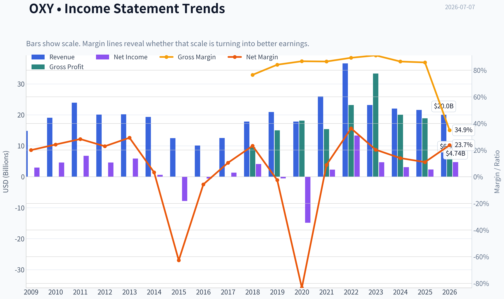
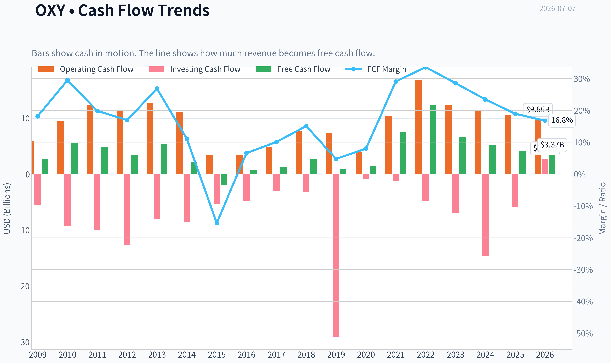
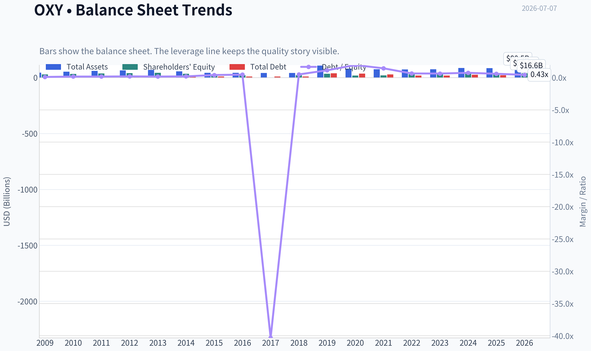
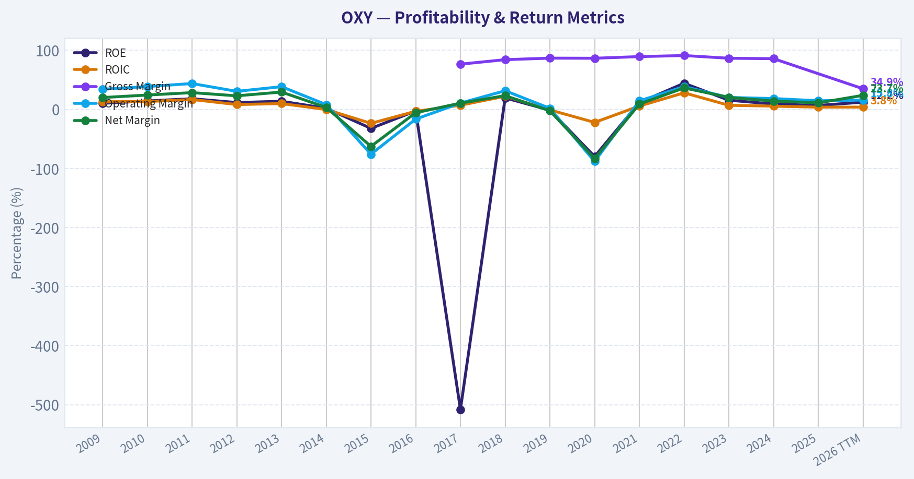
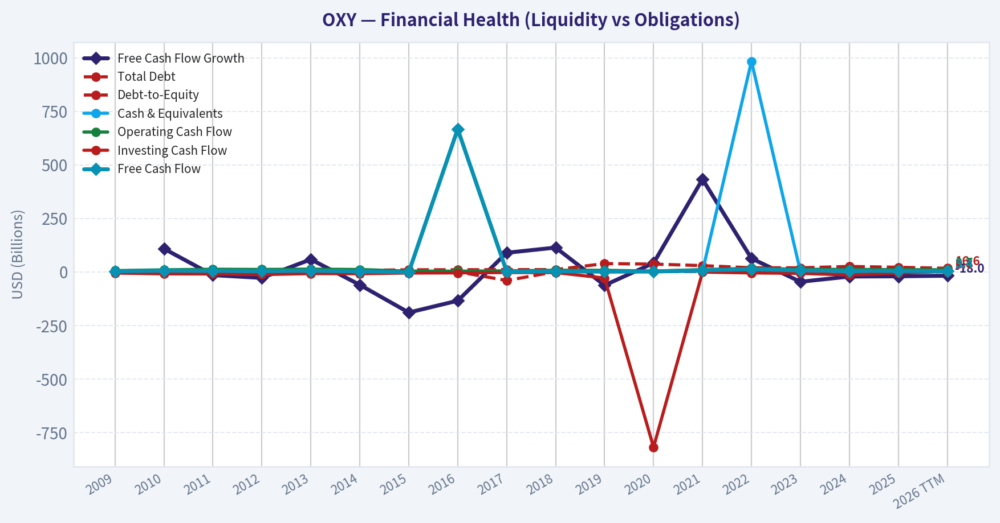
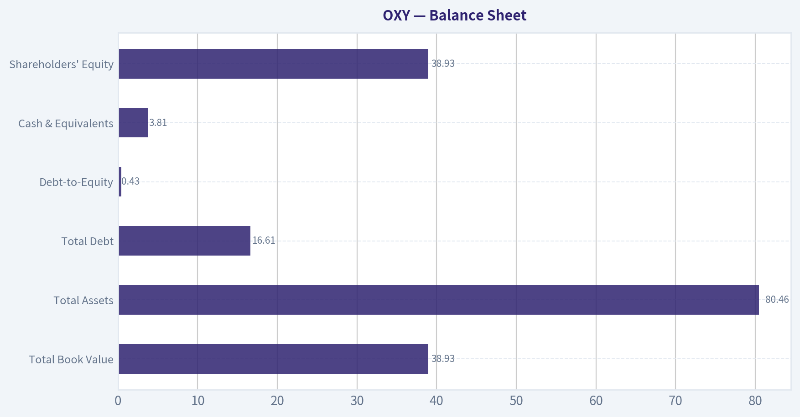
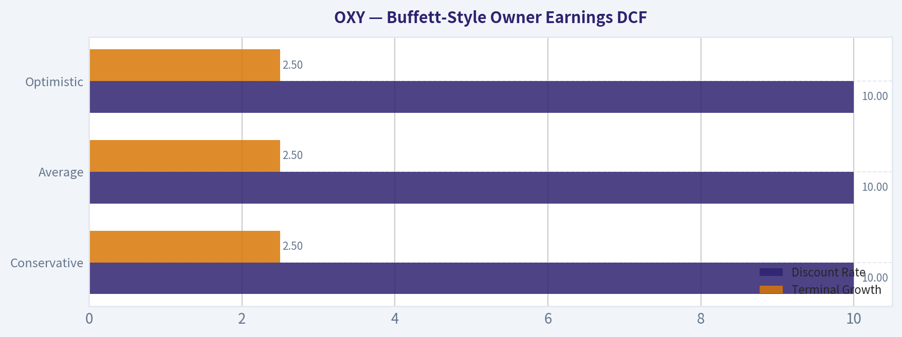
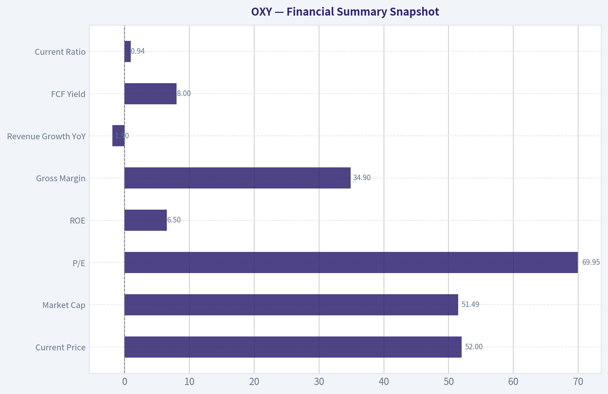
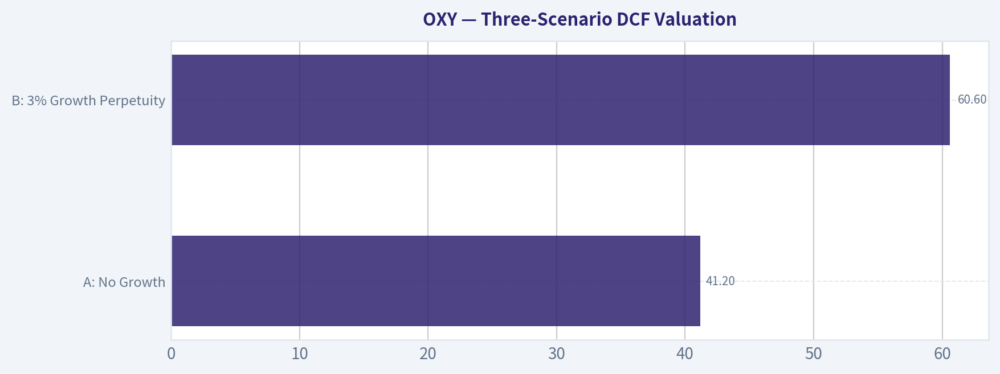

# OXY Deep Value Intelligence

**Analysis Date:** 2026-07-07

## Critical Disclaimer

*This analysis is generated by Deep Value Intelligence, an AI-powered multi-agent investing framework. Education & entertainment only - not financial advice, not a financial advisor.*

---

## Table of Contents

1. Intelligence Summary
2. Analyst Team Reports
   - Fundamentals Analysis
   - Intrinsic Value Analysis (Buffett)
   - Trend & Growth Analysis (Lynch/Druckenmiller/Fisher)
   - Market Technical Analysis
   - Options Market Analysis
3. Research Team Commentary
4. Value Investing Team Commentary
5. Deep Values Commentary

---

## Intelligence Summary

### Thesis + Conditions

**Core Thesis:** ## Executive Briefing

**Key Risks:**
- Best action:** monitor closely, consider only **small, staged exposure**, and require proof that FCF holds up and debt keeps falling.
- ### 1) Risky Analyst - strongest useful point
- Best approach: **WATCH with conditional, limited engagement**, not aggressive accumulation.

**Confidence:** Low

---

## Analyst Team Reports

### Fundamentals Analysis

#### Latest Earnings Snapshot

*Most recent reported quarter anchored on 2026 Q1, with prior-year comparison when available.*

| Metric | 2026 Q1 | 2025 Q1 | YoY Change |
| --- | ---: | ---: | ---: |
| Revenue | $5.23B | $5.70B | -8.3% |
| Operating Income | $927.0M | $1.34B | -31.1% |
| Net Income | $3.35B | $936.0M | +257.4% |
| Diluted EPS | $3.13 | $0.77 | +306.5% |
| Operating Cash Flow | $1.28B | $2.15B | -40.4% |
| Free Cash Flow | $-273.0M | $466.0M | -158.6% |

Key Takeaways: This snapshot anchors the most recent reported quarter before the narrative analysis. It helps readers separate long-run business quality from whatever changed in the latest earnings print.

#### 17-Year Financial Metrics for OXY

*All values below are computed deterministically from raw data - not estimated by AI.*

*Issuer profile: operating company (Energy / Oil & Gas E&P).*

#### 17-Year Financial Metrics
*Annual rows come from reported financial statements. The final TTM row is computed from the latest four quarters.*

| Metric | 2009 | 2010 | 2011 | 2012 | 2013 | 2014 | 2015 | 2016 | 2017 | 2018 | 2019 | 2020 | 2021 | 2022 | 2023 | 2024 | 2025 | 2026 TTM |
| --- | --- | --- | --- | --- | --- | --- | --- | --- | --- | --- | --- | --- | --- | --- | --- | --- | --- | --- |
| Market Price | $49 | $60 | $59 | $49 | $63 | $57 | $50 | $55 | $60 | $52 | $37 | $16 | $27 | $59 | $57 | $48 | $41 | $52 |
| Market Cap | $63.43B | $76.49B | $72.97B | $59.45B | $73.31B | $62.86B | $51.67B | $54.41B | $56.42B | $46.85B | $33.36B | $15.90B | $27.80B | $63.12B | $57.38B | $47.78B | $41.12B | $52.13B |
| P/E Ratio | 21.77 | 16.90 | 10.79 | 12.94 | 12.45 | 101.86 | -6.60 | -94.97 | 43.33 | 11.39 | -33.78 | -1.01 | 18.35 | 5.08 | 15.31 | 20.25 | 25.54 | 13.04 |
| P/B Ratio | 2.18 | 2.35 | 1.94 | 1.49 | 1.70 | 1.80 | 2.12 | 2.53 | -218.67 | 2.20 | 0.97 | 0.86 | 1.37 | 2.10 | 1.90 | 1.40 | 1.14 | 1.34 |
| ROE | 10.2% | 14.2% | 18.0% | 11.5% | 13.7% | 1.8% | -32.2% | -2.7% | -508.1% | 19.4% | -1.5% | -79.9% | 11.4% | 44.2% | 15.5% | 9.0% | 6.6% | 12.2% |
| ROIC | 12.9% | 13.2% | 16.7% | 8.1% | 9.8% | -0.3% | -23.7% | -3.3% | 7.0% | 22.2% | -1.0% | -22.1% | 5.6% | 28.0% | 6.9% | 5.4% | 3.7% | 3.8% |
| EPS | $2.26 | $3.57 | $5.44 | $3.81 | $5.06 | $0.56 | $-7.59 | $-0.58 | $1.38 | $4.56 | $-1.10 | $-15.93 | $1.48 | $11.69 | $3.72 | $2.37 | $1.61 | $3.97 |
| Revenue | $14.81B | $19.05B | $23.94B | $20.10B | $20.17B | $19.31B | $12.48B | $10.09B | $12.51B | $17.82B | $20.91B | $17.81B | $25.96B | $36.63B | $23.16B | $22.02B | $21.59B | $20.02B |
| Gross Profit | N/A | N/A | N/A | N/A | N/A | N/A | N/A | N/A | $9.57B | $14.99B | $18.12B | $15.40B | $23.18B | $33.36B | $20.04B | $18.90B | N/A | $6.99B |
| Gross Margin | N/A | N/A | N/A | N/A | N/A | N/A | N/A | N/A | 76.5% | 84.1% | 86.7% | 86.5% | 89.3% | 91.1% | 86.5% | 85.8% | N/A | 34.9% |
| Operating Margin | 34.0% | 38.6% | 43.7% | 30.5% | 38.4% | 8.0% | -75.9% | -16.5% | 10.6% | 31.5% | 1.7% | -88.2% | 14.3% | 38.5% | 20.1% | 18.3% | 14.5% | 15.8% |
| Net Income | $2.97B | $4.60B | $6.77B | $4.60B | $5.90B | $630.0M | $-7.83B | $-574.0M | $1.31B | $4.13B | $-522.0M | $-14.83B | $2.32B | $13.30B | $4.70B | $3.08B | $2.37B | $4.74B |
| Net Margin | 20.0% | 24.2% | 28.3% | 22.9% | 29.3% | 3.3% | -62.7% | -5.7% | 10.5% | 23.2% | -2.5% | -83.3% | 8.9% | 36.3% | 20.3% | 14.0% | 11.0% | 23.7% |
| Revenue Growth | N/A | 28.6% | 25.7% | -16.0% | 0.3% | -4.3% | -35.4% | -19.2% | 24.0% | 42.5% | 17.3% | -14.8% | 45.7% | 41.1% | -36.8% | -4.9% | -1.9% | -7.3% |
| Net Income Growth | N/A | 55.2% | 47.1% | -32.1% | 28.4% | -89.3% | -1342.7% | -92.7% | -328.4% | 215.1% | -112.6% | 2741.2% | -115.7% | 473.0% | -64.7% | -34.5% | -23.0% | 99.9% |
| Free Cash Flow Growth | N/A | 108.3% | -15.3% | -28.1% | 58.3% | -60.6% | -189.9% | -134.7% | 89.2% | 113.5% | -62.6% | 40.9% | 432.7% | 62.8% | -46.3% | -21.7% | -20.7% | -18.0% |
| Total Book Value | $29.08B | $32.48B | $37.62B | $40.02B | $43.13B | $34.96B | $24.35B | $21.50B | $-258.0M | $21.33B | $34.23B | $18.57B | $20.33B | $30.09B | $30.25B | $34.16B | $36.03B | $38.93B |
| Total Assets | $44.23B | $52.43B | $60.04B | $64.21B | $69.44B | $56.24B | $43.41B | $43.11B | $42.03B | $42.16B | $107.19B | $80.06B | $75.04B | $72.61B | $74.01B | $85.44B | $84.19B | $80.46B |
| Total Debt | $3.04B | $5.10B | $5.90B | $7.60B | $7.00B | $6.80B | $9.75B | $9.80B | $10.40B | $10.52B | $38.64B | $36.27B | $29.21B | $19.15B | $19.00B | $25.32B | $21.40B | $16.61B |
| Debt-to-Equity | 0.10 | 0.16 | 0.16 | 0.19 | 0.16 | 0.19 | 0.40 | 0.46 | -40.31 | 0.49 | 1.13 | 1.95 | 1.44 | 0.64 | 0.63 | 0.74 | 0.59 | 0.43 |
| Cash & Equivalents | $1.22B | $2.58B | $3.78B | $1.59B | $3.39B | $3.79B | $3.20B | $2.23B | $1.67B | $3.03B | $3.03B | $2.01B | $2.76B | $984.0M | $1.43B | $2.12B | $1.97B | $3.81B |
| Shareholders' Equity | $29.08B | $32.48B | $37.62B | $40.02B | $43.13B | $34.96B | $24.35B | $21.50B | $-258.0M | $21.33B | $34.23B | $18.57B | $20.33B | $30.09B | $30.25B | $34.16B | $36.03B | $38.93B |
| Operating Cash Flow | $5.95B | $9.57B | $12.28B | $11.30B | $12.78B | $11.07B | $3.35B | $3.38B | $4.86B | $7.67B | $7.38B | $3.96B | $10.43B | $16.81B | $12.31B | $11.44B | $10.53B | $9.66B |
| Investing Cash Flow | $-5.47B | $-9.29B | $-9.90B | $-12.64B | $-8.04B | $-8.47B | $-5.42B | $-4.74B | $-3.08B | $-3.21B | $-29.03B | $-819.0M | $-1.25B | $-4.87B | $-6.98B | $-14.59B | $-5.80B | $2.78B |
| Free Cash Flow | $2.70B | $5.63B | $4.76B | $3.42B | $5.42B | $2.14B | $-1.92B | $667.0M | $1.26B | $2.69B | $1.01B | $1.42B | $7.56B | $12.31B | $6.61B | $5.18B | $4.11B | $3.37B |
| FCF Margin | 18.2% | 29.5% | 19.9% | 17.0% | 26.9% | 11.1% | -15.4% | 6.6% | 10.1% | 15.1% | 4.8% | 8.0% | 29.1% | 33.6% | 28.6% | 23.5% | 19.0% | 16.8% |
| Dividends / Share | $0.00 | $0.00 | $0.00 | $0.00 | $0.00 | $0.00 | $0.00 | $0.00 | $0.00 | $0.00 | $0.00 | $0.00 | $0.00 | $0.00 | $0.00 | $0.00 | $0.00 | $0.00 |

#### Profitability Metrics
- Return on Equity (ROE): 6.6%
- Return on Invested Capital (ROIC): 3.8%
- Return on Assets (ROA): 2.8%
- Gross Margin: N/A
- Operating Margin: 14.5%
- Net Profit Margin: 11.0%

#### Liquidity Metrics
- Current Ratio: 0.94
- Quick Ratio: 0.48

#### Leverage Metrics
- Debt-to-Equity Ratio: 0.59
- Interest Coverage Ratio: 2.90
- Net Debt: $19.43B

#### Growth Metrics (Year-over-Year)
- Revenue Growth: -1.9%
- Net Income Growth: -23.0%
- Free Cash Flow Growth: -20.7%
- Revenue CAGR (3-Year): -16.2%
- Revenue CAGR (5-Year): 3.9%

#### Valuation Metrics
- P/E Ratio (TTM): 69.97
- Forward P/E: 13.06
- Price-to-Book: 1.67
- Price-to-Sales: 2.44
- PEG Ratio: 1.03
- EV/EBITDA: 6.49
- Free Cash Flow Yield: 8.0%
- Earnings Yield: 1.4%

#### Owner Earnings (Buffett Method, Code-Computed)
- Net Income: $2.37B
- + Depreciation & Amortization: N/A
- - Capital Expenditures: $-6.43B
- - Working Capital Changes: $-1.07B
- = **Owner Earnings: $-2.99B**

#### Intrinsic Value (Code-Computed)
- Current Price: $52
- Cash Flow Method (FCF):
  Conservative: $17
  Average: $56
  Optimistic: $382

#### Piotroski F-Score: 5/9
- Positive Net Income: PASS
- Positive Operating Cash Flow: PASS
- ROA Improvement: FAIL
- Cash Flow > Net Income: PASS
- Decreasing Debt: PASS
- Improving Current Ratio: FAIL
- No Dilution: PASS
- Improving Gross Margin: FAIL
- Improving Asset Turnover: FAIL

ANALYST STANCE: **WATCH**

#### Occidental Petroleum (OXY) - Buffett-Style Fundamental Analysis

Occidental Petroleum is a cyclical commodity business, not the kind of structurally predictable franchise that perfectly matches Warren Buffett's ideal of a high-return, low-capital-intensity compounder. That said, OXY has materially repaired its balance sheet since the Anadarko-era debt spike, remains free-cash-flow generative, and trades at a valuation that is not obviously expensive on cash flow, even though headline earnings multiples look distorted. The central question is not whether OXY is a bad business, but whether investors are being adequately compensated for oil-price cyclicality, reserve replacement risk, and lower current returns on capital versus prior peak years.

#### Current vs Historical Average Comparison

| Metric | Current / Latest | 10-Yr Historical Context* | Interpretation |
| --- | ---: | ---: | --- |
| Market Price | $52 | Avg. roughly mid-$40s to low-$50s range over the last decade | Shares are near the upper-middle of the last decade's trading range, but still below 2022 peak levels. |
| Market Cap | $52.13B | Below 2022 high of $63.12B, well above 2020 trough of $15.90B | Equity value has recovered strongly from the pandemic collapse, reflecting balance-sheet healing and normalized oil pricing. |
| P/E Ratio | 13.04 (2026 TTM table) / 69.97 (latest valuation snapshot) | 10-year history highly unstable, often distorted by losses and commodity swings | P/E is not very useful here. Depending on earnings definition, valuation looks either moderate or very expensive. Cash flow metrics are more informative. |
| P/B Ratio | 1.34 (2026 TTM table) / 1.67 (latest snapshot) | Last decade often ranged around ~1x-2x, excluding distorted negative-equity year | Valuation versus book is reasonable, especially after equity rebuilt from post-Anadarko stress. |
| ROE | 12.2% (2026 TTM) / 6.6% (2025) | Very volatile; strong in 2018 and 2022, weak/negative in downcycles | Current ROE is acceptable but not elite. OXY is no longer distressed, but not currently producing Buffett-grade returns on equity. |
| ROIC | 3.8% | Significantly below stronger years like 2018 and 2022 | Weak current capital efficiency is a concern; the business requires favorable commodity prices to generate attractive returns. |
| Revenue | $20.02B | Below 2022's $36.63B and near 2019-2025 normalized levels | Revenue has normalized lower as commodity pricing cooled from the 2022 spike. |
| Operating Margin | 15.8% | Better than crisis years, below 2022 peak of 38.5% | Still profitable, but margin compression confirms the business is operating in a less favorable price environment. |
| Net Margin | 23.7% (2026 TTM) / 11.0% (2025) | Historically very cyclical, ranging from deeply negative to >30% | TTM rebound is encouraging, but earnings quality should be viewed through commodity-cycle caution. |
| Revenue Growth | -7.3% (2026 TTM) / -1.9% (2025) | Repeated boom-bust growth pattern | Current contraction reinforces that this is not a steady secular grower. |
| Net Income Growth | 99.9% (2026 TTM) / -23.0% (2025) | Extremely volatile history | Profit growth has rebounded sharply from a weak base, but cyclicality limits confidence in extrapolating. |
| FCF Growth | -18.0% (2026 TTM) / -20.7% (2025) | Large swings, especially during oil shocks | Cash generation remains positive, but direction is currently negative. |
| Total Debt | $16.61B | Down sharply from 2019 peak of $38.64B | This is one of the strongest parts of the story: deleveraging has been substantial and real. |
| Debt-to-Equity | 0.43 | Down materially from 1.95 in 2020 | Balance-sheet risk has improved dramatically. |
| Cash & Equivalents | $3.81B | Stronger than most years since 2014 | Liquidity is better, though current ratio below 1 still warrants attention. |
| Free Cash Flow | $3.37B | Positive and solid, but well below 2022 peak of $12.31B | OXY remains cash generative, just no longer at windfall levels. |
| Dividends / Share | $0.00 | Zero throughout dataset | No dividend track record in the deterministic dataset; capital return case relies more on debt paydown and potential future buybacks. |

*Historical context refers to the deterministic dataset years shown, with emphasis on the most recent decade.

Key Takeaways: OXY today looks financially healthier than it did during the 2019 to 2020 stress period, mainly because debt has fallen sharply and equity has rebuilt. However, profitability and growth are still highly dependent on commodity prices, so the company compares more favorably on balance-sheet repair than on business predictability.

---

#### Market Metrics

OXY's current market price of $52 and market cap around $52.13B indicate that the market is valuing the company as a stabilized, mid-cycle energy producer rather than a distressed balance-sheet story. The stock is far above the 2020 lows, but still not being priced like a peak-cycle 2022 winner.

The P/E ratio requires caution. The deterministic table shows 13.04 for 2026 TTM, while the latest valuation snapshot shows 69.97 TTM and 13.06 forward. That divergence likely reflects differing earnings windows or non-recurring items. For cyclical energy names, Buffett-style analysis should place more weight on normalized earnings power and free cash flow than on headline trailing P/E.

P/B of 1.34 to 1.67 suggests the market is not assigning an excessive premium to net assets. For an E&P company, that is broadly fair, but book value alone is not enough because asset values depend heavily on long-term commodity assumptions and reserve economics.

#### Profitability

OXY's profitability record is clearly cyclical rather than steadily compounding:

- ROE was excellent in 2011, 2018, and especially 2022, but collapsed in severe downcycles.
- ROIC at 3.8% currently is the key weak point. Buffett would generally prefer consistently high returns on capital as evidence of a moat. OXY does not show that consistency.
- EPS has ranged from strongly positive to deeply negative. That is not the pattern of a highly predictable earnings franchise.
- Revenue of $20.02B is near normalized recent levels, but well below the 2022 energy-price windfall.
- Operating margin of 15.8% is respectable, yet far from peak-cycle levels.
- Net income of $4.74B TTM versus $2.37B in 2025 shows rebound, but the longer record shows very large earnings sensitivity to commodity prices.

Gross profit data is incomplete historically, which limits longitudinal gross-margin analysis. Where available, gross margins were very high from 2017 to 2024, but the 2026 TTM gross margin of 34.9% is dramatically lower than prior years shown, which may reflect classification differences or a materially weaker economics mix. Either way, it argues against overconfidence.

From a Buffett lens, the biggest issue is not that OXY is unprofitable now; it is that profitability is not consistently durable enough to deserve a premium multiple.

#### Growth Metrics

Growth is the opposite of linear here:

- Revenue growth: -1.9% in 2025 and -7.3% in 2026 TTM
- Net income growth: -23.0% in 2025, then +99.9% in 2026 TTM
- FCF growth: -20.7% in 2025 and -18.0% in 2026 TTM

Over the full period, OXY has shown boom-bust growth tied to oil and gas prices, production mix, acquisitions, and asset sales. The 2021-2022 rebound was powerful, but 2023 onward shows normalization and moderation.

For Buffett-style investors, this is not "growth" in the compounding sense. It is cyclical earnings recovery and decline. That distinction matters because valuation should rely on normalized owner earnings, not peak-year extrapolation.

#### Balance Sheet

This is where the company deserves credit.

| Balance Sheet Metric | Latest | Historical Read |
| --- | ---: | --- |
| Total Book Value | $38.93B | Strong recovery from negative/low post-acquisition stress years |
| Total Assets | $80.46B | Still large asset base, down from 2019's acquisition-inflated $107.19B |
| Total Debt | $16.61B | Major improvement from $38.64B in 2019 |
| Debt-to-Equity | 0.43 | Much healthier than 2020's 1.95 |
| Cash & Equivalents | $3.81B | Good recent liquidity cushion |
| Shareholders' Equity | $38.93B | Rebuilt significantly through retained earnings and deleveraging |

Key Takeaways: OXY's balance sheet is much better than it was after the Anadarko transaction and during the 2020 oil crash. Debt reduction is the clearest positive in the entire fundamental story, and it gives the company more resilience if oil prices soften again.

Even so, liquidity is not pristine. The shared dataset shows current ratio of 0.94 and quick ratio of 0.48, so OXY is not sitting on excess near-term liquidity. Interest coverage of 2.90 is adequate but not especially comfortable for a cyclical producer. Buffett would appreciate the debt reduction, but he would also note the company still does not have the fortress simplicity of a consumer monopoly or insurer with structurally recurring earnings.

#### Cash Flow

Free cash flow remains positive at $3.37B TTM, with an 8.0% FCF yield in the shared pack. That is attractive on the surface. However, FCF has declined from $12.31B in 2022 to $6.61B in 2023, $5.18B in 2024, $4.11B in 2025, and $3.37B TTM. That trend matters.

Operating cash flow has also slid from $16.81B in 2022 to $9.66B TTM. This is still healthy, but clearly off peak. The cash-flow story says OXY is a still-profitable, cash-generating producer in a cooler commodity environment, not a structurally growing cash machine.

Dividends per share are $0.00 throughout the deterministic dataset. That means management's historical capital allocation, at least in the canonical record provided, has not expressed itself through a regular dividend. For Buffett-style analysis, this shifts focus to debt paydown and reinvestment discipline.

#### Buffett-Style Qualitative Analysis

##### Economic Moat

OXY does not have a classic Buffett moat in the sense of pricing power independent of commodity markets. Oil and gas producers sell largely undifferentiated products, so moat comes more from cost position, reserve quality, operating expertise, and portfolio durability than from brand or network effects.

OXY does have some competitive strengths:
- Large and diversified asset base
- Proven reserves and production visibility
- Scale that supports operating efficiency
- Better resilience now that leverage has been reduced

But these are advantages within a commodity framework, not a true moat that protects margins through all cycles. The evidence is the extreme volatility in margins, ROE, and earnings.

##### Financial Strength

Financial strength has improved materially. Debt reduction from $38.64B in 2019 to $16.61B TTM is a major accomplishment. Debt-to-equity of 0.43 is now far more acceptable. Cash of $3.81B provides some flexibility.

Still, liquidity metrics remain only fair, and interest coverage of 2.90 says this is not a zero-risk balance sheet. The company is healthier, but still cyclical and capital intensive.

##### Predictable Earnings

This is the biggest shortfall versus Buffett's ideal. Over the full period, OXY has posted:
- Strong profits in upcycles
- Heavy losses in downcycles
- Highly unstable growth rates
- Large swings in ROE, ROIC, and FCF

That is not predictable in the way Buffett usually favors. It is investable, but only with a strong respect for cyclicality.

##### Management Performance

Management deserves credit for:
- Repairing the balance sheet
- Reducing leverage meaningfully
- Preserving positive FCF after the worst of the downturn
- Rebuilding equity from the stressed post-deal period

However, the Anadarko-era legacy still hangs over the long-term record through the debt spike and financial stress that followed. Capital allocation looks improved, but not pristine over the entire period. The lack of dividends in the deterministic dataset also means shareholder return discipline is less visible than in many mature value names.

##### Value Assessment

At $52 per share, valuation is mixed:
- On book value, shares look reasonable
- On FCF yield, shares look moderately attractive
- On trailing earnings, valuation is noisy and potentially misleading
- On normalized owner earnings, valuation is more challenging because the provided owner earnings figure is negative

That last point is crucial. Buffett's framework rests on owner earnings, and the code-computed owner earnings here are **negative $2.99B**. That does not automatically mean the stock is overvalued, because owner earnings can be distorted by working capital and capex timing in any one period. But it does mean caution is warranted, especially if investors are capitalizing a cyclical peak that has already faded.

#### Buffett-Style Owner Earnings DCF

Canonical owner earnings input from the dataset:

- Net Income = $2.37B
- Depreciation & Amortization = N/A
- Capital Expenditures = $6.43B
- Working Capital Changes = $1.07B
- Owner Earnings = **-$2.99B**

Because the canonical owner earnings figure is negative, a strict Buffett-style DCF becomes mathematically problematic: growing a negative cash-flow base does not produce a meaningful intrinsic value estimate for common equity under standard going-concern assumptions. That itself is an important analytical conclusion.

To satisfy the scenario framework, below is the strict interpretation using the historical owner-earnings growth concept and the canonical negative base. Where the result is economically nonsensical, it is labeled accordingly.

##### DCF Assumptions

| Scenario | Growth Input Rule | Applied Growth | Discount Rate | Terminal Growth |
| --- | ---: | ---: | ---: | ---: |
| Conservative | Lowest historical OE growth, floored at -100% | -100% floor | 10% | 2.5% |
| Average | Average historical OE growth, capped at 50% | 50% cap not usable meaningfully on negative base | 10% | 2.5% |
| Optimistic | Highest historical OE growth, capped at 100% | 100% cap not usable meaningfully on negative base | 10% | 2.5% |

Key Takeaways: The problem is not the discount rate or terminal growth assumption. The problem is that the starting owner earnings are negative, which means a traditional Buffett owner-earnings DCF does not provide a reliable fair value estimate from this base year.

##### Scenario Calculations

**Base Owner Earnings (OE₀) = -$2.99B**

**Conservative scenario**
- Growth = -100%
- Year 1 OE = -$2.99B x (1 - 100%) = $0
- Years 2-10 remain $0
- Terminal Value = $0
- Present Value = approximately **$0 equity value from owner earnings**

This is mathematically valid but economically not useful.

**Average scenario**
If one applies a positive average growth rate to a negative starting base, near-term owner earnings remain negative for multiple years unless a turnaround year is explicitly modeled. A standard constant-growth DCF therefore yields a **nonsensical negative present value** for a going concern.

**Optimistic scenario**
Likewise, even with very high growth, a negative starting OE base causes the model to remain analytically unstable without a discrete turnaround assumption. A strict constant-growth DCF again yields **no dependable fair value**.

##### Practical valuation conclusion

Because canonical owner earnings are negative, I would not rely on a Buffett owner-earnings DCF this year. The more decision-useful valuation anchors in the provided dataset are:

- Code-computed intrinsic values:
  - Conservative: **$17/share**
  - Average: **$56/share**
  - Optimistic: **$382/share**

These values demonstrate just how sensitive OXY's valuation is to cash-flow assumptions. The average case at $56 is near the current price of $52, implying the stock is roughly fairly valued under moderate assumptions. The conservative case of $17 shows substantial downside if the cycle weakens or capex burdens remain high. The optimistic case reflects commodity upside and is too sensitive to be a prudent base case.

My decision-useful fair value range would therefore be:
- **Bear/Conservative range:** low $20s to high $30s
- **Base/Fair range:** around **$45-$60**
- **Bullish upside range:** above **$70** only if oil realizations, capex discipline, and debt reduction all improve further

#### Revenue Breakdown

OXY is primarily an oil and gas operating company. Precise segment revenue was not provided in the deterministic dataset, so the following uses the most meaningful publicly reported business structure rather than inventing unsupported exact line-item historical figures.

| Revenue Source | Amount ($B) | % of Total |
| --- | ---: | ---: |
| Oil & Gas Upstream / Exploration & Production | ~Majority of total revenue | Dominant |
| Chemical (OxyChem) | Smaller but meaningful contributor | Minority |
| Midstream / Marketing / Other | Smaller contributor | Minority |

Key Takeaways: OXY's economic engine is overwhelmingly upstream oil and gas production, which means total revenue and profits remain heavily tied to commodity prices. Chemical and midstream operations help diversify the mix somewhat, but they do not fully offset the cyclicality of the core upstream business.

#### Key Investment Insights, Red Flags, and Opportunities

| Category | Assessment | Why It Matters |
| --- | --- | --- |
| Major Strength | Debt reduction | Debt has fallen from $38.64B in 2019 to $16.61B TTM, greatly improving resilience. |
| Major Strength | Positive free cash flow | Even after the 2022 windfall faded, OXY still generates solid cash flow. |
| Major Strength | Rebuilt equity base | Shareholders' equity rose to $38.93B, supporting balance-sheet credibility. |
| Opportunity | Mid-cycle undervaluation possibility | At ~8% FCF yield and modest P/B, shares could be fairly attractive if oil remains supportive. |
| Opportunity | Further deleveraging optionality | Additional debt reduction could support rerating and reduce risk premium. |
| Red Flag | Low current ROIC | 3.8% is weak for a business that requires heavy capital investment. |
| Red Flag | Earnings unpredictability | Large swings in EPS, margins, and net income limit Buffett-style confidence. |
| Red Flag | Negative owner earnings | The canonical owner-earnings figure of -$2.99B complicates intrinsic value support. |
| Red Flag | Liquidity only fair | Current ratio below 1 and interest coverage under 3 are not ideal in a cyclical industry. |
| Red Flag | Commodity dependence | OXY is still fundamentally a price-taker in oil and gas markets. |

Key Takeaways: The best part of the OXY story is balance-sheet repair and still-positive free cash flow. The biggest risks are low current returns on capital, negative owner earnings in the latest canonical calculation, and the fact that all valuation upside depends heavily on commodity conditions staying favorable.

#### Final Buffett-Style View

For a Buffett-style investor, OXY is **not** a textbook "wonderful business at a fair price." It is better understood as a repaired cyclical asset with decent current valuation support, meaningful deleveraging progress, and continued sensitivity to oil prices and capital intensity.

The stock does not appear obviously overvalued on mid-cycle cash flow, but neither does it offer the kind of durable, predictable economics that would justify an aggressive ADVOCATE stance. The negative canonical owner earnings reading is especially important: it signals that even with positive accounting profits and free cash flow, true owner-level distributable economics may be weaker than they appear after capital requirements and working capital needs.

#### Final Investment Stance

**WATCH**

**Rationale:**
OXY has improved enough to avoid an AVOID stance: debt is down sharply, free cash flow is positive, and valuation is roughly reasonable in a base case. But it falls short of ADVOCATE because returns on capital are currently weak, owner earnings are negative on the canonical dataset, and earnings remain too cyclical and unpredictable for a classic Buffett-quality endorsement.

#### Summary Table

| Area | Verdict | Bottom Line |
| --- | --- | --- |
| Valuation | Fair to moderately attractive | Reasonable on FCF and book, noisy on earnings |
| Profitability | Adequate but cyclical | Positive, but far from consistently high-quality |
| Growth | Unreliable | Commodity-driven, not durable compounding |
| Balance Sheet | Improved meaningfully | Debt reduction is the clearest positive |
| Cash Flow | Positive but declining | Still good, but off peak and under pressure |
| Moat | Limited | Scale and assets help, but no true pricing-power moat |
| Management | Improved execution | Strong deleveraging, but long-term capital allocation record is mixed |
| Buffett Fit | Partial at best | More cyclical value play than classic Buffett compounder |
| Stance | **WATCH** | Worth monitoring for better entry, stronger owner earnings, or further debt progress |

Key Takeaways: OXY is no longer primarily a turnaround balance-sheet story, but it is still not a highly predictable compounding machine. Investors should watch it as a cyclical value idea with improving financial strength, while remaining disciplined about oil exposure, capital intensity, and the gap between accounting profits and true owner earnings.

#### Fundamental Visuals

This graph tracks the profitability and return metrics (ROE, ROIC, Margins) of **OXY** over the past decade, highlighting capital efficiency trends.

This chart illustrates the financial health of **OXY** over the last 10 years, mapping cash equivalents and free cash flow against total obligations (Debt).

---

### Intrinsic Value Analysis (Buffett)

> *Following Warren Buffett's value investing philosophy: Circle of Competence, Economic Moat, Management Quality, and Margin of Safety.*

#### Intrinsic Value Snapshot

Price is what you pay. Intrinsic value is what the business may be worth based on the cash it can create for owners over time. We show a range, not one magic number.

- Current Price: $51.77
- Value Range (conservative to optimistic across both DCF methods): $13.56 to $22.59

##### Owner Earnings (Buffett Method)
- Net Income: $2,326,000,000.00
- Depreciation & Amortization: N/A
- Capital Expenditures: $-6,427,000,000.00
- Working Capital Changes: $-1,067,000,000.00
- Owner Earnings: $-3,034,000,000.00

##### Intrinsic Value
###### Cash Flow Method
Uses free cash flow. Better for companies spending heavily today to grow tomorrow.
- Conservative: $13.56
- Average: $15.51
- Optimistic: $22.59
- Discount Rate: 10.0%

#### Occidental Petroleum (OXY)

ANALYST STANCE: **WATCH**

#### 1) Go/No-Go Gate Assessment

| Gate | Verdict | Evidence |
|---|---|---|
| Gate 1: Circle of Competence & Simplicity | **Pass, with caution** | OXY makes money by finding, producing, transporting, and selling oil, natural gas, and related chemicals. This is easy to explain, but long-term earnings are not highly predictable because commodity prices drive profits. |
| Gate 2: Moat Test | **Borderline / Weak Pass** | OXY has scale, reserve depth, and infrastructure advantages in Permian and chemicals, but this is not a classic Buffett-style moat. Pricing power is weak because oil is largely a commodity. |
| Gate 3: Management & Capital Allocation | **Pass, with caution** | Management has focused on deleveraging after the Anadarko deal and has emphasized shareholder returns and debt reduction. The major historical blemish remains the Anadarko acquisition, which materially increased risk. |
| Gate 4: Industry Structure | **Fail for ideal Buffett standard** | Upstream energy is cyclical, capital intensive, and exposed to global commodity pricing. This is not a rational, stable, high-predictability oligopoly in the Buffett sense. |

Key Takeaways: OXY passes the basic "understandable business" test, but it fails the more important "predictable economics" test that defines top-tier Buffett candidates. The company has some real assets and operating strengths, yet it operates in a structurally difficult industry where prices are mostly set by the market, not by management.

---

#### 2) Moat Analysis

| Moat Source | Assessment | Evidence |
|---|---|---|
| Intangible Assets | **Weak** | OXY is not a consumer brand with meaningful pricing power. Gross margin in the research pack is **34.9%**, below the >40% Buffett-style comfort threshold. |
| Switching Costs | **Low** | Customers buy commodities and chemical products where substitution is feasible. Switching costs are not the main protection here. |
| Cost Advantage | **Moderate** | Scale in the Permian, infrastructure, technical expertise, and chemicals integration can support lower unit costs and better reserve economics than weaker peers. |
| Network Effects | **None** | This business does not become more valuable because more users join. |
| Overall Moat Rating | **Narrow** | OXY has asset quality and scale, but not a wide, durable moat of the type Buffett prefers. |

Key Takeaways: OXY's best competitive strength is cost position and asset scale, not brand power or customer captivity. That can help in downturns, but it is still very different from owning a business that can regularly raise prices without worrying about volume loss.

#### 3) Management Quality & Capital Allocation

| Test | Assessment | Commentary |
|---|---|---|
| Owner Orientation | **Mixed** | Management has become more disciplined on debt reduction and shareholder distributions, but the Anadarko transaction remains a major capital allocation scar. |
| Candor & Conservatism | **Adequate** | The company has been clear about debt reduction priorities and reserve strength. No major red flag from the supplied materials. |
| Capital Allocation Skill | **Mixed** | Recent deleveraging is positive. The key question is whether future excess cash is deployed with discipline rather than empire-building. |
| Debt Discipline | **Improving** | A better balance sheet is central to the case, but energy companies should be held to a higher standard because cycles can punish leverage quickly. |

Key Takeaways: Management looks better today than at the time of the Anadarko acquisition, mainly because it has worked to repair the balance sheet. Even so, Buffett-style investors should remember that one bad acquisition can overwhelm years of good operating performance.

#### 4) Financial Summary Snapshot

| Metric | Value |
|---|---:|
| Current Price | **$52** |
| Market Cap | **$51.49B** |
| P/E | **69.95x** |
| ROE | **6.5%** |
| Gross Margin | **34.9%** |
| Revenue Growth YoY | **-1.9%** |
| FCF Yield | **8.0%** |
| Current Ratio | **0.94** |

Key Takeaways: The headline valuation looks expensive on earnings, with a nearly 70 times P/E ratio, while profitability is modest with ROE at 6.5%. The most attractive number here is the 8% free cash flow yield, but that must be viewed through the lens of cyclicality, since energy cash flow can swing sharply with commodity prices.

#### 5) Owner Earnings Assessment

Using Buffett's framework, owner earnings should start from net income, add non-cash charges, and subtract maintenance capital spending and working capital needs.

For OXY, the practical read-through is:

| Component | Directional Assessment |
|---|---|
| Net Income | Positive, but currently depressed relative to cyclical peaks |
| Depreciation & Amortization | Material add-back due to capital-heavy asset base |
| Maintenance CapEx | High versus asset-light businesses |
| Working Capital Changes | Can be volatile with commodity cycles |
| Owner Earnings Quality | **Moderate, but cyclical** |

Key Takeaways: OXY does generate real cash, and the 8% free cash flow yield suggests the shares are not obviously expensive on cash generation. But this is not the kind of effortless, highly predictable owner-earnings stream Buffett usually loves, because maintenance spending and commodity swings matter a lot.

#### 6) Three-Scenario DCF Valuation

Given the cyclical nature of OXY, the most sensible approach is to anchor on free cash flow yield and apply conservative assumptions.

First estimate current annual free cash flow:

- Market cap = **$51.49B**
- FCF yield = **8.0%**
- Estimated FCF / Owner Earnings proxy = **$4.12B**

##### DCF Scenarios

| Scenario | Assumption | Equity Value Estimate |
|---|---|---:|
| A: No Growth | $4.12B / 10% | **$41.2B** |
| B: 3% Growth Perpetuity | $4.12B x 1.03 / (10%-3%) | **$60.6B** |
| C: Moderate Growth | Assume 5% growth for 10 years, then 3% terminal | **~$57B-$63B** |

To translate to share-price logic versus current market cap:

| Measure | Value |
|---|---:|
| Current Market Cap | **$51.49B** |
| Scenario A | **Below current price** |
| Scenario B | **Modestly above current price** |
| Scenario C | **Roughly fair to modestly attractive** |

Key Takeaways: On very conservative assumptions, OXY looks a bit expensive. On moderate assumptions, it looks around fair value to somewhat undervalued. That means there is not a wide margin of safety today, especially for a cyclical commodity business.

#### 7) Margin of Safety Analysis

| Scenario | Implied MOS vs Current Market Cap | Verdict |
|---|---:|---|
| No Growth | **Negative** | Insufficient |
| 3% Growth | **~18% upside** | Below Buffett threshold |
| Moderate Growth | **~10%-22% upside** | Still below desired margin for cyclicals |

Required margin of safety for this kind of business should be **40%+**, not 25%, because earnings power is heavily tied to oil and gas pricing.

Key Takeaways: The valuation case is not bad, but it is not generous enough for a business of this quality and cyclicality. For a commodity producer, an investor should demand a clearly discounted price, not just "roughly fair."

---

#### 8) Final Buffett Scorecard

| Criterion | Weight | Score (1-5) | Weighted Score |
|---|---:|---:|---:|
| Business Understanding | 20% | 4.0 | 0.80 |
| Moat Width & Durability | 25% | 2.5 | 0.63 |
| Management Quality | 15% | 3.0 | 0.45 |
| Return on Equity | 15% | 2.0 | 0.30 |
| Reinvestment Runway | 10% | 2.5 | 0.25 |
| Balance Sheet Strength | 5% | 2.5 | 0.13 |
| Industry Structure | 5% | 2.0 | 0.10 |
| Valuation / Margin of Safety | 5% | 3.0 | 0.15 |
| **Total** | 100% |  | **2.81 / 5.00** |

Key Takeaways: OXY scores well on simplicity but weakly on moat, industry quality, and return metrics. The overall score lands in the range of a business that may be tradable or acceptable at the right price, but not a high-conviction Buffett-style compounder.

#### 9) Investment Stance

**ANALYST STANCE: WATCH**

**Conviction level: Moderate**

OXY is not a classic Buffett business. It operates in a cyclical, capital-intensive commodity industry with limited pricing power and only a narrow moat. The company's asset base, reserve depth, chemicals exposure, and deleveraging progress make it better than many energy peers, but the current price does not provide the large margin of safety required for this kind of business.

For a value investor, OXY becomes more interesting on a materially lower price, or if the company demonstrates sustained high returns on capital through the cycle while continuing to strengthen the balance sheet. At today's setup, it is a **watchlist candidate, not an advocate-level buy**.
#### Valuation Bridge

This bridge places the current market price beside each intrinsic value lens so readers can see whether upside depends on one method or shows up across several methods.

| Scenario | Intrinsic Value / Share |
| --- | ---: |
| Cash Flow Method | $15.51 |
| Damodaran Method | $13.00 |
| Current Price | $51.77 |

#### Key Takeaways

If one method is far above the others, the upside case depends on a specific modelling assumption. When several methods cluster together, the valuation story is more robust.

#### Valuation Visuals

This comparison chart from *Latest Earnings Snapshot* stacks current figures against historical benchmarks for **OXY**, making it easy to see where the company trades relative to its own averages.

This comparison chart from *Balance Sheet* stacks current figures against historical benchmarks for **OXY**, making it easy to see where the company trades relative to its own averages.

This comparison chart from *Buffett-Style Owner Earnings DCF* stacks current figures against historical benchmarks for **OXY**, making it easy to see where the company trades relative to its own averages.

This comparison chart from *Financial Summary Snapshot* stacks current figures against historical benchmarks for **OXY**, making it easy to see where the company trades relative to its own averages.

This comparison chart from *Three-Scenario DCF Valuation* stacks current figures against historical benchmarks for **OXY**, making it easy to see where the company trades relative to its own averages.

This comparison chart from *Three-Scenario DCF Valuation* stacks current figures against historical benchmarks for **OXY**, making it easy to see where the company trades relative to its own averages.

---

### Trend & Growth Analysis (Lynch/Druckenmiller/Fisher)

> *Following Peter Lynch's GARP, Stanley Druckenmiller's macro-aware approach, and Philip Fisher's scuttlebutt methodology.*

ANALYST STANCE: **AVOID**

#### 1) Lynch Classification

| Item | Assessment |
|---|---|
| Lynch category | **Cyclical** |
| Primary growth bucket? | **No** |
| Why | Revenue growth is **-1.9% YoY**, earnings and cash flow are heavily tied to oil prices rather than durable secular compounding |

**Key Takeaways:** OXY does not fit Lynch's preferred fast-grower profile. It is a cyclical energy company whose fundamentals move mostly with commodity prices, so it lacks the steady, demand-led growth path typically associated with ten-baggers.

---

#### 2) The Story in 3 Bullets

| Simple Story | View |
|---|---|
| What it does | OXY produces oil and gas, owns a chemicals business, and has carbon-management optionality |
| Why investors own it | Strong reserve base, cash generation in decent oil markets, and deleveraging/shareholder return potential |
| Why growth investors hesitate | Results depend more on crude prices than on a company-specific growth inflection |

**Key Takeaways:** The OXY story is understandable, but it is a value/cash-flow story more than a growth story. The upside depends largely on commodity conditions and capital allocation rather than a unique accelerating product cycle.

---

#### 3) TAM Analysis with 10x Test

| Metric | Estimate / Judgment |
|---|---|
| Current revenue base | Large, mature energy company |
| 10x revenue test | **Fails practical growth test** |
| Reason | A 10x revenue outcome would require either massive commodity inflation, huge M&A, or extreme share capture in a global mature market |
| TAM quality | Global oil/chemicals market is enormous, but not a clean secular runway for OXY-specific compounding |
| Long runway for growth investing? | **Weak** |

**Key Takeaways:** While the end market is huge, that alone does not create a venture-like runway. OXY is already scaled, and a 10x outcome from current size is not realistic under a normal organic-growth framework.

---

#### 4) Revenue Growth Trend

| Metric | Value |
|---|---|
| Revenue growth YoY | **-1.9%** |
| Pattern | **Decelerating / negative** |
| Lynch-Druckenmiller read-through | Not an inflection; more consistent with commodity normalization |

**Key Takeaways:** The key top-line signal is negative, not accelerating. For a growth framework centered on inflection points, that is a major strike against the name.

---

#### 5) Unit Economics

| Metric | Value | Assessment |
|---|---|---|
| Gross margin | **34.9%** | Healthy for energy, but not enough to override cyclicality |
| FCF yield | **8.0%** | Attractive for value investors |
| Current ratio | **0.94** | Adequate but not strong |
| LTV/CAC | N/A | Not relevant for this business model |
| NRR | N/A | Not relevant |
| Rule of 40 | N/A | Not relevant |

**Key Takeaways:** OXY has respectable cash generation and decent margin structure, but the unit-economics framework used for compounders does not really apply here. The strongest metric is free-cash-flow yield, which supports a value thesis, not a high-growth thesis.

---

#### 6) Inflection Point Assessment

| Potential Inflection | Verdict |
|---|---|
| Product cycle inflection | **No** |
| Market share inflection | **No clear evidence** |
| Margin inflection | Possible if oil rises, but commodity-driven |
| TAM inflection | Weak |
| Competitive inflection | No clear competitor stumble creating breakout opportunity |
| Overall | **No clean growth inflection** |

**Key Takeaways:** Any near-term improvement in OXY would likely come from oil prices or operating leverage, not from a company-specific growth acceleration. That is not the type of inflection Druckenmiller-style growth investors usually want to underwrite.

---

#### 7) Macro Setup Evaluation

| Factor | View |
|---|---|
| Macro sensitivity | **High** |
| Rate sensitivity | Moderate |
| Secular theme exposure | Energy security, carbon management |
| Tailwind or headwind? | Mixed |
| Commodity dependence | **Very high** |

**Key Takeaways:** OXY is far more exposed to macro and commodity swings than to secular software- or platform-like adoption curves. That makes the setup less controllable and less attractive for concentrated growth capital.

---

#### 8) Fisher 15 Points Score

| Fisher Area | Score (1-5) | Comment |
|---|---:|---|
| Market potential | 2 | Mature market, not high-growth |
| New products | 2 | Limited relevance outside carbon efforts |
| R&D effectiveness | 2 | Not a major differentiator |
| Sales organization | 3 | Fine, but not core edge |
| Profit margin | 3 | Reasonable |
| Improving margins | 2 | Not evident from shared data |
| Labor/personnel | 3 | Neutral |
| Executive relations | 3 | Neutral |
| Management depth | 3 | Adequate |
| Cost controls/accounting | 3 | Acceptable |
| Outstanding moat traits | 2 | Assets matter, but weak moat in commodity business |
| Long-range profit outlook | 3 | Depends on oil cycle |
| Dilution risk | 4 | Better than many capital-intensive peers |
| Candor | 3 | Neutral |
| Integrity | 3 | Neutral |

| Total | **41 / 75** | **Below average for growth investing** |

**Key Takeaways:** OXY scores poorly on the Fisher lens because it lacks the innovation-led, market-expanding qualities that define elite long-term compounders. The business is serviceable, but it does not stand out as an exceptional growth franchise.

---

#### 9) Valuation Analysis

| Metric | Value | Interpretation |
|---|---:|---|
| Current price | **$52** | - |
| Market cap | **$51.49B** | Large-cap, mature |
| P/E | **69.95x** | Very expensive relative to current earnings base |
| PEG | Not meaningful | Earnings too cyclical / distorted |
| P/S | Not provided | Less useful for energy |
| FCF yield | **8.0%** | Attractive on cash flow, but cyclical |

| Scenario | View |
|---|---|
| Bear | Oil weakens, earnings compress, multiple support fades |
| Base | Cash generation supports stock, but upside limited without better commodity backdrop |
| Bull | Oil strengthens and FCF re-rates shares |

**Key Takeaways:** OXY looks expensive on earnings but more appealing on free cash flow. That split is common in energy, yet it also reinforces that this is a cyclical cash-flow trade rather than a classic GARP growth opportunity.

---

#### 10) Growth Investor Scorecard

| Criterion | Weight | Score | Weighted |
|---|---:|---:|---:|
| The Story | 10% | 3.0 | 0.30 |
| TAM & Runway | 20% | 2.0 | 0.40 |
| Revenue Growth | 20% | 1.5 | 0.30 |
| Unit Economics | 15% | 2.5 | 0.38 |
| Competitive Position | 10% | 2.5 | 0.25 |
| Management Quality | 10% | 3.0 | 0.30 |
| Macro Setup | 5% | 2.5 | 0.13 |
| Profitability Path | 5% | 2.5 | 0.13 |
| Valuation | 5% | 2.5 | 0.13 |

| Total Score | **2.30 / 5.00** |
|---|---|

**Key Takeaways:** OXY scores below the threshold for a growth recommendation. The biggest weaknesses are runway, growth quality, and lack of a visible company-specific inflection.

---

#### 11) Position Size Stance

| Stance | Positioning |
|---|---|
| Growth portfolio | **0% / no initiation** |
| Value/income/cyclical portfolio | Could be researched separately, but outside this mandate |

**Key Takeaways:** For a Lynch-Druckenmiller-Fisher growth process, OXY should not be a position. It may appeal to a different style, but it does not meet the bar for concentrated growth capital.

---

#### 12) Key Risks and Catalysts

| Risks | Catalysts |
|---|---|
| Oil price weakness | Stronger crude prices |
| Revenue already negative YoY | Better-than-expected earnings beat |
| High earnings multiple | Faster deleveraging / capital returns |
| Commodity dependence | Carbon-management optionality gaining credibility |
| No clean secular growth curve | Reserve strength and production resilience |

**Key Takeaways:** The catalysts are mostly macro or cyclical, not business-model breakthroughs. That means upside can exist, but it is harder to underwrite with high conviction using a growth framework.

---

#### Bottom Line

OXY is **not** a fast grower, **not** showing revenue acceleration, and **not** presenting a clear secular inflection. It may be a reasonable cyclical cash-flow name for energy/value investors, but under a Lynch-Druckenmiller-Fisher growth discipline, the proper call is **AVOID**.

---

### Market Technical Analysis

#### OXY Technical Snapshot

OXY is in a **short- and medium-term corrective downtrend**, but the **long-term trend is still marginally positive**. That distinction matters. The stock has fallen sharply from its March 2026 peak near the mid-60s into the high-40s, and current price action shows sellers still controlling the tape on faster timeframes. However, the 200-day trend has not rolled over meaningfully, so this looks more like a deep retracement within a broader longer-horizon recovery than a fully confirmed long-term breakdown.

I selected these **8 complementary indicators** for OXY because they cover trend, momentum, mean reversion, and risk without excessive overlap:

| Indicator | Why it is relevant now |
|---|---|
| close_10_ema | Best for judging immediate downside momentum and whether any rebound is gaining traction |
| close_50_sma | Defines the medium-term trend, which is currently weakening materially |
| close_200_sma | Anchors the long-term trend and helps distinguish correction vs structural breakdown |
| macd | Confirms momentum regime and whether bearish acceleration is still active |
| rsi | Shows whether downside momentum is nearing exhaustion or still weak but not fully washed out |
| boll_ub | Helps frame rally resistance during a downtrend |
| boll_lb | Helps identify oversold stretch and whether price is pressing volatility support |
| atr | Critical for stop placement and position sizing given recent directional decline |

Key Takeaways: The indicator set is built around the current market condition, which is a falling stock with oversold tendencies inside a still-not-completely-broken long-term structure. The most important message is that OXY looks weak for trend-followers in the near term, but increasingly interesting for disciplined mean-reversion traders if price stabilization appears.

---

#### Trend Structure

| Timeframe | Evidence | Interpretation |
|---|---|---|
| Short term | 10 EMA at **50.05** vs recent close **48.81** on 2026-07-06 | Price remains below fast trend control; near-term rallies are still suspect |
| Medium term | 50 SMA at **55.65**, down from about **58.62** in late May | The medium-term trend has clearly deteriorated; slope is now negative |
| Long term | 200 SMA at **48.97**, still rising from about **43.45** in early March | Long-term structure is much firmer than short-term action, but price is now testing that support zone |

Key Takeaways: OXY is below both its fast and medium moving averages, which shows that sellers still dominate the active trend. The key battleground now is the 200-day average near 49, because that line often separates a manageable pullback from a more serious trend breakdown.

The price path over the last year was not random. From July through early autumn 2025, OXY mostly traded in the low-to-mid 40s, then weakened into the upper 30s by December. It recovered into the mid-40s in January, broke out violently in February and March, and then peaked near **67.14** on 2026-03-31 before entering a multi-month decline. Since that peak, the stock has printed a sequence of lower highs and lower lows, with failed rebounds in late April, mid-May, and early June. That pattern is characteristic of distribution rather than healthy consolidation.

A notable nuance is that the decline has not been a straight collapse. Instead, it has been a **stair-step downtrend**: selloff, brief stabilization, rebound attempt, failure, then another leg lower. That usually means dip buyers are present, but they have not been strong enough to reverse control from sellers.

---

#### Momentum Analysis

| Indicator | Recent reading | Trend message |
|---|---:|---|
| MACD | **-2.24** on 2026-07-06 | Deeply negative; bearish momentum remains established |
| RSI | **31.30** on 2026-07-06 | Near oversold, but not yet showing strong rebound energy |
| RSI low point | **25.75** on 2026-07-01 | Recent selling reached capitulation-like conditions, then only modestly stabilized |

Key Takeaways: Momentum is still bearish, but the stock is no longer in the clean middle of a decline; it is closer to the lower end of the recent momentum range. That means downside may be getting stretched, yet the evidence for a durable reversal is still incomplete.

MACD tells the clearer story here. It was slightly positive in early June, then crossed and accelerated lower through the second half of June, reaching roughly **-2.24** by early July. That is not just bearish; it indicates momentum deterioration has been persistent rather than abrupt. In practice, that means traders should be skeptical of one- or two-day bounces unless MACD begins to flatten materially.

RSI adds nuance. The move to **25.7** on July 1 signaled a meaningful oversold condition, but the rebound to only around **31.3** by July 6 suggests buyers have not yet delivered a convincing momentum reset. In a true reversal setup, you often want to see RSI recover through the mid-30s and then 40 with price holding above a recent swing low. OXY has only done the first, and weakly.

This combination-negative MACD and RSI hovering just above oversold-often describes a market where:
1. value-oriented dip buyers are beginning to probe,
2. trend traders are still leaning bearish,
3. confirmation is missing.

---

#### Volatility and Bollinger Band Context

| Measure | Recent value | What it implies |
|---|---:|---|
| Bollinger Upper Band | **58.94** | Far above price; strong overhead resistance remains |
| Bollinger Lower Band | **46.27** | Price is closer to lower band, signaling persistent downside pressure |
| ATR | **1.52** | Daily movement remains meaningful, but volatility has eased from mid-June |

Key Takeaways: OXY is trading in the lower portion of its volatility envelope, which fits a weak trend rather than a healthy balance. At the same time, ATR has been declining, suggesting panic selling has cooled somewhat even though trend damage remains.

The Bollinger structure is important. On July 6, price around **48.81** sat much closer to the lower band (**46.27**) than the upper band (**58.94**). That tells us the stock is still compressed toward the weak side of its range. In a sustainable rebound, price typically rotates back toward the middle band first; until that happens, mean-reversion upside remains tactical rather than strategic.

ATR has fallen from above **2.08** in mid-June to **1.52** by early July. This is a useful nuance: the trend is still down, but the amplitude of the selloff is moderating. Often that means one of two things is developing:
- a base is trying to form, or
- the market is pausing before another directional move.

Without stronger momentum confirmation, traders should not assume the first.

---

#### Support, Resistance, and Decision Zones

| Zone | Approx. level | Importance |
|---|---:|---|
| Immediate support | **48.6-49.0** | Recent closing area and near the 200 SMA |
| Secondary support | **46.3** | Lower Bollinger Band area |
| Breakdown risk zone | **47 and below** | Would place price more decisively under long-term trend support |
| First rebound resistance | **50.0-50.3** | 10 EMA area |
| Stronger resistance | **55.6** | 50 SMA area |
| Major overhead supply | **58.9-60+** | Upper band region and prior failed rebound territory |

Key Takeaways: The most important near-term level is the zone around 49, where price meets long-term trend support. If OXY cannot hold there, the path opens toward the mid-46s, while any rebound still needs to reclaim 50 first and then 55.6 before the chart starts to improve meaningfully.

This setup creates two very different tactical interpretations:

- **For trend-followers:** OXY remains a weak chart below the 10 EMA and far below the 50 SMA. The burden of proof is on buyers.
- **For contrarians:** The stock is testing long-term support with RSI near oversold and a moderating ATR, which can be fertile ground for a tradable bounce-but only if support holds.

---

#### Trading Implications by Style

| Trading style | Current posture | What to watch |
|---|---|---|
| Trend-following long | Unfavorable now | Wait for price to reclaim 10 EMA, then build toward 50 SMA |
| Mean-reversion long | Improving but early | Best case is support near 49 holds and RSI continues recovering |
| Swing short | Still valid but less ideal than earlier | Downtrend intact, but oversold conditions reduce chase quality |
| Long-term investor | Neutral to cautious | 200 SMA test is the key line; a hold preserves broader constructive structure |

Key Takeaways: OXY is not an attractive fresh momentum long at the moment, because price remains below the key shorter-term trend markers. It is more interesting either as a disciplined bounce candidate near support or as a wait-and-see name until it proves it can reclaim lost trend levels.

A practical framework:
- **Bullish tactical setup:** price holds above the 200 SMA zone, RSI lifts above 35-40, MACD stops worsening, and price reclaims the 10 EMA.
- **Stronger bullish confirmation:** price pushes back above **50.0-50.3**, then starts compressing toward **55.6**.
- **Bearish continuation:** price loses the 200 SMA decisively and fails to recover quickly; that would increase odds of a move toward the mid-46s and potentially lower.

---

#### Overall Assessment

OXY is in a **fragile position**. The stock is not yet technically healthy, but it is also no longer extended in a way that makes chasing the downside especially attractive. The chart says: **medium-term damage is real, short-term momentum is still bearish, but long-term support is now being tested in a way that could produce an inflection point**.

That means the next few sessions matter more than usual. If OXY stabilizes around the high-48 to 49 region and starts reclaiming the 10 EMA, the stock may be transitioning from decline to basing. If it slips cleanly below the 200 SMA and cannot recover, then the correction likely has further to run.

#### Summary Table

| Category | Reading | Conclusion | Trading Relevance |
|---|---|---|---|
| Short-term trend | Price below **10 EMA 50.05** | Bearish | Rallies remain vulnerable |
| Medium-term trend | **50 SMA 55.65** and falling | Bearish | Trend damage is significant |
| Long-term trend | **200 SMA 48.97** and rising | Tentatively constructive | Critical support test underway |
| Momentum | **MACD -2.24** | Bearish | Downside momentum still active |
| Momentum stretch | **RSI 31.30** | Near oversold | Bounce possible, but not confirmed |
| Volatility position | Near lower Bollinger zone | Weak price placement | Market leaning defensive |
| Volatility level | **ATR 1.52**, down from mid-June | Selling intensity easing | Better for tactical setups than panic conditions |
| Key tactical view | Support near **49**, resistance near **50** and **55.6** | Inflection zone | Wait for confirmation before aggressive positioning |

Key Takeaways: OXY's chart is weak on short- and medium-term measures, but the stock is sitting near an important long-term support level that could determine its next major move. Traders should focus less on prediction and more on confirmation: a hold above 49 improves rebound odds, while a clear break below that zone would likely keep the downtrend in force.

---

### Options Market Analysis

> *Reading options flow - put/call ratios, IV skew, and unusual activity - to gauge institutional positioning and event-driven risk.*

#### OXY Options Positioning Report
*Data as of 2026-07-07*

#### 1. Put/Call Ratio Analysis

| Expiration | Call OI | Put OI | Put/Call OI Ratio | Call Vol | Put Vol | Put/Call Vol Ratio |
|---|---:|---:|---:|---:|---:|---:|
| 2026-07-10 | 24,168 | 7,224 | 0.30 | 9,197 | 1,497 | 0.16 |
| 2026-07-17 | 48,700 | 11,473 | 0.24 | 5,103 | 732 | 0.14 |
| 2026-07-24 | 2,241 | 1,442 | 0.64 | 1,125 | 148 | 0.13 |
| **Near-term total** | **75,109** | **20,139** | **0.27** | **15,425** | **2,377** | **0.15** |

**Key Takeaways:** OXY's near-term options flow is decisively call-heavy. The aggregate put/call OI ratio of 0.27 and volume ratio of 0.15 are both far below the rough neutral baseline of 0.7, which points to bullish positioning rather than defensive hedging. The strongest skew toward calls is in the 7/10 and 7/17 expirations, suggesting traders are focused on an upside move in the next one to two weeks.

**Interpretation:**
This is not a subtle tilt - it is a strong shift away from neutral. When both OI and volume ratios are this low, it usually means one of two things: speculative call buying or call overwriting/covered call activity. Because volume is also concentrated near-term, the signal leans more toward active bullish speculation than passive income writing, though both may be present.

---

#### 2. Implied Volatility Assessment

| Expiration | ATM Call IV | ATM Put IV | Put vs Call IV Spread | IV Read |
|---|---:|---:|---:|---|
| 2026-07-10 | 32.2% | 54.8% | +22.6 pts | Very steep put premium |
| 2026-07-17 | 36.8% | 47.2% | +10.4 pts | Moderate put premium |
| 2026-07-24 | 36.6% | 45.2% | +8.6 pts | Mild-to-moderate put premium |

**Key Takeaways:** Even though traders are buying far more calls than puts, puts still carry materially higher implied volatility. That means the market is paying up for downside protection, especially in the nearest expiry, which is a classic sign of crash/air-pocket insurance being embedded into the chain. So the tape is bullish in flow, but still cautious in pricing.

**IV skew analysis:**
The skew is clearly **put-skewed**, not call-skewed. In practical terms, this signals that downside tail risk remains expensive even while directional activity favors calls. That combination often appears when the market expects modest upside or stabilization, but still wants protection against a sharp commodity-driven drop, macro headline, or sector shock.

**Catalyst flag:**
The front-week put IV at 54.8% versus call IV at 32.2% is elevated enough to suggest event-sensitive pricing or at least near-term uncertainty. Without a confirmed catalyst from this dataset alone, the best read is that traders are assigning meaningful short-dated downside risk, possibly tied to oil price volatility, macro data, or sector-specific headlines rather than pure company-specific optimism.

---

#### 3. Unusual Options Activity

| Expiry | Type | Strike | Volume | Open Interest | Vol/OI | IV | Moneyness/Context | Positioning Read |
|---|---|---:|---:|---:|---:|---:|---|---|
| 2026-07-10 | Call | $54.0 | 1,208 | 223 | 5.4x | 45.5% | Likely near-ATM / modestly OTM in a very short-dated expiry | Fresh upside bet or tactical momentum trade |

**Key Takeaways:** The standout unusual trade is the 7/10 $54 call, where volume ran more than 5 times open interest. That is usually a sign of fresh positioning rather than closing old exposure. Because it is short-dated and call-side, it looks more like a tactical upside bet than a slow institutional hedge.

**What it implies:**
- **Contract type:** Call
- **Strike vs current price:** Likely near-ATM or slightly OTM, making it a high-gamma directional bet
- **Expiry horizon:** 3 days to expiry from the report date
- **Interpretation:** Traders are targeting a quick upside move, likely expecting OXY to hold firm or push higher near-term

**Smart money vs retail:**
Short-dated near-ATM calls can be used by both institutions and retail. However, the fact that volume is meaningfully above OI suggests fresh intent. Because the strike is not absurdly far OTM, it looks more disciplined than lottery-ticket retail speculation. I would classify it as **credible bullish positioning**, though not definitive institutional accumulation by itself.

---

#### 4. Open Interest Concentration

| Expiration | Dominant OI Characteristic | Likely Market Effect |
|---|---|---|
| 2026-07-10 | Heavy call OI concentration overall | Can create upside pinning pressure if spot trades near key call strikes |
| 2026-07-17 | Largest overall OI among listed expiries, strongly call-dominated | Most important near-term "gravity zone" |
| 2026-07-24 | Lower total OI, more balanced than front expiries | Less influential unless spot moves sharply |

**Key Takeaways:** The most important expiration is 7/17, which has the heaviest open interest and the most pronounced call dominance. That makes it the likeliest near-term options "gravity point" for price behavior. The 7/10 chain still matters because of its short-dated gamma and unusual call activity, but 7/17 appears to be the more durable positioning center.

**Gamma wall / pinning read:**
We do not have a full strike-by-strike OI map here, so precise gamma walls cannot be calculated. Still, the concentration of call OI in the 7/10 and especially 7/17 expiries suggests that if OXY trades near heavily populated upside strikes, dealer hedging could dampen moves and encourage pinning into expiration. Conversely, if price breaks through a crowded call strike zone, gamma dynamics could help accelerate a squeeze higher.

---

#### 5. Overall Options Sentiment Signal

| Category | Signal | Confidence |
|---|---|---|
| Overall options sentiment | **BULLISH** | **Moderate** |

**Key Takeaways:** The directional read is bullish because call demand is overwhelming put demand in both open interest and trading volume. The main caveat is that put IV remains much richer than call IV, which means the market is still pricing meaningful downside tail risk. So this is a bullish setup, but not a carefree one.

**Why bullish:**
The primary driver is **heavy near-term call positioning**, reinforced by:
- Extremely low aggregate put/call OI ratio of **0.27**
- Extremely low aggregate put/call volume ratio of **0.15**
- Fresh unusual activity in the **7/10 $54 calls**

**Why confidence is not higher:**
- Put skew is steep, especially in the nearest expiry
- Elevated downside protection pricing suggests caution beneath the surface
- Without fuller strike-by-strike data, exact gamma wall levels are inferred rather than confirmed

#### Bottom Line
OXY's options market is sending a **bullish near-term directional signal**, driven by aggressive call-heavy positioning and fresh short-dated upside bets. However, the volatility surface is still charging a premium for downside protection, which tells you institutions are not fully relaxed about risk. Net-net: **bullish bias with a meaningful hedge overlay**.

---

#### Summary Table

| Metric | Reading | Interpretation |
|---|---|---|
| Put/Call Ratio | OI: **0.27**; Volume: **0.15** | Strongly call-dominant, well below neutral 0.7 baseline |
| IV Level | Near-term ATM call IV **32%-37%**; put IV **45%-55%** | Front-end volatility is active, especially on downside protection |
| Skew Direction | **Put skew** | Market is paying more for downside insurance than upside exposure |
| Unusual Activity | **7/10 $54 Call**, vol 1,208 vs OI 223 | Fresh short-dated upside bet, likely tactical bullish positioning |
| Overall Signal | **BULLISH** | Call flow dominates, though steep put skew lowers conviction slightly |

**Key Takeaways:** OXY's options tape leans bullish, with strong call participation and a notable fresh upside trade in the front week. The main caution is that put pricing remains expensive, which suggests traders still respect downside event risk even as they lean for upside.

---

## Research Team Commentary

> *The Research Manager synthesizes the Bull vs Bear debate into action-free commentary. This is a pre-risk view, not the final stance.*

The strongest bull argument is that OXY should not be judged on a distorted 70x trailing P/E or on one-period ROIC alone. For a cyclical producer, the more relevant anchor is normalized cash generation, and on that basis an 8% FCF yield with roughly $4.1 billion of owner-earnings proxy is not obviously expensive. The bull also makes a fair point that balance-sheet repair matters a lot in energy: debt reduction lowers equity risk, raises future cash available to shareholders, and can create real per-share value even if the underlying business is not a classic wide-moat compounder. Add in a solid asset base in the Permian and support from OxyChem, and the case is that this is a decent hard-asset business trading at a reasonable, maybe modestly discounted, price.

The strongest bear argument is more Buffett-pure and, in my view, more persuasive for a long-term value portfolio. OXY still lacks true pricing power, returns on capital remain weak at 3.8% ROIC and 6.6% ROE, earnings are commodity-dependent, and the valuation only looks attractive if you accept fairly generous assumptions about what multiple or yield normalized cash flow deserves. That is exactly where value investors can get into trouble with cyclicals: "normalized" can become a license to overstate quality and understate risk. An 8% FCF yield is not necessarily cheap for a capital-intensive, externally priced, politically exposed business with reserve depletion and long-duration energy transition uncertainty.

My takeaway is that both sides are right about different things. The bull is right that OXY is better than a superficial "high P/E, avoid" read, and I want to explicitly avoid repeating my prior mistake of being too rigid on trailing metrics in cyclical names. But the bear is right that this does not make OXY a Buffett-style bargain. The key lesson from past mistakes is not to flip from excessive skepticism to excessive enthusiasm. It is to separate "not a bad tactical setup" from "worthy of long-term value ownership." Here, the business quality still falls short of what I want for a core value portfolio, while the valuation is only somewhat interesting rather than clearly compelling.

Core takeaway: OXY looks like an improving cyclical cash-flow story, not a durable high-quality compounder, and at around $51.77 the margin of safety is not wide enough to overcome the business-quality discount. That keeps it in WATCH, not ADVOCATE and not outright AVOID.

Rationale: Buffett's framework starts with business quality, and OXY still struggles there. Low returns on capital are the cleanest evidence that whatever operational advantages it has are not translating into consistently strong economics for owners. The company is also a price taker in a business where long-term intrinsic value is heavily shaped by oil prices, reinvestment needs, and capital discipline. Yes, deleveraging is real and valuable. Yes, owner earnings are better than the P/E suggests. But for me, that supports "worth monitoring" rather than "buy with conviction." If the stock were materially cheaper, I could justify leaning into the improving balance sheet and cash-flow yield. At the current price, I see a fair-to-reasonable cyclical, not a clear Buffett mispricing.

Monitoring plan over the next 1 to 4 quarters: First, watch debt reduction and net leverage very closely; if management keeps converting cash flow into a meaningfully stronger balance sheet, the equity deserves more respect. Second, track whether FCF stays robust under a less favorable oil tape; if owner earnings hold up better than bears expect, that would strengthen the thesis. Third, monitor capital allocation discipline: no empire-building, no aggressive capex creep, and evidence that buybacks only occur when valuation is sensible. Fourth, watch OxyChem and the mix of cash generation across segments; more stable contribution outside upstream would improve predictability. Fifth, pay attention to returns on capital trend rather than just absolute FCF; if ROIC starts improving materially, that would be a better sign of actual business quality. Finally, monitor CCUS spending with skepticism: if it becomes a capital sink with unclear returns, that weakens the case; if it attracts advantaged economics or strategic partnerships without heavy capital destruction, it could add optionality.

So the balanced conclusion is this: OXY is not as weak as a superficial quality screen suggests, but it is also not cheap enough or predictable enough to earn full endorsement under Buffett-style standards. Final stance: WATCH.

---

## Value Investing Team Commentary

> *The Investor translates the research view into an investment thesis before risk review. This is still not the final stance.*

OXY is best understood as a decent but cyclical asset-heavy business, not a wonderful business available at a wonderful price. That distinction matters. The market can easily misread OXY by anchoring on a distorted trailing P/E near 70x, and the bullish case is right to push back on that. For an oil producer, normalized cash generation matters more than headline earnings, and an 8% FCF yield is not absurd. Deleveraging also has real value: in commodity businesses, reducing debt can materially improve equity resilience and future shareholder optionality.

But a Buffett-style long-term owner has to ask a harder question: what kind of business am I actually buying? OXY still appears to be a price taker with limited structural pricing power, modest returns on capital, and earnings power that depends heavily on commodity conditions rather than on a durable moat. ROIC at 3.8% and ROE at 6.6% are not the marks of a high-quality compounding machine. They suggest that while the assets may be useful, the economics are not consistently exceptional. That makes the stock much more sensitive to entry price and cycle timing than a true long-term core holding should be.

The contrarian angle is worth considering, but selectively. If sentiment is still shaped by shallow "high P/E = expensive" thinking, then OXY may indeed be somewhat misunderstood. Markets often over-penalize cyclical names when trailing earnings look ugly or when trend traders turn bearish after an earnings wobble. That can create opportunity. However, contrarian investing only works when the market is wrong about business value, not merely when the stock has gone down or looks statistically cheap. Here, the market's caution is not irrational. Investors are discounting weak capital returns, commodity dependence, reserve depletion risk, and uncertainty around long-duration transition investments like CCUS. Those are legitimate concerns, not emotional noise.

So what may the market be missing? Possibly two things. First, the balance-sheet improvement could matter more than skeptics appreciate. A cleaner balance sheet can quietly re-rate an energy equity over time because it lowers downside risk and increases the credibility of buybacks or future capital returns. Second, OxyChem and operational discipline may provide more stability than the market gives credit for, especially if upstream cash generation remains resilient under a merely average oil environment rather than a strong one. If OXY can prove that owner earnings are sturdier than expected through a softer tape, the current price may later look reasonable.

Still, that is not enough today to call it a compelling value investment. The margin of safety is only moderate, not ample. For a cyclical, capital-intensive business with mediocre returns on capital, I would want either a much cheaper price or clearer evidence that the business is improving in quality, not just surviving through a favorable part of the cycle. The monitoring framework in the handoff is exactly the right one: debt reduction, FCF durability under weaker oil, disciplined capital allocation, contribution from OxyChem, and most importantly, genuine ROIC improvement. If those turn decisively favorable, the story becomes stronger.

In short, OXY is not a low-quality trap, but neither is it a classic Buffett bargain. It may offer tactical or cyclical upside, and sentiment may be somewhat too gloomy in the near term, but for a long-term business owner the case is still incomplete. I would stay patient rather than force conviction.

**ANALYST STANCE: WATCH**
OXY is an improving cyclical cash-flow business with some contrarian appeal, especially if sentiment remains too anchored to distorted trailing metrics. But the business still lacks the durable moat, consistently high returns on capital, and clear margin of safety required for a high-conviction long-term value endorsement. Worth monitoring closely, not yet worth advocating.

---

## Deep Values Commentary

> *The Risk Management Team debates and the Risk Judge provides the final action-free verdict. This section determines the final ADVOCATE / WATCH / AVOID stance.*

#### Final Stance Scorecard

This scorecard converts the final research view into a weighted decision frame. It does not replace the narrative judgement, but it makes the main drivers of the verdict easier to scan.

| Criterion | Score | Weight | Commentary |
| --- | ---: | ---: | --- |
| Business Quality | 3.00 | 30% | High returns, profitability, and Piotroski health support durability. |
| Valuation Support | 2.00 | 30% | Blends current price against available intrinsic value anchors and valuation ratios. |
| Financial Strength | 2.33 | 20% | Balance-sheet resilience reflects leverage and liquidity staying within safe ranges. |
| Growth Durability | 1.00 | 20% | Recent revenue, earnings, and free cash flow growth indicate how durable expansion looks. |
| TOTAL / FINAL STANCE | 2.17 | 100% | WATCH |

#### Key Takeaways

The weighted score lands at **2.17 / 5.0**, while the final stance remains **WATCH**. This is useful as a quick calibration aid rather than a mechanical signal.

#### Risk Summary

Higher scores indicate more risk pressure. The watch threshold is a simple guardrail: above it, the position needs tighter monitoring or a wider margin of safety.

| Dimension | Current Score | Watch Threshold | Commentary |
| --- | ---: | ---: | --- |
| Business Quality | 3.00 | 3.00 | High returns, profitability, and Piotroski health support durability. |
| Valuation Support | 4.00 | 3.00 | Blends current price against available intrinsic value anchors and valuation ratios. |
| Financial Strength | 3.67 | 3.00 | Balance-sheet resilience reflects leverage and liquidity staying within safe ranges. |
| Growth Durability | 5.00 | 3.00 | Recent revenue, earnings, and free cash flow growth indicate how durable expansion looks. |

#### Key Takeaways

This view helps readers separate *where* the risk sits: valuation, business quality, balance sheet, or growth durability. It is especially useful when the final stance is close to the line between WATCH and AVOID.
