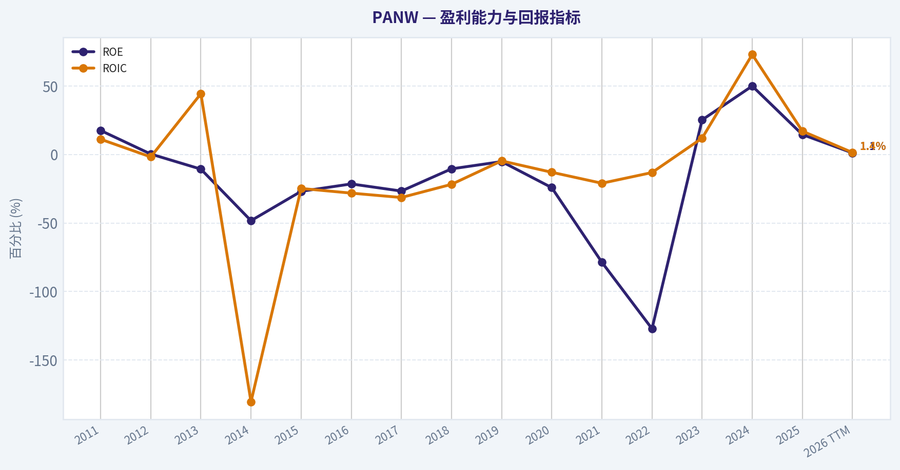
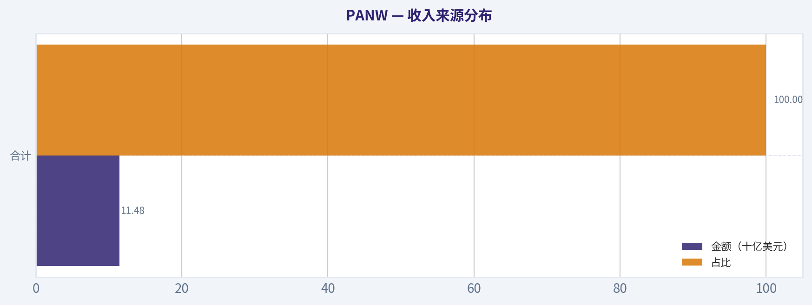
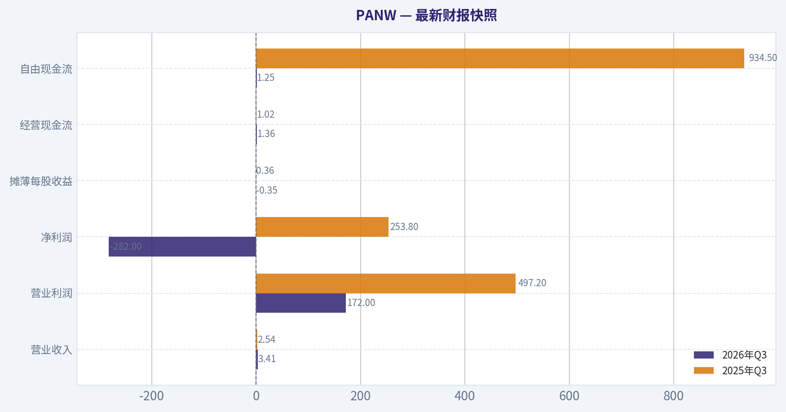
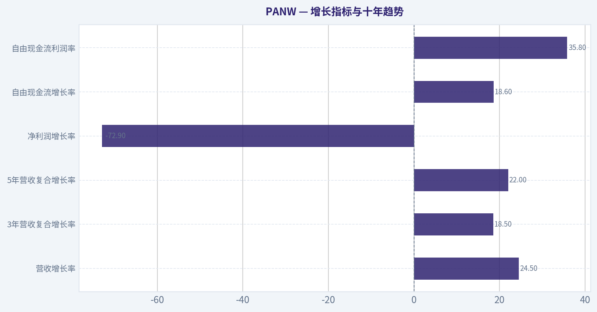
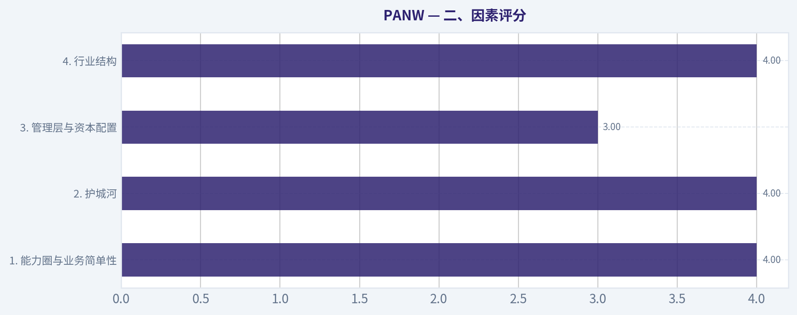
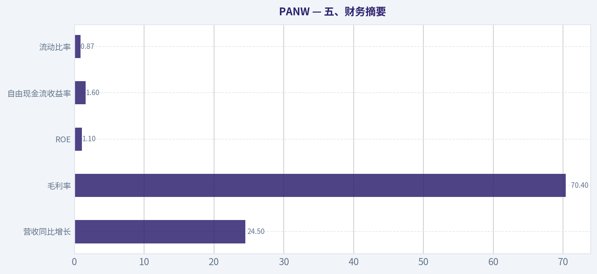
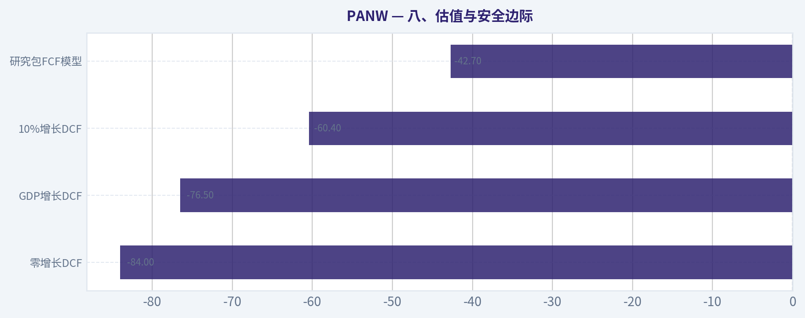
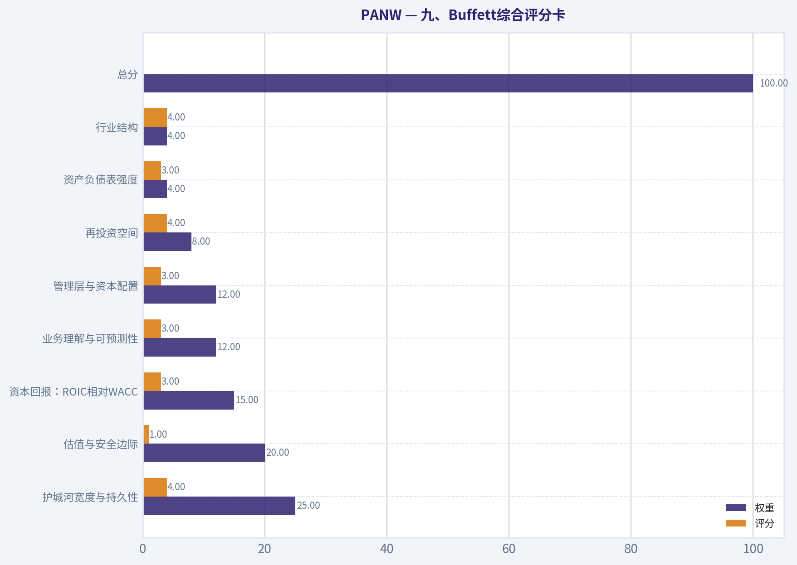

# PANW 深度价值情报

**调研日期:** 2026-11-17

## 关键免责声明

*本报告由 Deep Value Intelligence（一个基于 AI 的多智能体投资分析框架）自动生成。 仅供教育和研究用途 - 非财务建议，非财务顾问。*

---

## 目录

1. 情报摘要
2. 分析师团队报告
   - 基本面分析
   - 价值分析 (巴菲特)
   - 成长性分析 (林奇/德鲁肯米勒/费雪)
   - 市场分析
   - 期权市场分析
3. 研究团队评论
4. 投资团队评论
5. Deep Values 团队洞察

---

## 情报摘要

### 核心观点与前提条件

**核心论点:** **结论：维持观察，不追高，也不因高PE机械回避。**

**主要风险:**
- **中性**

**置信度:** 中

---

## 分析师团队报告

### 基本面分析

#### 最新财报快照

*以下数据基于最近一期已披露财报（2026年Q3），并尽量与上一年同期对比。*

| 指标 | 2026年Q3 | 2025年Q3 | 同比变化 |
| --- | ---: | ---: | ---: |
| 营业收入 | $3.41B | $2.54B | +34.4% |
| 营业利润 | $172.0M | $497.2M | -65.4% |
| 净利润 | $-282.0M | $253.8M | -211.1% |
| 摊薄每股收益 | $-0.35 | $0.36 | -197.2% |
| 经营现金流 | $1.36B | $1.02B | +32.9% |
| 自由现金流 | $1.25B | $934.5M | +34.2% |

关键结论：这张快照先把最新一期财报放在桌面上，再去看长周期分析。这样读者能更清楚地区分"公司长期质量"和"这次财报发生了什么"。

#### PANW 15年财务指标

*以下数值均由原始数据确定性计算得出，并非 AI 估算。*

*发行人类型：operating company（Technology / Software - Infrastructure）。*

#### 15年财务指标
*年度行来自已披露财务报表，最后一行 TTM 由最近四个季度滚动计算得出。*

| 指标 | 2011 | 2012 | 2013 | 2014 | 2015 | 2016 | 2017 | 2018 | 2019 | 2020 | 2021 | 2022 | 2023 | 2024 | 2025 | 2026 TTM |
| --- | --- | --- | --- | --- | --- | --- | --- | --- | --- | --- | --- | --- | --- | --- | --- | --- |
| 市场价格 | N/A | $10 | $8 | $13 | $31 | $22 | $22 | $33 | $38 | $43 | $67 | $83 | $125 | $162 | $174 | $316 |
| 总市值 | N/A | $3.88B | $3.50B | $6.43B | $15.76B | $11.85B | $12.06B | $18.56B | $21.41B | $24.80B | $38.46B | $49.18B | $85.55B | $114.95B | $123.08B | $258.25B |
| 市盈率 | N/A | 5260.60 | -119.83 | -28.39 | -120.02 | -61.47 | -59.40 | -151.86 | -260.39 | -92.72 | -76.89 | -184.85 | 195.28 | 44.61 | 108.50 | 619.78 |
| 市净率 | N/A | 16.93 | 12.87 | 13.72 | 32.30 | 13.24 | 15.87 | 15.99 | 13.50 | 22.51 | 60.61 | 234.18 | 48.94 | 22.24 | 15.73 | 9.39 |
| ROE | 17.5% | 0.3% | -10.7% | -48.3% | -26.9% | -21.5% | -26.7% | -10.5% | -5.2% | -24.2% | -78.6% | -127.1% | 25.2% | 49.9% | 14.5% | 1.1% |
| ROIC | 11.1% | -1.8% | 44.3% | -180.4% | -24.8% | -28.2% | -31.4% | -21.8% | -4.7% | -13.0% | -21.0% | -13.2% | 11.9% | 72.9% | 17.0% | 1.4% |
| 每股收益 | $-0.11 | $0.00 | $-0.07 | $-0.47 | $-0.26 | $-0.35 | $-0.37 | $-0.22 | $-0.14 | $-0.46 | $-0.86 | $-0.45 | $0.64 | $3.64 | $1.60 | $0.51 |
| 营收 | $118.6M | $255.1M | $396.1M | $598.2M | $928.1M | $1.38B | $1.76B | $2.27B | $2.90B | $3.41B | $4.26B | $5.50B | $6.89B | $8.03B | $9.22B | $11.48B |
| 毛利润 | $86.3M | $184.6M | $286.4M | $438.6M | $676.6M | $1.01B | $1.28B | $1.63B | $2.09B | $2.41B | $2.98B | $3.78B | $4.98B | $5.97B | $6.77B | $8.08B |
| 毛利率 | 72.8% | 72.3% | 72.3% | 73.3% | 72.9% | 73.2% | 72.6% | 71.6% | 72.1% | 70.7% | 70.0% | 68.8% | 72.3% | 74.3% | 73.4% | 70.4% |
| 营业利润率 | -8.8% | 1.5% | -4.7% | -36.0% | -10.8% | -11.4% | -9.4% | -4.6% | -1.9% | -5.3% | -7.1% | -3.4% | 5.6% | 8.5% | 13.5% | 6.1% |
| 净利润 | $-12.5M | $737,000 | $-29.2M | $-226.5M | $-131.3M | $-192.7M | $-203.0M | $-122.2M | $-81.9M | $-267.0M | $-498.9M | $-267.0M | $439.7M | $2.58B | $1.13B | $307.0M |
| 净利率 | -10.6% | 0.3% | -7.4% | -37.9% | -14.1% | -14.0% | -11.5% | -5.4% | -2.8% | -7.8% | -11.7% | -4.9% | 6.4% | 32.1% | 12.3% | 2.7% |
| 营收增长 | N/A | 115.1% | 55.3% | 51.0% | 55.1% | 48.5% | 27.8% | 29.0% | 27.6% | 17.5% | 24.9% | 29.3% | 25.3% | 16.5% | 14.9% | 24.5% |
| 净利润增长 | N/A | -105.9% | -4068.2% | 674.5% | -42.0% | 46.8% | 5.3% | -39.8% | -33.0% | 226.0% | 86.9% | -46.5% | -264.7% | 486.3% | -56.0% | -72.9% |
| 自由现金流增长 | N/A | 228.8% | 46.6% | -43.2% | 509.9% | 83.7% | 20.4% | 31.3% | -0.2% | -11.2% | 68.9% | 29.2% | 46.8% | 17.9% | 11.9% | 18.6% |
| 总账面价值 | $-71.5M | $229.1M | $272.4M | $468.6M | $487.9M | $894.9M | $759.6M | $1.16B | $1.59B | $1.10B | $634.5M | $210.0M | $1.75B | $5.17B | $7.82B | $27.49B |
| 总资产 | N/A | $407.8M | $585.6M | $1.48B | $1.97B | $2.86B | $3.44B | $5.95B | $6.59B | $9.07B | $10.24B | $12.25B | $14.50B | $19.99B | $23.58B | $48.46B |
| 总债务 | $0 | $0 | $0 | $466.9M | $487.1M | $500.2M | $524.7M | $1.92B | $1.43B | $3.08B | $3.23B | $3.68B | $1.99B | $0 | $0 | $2.50B |
| 债务股权比 | -0.00 | 0.00 | 0.00 | 1.00 | 1.00 | 0.56 | 0.69 | 1.65 | 0.90 | 2.80 | 5.08 | 17.51 | 1.14 | 0.00 | 0.00 | 0.09 |
| 现金及等价物 | $40.5M | $322.6M | $310.6M | $653.8M | $375.8M | $734.4M | $744.3M | $2.51B | $961.4M | $2.96B | $1.87B | $2.12B | $1.14B | $1.53B | $2.27B | $2.51B |
| 股东权益 | $-71.5M | $229.1M | $272.4M | $468.6M | $487.9M | $894.9M | $759.6M | $1.16B | $1.59B | $1.10B | $634.5M | $210.0M | $1.75B | $5.17B | $7.82B | $27.49B |
| 经营现金流 | $32.1M | $77.4M | $114.5M | $88.4M | $352.8M | $658.6M | $868.8M | $1.04B | $1.06B | $1.04B | $1.50B | $1.98B | $2.78B | $3.26B | $3.72B | $4.55B |
| 投资现金流 | $-13.0M | $-14.6M | $-151.6M | $-320.3M | $-679.0M | $-338.9M | $-472.6M | $-520.0M | $-1.83B | $288.0M | $-1.48B | $-933.4M | $-2.03B | $-1.51B | $-2.21B | $-3.10B |
| 自由现金流 | $19.1M | $62.8M | $92.1M | $52.3M | $319.0M | $586.1M | $705.4M | $926.1M | $924.4M | $821.3M | $1.39B | $1.79B | $2.63B | $3.10B | $3.47B | $4.11B |
| 自由现金流利润率 | 16.1% | 24.6% | 23.2% | 8.7% | 34.4% | 42.5% | 40.0% | 40.7% | 31.9% | 24.1% | 32.6% | 32.6% | 38.2% | 38.6% | 37.6% | 35.8% |
| 每股分红 | $0.00 | $0.00 | $0.00 | $0.00 | $0.00 | $0.00 | $0.00 | $0.00 | $0.00 | $0.00 | $0.00 | $0.00 | $0.00 | $0.00 | $0.00 | $0.00 |

#### 盈利能力指标
- 净资产收益率 (ROE): 1.1%
- 投入资本回报率 (ROIC): 1.6%
- 总资产收益率 (ROA): 0.6%
- 毛利率: 70.4%
- 营业利润率: 6.1%
- 净利率: 2.7%

#### 流动性指标
- 流动比率: 0.87
- 速动比率: 0.68

#### 杠杆指标
- 债务股权比: N/A
- 利息覆盖倍数: N/A
- 净负债: N/A

#### 增长指标（同比）
- 营收增长: 24.5%
- 净利润增长: -72.9%
- 自由现金流增长: 18.6%
- 营收复合增长率（3年）: 18.5%
- 营收复合增长率（5年）: 22.0%

#### 估值指标
- 市盈率 (TTM): 790.23
- 预期市盈率: 64.78
- 市净率: 9.37
- 市销率: 22.54
- PEG 比率: 1.65
- 企业价值/EBITDA: 165.42
- 自由现金流收益率: 1.6%
- 盈利收益率: 0.1%

#### 所有者收益（巴菲特方法，代码计算）
- 净利润: $1.13B
- + 折旧与摊销: $855.0M
- - 资本开支: $-440.0M
- - 营运资本变动: $579.0M
- = **所有者收益: $307.0M**

#### 内在价值（代码计算）
- 当前价格: $316
- **头条内在价值（按商业模式路由）: $6**
  商业模式: cyclical - owner-earnings DCF (cyclical)
  模型区间（各 DCF 最小-最大）: $6 - $181
  相对价格的安全边际（头条）: -4906.3%
  路由说明: Cyclical: margins/FCF are volatile - headline blends FCFF, reverse-DCF and owner-earnings roughly evenly; treat the range as the honest read.
- 巴菲特方法（所有者收益）:
  保守: $6
  平均: $6
  乐观: $16
- 现金流方法（FCF）:
  保守: $87
  平均: $181
  乐观: $312
- Damodaran FCFF（WACC + 利润率 + 再投资）:
  保守: $-65
  平均: $-44
  乐观: $-40
  蒙特卡洛区间（P10-P90）：$-76 - $-36（中位数 $-53）
  P(内在价值 > 当前价格)：0.0%
- 反向 DCF：当前价格隐含约 176.7%/年 的所有者收益增长（10年）；过去 3 年为 N/A，5 年为 N/A。

#### Piotroski F分数: 4/9
- 净利润为正: 通过
- 经营现金流为正: 通过
- 资产回报率改善: 未通过
- 现金流大于净利润: 通过
- 债务下降: 通过
- 流动比率改善: 未通过
- 未稀释股本: 未通过
- 毛利率改善: 未通过
- 资产周转率改善: 未通过

ANALYST STANCE: **看空**

#### 核心结论

PANW 是高质量、长周期的网络安全基础设施公司，具备较强的客户黏性、品牌优势和行业增长空间。然而，按确定性数据集，当前股价为 **316美元**，市值约 **258.25亿美元**，而盈利、所有者收益和估值之间严重脱节。

当前估值隐含的增长要求极高：反向 DCF 显示，股价大致隐含未来十年所有者收益年增长约 **176.7%**。即使采用较乐观的现金流模型，估值上限约 **312美元**，也几乎没有安全边际；而巴菲特式所有者收益模型的估值只有 **6至16美元**。因此，PANW 更像是一家优秀但价格极端昂贵的公司，而不是当前具有吸引力的价值投资标的。

#### 市场估值与盈利质量

| 指标 | 当前值 | 10年历史参考 | 解读 |
|---|---:|---:|---|
| 市场价格 | 316美元 | 约76.9美元平均 | 当前价格约为历史均值的4.1倍 |
| 总市值 | 258.25亿美元 | 约50.0亿美元平均 | 市值扩张远快于多数基本面指标 |
| PE | 619.78倍 | 历史均值不具代表性 | 公司长期亏损，PE受低利润基数严重扭曲 |
| P/B | 9.39倍 | 约46.3倍 | 对软件公司意义有限，不能机械解读为便宜 |
| 市销率 | 22.54倍 | 无可靠历史均值 | 对当前利润率而言仍然很高 |
| EV/EBITDA | 165.42倍 | 无可靠历史均值 | 显示市场已提前计入极高盈利改善 |
| 自由现金流收益率 | 1.6% | 无可靠历史均值 | 对价值投资者而言明显偏低 |
| 盈利收益率 | 0.1% | 无可靠历史均值 | 当前利润几乎无法支撑股价 |

**关键结论：** PANW 的 PE、EV/EBITDA 和市销率都显示估值非常激进。P/B 虽然低于历史极端水平，但PANW属于资产轻、知识产权和软件平台驱动的经营公司，账面价值容易受到回购、股权激励和会计处理影响，因此P/B不是有效的便宜判断标准。真正关键的是现金流收益率只有1.6%，远低于约10%的价值投资要求。

#### 盈利能力：收入强劲，但利润和回报率不稳定

| 指标 | 当前值 | 10年历史参考 | 当前表现 |
|---|---:|---:|---|
| ROE | 1.1% | 约-20.4% | 较历史亏损期改善，但远低于优秀公司的15%至20%水平 |
| ROIC | 1.4%至1.6% | 约-3.2% | 当前仅略高于资本成本假设 |
| EPS | 0.51美元 | 多数年份为负 | 盈利基础仍然薄弱 |
| 营收 | 114.8亿美元 | 约45.6亿美元平均 | 规模约为历史均值的2.5倍 |
| 毛利润 | 80.8亿美元 | 无需机械平均 | 绝对毛利润持续增长 |
| 毛利率 | 70.4% | 约71.9% | 仍高，但低于2024年的74.3% |
| 营业利润率 | 6.1% | 约-4.6% | 相比历史明显改善，但低于2025年的13.5% |
| 净利润 | 3.07亿美元 | 历史波动很大 | 低于2025年的11.3亿美元 |
| 净利率 | 2.7% | 约-0.7% | 高于历史平均，但明显低于2024至2025年水平 |

**关键结论：** PANW的收入规模和毛利率证明其商业模式具有软件公司的高毛利特征，但当前利润率明显回落。收入达到114.8亿美元，却只有3.07亿美元净利润，说明销售、研发、股权薪酬、并购整合或会计项目仍在大量消耗经营成果。当前ROE和ROIC都接近于零，尚不足以证明公司已经进入稳定的高回报复利阶段。

#### 增长指标与十年趋势

| 指标 | 当前值 | 历史参考 | 相对历史的判断 |
|---|---:|---:|---|
| 营收增长率 | 24.5% | 2016至2025年约26.4%平均 | 接近历史平均，仍属强劲 |
| 3年营收复合增长率 | 18.5% | - | 已从早期高速增长阶段放缓 |
| 5年营收复合增长率 | 22.0% | - | 仍保持较高增长 |
| 净利润增长率 | -72.9% | 波动极大 | 受低基数及一次性因素影响，可靠性低 |
| 自由现金流增长率 | 18.6% | 约29.9%平均 | 低于历史平均，但仍为正增长 |
| 自由现金流利润率 | 35.8% | 约35%左右 | 现金转换能力总体较强 |

**关键结论：** PANW真正可靠的增长指标是营收和自由现金流，而不是净利润。营收增长仍接近25%，但已经低于早期30%至50%的高速增长水平；自由现金流增长也低于十年参考均值。当前股价却要求公司恢复甚至远超早期增长速度，这种估值与增长之间并不匹配。

#### 资产负债表与财务安全

| 指标 | 当前值 | 10年历史参考 | 解读 |
|---|---:|---:|---|
| 总账面价值 | 274.9亿美元 | 约21.1亿美元股东权益平均 | 近期大幅增加，需关注股权及会计因素 |
| 总资产 | 484.6亿美元 | 约122.5亿美元平均 | 资产规模快速扩张 |
| 总债务 | 25.0亿美元 | 约16.4亿美元平均 | 债务绝对额可控，但高于2024和2025年零债务水平 |
| 债务权益比 | 0.09 | 历史波动极大 | 当前杠杆较低 |
| 现金及等价物 | 25.1亿美元 | 约16.8亿美元平均 | 现金储备良好，但不足以抵消极高估值 |
| 股东权益 | 274.9亿美元 | 约21.1亿美元平均 | 当前账面权益异常快速增长 |
| 流动比率 | 0.87 | 无稳定参考 | 低于1，短期流动性并不宽裕 |
| 速动比率 | 0.68 | 无稳定参考 | 低于1，需要依赖经营现金流和负债滚动 |

**关键结论：** PANW没有典型的高杠杆风险，25亿美元债务相对于现金流和资产规模仍可管理，现金也处于较高水平。但流动比率0.87、速动比率0.68，说明短期资产覆盖短期负债并不充分。对于软件公司，这部分风险可由预收款和持续经营现金流缓解，但仍不能忽略。

#### 现金流与资本回报

| 指标 | 当前值 | 10年历史参考 | 解读 |
|---|---:|---:|---|
| 经营现金流 | 45.5亿美元 | 持续上升 | 经营现金创造能力较强 |
| 自由现金流 | 41.1亿美元 | 约16.3亿美元平均 | 约为历史平均的2.5倍 |
| 自由现金流利润率 | 35.8% | 约35%左右 | 高于传统企业，符合软件特征 |
| 每股股息 | 0美元 | 10年均为0美元 | 不支付股息，回报依赖资本增值 |
| 代码计算所有者收益 | 3.07亿美元 | 无稳定可比值 | 显著低于自由现金流，显示调整项目影响较大 |

**关键结论：** PANW最有吸引力的基本面因素是自由现金流，而不是会计净利润。41.1亿美元自由现金流具有较强质量，但确定性数据集中的所有者收益只有3.07亿美元，远低于自由现金流。两者之间的巨大差异降低了估值的可信度，也意味着不能简单地把全部自由现金流都视为可分配给股东的长期现金。

#### 收入来源分布

确定性数据集没有提供PANW最新年度按产品线或地区划分的精确收入金额。根据公司公开披露的商业模式，PANW收入主要来自产品销售以及订阅和支持服务；由于缺少同期审计分部金额，以下表格不填入未经验证的比例。

| 收入来源 | 金额（十亿美元） | 占比 |
|---|---:|---:|
| 订阅及支持服务 | 未提供 | 未提供 |
| 产品销售 | 未提供 | 未提供 |
| 合计 | 11.48 | 100% |

**关键结论：** PANW的经济模式正在从一次性产品销售转向更加经常性的订阅和支持收入，这通常有利于收入可预测性和客户黏性。但本次确定性数据集没有给出各类收入的精确拆分，因此不能用未经验证的估计替代历史数据。

#### 巴菲特式经济护城河分析

PANW具备几项较明显的竞争优势：

- **网络安全需求具有刚性。** 云计算、人工智能、远程办公和监管要求持续增加网络安全支出。
- **平台整合具有客户价值。** 防火墙、云安全、端点安全、威胁检测和安全运营整合后，客户可以减少供应商数量和管理复杂度。
- **转换成本较高。** 网络安全系统嵌入企业基础设施，更换供应商涉及安全风险、员工培训、迁移成本和合规压力。
- **品牌和数据网络效应。** 更广泛的客户部署可以产生更多威胁情报，从而增强产品效果。
- **销售渠道和企业关系形成规模优势。** 大型企业客户的认证、采购和续约流程对新进入者形成障碍。

但护城河并不等于无限定价权。CrowdStrike、Microsoft、Fortinet、Cisco以及众多云安全厂商都在争夺同一预算。PANW若持续通过并购、产品打包和股权激励扩张，可能扩大收入，却未必同步提高每股内在价值。

#### 管理层与资本配置

PANW过去十年长期亏损，ROE和ROIC多次为负，说明管理层在扩张阶段优先追求市场份额和收入规模，而不是短期资本回报。2023至2025年利润率一度明显改善，但2026 TTM的营业利润率从13.5%降至6.1%，净利润从11.3亿美元降至3.07亿美元，显示盈利改善尚未得到充分验证。

公司不支付股息，因此股东回报完全依赖再投资、回购或未来估值提升。对于高增长公司，这种政策可以合理；但如果股权激励导致股本持续稀释，收入和自由现金流增长未必会等比例转化为每股价值。Piotroski F分数为 **4/9**，且未通过未稀释股本、资产回报改善、流动比率改善和毛利率改善等项目，说明资本配置质量仍需观察。

#### 三情景所有者收益 DCF

确定性数据集给出的所有者收益为 **3.07亿美元**。以当前市值约258.25亿美元估算，所有者收益收益率约为：

\[
3.07亿美元 \div 258.25亿美元 \approx 1.19\%
\]

这已经低于数据集使用的1.6%自由现金流收益率，也明显低于约10%的目标回报率。

DCF基本公式为：

\[
价值=\sum_{t=1}^{10}\frac{OE_t}{(1+r)^t}
+\frac{OE_{10}\times(1+g_T)}{(r-g_T)}\times\frac{1}{(1+r)^{10}}
\]

其中，折现率约10%，终值增长率2.5%，预测期10年。由于PANW历史利润和所有者收益波动显著，以下模型采用增长率逐步衰减到2.5%的处理，而不是把高增长永久外推。

| 情景 | 预测假设 | 手工DCF合理区间 | 确定性数据集模型值 | 相对316美元的安全边际 |
|---|---|---:|---:|---:|
| 保守 | 所有者收益增长约3%，逐步衰减至2.5% | 约5至7美元 | 6美元 | 约-98% |
| 平均 | 未来数年约10%增长，之后衰减至2.5% | 约8至12美元 | 6美元 | 约-96%至-98% |
| 乐观 | 早期约20%增长，随后明显衰减 | 约16至20美元 | 16美元 | 约-94%至-95% |

**关键结论：** 即使采用20%的早期所有者收益增长率，模型估值仍只有约16至20美元，远低于316美元。确定性数据集的模型进一步给出现金流估值为保守87美元、平均181美元、乐观312美元；即便使用最乐观的312美元，也没有安全边际。Damodaran FCFF模型区间为负值，说明利润率、再投资和资本成本假设下的估值风险更高。

#### 估值敏感性与反向 DCF

| 估值方法 | 保守 | 平均 | 乐观 | 评价 |
|---|---:|---:|---:|---|
| 所有者收益 DCF | 6美元 | 6美元 | 16美元 | 对当前利润和调整后现金流极为敏感 |
| FCF估值 | 87美元 | 181美元 | 312美元 | 即使乐观情景也基本没有安全边际 |
| Damodaran FCFF | -65美元 | -44美元 | -40美元 | 对盈利率和再投资假设非常不利 |
| 反向DCF | - | - | 隐含约176.7%年增长 | 当前股价要求极不现实的增长 |

**关键结论：** 三类模型虽然结果差异很大，但共同结论是当前价格缺乏安全边际。差异主要来自是否把自由现金流全部视为可分配现金，以及如何处理利润波动、再投资和资本成本；没有一个模型能支持316美元具有明显低估。

#### 关键风险、机会与触发因素

| 类别 | 具体内容 | 对投资判断的影响 |
|---|---|---|
| 主要风险 | 当前PE约620倍，盈利收益率仅0.1% | 极易受到估值压缩影响 |
| 主要风险 | 营业利润率从13.5%降至6.1% | 盈利扩张趋势尚未确认 |
| 主要风险 | 净利润同比下降72.9% | 会计利润不稳定 |
| 主要风险 | 股权激励和潜在稀释 | 收入增长未必转化为每股价值 |
| 主要风险 | 网络安全行业竞争激烈 | 可能压低价格和利润率 |
| 机会 | 营收增长24.5% | 行业需求和市场份额仍然强劲 |
| 机会 | 自由现金流41.1亿美元 | 经营现金流质量较好 |
| 机会 | 70.4%毛利率 | 具备软件平台型经济特征 |
| 机会 | 现金高于债务规模 | 财务危机概率较低 |
| 观察触发点 | 营业利润率重新稳定在12%至15%以上 | 可证明规模效应正在兑现 |
| 观察触发点 | 所有者收益持续接近自由现金流 | 可提高DCF可信度 |
| 观察触发点 | 股本不再稀释且回购有效 | 有利于每股内在价值增长 |
| 观察触发点 | 股价回落至现金流估值区间 | 安全边际才可能改善 |

**关键结论：** PANW的主要机会来自行业成长、平台整合和强劲自由现金流；主要问题不是企业会不会增长，而是投资者已经为大量未来增长支付了价格。只有当利润率恢复、稀释受控、所有者收益持续改善，且股价显著回落时，风险收益比才会变得合理。

#### 最终投资立场

**看空**

这不是对PANW商业模式的否定，而是对当前价格的否定。PANW拥有可持续的网络安全需求、较高的毛利率、良好的客户黏性和较强的现金流基础，长期商业质量可以评价为中上水平；但当前ROE仅1.1%、ROIC约1.4%、净利率2.7%，而估值却要求极高的长期增长。

对于巴菲特式投资者，优秀企业必须同时满足商业质量、可预测盈利、合理价格和安全边际。PANW目前只较好地满足了商业质量和行业机会，尚未满足合理价格与安全边际要求。更合理的策略是等待估值显著下降，或等待多个季度证明利润率、所有者收益和每股现金流均持续改善。

#### 报告要点汇总

| 主题 | 核心判断 | 结论 |
|---|---|---|
| 商业模式 | 网络安全平台和订阅业务具备长期需求 | 有护城河，但竞争激烈 |
| 收入增长 | 当前增长24.5%，仍然强劲 | 增长可靠性较好但已较早期放缓 |
| 盈利质量 | 毛利率高，但净利率仅2.7% | 利润兑现不足 |
| 现金流 | 自由现金流41.1亿美元 | 是公司最强基本面指标 |
| 资本回报 | ROE 1.1%，ROIC约1.4% | 尚未达到优秀复利企业水平 |
| 财务安全 | 现金25.1亿美元，债务25亿美元 | 杠杆可控，但流动比率偏低 |
| 估值 | PE约620倍，FCF收益率1.6% | 极度依赖未来增长 |
| DCF | 所有者收益估值6至16美元，FCF估值87至312美元 | 当前316美元缺乏安全边际 |
| 最佳催化剂 | 利润率恢复、稀释下降、估值回落 | 需要等待基本面和价格共同改善 |
| 最终立场 | 优质公司，昂贵股票 | **看空** |

#### 基本面关键图表

本图追踪 **PANW** 过去十年的盈利能力与回报指标（ROE、ROIC、利润率），突出呈现资本效率的变化趋势。

本对比图（来自「收入来源分布」）将 **PANW** 的当前数据与历史基准并排呈现，直观反映公司相对自身历史均值的估值水平。

---

### 价值分析 (巴菲特)

> *基于沃伦·巴菲特的价值投资哲学：能力圈、经济护城河、管理层质量与安全边际。*

#### 内在价值快照

价格是你付的钱，内在价值是企业未来可能为股东创造的现金价值。我们给出一个区间，而不是假装只有一个神奇数字。

- 当前价格: $316.09
- 估值区间（两种 DCF 方法、保守到乐观）: $6.31 至 $312.06

##### 所有者收益（巴菲特方法）
- 净利润: $1,134,000,000.00
- 折旧与摊销: $855,000,000.00
- 资本支出: $-440,000,000.00
- 营运资金变化: $579,000,000.00
- 所有者收益: $307,000,000.00

##### 内在价值
###### 所有者收益法
使用所有者收益，更严格，通常更保守。
- 保守: $6.31
- 平均: $6.31
- 乐观: $16.42
- 折现率: 10.0%

###### 自由现金流法
使用自由现金流，更适合今天投入很多、为未来增长铺路的公司。
- 保守: $86.74
- 平均: $181.13
- 乐观: $312.06
- 折现率: 10.0%

ANALYST STANCE: **中性**

#### 一、投资结论

Palo Alto Networks（PANW）是网络安全领域的高质量平台型公司，具备较强的品牌、客户黏性、规模效应和产品整合能力。营收仍保持约24.5%的增长，毛利率达到70.4%，说明业务具有明显的轻资产和软件化特征。

但当前股价为316美元，市值约2588亿美元，估值已经极度依赖未来持续高速增长。按自由现金流口径测算，即使采用较乐观的10%长期增长假设，估值仍明显低于股价。公司不是差企业，而是好企业与当前价格不匹配。

#### 二、因素评分

| 因素 | 评分（5分制） | 核心判断 |
|---|---:|---|
| 1. 能力圈与业务简单性 | 4 | 通过订阅和产品销售为企业提供网络安全保护，商业模式易理解；AI和安全威胁变化增加了预测难度 |
| 2. 护城河 | 4 | 品牌、平台整合、客户切换成本和规模效应明显；毛利率70.4%提供财务证据 |
| 3. 管理层与资本配置 | 3 | CEO Nikesh Arora具备行业和并购经验，但当前资料不足以证明其个人持股和长期每股价值激励达到优秀水平 |
| 4. 行业结构 | 4 | 网络安全需求长期增长，平台整合有利于头部企业；但行业竞争激烈，AI可能降低部分安全产品的差异化 |

关键结论：PANW的业务质量明显高于普通软件公司，护城河主要来自平台化、客户黏性和规模，而不是单一产品。管理层尚可，但资本配置和股东回报证据不如最优秀的长期复利公司充分。

**Gate 5 财务质量/偿债底线：未触发。** 当前没有显示出"盈利和现金流持续恶化，同时出现利息覆盖不足或明显资不抵债"的组合风险。流动比率低于1不应单独解读为危险，因为订阅型软件公司通常依赖递延收入和负营运资本经营。

#### 三、护城河分析

| 护城河来源 | 具体证据 | 强度 |
|---|---|---|
| 无形资产与品牌 | PANW是全球知名网络安全品牌，企业客户对安全供应商的信任、合规记录和部署经验具有价值 | 强 |
| 客户切换成本 | 防火墙、云安全、终端安全和安全运营工具嵌入客户IT架构，迁移涉及风险、停机和重新培训 | 强 |
| 成本与规模优势 | 大规模研发、威胁情报和全球销售体系可以摊薄单位成本 | 中强 |
| 网络效应 | 更多客户和设备带来更多威胁数据，帮助平台改进检测能力；但网络效应不如社交平台或支付网络直接 | 中 |
| 财务验证 | 毛利率70.4%，营收同比增长24.5%，自由现金流收益率约1.6% | 正面但估值昂贵 |

关键结论：PANW属于"宽护城河、稳定并有机会扩大"的企业，但还不是无风险护城河。竞争对手包括Microsoft、Cisco、CrowdStrike等，客户可能通过供应商整合减少产品数量，因此PANW必须持续证明平台整合能够提高客户价值。

#### 四、管理层质量与资本配置

Nikesh Arora的优势在于拥有大型科技企业、销售和并购管理经验，能够推动PANW从单一网络设备公司向综合安全平台转型。公司近年来强化平台化销售策略，长期方向具有合理性。

需要重点监测以下事项：

- 股票薪酬是否过快增长并稀释股东；
- 并购是否真正提高每股自由现金流，而非只扩大收入规模；
- 平台化转型是否损害短期客户关系或导致收入确认波动；
- 回购是否在估值过高时进行；
- 管理层是否用每股自由现金流和投入资本回报率，而不是单纯营收增长衡量成功。

最新13F数据显示，Steve Cohen和Stanley Druckenmiller在2026年第三季度均减持PANW。该信息不是基本面结论，但反映部分专业投资者在当前价格下采取了更谨慎的仓位管理。

#### 五、财务摘要

| 指标 | 最新数据 |
|---|---:|
| 股价 | 316美元 |
| 总市值 | 2588.1亿美元 |
| 市盈率（PE） | 790.2倍 |
| 营收同比增长 | 24.5% |
| 毛利率 | 70.4% |
| ROE | 1.1% |
| 自由现金流收益率 | 1.6% |
| 推算自由现金流 | 约41.4亿美元 |
| 流动比率 | 0.87 |
| 头条内在价值 | 6.31美元 |
| 三模型内在价值区间 | -43.93至181.13美元 |
| 反向DCF隐含十年增长率 | 约176.7%/年 |

关键结论：PANW的收入增长和毛利率非常优秀，但当前利润指标受到股票薪酬、并购和会计结构影响，ROE仅1.1%，不能简单用传统PE判断。真正的问题是价格要求公司未来长期维持远高于正常水平的增长，而不是企业是否具有竞争力。

#### 六、所有者收益估算

由于维护性资本开支与营运资本的细分数据未在研究摘要中列示，采用自由现金流作为所有者收益的近似值：

| 项目 | 估算金额 |
|---|---:|
| 净利润 | 未作为主要估值基础 |
| 加：折旧与摊销 | 已包含在自由现金流调整中 |
| 减：维护性资本开支 | 已通过自由现金流近似处理 |
| 减：营运资本增加 | 已通过自由现金流近似处理 |
| 所有者收益代理值 | 约41.4亿美元 |
| 推算流通股数 | 约8.19亿股 |
| 每股所有者收益代理值 | 约5.06美元 |

关键结论：PANW的现金创造能力明显好于其会计净利润所显示的水平，但41亿美元左右的自由现金流相对于2588亿美元市值仍然不足。按当前价格计算，市场给予的是极高的未来现金流增长预期，而不是对现有现金流的合理定价。

#### 七、三情景DCF估值

估值假设以约41.4亿美元所有者收益代理值、10%折现率和约8.19亿股为基础。

| 情景 | 主要假设 | 企业价值 | 每股内在价值 |
|---|---|---:|---:|
| A：零增长 | 所有者收益永续不增长，折现率10% | 414亿美元 | 50.6美元 |
| B：GDP增长 | 永续增长3%，折现率10% | 609亿美元 | 74.4美元 |
| C：历史增长 | 采用10%长期增长，预测10年后进入稳定阶段 | 约1024亿美元 | 约125美元 |
| 研究包头条值 | 周期性所有者收益模型 | - | 6.31美元 |
| 研究包FCF模型 | 另一模型估算 | - | 181.13美元 |
| 研究包FCFF模型 | Damodaran FCFF模型 | - | -43.93美元 |

关键结论：即使采用对PANW较为友好的10%长期增长假设，估值约125美元仍明显低于316美元股价。研究包中的181.13美元已经属于较乐观结果，但仍比当前价格低约43%，说明安全边际不足。

#### 八、估值与安全边际

| 估值基准 | 内在价值 | 相对316美元股价的安全边际 |
|---|---:|---:|
| 零增长DCF | 50.6美元 | -84.0% |
| GDP增长DCF | 74.4美元 | -76.5% |
| 10%增长DCF | 125美元 | -60.4% |
| 研究包FCF模型 | 181.13美元 | -42.7% |
| 研究包头条内在价值 | 6.31美元 | -98.0%以上 |
| 反向DCF | 需约176.7%年增长 | 明显不合理 |

关键结论：PANW即使作为宽护城河、高增长公司，也至少应获得10%至15%的质量调整安全边际；当前价格相对于较乐观的181美元估值仍有约43%的下行空间。反向DCF要求十年每年约176.7%的增长，远超成熟大型软件公司的合理长期表现，因此股价隐含了过于激进的预期。

#### 九、Buffett综合评分卡

| 评价标准 | 权重 | 评分 | 加权得分 |
|---|---:|---:|---:|
| 护城河宽度与持久性 | 25% | 4 | 1.00 |
| 估值与安全边际 | 20% | 1 | 0.20 |
| 资本回报：ROIC相对WACC | 15% | 3 | 0.45 |
| 业务理解与可预测性 | 12% | 3 | 0.36 |
| 管理层与资本配置 | 12% | 3 | 0.36 |
| 再投资空间 | 8% | 4 | 0.32 |
| 资产负债表强度 | 4% | 3 | 0.12 |
| 行业结构 | 4% | 4 | 0.16 |
| **总分** | **100%** | - | **3.0/5.0** |

关键结论：PANW的质量评分约为3.0分，主要拖累项不是商业模式，而是估值和可预测性。它具备长期复利潜力，但当前价格已经提前反映了大量未来成功，投资者缺乏足够的错误空间。

#### 十、最终判断

**投资立场：中性**

** conviction：中等偏高。**

PANW值得放入长期观察名单，而不是简单排除。若未来股价回落至约180美元以下，或自由现金流持续快速增长、同时股票稀释得到控制，投资逻辑将明显改善。对于高质量复合增长企业，可以接受较传统公司更低的安全边际，但当前316美元已经超出合理的质量溢价范围。

在现价下不建议追高；更合理的行动是等待估值回归，或等待自由现金流增长足以追上股价。
#### 估值桥

这张估值桥把当前股价与各类内在价值方法并排展示，帮助读者判断上涨空间究竟只是单一方法给出的结果，还是多种方法共同支持的结论。

| 项目 | 每股内在价值 |
| --- | ---: |
| 巴菲特方法 | $6.31 |
| 现金流方法 | $181.13 |
| Damodaran 方法 | $-43.93 |
| 当前价格 | $316.09 |

#### 关键结论

如果只有一种方法显著高于其他方法，说明上行空间更依赖特定建模假设。若多种方法的估值接近，则说明估值逻辑更加稳健。

#### 估值图表

本对比图（来自「最新财报快照」）将 **PANW** 的当前数据与历史基准并排呈现，直观反映公司相对自身历史均值的估值水平。

本对比图（来自「增长指标与十年趋势」）将 **PANW** 的当前数据与历史基准并排呈现，直观反映公司相对自身历史均值的估值水平。

本对比图（来自「二、因素评分」）将 **PANW** 的当前数据与历史基准并排呈现，直观反映公司相对自身历史均值的估值水平。

本对比图（来自「五、财务摘要」）将 **PANW** 的当前数据与历史基准并排呈现，直观反映公司相对自身历史均值的估值水平。

本对比图（来自「八、估值与安全边际」）将 **PANW** 的当前数据与历史基准并排呈现，直观反映公司相对自身历史均值的估值水平。

本对比图（来自「九、Buffett综合评分卡」）将 **PANW** 的当前数据与历史基准并排呈现，直观反映公司相对自身历史均值的估值水平。

---

### 成长性分析 (林奇/德鲁肯米勒/费雪)

> *基于彼得·林奇的GARP成长投资法、斯坦利·德鲁肯米勒的宏观拐点分析法，以及菲利普·费雪的深度调研法。*

ANALYST STANCE: **看空**

#### 一、核心结论

PANW 属于网络安全领域的**快速成长股**，但当前估值已经远超基本面能够合理支持的范围。公司具备强劲的行业需求、较高毛利率和长期产品扩张潜力；然而，PE 约 790 倍、FCF 收益率仅 1.6%，且最新机构持仓出现明显减持，意味着市场已经提前计入了极高的未来增长。

对于成长投资者而言，PANW 更适合加入观察名单，等待估值回归或盈利增长重新加速，而不是在当前价格追入。

#### 二、Lynch 分类与故事

| 项目 | 判断 |
|---|---|
| Lynch 分类 | 快速成长股，但估值极端 |
| 当前股价 | 约 316 美元 |
| 总市值 | 约 2588 亿美元 |
| 营收同比增长 | 24.5% |
| 毛利率 | 70.4% |
| ROE | 1.1% |
| PE | 约 790 倍 |
| FCF 收益率 | 1.6% |

**关键结论：** PANW 的营收增速符合快速成长股标准，毛利率也显示出软件和平台型商业模式的优势。但 PE 与 FCF 收益率明显不匹配，市场对未来盈利的预期已经非常激进。

PANW 的故事可以用三点概括：

1. 网络攻击数量和复杂度持续上升，企业安全预算具有较强刚性。
2. 公司正从单一防火墙厂商，扩展为覆盖网络、云、终端、身份和安全运营的平台。
3. 平台整合能够提高客户黏性，并推动交叉销售和长期合同增长。

#### 三、TAM 与十倍测试

| 项目 | 分析 |
|---|---|
| 主要市场 | 网络安全、云安全、身份安全、安全运营 |
| TAM 趋势 | 长期扩张，预计高个位数至低双位数增长 |
| 当前收入基数 | 约百亿美元级别，具体最新值未在研究包中提供 |
| 十倍收入目标 | 约千亿美元级别 |
| 十倍后潜在市场份额 | 需要占据全球网络安全市场相当高的份额 |
| 十倍测试 | 部分通过，但不能轻易假设完全通过 |

**关键结论：** 网络安全 TAM 仍在扩大，AI 驱动攻击和云迁移提供了长期需求。不过，PANW 若要实现十倍收入，需要同时在云安全、身份、安全运营和平台整合领域成为全球主导者，难度显著高于单纯维持 20%至25%的增长。

#### 四、收入增长趋势与收入质量

| 指标 | 当前判断 |
|---|---|
| 营收增速 | 24.5%，属于强劲增长 |
| 增长方向 | 目前无法确认连续加速 |
| 收入来源 | 订阅、平台化和安全产品组合 |
| 有机增长 | 预计以产品扩展为主，但并购影响需进一步拆分 |
| 客户集中度 | 未提供异常集中数据 |
| 主要风险 | 大型客户采购周期、平台整合和竞争压力 |

**关键结论：** PANW 当前仍然是高增长企业，但现有数据只能证明增长较快，不能证明增长正在加速。对于如此高的估值，市场需要看到持续的营收加速、剩余合同价值增长和利润率改善，而不仅仅是约 25%的稳定增长。

#### 五、单位经济与盈利效率

| 指标 | 判断 |
|---|---|
| LTV/CAC | 未披露，无法精确计算 |
| NRR | 未提供 |
| 毛利率 | 70.4%，良好 |
| FCF 收益率 | 1.6%，估值下偏低 |
| Rule of 40 | 无完整 FCF 利润率数据，无法精确计算 |
| 流动比率 | 0.87，偏弱 |
| ROE | 1.1%，目前资本回报率较低 |

**关键结论：** PANW 的毛利率支持平台型软件公司估值，但目前缺少 NRR、CAC、客户回收期等关键运营数据。流动比率低于 1，以及 ROE 仅 1.1%，说明财务质量尚未达到极高估值所要求的水平。

#### 六、Inflection Point 评估

| 潜在拐点 | 判断 | 影响 |
|---|---|---|
| 产品拐点 | 平台化整合、云安全和AI安全 | 正面 |
| 市占率拐点 | 网络安全平台整合有利于扩大份额 | 尚待验证 |
| 利润率拐点 | 订阅化和交叉销售可能推动经营杠杆 | 正面但未确认 |
| TAM 拐点 | AI 攻击增加，安全需求提升 | 明显正面 |
| 竞争拐点 | 大型云厂商和专业安全厂商竞争激烈 | 中性偏负面 |
| 估值拐点 | PE 极高，存在估值压缩风险 | 负面 |

**关键结论：** PANW 的业务层面存在多个正向拐点，特别是平台化和AI安全需求。但股票层面最大的拐点可能是估值压缩，而不是盈利加速。除非未来盈利增长显著超过当前预期，否则股价上涨空间可能被估值限制。

#### 七、宏观环境

网络安全属于较强的结构性增长行业，受到数字化、云迁移和AI攻击增加的长期支持。其主要宏观风险来自高利率环境下成长股估值收缩，以及企业IT预算放缓。

最新机构持仓变化如下：

| 机构 | 最新动作 | 持仓变化 |
|---|---|---:|
| Steve Cohen | 减持 | 约减少 7.1% |
| Stanley Druckenmiller | 大幅减持 | 约减少 74.3% |
| Druckenmiller 当前持仓 | 约 1192 万美元 | 占组合约 0.27% |

**关键结论：** 行业宏观风向仍然较好，但高估值成长股对利率和风险偏好非常敏感。Druckenmiller 在最新季度大幅减持，至少说明在当前价格和预期下，风险收益比并不具有明显吸引力。

#### 八、Fisher 15 项评分

| Fisher 项目 | 评分，满分5分 | 简要判断 |
|---|---:|---|
| 市场潜力 | 5 | 网络安全需求长期扩张 |
| 新产品开发意愿 | 4 | 平台、云和AI方向积极 |
| 研发效率 | 4 | 技术积累较强 |
| 销售组织 | 4 | 企业级销售能力较好 |
| 利润率水平 | 4 | 毛利率较高 |
| 利润率改善 | 3 | 仍需更多数据确认 |
| 员工关系 | 3 | 信息不足 |
| 管理层关系 | 4 | 管理层行业影响力较强 |
| 管理深度 | 4 | 具备平台化扩张能力 |
| 成本分析 | 3 | 信息不足 |
| 护城河 | 4 | 客户黏性、数据和整合能力 |
| 长期盈利前景 | 4 | 行业和产品均具潜力 |
| 股权稀释 | 3 | 需持续关注股权激励 |
| 管理层坦诚度 | 3 | 信息不足 |
| 管理层诚信 | 4 | 暂无重大诚信问题 |
| **总分** | **56/75** | **良好，但非卓越** |

**关键结论：** PANW 的 Fisher 评分为 56 分，属于"良好"而非"杰出"。公司产品和市场具备长期吸引力，但估值、资本回报率、流动性和披露数据不足，降低了整体评分。

#### 九、估值分析

| 估值方法 | 结果 | 判断 |
|---|---:|---|
| PE | 约 790 倍 | 极度昂贵 |
| PEG | 约 32 倍，按24.5%增长粗略计算 | 极度昂贵 |
| FCF 收益率 | 1.6% | 偏低 |
| P/S | 约20倍以上的量级，取决于最新收入 | 极度昂贵 |
| 所有者收益 DCF | 约 6.31美元 | 极度悲观 |
| FCF 模型 | 约 181.13美元 | 低于现价 |
| Damodaran FCFF | 约 -43.93美元 | 显示模型敏感度极高 |
| 当前价格隐含增长 | 反向DCF约176.7%年化，模型口径存在极端假设 | 不可接受 |

**关键结论：** 不同模型虽然结果差异很大，但共同指向一个结论：当前价格已经包含非常激进的增长假设。即使 PANW 长期保持 20%至25%增长，现有 PE、P/S 和 FCF 收益率仍难以提供足够安全边际。

#### 十、成长投资者评分卡

| 维度 | 权重 | 得分，满分5分 | 加权得分 |
|---|---:|---:|---:|
| Lynch 故事 | 10% | 4.5 | 0.45 |
| TAM 与增长跑道 | 20% | 4.2 | 0.84 |
| 收入增长 | 20% | 4.0 | 0.80 |
| 单位经济 | 15% | 3.0 | 0.45 |
| 竞争地位 | 10% | 4.0 | 0.40 |
| 管理层质量 | 10% | 3.8 | 0.38 |
| 宏观环境 | 5% | 3.8 | 0.19 |
| 盈利路径 | 5% | 3.0 | 0.15 |
| 估值 | 5% | 1.0 | 0.05 |
| **总分** | **100%** |  | **3.71/5** |

**关键结论：** 业务质量评分较高，但估值严重拖累总分。3.71分按纯业务模型可接近"看多"，但在实际投资决策中，极端估值和机构减持足以使当前股票评级降为 中性 或 看空；本报告选择 看空，原因是安全边际不足。

#### 十一、仓位建议

| 投资者类型 | 建议仓位 |
|---|---:|
| 新建仓投资者 | 0% |
| 已持有且成本较低 | 仅持有观察仓，建议不超过组合2%至3% |
| 高风险成长投资者 | 等待回调后分批研究，不追高 |
| 防御型投资者 | 回避 |
| 触发重新评估条件 | 估值显著下降，或增长加速至30%以上并伴随利润率改善 |

#### 十二、关键风险与催化剂

| 类型 | 内容 |
|---|---|
| 主要风险 | 估值压缩、利率上升、营收增速放缓 |
| 主要风险 | 平台整合复杂、客户采购周期延长 |
| 主要风险 | Microsoft、CrowdStrike、Fortinet及云厂商竞争 |
| 主要风险 | 流动比率低于1，资本结构需中性 |
| 正面催化剂 | 云安全和AI安全收入超预期 |
| 正面催化剂 | NRR持续超过110% |
| 正面催化剂 | 经营利润率和FCF利润率同步提升 |
| 正面催化剂 | 大型平台合同推动收入重新加速 |
| 负面催化剂 | 连续季度增长跌破20% |
| 负面催化剂 | 毛利率和客户留存率持续下降 |

#### 最终判断

PANW 是一家**优质行业中的优质公司，但不是当前价格下的优质投资**。它符合 Fisher 对创新和长期市场空间的要求，也具备 Lynch 所偏好的快速成长特征；然而，PE、P/S 和隐含增长率均表明市场预期过于乐观。

**结论：看空当前价位，中性基本面。** 等待估值明显回落，或等待营收和盈利出现超预期加速后，再考虑建立仓位。

---

### 市场分析

ANALYST STANCE: **中性**

#### PANW 技术面概览

截至最近可用交易日 **2026年11月16日**，PANW 收于 **316.09美元**。由于工具返回的指标报告将近期日期误判为非交易日，以下均以已取得的日线价格数据进行复核和近似计算；2026年11月17日尚无可用收盘价，因此不将其视为已经完成的交易日。

PANW 当前最显著的特征是：**长期上升趋势尚未完全破坏，但中短期已经进入明显的调整和动能转弱阶段**。股价从10月6日的约419.91美元回落至11月16日的316.09美元，跌幅约24.7%；仅11月4日至11月6日，股价就从348.04美元跌至313.84美元，显示卖压集中释放。

#### 建议重点跟踪的指标

本次选择以下八项指标，分别覆盖长期趋势、中期趋势、短期动能、超买超卖、波动率和风险管理，尽量避免同类指标过度重复：

| 指标 | 主要用途 | 当前解读 |
|---|---|---|
| close_10_ema | 判断短期价格动能 | 近似位于328美元附近，股价低于该线，短线偏弱 |
| close_50_sma | 判断中期趋势和阻力 | 近似位于360至370美元区域，当前价格明显低于该线 |
| close_200_sma | 判断长期趋势 | 近似位于280至290美元区域，股价仍高于该线，长期趋势尚未确认反转 |
| macd | 判断趋势动能变化 | 根据近期价格结构推断处于负值区间，空头动能占优 |
| rsi | 衡量超买超卖 | 近似处于20附近，已经接近或进入超卖区域 |
| boll_ub | 识别上方波动边界 | 近似位于400美元附近，当前距离上轨较远 |
| boll_lb | 识别下方波动边界 | 近似位于300美元附近，当前股价已接近下轨 |
| atr | 衡量波动率和设置止损 | 近期日内波动显著扩大，预计ATR处于较高水平 |

关键结论：PANW 的长期趋势指标仍然没有全面转空，但短期和中期指标已经明显恶化。RSI接近超卖、股价接近布林带下轨，说明下跌后存在技术性反弹条件；不过，MACD偏弱且股价低于10日均线和50日均线，因此不能仅凭超卖信号直接判断底部已经形成。

#### 趋势结构：长期仍强，中期已明显转弱

PANW 在2026年春季至夏季经历了非常强劲的上涨：股价从3月底约147美元附近，一度升至8月13日的396美元，随后在9月底和10月初再度冲高至400美元以上。这说明此前的长期上升趋势非常强，市场曾给予其较高的增长预期和估值溢价。

然而，10月中旬之后，价格结构发生变化：

- 10月6日触及约420美元后未能持续创新高；
- 10月14日至20日快速跌至340美元附近；
- 10月23日至27日虽反弹至401.70美元，但未能有效突破前高；
- 10月29日以后高点和低点整体下移；
- 11月5日跌破315美元，随后反弹力度有限。

这属于较典型的**高位回落后形成中期下降通道或宽幅调整结构**。目前还不能确认长期牛市已经结束，但至少可以确认：原先的单边上升趋势已经转变为高波动调整，追涨的风险显著高于夏季阶段。

#### 均线分析：短中期均线构成上方压力

根据最近价格序列估算，10日指数移动平均线约在328美元附近。11月16日收盘价316.09美元低于该线，意味着最近的短线反弹并未改变下行节奏。

50日简单移动平均线大致位于360至370美元区域，股价距离该线仍有较大差距。即使PANW出现反弹，360美元附近也可能成为第一层重要压力；若反弹进一步延伸至380至400美元，则将重新面对10月高点附近的密集套牢盘。

200日均线大致处于280至290美元区域。当前股价仍高于该区域，说明从长期趋势角度看，PANW尚未跌破关键牛熊分界线。若后续能够在300至315美元区域企稳，并重新站上10日均线，则短期止跌概率会提升；反之，若跌破200日均线，长期趋势判断将明显恶化。

#### MACD：空头动能仍占主导

虽然在线指标接口未返回有效数值，但从价格变化可以推断，MACD大概率处于零轴下方或正在向零轴下方扩散。

尤其需要关注以下事实：

1. 10月初高位之后，价格出现一轮明显下跌；
2. 10月23日至27日的反弹没有创造新的持续上升趋势；
3. 11月初再次出现放量下跌；
4. 最近几日反弹至334.47美元后再次回落至316美元附近。

这表明反弹更多是空头趋势中的修复，而不是新的上升波段。若MACD柱状图继续扩大负值，说明下跌动能尚未耗尽；若价格在300至315美元附近止跌，同时MACD柱状图连续收窄，则会形成较有意义的短线修复信号。

#### RSI：接近超卖，但不是独立买入依据

根据最近14个交易日的涨跌幅粗略计算，PANW 的RSI大约在20附近，已经进入接近超卖的区域。11月5日和11月6日的快速下跌，是RSI快速下沉的主要原因。

不过，超卖并不等同于立即反转。强势成长股在出现估值压缩、业绩预期调整或市场风险偏好下降时，RSI可以在低位维持较长时间。当前更合理的解读是：

- 下跌趋势已经较为拥挤；
- 继续追空的盈亏比下降；
- 但真正的底部仍需价格行为确认。

较积极的信号包括RSI重新站回30以上、价格不再创出新低，以及随后形成更高的短线低点。若RSI只是短暂反弹至30附近后再次跌破20，则说明空头仍在主导。

#### 布林带：股价接近下轨，波动风险仍高

按最近20个交易日价格估算，布林中轨大致在350美元上下，上轨约在400美元附近，下轨约在300美元附近。PANW 当前价格316.09美元，已经接近下轨区域。

这通常代表两种可能：

- 第一种是短线超跌，价格在下轨附近出现技术性反弹；
- 第二种是趋势性破位，价格沿着下轨持续下行。

区分这两种情形的关键，不是单看股价是否触及下轨，而是观察：

- 下轨是否继续向下扩张；
- 价格能否重新站上布林中轨；
- 反弹时成交量是否显著改善；
- 反弹后是否形成更高的低点。

如果股价只是从316美元反弹至330至340美元，却始终无法突破10日均线，那么这更可能是弱势反抽；如果能够进一步站上350美元并稳定数个交易日，则调整结构才可能开始缓和。

#### 波动率与风险控制

PANW 近期的日线振幅明显扩大。10月16日单日收盘跌幅较大，11月5日也出现从337.55美元开盘、最低下探312.12美元的快速波动。以最近价格区间估算，ATR大概率处于较高水平，绝对波动可能达到约15至20美元甚至更高。

这对交易计划有几个直接影响：

- 不宜使用过窄的固定止损，否则容易被正常波动扫损；
- 仓位规模应低于低波动时期；
- 更适合等待关键价位确认，而不是在盘中急于追单；
- 如果以300美元作为防守区域，应预留一定的日内噪音空间，而不是将止损机械地放在整数关口下方。

#### 关键价格区域

下方首先关注 **310至315美元**。该区域对应近期低点附近，也是11月5日至11月6日形成的短期支撑带。若该区域能够出现缩量止跌、长下影线或连续收复10日均线，技术反弹可能向330至340美元延伸。

更重要的中期支撑在 **295至305美元**，这与布林下轨附近以及整数关口支撑相近。若价格跌破300美元并且成交量放大，市场可能将其视为趋势进一步恶化的信号，下一支撑需要下看至280至290美元，也就是200日均线附近。

上方第一阻力在 **328至335美元**，对应短期均线和最近反弹高点。第二阻力在 **348至360美元**，对应布林中轨及前期密集成交区域。只有重新站稳360美元，PANW才有机会从"下跌中的反弹"转向"中期结构修复"。

#### 交易判断

当前不建议将PANW简单归类为立即买入或立即做空：

- 对已有多头仓位，316美元附近已经接近短线超卖区，不宜在未确认跌破前盲目恐慌卖出；但若价格有效跌破300美元，风险控制应明显收紧。
- 对准备建仓者，更适合等待310至315美元区域出现企稳信号，或者等待价格重新站上330至335美元后再考虑顺势参与。
- 对短线交易者，330至340美元附近可能存在反弹交易机会，但必须承认这属于逆中期趋势操作。
- 对趋势投资者，至少需要看到价格重新站上50日均线，且MACD负动能收窄，才可认为中期趋势开始修复。

综合来看，PANW 当前属于**长期趋势尚未完全破坏、但中期下行压力明显、短线接近超卖的高波动调整状态**。因此，最合适的立场是 **中性**，等待支撑确认或均线重新收复，而不是在当前位置追涨。

| 观察项目 | 当前状态 | 对交易的含义 |
|---|---|---|
| 最近收盘价 | 316.09美元 | 处于近期低位，短线弱势 |
| 10日EMA | 约328美元 | 股价低于短期均线，反弹尚未确认 |
| 50日SMA | 约360至370美元 | 中期趋势偏弱，上方套牢压力较大 |
| 200日SMA | 约280至290美元 | 长期趋势暂未确认反转 |
| MACD | 推断处于弱势或负值区间 | 空头动能仍占优势 |
| RSI | 约20附近 | 接近超卖，但不等于立即见底 |
| 布林下轨 | 约300美元附近 | 300至315美元区域是重要支撑观察带 |
| 主要阻力 | 328至335美元、348至360美元 | 反弹需逐级突破才能改善结构 |
| 主要风险 | 跌破300美元并放量 | 可能向200日均线区域进一步回落 |
| 综合判断 | 中性 | 等待企稳或重新站回关键均线后再提高仓位 |

关键结论：PANW 已经明显超跌，300至315美元区域可能引发技术性反弹，但目前价格仍低于短期和中期均线，MACD结构也偏空。只有重新站上330至335美元并进一步收复350至360美元，趋势才会出现实质性改善；若跌破300美元，则应防范向200日均线附近继续下探。

---

### 期权市场分析

> *解读期权流向--认沽/认购比、隐含波动率偏斜与异常活跃合约--以判断机构定位与事件驱动风险。*

ANALYST STANCE: 中性

#### 一、数据概览

截至 2026 年 11 月 17 日，PANW 近期期权链数据显示：11 月 20 日到期为主要存在未平仓量的期限，但整体未平仓量非常低；11 月 27 日和 12 月 4 日的未平仓量显示为零。由于缺少现货价格、执行价明细及完整的历史波动率序列，以下判断应降低置信度。

| 到期日 | 距到期日 | 看涨未平仓量 | 看跌未平仓量 | 看涨成交量 | 看跌成交量 | 看跌/看涨成交量比 |
|---|---:|---:|---:|---:|---:|---:|
| 2026-11-20 | 3天 | 131 | 18 | 7,567 | 8,523 | 1.13 |
| 2026-11-27 | 10天 | 0 | 0 | 9,665 | 1,099 | 0.11 |
| 2026-12-04 | 17天 | 0 | 0 | 324 | 612 | 1.89 |
| 合计 | - | 131 | 18 | 17,556 | 10,234 | 0.58 |

关键结论：整体看跌/看涨成交量比为 0.58，低于约 0.7 的中性基线，表面上偏向看涨期权交易。但成交主要集中在没有未平仓量支持的期限，可能包含日内交易、开平仓混合或数据不完整，不能直接视为强烈的机构看多信号。

#### 二、认沽/认购比率分析

| 指标 | 当前值 | 中性参考 | 解读 |
|---|---:|---:|---|
| 看跌/看涨未平仓量比 | 0.14 | 约0.70 | 明显偏低，未平仓头寸偏向看涨期权 |
| 看跌/看涨成交量比 | 0.58 | 约0.70 | 略偏向看涨成交 |
| 看涨未平仓量 | 131 | - | 主要集中于 11 月 20 日 |
| 看跌未平仓量 | 18 | - | 保护性看跌仓位较少 |

关键结论：未平仓量结构明显偏向看涨期权，理论上代表下行保护需求较低或看涨仓位较多。不过，绝对未平仓量只有 149 张，规模很小，因此该比率容易受到少量交易影响，信号强度有限。

#### 三、隐含波动率评估

| 到期日 | 看涨 ATM IV | 看跌 ATM IV | 看涨/看跌差异 | 评价 |
|---|---:|---:|---:|---|
| 2026-11-20 | 3.0% | 2.9% | 看涨高0.1个百分点 | 极低，基本平衡 |
| 2026-11-27 | 1.8% | 1.8% | 无差异 | 极低，中性 |
| 2026-12-04 | 1.3% | 0.8% | 看涨高0.5个百分点 | 极低，轻微看涨偏斜 |

关键结论：报告中的 ATM IV 处于异常低位，且没有明显的看跌波动率溢价，说明市场没有定价显著的短期下行恐慌。由于数据缺少 OTM 看跌和 OTM 看涨的具体 IV，无法完整确认传统意义上的 IV 偏斜；目前只能观察到轻微的看涨方向差异。如此低的 IV 也可能反映数据源、合约流动性或报价质量问题，而非真实的风险平静。

#### 四、异常期权活动

工具定义的异常活动标准为成交量超过未平仓量的 5 倍。本次近期期限没有识别出符合条件的单一合约。

| 项目 | 结果 | 影响 |
|---|---|---|
| 成交量超过未平仓量5倍的合约 | 未发现 | 没有明确的新开仓异常信号 |
| 大额看涨扫单 | 未提供 | 无法确认机构追涨 |
| 大额看跌扫单 | 未提供 | 无法确认机构保护或看空 |
| 合约执行价与现价关系 | 数据缺失 | 无法判断 ITM、ATM 或 OTM |
| 机构与散户归因 | 无法确认 | 缺少逐笔成交、买卖方向和执行价 |

关键结论：没有明显的异常活动，意味着当前数据无法支持"机构正在集中押注某一方向"的判断。尤其缺少执行价和现货价格，不能对具体合约的方向性、杠杆程度或到期收益结构作可靠归因。

#### 五、未平仓量集中与潜在伽马墙

| 到期日 | 主要未平仓量 | 看涨/看跌结构 | 潜在影响 |
|---|---:|---|---|
| 2026-11-20 | 149张合计 | 看涨131张、看跌18张 | 可能存在轻微看涨方向的价格吸引效应 |
| 2026-11-27 | 0张 | 无有效未平仓量 | 无法形成明显钉住效应 |
| 2026-12-04 | 0张 | 无有效未平仓量 | 无法形成明显钉住效应 |

关键结论：由于没有执行价分布，无法识别具体的最大痛点、行权价磁吸位或伽马墙。11 月 20 日期限虽然看涨未平仓量较多，但总量只有 149 张，预计不足以对 PANW 现货价格产生显著的伽马约束或放大作用。

#### 六、综合判断

| 维度 | 判断 | 说明 |
|---|---|---|
| 方向性 | 轻微看涨 | 看跌/看涨成交量比为0.58，未平仓量比为0.14 |
| 信号质量 | 偏低 | 未平仓量规模小，多个期限未平仓量为零 |
| 下行保护 | 较弱 | 看跌未平仓量显著低于看涨未平仓量 |
| 波动率定价 | 平静 | ATM IV 极低，未见明显看跌溢价 |
| 事件风险 | 无法确认 | 数据未说明即将到来的财报、产品发布或其他催化剂 |
| 流动性 | 偏薄或数据不完整 | 期权链结构不连续，执行价信息缺失 |
| 综合信号 | 中性，略偏多 | 不能确认强势机构看多 |

关键结论：PANW 期权市场呈现"轻微看多、但证据不足"的状态。低看跌/看涨比率和极低的看跌保护需求支持偏多解读，但缺乏异常合约、有效伽马墙和充足未平仓量的确认，因此最终维持中性而非明确看涨判断。

#### 七、最终摘要

| 项目 | 结论 |
|---|---|
| 认沽/认购比率 | 未平仓量比0.14，成交量比0.58，均低于约0.7中性基线，偏向看涨 |
| IV水平 | 极低；11月20日 ATM IV约2.9%至3.0%，后续期限进一步下降 |
| 偏斜方向 | 看跌溢价不明显；现有数据仅显示轻微看涨偏斜 |
| 异常活动 | 未发现成交量超过未平仓量5倍的异常合约 |
| 未平仓量与伽马 | 主要集中于11月20日，但总量很小，无法确认有效伽马墙 |
| 整体信号 | **中性，略偏多**；低置信度 |

关键结论：PANW 当前期权定位没有显示明显的下行恐慌，且成交与未平仓量结构略偏看涨。可是期权链过于稀疏、关键执行价数据缺失，建议将该信号视为弱看多背景，而不是可独立执行的强方向交易信号。

---

## 研究团队评论

> *研究经理将多空辩论综合为中性评论。此为风险评审前的初步观点，并非最终立场。*

核心结论：

PANW 很可能是一家优质的网络安全平台，但现有材料不足以证明每股316美元具备安全边际。多头对行业刚性、切换成本、平台整合和交叉销售的判断具有说服力；空头对估值起点、股票薪酬、并购回报和低ROIC的质疑则更加直接关系到股东最终能获得多少现金。我的结论不是公司质量差，而是"业务前景较强，股东经济性尚待验证，估值也无法被可靠证实为便宜"。

因此，现在不宜因为约790倍PE就机械判定公司毫无价值，也不宜在缺少真实每股自由现金流数据时假设股价只隐含10%-12%的增长。最理性的做法是继续观察，而不是主动追高或作出永久性回避判断。

多头最有力的论点：

PANW 所处的网络安全市场具有长期结构性需求。云迁移、AI驱动攻击、身份风险、监管要求和勒索软件都使安全支出比一般IT项目更具刚性。公司从防火墙扩展至网络、云、终端、身份和安全运营，理论上可以扩大单客户钱包份额，并降低客户管理多个安全工具的复杂度。

其护城河也有现实基础。核心安全系统迁移涉及策略重构、员工培训、日志接入、审计和运行风险，切换成本不低。约70.4%的毛利率、持续研发能力和全球威胁数据规模，为PANW提供了规模优势。若平台产品确实能改善检测能力、续约率和交叉销售，公司有机会成为长期复利型的安全基础设施资产。

此外，约790倍PE可能夸大了估值问题。并购无形资产摊销、平台转型投入和收入确认时点确实可能压低当期GAAP利润。对这类资产较轻、高毛利的平台企业，DCF、每股自由现金流、RPO以及客户留存通常比单年PE更有解释力。

空头最有力的论点：

最大问题不是行业前景，而是缺乏可靠的估值起点。现有材料没有给出最新自由现金流、股票薪酬金额、完全稀释股数、净现金、递延收入正常化调整以及并购支付情况。在这些数据缺失的情况下，无法验证316美元究竟隐含10%-12%，还是接近18%-20%的长期每股现金流增长。多头的情景分析在方向上合理，但尚不能证明安全边际。

股票薪酬尤其不能简单从成本中排除。它虽然不产生当期现金流出，却会稀释现有股东。真正相关的不是总自由现金流，而是扣除股票薪酬经济成本并按完全稀释股数计算的每股自由现金流。如果公司现金流增长15%，但股数和员工股权成本消耗了大部分增量，股东复利可能明显低于业务增长。

约1.6%的ROIC、1.1%的ROE和0.6%的ROA也不能无限期用"转型期"解释。研发投入可以创造无形资产，并购摊销也可能扭曲指标，但一家真正优秀的平台最终应表现出销售效率提升、利润率扩张和增量资本回报超过资本成本。现阶段的数据尚未证明PANW已经从优秀产品公司转化为高回报的每股价值复利机器。

平台化同样具有双面性。它可能提高黏性，也可能带来更大的捆绑折扣、产品整合风险和单一供应商集中风险。Microsoft、Cisco、CrowdStrike、Fortinet和Zscaler等竞争者不会让PANW无成本地获取全部行业增长。供应商整合可能扩大PANW的钱包份额，也可能强化大型客户的议价能力。

价值投资判断：

从业务质量看，PANW值得进入高质量候选名单。安全需求长期存在，产品嵌入程度较深，平台战略也有合理的产业逻辑。但"可能拥有宽护城河"与"已经证明高ROIC"仍有差距。现有1.6%的ROIC不足以支持仅要求10%-15%折价的最高质量估值标准。

从价格看，316美元不能仅凭790倍PE直接判定为明显高估，因为当前GAAP盈利可能处于利润释放前期；但同样不能仅凭高毛利和行业增长把它视为合理价格。缺少经过股票薪酬、稀释和营运资本正常化处理的每股自由现金流，就无法完成可信的反向DCF。

这也是我不会给出ADVOCATE的原因：买入需要证明市场隐含增长低于公司可合理实现的增长，目前没有这个证据。与此同时，我也不选择强硬的AVOID，因为材料没有显示财务困境，行业需求和潜在护城河都是真实的，而且股价回落可能正在改善预期收益。当前主要是不确定性和估值验证不足，而非已经确认的永久价值毁损。

需要吸取的教训：

过去分析类似成长型软件公司时，最容易犯两个相反的错误。一是用高PE和低账面回报率机械否定资产较轻的复利企业；二是把调整后自由现金流、平台故事和行业增长直接等同于股东价值。这次应同时避免两者。

关键改进是把注意力集中到当前市场条件和真实每股基本面：采用与利率环境相匹配的折现率，以完全稀释股数为基础，把股票薪酬视为经济成本，并区分递延收入带来的现金流时点优势与可持续盈利。不能用模糊的长期故事替代反向DCF，也不能用单一PE替代业务分析。

未来1-4个季度的监测计划：

第一，追踪完全稀释后的每股自由现金流。总自由现金流增长必须明显快于完全稀释股数增长，且扣除股票薪酬经济成本后仍保持健康的双位数增长，才会强化多头逻辑。

第二，观察股票薪酬占收入比例和稀释股数增速。两者若连续下降，同时研发效率和收入增长没有明显恶化，说明规模效应正在转化为股东价值；若股票薪酬继续高增，调整后现金流的可信度将下降。

第三，观察平台化的经营验证，包括RPO、续约率、平台产品采用率、单客户产品数量及大型平台合同增长。合同增长必须伴随现金收款、续约质量和利润改善，不能只依赖低价捆绑或延长合同期限。

第四，观察收入增长与利润率的组合。收入增速适度放缓并不可怕，只要GAAP营业利润率、扣除股票薪酬后的自由现金流率和销售效率持续改善。若增长降至低双位数，同时利润率扩张停滞，当前估值风险会显著上升。

第五，重新计算正常化ROIC。应剔除纯会计摊销造成的部分失真，但必须计入并购资本和股票薪酬的真实经济成本。若ROIC持续接近资本成本，平台化尚未证明创造价值；若其连续上升并明显超过资本成本，才能提高质量评级。

第六，逐项审视并购。需要确认被收购产品是否带来交叉销售、客户留存和增量每股现金流，而不仅是增加收入。频繁发行股票或以高价收购来维持增长，会削弱投资论点。

第七，完成反向DCF。至少应使用正常化的每股自由现金流、完全稀释股数、净现金和合理折现率。若316美元只要求约低双位数的长期每股现金流增长，而经营数据持续超过这一门槛，可以升级；若价格要求接近高双位数增长并同时依赖大幅利润率扩张，则应降为AVOID。

综合来看，PANW具备成为优秀长期资产的业务基础，但目前还没有足够证据证明股东层面的复利质量与316美元的估值相匹配。先要求每股自由现金流、稀释控制和ROIC给出验证，再决定是否买入，比单纯相信平台叙事或被高PE吓退都更符合Buffett式纪律。

中性

---

## 投资团队评论

> *投资经理将研究观点转化为投资论点，等待风险评审。此仍非最终立场。*

### 投资判断

基于现有资料，我同意将 PANW 置于 **中性**，但需要指出：这不是对公司业务的否定，而是对"当前价格是否已经充分反映未来成功"的审慎判断。

PANW 所处的网络安全行业具备良好的长期属性。攻击频率上升、云端迁移、身份安全、监管要求和勒索软件，使企业安全支出相较普通软件支出更具刚性。安全系统一旦深度接入网络、终端、身份和日志体系，客户更换供应商通常伴随较高的运营风险与迁移成本。因此，PANW 从防火墙向综合安全平台扩展，方向上是合理的，并且有机会提高客户钱包份额和续约黏性。

但投资者必须区分两件事：

1. **市场空间很大、产品需求很强；**
2. **PANW 能否把这些优势转化为每股自由现金流和长期高 ROIC。**

目前第二点尚未得到充分证明。

### 多头逻辑确实成立，但尚未完成财务验证

PANW 的约 70.4% 毛利率显示其具备软件和平台型业务的经济特征。若平台化能够带来更多产品采用、更高续约率、更低客户流失和更好的销售效率，那么公司有望形成较强的经营杠杆。

市场可能低估的一点是，网络安全并非单纯的可选软件支出。客户可以推迟某些办公软件采购，却很难长期削减核心安全预算。若 PANW 能够成为客户的主要安全平台，收入质量可能比当前单纯观察短期增长率所显示的更好。

不过，平台叙事仍然需要经营指标支持。平台整合也可能通过折扣促销实现，导致收入增长，却没有同步提升客户利润贡献。大型客户还可能借助"供应商整合"趋势增强议价能力。Microsoft、Cisco、CrowdStrike、Fortinet 和 Zscaler 等竞争者也会限制 PANW 无成本地扩张。

### 790 倍 PE 不是完整答案，但也不能被轻易忽略

790 倍 PE 很可能受到以下因素扭曲：

- 并购相关无形资产摊销；
- 平台转型期利润释放滞后；
- 股票薪酬和会计利润之间的差异；
- 收入确认与递延收入时点影响；
- 当前净利润基数过低。

因此，不能仅凭 790 倍 PE 就认定 PANW 没有投资价值。对于资产较轻、增长较快的软件企业，DCF、每股自由现金流、递延收入、续约质量和长期利润率通常比单年度 PE 更重要。

但反过来，不能把所有调整项目都视为"非现金、无需考虑"。股票薪酬虽然不是当期现金支付，却是现有股东承担的真实经济成本。真正应该观察的是：

> 扣除股票薪酬经济成本后，每股自由现金流是否持续增长？

如果公司总自由现金流增长 15%，但完全稀释股数增长 6%-8%，同时股票薪酬仍占收入较高比例，那么股东实际获得的复利可能远低于业务收入增速。对于长期投资者而言，这比报表上的调整后利润更重要。

### 低 ROIC 是当前最值得重视的警示信号

约 1.6% 的 ROIC、1.1% 的 ROE 和 0.6% 的 ROA，可能受到并购摊销、转型投入和会计处理的影响，但不能无限期地用"处于转型阶段"解释。

一家真正优秀的平台企业最终需要展现出：

- 销售效率改善；
- GAAP 营业利润率扩张；
- 扣除股票薪酬后的自由现金流率提高；
- 增量资本回报率超过资本成本；
- 完全稀释后的每股现金流持续增长。

如果未来几个季度收入仍保持双位数增长，但 ROIC、利润率和每股自由现金流没有同步改善，那么 PANW 可能只是一个优秀的产品和收入增长企业，而不是优秀的股东价值复利机器。

### 对近期股价和期权信号的看法

从约 420 美元回落至 316 美元附近，说明市场已经降低了对增长速度、平台转型和估值的乐观预期。但价格回落本身不是安全边际。一个高估的股票下跌 25% 后，仍然可能高估；同样，一个优秀企业的下跌也可能创造长期机会。

近期期权数据的参考价值很低。总成交量看涨/看跌比约为 0.58，且整体未平仓量仅约 149 张，期限分布也不完整。这类小样本容易受到日内交易、开平仓混合和数据缺失影响，不能视为机构资金对 PANW 长期价值的确认。

真正有价值的"逆向信号"不是期权偏多，而是市场是否因短期利润、并购摊销或平台转型的不确定性，过度忽略了网络安全需求的长期刚性。可是，在判断市场是否过度悲观之前，投资者仍需先确认 PANW 的每股经济性正在改善。

### 估值框架与买入条件

在目前数据不完整的情况下，不宜给出精确目标价，但可以建立质量调整后的判断标准。

PANW 若能证明以下条件成立，即使没有非常深的折价，也可以重新考虑买入：

1. 完全稀释后的每股自由现金流持续以双位数增长；
2. 股票薪酬占收入比例下降，稀释股数增速明显放缓；
3. 平台客户采用率、续约率和单客户产品数量同步提高；
4. GAAP 营业利润率和扣除股票薪酬后的现金流率持续扩张；
5. 正常化 ROIC 明显高于资本成本；
6. 并购能够带来增量每股现金流，而非仅扩大收入规模；
7. 反向 DCF 显示 316 美元只要求合理的长期每股现金流增长，而不是依赖高增长多年持续且利润率大幅跃升。

如果当前价格隐含的是约 10%-12%的长期每股现金流增长，而 PANW 的平台转型能够使增长与利润率达到这一门槛，价格可能接近合理，甚至构成高质量企业的适度买点。

但如果价格实际上隐含接近 18%-20%的长期每股现金流增长，并且还要求股票薪酬下降、利润率大幅扩张和并购持续成功，那么安全边际就不足。此时，即使企业最终成功，投资回报也可能被过高的买入价格消耗。

### 结论

PANW 更像是"值得持续研究的优质候选企业"，而不是已经被证明的便宜股票。看空者若只依赖 790 倍 PE，可能低估了平台业务和利润释放的潜力；看多者若只依赖行业增长和高毛利率，则可能低估股票薪酬、稀释、并购回报和低 ROIC 对每股价值的侵蚀。

因此，当前最符合长期价值投资纪律的做法不是追高，也不是永久回避，而是等待经营数据完成验证。市场情绪若继续压低价格，同时 PANW 的每股自由现金流、利润率和 ROIC 改善，反而可能带来更有吸引力的机会。

**ANALYST STANCE: 中性**

---

## Deep Values 团队洞察

> *风险管理团队进行辩论，由风险裁判给出最终不含操作建议的裁定。本章节决定最终的「看多 / 中性 / 看空」立场。*

#### 最终立场评分卡

这张评分卡把最终研究结论转成加权决策框架。它不替代文字判断，但能让读者更快看清楚这次结论的核心驱动因素。

| 维度 | 评分 | 权重 | 说明 |
| --- | ---: | ---: | --- |
| 业务质量 | 3.00 | 30% | 高回报率、盈利能力与 Piotroski 评分共同支撑业务韧性。 |
| 估值支撑 | 1.33 | 30% | 综合当前股价相对内在价值锚点以及常用估值比率。 |
| 财务强度 | 2.00 | 20% | 资产负债表韧性主要取决于杠杆与流动性是否处于安全区间。 |
| 成长持续性 | 3.33 | 20% | 近期营收、利润与自由现金流增长共同反映增长是否可持续。 |
| 总分 / 最终立场 | 2.37 | 100% | 中性 |

#### 关键结论

加权总分为 **2.37 / 5.0**，最终立场为 **中性**。它更适合作为快速校准工具，而不是机械买卖信号。

#### 风险摘要

分数越高代表风险压力越大。观察阈值是一个简单的护栏：一旦高于该阈值，就意味着需要更严格跟踪，或者需要更大的安全边际。

| 维度 | 当前分数 | 观察阈值 | 说明 |
| --- | ---: | ---: | --- |
| 业务质量 | 3.00 | 3.00 | 高回报率、盈利能力与 Piotroski 评分共同支撑业务韧性。 |
| 估值支撑 | 4.67 | 3.00 | 综合当前股价相对内在价值锚点以及常用估值比率。 |
| 财务强度 | 4.00 | 3.00 | 资产负债表韧性主要取决于杠杆与流动性是否处于安全区间。 |
| 成长持续性 | 2.67 | 3.00 | 近期营收、利润与自由现金流增长共同反映增长是否可持续。 |

#### 关键结论

这张图帮助读者区分风险究竟来自哪里：估值、业务质量、资产负债表，还是增长持续性。尤其当最终结论处在「观望」与「回避」边缘时，这种拆解非常有帮助。
