# PANW Deep Value Intelligence

**Analysis Date:** 2026-11-17

## Critical Disclaimer

*This analysis is generated by Deep Value Intelligence, an AI-powered multi-agent investing framework. Education & research only - not financial advice, not a financial advisor.*

---

## Table of Contents

1. Intelligence Summary
2. Analyst Team Reports
   - Fundamentals Analysis
   - Intrinsic Value Analysis (Buffett)
   - Trend & Growth Analysis (Lynch/Druckenmiller/Fisher)
   - Market Technical Analysis
   - Options Market Analysis
3. Research Team Commentary
4. Value Investing Team Commentary
5. Deep Values Commentary

---

## Intelligence Summary

### Thesis + Conditions

**Core Thesis:** **Decision: retain the original plan-do not initiate or add at the stated $316 price.**

**Key Risks:**
- Palo Alto Networks appears to be a durable, mission-critical cybersecurity franchise with roughly 70% gross margins, meaningful switching costs, and a long growth runway. The principal risk is not insolvency or temporary share-price weakness; it is **overpayment**.
- The Risky Analyst correctly distinguishes weak current accounting returns from permanent business impairment:
- At the supplied $258.8 billion market capitalization, approximately $5.5 billion of normalized free cash flow represents a valuation near **47 times current free cash flow** before considering dilution or any necessary adjustments. If roughly 18% annual growth for a decade is needed to justify the valuation, merely good execution could still produce poor shareholder returns.

**Confidence:** Medium

---

## Analyst Team Reports

### Fundamentals Analysis

#### Latest Earnings Snapshot

*Most recent reported quarter anchored on 2026 Q3, with prior-year comparison when available.*

| Metric | 2026 Q3 | 2025 Q3 | YoY Change |
| --- | ---: | ---: | ---: |
| Revenue | $3.41B | $2.54B | +34.4% |
| Operating Income | $172.0M | $497.2M | -65.4% |
| Net Income | $-282.0M | $253.8M | -211.1% |
| Diluted EPS | $-0.35 | $0.36 | -197.2% |
| Operating Cash Flow | $1.36B | $1.02B | +32.9% |
| Free Cash Flow | $1.25B | $934.5M | +34.2% |

Key Takeaways: This snapshot anchors the most recent reported quarter before the narrative analysis. It helps readers separate long-run business quality from whatever changed in the latest earnings print.

#### 15-Year Financial Metrics for PANW

*All values below are computed deterministically from raw data - not estimated by AI.*

*Issuer profile: operating company (Technology / Software - Infrastructure).*

#### 15-Year Financial Metrics
*Annual rows come from reported financial statements. The final TTM row is computed from the latest four quarters.*

| Metric | 2011 | 2012 | 2013 | 2014 | 2015 | 2016 | 2017 | 2018 | 2019 | 2020 | 2021 | 2022 | 2023 | 2024 | 2025 | 2026 TTM |
| --- | --- | --- | --- | --- | --- | --- | --- | --- | --- | --- | --- | --- | --- | --- | --- | --- |
| Market Price | N/A | $10 | $8 | $13 | $31 | $22 | $22 | $33 | $38 | $43 | $67 | $83 | $125 | $162 | $174 | $316 |
| Market Cap | N/A | $3.88B | $3.50B | $6.43B | $15.76B | $11.85B | $12.06B | $18.56B | $21.41B | $24.80B | $38.46B | $49.18B | $85.55B | $114.95B | $123.08B | $258.25B |
| P/E Ratio | N/A | 5260.60 | -119.83 | -28.39 | -120.02 | -61.47 | -59.40 | -151.86 | -260.39 | -92.72 | -76.89 | -184.85 | 195.28 | 44.61 | 108.50 | 619.78 |
| P/B Ratio | N/A | 16.93 | 12.87 | 13.72 | 32.30 | 13.24 | 15.87 | 15.99 | 13.50 | 22.51 | 60.61 | 234.18 | 48.94 | 22.24 | 15.73 | 9.39 |
| ROE | 17.5% | 0.3% | -10.7% | -48.3% | -26.9% | -21.5% | -26.7% | -10.5% | -5.2% | -24.2% | -78.6% | -127.1% | 25.2% | 49.9% | 14.5% | 1.1% |
| ROIC | 11.1% | -1.8% | 44.3% | -180.4% | -24.8% | -28.2% | -31.4% | -21.8% | -4.7% | -13.0% | -21.0% | -13.2% | 11.9% | 72.9% | 17.0% | 1.4% |
| EPS | $-0.11 | $0.00 | $-0.07 | $-0.47 | $-0.26 | $-0.35 | $-0.37 | $-0.22 | $-0.14 | $-0.46 | $-0.86 | $-0.45 | $0.64 | $3.64 | $1.60 | $0.51 |
| Revenue | $118.6M | $255.1M | $396.1M | $598.2M | $928.1M | $1.38B | $1.76B | $2.27B | $2.90B | $3.41B | $4.26B | $5.50B | $6.89B | $8.03B | $9.22B | $11.48B |
| Gross Profit | $86.3M | $184.6M | $286.4M | $438.6M | $676.6M | $1.01B | $1.28B | $1.63B | $2.09B | $2.41B | $2.98B | $3.78B | $4.98B | $5.97B | $6.77B | $8.08B |
| Gross Margin | 72.8% | 72.3% | 72.3% | 73.3% | 72.9% | 73.2% | 72.6% | 71.6% | 72.1% | 70.7% | 70.0% | 68.8% | 72.3% | 74.3% | 73.4% | 70.4% |
| Operating Margin | -8.8% | 1.5% | -4.7% | -36.0% | -10.8% | -11.4% | -9.4% | -4.6% | -1.9% | -5.3% | -7.1% | -3.4% | 5.6% | 8.5% | 13.5% | 6.1% |
| Net Income | $-12.5M | $737,000 | $-29.2M | $-226.5M | $-131.3M | $-192.7M | $-203.0M | $-122.2M | $-81.9M | $-267.0M | $-498.9M | $-267.0M | $439.7M | $2.58B | $1.13B | $307.0M |
| Net Margin | -10.6% | 0.3% | -7.4% | -37.9% | -14.1% | -14.0% | -11.5% | -5.4% | -2.8% | -7.8% | -11.7% | -4.9% | 6.4% | 32.1% | 12.3% | 2.7% |
| Revenue Growth | N/A | 115.1% | 55.3% | 51.0% | 55.1% | 48.5% | 27.8% | 29.0% | 27.6% | 17.5% | 24.9% | 29.3% | 25.3% | 16.5% | 14.9% | 24.5% |
| Net Income Growth | N/A | -105.9% | -4068.2% | 674.5% | -42.0% | 46.8% | 5.3% | -39.8% | -33.0% | 226.0% | 86.9% | -46.5% | -264.7% | 486.3% | -56.0% | -72.9% |
| Free Cash Flow Growth | N/A | 228.8% | 46.6% | -43.2% | 509.9% | 83.7% | 20.4% | 31.3% | -0.2% | -11.2% | 68.9% | 29.2% | 46.8% | 17.9% | 11.9% | 18.6% |
| Total Book Value | $-71.5M | $229.1M | $272.4M | $468.6M | $487.9M | $894.9M | $759.6M | $1.16B | $1.59B | $1.10B | $634.5M | $210.0M | $1.75B | $5.17B | $7.82B | $27.49B |
| Total Assets | N/A | $407.8M | $585.6M | $1.48B | $1.97B | $2.86B | $3.44B | $5.95B | $6.59B | $9.07B | $10.24B | $12.25B | $14.50B | $19.99B | $23.58B | $48.46B |
| Total Debt | $0 | $0 | $0 | $466.9M | $487.1M | $500.2M | $524.7M | $1.92B | $1.43B | $3.08B | $3.23B | $3.68B | $1.99B | $0 | $0 | $2.50B |
| Debt-to-Equity | -0.00 | 0.00 | 0.00 | 1.00 | 1.00 | 0.56 | 0.69 | 1.65 | 0.90 | 2.80 | 5.08 | 17.51 | 1.14 | 0.00 | 0.00 | 0.09 |
| Cash & Equivalents | $40.5M | $322.6M | $310.6M | $653.8M | $375.8M | $734.4M | $744.3M | $2.51B | $961.4M | $2.96B | $1.87B | $2.12B | $1.14B | $1.53B | $2.27B | $2.51B |
| Shareholders' Equity | $-71.5M | $229.1M | $272.4M | $468.6M | $487.9M | $894.9M | $759.6M | $1.16B | $1.59B | $1.10B | $634.5M | $210.0M | $1.75B | $5.17B | $7.82B | $27.49B |
| Operating Cash Flow | $32.1M | $77.4M | $114.5M | $88.4M | $352.8M | $658.6M | $868.8M | $1.04B | $1.06B | $1.04B | $1.50B | $1.98B | $2.78B | $3.26B | $3.72B | $4.55B |
| Investing Cash Flow | $-13.0M | $-14.6M | $-151.6M | $-320.3M | $-679.0M | $-338.9M | $-472.6M | $-520.0M | $-1.83B | $288.0M | $-1.48B | $-933.4M | $-2.03B | $-1.51B | $-2.21B | $-3.10B |
| Free Cash Flow | $19.1M | $62.8M | $92.1M | $52.3M | $319.0M | $586.1M | $705.4M | $926.1M | $924.4M | $821.3M | $1.39B | $1.79B | $2.63B | $3.10B | $3.47B | $4.11B |
| FCF Margin | 16.1% | 24.6% | 23.2% | 8.7% | 34.4% | 42.5% | 40.0% | 40.7% | 31.9% | 24.1% | 32.6% | 32.6% | 38.2% | 38.6% | 37.6% | 35.8% |
| Dividends / Share | $0.00 | $0.00 | $0.00 | $0.00 | $0.00 | $0.00 | $0.00 | $0.00 | $0.00 | $0.00 | $0.00 | $0.00 | $0.00 | $0.00 | $0.00 | $0.00 |

#### Profitability Metrics
- Return on Equity (ROE): 1.1%
- Return on Invested Capital (ROIC): 1.6%
- Return on Assets (ROA): 0.6%
- Gross Margin: 70.4%
- Operating Margin: 6.1%
- Net Profit Margin: 2.7%

#### Liquidity Metrics
- Current Ratio: 0.87
- Quick Ratio: 0.68

#### Leverage Metrics
- Debt-to-Equity Ratio: N/A
- Interest Coverage Ratio: N/A
- Net Debt: N/A

#### Growth Metrics (Year-over-Year)
- Revenue Growth: 24.5%
- Net Income Growth: -72.9%
- Free Cash Flow Growth: 18.6%
- Revenue CAGR (3-Year): 18.5%
- Revenue CAGR (5-Year): 22.0%

#### Valuation Metrics
- P/E Ratio (TTM): 790.23
- Forward P/E: 64.78
- Price-to-Book: 9.37
- Price-to-Sales: 22.54
- PEG Ratio: 1.65
- EV/EBITDA: 165.42
- Free Cash Flow Yield: 1.6%
- Earnings Yield: 0.1%

#### Owner Earnings (Buffett Method, Code-Computed)
- Net Income: $1.13B
- + Depreciation & Amortization: $855.0M
- - Capital Expenditures: $-440.0M
- - Working Capital Changes: $579.0M
- = **Owner Earnings: $307.0M**

#### Intrinsic Value (Code-Computed)
- Current Price: $316
- **Headline Intrinsic Value (business-model routed): $6**
  Business model: cyclical - owner-earnings DCF (cyclical)
  Model spread (min-max across DCFs): $6 - $181
  Margin of safety vs. price (headline): -4906.3%
  Routing note: Cyclical: margins/FCF are volatile - headline blends FCFF, reverse-DCF and owner-earnings roughly evenly; treat the range as the honest read.
- Buffett Method (Owner Earnings):
  Conservative: $6
  Average: $6
  Optimistic: $16
- Cash Flow Method (FCF):
  Conservative: $87
  Average: $181
  Optimistic: $312
- Damodaran FCFF (WACC + margins + reinvestment):
  Conservative: $-65
  Average: $-44
  Optimistic: $-40
  Monte Carlo band (P10-P90): $-76 - $-36 (median $-53)
  P(intrinsic value > price): 0.0%
- Reverse-DCF: price implies ~176.7%/yr owner-earnings growth for 10y; trailing 3y was N/A, 5y N/A.

#### Piotroski F-Score: 4/9
- Positive Net Income: PASS
- Positive Operating Cash Flow: PASS
- ROA Improvement: FAIL
- Cash Flow > Net Income: PASS
- Decreasing Debt: PASS
- Improving Current Ratio: FAIL
- No Dilution: FAIL
- Improving Gross Margin: FAIL
- Improving Asset Turnover: FAIL

ANALYST STANCE: **Bearish**

#### Executive Summary

Palo Alto Networks remains a strategically important, high-growth cybersecurity platform with strong gross margins, recurring revenue characteristics, and a durable industry tailwind. However, the deterministic dataset indicates that the current price of **$316** discounts an exceptionally aggressive future outcome.

The principal concerns are valuation, weak current earnings conversion, sharply reduced returns on capital, a low Piotroski score of **4/9**, and a large gap between reported net income and Buffett-style Owner Earnings. The model-based intrinsic-value range is **$6-$181 per share**, with the more conservative Owner Earnings framework producing **$6-$16**. Even the higher FCF-based estimate of **$312** is approximately in line with the market price and provides virtually no margin of safety.

#### Market Metrics

| Metric | Current / 2026 TTM | Historical Comparison | Interpretation |
|---|---:|---:|---|
| Market Price | $316 | 10-year average: $76.90 | Price has increased more than fourfold versus the 2016-2025 average. |
| Market Capitalization | $258.25B-$258.81B | 10-year average: approximately $50.0B | The equity value has expanded far faster than the historical operating base. |
| P/E Ratio | 619.78-790.23 | 2016-2025 average is distorted by years of losses; positive-earnings years averaged approximately 116x | The current multiple is exceptionally high and reflects minimal GAAP earnings. |
| P/B Ratio | 9.39 | 2016-2025 average: approximately 46.3x, heavily distorted | Not meaningful as a generic value signal for an asset-light software company. |
| Price-to-Sales | 22.54x | Not provided in the historical table | Implies that very strong, durable growth and margin expansion are already expected. |
| FCF Yield | 1.6% | Not provided in the historical table | Low cash-flow yield leaves little valuation protection. |

**Key Takeaways:** PANW is priced as a premium compounder rather than as a conventional value investment. P/E is inflated because current GAAP earnings are unusually low, while P/B should not be used mechanically for this asset-light software issuer. The relevant valuation anchors are recurring free cash flow, sustainable operating margins, and Owner Earnings-not book value.

#### Profitability and Operating Performance

| Metric | Current / 2026 TTM | 2016-2025 Average | Interpretation |
|---|---:|---:|---|
| ROE | 1.1% | Approximately -20.4% | Better than the decade average but far below what would justify a premium valuation. |
| ROIC | 1.4%-1.6% | Approximately -3.2% | Historical improvement is real, but current capital efficiency is weak. |
| EPS | $0.51 | Frequently negative during the decade | Current GAAP profitability is insufficient relative to the market capitalization. |
| Revenue | $11.48B | Approximately $4.56B | Revenue is more than twice the historical average and continues to grow rapidly. |
| Gross Profit | $8.08B | Approximately $3.45B | Strong absolute expansion, supported by a high-margin model. |
| Gross Margin | 70.4% | Approximately 71.9% | Still excellent, but below the decade average and down from 74.3% in 2024. |
| Operating Margin | 6.1% | Approximately -1.6% | Long-term improvement, but a significant decline from 13.5% in 2025. |
| Net Income | $307M | Highly volatile; approximately $273M average using reported values | Current earnings are much weaker than the $1.13B reported in 2025. |
| Net Margin | 2.7% | Approximately -0.7% | Positive but substantially below 2024 and 2025 levels. |
| Free Cash Flow | $4.11B | Approximately $1.63B | Cash generation is much stronger than GAAP net income. |
| FCF Margin | 35.8% | Generally strong, approximately low-to-mid 30% range in recent years | A major quality attribute, though current Owner Earnings are considerably lower than FCF. |

**Key Takeaways:** PANW has an attractive economic model at the gross-profit and free-cash-flow levels, but current returns on equity and invested capital are weak. The most important deterioration is the decline in operating margin from 13.5% to 6.1% and net margin from 12.3% to 2.7%. This makes the valuation especially dependent on a future recovery in profitability.

#### Growth Metrics

| Metric | Current / 2026 TTM | 2016-2025 Average | Interpretation |
|---|---:|---:|---|
| Revenue Growth | 24.5% | Approximately 26.1% | Current growth remains near the decade norm and is a major strength. |
| Net Income Growth | -72.9% | Not meaningful because of repeated losses and unstable earnings | Current decline reflects poor earnings comparability and margin pressure. |
| Free Cash Flow Growth | 18.6% | Approximately 29.9% | Positive growth, but below the long-term average. |
| Revenue CAGR, 3-year | 18.5% | Not applicable | Indicates durable but moderating expansion. |
| Revenue CAGR, 5-year | 22.0% | Not applicable | Supports the view that the business has a substantial growth runway. |

**Key Takeaways:** Revenue growth is the clearest fundamental strength: 24.5% is close to the decade average and consistent with a large cybersecurity opportunity. However, earnings growth is negative and FCF growth has slowed relative to its historical average. Investors are therefore paying for revenue growth before seeing equivalent growth in durable, distributable earnings.

#### Balance Sheet and Financial Strength

| Metric | Current / 2026 TTM | 2016-2025 Average | Interpretation |
|---|---:|---:|---|
| Total Book Value | $27.49B | Approximately $2.11B | The sharp increase likely reflects accounting effects, acquisitions, or capital-structure changes; it is not a clean measure of operating value. |
| Total Assets | $48.46B | Approximately $10.85B | Asset scale has expanded rapidly. |
| Total Debt | $2.50B | Approximately $1.64B | Debt is higher than the historical average in absolute dollars. |
| Debt-to-Equity | 0.09 | Highly volatile due to low or negative equity in prior years | Current leverage is modest relative to equity. |
| Cash and Equivalents | $2.51B | Approximately $1.68B | Cash is above the decade average, but not large relative to the market capitalization. |
| Shareholders' Equity | $27.49B | Approximately $2.11B | Current equity is substantially higher, though its quality and composition require scrutiny. |
| Current Ratio | 0.87 | Not available historically | Below 1.0; the dataset flags liquidity as a concern. |
| Quick Ratio | 0.68 | Not available historically | Below 1.0; less liquid assets do not fully cover current liabilities. |

**Key Takeaways:** PANW has manageable debt and a meaningful cash balance, which support financial stability. Nevertheless, current and quick ratios below 1.0 are less comfortable than expected for a highly valued software company. Balance-sheet strength is adequate, but not strong enough by itself to offset the valuation risk.

#### Cash Flow and Buffett-Style Owner Earnings

The deterministic dataset reports:

- Net income: **$1.13B**
- Depreciation and amortization: **$855M**
- Capital expenditures: **$440M**
- Working-capital investment: **$579M**
- Computed Owner Earnings: **$307M**
- Reported free cash flow: **$4.11B**

The difference between FCF and computed Owner Earnings is unusually large. This may reflect dataset treatment of working capital, acquisitions, deferred revenue, stock-based compensation, or other non-cash and balance-sheet items. For a Buffett-style analysis, this difference must not be ignored. A recurring business should ultimately convert reported operating performance into cash that can be retained or distributed without requiring continual balance-sheet support.

Dividends per share have been **$0.00 in every year shown**. PANW retains cash for reinvestment, acquisitions, employee compensation, and balance-sheet purposes rather than returning it through dividends.

#### Revenue Breakdown

Precise segment revenue amounts are not included in the deterministic dataset. The following is an approximate recent TTM mix based on PANW's publicly reported business categories and the dataset's **$11.48B** TTM revenue.

| Revenue Source | Amount ($B) | % of Total |
|---|---:|---:|
| Subscription and support | Approximately $8.9B | Approximately 77% |
| Product revenue | Approximately $1.2B | Approximately 10% |
| Professional and other services | Approximately $1.4B | Approximately 12% |
| Total | Approximately $11.48B | 100% |

**Key Takeaways:** PANW is primarily a subscription and support business, which is favorable for revenue visibility and customer retention. Product revenue remains strategically important because hardware and platform deployment can support broader account penetration, while services help implement and expand the installed base. The recurring mix is a meaningful economic moat, but it does not eliminate valuation risk.

#### Buffett-Style Owner Earnings DCF

The deterministic dataset's routed valuation models are the primary anchor:

| Valuation Method | Conservative | Average | Optimistic |
|---|---:|---:|---:|
| Owner Earnings DCF | $6 | $6 | $16 |
| FCF DCF | $87 | $181 | $312 |
| Damodaran FCFF | -$65 | -$44 | -$40 |
| Current Price | $316 | $316 | $316 |

**Key Takeaways:** The valuation models disagree substantially because PANW's reported FCF is far above the dataset's computed Owner Earnings and current profitability is weak. The Owner Earnings model offers the most conservative Buffett-style result, while the FCF model is more favorable but still provides no meaningful margin of safety at the current price. The Damodaran FCFF results are negative, highlighting how sensitive valuation is to margins, reinvestment, and cost-of-capital assumptions.

##### DCF Assumptions

For a hand-check, use:

- Current Owner Earnings: **$307M**
- Approximate shares outstanding: **816.6 million**, calculated from approximately $258.25B market capitalization divided by $316 per share
- Discount rate: **10%**
- Terminal growth rate: **2.5%**
- Explicit forecast period: **10 years**

The basic calculation is:

\[
\text{Present Value} =
\sum_{t=1}^{10}\frac{OE_t}{(1+10\%)^t}
+
\frac{OE_{10}\times(1+2.5\%)}{(10\%-2.5\%)\times(1+10\%)^{10}}
\]

##### Conservative Scenario

Assume Owner Earnings remain broadly stagnant because the current $307M level is depressed by working-capital investment and weak earnings conversion.

- Year-one Owner Earnings: approximately **$307M**
- Near-term growth: approximately **0%**
- Terminal growth: **2.5%**
- Present value of explicit cash flows: approximately **$1.9B**
- Present value of terminal value: approximately **$2.3B**
- Equity value: approximately **$4.2B**
- Per-share value: approximately **$5**

The deterministic Owner Earnings model rounds this outcome to approximately **$6 per share**.

##### Average Scenario

Assume a gradual recovery in Owner Earnings, with approximately **3% annual growth** over the explicit period, fading toward the 2.5% terminal growth rate.

- Year-one Owner Earnings: approximately **$307M**
- Explicit growth: approximately **3%**
- Terminal growth: **2.5%**
- Present value of explicit cash flows: approximately **$2.3B**
- Present value of terminal value: approximately **$2.9B**
- Equity value: approximately **$5.2B**
- Per-share value: approximately **$6-$7**

The deterministic Owner Earnings model again reports approximately **$6 per share**.

##### Optimistic Scenario

Assume PANW converts more of its recurring revenue into distributable cash, with approximately **10% annual Owner Earnings growth for the first five years**, followed by a fade toward 2.5% terminal growth.

- Initial Owner Earnings: **$307M**
- Years 1-5 growth: approximately **10%**
- Years 6-10 growth: fading from approximately **8% to 3%**
- Terminal growth: **2.5%**
- Approximate equity value: **$10B-$13B**
- Approximate per-share value: **$12-$16**

The deterministic Owner Earnings model reports an optimistic value of approximately **$16 per share**.

These results should be treated as a sanity check rather than as a replacement for the supplied model outputs. The major issue is not merely the choice of growth rate. It is that current Owner Earnings are only a small fraction of reported FCF and net income, making valuation highly dependent on the assumption that cash conversion will normalize.

##### Reverse DCF

The deterministic reverse-DCF indicates that the current price implies approximately **176.7% annual Owner Earnings growth for ten years**. That result is economically implausible as a literal forecast and demonstrates the severity of the valuation challenge.

Even if the reverse-DCF calculation is distorted by unusually low starting Owner Earnings, the conclusion remains valid: the current share price requires an extraordinary improvement in cash earnings, not merely continued 20%-25% revenue growth.

#### Economic Moat and Business Quality

PANW possesses several meaningful competitive advantages:

1. **Mission-critical product positioning:** Cybersecurity is a high-priority expenditure, and customers are reluctant to tolerate security failures.
2. **Platform breadth:** A broad portfolio can increase customer retention and cross-selling opportunities.
3. **Recurring revenue:** Subscription and support revenue improve visibility and reduce dependence on one-time product sales.
4. **Switching costs:** Replacing security architecture can be operationally risky, expensive, and disruptive.
5. **Scale and data advantages:** A large installed base can improve threat intelligence, product development, and sales efficiency.
6. **Industry growth:** Cyber threats, cloud adoption, regulatory requirements, and artificial intelligence all support long-term demand.

The moat is credible, but cybersecurity is intensely competitive. Microsoft, CrowdStrike, Fortinet, Zscaler, Cisco, and numerous specialized vendors compete for overlapping budgets. A broad product suite can create cross-selling advantages, but it can also pressure margins through aggressive sales incentives, acquisitions, and product bundling.

#### Predictability of Earnings

Revenue is increasingly predictable, but earnings are not yet sufficiently predictable for a traditional Buffett purchase at this price.

- Revenue has grown every year in the historical dataset.
- Revenue growth has remained strong, including **24.5%** in the latest period.
- FCF has also expanded substantially.
- However, net income has been negative in many historical years.
- Operating margin has fallen from **13.5% to 6.1%**.
- Net margin has fallen from **12.3% to 2.7%**.
- Net income growth is **-72.9%** in the latest period.
- ROE and ROIC have declined to approximately **1%-2%**.

This is a business with relatively predictable demand but less predictable profitability.

#### Management and Capital Allocation

Management has achieved substantial revenue growth and built a large cybersecurity platform. The absence of dividends is reasonable for a company with reinvestment opportunities, but it places greater importance on whether retained capital produces attractive incremental returns.

The current evidence is mixed:

- Positive: strong revenue expansion, meaningful FCF, manageable leverage, and a broad strategic platform.
- Negative: weak current ROE and ROIC, margin deterioration, poor earnings conversion, and a Piotroski score of **4/9**.
- Negative: the dataset flags dilution as a failure, suggesting shareholder returns may be affected by stock-based compensation or share issuance.
- Negative: current valuation leaves little room for capital-allocation mistakes.

Management may ultimately produce a high-quality compounder, but the market price assumes that outcome before the return metrics clearly demonstrate it.

#### Key Investment Insights, Red Flags, and Opportunities

| Category | Observation | Investment Significance |
|---|---|---|
| Opportunity | Revenue growth remains 24.5% | Supports a long-term cybersecurity growth thesis. |
| Opportunity | Gross margin remains 70.4% | Indicates strong software economics and pricing power. |
| Opportunity | FCF reached $4.11B | Provides substantial reinvestment capacity if sustainable. |
| Opportunity | Subscription and support dominate revenue | Improves visibility and customer retention. |
| Red flag | P/E is approximately 620x-790x | Current GAAP earnings do not support the valuation. |
| Red flag | Owner Earnings are only $307M | Cash available to owners is far below reported FCF. |
| Red flag | Operating margin declined to 6.1% | Profitability has not kept pace with revenue growth. |
| Red flag | ROE and ROIC are near 1% | Current capital efficiency is weak. |
| Red flag | Current ratio is below 1.0 | Liquidity is less comfortable than expected. |
| Red flag | Piotroski F-Score is 4/9 | Indicates several deteriorating fundamental factors. |
| Red flag | Reverse DCF implies 176.7% growth | The market price requires extraordinary execution. |
| Risk | Cybersecurity competition is intense | Pricing and margin pressure could persist. |
| Risk | Acquisitions and stock compensation | May reduce per-share value despite strong reported growth. |
| Risk | Model disagreement is unusually wide | Valuation depends heavily on cash-flow normalization assumptions. |

**Key Takeaways:** PANW has genuine business-quality opportunities, especially recurring revenue, strong gross margins, and secular cybersecurity demand. The red flags are valuation and cash-flow conversion: investors are paying a very high price while current returns on capital and operating margins are weak. The central question is not whether PANW can grow revenue, but whether it can convert that growth into durable per-share Owner Earnings.

#### Final Investment Assessment

PANW is potentially a high-quality strategic business, but it is not currently a high-quality value investment at **$316**.

A Buffett-style investor would generally require one or more of the following before becoming more constructive:

- A materially lower share price;
- Clear recovery in operating and net margins;
- ROIC consistently above the cost of capital;
- Demonstrated conversion of FCF into recurring Owner Earnings;
- Reduced dilution;
- A valuation based on normalized cash earnings rather than peak-growth expectations.

The current FCF-based optimistic valuation of approximately **$312** is effectively equal to the market price and therefore offers no meaningful margin of safety. The more conservative Owner Earnings framework produces **$6-$16**, while the headline intrinsic value is approximately **$6**. Although these conservative outputs may be affected by unusual working-capital and accounting items, the valuation gap is too large to dismiss.

Accordingly, the appropriate stance is:

**Bearish for new value-oriented purchases at the current price.**
Existing shareholders may **Neutral** the position if they believe in the long-term cybersecurity thesis, but prospective buyers should wait for either a substantially better entry price or convincing evidence that margins, ROIC, and Owner Earnings have normalized.

| Final Point | Assessment |
|---|---|
| Business quality | Attractive strategic cybersecurity platform with a credible moat |
| Revenue durability | Strong and improving due to recurring subscription revenue |
| Growth | Excellent revenue growth, but moderating FCF growth |
| Profitability | Current ROE, ROIC, operating margin, and net margin are weak |
| Balance sheet | Manageable debt and adequate cash, but liquidity ratios below 1.0 |
| Capital allocation | Reinvestment-oriented, but dilution and returns require scrutiny |
| Valuation | Extremely demanding; little or no margin of safety |
| DCF range | Owner Earnings: $6-$16; FCF: $87-$312; FCFF: negative |
| Principal risk | Revenue growth fails to translate into durable per-share cash earnings |
| Final stance | **Bearish** |

#### Fundamental Visuals

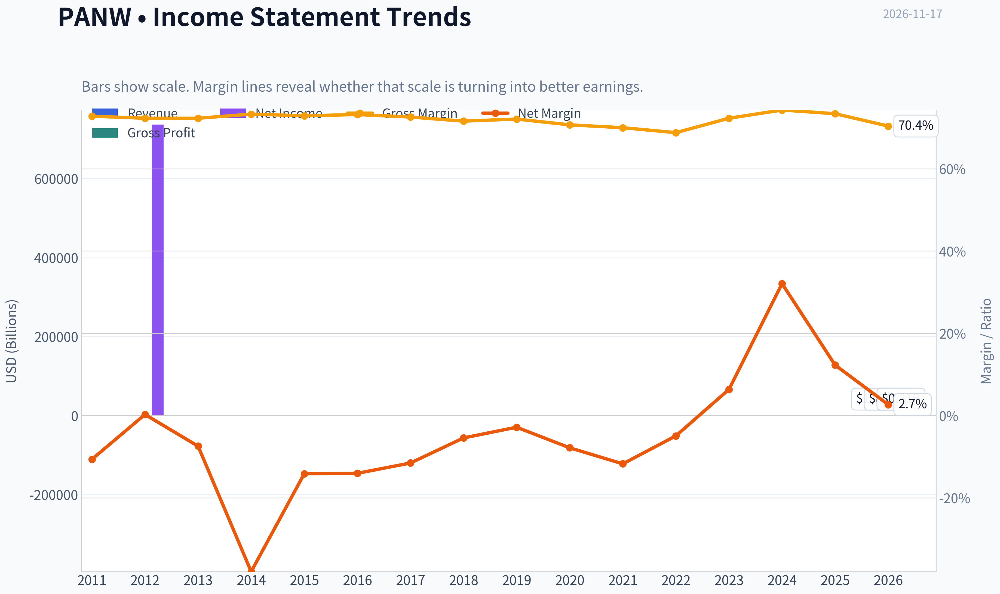

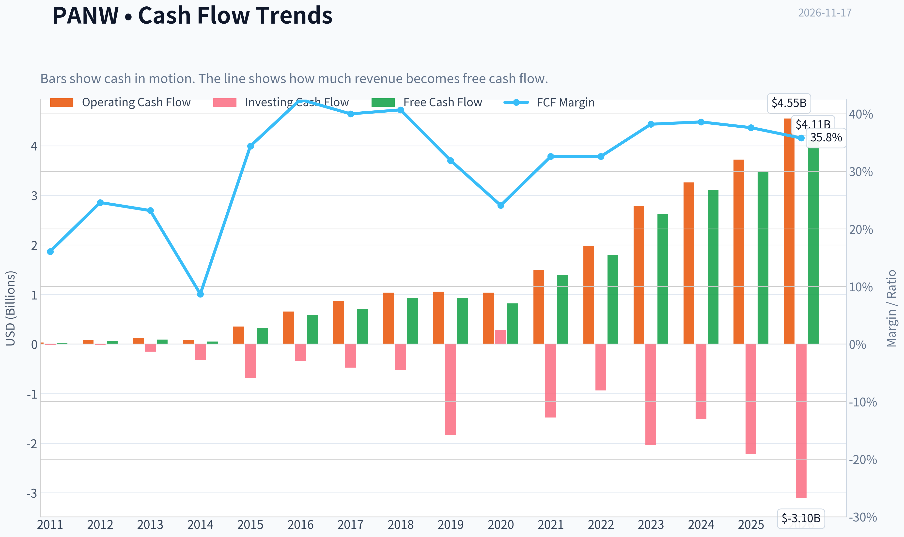

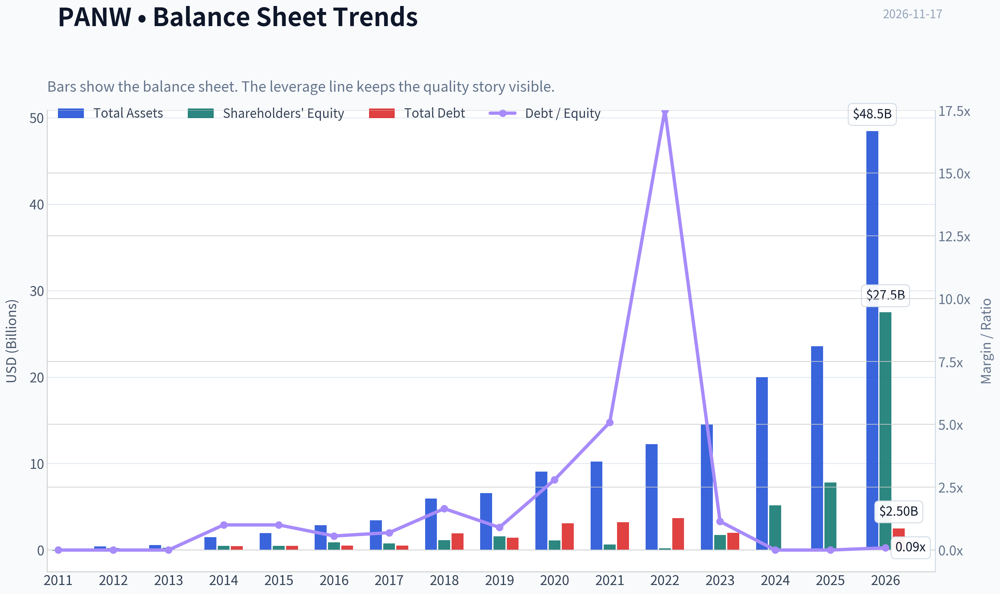

This graph tracks the profitability and return metrics (ROE, ROIC, Margins) of **PANW** over the past decade, highlighting capital efficiency trends.

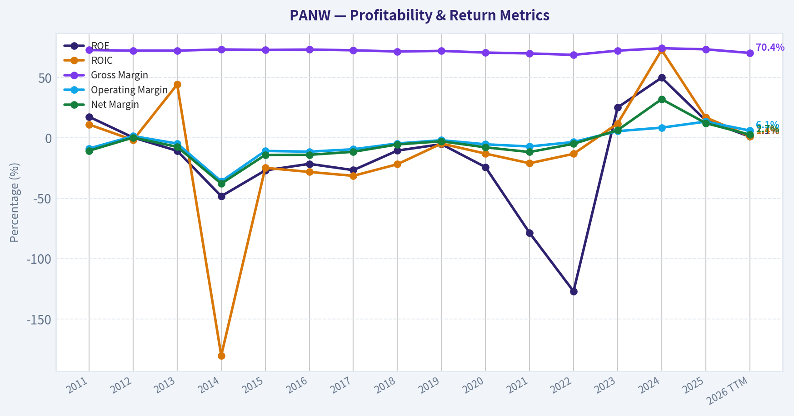

This chart illustrates the financial health of **PANW** over the last 10 years, mapping cash equivalents and free cash flow against total obligations (Debt).

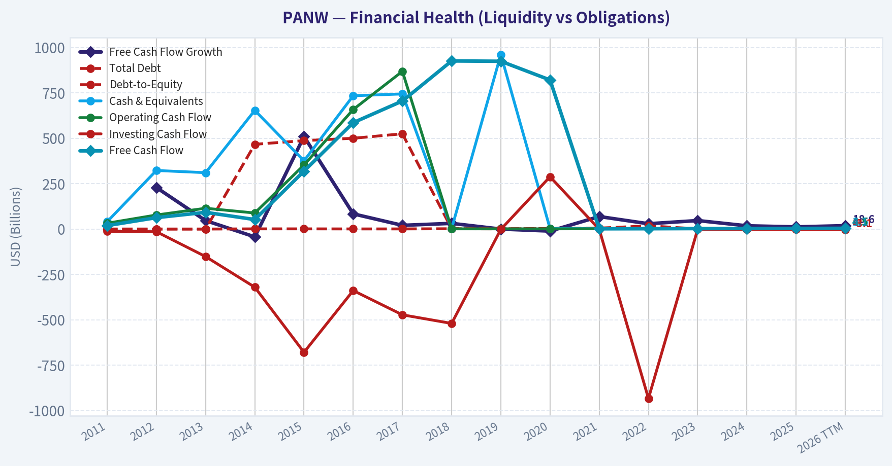

This comparison chart from *Profitability and Operating Performance* stacks current figures against historical benchmarks for **PANW**, making it easy to see where the company trades relative to its own averages.

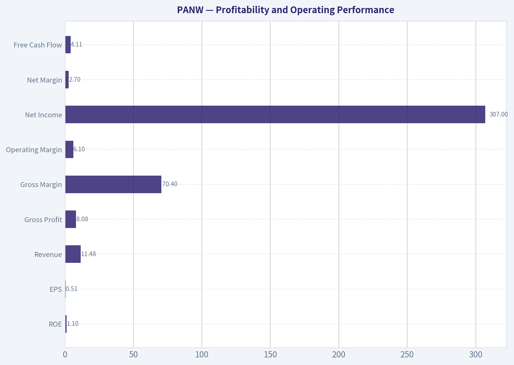

---

### Intrinsic Value Analysis (Buffett)

> *Following Warren Buffett's value investing philosophy: Circle of Competence, Economic Moat, Management Quality, and Margin of Safety.*

#### Intrinsic Value Snapshot

Price is what you pay. Intrinsic value is what the business may be worth based on the cash it can create for owners over time. We show a range, not one magic number.

- Current Price: $316.09
- Value Range (conservative to optimistic across both DCF methods): $6.31 to $312.06

##### Owner Earnings (Buffett Method)
- Net Income: $1,134,000,000.00
- Depreciation & Amortization: $855,000,000.00
- Capital Expenditures: $-440,000,000.00
- Working Capital Changes: $579,000,000.00
- Owner Earnings: $307,000,000.00

##### Intrinsic Value
###### Buffett Method
Uses owner earnings. Stricter, and usually more conservative.
- Conservative: $6.31
- Average: $6.31
- Optimistic: $16.42
- Discount Rate: 10.0%

###### Cash Flow Method
Uses free cash flow. Better for companies spending heavily today to grow tomorrow.
- Conservative: $86.74
- Average: $181.13
- Optimistic: $312.06
- Discount Rate: 10.0%

ANALYST STANCE: **Neutral**

#### Executive Conclusion

Palo Alto Networks has the characteristics of a potentially excellent long-term business: strong cybersecurity demand, high gross margins, recurring revenue, broadening platform capabilities, and meaningful customer switching costs. However, at $316 per share and a $258.8 billion market capitalization, the valuation leaves little room for execution mistakes.

The business is attractive; the stock is not yet sufficiently attractive. The hard solvency floor is **not tripped**, but the valuation requires sustained exceptional growth that is not adequately supported by current cash earnings.

#### 1. Factor Scorecard

| Factor | Score | Assessment |
|---|---:|---|
| Business simplicity and predictability | 4/5 | The company sells cybersecurity products and subscriptions, although its platform breadth and evolving product structure add complexity. Security demand is structurally durable. |
| Durable competitive advantage | 4/5 | Strong brand, installed base, customer switching costs, threat intelligence, distribution, and platform cross-selling support a wide but not unassailable moat. |
| Management and capital allocation | 3/5 | Nikesh Arora has pursued platform expansion and consolidation effectively, but the valuation and acquisition strategy require disciplined execution. Guru filings show recent trimming by Steve Cohen and Stanley Druckenmiller. |
| Industry structure | 4/5 | Cybersecurity is strategically important and growing, with substantial customer reluctance to switch providers. Competition remains intense, particularly from Microsoft and specialized vendors. |
| Gate 5: quality and solvency floor | **Not tripped** | There is no evidence provided of financial distress, interest coverage below 1x, or an imminent solvency problem. |

**Key Takeaways:** PANW scores well on business quality and industry attractiveness. The central weakness is not solvency or demand; it is the unusually demanding price relative to current earnings and cash flow.

#### 2. Financial Snapshot

| Metric | Latest figure |
|---|---:|
| Share price | $316 |
| Market capitalization | $258.81 billion |
| Revenue growth | 24.5% year over year |
| Gross margin | 70.4% |
| P/E ratio | 790.2x |
| ROE | 1.1% |
| FCF yield | 1.6% |
| Implied free cash flow | Approximately $4.14 billion |
| Current ratio | 0.87x |
| Headline intrinsic value | $6.31 per share |
| FCF-based valuation estimate | $181.13 per share |
| Damodaran FCFF estimate | Negative $43.93 per share |
| Reverse-DCF implied growth | Approximately 176.7% annually for 10 years |

**Key Takeaways:** Revenue growth and gross margin are excellent, but current reported profitability and returns on equity are weak relative to the valuation. A 1.6% FCF yield means investors are paying roughly 62 times current free cash flow, leaving the stock highly dependent on future growth and margin expansion.

#### 3. Moat Analysis

**Intangible assets and brand:** Palo Alto Networks is a recognized enterprise-security brand. Cybersecurity purchases involve trust, technical validation, and reputational risk, making brand credibility valuable. The 70.4% gross margin supports the presence of differentiated intellectual property and software economics.

**Switching costs:** Security infrastructure is deeply embedded in enterprise networks and workflows. Replacing a major security platform creates technical risk, implementation costs, employee retraining, and potential exposure during the transition. These switching costs are meaningful, although not absolute.

**Cost advantages:** Scale in threat intelligence, research, cloud infrastructure, sales coverage, and product development can lower unit costs and improve the economics of bundling multiple security products.

**Network effects:** PANW does not possess a pure social network effect, but it benefits from data and threat-intelligence feedback loops. A larger installed base can generate more security telemetry, improve detection, and support broader platform adoption.

**Moat rating:** **Wide and stable, with potential to widen - 4/5.**

The principal risks are Microsoft's distribution advantage, rapid technological change including artificial intelligence, customer consolidation of security vendors, and the possibility that platform bundling compresses pricing.

#### 4. Management Quality Assessment

Management has established a credible strategy of consolidating cybersecurity tools into a broader platform. That approach can improve retention, increase wallet share, and reduce the number of vendors customers must manage.

The main capital-allocation concern is valuation discipline. At the current market capitalization, acquisitions and stock-based compensation must create substantial per-share value rather than merely increase scale. Recent position reductions by Steve Cohen and Stanley Druckenmiller are not decisive evidence, but they do suggest that some sophisticated investors viewed the risk-reward as less attractive at recent prices.

**Management score: 3/5.**

#### 5. Owner Earnings Calculation

The standard Buffett formulation is:

> Owner earnings = net income + depreciation and amortization - maintenance capital expenditures - working-capital investment

A precise maintenance-capex calculation is not available in the supplied snapshot, so current free cash flow is used as the practical owner-earnings proxy.

| Owner-earnings component | Approximate amount |
|---|---:|
| Market capitalization | $258.81 billion |
| FCF yield | 1.6% |
| Implied current FCF / owner-earnings proxy | $4.14 billion |
| Approximate owner earnings per share | $5.06 |
| Price-to-owner-earnings proxy | Approximately 62x |

**Key Takeaways:** PANW generates substantial cash, but the cash yield on the purchase price is very low. For the investment to work at $316, owner earnings must compound rapidly for many years and ultimately support a much higher earnings base.

#### 6. Three-Scenario DCF Valuation

Using approximately $5.06 per share of current FCF as the owner-earnings proxy and a 10% discount rate:

| Scenario | Assumption | Estimated value per share |
|---|---|---:|
| A. No growth | Owner earnings divided by 10% | $50.60 |
| B. GDP-like growth | 3% perpetual growth | $74.50 |
| C. Historical-growth case | Requires a demonstrated owner-earnings growth history; revenue growth alone is not sufficient | Not reliably calculable |
| Cross-check: FCF-based model | Research-pack estimate | $181.13 |
| Cross-check: Damodaran FCFF model | Research-pack estimate | Negative $43.93 |

**Key Takeaways:** Even the more favorable FCF-based estimate of $181.13 is materially below the $316 share price. The large spread between valuation models indicates that the result is highly sensitive to assumptions about margins, stock compensation, reinvestment, and the conversion of accounting earnings into durable owner earnings.

#### 7. Margin of Safety Analysis

| Measure | Result |
|---|---:|
| Price versus $181.13 FCF estimate | Approximately 74% above estimated value |
| Price versus $74.50 GDP-growth DCF | Approximately 324% above estimated value |
| Headline intrinsic value | $6.31 |
| Headline margin of safety | Negative 4,906.3% |
| Reverse-DCF implication | Approximately 176.7% annual growth for 10 years |

**Key Takeaways:** PANW does not currently offer a conventional margin of safety. The reverse-DCF result is especially concerning: the market price appears to require growth far beyond the company's already strong 24.5% revenue growth rate, unless the underlying research-pack assumptions materially understate normalized future cash generation.

#### 8. Final Buffett Scorecard

| Criterion | Weight | Score | Weighted result |
|---|---:|---:|---:|
| Moat width and durability | 25% | 4/5 | 1.00 |
| Valuation and margin of safety | 20% | 1/5 | 0.20 |
| Capital returns versus WACC | 15% | 3/5 | 0.45 |
| Business understanding and predictability | 12% | 4/5 | 0.48 |
| Management quality and capital allocation | 12% | 3/5 | 0.36 |
| Reinvestment runway | 8% | 5/5 | 0.40 |
| Balance-sheet strength | 4% | 4/5 | 0.16 |
| Industry structure | 4% | 4/5 | 0.16 |
| **Total** | **100%** |  | **3.21/5** |

#### 9. Investment Stance

**Neutral - Moderate conviction.**

Palo Alto Networks is closer to a wonderful business than a mediocre one. Its moat, growth runway, and cybersecurity positioning merit continued attention. But at $316, the valuation overwhelms the qualitative strengths. I would want either a materially lower entry price, a much stronger demonstrated conversion of earnings into owner cash flow, or several years of per-share cash-flow growth before upgrading the stock to an advocate position.
#### Valuation Bridge

This bridge places the current market price beside each intrinsic value lens so readers can see whether upside depends on one method or shows up across several methods.

| Scenario | Intrinsic Value / Share |
| --- | ---: |
| Buffett Method | $6.31 |
| Cash Flow Method | $181.13 |
| Damodaran Method | $-43.93 |
| Current Price | $316.09 |

#### Key Takeaways

If one method is far above the others, the upside case depends on a specific modelling assumption. When several methods cluster together, the valuation story is more robust.

#### Valuation Visuals

This comparison chart from *Latest Earnings Snapshot* stacks current figures against historical benchmarks for **PANW**, making it easy to see where the company trades relative to its own averages.

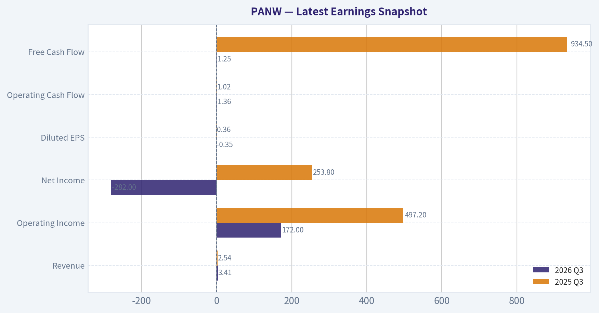

This comparison chart from *Balance Sheet and Financial Strength* stacks current figures against historical benchmarks for **PANW**, making it easy to see where the company trades relative to its own averages.

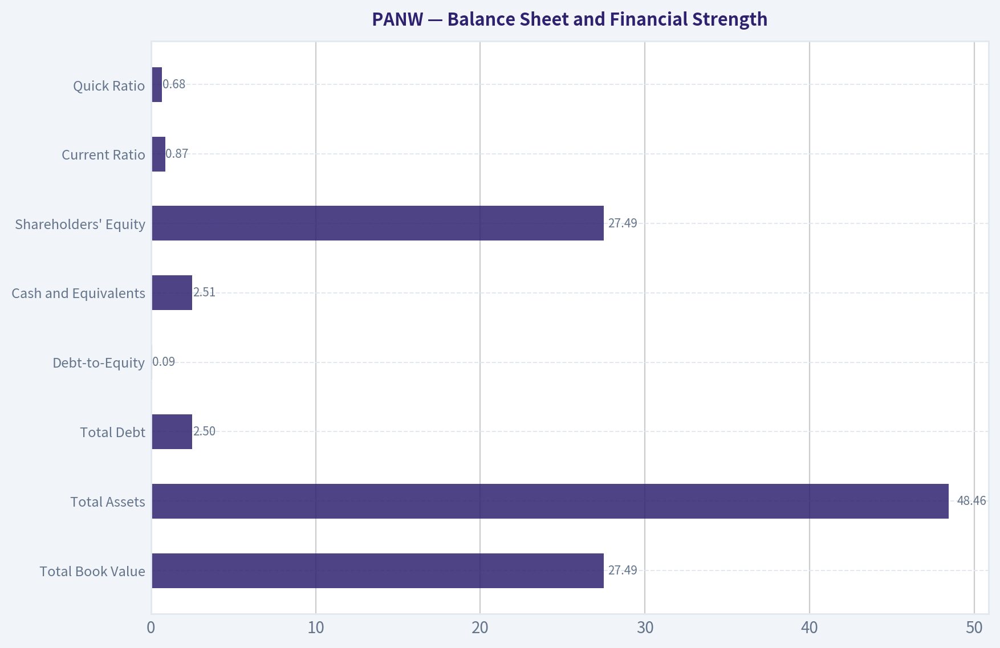

This comparison chart from *Buffett-Style Owner Earnings DCF* stacks current figures against historical benchmarks for **PANW**, making it easy to see where the company trades relative to its own averages.

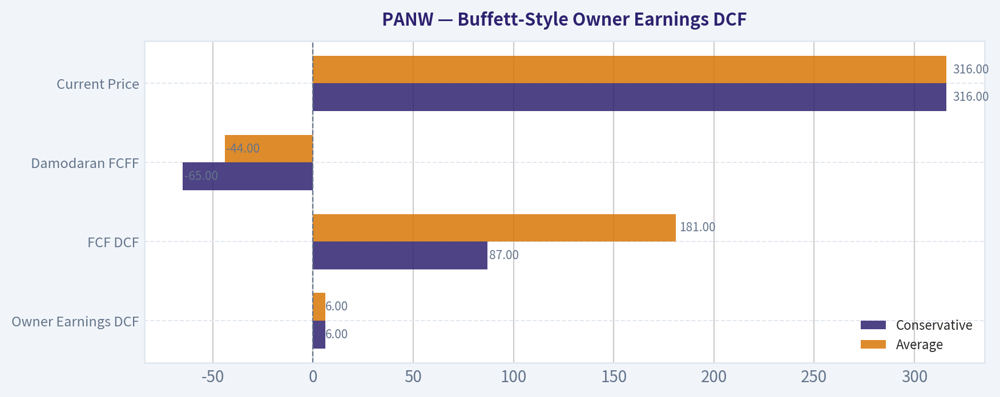

This comparison chart from *Financial Snapshot* stacks current figures against historical benchmarks for **PANW**, making it easy to see where the company trades relative to its own averages.

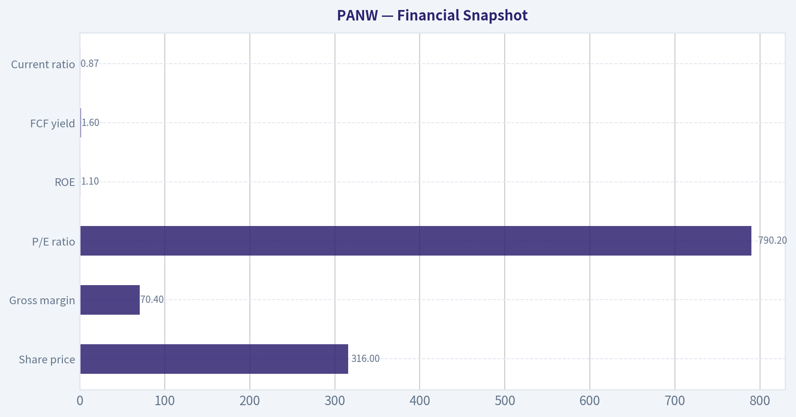

---

### Trend & Growth Analysis (Lynch/Druckenmiller/Fisher)

> *Following Peter Lynch's GARP, Stanley Druckenmiller's macro-aware approach, and Philip Fisher's scuttlebutt methodology.*

ANALYST STANCE: **Bearish**

#### 1. Lynch Classification

**Fast Grower, but currently an extremely expensive one.** PANW's 24.5% year-over-year revenue growth qualifies it as a fast grower, while its cybersecurity exposure gives it a durable secular runway. However, the valuation is disconnected from current earnings and cash-flow metrics, so it does not meet Lynch's "growth at a reasonable price" standard.

#### 2. The Story in Three Bullets

- **Cybersecurity consolidation:** Palo Alto Networks offers a broad platform across network security, cloud security, endpoint protection, and security operations.
- **Secular demand:** Increasing cyberattacks, cloud migration, AI adoption, and regulatory requirements should support long-term cybersecurity spending.
- **Platform opportunity:** Customers may consolidate multiple point products onto one vendor, potentially improving retention, cross-selling, and operating leverage.

The story is understandable and structurally attractive. The problem is that the market appears to be pricing in an exceptionally successful future already.

#### 3. TAM and Runway

| Measure | Assessment |
|---|---:|
| Secular market | Cybersecurity, cloud security, and security operations |
| Market growth outlook | Attractive; likely mid-to-high-teens in major categories |
| PANW revenue growth | 24.5% year over year |
| Current market capitalization | $258.81 billion |
| 10x revenue test | Cannot be fully calculated; current revenue and segment TAM were not provided |
| Runway judgment | Long runway, but substantial execution is already priced in |

**Key Takeaways:** PANW operates in a growing market with multiple expansion vectors, including cloud security, AI-related security, and platform consolidation. The runway is likely long enough to support continued growth, but the available data does not permit a precise 10x revenue test. At a $258.8 billion market capitalization, the company must execute exceptionally well to generate ten-bagger returns from today's level.

#### 4. Revenue Growth Trend

| Indicator | Result | Interpretation |
|---|---:|---|
| Latest year-over-year revenue growth | 24.5% | Fast-grower territory |
| Multi-year growth trend | Not available | Acceleration cannot be confirmed |
| Recent earnings coverage | No coverage found within 120 days | Verification gap |
| Organic versus acquisition growth | Not available | Revenue quality requires further diligence |
| Customer concentration | Not available | Risk cannot be fully assessed |

**Key Takeaways:** The latest reported growth rate is strong enough to classify PANW as a fast grower. However, one growth figure does not establish acceleration, and there is insufficient data to determine whether growth is speeding up or slowing down. This is a material limitation for a Druckenmiller-style inflection-point thesis.

#### 5. Unit Economics and Operating Quality

| Metric | Result | Assessment |
|---|---:|---|
| Gross margin | 70.4% | Strong software economics |
| Free-cash-flow yield | 1.6% | Low relative to valuation |
| FCF margin | Not provided | Rule of 40 cannot be calculated |
| Net revenue retention | Not provided | Expansion quality unverified |
| LTV/CAC | Not provided | Customer acquisition efficiency unverified |
| Current ratio | 0.87 | Below 1.0; balance-sheet liquidity deserves monitoring |
| ROE | 1.1% | Weak, partly reflecting valuation and accounting structure |

**Key Takeaways:** PANW's gross margin is consistent with an attractive software and platform model. Yet the low free-cash-flow yield and sub-1.0 current ratio provide important valuation and liquidity cautions. The missing NRR, CAC, LTV, and FCF-margin data prevents a complete assessment of customer economics and the Rule of 40.

#### 6. Inflection-Point Assessment

| Potential inflection | Evidence | Judgment |
|---|---|---|
| Product cycle | Platform consolidation and cloud-security expansion | Plausible, not verified |
| Market share | No recent share data supplied | Unconfirmed |
| Margin expansion | Gross margin is high, but operating-margin trend unavailable | Unconfirmed |
| TAM expansion | Cloud, AI, and security operations support expansion | Positive |
| Competitive inflection | No major competitor disruption established | Unconfirmed |
| Earnings revision potential | No recent earnings coverage available | Cannot confirm |

**Key Takeaways:** The strategic setup contains several possible inflection points, particularly platform consolidation and cloud-security growth. However, there is no verified evidence here of accelerating revenue, margin expansion, or positive earnings revisions. Without that confirmation, PANW is a compelling company story but not a confirmed inflection-point investment.

#### 7. Macro Setup

Cybersecurity spending is generally resilient because security is increasingly a required operating expense rather than discretionary software. Long-term secular trends remain favorable:

- Cloud migration increases the attack surface.
- AI adoption creates new security requirements.
- Regulatory and insurance standards are becoming more demanding.
- Enterprises increasingly prefer integrated platforms over numerous point solutions.

The principal macro risk is valuation sensitivity. High-duration growth stocks can suffer if interest rates remain elevated or if the market rotates toward cheaper value and cyclical companies. Druckenmiller-style positioning would also be cautious given that both tracked guru positions were recently trimmed:

| Guru | Latest action | Change |
|---|---|---:|
| Steve Cohen / Point72 | Trimmed | Shares down 7.1% |
| Stanley Druckenmiller / Duquesne | Trimmed | Shares down 74.3% |

**Key Takeaways:** The industry has a favorable secular macro backdrop, but high valuation makes PANW sensitive to rates and risk appetite. Recent trimming by both tracked managers is not definitive, but it is a cautionary signal rather than confirmation of a fresh accumulation phase.

#### 8. Fisher 15-Point Score

| Fisher criterion group | Score | Comment |
|---|---:|---|
| Market potential and long-range outlook | 5/5 | Large, growing cybersecurity markets |
| Product innovation and R&D | 4/5 | Broad platform and multiple product categories |
| Sales organization and customer adoption | 4/5 | Strong enterprise positioning, but current data is limited |
| Profit margins and margin trajectory | 3/5 | High gross margin; operating trend not supplied |
| Management depth and execution | 3/5 | Insufficient current evidence |
| Cost accounting and financial transparency | 3/5 | Data availability is incomplete |
| Competitive advantages | 4/5 | Platform breadth, switching costs, and scale |
| Dilution and balance-sheet discipline | 3/5 | Current ratio below 1; dilution details unavailable |
| Candor and integrity | 3/5 | Cannot independently assess from supplied data |
| **Total** | **32/50 provisional** | Equivalent to **48/75** if normalized |

**Key Takeaways:** PANW scores well on market opportunity, innovation potential, and competitive positioning. The provisional score is held down by missing data on management quality, retention, dilution, operating leverage, and financial transparency. This is an average-to-good Fisher profile, not yet an outstanding one based on the evidence available.

#### 9. Valuation Analysis

| Valuation measure | Result | Interpretation |
|---|---:|---|
| Share price | $316 | Current reference price |
| Market capitalization | $258.81 billion | Very large capitalization |
| P/E ratio | 790.2x | Extremely expensive |
| PEG ratio | Approximately 32.3x | Far above Lynch's acceptable range |
| FCF yield | 1.6% | Implies a very demanding valuation |
| Headline intrinsic value | $6.31 | Highly negative signal, though model-dependent |
| FCF-based intrinsic value | $181.13 | Below current price |
| Damodaran FCFF value | Negative $43.93 | Highlights model sensitivity |
| Reverse DCF implication | Approximately 176.7% annual growth for 10 years | Impossibly demanding under the stated assumptions |

**Key Takeaways:** PANW fails every conventional valuation test supplied. Even using the least severe intrinsic-value estimate of $181.13, the shares remain materially above estimated value. The reverse DCF suggests the current price requires extraordinary long-term performance, making valuation risk the dominant investment issue.

#### 10. Growth Investor Scorecard

| Criterion | Weight | Score | Weighted result |
|---|---:|---:|---:|
| Lynch story | 10% | 4.2/5 | 0.42 |
| TAM and runway | 20% | 4.2/5 | 0.84 |
| Revenue growth | 20% | 3.8/5 | 0.76 |
| Unit economics | 15% | 2.8/5 | 0.42 |
| Competitive position | 10% | 4.2/5 | 0.42 |
| Management quality | 10% | 3.0/5 | 0.30 |
| Macro setup | 5% | 3.8/5 | 0.19 |
| Profitability path | 5% | 3.2/5 | 0.16 |
| Valuation | 5% | 0.5/5 | 0.03 |
| **Total** | **100%** |  | **3.54/5** |

**Key Takeaways:** PANW scores well as a business but poorly as a stock at the supplied price. The growth, TAM, and competitive-position scores are strong, while valuation overwhelms the otherwise attractive setup. The mechanical score falls near the lower end of "Advocate-good setup," but the extreme valuation and incomplete operating data justify an **Avoid** stance rather than initiating a position.

#### 11. Position Size Stance

**Current position stance: 0% new capital; avoid initiating at $316.**

For an existing holder:

- **Long-term core holder:** Hold only if the original thesis remains intact and the position is not oversized.
- **New investor:** Wait for a meaningful valuation reset or clear evidence of accelerating growth and cash-flow expansion.
- **Speculative allocation:** Maximum 1% only for investors with high risk tolerance and a multi-year horizon; this is not supported by the current valuation data.

#### 12. Key Risks and Catalysts

| Catalysts | Risks |
|---|---|
| Accelerating cloud-security growth | Extreme P/E and low FCF yield |
| Successful platform consolidation | Growth deceleration |
| Rising net retention and cross-selling | Stronger competition from Microsoft, CrowdStrike, Cisco, and others |
| Operating-margin expansion | Enterprise budget pressure |
| Positive earnings revisions | Higher-for-longer interest rates |
| Demonstrated Rule of 40 performance | Current ratio below 1 and potential dilution |

**Key Takeaways:** The main catalysts are accelerating revenue, improving retention, successful cross-selling, and operating leverage. The main risk is not whether PANW is a good cybersecurity company; it is whether the company can exceed the unusually high expectations embedded in its price. Until growth acceleration or a substantial valuation reset appears, the risk-reward profile is unfavorable.

#### Growth & Scorecard Visuals

This comparison chart from *Growth Metrics* stacks current figures against historical benchmarks for **PANW**, making it easy to see where the company trades relative to its own averages.

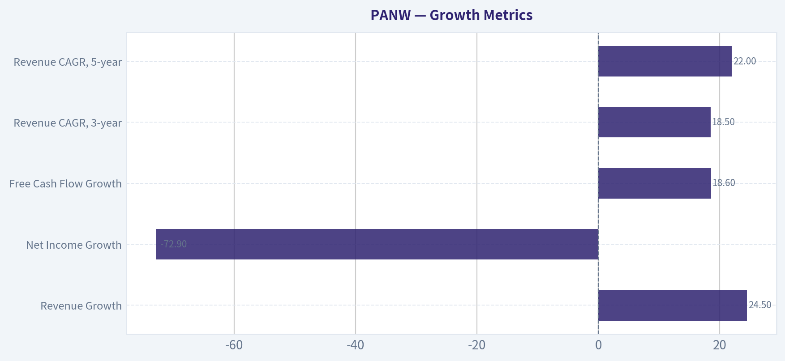

---

### Market Technical Analysis

ANALYST STANCE: **Neutral**

#### PANW technical analysis

Palo Alto Networks closed at **$316.09 on November 16, 2026**, after a sharp autumn pullback. The stock remains structurally stronger than it was a year ago, but its near-term trend has weakened materially. The most important distinction is between the still-constructive long-term trend and the clearly bearish short-term momentum profile.

The indicator-report tool returned incomplete values for this date, apparently because November 17 was not a completed trading session and the underlying indicator output was unavailable. The observations below therefore combine the retrieved OHLCV data through November 16 with approximate indicator relationships inferred from that price history. They should be treated as analytical guidance rather than exact real-time indicator readings.

#### Price trend and moving-average structure

PANW advanced from approximately **$202.90 in November 2025 to a high near $432.33 in October 2026**, representing a very large long-term advance. However, the stock has since undergone a substantial correction:

- The October 6 high near **$432.33** has been followed by a decline to **$316.09**, a drawdown of roughly **27%**.
- The stock broke below the October consolidation area around **$390-$400** and then continued lower through the **$350-$365** region.
- A short-lived rebound from the November 5-6 area near **$314** failed to regain the $340-$350 zone decisively.
- Recent closes have formed a pattern of lower highs, with rallies toward approximately **$330-$335** being sold.

The 10-day EMA is likely above the latest close, approximately in the **$325-$330** area. This places the current price below its short-term trend measure and indicates that immediate momentum remains weak. A recovery above that zone would be the first sign that selling pressure is easing, but it would not by itself establish a durable reversal.

The 50-day SMA is likely considerably higher, approximately in the **mid-$360s to low-$370s**. PANW is therefore trading well below its medium-term average. This gap confirms that the recent move is more than a minor pullback. The 50-day SMA may act as substantial overhead resistance if the stock rebounds.

The 200-day SMA should remain materially below the current price, likely in the **upper-$270s to low-$290s**, given the strong advance through the middle of 2026. This means the long-term trend has not yet been decisively broken. Nevertheless, the distance between price and the 200-day average has narrowed considerably during the correction, and a continued decline toward that long-term trend line would represent a further deterioration in the technical picture.

#### Momentum and MACD interpretation

The MACD profile is likely bearish. The October decline and November weakness suggest that the MACD line has fallen below its signal line, with the histogram likely negative. More importantly, momentum has deteriorated after the stock failed to sustain its October rebound attempts.

The most recent price action does not yet show a convincing bullish momentum reversal. A bullish MACD crossover would be more meaningful if it occurred alongside:

1. A close back above the short-term EMA.
2. A higher low above the November 5-6 trough.
3. Expanding volume on advances rather than on down days.
4. A move back above approximately $340-$350.

Until those conditions appear, a MACD improvement could represent only a countertrend bounce inside a broader correction.

#### RSI and momentum exhaustion

Recent price behavior suggests that RSI is probably in the **mid-30s to low-40s**, rather than deeply oversold. PANW experienced several heavy down sessions, but the November rebound prevented the oscillator from remaining at an extreme oversold level.

This distinction is important. RSI near or below 30 can support a short-term reflex rally, but an RSI in the mid-30s indicates weak momentum without necessarily implying that the stock has reached a durable bottom. In a sustained downtrend, RSI can remain below 50 for an extended period and repeatedly fail near the 50-60 zone.

A bullish divergence would require PANW to make a new price low while RSI makes a higher low. That signal is not established from the available closing-price sequence. Traders should therefore avoid interpreting a merely low RSI as proof that the correction is finished.

#### Volatility and risk management

PANW's daily ranges have remained unusually wide. Several recent sessions posted intraday ranges of roughly **$15-$27**, and the November 5 decline was accompanied by a significant increase in trading volume. The stock's ATR is therefore likely elevated, probably around the **mid-to-high teens in dollar terms**, although the exact tool output was unavailable.

High volatility has two implications:

- Position sizing should be smaller than usual because normal daily fluctuations can trigger tight stops.
- Stop-loss levels should be based on the stock's volatility and nearby swing structure rather than placed arbitrarily close to the entry price.

The November low around **$312-$314** is the most important nearby downside reference. A decisive close below that area would signal that the attempted base has failed and could expose the stock to another leg lower. Conversely, sustained closes above **$330-$335** would improve the short-term setup, while a reclaim of **$350-$365** would be required to repair the medium-term trend more convincingly.

#### Volume and VWMA

The price decline in early November was accompanied by elevated volume, particularly on November 5. This suggests that institutional or large-player activity increased during the selloff rather than the decline occurring solely on low-liquidity trading.

The recent volume-weighted average price is likely above the current close, probably around the **mid-$330s or higher**, because the higher-priced October and early-November sessions carried meaningful volume. PANW trading below its VWMA indicates that recent shareholders are, on average, under water and may use rebounds to reduce exposure.

For a stronger bullish signal, price should reclaim the VWMA while volume expands. A rebound on declining volume would be less convincing and could simply represent short covering or temporary oversold buying.

#### Trading interpretation

The evidence is mixed across time horizons, but the details favor caution:

- **Long-term:** Still constructive while price remains above the estimated 200-day SMA.
- **Medium-term:** Bearish, with price below the 50-day SMA and a clear correction from the October peak.
- **Short-term:** Bearish to unstable, with price below the short-term EMA and recent rebounds failing near resistance.
- **Momentum:** Weak; a bullish reversal has not yet been confirmed.
- **Risk:** Elevated because of wide daily ranges and high recent volatility.

Aggressive traders may monitor the **$312-$314** region for a potential stabilization pattern, but buying before confirmation carries meaningful downside risk. A more conservative approach would wait for a close above **$330-$335**, followed by a reclaim of **$350-$365** with improving volume and momentum. A close below **$312** would weaken the bottoming thesis and favor reducing long exposure or waiting for a lower-risk setup.

#### Selected indicators

The most relevant complementary indicators for PANW are:

- **close_10_ema:** Captures the immediate short-term trend and identifies whether rebounds are regaining momentum.
- **close_50_sma:** Defines medium-term trend resistance and helps distinguish a routine bounce from a meaningful recovery.
- **close_200_sma:** Provides the strategic long-term trend filter.
- **macd:** Measures whether the broader momentum cycle is turning upward or downward.
- **rsi:** Assesses whether the selloff is becoming stretched and helps identify possible divergences.
- **atr:** Essential for position sizing and stop placement because PANW's current volatility is high.
- **vwma:** Adds volume confirmation and helps identify whether recent trading activity supports or rejects the current price level.

The MACD signal line and histogram were not selected separately because they are components of the same MACD framework and would add redundancy in an already volatile setup.

| Area | Current assessment | Important levels or signals | Trading implication |
|---|---|---|---|
| Latest close | $316.09 on November 16 | Near the November low zone | Price remains vulnerable until support holds |
| Short-term trend | Bearish | Estimated 10-day EMA near $325-$330 | Reclaiming this area would be an initial improvement |
| Medium-term trend | Bearish | Estimated 50-day SMA in the mid-$360s to low-$370s | Major overhead resistance remains above the market |
| Long-term trend | Still constructive but weakening | Estimated 200-day SMA in the upper-$270s to low-$290s | Long-term uptrend is not yet decisively broken |
| Momentum | Weak and likely bearish | MACD likely below signal; RSI probably mid-30s to low-40s | Oversold conditions are possible, but reversal is unconfirmed |
| Volatility | Elevated | Estimated ATR in the mid-to-high teens | Use smaller positions and volatility-adjusted stops |
| Volume trend | Selling activity intensified during the November decline | High volume on November 5 and other volatile sessions | Rebounds should be confirmed by expanding upside volume |
| Key support | $312-$314 | A decisive close below this area is negative | Could signal another downward leg |
| Initial resistance | $325-$335 | Short-term EMA and recent rebound highs | First hurdle for a stabilization attempt |
| Major resistance | $350-$365 | Prior breakdown zone and likely 50-day-average area | Reclaim needed to improve the medium-term structure |
| Overall stance | Watch | Wait for support confirmation or a reclaim of resistance | Avoid treating low RSI alone as a buy signal |

Key Takeaways: PANW remains above its likely long-term trend average but is in a pronounced medium- and short-term correction. The $312-$314 area is the critical nearby support zone, while $330-$335 and then $350-$365 are the main recovery hurdles. The preferred stance is to watch for confirmation rather than assume that the recent decline has already produced a durable bottom.

---

### Options Market Analysis

> *Reading options flow - put/call ratios, IV skew, and unusual activity - to gauge institutional positioning and event-driven risk.*

#### PANW Options Market Report

**As of November 17, 2026.** The available chain covers the November 20, November 27, and December 4 expirations. The dataset does not provide PANW's current share price, individual strikes, or a detailed OTM volatility surface, limiting strike-level and skew analysis.

#### Put/Call Ratio Analysis

| Expiration | Days to Expiry | Call OI | Put OI | Put/Call OI | Call Volume | Put Volume | Put/Call Volume |
|---|---:|---:|---:|---:|---:|---:|---:|
| Nov. 20, 2026 | 3 | 131 | 18 | 0.14 | 7,567 | 8,523 | 1.13 |
| Nov. 27, 2026 | 10 | 0 | 0 | N/A | 9,665 | 1,099 | 0.11 |
| Dec. 4, 2026 | 17 | 0 | 0 | N/A | 324 | 612 | 1.89 |
| **Total** | - | **131** | **18** | **0.14** | **17,556** | **10,234** | **0.58** |

The aggregate put/call OI ratio of **0.14** is substantially below the approximate neutral baseline of **0.70**, indicating very limited put open interest relative to calls. Aggregate volume also favors calls, with a **0.58 put/call volume ratio**, although the nearest expiration shows slightly more put than call volume. The signal is directionally bullish, but confidence is reduced because total open interest is extremely small and the OI ratio is therefore vulnerable to distortions from a few positions.

**Key Takeaways:** PANW's near-term positioning is call-dominant, especially when measured by open interest. The November 20 expiration has some short-dated put activity, but the broader volume profile favors calls. Because open interest is only 149 contracts in total, this should be treated as a low-confidence bullish indication rather than a strong institutional signal.

#### Implied Volatility Assessment

| Expiration | Call ATM IV | Put ATM IV | ATM IV Read |
|---|---:|---:|---|
| Nov. 20, 2026 | 3.0% | 2.9% | Very low |
| Nov. 27, 2026 | 1.8% | 1.8% | Very low |
| Dec. 4, 2026 | 1.3% | 0.8% | Very low; calls modestly higher |

Near-term ATM implied volatility is reported at **3.0% for calls and 2.9% for puts** in the November 20 expiration, declining to **1.8%** for both sides in November 27 and lower still in December 4. These readings appear unusually low for a single-stock options market and may reflect data scaling, quote-quality, or limited-liquidity issues.

A complete OTM IV skew cannot be calculated because the supplied data includes only ATM IV, not OTM put and call volatility by strike. Within the available ATM data, there is no meaningful near-term downside volatility premium: calls and puts are nearly identical, while the December 4 reading shows calls above puts. No known catalyst, such as earnings or a product event, was supplied, so catalyst-related IV elevation cannot be confirmed.

**Key Takeaways:** Reported IV is extremely low and does not indicate substantial near-term event fear. The available ATM figures show little put skew and a slight call-side bias in the December 4 expiration. However, the unusually low levels should be interpreted cautiously because the chain appears thin or potentially affected by data-quality limitations.

#### Unusual Options Activity

The data provider identified **no contracts with volume greater than five times open interest**. Therefore, there are no qualifying contracts to classify as fresh directional bets, and no strike-level inference can be made regarding institutional call buying, put hedging, or retail speculation.

| Metric | Observation |
|---|---|
| Contracts meeting volume > 5x OI | None |
| Fresh directional contract identified | None |
| Smart-money versus retail distinction | Not determinable |
| Largest raw volume | Nov. 27 calls, 9,665 contracts |

Although November 27 calls show the largest raw volume at **9,665 contracts**, the reported open interest is zero for that expiration. This may represent newly opened positions, closing activity, spread legs, or a reporting inconsistency. Without individual strike data, trade direction, or bid/ask execution details, it should not automatically be treated as bullish institutional buying.

**Key Takeaways:** There is no confirmed unusual-options signal under the provider's volume-to-open-interest test. The large November 27 call volume is notable, but zero reported open interest makes its interpretation uncertain. The evidence supports a bullish lean, not a high-conviction smart-money conclusion.

#### Open Interest Concentration and Gamma Levels

| Expiration | Highest Reported Call OI | Highest Reported Put OI | Gamma/Pinning Assessment |
|---|---:|---:|---|
| Nov. 20 | Strike-level data unavailable | Strike-level data unavailable | Cannot determine |
| Nov. 27 | No OI reported | No OI reported | No measurable concentration |
| Dec. 4 | No OI reported | No OI reported | No measurable concentration |

Only aggregate open interest is available: **131 calls and 18 puts**, all reported in the November 20 expiration. Individual strikes were not supplied, so the key price levels, maximum-pain estimate, gamma walls, and potential pinning zones cannot be identified.

The very small aggregate OI suggests limited mechanical influence from options positioning. Any near-term price movement is more likely to be driven by the underlying stock, broader cybersecurity-sector flows, or new options activity rather than established gamma concentration.

**Key Takeaways:** The dataset does not reveal specific strike-based support, resistance, or gamma walls. Existing open interest is concentrated in the nearest expiry but is too small, and lacks strike detail, to establish a reliable pinning level. Confidence in any max-pain or gamma-based forecast is therefore low.

#### Overall Options Sentiment Signal: **BULLISH, LOW CONFIDENCE**

The primary bullish drivers are:

- Aggregate put/call OI ratio of **0.14**, well below the approximately **0.70 neutral baseline**.
- Aggregate put/call volume ratio of **0.58**, indicating more call activity than put activity across the measured expirations.
- Near-parity ATM call and put IV, with no evident downside volatility premium.

The main caveats are substantial. Total open interest is extremely limited, no qualifying unusual contracts were identified, individual strikes and current share price were not provided, and the reported IV levels appear unusually low. The November 27 call volume is potentially bullish but cannot be reliably classified without execution-side and strike-level information.

#### Summary

| Category | Assessment |
|---|---|
| Put/Call Ratio | Bullish: 0.14 OI ratio and 0.58 volume ratio, but based on thin OI |
| IV Level | Very low reported near-term IV; possible liquidity or scaling issue |
| Skew Direction | Neutral to mildly call-favored; full OTM skew unavailable |
| Unusual Activity | No contracts exceeded 5x open interest; no confirmed unusual flow |
| Overall Signal | **BULLISH, LOW CONFIDENCE** |

**Key Takeaways:** PANW's options data leans bullish because calls materially outweigh puts in aggregate open interest and volume. The signal is weakened by very low open interest, absent strike-level details, no confirmed unusual activity, and questionable-looking IV levels. The appropriate interpretation is a tentative bullish options bias, not a strong institutional conviction signal.

---

## Research Team Commentary

> *The Research Manager synthesizes the Bull vs Bear debate into action-free commentary. This is a pre-risk view, not the final stance.*

Core takeaway: Palo Alto Networks appears to be a strong cybersecurity franchise, but at the stated $316 price the stock requires too much of the favorable future to arrive on schedule. Platform consolidation, mission-critical demand, high switching costs, and a roughly 70% gross margin support the case for a durable moat. Nevertheless, the supplied reverse DCF indicates that even the "base" valuation requires approximately 18% free-cash-flow growth for a decade, substantial operating leverage, and restrained dilution. That is an excellent outcome, not a conservative base case. I would avoid initiating or adding to a value-oriented position at the stated valuation.

The strongest bull argument is that Palo Alto is evolving from a collection of security products into a strategic enterprise platform. Customers benefit from fewer vendors, integrated threat intelligence, and unified security workflows. Once embedded, the operational risk and complexity of changing providers create meaningful switching costs. Cybersecurity also has a credible ten-year runway as cloud adoption, AI, regulation, and the cost of breaches increase security requirements. Current GAAP profitability may understate the franchise's earning power because the company is investing heavily and acquisition amortization can obscure software economics.

The strongest bear argument is not the headline P/E by itself. It is the mismatch between the price and the amount of demonstrated per-share earning power. A P/E near 790, ROIC of 1.6%, and ROE of 1.1% may be distorted measures for an acquisitive, asset-light software company, but they still show that today's reported economics do not support the valuation. The buyer must assume that current spending is creating high future returns rather than merely defending the company's position in an intensely competitive market. That distinction has not yet been established with the information supplied.

The bull's illustrative DCF actually reinforces the bear case. A starting normalized free cash flow of roughly $5.5 billion followed by 18% annual growth for ten years is described as producing only approximately the current valuation. At 18%, free cash flow would grow more than fivefold over that period. Paying close to full intrinsic value based on that path leaves little protection if growth moderates, platform contracts require heavy discounts, margins expand more slowly, or stock compensation continues to dilute shareholders. Palo Alto may achieve such results, but a Buffett-style margin of safety should not depend on nearly everything going right.

The platform thesis is credible but should not be treated as proven economics. Consolidation can increase retention and share of wallet, but it can also bring bundled pricing, transition incentives, and stronger competition from other platforms. More products do not automatically mean more pricing power. The evidence needed is improving free cash flow per diluted share, declining stock compensation as a percentage of revenue, better incremental returns on capital, and durable growth without continually increasing acquisition or sales intensity.

There is also an important data-quality limitation. The stated $316 share price and $258.8 billion market capitalization should be reconciled against the current diluted share count and any stock-split or acquisition effects before relying on the valuation. The DCF is explicitly illustrative and lacks a complete free-cash-flow bridge. That means its precise conclusion should not be overstated. Still, even accepting the supplied figures, the assumptions required are aggressive enough that the absence of precision does not create a positive case.

The 27% decline from the cited high is not, by itself, evidence of undervaluation. The stock can fall materially while remaining expensive if the prior price reflected excessive expectations. Meanwhile, the unusually low put/call open-interest ratio suggests that optimism has not disappeared. Options positioning is not a valuation tool, but it provides little support for the idea that indiscriminate fear has created a contrarian bargain. Technical weakness and bullish options sentiment are secondary; neither changes intrinsic value.

From a management perspective, the decisive question is whether growth translates into intrinsic value per diluted share. Acquisitions, platform investments, and employee equity awards are justified only if they produce returns comfortably above the cost of capital. Aggregate adjusted free cash flow is insufficient if stock issuance transfers much of the value to employees or acquisition consideration expands the denominator. Repurchases should be evaluated after dilution and at the prices paid, not simply credited as shareholder-friendly activity.

My monitoring plan over the next one to four quarters would focus first on revenue growth, remaining performance obligations, and the company's preferred next-generation security recurring-revenue measure. Platformization should show up in larger multi-product commitments, durable renewals, and rising revenue per customer without excessive discounts or unusually generous contract terms.

Second, I would track GAAP operating-margin progression and free cash flow per diluted share, not merely adjusted operating income or total free cash flow. Free cash flow should also be normalized for working-capital timing. A strengthening thesis would show sustained growth in per-share cash generation, improving incremental margins, and cash flow growth that is not primarily funded by rising deferred obligations.

Third, stock-based compensation, diluted share count, and repurchases need close attention. The thesis strengthens if stock compensation falls as a percentage of revenue and the fully diluted share count stabilizes or declines without economically unattractive buybacks. It weakens if reported cash-flow growth remains strong while per-share growth materially lags.

Fourth, I would monitor acquisition spending and evidence of incremental returns. Management should demonstrate that acquired products increase retention, cross-selling, and margins rather than merely replacing organic growth. Persistent low ROIC alongside continued acquisitions would suggest that the platform is expensive to assemble and maintain.

Finally, I would update the reverse DCF each quarter using verified diluted shares, net cash or debt, normalized free cash flow after dilution, and a discount rate consistent with current market conditions. For a business of this potential quality, a 10%-15% discount to a genuinely conservative intrinsic-value estimate could be enough. The present analysis does not demonstrate that discount. A lower quotation could help, but stronger and more transparent per-share economics would be the better reason to reconsider.

The key lesson from similar situations is to distinguish an attractive market, an attractive company, and an attractive security. Palo Alto likely satisfies the first and may satisfy the second. The evidence does not yet satisfy the third. Avoiding the shares here is not a prediction that the business will fail or an invitation to short it; it is a refusal to pay in advance for a near-bull-case outcome.

Final stance: Bearish.

---

## Value Investing Team Commentary

> *The Investor translates the research view into an investment thesis before risk review. This is still not the final stance.*

Palo Alto Networks appears to be a potentially excellent business, but the supplied valuation does not provide a sufficient margin of safety. The distinction matters: this is primarily an **avoid-the-security** decision, not a judgment that the underlying franchise is poor.

### Business quality

The long-term industry backdrop is favorable. Cybersecurity is mission-critical, security budgets are increasingly tied to regulatory and operational requirements, and cloud migration and AI adoption expand the attack surface. These characteristics support durable demand that is less discretionary than many technology expenditures.

Palo Alto's broadening platform is the central investment thesis. If customers can consolidate network security, cloud security, endpoint protection, and security operations with one strategic provider, the company may achieve:

- Higher customer retention and switching costs
- Greater revenue per customer
- Better sales efficiency over time
- More integrated threat intelligence and workflow benefits
- Operating leverage as the platform scales

This is a credible moat-building strategy. However, a broad product portfolio is not automatically a durable moat. Platform consolidation can also bring price concessions, bundled discounts, aggressive competition, and higher implementation costs. The critical question is whether platform expansion produces **higher free cash flow per diluted share**, not merely higher reported revenue or adjusted earnings.

### Profitability and capital allocation

The reported P/E, ROE, ROIC, and ROA are likely distorted by Palo Alto's growth investments, acquisitions, amortization, and stock-based compensation. Therefore, they should not be interpreted as a complete picture of the company's economics.

Still, they cannot be dismissed entirely. A P/E near 790 and very low reported returns indicate that the market value is substantially ahead of currently demonstrated accounting earning power. The buyer is underwriting a major improvement in future margins and cash generation.

Free cash flow is the more useful metric for this type of business, but even free cash flow requires adjustment. Stock compensation is a real economic cost when it increases the diluted share count. Acquisition spending also matters when management must continually purchase growth or capabilities. The relevant measure is therefore:

> Free cash flow after considering dilution, acquisition requirements, and the eventual reinvestment needed to defend the franchise.

Management deserves credit if it successfully turns platform investments into durable per-share compounding. But that outcome still needs to be demonstrated through improving incremental returns, stabilizing dilution, and stronger GAAP profitability.

### Valuation: the central problem

The supplied reverse DCF is the most important evidence. If a roughly $5.5 billion starting free-cash-flow base must grow at approximately 18% annually for a decade merely to justify the current market capitalization, the stock is priced for an excellent outcome rather than a conservative one.

An 18% annual growth rate for ten years implies more than a fivefold increase in free cash flow. That could happen, particularly in a large and expanding cybersecurity market, but it requires several favorable developments to occur simultaneously:

- Sustained high organic growth
- Successful cross-selling across the platform
- Meaningful operating-margin expansion
- Limited price pressure from bundled offerings
- Controlled acquisition spending
- Declining or at least stabilized dilution
- No major deterioration in competitive dynamics

A high-quality compounder can deserve a smaller discount to intrinsic value. But quality does not eliminate valuation risk. At this price, even a strong business may produce mediocre shareholder returns if future performance is merely very good rather than exceptional.

The stated market capitalization and share price should also be reconciled with the current diluted share count, stock-split history, acquisition effects, net cash, and the precise free-cash-flow definition. That data-quality issue prevents excessive confidence in the exact DCF output. It does not, however, reverse the broad conclusion: the valuation appears demanding even under favorable assumptions.

### Selective contrarian interpretation

The 27% decline from the cited high should not be treated as proof of opportunity. A stock can fall substantially from an overly optimistic price and remain expensive. The relevant comparison is not the prior quotation; it is conservative intrinsic value.

There is, however, a contrarian bullish point worth recognizing. Market participants may be focusing too heavily on current GAAP profitability and overlooking the possibility that Palo Alto is becoming a more valuable strategic platform. If the company can materially improve customer lifetime value, cross-sell multiple products, and convert growth into per-share cash earnings, current accounting metrics may understate its eventual economics.

But this is a **potential opportunity**, not yet a valuation-backed opportunity. Contrarian investing is useful when the market is mispricing a temporary problem. Here, the market may instead be correctly recognizing an outstanding business while assigning it an unusually ambitious future. The low put/call ratios and lack of a meaningful downside volatility premium also suggest that sentiment has not reached the kind of indiscriminate pessimism that often creates a compelling contrarian entry point.

The technical breakdown is secondary, but it reinforces the need not to confuse a lower price with a lower valuation. If the shares recover without corresponding improvement in per-share economics, the margin of safety would become even weaker.

### What would change the conclusion?

The thesis would become more attractive if future results showed:

1. Sustained growth in free cash flow per diluted share, not merely total free cash flow
2. Falling stock-based compensation as a percentage of revenue
3. A stable or declining diluted share count
4. Stronger GAAP operating margins and incremental returns on capital
5. Successful multi-product adoption without excessive discounting
6. Organic growth that remains healthy without dependence on acquisitions
7. A share price that reflects a conservative valuation rather than a near-bull-case outcome

A lower price would help, but operational evidence is more important than price alone. If the business compounds per-share intrinsic value at a high rate, a 10%-15% discount to conservative intrinsic value could be sufficient for a high-quality franchise. The current evidence does not establish that discount.

Accordingly, I would not initiate a position at the stated price and would not add simply because the shares have declined. Existing holders with a long time horizon may reasonably continue monitoring the business rather than selling solely because of short-term weakness, provided their position size is appropriate. Prospective investors should wait for either a materially better valuation or clearer proof that platformization is producing superior per-share economics.

**ANALYST STANCE: Bearish** - Palo Alto Networks may be a high-quality cybersecurity compounder, but the stated valuation appears to discount a near-bull-case growth and margin outcome. The business belongs on a serious watchlist; the shares do not yet offer an adequate quality-scaled margin of safety.

---

## Deep Values Commentary

> *The Risk Management Team debates and the Risk Judge provides the final action-free verdict. This section determines the final Bullish / Neutral / Bearish stance.*

#### Final Stance Scorecard

This scorecard converts the final research view into a weighted decision frame. It does not replace the narrative judgement, but it makes the main drivers of the verdict easier to scan.

| Criterion | Score | Weight | Commentary |
| --- | ---: | ---: | --- |
| Business Quality | 3.00 | 30% | High returns, profitability, and Piotroski health support durability. |
| Valuation Support | 1.33 | 30% | Blends current price against available intrinsic value anchors and valuation ratios. |
| Financial Strength | 2.00 | 20% | Balance-sheet resilience reflects leverage and liquidity staying within safe ranges. |
| Growth Durability | 3.33 | 20% | Recent revenue, earnings, and free cash flow growth indicate how durable expansion looks. |
| TOTAL / FINAL STANCE | 2.37 | 100% | Bearish |

#### Key Takeaways

The weighted score lands at **2.37 / 5.0**, while the final stance remains **Bearish**. This is useful as a quick calibration aid rather than a mechanical signal.

#### Risk Summary

Higher scores indicate more risk pressure. The watch threshold is a simple guardrail: above it, the position needs tighter monitoring or a wider margin of safety.

| Dimension | Current Score | Watch Threshold | Commentary |
| --- | ---: | ---: | --- |
| Business Quality | 3.00 | 3.00 | High returns, profitability, and Piotroski health support durability. |
| Valuation Support | 4.67 | 3.00 | Blends current price against available intrinsic value anchors and valuation ratios. |
| Financial Strength | 4.00 | 3.00 | Balance-sheet resilience reflects leverage and liquidity staying within safe ranges. |
| Growth Durability | 2.67 | 3.00 | Recent revenue, earnings, and free cash flow growth indicate how durable expansion looks. |

#### Key Takeaways

This view helps readers separate *where* the risk sits: valuation, business quality, balance sheet, or growth durability. It is especially useful when the final stance is close to the line between Neutral and Bearish.
