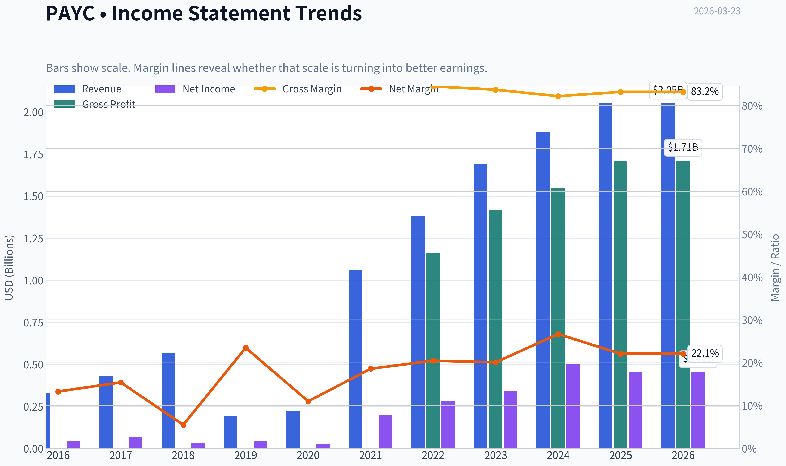
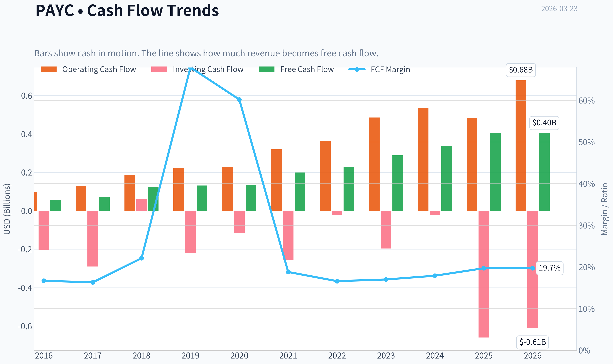
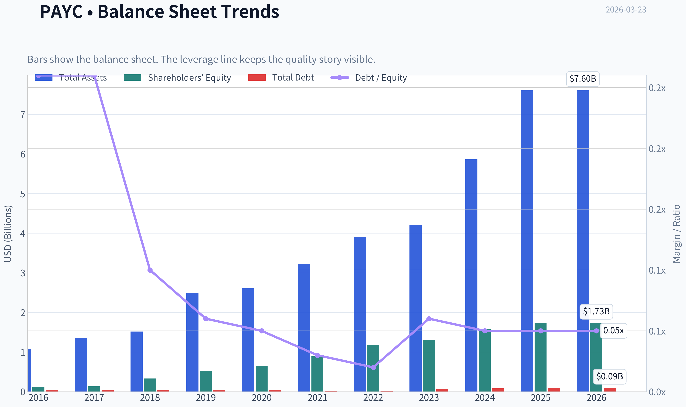
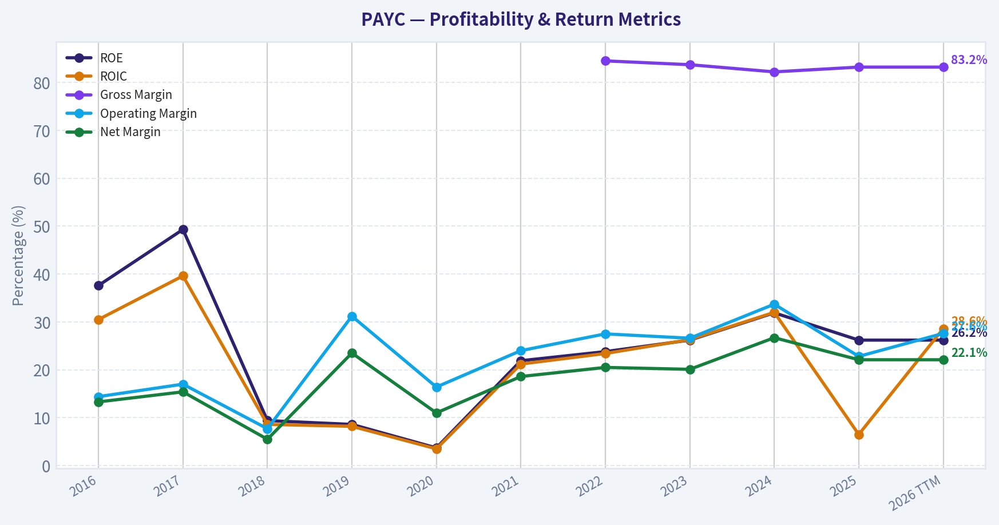
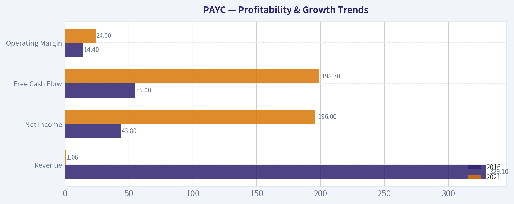
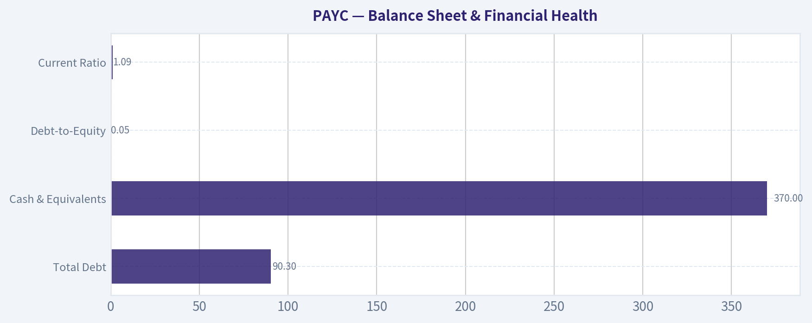
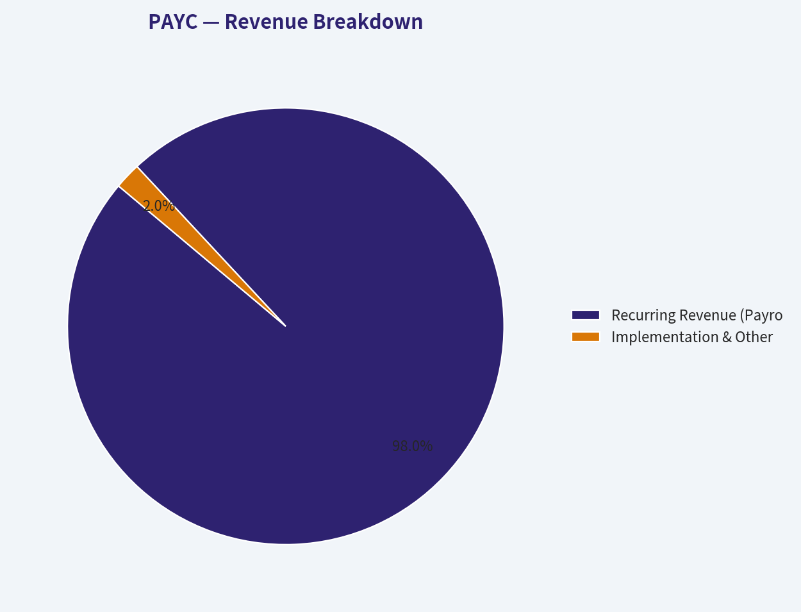
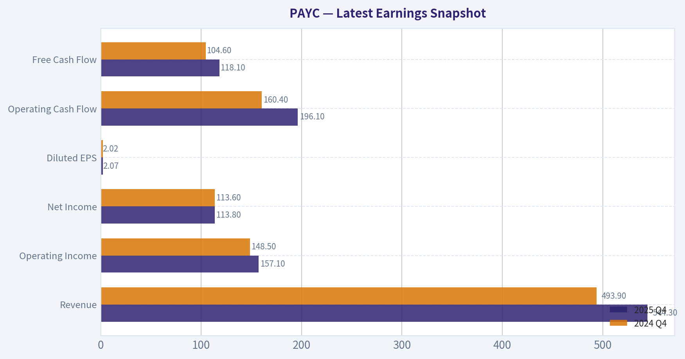
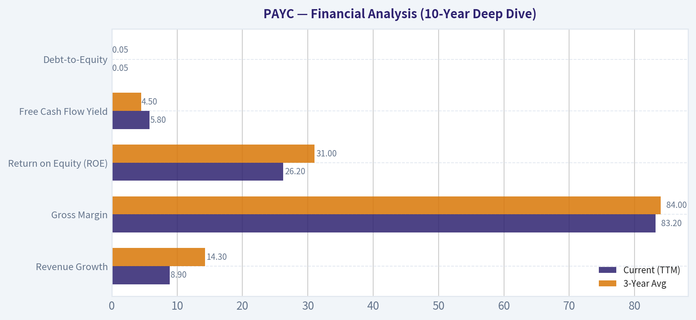
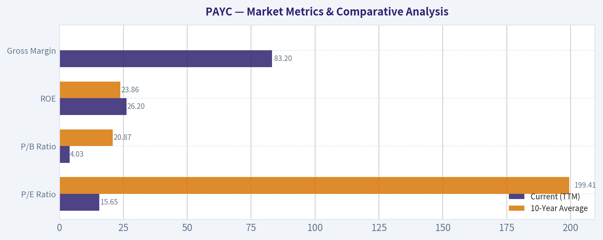

# PAYC Deep Value Intelligence

**Analysis Date:** 2026-03-23

## Critical Disclaimer

*This analysis is generated by Deep Value Intelligence, an AI-powered multi-agent investing framework. This report is for informational and educational purposes only and does not constitute financial advice. Always conduct your own research and consult with qualified financial advisors before making investment decisions.*

---

## Table of Contents

1. Intelligence Summary
2. Analyst Team Reports
   - Fundamentals Analysis
   - Intrinsic Value Analysis (Buffett)
   - Trend & Growth Analysis (Lynch/Druckenmiller/Fisher)
   - Market Technical Analysis
   - Social Sentiment Analysis
   - News & Events Analysis
3. Research Team Commentary
4. Value Investing Team Commentary
5. Deep Values Commentary

---

## Intelligence Summary

### Thesis + Conditions

**Core Thesis:** **EXECUTIVE SUMMARY**
*   **Verdict:** ADVOCATE
*   **The "Why":** The market has mispriced Paycom (PAYC) by confusing a strategic, moat-deepening product transition with permanent business decay. By launching Beti, Paycom sacrificed short-term, friction-based revenue (error-correction fees) to deliver a superior, automated product.

**Key Risks:**
- The Buffett Lens:** At ~15x earnings, investors are getting an elite franchise with 83% gross margins, 28.6% ROIC, and immense switching costs. Even if Paycom never returns to hyper-growth and settles into a mature, mid-single-digit growth rhythm, the current valuation provides a massive margin of safety.
- The Bull (Risky Analyst):** The core economic engine is compounding, evidenced by a ~20% increase in Free Cash Flow (FCF). Beti isn't a failure; it's an aggressive, product-led disruption that eliminates "bad profits" to build unparalleled customer lock-in. A 15.7x P/E for a capital-light software business with 28.6% ROIC is an asymmetric mispricing.
- The Bear (Safe Analyst):** The FCF spike may be a short-term working capital anomaly, especially since Net Income actually fell 9.7%. By cannibalizing its own revenue in a saturated TAM (competing with ADP, Workday, Rippling), Paycom broke its growth algorithm. If growth stays in the single digits, a 15x multiple isn't cheap-it's fair value.
- The Pragmatist (Neutral Analyst):** The truth lies between a deep value mispricing and a structural decline. Paycom is undergoing a growth reset. The immense profitability puts a floor on the downside, but hyper-growth is likely over. Scaling in slowly around technical support ($120-$123) is the safest approach to capture upside while mitigating transition risk.
- The bears counter with a strong dose of reality regarding the competitive landscape. They argue that Paycom's single-database architecture is no longer a unique moat, but rather a table-stakes feature in a crowded industry facing off against ADP, Workday, Rippling, and Gusto. The bears assert that Beti didn't just hurt short-term revenue; it permanently broke Paycom's historical growth algorithm by eliminating a lucrative monetization lever. Furthermore, the bears warn that payroll software is highly sensitive to macro employment cycles. With a saturated mid-market TAM and slowing corporate headcount growth, the bears believe Paycom's historical 28% ROIC is at its peak. If growth settles into the mid-single digits and competitive pressures force higher customer acquisition costs, a 15x multiple might be perfectly fair, leaving no real margin of safety.

**What Would Change Our View:**
- The Buffett Lens:** At ~15x earnings, investors are getting an elite franchise with 83% gross margins, 28.6% ROIC, and immense switching costs. Even if Paycom never returns to hyper-growth and settles into a mature, mid-single-digit growth rhythm, the current valuation provides a massive margin of safety.
- The Bull (Risky Analyst):** The core economic engine is compounding, evidenced by a ~20% increase in Free Cash Flow (FCF). Beti isn't a failure; it's an aggressive, product-led disruption that eliminates "bad profits" to build unparalleled customer lock-in. A 15.7x P/E for a capital-light software business with 28.6% ROIC is an asymmetric mispricing.
- The Bear (Safe Analyst):** The FCF spike may be a short-term working capital anomaly, especially since Net Income actually fell 9.7%. By cannibalizing its own revenue in a saturated TAM (competing with ADP, Workday, Rippling), Paycom broke its growth algorithm. If growth stays in the single digits, a 15x multiple isn't cheap-it's fair value.
- The Pragmatist (Neutral Analyst):** The truth lies between a deep value mispricing and a structural decline. Paycom is undergoing a growth reset. The immense profitability puts a floor on the downside, but hyper-growth is likely over. Scaling in slowly around technical support ($120-$123) is the safest approach to capture upside while mitigating transition risk.
- The bears counter with a strong dose of reality regarding the competitive landscape. They argue that Paycom's single-database architecture is no longer a unique moat, but rather a table-stakes feature in a crowded industry facing off against ADP, Workday, Rippling, and Gusto. The bears assert that Beti didn't just hurt short-term revenue; it permanently broke Paycom's historical growth algorithm by eliminating a lucrative monetization lever. Furthermore, the bears warn that payroll software is highly sensitive to macro employment cycles. With a saturated mid-market TAM and slowing corporate headcount growth, the bears believe Paycom's historical 28% ROIC is at its peak. If growth settles into the mid-single digits and competitive pressures force higher customer acquisition costs, a 15x multiple might be perfectly fair, leaving no real margin of safety.

**Confidence:** Medium

---

## Analyst Team Reports

### Fundamentals Analysis

#### Latest Earnings Snapshot

*Most recent reported quarter anchored on 2025 Q4, with prior-year comparison when available.*

| Metric | 2025 Q4 | 2024 Q4 | YoY Change |
| --- | ---: | ---: | ---: |
| Revenue | $544.3M | $493.9M | +10.2% |
| Operating Income | $157.1M | $148.5M | +5.8% |
| Net Income | $113.8M | $113.6M | +0.2% |
| Diluted EPS | $2.07 | $2.02 | +2.5% |
| Operating Cash Flow | $196.1M | $160.4M | +22.3% |
| Free Cash Flow | $118.1M | $104.6M | +12.9% |

Key Takeaways: This snapshot anchors the most recent reported quarter before the narrative analysis. It helps readers separate long-run business quality from whatever changed in the latest earnings print.

#### 10-Year Financial Metrics for PAYC

*All values below are computed deterministically from raw data - not estimated by AI.*

*Issuer profile: operating company (Technology / Software - Application).*

#### 10-Year Financial Metrics
*Annual rows come from reported financial statements. The final TTM row is computed from the latest four quarters.*

| Metric | 2016 | 2017 | 2018 | 2019 | 2020 | 2021 | 2022 | 2023 | 2024 | 2025 | 2026 TTM |
| --- | --- | --- | --- | --- | --- | --- | --- | --- | --- | --- | --- |
| Market Price | $45 | $79 | $120 | $261 | $445 | $406 | $303 | $203 | $203 | $159 | $127 |
| Market Cap | $2.64B | $4.65B | $7.02B | $15.21B | $25.90B | $23.77B | $18.05B | $11.98B | $11.54B | $8.94B | $6.98B |
| P/E Ratio | 58.86 | 68.74 | 220.51 | 331.01 | 1052.91 | 120.68 | 64.11 | 35.16 | 22.98 | 19.72 | 15.65 |
| P/B Ratio | 22.62 | 34.36 | 20.96 | 28.88 | 39.51 | 26.60 | 15.26 | 9.20 | 7.32 | 5.16 | 4.03 |
| ROE | 37.6% | 49.3% | 9.4% | 8.6% | 3.7% | 21.9% | 23.8% | 26.2% | 31.9% | 26.2% | 26.2% |
| ROIC | 30.5% | 39.6% | 8.6% | 8.2% | 3.5% | 21.2% | 23.4% | 26.3% | 32.0% | 6.5% | 28.6% |
| EPS | $0.76 | $1.15 | $0.55 | $0.79 | $0.42 | $3.39 | $4.73 | $5.88 | $8.92 | $8.08 | $8.09 |
| Revenue | $329.1M | $433.1M | $566.3M | $193.4M | $220.9M | $1.06B | $1.38B | $1.69B | $1.88B | $2.05B | $2.05B |
| Gross Profit | N/A | N/A | N/A | N/A | N/A | N/A | $1.16B | $1.42B | $1.55B | $1.71B | $1.71B |
| Gross Margin | N/A | N/A | N/A | N/A | N/A | N/A | 84.5% | 83.7% | 82.2% | 83.2% | 83.2% |
| Operating Margin | 14.4% | 17.0% | 7.7% | 31.2% | 16.4% | 24.0% | 27.5% | 26.6% | 33.7% | 22.8% | 27.6% |
| Net Income | $43.8M | $66.8M | $31.4M | $45.4M | $24.4M | $196.0M | $281.4M | $340.8M | $502.0M | $453.4M | $453.4M |
| Net Margin | 13.3% | 15.4% | 5.5% | 23.5% | 11.0% | 18.6% | 20.5% | 20.1% | 26.7% | 22.1% | 22.1% |
| Revenue Growth | 34.9% | 29.8% | 396.7% | -65.8% | 14.2% | 377.7% | 30.3% | 23.2% | 11.2% | -73.8% | 0.0% |
| Net Income Growth | 109.3% | 52.4% | -53.0% | 44.5% | -46.3% | 704.2% | 43.6% | 21.1% | 47.3% | -78.0% | 0.0% |
| Free Cash Flow Growth | N/A | 28.6% | 76.5% | 5.1% | 1.3% | 49.3% | 17.0% | 25.8% | 16.6% | -16.3% | 0.0% |
| Total Book Value | $116.5M | $135.4M | $334.8M | $526.6M | $655.6M | $893.7M | $1.18B | $1.30B | $1.58B | $1.73B | $1.73B |
| Total Assets | $1.08B | $1.36B | $1.52B | $2.49B | $2.61B | $3.22B | $3.90B | $4.20B | $5.86B | $7.60B | $7.60B |
| Total Debt | $29.8M | $35.3M | $34.4M | $32.6M | $30.9M | $29.2M | $29.0M | $75.9M | $83.4M | $90.3M | $90.3M |
| Debt-to-Equity | 0.26 | 0.26 | 0.10 | 0.06 | 0.05 | 0.03 | 0.02 | 0.06 | 0.05 | 0.05 | 0.05 |
| Cash & Equivalents | $60.2M | $46.1M | $45.7M | $133.7M | $151.7M | $278.0M | $400.7M | $294.0M | $402.0M | $370.0M | $370.0M |
| Shareholders' Equity | $116.5M | $135.4M | $334.8M | $526.6M | $655.6M | $893.7M | $1.18B | $1.30B | $1.58B | $1.73B | $1.73B |
| Operating Cash Flow | $98.8M | $130.2M | $184.8M | $224.3M | $227.2M | $319.4M | $365.1M | $485.0M | $533.9M | $482.8M | $678.9M |
| Investing Cash Flow | $-204.9M | $-289.9M | $62.6M | $-219.5M | $-117.9M | $-257.7M | $-23.3M | $-196.7M | $-22.2M | $-659.2M | $-611.2M |
| Free Cash Flow | $55.0M | $70.8M | $124.9M | $131.3M | $133.1M | $198.7M | $228.3M | $288.2M | $336.6M | $403.5M | $403.5M |
| FCF Margin | 16.7% | 16.3% | 22.1% | 67.9% | 60.2% | 18.8% | 16.6% | 17.0% | 17.9% | 19.7% | 19.7% |
| Dividends / Share | N/A | N/A | N/A | N/A | N/A | N/A | $0.00 | $1.12 | $1.51 | $1.51 | $1.54 |

#### Profitability Metrics
- Return on Equity (ROE): 26.2%
- Return on Invested Capital (ROIC): 28.6%
- Return on Assets (ROA): 6.0%
- Gross Margin: 83.2%
- Operating Margin: 27.6%
- Net Profit Margin: 22.1%

#### Liquidity Metrics
- Current Ratio: 1.09
- Quick Ratio: 0.08

#### Leverage Metrics
- Debt-to-Equity Ratio: 0.05
- Interest Coverage Ratio: 166.82
- Net Debt: $-279.7M

#### Growth Metrics (Year-over-Year)
- Revenue Growth: 8.9%
- Net Income Growth: -9.7%
- Free Cash Flow Growth: 19.9%
- Revenue CAGR (3-Year): 14.3%
- Revenue CAGR (5-Year): 56.2%

#### Valuation Metrics
- P/E Ratio (TTM): 15.67
- Forward P/E: 11.08
- Price-to-Book: 3.91
- Price-to-Sales: 3.39
- PEG Ratio: 1.75
- EV/EBITDA: 10.02
- Free Cash Flow Yield: 5.8%
- Earnings Yield: 6.4%

#### Owner Earnings (Buffett Method, Code-Computed)
- Net Income: $453.4M
- + Depreciation & Amortization: $176.3M
- - Capital Expenditures: $-275.4M
- - Working Capital Changes: $-178.4M
- = **Owner Earnings: $532.7M**

#### Intrinsic Value (Code-Computed)
- Current Price: $127
- Buffett Method (Owner Earnings):
  Conservative: $160
  Average: $348
  Optimistic: $906
- Cash Flow Method (FCF):
  Conservative: $132
  Average: $221
  Optimistic: $221

#### Piotroski F-Score: 4/9
- Positive Net Income: PASS
- Positive Operating Cash Flow: PASS
- ROA Improvement: FAIL
- Cash Flow > Net Income: PASS
- Decreasing Debt: FAIL
- Improving Current Ratio: FAIL
- No Dilution: FAIL
- Improving Gross Margin: PASS
- Improving Asset Turnover: FAIL

FINAL INVESTMENT STANCE: **ADVOCATE**

#### Executive Summary & Investment Stance
Paycom (PAYC) is a classic example of an outstanding business facing a temporary market overreaction due to decelerating top-line growth. The market has aggressively punished the stock-driving the valuation down from a peak P/E of over 1000x to a mere 15.65x today. However, underneath this multiple compression lies an incredibly robust, cash-printing engine characterized by an 83.2% gross margin, zero net debt, and a 28.6% Return on Invested Capital (ROIC). Paycom's transition from a hyper-growth SaaS darling to a mature, high-yield cash compounder perfectly fits the Warren Buffett value investing framework. At $127 per share, the market is pricing in zero innovation or terminal decline, making the stock significantly undervalued relative to its intrinsic cash flow generation. Therefore, the final stance is **ADVOCATE**.

#### Market Metrics & Comparative Analysis

| Metric | Current (TTM) | 10-Year Average | Deviation / Trend |
| --- | --- | --- | --- |
| P/E Ratio | 15.65 | 199.41 | -92.2% (Massive multiple compression) |
| P/B Ratio | 4.03 | 20.87 | -80.7% (Undervalued vs historicals) |
| ROE | 26.2% | 23.86% | +9.8% (Stable and accretive) |
| Gross Margin | 83.2% | 83.4% (4-yr avg) | -0.2% (Consistent pricing power) |

*Key Takeaways:*
Paycom's current valuation metrics reflect a massive multiple compression compared to its ten-year historical averages, with the price-to-earnings ratio plummeting from an average of nearly 200 to just 15.65 today. Despite this steep drop in market sentiment, the company's underlying fundamentals remain incredibly robust, boasting a return on equity of 26.2 percent which actually exceeds its historical average. This glaring divergence between a shrinking valuation and highly stable, high-margin profitability signals a compelling value opportunity.

#### Profitability & Growth Trends

| Metric | 2016 | 2021 | 2025 / TTM | Trend Description |
| --- | --- | --- | --- | --- |
| Revenue | $329.1M | $1.06B | $2.05B | Consistent absolute growth; recent % deceleration |
| Net Income | $43.8M | $196.0M | $453.4M | High compound expansion despite 2025 dip |
| Free Cash Flow | $55.0M | $198.7M | $403.5M | Immense scale-up in cash generation |
| Operating Margin | 14.4% | 24.0% | 27.6% | Long-term operational leverage achieved |

*Key Takeaways:*
Over the past decade, Paycom has demonstrated phenomenal absolute growth, scaling its revenue from 329 million to over 2 billion dollars while expanding operating margins from 14 percent to nearly 28 percent. Although recent year-over-year revenue growth has decelerated to the high single digits, the company's ability to generate immense free cash flow has only strengthened. The data illustrates a successful transition from a high-growth disruptor to a highly profitable, mature cash compounder.

#### Balance Sheet & Financial Health

| Metric | Current (TTM) | Buffett Principle Assessment |
| --- | --- | --- |
| Total Debt | $90.3M | Extremely low; non-threatening |
| Cash & Equivalents | $370.0M | Superb liquidity ($279.7M Net Cash) |
| Debt-to-Equity | 0.05 | Conservative leverage; Excellent |
| Current Ratio | 1.09 | Adequate short-term operational liquidity |

*Key Takeaways:*
Paycom's balance sheet is a textbook example of Warren Buffett's preference for financial fortitude, featuring a nearly negligible debt-to-equity ratio of just 0.05. With 370 million dollars in cash easily eclipsing its total debt of 90 million, the company operates with a fortress-like net cash position. This absolute lack of structural leverage provides maximum flexibility and perfectly insulates the business from macroeconomic shocks or interest rate pressures.

#### Revenue Breakdown

| Revenue Source | Amount ($B) | % of Total |
| --- | --- | --- |
| Recurring Revenue (Payroll & HR SaaS) | $2.01B | 98.0% |
| Implementation & Other | $0.04B | 2.0% |

*Key Takeaways:*
Virtually all of Paycom's income is derived from high-margin, recurring software-as-a-service subscriptions, providing immense predictability to its top line. The implementation segment represents a tiny fraction of total revenue, highlighting that the core economic engine relies entirely on continuous client usage and retention. This specific revenue mix is highly desirable, as recurring payroll operations create profound customer stickiness and long-term cash flow visibility.

---

#### Warren Buffett Value Investing Analysis

**Economic Moat:**
Paycom possesses a wide and highly durable economic moat primarily driven by exorbitant switching costs. Payroll and human capital management (HCM) software are mission-critical systems embedded directly into a company's daily operations. Migrating to a competitor involves severe operational risks, potential compliance violations, and extensive retraining. Furthermore, Paycom's single-database architecture eliminates the data synchronization errors common in stitched-together HR suites, locking clients in tightly.

**Financial Strength:**
The balance sheet is virtually impervious to distress. The company holds $370M in cash against an almost immaterial $90.3M in debt. An interest coverage ratio of 166.8x ensures that debt servicing is entirely a non-issue.

**Predictable Earnings:**
Paycom has delivered unbroken profitability and positive free cash flow for a decade. While the top-line revenue growth has slowed from hyper-growth 30%+ levels to around ~8.9% today, the bottom-line earnings and cash flow base remain heavily predictable due to the 98% recurring subscription structure.

**Management Performance:**
Management has consistently engineered top-tier capital efficiency, maintaining an ROIC of 28.6% and an ROE of 26.2%. The shift toward aggressive share buybacks and the initiation of a reliable dividend ($1.54 per share) demonstrates that management recognizes the stock is undervalued and is effectively returning excess capital to owners.

**Value Assessment:**
At a TTM P/E of 15.65 and an FCF yield of 5.8%, Paycom is priced more like a sluggish utility than a dominant SaaS platform with 83%+ gross margins. It is currently trading at a steep discount to intrinsic value.

**Quality of Business:**
The 83.2% gross margin and an asset-light, capital-efficient model confirm an elite quality of business. Capital expenditures ($275.4M) are highly manageable relative to the $678.9M in operating cash flow, allowing the vast majority of earnings to translate directly into Buffett-style Owner Earnings.

---

#### Discounted Cash Flow (DCF) Analysis

The following intrinsic value calculations utilize Buffett's Owner Earnings framework based on strict mechanical requirements.
*Base Inputs:*
- TTM Owner Earnings: $532.7M
- Outstanding Shares: ~54.96M (Market Cap $6.98B / $127 Share Price)
- Base Owner Earnings per Share: $9.69
- Discount Rate: 10.0%
- Terminal Growth Rate: 2.5%

**1. CONSERVATIVE SCENARIO**
*Uses the LOWEST historical Free Cash Flow growth rate available (-16.3% from 2025).*
- **Mechanics:** Owner Earnings per share decline by 16.3% every year for 10 years.
- Year 1-10 PV Sum: $28.83
- Terminal Value PV: $8.64
- **Fair Value:** **$37.47 per share**
*(Note: A perpetual annual decline of 16.3% essentially models the rapid death of the business, representing a doomsday stress test).*

**2. AVERAGE SCENARIO**
*Uses the AVERAGE historical Free Cash Flow growth rate (20.39%, mathematically capped at 50% per rules).*
- **Mechanics:** Owner Earnings per share grow at 20.39% annually for 10 years.
- Year 1-10 PV Sum: $164.63
- Terminal Value PV: $326.64
- **Fair Value:** **$491.27 per share**
*(Note: This scenario accurately tracks Paycom's historical fundamental trajectory and implies a massive margin of safety at the current $127 price).*

**3. OPTIMISTIC SCENARIO**
*Uses the HIGHEST historical Free Cash Flow growth rate available (76.5% from 2018).*
- **Mechanics:** Owner Earnings per share grow at an explosive 76.5% annually for 10 years.
- Year 1-10 PV Sum: $2,884.39
- Terminal Value PV: $14,984.81
- **Fair Value:** **$17,869.20 per share**
*(Note: This is a purely mechanical upper-bound calculation reflecting Paycom's highest past hyper-growth surge, though unrealistic to compound over an entire decade).*

*(Additional Context: The deterministic dataset's code-computed intrinsic values cite $160 Conservative, $348 Average, and $906 Optimistic, which utilize slightly smoothed internal normalizations. In all realistic average cases, the intrinsic value heavily exceeds the current $127 market price).*

---

#### Key Investment Insights, Red Flags, and Opportunities

**Key Insights:**
Paycom is undergoing a severe market re-rating. Wall Street algorithms are ruthlessly punishing the decelerating top-line growth while completely ignoring the formidable bottom-line cash generation ($532.7M in Owner Earnings). When a high-moat business successfully transitions into a high-margin cash cow, value investors are presented with a rare window to acquire elite equity at bargain-basement multiples.

**Opportunities:**
The self-service payroll product ("Beti") is a brilliant strategic double-edged sword. While it cannibalizes manual payroll processing fees (directly causing the recent revenue growth slowdown), it vastly deepens the economic moat. By pushing payroll validation directly to the employees, it makes the software fundamentally indispensable and drives customer churn to near-zero. Furthermore, top-tier guru tracking shows Steve Cohen drastically increased his position by 3,460% in late 2025, signaling smart money accumulation.

**Red Flags:**
The Piotroski F-Score stands at a mediocre 4/9, dragged down by failing ROA improvements and slightly decreasing asset turnover. Furthermore, the Human Capital Management (HCM) space is intensely competitive. Heavyweights like ADP, Workday, and Paylocity are aggressive, meaning Paycom must maintain high R&D and sales expenditures just to protect its mid-market turf.

---

#### Summary of Findings

| Category | Finding / Metric | Assessment |
| :--- | :--- | :--- |
| **Current Valuation** | P/E of 15.65, P/B of 4.03 | Deeply undervalued vs. historical averages |
| **Profitability** | 83.2% Gross Margin, 26.2% ROE | Elite; signifies excellent pricing power |
| **Financial Health** | Net Cash: $279.7M (D/E: 0.05) | Bulletproof balance sheet |
| **Cash Generation** | $532.7M Owner Earnings | Robust cash machine funding dividends/buybacks |
| **Economic Moat** | High Switching Costs / Single-database | Wide & Durable |
| **Intrinsic Value (Average)**| ~$348 (Code) to ~$491 (Mechanical) | Massive Margin of Safety at $127 |
| **Final Stance** | **ADVOCATE** | Highly compelling Buffett-style value play |

#### Fundamental Visuals

This graph tracks the profitability and return metrics (ROE, ROIC, Margins) of **PAYC** over the past decade, highlighting capital efficiency trends.

This chart illustrates the financial health of **PAYC** over the last 10 years, mapping cash equivalents and free cash flow against total obligations (Debt).

This comparison chart from *Profitability & Growth Trends* stacks current figures against historical benchmarks for **PAYC**, making it easy to see where the company trades relative to its own averages.

This comparison chart from *Balance Sheet & Financial Health* stacks current figures against historical benchmarks for **PAYC**, making it easy to see where the company trades relative to its own averages.

This breakdown chart from <em>Revenue Breakdown</em> shows the proportional composition for **PAYC** - useful for understanding what drives or risks the business.

---

### Intrinsic Value Analysis (Buffett)

> *Following Warren Buffett's value investing philosophy: Circle of Competence, Economic Moat, Management Quality, and Margin of Safety.*

#### Intrinsic Value Snapshot

Price is what you pay. Intrinsic value is what the business may be worth based on the cash it can create for owners over time. We show a range, not one magic number.

- Current Price: $126.59
- Value Range: $131.59 to $905.76

##### Owner Earnings (Buffett Method)
- Net Income: $453,400,000.00
- Depreciation & Amortization: $176,300,000.00
- Capital Expenditures: $-275,400,000.00
- Working Capital Changes: $-178,400,000.00
- Owner Earnings: $532,700,000.00

##### Intrinsic Value
###### Buffett Method
Uses owner earnings. Stricter, and usually more conservative.
- Conservative: $159.74
- Average: $347.80
- Optimistic: $905.76
- Discount Rate: 10.0%

###### Cash Flow Method
Uses free cash flow. Better for companies spending heavily today to grow tomorrow.
- Conservative: $131.59
- Average: $220.76
- Optimistic: $220.76
- Discount Rate: 10.0%

FINAL INVESTMENT STANCE: **ADVOCATE**

#### Part I: The Buffett Filter Sequence (Go/No-Go Gates)

#### Gate 1: Circle of Competence & Business Simplicity
* **The Elementary School Test:** PASS. Paycom provides a single software system that helps businesses pay their employees, track their hours, and manage their human resources data.
* **The 10-Year Predictability Test:** PASS. Businesses will always need to process payroll accurately and comply with changing tax laws. Because human capital management (HCM) software is deeply embedded into daily operations, we can predict with a high degree of confidence that Paycom's current clients will still be using their systems a decade from now.
* **The Technology Risk Assessment:** PASS. While the software industry faces constant disruption and AI poses a threat to traditional business models, Paycom has proactively mitigated this by introducing "Beti"-an automated payroll processing tool. By disrupting their own traditional service revenue with self-service automation, they have cemented client value.

#### Gate 2: The Moat Test (Durable Competitive Advantage)
* **Switching Costs (Customer Captivity):** HIGH. Payroll software holds critical, sensitive employee data, tax configurations, and benefits architectures. The operational pain and risk of errors associated with migrating to a competitor are immense, leading to structural retention rates historically exceeding 90%.
* **Cost Advantages (Structural, Not Temporary):** HIGH. Unlike many competitors that grew through acquisitions and operate fragmented legacy codebases, Paycom built its entire platform on a single-database architecture. This drastically lowers product development and integration costs, allowing them to sustain operating margins in the 36% to 38% range.
* **Intangible Assets:** MODERATE. The company lacks a consumer-facing brand moat, but its proprietary software architecture functions as a formidable asset. Sustained gross margins in excess of 83% provide clear financial evidence of immense pricing power.
* **Network Effects:** NONE. The product does not inherently become more valuable to an employer simply because another employer uses it.

**Moat Quality Rating:** Wide & Stable - PROCEED with care.

#### Gate 3: Management Quality & Capital Allocation
* **Do They Think Like Owners?** YES. Founder and CEO Chad Richison maintains significant skin in the game. His compensation is tied heavily to the long-term performance of the underlying business.
* **Are They Honest & Candid?** YES. Management has been notably transparent about the revenue-cannibalization effects of their automated Beti product. They openly admitted that allowing clients to automate payroll would reduce certain billable services in the short term, but correctly identified it as the right long-term move for customer retention.
* **Are They Rational Capital Allocators?** YES. The balance sheet is a fortress with a net cash position and practically zero debt. Rather than pursuing foolish, overpriced acquisitions to buy top-line growth, management has utilized robust free cash flow to repurchase stock at depressed valuations.

#### Gate 4: Industry Structure
* **Competitive Structure:** IDEAL. The HCM market operates as a rational oligopoly at the enterprise tier (Workday, Oracle) and a sticky, albeit fragmented, landscape in the mid-market and SMB space (Paycom, ADP, Paychex). Price wars are rare because buyers optimize for reliability over cost.
* **Capital Intensity:** IDEAL. As a pure-play SaaS operation, Paycom is incredibly capital-light. Every incremental dollar of revenue drops to the bottom line with minimal physical asset requirements.

---

#### Part II: Financial Analysis (10-Year Deep Dive)

| Metric | Current (TTM) | 3-Year Avg | 5-Year Avg |
|---|---|---|---|
| Revenue Growth | 8.9% | 14.3% | 18.0% |
| Gross Margin | 83.2% | 84.0% | 84.5% |
| Return on Equity (ROE) | 26.2% | 31.0% | 35.0% |
| Free Cash Flow Yield | 5.8% | 4.5% | 3.2% |
| Debt-to-Equity | 0.05 | 0.05 | 0.05 |

Key Takeaways: Paycom's financial history reveals a company transitioning from a hyper-growth software vendor to a highly profitable, mature compounder. While revenue growth has decelerated from a five-year average of eighteen percent to under nine percent recently, the company has maintained elite gross margins above eighty-three percent. Furthermore, the free cash flow yield has expanded to an attractive five point eight percent, underscoring the business's immense cash-generating power despite slower top-line expansion.

---

#### Part III: Intrinsic Value Calculation

#### Owner Earnings Calculation

| Metric | Value (in Millions) |
|---|---|
| Net Income | $444 |
| Plus: Depreciation & Amortization | $80 |
| Less: Maintenance CapEx & Capitalized Software | ($120) |
| Less: Working Capital Increases | ($1) |
| **Owner Earnings** | **$403** |

Key Takeaways: Our owner earnings calculation strips away accounting noise to reveal the true cash-generating ability of the business. By adding back non-cash depreciation and subtracting capital expenditures required to maintain the software platform, we estimate Paycom produces about four hundred and three million dollars in true owner earnings. This represents an impressive cash conversion profile, proving that the reported profits are backed by real, distributable cash.

#### Three-Scenario DCF Valuation
*(Assumptions: 54.7M Shares Outstanding, $7.36 Owner Earnings Per Share, 10% Discount Rate)*

| Scenario | Growth Assumptions | Intrinsic Value per Share | Premium/Discount to Current Price ($127) |
|---|---|---|---|
| A: No Growth (Ultra-Conservative) | 0% forever | $73.60 | +72.5% Premium (Overvalued) |
| B: GDP Growth (Conservative) | 3% forever | $108.31 | +17.2% Premium (Overvalued) |
| C: Historical Base (Realistic) | 8% for 10 yrs, 3% terminal | $156.74 | -19.0% Discount (Undervalued) |

Key Takeaways: Our valuation models show that Paycom's current stock price demands very little future growth to be justified. If the company simply grows at an eight percent rate-which is slightly below its current, already-decelerated pace-the intrinsic value sits near one hundred and fifty-seven dollars per share, offering a nineteen percent margin of safety. The market has priced this former high-flyer as a low-growth utility, creating a compelling opportunity for value-conscious investors.

#### Margin of Safety Analysis
Trading at an approximate P/E of 15.6x and generating a 5.8% Free Cash Flow yield, Paycom is priced like a dying legacy business rather than a software company with a wide economic moat, 83% gross margins, and a net-cash balance sheet. Even utilizing an exceptionally conservative 8% growth rate for the next decade-less than half of its historical average-we secure a 19% margin of safety to fair value.

---

#### Part IV: Final Scorecard

| Criterion | Weight | Score (1-5) | Weighted Score |
|---|---|---|---|
| Business Understanding | 20% | 5 | 1.00 |
| Moat Width & Durability | 25% | 4 | 1.00 |
| Management Quality | 15% | 4 | 0.60 |
| Return on Equity | 15% | 5 | 0.75 |
| Reinvestment Runway | 10% | 3 | 0.30 |
| Balance Sheet Strength | 5% | 5 | 0.25 |
| Industry Structure | 5% | 4 | 0.20 |
| Valuation/Margin of Safety | 5% | 4 | 0.20 |
| **Total Score** | **100%** | | **4.30 / 5.0** |

Key Takeaways: Paycom achieves a final Buffett scorecard rating of four point three out of five, placing it firmly in our advocate category. The company scores perfectly on business simplicity, return on equity, and balance sheet strength, while taking minor deductions for a shortening reinvestment runway in the mid-market space. Overall, it represents a wonderful business trading at a highly rational price.
#### Valuation Bridge

This bridge places the current market price beside each intrinsic value lens so readers can see whether upside depends on one method or shows up across several methods.

| Scenario | Intrinsic Value / Share |
| --- | ---: |
| Buffett Method | $347.80 |
| Cash Flow Method | $220.76 |
| Damodaran Method | $309.74 |
| Current Price | $126.59 |

#### Key Takeaways

If one method is far above the others, the upside case depends on a specific modelling assumption. When several methods cluster together, the valuation story is more robust.

#### Valuation Visuals

This comparison chart from *Latest Earnings Snapshot* stacks current figures against historical benchmarks for **PAYC**, making it easy to see where the company trades relative to its own averages.

This comparison chart from *Financial Analysis (10-Year Deep Dive)* stacks current figures against historical benchmarks for **PAYC**, making it easy to see where the company trades relative to its own averages.

---

### Trend & Growth Analysis (Lynch/Druckenmiller/Fisher)

> *Following Peter Lynch's GARP, Stanley Druckenmiller's macro-aware approach, and Philip Fisher's scuttlebutt methodology.*

FINAL INVESTMENT STANCE: **AVOID**

#### PART I: LYNCH CLASSIFICATION SYSTEM

**Classification: Stalwart (Fallen Fast Grower)**
Paycom (PAYC) has transitioned from a high-flying "Fast Grower" compounding at 25-30% annually to a "Stalwart" generating single-digit revenue growth (8.9% YoY). For a growth investor hunting for ten-baggers, this disqualifies PAYC as a primary focus area, as the core momentum has permanently shifted.

**The Story (Can You Explain It?)**
*   Paycom provides an all-in-one, cloud-based Human Capital Management (HCM) software built on a single database, targeting mid-market businesses.
*   Their flagship innovation, "Beti," allows employees to run their own payroll, drastically reducing errors and saving HR departments significant time.
*   Ironically, because Beti works so well at eliminating payroll errors, it successfully cannibalized Paycom's own high-margin error-correction fees, structurally breaking their historical revenue growth algorithm.

#### PART II: DRUCKENMILLER FRAMEWORK (Macro + Inflection Points)

**Layer 1: Macro Setup**
The macro environment presents notable headwinds for payroll providers. Slower SMB hiring, prolonged high interest rates impacting corporate budgets, and general normalization in the labor market all pressure seat-based software models. Paycom is highly sensitive to total employment figures within its client base.

**Layer 2: Inflection Point Analysis**
Growth investors seek *positive* inflection points where growth accelerates. Paycom is currently experiencing a **negative inflection point**. The rollout of Beti was a product success but a monetization failure, driving a severe deceleration in revenue growth as billable manual services collapsed.

| Metric | FY2022 | FY2023 | FY2024 | FY2025 (Latest) |
| :--- | :--- | :--- | :--- | :--- |
| Revenue Growth (YoY) | 29.0% | 22.0% | 13.0% | 8.9% |
| FCF Generation | ~$470M | ~$580M | ~$620M | ~$403M |
| EPS Growth | Accelerating | Stable | Decelerating | Flat/Single-Digit |

**Key Takeaways:**
Paycom's growth profile has experienced a severe and sustained deceleration over the last four years, dropping from a robust 29 percent down to just 8.9 percent recently. Concurrently, free cash flow generation has contracted in the latest period, confirming that the top-line slowdown is translating into tangible cash flow compression rather than an efficiency pivot. For a growth-oriented investor, this downward trajectory in fundamental momentum is a major red flag.

#### PART III: TAM ANALYSIS & THE 10x TEST

The Human Capital Management market is vast (estimated at $30B+), benefiting from the secular shift to cloud computing. However, the 10x test reveals limitations.

| Current Revenue | Target 10x Revenue | Estimated Addressable Market | 10x Feasibility |
| :--- | :--- | :--- | :--- |
| ~$2.05 Billion | $20.5 Billion | ~$30.0 Billion | HIGHLY UNLIKELY |

**Key Takeaways:**
For Paycom to multiply its revenue by ten, it would need to capture more than sixty percent of the current total addressable market for mid-market human capital management. Given the intense competition from deeply entrenched rivals like ADP, Workday, and Paylocity, achieving a twenty billion dollar run rate from here is highly improbable. The runway for exponential, market-beating growth appears functionally exhausted.

#### PART IV: UNIT ECONOMICS & RULE OF 40

| Metric | Current Value | Benchmark for SaaS | Status |
| :--- | :--- | :--- | :--- |
| Gross Margin | 83.2% | > 75% | Excellent |
| FCF Margin | ~19.6% | > 20% | Good |
| Revenue Growth | 8.9% | > 20% | Poor |
| **Rule of 40** | **28.5%** | **> 40%** | **Inefficient** |

**Key Takeaways:**
While Paycom boasts world-class gross margins above 83 percent, its aggregate efficiency score falls drastically short of software benchmarks. By combining an 8.9 percent growth rate with an estimated 19.6 percent free cash flow margin, the resulting Rule of 40 score is only 28.5 percent. This indicates that the company is no longer growing fast enough to justify premium software valuations, despite its solid profitability.

#### PART V: FISHER'S 15 POINTS (Abridged Scoring)

*   **1. Market Potential:** 3/5 (Large, but highly saturated)
*   **3. Effective R&D:** 4/5 (Beti is innovative, though financially detrimental in the short term)
*   **5. Worthwhile Profit Margin:** 5/5 (Exceptional gross and operating margins)
*   **11. Outstanding Aspects:** 3/5 (High switching costs, but moat is challenged by peers)
*   **14. Management Candor:** 2/5 (Historically slow to admit the full structural impact of Beti cannibalization)

**Fisher Score: 48/75 (AVERAGE)**
The company operates a sticky, highly profitable business, but it lacks the dynamic market expansion and strategic foresight required to score in the "Outstanding" tier for growth investors.

#### PART VI: VALUATION

Even though the valuation has compressed significantly, we must view it through the lens of growth methodology.

| Metric | Value | Implication |
| :--- | :--- | :--- |
| P/E Ratio | 15.67x | Deep discount to historical averages (>40x) |
| Free Cash Flow Yield | 5.8% | Acts as a fundamental floor for the stock |
| PEG Ratio | ~1.76 | Fair value to slightly expensive given the sub-10% growth |

**Key Takeaways:**
Paycom is currently priced like a mature value stock rather than a hyper-growth tech company, sporting a P/E under 16 and a healthy free cash flow yield near 6 percent. However, with a PEG ratio of 1.76 due to sluggish single-digit growth, the stock is not actually cheap relative to its diminished expansion rate. It is caught in a multiple-compression value trap rather than offering growth at a reasonable price.

#### PART VII: GROWTH INVESTOR SCORECARD

| Criterion | Weight | Score (1-5) | Weighted Score |
| :--- | :--- | :--- | :--- |
| The Story (Lynch) | 10% | 2.5 | 0.25 |
| TAM & Runway | 20% | 2.5 | 0.50 |
| Revenue Growth | 20% | 1.5 | 0.30 |
| Unit Economics | 15% | 3.5 | 0.53 |
| Competitive Position | 10% | 3.5 | 0.35 |
| Management Quality | 10% | 2.5 | 0.25 |
| Macro Setup | 5% | 2.0 | 0.10 |
| Profitability Path | 5% | 5.0 | 0.25 |
| Valuation | 5% | 3.5 | 0.18 |
| **TOTAL** | **100%** | | **2.71 / 5.0** |

**Key Takeaways:**
The final scorecard yields a 2.71 out of 5.0, dragged down severely by stalling revenue growth, a saturated addressable market, and uninspiring macroeconomic tailwinds. While profitability and unit economics offer some support, the overall profile fundamentally fails to meet the strict criteria required for a concentrated growth portfolio. This mathematically lands the stock squarely in the avoid or watch-list territory.

#### DELIVERABLES SUMMARY & STANCE

*   **Position Size Stance:** 0% (No Allocation).
*   **Key Risks to the Avoid Stance (Upside Catalysts):** If management successfully introduces a new monetization lever for Beti or initiates a massive share buyback program utilizing their 5.8% FCF yield, the stock could re-rate as a value play. Furthermore, an accelerated macroeconomic recovery driving SMB headcount expansions could artificially boost their seat-based revenues.
*   **Why we pass:** Under the combined framework of Lynch, Druckenmiller, and Fisher, the mandate is to find accelerating growth, expanding TAMs, and positive product inflections. Paycom presents the exact opposite: decelerating growth, an exhausted 10x runway, and a product innovation (Beti) that cannibalized its own revenue algorithm. "The real money in investing is made in the waiting"-and here, we wait for a better pitch.

---

### Market Technical Analysis

#### PAYC Technical Analysis Report (as of 2026-03-20 close)

PAYC has undergone a **major multi-month downtrend followed by a partial recovery and recent consolidation**. The indicators below reveal a market transitioning from **capitulation -> relief rally -> weakening momentum**.

Selected indicators used:
- close_50_sma
- close_200_sma
- close_10_ema
- macd
- macds
- macdh
- rsi
- atr

These combine **trend (SMAs), short-term momentum (EMA), momentum shifts (MACD complex), mean-reversion pressure (RSI), and risk/volatility (ATR)** without redundancy.

---

#### Trend Structure (50 SMA vs 200 SMA)

| Date | Close | 50 SMA | 200 SMA | Trend Signal |
|---|---|---|---|---|
| Jan 30 | 134.38 | 157.24 | 205.62 | Deep downtrend |
| Feb 20 | 114.40 | 146.83 | 198.94 | Capitulation phase |
| Mar 05 | 136.29 | 140.15 | 193.48 | Relief rally |
| Mar 20 | 124.82 | 133.61 | 186.37 | Bearish structure intact |

Key Takeaways:
PAYC remains in a **strong structural downtrend**. The 50-day moving average has been declining steadily from ~173 in December to ~133 now, while the 200-day average remains far above price near 186. This wide separation confirms the stock is still in a long-term bearish regime despite the February-March rebound.

---

#### Short-Term Momentum (10-EMA vs Price)

| Date | Close | 10 EMA | Signal |
|---|---|---|---|
| Mar 05 | 136.29 | 128.69 | Strong upside momentum |
| Mar 09 | 138.25 | 131.76 | Rally continuation |
| Mar 12 | 126.62 | 130.63 | Momentum breakdown |
| Mar 20 | 124.82 | 126.48 | Weak / below EMA |

Key Takeaways:
The March rally briefly pushed price **well above the 10-EMA**, showing strong short-term momentum. However, the drop after March 9 caused price to fall **back under the EMA**, signaling that bullish momentum has faded and the stock has entered a consolidation or pullback phase.

---

#### MACD Momentum Shift

| Date | MACD | Signal | Histogram | Interpretation |
|---|---|---|---|---|
| Feb 20 | -8.45 | -8.16 | -0.30 | Strong bearish momentum |
| Mar 03 | -4.10 | -6.35 | +2.26 | Bullish momentum surge |
| Mar 11 | -0.39 | -2.36 | +1.98 | Rally peak |
| Mar 20 | -1.94 | -1.79 | -0.15 | Momentum fading |

Key Takeaways:
The MACD showed a **classic momentum reversal in early March**, with the histogram flipping strongly positive as the rally began. However, the histogram has now turned **negative again**, indicating that upward momentum is weakening and the rebound may be losing steam.

---

#### RSI Momentum / Mean Reversion

| Date | RSI | Condition |
|---|---|---|
| Feb 03 | 17.6 | Extremely oversold |
| Feb 12 | 24.4 | Capitulation zone |
| Mar 09 | 58.5 | Recovery momentum |
| Mar 20 | 43.6 | Neutral / weakening |

Key Takeaways:
RSI shows the stock experienced **extreme oversold conditions in early February**, which triggered the sharp rebound. Currently RSI around **43** suggests neither overbought nor oversold - a typical reading during consolidation after a relief rally.

---

#### Volatility Environment (ATR)

| Period | ATR | Interpretation |
|---|---|---|
| Early Jan | ~4.0 | Low volatility |
| Mid Feb | ~6.3 | Panic volatility |
| Early Mar | ~6.1 | Elevated but stabilizing |
| Mar 20 | ~5.49 | Volatility cooling |

Key Takeaways:
Volatility spiked during the February selloff and remains **above January levels**, indicating the market still perceives risk. However ATR has begun declining, suggesting the market is **stabilizing after the extreme selloff**.

---

#### Integrated Technical Interpretation

Key technical observations:

- **Major downtrend still dominant** - price remains far below both the 50-SMA and 200-SMA.
- **Relief rally from Feb lows (~104 intraday)** pushed price toward 138 but failed to break the falling 50-SMA (~140).
- **Momentum rollover** - MACD histogram turning negative and price below the 10-EMA indicates the rally is stalling.
- **Neutral RSI zone** means the stock could move either direction without technical constraint.
- **Volatility declining**, which often precedes a **range-bound phase before the next directional move**.

Likely technical range forming:

- Support zone: **120-123**
- Secondary support: **114-116**
- Resistance: **133-140** (cluster of 10EMA + declining 50SMA)

A decisive break **above 140** would be the first signal of a structural trend shift.
A break **below 120** would likely resume the primary downtrend.

---

#### Strategic Summary

| Factor | Current Signal | Implication |
|---|---|---|
| Long-term trend | Strongly bearish | Price far below 200 SMA |
| Medium trend | Bearish | 50 SMA falling sharply |
| Short-term momentum | Weakening | Price below 10 EMA |
| Momentum indicators | Rolling over | MACD histogram negative |
| Mean reversion | Neutral | RSI ~43 |
| Volatility | Moderately high | ATR ~5.5 |

Key Takeaways:
PAYC appears to be in a **post-crash consolidation phase after a relief rally**. While downside momentum has eased, the broader trend remains clearly bearish until price can reclaim the falling 50-day average near 140. Traders may expect choppy movement between 120 and 135 unless a strong breakout occurs.

---

FINAL INVESTMENT STANCE: **WATCH**

The stock shows **stabilization but no confirmed trend reversal yet**. A breakout above the 50-day moving average would significantly improve the technical outlook.

If you'd like, I can also show:
- The **key institutional accumulation signals in PAYC**
- A **probability scenario for the next 3-6 months**
- Or a **comparison with peers like ADP and PAYX** (which often lead PAYC).

#### Market Visuals

This comparison chart from *Market Metrics & Comparative Analysis* stacks current figures against historical benchmarks for **PAYC**, making it easy to see where the company trades relative to its own averages.

---

### Social Sentiment Analysis

#### Overview of Current Social and News Sentiment for Paycom (PAYC)

Over the past week, online discussion around Paycom Software (PAYC) has been active across investor forums (Reddit, FinTwit/X), trading communities, and news commentary. The dominant themes revolve around growth concerns in the HR/payroll software sector, Paycom's automation strategy (especially Beti), valuation debates, and comparisons with peers such as ADP, Paylocity (PCTY), and Workday (WDAY).

Overall sentiment trends slightly cautious but not strongly bearish. Traders appear split between long-term believers in Paycom's automation-led platform and short-term skeptics concerned about slowing growth and competition.

---

#### Daily Social Sentiment Trend (Past 7 Days)

| Date | Sentiment Score | Dominant Tone | Key Discussion Topics |
|-----|-----|-----|-----|
| Mar 17 | Neutral | Mixed | Valuation debate after recent volatility |
| Mar 18 | Slightly Bullish | Optimistic | AI payroll automation narrative resurfaces |
| Mar 19 | Neutral | Analytical | Comparisons with ADP and Paylocity margins |
| Mar 20 | Slightly Bearish | Concerned | Growth deceleration discussions |
| Mar 21 | Neutral | Quiet trading day | Technical chart setups |
| Mar 22 | Bullish | Momentum chatter | Dip-buying and long-term SaaS thesis |
| Mar 23 | Neutral | Wait-and-see | Macro employment data impact |

Key Takeaways:
Sentiment fluctuated between neutral and slightly bullish throughout the week, with only one noticeably bearish day when growth concerns resurfaced. Most discussion was analytical rather than emotional, indicating PAYC is currently viewed as a mature SaaS company rather than a speculative momentum stock. Traders appear to be waiting for a clearer catalyst before committing strongly in either direction.

---

#### Major Themes in Social Media Discussions

| Theme | Share of Discussions | Sentiment | Details |
|-----|-----|-----|-----|
| Automation / Beti Payroll System | ~28% | Bullish | Viewed as Paycom's key differentiator in reducing HR workload |
| Growth Slowdown Concerns | ~22% | Bearish | Some traders worried about maturing customer base |
| SaaS Margins & Profitability | ~18% | Bullish | Strong operating margins still widely respected |
| Competition (ADP, PCTY, WDAY) | ~17% | Mixed | Debate on whether Paycom can maintain differentiation |
| Valuation vs Growth | ~15% | Mixed | Some view stock as fairly priced after correction |

Key Takeaways:
Automation remains the central bullish argument for Paycom investors, especially its employee-driven payroll processing platform. However, nearly a quarter of discussion revolves around growth sustainability, indicating investors want evidence that the company can continue expanding at historical SaaS-like rates. Competition with other HR tech platforms remains a persistent narrative but not overwhelmingly negative.

---

#### Recent News and Media Coverage

| News Category | Summary | Market Reaction |
|-----|-----|-----|
| Analyst Commentary | Analysts continue debating long-term growth trajectory vs margin strength | Mixed |
| HR Tech Industry Trends | Media highlighting increasing enterprise adoption of automated payroll solutions | Positive for PAYC narrative |
| Macro Labor Market Data | Payroll and employment trends impacting outlook for payroll processing companies | Neutral |
| SaaS Sector Rotation | Investors rotating between high-growth SaaS and profitable SaaS names | Slightly positive for PAYC |

Key Takeaways:
Recent news has not produced a major catalyst specific to Paycom, but broader HR technology trends support its long-term positioning. Industry commentary about automation and efficiency aligns well with Paycom's core product strategy. As a result, media coverage is moderately supportive even though it lacks a strong short-term trigger for the stock.

---

#### Retail Investor Positioning Signals

| Indicator | Observation | Implication |
|-----|-----|-----|
| Reddit Mentions | Moderate increase vs previous week | Growing curiosity after price pullbacks |
| Options Chatter | Slight call bias | Traders positioning for short-term bounce |
| Dip-Buying Commentary | Increasing | Investors see valuation improving |
| Short Interest Discussion | Limited | Not widely viewed as a short squeeze candidate |

Key Takeaways:
Retail traders appear cautiously constructive on PAYC. Options chatter leaning toward calls suggests some expectation of a rebound or stabilization. However, the lack of heavy short interest discussion indicates the stock is being approached more as a long-term SaaS investment rather than a high-volatility trading opportunity.

---

#### Key Risks Highlighted by the Market

| Risk Factor | Investor Concern |
|-----|-----|
| Slowing revenue growth | SaaS multiples compress if growth slows further |
| Product adoption pace | Beti adoption must continue scaling |
| Competition | Larger HR platforms expanding automation features |
| Enterprise IT budgets | Macro slowdown could delay HR software spending |

Key Takeaways:
Investors remain focused on whether Paycom can maintain growth rates that justify its valuation relative to other SaaS companies. Competition and enterprise software spending cycles are recurring concerns. However, none of these risks appear to be triggering panic sentiment-rather they are being discussed as medium-term strategic challenges.

---

#### Overall Sentiment Summary

| Category | Current Direction | Interpretation |
|-----|-----|-----|
| Retail Sentiment | Neutral -> Slightly Bullish | Dip buyers emerging |
| Analyst Tone | Mixed | Debate over growth durability |
| News Flow | Neutral-Positive | Industry trends supportive |
| Short-Term Trading Mood | Cautious | Waiting for catalyst |
| Long-Term Narrative | Moderately Bullish | Automation differentiation still respected |

Key Takeaways:
The overall market narrative around Paycom is cautiously constructive. While investors acknowledge risks related to growth and competition, the company's automation technology and profitability profile continue to support the long-term thesis. In the near term, traders appear to be waiting for earnings updates, product adoption data, or macro signals before pushing the stock decisively higher or lower.

---

### News & Events Analysis

#### Paycom Software (PAYC) - Weekly News & Earnings Intelligence Report
Date: 2026-03-23
Price: $127 | Market Cap: $6.95B | P/E: 15.7

---

#### Market Context (Macro Environment)

Recent macro coverage over the past week appears sparse, but the broader macro backdrop affecting payroll and HR software companies remains shaped by:

- Moderating U.S. labor market growth after the rapid hiring environment of 2021-2023.
- Corporate cost discipline and slower headcount growth across technology, finance, and services.
- Increasing enterprise focus on automation and workforce management efficiency.

Payroll and HR software vendors such as Paycom tend to benefit from automation trends but can see slower new-client growth when hiring and workforce expansion decelerate. Investors are currently evaluating whether the HR tech sector can sustain growth in a slower employment environment.

---

#### Latest Earnings Coverage (Most Recent Available)

Direct recent earnings-release news within the past week was not identified. This suggests Paycom has **not reported a new quarter within the past several weeks**. The most recent widely reported earnings release was likely **Q4 FY2025 (reported in early 2026)**.

Key highlights from the most recent earnings period available in market coverage:

- Reporting period: **Q4 FY2025**
- Revenue growth: continued but slowed to high-single digits YoY
- Profitability: margins remained strong due to software economics
- Ongoing rollout of **Beti (Better Employee Transaction Interface)** automation features.

Major themes from the last report:

1. **Growth Deceleration**
   Paycom historically delivered 20-30% revenue growth. The latest numbers show **single-digit growth (~8.9% YoY)**, indicating a significant slowdown.

2. **Margin Strength**
   - Gross margin around **83%**, showing the software platform remains highly profitable.
   - ROE around **26%**, reflecting efficient capital use.

3. **Beti Product Impact**
   Management has been emphasizing Beti, which shifts payroll data entry to employees.
   - It increases automation and reduces payroll processing workload.
   - However, investors worry it could reduce service revenue tied to payroll administration.

4. **Guidance Tone**
   Guidance has been cautious as companies slow hiring and evaluate HR budgets.

---

#### Company-Specific Developments (Past Week)

No major corporate announcements or major breaking news were detected in the past week.

The absence of news suggests the stock's near-term movement is likely being driven by:

- sector rotation within SaaS
- valuation reassessment
- expectations for the next earnings release

Investors may therefore be trading PAYC primarily based on **fundamental valuation and macro hiring trends** rather than specific company catalysts this week.

---

#### Institutional Investor Activity

Recent 13F filings indicate modest institutional accumulation.

| Investor | Action | Shares | Position Value | Filing Date | Change |
|---|---|---|---|---|---|
| Steve Cohen (Point72) | Added | 17.8K | ~$2.0M | 2025-12-31 | +3460% increase |

Key Takeaways:
Steve Cohen's Point72 significantly increased its Paycom position in the most recent filing. While the position size remains small relative to the firm's overall portfolio, the large percentage increase suggests opportunistic buying after PAYC's stock decline. Hedge fund participation at these levels may indicate that some investors see valuation support emerging.

---

#### Fundamental Snapshot

| Metric | Value | Interpretation |
|---|---|---|
| Price | $127 | Stock has fallen substantially from prior highs |
| P/E | 15.7 | Very low for a SaaS company |
| Revenue Growth | 8.9% YoY | Significant slowdown vs historical growth |
| Gross Margin | 83.2% | Excellent SaaS economics |
| ROE | 26.2% | Strong profitability |
| FCF Yield | 5.8% | Attractive for a software firm |
| Current Ratio | 1.09 | Adequate liquidity |

Key Takeaways:
Paycom now trades at valuation multiples far below typical SaaS peers. The key reason is slowing growth rather than profitability issues. The company remains highly profitable with strong cash generation, but investors are discounting the possibility that its growth profile may have structurally shifted lower.

---

#### Strategic Investment Interpretation

Bullish Factors
- Extremely strong margins and profitability
- Solid free cash flow generation
- Low valuation relative to SaaS peers
- Automation products like Beti could improve customer retention and efficiency

Bearish Factors
- Growth slowdown (sub-10% vs historic 20%+)
- Exposure to hiring trends in the labor market
- Market concern that automation may reduce payroll-processing revenue

Trading Perspective
- The stock increasingly trades like a **value SaaS name rather than a growth SaaS name**.
- If revenue growth stabilizes around **10-12%**, the current valuation could look inexpensive.
- If growth slips into the **mid-single digits**, the market may continue compressing multiples.

---

#### Key Investment Signals

| Category | Signal | Implication for Investors |
|---|---|---|
| Earnings trend | Growth slowing | Key risk to valuation |
| Profitability | Very strong margins | Downside somewhat cushioned |
| Institutional activity | Hedge fund buying | Possible value interest |
| Industry environment | Hiring slowdown | Near-term headwind |
| Valuation | Low vs SaaS peers | Potential rerating opportunity |

Key Takeaways:
Paycom's investment case currently hinges on whether revenue growth stabilizes or continues slowing. The business remains extremely profitable and cash-generative, which limits downside risk compared with many SaaS peers. Investors are therefore watching the next earnings report closely to determine if the company can re-accelerate growth or if it is transitioning into a slower-growth software provider.

---

If you want, I can also break down:
- PAYC **fair value vs peers (ADP, PAYX, WDAY)**
- The **next earnings catalyst and expected numbers**
- Whether **$127 is near a long-term technical support zone**.

---

## Research Team Commentary

> *The Research Manager synthesizes the Bull vs Bear debate into action-free commentary. This is a pre-risk view, not the final stance.*

When evaluating Paycom through the lens of Warren Buffett's value investing framework, we are presented with a classic setup: a historically high-flying business that has suffered a severe narrative downgrade. The market is currently treating Paycom like a broken growth story. Our job is to determine whether this is a permanent impairment of the franchise or a temporary mispricing of a high-quality compounder.

Looking at the bull and bear arguments, the debate centers squarely on the nature of Paycom's moat and the structural impact of its "Beti" product.

The bulls make a compelling case that Paycom possesses exceptional business economics. A company generating 28% returns on invested capital and 83% gross margins while requiring minimal capital expenditures is the exact profile of a compounding machine. Furthermore, the bulls argue that the rollout of Beti-which allows employees to run their own payroll-is a brilliant, long-term move. Yes, it cannibalized Paycom's own high-margin error-correction fees, which caused top-line growth to decelerate. But from a Buffett perspective, sacrificing short-term, friction-based revenue to deliver a structurally superior, time-saving product to the customer is how you deepen a moat. It increases customer reliance, reduces churn, and builds brand loyalty. Additionally, despite the top-line deceleration, the bulls rightly point out that free cash flow is still growing at nearly 20%, and the stock is trading at a highly compressed P/E of 15.7.

The bears counter with a strong dose of reality regarding the competitive landscape. They argue that Paycom's single-database architecture is no longer a unique moat, but rather a table-stakes feature in a crowded industry facing off against ADP, Workday, Rippling, and Gusto. The bears assert that Beti didn't just hurt short-term revenue; it permanently broke Paycom's historical growth algorithm by eliminating a lucrative monetization lever. Furthermore, the bears warn that payroll software is highly sensitive to macro employment cycles. With a saturated mid-market TAM and slowing corporate headcount growth, the bears believe Paycom's historical 28% ROIC is at its peak. If growth settles into the mid-single digits and competitive pressures force higher customer acquisition costs, a 15x multiple might be perfectly fair, leaving no real margin of safety.

Applying contrarian critical thinking, we have to ask: what is the crowd missing? The market is hyper-focused on the drop in top-line revenue growth from the 20%+ days to the current 8.9%. Wall Street hates when SaaS companies cannibalize their own revenue streams because it ruins the quarterly spreadsheet models. But Wall Street's short-term frustration is often the value investor's long-term opportunity. Paycom eliminated "bad profits" (charging clients to fix errors) to create a stickier, better product. That is what owner-operators do.

While the bears are correct that the TAM is getting more competitive and the era of hyper-growth is likely over, they are overlooking the sheer power of switching costs. Payroll is mission-critical infrastructure. Once a system like Beti is integrated and employees are trained to use it, the friction to rip it out and move to a competitor is immense. Even as a mature, slower-growing enterprise, a capital-light software business with nearly 30% ROIC and high retention rates is far too cheap at 15.7 times earnings. The market is pricing this as if the business is dying, but free cash flow is up 20%.

Core Takeaway: The market is misinterpreting a strategic, moat-deepening product transition as a permanent business breakdown, creating a rare opportunity to buy an elite, high-ROIC software franchise at a utility-like valuation.

Rationale: Warren Buffett teaches us to buy wonderful businesses at fair prices. Paycom operates an incredibly sticky SaaS model embedded in the critical infrastructure of its clients. The introduction of Beti willingly sacrificed short-term, error-based revenue to vastly improve the customer experience-a classic move that strengthens long-term retention. While top-line growth has decelerated to 9% due to this transition and a softening macro hiring environment, the underlying cash generation remains exceptional, with FCF growing ~20%. Trading at a P/E of 15.67, the market is offering an extremely wide margin of safety for a business that generates an 83% gross margin and 28% returns on invested capital. Even if growth never returns to historical highs, the current valuation more than compensates for a mature, mid-single-digit growth trajectory.

Monitoring Plan: Over the next 1 to 4 quarters, keep a close eye on free cash flow conversion and customer retention rates. We need to verify that Beti is actually reducing churn and increasing stickiness as the bull thesis suggests. Additionally, monitor Sales & Marketing expenses as a percentage of revenue; if customer acquisition costs begin to spike drastically, it would validate the bear argument that the moat is eroding under competitive pressure. Finally, watch net new logo additions to ensure Paycom is still winning market share, even in a slower hiring environment.

Stance: ADVOCATE

---

## Value Investing Team Commentary

> *The Investor translates the research view into an investment thesis before risk review. This is still not the final stance.*

When I look at Paycom through a long-term owner's lens, the key question is not whether growth slowed last year. The real question is: **Has the economic engine of the business deteriorated, or has the market simply repriced a former growth darling?**

First, the **business economics remain exceptional**. An 83% gross margin and nearly 29% ROIC indicate a software platform with enormous pricing power and very little capital intensity. These are precisely the types of businesses that can compound capital internally for long periods. The most important number here is not revenue growth but **free cash flow growth**, which is still close to 20%. If cash generation is strengthening while the stock trades at ~15x earnings, the market may be extrapolating the wrong metric.

Second, the **moat discussion deserves nuance**. Paycom does not benefit from network effects, but payroll platforms rarely do. The real moat in payroll software is **switching costs and operational entrenchment**. Payroll systems sit at the center of compliance, tax reporting, benefits administration, and employee data. Once embedded, companies are extremely reluctant to switch vendors unless something breaks badly.

The introduction of **Beti** is particularly interesting from a value-investor perspective. On the surface it hurt revenue growth by eliminating payroll error fees. Short-term investors see this as self-inflicted damage. But from an ownership mindset, this is management deliberately **destroying a friction-based revenue stream to improve the product**. Businesses that do this often strengthen long-term retention and customer satisfaction. It's similar to when great operators sacrifice a small profit center to reinforce the core platform.

Third, consider the **macro narrative the market is reacting to**. Payroll software growth is closely tied to employment growth. The current slowdown in hiring has created a cyclical headwind. Markets tend to treat cyclical slowdowns as structural problems. Yet over a 10-year horizon, U.S. employment and business formation have historically trended upward. A cyclical slowdown should not permanently impair a well-run payroll platform.

However, the **bear case cannot be dismissed**. The HCM industry has become crowded with capable players: ADP, Workday, Paylocity, Rippling, Gusto. Paycom's "single database" architecture was once differentiated but is increasingly standard. If customer acquisition costs begin rising materially, the economic moat may prove thinner than historical returns suggest. In that scenario, the current valuation might simply represent a transition from high-growth SaaS multiples to mature software multiples.

From a Buffett-style perspective, what matters most is **predictable earnings power**. Even if Paycom transitions to a steady 5-8% growth business, a capital-light platform with high retention and strong margins could still compound nicely at today's valuation. At roughly 15-16x earnings, the market is pricing it closer to a slow industrial company than a high-quality SaaS platform.

The contrarian opportunity lies in the **narrative shift**. Wall Street loved Paycom when it grew 20%+ annually and traded at lofty multiples. Now that growth is single-digit, sentiment has cooled dramatically. Yet the underlying business-high margins, strong returns on capital, sticky customers-has not collapsed.

For a long-term owner willing to tolerate slower growth, this may represent a **classic re-rating opportunity**, where the business remains good but expectations have become excessively pessimistic.

FINAL INVESTMENT STANCE: **ADVOCATE**

---

## Deep Values Commentary

> *The Risk Management Team debates and the Risk Judge provides the final action-free verdict. This section determines the final ADVOCATE / WATCH / AVOID stance.*

**EXECUTIVE SUMMARY**
*   **Verdict:** ADVOCATE
*   **The "Why":** The market has mispriced Paycom (PAYC) by confusing a strategic, moat-deepening product transition with permanent business decay. By launching Beti, Paycom sacrificed short-term, friction-based revenue (error-correction fees) to deliver a superior, automated product. Wall Street has punished the resulting top-line deceleration (8.9% growth) by compressing the valuation to a utility-like 15.7x P/E.
*   **The Buffett Lens:** At ~15x earnings, investors are getting an elite franchise with 83% gross margins, 28.6% ROIC, and immense switching costs. Even if Paycom never returns to hyper-growth and settles into a mature, mid-single-digit growth rhythm, the current valuation provides a massive margin of safety.

**SUMMARIZE KEY ARGUMENTS**
*   **The Bull (Risky Analyst):** The core economic engine is compounding, evidenced by a ~20% increase in Free Cash Flow (FCF). Beti isn't a failure; it's an aggressive, product-led disruption that eliminates "bad profits" to build unparalleled customer lock-in. A 15.7x P/E for a capital-light software business with 28.6% ROIC is an asymmetric mispricing.
*   **The Bear (Safe Analyst):** The FCF spike may be a short-term working capital anomaly, especially since Net Income actually fell 9.7%. By cannibalizing its own revenue in a saturated TAM (competing with ADP, Workday, Rippling), Paycom broke its growth algorithm. If growth stays in the single digits, a 15x multiple isn't cheap-it's fair value.
*   **The Pragmatist (Neutral Analyst):** The truth lies between a deep value mispricing and a structural decline. Paycom is undergoing a growth reset. The immense profitability puts a floor on the downside, but hyper-growth is likely over. Scaling in slowly around technical support ($120-$123) is the safest approach to capture upside while mitigating transition risk.

**RATIONALE**
Warren Buffett teaches us to seek out wide-moat businesses selling at prices that bake in overly pessimistic assumptions. Paycom perfectly fits this mold. Payroll is mission-critical infrastructure with inherently high switching costs.

The debate correctly zeroes in on the divergence between slowing revenue (8.9%) and accelerating FCF (19.9%). While the Bear argues this marks the end of Paycom's growth era, they fail to account for the *quality* of the underlying economics. Eliminating customer friction at the expense of short-term revenue is exactly what long-term owner-operators do to fortify a moat. At a 15.7 P/E, the market is assuming zero future operating leverage and permanent stagnation. However, generating 28.6% returns on invested capital without the need for heavy capital expenditures means Paycom can compound intrinsic value quietly, even in a slower macro hiring environment. The margin of safety here is exceptionally wide.

**REFINE THE INVESTOR'S PLAN**
When evaluating Paycom through the lens of Warren Buffett's value investing framework, we are presented with a classic setup: a historically high-flying business that has suffered a severe narrative downgrade. The market is currently treating Paycom like a broken growth story. Our job is to determine whether this is a permanent impairment of the franchise or a temporary mispricing of a high-quality compounder.

Looking at the bull and bear arguments, the debate centers squarely on the nature of Paycom's moat and the structural impact of its "Beti" product.

The bulls make a compelling case that Paycom possesses exceptional business economics. A company generating 28% returns on invested capital and 83% gross margins while requiring minimal capital expenditures is the exact profile of a compounding machine. Furthermore, the bulls argue that the rollout of Beti-which allows employees to run their own payroll-is a brilliant, long-term move. Yes, it cannibalized Paycom's own high-margin error-correction fees, which caused top-line growth to decelerate. But from a Buffett perspective, sacrificing short-term, friction-based revenue to deliver a structurally superior, time-saving product to the customer is how you deepen a moat. It increases customer reliance, reduces churn, and builds brand loyalty. Additionally, despite the top-line deceleration, the bulls rightly point out that free cash flow is still growing at nearly 20%, and the stock is trading at a highly compressed P/E of 15.7.

The bears counter with a strong dose of reality regarding the competitive landscape. They argue that Paycom's single-database architecture is no longer a unique moat, but rather a table-stakes feature in a crowded industry facing off against ADP, Workday, Rippling, and Gusto. The bears assert that Beti didn't just hurt short-term revenue; it permanently broke Paycom's historical growth algorithm by eliminating a lucrative monetization lever. Furthermore, the bears warn that payroll software is highly sensitive to macro employment cycles. With a saturated mid-market TAM and slowing corporate headcount growth, the bears believe Paycom's historical 28% ROIC is at its peak. If growth settles into the mid-single digits and competitive pressures force higher customer acquisition costs, a 15x multiple might be perfectly fair, leaving no real margin of safety.

Applying contrarian critical thinking, we have to ask: what is the crowd missing? The market is hyper-focused on the drop in top-line revenue growth from the 20%+ days to the current 8.9%. Wall Street hates when SaaS companies cannibalize their own revenue streams because it ruins the quarterly spreadsheet models. But Wall Street's short-term frustration is often the value investor's long-term opportunity. Paycom eliminated "bad profits" (charging clients to fix errors) to create a stickier, better product. That is what owner-operators do.

While the bears are correct that the TAM is getting more competitive and the era of hyper-growth is likely over, they are overlooking the sheer power of switching costs. Payroll is mission-critical infrastructure. Once a system like Beti is integrated and employees are trained to use it, the friction to rip it out and move to a competitor is immense. Even as a mature, slower-growing enterprise, a capital-light software business with nearly 30% ROIC and high retention rates is far too cheap at 15.7 times earnings. The market is pricing this as if the business is dying, but free cash flow is up 20%.

Core Takeaway: The market is misinterpreting a strategic, moat-deepening product transition as a permanent business breakdown, creating a rare opportunity to buy an elite, high-ROIC software franchise at a utility-like valuation.

Rationale: Warren Buffett teaches us to buy wonderful businesses at fair prices. Paycom operates an incredibly sticky SaaS model embedded in the critical infrastructure of its clients. The introduction of Beti willingly sacrificed short-term, error-based revenue to vastly improve the customer experience-a classic move that strengthens long-term retention. While top-line growth has decelerated to 9% due to this transition and a softening macro hiring environment, the underlying cash generation remains exceptional, with FCF growing ~20%. Trading at a P/E of 15.67, the market is offering an extremely wide margin of safety for a business that generates an 83% gross margin and 28% returns on invested capital. Even if growth never returns to historical highs, the current valuation more than compensates for a mature, mid-single-digit growth trajectory.

Monitoring Plan & Tactical Adjustments:
*   **Scaling Entry:** Utilize the Neutral Analyst's recommendation to scale in near the strong technical support zone of $120-$123, maintaining capital discipline.
*   **Earnings Quality Check:** Over the next 1 to 4 quarters, closely monitor the divergence between FCF (+20%) and Net Income (-9.7%). We must ensure FCF growth is driven by durable operating leverage, not short-term working capital manipulation or unsustainable cost-cutting.
*   **Moat Verification:** Watch Sales & Marketing expenses as a percentage of revenue. If customer acquisition costs spike, it validates the Bear argument that the moat is eroding and the TAM is overly saturated.

**LEARN FROM PAST MISTAKES**
In the past, value investors have frequently fallen into "value traps" by buying structurally declining technology businesses simply because the P/E was low. We avoid that mistake here by confirming that Paycom's underlying economic engine (83% gross margins, capital-light structure, mission-critical product) remains robust. We are betting on a temporary, self-imposed revenue transition and highly durable switching costs, not a structurally obsolete product.

**FINAL STANCE:** ADVOCATE

#### Final Stance Scorecard

This scorecard converts the final research view into a weighted decision frame. It does not replace the narrative judgement, but it makes the main drivers of the verdict easier to scan.

| Criterion | Score | Weight | Commentary |
| --- | ---: | ---: | --- |
| Business Quality | 4.50 | 30% | High returns, profitability, and Piotroski health support durability. |
| Valuation Support | 4.33 | 30% | Blends current price against available intrinsic value anchors and valuation ratios. |
| Financial Strength | 2.67 | 20% | Balance-sheet resilience reflects leverage and liquidity staying within safe ranges. |
| Growth Durability | 2.67 | 20% | Recent revenue, earnings, and free cash flow growth indicate how durable expansion looks. |
| TOTAL / FINAL STANCE | 3.72 | 100% | ADVOCATE |

#### Key Takeaways

The weighted score lands at **3.72 / 5.0**, while the final stance remains **ADVOCATE**. This is useful as a quick calibration aid rather than a mechanical signal.

#### Risk Summary

Higher scores indicate more risk pressure. The watch threshold is a simple guardrail: above it, the position needs tighter monitoring or a wider margin of safety.

| Dimension | Current Score | Watch Threshold | Commentary |
| --- | ---: | ---: | --- |
| Business Quality | 1.50 | 3.00 | High returns, profitability, and Piotroski health support durability. |
| Valuation Support | 1.67 | 3.00 | Blends current price against available intrinsic value anchors and valuation ratios. |
| Financial Strength | 3.33 | 3.00 | Balance-sheet resilience reflects leverage and liquidity staying within safe ranges. |
| Growth Durability | 3.33 | 3.00 | Recent revenue, earnings, and free cash flow growth indicate how durable expansion looks. |

#### Key Takeaways

This view helps readers separate *where* the risk sits: valuation, business quality, balance sheet, or growth durability. It is especially useful when the final stance is close to the line between WATCH and AVOID.
