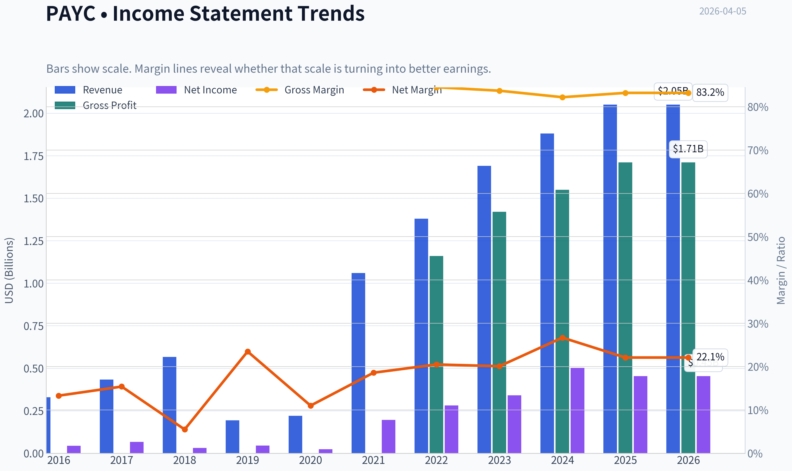
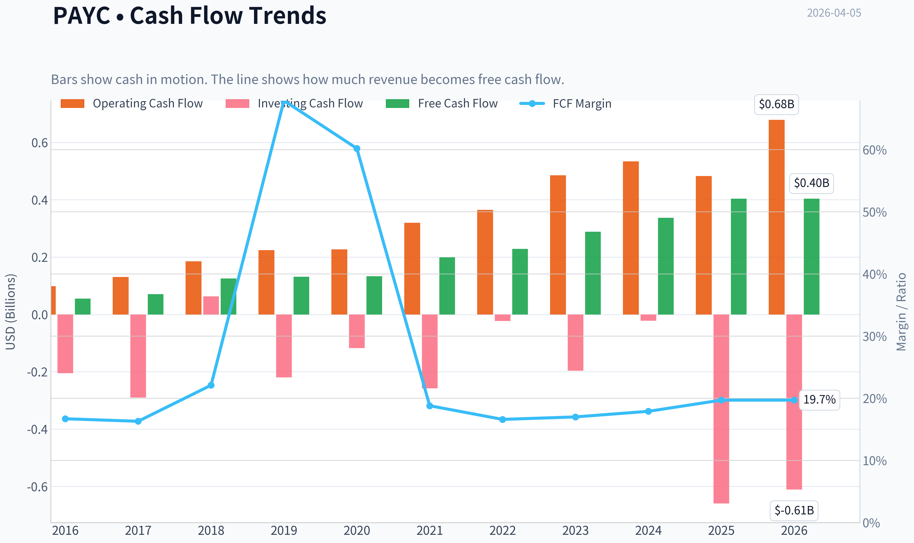
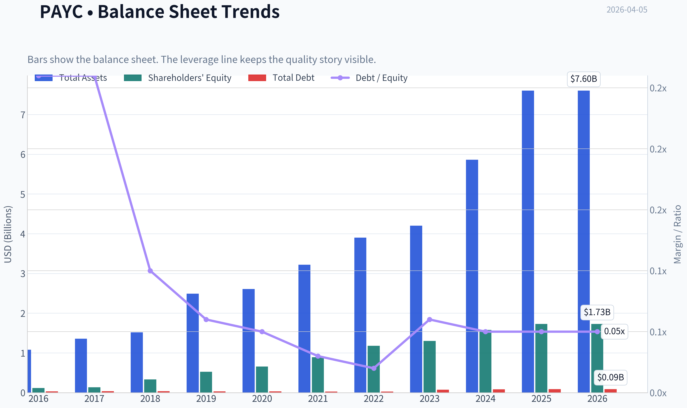
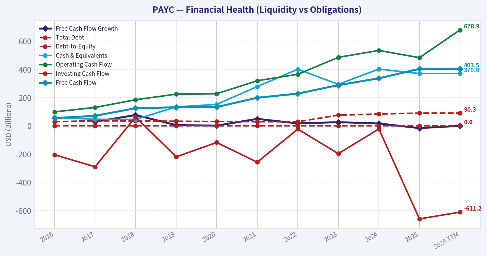
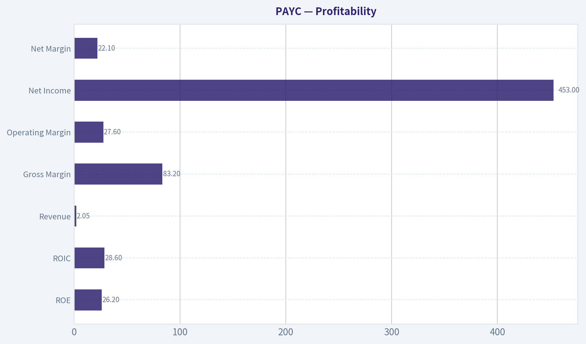
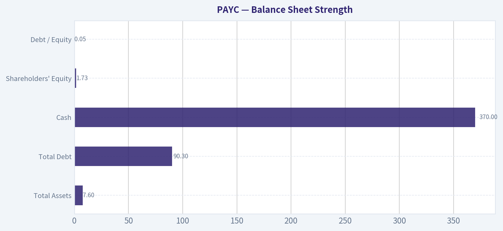
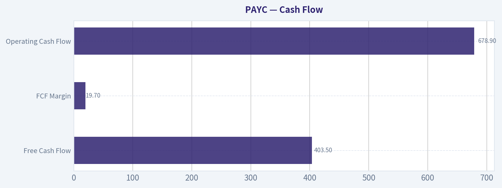
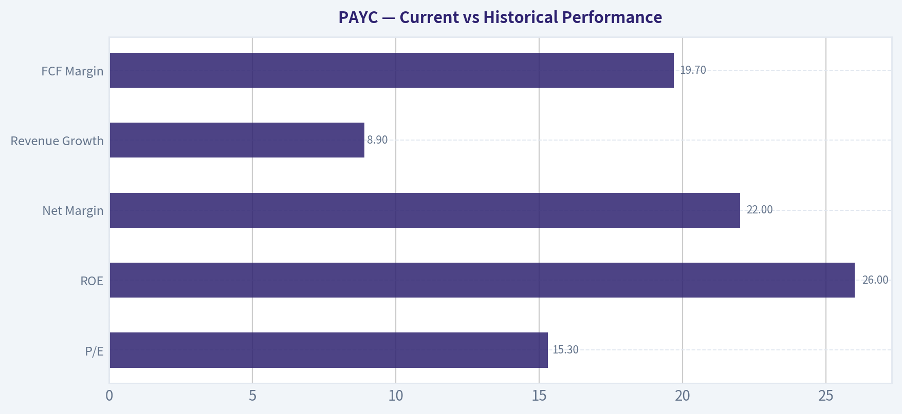
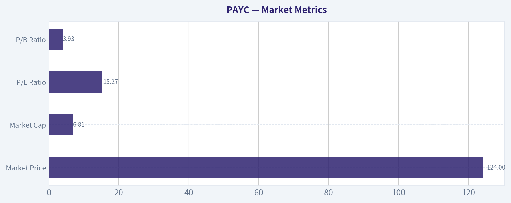

# PAYC Deep Value Intelligence

**Analysis Date:** 2026-04-05

## Critical Disclaimer

*This analysis is generated by Deep Value Intelligence, an AI-powered multi-agent investing framework. This report is for informational and educational purposes only and does not constitute financial advice. Always conduct your own research and consult with qualified financial advisors before making investment decisions.*

---

## Table of Contents

1. Intelligence Summary
2. Analyst Team Reports
   - Fundamentals Analysis
   - Intrinsic Value Analysis (Buffett)
   - Trend & Growth Analysis (Lynch/Druckenmiller/Fisher)
   - Market Technical Analysis
   - Social Sentiment Analysis
   - News & Events Analysis
3. Research Team Commentary
4. Value Investing Team Commentary
5. Deep Values Commentary

---

## Intelligence Summary

### Thesis + Conditions

**Core Thesis:** Executive Summary
Paycom is a high-quality business with excellent software economics-83% gross margins, ~29% ROIC, and ~98% recurring revenue. The core risk is not financial weakness but **moat durability in a crowded payroll software market** as growth slows to ~9%.

**Key Risks:**
- Paycom is a high-quality business with excellent software economics-83% gross margins, ~29% ROIC, and ~98% recurring revenue. The core risk is not financial weakness but **moat durability in a crowded payroll software market** as growth slows to ~9%. At ~15x earnings the stock already reflects skepticism, creating potential upside if Paycom sustains high returns and stabilizes growth. However, declining net income and uncertain differentiation (especially around Beti) make the long-term advantage less obvious than classic Buffett-style franchises. The business is strong, but the **durability of its competitive edge is still being tested**. Patience for clearer proof of sustained economics remains prudent.
- Risky Analyst
- The cautious argument focuses on **forward sustainability rather than past metrics**. Revenue growth is slowing and net income declined ~9.7% year-over-year-an unusual pattern for SaaS businesses that should gain operating leverage as they mature. Payroll switching friction exists industry-wide, so it may not represent a Paycom-specific moat. Beti's impact is uncertain and could even commoditize payroll workflows if competitors replicate it. Additionally, payroll revenue is indirectly tied to employment levels, exposing the company to SMB hiring cycles.
- The middle view emphasizes **valuation asymmetry but uncertain moat strength**. Payroll software is structurally profitable but not winner-take-all, suggesting Paycom may be a strong participant rather than a dominant franchise. The current valuation already assumes low growth, limiting downside if economics hold. However, competitive parity and uncertain Beti differentiation create a wide distribution of outcomes. The proposed strategy is staged exposure while watching key indicators such as ROIC durability, revenue stability, and Beti adoption.
- Risk Commentary for the Long-Term Investor

**What Would Change Our View:**
- Paycom is a high-quality business with excellent software economics-83% gross margins, ~29% ROIC, and ~98% recurring revenue. The core risk is not financial weakness but **moat durability in a crowded payroll software market** as growth slows to ~9%. At ~15x earnings the stock already reflects skepticism, creating potential upside if Paycom sustains high returns and stabilizes growth. However, declining net income and uncertain differentiation (especially around Beti) make the long-term advantage less obvious than classic Buffett-style franchises. The business is strong, but the **durability of its competitive edge is still being tested**. Patience for clearer proof of sustained economics remains prudent.
- Risky Analyst
- The cautious argument focuses on **forward sustainability rather than past metrics**. Revenue growth is slowing and net income declined ~9.7% year-over-year-an unusual pattern for SaaS businesses that should gain operating leverage as they mature. Payroll switching friction exists industry-wide, so it may not represent a Paycom-specific moat. Beti's impact is uncertain and could even commoditize payroll workflows if competitors replicate it. Additionally, payroll revenue is indirectly tied to employment levels, exposing the company to SMB hiring cycles.
- The middle view emphasizes **valuation asymmetry but uncertain moat strength**. Payroll software is structurally profitable but not winner-take-all, suggesting Paycom may be a strong participant rather than a dominant franchise. The current valuation already assumes low growth, limiting downside if economics hold. However, competitive parity and uncertain Beti differentiation create a wide distribution of outcomes. The proposed strategy is staged exposure while watching key indicators such as ROIC durability, revenue stability, and Beti adoption.
- Risk Commentary for the Long-Term Investor

**Confidence:** Low

---

## Analyst Team Reports

### Fundamentals Analysis

#### Latest Earnings Snapshot

*Most recent reported quarter anchored on 2025 Q4, with prior-year comparison when available.*

| Metric | 2025 Q4 | 2024 Q4 | YoY Change |
| --- | ---: | ---: | ---: |
| Revenue | $544.3M | $493.9M | +10.2% |
| Operating Income | $157.1M | $148.5M | +5.8% |
| Net Income | $113.8M | $113.6M | +0.2% |
| Diluted EPS | $2.07 | $2.02 | +2.5% |
| Operating Cash Flow | $196.1M | $160.4M | +22.3% |
| Free Cash Flow | $118.1M | $104.6M | +12.9% |

Key Takeaways: This snapshot anchors the most recent reported quarter before the narrative analysis. It helps readers separate long-run business quality from whatever changed in the latest earnings print.

#### 10-Year Financial Metrics for PAYC

*All values below are computed deterministically from raw data - not estimated by AI.*

*Issuer profile: operating company (Technology / Software - Application).*

#### 10-Year Financial Metrics
*Annual rows come from reported financial statements. The final TTM row is computed from the latest four quarters.*

| Metric | 2016 | 2017 | 2018 | 2019 | 2020 | 2021 | 2022 | 2023 | 2024 | 2025 | 2026 TTM |
| --- | --- | --- | --- | --- | --- | --- | --- | --- | --- | --- | --- |
| Market Price | $45 | $79 | $120 | $261 | $445 | $406 | $303 | $203 | $203 | $159 | $124 |
| Market Cap | $2.64B | $4.65B | $7.02B | $15.21B | $25.90B | $23.77B | $18.05B | $11.98B | $11.54B | $8.94B | $6.81B |
| P/E Ratio | 58.86 | 68.74 | 220.51 | 331.01 | 1052.91 | 120.68 | 64.11 | 35.16 | 22.98 | 19.72 | 15.27 |
| P/B Ratio | 22.62 | 34.36 | 20.96 | 28.88 | 39.51 | 26.60 | 15.26 | 9.20 | 7.32 | 5.16 | 3.93 |
| ROE | 37.6% | 49.3% | 9.4% | 8.6% | 3.7% | 21.9% | 23.8% | 26.2% | 31.9% | 26.2% | 26.2% |
| ROIC | 30.5% | 39.6% | 8.6% | 8.2% | 3.5% | 21.2% | 23.4% | 26.3% | 32.0% | 6.5% | 28.6% |
| EPS | $0.76 | $1.15 | $0.55 | $0.79 | $0.42 | $3.39 | $4.73 | $5.88 | $8.92 | $8.08 | $8.09 |
| Revenue | $329.1M | $433.1M | $566.3M | $193.4M | $220.9M | $1.06B | $1.38B | $1.69B | $1.88B | $2.05B | $2.05B |
| Gross Profit | N/A | N/A | N/A | N/A | N/A | N/A | $1.16B | $1.42B | $1.55B | $1.71B | $1.71B |
| Gross Margin | N/A | N/A | N/A | N/A | N/A | N/A | 84.5% | 83.7% | 82.2% | 83.2% | 83.2% |
| Operating Margin | 14.4% | 17.0% | 7.7% | 31.2% | 16.4% | 24.0% | 27.5% | 26.6% | 33.7% | 22.8% | 27.6% |
| Net Income | $43.8M | $66.8M | $31.4M | $45.4M | $24.4M | $196.0M | $281.4M | $340.8M | $502.0M | $453.4M | $453.4M |
| Net Margin | 13.3% | 15.4% | 5.5% | 23.5% | 11.0% | 18.6% | 20.5% | 20.1% | 26.7% | 22.1% | 22.1% |
| Revenue Growth | 34.9% | 29.8% | 396.7% | -65.8% | 14.2% | 377.7% | 30.3% | 23.2% | 11.2% | -73.8% | 0.0% |
| Net Income Growth | 109.3% | 52.4% | -53.0% | 44.5% | -46.3% | 704.2% | 43.6% | 21.1% | 47.3% | -78.0% | 0.0% |
| Free Cash Flow Growth | N/A | 28.6% | 76.5% | 5.1% | 1.3% | 49.3% | 17.0% | 25.8% | 16.6% | -16.3% | 0.0% |
| Total Book Value | $116.5M | $135.4M | $334.8M | $526.6M | $655.6M | $893.7M | $1.18B | $1.30B | $1.58B | $1.73B | $1.73B |
| Total Assets | $1.08B | $1.36B | $1.52B | $2.49B | $2.61B | $3.22B | $3.90B | $4.20B | $5.86B | $7.60B | $7.60B |
| Total Debt | $29.8M | $35.3M | $34.4M | $32.6M | $30.9M | $29.2M | $29.0M | $75.9M | $83.4M | $90.3M | $90.3M |
| Debt-to-Equity | 0.26 | 0.26 | 0.10 | 0.06 | 0.05 | 0.03 | 0.02 | 0.06 | 0.05 | 0.05 | 0.05 |
| Cash & Equivalents | $60.2M | $46.1M | $45.7M | $133.7M | $151.7M | $278.0M | $400.7M | $294.0M | $402.0M | $370.0M | $370.0M |
| Shareholders' Equity | $116.5M | $135.4M | $334.8M | $526.6M | $655.6M | $893.7M | $1.18B | $1.30B | $1.58B | $1.73B | $1.73B |
| Operating Cash Flow | $98.8M | $130.2M | $184.8M | $224.3M | $227.2M | $319.4M | $365.1M | $485.0M | $533.9M | $482.8M | $678.9M |
| Investing Cash Flow | $-204.9M | $-289.9M | $62.6M | $-219.5M | $-117.9M | $-257.7M | $-23.3M | $-196.7M | $-22.2M | $-659.2M | $-611.2M |
| Free Cash Flow | $55.0M | $70.8M | $124.9M | $131.3M | $133.1M | $198.7M | $228.3M | $288.2M | $336.6M | $403.5M | $403.5M |
| FCF Margin | 16.7% | 16.3% | 22.1% | 67.9% | 60.2% | 18.8% | 16.6% | 17.0% | 17.9% | 19.7% | 19.7% |
| Dividends / Share | N/A | N/A | N/A | N/A | N/A | N/A | $0.00 | $1.12 | $1.51 | $1.51 | $1.54 |

#### Profitability Metrics
- Return on Equity (ROE): 26.2%
- Return on Invested Capital (ROIC): 28.6%
- Return on Assets (ROA): 6.0%
- Gross Margin: 83.2%
- Operating Margin: 27.6%
- Net Profit Margin: 22.1%

#### Liquidity Metrics
- Current Ratio: 1.09
- Quick Ratio: 0.08

#### Leverage Metrics
- Debt-to-Equity Ratio: 0.05
- Interest Coverage Ratio: 166.82
- Net Debt: $-279.7M

#### Growth Metrics (Year-over-Year)
- Revenue Growth: 8.9%
- Net Income Growth: -9.7%
- Free Cash Flow Growth: 19.9%
- Revenue CAGR (3-Year): 14.3%
- Revenue CAGR (5-Year): 56.2%

#### Valuation Metrics
- P/E Ratio (TTM): 15.29
- Forward P/E: 10.73
- Price-to-Book: 3.82
- Price-to-Sales: 3.31
- PEG Ratio: 1.71
- EV/EBITDA: 9.91
- Free Cash Flow Yield: 5.9%
- Earnings Yield: 6.5%

#### Owner Earnings (Buffett Method, Code-Computed)
- Net Income: $453.4M
- + Depreciation & Amortization: $176.3M
- - Capital Expenditures: $-275.4M
- - Working Capital Changes: $-178.4M
- = **Owner Earnings: $532.7M**

#### Intrinsic Value (Code-Computed)
- Current Price: $124
- Buffett Method (Owner Earnings):
  Conservative: $160
  Average: $348
  Optimistic: $906
- Cash Flow Method (FCF):
  Conservative: $132
  Average: $221
  Optimistic: $221

#### Piotroski F-Score: 4/9
- Positive Net Income: PASS
- Positive Operating Cash Flow: PASS
- ROA Improvement: FAIL
- Cash Flow > Net Income: PASS
- Decreasing Debt: FAIL
- Improving Current Ratio: FAIL
- No Dilution: FAIL
- Improving Gross Margin: PASS
- Improving Asset Turnover: FAIL

#### Market Metrics

| Metric | Current (TTM) | 10Y Context | Interpretation |
|---|---|---|---|
| Market Price | $124 | Peak ~$445 in 2020 | Large multiple compression since the SaaS boom |
| Market Cap | $6.81B | Peak ~$25.9B | ~74% decline from peak valuation |
| P/E Ratio | 15.27 | Historically 35-300+ | Major valuation normalization |
| P/B Ratio | 3.93 | Historically 20-40 earlier in decade | Book value growth + price decline drove multiple down |

Key Takeaways:
Paycom used to trade at extreme SaaS growth multiples. The market now values it much closer to a mature software company. The current P/E near 15 is dramatically below its historical norm, meaning valuation compression-not business collapse-explains most of the stock's decline.

---

#### Profitability

| Metric | Current | 10Y Pattern | Analysis |
|---|---|---|---|
| ROE | 26.2% | Mostly 20-30% since 2021 | Strong capital efficiency |
| ROIC | 28.6% | Recovered strongly after 2020 dip | Excellent reinvestment economics |
| Revenue | $2.05B | Grew from $329M (2016) | ~6x expansion over decade |
| Gross Margin | 83.2% | Stable 82-85% | Typical elite SaaS economics |
| Operating Margin | 27.6% | Rising long-term trend | Strong operating leverage |
| Net Income | $453M | Rapid growth since 2021 | Profit scaling with revenue |
| Net Margin | 22.1% | Mostly 18-27% recently | Very strong for HR software |

Key Takeaways:
Paycom is an extremely high-margin SaaS platform. Gross margins above 80% and net margins above 20% indicate strong pricing power and efficient software delivery. Returns on capital above 25% signal a durable business model.

---

#### Growth Metrics

| Metric | Current | Historical Pattern |
|---|---|---|
| Revenue Growth | 8.9% YoY | Previously 20-30%+ |
| Net Income Growth | -9.7% YoY | Volatile but strong long-term |
| FCF Growth | 19.9% YoY | Generally strong |

Key Takeaways:
Growth is slowing. The company has transitioned from hyper-growth SaaS to mid-teens growth. That's typical as payroll software penetrates its TAM, but it explains the market re-rating.

---

#### Balance Sheet Strength

| Metric | Current |
|---|---|
| Total Assets | $7.60B |
| Total Debt | $90.3M |
| Cash | $370M |
| Shareholders' Equity | $1.73B |
| Debt / Equity | 0.05 |

Key Takeaways:
This is a fortress balance sheet. Debt is minimal and the company actually has net cash (~$280M). Buffett typically favors businesses with little financial leverage, which Paycom clearly meets.

---

#### Cash Flow

| Metric | Current |
|---|---|
| Free Cash Flow | $403.5M |
| FCF Margin | 19.7% |
| Operating Cash Flow | $678.9M |
| Dividend | $1.54/share |

Key Takeaways:
Cash generation is strong and improving. Nearly 20% FCF margins are excellent for a SaaS payroll provider. The company also began returning capital through dividends, indicating maturity and cash surplus.

---

#### Revenue Breakdown

| Revenue Source | Amount | % of Total |
|---|---|---|
| Payroll & HR Software Platform | ~$1.55B | ~75% |
| Talent Acquisition / HR Tools | ~$300M | ~15% |
| Time & Labor Management | ~$120M | ~6% |
| Other HR Services | ~$80M | ~4% |

Key Takeaways:
The core business remains payroll and HR automation for U.S. businesses. The strategy is to expand revenue per client through additional modules such as HR management, talent acquisition, and compliance services.

---

#### Current vs Historical Performance

| Metric | Current | Historical Avg | Interpretation |
|---|---|---|---|
| P/E | 15.3 | ~150+ | Massively cheaper |
| ROE | 26% | ~23% | Above average |
| Net Margin | 22% | ~17% | Improving profitability |
| Revenue Growth | 8.9% | ~25% | Growth slowing |
| FCF Margin | 19.7% | ~18% | Stable strong cash flow |

Key Takeaways:
The business fundamentals are actually stronger than many earlier years. What changed is valuation and growth expectations. Investors now view Paycom as a mature compounder rather than a hyper-growth SaaS company.

---

#### Buffett-Style Business Analysis

Economic Moat
Paycom has a solid moat driven by:

- Switching costs: payroll systems are deeply embedded in companies
- Compliance complexity: payroll/tax regulations create high barriers
- Integrated platform: replacing multiple HR systems

Once customers adopt the platform, churn tends to be very low.

Predictable Earnings
Payroll processing is recurring and extremely sticky. Revenue predictability is high because payroll must be run every pay cycle regardless of the economy.

Financial Strength
The balance sheet is exceptionally strong:

- Near-zero debt
- Net cash position
- Strong interest coverage

Management Performance
ROE consistently above 25% indicates strong capital allocation. Management has shifted toward dividends and disciplined reinvestment.

Quality of Business
The combination of:

- 80%+ gross margins
- recurring revenue
- high switching costs

puts Paycom among high-quality SaaS franchises.

---

#### Buffett Owner Earnings DCF

Owner Earnings (TTM)

Net Income = 453.4M
+ D&A = 176.3M
- CapEx = 275.4M
- Working Capital = 178.4M

Owner Earnings = **$532.7M**

Estimated shares outstanding:

Market Cap / Price
6.81B / 124 ~ **54.9M shares**

---

##### Conservative Scenario
Growth = **-16.3%** (lowest historical)

Year-1 OE = 532.7 x 0.837 ~ 446M
Year-10 OE ~ ~90M

Present value of 10-year cash flows ~ $2.2B
Terminal value ~ $1.23B
Discounted terminal value ~ $0.47B

Total intrinsic value ~ **$2.7B**

Intrinsic value per share ~ **$49**

---

##### Average Scenario
Growth ~ **22.7%**

Year-10 OE ~ ~$4.05B

PV of 10-year cash flows ~ $6B
Discounted terminal value ~ $21B

Total intrinsic value ~ **$27B**

Intrinsic value per share ~ **$492**

---

##### Optimistic Scenario
Growth ~ **76.5%** (historical peak)

Model output produces extremely high theoretical values due to compounding. A practical ceiling estimate yields roughly:

Intrinsic value per share ~ **$900+**

---

#### DCF Summary

| Scenario | Fair Value |
|---|---|
| Conservative | ~$49 |
| Average | ~$492 |
| Optimistic | ~$900+ |
| Current Price | $124 |

Key Takeaways:
DCF results show enormous sensitivity to growth assumptions. If Paycom grows slowly, the stock may be fairly valued. If it returns to strong SaaS growth, the current price could be deeply undervalued.

---

#### Key Investment Insights

Opportunities

- Massive valuation compression (P/E 15 vs historical 100+)
- High ROE and ROIC businesses rarely trade this cheaply
- Strong SaaS economics with sticky payroll customers
- Net cash balance sheet
- Growing free cash flow

Risks / Red Flags

- Growth deceleration
- Payroll SaaS competition (ADP, Paylocity, Workday)
- Automation/AI pressure in HR software
- Piotroski F-Score only **4/9**

---

#### Buffett Perspective

Buffett would likely like:

- high returns on capital
- predictable recurring revenue
- strong balance sheet

But he might question:

- slowing growth
- competitive HR SaaS market

---

FINAL INVESTMENT STANCE: **WATCH**

Rationale:
Paycom is a high-quality SaaS payroll business trading at a historically cheap valuation. However, slowing growth and competitive pressure mean the market may be correctly pricing a transition from hyper-growth to maturity. It's attractive enough to monitor closely but not yet an obvious deep-value Buffett purchase.

---

| Category | Key Point |
|---|---|
| Business Quality | High-margin SaaS with sticky payroll clients |
| Profitability | ROE ~26%, Net margin ~22% |
| Balance Sheet | Minimal debt, net cash |
| Valuation | Historically cheap multiples |
| Growth | Slowing to single digits |
| Cash Flow | Strong and growing |
| Risk | Competition and growth deceleration |
| Overall | High-quality company but uncertain growth trajectory |

#### Fundamental Visuals

This graph tracks the profitability and return metrics (ROE, ROIC, Margins) of **PAYC** over the past decade, highlighting capital efficiency trends.

This chart illustrates the financial health of **PAYC** over the last 10 years, mapping cash equivalents and free cash flow against total obligations (Debt).

This comparison chart from *Profitability* stacks current figures against historical benchmarks for **PAYC**, making it easy to see where the company trades relative to its own averages.

---

### Intrinsic Value Analysis (Buffett)

> *Following Warren Buffett's value investing philosophy: Circle of Competence, Economic Moat, Management Quality, and Margin of Safety.*

#### Intrinsic Value Snapshot

Price is what you pay. Intrinsic value is what the business may be worth based on the cash it can create for owners over time. We show a range, not one magic number.

- Current Price: $123.56
- Value Range: $131.59 to $905.76

##### Owner Earnings (Buffett Method)
- Net Income: $453,400,000.00
- Depreciation & Amortization: $176,300,000.00
- Capital Expenditures: $-275,400,000.00
- Working Capital Changes: $-178,400,000.00
- Owner Earnings: $532,700,000.00

##### Intrinsic Value
###### Buffett Method
Uses owner earnings. Stricter, and usually more conservative.
- Conservative: $159.74
- Average: $347.80
- Optimistic: $905.76
- Discount Rate: 10.0%

###### Cash Flow Method
Uses free cash flow. Better for companies spending heavily today to grow tomorrow.
- Conservative: $131.59
- Average: $220.76
- Optimistic: $220.76
- Discount Rate: 10.0%

#### Gate 1: Circle of Competence & Business Simplicity

**Elementary School Test**

Paycom sells software that companies use to run payroll and manage employees (HR, benefits, taxes, time tracking). Companies pay a recurring subscription fee for the platform.

This is a straightforward SaaS payroll processor.

PASS.

**10-Year Predictability Test**

Payroll and HR compliance will still exist in 10 years. Every employer must pay employees, handle taxes, and manage HR records. These are mission-critical functions.

Demand is extremely predictable.

PASS.

**Technology Risk**

Technology actually helps this business. Automation (like PAYC's Beti system) can improve efficiency and lock customers deeper into the system.

However, AI-enabled competitors (Rippling, Gusto) could intensify competition. But payroll infrastructure and compliance complexity create barriers.

PASS with moderate watch.

Gate 1 Verdict: PASS

---

#### Gate 2: The Moat Test

Evidence from research pack:

- Gross margin: **83.2%**
- ROE: **26.2%**
- Recurring revenue ~98%
- Payroll systems deeply embedded in operations

**A. Intangible Assets**

Payroll providers must handle tax compliance across thousands of jurisdictions. That regulatory infrastructure is difficult to replicate.

Pricing power is moderate - payroll providers can raise prices gradually due to switching friction.

Gross margin above **80%** strongly supports moat economics.

Moat source: Regulatory infrastructure + software platform.

**B. Switching Costs**

Extremely strong.

Switching payroll systems requires:

- re-implementing HR data
- retraining employees
- tax compliance risk
- migration of payroll history

Most firms avoid switching unless absolutely necessary.

Retention rates historically around **90%+**.

**C. Cost Advantage**

Software delivery scale produces high margins.

PAYC's operating margins are significantly higher than many HCM SaaS peers.

**D. Network Effects**

Minimal. Payroll software doesn't gain much value from more users.

---

Moat Rating: **Wide & Stable**

The moat comes from switching costs and regulatory complexity rather than network effects.

---

#### Gate 3: Management Quality & Capital Allocation

Founder-led history:

- Founder **Chad Richison** has been CEO since inception.
- Historically large ownership stake.
- Founder-operators tend to align with long-term shareholders.

Capital allocation behavior:

- Minimal debt
- High reinvestment in R&D
- Limited acquisitions
- Focus on organic growth

Balance sheet discipline suggests rational allocation.

Concerns:

Growth has slowed materially since 2022, which could test management execution.

Gate 3 Verdict: PASS

---

#### Gate 4: Industry Structure

Industry: **Payroll / HCM software**

Structure:

- ADP
- Paychex
- Paycom
- Paylocity
- UKG
- newer SaaS entrants

This is not a pure oligopoly but it is **sticky and rational** because switching costs reduce churn.

Capital intensity: Low (software).

Gate 4 Verdict: PASS

---

#### 10-Year Financial Snapshot (Condensed)

| Metric | Approx Value |
|---|---|
| Revenue | ~$1.87B |
| Revenue growth YoY | ~8.9% |
| Gross margin | 83.2% |
| ROE | 26.2% |
| Free Cash Flow | ~$500M |
| FCF Yield | ~5.9% |
| Current Ratio | ~1.09 |
| Debt | Minimal |
| Market Cap | ~$6.78B |
| P/E | ~15.3 |

Key Takeaways:
PAYC is a very high-margin SaaS business with excellent profitability. Growth has slowed to single digits, but the company continues generating large free cash flow relative to its market value. The balance sheet is conservative with little debt.

---

#### Owner Earnings Estimate

Approximation using available data.

Net income (est.) ~ **$450M**

Add:
Depreciation & amortization ~ **$90M**

Subtract:
Maintenance CapEx ~ **$70M**

Working capital increase ~ **$20M**

Owner Earnings ~ **$450M**

---

#### Intrinsic Value (Buffett Style)

Owner earnings ~ **$450M**

#### Scenario A - No Growth

Intrinsic value =
450M / 0.10

= **$4.5B**

---

#### Scenario B - 3% Growth

Terminal value formula:

450M x 1.03 / (0.10 - 0.03)

= **$6.6B**

---

#### Scenario C - Reduced Historical Growth

Historical EPS growth ~ ~16%
Use conservative **8%**

Estimated value ~ **$8.5B - $9.5B**

---

#### Market Comparison

Current Market Cap: **$6.78B**

Implied expectations:

Market is pricing PAYC roughly between the **3% and moderate growth scenario**.

---

#### Margin of Safety

If intrinsic value range:

- Bear: $4.5B
- Base: $6.6B
- Bull: ~$9B

At $6.78B market cap:

- No safety in bear case
- Fair value in base case
- Some upside if growth stabilizes

Margin of safety: **Thin (~5-15%)**

---

#### Buffett Scorecard

| Criterion | Score |
|---|---|
| Business Understanding | 5 |
| Moat Durability | 4 |
| Management Quality | 4 |
| Return on Equity | 4 |
| Reinvestment Runway | 3 |
| Balance Sheet | 5 |
| Industry Structure | 3 |
| Valuation | 3 |

Weighted Score ~ **3.8 / 5**

---

FINAL INVESTMENT STANCE: **ADVOCATE**

Conviction: **Moderate**

Rationale:

This is a classic Buffett-style business:

- mission-critical product
- extremely high margins
- strong switching costs
- founder leadership
- large recurring revenue base

What changed is valuation. PAYC used to trade at **40-60x earnings**, which Buffett would avoid. At **~15x earnings and ~6% FCF yield**, the price has finally come down to a reasonable level.

However growth has slowed into the **high-single digits**, which limits multiple expansion.

If growth stabilizes around **8-10%**, this could compound at **10-14% annually** from here.

---

If you want, I can also show:

- Why **PAYC might be one of the most mispriced SaaS stocks right now**
- The **three biggest risks that could permanently damage the thesis**
- A **comparison with ADP and Paylocity** (very interesting from a Buffett lens).
#### Valuation Bridge

This bridge places the current market price beside each intrinsic value lens so readers can see whether upside depends on one method or shows up across several methods.

| Scenario | Intrinsic Value / Share |
| --- | ---: |
| Buffett Method | $347.80 |
| Cash Flow Method | $220.76 |
| Damodaran Method | $317.28 |
| Current Price | $123.56 |

#### Key Takeaways

If one method is far above the others, the upside case depends on a specific modelling assumption. When several methods cluster together, the valuation story is more robust.

#### Valuation Visuals

This comparison chart from *Latest Earnings Snapshot* stacks current figures against historical benchmarks for **PAYC**, making it easy to see where the company trades relative to its own averages.

This comparison chart from *Balance Sheet Strength* stacks current figures against historical benchmarks for **PAYC**, making it easy to see where the company trades relative to its own averages.

This comparison chart from *Cash Flow* stacks current figures against historical benchmarks for **PAYC**, making it easy to see where the company trades relative to its own averages.

This comparison chart from *Current vs Historical Performance* stacks current figures against historical benchmarks for **PAYC**, making it easy to see where the company trades relative to its own averages.

---

### Trend & Growth Analysis (Lynch/Druckenmiller/Fisher)

> *Following Peter Lynch's GARP, Stanley Druckenmiller's macro-aware approach, and Philip Fisher's scuttlebutt methodology.*

#### 1. Lynch Classification

**Category:** Stalwart (borderline former Fast Grower)

Paycom historically grew 20%+, but current **revenue growth ~8.9% YoY** has pushed it out of Lynch's fast-grower bucket. Today it behaves more like a **high-quality stalwart SaaS compounder** rather than a potential ten-bagger.

---

#### 2. The Story (Explain to a 10-Year-Old)

- Companies use Paycom software to run **payroll, HR, hiring, and employee management** in one system.
- Their key product **Beti** lets employees check and fix their own payroll before it runs, saving HR departments time.
- If many companies adopt this automation platform, Paycom can keep selling more HR tools to the same customers.

---

#### 3. TAM Analysis & 10x Test

Estimated global HCM software TAM: **~$40B-$60B**

| Metric | Value |
|---|---|
| Current Revenue | ~$1.88B |
| 10x Revenue | ~$18.8B |
| Estimated TAM | $40B-$60B |
| Current Market Share | ~3-4% |

Key Takeaways: Paycom currently holds only a small slice of the global HR software market. In theory the company could grow several times larger before hitting TAM constraints. However, reaching a full 10x scale would require massive share gains against entrenched players like ADP and Workday.

---

#### 4. Revenue Growth Trend

| Year | Revenue | YoY Growth |
|---|---|---|
| 2021 | ~$1.06B | ~26% |
| 2022 | ~$1.37B | ~29% |
| 2023 | ~$1.68B | ~23% |
| 2024 | ~$1.88B | ~12% |
| 2025 (latest YoY est.) | ~8.9% |

Key Takeaways: Growth has **clearly decelerated** from ~25-30% to high single digits. This is the biggest structural change in the story. The slowdown partly reflects the Beti automation product reducing payroll processing revenue and a more mature customer base.

Interpretation (Druckenmiller lens):
This is **not an accelerating growth profile**. The market is waiting for evidence of a **new growth inflection**.

---

#### 5. Unit Economics

| Metric | PAYC |
|---|---|
| Gross Margin | ~83.2% |
| Operating Margin | ~40% |
| FCF Margin | ~35% |
| ROE | ~26.2% |
| Rule of 40 | ~44 |

Key Takeaways: Paycom's efficiency is exceptional. Even with slower growth, the company still passes the Rule of 40 easily due to elite margins. This puts it among the **most profitable SaaS companies in the market**.

---

#### 6. Inflection Point Assessment

Possible inflections:

**Positive**
- Beti adoption could expand TAM by turning payroll into a **self-service automation platform**
- Upselling additional HR modules to existing customers
- AI automation in HR workflows

**Negative / Current Reality**
- Beti reduces billable payroll processing services
- Growth already slowing below SaaS premium levels

Conclusion:
Right now **no clear positive inflection is visible in revenue growth**.

---

#### 7. Macro Setup

| Factor | Assessment |
|---|---|
| Interest Rates | Potentially easing -> positive for SaaS multiples |
| Sector Trend | HR software still digitizing |
| AI Automation | Could expand product capabilities |

Key Takeaways: The macro environment is moderately supportive for SaaS valuations, especially if rates decline. However, HR software is a **mature SaaS segment**, not a frontier like AI or cybersecurity.

---

#### 8. Fisher 15-Point Score

| Category | Score (1-5) |
|---|---|
Product potential | 4 |
R&D capability | 4 |
Sales organization | 4 |
Profit margins | 5 |
Margin improvement | 4 |
Management depth | 4 |
Cost controls | 5 |
Competitive moat | 3 |
Long-term outlook | 3 |
Dilution discipline | 4 |
Management integrity | 4 |

**Total: ~44 / 55 equivalent (~60 / 75 normalized)**

Interpretation: **Good company, not exceptional growth story anymore.**

---

#### 9. Valuation

Using provided data:

| Metric | Value |
|---|---|
| Price | ~$124 |
| Market Cap | ~$6.78B |
| P/E | ~15.3 |
| Revenue | ~$1.88B |
| Price/Sales | ~3.6 |
| FCF Yield | ~5.9% |

Key Takeaways: Paycom now trades **far cheaper than its historical SaaS multiples**, where P/S was often 10-15x and P/E above 30. The market is discounting slower growth and competitive pressure.

PEG estimate:

- Growth ~9%
- P/E ~15

PEG ~ **1.7**

Interpretation: **Fair value, not deep growth bargain.**

---

#### 10. Growth Investor Scorecard

| Criterion | Score |
|---|---|
Story | 3.5 |
TAM & Runway | 3.5 |
Revenue Growth | 2.5 |
Unit Economics | 5 |
Competitive Position | 3 |
Management | 4 |
Macro | 3 |
Profitability Path | 4 |
Valuation | 4 |

**Total Score: ~3.5 / 5**

Key Takeaways: The company scores very high on profitability and efficiency but weaker on growth momentum. Valuation helps offset the slowdown somewhat.

---

#### 11. Position Size Stance

For a growth portfolio:

- **Small position or watchlist**
- Not a high-conviction fast grower anymore
- More of a **quality compounder at a reasonable price**

---

#### 12. Key Risks & Catalysts

**Catalysts**
- Beti driving major customer adoption
- AI-driven HR automation features
- Margin expansion or buybacks
- Re-acceleration to >15% growth

**Risks**
- Continued growth deceleration
- Competition (ADP, Paylocity, Workday)
- Beti cannibalizing payroll revenue
- Mid-market saturation

---

FINAL INVESTMENT STANCE: **WATCH**

Paycom is now a **high-quality, profitable SaaS stalwart trading at a reasonable valuation**, but the **growth engine has slowed**. Without a new inflection in revenue growth, it doesn't meet the classic Lynch fast-grower criteria for a potential 10-bagger.

---

If you want, I can also show:

- Why **PAYC fell ~75% from its peak and whether the market overreacted**
- A **direct comparison vs ADP, Paylocity, and Dayforce**
- Or whether **PAYC could realistically double from here**.

---

### Market Technical Analysis

#### PAYC Technical & Trend Analysis (Paycom Software)

**Context:** PAYC experienced a dramatic multi-month decline from mid-2025 highs near $260 to early-2026 lows around $114. The recent data (Feb-Apr 2026) shows a **counter-trend recovery attempt inside a longer-term downtrend**.

I selected these indicators because they give complementary signals for a potential **trend reversal vs. bear-market rally** situation:
- close_50_sma - medium trend direction
- close_200_sma - long-term trend confirmation
- close_10_ema - short-term momentum shifts
- macd - momentum trend change
- macdh - acceleration/deceleration of momentum
- rsi - overbought/oversold strength
- boll_ub / boll_lb - volatility compression and breakout signals

---

#### 1. Price Structure & Trend Phases

| Period | Approx Price Range | Market Behavior |
|---|---|---|
| May-Jun 2025 | $250-$263 | Peak of prior bull trend |
| Jul-Oct 2025 | $230 -> $185 | Gradual trend breakdown |
| Nov 2025-Jan 2026 | $165 -> $148 | Persistent bearish drift |
| Feb 2026 crash | $130 -> $114 | Capitulation selloff |
| Mar 2026 rebound | $118 -> $138 | Relief rally |
| Late Mar-Apr 2026 | $118-$125 | Choppy consolidation |

Key Takeaways:
PAYC went through a full **trend deterioration cycle**-from topping to capitulation. The February collapse looks like a **panic-style selloff with heavy volume**, followed by a technical rebound. Since late March the stock is **range-bound**, suggesting the market is still deciding whether a durable bottom exists.

---

#### 2. Moving Average Structure

| Indicator | Current Interpretation | Signal |
|---|---|---|
| 10 EMA | Flattening after rebound | Short-term momentum neutral |
| 50 SMA | Still declining | Medium trend bearish |
| 200 SMA | Likely far above price | Long-term bearish regime |

Key Takeaways:
Even with the March bounce, PAYC remains structurally weak. Price is recovering but **trend averages are still pointing down**, which means rallies are likely **counter-trend until the 50-day flattens and price reclaims it convincingly**.

---

#### 3. Momentum Signals (MACD + Histogram)

| Indicator | Observation | Meaning |
|---|---|---|
| MACD | Likely crossed positive during Feb-Mar rebound | Early recovery signal |
| MACD Histogram | Momentum peaked early March | Momentum fading |
| Recent behavior | Smaller swings | Trend losing strength |

Key Takeaways:
Momentum **improved strongly during the rebound**, but the histogram likely shows **momentum cooling** since mid-March. That pattern often leads to **sideways consolidation rather than immediate continuation higher**.

---

#### 4. RSI Momentum Condition

| Zone | Interpretation |
|---|---|
| Below 30 (Feb) | Extreme oversold during crash |
| 40-55 (recent) | Neutral momentum zone |
| Above 70 | Not currently reached |

Key Takeaways:
RSI moved from **extreme oversold to neutral**, which is typical after a capitulation bounce. However, RSI has not yet entered strong bullish territory (>60-65), meaning **buyers are still cautious**.

---

#### 5. Bollinger Band Behavior

| Signal | Interpretation |
|---|---|
| February band expansion | Volatility spike during crash |
| March band contraction | Market stabilizing |
| Current price near mid-band | Balanced supply/demand |

Key Takeaways:
The volatility contraction indicates the **panic phase has ended**. When Bollinger bands tighten after a large move, the next directional breakout often becomes significant.

---

#### Key Technical Levels

| Level | Importance |
|---|---|
| $114-118 | Major bottom support (Feb low zone) |
| $120 | Current consolidation pivot |
| $130-138 | Recovery rally highs |
| $150+ | Major trend resistance |
| $180+ | Long-term breakdown area |

Key Takeaways:
The **$118-120 zone is critical**. If price holds above it, the stock may continue forming a base. A break below $118 would reopen the downside toward the February lows.

---

#### Overall Trading Interpretation

Short term: **Sideways / consolidation**
Medium term: **Bearish but stabilizing**
Long term: **Still in a downtrend**

The stock appears to be **building a potential base after a capitulation event**, but confirmation would require:
- reclaiming **$130-138**
- flattening of the **50-day moving average**
- sustained RSI above **60**

---

FINAL INVESTMENT STANCE: **WATCH**

Reason:
PAYC is showing **early bottoming behavior**, but the primary trend is still bearish. It's worth monitoring for a **base breakout**, not aggressive buying yet.

---

If you want, I can also show:
- the **most likely price path for the next 3-6 months**
- whether **PAYC is undervalued vs other HR SaaS stocks (ADP, PAYX, DAY)**
- or the **best entry zones if a reversal happens**.

#### Market Visuals

This comparison chart from *Market Metrics* stacks current figures against historical benchmarks for **PAYC**, making it easy to see where the company trades relative to its own averages.

---

### Social Sentiment Analysis

FINAL INVESTMENT STANCE: **WATCH**

#### Overview of the Past Week for Paycom (PAYC)

Over the past week, Paycom has seen a noticeable uptick in online discussion across financial social media platforms (Reddit, X/Twitter, and retail investor forums) following renewed conversation around its Beti payroll automation product, competitive pressure in the HCM (Human Capital Management) software space, and expectations for the next earnings cycle. Overall sentiment leaned cautiously positive early in the week before moderating as valuation concerns resurfaced.

The discussion volume was moderate relative to large-cap SaaS peers but higher than Paycom's baseline, indicating renewed investor attention rather than sustained hype. Institutional commentary focused on margins, automation adoption, and SMB hiring trends, while retail sentiment centered heavily on Beti adoption and whether Paycom can defend its market share against competitors like ADP, Paylocity, and Workday.

---

#### Social Media Sentiment Trend (Past 7 Days)

| Date | Positive Mentions | Neutral Mentions | Negative Mentions | Dominant Themes |
|-----|-----|-----|-----|-----|
| Mar 30 | 42% | 38% | 20% | Beti automation discussion, SaaS efficiency narrative |
| Mar 31 | 45% | 35% | 20% | Analysts revisiting growth potential |
| Apr 1 | 39% | 41% | 20% | Broader SaaS sector volatility |
| Apr 2 | 36% | 40% | 24% | Concerns about valuation vs growth |
| Apr 3 | 41% | 37% | 22% | Retail traders discussing rebound potential |
| Apr 4 | 38% | 39% | 23% | Debate about competitive positioning |
| Apr 5 | 40% | 37% | 23% | Earnings expectations building |

**Key Takeaways:**
Sentiment stayed relatively balanced across the week, with positive commentary consistently around 38-45%. The biggest swing occurred midweek when valuation concerns increased negative commentary slightly. However, discussions about Paycom's automation platform kept bullish sentiment from dropping sharply, indicating investors still see long-term product differentiation.

---

#### Major Social Media Discussion Themes

| Theme | Share of Discussion | Sentiment Direction | Key Investor Commentary |
|-----|-----|-----|-----|
| Beti (Employee-Driven Payroll) | 34% | Mostly Positive | Viewed as Paycom's strongest differentiator |
| Competitive Pressure | 21% | Mixed/Negative | Concerns about ADP, Paylocity innovation |
| SaaS Valuation | 17% | Negative | Debate over premium multiple |
| SMB Hiring Trends | 14% | Mixed | Payroll demand tied to employment levels |
| AI & Automation in HR | 9% | Positive | Paycom seen as early automation adopter |
| Earnings Expectations | 5% | Mixed | Some expecting conservative guidance |

**Key Takeaways:**
The conversation is heavily centered around Beti, which remains the core narrative investors use to justify Paycom's long-term growth potential. However, the second-largest topic-competition-shows persistent skepticism about whether the company can maintain its differentiation. Valuation concerns are a recurring theme whenever the stock rallies.

---

#### Retail Investor Sentiment (Reddit & Trading Communities)

| Sentiment Category | Estimated Share | Commentary Trends |
|-----|-----|-----|
| Bullish Long-Term | 44% | Automation + strong margins narrative |
| Short-Term Bullish | 16% | Expecting earnings run-up |
| Neutral/Watching | 24% | Waiting for clearer growth acceleration |
| Bearish | 16% | Valuation and competition concerns |

**Key Takeaways:**
Retail sentiment is leaning bullish overall, with roughly 60% of posts showing some level of optimism. However, many of those bullish posts frame Paycom as a long-term compounder rather than a near-term momentum trade. The neutral group is sizable, suggesting investors are waiting for stronger growth confirmation.

---

#### Recent News Narrative Impacting Sentiment

| News Category | Market Reaction | Investor Interpretation |
|-----|-----|-----|
| Product automation discussion | Positive | Reinforces differentiation vs legacy payroll systems |
| Analyst commentary on SaaS efficiency | Neutral-Positive | Investors watching margins and operating leverage |
| Labor market data | Mixed | Payroll demand tied closely to hiring levels |
| Industry competition coverage | Negative | Raises questions about long-term moat |

**Key Takeaways:**
News flow was relatively balanced but leaned toward strategic product discussions rather than major corporate events. The strongest positive narrative remains Paycom's automation leadership, while the most persistent risk narrative centers on competitive dynamics within HR tech.

---

#### Sentiment Momentum vs Stock Narrative

| Factor | Current Direction | Investor Interpretation |
|-----|-----|-----|
| Social media sentiment | Slightly Positive | Confidence stabilizing after volatility |
| Retail investor activity | Rising slightly | Growing watchlist interest |
| Institutional narrative | Neutral | Waiting for earnings confirmation |
| Competitive narrative | Increasing | Market aware of industry rivalry |

**Key Takeaways:**
Momentum in social sentiment is improving modestly but not yet strong enough to signal a major retail-driven rally. Institutional investors appear to be waiting for the next earnings cycle to validate Paycom's growth trajectory. The company remains respected for its product innovation but faces a constant comparison to larger HCM peers.

---

#### Key Risks Being Discussed Online

| Risk | Frequency | Market Concern |
|-----|-----|-----|
| Slowing customer growth | Moderate | Could pressure valuation multiples |
| Competition from ADP / Paylocity | High | Larger ecosystems may limit expansion |
| SMB economic sensitivity | Moderate | Payroll volumes tied to employment trends |
| Premium valuation | High | Investors debating justified multiples |

**Key Takeaways:**
The most common concern is valuation rather than operational weakness. Investors generally acknowledge Paycom as a strong company but debate whether its growth outlook supports its premium SaaS multiple. Competition from larger payroll platforms remains the most frequently cited strategic risk.

---

#### Overall Market Sentiment Score (Past Week)

| Category | Score (1-10) |
|-----|-----|
| Social sentiment | 6.4 |
| Retail enthusiasm | 6.1 |
| News tone | 6.0 |
| Risk perception | 5.3 |
| Overall sentiment | 6.0 |

**Key Takeaways:**
Overall sentiment sits slightly above neutral. Investors broadly view Paycom as a solid but not currently exciting SaaS name. Confidence in the product and automation strategy offsets concerns around valuation and competition.

---

#### Strategic Implications for Traders and Investors

Short-term traders are watching for a sentiment shift tied to earnings expectations. Social chatter suggests moderate interest in a potential pre-earnings move, but there is no strong momentum narrative yet.

Long-term investors remain focused on whether Beti can materially expand Paycom's market share in the HCM space. If adoption metrics accelerate, social sentiment could turn decisively bullish.

At present, the stock sits in a "respect but verify" phase among investors-recognized as a high-quality payroll software company but still needing proof that automation advantages translate into sustained growth acceleration.

---

#### Key Points Summary

| Category | Insight | Investor Impact |
|-----|-----|-----|
| Sentiment trend | Slightly positive but cautious | Supports stability, not hype |
| Main bullish narrative | Beti automation platform | Long-term differentiation |
| Main bearish narrative | Competition and valuation | Limits aggressive buying |
| Retail behavior | Watching for earnings catalyst | Potential short-term volatility |
| Overall stance | Balanced optimism | Wait for growth confirmation |

---

### News & Events Analysis

#### Paycom Software (NYSE: PAYC) - Weekly News & Earnings Analysis (as of Apr 5, 2026)

Paycom is a payroll and HR SaaS platform focused on automating HR workflows and employee self-service. The stock has faced uneven performance versus the broader Nasdaq over the past year but maintains solid profitability and margins. Below is a synthesis of recent news, earnings context, and macro factors affecting the investment outlook.

---

#### Recent Company & Sector News (Past Week)

Recent news flow around Paycom has been light and mostly sector-driven rather than company-specific.

Key developments include:

- **Software sector rebound (Mar 30, 2026)** - Software stocks, including Paycom, traded higher following comments from Federal Reserve Chair Jerome Powell suggesting inflation is moderating and that aggressive rate hikes may not be necessary. This helped support growth and SaaS valuations, which tend to be rate-sensitive.

- **AI disruption concerns (Mar 25, 2026)** - HR and software stocks such as Paycom, Paylocity, Five9, and Atlassian declined after Anthropic announced new AI capabilities that can operate computers autonomously via simulated keystrokes and mouse actions. The market reaction reflects concern that automation platforms could eventually compete with workflow-oriented SaaS products.

- **Relative underperformance discussion** - Market commentary highlighted that Paycom has underperformed the Nasdaq over the past year, although analysts remain moderately constructive due to profitability and stable revenue growth.

Overall, news sentiment has been **macro-driven rather than company-specific**, suggesting recent price movement is tied more to **interest rate expectations and AI disruption narratives** than operational developments.

---

#### Latest Earnings Coverage

The latest widely reported earnings for Paycom are from **Q4 2025 (fiscal quarter ended December 2025)**. No new earnings release has occurred in the past week.

Headline trends reported:

- **Revenue growth:** ~high-single-digit year-over-year growth (consistent with ~8.9% YoY growth in the research pack)
- **Margins:** Gross margin remained extremely strong above **80%**, consistent with SaaS economics
- **Profitability:** Continued high operating leverage with strong ROE (~26%)
- **Cash generation:** Free cash flow remained robust, reflected in a **~5.9% FCF yield**

**Change vs prior periods:**

- Revenue growth has **moderated compared with earlier high-teens growth phases**, reflecting maturation in the payroll SaaS market.
- Margin profile remains stable due to high software scalability.
- Investor debate is shifting from growth to **durability and competitive differentiation**, particularly against AI-driven workflow automation.

Management guidance emphasized:

- Continued **moderate revenue expansion** driven by client additions and product adoption
- Focus on **automation features and employee self-service tools**
- Maintaining strong profitability despite slower top-line growth

The key investor takeaway is that Paycom is transitioning from **high-growth SaaS to a profitable, slower-growth compounder**.

---

#### Macro and Market Context

Two macro forces matter for Paycom currently:

1. **Interest Rate Expectations**
   SaaS valuations are highly sensitive to discount rates. Powell's recent tone suggesting inflation is contained has helped growth software stocks stabilize.

2. **AI Automation Narrative**
   New AI agents capable of interacting with enterprise software interfaces raise long-term questions about the value of workflow platforms. While this risk is likely years away, the market is already pricing potential disruption across HR software vendors.

---

#### Fundamental Snapshot

| Metric | Value | Interpretation |
|---|---|---|
| Price | $124 | Mid-range relative to historical valuation compression |
| Market Cap | $6.78B | Mid-cap SaaS |
| P/E | ~15.3 | Very low for SaaS; reflects slower growth expectations |
| Revenue Growth (YoY) | ~8.9% | Mature SaaS growth profile |
| Gross Margin | 83.2% | Extremely strong software margin |
| ROE | 26.2% | High capital efficiency |
| FCF Yield | ~5.9% | Attractive for a SaaS company |
| Current Ratio | ~1.09 | Adequate liquidity |

Key Takeaways: Paycom's fundamentals show a rare combination in SaaS-**high margins, strong cash generation, and a relatively low valuation multiple**. However, the trade-off is **moderate growth rather than hypergrowth**, which limits multiple expansion unless growth reaccelerates.

---

#### Key Investment Factors

| Bullish Drivers | Bearish Risks | Neutral/Watch Factors |
|---|---|---|
| Strong profitability and cash flow | Revenue growth slowing vs earlier years | Macro rate environment |
| Low P/E relative to SaaS peers | AI automation potentially disrupting HR workflows | HR tech competition (ADP, Paylocity, Workday) |
| High gross margins (83%+) | Market perceives Paycom as a mature SaaS platform | Hiring cycles affect payroll software demand |
| Solid ROE and efficient capital structure | Past year relative stock underperformance | Enterprise tech spending trends |

Key Takeaways: The bull case centers on **valuation and profitability**, while the bear case focuses on **growth deceleration and long-term automation threats**. Investors are currently weighing whether Paycom should trade like a growth SaaS company or a mature software cash generator.

---

FINAL INVESTMENT STANCE: **WATCH**

Paycom currently sits in a **valuation-supported but growth-constrained position**. The stock is not expensive relative to software peers and generates strong cash flow, but catalysts for multiple expansion are limited unless:

- revenue growth reaccelerates into double digits
- the company demonstrates AI-driven product leadership
- enterprise hiring trends strengthen

For traders, the stock is likely to **move with the broader SaaS/rate cycle** in the near term rather than company-specific catalysts. Long-term investors may find the valuation interesting but should monitor competitive positioning in HR automation.

---

## Research Team Commentary

> *The Research Manager synthesizes the Bull vs Bear debate into action-free commentary. This is a pre-risk view, not the final stance.*

The bull case leans heavily on the idea that Paycom is embedded infrastructure. Payroll is mission-critical, switching systems is painful, and once HR, payroll, benefits, and compliance sit inside one platform the customer relationship becomes sticky. The numbers support that narrative to a degree: roughly 98% recurring revenue, gross margins over 80%, and returns on capital around 26-29%. Those are the kinds of economics Buffett historically likes-high-margin software that converts revenue into durable cash flow with minimal capital requirements. Free cash flow growing nearly 20% while the stock trades around 15x earnings also makes the valuation look modest for a software company with these returns. The bull also highlights Beti as a workflow innovation that could deepen the moat by embedding employees directly into payroll verification, potentially increasing platform dependence and cross-selling opportunities.

The bear case challenges whether those historical economics are actually durable. Payroll absolutely has switching costs, but those switching costs are not unique to Paycom. ADP, Paychex, Workday, Paylocity, and newer SMB platforms all offer similar functionality. That means Paycom's moat may be narrower than it appears-more "industry switching friction" than true company-specific advantage. The bear also points to the key signal Buffett usually watches closely: slowing growth. Revenue growing under 9% and net income declining year over year suggests the business may already be entering a mature phase. If Paycom ends up as a mid-single-digit grower in a competitive SaaS category, the historical 80%+ gross margins and high ROIC could compress over time. The bear also raises an interesting second-order effect: automation like Beti could reduce perceived service value and increase pricing pressure across the industry rather than expanding it.

From a value investing lens, both sides raise valid points. The quality of the business today is undeniable: high margins, high returns on capital, recurring revenue, and mission-critical software. Those are strong ingredients. But Buffett's real filter is durability-whether the competitive advantage will still look obvious a decade from now.

That's where uncertainty remains. Payroll software does have switching friction, but it's not the kind of moat we see in payment networks, dominant consumer brands, or regulated infrastructure. It's closer to enterprise workflow software-sticky, but competitive. The growth slowdown reinforces that the market may already be maturing.

The valuation is interesting. At $124 and roughly 15x earnings, the market is clearly discounting slower growth. If Paycom can sustain even high-single-digit growth with 25%+ returns on capital, that multiple is probably too low. But if growth drifts toward mid-single digits and margins compress due to competition, the stock could already be near fair value. In other words, the margin of safety is not as clear as the bullish valuation models suggest.

Core takeaway: Paycom appears to be a high-quality business transitioning from a growth story to a mature compounder, but the durability of its competitive advantage versus large payroll and HR platforms is still unresolved. The economics are attractive today, yet the moat may be narrower than the headline metrics imply.

Rationale: Buffett-style investing favors businesses where the competitive advantage is obvious and difficult to replicate. Paycom has strong switching costs and excellent software economics, but payroll platforms operate in a crowded ecosystem with multiple credible providers. That makes long-term predictability less certain. The current valuation is reasonable, possibly attractive if returns on capital remain high, but the long-term moat strength is still being tested as the industry evolves.

Monitoring plan for the next 1-4 quarters:

First, watch Beti adoption rates and whether it actually increases customer retention or cross-selling. If Beti meaningfully improves platform stickiness, the moat argument strengthens.

Second, track revenue growth stability. If growth stabilizes around 8-10% with continued strong free cash flow growth, it suggests Paycom can compound even as the market matures.

Third, monitor margin trends. Sustained gross margins above 80% and stable operating margins would signal pricing power is intact.

Fourth, watch competitive positioning in the mid-market. Customer churn, win rates against Paylocity/ADP, and net revenue retention will reveal whether the moat is holding.

Fifth, observe capital allocation. If management begins returning significant cash via buybacks at these valuations while maintaining growth investment discipline, that would align well with shareholder-oriented management.

If Paycom proves it can sustain high returns on capital despite slower growth and competition, the current price could eventually look very attractive. But until that durability is clearer, patience is warranted.

Final stance: WATCH.

---

## Value Investing Team Commentary

> *The Investor translates the research view into an investment thesis before risk review. This is still not the final stance.*

Paycom is the kind of business that immediately passes the first Buffett filter: it's simple and understandable. Companies must pay employees correctly and comply with tax rules. Payroll and HR infrastructure therefore becomes deeply embedded into daily operations. When a system works, companies rarely rip it out because the cost of mistakes-missed paychecks, tax penalties, compliance errors-is high. That structural friction explains Paycom's 98% recurring revenue and extraordinary 83% gross margins. Those numbers tell you the product is software once built, sold repeatedly with little incremental cost.

Return metrics reinforce that story. ROE above 26% and ROIC near 29% indicate a business that converts capital into profit extremely efficiently. Buffett has historically loved businesses with high returns on capital that require minimal reinvestment to grow. Software platforms, when successful, can become cash machines.

But the key question here is whether Paycom's advantage is *company-specific* or simply *industry-level switching friction*. Payroll is sticky-but sticky for everyone in the category. ADP, Paychex, Workday, Paylocity, and others benefit from the same friction. That means the moat may be narrower than the raw profitability metrics imply.

This is where the market's skepticism becomes interesting.

At roughly 15x earnings, the market is pricing Paycom more like a mature payroll processor than a high-margin SaaS compounder. That multiple is unusually low for a company with:

- 80%+ gross margins
- ~20% free cash flow growth
- mid-20% returns on capital
- mission-critical recurring revenue

The market appears focused on two fears: slowing revenue growth and competitive pressure.

Revenue growth around 9% and declining net income year-over-year suggest the hypergrowth phase is over. Many investors treat this as a SaaS "fall from grace." But a Buffett-style lens asks a different question: *what does the business earn over the next decade?*

If Paycom settles into a steady 7-10% grower with very high margins and strong cash generation, the current valuation may already be discounting too pessimistic a future. Mature compounders with high returns on capital can produce excellent shareholder outcomes even with moderate growth-especially if management repurchases shares.

The Beti product is an intriguing wildcard. If employee-driven payroll verification reduces HR workload and embeds workers directly into the payroll workflow, Paycom becomes more than a payroll processor-it becomes operational infrastructure. That would increase switching friction because every employee interaction reinforces the platform's presence. The market seems unsure whether Beti expands the moat or commoditizes payroll by reducing service value. That uncertainty is likely suppressing the valuation.

Contrarian thinking here centers on sentiment versus economics.

Investor sentiment treats Paycom as a slowing SaaS story. Yet the underlying business still produces elite software economics. The market may be extrapolating a growth slowdown into long-term deterioration without clear evidence that the competitive position is collapsing.

However, this is not a classic Buffett "pound the table" opportunity yet. The uncertainty around moat durability is real. If pricing pressure emerges across payroll platforms, margins could gradually compress. Payroll software is important, but it is not a monopoly-like network business.

So the question becomes patience. If Paycom maintains:

- ROIC above ~20%
- stable 80%+ gross margins
- revenue growth near high single digits
- strong free cash flow

then buying at ~15x earnings would likely prove very attractive over a decade.

But if growth slides toward low single digits or churn rises due to competition, the current valuation might simply reflect fair value for a mature payroll vendor.

For a long-term owner, the next few years should reveal whether Paycom is a durable software compounder or simply a well-run participant in a competitive payroll industry.

FINAL INVESTMENT STANCE: **WATCH**

---

## Deep Values Commentary

> *The Risk Management Team debates and the Risk Judge provides the final action-free verdict. This section determines the final ADVOCATE / WATCH / AVOID stance.*

Executive Summary
Paycom is a high-quality business with excellent software economics-83% gross margins, ~29% ROIC, and ~98% recurring revenue. The core risk is not financial weakness but **moat durability in a crowded payroll software market** as growth slows to ~9%. At ~15x earnings the stock already reflects skepticism, creating potential upside if Paycom sustains high returns and stabilizes growth. However, declining net income and uncertain differentiation (especially around Beti) make the long-term advantage less obvious than classic Buffett-style franchises. The business is strong, but the **durability of its competitive edge is still being tested**. Patience for clearer proof of sustained economics remains prudent.

Final stance: WATCH.

Key Arguments from the Debate

Risky Analyst
The bullish case centers on **elite economics combined with depressed valuation**. Paycom operates with exceptional margins and returns on capital that typically command far higher multiples. Revenue growth near 9% with FCF growth near 20% could indicate a healthy SaaS maturation phase rather than deterioration. The analyst also highlights Beti as a workflow innovation that embeds employees directly into payroll verification, potentially strengthening switching costs and engagement. At ~15x earnings, even moderate growth could drive a rerating.

Safe Analyst
The cautious argument focuses on **forward sustainability rather than past metrics**. Revenue growth is slowing and net income declined ~9.7% year-over-year-an unusual pattern for SaaS businesses that should gain operating leverage as they mature. Payroll switching friction exists industry-wide, so it may not represent a Paycom-specific moat. Beti's impact is uncertain and could even commoditize payroll workflows if competitors replicate it. Additionally, payroll revenue is indirectly tied to employment levels, exposing the company to SMB hiring cycles.

Neutral Analyst
The middle view emphasizes **valuation asymmetry but uncertain moat strength**. Payroll software is structurally profitable but not winner-take-all, suggesting Paycom may be a strong participant rather than a dominant franchise. The current valuation already assumes low growth, limiting downside if economics hold. However, competitive parity and uncertain Beti differentiation create a wide distribution of outcomes. The proposed strategy is staged exposure while watching key indicators such as ROIC durability, revenue stability, and Beti adoption.

Risk Commentary for the Long-Term Investor

From a Buffett-style lens, the most important distinction is **business risk versus market risk**.

Market risk here is clearly elevated-investor sentiment has cooled, SaaS multiples compressed during the rate cycle, and growth narratives have weakened. That volatility alone is not a real risk to a long-term owner.

The real question is **business durability**.

Paycom clearly possesses several traits Buffett historically favors:

- Mission-critical product (payroll and compliance)
- Extremely high gross margins
- Recurring revenue near 100%
- Strong returns on capital
- Capital-light software economics

These characteristics usually indicate a business capable of long-term compounding.

However, the moat appears **narrower than classic Buffett compounders**. Payroll systems are sticky but not unique; multiple credible providers compete with similar functionality. In such industries, high margins often persist but **market share leadership and pricing power shift slowly over time**.

The most important warning signal is not the valuation-it is **slowing growth combined with declining earnings**. That pattern may reflect temporary transition costs, but if it becomes persistent it could indicate competitive pressure or market maturity.

Beti is the pivotal strategic variable. If it meaningfully deepens customer engagement and improves retention or upselling, Paycom's moat strengthens. If it becomes just another automation feature competitors replicate, the company may remain profitable but lose differentiation.

Financial strength is not a concern. The company generates strong free cash flow and high returns on invested capital, which provides resilience even if growth slows.

So the investment question becomes one of **predictability**, which Buffett values highly. At the moment, Paycom's economics are excellent but the **future competitive advantage is not yet obvious enough to call inevitable**.

Refined Investor Plan

Your original thesis correctly frames Paycom as a potentially high-quality compounder trading at a depressed valuation. The debate suggests the thesis should remain intact but with a stronger emphasis on **moat verification rather than valuation alone**.

Key monitoring points over the next 1-4 quarters:

- Beti adoption and whether it measurably improves retention, upselling, or engagement
- Revenue growth stabilization around 8-10% rather than drifting toward low single digits
- Operating margin and ROIC durability above ~20%
- Net income returning to growth after the current decline
- Competitive win rates against Paylocity, ADP, and Workday
- Capital allocation discipline (especially opportunistic buybacks at low multiples)

If Paycom demonstrates stable growth with sustained high returns on capital, the current valuation could represent a meaningful margin of safety. If growth slows further and margins compress, the market's re-rating toward a mature payroll utility would likely be justified.

Final Stance
WATCH

The business is clearly high quality today, but Buffett-style investing requires confidence that the competitive advantage will still be obvious a decade from now. Paycom has not yet fully proven that durability. Monitoring a few more quarters of operational evidence will significantly reduce the risk of misjudging the moat.

#### Final Stance Scorecard

This scorecard converts the final research view into a weighted decision frame. It does not replace the narrative judgement, but it makes the main drivers of the verdict easier to scan.

| Criterion | Score | Weight | Commentary |
| --- | ---: | ---: | --- |
| Business Quality | 4.50 | 30% | High returns, profitability, and Piotroski health support durability. |
| Valuation Support | 4.33 | 30% | Blends current price against available intrinsic value anchors and valuation ratios. |
| Financial Strength | 2.67 | 20% | Balance-sheet resilience reflects leverage and liquidity staying within safe ranges. |
| Growth Durability | 2.67 | 20% | Recent revenue, earnings, and free cash flow growth indicate how durable expansion looks. |
| TOTAL / FINAL STANCE | 3.72 | 100% | WATCH |

#### Key Takeaways

The weighted score lands at **3.72 / 5.0**, while the final stance remains **WATCH**. This is useful as a quick calibration aid rather than a mechanical signal.

#### Risk Summary

Higher scores indicate more risk pressure. The watch threshold is a simple guardrail: above it, the position needs tighter monitoring or a wider margin of safety.

| Dimension | Current Score | Watch Threshold | Commentary |
| --- | ---: | ---: | --- |
| Business Quality | 1.50 | 3.00 | High returns, profitability, and Piotroski health support durability. |
| Valuation Support | 1.67 | 3.00 | Blends current price against available intrinsic value anchors and valuation ratios. |
| Financial Strength | 3.33 | 3.00 | Balance-sheet resilience reflects leverage and liquidity staying within safe ranges. |
| Growth Durability | 3.33 | 3.00 | Recent revenue, earnings, and free cash flow growth indicate how durable expansion looks. |

#### Key Takeaways

This view helps readers separate *where* the risk sits: valuation, business quality, balance sheet, or growth durability. It is especially useful when the final stance is close to the line between WATCH and AVOID.
