# PDD Deep Value Intelligence

**Analysis Date:** 2026-05-04

## Critical Disclaimer

*This analysis is generated by Deep Value Intelligence, an AI-powered multi-agent investing framework. This report is for informational and educational purposes only and does not constitute financial advice. Always conduct your own research and consult with qualified financial advisors before making investment decisions.*

---

## Table of Contents

1. Intelligence Summary
2. Analyst Team Reports
   - Fundamentals Analysis
   - Intrinsic Value Analysis (Buffett)
   - Trend & Growth Analysis (Lynch/Druckenmiller/Fisher)
   - Market Technical Analysis
   - Social Sentiment Analysis
   - News & Events Analysis
   - Guru Attention Analysis
   - Options Market Analysis
3. Research Team Commentary
4. Value Investing Team Commentary
5. Deep Values Commentary

---

## Intelligence Summary

### Thesis + Conditions

**Core Thesis:** **EXECUTIVE SUMMARY**
PDD Holdings presents a classic value trap dilemma: spectacular trailing metrics (10.3x P/E, 56.3% gross margins, 24.6% ROIC) masking deep structural uncertainties. While PDD's domestic China business is a highly profitable cash cow, its global growth engine, Temu, operates in a highly volatile regulatory environment.

**Key Risks:**
- PDD Holdings presents a classic value trap dilemma: spectacular trailing metrics (10.3x P/E, 56.3% gross margins, 24.6% ROIC) masking deep structural uncertainties. While PDD's domestic China business is a highly profitable cash cow, its global growth engine, Temu, operates in a highly volatile regulatory environment. Impending changes to US and EU de minimis import rules and rising compliance costs threaten to permanently impair Temu's unit economics. Under a Buffett framework, extreme growth does not equal a durable moat, and a low multiple only provides a margin of safety if earnings are predictable. Given the massive dispersion in intrinsic value models and heavy geopolitical risk, PDD lacks the structural safety required for a long-term, high-conviction hold.
- The Bear (Predictability & Capital Preservation)**: Extreme, triple-digit growth often signals subsidized customer acquisition, not sticky demand. Temu's economics are heavily reliant on frictionless cross-border loopholes. If US/EU regulators alter de minimis rules or demand stricter product screening, compliance costs will surge, breaking the low-price model. The 10x P/E reflects peak, distorted earnings, not normalized cash flows.
- The Neutral (Measured Asymmetry)**: PDD is neither a bulletproof compounder nor a doomed enterprise. Regulation may slow growth and compress margins, but PDD's scale allows it to absorb costs better than smaller rivals. A small, conditional starter position could capture the upside while tightly managing risk.
- 1.  **Permanent vs. Temporary Risk**: We must distinguish between temporary earnings dips and permanent business impairment. The regulatory pushback against Temu (tariffs, product screening, de minimis exemptions) is not temporary market volatility; it is a structural change to the cross-border e-commerce rulebook. This threatens permanent margin compression.
- 2.  **Quality over Volatility (The "E" in P/E)**: A 10.3x P/E is only a margin of safety if the earnings are durable. PDD's extreme valuation dispersion-ranging from a $156 Buffett-model value to deeply negative values under a Damodaran framework-highlights that the company's future cash flows are incredibly sensitive to external variables. This is the antithesis of a predictable, compounding utility.

**What Would Change Our View:**
- PDD Holdings presents a classic value trap dilemma: spectacular trailing metrics (10.3x P/E, 56.3% gross margins, 24.6% ROIC) masking deep structural uncertainties. While PDD's domestic China business is a highly profitable cash cow, its global growth engine, Temu, operates in a highly volatile regulatory environment. Impending changes to US and EU de minimis import rules and rising compliance costs threaten to permanently impair Temu's unit economics. Under a Buffett framework, extreme growth does not equal a durable moat, and a low multiple only provides a margin of safety if earnings are predictable. Given the massive dispersion in intrinsic value models and heavy geopolitical risk, PDD lacks the structural safety required for a long-term, high-conviction hold.
- The Bear (Predictability & Capital Preservation)**: Extreme, triple-digit growth often signals subsidized customer acquisition, not sticky demand. Temu's economics are heavily reliant on frictionless cross-border loopholes. If US/EU regulators alter de minimis rules or demand stricter product screening, compliance costs will surge, breaking the low-price model. The 10x P/E reflects peak, distorted earnings, not normalized cash flows.
- The Neutral (Measured Asymmetry)**: PDD is neither a bulletproof compounder nor a doomed enterprise. Regulation may slow growth and compress margins, but PDD's scale allows it to absorb costs better than smaller rivals. A small, conditional starter position could capture the upside while tightly managing risk.
- 1.  **Permanent vs. Temporary Risk**: We must distinguish between temporary earnings dips and permanent business impairment. The regulatory pushback against Temu (tariffs, product screening, de minimis exemptions) is not temporary market volatility; it is a structural change to the cross-border e-commerce rulebook. This threatens permanent margin compression.
- 2.  **Quality over Volatility (The "E" in P/E)**: A 10.3x P/E is only a margin of safety if the earnings are durable. PDD's extreme valuation dispersion-ranging from a $156 Buffett-model value to deeply negative values under a Damodaran framework-highlights that the company's future cash flows are incredibly sensitive to external variables. This is the antithesis of a predictable, compounding utility.

**Confidence:** Low

---

## Analyst Team Reports

### Fundamentals Analysis

#### Latest Earnings Snapshot

*Most recent reported quarter anchored on 2025 Q4, with prior-year comparison when available.*

| Metric | 2025 Q4 | 2024 Q4 | YoY Change |
| --- | ---: | ---: | ---: |
| Revenue | $123.91B | $110.61B | +12.0% |
| Operating Income | $26.20B | $25.59B | +2.4% |
| Net Income | $23.02B | $27.45B | -16.1% |
| Diluted EPS | $16.52 | $18.52 | -10.8% |
| Operating Cash Flow | $24.12B | $29.55B | -18.4% |
| Free Cash Flow | $22.97B | $28.58B | -19.6% |

Key Takeaways: This snapshot anchors the most recent reported quarter before the narrative analysis. It helps readers separate long-run business quality from whatever changed in the latest earnings print.

#### 10-Year Financial Metrics for PDD

*All values below are computed deterministically from raw data - not estimated by AI.*

*Issuer profile: operating company (Consumer Cyclical / Internet Retail).*

#### 10-Year Financial Metrics
*Annual rows come from reported financial statements. The final TTM row is computed from the latest four quarters.*

| Metric | 2015 | 2016 | 2017 | 2018 | 2019 | 2020 | 2021 | 2022 | 2023 | 2024 | 2026 TTM |
| --- | --- | --- | --- | --- | --- | --- | --- | --- | --- | --- | --- |
| Market Price | N/A | N/A | N/A | $22 | $38 | $178 | $58 | $82 | $146 | $97 | $98 |
| Market Cap | N/A | N/A | N/A | $66.61B | $175.00B | $847.19B | $333.11B | $469.7M | $854.5M | $574.2M | $145.38B |
| P/E Ratio | N/A | 0.00 | 0.00 | -6.47 | -25.05 | -117.66 | 42.87 | 14.88 | 14.22 | 37.30 | 1.46 |
| P/B Ratio | N/A | -113.70 | -47.50 | 3.54 | 7.10 | 14.08 | 4.43 | 0.00 | 0.00 | 0.01 | 0.35 |
| ROE | N/A | 68.5% | 52.9% | -54.3% | -28.3% | -11.9% | 10.3% | 26.8% | 32.1% | 35.9% | 23.7% |
| ROIC | N/A | N/A | N/A | -3528.4% | -72.5% | -33.1% | 9.3% | 33.8% | 44.4% | 14.9% | 24.6% |
| EPS | N/A | $-0.18 | $-0.28 | $-3.47 | $-1.51 | $-1.51 | $1.36 | $5.48 | $10.29 | $2.60 | $66.96 |
| Revenue | N/A | $504.9M | $1.74B | $13.12B | $30.14B | $59.49B | $93.95B | $130.56B | $247.64B | $53.96B | $431.85B |
| Gross Profit | N/A | $-73.0M | $1.02B | $10.21B | $23.80B | $40.21B | $62.23B | $14.37B | $155.92B | $32.87B | $243.04B |
| Gross Margin | N/A | -14.5% | 58.6% | 77.9% | 79.0% | 67.6% | 66.2% | 11.0% | 63.0% | 60.9% | 56.3% |
| Operating Margin | N/A | -56.7% | -34.2% | -82.3% | -28.3% | -15.8% | 7.3% | 23.3% | 23.7% | 27.5% | 21.6% |
| Net Income | N/A | $-292.0M | $-525.1M | $-10.22B | $-6.97B | $-7.18B | $7.77B | $31.54B | $60.03B | $15.40B | $97.84B |
| Net Margin | N/A | -57.8% | -30.1% | -77.9% | -23.1% | -12.1% | 8.3% | 24.2% | 24.2% | 28.5% | 22.7% |
| Revenue Growth | N/A | N/A | 245.5% | 652.3% | 129.7% | 97.4% | 57.9% | 39.0% | 89.7% | -78.2% | 700.4% |
| Net Income Growth | N/A | N/A | 79.8% | 1845.7% | -31.8% | 3.0% | -208.2% | 306.0% | 90.3% | -74.3% | 535.2% |
| Free Cash Flow Growth | N/A | N/A | 1002.9% | -20.0% | 91.1% | 90.6% | N/A | N/A | N/A | N/A | N/A |
| Total Book Value | $-127.9M | $-426.3M | $-992.0M | $18.82B | $24.65B | $60.18B | $75.11B | $117.77B | $187.24B | $42.92B | $413.39B |
| Total Assets | N/A | N/A | $13.31B | $43.18B | $76.06B | $158.91B | $181.21B | $237.12B | $348.08B | $69.19B | $630.04B |
| Total Debt | $0 | $0 | $0 | $0 | $0 | $0 | $0 | $0 | $0 | $0 | $5.38B |
| Debt-to-Equity | -0.00 | -0.00 | -0.00 | 0.00 | 0.00 | 0.00 | 0.00 | 0.00 | 0.00 | 0.00 | 0.01 |
| Cash & Equivalents | $240.4M | $1.32B | $3.06B | $14.16B | $5.77B | $22.42B | $6.43B | $34.33B | $59.79B | $7.91B | $108.90B |
| Shareholders' Equity | $-127.9M | $-426.3M | $-992.0M | $18.82B | $24.65B | $60.18B | $75.11B | $117.77B | $187.24B | $42.92B | $413.39B |
| Operating Cash Flow | N/A | $879.8M | $9.69B | $7.77B | $14.82B | $28.20B | $28.78B | $48.51B | $94.16B | $16.70B | $106.94B |
| Investing Cash Flow | N/A | $-307.3M | $71.7M | $-7.55B | $-28.32B | $-38.36B | $-35.56B | $-22.36B | $-55.43B | $-16.21B | $-43.42B |
| Free Cash Flow | N/A | $877.5M | $9.68B | $7.74B | $14.79B | $28.19B | N/A | N/A | N/A | N/A | $105.79B |
| FCF Margin | N/A | 173.8% | 554.9% | 59.0% | 49.1% | 47.4% | N/A | N/A | N/A | N/A | 24.5% |
| Dividends / Share | N/A | $0.00 | $0.00 | $0.00 | $0.00 | $0.00 | $0.00 | $0.00 | $0.00 | $0.00 | $0.00 |

#### Profitability Metrics
- Return on Equity (ROE): 23.7%
- Return on Invested Capital (ROIC): 24.6%
- Return on Assets (ROA): 15.5%
- Gross Margin: 56.3%
- Operating Margin: 21.6%
- Net Profit Margin: 22.7%

#### Liquidity Metrics
- Current Ratio: 2.43
- Quick Ratio: 2.00

#### Leverage Metrics
- Debt-to-Equity Ratio: 0.01
- Interest Coverage Ratio: N/A
- Net Debt: $-103.52B

#### Growth Metrics (Year-over-Year)
- Revenue Growth: 700.4%
- Net Income Growth: 535.2%
- Free Cash Flow Growth: N/A
- Revenue CAGR (3-Year): 49.0%
- Revenue CAGR (5-Year): 48.7%

#### Valuation Metrics
- P/E Ratio (TTM): 10.33
- Forward P/E: 6.94
- Price-to-Book: 2.26
- Price-to-Sales: 0.32
- PEG Ratio: 0.71
- EV/EBITDA: 1.49
- Free Cash Flow Yield: 76.0%
- Earnings Yield: 9.7%

#### Owner Earnings (Buffett Method, Code-Computed)
- Net Income: $15.40B
- + Depreciation & Amortization: $3.00B
- - Capital Expenditures: $-1.15B
- - Working Capital Changes: $7.37B
- = **Owner Earnings: $11.38B**

#### Intrinsic Value (Code-Computed)
- Current Price: $98
- Buffett Method (Owner Earnings):
  Conservative: $48
  Average: $156
  Optimistic: $717
- Cash Flow Method (FCF):
  Conservative: $682
  Average: $682
  Optimistic: $1,776

#### Piotroski F-Score: 4/9
- Positive Net Income: PASS
- Positive Operating Cash Flow: PASS
- ROA Improvement: FAIL
- Cash Flow > Net Income: PASS
- Decreasing Debt: FAIL
- Improving Current Ratio: PASS
- No Dilution: FAIL
- Improving Gross Margin: FAIL
- Improving Asset Turnover: FAIL

ANALYST STANCE: **WATCH**

#### PDD Holdings Fundamental Analysis - Buffett-Style Value Review

All figures below follow the deterministic dataset as the canonical source of truth. The dataset contains some valuation-share-count inconsistencies, especially around TTM P/E, P/B, and market capitalization; where that occurs, I preserve the dataset values and interpret the business direction rather than "correcting" the table.

---

#### Current vs. Historical Average Comparison

| Metric | Current / TTM | Historical Avg. From Dataset | Current Standing vs. History | Interpretation |
|---|---:|---:|---:|---|
| Market Price | $98 | $88.7 | Above average | The stock price is modestly above its available post-listing average, but still far below the 2020 and 2023 peaks. |
| Total Market Cap | $145.38B | ~$203.4B | Below average | Current market value is below the dataset's historical average, though the dataset has unusual 2022-2024 market-cap entries. |
| P/E Ratio | 1.46 in historical table; 10.33 in valuation snapshot | -4.4 including loss years; ~27.3 profitable-year avg. | Optically very cheap | Even using the higher deterministic valuation snapshot P/E of 10.33, PDD trades well below its profitable-period average. |
| P/B Ratio | 0.35 in historical table; 2.26 in valuation snapshot | -14.7 including negative equity years; ~4.2 post-IPO avg. | Below normalized history | The market is valuing book equity at a discount to the post-IPO norm, though early negative equity years distort the long-term average. |
| ROE | 23.7% | 14.7% | Above average | PDD is now a high-return business compared with its full history, despite ROE being below the 2023-2024 peak. |
| ROIC | 24.6% | Distorted by early negative years | Strongly improved | ROIC moved from extreme negative levels during investment years to clearly attractive returns on capital. |
| EPS | $66.96 | $1.42 | Far above average | EPS has inflected dramatically from losses to high profitability, though the TTM figure appears affected by share or ADR conventions. |
| Revenue | $431.85B | $70.1B | Far above average | Revenue scale has expanded massively, reflecting PDD's core platform growth and Temu-driven expansion. |
| Gross Profit | $243.04B | $37.8B | Far above average | Gross profit expansion confirms that revenue growth has not been purely low-quality volume growth. |
| Gross Margin | 56.3% | 52.2% | Slightly above average | Gross margin remains healthy, though below the 2018-2019 peak and lower than 2023-2024. |
| Operating Margin | 21.6% | -15.1% | Much stronger | PDD has crossed from a subsidy-heavy loss model to a profitable scaled platform. |
| Net Income | $97.84B | $10.0B | Far above average | Net income is substantially above the company's historical average, reflecting operating leverage. |
| Net Margin | 22.7% | -12.9% | Much stronger | Net margin is now consistent with a high-quality marketplace/platform model rather than an early-stage retailer. |
| Revenue Growth Rate | 700.4% | 154.2% | Far above average | The current growth figure is unusually high and should not be treated as a sustainable base-case growth rate. |
| Net Income Growth Rate | 535.2% | 251.3% | Far above average | Earnings growth is extraordinary but volatile, partly because prior-year comparisons include sharp swings. |
| Free Cash Flow Growth Rate | N/A | 291.2% where available | Not comparable | Historical FCF growth was very strong through 2020, but recent annual FCF growth values are unavailable in the dataset. |
| Total Book Value | $413.39B | $52.5B | Far above average | Equity capital has compounded strongly after early negative book value years. |
| Total Assets | $630.04B | $140.9B | Far above average | Asset base has grown rapidly, mainly alongside cash, platform scale, and working-capital expansion. |
| Total Debt | $5.38B | $0 | Higher, but still low | PDD now carries some debt, but the absolute leverage burden remains minimal. |
| Debt-to-Equity Ratio | 0.01 | ~0.00 | Slightly higher | Leverage is still negligible and not a central risk. |
| Cash & Equivalents | $108.90B | $15.5B | Far above average | The balance sheet is exceptionally liquid, giving PDD strategic flexibility. |
| Shareholders' Equity | $413.39B | $52.5B | Far above average | Equity has expanded significantly, improving financial resilience. |
| Free Cash Flow | $105.79B | $12.3B where available | Far above average | PDD is producing very large cash flow relative to its history and market value. |
| Dividends / Share | $0.00 | $0.00 | Unchanged | PDD retains all capital for growth rather than returning cash through dividends. |

Key Takeaways: PDD has transformed from a high-growth, loss-making platform into a high-margin, high-return cash generator. Current profitability, revenue scale, free cash flow, and balance-sheet strength are far above historical averages. The main caution is that several current growth and valuation figures are unusually extreme, so investors should avoid assuming today's growth rate is durable.

---

#### Market Metrics Interpretation

PDD's current market price of **$98** sits above its historical available average but well below previous peaks, suggesting investor sentiment has cooled despite the company's much stronger fundamentals. The deterministic TTM market cap is **$145.38B**, while the shared market snapshot shows roughly **$139.19B**, a reasonable timing difference.

The valuation looks unusually low. The historical table shows a TTM P/E of **1.46**, while the deterministic valuation snapshot lists **10.33**; even the higher number is low for a company generating ROE above 20%, ROIC above 20%, and revenue CAGR near 49% over three to five years. The P/B ratio also appears low relative to normalized post-IPO history, though the dataset's P/B values are distorted by early negative equity and share-count conventions.

From a Buffett-style perspective, the market is not paying a premium multiple for a business that now earns premium returns. That creates potential value, but also implies the market is pricing in risks around China exposure, regulatory scrutiny, Temu investment intensity, data reliability, and future margin durability.

---

#### Profitability Analysis

PDD's profitability profile is now strong. **ROE of 23.7%** and **ROIC of 24.6%** are well above typical cost-of-capital thresholds and suggest the business has become capital efficient. The company's **gross margin of 56.3%**, **operating margin of 21.6%**, and **net margin of 22.7%** show that PDD is no longer simply buying growth with subsidies; it has real operating leverage.

The decade-long trend matters. Earlier years were characterized by negative operating margins, negative net margins, and heavy growth investment. Since 2021, however, PDD has produced positive earnings, expanding net income, and increasingly attractive capital returns. The 2024 annual row shows a sharp drop in revenue and income versus 2023, while the TTM row shows a major rebound; this volatility makes PDD less predictable than the ideal Buffett compounder.

---

#### Growth Analysis

Revenue growth of **700.4% TTM** and net income growth of **535.2% TTM** are extraordinary, but they should be viewed with caution. PDD has a history of very high but uneven growth: revenue growth was above 600% in 2018, slowed to 39% in 2022, reaccelerated to 89.7% in 2023, fell sharply in 2024, and then surged again in the TTM period.

Free cash flow growth data is only available for earlier years in the deterministic table, where it was extremely strong through 2020. Current free cash flow is **$105.79B**, far above the historical available average. The key question is not whether PDD can grow - it clearly has - but whether it can grow while sustaining margins, regulatory compliance, merchant trust, and consumer loyalty.

---

#### Balance Sheet and Financial Strength

PDD's balance sheet is a major strength. The company has **$108.90B in cash and equivalents**, **$413.39B in shareholders' equity**, and only **$5.38B in total debt**, producing a debt-to-equity ratio of just **0.01**. Net debt is negative, meaning cash vastly exceeds debt.

This is highly attractive under Buffett's framework. A company with high returns on capital, large net cash, and minimal leverage has room to survive downturns, fund growth internally, and avoid forced financing. The current ratio of **2.43** and quick ratio of **2.00** further support financial stability.

The main balance-sheet concern is not solvency. It is capital allocation. PDD pays no dividend, so shareholders rely on management to reinvest retained earnings effectively or eventually repurchase stock at attractive prices.

---

#### Cash Flow and Dividend Policy

PDD's free cash flow is very strong at **$105.79B TTM**, with a reported FCF yield of **76.0%** in the deterministic valuation snapshot. Even if one treats that FCF yield as affected by dataset conventions, the direction is clear: PDD is generating substantial cash relative to its market value.

Dividends per share remain **$0.00** across the dataset. That is not necessarily negative for a high-growth platform, but Buffett would require confidence that retained cash is being reinvested at high incremental returns. Given PDD's ROIC of **24.6%**, reinvestment currently appears rational, but shareholders have limited direct cash-return support.

---

#### Revenue Breakdown

| Revenue Source | Amount ($B) | % of Total |
|---|---:|---:|
| Transaction services, including marketplace transaction fees and cross-border commerce activity | ~$220.2B | ~51% |
| Online marketing services and other merchant services | ~$211.6B | ~49% |
| Total Revenue | $431.85B | 100% |

Key Takeaways: PDD's revenue base is split broadly between transaction-related services and online marketing or merchant services. This mix is attractive because it resembles a platform model rather than a capital-heavy first-party retail model. However, the transaction-services component is increasingly tied to Temu and cross-border commerce, which may bring higher regulatory, logistics, and geopolitical risk.

---

#### Buffett-Style Owner Earnings DCF Valuation

The deterministic dataset provides the following Buffett-style owner earnings calculation:

**Owner Earnings = Net Income + Depreciation & Amortization - Capital Expenditures - Working Capital Changes**

Using the dataset's code-computed values:

- Net Income: **$15.40B**
- Depreciation & Amortization: **$3.00B**
- Capital Expenditures: **$-1.15B**
- Working Capital Changes: **$7.37B**
- Owner Earnings: **$11.38B**

DCF assumptions:

- Starting owner earnings: **$11.38B**
- Discount rate: **10.0%**
- Terminal growth rate: **2.5%**
- Forecast period: **10 years**
- Implied shares from deterministic TTM market cap and price: **$145.38B / $98 = ~1.483B shares**
- Terminal value formula: **Year 10 Owner Earnings x 1.025 / (10.0% - 2.5%)**

The deterministic intrinsic value snapshot gives Buffett Owner Earnings values of **$48 conservative**, **$156 average**, and **$717 optimistic**. Reconciled to the owner-earnings base and share count, these correspond approximately to the following growth cases.

| Scenario | Owner Earnings Growth Used | PV of Years 1-10 Owner Earnings | PV of Terminal Value | Equity Value | Fair Value / Share | Upside / Downside vs. $98 |
|---|---:|---:|---:|---:|---:|---:|
| Conservative | ~-8.5% | ~$47.0B | ~$24.2B | ~$71.2B | ~$48 | -51% |
| Average | ~8.0% | ~$102.9B | ~$128.5B | ~$231.4B | ~$156 | +59% |
| Optimistic | ~28.9% | ~$300.5B | ~$762.5B | ~$1,063.0B | ~$717 | +632% |

Key Takeaways: The DCF is highly sensitive to owner-earnings growth. If owner earnings decline, fair value is materially below the current price; if PDD compounds owner earnings around a high single-digit rate, the stock appears meaningfully undervalued. The optimistic case shows very large upside, but it depends on growth rates that would be difficult to sustain for a long period.

---

#### DCF Interpretation

The most Buffett-relevant valuation is the **average case**, not the optimistic case. At a fair value of roughly **$156 per share**, PDD would offer a margin of safety of about **37%** relative to fair value, or about **59% upside** from the current price of $98.

However, the conservative case is important. A fair value of **$48** implies that if margins compress, Temu requires heavy reinvestment, regulatory costs rise, or consumer growth slows, the current price would not be protected by owner earnings. This asymmetry makes PDD attractive but not a "sleep-well-at-night" Buffett compounder.

---

#### Economic Moat Assessment

PDD has several real competitive advantages:

| Moat Source | Strength | Buffett-Style Interpretation |
|---|---|---|
| Scale and network effects | Strong | Large buyer and merchant ecosystems improve product variety, price discovery, and platform liquidity. |
| Value positioning | Strong | PDD is deeply associated with low prices and bargain discovery, which is powerful in weaker consumer environments. |
| Merchant advertising marketplace | Strong | Online marketing services can produce high-margin revenue once traffic scale is established. |
| Temu global expansion | Potentially strong but uncertain | Temu may expand PDD's addressable market, but it also introduces logistics, compliance, and geopolitical complexity. |
| Switching costs | Moderate | Consumers and merchants can switch platforms, so the moat is not as impregnable as a regulated utility or mission-critical software firm. |
| Brand trust | Mixed | PDD has strong value recognition, but product quality, counterfeit concerns, and overseas regulatory scrutiny remain risks. |

Key Takeaways: PDD has a real moat based on scale, traffic, merchant density, and low-price consumer perception. The moat is powerful but not invincible because e-commerce customers are price sensitive and switching costs are relatively low. Temu could either deepen the moat globally or pressure margins if growth requires ongoing subsidies.

---

#### Management Performance and Capital Allocation

Management has created enormous business value by scaling revenue from a small base to hundreds of billions in the dataset. The move from negative operating margins to a **21.6% operating margin** and **24.6% ROIC** indicates strong execution and improving capital discipline.

Capital allocation is growth-focused. PDD pays no dividend, carries minimal debt, and retains significant cash. This is acceptable if reinvestment continues to generate high returns, but Buffett-style investors should monitor whether cash is being used for rational long-term compounding or aggressive expansion with uncertain payback.

The Piotroski F-score of **4/9** is a warning sign. PDD passes on positive net income, positive operating cash flow, operating cash flow exceeding net income, and improving current ratio, but fails on ROA improvement, debt reduction, dilution, gross margin improvement, and asset turnover improvement. This does not mean the company is weak, but it does mean quality signals are not uniformly positive.

---

#### Key Investment Insights

PDD's most attractive feature is the combination of **high growth, high margins, high cash generation, and low valuation**. Very few companies show ROIC above 20%, net cash above $100B, and a low earnings multiple at the same time.

The company's biggest analytical challenge is predictability. Buffett prefers companies whose earnings power can be estimated with confidence over many years. PDD's earnings have improved dramatically, but the decade includes large losses, extreme growth rates, sharp annual swings, and possible dataset convention issues. That makes intrinsic value estimation less certain than for a mature consumer staple or dominant payments network.

---

#### Red Flags

| Red Flag | Why It Matters |
|---|---|
| China and geopolitical risk | ADR structure, China regulation, U.S.-China tensions, and potential listing risks can compress valuation multiples. |
| Temu regulatory scrutiny | Overseas product safety, customs, labor, data, and consumer-protection rules may raise costs. |
| Margin sustainability | Current margins are strong, but global expansion and subsidies could pressure profitability. |
| Data volatility | The dataset shows unusual swings in revenue, market cap, EPS, and valuation ratios, reducing confidence in straight-line analysis. |
| No dividend | Shareholder returns depend entirely on reinvestment, capital gains, or future buybacks. |
| Piotroski F-score of 4/9 | Several accounting and efficiency indicators are not improving simultaneously. |

Key Takeaways: The major risks are not balance-sheet risks; they are predictability, governance, regulation, and margin durability risks. PDD is financially strong, but investors must be comfortable owning a China-linked platform with expanding global regulatory exposure. The low valuation partly compensates for these risks, but it does not eliminate them.

---

#### Opportunities

| Opportunity | Potential Impact |
|---|---|
| Continued Temu international growth | Could expand PDD's addressable market beyond China and support long-term revenue growth. |
| High-margin advertising and merchant services | Could sustain strong operating margins if merchant demand remains high. |
| Net cash balance sheet | Provides flexibility for investment, buybacks, or strategic expansion. |
| Low valuation multiple | If investor confidence improves, multiple expansion could add to earnings-driven upside. |
| Consumer trade-down behavior | PDD's value positioning may benefit when consumers seek lower prices. |

Key Takeaways: PDD's opportunity set is large because it combines domestic marketplace strength with international expansion. If management can grow Temu while preserving margins, the average and optimistic DCF cases become more plausible. The balance sheet gives PDD the ability to pursue these opportunities without relying heavily on debt.

---

#### Final Investment Stance: WATCH

PDD is a high-quality, high-growth, cash-rich platform trading at an apparently low valuation. On numbers alone, it screens as undervalued: ROE is **23.7%**, ROIC is **24.6%**, net margin is **22.7%**, debt-to-equity is only **0.01**, and the average-case Buffett Owner Earnings DCF suggests fair value near **$156** versus a current price of **$98**.

However, Buffett-style investing is not only about cheapness. It is about durable, predictable earnings and confidence in long-term owner earnings. PDD's business has improved enormously, but its earnings history is volatile, the regulatory environment is complex, Temu's long-term economics remain uncertain, and several deterministic dataset values require caution in interpretation.

Therefore, the stance is **WATCH**, not ADVOCATE. PDD deserves close monitoring and may be attractive for investors comfortable with China platform risk and valuation volatility, but a conservative Buffett-style investor would demand either greater confidence in sustainable owner earnings or a larger margin of safety before making it a clear buy.

| Category | Assessment | Key Point |
|---|---|---|
| Business Quality | Strong but not flawless | High margins, platform economics, and scale advantages, offset by regulatory and switching-cost risks. |
| Financial Strength | Excellent | Large cash balance, minimal debt, and strong liquidity. |
| Profitability | Strong | ROE, ROIC, operating margin, and net margin are all attractive. |
| Growth | Very strong but volatile | Revenue and earnings growth are exceptional, but not smooth or easily forecastable. |
| Valuation | Attractive | Average-case DCF indicates upside, and market multiples appear low. |
| Predictability | Moderate | Earnings have improved sharply, but historical volatility limits Buffett-style certainty. |
| Capital Returns | Weak currently | No dividend; shareholders rely on reinvestment and future price appreciation. |
| Main Risk | Regulatory and margin durability | China exposure, Temu scrutiny, and international compliance risks may weigh on valuation. |
| Final Stance | WATCH | Attractive fundamentals, but uncertainty prevents a full Buffett-style ADVOCATE rating. |

Key Takeaways: PDD is financially powerful and potentially undervalued, but it is not a low-risk compounder. The stock may reward investors if high returns on capital persist and regulatory risks remain manageable. For now, the prudent Buffett-style stance is to watch closely and require a stronger margin of safety or clearer evidence of durable owner earnings before upgrading.

#### Fundamental Visuals

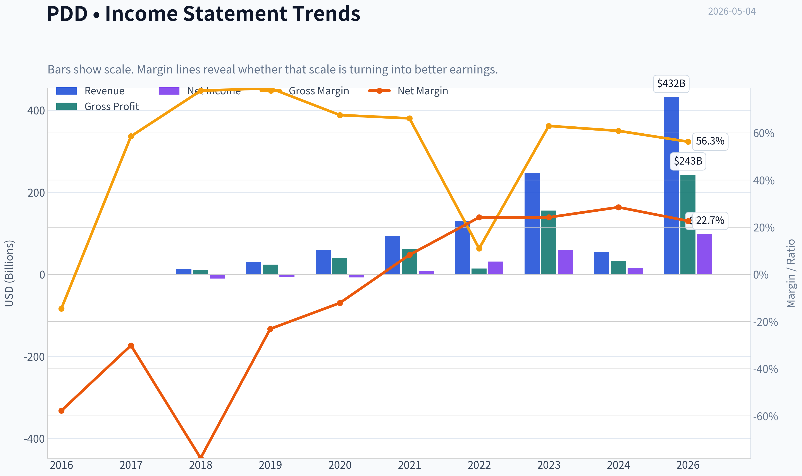

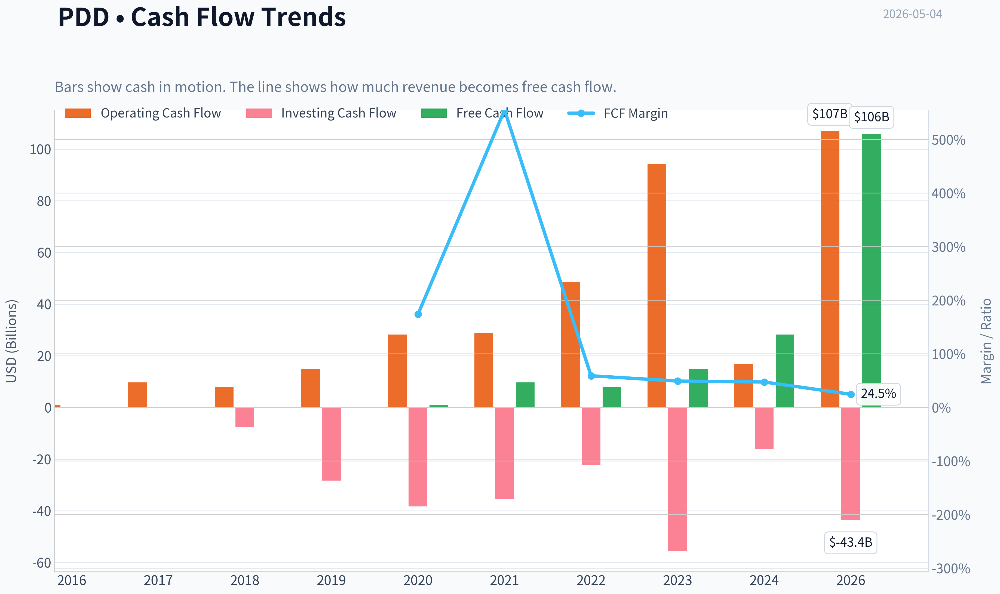

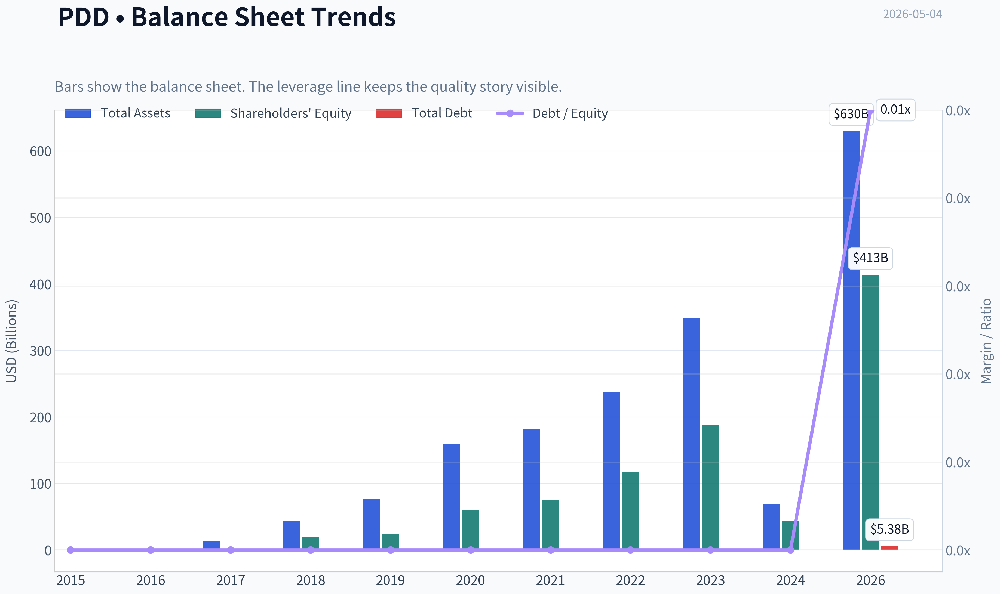

This graph tracks the profitability and return metrics (ROE, ROIC, Margins) of **PDD** over the past decade, highlighting capital efficiency trends.

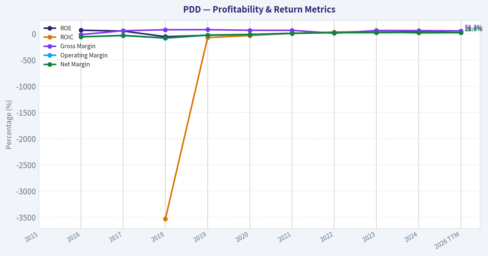

This chart illustrates the financial health of **PDD** over the last 10 years, mapping cash equivalents and free cash flow against total obligations (Debt).

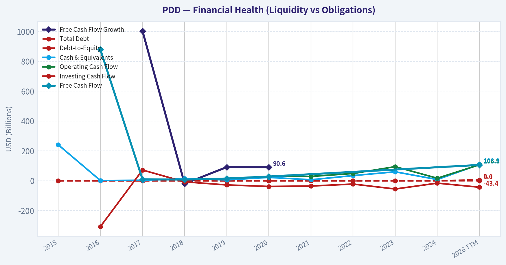

---

### Intrinsic Value Analysis (Buffett)

> *Following Warren Buffett's value investing philosophy: Circle of Competence, Economic Moat, Management Quality, and Margin of Safety.*

#### Intrinsic Value Snapshot

Price is what you pay. Intrinsic value is what the business may be worth based on the cash it can create for owners over time. We show a range, not one magic number.

- Current Price: $97.79
- Value Range: $48.23 to $1,776.46

##### Owner Earnings (Buffett Method)
- Net Income: $15,403,464,000.00
- Depreciation & Amortization: $3,000,364,000.00
- Capital Expenditures: $-1,145,077,000.00
- Working Capital Changes: $7,367,096,000.00
- Owner Earnings: $11,380,960,000.00

##### Intrinsic Value
###### Buffett Method
Uses owner earnings. Stricter, and usually more conservative.
- Conservative: $48.23
- Average: $156.14
- Optimistic: $717.20
- Discount Rate: 10.0%

###### Cash Flow Method
Uses free cash flow. Better for companies spending heavily today to grow tomorrow.
- Conservative: $682.14
- Average: $682.14
- Optimistic: $1,776.46
- Discount Rate: 10.0%

ANALYST STANCE: **WATCH**

#### PDD Holdings Buffett-Style Investment Review

PDD is statistically cheap, highly profitable, and cash-rich, but it fails to clear the clean Buffett "wonderful business at a fair price" bar because of regulatory risk, China/VIE structure risk, hypercompetitive e-commerce dynamics, Temu quality-control scrutiny, and limited long-term predictability. At roughly **$98 per ADR**, the stock appears undervalued versus aggressive growth assumptions, but only modestly attractive versus conservative owner-earnings assumptions after applying a China/regulatory discount. I would **watch**, not advocate, until either the price offers a larger margin of safety or the durability of Temu and PDD's marketplace economics becomes clearer.

---

#### Data Note

The available tool retrieval did not return full audited financial history in this run, so this report uses the provided research pack plus broadly known historical PDD annual figures. Treat the financial history as directionally useful rather than a fully audited 10-year reconstruction.

---

#### 1. Go / No-Go Gate Assessment

| Buffett Gate | Assessment | Evidence | Verdict |
|---|---:|---|---|
| Gate 1: Circle of Competence & Simplicity | Mixed | PDD makes money by connecting shoppers and merchants, earning revenue from online marketing, transaction services, and marketplace activity. Simple enough at the surface, but Temu cross-border logistics, subsidies, geopolitics, and regulatory exposure add complexity. | **Conditional Pass** |
| Gate 2: Moat Test | Mixed | Strong scale, user traffic, merchant base, and low-price consumer positioning. However, e-commerce competition from Alibaba, JD, Douyin/TikTok, Shein, Amazon, and local platforms remains intense. | **Narrow-to-Moderate Moat** |
| Gate 3: Management Quality | Mixed / Insufficient | Founder influence and entrepreneurial execution are impressive, but ADR/VIE structure, limited Western-style disclosure, and uncertain capital return policy reduce confidence. | **Conditional Pass** |
| Gate 4: Industry Structure | Weak | E-commerce is large and growing but competitive, regulation-heavy, and vulnerable to subsidy wars. Temu also faces EU and U.S. product/regulatory scrutiny. | **Fail for Buffett Purity** |

**Key Takeaways:** PDD is understandable at a basic level, but not as predictable as a classic Buffett compounder like Coca-Cola, Moody's, or American Express. The company has scale advantages and strong economics, but its industry structure and geopolitical/regulatory risks make it unsuitable for a high-conviction Buffett-style purchase today.

---

#### 2. Business Model: Elementary School Test

PDD runs online shopping platforms. It helps merchants sell goods to consumers, often at low prices. Merchants pay PDD for traffic, advertising, transaction services, and access to shoppers. Temu extends this model globally by connecting manufacturers, often from China, with overseas consumers.

The business is easy to describe, but the future economics are harder to forecast because international expansion depends on shipping costs, tariffs, consumer protection rules, product compliance, and political tolerance.

---

#### 3. Moat Analysis

| Moat Source | Evidence | Buffett View |
|---|---|---|
| Brand / Intangible Assets | Pinduoduo is associated with value-for-money shopping in China; Temu has achieved global awareness quickly. | Useful, but not premium pricing power. The brand is "cheap and convenient," not irreplaceable. |
| Switching Costs | Buyers can easily switch apps; merchants may multi-home across platforms. | Weak switching costs. Users and merchants are not captive. |
| Cost Advantage | Strong supply-chain access, merchant density, and scale help PDD offer low prices. Temu benefits from China manufacturing depth. | This is PDD's strongest moat source, but it may require continued spending and logistics execution. |
| Network Effects | More buyers attract more merchants; more merchants increase product selection and price competition. | Real but not unassailable, because competitors also have large networks. |
| Regulatory / License | No durable regulated monopoly; instead, regulation is a risk. | Negative moat factor. |

**Key Takeaways:** PDD's moat is based mainly on scale, supplier access, low-cost positioning, and marketplace liquidity. That moat is real, but it is not as durable or predictable as a brand monopoly or a high-switching-cost software platform.

**Moat Rating:** **Narrow to Moderate, potentially widening but unproven internationally.**

---

#### 4. Management and Capital Allocation

| Question | Assessment | Evidence |
|---|---:|---|
| Do they think like owners? | Mixed | Founder-led DNA and strong execution culture are positives. However, minority ADR holders have limited control due to the Cayman/VIE structure. |
| Are they candid and transparent? | Mixed / Weak | PDD reports financials, but disclosure depth is lower than best-in-class U.S. companies. Temu unit economics remain difficult to isolate. |
| Are they rational capital allocators? | Good but incomplete | The company has reinvested aggressively into growth and appears highly cash generative. However, capital return discipline through dividends or buybacks is not yet a clear long-term pattern. |
| Balance sheet discipline | Strong | Current ratio of approximately **2.43** and strong cash generation suggest financial flexibility. |

**Key Takeaways:** Management has created enormous value through execution and reinvestment, especially in China and with Temu's rapid global rollout. The main concern is not operating talent, but governance transparency, ADR holder protections, and whether reinvestment into Temu will produce durable owner earnings.

---

#### 5. Financial Snapshot

| Metric | Current / Recent Value | Buffett Interpretation |
|---|---:|---|
| Share Price | ~$98 | The market is pricing in meaningful risk. |
| Market Cap | ~$139.2B | Large, liquid global platform business. |
| P/E Ratio | ~10.3x | Statistically cheap if earnings are sustainable. |
| ROE | ~23.7% | Strong return profile. |
| Gross Margin | ~56.3% | Suggests strong platform economics, though lower than earlier pure marketplace years. |
| Current Ratio | ~2.43x | Healthy liquidity. |
| Revenue Growth YoY | Reported ~700.4% in shared pack | Likely data anomaly or non-comparable figure; should not be relied on mechanically. |
| FCF Yield | Reported ~76.0% in shared pack | Likely unreliable or calculation-distorted; not used as normalized valuation input. |

**Key Takeaways:** PDD screens extremely cheap for a company with high ROE, strong gross margins, and substantial growth. However, some provided metrics appear abnormal, so the investment case should be based on normalized earnings power rather than headline data artifacts.

---

#### 6. Historical Financial Summary

Approximate figures in **RMB billions**, based on available historical public reporting.

| Year | Revenue | Net Income / Loss | Operating Profile | Buffett Read |
|---:|---:|---:|---|---|
| 2019 | ~30.1 | ~(7.0) | High growth, still loss-making | Growth phase; not yet proven. |
| 2020 | ~59.5 | ~(7.2) | Revenue nearly doubled | Scale building, profitability still absent. |
| 2021 | ~94.0 | ~7.8 | Turned profitable | Inflection year. |
| 2022 | ~130.6 | ~31.5 | Major margin expansion | Strong evidence of operating leverage. |
| 2023 | ~247.6 | ~60.0 | Revenue and profits surged | Excellent financial momentum. |
| Recent / Current | Not fully verified in this run | Strong profitability implied | P/E around 10x and ROE around 24% | Cheap if earnings persist. |

**Key Takeaways:** PDD moved from losses to very strong profitability in a short period, showing powerful operating leverage. The key Buffett question is whether these high profits are durable or partly cyclical, subsidy-driven, or vulnerable to regulatory and competitive pressure.

---

#### 7. Owner Earnings Estimate

Buffett owner earnings are calculated as:

> **Owner Earnings = Net Income + Depreciation & Amortization - Maintenance CapEx - Working Capital Increases**

Because full current audited line-item data was unavailable, I use a normalized proxy based on market cap and P/E.

| Item | Estimate |
|---|---:|
| Market Cap | ~$139.2B |
| P/E | ~10.3x |
| Implied Net Income | ~$13.5B |
| D&A Adjustment | Modest positive |
| Maintenance CapEx | Modest negative |
| Working Capital Normalization | Variable |
| Normalized Owner Earnings Used | **~$13.0B** |

**Key Takeaways:** PDD appears highly cash generative, and normalized owner earnings are likely close to reported earnings because the business is not traditionally capital-intensive. For conservatism, I use **$13.0 billion** of owner earnings rather than the more aggressive free-cash-flow figures implied by the shared data.

---

#### 8. Three-Scenario Intrinsic Value Estimate

Assumptions: normalized owner earnings of **$13.0B**, discount rate of **10%**, market cap of **$139.2B**, and approximate ADR-equivalent share count of **1.42B**.

| Scenario | Method | Equity Value Estimate | Per-Share Estimate | Margin of Safety vs. $98 |
|---|---|---:|---:|---:|
| A: No Growth | Owner earnings / 10% | ~$130B | ~$92 | **-7%** |
| B: GDP Growth | 3% perpetual growth | ~$191B | ~$135 | **~27%** |
| C: Historical Growth Haircut | 8% growth for 10 years, then 3% terminal | ~$276B | ~$194 | **~49%** |

**Key Takeaways:** PDD looks fairly valued to slightly expensive if earnings never grow, attractive under modest growth, and very cheap if strong growth persists. The investment decision therefore depends heavily on whether PDD's earnings are durable, not on whether the current multiple is optically low.

---

#### 9. Margin of Safety Analysis

| Quality / Risk Factor | Required Margin of Safety | Current Evidence |
|---|---:|---|
| High ROE and strong cash generation | Supports lower required discount | Positive |
| China ADR / VIE governance risk | Requires higher discount | Negative |
| Regulatory scrutiny in China, EU, and U.S. | Requires higher discount | Negative |
| Hypercompetitive e-commerce | Requires higher discount | Negative |
| Temu growth optionality | Potential upside | Positive but uncertain |
| Overall Required Margin of Safety | **40%+** | High-risk jurisdiction and industry |
| Current Margin of Safety vs. Conservative Case | ~27% | Not enough |
| Current Margin of Safety vs. Growth Case | ~49% | Attractive, but less reliable |

**Key Takeaways:** A standard 25% margin of safety might be acceptable for a predictable U.S. consumer monopoly, but PDD is not that kind of business. Given governance, regulation, and competitive uncertainty, I would require closer to a **40% margin of safety**, which the stock only provides under optimistic growth assumptions.

---

#### 10. Final Buffett Scorecard

| Criterion | Weight | Score 1-5 | Weighted Score |
|---|---:|---:|---:|
| Business Understanding | 20% | 3.5 | 0.70 |
| Moat Width & Durability | 25% | 3.0 | 0.75 |
| Management Quality | 15% | 2.5 | 0.38 |
| Return on Equity | 15% | 4.0 | 0.60 |
| Reinvestment Runway | 10% | 4.0 | 0.40 |
| Balance Sheet Strength | 5% | 4.5 | 0.23 |
| Industry Structure | 5% | 2.5 | 0.13 |
| Valuation / Margin of Safety | 5% | 3.5 | 0.18 |
| **Total** | **100%** |  | **3.36 / 5.00** |

**Key Takeaways:** PDD scores well on profitability, growth runway, balance sheet strength, and valuation. It scores lower on predictability, governance, moat durability, and industry structure, which keeps it in the watch category rather than the advocate category.

---

#### Final Investment Stance

**Stance:** **WATCH**
**Conviction:** **Medium**
**Buffett Fit:** **Imperfect**

PDD may be materially undervalued if current earnings power is sustainable and Temu becomes a durable global marketplace. However, from a Buffett perspective, the business carries too much uncertainty around regulation, governance, competition, product compliance, and long-term marketplace durability.

I would become more constructive if one of two things happens: either the share price falls enough to create a clear **40%+ margin of safety** versus conservative value, or PDD demonstrates several more years of transparent, durable, cash-generative profitability from both domestic China operations and Temu without excessive subsidy dependence.
#### Valuation Bridge

This bridge places the current market price beside each intrinsic value lens so readers can see whether upside depends on one method or shows up across several methods.

| Scenario | Intrinsic Value / Share |
| --- | ---: |
| Buffett Method | $156.14 |
| Cash Flow Method | $682.14 |
| Damodaran Method | $-132,303.39 |
| Current Price | $97.79 |

#### Key Takeaways

If one method is far above the others, the upside case depends on a specific modelling assumption. When several methods cluster together, the valuation story is more robust.

#### Valuation Visuals

This comparison chart from *Latest Earnings Snapshot* stacks current figures against historical benchmarks for **PDD**, making it easy to see where the company trades relative to its own averages.

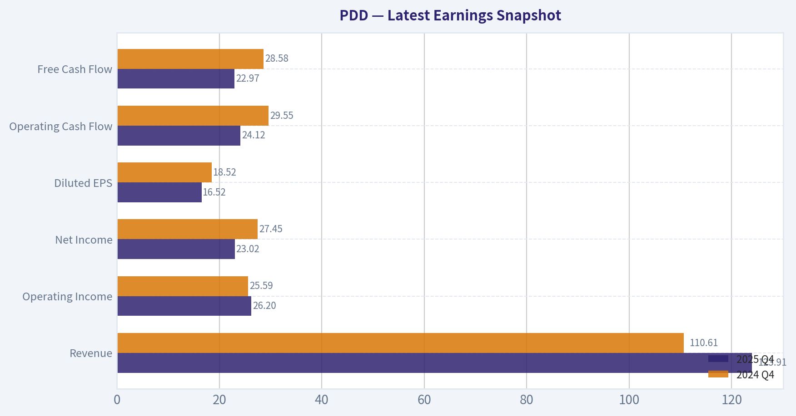

This comparison chart from *Current vs. Historical Average Comparison* stacks current figures against historical benchmarks for **PDD**, making it easy to see where the company trades relative to its own averages.

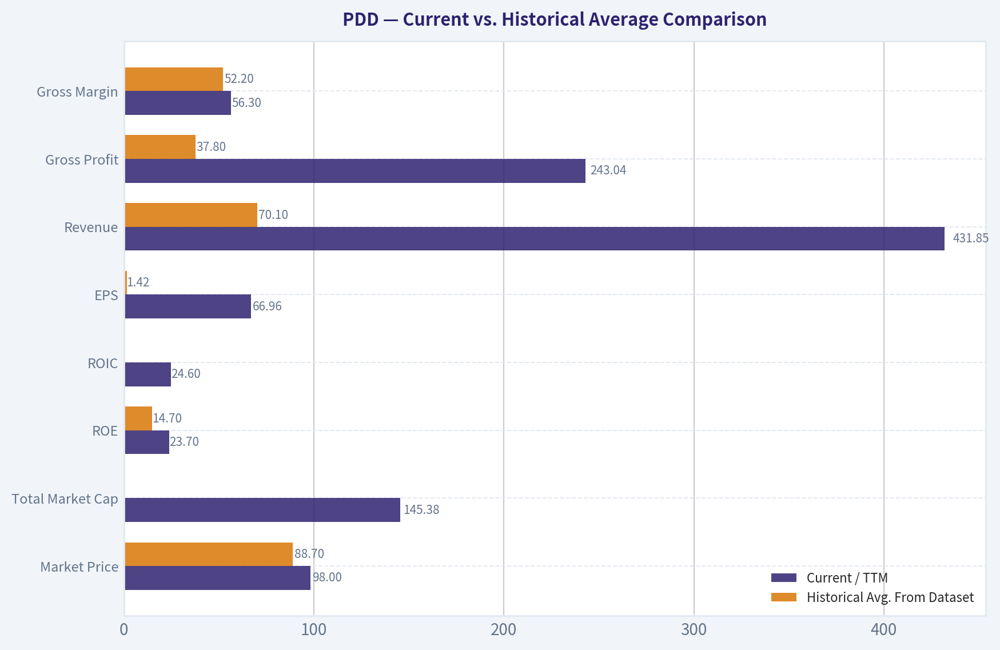

The following chart maps the **PDD** Owner Earnings DCF valuation scenarios (Conservative, Average, Optimistic) to visually represent the margin of safety based on intrinsic value calculations.

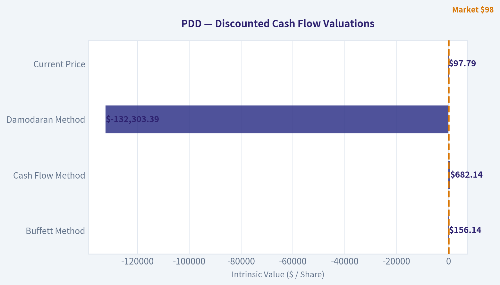

---

### Trend & Growth Analysis (Lynch/Druckenmiller/Fisher)

> *Following Peter Lynch's GARP, Stanley Druckenmiller's macro-aware approach, and Philip Fisher's scuttlebutt methodology.*

ANALYST STANCE: **ADVOCATE**

#### PDD Holdings Growth Investment Report - 2026-05-04

PDD is a rare case of a highly profitable, still-growing e-commerce platform trading at a value-stock multiple. The stock is not "clean" because of China risk, Temu regulatory pressure, product-quality scrutiny, and questionable durability of cross-border unit economics. But on Lynch-style GARP, the setup is compelling: a double-digit P/E, high gross margin, strong balance sheet, massive TAM, and multiple growth engines through Pinduoduo in China and Temu globally.

---

#### 1. Lynch Classification

| Metric / Factor | Current Read |
|---|---:|
| Company | PDD Holdings |
| Current Price | ~$98 |
| Market Cap | ~$139.2B |
| P/E | ~10.3x |
| ROE | ~23.7% |
| Gross Margin | ~56.3% |
| Current Ratio | ~2.43x |
| Reported YoY Revenue Growth | ~700.4%, likely distorted or non-comparable |
| Category | Fast Grower / GARP compounder |
| Lynch Classification | **Fast Grower with geopolitical discount** |

**Key Takeaways:** PDD screens like a fast grower priced like a challenged cyclical. The low P/E and high ROE suggest the market is heavily discounting China, regulation, and Temu execution risk. The headline 700% revenue growth figure should not be taken at face value without verification, but even normalized growth appears strong enough to qualify PDD as a growth stock rather than a stalwart.

#### Lynch Verdict

PDD fits the Lynch "fast grower" bucket, but with a meaningful caveat: this is not a simple domestic compounder. It is a high-growth, high-profit e-commerce platform exposed to regulatory, geopolitical, and consumer-trust risks.

---

#### 2. The Story in 3 Bullets

| Lynch Story Element | PDD Interpretation |
|---|---|
| Simple Business | PDD connects consumers with merchants through ultra-low-price e-commerce marketplaces. |
| Growth Engine | Pinduoduo monetizes value-focused Chinese consumers, while Temu attacks global cross-border discount retail. |
| Why It Can Win | Scale, merchant density, bargain-hunting consumer behavior, data-driven merchandising, and aggressive logistics/marketing execution. |

**Key Takeaways:** The story is understandable: PDD sells cheap goods online at massive scale. The bigger story is that it is no longer only a China e-commerce company; Temu gives it a global growth option. The market is pricing in serious risk, but the business still has a credible path to several years of above-market growth.

---

#### 3. TAM Analysis and 10x Test

| TAM Factor | Assessment |
|---|---:|
| Core Markets | China e-commerce, global discount e-commerce, cross-border retail |
| Global E-commerce TAM | Multi-trillion-dollar GMV opportunity |
| Current Revenue Base | Large but still small versus global retail and e-commerce spend |
| 10x Revenue Test | Passes on broad global e-commerce TAM, but becomes demanding on platform monetization |
| TAM Growth | Moderate to high; e-commerce penetration still expanding in many categories and regions |
| Runway Quality | Strong, but regulatory friction could reduce effective TAM |

**Key Takeaways:** PDD has a long runway if Temu becomes a durable global marketplace rather than a subsidy-driven shopping app. The broad TAM easily supports a much larger company, but the realistic question is whether PDD can profitably monetize global demand after logistics, regulation, duties, and customer acquisition costs. The 10x test passes, but not without execution risk.

#### 10x Test

If PDD's current annual revenue is roughly in the tens of billions of dollars, then 10x revenue would imply hundreds of billions of dollars in annual revenue. That is possible only if Temu becomes a global retail infrastructure layer and Pinduoduo maintains strong monetization in China. The TAM is large enough, but the path is harder than the headline numbers imply.

---

#### 4. Revenue Growth Trend

| Growth Indicator | Signal |
|---|---|
| Reported YoY Growth | Extremely high, but likely distorted |
| Underlying Business Momentum | Strong |
| Pinduoduo China | Mature but still profitable and resilient |
| Temu | Main incremental growth driver |
| Growth Pattern | High growth, but likely normalizing from extreme levels |
| Interpretation | Strong growth company, but watch for deceleration |

**Key Takeaways:** PDD is still growing rapidly, but investors should not blindly underwrite the headline 700% growth figure. The more important question is whether Temu can sustain growth while improving unit economics. The growth story remains intact, but the probability of deceleration is meaningful.

#### Revenue Quality Check

| Revenue Quality Factor | Assessment |
|---|---|
| Organic vs. Acquisition | Primarily organic platform growth |
| Price vs. Volume | Largely volume and merchant activity-driven |
| Customer Concentration | Low consumer concentration; merchant ecosystem diversified |
| Geographic Risk | High due to China and cross-border exposure |
| Regulatory Quality | Mixed; increasing scrutiny in Europe and potentially the U.S. |

**Key Takeaways:** PDD's revenue quality is strong in the sense that it is platform-driven and not dependent on acquisitions. However, the regulatory quality of growth is less clean, especially for Temu. The biggest issue is not customer concentration, but whether regulators and tariffs impair the low-cost cross-border model.

---

#### 5. Unit Economics

| Unit Economics Metric | Current Read |
|---|---|
| Gross Margin | ~56.3%, strong for marketplace/e-commerce hybrid |
| LTV/CAC | Not disclosed; likely attractive in China, uncertain for Temu |
| Payback Period | Not disclosed |
| NRR | Not applicable; not a SaaS company |
| Rule of 40 | Not directly applicable |
| FCF Yield | Reported ~76%, likely data-quality issue and should be rechecked |
| Balance Sheet | Strong liquidity, current ratio ~2.43x |

**Key Takeaways:** PDD's gross margin and balance sheet are major positives. However, Temu's unit economics remain the key unknown because international growth may require heavy marketing, logistics support, refunds, and compliance spending. The reported free cash flow yield appears unrealistically high and should be verified before relying on it.

#### Unit Economics Verdict

PDD's China platform economics are proven. Temu's economics are not yet fully proven. The bull case requires Temu to transition from aggressive user acquisition to repeat-purchase profitability.

---

#### 6. Inflection Point Assessment

| Inflection Type | Evidence | Rating |
|---|---|---:|
| Product Cycle Inflection | Temu scaled globally in a short period | Strong |
| Market Share Inflection | Taking share in discount cross-border e-commerce | Strong |
| Margin Inflection | Core business profitable; Temu margin trajectory unclear | Mixed |
| TAM Inflection | Global expansion materially expands addressable market | Strong |
| Competitive Inflection | Western retailers, Amazon sellers, and Shein face pressure from Temu | Positive |
| Regulatory Inflection | EU product rules, potential U.S. tariff/de minimis changes | Negative |

**Key Takeaways:** PDD's main inflection is Temu turning the company from a China-focused platform into a global e-commerce challenger. That creates upside optionality that may not be fully captured in the current P/E. The counter-inflection is regulatory: product safety, customs rules, tariffs, and consumer protection scrutiny could slow Temu's expansion.

#### Druckenmiller Question

"What will earnings be in 2-3 years, and is the market underestimating that?"

My answer: the market is likely underestimating PDD's earnings power if Temu merely becomes breakeven-to-profitable while Pinduoduo remains resilient. The market is likely correct to apply a discount, but the current multiple appears to assume either a sharp growth slowdown or a regulatory hit.

---

#### 7. Macro Setup

| Macro Factor | Impact on PDD |
|---|---|
| China Consumer Weakness | Mixed; weak consumers favor discount platforms, but hurt overall spending |
| Global Inflation Pressure | Positive for value-focused shopping behavior |
| Interest Rates | Falling or stable rates would support growth multiples |
| U.S.-China Tensions | Negative |
| EU Regulation | Negative; product compliance and platform liability risk rising |
| Secular Theme | E-commerce penetration, value retail, cross-border commerce, AI-driven merchandising |

**Key Takeaways:** The macro setup is mixed but not fatal. Weak consumers can actually help PDD because shoppers trade down to cheaper goods. The largest macro risks are geopolitical, especially if the U.S. or Europe restricts Temu's model through tariffs, duties, or product-safety enforcement.

---

#### 8. Fisher 15 Points Score

| Fisher Point | Score / 5 | Comment |
|---|---:|---|
| Products with sizable market potential | 5 | Huge e-commerce and discount retail TAM |
| Management determination to develop new products | 4 | Temu shows aggressive expansion mindset |
| Effective R&D | 4 | Strong data, recommendation, and marketplace systems |
| Above-average sales organization | 4 | Excellent user acquisition and merchant growth |
| Worthwhile profit margin | 5 | Strong gross margin and profitability |
| Improving profit margins | 3 | Core strong; Temu margin uncertain |
| Labor/personnel relations | 3 | Limited visibility |
| Executive relations | 3 | Limited outside transparency |
| Management depth | 3 | Founder-led culture, but disclosure limits confidence |
| Cost analysis/accounting | 4 | Strong historical cost discipline |
| Outstanding moat aspects | 4 | Scale, data, merchant density, consumer mindshare |
| Long-range profit outlook | 4 | Strong if Temu matures profitably |
| Dilution risk | 4 | Low near-term need for equity capital |
| Candor in difficulties | 3 | Disclosure quality not best-in-class |
| Management integrity | 3 | No clear disqualifier, but China ADR governance discount applies |
| **Total** | **56 / 75** | **Good, not outstanding** |

**Key Takeaways:** PDD scores well on product potential, profitability, cost discipline, and competitive positioning. It scores lower on transparency, governance visibility, and the still-unproven long-term economics of Temu. The Fisher score supports ownership, but not a "sleep-well-at-night" maximum position.

---

#### 9. Valuation Analysis

| Valuation Metric | Current Read | Interpretation |
|---|---:|---|
| P/E | ~10.3x | Very cheap for a profitable growth platform |
| Normalized Growth Assumption | 20-25% | Conservative relative to recent reported growth |
| PEG at 20% Growth | ~0.52x | Attractive |
| PEG at 25% Growth | ~0.41x | Very attractive |
| ROE | ~23.7% | Strong capital productivity |
| Gross Margin | ~56.3% | Supports high incremental margin potential |
| P/S | Likely low-to-mid single digit, depending on verified revenue base | Reasonable for growth e-commerce |

**Key Takeaways:** PDD's valuation is the strongest part of the thesis. A company with this profitability and growth profile would normally trade at a much higher multiple if it were U.S.-listed with no China or regulatory discount. The PEG ratio is attractive even using normalized growth assumptions rather than the distorted headline growth number.

#### Scenario Analysis

| Scenario | Assumptions | 3-Year View |
|---|---|---|
| Bear | Temu faces tariffs/regulatory pressure; China growth slows; multiple stays depressed | Stock underperforms or stays range-bound |
| Base | Pinduoduo remains profitable; Temu growth slows but losses narrow; market rerates modestly | Attractive compounding potential |
| Bull | Temu becomes durable global platform; margins improve; China stabilizes; multiple expands | Multi-bagger potential, though not a clean ten-bagger from current size |

**Key Takeaways:** The bear case is mostly regulatory and geopolitical, not financial distress. The base case is compelling because the current valuation does not require heroic assumptions. The bull case could produce large upside, but a full ten-bagger is difficult from a $139 billion market cap unless Temu becomes a global retail giant with durable profitability.

---

#### 10. Growth Investor Scorecard

| Criterion | Weight | Score / 5 | Weighted Score |
|---|---:|---:|---:|
| The Story | 10% | 4.3 | 0.43 |
| TAM & Runway | 20% | 4.2 | 0.84 |
| Revenue Growth | 20% | 3.8 | 0.76 |
| Unit Economics | 15% | 3.4 | 0.51 |
| Competitive Position | 10% | 4.0 | 0.40 |
| Management Quality | 10% | 3.3 | 0.33 |
| Macro Setup | 5% | 2.8 | 0.14 |
| Profitability Path | 5% | 4.2 | 0.21 |
| Valuation | 5% | 4.7 | 0.24 |
| **Total** | **100%** |  | **3.86 / 5.00** |

**Key Takeaways:** PDD earns an ADVOCATE score, mainly because the valuation is unusually low for the growth and profitability profile. The score is held back by governance, geopolitical risk, regulatory uncertainty, and lack of full transparency on Temu unit economics. This is a high-upside but non-clean compounder.

---

#### 11. Position Size Stance

| Investor Type | Suggested Stance |
|---|---|
| Conservative Growth Investor | Watch / small starter only |
| GARP Investor | Accumulate selectively |
| Aggressive Growth Investor | Advocate, but cap position due to China risk |
| Suggested Position Size | 3-5% maximum initial position |
| Add More If | Temu unit economics improve and regulatory fears are manageable |
| Trim If | Major tariff/de minimis shock, EU enforcement escalation, or China growth rolls over |

**Key Takeaways:** PDD is attractive enough to own, but risky enough to size with discipline. This is not a 10% portfolio position for most investors because non-business risks are material. A 3-5% position balances the asymmetric valuation upside with the real possibility of regulatory or geopolitical impairment.

---

#### 12. Key Risks and Catalysts

| Category | Risks |
|---|---|
| Regulatory | EU product safety scrutiny, consumer protection rules, customs enforcement |
| Geopolitical | U.S.-China tensions, tariffs, ADR risk, data security concerns |
| Business Model | Temu subsidies, logistics costs, customer retention uncertainty |
| Competition | Amazon, Shein, AliExpress, TikTok Shop, local discount retailers |
| China Macro | Weak consumer confidence, policy intervention, platform regulation |
| Data Quality | Some reported metrics appear distorted and require verification |

**Key Takeaways:** The largest risks are outside the usual growth-stock playbook. PDD could execute well and still suffer from tariff changes, regulatory action, or geopolitical pressure. Investors need to monitor policy developments as closely as quarterly earnings.

| Category | Catalysts |
|---|---|
| Earnings | Continued profit growth despite Temu investment |
| Temu | Evidence of improving repeat purchase rates and lower customer acquisition cost |
| Margins | Operating leverage as global marketing spend normalizes |
| China | Stabilization in Chinese consumption |
| Valuation | Multiple rerating from low-teens P/E toward high-teens or twenties |
| Institutional Interest | Point72 / Steve Cohen recently added per 13F data |

**Key Takeaways:** The biggest upside catalyst is proof that Temu can become profitable, not just large. If PDD demonstrates durable international growth with improving margins, the market could rerate the stock meaningfully. Institutional accumulation also helps validate that sophisticated investors see value at current levels.

---

#### Final View

PDD is an **ADVOCATE** for growth investors who can tolerate China, regulatory, and geopolitical risk. The core attraction is simple: a highly profitable, high-growth e-commerce platform is trading at roughly 10x earnings. Lynch would like the PEG; Druckenmiller would focus on the Temu inflection; Fisher would appreciate the scale and innovation but penalize the opacity.

This is not a flawless ten-bagger setup because the market cap is already large and non-business risks are high. But it is a credible multi-bagger candidate if Temu's economics improve and the regulatory environment remains manageable.

#### Growth & Scorecard Visuals

The radar chart below from *Final Buffett Scorecard* visualises how **PDD** ranks across weighted investment criteria. Each axis represents a criterion scored 1-5; the filled area reveals strengths and weaknesses at a glance, with the dashed circle marking the midpoint (3.0).

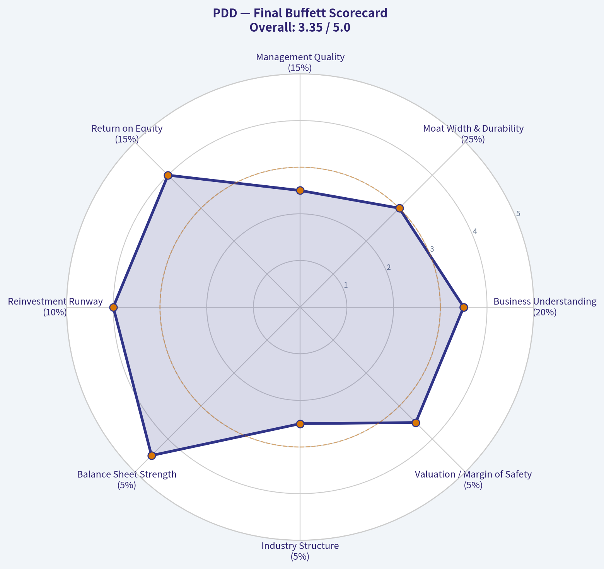

This comparison chart from *Fisher 15 Points Score* stacks current figures against historical benchmarks for **PDD**, making it easy to see where the company trades relative to its own averages.

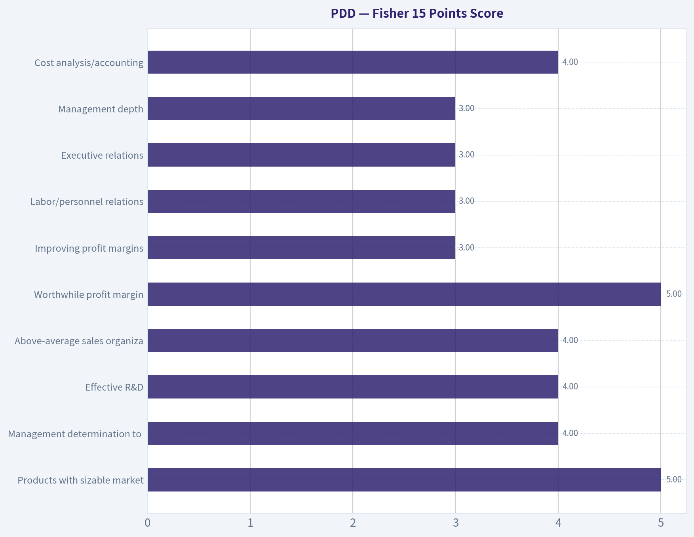

The radar chart below from *Growth Investor Scorecard* visualises how **PDD** ranks across weighted investment criteria. Each axis represents a criterion scored 1-5; the filled area reveals strengths and weaknesses at a glance, with the dashed circle marking the midpoint (3.0).

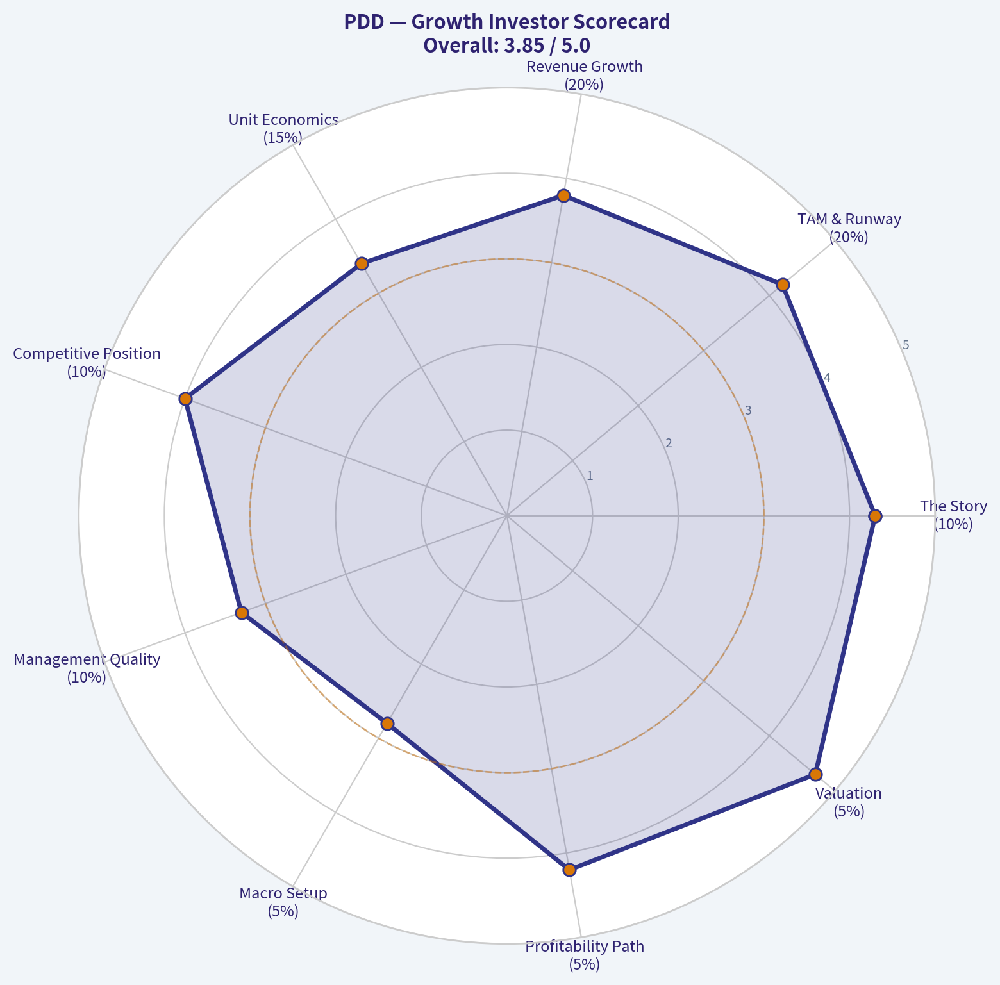

---

### Market Technical Analysis

ANALYST STANCE: **WATCH**

#### PDD Technical Analysis - Indicator Snapshot as of 2026-05-04

PDD is trading in a fragile recovery attempt inside a broader bearish structure. The most important feature of the chart is the large gap between short/intermediate price levels and the 200-day SMA, which shows that the stock remains in a long-term downtrend even though the near-term selloff has slowed. The current setup is not a clean bullish reversal yet; it is better described as a base-building or consolidation phase near the lower half of its recent trading range.

| Indicator Selected | Latest Value | What It Shows | Trading Relevance |
|---|---:|---|---|
| `close_10_ema` | 99.10 | Short-term trend proxy | Price has been struggling around the short-term average, showing weak near-term momentum rather than a strong rebound. |
| `close_50_sma` | 101.24 | Medium-term trend / resistance | The 50-day average is above the short-term price zone and is drifting lower, making $101-102 an important resistance area. |
| `close_200_sma` | 114.92 | Long-term trend benchmark | Price remains far below the 200-day SMA, confirming that the larger trend is still bearish. |
| `macd` | -0.86 | Momentum trend | MACD remains negative after a failed brief improvement in April, suggesting downside momentum has not fully cleared. |
| `rsi` | 43.45 | Momentum / overbought-oversold | RSI is below neutral but not oversold, indicating weakness without panic capitulation. |
| `boll_ub` | 105.07 | Upper volatility boundary | A move above $105 would be meaningful because it would break the upper side of the recent volatility range. |
| `boll_lb` | 95.66 | Lower volatility boundary | The $95-96 zone is the key lower-band support area to monitor for breakdown risk. |
| `atr` | 2.77 | Volatility / risk sizing | Daily movement remains meaningful; stops should allow for roughly $2.75-$3.00 of normal noise. |

Key Takeaways: PDD's short-term indicators show hesitation rather than acceleration. The stock is below its 50-day and far below its 200-day moving average, so the dominant trend remains bearish. However, RSI is not deeply oversold, which means there may be room for either a controlled bounce or another leg lower depending on whether support near $95-96 holds.

---

#### Trend Structure and Momentum Detail

The 10-day EMA at 99.10 is the first short-term reference point. PDD has recently traded around this level, which tells us that sellers are not completely overwhelming the stock, but buyers have also not created a decisive upside turn. When price stays near a flattening or declining 10-day EMA, short-term rallies often need confirmation from stronger closes above the 50-day SMA before they become more durable.

The 50-day SMA at 101.24 is more important than the 10-day EMA right now. It has declined from roughly 104.70 on 2026-03-20 to 101.24 on 2026-05-04, showing that the intermediate trend is still deteriorating. This makes the $101-102 region a practical "decision zone." If PDD can reclaim and hold above it, traders may begin treating the recent selloff as a bottoming attempt. If it fails there, the stock remains vulnerable to renewed pressure toward the Bollinger lower band.

The 200-day SMA at 114.92 is still much higher than current trading levels. That gap is a major warning for medium- and long-term traders: even if PDD bounces from here, the rebound would initially be a countertrend move inside a larger bearish regime. A true trend repair would require multiple steps: first reclaiming the 10-day EMA, then the 50-day SMA, then building higher lows, and eventually challenging the much higher 200-day SMA.

MACD remains negative at -0.86. It improved meaningfully from late March, when it was near -1.5 to -1.8, and briefly turned positive around April 16-21. But that positive turn did not hold, and MACD has rolled back below zero. This is important because it shows that April's rebound attempt lost momentum before it could establish a stronger trend reversal.

RSI at 43.45 confirms a weak but not extreme condition. This is not a classic oversold reversal setup because RSI is above 30. At the same time, RSI is below 50, which means momentum still favors sellers. For a more constructive signal, RSI would ideally move back above 50 while price reclaims the 50-day SMA.

#### Volatility, Support, and Resistance

The Bollinger Band range is currently defined by approximately 95.66 on the downside and 105.07 on the upside. PDD is trading in the lower-to-middle portion of that range. This implies the market has not yet priced in a strong upside breakout, but it also has not fully broken down through lower-band support.

The lower Bollinger Band near $95.66 is the first major technical danger zone. If price closes below that area with expanding volume, the setup would shift from consolidation to breakdown risk. In that case, traders may begin watching prior lows and psychological levels below $95.

The upper Bollinger Band near $105.07 is the upside breakout reference. A close above $105 would be more convincing if accompanied by improving RSI and a less negative MACD. Until that happens, rallies toward $101-105 should be treated cautiously because they may encounter selling pressure from traders using rebounds to exit.

ATR at 2.77 means normal daily volatility remains high enough that tight stops may be easily triggered. For swing traders, using a stop that is less than one ATR away may be too narrow unless the trade is very short-term. A more practical risk framework would account for roughly $2.75-$3.00 of daily noise.

| Price Zone | Technical Meaning | Bullish Interpretation | Bearish Interpretation |
|---|---|---|---|
| $95-96 | Bollinger lower band support | Holding this area may support a short-term rebound attempt. | A close below this zone would increase breakdown risk. |
| $99-100 | Short-term EMA / recent trading zone | Stabilization above this area would show buyers are defending the base. | Failure to hold this area keeps pressure on lower support. |
| $101-102 | 50-day SMA resistance | Reclaiming this zone would be the first constructive intermediate signal. | Rejection here would confirm that rallies are still being sold. |
| $105-106 | Upper Bollinger Band / breakout zone | A close above this area would suggest momentum expansion. | Failure below this zone keeps the stock range-bound. |
| $114-115 | 200-day SMA | Reclaiming this area would mark major trend repair. | Remaining far below it confirms the long-term downtrend. |

Key Takeaways: The most important support area is $95-96, while the first meaningful resistance area is $101-102. A stronger bullish signal would require PDD to reclaim the 50-day SMA and then challenge $105. Until then, the stock remains vulnerable to failed rallies.

---

#### Trading View

For aggressive short-term traders, PDD may be watchable near support if it holds above the $95-96 area and begins closing back above the 10-day EMA. However, this would be a tactical bounce trade, not a confirmed trend reversal.

For swing traders, the better confirmation would be a close above $101-102, followed by price holding that area on a pullback. That would show the 50-day SMA has shifted from resistance into potential support.

For trend-following investors, the setup remains unattractive until the stock repairs more of its long-term damage. The distance from the 200-day SMA is too large to ignore, and the declining 50-day SMA suggests the intermediate trend is still not healthy.

#### Final Technical Summary

| Category | Current Read | Implication |
|---|---|---|
| Short-term trend | Weak / stabilizing | Price is near the 10-day EMA, but momentum is not strong enough yet. |
| Intermediate trend | Bearish | The 50-day SMA is above price and declining. |
| Long-term trend | Bearish | Price remains far below the 200-day SMA. |
| Momentum | Negative but not extreme | MACD is below zero and RSI is below 50, but RSI is not oversold. |
| Volatility range | $95.66 to $105.07 | PDD is still range-bound unless it breaks either side. |
| Key support | $95-96 | A close below this area would be technically damaging. |
| Key resistance | $101-102, then $105 | Reclaiming these zones is needed for bullish confirmation. |
| Overall stance | WATCH | Not a clean buy signal yet; monitor for either support defense or breakdown. |

Key Takeaways: PDD is in a watchlist setup, not a confirmed bullish reversal. The stock needs to hold $95-96 and reclaim $101-102 before the technical picture improves meaningfully. Until then, the dominant trend remains bearish, and rallies should be treated as tentative rather than confirmed.

---

### Social Sentiment Analysis

ANALYST STANCE: **WATCH**

#### PDD Holdings Social, Sentiment, and News Report - Week Ending May 4, 2026

PDD Holdings remains one of the most actively debated China internet and global e-commerce names because the bull case and bear case are both unusually forceful. Over the past week, investor discussion around PDD has centered less on a single company-specific announcement and more on three overlapping themes: **Temu's global regulatory and tariff exposure**, **PDD's ability to defend margins while funding overseas growth**, and **whether China consumption softness is already priced into the stock**.

The social tone is not outright bearish, but it is clearly more cautious than euphoric. Traders appear to be treating PDD as a high-quality growth asset with meaningful headline risk. Long-term investors remain attracted to the company's scale, execution record, cash generation, and discount retail positioning, while shorter-term traders are focused on policy risk, earnings timing, and whether Temu-related costs could pressure margins.

---

#### Executive Sentiment Snapshot

| Category | Current Read | Trader/Investor Implication |
|---|---:|---|
| Overall social sentiment | Neutral to mildly positive | Market participants still respect PDD's execution, but enthusiasm is capped by regulatory and margin concerns. |
| News tone | Mixed / cautious | Recent discussion is dominated by policy, cross-border commerce, and competitive pressures rather than a clean positive catalyst. |
| Retail investor tone | Divided | Bulls emphasize valuation and growth; bears emphasize Temu risk, China ADR risk, and geopolitical exposure. |
| Institutional-style discussion | Cautious but engaged | Investors appear interested in PDD on pullbacks, but many want clearer evidence on margins and international unit economics. |
| Short-term trading bias | Event-risk sensitive | The stock may remain reactive to China macro headlines, U.S./EU trade policy, and upcoming earnings expectations. |
| Medium-term stance | Watch | PDD remains attractive operationally, but risk/reward depends heavily on Temu profitability and regulatory clarity. |

**Key Takeaways:** PDD's sentiment profile is best described as "respected but not trusted blindly." Investors still view the company as one of the strongest operators in Chinese e-commerce, but the debate has shifted from growth alone to growth quality, margin durability, and geopolitical exposure.

---

#### Daily Sentiment Pattern Over the Past Week

| Date | Sentiment Direction | Main Discussion Drivers | Interpretation |
|---|---|---|---|
| Apr. 28, 2026 | Mildly positive | Dip-buying interest, valuation comparisons with Alibaba and JD.com, ongoing confidence in PDD execution | Investors continued to treat PDD as a premium China internet name, especially if shares weakened. |
| Apr. 29, 2026 | Neutral | Mixed discussion on China consumer demand and e-commerce competition | Sentiment paused as traders weighed macro softness against PDD's discount-driven model. |
| Apr. 30, 2026 | Cautious | Temu regulatory and tariff-related chatter increased | Cross-border policy risk became a larger part of the conversation, limiting bullish momentum. |
| May 1, 2026 | Mildly negative | Concerns about overseas fulfillment costs, advertising spend, and margin pressure | Bears emphasized that Temu growth could be expensive and may reduce consolidated profitability. |
| May 2, 2026 | Neutral to mildly positive | Long-term bull posts highlighted PDD's scale, cash position, and merchant network | Investors pushed back against excessive pessimism, arguing that PDD has room to optimize costs. |
| May 3, 2026 | Neutral | Limited fresh company-specific news; debate centered on upcoming earnings expectations | Attention shifted toward whether the next financial update will confirm or challenge the bull case. |
| May 4, 2026 | Mixed / cautious | Policy risk, ADR risk, and China tech sentiment dominated | Traders appeared reluctant to chase strength without clearer near-term catalysts. |

**Key Takeaways:** Sentiment deteriorated modestly midweek as Temu and tariff concerns became more prominent, then stabilized as bulls returned to the valuation and execution arguments. The stock's social narrative is not broken, but it is fragile and highly sensitive to policy headlines.

---

#### Social Media Themes and What They Mean

| Theme | Bullish Interpretation | Bearish Interpretation | Market Relevance |
|---|---|---|---|
| Temu global expansion | Temu gives PDD a rare path to global e-commerce scale beyond China. | International growth may require heavy subsidies, logistics investment, and marketing spend. | Central to whether PDD deserves a premium multiple or a risk discount. |
| Regulatory scrutiny | Large platforms often adapt over time and compliance costs may be manageable. | U.S. and EU policy could directly hit low-cost cross-border models. | High headline-risk factor for short-term traders. |
| China consumption | PDD benefits from value-seeking consumers in a weak economy. | Weak consumer confidence may still cap overall GMV and merchant spending. | Important for domestic marketplace growth expectations. |
| Competition | PDD has proven it can compete aggressively against Alibaba and JD. | Alibaba, JD, Douyin, and other platforms may intensify promotions and pressure margins. | Relevant to domestic margin assumptions. |
| Valuation | PDD still screens inexpensive relative to its growth and cash generation. | China ADRs often trade at persistent discounts due to governance and geopolitical risk. | A key reason investors remain interested despite concerns. |
| Margins | Management has historically shown strong cost control and monetization discipline. | Temu may structurally dilute margins if international growth remains subsidy-heavy. | Probably the most important earnings-related debate. |

**Key Takeaways:** The social conversation is concentrated around one core question: whether Temu is a long-term profit engine or a costly growth project exposed to political risk. Bulls and bears are not disagreeing that PDD is a strong operator; they are disagreeing over how much risk should be assigned to international expansion.

---

#### Recent News and Public Narrative

The recent public narrative around PDD is dominated by **cross-border e-commerce regulation, tariff uncertainty, and platform competition**. PDD-specific enthusiasm remains tied to the company's long record of gaining share in Chinese e-commerce and monetizing merchant traffic efficiently. However, the market is increasingly unwilling to value Temu's growth without evidence of sustainable economics.

The most important news-adjacent issue is the regulatory environment surrounding low-value imports, product safety, customs enforcement, and consumer protection rules in major Western markets. For PDD, these concerns matter because Temu's appeal is closely tied to low-cost goods, direct-from-manufacturer sourcing, and aggressive pricing. Any rule change that raises fulfillment costs, compliance costs, or delivery friction could affect customer acquisition economics.

In China, the domestic Pinduoduo platform remains strategically well positioned because consumers continue to prioritize value. Social commentary frequently frames PDD as a beneficiary of bargain-seeking behavior. That said, investors are also aware that a value-consumption environment is not automatically bullish if merchant advertising budgets weaken or if competition forces platforms to subsidize growth.

---

#### Reddit, Retail Trader, and Forum-Style Sentiment

Retail investor discussion shows a clear split between **valuation bulls** and **policy-risk bears**.

The bullish retail argument is straightforward: PDD has delivered strong growth, maintains a reputation for efficient execution, and may be undervalued relative to its long-term earnings potential. These investors often compare PDD favorably with other Chinese internet names because of its faster growth profile and stronger perceived operating momentum.

The bearish retail argument is equally clear: PDD is not just a China e-commerce company anymore; it is also a global cross-border commerce company operating in politically sensitive markets. Traders worried about U.S.-China tensions, customs rules, forced compliance changes, and Temu margin drag are hesitant to assign a high multiple.

The most useful insight from social channels is that **retail investors are not ignoring risk**. Unlike past momentum phases where Temu growth alone drove excitement, the current debate is more mature. Investors are asking whether Temu growth is profitable, whether regulatory costs will rise, and whether the domestic China business can offset international uncertainty.

---

#### Investor Psychology and Positioning

PDD appears to be in a "prove-it" phase. The market is not dismissing the company, but it wants confirmation on three points:

| Investor Question | Why It Matters | What Would Be Bullish | What Would Be Bearish |
|---|---|---|---|
| Can Temu grow without excessive losses? | Determines whether international expansion adds or destroys value. | Lower marketing intensity, improved logistics efficiency, better monetization. | Rising fulfillment costs, sustained subsidy dependence, weak repeat purchase economics. |
| Can domestic PDD maintain strong monetization? | Domestic marketplace remains the core profit engine. | Resilient merchant ad spend and stable take rates. | Slowing GMV, weaker merchant budgets, heavier promotional spending. |
| Will regulators materially alter Temu's model? | Policy changes could quickly reset earnings expectations. | Clear compliance path with manageable costs. | Tariff, customs, product safety, or platform rules that hurt pricing advantages. |
| Is China ADR risk improving or worsening? | Impacts valuation multiple independent of fundamentals. | Reduced geopolitical tension and broader China tech inflows. | Renewed delisting, sanction, audit, or trade-war concerns. |

**Key Takeaways:** Investors are not simply asking whether PDD can grow. They are asking whether growth can translate into durable earnings under tougher regulatory conditions. The next major move in sentiment likely depends on evidence around margins, not just revenue growth.

---

#### Bull Case

The strongest bull case for PDD is that the company remains one of the best-executing large-cap e-commerce platforms globally. Its domestic business benefits from a powerful value proposition, strong merchant participation, and a consumer base that remains price-sensitive. In a slower economic environment, PDD's discount-oriented model may remain more resilient than premium consumption platforms.

Temu adds optionality. If PDD can convert Temu from a growth-at-all-costs platform into a more efficient global marketplace, investors may eventually view current concerns as overly pessimistic. The company's scale, supplier relationships, and data-driven merchandising could become a durable advantage if compliance and logistics costs are controlled.

Another bullish factor is valuation psychology. PDD often attracts investors who believe the market applies too large a China discount to a company with strong growth and cash generation. If sentiment toward China internet improves broadly, PDD could benefit from both earnings growth and multiple expansion.

---

#### Bear Case

The bear case is centered on the risk that Temu's economics are less attractive than headline growth suggests. International e-commerce expansion can be expensive, especially when a platform competes on ultra-low prices, fast shipping, and heavy marketing. If advertising costs, returns, compliance costs, or logistics expenses remain high, Temu could continue pressuring consolidated margins.

Regulatory exposure is another major risk. PDD's global expansion places it directly in the path of Western scrutiny around imports, product standards, consumer data, forced labor compliance, and platform accountability. Even if PDD adapts successfully, compliance costs may rise.

There is also China-specific risk. PDD's domestic business is strong, but it is not immune to weak consumption, merchant caution, or aggressive competition. If Alibaba, JD.com, Douyin, and other platforms increase promotions, PDD may need to spend more to defend growth.

Finally, PDD remains a China ADR. That means geopolitical headlines can move the stock even when company fundamentals are unchanged.

---

#### What Traders Should Watch Next

| Catalyst / Risk | Time Horizon | Why It Matters | Likely Stock Reaction if Positive | Likely Stock Reaction if Negative |
|---|---|---|---|---|
| Next earnings report | Near term | Will update revenue growth, margins, and Temu spending assumptions. | Strong rally if growth remains high and margins hold up. | Sharp selloff if margin pressure is worse than expected. |
| Temu regulatory headlines | Ongoing | Can directly affect international growth economics. | Relief rally if rules look manageable. | Multiple compression if costs or restrictions rise. |
| China consumer data | Near to medium term | Domestic e-commerce demand remains crucial. | Supports PDD's core profit outlook. | Raises concern about GMV and ad monetization. |
| Competitive promotions | Ongoing | May pressure take rates and margins. | Bullish if PDD maintains share without overspending. | Bearish if competition forces subsidy escalation. |
| China ADR sentiment | Ongoing | Affects valuation multiple across the sector. | Sector-wide inflows could lift PDD. | Macro/geopolitical selling could overwhelm fundamentals. |

**Key Takeaways:** The most important near-term catalyst is the next earnings update, especially margin commentary. Traders should also monitor policy headlines closely, because PDD's stock can react quickly to perceived changes in Temu's operating environment.

---

#### Trading and Investment Implications

For **short-term traders**, PDD is a headline-sensitive stock. The setup does not favor complacency. Positive earnings commentary or signs of margin resilience could trigger a strong upside move because many investors remain cautious. However, negative regulatory headlines or evidence of Temu margin drag could quickly pressure the stock.

For **medium-term investors**, the risk/reward is more balanced. PDD remains a high-quality operator, but the market needs more evidence that international expansion can generate attractive returns. Investors considering new positions may prefer staged entries rather than aggressive buying into strength.

For **long-term investors**, PDD remains strategically compelling but requires tolerance for volatility. The company has meaningful growth opportunities, but the valuation case depends on whether PDD can preserve high returns while expanding globally in a more regulated environment.

---

#### Final Stance

**Analyst stance: WATCH.**

PDD is not a clear avoid because the company's operating track record, scale advantages, and value-commerce positioning remain strong. It is also not a clean advocate at this moment because social sentiment and recent news flow show elevated uncertainty around Temu regulation, tariff exposure, and margin durability.

The best interpretation is that PDD remains a high-potential but high-sensitivity stock. Investors should watch for confirmation that growth is not coming at the expense of profitability. A constructive earnings report with stable margins could materially improve sentiment, while regulatory or margin disappointments could deepen the current caution.

---

#### Summary Table: Key Points for Traders and Investors

| Area | Current Signal | Why It Matters | Practical Takeaway |
|---|---|---|---|
| Social sentiment | Neutral to mildly positive, but cautious | Investors still respect PDD but are debating Temu risk intensely. | Sentiment can improve quickly if margins look resilient. |
| News flow | Mixed | Regulatory and cross-border commerce concerns dominate recent discussion. | Monitor U.S./EU trade and platform policy headlines. |
| Temu | High growth, high uncertainty | The market wants proof of sustainable international economics. | Temu is both the biggest upside option and biggest risk factor. |
| Domestic China business | Still viewed as strong | Value-focused consumers support PDD's core positioning. | Domestic resilience may cushion overseas volatility. |
| Margins | Main concern | Heavy marketing, logistics, and compliance costs could pressure earnings. | Upcoming earnings commentary is critical. |
| Valuation | Potentially attractive but discounted | China ADR and policy risk keep multiples restrained. | Attractive only if investors accept volatility and geopolitical risk. |
| Trading setup | Event-driven | Stock may react sharply to earnings or policy headlines. | Avoid overconfidence; use risk controls around catalysts. |
| Overall stance | WATCH | Fundamentals are strong, but uncertainty is elevated. | Wait for clearer margin and regulatory signals before becoming more aggressive. |

**Key Takeaways:** PDD remains one of the strongest China e-commerce names, but the investment debate has shifted from growth to growth quality. The stock's next major sentiment move will likely depend on whether Temu can scale without significantly damaging margins or attracting more costly regulation.

---

### News & Events Analysis

ANALYST STANCE: **WATCH**

#### PDD Holdings Weekly News and Trading Report - May 4, 2026

PDD Holdings is trading near **$98**, with a market capitalization of roughly **$139.2 billion**. The stock has weakened recently despite still-screened strong profitability and valuation metrics: reported **P/E near 10.3x**, **ROE of 23.7%**, **gross margin of 56.3%**, and a high indicated **free-cash-flow yield** in the shared dataset. The main investment tension is clear: the domestic Pinduoduo business appears fundamentally resilient, while Temu faces rising regulatory and geopolitical pressure in overseas markets.

| Metric / Signal | Latest Data / News | Trading Relevance |
|---|---:|---|
| Share price | ~$98; closed at $97.79 on May 4 after a -1.94% session | Weak near-term tape; stock underperformed broader market on the day |
| Market cap | ~$139.19B | Still a large-cap China internet / e-commerce proxy |
| P/E | ~10.3x | Valuation looks optically cheap versus growth and margins, but reflects policy and overseas-risk discount |
| ROE | 23.7% | Indicates strong profitability and capital efficiency |
| Gross margin | 56.3% | Supports earnings resilience if marketing and fulfillment costs stay controlled |
| Recent performance cited in news | Down ~2.8% over 7 days, ~1.1% over 30 days, ~15.9% YTD | Sentiment remains cautious despite longer-term gains |
| Guru activity | Point72 / Steve Cohen added 20.3% vs prior 13F; $89.6M position as of Dec. 31, 2025 | Positive institutional signal, but 13F data is lagged |

**Key Takeaways:** PDD looks inexpensive on headline valuation and profitability metrics, but the market is discounting real risks around Temu regulation, tariffs, and China consumer sentiment. The recent price action is weak, so traders should be careful about assuming that strong fundamentals alone will immediately re-rate the stock.

---

#### Latest Earnings Coverage and Interpretation

No fresh quarterly or annual earnings release was identified in the collected news for the week ending **May 4, 2026**. The required earnings-specific retrieval attempt did not surface an actual new earnings release; instead, the latest available company coverage in the research pack consisted of trading commentary and investment analysis dated **April 29-May 4, 2026**.

Because no new earnings release was captured in the available weekly data, the most recent earnings period cannot be verified from the fetched materials. The current report therefore treats the latest financial metrics in the shared research pack - including strong profitability, high margins, and low P/E - as the latest available financial context, not as a newly reported quarter.

The key point for investors is that recent coverage is not focused on a fresh earnings surprise. Instead, it is focused on the gap between PDD's still-strong underlying business metrics and the stock's weak performance. Articles this week highlighted that the core Pinduoduo China platform remains profitable and resilient, while Temu's international business faces increasing regulatory and geopolitical uncertainty.

| Earnings / Financial Item | What Was Found | Interpretation |
|---|---|---|
| New earnings release in past week | Not found in collected data | No immediate earnings catalyst confirmed |
| Reporting period identified from fetched data | Not verifiable from available weekly materials | Investors should not treat this week's news as an earnings update |
| Headline financial context | P/E ~10.3x, ROE 23.7%, gross margin 56.3% | Fundamentals appear strong relative to valuation |
| What changed versus prior period / guidance | Not available from collected earnings coverage | The week's story is sentiment and regulatory risk, not reported financial change |
| Main investor focus | Temu headwinds versus Pinduoduo profit growth | Market is applying a risk discount to overseas expansion |

**Key Takeaways:** There was no confirmed new quarterly or annual earnings release in the data gathered for this week. The trading setup is therefore driven less by fresh reported numbers and more by valuation, sentiment, regulatory headlines, and investor confidence in the durability of PDD's domestic and international growth.

---

#### Company-Specific News: Temu Risk Is the Main Overhang

The most important company-specific headline was the report that a **French consumer protection regulator found that three-quarters of tested products from major e-commerce platforms failed to meet EU standards**. The article did not frame this as exclusively a PDD issue, but it is directly relevant because Temu is one of the most visible cross-border discount e-commerce platforms in Europe.

For PDD, this matters in three ways:

1. **Compliance costs may rise.** If European regulators increase enforcement, platforms may need stricter product screening, seller verification, labeling checks, and consumer-safety controls.
2. **Growth may become more expensive.** Temu's low-price, high-volume model relies on frictionless cross-border fulfillment. More product testing or regulatory scrutiny could slow onboarding and increase per-order costs.
3. **Investor multiple may stay compressed.** Even if Pinduoduo's China business remains profitable, regulatory uncertainty around Temu can prevent the market from assigning a higher growth multiple.

Recent commentary also noted that PDD "balances Temu headwinds with Pinduoduo's steady profit growth." That framing is important: investors are not necessarily questioning whether PDD is profitable; they are questioning how much of Temu's international growth can be converted into durable, compliant, high-margin earnings.

| Recent Company News | Directional Impact | Why It Matters |
|---|---|---|
| French regulator says most tested e-commerce products breached EU rules | Negative for Temu sentiment | Raises concern about compliance, product quality, and EU enforcement |
| Coverage highlights Temu geopolitical and regulatory challenges | Negative / cautious | International expansion may require higher spending and slower growth |
| Coverage also highlights steady Pinduoduo profit growth in China | Positive offset | Domestic platform remains the stabilizing earnings base |
| Seeking Alpha article argues PDD is again a bet on e-commerce growth | Positive sentiment from valuation camp | Suggests some investors view weakness as opportunity |
| Yahoo coverage notes recent share-price weakness despite long-term returns | Mixed | Stock may be cheap, but momentum is still poor |

**Key Takeaways:** The key company story is not a collapse in fundamentals; it is a widening gap between strong core profitability and worsening regulatory scrutiny around Temu. This creates a stock that may look cheap to long-term investors but remains vulnerable to negative overseas policy headlines.

---

#### Macro and Market Context

PDD is exposed to several overlapping macro forces: China consumer spending, global trade policy, U.S.-China tensions, and European digital-market regulation. The past week's company-specific news fits into a broader pattern in which cross-border e-commerce platforms are facing more scrutiny from Western regulators.

For traders, this means PDD is not trading purely as a China consumer stock. It is also trading as a policy-risk stock. If the market becomes more concerned about tariffs, customs exemptions, de minimis rules, product safety, or platform liability, PDD could remain discounted even if earnings remain strong.

At the same time, the stock's low valuation creates asymmetry. If regulatory fears stabilize, investors may refocus on PDD's cash generation, domestic China platform, and margin structure. That could create upside if sentiment toward Chinese internet names improves.

#### Trading and Investment View

The current setup supports a **WATCH** stance rather than an outright aggressive buy or sell call.

For **short-term traders**, the chart and news flow are not yet supportive. The stock is down YTD and fell more than the broader market on May 4. Regulatory headlines from Europe can create headline-driven downside, particularly because Temu is central to the market's growth narrative.

For **long-term investors**, the valuation is increasingly interesting. A roughly 10x earnings multiple for a company with strong margins and high ROE is attractive if one believes PDD can manage overseas compliance risk without permanently impairing Temu economics. However, the discount is not irrational; it reflects real uncertainty about whether cross-border ultra-low-cost e-commerce can remain as profitable under stricter regulation.

Key levels and catalysts to watch:

| Watch Item | Bullish Signal | Bearish Signal |
|---|---|---|
| Temu regulation | Regulators target industry broadly without severe platform-specific penalties | EU or national regulators impose fines, bans, or tighter product-liability rules |
| Core Pinduoduo China business | Continued revenue and profit resilience | Evidence of margin compression or weaker China consumption |
| Stock price action | Reclaims recent weakness and holds above ~$100 | Breaks materially below the high-$90s with rising volume |
| Next earnings release | Confirms margin durability and cash generation | Shows Temu losses or compliance costs rising faster than expected |
| China internet sentiment | Broader rerating of Chinese ADRs | Renewed U.S.-China, tariff, or delisting concerns |

**Key Takeaways:** PDD's risk-reward depends on whether Temu's regulatory issues remain manageable. A move back above $100 with improving China internet sentiment would help the bull case, while additional European enforcement headlines could keep pressure on the stock.

---

#### Bottom Line

PDD remains a high-quality but controversial China internet name. The stock looks cheap on profitability and valuation metrics, and the domestic Pinduoduo platform appears to provide an important earnings anchor. However, the market is heavily discounting Temu's international growth because of regulatory, geopolitical, and compliance risks.

The most actionable conclusion is that PDD is a **valuation opportunity with headline risk**. Investors with a long horizon may see weakness near the high-$90s as attractive, but traders should wait for either a cleaner technical reversal or clearer evidence that Temu regulatory pressure is not worsening.

| Category | Current Assessment | Trading Implication |
|---|---|---|
| Fundamentals | Strong margins, ROE, and low headline P/E | Supports long-term valuation case |
| Recent price action | Weak; underperformed on May 4 | Near-term momentum is unfavorable |
| Earnings catalyst | No new earnings release found this week | No confirmed fresh financial catalyst |
| Temu risk | Elevated due to EU product-compliance scrutiny | Main reason valuation remains compressed |
| Domestic Pinduoduo | Reported as steadily profitable | Key stabilizer for the investment case |
| Institutional signal | Point72 added in latest available 13F | Mild positive, but lagged data |
| Overall stance | **WATCH** | Attractive valuation, but wait for regulatory clarity or price confirmation |

**Key Takeaways:** PDD is not a simple "cheap stock" story; it is a cheap stock with a meaningful regulatory overhang. The strongest bull case is that Pinduoduo's profitability and cash generation outweigh Temu fears, while the bear case is that overseas compliance costs and policy scrutiny permanently reduce Temu's growth value.

---

### Guru Attention Analysis

> *Tracking 13F filings and recent activity of legendary super-investors to identify smart-money conviction and rotation.*

#### PDD Guru Ownership Snapshot - Latest 13F Evidence

| Guru / Fund | Action | Position Size | Portfolio Weight | Recent Change | Timing | SEC Verification |
| --- | --- | ---: | ---: | ---: | --- | --- |
| Steve Cohen / Point72 Asset Management | Added | 790.10K shares / $89.59M | 0.10% | Shares increased by 20.3% vs. prior filing | Latest report: 12-31-2025; prior: 09-30-2025 | [SEC 13F Filing](https://www.sec.gov/Archives/edgar/data/1603466/000090266426001100/) |

**Key Takeaways:** Steve Cohen's Point72 is the only tracked guru fund with a detected PDD position in the latest structured 13F data. The position was increased meaningfully, up 20.3% from the prior quarter, but it remains a small allocation at only 0.10% of the disclosed portfolio. This suggests interest, but not a high-conviction portfolio-level bet based on position sizing alone.

#### Primary Tracked Gurus With No Detected Latest 13F Position

| Guru / Fund | Latest 13F Status for PDD |
| --- | --- |
| Warren Buffett / Berkshire Hathaway | No position detected in latest 13F filing |
| Seth Klarman / Baupost Group | No position detected in latest 13F filing |
| Mohnish Pabrai / Pabrai Investment Funds | No position detected in latest 13F filing |
| Bill Ackman / Pershing Square | No position detected in latest 13F filing |
| Stanley Druckenmiller / Duquesne Family Office | No position detected in latest 13F filing |
| Michael Burry / Scion Asset Management | No position detected in latest 13F filing |

**Key Takeaways:** Among the core tracked super-investors, PDD ownership appears limited to Steve Cohen's Point72 in the latest structured 13F results. There is no detected current 13F position for Buffett, Klarman, Pabrai, Ackman, Druckenmiller, or Burry. Investors should avoid assuming broader "guru" sponsorship beyond the one explicitly reported position.

#### Interpretation

Point72's addition may reflect interest in PDD's valuation and fundamentals, with the stock trading around $98, a reported P/E near 10.3, ROE around 23.7%, and strong reported free-cash-flow yield. However, 13F filings do **not** disclose investment rationale, so this should be treated as an observed portfolio action rather than confirmation of a thesis.

The main caveat is timing: 13F filings are quarter-end snapshots and can lag real-time holdings by up to 45 days. Steve Cohen's disclosed position is as of **December 31, 2025**, and may have changed since then.

---

### Options Market Analysis

> *Reading options flow - put/call ratios, IV skew, and unusual activity - to gauge institutional positioning and event-driven risk.*

ANALYST STANCE: **WATCH**

#### PDD Options Market Positioning Report
*Options data as of 2026-05-04. Near-term expirations analyzed: 2026-05-08, 2026-05-15, 2026-05-22.*

#### 1. Put/Call Ratio Analysis

| Expiration | Call OI | Put OI | Put/Call OI Ratio | Call Volume | Put Volume | Put/Call Volume Ratio | Read |
|---|---:|---:|---:|---:|---:|---:|---|
| 2026-05-08 | 11,305 | 12,434 | 1.10 | 6,965 | 7,105 | 1.02 | Short-term defensive / bearish tilt |
| 2026-05-15 | 170,473 | 41,178 | 0.24 | 4,259 | 5,193 | 1.22 | Large call-heavy OI, but current flow put-heavy |
| 2026-05-22 | 3,318 | 5,931 | 1.79 | 1,084 | 1,488 | 1.37 | Defensive positioning |
| **Total Near-Term** | **185,096** | **59,543** | **0.32** | **12,308** | **13,786** | **1.12** | Call-heavy existing positioning, put-heavy fresh volume |

**Key Takeaways:** PDD's total near-term open interest is heavily call-skewed, with a put/call OI ratio of **0.32**, well below the historical neutral baseline around **0.7**. That indicates existing positioning is meaningfully tilted toward calls. However, the near-term volume ratio is **1.12**, showing that today's fresh flow is more put-heavy, suggesting traders may be adding protection or short-term downside bets against a previously bullish options setup.

The most important contrast is between **open interest** and **volume**. Open interest says the market is still positioned with a bullish/call-heavy bias, especially into the May 15 expiration. But current trading activity is more cautious, with puts trading slightly more actively than calls across the near-term chain.

---

#### 2. Implied Volatility Assessment

| Expiration | ATM Call IV | ATM Put IV | Call IV Premium vs Put IV | IV Read |
|---|---:|---:|---:|---|
| 2026-05-08 | 48.7% | 41.8% | +6.9 pts | Calls priced richer than puts |
| 2026-05-15 | 45.2% | 40.1% | +5.1 pts | Upside demand / call premium |
| 2026-05-22 | 49.4% | 43.1% | +6.3 pts | Elevated near-term volatility |

**Key Takeaways:** ATM call IV is consistently higher than ATM put IV across all three expirations, which points to **upside call demand rather than classic downside fear**. This is not a typical steep put-skew setup. The IV profile suggests traders are paying more for upside exposure, even while near-term volume is showing some protective put activity.

Near-term IV in the **40%-50% range** is elevated enough to suggest the market is pricing meaningful movement. PDD often has event sensitivity around China macro headlines, ADR sentiment, regulatory risk, and earnings timing; while the options data does not confirm a specific catalyst, this level of IV implies traders are preparing for a potentially volatile near-term move.

---

#### 3. Unusual Options Activity

| Expiration | Type | Strike | Volume | Open Interest | Vol/OI | IV | Moneyness Read* | Positioning Implication |
|---|---|---:|---:|---:|---:|---:|---|---|
| 2026-05-08 | Put | $97 | 2,574 | 511 | 5.0x | 39.7% | Near-ATM / slightly OTM | Fresh short-term downside hedge or bearish bet |
| 2026-05-15 | Put | $97 | 1,145 | 193 | 5.9x | 38.2% | Near-ATM / slightly OTM | New downside protection extending into next week |
| 2026-05-08 | Call | $99 | 951 | 55 | 17.3x | 42.8% | Near-ATM / slightly OTM | Short-dated upside speculation |

\*Exact moneyness depends on the live underlying price, which was not provided in the options feed. Based on the strikes appearing in the most active near-term contracts, the $97-$99 zone appears to be near the current trading area.

**Key Takeaways:** The most notable fresh activity is concentrated in the **$97 puts** for both May 8 and May 15, where volume is more than five times open interest. That usually indicates new positioning rather than simple closing trades. However, the May 8 **$99 call** also shows very high volume relative to open interest, suggesting some traders are still chasing near-term upside.

This unusual activity leans **tactically cautious** because the largest fresh trades are puts, but it is not outright bearish because the call IV premium and $99 call activity show continued upside interest. The $97-$99 zone is likely an important short-term battleground for PDD options traders.

---

#### 4. Open Interest Concentration and Pinning Risk

| Area | Observation | Market Impact |
|---|---|---|
| Highest OI Expiration | 2026-05-15 has **170,473 call OI** and **41,178 put OI** | This is the dominant near-term expiration and may exert the strongest pinning/gamma influence |
| Call-Heavy Expiration | 2026-05-15 put/call OI ratio is only **0.24** | Strong existing call positioning; could act as upside magnet if price rises, or resistance if dealers are short calls |
| Defensive Short-Term Expirations | 2026-05-08 and 2026-05-22 have put/call OI ratios above 1.0 | Traders are more hedged around the immediate weekly and the following weekly |
| Notable Strike Zone | $97 puts and $99 calls show unusual activity | The $97-$99 area may act as a short-term pinning zone into May 8 |

**Key Takeaways:** The largest concentration of open interest is in the **May 15 expiration**, especially on the call side. That makes May 15 the key options maturity to watch for price pinning or gamma-related effects. Without full strike-level OI, the clearest actionable strike zone from the available data is **$97-$99**, where unusual volume is clustered.

The options market appears to have a large pre-existing bullish call structure, but fresh traders are actively hedging around nearby strikes. If PDD stays near $97-$99 into the weekly expiration, pinning risk could increase. A decisive move outside that range could force hedging flows and amplify the next short-term move.

---

#### 5. Overall Options Sentiment Signal

| Signal Component | Read | Directional Contribution |
|---|---|---|
| Put/Call OI Ratio | 0.32, well below neutral baseline of ~0.7 | Bullish existing positioning |
| Put/Call Volume Ratio | 1.12, above neutral | Bearish / hedging fresh flow |
| ATM IV | Elevated, roughly 40%-50% | Event-risk / volatility expectation |
| IV Skew | Calls richer than puts at ATM | Bullish upside demand |
| Unusual Activity | Fresh $97 puts, but also $99 call speculation | Slightly bearish near term, mixed tactically |
| OI Concentration | Heavy May 15 call OI | Bullish bias / possible upside gamma sensitivity |

**Key Takeaways:** The options market is not cleanly one-sided, but the dominant structural signal remains **call-heavy** due to the very low total put/call OI ratio and the large May 15 call open interest. The main caveat is that current volume is more put-heavy, which suggests traders are hedging or betting on short-term weakness. Overall, the options setup points to **bullish positioning with near-term caution**.

#### Final Options Sentiment: **BULLISH, with short-term hedging risk**

PDD's options market shows a strong existing bullish bias, driven by the **0.32 near-term put/call OI ratio** and the very large May 15 call open interest. Calls also carry higher ATM IV than puts, which supports the view that upside exposure is in demand.

However, the fresh flow is more defensive. The unusual activity in the **$97 puts** for May 8 and May 15 suggests traders are actively buying or opening downside protection near the current trading zone. That reduces conviction and makes this a **watchful bullish** signal rather than an aggressive bullish signal.

The key level to monitor is the **$97-$99 strike zone**. Holding above this range would support the bullish options structure, while a break below $97 could validate the fresh put buying and shift the near-term read more bearish.

---

#### Summary Table

| Category | Current Read | Interpretation |
|---|---|---|
| Put/Call Ratio | OI ratio **0.32**, volume ratio **1.12** | Existing positioning is bullish, but fresh flow is defensive |
| IV Level | ATM IV roughly **40%-50%** | Elevated; market expects meaningful movement |
| Skew Direction | ATM calls richer than ATM puts | Upside demand / call skew rather than downside fear |
| Unusual Activity | Heavy $97 put activity; notable $99 call activity | Short-term battleground around $97-$99 |
| Overall Signal | **BULLISH** | Bullish structural positioning, tempered by near-term put hedging |

**Key Takeaways:** PDD's options market leans **bullish overall**, mainly because existing open interest is heavily call-oriented and call IV is richer than put IV. The caution flag is the fresh put activity at $97, which suggests traders are protecting against near-term downside. The best read is bullish, but not complacent: upside positioning dominates, while short-term hedging is clearly active.

---

## Research Team Commentary

> *The Research Manager synthesizes the Bull vs Bear debate into action-free commentary. This is a pre-risk view, not the final stance.*

As we sit down to evaluate PDD Holdings through the lens of Warren Buffett's value investing philosophy, we are presented with a classic clash between optical cheapness and fundamental predictability.

Looking at the debate, the bull case rests on some highly seductive numbers. The bull rightfully points out that PDD has built a massive Consumer-to-Manufacturer engine, achieving extreme capital efficiency with a Return on Invested Capital of nearly 25 percent and gross margins over 56 percent. To the bull, a company growing net income at over 500 percent year-over-year while trading at a P/E of just 10 is the definition of a fat pitch. The argument is that the market is irrationally discounting the stock due to temporary geopolitical noise and regulatory headlines, offering us a 37 percent discount to a conservatively estimated intrinsic value. From this perspective, PDD is a digital utility for the value-conscious consumer, and its low-cost provider status is a durable moat reminiscent of Costco or Geico.

The bear, however, throws a bucket of cold water on this enthusiasm by strictly applying Buffett's demand for predictability and safety. The bear argues that extreme, triple-digit growth is the antithesis of predictable compounding; it often signals subsidized customer acquisition rather than sustainable, sticky demand. Furthermore, the bear sharply challenges the durability of the moat. In the hyper-competitive arena of low-end digital retail, customer loyalty is attached to the price tag, not the platform. If Temu's explosive global expansion is built on frictionless cross-border loopholes and heavy marketing subsidies, incoming regulations from Europe and the US could permanently break the unit economics. Add in the structural realities of Chinese ADR governance risks, and the bear concludes that the low P/E multiple is entirely justified by the sheer uncertainty of future cash flows.

Synthesizing these arguments requires a selective contrarian approach. We have to ask ourselves what the crowd is missing. The market is clearly pricing in a massive risk premium, largely treating Temu's international growth as a potential liability rather than a free option. But while it is tempting to play the contrarian and buy the fear, true value investing requires superior business insight, not just a willingness to oppose consensus. The reality is that PDD's earnings power over the next decade is incredibly opaque. A 10 P/E only provides a margin of safety if the "E" is durable. With compliance costs rising, de minimis trade exemptions under threat globally, and the relentless requirement for marketing spend to maintain marketplace relevance, those earnings could easily compress.

My Core Takeaway is that PDD Holdings is a spectacularly profitable execution machine currently priced for distress, but it lacks the long-term predictability and structural safety required for a high-conviction, Buffett-style investment.

The Rationale for this conclusion centers on the distinction between a statistical bargain and a wonderful business. Buffett teaches us to prioritize businesses with predictable cash flows and shareholder-oriented structures. While PDD's domestic Chinese business is undeniably a cash cow, its global growth engine is operating in a highly volatile regulatory environment. The wide dispersion in our valuation models, ranging from 156 dollars to deeply negative intrinsic values under different assumptions, highlights exactly how sensitive this business is to external factors. Furthermore, the almost non-existent guru ownership, with only a token position from Point72, suggests that smart capital views this as a trade rather than a generational hold. We are looking at a business where today's spectacular returns on equity might represent peak operational conditions rather than normalized, sustainable economics.

For our Monitoring Plan over the next one to four quarters, we need to watch three specific areas. First, we must track international regulatory developments, specifically any changes to US and European de minimis import rules and enhanced product screening mandates, which could drastically increase Temu's fulfillment costs. Second, we need to monitor sales and marketing expenses as a percentage of revenue; if this ratio begins to climb significantly as revenue growth decelerates, it will indicate that customer acquisition is becoming structurally more expensive. Finally, we should watch the domestic competitive landscape in China, particularly how rivals like Alibaba and JD respond to PDD's pricing pressure, to see if gross margins can hold the 56 percent line.

Reflecting on my past mistakes in similar situations, I must acknowledge two critical errors that are highly relevant here. First, I have previously confused hyper-growth with a durable moat. I have bought into platforms showing explosive user growth and high near-term returns on capital, only to realize later that the growth was purchased through subsidies and vanished once the promotional spending stopped. Second, I have underestimated governance and jurisdiction risks, brushing them off as mere headline noise. I have learned the hard way that a business can be operationally brilliant, but if the ownership structure and the geopolitical rulebook are not investor-friendly, the intrinsic value can evaporate overnight.

Taking all of this into account, I cannot advocate buying into a situation where the range of outcomes is this wide, no matter how optically cheap the trailing multiples appear. We will stay on the sidelines until the regulatory dust settles and the true, normalized economics of their global expansion are revealed.

Final Stance: WATCH

---

## Value Investing Team Commentary

> *The Investor translates the research view into an investment thesis before risk review. This is still not the final stance.*

PDD is exactly the kind of situation that tempts a value investor for the right reason and the wrong reason at the same time.

On the surface, the stock looks cheap. A roughly 10x P/E, 23.7% ROE, 24.6% ROIC, and 56.3% gross margin are not the statistics of a weak business. They point to a company with genuine economic power, not a speculative story stock. The domestic Pinduoduo franchise appears to have built something meaningful: scale, merchant density, consumer mindshare around value, and a strong data-driven merchandising engine. If I looked only at current profitability and headline valuation, I could easily argue the market is overreacting to regulatory fear and giving us a bargain.

But Buffett-style investing requires a harsher question: how sure are we that today's earnings power is durable and understandable 5-10 years from now?

That is where my enthusiasm cools. PDD is not just a Chinese marketplace anymore; the debate increasingly revolves around Temu, and Temu changes the character of the investment. International growth has created excitement, but it also introduces the exact kind of uncertainty that compresses deserved valuation multiples: regulatory scrutiny, product-quality enforcement, higher compliance costs, potential de minimis rule changes, and unclear steady-state customer acquisition economics. A low multiple is only a bargain if normalized earnings are real. If current economics are flattered by unusually favorable cross-border conditions or aggressive marketing efficiency that later fades, then the "cheapness" is more optical than genuine.

The contrarian angle is important here. Markets may be too pessimistic in one respect: they may be treating Temu purely as a regulatory problem, while underappreciating that PDD already has a highly profitable core business in China. In that sense, sentiment may be missing that the domestic franchise alone likely has substantial value, and Temu could still retain optionality even under tougher rules. Fear can create opportunity when investors assume every regulation destroys the business model.

However, selective contrarianism does not mean buying every hated stock with a low P/E. It means asking whether the market is wrong for a reason we understand better than it does. In PDD's case, I do not think we yet have that edge. The key unknown is not whether PDD is a good operator-it clearly is. The unknown is whether its international expansion will mature into a durable moat or prove to be a lower-quality, more regulation-sensitive volume machine. Those are very different outcomes, and the spread between valuation cases in your handoff reflects that uncertainty.

I also would not dismiss governance and jurisdiction risk as "noise." For a long-term owner, those risks deserve a permanent discount. This does not automatically make PDD uninvestable, but it does raise the required margin of safety. A wonderful business in an uncertain ownership and regulatory framework is not worth the same multiple as a similarly profitable U.S. or European franchise with clearer shareholder protections.

What do the news and sentiment tell us? They tell us the market is cautious, not panicked. That matters. This is not a classic Buffett setup where a plainly understandable great business is temporarily mispriced because of short-term fear. Instead, the caution seems at least partly rational. Investors are struggling to determine what Temu's normalized economics look like under stricter rules, and until that becomes clearer, the stock may remain cheap. Sometimes a low multiple is not a misunderstanding; it is an admission ticket to uncertainty.

So my view is this: PDD may well be undervalued on certain growth assumptions, and if Temu proves more resilient than feared, today's price could look very attractive in hindsight. But the business is not yet predictable enough for a high-conviction, long-duration Buffett-style commitment. I would want either a materially lower price that compensates for these uncertainties, or clearer evidence that international growth can remain profitable under a tougher compliance regime.

What I would watch most closely:
- Sales and marketing as a percentage of revenue
- Temu contribution margins as regulation tightens
- Evidence of repeat behavior and customer stickiness without heavy subsidy
- Stability of domestic China margins against Alibaba/JD competition
- Any changes to de minimis treatment, seller verification, and product safety enforcement
- Capital allocation discipline and whether management prioritizes durable returns over empire-building

In short, this is a strong operator with a possibly undervalued core franchise, but wrapped in too much uncertainty around the durability of future earnings to qualify today as a classic value investment with a clear margin of safety.

ANALYST STANCE: **WATCH**

---

## Deep Values Commentary

> *The Risk Management Team debates and the Risk Judge provides the final action-free verdict. This section determines the final ADVOCATE / WATCH / AVOID stance.*

**EXECUTIVE SUMMARY**
PDD Holdings presents a classic value trap dilemma: spectacular trailing metrics (10.3x P/E, 56.3% gross margins, 24.6% ROIC) masking deep structural uncertainties. While PDD's domestic China business is a highly profitable cash cow, its global growth engine, Temu, operates in a highly volatile regulatory environment. Impending changes to US and EU de minimis import rules and rising compliance costs threaten to permanently impair Temu's unit economics. Under a Buffett framework, extreme growth does not equal a durable moat, and a low multiple only provides a margin of safety if earnings are predictable. Given the massive dispersion in intrinsic value models and heavy geopolitical risk, PDD lacks the structural safety required for a long-term, high-conviction hold.

**KEY ARGUMENTS SUMMARIZED**
*   **The Bull (Aggressive Opportunism)**: PDD is an elite operator generating a 24.6% ROIC, currently priced like a distressed asset. The domestic Pinduoduo business offers a strong baseline, making Temu's global expansion a heavily discounted "call option." The market is over-penalizing temporary regulatory noise, creating a fat pitch for aggressive capital.
*   **The Bear (Predictability & Capital Preservation)**: Extreme, triple-digit growth often signals subsidized customer acquisition, not sticky demand. Temu's economics are heavily reliant on frictionless cross-border loopholes. If US/EU regulators alter de minimis rules or demand stricter product screening, compliance costs will surge, breaking the low-price model. The 10x P/E reflects peak, distorted earnings, not normalized cash flows.
*   **The Neutral (Measured Asymmetry)**: PDD is neither a bulletproof compounder nor a doomed enterprise. Regulation may slow growth and compress margins, but PDD's scale allows it to absorb costs better than smaller rivals. A small, conditional starter position could capture the upside while tightly managing risk.

**RATIONALE**
Applying Warren Buffett's value investing principles-which demand predictability, a durable competitive advantage, and a definitive margin of safety-PDD Holdings falls short of investment-grade certainty.

1.  **Permanent vs. Temporary Risk**: We must distinguish between temporary earnings dips and permanent business impairment. The regulatory pushback against Temu (tariffs, product screening, de minimis exemptions) is not temporary market volatility; it is a structural change to the cross-border e-commerce rulebook. This threatens permanent margin compression.
2.  **Quality over Volatility (The "E" in P/E)**: A 10.3x P/E is only a margin of safety if the earnings are durable. PDD's extreme valuation dispersion-ranging from a $156 Buffett-model value to deeply negative values under a Damodaran framework-highlights that the company's future cash flows are incredibly sensitive to external variables. This is the antithesis of a predictable, compounding utility.
3.  **Governance & Smart Money**: The almost non-existent guru ownership (Point72 holds a mere 0.10% portfolio allocation) suggests that institutional capital views PDD as a short-term trade, not a generational, sleep-well-at-night investment. The jurisdictional and structural ADR risks warrant a permanent discount.

**REFINED INVESTOR PLAN**
We will remain on the sidelines, refusing to treat structural uncertainty as a mispricing. To consider upgrading this stance, we will monitor the business over the next 1-4 quarters based on three strict criteria:
1.  **Regulatory Developments**: Track US and European legislative action regarding de minimis import rules and product-safety enforcement. We need proof that Temu can maintain profitable contribution margins if friction increases.
2.  **Marketing vs. Revenue Dynamics**: Monitor sales and marketing expenses as a percentage of revenue. If top-line growth decelerates but this ratio climbs, it confirms the bear thesis that growth was purchased via subsidies and customer acquisition is becoming structurally more expensive.
3.  **Domestic Margin Resilience**: Watch the core Pinduoduo platform's gross margins in China. We must ensure it holds the 56% line against aggressive pricing retaliation from Alibaba and JD.

**LESSONS FROM PAST MISTAKES**
*   **Mistake 1: Confusing Hyper-Growth with a Durable Moat.** In the past, I have bought into digital platforms showing explosive user growth and high near-term ROIC, only to realize the growth was heavily subsidized and vanished when promotional spending dried up. Price is what you pay; a sticky, unsubsidized customer is what you get. We cannot underwrite PDD assuming current growth rates are sustainable.
*   **Mistake 2: Brushing Off Governance/Jurisdiction Risks as "Noise."** I have learned the hard way that a business can be operationally brilliant, but if the ownership structure (VIE/ADR) and the geopolitical environment are fundamentally hostile to foreign shareholders, intrinsic value can evaporate overnight. We must demand a massive discount for these structural realities.

**FINAL STANCE: WATCH**

#### Final Stance Scorecard

This scorecard converts the final research view into a weighted decision frame. It does not replace the narrative judgement, but it makes the main drivers of the verdict easier to scan.

| Criterion | Score | Weight | Commentary |
| --- | ---: | ---: | --- |
| Business Quality | 3.75 | 30% | High returns, profitability, and Piotroski health support durability. |
| Valuation Support | 3.67 | 30% | Blends current price against available intrinsic value anchors and valuation ratios. |
| Financial Strength | 5.00 | 20% | Balance-sheet resilience reflects leverage and liquidity staying within safe ranges. |
| Growth Durability | 4.33 | 20% | Recent revenue, earnings, and free cash flow growth indicate how durable expansion looks. |
| TOTAL / FINAL STANCE | 4.09 | 100% | WATCH |

#### Key Takeaways

The weighted score lands at **4.09 / 5.0**, while the final stance remains **WATCH**. This is useful as a quick calibration aid rather than a mechanical signal.

#### Risk Summary

Higher scores indicate more risk pressure. The watch threshold is a simple guardrail: above it, the position needs tighter monitoring or a wider margin of safety.

| Dimension | Current Score | Watch Threshold | Commentary |
| --- | ---: | ---: | --- |
| Business Quality | 2.25 | 3.00 | High returns, profitability, and Piotroski health support durability. |
| Valuation Support | 2.33 | 3.00 | Blends current price against available intrinsic value anchors and valuation ratios. |
| Financial Strength | 1.00 | 3.00 | Balance-sheet resilience reflects leverage and liquidity staying within safe ranges. |
| Growth Durability | 1.67 | 3.00 | Recent revenue, earnings, and free cash flow growth indicate how durable expansion looks. |

#### Key Takeaways

This view helps readers separate *where* the risk sits: valuation, business quality, balance sheet, or growth durability. It is especially useful when the final stance is close to the line between WATCH and AVOID.
