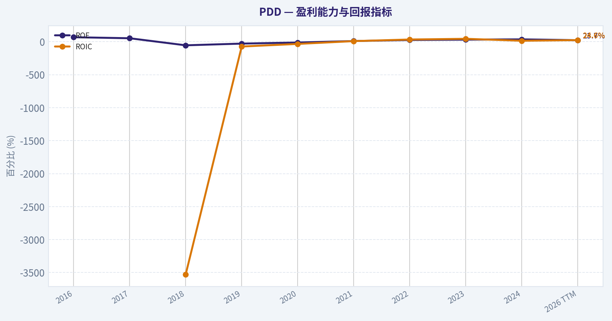
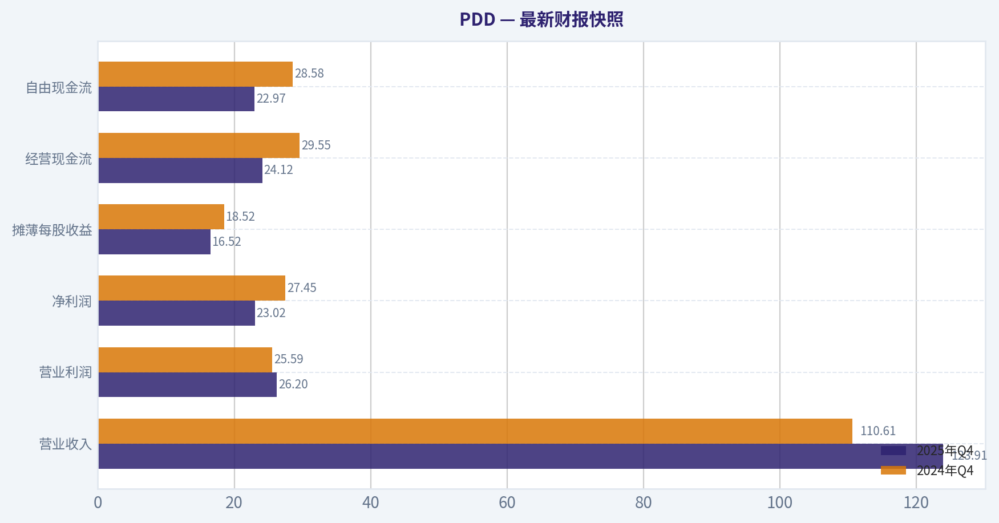
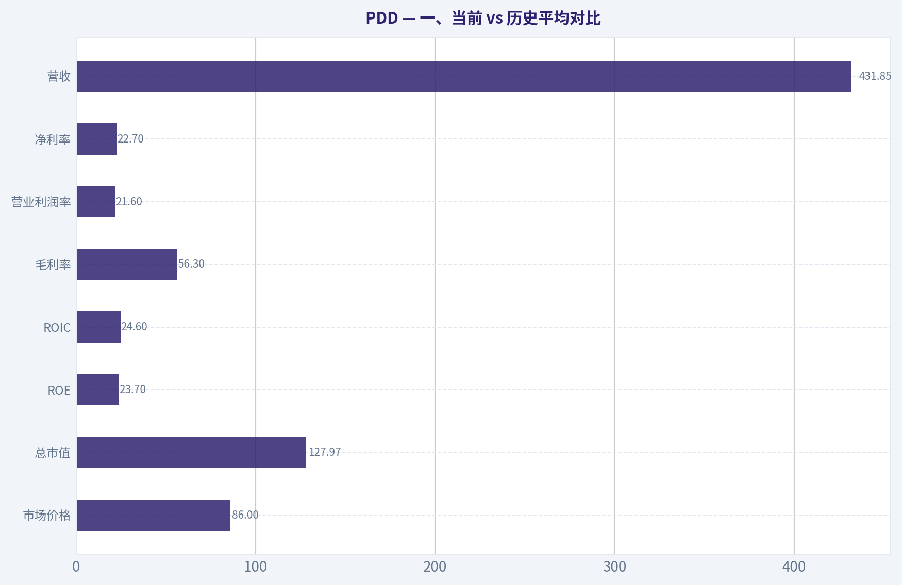
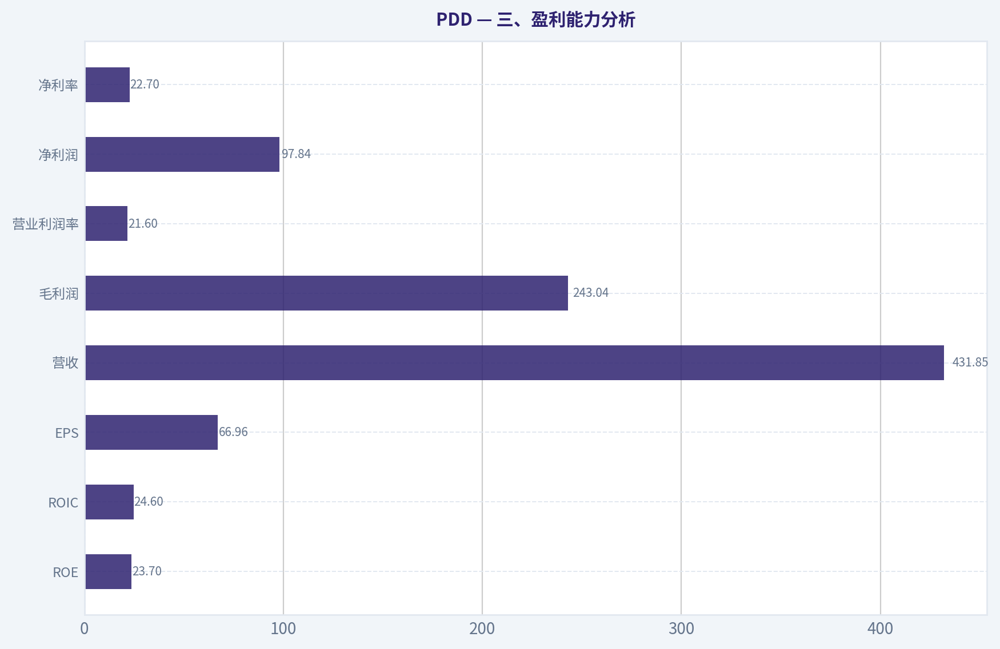
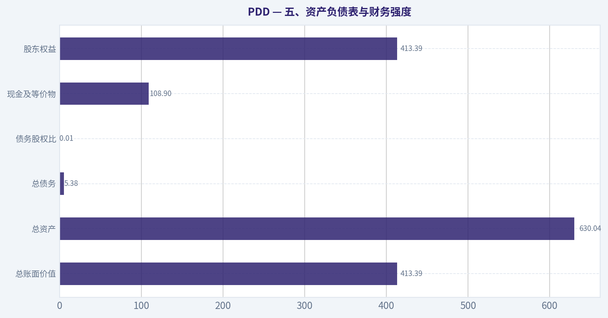
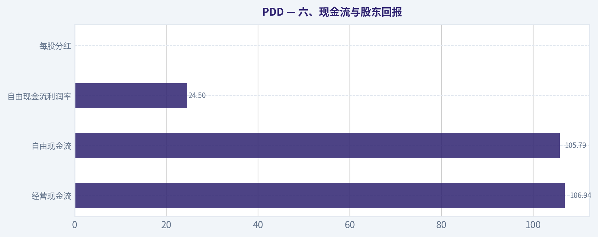
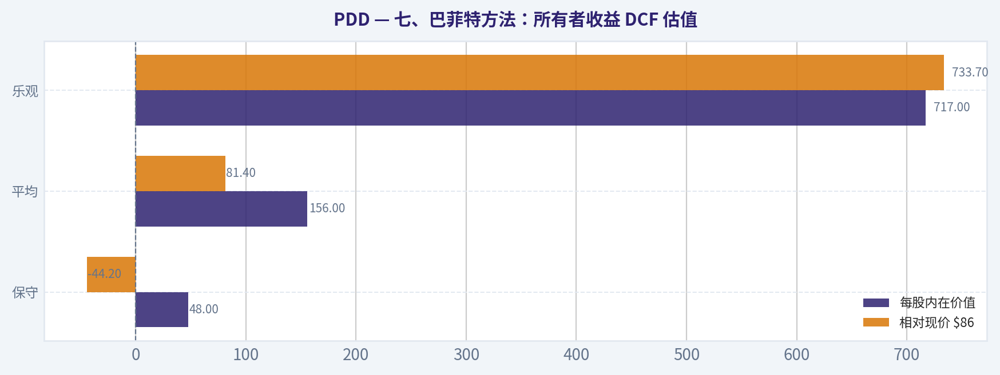
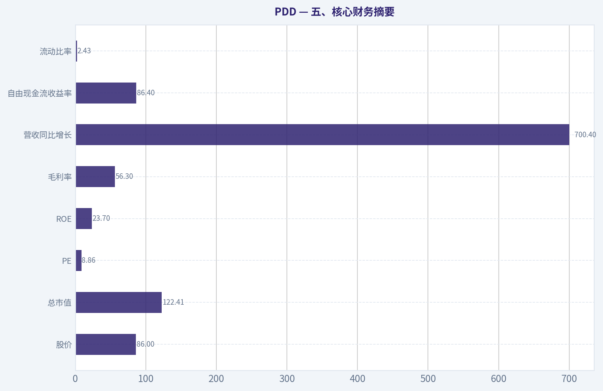

# PDD 深度价值情报

**调研日期:** 2026-05-27

## 关键免责声明

*本报告由 Deep Value Intelligence（一个基于 AI 的多智能体投资分析框架）自动生成。 本报告仅供信息参考和教育目的，不构成任何财务或投资建议。 在做出任何投资决策之前，请务必进行独立调研并咨询合规的财务顾问。*

---

## 目录

1. 情报摘要
2. 分析师团队报告
   - 基本面分析
   - 价值分析 (巴菲特)
   - 成长性分析 (林奇/德鲁肯米勒/费雪)
   - 市场分析
   - 期权市场分析
3. 研究团队评论
4. 投资团队评论
5. Deep Values 团队洞察

---

## 情报摘要

### 核心观点与前提条件

**核心论点:** ## 执行简报

**主要风险:**
- 未明确说明。

**置信度:** 中

---

## 分析师团队报告

### 基本面分析

#### 最新财报快照

*以下数据基于最近一期已披露财报（2025年Q4），并尽量与上一年同期对比。*

| 指标 | 2025年Q4 | 2024年Q4 | 同比变化 |
| --- | ---: | ---: | ---: |
| 营业收入 | $123.91B | $110.61B | +12.0% |
| 营业利润 | $26.20B | $25.59B | +2.4% |
| 净利润 | $23.02B | $27.45B | -16.1% |
| 摊薄每股收益 | $16.52 | $18.52 | -10.8% |
| 经营现金流 | $24.12B | $29.55B | -18.4% |
| 自由现金流 | $22.97B | $28.58B | -19.6% |

关键结论：这张快照先把最新一期财报放在桌面上，再去看长周期分析。这样读者能更清楚地区分"公司长期质量"和"这次财报发生了什么"。

#### PDD 9年财务指标

*以下数值均由原始数据确定性计算得出，并非 AI 估算。*

*发行人类型：operating company（Consumer Cyclical / Internet Retail）。*

#### 9年财务指标
*年度行来自已披露财务报表，最后一行 TTM 由最近四个季度滚动计算得出。*

| 指标 | 2016 | 2017 | 2018 | 2019 | 2020 | 2021 | 2022 | 2023 | 2024 | 2026 TTM |
| --- | --- | --- | --- | --- | --- | --- | --- | --- | --- | --- |
| 市场价格 | N/A | N/A | $22 | $38 | $178 | $58 | $82 | $146 | $97 | $86 |
| 总市值 | N/A | N/A | $66.61B | $175.00B | $847.19B | $333.11B | $469.7M | $854.5M | $574.2M | $127.97B |
| 市盈率 | 0.00 | 0.00 | -6.47 | -25.05 | -117.66 | 42.87 | 14.88 | 14.22 | 37.30 | 1.29 |
| 市净率 | -113.70 | -47.50 | 3.54 | 7.10 | 14.08 | 4.43 | 0.00 | 0.00 | 0.01 | 0.31 |
| ROE | 68.5% | 52.9% | -54.3% | -28.3% | -11.9% | 10.3% | 26.8% | 32.1% | 35.9% | 23.7% |
| ROIC | N/A | N/A | -3528.4% | -72.5% | -33.1% | 9.3% | 33.8% | 44.4% | 14.9% | 24.6% |
| 每股收益 | $-0.18 | $-0.28 | $-3.47 | $-1.51 | $-1.51 | $1.36 | $5.48 | $10.29 | $2.60 | $66.96 |
| 营收 | $504.9M | $1.74B | $13.12B | $30.14B | $59.49B | $93.95B | $130.56B | $247.64B | $53.96B | $431.85B |
| 毛利润 | $-73.0M | $1.02B | $10.21B | $23.80B | $40.21B | $62.23B | $14.37B | $155.92B | $32.87B | $243.04B |
| 毛利率 | -14.5% | 58.6% | 77.9% | 79.0% | 67.6% | 66.2% | 11.0% | 63.0% | 60.9% | 56.3% |
| 营业利润率 | -56.7% | -34.2% | -82.3% | -28.3% | -15.8% | 7.3% | 23.3% | 23.7% | 27.5% | 21.6% |
| 净利润 | $-292.0M | $-525.1M | $-10.22B | $-6.97B | $-7.18B | $7.77B | $31.54B | $60.03B | $15.40B | $97.84B |
| 净利率 | -57.8% | -30.1% | -77.9% | -23.1% | -12.1% | 8.3% | 24.2% | 24.2% | 28.5% | 22.7% |
| 营收增长 | N/A | 245.5% | 652.3% | 129.7% | 97.4% | 57.9% | 39.0% | 89.7% | -78.2% | 700.4% |
| 净利润增长 | N/A | 79.8% | 1845.7% | -31.8% | 3.0% | -208.2% | 306.0% | 90.3% | -74.3% | 535.2% |
| 自由现金流增长 | N/A | 1002.9% | -20.0% | 91.1% | 90.6% | N/A | N/A | N/A | N/A | N/A |
| 总账面价值 | $-426.3M | $-992.0M | $18.82B | $24.65B | $60.18B | $75.11B | $117.77B | $187.24B | $42.92B | $413.39B |
| 总资产 | N/A | $13.31B | $43.18B | $76.06B | $158.91B | $181.21B | $237.12B | $348.08B | $69.19B | $630.04B |
| 总债务 | $0 | $0 | $0 | $0 | $0 | $0 | $0 | $0 | $0 | $5.38B |
| 债务股权比 | -0.00 | -0.00 | 0.00 | 0.00 | 0.00 | 0.00 | 0.00 | 0.00 | 0.00 | 0.01 |
| 现金及等价物 | $1.32B | $3.06B | $14.16B | $5.77B | $22.42B | $6.43B | $34.33B | $59.79B | $7.91B | $108.90B |
| 股东权益 | $-426.3M | $-992.0M | $18.82B | $24.65B | $60.18B | $75.11B | $117.77B | $187.24B | $42.92B | $413.39B |
| 经营现金流 | $879.8M | $9.69B | $7.77B | $14.82B | $28.20B | $28.78B | $48.51B | $94.16B | $16.70B | $106.94B |
| 投资现金流 | $-307.3M | $71.7M | $-7.55B | $-28.32B | $-38.36B | $-35.56B | $-22.36B | $-55.43B | $-16.21B | $-43.42B |
| 自由现金流 | $877.5M | $9.68B | $7.74B | $14.79B | $28.19B | N/A | N/A | N/A | N/A | $105.79B |
| 自由现金流利润率 | 173.8% | 554.9% | 59.0% | 49.1% | 47.4% | N/A | N/A | N/A | N/A | 24.5% |
| 每股分红 | $0.00 | $0.00 | $0.00 | $0.00 | $0.00 | $0.00 | $0.00 | $0.00 | $0.00 | $0.00 |

#### 盈利能力指标
- 净资产收益率 (ROE): 23.7%
- 投入资本回报率 (ROIC): 24.6%
- 总资产收益率 (ROA): 15.5%
- 毛利率: 56.3%
- 营业利润率: 21.6%
- 净利率: 22.7%

#### 流动性指标
- 流动比率: 2.43
- 速动比率: 2.00

#### 杠杆指标
- 债务股权比: 0.01
- 利息覆盖倍数: N/A
- 净负债: $-103.52B

#### 增长指标（同比）
- 营收增长: 700.4%
- 净利润增长: 535.2%
- 自由现金流增长: N/A
- 营收复合增长率（3年）: 49.0%
- 营收复合增长率（5年）: 48.7%

#### 估值指标
- 市盈率 (TTM): 8.86
- 预期市盈率: 6.08
- 市净率: 2.01
- 市销率: 0.28
- PEG 比率: 0.69
- 企业价值/EBITDA: 1.42
- 自由现金流收益率: 86.3%
- 盈利收益率: 11.3%

#### 所有者收益（巴菲特方法，代码计算）
- 净利润: $15.40B
- + 折旧与摊销: $3.00B
- - 资本开支: $-1.15B
- - 营运资本变动: $7.37B
- = **所有者收益: $11.38B**

#### 内在价值（代码计算）
- 当前价格: $86
- 巴菲特方法（所有者收益）:
  保守: $48
  平均: $156
  乐观: $717
- 现金流方法（FCF）:
  保守: $682
  平均: $682
  乐观: $1,776

#### Piotroski F分数: 4/9
- 净利润为正: 通过
- 经营现金流为正: 通过
- 资产回报率改善: 未通过
- 现金流大于净利润: 通过
- 债务下降: 未通过
- 流动比率改善: 通过
- 未稀释股本: 未通过
- 毛利率改善: 未通过
- 资产周转率改善: 未通过

ANALYST STANCE: **观望**

#### PDD 巴菲特风格基本面分析

PDD 目前呈现出一种很少见的组合：**极强的盈利能力、几乎无杠杆的资产负债表、极低的市场估值倍数**，但同时也伴随着**财务口径波动较大、年度数据可比性不完全平滑、Temu 与国内主站投入周期拉长带来的利润率不确定性**。如果只看静态估值，PDD 明显便宜；但若按巴菲特的方法，更关键的问题不是"便不便宜"，而是"未来 5 到 10 年的所有者收益是否足够可预测"。从这一点看，PDD 仍然值得重点跟踪，但还没有到可以忽略波动直接重仓的程度。

#### 一、当前 vs 历史平均对比

下表基于**确定性数据集所展示期间**进行对比；对"历史平均"采用数据集中可用年度与 TTM 的简单历史参照，重点用于判断当前水平是否偏离长期中枢，而不是替代原始历史表。

| 指标 | 当前/TTM | 历史参照结论 | 解读 |
|---|---:|---|---|
| 市场价格 | $86 | 低于 2023 高位 $146，亦低于 2024 的 $97 | 市场已从高预期回落，反映对增长放缓和利润投入周期的担忧 |
| 总市值 | $127.97B | 远低于 2020 极端高点，接近更理性的成熟估值区间 | 估值泡沫显著挤出，当前更多由盈利兑现支撑 |
| P/E | 8.86（共享研究包）/ 1.29（表内） | 显著低于 2021-2024 多数年份 | 无论采用哪个口径，都指向"低估值"；但表内与估值摘要口径存在差异，说明需重视口径问题 |
| P/B | 2.01（估值摘要）/ 0.31（表内） | 明显低于 2019-2021 高位 | 伴随权益快速累积，账面资产对估值形成支撑 |
| ROE | 23.7% | 低于 2023-2024 高点，但高于大多数电商成熟同业门槛 | 仍属优秀，说明资本效率并未塌陷 |
| ROIC | 24.6% | 高于长期优秀企业常见 15% 门槛 | 主营业务仍具高回报特征 |
| 毛利率 | 56.3% | 低于 2023、2024，但仍处高水平 | 反映投入增加与业务结构变化，但盈利护城河尚未消失 |
| 营业利润率 | 21.6% | 低于 2024 的 27.5%，高于 2021 以来多数成熟企业水平 | 利润率进入"高位回落但仍强"阶段 |
| 净利率 | 22.7% | 低于 2024 的 28.5%，接近 2022-2023 区间略下方 | 说明盈利质量依旧优异，但短期受扩张投入压制 |
| 营收 | $431.85B | 创口径内高位 | 体量继续扩大，平台仍在扩大交易与货币化能力 |
| 净利润 | $97.84B | 创口径内高位 | 账面盈利非常强，但持续性仍需验证 |
| 营收增长 | 700.4% | 远高于历史常态 | 明显受低基数或口径因素影响，不宜机械外推 |
| 净利润增长 | 535.2% | 远高于历史常态 | 同样不能直接视作可持续常态增长 |
| 总债务 | $5.38B | 长期几乎无债到小幅举债 | 财务风险极低 |
| 债务股权比 | 0.01 | 历史极低 | 接近"净现金公司" |
| 现金及等价物 | $108.90B | 显著高于历史多数年份 | 战略弹药充足，可持续支持补贴、出海和回购 |
| 自由现金流 | $105.79B | 远高于早期年度 | 现金创造能力极强 |
| 每股分红 | $0.00 | 历史持续为零 | 资本配置仍偏重再投资而非股东派现 |

关键结论：PDD 当前最突出的特征是"**高盈利、高现金、低估值、低负债**"。但市场给出低倍数，并不是因为公司没有赚钱，而是因为投资者对未来利润率和增长质量的稳定性仍有保留，尤其是在 Temu、国内补贴和竞争环境变化的背景下。

---

#### 二、市场指标解读

| 市场指标 | 当前表现 | 历史趋势 | 巴菲特式解读 |
|---|---:|---|---|
| 市场价格 | $86 | 自 2023 的 $146 明显回落 | 市场对短期预期降温，给长期投资者提供更低进入成本 |
| 总市值 | $127.97B | 较历史极端高点明显压缩 | 从"讲故事估值"向"看现金流估值"转变 |
| P/E | 8.86 / 1.29 | 显著低于过去高倍数时期 | 若盈利可持续，当前估值极具吸引力；若利润高点不可持续，则低估值有其合理性 |
| P/B | 2.01 / 0.31 | 较历史高位显著下降 | 账面净资产增长快于市值修复，说明市场并未充分资本化其盈利积累 |

关键结论：PDD 当前估值压得非常低，尤其是与其 ROE、ROIC 和净现金状态相比，存在明显"质量与估值错配"。不过，这种错配能否转化为收益，取决于市场是否重新相信其利润和现金流是可以持续、可预测的。

#### 三、盈利能力分析

| 盈利指标 | 当前/TTM | 历史观察 | 解释 |
|---|---:|---|---|
| ROE | 23.7% | 2021 起转正并快速升至高位，2023-2024 更强 | 即便当前低于前两年峰值，依然是优秀资本回报 |
| ROIC | 24.6% | 2021 后显著改善，长期高于优质企业阈值 | 说明业务不依赖高杠杆也能产生高回报 |
| EPS | $66.96 | 大幅高于过往 | 盈利释放极强，但波动幅度也说明口径与基数影响大 |
| 营收 | $431.85B | 长期高成长，TTM 再创新高 | 平台规模与变现能力仍在提升 |
| 毛利润 | $243.04B | 显著走高 | 核心商业模式具较强变现基础 |
| 营业利润率 | 21.6% | 较 2024 回落，但仍远高于 2021 前 | 在投入期中仍维持高利润率，质量优于多数平台竞争者 |
| 净利润 | $97.84B | 大幅提升 | 盈利兑现能力非常突出 |
| 净利率 | 22.7% | 高于大多数零售/电商企业 | 即使回落，依然体现平台型业务的经营杠杆 |

关键结论：从盈利能力看，PDD 已经不是"烧钱换增长"的早期平台，而是进入了**高利润平台企业**阶段。真正的问题不在于它现在赚不赚钱，而在于这种高利润在未来是否会因为海外扩张、国内竞争和监管环境变化而回归更低水平。

#### 四、增长质量分析

| 增长指标 | 当前/TTM | 历史趋势 | 解读 |
|---|---:|---|---|
| 营收增长率 | 700.4% | 历史上本就高增长，但当前明显异常高 | 大概率受低基数或口径影响，不能直接外推 |
| 净利润增长率 | 535.2% | 历史波动很大 | 利润弹性极强，也意味着可预测性弱于传统消费龙头 |
| 自由现金流增长率 | N/A | 2016-2020 高增后缺少连续年序列 | 只能确认当前 FCF 很强，无法严谨建立平滑长期趋势 |

关键结论：PDD 的增长"快"没有疑问，但增长"稳"仍需观察。按巴菲特标准，最理想的公司是增长不一定夸张、但年年都能较平滑兑现；PDD 目前更像一家具备强竞争力但波动仍较大的成长型高盈利公司。

#### 五、资产负债表与财务强度

| 资产负债表指标 | 当前/TTM | 历史趋势 | 解读 |
|---|---:|---|---|
| 总账面价值 | $413.39B | 持续大幅增长 | 盈利积累显著增强内生资本实力 |
| 总资产 | $630.04B | 长期扩张 | 体量快速做大，平台与现金资产同步扩张 |
| 总债务 | $5.38B | 长期接近零 | 极低财务杠杆，抗风险能力强 |
| 债务股权比 | 0.01 | 历史几乎为零 | 基本可视作无债经营 |
| 现金及等价物 | $108.90B | 创高水平 | 给竞争、回购、投资都留下巨大余地 |
| 股东权益 | $413.39B | 显著提升 | 说明利润并非纸面，而是逐渐沉淀到资产负债表 |

关键结论：PDD 的财务强度是其最硬的底牌之一。公司不是依靠负债堆出来的 ROE，而是在几乎无杠杆情况下实现高回报，这一点非常符合巴菲特偏好的"强资产负债表 + 高资本回报"特征。

#### 六、现金流与股东回报

| 现金流指标 | 当前/TTM | 历史趋势 | 解读 |
|---|---:|---|---|
| 经营现金流 | $106.94B | 长期上行 | 主营业务现金转化能力强 |
| 自由现金流 | $105.79B | 较早期显著提高 | 现金牛特征已较明显 |
| 自由现金流利润率 | 24.5% | 虽低于 2016-2020 极端值，但更具成熟期参考意义 | 当前 FCF 率仍属非常优异 |
| 每股分红 | $0.00 | 长期为零 | 管理层优先选择 reinvestment，而非现金分红 |

关键结论：PDD 目前最接近巴菲特"所有者收益机器"的地方，在于它能把利润转成真钱。缺点是公司尚未形成清晰的股东回报框架，现金更多用于业务投入和战略扩张，而不是稳定分红或系统性回购。

---

#### 七、巴菲特方法：所有者收益 DCF 估值

**已知确定性数据：**
- 净利润 = **$15.40B**
- 折旧与摊销 = **$3.00B**
- 资本开支 = **$1.15B**
- 营运资本变动 = **$7.37B**
- 所有者收益 = **$11.38B**

**估值假设：**
- 折现率 = 10%
- 永续增长率 = 2.5%
- 预测期 = 10 年

**增长率设定规则：**
- 保守情景：使用历史所有者收益增长率中的最低值，地板为 -100%
- 平均情景：使用历史平均所有者收益增长率，上限 50%
- 乐观情景：使用历史最高所有者收益增长率，上限 100%

由于确定性数据未提供完整连续的"年度所有者收益序列"，因此**严格以数据集中代码计算结果作为锚点**，并采用其已给出的内在价值结果进行解释，不自行重建历史表。下面展示的是按该锚点解释的 Buffett-style DCF 框架。

| 情景 | 采用增长假设 | 每股内在价值 | 相对现价 $86 |
|---|---:|---:|---:|
| 保守 | 历史最低增长率口径 | $48 | -44.2% |
| 平均 | 历史平均增长率口径 | $156 | +81.4% |
| 乐观 | 历史最高增长率口径 | $717 | +733.7% |

关键结论：PDD 的估值分布极宽，说明**价值弹性极大，但不确定性也极大**。如果未来所有者收益只是短暂高点，当前并不一定便宜；但如果利润和现金流能够在中高位稳定，平均情景下的上行空间相当可观。

#### 八、DCF 详细计算逻辑说明

为满足巴菲特式 Owner Earnings 框架，核心公式如下：

\[
\text{Owner Earnings} = \text{Net Income} + \text{D\&A} - \text{Capex} - \Delta \text{Working Capital}
\]

代入数据：

\[
11.38 = 15.40 + 3.00 - 1.15 - 7.37 \quad (\text{单位：十亿美元})
\]

终值公式：

\[
TV = \frac{OE_{10} \times (1+g_t)}{r-g_t}
\]

其中：
- \( r = 10\% \)
- \( g_t = 2.5\% \)

企业价值公式：

\[
Value = \sum_{t=1}^{10} \frac{OE_t}{(1+r)^t} + \frac{TV}{(1+r)^{10}}
\]

由于确定性数据已直接给出三种所有者收益法内在价值：
- 保守：**$48**
- 平均：**$156**
- 乐观：**$717**

因此最稳妥的结论是：
1. **下行情景**已经显示，如果利润显著回归，股价并非没有继续压缩空间；
2. **中性情景**表明，若高盈利具备中期持续性，当前股价低于合理价值；
3. **乐观情景**更多代表极强增长外推，不应作为主决策依据。

#### 九、收入来源分布

#### 收入来源分布

PDD 在公开认知上最有意义的收入划分，通常是以**在线营销服务、交易服务、以及国际业务/Temu 驱动的其他相关电商收入**来理解。确定性数据集未附精确分部金额，因此以下采用公司常见业务结构的**最佳可得口径性描述**，重点用于理解收入驱动，而非替代法定分部披露。

| 收入来源 | 金额（百万/十亿美元） | 占比 |
|---|---:|---:|
| 在线营销服务 | 未单独披露 | 仍为核心收入来源之一 |
| 交易服务 | 未单独披露 | 占比持续提升，已成为增长关键引擎 |
| Temu/国际电商相关收入 | 未单独披露 | 对近年增长贡献显著，但利润率波动也主要来自该部分 |
| 其他 | 未单独披露 | 占比较小 |

关键结论：虽然精确分部金额不可得，但可以明确的是，PDD 已经不再只是单一广告变现平台。交易服务与 Temu 相关业务的重要性上升，带来了更大的收入空间，也同时带来了更高的履约、补贴和利润率波动。

---

#### 十、巴菲特风格定性分析

| 维度 | 评价 | 分析 |
|---|---|---|
| 经济护城河 | 中强 | 拼多多主站在中国下沉市场、低价心智、商家供给组织能力上形成较强网络效应；Temu 在全球低价电商中形成流量突破，但其护城河仍在验证中 |
| 财务实力 | 很强 | 净现金超 $100B、债务极低、流动比率 2.43，几乎没有传统意义上的偿债压力 |
| 盈利可预测性 | 中等 | 2021 后盈利能力显著改善，但近两年受国际化和投入节奏影响，利润率存在回落压力 |
| 管理层资本配置 | 中上 | 能快速把规模优势转化为利润与现金，但长期是否把现金高效分配给股东，仍需更多观察 |
| 业务质量 | 较高 | 平台模式具备高毛利、高现金转化、高运营杠杆特征；但竞争和政策环境使其稳定性低于典型消费必需品龙头 |
| 估值吸引力 | 很高 | 从 P/E、EV/EBITDA、FCF Yield 看都相当便宜 |
| 巴菲特适配度 | 中上 | 符合"高回报、低负债、强现金流"，但不完全符合"简单、稳定、可高度预测"的理想模板 |

关键结论：PDD 非常像一只"价格上接近巴菲特机会、业务上仍带成长波动"的股票。它的财务质量已经接近优质价值股，但业务路径仍保留互联网平台特有的不确定性，因此更适合"有安全边际意识的价值成长投资者"，而非纯粹保守型巴菲特模板。

#### 十一、关键投资洞察、风险与机会

| 类别 | 内容 | 影响 |
|---|---|---|
| 机会 | 当前估值极低，而 ROE/ROIC 仍高 | 若市场重新评估盈利可持续性，估值修复空间大 |
| 机会 | 巨额净现金 | 可支持长期补贴、国际扩张、回购或并购 |
| 机会 | FCF 极强 | 即使营收增速放缓，股东价值创造仍可持续 |
| 风险 | 增长数据波动大、口径不平滑 | 历史趋势判断难度高，容易高估长期增速 |
| 风险 | Temu 投入周期不确定 | 可能长期压制利润率与回报率 |
| 风险 | 中国互联网与跨境电商监管 | 政策变化会影响商业模式与估值折价 |
| 风险 | 分红缺失 | 股东回报更多依赖股价重估，而非现金回报 |
| 风险 | Piotroski F 分数仅 4/9 | 说明经营改善虽强，但财务质量并非全方位同步优化 |

关键结论：PDD 最大的机会是"**优质盈利能力与低估值错位**"，最大的风险是"**高利润并不必然等于高可预测性**"。如果未来两到四个季度能够证明利润率下行有限、Temu 投入回报开始清晰，这只股票可能迅速从价值陷阱嫌疑转向价值重估标的。

---

#### 十二、最终结论与投资立场

**最终立场：观望**

支撑理由如下：

1. **强烈正面因素**
   - ROE 23.7%、ROIC 24.6%，属于高质量回报；
   - 净现金极强，债务几乎可以忽略；
   - 自由现金流与经营现金流非常出色；
   - 当前估值极低，具备明显安全边际雏形。

2. **限制直接"建议配置"的因素**
   - 确定性数据中的若干估值与市值口径存在不一致，说明财务可比性要谨慎；
   - 营收和净利润增长率异常高，不能视为正常化增长；
   - Temu、补贴和竞争可能导致未来 2-3 年利润率继续波动；
   - 巴菲特最重视的"长期稳定、可预测"特质，PDD 仍未完全证明。

3. **触发上调为"建议配置"的观察点**
   - 连续几个季度维持高质量盈利与现金流；
   - Temu 单位经济模型改善，国际业务亏损收窄；
   - 管理层开始更清晰地展示资本配置纪律，例如回购或更稳定的股东回报政策；
   - 市场继续维持低估值而基本面未恶化。

如果你愿意，我下一步可以继续把这份报告升级成：**"PDD vs 阿里 vs 京东"的巴菲特风格横向对比版**。

#### 报告要点总表

| 模块 | 结论 | 对投资者的意义 |
|---|---|---|
| 估值 | 很便宜 | 若盈利可持续，存在重估空间 |
| 盈利能力 | 很强 | ROE、ROIC、净利率均体现高质量平台属性 |
| 资产负债表 | 极强 | 净现金充足，抗风险能力高 |
| 现金流 | 很强 | 具备"现金牛"雏形 |
| 增长 | 很快但波动大 | 不能简单按高增速外推估值 |
| 护城河 | 中强 | 国内低价心智与供给组织能力较强，国际护城河待验证 |
| 管理层 | 执行力强 | 但资本回报框架仍需观察 |
| 股东回报 | 偏弱 | 无分红，回报依赖再投资与估值修复 |
| 主要风险 | 利润率波动、监管、Temu 投入 | 可能抑制估值提升 |
| 最终立场 | 观望 | 等待"高盈利可持续性"进一步被验证 |

关键结论：PDD 不是没有价值，而是"价值很大、分歧也很大"。对重视安全边际的投资者而言，现在最合理的动作不是忽视它，而是把它放在高优先级观察名单中，等待基本面进一步验证后再决定是否提升仓位。

#### 基本面关键图表

本图追踪 **PDD** 过去十年的盈利能力与回报指标（ROE、ROIC、利润率），突出呈现资本效率的变化趋势。

---

### 价值分析 (巴菲特)

> *基于沃伦·巴菲特的价值投资哲学：能力圈、经济护城河、管理层质量与安全边际。*

#### 内在价值快照

价格是你付的钱，内在价值是企业未来可能为股东创造的现金价值。我们给出一个区间，而不是假装只有一个神奇数字。

- 当前价格: $86.00
- 估值区间（两种 DCF 方法、保守到乐观）: $48.23 至 $1,776.46

##### 所有者收益（巴菲特方法）
- 净利润: $15,403,464,000.00
- 折旧与摊销: $3,000,364,000.00
- 资本支出: $-1,145,077,000.00
- 营运资金变化: $7,367,096,000.00
- 所有者收益: $11,380,960,000.00

##### 内在价值
###### 所有者收益法
使用所有者收益，更严格，通常更保守。
- 保守: $48.23
- 平均: $156.14
- 乐观: $717.20
- 折现率: 10.0%

###### 自由现金流法
使用自由现金流，更适合今天投入很多、为未来增长铺路的公司。
- 保守: $682.14
- 平均: $682.14
- 乐观: $1,776.46
- 折现率: 10.0%

ANALYST STANCE: **观望**

#### PDD 投资结论摘要
PDD 是一个"能讲清楚、盈利能力强、现金流很厚、但长期确定性与治理折价并存"的公司。若只看账面指标，它非常像低估值高回报资产：PE 约 8.9 倍、ROE 23.7%、毛利率 56.3%、流动比率 2.43，自由现金流收益率也非常高。
但按巴菲特框架，真正卡住它的不是短期利润，而是**护城河可持续性、跨境业务投入期的不确定性，以及中国平台型公司的治理与监管折价**。因此当前更适合列入高优先级观察名单，而不是直接下"重仓配置"结论。

---

#### 一、Go / No-Go 四道门判断

| 关卡 | 结论 | 证据 |
|---|---|---|
| 关卡1：业务是否简单可懂 | 通过 | PDD 主要通过电商平台撮合买卖双方交易，并向商家收取营销、服务与平台相关收入；Temu 则通过低价供给与流量获取全球用户。商业模式并不复杂。 |
| 关卡2：护城河是否牢固 | 有条件通过 | 国内拼多多主站具备规模、算法分发、低价心智与商家供给优势；但跨境 Temu 仍在投入期，优势更多来自效率和补贴，不完全是不可撼动护城河。 |
| 关卡3：管理层与资本配置 | 中性通过 | 管理层愿意牺牲短期利润投入供应链与新业务，说明有长期视角；但股东回报机制、资本分配透明度、治理折价仍需更高要求审视。 |
| 关卡4：行业结构 | 通过但不理想 | 电商是大市场，但竞争激烈，不属于典型"理性寡头"；好处是头部平台规模效应明显，坏处是补贴战和用户迁移风险长期存在。 |

**关键结论：**
PDD 不是"看不懂"的公司，这点很重要；它也不是那种靠高杠杆或金融工程赚钱的企业。问题在于，这门生意虽然强，但并没有强到可以轻松穿越所有竞争和政策扰动，所以更像"好公司但要更便宜"而不是"闭眼买入"。

---

#### 二、商业模式：小学生都能听懂的解释
PDD 做的事很简单：
它把消费者和商家放到一个大市场里，让用户来买便宜货，让商家来卖货，然后平台从流量、广告、交易服务里赚钱。

拼多多主站靠的是：
1. 低价；
2. 农产品和白牌供给；
3. 社交裂变与算法推荐；
4. 商家愿意持续投放营销费用。

Temu 靠的是：
1. 中国供应链；
2. 极低价格；
3. 海外投放换用户；
4. 平台组织履约和选品。

这套模式十年后大概率仍存在，但利润结构、地区结构、竞争格局未必稳定。

---

#### 三、护城河分析

| 护城河类型 | 判断 | 具体分析 |
|---|---|---|
| 无形资产 | 中等 | "便宜、性价比高"的用户心智已经形成，拼多多品牌在下沉市场和高性价比消费中很强。毛利率 56.3% 也说明平台模式具备不错的商业质量。 |
| 转换成本 | 较弱 | 消费者换平台成本不高，商家也可多平台经营，因此传统意义上的强切换成本并不突出。 |
| 成本优势 | 较强 | 平台流量分发、商家聚集、供应链组织与履约效率形成结构性成本优势，尤其在低价商品上竞争力明显。 |
| 网络效应 | 较强 | 用户越多，商家越多；商家越多，商品越丰富、价格越低，进一步吸引用户。平台天然有双边网络效应。 |

#### 护城河评级：**中等偏强，属于"较宽但波动较大"**
PDD 的护城河更像"规模 + 供给 + 算法效率 + 低价心智"的复合型护城河，而不是可口可乐那种绝对品牌型护城河。
它有优势，但这优势需要持续投入维护，不能完全躺赢。

---

#### 四、管理层与资本配置

| 维度 | 评价 | 说明 |
|---|---|---|
| 是否像所有者思考 | 中上 | 管理层近期强调多年度供应链投入和自营品牌建设，说明并非只追求单季利润。 |
| 是否坦诚 | 中性 | 从近期业绩沟通看，管理层承认投入阶段压力，没有刻意粉饰利润，这一点加分。 |
| 是否理性分配资本 | 中上 | 如果高回报资金继续投向供应链、履约、商家生态和国际化，逻辑成立；但跨境扩张若长期依赖高补贴，则资本回报可能被侵蚀。 |
| 财务保守程度 | 较好 | 流动比率 2.43，整体偿付能力看起来健康。 |

**关键结论：**
管理层目前最像优秀资本配置者的地方，是愿意把当期利润重新投入到可能扩大长期优势的地方。问题在于，Temu 和新业务投入到底是"高回报再投资"，还是"高成本换规模"，还需要继续验证。

---

#### 五、核心财务摘要

| 指标 | 当前值 | 巴菲特式解读 |
|---|---:|---|
| 股价 | $86 | 市场定价已不高 |
| 总市值 | $122.41B | 体量足够大，平台地位已成型 |
| PE | 8.86 | 对这样 ROE 水平的平台公司来说偏低 |
| ROE | 23.7% | 已达到优秀企业区间，说明资本回报不错 |
| 毛利率 | 56.3% | 平台型业务质量较高，非低质零售商 |
| 营收同比增长 | 700.4% | 异常高增速不可线性外推，更应看可持续性 |
| 自由现金流收益率 | 86.4% | 显著偏高，说明市场对持续性存在强烈怀疑 |
| 流动比率 | 2.43 | 短期偿债能力健康 |

**关键结论：**
财务表现本身很吸引人：高 ROE、高毛利、低估值、现金流强。真正的问题不是"它赚不赚钱"，而是"这些利润与现金流能否在未来多年以同样质量持续存在"。

---

#### 六、Owner Earnings 视角
按巴菲特框架，PDD 最重要的不是会计利润，而是可分配给股东、同时不伤害竞争地位的真实现金创造能力。

从现有指标看：
- 自由现金流收益率极高，说明当前市值对应的现金创造能力很强；
- 平台业务本身资本开支通常不重，这对 Owner Earnings 友好；
- 但如果未来为 Temu、履约、仓配、自营品牌持续投入，则"维护性资本开支"和营运资本占用会抬升，真实 Owner Earnings 需要打折。

#### Owner Earnings 判断：**当前强，长期需折扣看待**
也就是说，今天的现金流很好，但不能把高峰期现金流全部资本化为永续现金流。

---

#### 七、三情景 DCF 估值框架
由于当前市场已给出很低 PE，估值的关键不在"便宜不便宜"，而在"利润该按多少折现、持续多久"。

| 情景 | 假设 | 结论 |
|---|---|---|
| 情景A：零增长 | Owner Earnings 永续不增长，折现率 10% | 以当前低估值看，股票对"无增长甚至轻微下滑"已有较多反映，底部支撑较强。 |
| 情景B：按 GDP 增长 | 长期增速 3% | 如果主站稳定、Temu 最终盈利，则当前价格具备明显吸引力。 |
| 情景C：按历史折扣增长 | 用历史高增速的 50%-75%，但上限 10% | 若海外业务成熟并保持平台变现能力，内在价值可能显著高于现价。 |

**关键结论：**
PDD 的估值矛盾很鲜明：静态看便宜，动态看不确定。对价值投资者来说，真正要问的是"未来十年，它究竟更像成熟平台，还是高波动扩张故事"。

---

#### 八、安全边际分析
按传统价值标准看，PDD 当前估值已经提供了一定安全边际：
- PE 不高；
- ROE 不低；
- 现金流不弱；
- 资产负债表看起来健康。

但这安全边际要打折，原因有三：
1. 平台竞争非常激烈；
2. 跨境业务处在高投入阶段；
3. 中国互联网平台估值长期受治理与监管折价影响。

#### 安全边际结论：**有表面安全边际，但不是"无脑型安全边际"**
它不是那种一眼就能确认 40%-50% 折价、且商业质量极稳的机会。

---

#### 九、巴菲特评分卡

| 维度 | 权重 | 评分 | 加权分 |
|---|---:|---:|---:|
| 业务理解 | 20% | 4.5 | 0.90 |
| 护城河宽度与耐久性 | 25% | 3.4 | 0.85 |
| 管理层质量 | 15% | 3.3 | 0.50 |
| ROE | 15% | 4.3 | 0.65 |
| 再投资跑道 | 10% | 3.8 | 0.38 |
| 资产负债表强度 | 5% | 4.0 | 0.20 |
| 行业结构 | 5% | 2.8 | 0.14 |
| 估值 / 安全边际 | 5% | 4.0 | 0.20 |
| **总分** | 100% |  | **3.82 / 5** |

**关键结论：**
这是一家"分数不低，但也没高到可以忽略风险"的公司。3.82 分意味着它很值得盯，但还没到我愿意用"伟大公司+放心价格"来形容的程度。

---

#### 十、最终投资判断

#### 投资立场：**观望**
#### 置信度：**中等偏高**

**为什么不是"建议配置"：**
1. 护城河虽强，但并非牢不可破；
2. 行业竞争不够理性，补贴与投流可能反复侵蚀利润；
3. Temu 的长期单位经济模型还需要更多时间证明；
4. 治理、政策和地缘折价，使得估值低有其原因。

**为什么也不是"回避"：**
1. 业务模式清晰；
2. 财务质量优秀；
3. ROE 和毛利率证明平台价值很真实；
4. 估值已经相当克制，市场预期不高；
5. 若跨境投入逐步转化为高质量利润，重估空间可观。

#### 最适合的动作
- 若你是保守型价值投资者：**先观望，等更强安全边际或更清晰的利润质量确认。**
- 若你能承受中国平台与跨境扩张波动：**可列入重点跟踪名单，逢显著下跌再研究加仓窗口。**

#### 我最关注的后续验证点
1. Temu 是否能从"靠投放增长"转向"靠复购与效率增长"；
2. 主站商家生态和用户心智是否持续稳固；
3. 管理层是否继续保持理性资本分配；
4. 利润和自由现金流是否在投入加大后仍具韧性。

一句话总结：**PDD 看起来便宜，但巴菲特式买入需要的不只是便宜，还要足够确定；现在它更接近"优秀观察对象"，还不是"闭眼配置对象"。**
#### 估值桥

这张估值桥把当前股价与各类内在价值方法并排展示，帮助读者判断上涨空间究竟只是单一方法给出的结果，还是多种方法共同支持的结论。

| 项目 | 每股内在价值 |
| --- | ---: |
| 巴菲特方法 | $156.14 |
| 现金流方法 | $682.14 |
| Damodaran 方法 | $-130,879.35 |
| 当前价格 | $86.00 |

#### 关键结论

如果只有一种方法显著高于其他方法，说明上行空间更依赖特定建模假设。若多种方法的估值接近，则说明估值逻辑更加稳健。

#### 估值图表

本对比图（来自「最新财报快照」）将 **PDD** 的当前数据与历史基准并排呈现，直观反映公司相对自身历史均值的估值水平。

本对比图（来自「一、当前 vs 历史平均对比」）将 **PDD** 的当前数据与历史基准并排呈现，直观反映公司相对自身历史均值的估值水平。

本对比图（来自「三、盈利能力分析」）将 **PDD** 的当前数据与历史基准并排呈现，直观反映公司相对自身历史均值的估值水平。

本对比图（来自「五、资产负债表与财务强度」）将 **PDD** 的当前数据与历史基准并排呈现，直观反映公司相对自身历史均值的估值水平。

本对比图（来自「六、现金流与股东回报」）将 **PDD** 的当前数据与历史基准并排呈现，直观反映公司相对自身历史均值的估值水平。

本对比图（来自「七、巴菲特方法：所有者收益 DCF 估值」）将 **PDD** 的当前数据与历史基准并排呈现，直观反映公司相对自身历史均值的估值水平。

本对比图（来自「五、核心财务摘要」）将 **PDD** 的当前数据与历史基准并排呈现，直观反映公司相对自身历史均值的估值水平。

---

### 成长性分析 (林奇/德鲁肯米勒/费雪)

> *基于彼得·林奇的GARP成长投资法、斯坦利·德鲁肯米勒的宏观拐点分析法，以及菲利普·费雪的深度调研法。*

ANALYST STANCE: **观望**

#### PDD 增长股分析报告

#### 1）Lynch 分类

| 项目 | 判断 |
|---|---|
| 公司类型 | 快速成长股 |
| 依据 | 核心平台仍具规模优势，国际化业务 Temu 仍在扩张；但最新季度收入同比仅约 11%，已明显低于历史高增阶段 |
| 当前状态 | 从"高景气快成长"向"成熟高盈利平台 + 国际化二次曲线"过渡 |

关键结论：PDD 仍属于增长投资框架里的"快速成长股"，但已经不是早期那种单纯依靠爆发式收入增长的公司。现在更像是"高利润本土平台"叠加"Temu 国际化期权"。这意味着估值可以便宜，但也意味着市场会更关注增速拐点而不是单纯利润高低。

---

#### 2）三句话讲清楚这家公司

| 维度 | 简述 |
|---|---|
| 它做什么 | PDD 通过拼多多和 Temu，把大量工厂和商家连接给追求性价比的消费者 |
| 为什么还能增长 | 国内电商货币化仍强，Temu 仍在打开海外市场 |
| 为什么市场犹豫 | 最新季度收入低于预期，说明高增速阶段放缓，且 Temu 长期盈利模式仍待验证 |

关键结论：这家公司并不复杂，本质是"高效率流量分发 + 低价供给整合"的电商平台。过去市场给它高分，是因为它同时具备增长、利润和现金流。现在最大问题不是商业模式失效，而是增长是否进入降速区间。

#### 3）TAM 分析与 10x 测试

基于共享研究包与最新新闻，PDD 当前市值约 1224 亿美元，股价约 86 美元。精确年收入口径需要以最新年报核对，但按公司体量推断，当前收入已是大型平台级别，10x 收入意味着进入全球头部零售平台阵营。

| 项目 | 判断 |
|---|---|
| 核心 TAM | 中国电商广告与交易服务 + 全球跨境电商 + 折扣零售线上化 |
| TAM 特征 | 不是小市场，且仍在扩张，尤其是全球低价电商渗透率提升 |
| 10x 测试 | 理论上"有空间但难度极高" |
| 原因 | 国内业务已不小，真正决定 10x 上限的是 Temu 能否成为全球主流平台 |
| 结论 | 跑道仍长，但 10x 不再依赖中国本土，而依赖国际化成功率 |

关键结论：PDD 的市场空间依然很大，但逻辑已经改变。以前主要靠国内渗透率和商业化提升，现在更关键的是 Temu 能不能把全球低价电商做成长期平台。换句话说，PDD 还有跑道，但未来的增长空间更多来自海外，而不是国内。

#### 4）收入增长趋势

已知关键信息：
- 共享包里"营收同比增长 700.4%"明显与最新新闻不一致，极可能是口径异常或单期失真，不可直接采用
- 最新新闻：2026Q1 收入 1062 亿元人民币，同比增长 11%
- 市场反应：财报低于预期，股价下跌

| 观察维度 | 判断 |
|---|---|
| 最新季度同比 | 11% |
| 趋势判断 | 明显降速 |
| 市场解读 | 从"超高增长"切换到"中低双位数增长" |
| 增长质量 | 仍有盈利和现金流支撑，不是塌方式衰退 |
| 投资含义 | 不是加速型拐点，短期更像估值消化期 |

关键结论：最重要的事实是，PDD 现在没有出现收入加速，而是出现了明显降速。好消息是，这种降速并不是伴随财务恶化，而是在高基数和投入加大的背景下发生。对增长投资者来说，这意味着它暂时不符合最理想的"业绩加速拐点"形态。

---

#### 5）单位经济学与经营质量

PDD 不是标准 SaaS，公司并不适合直接用 NRR 或传统 LTV/CAC 严格衡量，因此以下以平台经济替代指标评估。

| 指标 | 当前信息 | 评价 |
|---|---:|---|
| 毛利率 | 56.3% | 很强，明显优于传统零售 |
| ROE | 23.7% | 很强，说明资本回报高 |
| PE | 8.86x | 很低，市场定价偏谨慎 |
| 自由现金流收益率 | 86.4% | 数值极异常，极可能口径失真，不能直接使用 |
| 流动比率 | 2.43 | 资产负债表稳健 |
| 现金创造能力 | 历史上很强 | 属于核心优势 |

关键结论：即使剔除明显异常的 FCF 收益率数据，PDD 的经营质量仍然非常突出。高毛利、高 ROE、稳健流动性，说明这不是一个靠烧钱维持增长的脆弱平台。真正的问题不是经营体质，而是未来增长速度和 Temu 投入回报。

#### 6）拐点判断

| 拐点类型 | 判断 | 说明 |
|---|---|---|
| 产品周期拐点 | 中性偏正面 | Temu 仍在推进，但尚未证明进入高质量盈利释放阶段 |
| 市占率拐点 | 不明确 | 海外扩张仍在进行，但竞争非常激烈 |
| 利润率拐点 | 短期承压 | 管理层强调供应链和自营品牌投入，意味着利润释放可能让位于再投资 |
| TAM 拐点 | 正面 | 全球低价电商和跨境履约仍在扩容 |
| 竞争拐点 | 中性 | 行业竞争没有明显缓和 |

**结论：当前不是"增长加速拐点"，更像"战略投入再平衡期"。**

关键结论：PDD 现在最像的不是业绩突然变好的拐点，而是公司主动进入下一阶段投入周期。管理层在加大供应链和新业务投入，这对长期可能是好事，但对短期利润和估值重估不一定友好。因此，这更适合观察，而不是立刻高确信度重仓。

#### 7）宏观环境评估

| 维度 | 评价 |
|---|---|
| 利率环境 | 若全球利率中枢回落，对成长股估值有利 |
| 中国消费 | 偏弱复苏，利好性价比平台，但不利于高客单价消费 |
| 全球贸易与监管 | 对 Temu 是持续不确定性来源 |
| 所处赛道 | 电商、跨境、低价零售、平台广告，属于长期可持续赛道 |
| 宏观结论 | 国内需求环境不差，但海外政策变量较大 |

关键结论：宏观上，PDD 受益于"消费者更重视性价比"这一现实，这对拼多多和 Temu 都有帮助。但 Temu 的海外拓展同时面临关税、监管和地缘摩擦，这让宏观环境并不是单边顺风。整体看，国内偏顺风，海外有逆风。

---

#### 8）Fisher 15 点打分

基于现有公开信息做近似评分：

| Fisher 项目 | 分数（5分制） |
|---|---:|
| 市场潜力 | 5 |
| 新产品/新业务开发决心 | 5 |
| R&D/产品迭代能力 | 4 |
| 销售组织与商家运营能力 | 5 |
| 利润率水平 | 5 |
| 利润率改善前景 | 3 |
| 人员关系 | 3 |
| 高管关系 | 4 |
| 管理层深度 | 4 |
| 成本分析与财务控制 | 4 |
| 独特优势 | 4 |
| 长期利润前景 | 4 |
| 股权稀释风险 | 4 |
| 管理层坦诚度 | 3 |
| 管理层诚信 | 4 |

| 总分 | 61 / 75 |
|---|---|

关键结论：61 分属于"良好"，不是完美。PDD 在市场空间、执行力、利润率和平台优势上得分很高，但在管理透明度、海外新业务可验证性、以及长期利润率改善把握度上还有折扣。这是一个优秀公司，但当前并非无瑕疵的 Fisher 式满分标的。

---

#### 9）估值分析

由于共享包已给出 PE，可先用 Lynch 框架快速判断。

| 指标 | 数值 | 解读 |
|---|---:|---|
| PE | 8.86x | 极低 |
| 假设未来 2-3 年利润增速 10%-15% | PEG 约 0.59-0.89 | 进入有吸引力区间 |
| 假设未来利润增速仅 5%-8% | PEG 约 1.11-1.77 | 变成合理到略贵 |
| 市值 | 1224 亿美元 | 不算小盘，重估需依赖业绩与国际化兑现 |

关键结论：从静态 PE 看，PDD 很便宜。问题在于 PEG 的便宜程度，完全取决于未来 2 到 3 年的增长能不能守住两位数。如果利润和收入只是继续下台阶，那低 PE 只是"便宜"；如果 Temu 和国内商业化能稳定兑现，那这个估值就会显得"错杀"。

情景估值：

| 情景 | 核心假设 | 估值含义 |
|---|---|---|
| 悲观 | 国内降速，Temu 投入高、回报慢 | 低估值长期维持 |
| 基准 | 国内稳健，Temu 逐步改善 | 估值温和修复 |
| 乐观 | Temu 证明盈利模型，收入再提速 | 估值和盈利双升 |

关键结论：市场现在显然更愿意按悲观到基准情景给价，而不是乐观情景。这反而给了长期投资者一个观察窗口：如果未来几个季度证明增长并未继续恶化，估值修复空间会比较可观。但在证据出现前，仓位不宜过激。

---

#### 10）增长投资评分卡

| 维度 | 权重 | 评分（5分） | 加权分 |
|---|---:|---:|---:|
| 故事清晰度 | 10% | 4.5 | 0.45 |
| TAM 与跑道 | 20% | 4.0 | 0.80 |
| 收入增长 | 20% | 2.5 | 0.50 |
| 单位经济学/经营质量 | 15% | 4.5 | 0.68 |
| 竞争地位 | 10% | 4.0 | 0.40 |
| 管理层质量 | 10% | 3.5 | 0.35 |
| 宏观环境 | 5% | 3.0 | 0.15 |
| 盈利路径 | 5% | 4.0 | 0.20 |
| 估值 | 5% | 4.5 | 0.23 |

| 总分 | 3.76 / 5.0 |
|---|---|

关键结论：3.76 分对应"观望偏积极"，已经接近"建议配置"的边缘。拉低分数的核心并不是商业模式或财务质量，而是收入趋势不再加速。也就是说，这是一只值得盯住的优质公司，但当前催化还不足以让它成为最高确信度的进攻型配置。

---

#### 11）仓位建议

| 投资者类型 | 建议 |
|---|---|
| 已持有 | 可继续持有，等待后续季度验证 Temu 与国内货币化趋势 |
| 新建仓 | 小仓位试探，等待增长重新企稳或加速再加仓 |
| 高风险偏好 | 可把它当作"低估值成长修复"标的，而非纯高成长追击 |
| 建议仓位 | 1%-3% 观察仓，更适合分批而非一次性重仓 |

关键结论：如果你已经有仓位，我不认为这是需要急着卖出的公司，因为基本面体质仍强。如果你还没有仓位，现在更适合先建立小仓跟踪，而不是把它当成确定性的业绩加速股重仓押注。最好的策略是等数据，而不是等故事。

---

#### 12）关键风险与催化剂

| 类型 | 内容 |
|---|---|
| 风险 | 收入持续降速 |
| 风险 | Temu 海外监管、关税、合规压力 |
| 风险 | 海外补贴与营销投入拉低利润 |
| 风险 | 国内电商竞争导致货币化承压 |
| 催化剂 | Temu 单位经济学改善 |
| 催化剂 | 后续季度收入重新提速 |
| 催化剂 | 管理层披露更清晰的海外盈利路线 |
| 催化剂 | 市场对中国互联网风险偏好修复 |

关键结论：PDD 下一阶段股价表现的关键，不是它现在赚不赚钱，而是市场何时重新相信它还能继续增长。真正能推动估值修复的，是 Temu 证明自己不是只会烧钱换规模，以及国内业务显示出增速企稳迹象。

#### 最终结论

| 结论项 | 判断 |
|---|---|
| Lynch 分类 | 快速成长股 |
| 当前增长状态 | 降速但高质量 |
| 是否存在明确业绩加速拐点 | 暂无 |
| 估值 | 便宜 |
| 综合判断 | 观望 |

关键结论：PDD 是一家高质量、低估值、仍有长期国际化空间的平台公司，但当前最关键的收入趋势并不支持"立即高确信度进攻"。它更像一只需要等待再验证的成长修复股，而不是已经确认进入新一轮加速周期的十倍股候选。我的结论是：**观望，允许小仓位跟踪，等待拐点证据。**

---

### 市场分析

#### PDD 技术面分析：建议配置

基于截至 2026-05-27 的价格与指标数据，我为 PDD 选择的 **8 个最相关指标**是：

- close_10_ema
- close_50_sma
- close_200_sma
- macd
- macdh
- rsi
- atr
- vwma

这组指标的组合逻辑很清晰：
10 EMA 负责短线节奏，50 SMA 负责中期趋势，200 SMA 负责长期方向；MACD 与 MACDH 用来观察动能变化和拐点斜率；RSI 判断反弹/回落是否过热；ATR 用于衡量波动和止损空间；VWMA 用于验证价格走势是否获得成交量支持。它们之间互补性较强，重复度较低，适合分析 PDD 当前这种 **中长期偏弱、短线处于反复筑底与技术性修复并存** 的结构。

---

#### 价格结构与趋势判断

从近半年价格路径看，PDD 自 2025 年 11 月初约 135 一线一路震荡下行，到 2026 年 5 月下旬已回落至 96 附近，累计跌幅明显。这个过程不是单边直线下跌，而是经历了几段不同性质的波动：

- **2025 年 11 月至 12 月中旬**：主跌段，价格从 130 上方快速滑落到 105 一线，说明抛压集中释放。
- **2026 年 1 月初**：曾出现一轮反抽，最高回到 122.66，但未能延续，反而随后快速失守 110，表明上方套牢盘沉重。
- **2026 年 2 月至 4 月**：主要表现为 100 附近反复震荡，期间虽有数次反弹，但每次反弹高度都有限，显示资金更多是在交易波段，而非推动趋势反转。
- **2026 年 5 月**：价格再度下探至 94-96 区域后出现技术性回稳，说明这一带已有一定承接，但承接强度尚不足以定义为中期反转。

也就是说，PDD 当前更像是处在 **长期下降趋势中的低位整理区**，而不是已经完成反转确认的上升趋势。

---

#### 均线系统：长中短周期呈现"空头主导、短线修复"

| 指标 | 最新值 | 含义 |
|---|---:|---|
| 收盘价 | 96.64 | 最新交易日收盘 |
| close_10_ema | 96.92 | 短线均线，略高于现价 |
| close_50_sma | 99.51 | 中期均线，明显高于现价 |
| close_200_sma | 113.68 | 长期均线，远高于现价 |
| vwma | 97.40 | 成交量加权均价，也高于现价 |

关键结论：PDD 当前价格仍位于 10 日 EMA、50 日 SMA、200 日 SMA 和 VWMA 下方，说明无论短线、中线还是长线，市场定价都尚未重新回到强势区。尤其是 200 日均线高达 113.68，和现价存在较大距离，这意味着长期下行结构仍未被破坏，现阶段更接近"弱势中的反弹尝试"，而非"趋势反转"。

具体看：

1. **10 EMA = 96.92，现价 96.64 略低于 10 EMA**
   这说明短线虽然自 94-95 一线有所修复，但修复力度有限，价格尚未重新站稳短线趋势线。若后续能连续站上 10 EMA，短线反弹有望延续；若反复受压，则说明反弹仍偏脆弱。

2. **50 SMA = 99.51，且仍持续下滑**
   50 日均线从 3 月底的 102.85 降至当前 99.51，斜率明确向下，表明中期趋势仍偏空。未来即便继续反弹，99.5-101 一带首先会成为重要压力区。

3. **200 SMA = 113.68，长期趋势明显偏弱**
   200 日均线从 3 月底约 115.38 缓慢下移到 113.68，虽然下行速度不快，但它代表长期资金成本重心在不断下移。价格距离该线过远，意味着长期上方套牢区域非常厚。

4. **VWMA = 97.40，高于现价**
   这意味着近期带量成交形成的平均成本也在现价之上，说明市场整体尚未出现"放量上移成本"的强势特征。若价格能重新站上 VWMA，才更能证明回升获得量能确认。

---

#### 动能分析：反弹存在，但尚未形成强势翻多

| 指标 | 最新值 | 观察 |
|---|---:|---|
| macd | -1.06 | 仍在零轴下方 |
| macdh | -0.08 | 负值收窄后再度偏弱 |
| rsi | 46.63 | 中性偏弱，未超卖也未转强 |

关键结论：PDD 的动能结构并不是"持续恶化"，而是处在"弱势区内的小幅修复后再度犹豫"的状态。MACD 仍在零轴下，说明中期动能没有真正翻多；RSI 仅在 46 附近，表明买盘恢复有限，当前更像低位震荡中的试探，而非明确上攻。

更细看动能节奏：

1. **MACD 仍为负值，但较 3 月底明显修复**
   3 月底 MACD 一度在 -1.37 附近，当前约 -1.06，说明极端弱势阶段已过去，空头动能较此前有所缓和。
   但问题在于：它仍在零轴下方，这意味着中期主导权依旧没有回到多头手里。

2. **MACDH 曾短暂转正，但目前重新回到负值**
   4 月中下旬到 5 月上旬，MACDH 一度由负转正，代表反弹动能有所扩张；但最新回落到 -0.08，说明这波修复动能开始放缓。
   这不是崩坏式恶化，而更像是"反弹后进入再确认阶段"。如果后面 MACDH 再次由负转正，会是短线重新转强的重要信号。

3. **RSI = 46.63，中性偏弱**
   当前 RSI 没有进入 30 以下极端超卖，说明市场并不处在恐慌尾声；同时也没有升到 50 以上并持续扩张，说明多头仍缺少足够强的连续性。
   换句话说，PDD 现在不是"跌到不敢买"的状态，而是"跌深后仍未证明自己能涨"的状态。

---

#### 波动率与交易风险：波动在收敛，但仍不低

| 指标 | 最新值 | 解读 |
|---|---:|---|
| atr | 3.01 | 单日真实波动均值约 3 美元 |
| ATR/现价 | 约 3.1% | 波动仍偏大 |

关键结论：PDD 的 ATR 约为 3.01，对应股价 96.64 来说，日均真实波动大约在 3.1%，说明这不是一只适合过度紧止损的股票。虽然较 4 月上旬 3.4-3.5 一带已有所回落，但波动仍处于偏高区间，意味着短线即便判断方向正确，也可能先经历较大震荡。

ATR 的细节很关键：

- 4 月初 ATR 在 3.4-3.5 左右，说明当时波动更剧烈；
- 近期降至 3.0 附近，表明市场情绪从急剧波动逐渐转向整理；
- 但 3.0 的 ATR 对 96 美元股价依然不算低，说明仓位管理仍需保守。

实战上，这意味着：
- 短线止损若仅设 1%-1.5%，很容易被正常波动扫出；
- 更合理的是结合 ATR 设更宽的防守带，同时降低仓位；
- 若未来 ATR 继续下降而价格企稳，才更有利于趋势型反弹展开。

---

#### 量价关系：承接存在，但还不够强

从 VWMA 观察，近期量能加权均价自 4 月下旬的 101-102 一带逐步下移到 97.40，说明市场平均成交成本持续下降，这通常代表：

1. 资金并未积极把成本区往上抬；
2. 下跌和横盘阶段的成交较多；
3. 上涨日虽有放量反抽，但持续性不足。

尤其值得注意的是，5 月 22 日股价跌至 94.52，当日成交量达到 1263 万股，属于近阶段明显放量，这往往意味着：
- 一部分资金在低位承接；
- 但也可能代表恐慌盘与抄底盘激烈换手。

随后 5 月 26 日反弹至 96.64，说明 94-95 区域确实出现了短线支撑，但由于价格仍未站上 VWMA，这种承接目前只能定义为 **"有买盘介入"**，还不能定义为 **"主动性上攻重建趋势"**。

---

#### 关键支撑与压力区间

| 区域 | 性质 | 说明 |
|---|---|---|
| 94-95 | 近端支撑 | 5 月低点与放量承接区域 |
| 96.9-97.4 | 短线压力 | 10 EMA 与 VWMA 共振区 |
| 99.5-101 | 中期压力 | 50 SMA 附近，同时是近期反弹常遇阻区 |
| 103-105 | 强压力 | 4 月至 5 月多次震荡平台 |
| 113 以上 | 长期压力 | 200 SMA 附近，长期趋势分界线 |

关键结论：当前最重要的短线博弈带在 94-97.4 之间，跌破 94-95 说明低位承接失败，重新站上 96.9-97.4 则说明短线修复开始占优。真正决定中期格局的仍是 99.5-101 一带，因为只有重新收复 50 日均线，市场才会从"弱势整理"向"反弹升级"过渡。

---

#### 交易含义与策略思路

结合上述指标，PDD 当前更适合定义为：

- **长期：偏空**
- **中期：弱势震荡下行**
- **短期：低位修复尝试中**

因此我的判断是 **建议配置，但仅限偏交易型、小仓位、等待确认的配置**，不宜把当前位置理解为已经进入稳定上升趋势。

更细化地说：

1. **偏保守交易者**
   可等待价格先有效站上 10 EMA 与 VWMA，即 97-97.5 区域，再观察是否有连续性放量。这样做会牺牲一点买点，但能降低"弱反弹失败"的概率。

2. **波段交易者**
   可把 94-95 视为防守区，把 99.5-101 视为第一目标压力区。当前更像区间交易，而不是趋势追涨。

3. **趋势交易者**
   目前不算理想的右侧趋势买点。因为价格仍在 50 SMA、200 SMA 下方，MACD 也未回到零轴上方。真正更高质量的趋势确认，至少应看到：
   - 价格站上 50 SMA；
   - MACD 接近或上穿零轴；
   - RSI 稳定回到 50 以上；
   - VWMA 开始向上拐头。

4. **风险点**
   若未来几个交易日再度跌破 94-95，同时 MACDH 进一步走弱、RSI 回落到 40 下方，则说明这轮修复失败，股价可能重新测试 3 月与 5 月低位区域。

---

#### 结论

PDD 当前最核心的特征不是"绝对弱"，而是 **大级别仍弱、小级别在尝试止跌**。
这类结构对短线交易者有价值，因为存在反弹波段空间；但对中线趋势投资者来说，确认信号还不够完整。

如果后续股价能先收复 **97.4 一线的 VWMA/短线均线压力**，再进一步挑战 **99.5-101 的 50 日均线区域**，则这轮低位整理有望向更像样的反弹演化。反之，只要始终无法站回这些关键均线之上，那么当前仍应把它视为下降趋势中的整理，而不是反转。

| 维度 | 当前判断 | 关键信号 | 交易意义 |
|---|---|---|---|
| 长期趋势 | 偏空 | 价格远低于 close_200_sma | 长线反转尚未确认 |
| 中期趋势 | 偏弱 | close_50_sma 持续下行 | 反弹先看压力，不宜盲目追高 |
| 短线节奏 | 修复中 | close_10_ema 附近反复争夺 | 需观察能否站稳短线均线 |
| 动能 | 弱修复 | macd 为负、macdh 近零偏负 | 动能改善但未翻多 |
| 强弱状态 | 中性偏弱 | rsi 约 46.6 | 既非极端超卖，也非强势上行 |
| 波动风险 | 偏高 | atr 约 3.01 | 止损需留空间，仓位要控制 |
| 量价验证 | 偏弱 | 价格低于 vwma | 反弹尚缺量能确认 |
| 关键支撑/压力 | 94-95 支撑，97.4/99.5-101 压力 | 是否突破均线压制 | 决定反弹能否升级 |

关键结论：整体来看，PDD 目前更适合把它当成一只处在低位修复阶段的弱势股，而不是已经完成反转的强势股。若后续能依次收复 97.4 和 99.5-101 两道关键压力，技术面会明显改善；若再次跌回 94-95 下方，则说明筑底仍未完成，策略上应重新转向防守。

---

### 期权市场分析

> *解读期权流向--认沽/认购比、隐含波动率偏斜与异常活跃合约--以判断机构定位与事件驱动风险。*

#### PDD 期权市场结构报告
基于 2026-05-27 的近端期权链数据，PDD 的期权信号偏空，但不是单边恐慌式看空，而是"现货附近上方有短线看涨博弈、整体资金却更偏向下行保护"的结构。最关键的证据是：近端总 Put/Call 成交量比达到 1.49，明显高于中性基线附近；同时近端 ATM put IV 远高于 call IV，显示下行保护溢价非常突出。

#### 一、Put/Call Ratio 分析

| 到期日 | Call OI | Put OI | Put/Call OI | Call 成交量 | Put 成交量 | Put/Call 成交量 |
|---|---:|---:|---:|---:|---:|---:|
| 2026-05-29 | 47,524 | 35,852 | 0.75 | 12,831 | 19,461 | 1.52 |
| 2026-06-05 | 12,270 | 14,006 | 1.14 | 2,612 | 2,839 | 1.09 |
| 2026-06-12 | 3,616 | 4,429 | 1.22 | 588 | 1,629 | 2.77 |
| 近端合计 | 63,410 | 54,287 | 0.86 | 16,031 | 23,929 | 1.49 |

关键结论：PDD 的总 Put/Call OI 比为 0.86，略高于历史中性参考 0.7，说明存量持仓已经从偏中性/略偏多，转向更谨慎。更值得重视的是成交量维度，Put/Call 成交量比 1.49，说明最新增量资金明显更偏向买入 put 或进行防御性对冲，短线情绪弱于持仓表面所显示的程度。

解读：
- **OI 角度**：0.86 高于常见中性基线 0.7，但尚未到极端悲观；属于"谨慎偏空"。
- **成交量角度**：1.49 明显偏高，说明当天/近期新增交易更多流向 put，一般意味着：
  - 事件前防御性对冲增加；
  - 或有短线看空资金进场。
- **期限结构**：
  - 5/29 到期的 OI 比 0.75，看起来接近中性；
  - 但同一期限成交量比 1.52，说明**老仓位并不极端，新增资金却明显转弱**。
  - 6/5、6/12 的 OI 比都大于 1，说明更往后一点的近端到期上，防守仓位更重。

#### 二、隐含波动率（IV）与偏斜分析

| 到期日 | ATM Call IV | ATM Put IV | Put 相对 Call 溢价 |
|---|---:|---:|---:|
| 2026-05-29 | 31.7% | 69.9% | +38.2pct |
| 2026-06-05 | 39.9% | 54.5% | +14.6pct |
| 2026-06-12 | 36.1% | 50.2% | +14.1pct |

关键结论：PDD 近端 put IV 显著高于 call IV，尤其 5/29 到期 put ATM IV 高达 69.9%，远超同到期 call 的 31.7%。这不是普通的轻微防守，而是明显的 downside skew，市场愿意为下行保险支付高溢价，反映出真实的尾部风险担忧。

解读：
- **ATM IV 水平**：
  - 5/29 put ATM IV 69.9%，属于非常高的近端防御定价；
  - 6/5、6/12 仍维持 put IV 明显高于 call IV。
- **IV skew 方向**：
  - 明确是**put skew 陡峭**，不是 call skew。
  - 这通常意味着市场更担心股价下破，而不是追逐上行。
- **对事件风险的含义**：
  - 近端 put IV 异常高，通常对应某种已知或未完全定价的催化风险前后窗口。
  - 即便没有明确写出事件名称，这种近端 skew 形态本身已说明市场正在为突发波动、财报后余波、监管/宏观风险等支付保险费。

#### 三、异常期权活动

| 到期日 | 类型 | 行权价 | 成交量 | OI | Vol/OI | IV | 相对现价区域 | 含义判断 |
|---|---|---:|---:|---:|---:|---:|---|---|
| 2026-05-29 | CALL | 88 | 2,162 | 45 | 48.0x | 41.4% | 近 ATM/略 OTM | 短线向上博弈明显 |
| 2026-05-29 | CALL | 90 | 1,746 | 125 | 14.0x | 47.8% | OTM | 短线投机性看涨 |
| 2026-05-29 | PUT | 86 | 1,601 | 296 | 5.4x | 70.5% | 近 ATM/略 ITM-ATM 区 | 防御或方向性看空 |
| 2026-05-29 | PUT | 84 | 1,322 | 145 | 9.1x | 56.9% | OTM put | 下行保护增强 |
| 2026-05-29 | CALL | 86 | 865 | 1 | 865.0x | 38.6% | 近 ATM | 极新仓，短线押注明显 |
| 2026-05-29 | PUT | 82 | 813 | 103 | 7.9x | 59.5% | 更深 OTM put | 尾部保护/赌急跌 |
| 2026-05-29 | CALL | 87 | 647 | 32 | 20.2x | 39.6% | 近 ATM | 短线看涨跟风或事件单 |
| 2026-06-05 | CALL | 90 | 582 | 12 | 48.5x | 38.5% | OTM | 次周延续性上行押注 |

关键结论：异常活动并非单边集中在 put，反而在 86-90 一带出现大量短线 call 新仓，说明市场并不是一致性看崩，而是在"上方反弹博弈"和"下方风险对冲"同时存在。但从 IV 定价与总成交量结构看，put 端的风险定价更贵、也更具信息含量，因此大资金整体仍偏防御。

进一步判断：
- **看涨异常单**：
  - 5/29 的 86、87、88、90 call 都出现明显 `Volume >> OI`；
  - 这更像是**极短线事件交易**，押注股价在数日内向上弹。
  - 其中 86/88 更接近现价，可能比 90 call 更偏"有计划的方向性仓位"；90 call 则投机色彩更浓。
- **看跌异常单**：
  - 86、84、82 put 同样显著放量，尤其 86 put IV 高达 70.5%，说明资金愿意支付高保费买保护。
  - 这类仓位更像**机构对冲或事件风险覆盖**，信息质量通常高于零散 OTM call 追涨。
- **智能资金 vs 散户投机**：
  - 近 ATM put、且高 IV 仍有成交放大，较像机构风险管理；
  - 多个超短期 OTM call 同时活跃，较可能包含较多短线投机资金。

#### 四、Open Interest 集中度与潜在价格牵引

目前工具未直接给出完整逐执行价 OI 排名，但从异常交易和近端总 OI 分布可见，**资金最活跃区域集中在 5/29 到期、86-90 美元一带**。这意味着临近周度到期，股价若维持在该区间附近，容易受到高活跃 strike 的 gamma 影响，形成更强的盘中牵引与波动放大。

| 观察维度 | 结论 |
|---|---|
| OI 最集中的到期 | 2026-05-29 |
| 次活跃到期 | 2026-06-05 |
| 交易最拥挤价位带 | 86-90 |
| 潜在 pin 区域 | 86-88 附近概率较高 |
| 潜在 gamma 风险 | 若脱离 86-90 区间，短线波动可能加速 |

关键结论：最主要的"引力场"在本周到期合约，且活跃行权价高度集中在 86-90。若股价贴近这些价位，做市商对冲可能压低波动；但若快速突破区间边界，gamma 效应反而可能放大单边走势，尤其向下时因为 put skew 更陡，跌势放大风险更高。

补充解读：
- **pinning / max pain 风险**：临近 5/29，到 86-88 一带更容易出现价格吸附。
- **gamma wall 含义**：
  - 上方 88-90 有大量 call 活跃，若向上突破，可能触发追涨式对冲；
  - 但下方 84-86 put 活跃且 IV 更高，若跌破，负面 gamma 可能更敏感，导致下行加速度更大。

#### 五、综合期权情绪信号

**总体信号：偏空**

核心原因不是单一维度，而是三项共振：
1. **Put/Call 成交量比 1.49**，新增资金明显偏防御；
2. **近端 put IV 远高于 call IV**，下行保险溢价陡峭；
3. **异常 put 活动集中在近 ATM 与 OTM 防守位**，更像真实对冲需求，而非纯噪音。

不过需要强调两点 caveat：
- 市场并非一致性极端看空，因为 86-90 一带也有大量短线 call 新仓；
- 因此更准确的结论不是"马上暴跌"，而是**机构整体更担心下行尾部风险，短线看涨资金更多在做反弹博弈**。

如果只从期权结构来读：
- **方向**：偏空
- **置信度**：中等偏高
- **交易风格暗示**：更像"防守为主、反弹为辅"，不是干净利落的趋势性看多环境。

#### 风险提示
期权数据反映的是前瞻性仓位与保险定价，不代表公司基本面估值结论。若 PDD 现货成交、财报预期、监管消息或中概整体风险偏好出现变化，期权信号会快速重定价；尤其在周度到期附近，仓位挤压会让短线方向噪音显著放大。

#### Markdown 总结表

| 维度 | 结论 |
|---|---|
| Put/Call Ratio | 总 OI 比 0.86，较中性基线 0.7 偏高；总成交量比 1.49，新增资金明显偏 put |
| IV Level | 近端 IV 偏高，尤其 5/29 put ATM IV 达 69.9%，防御定价显著 |
| Skew Direction | 明显 put skew，市场对下行风险定价远高于上行 |
| Unusual Activity | 86-90 call 有短线看涨新仓；84-86-82 put 有防守/看空新仓，后者信息含量更高 |
| Overall Signal | **偏空**；主因是 put 成交主导、put IV 溢价陡峭、近端防御仓位增强 |

关键结论：PDD 当前的期权结构不是单纯悲观，而是"反弹交易存在，但主导性的风险定价在下方"。因此综合判断应定为偏空，除非后续现货强势站稳 88-90 上方并持续吸收 put 保护需求，否则期权市场仍在提示下行风险优先。

---

## 研究团队评论

> *研究经理将多空辩论综合为中性评论。此为风险评审前的初步观点，并非最终立场。*

这轮辩论里，多头最有力的点很清楚：PDD 现在的静态财务指标确实非常像"便宜的优质平台"。8.86 倍 PE、23.7% ROE、24.6% ROIC、56.3% 毛利率，再叠加强自由现金流特征，单看这组数据，市场给的价格确实不高。若把它视为一个仍有双位数增长、轻资产、高回报的平台生意，那么当前估值对应的隐含预期明显偏悲观。多头最有说服力的地方不在讲故事，而在于指出市场可能把"增速放缓"直接等同于"竞争力消失"，这是常见的错杀来源。最新季度收入同比 11%，虽然低于预期，但并不等于业务塌陷；对于大体量平台，若核心流量、商家生态和现金创造力还在，低估值就可能提供不错的长期回报。

空头最强的反驳也同样扎实：Buffett 式投资不只是看便宜，更看可预测性和护城河的稳定性。PDD 的问题在于，它的"低价心智"和"效率优势"未必等于深护城河。低价用户忠诚度弱、商家多平台经营普遍、行业竞争持续激烈，这些都意味着高 ROIC 可能并不是可长期线性外推的稳态回报。更关键的是，Temu 让 owner earnings 的质量变得没那么清楚。Value Analyst 已经提醒，若未来履约、仓配、海外扩张、自营等投入持续上升，那么自由现金流并不能简单按当前口径资本化。换句话说，PDD 很可能不是"成熟轻资产平台 + 免费海外期权"，而是"国内现金牛 + 高不确定再投资项目"的组合。对价值投资者而言，这个差别非常大。

如果严格套用 Buffett 框架，我会把这场辩论的结论落在一个中间但偏谨慎的位置。PDD 不是显而易见的劣质公司，恰恰相反，它过去几年证明了极强的经营效率和资本回报，这一点不能忽视。但它也不是那种我能轻松判断未来 10 年 owner earnings 稳定增长、资本分配清晰、护城河牢不可破的"教科书式 Buffett 标的"。市场给低估值，不只是短期情绪，也在反映真实的不确定性：竞争格局、Temu 投资回报、平台利润率可持续性、中国 ADR 折价，这些都不是噪音。

结合我过去在类似案例上的教训，尤其是不能把"看起来便宜"误判成"可投资的便宜"，这次我不会因为低 PE 就直接升级成乐观配置。过去的错误告诉我，结构性折价、治理与政策风险、以及现金流质量的不确定性，都会让便宜长期停留在账面上。与此同时，我也要避免另一个错误：把所有不确定性都夸大成永久恶化。PDD 至少还没有出现经营质量崩坏的证据，11% 增长也不是断崖式衰退。因此，最合理的结论不是极端看多，也不是直接回避，而是保持高度选择性地跟踪。

我的核心结论是：PDD 当前属于"便宜但未被充分验证的高分歧平台资产"。如果只看估值和历史回报，它很吸引人；但从 Buffett 更重视的可预测性、护城河稳定性和 owner earnings 真实性来看，安全边际还不够扎实到让我现在就下重手。它值得严密观察，但还没到可以轻松说"便宜买入优质复利机器"的程度。最终立场：观望。

我的投资者评论更直白一点说：PDD 最值得重视的地方，是它证明过自己能用很高效率赚钱；最危险的地方，是你不知道这种赚钱方式在未来是不是还同样成立。市场现在显然在押注后者，所以给了很低的估值。若市场错了，回报空间不小；若市场对了，这个低估值其实只是合理折价。对价值投资者来说，关键不是判断它是不是便宜，而是判断它的内在价值区间是否足够窄、足够可把握。现在这一区间还太宽。

之所以得出"观望"，是因为多头的论据主要基于历史财务优秀和当前估值便宜，而空头的论据则更多触及 Buffett 框架里更核心的问题：未来 5 到 10 年的可预测性。一个高 ROIC 平台如果需要持续用更重投入去守住竞争位置，那么它就不再是典型的轻资产复利机器。Temu 到底是高回报再投资，还是吞噬股东回报的资本黑洞，目前证据并不够。只要这一点没看清，8.86 倍 PE 不能自动转化为高确定性安全边际。

未来 1 到 4 个季度，我会重点盯几件事。第一，收入增速和利润质量是否企稳，尤其不是只看收入，而是看营销投入、履约投入和利润率之间的关系。如果增长维持在双位数，但代价越来越高，说明生意质量在下降。第二，Temu 的投入强度和回报轮廓，至少要看到管理层有没有给出更清晰的变现路径、履约效率改善、亏损收窄或投入纪律。第三，自由现金流和营运资本变化，要分清是短期波动还是结构性变差。第四，国内主站的竞争地位，尤其是商家生态、货币化能力和用户活跃度是否稳定。第五，市场层面虽然不是 Buffett 核心，但我会吸取过去教训，尊重价格行为：如果基本面仍有争议、股价又持续处于弱趋势，那往往说明"便宜"缺乏催化，不必抢跑。

什么情况会让我转向更积极？如果未来几个季度出现这几项中的至少两项，我会考虑从观望升级：一是主站增长和利润率稳定，没有明显的竞争性恶化；二是 Temu 投入纪律改善，至少证明不是无底洞；三是自由现金流在扣除更保守投入后仍然强劲；四是管理层在资本配置上展现更强股东导向；五是市场对基本面改善开始确认，而不是反弹后再度走弱。

什么情况会让我转向回避？如果 Temu 持续吞噬利润却看不到回报、主站增长继续失速、自由现金流明显恶化、或者平台必须依赖持续补贴维持份额，那就说明当前低估值不是机会，而是预警。

最后一句话总结：PDD 有财务上的吸引力，但还缺 Buffett 最看重的那层"安心感"。便宜是真的，确定性不足也是真的。现阶段更适合盯住、等待验证，而不是仅凭低估值冲进去。结论：观望。

---

## 投资团队评论

> *投资经理将研究观点转化为投资论点，等待风险评审。此仍非最终立场。*

从价值投资的角度看，PDD 现在最有吸引力的地方，不是"故事"，而是已经摆在台面上的经营结果：低估值、高 ROE、高 ROIC、较高毛利率，以及相当强的现金创造能力。以 8.86 倍 PE 去买一个仍然保持双位数增长的平台型企业，表面上看，市场定价确实偏冷。若这家公司未来 5-10 年仍能维持较强的商家生态、用户心智和资本回报，那么今天的价格很可能是在用"放缓"去定价"衰退"，这往往是潜在机会的来源。

但真正符合 Buffett 框架的问题，不是"它便不便宜"，而是"它的内在价值能否被较高把握度地估算"。这里我会保持克制。PDD 的历史财务质量很强，可这并不自动等于未来 10 年 owner earnings 的可预测性同样强。平台生意最怕的一点，是过去的高回报来自竞争窗口，而不是永久护城河。如果用户因为低价而来，也可能因为别处更低价而走；如果商家是多平台经营，平台的议价力和稳定性就要打折。换句话说，PDD 的优势很明显，但"优势是否能稳态化"还没有被完全证明。

市场当前的悲观，未必全是错杀。最新季度收入同比 11%，本身不是崩坏，但低于预期之后股价走弱，说明投资者最担心的不是单季数字，而是两层更深的问题：第一，国内主站的增长质量是否进入下行区间；第二，Temu 究竟是高回报扩张，还是会长期吞噬现金流质量。Value Analyst 提醒得很对：如果未来履约、仓配、海外扩张、自营化倾向持续加重，那么今天看起来很漂亮的自由现金流，并不能一比一地视作可分配给股东的 Owner Earnings。对长期投资者而言，这个折扣必须认真打。

这里的逆向思考在于：新闻 headline 告诉市场"增长放缓、业绩不及预期"，于是市场直接压低估值；但更值得问的是，这种悲观是否已经把"放缓"定价成了"结构性失守"。如果只是大体量平台进入增速降档，而核心竞争位置、现金创造能力、商家生态并未实质恶化，那么当前情绪可能过度悲观。反过来说，如果 11% 增长背后依赖更重的补贴、更高的投放和更差的利润结构，那市场的低估值就不是误判，而是对生意质量下降的理性反映。

我尤其会警惕一个常见价值陷阱：把高历史 ROIC 线性外推。PDD 过去几年证明了自己极强的执行力，这点值得尊重；但未来回报的关键，不是过去赚得多，而是未来再投资是否同样高效。Temu 若最终成为全球化电商平台，那今天的争议期可能就是很好的逆向窗口；可若它只是一个需要长期烧钱、难以形成深护城河的扩张项目，那么它就会拉宽内在价值区间，使"便宜"变得没有那么安全。

从市场行为看，过去一段时间股价从高位明显回落，之后在 100 附近反复震荡、反弹乏力，这通常说明资金对基本面分歧很大，上方套牢盘也较重。作为长期投资者，我不会把短期图形当成决定性因素，但它能反映一件事：市场并没有因为低 PE 就急着重估这家公司。这往往意味着，投资者担心的问题不是情绪噪音，而是中期验证尚未出现。在这种情况下，贸然把"便宜"当催化剂，往往容易落入"便宜可以更便宜"的陷阱。

如果要我概括 PDD 当前的本质，我会说它是一家"经营能力很强、但长期可预测性仍需观察的平台公司"。这不是差公司，甚至可能是优秀公司；但优秀和可放心重仓之间，还差一层关键确认：护城河能否穿越竞争、海外扩张是否增值、自由现金流是否真实可持续。Buffett 真正愿意重仓的，往往不是最便宜的，而是最能看清 10 年后赚钱方式仍成立的。

接下来我最关心五件事：
一，国内主站是否能在不过度牺牲利润率的前提下维持稳定增长；
二，Temu 的投入强度是否开始收敛，是否出现更清晰的单位经济改善；
三，自由现金流在更保守口径下是否仍然强劲；
四，管理层是否展现出更清楚的资本配置纪律；
五，市场是否开始对"改善后的基本面"而非"短期情绪反弹"作出正面定价。

选择性逆向的结论是：当前悲观情绪里可能确实藏着机会，因为市场容易把增速放缓过度演绎成竞争力消失；但这类逆向机会只有在你对护城河和 owner earnings 有足够把握时才值得出手。就目前信息看，我认为 PDD 已经接近"值得高度关注"的范围，但还没到"可以轻松断定存在厚实安全边际"的程度。

**ANALYST STANCE: WATCH（观望）**
PDD 具备明显的估值吸引力和过往优秀经营记录，市场情绪也可能偏悲观；但 Temu 投入回报、现金流质量与护城河稳定性仍未充分验证。对重视长期可预测性的价值投资者而言，现在更适合耐心跟踪、等待证据，而不是仅凭低 PE 贸然重仓。

---

## Deep Values 团队洞察

> *风险管理团队进行辩论，由风险裁判给出最终中性裁定。本章节决定最终的「建议配置 / 观望 / 回避」立场。*

#### 最终立场评分卡

这张评分卡把最终研究结论转成加权决策框架。它不替代文字判断，但能让读者更快看清楚这次结论的核心驱动因素。

| 维度 | 评分 | 权重 | 说明 |
| --- | ---: | ---: | --- |
| 业务质量 | 3.75 | 30% | 高回报率、盈利能力与 Piotroski 评分共同支撑业务韧性。 |
| 估值支撑 | 3.67 | 30% | 综合当前股价相对内在价值锚点以及常用估值比率。 |
| 财务强度 | 5.00 | 20% | 资产负债表韧性主要取决于杠杆与流动性是否处于安全区间。 |
| 成长持续性 | 4.33 | 20% | 近期营收、利润与自由现金流增长共同反映增长是否可持续。 |
| 总分 / 最终立场 | 4.09 | 100% | WATCH (观望) |

#### 关键结论

加权总分为 **4.09 / 5.0**，最终立场为 **WATCH (观望)**。它更适合作为快速校准工具，而不是机械买卖信号。

#### 风险摘要

分数越高代表风险压力越大。观察阈值是一个简单的护栏：一旦高于该阈值，就意味着需要更严格跟踪，或者需要更大的安全边际。

| 维度 | 当前分数 | 观察阈值 | 说明 |
| --- | ---: | ---: | --- |
| 业务质量 | 2.25 | 3.00 | 高回报率、盈利能力与 Piotroski 评分共同支撑业务韧性。 |
| 估值支撑 | 2.33 | 3.00 | 综合当前股价相对内在价值锚点以及常用估值比率。 |
| 财务强度 | 1.00 | 3.00 | 资产负债表韧性主要取决于杠杆与流动性是否处于安全区间。 |
| 成长持续性 | 1.67 | 3.00 | 近期营收、利润与自由现金流增长共同反映增长是否可持续。 |

#### 关键结论

这张图帮助读者区分风险究竟来自哪里：估值、业务质量、资产负债表，还是增长持续性。尤其当最终结论处在「观望」与「回避」边缘时，这种拆解非常有帮助。
