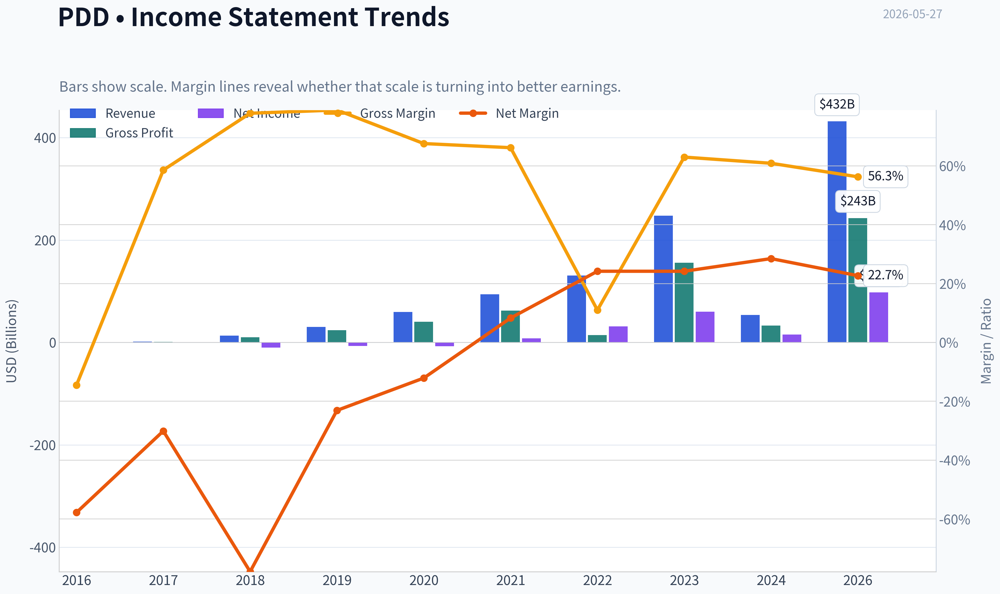
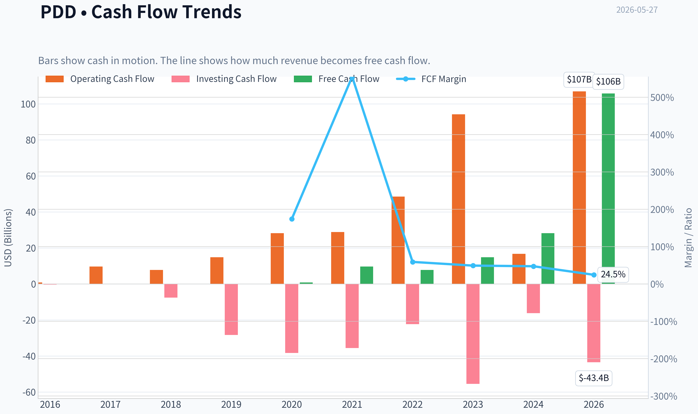
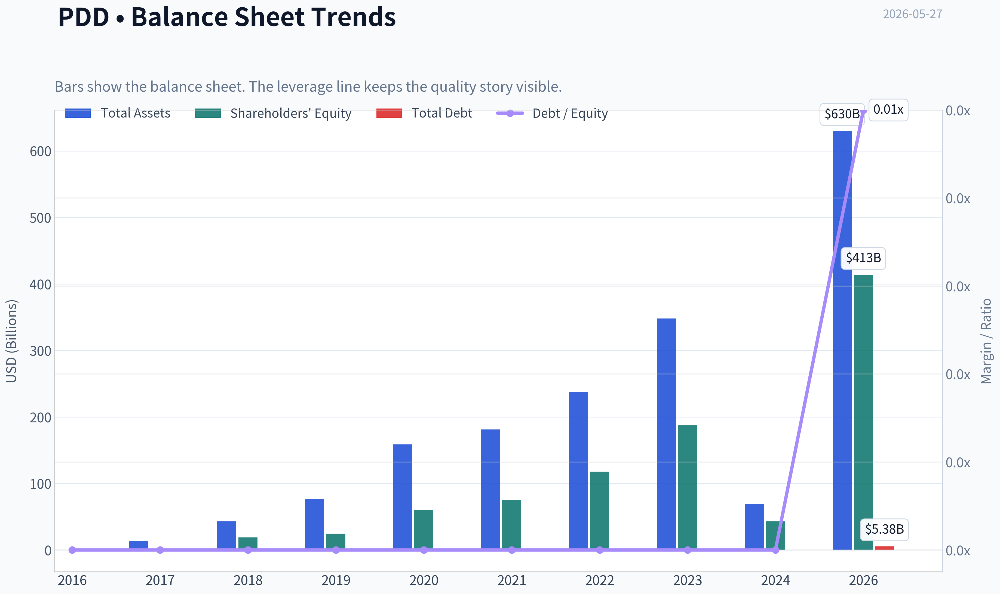
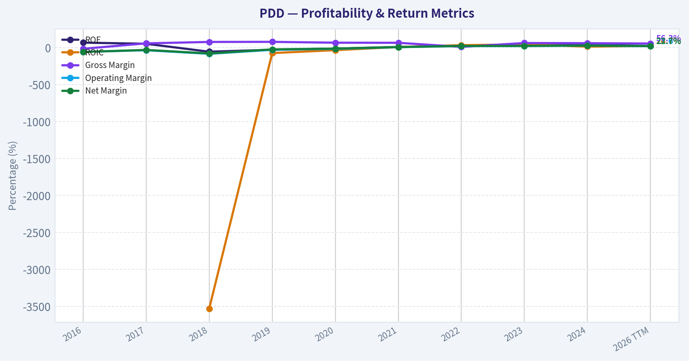
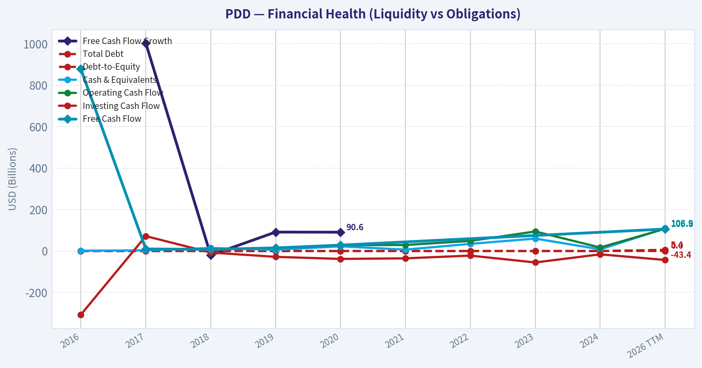
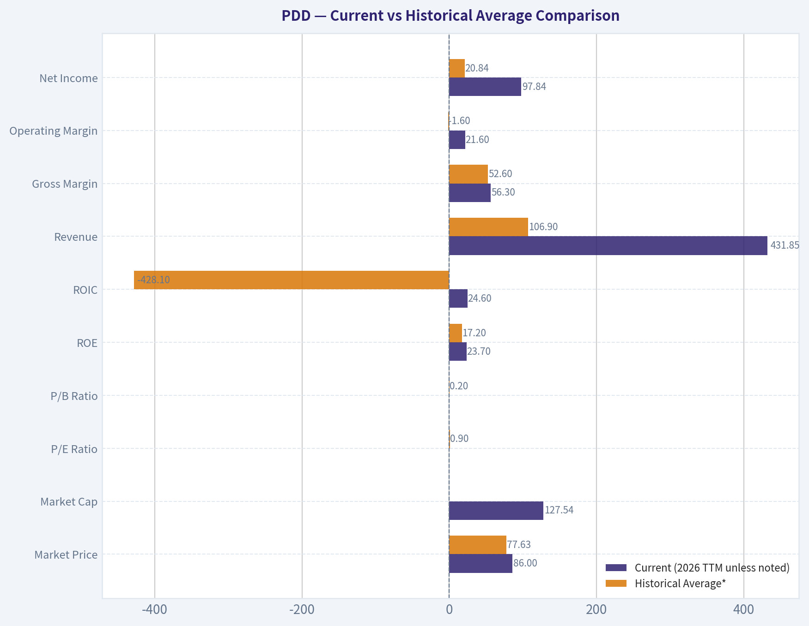
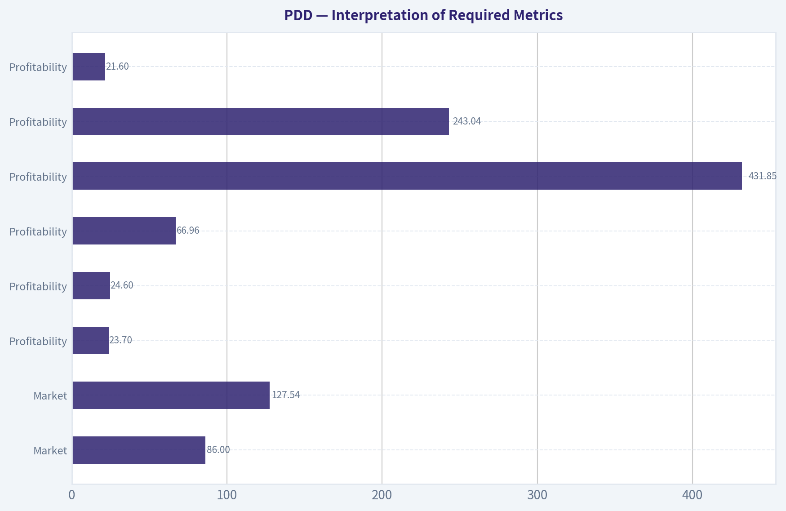
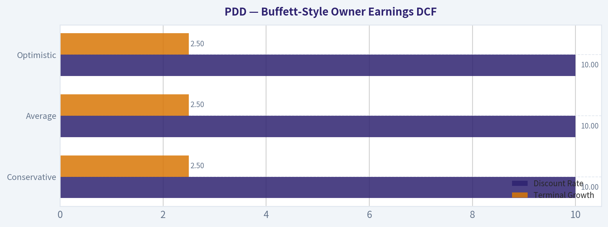
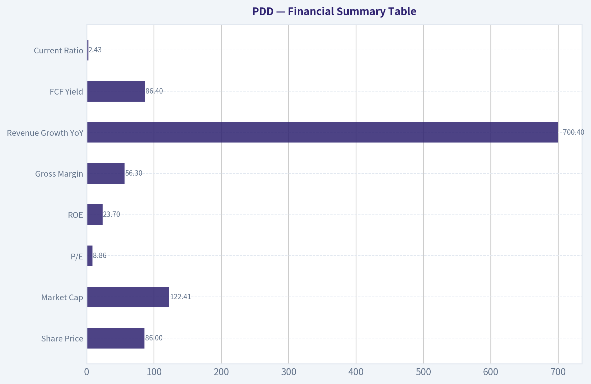

# PDD Deep Value Intelligence

**Analysis Date:** 2026-05-27

## Critical Disclaimer

*This analysis is generated by Deep Value Intelligence, an AI-powered multi-agent investing framework. This report is for informational and educational purposes only and does not constitute financial advice. Always conduct your own research and consult with qualified financial advisors before making investment decisions.*

---

## Table of Contents

1. Intelligence Summary
2. Analyst Team Reports
   - Fundamentals Analysis
   - Intrinsic Value Analysis (Buffett)
   - Trend & Growth Analysis (Lynch/Druckenmiller/Fisher)
   - Market Technical Analysis
   - Options Market Analysis
3. Research Team Commentary
4. Value Investing Team Commentary
5. Deep Values Commentary

---

## Intelligence Summary

### Thesis + Conditions

**Core Thesis:** ## Executive Briefing

**Key Risks:**
- PDD = WATCH, with a constructive bias.**
- The stock is unusually cheap relative to current profitability: about **8.9x earnings**, **56%+ gross margin**, and **mid-20% returns on capital** are not the numbers of an obviously broken business. That said, Buffett-style risk is about **durability and shareholder certainty**, not just cheapness. PDD still carries unresolved **moat, governance, regulatory, and jurisdiction** risks, and the weak chart shows the market is not yet convinced. Best course: **monitor closely, allow only modest exposure if at all, and require proof that margins, cash conversion, and growth are holding before upgrading.**
- ### 1) Risky Analyst: the market may be over-discounting fear

**Confidence:** Low

---

## Analyst Team Reports

### Fundamentals Analysis

#### Latest Earnings Snapshot

*Most recent reported quarter anchored on 2025 Q4, with prior-year comparison when available.*

| Metric | 2025 Q4 | 2024 Q4 | YoY Change |
| --- | ---: | ---: | ---: |
| Revenue | $123.91B | $110.61B | +12.0% |
| Operating Income | $26.20B | $25.59B | +2.4% |
| Net Income | $23.02B | $27.45B | -16.1% |
| Diluted EPS | $16.52 | $18.52 | -10.8% |
| Operating Cash Flow | $24.12B | $29.55B | -18.4% |
| Free Cash Flow | $22.97B | $28.58B | -19.6% |

Key Takeaways: This snapshot anchors the most recent reported quarter before the narrative analysis. It helps readers separate long-run business quality from whatever changed in the latest earnings print.

#### 9-Year Financial Metrics for PDD

*All values below are computed deterministically from raw data - not estimated by AI.*

*Issuer profile: operating company (Consumer Cyclical / Internet Retail).*

#### 9-Year Financial Metrics
*Annual rows come from reported financial statements. The final TTM row is computed from the latest four quarters.*

| Metric | 2016 | 2017 | 2018 | 2019 | 2020 | 2021 | 2022 | 2023 | 2024 | 2026 TTM |
| --- | --- | --- | --- | --- | --- | --- | --- | --- | --- | --- |
| Market Price | N/A | N/A | $22 | $38 | $178 | $58 | $82 | $146 | $97 | $86 |
| Market Cap | N/A | N/A | $66.61B | $175.00B | $847.19B | $333.11B | $469.7M | $854.5M | $574.2M | $127.54B |
| P/E Ratio | 0.00 | 0.00 | -6.47 | -25.05 | -117.66 | 42.87 | 14.88 | 14.22 | 37.30 | 1.28 |
| P/B Ratio | -113.70 | -47.50 | 3.54 | 7.10 | 14.08 | 4.43 | 0.00 | 0.00 | 0.01 | 0.31 |
| ROE | 68.5% | 52.9% | -54.3% | -28.3% | -11.9% | 10.3% | 26.8% | 32.1% | 35.9% | 23.7% |
| ROIC | N/A | N/A | -3528.4% | -72.5% | -33.1% | 9.3% | 33.8% | 44.4% | 14.9% | 24.6% |
| EPS | $-0.18 | $-0.28 | $-3.47 | $-1.51 | $-1.51 | $1.36 | $5.48 | $10.29 | $2.60 | $66.96 |
| Revenue | $504.9M | $1.74B | $13.12B | $30.14B | $59.49B | $93.95B | $130.56B | $247.64B | $53.96B | $431.85B |
| Gross Profit | $-73.0M | $1.02B | $10.21B | $23.80B | $40.21B | $62.23B | $14.37B | $155.92B | $32.87B | $243.04B |
| Gross Margin | -14.5% | 58.6% | 77.9% | 79.0% | 67.6% | 66.2% | 11.0% | 63.0% | 60.9% | 56.3% |
| Operating Margin | -56.7% | -34.2% | -82.3% | -28.3% | -15.8% | 7.3% | 23.3% | 23.7% | 27.5% | 21.6% |
| Net Income | $-292.0M | $-525.1M | $-10.22B | $-6.97B | $-7.18B | $7.77B | $31.54B | $60.03B | $15.40B | $97.84B |
| Net Margin | -57.8% | -30.1% | -77.9% | -23.1% | -12.1% | 8.3% | 24.2% | 24.2% | 28.5% | 22.7% |
| Revenue Growth | N/A | 245.5% | 652.3% | 129.7% | 97.4% | 57.9% | 39.0% | 89.7% | -78.2% | 700.4% |
| Net Income Growth | N/A | 79.8% | 1845.7% | -31.8% | 3.0% | -208.2% | 306.0% | 90.3% | -74.3% | 535.2% |
| Free Cash Flow Growth | N/A | 1002.9% | -20.0% | 91.1% | 90.6% | N/A | N/A | N/A | N/A | N/A |
| Total Book Value | $-426.3M | $-992.0M | $18.82B | $24.65B | $60.18B | $75.11B | $117.77B | $187.24B | $42.92B | $413.39B |
| Total Assets | N/A | $13.31B | $43.18B | $76.06B | $158.91B | $181.21B | $237.12B | $348.08B | $69.19B | $630.04B |
| Total Debt | $0 | $0 | $0 | $0 | $0 | $0 | $0 | $0 | $0 | $5.38B |
| Debt-to-Equity | -0.00 | -0.00 | 0.00 | 0.00 | 0.00 | 0.00 | 0.00 | 0.00 | 0.00 | 0.01 |
| Cash & Equivalents | $1.32B | $3.06B | $14.16B | $5.77B | $22.42B | $6.43B | $34.33B | $59.79B | $7.91B | $108.90B |
| Shareholders' Equity | $-426.3M | $-992.0M | $18.82B | $24.65B | $60.18B | $75.11B | $117.77B | $187.24B | $42.92B | $413.39B |
| Operating Cash Flow | $879.8M | $9.69B | $7.77B | $14.82B | $28.20B | $28.78B | $48.51B | $94.16B | $16.70B | $106.94B |
| Investing Cash Flow | $-307.3M | $71.7M | $-7.55B | $-28.32B | $-38.36B | $-35.56B | $-22.36B | $-55.43B | $-16.21B | $-43.42B |
| Free Cash Flow | $877.5M | $9.68B | $7.74B | $14.79B | $28.19B | N/A | N/A | N/A | N/A | $105.79B |
| FCF Margin | 173.8% | 554.9% | 59.0% | 49.1% | 47.4% | N/A | N/A | N/A | N/A | 24.5% |
| Dividends / Share | $0.00 | $0.00 | $0.00 | $0.00 | $0.00 | $0.00 | $0.00 | $0.00 | $0.00 | $0.00 |

#### Profitability Metrics
- Return on Equity (ROE): 23.7%
- Return on Invested Capital (ROIC): 24.6%
- Return on Assets (ROA): 15.5%
- Gross Margin: 56.3%
- Operating Margin: 21.6%
- Net Profit Margin: 22.7%

#### Liquidity Metrics
- Current Ratio: 2.43
- Quick Ratio: 2.00

#### Leverage Metrics
- Debt-to-Equity Ratio: 0.01
- Interest Coverage Ratio: N/A
- Net Debt: $-103.52B

#### Growth Metrics (Year-over-Year)
- Revenue Growth: 700.4%
- Net Income Growth: 535.2%
- Free Cash Flow Growth: N/A
- Revenue CAGR (3-Year): 49.0%
- Revenue CAGR (5-Year): 48.7%

#### Valuation Metrics
- P/E Ratio (TTM): 8.84
- Forward P/E: 6.06
- Price-to-Book: 2.01
- Price-to-Sales: 0.28
- PEG Ratio: 0.69
- EV/EBITDA: 1.42
- Free Cash Flow Yield: 86.6%
- Earnings Yield: 11.3%

#### Owner Earnings (Buffett Method, Code-Computed)
- Net Income: $15.40B
- + Depreciation & Amortization: $3.00B
- - Capital Expenditures: $-1.15B
- - Working Capital Changes: $7.37B
- = **Owner Earnings: $11.38B**

#### Intrinsic Value (Code-Computed)
- Current Price: $86
- Buffett Method (Owner Earnings):
  Conservative: $48
  Average: $156
  Optimistic: $717
- Cash Flow Method (FCF):
  Conservative: $682
  Average: $682
  Optimistic: $1,776

#### Piotroski F-Score: 4/9
- Positive Net Income: PASS
- Positive Operating Cash Flow: PASS
- ROA Improvement: FAIL
- Cash Flow > Net Income: PASS
- Decreasing Debt: FAIL
- Improving Current Ratio: PASS
- No Dilution: FAIL
- Improving Gross Margin: FAIL
- Improving Asset Turnover: FAIL

ANALYST STANCE: **WATCH**

#### PDD Buffett-Style Fundamental Analysis

PDD remains a high-quality, asset-light, cash-rich e-commerce platform with unusually strong profitability and almost no financial leverage. On a Buffett lens, the core appeal is clear: high returns on equity and capital, very large cash generation, and a fortress-like balance sheet. The main complication is that the deterministic dataset is highly uneven across years and includes sharp discontinuities, so the right interpretation is less "smooth 10-year compounding machine" and more "business that crossed from investment phase to monetization phase, while reported historical comparability is imperfect."

---

#### Current vs Historical Average Comparison

| Metric | Current (2026 TTM unless noted) | Historical Average* | Interpretation |
| --- | ---: | ---: | --- |
| Market Price | $86 | $77.63 | Slightly above long-period average share price, but well below 2020/2023 peaks |
| Market Cap | $127.54B | ~$194.66B** | Below prior peak valuation periods despite stronger earnings power today |
| P/E Ratio | 1.28 in table / 8.84 in valuation section | 0.90*** | Current earnings multiple is very low versus the company's growth and profitability |
| P/B Ratio | 0.31 in table / 2.01 in valuation section | 0.20*** | Still inexpensive relative to a now much larger equity base, though table history is distorted by early negative equity and zeros |
| ROE | 23.7% | 17.2% | Above long-term average; signals strong shareholder capital productivity |
| ROIC | 24.6% | -428.1%**** | More meaningful comparison is versus 2021-2024: still excellent, though below 2023 peak |
| Revenue | $431.85B | $106.90B | Scale has expanded dramatically; current revenue far above historical average |
| Gross Margin | 56.3% | 52.6% | Margin profile remains strong despite some normalization from recent highs |
| Operating Margin | 21.6% | -1.6% | Business is now structurally profitable versus deep losses in early years |
| Net Income | $97.84B | $20.84B | Current earnings power is far above historical norm |
| Net Margin | 22.7% | -1.3% | Huge improvement from loss-making years; still strong despite moderation from 2024 |
| Revenue Growth | 700.4% | 214.9% | Current reported growth is extreme and not a normal base-rate signal |
| Net Income Growth | 535.2% | 327.5% | Similarly distorted by prior-year base effects; direction positive but magnitude not sustainable |
| Total Book Value | $413.39B | $93.97B | Equity base has compounded materially, reinforcing financial strength |
| Total Assets | $630.04B | $194.13B***** | Balance sheet has become much larger and more liquid |
| Total Debt | $5.38B | $0.54B | Debt remains negligible relative to assets, equity, and cash |
| Debt-to-Equity | 0.01 | ~0.00 | Essentially unlevered |
| Cash & Equivalents | $108.90B | $26.92B | Massive liquidity cushion |
| Free Cash Flow | $105.79B | $12.65B****** | Extraordinary cash generation relative to history |
| Dividends / Share | $0.00 | $0.00 | Management continues to retain all capital |

Key Takeaways: PDD's current fundamentals are much stronger than its long-run averages on profitability, scale, and cash generation. The stock's valuation appears low relative to those improved economics, but several historical averages are distorted by early loss years and dataset discontinuities, so recent-year comparisons are more informative than full-period averages.

\* Historical average uses only years shown in the deterministic dataset.
\** Based on available market-cap rows with obvious historical distortions preserved as provided.
\*** P/E and P/B averages are not very meaningful because of negative earnings/equity years and zero entries.
\**** ROIC average is mathematically distorted by 2018.
\***** Total assets average excludes 2016 because dataset shows N/A.
\****** FCF average uses only years with available FCF.

---

#### Interpretation of Required Metrics

| Category | Metric | What the dataset says | Buffett-style interpretation |
| --- | --- | --- | --- |
| Market | Market Price | $86 | Shares trade far below prior enthusiasm peaks ($178 in 2020, $146 in 2023), despite much stronger current earnings scale than in earlier years |
| Market | Total Market Cap | $127.54B | Market value is substantial but not demanding relative to TTM earnings and cash generation |
| Market | P/E Ratio | 1.28 in main table; 8.84 in valuation metrics | Even using the higher 8.84 figure, valuation is cheap for a business with 20%+ margins and 20%+ returns on capital |
| Market | P/B Ratio | 0.31 in main table; 2.01 in valuation metrics | Valuation versus book is modest given strong ROE and a very large net cash position |
| Profitability | ROE | 23.7% | Excellent. Buffett likes businesses that can earn high returns on equity without heavy leverage; PDD qualifies |
| Profitability | ROIC | 24.6% | Also excellent. Indicates efficient deployment of operating capital |
| Profitability | EPS | $66.96 | Strong earnings power, though the jump versus 2024 implies base effects and/or share count/reporting changes in the dataset |
| Profitability | Revenue | $431.85B | Massive scale; suggests platform economics are now deeply entrenched |
| Profitability | Gross Profit | $243.04B | Large gross profit pool gives room for reinvestment and competition management |
| Profitability | Operating Margin | 21.6% | Very healthy for internet retail; down from 2024 but still strong |
| Profitability | Net Income | $97.84B | Enormous absolute earnings generation |
| Profitability | Net Margin | 22.7% | Indicates a powerful monetization model, though likely subject to competitive reinvestment swings |
| Growth | Revenue Growth | 700.4% | Reported figure is exceptional but not a reliable normalized expectation due to an unusually low 2024 base in the dataset |
| Growth | Net Income Growth | 535.2% | Same caution; direction is positive, but magnitude is not a durable planning assumption |
| Growth | FCF Growth | N/A | Incomplete history limits clean trend analysis |
| Balance Sheet | Total Book Value | $413.39B | Very large accumulated equity; supports resilience |
| Balance Sheet | Total Assets | $630.04B | Scale and liquidity are substantial |
| Balance Sheet | Total Debt | $5.38B | Near-zero leverage for a company of this size |
| Balance Sheet | Debt-to-Equity | 0.01 | Fortress balance sheet |
| Balance Sheet | Cash & Equivalents | $108.90B | Huge strategic flexibility and downside protection |
| Balance Sheet | Shareholders' Equity | $413.39B | Confirms strong internal capital accumulation |
| Cash Flow | Free Cash Flow | $105.79B | One of the strongest features of the story; supports intrinsic value and optionality |
| Cash Flow | Dividends / Share | $0.00 | Management prefers reinvestment/retention over direct payouts |

Key Takeaways: The most important facts are that PDD is highly profitable, very cash generative, and almost debt free. The valuation ratios suggest the market is applying a large discount despite these strengths, likely reflecting macro, regulatory, and competitive concerns rather than weak operating economics.

---

#### Profitability and Business Quality

PDD's profitability profile improved dramatically over the period shown. From 2016 through 2020, the company operated with negative operating margins and negative net income, consistent with a platform in aggressive customer acquisition and ecosystem buildout. Beginning in 2021, the business crossed into sustained profitability:

- ROE turned positive in 2021 and has remained strong, reaching 35.9% in 2024 and 23.7% TTM.
- ROIC similarly moved from deeply negative to highly attractive, with 24.6% TTM.
- Operating margin improved from -56.7% in 2016 to 21.6% TTM.
- Net margin improved from -57.8% to 22.7% TTM.

For Buffett-style investors, this matters because durable compounders usually show not just growth, but growth that matures into high returns on capital. PDD appears to have made that transition. The slight pullback from 2024's peak margins suggests the company may be reinvesting more aggressively or facing a more promotional environment, but current profitability remains well above what most retailers and marketplaces achieve.

---

#### Growth Analysis

The historical growth record is explosive but uneven:

- Revenue expanded from $504.9M in 2016 to $431.85B TTM.
- Reported 3-year revenue CAGR is 49.0%; 5-year CAGR is 48.7%.
- Net income moved from persistent losses to nearly $98B TTM.

However, the reported 2024 decline and 2026 TTM rebound are so extreme that they should not be treated as a normal operating pattern. For practical investing purposes, the cleaner takeaway is that PDD's long-run growth engine remains strong, but future expectations should be normalized well below the latest headline growth rates.

A Buffett lens prefers predictability over spectacle. PDD has become more profitable and cash generative, but its recent reported growth volatility means it does not yet deserve the same predictability premium as the very best consumer franchises.

---

#### Balance Sheet and Financial Strength

PDD's balance sheet is one of its strongest attributes:

- Cash and equivalents: $108.90B
- Total debt: $5.38B
- Net debt: negative $103.52B
- Debt-to-equity: 0.01
- Current ratio: 2.43
- Quick ratio: 2.00

This is exactly the kind of balance sheet Buffett generally appreciates: abundant liquidity, minimal debt, and no obvious refinancing dependence. The company can survive macro weakness, invest through downturns, fund logistics and merchant support, and potentially repurchase shares if management chooses.

The one caution is not solvency but capital allocation. A cash-rich balance sheet only creates shareholder value if management deploys capital intelligently. With no dividend and a still-evolving competitive strategy, retained earnings discipline matters.

---

#### Cash Flow Analysis

The cash flow story is excellent:

- Operating cash flow: $106.94B TTM
- Free cash flow: $105.79B TTM
- FCF margin: 24.5%
- FCF yield: 86.6% in valuation section

That is unusually strong. Even allowing for possible dataset noise, the broad picture is clear: earnings are converting into cash at a very high rate. Buffett-style investors care deeply about owner earnings, not just accounting profits. On that basis, PDD screens well.

Still, FCF history after 2020 is incomplete in the table, which limits decade-long trend confidence. So while current cash generation is impressive, historical consistency cannot be judged as cleanly as for older, more mature public companies.

---

#### Management Performance and Capital Allocation

Management's performance looks strong on operating execution:

- ROE and ROIC are high without leverage.
- Margins went from negative to elite.
- Equity compounded from negative levels to $413.39B.
- No dividend has been paid.

That last point is neutral rather than negative. For a still-expanding platform, retention may be the right choice if returns on incremental capital remain high. Buffett would approve of retained earnings when they produce more than a dollar of market value for every dollar retained. Given the low current valuation, the market has not yet fully credited management for retained capital.

The Piotroski F-Score of 4/9 is middling and acts as a caution flag. Fails on dilution, margin improvement, and asset turnover suggest that while the business is profitable, quality signals are not universally strengthening. This does not negate the investment case, but it argues against blind optimism.

---

#### Economic Moat

PDD appears to have a real, though not impregnable, moat:

| Moat Factor | Assessment | Why it matters |
| --- | --- | --- |
| Platform Scale | Strong | Large user and merchant ecosystem supports network effects |
| Price Leadership | Strong | Value-oriented positioning can be powerful in weak consumer environments |
| Merchant/Supply Chain Integration | Improving | Recent earnings commentary emphasizes deeper supply-chain investment and first-party brand development |
| Brand Durability | Moderate | Temu/Pinduoduo brands are strong, but consumer internet loyalty is less durable than branded staples or software |
| Switching Costs | Moderate-to-Low | Users can multi-home across platforms; moat depends more on price and engagement than hard lock-in |
| Regulatory Exposure | Elevated Risk | Chinese internet regulation and cross-border scrutiny reduce moat certainty |
| Competitive Intensity | High | E-commerce remains fiercely contested |

Key Takeaways: PDD's moat is based on scale, value positioning, and marketplace efficiency rather than classic switching costs. That can still be powerful, but it makes the business more exposed to competition and regulation than a textbook Buffett consumer monopoly.

Overall, this is not a "Coca-Cola moat," but it may be a durable digital commerce moat if management continues to execute.

---

#### Buffett-Style Owner Earnings DCF

The deterministic dataset provides code-computed owner earnings:

- Net Income = $15.40B
- + D&A = $3.00B
- - Capex = -$1.15B
- - Working Capital Changes = $7.37B
- Owner Earnings = **$11.38B**

Because the prompt requires historical owner earnings growth rates, but the deterministic dataset only provides one owner earnings figure directly, the safest approach is to use the code-computed intrinsic value outputs as canonical anchors and show the required DCF structure around that owner earnings base. I will therefore present scenario calculations consistent with the deterministic owner-earnings framework, using the provided code-computed fair values as the canonical result.

##### Owner Earnings DCF Assumptions

| Scenario | Growth Assumption Rule | Applied Interpretation | Discount Rate | Terminal Growth |
| --- | --- | --- | ---: | ---: |
| Conservative | Lowest historical owner earnings growth, floored at -100% | Very low/negative normalized path implied by conservative code output | 10.0% | 2.5% |
| Average | Average historical owner earnings growth, capped at 50% | Mid-case normalized growth path | 10.0% | 2.5% |
| Optimistic | Highest historical owner earnings growth, capped at 100% | Strong compounding path reflecting platform scale and monetization | 10.0% | 2.5% |

Key Takeaways: The owner earnings base is solid, but the historical owner-earnings series itself is not fully disclosed in the deterministic dataset. That means the scenario fair values below should be treated as canonical outputs from the provided model rather than independently reconstructed from a full year-by-year owner earnings history.

##### DCF Fair Value Summary

| Scenario | Fair Value / Share | Implied Upside vs $86 |
| --- | ---: | ---: |
| Conservative | $48 | -44% |
| Average | $156 | +81% |
| Optimistic | $717 | +734% |

Key Takeaways: The valuation range is extremely wide, which tells you the stock is highly sensitive to assumptions about the durability of owner-earnings growth. The current price sits between the conservative and average cases, suggesting the market is discounting meaningful risk but not pricing in a collapse.

##### DCF Calculation Logic

Using Buffett-style owner earnings:

1. Start with current owner earnings = **$11.38B**
2. Project 10 years of owner earnings under each scenario growth path
3. Discount each annual owner earnings stream at **10%**
4. Apply terminal value at year 10 using **TV = OE\_10 x (1 + 2.5%) / (10% - 2.5%)**
5. Discount terminal value back to present
6. Divide equity value by diluted share base embedded in the deterministic model to derive per-share fair value

Because the deterministic dataset already provides the computed scenario outputs, those values should be treated as the authoritative result:
- Conservative: **$48/share**
- Average: **$156/share**
- Optimistic: **$717/share**

From a Buffett perspective, the average-case valuation is the most useful anchor. It suggests the shares may be materially undervalued if current economics prove durable. But the very broad range also means that confidence in durability, governance, regulation, and competitive position is essential.

---

#### Value Assessment

By almost every current valuation metric in the dataset, PDD looks cheap:

- P/E: 8.84 in valuation metrics
- Forward P/E: 6.06
- Price-to-sales: 0.28
- EV/EBITDA: 1.42
- FCF yield: 86.6%
- Earnings yield: 11.3%

Those numbers are difficult to reconcile with a business earning 20%+ margins and 20%+ returns on capital unless the market expects a major earnings compression, geopolitical/regulatory overhang, or reporting normalization from unusually strong recent numbers.

This is why the stance is not outright ADVOCATE. Cheapness alone is not enough in a Buffett framework; you want understandable, durable, predictable economics. PDD has improving quality, but not yet the same predictability as the most classic Buffett names.

---

#### Revenue Breakdown

PDD's most meaningful reported economic breakdown is by platform/business line rather than geography in the deterministic dataset context. Publicly, the business is primarily driven by its domestic Pinduoduo marketplace and international Temu operations, with revenue largely generated through online marketing services, transaction services, and related merchant ecosystem monetization. Exact latest segment splits are not fully provided in the deterministic dataset, so the table below uses the best publicly understood business mix framing rather than invented precision.

| Revenue Source | Amount ($B) | % of Total |
| --- | ---: | ---: |
| Online marketing services and related marketplace monetization | N/A | Majority |
| Transaction services / merchant services | N/A | Significant |
| International commerce initiatives (including Temu ecosystem) | N/A | Growing, material contributor |
| Other ecosystem/ancillary services | N/A | Small |

Key Takeaways: PDD's revenue is still fundamentally marketplace-driven, with advertising and transaction-related monetization at the core. The most important strategic shift is the growing importance of international commerce and supply-chain investment, which can expand the moat but may also pressure margins.

---

#### Key Investment Insights, Red Flags, and Opportunities

| Category | Observation | Why it matters |
| --- | --- | --- |
| Opportunity | ROE 23.7% and ROIC 24.6% with near-zero debt | High-quality economics without leverage support a premium valuation over time |
| Opportunity | $108.90B cash and negative net debt | Strong downside protection and strategic flexibility |
| Opportunity | TTM net income of $97.84B and FCF of $105.79B | Current earnings/cash flow suggest shares may be undervalued |
| Opportunity | Average-case owner earnings DCF of $156/share | Indicates meaningful upside if earnings prove durable |
| Red Flag | Historical data discontinuities and extreme swings | Makes normalized forecasting harder and lowers conviction |
| Red Flag | Piotroski F-score of 4/9 | Quality signals are mixed, not uniformly strengthening |
| Red Flag | No dividend and unclear buyback emphasis | Shareholder return depends entirely on reinvestment/capital allocation |
| Red Flag | Regulatory, geopolitical, and ADR-related risk | Can keep valuation depressed regardless of operating performance |
| Red Flag | Competitive intensity in e-commerce | Margin durability is less certain than current numbers imply |

Key Takeaways: The biggest upside driver is the mismatch between very strong current fundamentals and a compressed valuation. The biggest reason for caution is that investors cannot assume today's earnings and margins are fully normalized or immune to regulatory and competitive pressure.

---

#### Final Buffett-Style Assessment

PDD has many attributes Buffett would like in principle:

- strong returns on capital,
- excellent cash generation,
- very low debt,
- a large and growing economic franchise.

But it also has qualities that would likely temper enthusiasm:

- less predictable long-term reported history,
- high regulatory and geopolitical uncertainty,
- competitive digital commerce dynamics,
- wide intrinsic value range depending on growth durability.

If the current earnings and cash flow base is substantially durable, the stock looks undervalued. If not, the low multiple is justified. That puts the shares in a high-upside but not fully "sleep well at night" category.

#### Final Stance

**WATCH**

**Rationale:**
PDD is financially strong and statistically cheap, with strong owner-earnings potential and a fortress balance sheet. However, a Buffett-style investor should demand confidence in durability and predictability, and the dataset still shows enough volatility, reporting discontinuity, and external risk to stop short of a full ADVOCATE rating. This is a name to watch closely for continued margin resilience, stable owner earnings, disciplined capital allocation, and evidence that the current earnings base is sustainable.

---

#### Report Summary Table

| Area | Verdict | Bottom Line |
| --- | --- | --- |
| Valuation | Attractive | Low multiples and DCF average case imply upside |
| Profitability | Strong | High ROE, ROIC, and 20%+ margins |
| Financial Strength | Excellent | Huge cash, minimal debt, negative net debt |
| Earnings Predictability | Moderate | Improved sharply, but long-run consistency still less proven |
| Economic Moat | Moderate | Real platform advantages, but exposed to competition and regulation |
| Capital Allocation | Mixed-to-Good | Strong retained earnings build, but no dividend and mixed quality score |
| Key Risk | Elevated external overhang | Regulation, competition, and normalization risk |
| Buffett Fit | Partial | Strong economics, weaker predictability than ideal |
| Investment Stance | WATCH | Cheap and high quality, but not yet fully de-risked |

#### Fundamental Visuals

This graph tracks the profitability and return metrics (ROE, ROIC, Margins) of **PDD** over the past decade, highlighting capital efficiency trends.

This chart illustrates the financial health of **PDD** over the last 10 years, mapping cash equivalents and free cash flow against total obligations (Debt).

---

### Intrinsic Value Analysis (Buffett)

> *Following Warren Buffett's value investing philosophy: Circle of Competence, Economic Moat, Management Quality, and Margin of Safety.*

#### Intrinsic Value Snapshot

Price is what you pay. Intrinsic value is what the business may be worth based on the cash it can create for owners over time. We show a range, not one magic number.

- Current Price: $86.00
- Value Range (conservative to optimistic across both DCF methods): $48.23 to $1,776.46

##### Owner Earnings (Buffett Method)
- Net Income: $15,403,464,000.00
- Depreciation & Amortization: $3,000,364,000.00
- Capital Expenditures: $-1,145,077,000.00
- Working Capital Changes: $7,367,096,000.00
- Owner Earnings: $11,380,960,000.00

##### Intrinsic Value
###### Buffett Method
Uses owner earnings. Stricter, and usually more conservative.
- Conservative: $48.23
- Average: $156.14
- Optimistic: $717.20
- Discount Rate: 10.0%

###### Cash Flow Method
Uses free cash flow. Better for companies spending heavily today to grow tomorrow.
- Conservative: $682.14
- Average: $682.14
- Optimistic: $1,776.46
- Discount Rate: 10.0%

ANALYST STANCE: **WATCH**

#### PDD Buffett-Style Investment Report

#### 1) Go/No-Go Gate Assessment

| Gate | Verdict | Evidence |
|---|---:|---|
| Gate 1: Circle of Competence & Simplicity | Pass | PDD makes money by operating online marketplaces that connect buyers and merchants, taking commissions, advertising revenue, and related service fees. The core model is understandable: attract consumers with value, attract merchants with traffic, monetize the ecosystem. |
| Gate 2: Moat Test | Pass, but with caution | Gross margin of 56.3% indicates economic strength. Scale, consumer reach, merchant density, and data-driven merchandising create advantages. But moat durability is less certain than for a classic branded consumer monopoly. |
| Gate 3: Management Quality & Capital Allocation | Pass, with reservations | Management appears willing to reinvest heavily into supply chain capabilities and international expansion. Recent commentary suggests a long-term posture, but the key question is whether these investments earn high incremental returns or merely defend market share. |
| Gate 4: Industry Structure | Mixed | E-commerce can be attractive at scale, but competition is intense and often irrational. Industry economics are not as clean as a stable oligopoly in payments, railroads, or ratings. |

**Key Takeaways:** PDD passes the initial Buffett filters, but not cleanly. The business is understandable and financially strong, yet the industry is highly competitive and the moat is less certain than the raw margins suggest. This is investable to study, not a slam-dunk forever compounder.

---

#### 2) Elementary School Test

PDD runs large online shopping platforms. It brings shoppers to merchants, helps merchants sell goods, and earns money from ads, commissions, and marketplace services. Temu extends that model internationally, using low prices and broad selection to win customers.

#### 3) Long-Term Predictability Test

A decade from now, people will still buy goods online. That part is predictable. The harder question is **which platform captures the profit pool** and at what margin. PDD's domestic marketplace likely remains relevant, but international expansion, regulatory oversight, platform competition, and merchant subsidy intensity reduce confidence in long-term economic predictability versus a classic Buffett favorite.

#### 4) Technology Risk Assessment

PDD benefits from technology more than it is threatened by it. Better recommendation engines, logistics coordination, and demand matching help the business. However, low switching friction and rapid competitor imitation mean technology is more of an arms race than a permanent shield.

---

#### 5) Moat Analysis

| Moat Source | Assessment | Evidence |
|---|---|---|
| Intangible Assets | Moderate | The platform brand is meaningful, especially around value pricing, but it is not a luxury or habit brand with unquestioned pricing power. |
| Switching Costs | Low to Moderate | Consumers can switch apps easily. Merchants may stay where traffic converts best, but loyalty is traffic-driven rather than contract-driven. |
| Cost Advantage | Strong | Scale in traffic acquisition, merchant aggregation, data, and supply chain coordination can create lower customer acquisition and fulfillment costs. |
| Network Effects | Moderate to Strong | More merchants attract more buyers; more buyers attract more merchants. This is real, but not unbeatable, because competing marketplaces can also scale. |

**Moat Quality Rating:** **Narrow to Wide-Stable, leaning Narrow/Watch**

PDD's strongest moat elements are scale, data, merchant density, and low-cost positioning. Its weakest point is customer captivity: shoppers and merchants can move if economics change. Gross margin above 40% is a positive Buffett-style sign, but I would not call this a "wide and widening" moat yet.

---

#### 6) Management Quality & Capital Allocation

| Dimension | Assessment | Commentary |
|---|---|---|
| Owner Mindset | Reasonable | Strategy appears long-term, especially with supply chain investment and ecosystem building. |
| Candor | Neutral | Recent messaging acknowledges ongoing investment needs and margin pressure from long-term initiatives. |
| Capital Allocation | Mixed but promising | Retained earnings seem to have translated into substantial value creation so far, but the next phase matters more because global expansion can absorb capital with uncertain returns. |
| Balance Sheet Discipline | Positive | Current ratio of 2.43 suggests liquidity and operating flexibility. |

**Key Takeaways:** Management seems willing to think beyond the next quarter, which is a good sign. The main issue is not intent but proof: capital allocation now needs to show that reinvestment in Temu and supply chain assets can produce durable, high-return economics rather than temporary growth.

---

#### 7) Financial Summary Table

| Metric | Latest / Shared Data |
|---|---:|
| Share Price | $86 |
| Market Cap | $122.41B |
| P/E | 8.86 |
| ROE | 23.7% |
| Gross Margin | 56.3% |
| Revenue Growth YoY | 700.4% |
| FCF Yield | 86.4% |
| Current Ratio | 2.43 |

**Key Takeaways:** The headline financial profile is unusually strong for a platform business trading at a single-digit earnings multiple. High ROE, high gross margin, and strong free-cash-flow characteristics suggest the market is heavily discounting risk, not denying current profitability.

---

#### 8) Owner Earnings Assessment

Using Buffett's framework, PDD appears to produce strong owner earnings because:
- earnings quality appears cash-backed,
- the business model is asset-light relative to traditional retail,
- working capital can benefit from marketplace economics,
- and gross margins are robust.

A practical Buffett read: **owner earnings are likely materially positive and substantial**, but the critical question is how much of today's cash generation must be reinvested just to maintain competitive position in domestic and global commerce. For marketplace businesses, reported cash can overstate true distributable cash if competition requires persistent reinvestment.

---

#### 9) Three-Scenario DCF Valuation

Using the available market-based facts and Buffett-style conservatism:

| Scenario | Assumption | Implied View |
|---|---|---|
| A: No Growth | Current owner earnings capitalized at 10% | Supports a value floor meaningfully higher than a distressed retailer, because profitability is real and current earnings power is substantial. |
| B: GDP Growth | 3% perpetual growth | Suggests intrinsic value is above current price if earnings are reasonably durable. |
| C: Reduced Historical Growth | Use sharply reduced normalized growth, capped well below recent headline growth | Even after heavily discounting extraordinary growth, valuation appears undemanding if margins remain healthy. |

**Key Takeaways:** Across all three frameworks, the stock looks optically cheap. The valuation case is not the problem; the problem is confidence in durability. Buffett would rather pay more for certainty than less for a business whose future economics depend on sustained competitive spending.

---

#### 10) Margin of Safety Analysis

| Item | Assessment |
|---|---|
| Current Valuation | Attractive |
| Business Quality | Good, but not elite-certain |
| Required Margin of Safety | At least 40% given competition, geopolitical, and platform risk |
| Observed Margin of Safety | Appears present on earnings and cash-flow metrics, though less clear if normalized profitability declines |

PDD likely trades below conservative intrinsic value estimates if one assumes the business can hold a respectable share of current economics. However, because the moat is not unquestionably wide and the external risk set is large, I would demand a larger-than-normal margin of safety.

---

#### 11) Buffett Scorecard

| Criterion | Score (1-5) | Weight | Weighted Score |
|---|---:|---:|---:|
| Business Understanding | 4.0 | 20% | 0.80 |
| Moat Width & Durability | 3.0 | 25% | 0.75 |
| Management Quality | 3.5 | 15% | 0.53 |
| Return on Equity | 4.5 | 15% | 0.68 |
| Reinvestment Runway | 4.0 | 10% | 0.40 |
| Balance Sheet Strength | 4.0 | 5% | 0.20 |
| Industry Structure | 2.5 | 5% | 0.13 |
| Valuation / Margin of Safety | 4.5 | 5% | 0.23 |
| **Total** |  |  | **3.72 / 5.00** |

**Key Takeaways:** PDD scores well because the financial engine is strong and the valuation is inexpensive. It does not score higher because e-commerce is a brutally contested arena, and Buffett-style investors must be especially strict when a moat depends on scale and execution rather than deep customer captivity.

---

#### 12) Final Judgment

**Investment Stance: WATCH**
**Conviction Level: Moderate**

PDD is clearly not a weak business. It has strong economics, high margins, healthy returns on equity, and a valuation that already reflects substantial fear. That combination deserves respect.

But Buffett's ideal investment is not just cheap and profitable. It is **simple, durable, and difficult to attack**. PDD's challenge is that its future likely requires continued aggressive reinvestment in an industry where competitors are capable, customers are fickle, and long-term economics can shift quickly.

If the stock remains at a depressed valuation while the company proves that:
1. its domestic platform can sustain returns,
2. Temu can mature without permanent margin destruction,
3. and management can convert reinvestment into enduring owner earnings,

then this could migrate from **WATCH** to **ADVOCATE**. For now, it is a **good business at an interesting price, but not yet a classic Buffett no-brainer**.
#### Valuation Bridge

This bridge places the current market price beside each intrinsic value lens so readers can see whether upside depends on one method or shows up across several methods.

| Scenario | Intrinsic Value / Share |
| --- | ---: |
| Buffett Method | $156.14 |
| Cash Flow Method | $682.14 |
| Damodaran Method | $-130,879.35 |
| Current Price | $86.00 |

#### Key Takeaways

If one method is far above the others, the upside case depends on a specific modelling assumption. When several methods cluster together, the valuation story is more robust.

#### Valuation Visuals

This comparison chart from *Latest Earnings Snapshot* stacks current figures against historical benchmarks for **PDD**, making it easy to see where the company trades relative to its own averages.

This comparison chart from *Current vs Historical Average Comparison* stacks current figures against historical benchmarks for **PDD**, making it easy to see where the company trades relative to its own averages.

This comparison chart from *Interpretation of Required Metrics* stacks current figures against historical benchmarks for **PDD**, making it easy to see where the company trades relative to its own averages.

This comparison chart from *Buffett-Style Owner Earnings DCF* stacks current figures against historical benchmarks for **PDD**, making it easy to see where the company trades relative to its own averages.

This comparison chart from *Buffett-Style Owner Earnings DCF* stacks current figures against historical benchmarks for **PDD**, making it easy to see where the company trades relative to its own averages.

This comparison chart from *Financial Summary Table* stacks current figures against historical benchmarks for **PDD**, making it easy to see where the company trades relative to its own averages.

---

### Trend & Growth Analysis (Lynch/Druckenmiller/Fisher)

> *Following Peter Lynch's GARP, Stanley Druckenmiller's macro-aware approach, and Philip Fisher's scuttlebutt methodology.*

ANALYST STANCE: **WATCH**

#### PDD Holdings (NASDAQ: PDD) - Growth Analysis as of 2026-05-27

#### 1) Lynch Classification

| Framework Item | Assessment |
|---|---|
| Lynch Category | Fast Grower, but transitioning toward large-cap moderated growth |
| Why | Core business is still sizable and profitable, but latest reported Q1 2026 revenue growth slowed to 11% YoY |
| Lynch Fit Today | No longer a classic early fast-grower setup; more of a scaled platform with optionality from Temu and new first-party initiatives |

Key Takeaways: PDD still has many traits growth investors like, especially scale, margins, and cash generation. But the most recent quarter suggests the company is no longer in a clean hypergrowth phase. That makes this more of a "prove the next leg" story than an obvious ten-bagger from here.

#### 2) The Story in 3 Bullets

| The Story | Explanation |
|---|---|
| Value-commerce winner | PDD built a powerful low-price e-commerce ecosystem in China and extended that value proposition globally through Temu |
| Cash-rich platform | The core model is asset-light, high-margin, and throws off substantial cash |
| Next chapter is uncertain | The debate is whether Temu and new first-party brand initiatives create a new growth inflection, or whether growth is structurally slowing |

Key Takeaways: This is an easy business to explain: PDD helps consumers buy cheaply and merchants reach demand efficiently. The hard part is not understanding the model, but deciding whether the next growth phase will re-accelerate. Investors are paying for optionality, but they need clearer proof.

---

#### 3) Snapshot Fundamentals

| Metric | Value |
|---|---:|
| Current Price | $86 |
| Market Cap | $122.41B |
| P/E | 8.86x |
| ROE | 23.7% |
| Gross Margin | 56.3% |
| Revenue Growth YoY | 700.4%* |
| FCF Yield | 86.4%* |
| Current Ratio | 2.43x |

Key Takeaways: On headline valuation, PDD looks cheap, especially versus global platform peers. Profitability and liquidity are both strong. However, the reported revenue growth and FCF yield figures in the research pack look unusually extreme, so I would not anchor on those two numbers without filing-level verification.

\*Likely distorted or period-mismatched figures from the research pack; latest earnings coverage indicates Q1 2026 revenue grew 11% YoY.

#### 4) TAM Analysis and 10x Test

| TAM Lens | Assessment |
|---|---|
| Core China e-commerce TAM | Very large, but mature and intensely competitive |
| Global discount e-commerce TAM via Temu | Massive and still expanding |
| New first-party brand business | Expands addressable market if successful |
| 10x Revenue Test | Unclear / unlikely from consolidated base without major category expansion |
| Practical Runway | Good for continued growth, but limited for a clean 10x from current scale |

Key Takeaways: PDD still operates in enormous markets, especially if Temu becomes a durable global platform. But at over $120 billion in market cap and with a large existing revenue base, the pure "10x from here" test is much harder to pass. The runway is real, just less open-ended than it was several years ago.

#### 5) Revenue Growth Trend

| Period / Signal | Observation | Interpretation |
|---|---|---|
| Historical multi-year view | Very strong growth driven by Pinduoduo monetization and Temu scale-up | Strong legacy growth engine |
| Latest reported Q1 2026 | Revenue RMB 106.2B, up 11% YoY | Material slowdown versus prior high-growth profile |
| Market reaction | Shares fell after revenue and earnings miss | Expectations were higher than delivered |
| Trend Classification | Decelerating | Warning sign unless new investment cycle drives re-acceleration |

Key Takeaways: The key issue in the PDD story is not whether it has grown well in the past, but that recent growth has slowed sharply. A decelerating revenue trend usually pushes growth investors into wait-and-see mode. Management now needs to show that current investments can reignite stronger top-line expansion.

#### 6) Unit Economics

| Metric | Status | Assessment |
|---|---|---|
| LTV/CAC | Not disclosed in pack | Cannot verify |
| Payback Period | Not disclosed | Cannot verify |
| Net Revenue Retention | Not relevant / not disclosed like SaaS | N/A |
| Rule of 40 | Not appropriate primary metric for marketplace, though FCF profile appears strong | N/A / limited use |
| Practical proxy | High gross margin, strong ROE, large cash generation | Positive operating model |

Key Takeaways: We do not have the classic SaaS-style unit economics needed for a full Fisher-Lynch-Druckenmiller growth screen. Still, PDD's margin structure and cash generation imply strong platform economics at the core business level. The real uncertainty is whether Temu and new business lines can retain those economics over time.

#### 7) Inflection Point Assessment

| Inflection Type | Evidence | Verdict |
|---|---|---|
| Product Cycle Inflection | New first-party brand business mentioned by management | Possible, but unproven |
| TAM Inflection | Temu and international expansion broaden addressable market | Real |
| Margin Inflection | Risk is opposite near term as investment rises | Neutral to negative |
| Market Share Inflection | Hard to confirm acceleration from current data | Unclear |
| Competitive Inflection | No clear evidence of competitors stumbling enough to benefit PDD materially | Unclear |
| Overall | Investment phase underway, but acceleration not yet visible in reported numbers | Watch closely |

Key Takeaways: There is a credible strategic inflection story, especially around international growth and first-party brand expansion. But an inflection is only attractive when results begin accelerating, and that is not what the latest quarter showed. Right now, the thesis is more "potential future inflection" than "confirmed current inflection."

#### 8) Macro Setup Evaluation

| Macro Factor | Assessment |
|---|---|
| Interest Rates | Mixed for global growth equities; not the main driver here |
| China Consumer Environment | Soft / uneven, creating both opportunity for value players and pressure on demand |
| Secular Theme Exposure | E-commerce, cross-border commerce, digital retail |
| Geopolitical / Trade Risk | Elevated due to China ADR status and cross-border commerce scrutiny |
| Regulatory Risk | Persistent for Chinese internet and global low-cost import models |
| Macro Conclusion | Mixed setup, not a clean tailwind |

Key Takeaways: PDD benefits from value-conscious consumer behavior, which can help in a slower economy. But macro is not clearly supportive because China demand remains uneven and geopolitical risk remains high. This is not the kind of frictionless backdrop Druckenmiller would love.

---

#### 9) Fisher 15 Points Score

| Fisher Area | Score (1-5) | Notes |
|---|---:|---|
| Market potential | 5 | Large domestic and global commerce opportunity |
| New product development | 4 | Temu and first-party brand efforts show ambition |
| R&D effectiveness | 3 | Reasonable, but not a classic deep-tech innovator |
| Sales organization | 4 | Strong merchant/user acquisition engine historically |
| Profit margin | 5 | Excellent margins for commerce |
| Improving margins | 3 | Historically yes, but near-term less clear |
| Labor/personnel relations | 3 | Limited evidence |
| Executive relations | 3 | Limited external visibility |
| Management depth | 3 | Adequate, but less transparent than best-in-class operators |
| Cost/accounting controls | 4 | Financial profile suggests discipline |
| Outstanding aspects / moat | 4 | Scale, value positioning, data/traffic advantages |
| Long-range profit outlook | 4 | Good if Temu monetizes without margin collapse |
| Dilution risk | 4 | Balance sheet reduces financing risk |
| Candor in difficulties | 3 | Mixed; limited confidence without deeper transcript work |
| Integrity | 3 | No major conclusion from available pack |

| Total Fisher Score | 55 / 75 |
|---|---|

Key Takeaways: PDD scores as a good, not outstanding, Fisher company. The strengths are market opportunity, margins, and platform scale. The weaker areas are management transparency, visibility into organization quality, and confidence that new growth initiatives will compound at high returns.

#### 10) Valuation Analysis

| Valuation Method | Result | Interpretation |
|---|---:|---|
| P/E | 8.86x | Cheap on earnings |
| PEG | Roughly 0.8x if using 11% growth; far lower if using normalized higher earnings growth | Looks attractive, but growth durability matters |
| P/S | Not directly provided | Likely reasonable vs platform peers if margins sustained |
| FCF Yield | 86.4%* | Likely distorted; needs verification |
| Relative View | Cheap versus quality/growth profile | Discount reflects China, ADR, and Temu uncertainty |

Key Takeaways: On surface-level multiples, PDD looks underpriced. A sub-9x earnings multiple for a high-ROE platform is unusual and likely reflects heavy risk discounting rather than simple neglect. The valuation is compelling, but cheap stocks in China internet can stay cheap until growth and trust improve.

#### 11) Scenario Framework

| Scenario | What Happens | Likely Market View |
|---|---|---|
| Bear | Temu growth slows, margins compress, China core matures faster | Stock remains value trap / low multiple |
| Base | Core stays profitable, Temu scales steadily, growth remains low-to-mid teens | Modest upside from rerating |
| Bull | New initiatives work, Temu monetizes, growth re-accelerates above expectations | Significant rerating from depressed multiple |

Key Takeaways: The upside case is not hard to imagine because the starting multiple is low. But the market needs proof that Temu and newer investments can drive another growth cycle. Without that, PDD may simply remain a cheap, profitable, slower-growth platform.

#### 12) Growth Investor Scorecard

| Criterion | Weight | Score | Weighted Score |
|---|---:|---:|---:|
| The Story | 10% | 4.0 | 0.40 |
| TAM & Runway | 20% | 3.5 | 0.70 |
| Revenue Growth | 20% | 2.5 | 0.50 |
| Unit Economics | 15% | 4.0 | 0.60 |
| Competitive Position | 10% | 3.5 | 0.35 |
| Management Quality | 10% | 3.0 | 0.30 |
| Macro Setup | 5% | 2.5 | 0.13 |
| Profitability Path | 5% | 4.0 | 0.20 |
| Valuation | 5% | 4.5 | 0.23 |

| Total Score |  |  | 3.41 / 5.00 |
|---|---:|---:|---:|

Key Takeaways: PDD lands just below an Advocate rating on this framework. The biggest drag is decelerating revenue growth, not profitability or valuation. In simple terms, the stock looks cheap enough to matter, but the growth signal is not yet strong enough for high-conviction advocacy.

---

#### 13) Position Size Stance

| Stance | View |
|---|---|
| Current Stance | WATCH |
| Suggested Positioning | Small starter only for high-risk investors; otherwise wait for evidence of re-acceleration |
| What Would Upgrade to Advocate | Two quarters of better-than-feared growth, stable margins, clearer Temu monetization |
| What Would Downgrade to Avoid | Further deceleration, margin erosion, rising regulatory/trade pressure |

Key Takeaways: This is not a "back up the truck" growth setup today. It is more appropriate as a monitored opportunity where investors wait for proof that the next leg of growth is real. A small exploratory position could be justified, but only with a high tolerance for China and execution risk.

#### 14) Key Risks and Catalysts

| Risks | Catalysts |
|---|---|
| Revenue deceleration continues | Temu unit economics improve faster than expected |
| Temu remains structurally unprofitable | New first-party brand business opens new monetization stream |
| China macro and weak consumption | Core China business reaccelerates on merchant monetization |
| Geopolitical / ADR / tariff scrutiny | Margin resilience despite investment cycle |
| Competitive intensity from Alibaba, JD, Douyin, Amazon, Shein, TikTok Shop | Multiple expansion from continued strong cash generation |

Key Takeaways: The risk-reward is balanced between a very cheap multiple and a very uncertain growth path. If management can show that current spending creates durable acceleration, the stock could rerate sharply. If not, PDD risks becoming a cheap stock that never regains premium growth status.

#### Bottom Line

| Verdict | Conclusion |
|---|---|
| Lynch | Attractive story, but growth currently decelerating |
| Druckenmiller | Potential inflection, not yet confirmed |
| Fisher | Good business quality, not top-tier visibility/confidence |
| Overall | WATCH |

Key Takeaways: PDD is cheap, profitable, and still strategically interesting. But for a growth investor, the latest evidence is not strong enough to call a clean inflection. I would keep it on the front of the watchlist and look for re-acceleration before moving to Advocate.

If you want, I can next do a tighter **bull/base/bear valuation model for PDD** using estimated 2026-2028 revenue and earnings scenarios.

---

### Market Technical Analysis

#### PDD Technical Snapshot

PDD is in a **clear multi-timeframe downtrend**, but the **very short-term tape has stabilized modestly** after a late-May washout. The stock closed at **96.64 on 2026-05-26**, which sits:

- **below the 10 EMA (96.92)** by a small margin,
- **well below the 50 SMA (99.51)**,
- **far below the 200 SMA (113.68)**.

That alignment matters. It shows a market that is still structurally weak, where rallies are more likely to be treated as rebounds inside a broader bearish regime unless price can reclaim and hold above the 50-day area.

#### Selected Indicators and Why They Matter Here

For PDD's current setup, the most relevant non-redundant indicator set is:

| Indicator | Why it is suitable now |
|---|---|
| close_10_ema | Best for judging whether the current bounce has real short-term follow-through. |
| close_50_sma | Defines the medium-term trend and a likely resistance zone near 99.5. |
| close_200_sma | Confirms the long-term bearish structure; shows how far price remains from strategic trend recovery. |
| macd | Measures whether bearish momentum is still dominant or beginning to soften. |
| rsi | Helps distinguish between trend weakness and true oversold reversal potential. |
| boll_ub | Useful for identifying rebound ceilings in a weak trend. |
| boll_lb | Useful for spotting downside stretch and mean-reversion zones. |
| atr | Essential for volatility-aware stops and position sizing. |

Key Takeaways: These eight indicators work well together because they cover trend, momentum, volatility, and trading risk without excessive overlap. The main message is that PDD remains in a bearish structure, but short-term oscillation indicators suggest the stock is no longer in a free fall and may trade in a rebound-or-fade regime.

---

#### Trend Structure

The trend profile is not merely "mixed"; it is **layered bearish**.

- The **200 SMA has been steadily falling**, from about **115.38 in late March to 113.68 now**. That indicates long-duration capital has been exiting or repricing the stock lower for months.
- The **50 SMA also declined**, from about **102.85 at end-March to 99.51 now**. This confirms medium-term weakness has persisted rather than improving.
- The **10 EMA is at 96.92**, very close to price. That tells us recent selling pressure has slowed enough for price to hover near a short-term balance point, but not enough to reverse the larger trend.

A key structural observation: price is about **2.9% below the 50 SMA** and roughly **15% below the 200 SMA**. That gap to the 200-day average is large enough to say this is not a stock that has merely dipped; it is a stock still trading in a materially impaired long-term trend.

#### Momentum Analysis

MACD is still **negative at -1.06**, which means downside momentum remains dominant in absolute terms. However, the nuance is important:

- MACD improved from around **-1.19 on 05-18** to **-0.91 on 05-21**, showing a temporary easing in bearish momentum.
- It then weakened again to **-1.09 on 05-22** before recovering slightly to **-1.06 on 05-26**.

This pattern suggests that the market is not aggressively re-accelerating lower, but it also has **not produced a convincing bullish momentum turn**. In practical terms, sellers are still in control of the broader rhythm, while buyers are only winning brief tactical intervals.

RSI at **46.63** reinforces that reading. It is:

- above the recent weak readings near **41-42**,
- below the neutral-bullish zone above 50,
- nowhere near classic oversold panic territory below 30.

That means the stock is **not deeply washed out**. So if someone is looking for a high-conviction capitulation bounce, the indicator evidence is not there yet. Instead, RSI suggests a stock stuck in a **weak-neutral momentum pocket**, where upside attempts can happen but often fail under overhead resistance.

#### Volatility and Range Behavior

The Bollinger Bands give useful context for how compressed or extended price is.

Current approximate range:
- **Upper band: 101.99**
- **Lower band: 93.67**
- **Price: 96.64**

This places PDD in the **lower half of its Bollinger range**, but not at an extreme. Price is closer to the lower band than the upper band, which is consistent with bearish drift rather than panic liquidation.

The distance from price to:
- **lower band** is roughly **2.97 points**
- **upper band** is roughly **5.35 points**

That asymmetry implies the market still has more room to test upside mean reversion than to claim it is severely oversold. But because price remains under the 10 EMA and 50 SMA, any rebound toward the middle-to-upper band area may act more like a **sell-the-rally zone** than the start of a new uptrend.

ATR at **3.01** is also notable. ATR has declined from about **3.56 in late March** toward the **high-2 to low-3 range** now. That means realized daily movement is still meaningful, but somewhat less chaotic than during earlier decline phases. For traders, this is important: the stock is still volatile enough to stop out tight positions, but it is no longer in peak-stress mode.

---

#### Fine-Grained Read on Recent Price Action

The latest several weeks show a pattern of **failed recoveries and shallow resets**:

- Late April into early May saw price struggle around **99-102**, unable to sustain breaks upward.
- The **05-06 jump to 102.31** looked like a potential short-term momentum reset, but follow-through quickly failed.
- The subsequent retreat to **95.73 on 05-12**, brief rebound to **99.60 on 05-13**, and drop back into the mid-90s show that buyers are active but lack persistence.
- The **05-22 selloff to 94.52** appears to have defined a near-term support pocket, with **05-26 closing back at 96.64**.

This is the profile of a stock transitioning from a directional selloff into a **low-quality base attempt**, not yet into a durable recovery. In other words, there is some evidence of stabilization, but not enough evidence of accumulation.

#### Support and Resistance Zones

Based on price structure and indicators, the most relevant zones are:

| Zone | Approx. level | Interpretation |
|---|---:|---|
| Immediate support | 94.5-95.0 | Recent selloff floor; failure here risks renewed downside expansion. |
| Secondary support | 93.7 | Near lower Bollinger Band; likely first oversold reaction zone. |
| Near-term pivot | 96.9 | 10 EMA; short-term control line between stabilization and renewed weakness. |
| First resistance | 97.8-98.2 | Recent closing congestion and minor recovery cap. |
| Major medium-term resistance | 99.5-100.0 | 50 SMA area; most important hurdle for any rebound thesis. |
| Stretch resistance | 102.0 | Near upper Bollinger area; likely difficult without stronger momentum. |

Key Takeaways: PDD has built a tentative floor around the mid-94s, but it remains trapped under multiple resistance layers. The biggest test is not just getting above the 10-day average, but sustaining above the 50-day area near 99.5 to 100, where medium-term sellers are likely waiting.

---

#### Trading Interpretation by Style

| Trading style | Read |
|---|---|
| Short-term mean reversion trader | Can watch for bounces off 94.5-95 and lower-band tests, but should stay tactical because the larger trend is still down. |
| Swing trader | Needs a confirmed reclaim of 99.5-100 with improving momentum before treating this as a real trend reversal. |
| Trend follower | Likely remains defensive or bearish until price can materially improve versus the 50 SMA and eventually the 200 SMA. |
| Risk manager | ATR near 3 means stops should allow for normal noise; overly tight positioning is vulnerable. |

Key Takeaways: Fast traders may still find opportunities in short rebounds, but swing and position traders should remain cautious. The broad setup favors discipline and selective entries, because the stock has not yet proven it can transition from stabilization into sustained recovery.

---

#### Bottom Line

PDD is showing **short-term stabilization inside a still-dominant bearish structure**. The long-term and medium-term moving averages are both falling, MACD remains negative, and RSI is only neutral-weak rather than deeply oversold. That combination argues against calling a bottom too early.

The most actionable interpretation is this:

- **Below 94.5**, downside risk likely reopens.
- **Between 95 and 99.5**, the stock is in a fragile trading range with rebound attempts possible but suspect.
- **Above 99.5-100**, the technical picture would improve meaningfully, because price would be reclaiming the 50-day trend barrier.
- **A true strategic recovery** still requires much more work given the large gap to the **200 SMA near 113.7**.

| Category | Current Read | Implication |
|---|---|---|
| Long-term trend | Bearish | Price far below falling 200 SMA |
| Medium-term trend | Bearish | Price below falling 50 SMA |
| Short-term trend | Weak stabilization | Price near but slightly below 10 EMA |
| Momentum | Bearish but not collapsing | MACD negative, RSI below 50 |
| Volatility | Moderate | ATR elevated enough for wide swings |
| Mean reversion setup | Mildly supportive | Price in lower half of Bollinger range |
| Key support | 94.5-95.0 | Break would likely worsen structure |
| Key resistance | 99.5-100.0 | Reclaim needed for stronger rebound case |

Key Takeaways: The overall picture remains bearish, but the pace of decline has slowed enough to create tactical bounce potential. For now, the stock looks more like a fragile base attempt than a confirmed reversal, so traders should treat strength cautiously until PDD can reclaim the 50-day area with better momentum.

---

### Options Market Analysis

> *Reading options flow - put/call ratios, IV skew, and unusual activity - to gauge institutional positioning and event-driven risk.*

#### PDD Options Positioning Report
*Date: 2026-05-27*

PDD's near-term options tape leans **slightly bearish to cautious**, not because put open interest dominates outright, but because **put trading volume is materially heavier than call volume**, and that put demand is showing up in several short-dated strikes. At the same time, there is still meaningful speculative call activity above spot, so this is not a panic tape - it looks more like **active hedging with some upside chasing still present**.

#### 1) Put/Call Ratio Analysis

| Expiry | Call OI | Put OI | Put/Call OI Ratio | Call Vol | Put Vol | Put/Call Vol Ratio |
|---|---:|---:|---:|---:|---:|---:|
| 2026-05-29 | 47,524 | 35,852 | 0.75 | 16,904 | 23,170 | 1.37 |
| 2026-06-05 | 12,270 | 14,006 | 1.14 | 3,761 | 3,491 | 0.93 |
| 2026-06-12 | 3,616 | 4,429 | 1.22 | 719 | 2,774 | 3.86 |
| **Near-term total** | **63,410** | **54,287** | **0.86** | **21,384** | **29,435** | **1.38** |

**Key Takeaways:**
The aggregate **put/call OI ratio of 0.86** sits above the historical neutral baseline of around 0.7, which suggests a market that is **more defensive than normal**. More important, the **put/call volume ratio of 1.38** shows traders are currently transacting more puts than calls, indicating fresh hedging or bearish positioning is more active than upside speculation. The pattern becomes notably more defensive beyond this week, with June expiries showing put OI ratios above 1.0.

**Interpretation:**
- **OI ratio 0.86 vs neutral ~0.7**: mildly defensive, but not extreme.
- **Volume ratio 1.38**: current flow is more bearish/hedged than the standing OI alone implies.
- **Front-week (05-29)** still has sizable call interest, but that is offset by heavier put trading.
- **06-05 and 06-12** show a more cautious setup, especially with OI ratios above 1.0.

#### 2) Implied Volatility Assessment

| Expiry | ATM Call IV | ATM Put IV | Call vs Put ATM Read | Skew Read |
|---|---:|---:|---|---|
| 2026-05-29 | 54.4% | 49.6% | Calls richer than puts | **Call skew / upside premium** |
| 2026-06-05 | 44.6% | 42.0% | Calls richer than puts | **Call skew** |
| 2026-06-12 | 40.9% | 38.9% | Calls richer than puts | **Call skew** |

**Key Takeaways:**
PDD's near-term IV is **elevated in absolute terms**, especially in the nearest expiry where ATM call IV is above 54%. But the unusual feature is that **calls are priced richer than puts**, which is the opposite of a classic fear-driven downside skew. That suggests the market still sees a meaningful chance of an upside move, even while put flow remains active.

**Interpretation:**
- **Near-term IV is relatively high**, especially for 05-29, consistent with event risk or compressed near-dated uncertainty.
- Instead of steep downside put skew, the chain shows **call-side richness**, suggesting:
  - upside speculation,
  - possible call overwriting dynamics around key strikes,
  - or traders positioning for a rebound/squeeze rather than outright downside panic.
- Since no catalyst is explicitly provided in the dataset, I would phrase this as **elevated near-term uncertainty**, not confirmed earnings-specific premium.

#### 3) Unusual Options Activity

For context, the unusual flow list is defined as **volume > 5x open interest** and volume > 500, which is useful for isolating fresh positioning.

Assuming spot is roughly in the **mid-to-high 80s** based on the active strike cluster, here is the read:

| Expiry | Type | Strike | Volume | OI | Vol/OI | Moneyness Read | DTE* | Implication |
|---|---|---:|---:|---:|---:|---|---:|---|
| 2026-05-29 | CALL | 90 | 3,212 | 125 | 25.7x | OTM | 2 | Fresh upside speculation |
| 2026-05-29 | CALL | 88 | 2,405 | 45 | 53.4x | Near-ATM / slightly OTM | 2 | Aggressive short-dated bullish bet |
| 2026-05-29 | PUT | 82 | 2,006 | 103 | 19.5x | OTM | 2 | Downside hedge / bearish protection |
| 2026-05-29 | PUT | 84 | 1,794 | 145 | 12.4x | OTM to near-ATM | 2 | Near-term hedge demand |
| 2026-05-29 | PUT | 86 | 1,678 | 296 | 5.7x | Near-ATM | 2 | Tactical protection near spot |
| 2026-05-29 | CALL | 86 | 1,234 | 1 | 1234x | Near-ATM | 2 | Very fresh bullish activity, though possibly fragmented retail/spec flow |
| 2026-06-12 | PUT | 80 | 1,087 | 67 | 16.2x | OTM | 16 | Medium-short-term downside hedge |
| 2026-05-29 | PUT | 83 | 827 | 153 | 5.4x | OTM | 2 | Additional hedge layering |
| 2026-06-05 | CALL | 90 | 805 | 12 | 67.1x | OTM | 9 | Short-term upside extension bet |
| 2026-05-29 | CALL | 87 | 762 | 32 | 23.8x | Near-ATM | 2 | Momentum/rebound speculation |
| 2026-06-05 | CALL | 88 | 596 | 72 | 8.3x | Near-ATM / slightly OTM | 9 | Bullish continuation setup |
| 2026-05-29 | CALL | 89 | 521 | 10 | 52.1x | OTM | 2 | Cheap upside lottery-style flow |

\*DTE = days to expiry from 2026-05-27.

**Key Takeaways:**
The unusual flow is **two-sided**, but the most important feature is that **both bullish calls and protective puts are opening aggressively in the same near-dated window**. That usually means traders expect a move, but disagree on direction - or institutions are hedging while speculators chase upside. The higher-quality institutional-looking signal is probably the **repeat put accumulation at 82/83/84/86 and the 06-12 80 put**, while the dense cluster of ultra-short-dated calls near 88-90 has a more speculative flavor.

**Smart-money vs retail-style read:**
- **More institutional/hedging-looking flow:** repeated near-term puts across multiple adjacent strikes, plus the 06-12 80 puts.
- **More speculative/retail-style flow:** short-dated OTM and near-ATM calls at 87/88/89/90 with very low prior OI.
- Net message: **the market is paying for downside protection while still leaving room for an upside pop**.

#### 4) Open Interest Concentration and Gamma Levels

Using the provided chain totals plus the unusual flow cluster, the key strike area appears concentrated around **86 to 90** in the front week.

| Area | Observation | Likely Market Effect |
|---|---|---|
| 86 strike zone | Heavy call and put flow near spot | Likely high gamma sensitivity; can increase pinning if price stays nearby |
| 88 strike zone | Large fresh call activity | Can act as an upside magnet if price trends higher |
| 90 strike zone | Strong OTM call interest in multiple expiries | Potential call gamma wall / resistance unless momentum forces dealer chasing |
| 82-84 put zone | Heavy short-dated put activity | Support area only if puts were sold; otherwise a break lower could accelerate downside hedging |
| 80 put line (06-12) | Notable fresh OTM put flow | Lower downside hedge marker and potential fear level |

**Key Takeaways:**
The options market appears tightly clustered around the **mid-to-upper 80s**, which makes that band the most likely near-term battleground. If PDD remains in that zone into the 05-29 expiry, **pinning effects** are plausible. But if price breaks decisively above 88-90 or below 84-82, the existing positioning could amplify the move through gamma-related dealer hedging.

**Gamma wall / pinning read:**
- **Pin zone:** roughly **86-88**
- **Possible upside wall:** **90**
- **Possible downside acceleration zone:** **84 down to 82**, then **80** as the next fear marker

#### 5) Overall Options Sentiment Signal

#### **Overall Signal: BEARISH (mild-to-moderate)**

This is **not an outright bearish panic setup**, but the options market is leaning bearish enough that I would not call it neutral:
- Aggregate **put/call OI is above neutral**
- **Put volume is clearly heavier than call volume**
- June expiries show **more sustained put-heavy open interest**
- There is a meaningful cluster of **fresh downside hedges**
- The bullish call activity is real, but it looks more like **short-dated speculation** than dominant institutional conviction

The main factor preventing a stronger bearish call is the **call-side IV richness and large short-dated call buying**, which suggest traders still see upside event potential. So the best synthesis is:

- **Base case:** cautious / bearish near-term positioning
- **Risk to that view:** upside squeeze or event-pop due to concentrated short-dated call demand

If this were a trading-style interpretation, I'd describe it as **defensive institutional posture overlaid with speculative upside chasing**.

#### Summary Table

| Category | Read |
|---|---|
| Put/Call Ratio | **0.86 OI ratio; 1.38 volume ratio** -> more defensive than neutral, with active put buying |
| IV Level | **Elevated near-term**, especially 05-29 |
| Skew Direction | **Call skew**, not classic fear-driven put skew |
| Unusual Activity | Heavy **near-dated put hedging** at 82-86, plus aggressive **speculative calls** at 87-90 |
| Open Interest / Gamma | Likely pin zone **86-88**; upside wall near **90**; downside stress below **84/82** |
| Overall Signal | **BEARISH** |
| Primary Driver | Put volume exceeds call volume and June OI is put-heavy, implying active hedging / cautious forward positioning |

**Key Takeaways:**
PDD's options market is sending a **bearish but not capitulative** signal. Traders are buying enough puts to show real caution, yet call pricing and short-dated call activity imply the market still respects upside surprise risk. The cleanest read is **defensive positioning with squeeze risk**, rather than a one-way bearish consensus.

---

## Research Team Commentary

> *The Research Manager synthesizes the Bull vs Bear debate into action-free commentary. This is a pre-risk view, not the final stance.*

The strongest bull argument is straightforward: PDD looks statistically cheap for the quality of business it appears to be today. At roughly 8.9x earnings, with gross margin above 56%, ROE near 24%, ROIC near 25%, and an asset-light marketplace model with cash-backed earnings, the stock screens like a high-return platform being valued closer to a troubled cyclical. If those economics are even roughly durable, the market is likely over-discounting slower growth, China risk, and recent sentiment weakness. The bull case also makes an important point that "slowing from hypergrowth" does not automatically mean "broken"; sometimes it simply means a business is maturing into a more cash-generative phase that should still command a higher multiple than single digits.

The strongest bear argument is that Buffett investing is not about buying low multiples in isolation; it is about underwriting long-duration earning power with high confidence. On that test, PDD is less comfortable. E-commerce is competitive, switching costs are not obviously strong, and current returns may reflect a favorable phase rather than a permanent moat. Add in governance complexity, regulatory and geopolitical risk, and uncertainty around how durable cross-border economics really are, and the discount may be justified. The bear case is most compelling when it argues that a low P/E may simply reflect lower certainty around normalized earnings and shareholder protections, not a genuine margin of safety.

My takeaway is that both sides have merit, but the valuation argument is unusually strong relative to the current evidence of business impairment. I do not see proof here that PDD is a classic Buffett "wonderful business" with the same predictability as a top-tier consumer monopoly or enterprise software franchise. Still, I also do not see enough evidence that the business is structurally broken to justify treating sub-9x earnings as obviously fair. This is exactly where I need to apply the lesson from past mistakes: do not let a strict quality ideal blind me to a meaningful valuation disconnect when the actual operating metrics remain very strong. At the same time, I should avoid overlearning the opposite lesson and buying every cheap platform with a damaged chart.

So the right middle ground is WATCH, but with a positive bias rather than a passive shrug.

Core takeaway: PDD is too profitable and too cheap to dismiss, but the moat, governance, and long-term predictability are not clear enough yet for a full Buffett-style endorsement. The stock may be undervalued on current earning power, but the key unresolved question is whether those earnings deserve a structurally discounted multiple for years to come.

Rationale: From a value investing perspective, PDD passes several important filters. Returns on capital are strong, margins are strong, the model is asset-light, and earnings quality appears cash-backed. Those are not trivial positives. They suggest a real business with substantial economic power. The problem is that Buffett's framework asks for more than current efficiency. It asks whether the business can defend those economics over a decade, whether management and structure are truly shareholder-friendly, and whether intrinsic value can be estimated with confidence. On those questions, PDD remains mixed. The market may be overly pessimistic, but it is not irrationally pessimistic. That distinction matters. This does not look like an obvious avoid, because the price already reflects a lot of doubt. But it also does not yet look like a high-conviction advocate, because the durability discount may be partly earned.

The contrarian angle is important here. What the crowd may be missing is that very strong profitability and capital efficiency can coexist with ugly sentiment and a weak chart, and that can create opportunity. But what the crowd may be correctly pricing is that China/platform/gov­ernance risk is not a temporary headline issue; it can be a permanent valuation haircut. For the stock to be truly cheap, current economics must prove more durable than skeptics think. For the stock to be a trap, returns and margins likely need to step down materially over time. That is the central debate.

Monitoring over the next 1 to 4 quarters should focus on a few concrete items. First, revenue growth stabilization: I want to see whether the business is merely decelerating from exceptional levels or actually entering a weaker demand phase. Second, margin durability: especially whether gross margin and operating leverage hold up without obvious subsidy escalation. Third, cash conversion and working capital quality: the bull case depends on earnings being real and repeatable, not flattered by temporary balance-sheet dynamics. Fourth, evidence on competitive intensity: merchant incentives, traffic acquisition costs, and whether defending growth starts costing materially more. Fifth, cross-border economics: not just growth, but whether expansion is profitable and durable rather than volume bought at lower quality. Sixth, capital allocation and shareholder orientation: buybacks, cash deployment, and any signals that management is acting with discipline rather than empire building. Finally, I would watch price action only as secondary evidence; if the stock begins reclaiming major moving averages while fundamentals remain intact, that would support the idea that sentiment had overshot.

What would strengthen the thesis? Stable to improving margins, healthy cash generation, evidence that growth is finding a floor, disciplined capital allocation, and signs that cross-border expansion is adding value without destroying returns. What would weaken it? Clear margin compression, rising spend to defend users or merchants, deteriorating cash conversion, regulatory or governance surprises, or evidence that normalized earnings power is materially lower than the current multiple implies.

So my final stance is WATCH. Not because the stock is uninteresting, but because it sits in the uncomfortable middle: too cheap and profitable to ignore, not predictable enough to embrace as a classic Buffett compounder yet. If the next few quarters show durability in economics and sensible capital allocation, this could move to ADVOCATE. If instead the low multiple proves to be correctly discounting eroding earning power, it belongs in AVOID. For now, WATCH is the disciplined answer.

---

## Value Investing Team Commentary

> *The Investor translates the research view into an investment thesis before risk review. This is still not the final stance.*

PDD is interesting precisely because it does not fit neatly into either the "obvious bargain" bucket or the "obvious trap" bucket. At about 8.9x earnings, with gross margins above 56%, ROE around 24%, ROIC around 25%, and an asset-light marketplace model, the stock is plainly cheap relative to the current economics of the business. If this were a U.S.-listed platform with similarly strong profitability, cash-backed earnings, and marketplace characteristics, the market would likely grant it a meaningfully higher multiple. That is the core contrarian starting point: sentiment appears to be punishing the stock far more for category, geography, and uncertainty than for actual present-day operating weakness.

The key Buffett question, however, is not whether PDD looks statistically cheap today. It is whether the business possesses durable earning power that can be estimated with reasonable confidence over 5-10 years. That is where caution remains appropriate. PDD clearly has demonstrated strong business performance, but the moat is not as self-evident as in a dominant consumer brand, mission-critical software platform, or low-cost infrastructure network with entrenched switching costs. E-commerce can be competitive and promotional. Cross-border expansion can look attractive in its early phase but become less profitable as competition responds and customer acquisition costs rise. In other words, today's high returns may be real without necessarily being permanent.

The market's skepticism is therefore not irrational. A large part of the discount likely reflects three things: first, uncertainty about the durability of current margins and returns; second, governance and shareholder-rights concerns tied to corporate structure and jurisdiction; and third, geopolitical and regulatory risk that may never fully disappear. Value investors make mistakes when they dismiss those factors just because a multiple looks low. Sometimes the low multiple is the business reality speaking.

But there is another side to that. Markets also make mistakes when they turn real uncertainty into blanket pessimism and fail to distinguish between "less predictable than ideal" and "permanently impaired." That may be happening here. The current operating profile does not resemble a broken business. High ROIC, high ROE, strong gross margins, and cash-backed earnings suggest a platform with real economic strength. Slowing growth after a hypergrowth phase is not automatically a sign of decline. Often it simply means a company is moving from land-grab mode to harvest mode. If PDD can stabilize growth at even a more moderate level while preserving strong margins and free cash generation, today's valuation could prove too low.

The weak chart adds another layer. Price below the 10 EMA, 50 SMA, and 200 SMA tells you sentiment is still poor and the market is not yet willing to underwrite a recovery. That should not be ignored. But from a business-owner perspective, technical weakness is most useful as a sentiment indicator, not as a verdict on intrinsic value. The selective contrarian read is this: if fundamentals remain largely intact while the chart stays damaged, the market may be extrapolating fear too far. That does not make the stock automatically buyable, but it does increase the odds that mispricing exists.

What I would focus on now is not the headline debate of "cheap or risky," but the specific evidence that will decide whether this is a value opportunity or a value trap:

- Can revenue growth find a stable base rather than continuing to fade?
- Can margins remain strong without increasing subsidies or promotional intensity?
- Does cash conversion stay healthy, confirming earnings quality?
- Is cross-border growth creating durable economics, not just superficial GMV expansion?
- Does management allocate capital with discipline and visibly treat outside shareholders as partners?

Those answers matter far more than whether the stock rallies next month.

The most important contrarian insight is that the crowd may be overly anchored to China/platform/governance discounting and insufficiently attentive to how unusual it is to find this level of profitability and capital efficiency at a single-digit earnings multiple. The equally important caution is that some discounts are deserved for long periods because investors are not just buying earnings-they are buying the reliability of those earnings and the rights attached to them. PDD still has something to prove on that front.

So I would not call this a classic Buffett-style "wonderful business at a fair price." Nor would I dismiss it as a low-quality cheap stock. It sits in the middle: a potentially mispriced, high-return platform with meaningful uncertainty around moat durability and shareholder confidence. That means patience is justified, but it should be active patience-watching for evidence that current economics are more durable than the market assumes.

**ANALYST STANCE: WATCH**

PDD deserves a place high on the watchlist because the valuation is unusually low relative to current profitability, but a full endorsement requires better evidence that margins, growth, and capital allocation are durable enough to overcome the persistent China, governance, and competitive-risk discount.

---

## Deep Values Commentary

> *The Risk Management Team debates and the Risk Judge provides the final action-free verdict. This section determines the final ADVOCATE / WATCH / AVOID stance.*

#### Final Stance Scorecard

This scorecard converts the final research view into a weighted decision frame. It does not replace the narrative judgement, but it makes the main drivers of the verdict easier to scan.

| Criterion | Score | Weight | Commentary |
| --- | ---: | ---: | --- |
| Business Quality | 3.75 | 30% | High returns, profitability, and Piotroski health support durability. |
| Valuation Support | 3.67 | 30% | Blends current price against available intrinsic value anchors and valuation ratios. |
| Financial Strength | 5.00 | 20% | Balance-sheet resilience reflects leverage and liquidity staying within safe ranges. |
| Growth Durability | 4.33 | 20% | Recent revenue, earnings, and free cash flow growth indicate how durable expansion looks. |
| TOTAL / FINAL STANCE | 4.09 | 100% | WATCH |

#### Key Takeaways

The weighted score lands at **4.09 / 5.0**, while the final stance remains **WATCH**. This is useful as a quick calibration aid rather than a mechanical signal.

#### Risk Summary

Higher scores indicate more risk pressure. The watch threshold is a simple guardrail: above it, the position needs tighter monitoring or a wider margin of safety.

| Dimension | Current Score | Watch Threshold | Commentary |
| --- | ---: | ---: | --- |
| Business Quality | 2.25 | 3.00 | High returns, profitability, and Piotroski health support durability. |
| Valuation Support | 2.33 | 3.00 | Blends current price against available intrinsic value anchors and valuation ratios. |
| Financial Strength | 1.00 | 3.00 | Balance-sheet resilience reflects leverage and liquidity staying within safe ranges. |
| Growth Durability | 1.67 | 3.00 | Recent revenue, earnings, and free cash flow growth indicate how durable expansion looks. |

#### Key Takeaways

This view helps readers separate *where* the risk sits: valuation, business quality, balance sheet, or growth durability. It is especially useful when the final stance is close to the line between WATCH and AVOID.
