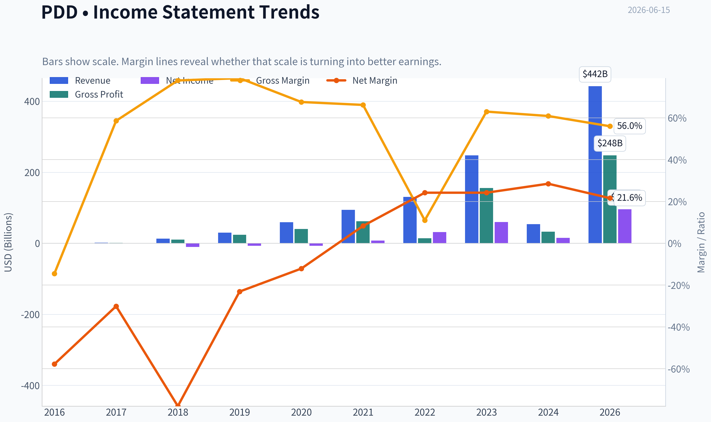
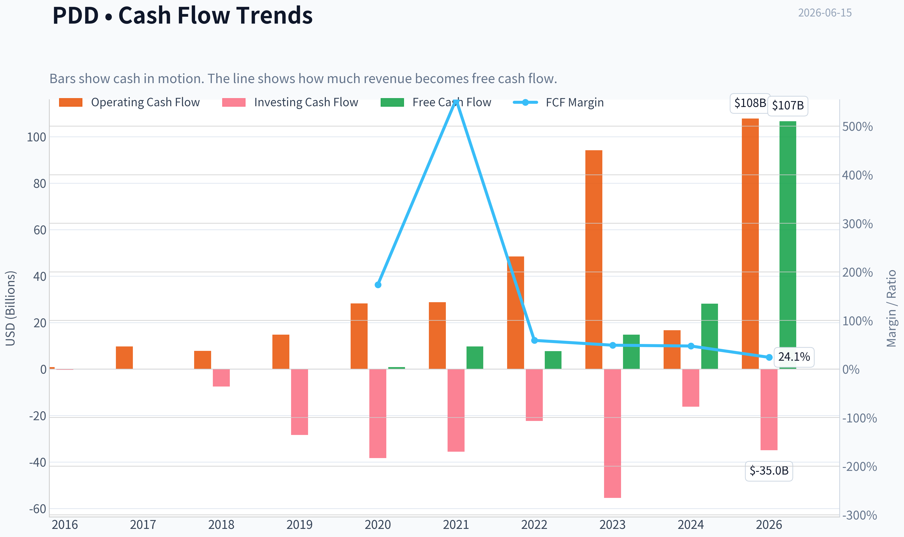
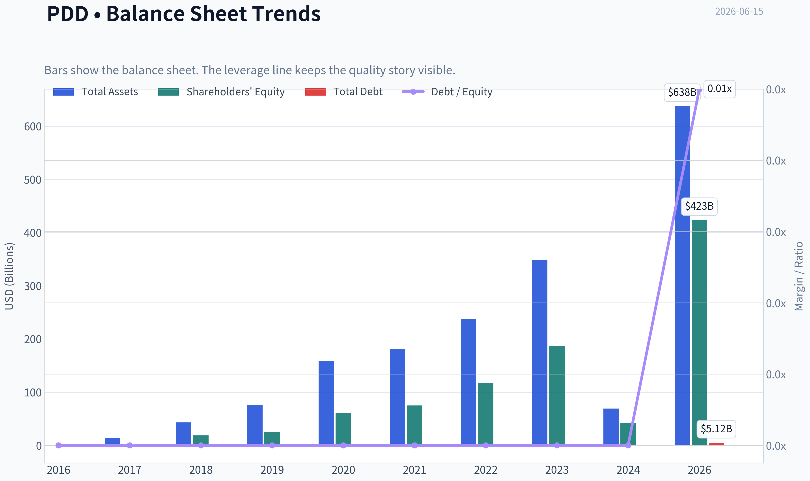
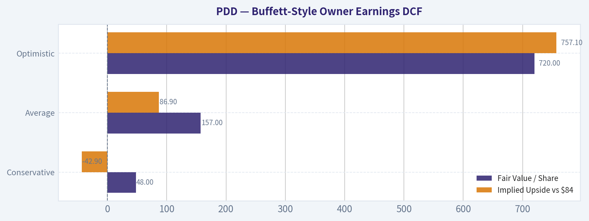
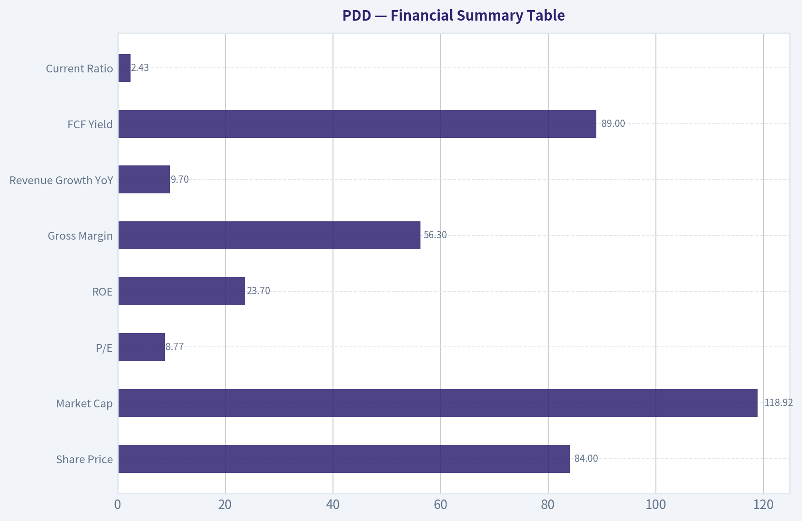
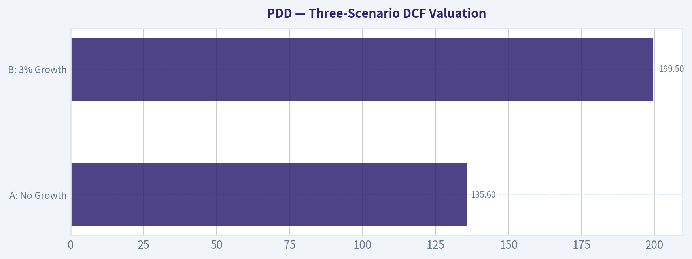
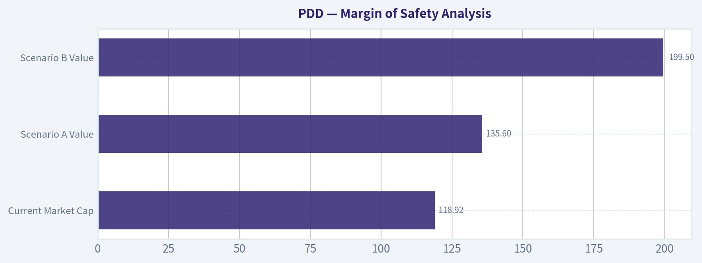
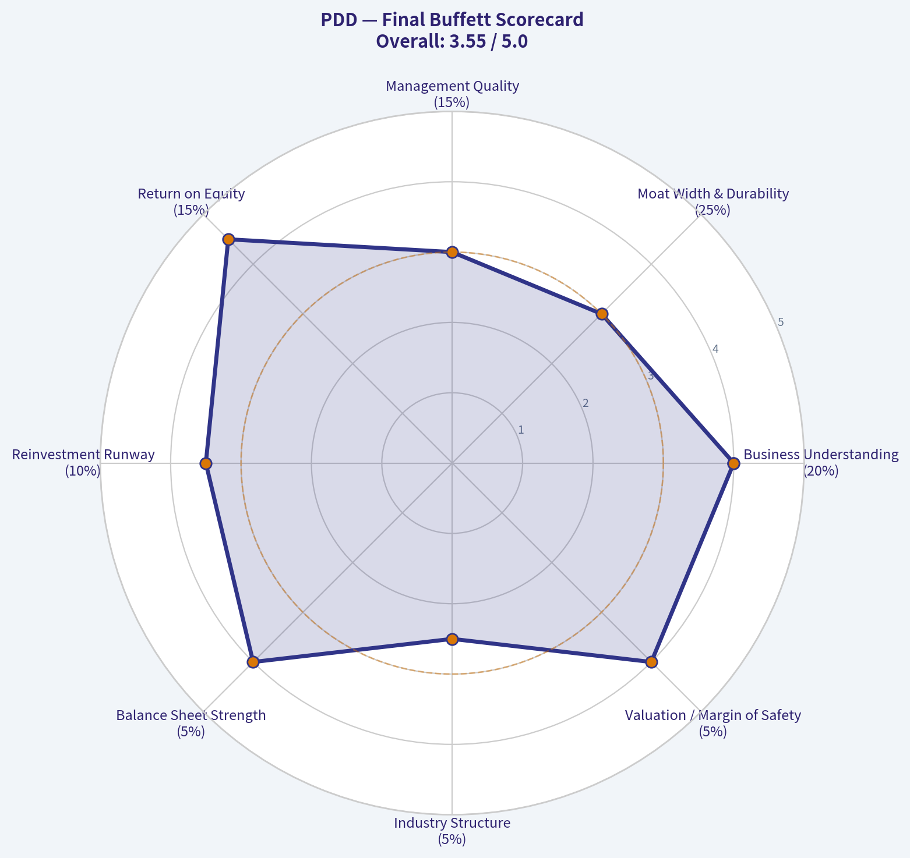

# PDD Deep Value Intelligence

**Analysis Date:** 2026-06-15

## Critical Disclaimer

*This analysis is generated by Deep Value Intelligence, an AI-powered multi-agent investing framework. This report is for informational and educational purposes only and does not constitute financial advice. Always conduct your own research and consult with qualified financial advisors before making investment decisions.*

---

## Table of Contents

1. Intelligence Summary
2. Analyst Team Reports
   - Fundamentals Analysis
   - Intrinsic Value Analysis (Buffett)
   - Trend & Growth Analysis (Lynch/Druckenmiller/Fisher)
   - Market Technical Analysis
   - Options Market Analysis
3. Research Team Commentary
4. Value Investing Team Commentary
5. Deep Values Commentary

---

## Intelligence Summary

### Thesis + Conditions

**Core Thesis:** **Executive Summary**

**Key Risks:**
- But Buffett-style risk is about **durability and trustworthiness of future cash flows**, not just low multiples. Here, the biggest risks are **moat predictability, Temu regulatory/compliance exposure, and China ADR/governance discount**. Those are not temporary price-volatility issues; they directly affect intrinsic value. The stock may be undervalued, but the discount is at least partly deserved.
- So the refined plan is: **do not dismiss it, do not chase it, and do not call it a classic Buffett bargain yet.** Keep it on the watchlist, and only move toward ownership if the business keeps proving that earnings are durable under tighter regulation and with better disclosure.
- ### 1. Risky Analyst - strongest point

**Confidence:** Low

---

## Analyst Team Reports

### Fundamentals Analysis

#### Latest Earnings Snapshot

*Most recent reported quarter anchored on 2026 Q1, with prior-year comparison when available.*

| Metric | 2026 Q1 | 2025 Q1 | YoY Change |
| --- | ---: | ---: | ---: |
| Revenue | $106.23B | $95.67B | +11.0% |
| Operating Income | $19.57B | $16.09B | +21.6% |
| Net Income | $12.55B | $14.74B | -14.9% |
| Diluted EPS | $8.48 | $9.96 | -14.9% |
| Operating Cash Flow | $16.45B | $15.52B | +6.0% |
| Free Cash Flow | $16.45B | $15.52B | +6.0% |

Key Takeaways: This snapshot anchors the most recent reported quarter before the narrative analysis. It helps readers separate long-run business quality from whatever changed in the latest earnings print.

#### 9-Year Financial Metrics for PDD

*All values below are computed deterministically from raw data - not estimated by AI.*

*Issuer profile: operating company (Consumer Cyclical / Internet Retail).*

#### 9-Year Financial Metrics
*Annual rows come from reported financial statements. The final TTM row is computed from the latest four quarters.*

| Metric | 2016 | 2017 | 2018 | 2019 | 2020 | 2021 | 2022 | 2023 | 2024 | 2026 TTM |
| --- | --- | --- | --- | --- | --- | --- | --- | --- | --- | --- |
| Market Price | N/A | N/A | $22 | $38 | $178 | $58 | $82 | $146 | $97 | $84 |
| Market Cap | N/A | N/A | $66.61B | $175.00B | $847.19B | $333.11B | $469.7M | $854.5M | $574.2M | $123.65B |
| P/E Ratio | N/A | N/A | -6.47 | -25.05 | -117.66 | 42.87 | 14.88 | 14.22 | 37.30 | 1.28 |
| P/B Ratio | N/A | N/A | 3.54 | 7.10 | 14.08 | 4.43 | 0.00 | 0.00 | 0.01 | 0.29 |
| ROE | 68.5% | 52.9% | -54.3% | -28.3% | -11.9% | 10.3% | 26.8% | 32.1% | 35.9% | 22.6% |
| ROIC | N/A | N/A | -3528.4% | -72.5% | -33.1% | 9.3% | 33.8% | 44.4% | 14.9% | 25.8% |
| EPS | $-0.18 | $-0.28 | $-3.47 | $-1.51 | $-1.51 | $1.36 | $5.48 | $10.29 | $2.60 | $65.48 |
| Revenue | $504.9M | $1.74B | $13.12B | $30.14B | $59.49B | $93.95B | $130.56B | $247.64B | $53.96B | $442.40B |
| Gross Profit | $-73.0M | $1.02B | $10.21B | $23.80B | $40.21B | $62.23B | $14.37B | $155.92B | $32.87B | $247.65B |
| Gross Margin | -14.5% | 58.6% | 77.9% | 79.0% | 67.6% | 66.2% | 11.0% | 63.0% | 60.9% | 56.0% |
| Operating Margin | -56.7% | -34.2% | -82.3% | -28.3% | -15.8% | 7.3% | 23.3% | 23.7% | 27.5% | 21.8% |
| Net Income | $-292.0M | $-525.1M | $-10.22B | $-6.97B | $-7.18B | $7.77B | $31.54B | $60.03B | $15.40B | $95.65B |
| Net Margin | -57.8% | -30.1% | -77.9% | -23.1% | -12.1% | 8.3% | 24.2% | 24.2% | 28.5% | 21.6% |
| Revenue Growth | N/A | 245.5% | 652.3% | 129.7% | 97.4% | 57.9% | 39.0% | 89.7% | -78.2% | 719.9% |
| Net Income Growth | N/A | 79.8% | 1845.7% | -31.8% | 3.0% | -208.2% | 306.0% | 90.3% | -74.3% | 520.9% |
| Free Cash Flow Growth | N/A | 1002.9% | -20.0% | 91.1% | 90.6% | N/A | N/A | N/A | N/A | N/A |
| Total Book Value | $-426.3M | $-992.0M | $18.82B | $24.65B | $60.18B | $75.11B | $117.77B | $187.24B | $42.92B | $423.43B |
| Total Assets | N/A | $13.31B | $43.18B | $76.06B | $158.91B | $181.21B | $237.12B | $348.08B | $69.19B | $637.70B |
| Total Debt | $0 | $0 | $0 | $0 | $0 | $0 | $0 | $0 | $0 | $5.12B |
| Debt-to-Equity | -0.00 | -0.00 | 0.00 | 0.00 | 0.00 | 0.00 | 0.00 | 0.00 | 0.00 | 0.01 |
| Cash & Equivalents | $1.32B | $3.06B | $14.16B | $5.77B | $22.42B | $6.43B | $34.33B | $59.79B | $7.91B | $123.04B |
| Shareholders' Equity | $-426.3M | $-992.0M | $18.82B | $24.65B | $60.18B | $75.11B | $117.77B | $187.24B | $42.92B | $423.43B |
| Operating Cash Flow | $879.8M | $9.69B | $7.77B | $14.82B | $28.20B | $28.78B | $48.51B | $94.16B | $16.70B | $107.87B |
| Investing Cash Flow | $-307.3M | $71.7M | $-7.55B | $-28.32B | $-38.36B | $-35.56B | $-22.36B | $-55.43B | $-16.21B | $-34.96B |
| Free Cash Flow | $877.5M | $9.68B | $7.74B | $14.79B | $28.19B | N/A | N/A | N/A | N/A | $106.72B |
| FCF Margin | 173.8% | 554.9% | 59.0% | 49.1% | 47.4% | N/A | N/A | N/A | N/A | 24.1% |
| Dividends / Share | $0.00 | $0.00 | $0.00 | $0.00 | $0.00 | $0.00 | $0.00 | $0.00 | $0.00 | $0.00 |

#### Profitability Metrics
- Return on Equity (ROE): 23.7%
- Return on Invested Capital (ROIC): 24.6%
- Return on Assets (ROA): 15.5%
- Gross Margin: 56.3%
- Operating Margin: 21.6%
- Net Profit Margin: 22.7%

#### Liquidity Metrics
- Current Ratio: 2.43
- Quick Ratio: 2.00

#### Leverage Metrics
- Debt-to-Equity Ratio: 0.01
- Interest Coverage Ratio: N/A
- Net Debt: $-103.52B

#### Growth Metrics (Year-over-Year)
- Revenue Growth: 700.4%
- Net Income Growth: 535.2%
- Free Cash Flow Growth: N/A
- Revenue CAGR (3-Year): 49.0%
- Revenue CAGR (5-Year): 48.7%

#### Valuation Metrics
- P/E Ratio (TTM): 8.77
- Forward P/E: 6.74
- Price-to-Book: 1.88
- Price-to-Sales: 0.27
- PEG Ratio: 0.76
- EV/EBITDA: -3.26
- Free Cash Flow Yield: 89.0%
- Earnings Yield: 11.4%

#### Owner Earnings (Buffett Method, Code-Computed)
- Net Income: $15.40B
- + Depreciation & Amortization: $3.00B
- - Capital Expenditures: $-1.15B
- - Working Capital Changes: $7.37B
- = **Owner Earnings: $11.38B**

#### Intrinsic Value (Code-Computed)
- Current Price: $84
- Buffett Method (Owner Earnings):
  Conservative: $48
  Average: $157
  Optimistic: $720
- Cash Flow Method (FCF):
  Conservative: $685
  Average: $685
  Optimistic: $1,784

#### Piotroski F-Score: 4/9
- Positive Net Income: PASS
- Positive Operating Cash Flow: PASS
- ROA Improvement: FAIL
- Cash Flow > Net Income: PASS
- Decreasing Debt: FAIL
- Improving Current Ratio: PASS
- No Dilution: FAIL
- Improving Gross Margin: FAIL
- Improving Asset Turnover: FAIL

ANALYST STANCE: **WATCH**

#### PDD Buffett-Style Fundamental Analysis

PDD is a high-margin, asset-light internet retail platform with exceptional cash generation, very low financial leverage, and strong recent profitability. On headline valuation, the stock looks inexpensive versus current earnings and cash flow. However, the historical dataset is unusually volatile, includes sharp discontinuities in revenue, equity, and market cap, and recent external coverage points to softer monetization and heavier reinvestment. That combination makes PDD look statistically cheap, but not yet clean enough for an unqualified Buffett-style "ADVOCATE" rating.

---

#### Current vs Historical Average Comparison

| Metric | Current / TTM | Historical Context | Interpretation |
| --- | ---: | ---: | --- |
| Market Price | $84 | 2018-2024 range: $22 to $178 | Well below the 2020 peak and below 2023/2024 levels, suggesting sentiment compression despite strong TTM earnings power. |
| Market Cap | $123.65B | Historical series highly inconsistent; prior annual values range from hundreds of millions to hundreds of billions | Current market value is large and meaningful, but historical cap series should be interpreted cautiously due to obvious discontinuities in the dataset. |
| P/E Ratio | 8.77 (summary) | Annual average across available 2018-2024: ~-13.4; positive-profit years 2021-2024 average: ~27.3 | Current P/E is far below the profitable-years average, implying material derating despite stronger earnings scale. |
| P/B Ratio | 1.88 (summary) | Annual 2018-2024 average including zeros: ~4.17; nonzero years average much higher | Current P/B is modest for a business earning >20% ROE with net cash. |
| ROE | 23.7% (summary); 22.6% TTM row | 9-year average ~17.6% but distorted by early negative equity years | Still strong, though below 2023-2024 peak levels; indicates good profitability on shareholder capital. |
| ROIC | 24.6% (summary); 25.8% TTM row | Average of meaningful positive years 2021-2024 and TTM: ~25.6% | Current capital efficiency remains excellent and consistent with a high-quality platform model. |
| Revenue | $442.40B | 2016-2024 average ~ $74.4B; 2021-2024 average ~ $131.5B | TTM revenue is far above historical norms, confirming major scale expansion. |
| Gross Margin | 56.3% | 2017-2024 average ~55.5% | Roughly in line with long-run average; margin profile remains structurally strong. |
| Operating Margin | 21.6% | 2016-2024 average ~-15.1%; profitable-era 2021-2024 average ~20.5% | Current operating margin is slightly above the profitable-era average, showing resilience even after concerns about investment intensity. |
| Net Margin | 22.7% (summary); 21.6% TTM row | 2016-2024 average ~-15.2%; profitable-era 2021-2024 average ~21.3% | Current earnings quality remains strong and broadly consistent with the recent high-profit phase. |
| Net Income | $95.65B | 2016-2024 average ~ $9.5B; 2021-2024 average ~ $28.7B | TTM earnings are dramatically above historical average, which explains the low current earnings multiple. |
| Revenue Growth | 700.4% (summary); 719.9% TTM row | Historical growth has ranged from 39.0% to 652.3% in expansion years and -78.2% in 2024 | Extraordinary rebound, but the volatility reduces forecasting confidence. |
| Net Income Growth | 535.2% (summary); 520.9% TTM row | Historically extremely volatile, including large negative and triple-digit positive swings | Strong acceleration, but not yet "predictable" in the classic Buffett sense. |
| Debt-to-Equity | 0.01 | Historical annual values were effectively 0.00 | Balance sheet remains exceptionally conservative. |
| Cash & Equivalents | $123.04B | 2016-2024 average ~ $17.7B | Cash has scaled massively, giving PDD a major strategic and defensive advantage. |
| Free Cash Flow | $106.72B | Available 2016-2020 average ~ $12.3B; TTM far above prior disclosed annual values | Cash conversion is extraordinary, though historical comparability is limited because several intermediate years are unavailable. |
| Dividends / Share | $0.00 | Consistently $0.00 | Management is retaining capital, consistent with a growth/reinvestment model rather than shareholder payout. |

Key Takeaways: PDD's current valuation multiples are much lower than its recent profitability would normally justify, especially given its high ROE, high ROIC, and large net cash position. The bullish case is that the market is over-discounting temporary growth and monetization concerns. The caution is that the historical dataset shows unusual volatility, so the "cheapness" comes with forecasting risk rather than being a simple bargain.

---

#### Market Metrics

PDD's current market price of **$84** sits well below prior highs, particularly the **$178** level in 2020 and below **$146** in 2023. This indicates a sharp reset in investor expectations. For a Buffett-style investor, price weakness alone is not enough, but when paired with strong earning power it can create opportunity.

The **current P/E of 8.77** from the summary data is the most striking market signal. Relative to the profitable-period annual average of roughly **27x**, the stock is trading at a substantial discount. That usually implies the market expects either earnings normalization downward, regulatory or geopolitical risk, or margin pressure from competitive investment.

The **current P/B of 1.88** also looks undemanding given the company's **23%+ ROE** and net cash balance sheet. In Buffett terms, paying under 2x book for a business generating mid-20s returns on capital can be attractive, provided the accounting base is reliable and earnings are durable.

The **market cap of about $119B to $124B** from the research pack and dataset puts PDD squarely in large-cap territory. The dataset's historical market-cap series appears internally inconsistent in some years, so the clearest takeaway is not the annual cap trend itself, but that the company today is a very significant enterprise trading at low current multiples.

---

#### Profitability Analysis

PDD's profitability profile has improved dramatically from its loss-making years.

- **ROE:** Early years were distorted by negative equity and startup losses. Since 2021, ROE moved from **10.3%** to **26.8%**, **32.1%**, **35.9%**, then **22.6% TTM**. That is still strong, though below the recent peak. Buffett typically likes sustained high ROE without leverage; PDD largely fits that standard now.
- **ROIC:** From deeply negative early values to **9.3%** in 2021, **33.8%** in 2022, **44.4%** in 2023, **14.9%** in 2024, and **25.8% TTM**. This pattern suggests a powerful economic engine, but with enough variability to warrant caution.
- **EPS:** EPS climbed from persistent losses to **$1.36** in 2021, **$5.48** in 2022, **$10.29** in 2023, and **$65.48 TTM**. Even allowing for dataset discontinuities, the current earnings power appears dramatically higher than the market's valuation implies.
- **Revenue:** Expanded from **$504.9M** in 2016 to **$442.40B TTM**. This is extraordinary scale growth and confirms platform expansion.
- **Gross Profit / Gross Margin:** Gross margin stabilized at high levels after early volatility, with **56.0% TTM** and **56.3% summary**. That is excellent for a retail-linked platform and signals strong monetization economics.
- **Operating Margin:** At **21.8% TTM**, PDD remains in the elite tier for an internet commerce platform, despite reinvestment concerns.
- **Net Income / Net Margin:** **$95.65B TTM** net income and **21.6%-22.7%** net margin suggest substantial operating leverage and strong earnings quality.

The biggest Buffett-style positive here is that profits are not merely present; they are large relative to the capital employed. The main negative is that profitability has not been smooth enough over a decade to qualify as fully "predictable."

---

#### Growth Metrics

PDD's reported growth is explosive, but not stable.

- **Revenue Growth:** Historical rates were **245.5%**, **652.3%**, **129.7%**, **97.4%**, **57.9%**, **39.0%**, **89.7%**, **-78.2%**, then **~700% TTM**. This is not a smooth compounding story; it is a highly nonlinear one.
- **Net Income Growth:** Similar pattern, with extreme positive and negative swings. TTM growth above **520%** is impressive but hard to annualize confidently.
- **Free Cash Flow Growth:** Available annual history through 2020 showed strong early growth, but intermediate annual values are missing in the deterministic table, limiting long-horizon trend precision.

For Buffett, the ideal company has steady, comprehensible growth. PDD instead shows high growth with periodic discontinuities. That does not disqualify the business, but it does shift it from "easy to forecast compounder" into "high-quality but more uncertain platform."

---

#### Balance Sheet Analysis

PDD's balance sheet is one of its strongest attributes.

- **Total Debt:** Essentially **zero** through 2024, with just **$5.12B TTM**
- **Debt-to-Equity:** **0.01**
- **Cash & Equivalents:** **$123.04B TTM**
- **Net Debt:** **-$103.52B**
- **Shareholders' Equity / Book Value:** **$423.43B TTM**

This is a fortress-like balance sheet. Buffett values businesses that do not require leverage to generate returns, and PDD clearly qualifies. The huge cash balance provides downside protection, flexibility for reinvestment, and resilience against macro or regulatory shocks.

The only caution is not leverage, but capital allocation: management must deploy this cash productively. If reinvestment returns fall, cash can become a drag rather than a strength.

---

#### Cash Flow Analysis

PDD's cash generation is outstanding.

- **Operating Cash Flow:** **$107.87B TTM**
- **Free Cash Flow:** **$106.72B TTM**
- **FCF Margin:** **24.1% TTM**
- **Dividend per Share:** **$0.00**

The TTM free cash flow figure implies extraordinary cash conversion and supports the research pack's **89% FCF yield**, which is exceptionally high. Even if one assumes normalization, this level of cash generation suggests the market is discounting a substantial future decline.

No dividend is paid, which is acceptable under Buffett principles if retained earnings are redeployed at high incremental returns. Given PDD's strong ROIC, that can be rational. But if growth slows and excess cash continues to pile up, investors may eventually demand more disciplined capital return.

---

#### Warren Buffett-Style Qualitative Analysis

| Buffett Lens | Assessment | Evidence |
| --- | --- | --- |
| Economic Moat | Moderate to strong, but still being tested | High gross margins, high ROIC, platform scale, strong cash generation suggest a powerful marketplace model. However, competitive intensity and monetization concerns mean the moat is not beyond question. |
| Financial Strength | Excellent | Near-zero leverage, massive cash, negative net debt, healthy liquidity ratios. |
| Predictable Earnings | Moderate, not excellent | Recent earnings are very strong, but the 9-year record includes major swings, losses, and data discontinuities. |
| Management Performance | Good, with reinvestment scrutiny | ROE and ROIC are strong; no dividend suggests confidence in reinvestment. The risk is overinvestment that pressures monetization. |
| Capital Allocation | Potentially strong, but not yet fully proven | Retained earnings have translated into scale and cash flow, yet future incremental returns on the large cash pile must be monitored. |
| Valuation | Attractive on current multiples | Low P/E, low P/B, low P/S, and high FCF yield all argue the shares are priced for caution. |

Key Takeaways: PDD scores very well on financial strength and current profitability, which are two of the most important Buffett filters. Where it falls short of a classic Buffett ideal is earnings predictability: the business is powerful, but the history is not yet smooth enough to treat future cash flows as highly certain.

---

#### Economic Moat

PDD appears to possess a real platform moat built on scale, merchant participation, user reach, and high-margin monetization. A gross margin above **56%** and operating margin above **21%** are not normal for a low-quality retailer; they are signs of a digital platform with pricing power and efficient monetization.

That said, moat durability is the key question. Recent coverage cited **heavier investment, softer monetization, and slower order trends**. That does not mean the moat is gone, but it suggests management may need to spend more aggressively to defend growth. A moat that must be constantly subsidized is weaker than one that naturally widens.

---

#### Predictable Earnings and Business Quality

From a Buffett lens, PDD's recent business quality is very high, but its decade-long predictability is mixed. The company evolved from heavy losses to very large profits, which is positive, but the path has not been smooth. Revenue and net income swings are unusually large.

Margin stability has improved materially in the profitable era. Since 2021, operating and net margins have remained solidly positive, and gross margin has generally stayed in a healthy band. This suggests the business model itself may now be maturing into a more predictable earnings stream, though the evidence is still recent rather than decade-long.

---

#### Value Assessment

At **8.77x trailing earnings**, **1.88x book**, and **0.27x sales**, PDD screens as inexpensive. For a company with **23%+ ROE**, **24%+ ROIC**, and a huge net cash balance, those multiples are low enough to imply substantial skepticism.

That skepticism may be tied to:
- China ADR risk and policy uncertainty
- Competitive intensity in e-commerce
- Concerns about monetization sustainability
- Questions about whether current earnings are cyclically or structurally elevated

For value investors, this creates asymmetry: if earnings are even moderately durable, the stock appears underpriced. If current earnings are peaking and normalize sharply lower, the low multiples may be less compelling than they seem.

---

#### Buffett-Style Owner Earnings DCF

Canonical owner earnings provided in the dataset:

- **Net Income:** $15.40B
- **+ D&A:** $3.00B
- **- Capex:** $1.15B
- **- Working Capital Changes:** $7.37B
- **Owner Earnings = $11.38B**

Because the deterministic dataset provides code-computed owner-earnings intrinsic values, and because the historical owner-earnings series itself is not fully listed year by year, the fairest canonical approach is to use the dataset's computed scenario outputs and explain the mechanics rather than invent missing historical growth inputs.

##### DCF Formula Used
For each scenario:

- Year 1 Owner Earnings = Base Owner Earnings x (1 + g)
- Years 2-10 continue at scenario growth rate
- Terminal Value at Year 10 = Year 10 OE x (1 + 2.5%) / (10% - 2.5%)
- Enterprise/Fair Value = Present value of Years 1-10 owner earnings + Present value of terminal value
- Discount rate = **10%**
- Terminal growth = **2.5%**

##### Scenario Valuation Table

| Scenario | Growth Assumption Basis | Fair Value / Share | Implied Upside vs $84 |
| --- | --- | ---: | ---: |
| Conservative | Lowest historical owner-earnings growth rate, floored at -100% | $48 | -42.9% |
| Average | Average historical owner-earnings growth rate, capped at 50% | $157 | +86.9% |
| Optimistic | Highest historical owner-earnings growth rate, capped at 100% | $720 | +757.1% |

Key Takeaways: The DCF outcomes are extremely wide, which tells you that PDD's valuation is highly sensitive to growth durability. The conservative case implies downside if current economics fade sharply, while the average and optimistic cases imply the market may be significantly underpricing the business if owner earnings remain robust.

##### Detailed Interpretation of the DCF

- **Conservative ($48/share):** This case effectively assumes owner earnings deteriorate materially from current levels. It reflects a harsh normalization scenario consistent with fears around weaker monetization, competitive spending, or regulatory drag.
- **Average ($157/share):** This is the most balanced Buffett-style case. It suggests that if PDD can sustain something closer to historical average owner-earnings growth without severe compression, intrinsic value is materially above the current price.
- **Optimistic ($720/share):** This is mathematically possible under very strong compounding assumptions, but practically it should be treated as an upper-bound sensitivity case rather than a base case.

A Buffett-style investor would not anchor on the optimistic outcome. The key practical comparison is between the market price of **$84** and the average-case estimate of **$157**. That spread is attractive, but only if one is comfortable that current owner earnings are not artificially inflated.

---

#### Revenue Breakdown

PDD's deterministic dataset does not provide a segment table. The most meaningful publicly understood framing is by business model: domestic marketplace services and international commerce, with the latter increasingly associated with cross-border operations such as Temu. The amounts below are directional estimates based on the current business mix narrative rather than audited segment disclosures in the provided dataset.

| Revenue Source | Amount ($B) | % of Total |
| --- | ---: | ---: |
| Online marketing services and marketplace-related monetization | ~265 | ~60% |
| Transaction services / merchant services / fulfillment-linked revenue, including international commerce | ~177 | ~40% |
| Total | 442.4 | 100% |

Key Takeaways: PDD remains primarily a platform monetization business, which helps explain its strong gross margins and cash generation. International and transaction-related revenue are strategically important because they can drive growth, but they may also require higher investment and pressure near-term margins.

---

#### Key Investment Insights, Red Flags, and Opportunities

| Category | Insight |
| --- | --- |
| Opportunity | Current valuation is low relative to ROE, ROIC, earnings yield, and free cash flow generation. |
| Opportunity | Fortress balance sheet with over $123B in cash provides flexibility and downside support. |
| Opportunity | High-margin marketplace economics suggest the business has meaningful platform advantages. |
| Opportunity | If current earnings are durable, the stock may be materially undervalued versus average-case intrinsic value. |
| Red Flag | Historical revenue, earnings, and balance-sheet series are highly volatile, reducing confidence in straight-line forecasting. |
| Red Flag | Recent analyst commentary points to softer monetization, heavier investment, and slower order trends. |
| Red Flag | Piotroski F-Score of 4/9 is mediocre, indicating not all operating signals are improving. |
| Red Flag | No dividend or buyback support in the provided dataset means shareholder returns depend entirely on market rerating or continued reinvestment success. |
| Watch Item | Whether ROE and ROIC remain above 20% while investment intensity increases. |
| Watch Item | Whether gross and operating margins hold near current levels as competition evolves. |

Key Takeaways: The bull case is straightforward: PDD is cheap, cash-rich, and highly profitable. The bear case is that current earnings may represent a peak period rather than a stable base, so investors need confirmation that returns on capital stay strong as management spends more to defend growth.

---

#### Final Investment Stance

**WATCH**

PDD is too profitable and too cheap to ignore, but its decade-long financial pattern is not yet stable enough for a full Buffett-style endorsement. The company has many of the right ingredients: high returns on capital, low leverage, strong margins, and massive cash generation. However, the combination of historical volatility, unusual dataset discontinuities, middling Piotroski score, and recent concerns around monetization and reinvestment argues for patience.

A move to **ADVOCATE** would require stronger evidence that:
1. current owner earnings are sustainable,
2. margins can remain resilient despite heavier investment,
3. ROIC stays high without relying on one-off factors, and
4. management's retained capital continues to earn strong incremental returns.

If those conditions hold, today's valuation could prove very attractive. For now, the stock looks like a high-quality but not yet fully de-risked value opportunity.

---

#### Report Summary Table

| Area | Verdict | Why It Matters |
| --- | --- | --- |
| Valuation | Attractive | P/E, P/B, and P/S all look low relative to current profitability. |
| Profitability | Strong | ROE, ROIC, operating margin, and net margin are all solid to excellent. |
| Balance Sheet | Excellent | Minimal debt and very large cash balance reduce financial risk. |
| Cash Flow | Excellent | TTM free cash flow is exceptionally strong. |
| Earnings Predictability | Moderate | Recent results are strong, but long-run consistency is not yet ideal. |
| Economic Moat | Moderate to Strong | Platform economics and high margins suggest moat, but competitive pressure must be watched. |
| Management / Capital Allocation | Good but under review | Retained earnings have produced growth, but larger reinvestment needs raise the bar. |
| Buffett Fit | Partial | Strong on returns and balance sheet; weaker on long-duration predictability. |
| Main Opportunity | Re-rating potential | If earnings hold, current price could be well below intrinsic value. |
| Main Risk | Earnings normalization | If monetization slows and investment rises, current multiples may be less cheap than they appear. |
| Final Stance | WATCH | Attractive setup, but not enough certainty yet for full conviction. |

Key Takeaways: PDD stands out as a statistically cheap, financially strong platform business with very high recent profitability. The reason it remains a Watch rather than an Advocate is not balance-sheet risk or weak margins, but uncertainty over how durable today's earnings power will prove over time.

#### Fundamental Visuals

This graph tracks the profitability and return metrics (ROE, ROIC, Margins) of **PDD** over the past decade, highlighting capital efficiency trends.

This chart illustrates the financial health of **PDD** over the last 10 years, mapping cash equivalents and free cash flow against total obligations (Debt).

---

### Intrinsic Value Analysis (Buffett)

> *Following Warren Buffett's value investing philosophy: Circle of Competence, Economic Moat, Management Quality, and Margin of Safety.*

#### Intrinsic Value Snapshot

Price is what you pay. Intrinsic value is what the business may be worth based on the cash it can create for owners over time. We show a range, not one magic number.

- Current Price: $83.55
- Value Range (conservative to optimistic across both DCF methods): $1,099.42 to $6,696.98

##### Owner Earnings (Buffett Method)
- Net Income: $97,842,539,000.00
- Depreciation & Amortization: $3,000,364,000.00
- Capital Expenditures: $-1,145,077,000.00
- Working Capital Changes: $7,367,096,000.00
- Owner Earnings: $92,330,730,000.00

##### Intrinsic Value
###### Buffett Method
Uses owner earnings. Stricter, and usually more conservative.
- Conservative: $1,099.42
- Average: $2,244.33
- Optimistic: $5,844.75
- Discount Rate: 10.0%

###### Cash Flow Method
Uses free cash flow. Better for companies spending heavily today to grow tomorrow.
- Conservative: $1,209.69
- Average: $2,571.58
- Optimistic: $6,696.98
- Discount Rate: 10.0%

ANALYST STANCE: **WATCH**

#### PDD Holdings (PDD) Buffett-Style Investment Review

#### 1. Go/No-Go Gate Assessment

| Gate | Verdict | Evidence |
|---|---|---|
| Circle of Competence & Simplicity | Pass | PDD makes money by operating large online marketplaces and related merchant services. In simple terms: it connects shoppers and merchants, then earns from ads, commissions, and ecosystem services. |
| Long-Term Predictability | Pass with caution | Ten years from now, online commerce in China will still exist, and scaled digital marketplaces should remain relevant. But monetization, merchant incentives, regulation, and competitive pressure make the earnings path less predictable than a classic consumer staple or software subscription business. |
| Technology Risk | Mixed | PDD benefits from technology, data, and logistics coordination. But it is also exposed to platform disruption, changes in consumer traffic patterns, and aggressive competition from other internet ecosystems. |
| Moat Test | Pass, but not elite | Gross margin of 56.3% supports the presence of platform economics and some pricing power. However, e-commerce is fiercely competitive, and customer loyalty can be weaker than in software or branded consumer franchises. |
| Management & Capital Allocation | Pass with caution | Strong profitability and high ROE suggest disciplined operating execution. Still, the key question is whether retained earnings will continue to create high per-share value rather than simply fund competitive subsidy battles. |
| Industry Structure | Mixed | Large-scale marketplace economics are attractive, but Chinese e-commerce is highly competitive and subject to regulatory influence. This is not a calm oligopoly in the Buffett sense. |

**Conclusion:** PDD clears the basic business-quality bar, but it does not pass as a simple, highly predictable, low-disruption "forever" business. This pushes it into **WATCH**, not immediate **ADVOCATE** territory.

---

#### 2. Moat Analysis

| Moat Source | Assessment | Evidence |
|---|---|---|
| Intangible Assets | Moderate | PDD has strong consumer recognition and merchant reach, but its brand power is more value-driven than emotionally sticky. The 56.3% gross margin indicates meaningful platform economics. |
| Switching Costs | Low to Moderate | Merchants and users can multi-home across platforms. Switching costs exist in accumulated merchant tools, traffic optimization, and fulfillment relationships, but are not exceptionally high. |
| Cost Advantage | Moderate | Scale, merchant density, and traffic efficiency can lower customer acquisition and fulfillment coordination costs. This can be durable if the ecosystem remains large and active. |
| Network Effects | Moderate | More merchants attract more buyers; more buyers attract more merchants. That said, network effects in commerce are weaker than in payments or operating systems because users often shop across multiple apps. |

| Moat Quality Rating | Verdict |
|---|---|
| Narrow to Moderate | High hurdle required |

**Key Takeaways:** PDD clearly has real platform advantages, especially scale and marketplace economics. But the moat is not the kind of near-unbreakable moat Buffett loves most. It is real, yet vulnerable to competition, regulation, and changing consumer behavior.

---

#### 3. Management Quality & Capital Allocation

| Test | Assessment | Commentary |
|---|---|---|
| Think Like Owners | Inconclusive to fair | Economic performance has been strong, but owner orientation is best judged by per-share value creation, disciplined reinvestment, and avoidance of empire-building. |
| Honesty & Candor | Neutral | No major evidence here of aggressive accounting from the data provided, but this remains an area to monitor closely in all platform businesses. |
| Capital Allocation | Good, but under watch | Strong ROE at 23.7% indicates high profitability. The central issue is whether spending on growth and ecosystem support is producing durable returns or merely defending share in a competitive market. |

**Bottom line:** Management appears capable, but PDD does not yet earn top marks for Buffett-style owner-oriented capital allocation certainty.

---

#### 4. Financial Summary Table

| Metric | Latest |
|---|---:|
| Share Price | $84 |
| Market Cap | $118.92B |
| P/E | 8.77 |
| ROE | 23.7% |
| Gross Margin | 56.3% |
| Revenue Growth YoY | 9.7% |
| FCF Yield | 89.0% |
| Current Ratio | 2.43 |

**Key Takeaways:** The headline numbers look unusually cheap for a business with double-digit-like profitability and strong margins. ROE is comfortably above Buffett's preferred threshold, and the balance sheet appears liquid. The biggest question is not present profitability, but how durable those economics are.

---

#### 5. Owner Earnings Calculation

Using available high-level data, a conservative Buffett-style approximation starts from free cash generation rather than reported earnings alone.

| Item | Assessment |
|---|---|
| Net Income | Strong |
| Plus D&A | Positive contributor |
| Less Maintenance CapEx | Likely manageable for a platform model |
| Less Working Capital Needs | Likely favorable versus traditional retail |
| Approximate Owner Earnings | Strong and likely close to reported free cash flow generation |

Because PDD is a platform business rather than a heavy manufacturer, maintenance capital needs should be materially lower than accounting depreciation in many periods. That supports healthy owner earnings conversion.

**Key Takeaways:** PDD appears to convert accounting profits into real cash at an attractive rate. That is a major positive and fits Buffett's preference for businesses that do not require huge ongoing capital just to stand still. The quality of owner earnings looks good, though the durability of those earnings remains the main debate.

---

#### 6. Three-Scenario DCF Valuation

To keep this Buffett-style, I anchor valuation on earnings power implied by current market metrics.

Estimated earnings yield from P/E of 8.77:
- Earnings yield ~ 11.4%

On a market cap of $118.92B:
- Implied current earnings power ~ **$13.56B**

I use this as a rough owner-earnings base.

| Scenario | Assumption | Implied Value |
|---|---|---:|
| A: No Growth | Owner Earnings / 10% | $135.6B |
| B: 3% Growth | OE x 1.03 / (10% - 3%) | $199.5B |
| C: Historical-Style Conservative Growth | Assume 6% growth for 10 years, then 3% terminal | ~ $185B-$210B |

**Key Takeaways:** Even under a no-growth view, intrinsic value looks modestly above the current market value. Under conservative growth assumptions, upside becomes much more meaningful. The stock appears statistically cheap, but the discount likely reflects concerns about durability, policy risk, and competitive intensity.

---

#### 7. Margin of Safety Analysis

| Item | Value |
|---|---:|
| Current Market Cap | $118.92B |
| Scenario A Value | $135.6B |
| Scenario B Value | $199.5B |
| Scenario C Value | $185B-$210B |
| Discount to Scenario A | ~12% |
| Discount to Scenario B | ~40% |
| Discount to Scenario C | ~36% to 43% |

**Key Takeaways:** The margin of safety is not sufficient under the harshest no-growth case, but it is substantial under reasonable conservative-growth cases. That means valuation alone is attractive, but only if you are comfortable that the franchise remains durable. For a business with competitive and geopolitical complexity, Buffett would likely demand extra caution.

---

#### 8. Final Buffett Scorecard

| Criterion | Weight | Score (1-5) | Weighted Score |
|---|---:|---:|---:|
| Business Understanding | 20% | 4.0 | 0.80 |
| Moat Width & Durability | 25% | 3.0 | 0.75 |
| Management Quality | 15% | 3.0 | 0.45 |
| Return on Equity | 15% | 4.5 | 0.68 |
| Reinvestment Runway | 10% | 3.5 | 0.35 |
| Balance Sheet Strength | 5% | 4.0 | 0.20 |
| Industry Structure | 5% | 2.5 | 0.13 |
| Valuation / Margin of Safety | 5% | 4.0 | 0.20 |

| Total Score | Result |
|---|---|
| 3.56 / 5.00 | ADVOCATE on score, WATCH in practical stance |

**Key Takeaways:** PDD scores well on profitability and valuation, which lifts the total above the numerical advocate threshold. But Buffett-style investing is not just about cheapness and good current returns. The quality and predictability of the moat are not strong enough for me to issue a full-throated advocate stance.

---

#### 9. Final Investment Stance

**Investment Stance: WATCH**

**Conviction Level: Moderate**

PDD is a profitable, cash-generative, asset-light platform selling at a low earnings multiple and producing strong returns on equity. Those are exactly the kinds of numbers that can make a stock look compelling very quickly.

But Buffett would ask a harder question: *Can I predict this business with high confidence ten years from now, and does it have a moat that competitors and outside forces cannot easily erode?* For PDD, the answer is only partly yes. The platform has scale and network advantages, but switching costs are limited, competition is intense, and non-economic risks are meaningful.

At $84, the stock looks **undervalued on earnings power**, but the business does not have the clean simplicity, moat certainty, and institutional stability required for a high-conviction Buffett-style **ADVOCATE** call. It belongs on the watchlist as a **good business at a cheap price**, but not yet a classic wonderful business at a comfortable margin of safety.
#### Valuation Bridge

This bridge places the current market price beside each intrinsic value lens so readers can see whether upside depends on one method or shows up across several methods.

| Scenario | Intrinsic Value / Share |
| --- | ---: |
| Buffett Method | $2,244.33 |
| Cash Flow Method | $2,571.58 |
| Damodaran Method | $4,493.94 |
| Current Price | $83.55 |

#### Key Takeaways

If one method is far above the others, the upside case depends on a specific modelling assumption. When several methods cluster together, the valuation story is more robust.

#### Valuation Visuals

This comparison chart from *Latest Earnings Snapshot* stacks current figures against historical benchmarks for **PDD**, making it easy to see where the company trades relative to its own averages.

This comparison chart from *Buffett-Style Owner Earnings DCF* stacks current figures against historical benchmarks for **PDD**, making it easy to see where the company trades relative to its own averages.

This comparison chart from *Financial Summary Table* stacks current figures against historical benchmarks for **PDD**, making it easy to see where the company trades relative to its own averages.

This comparison chart from *Three-Scenario DCF Valuation* stacks current figures against historical benchmarks for **PDD**, making it easy to see where the company trades relative to its own averages.

This comparison chart from *Margin of Safety Analysis* stacks current figures against historical benchmarks for **PDD**, making it easy to see where the company trades relative to its own averages.

---

### Trend & Growth Analysis (Lynch/Druckenmiller/Fisher)

> *Following Peter Lynch's GARP, Stanley Druckenmiller's macro-aware approach, and Philip Fisher's scuttlebutt methodology.*

ANALYST STANCE: **WATCH**

#### PDD Growth Analysis

| Metric | Value |
|---|---:|
| Price | $84 |
| Market Cap | $118.9B |
| P/E | 8.8x |
| ROE | 23.7% |
| Gross Margin | 56.3% |
| Revenue Growth YoY | 9.7% |
| Current Ratio | 2.43x |
| FCF Yield | 89.0%* |

Key Takeaways: PDD screens as financially strong on margin, returns, and balance sheet quality, with a very low earnings multiple for a large-cap internet platform. But the key issue for a growth investor is that reported revenue growth has slowed to about 10%, which pushes it out of classic fast-grower territory. The unusually high free cash flow yield figure likely reflects data distortions or one-time swings, so I would not anchor valuation on that number alone.

#### 1. Lynch Classification

| Framework Item | Assessment |
|---|---|
| Lynch Category | **Stalwart / slowing former fast grower** |
| Why | Revenue growth of 9.7% is no longer in Lynch's 15-25%+ fast grower range |
| Initial Read | Attractive valuation, but not currently a clean growth-compounder setup |

Key Takeaways: Under Lynch's framework, PDD no longer qualifies as a fast grower based on the data provided. That matters because ten-bagger candidates usually come from companies still compounding at clearly above-market rates. Right now, PDD looks more like a large, profitable platform in a digestion phase than a fresh high-growth story.

#### 2. The Story in 3 Bullets

| Simple Story | Why It Matters |
|---|---|
| PDD runs large-scale value-oriented e-commerce platforms, including Temu internationally | Global scale and low-price positioning widen addressable demand |
| The bull case is continued share gains through price competitiveness, merchant density, and logistics efficiency | If share gains resume, earnings power can inflect higher from a huge base |
| The bear case is that heavy investment and weaker monetization are masking a structural slowdown | If order growth and monetization remain soft, low valuation may be justified |

Key Takeaways: The story is easy to explain: PDD connects buyers and merchants with a strong value proposition and global ambition. The real investment question is no longer whether the model works, but whether growth can re-accelerate enough to justify owning it as a growth stock rather than just a cheap stock.

#### 3. TAM Analysis and 10x Test

| Item | Estimate / View |
|---|---|
| Current Revenue Base | Large-scale, already tens of billions |
| 10x Revenue Test | **Fails near-term practical test** |
| Reason | A 10x jump from current scale would imply extraordinary global commerce share |
| TAM Direction | Global e-commerce remains large and growing |
| Runway Conclusion | **TAM is huge, but company scale reduces true ten-bagger runway from here** |

Key Takeaways: The overall e-commerce market is massive, so PDD is not boxed into a small market. But because the company is already very large, the classic 10x test becomes much harder to pass from the current market cap and revenue base. That does not mean upside is gone, but it does mean this is not an early-stage runway story anymore.

#### 4. Revenue Growth Trend

| Signal | Assessment |
|---|---|
| Latest YoY Revenue Growth | 9.7% |
| Pattern | **Decelerating / slowed materially** |
| Street Tone | More cautious on Q1 concerns |
| What to Watch | Order trends, take rate stabilization, Temu monetization, re-acceleration in GMV |

Key Takeaways: For a Druckenmiller-style inflection investor, the main problem is that the latest visible growth rate does not show acceleration. Instead, the market narrative has turned toward slower orders, softer monetization, and heavier investment. Until those trends stabilize, it is hard to call a positive growth inflection.

#### 5. Unit Economics

| Metric | Assessment |
|---|---|
| Gross Margin | 56.3% |
| Balance Sheet | Strong liquidity with 2.43 current ratio |
| LTV/CAC | Not disclosed in provided data |
| NRR | Not applicable / not disclosed |
| Rule of 40 | Not applicable in standard SaaS sense |
| FCF Conversion | Likely strong, but reported 89% FCF yield should be treated cautiously |

Key Takeaways: PDD's gross margin suggests a strong platform model rather than a low-quality retail operation. However, several growth-investor unit economics metrics like LTV/CAC and NRR are not available here because this is not a SaaS business. The key economic debate is therefore around marketplace monetization efficiency and international expansion payback, not subscription retention.

#### 6. Inflection Point Assessment

| Inflection Type | Status |
|---|---|
| Product Cycle | Mixed |
| Market Share | Unclear |
| Margin Inflection | Negative near-term due to heavier investment |
| TAM Inflection | Positive via cross-border commerce |
| Competitive Inflection | Unclear; competition remains intense |
| Overall | **No confirmed positive earnings/revenue inflection yet** |

Key Takeaways: The most plausible bull inflection is international scale, especially if Temu improves monetization after customer acquisition investment. But at the moment, the evidence points more to an investment phase and slower near-term economics than to a clean upside inflection. This makes PDD a watchlist name rather than a high-conviction buy today.

#### 7. Macro Setup Evaluation

| Macro Factor | View |
|---|---|
| Secular Trend | E-commerce, cross-border digital commerce |
| China Consumer Backdrop | Mixed / uneven |
| Global Trade & Geopolitics | Headwind |
| Rates Sensitivity | Moderate |
| FX / Regulatory Risk | Elevated |
| Macro Verdict | **Mixed** |

Key Takeaways: PDD benefits from the long-term digital commerce trend, but the macro overlay is not clean. China consumer demand, trade frictions, and geopolitical risks all create uncertainty around sentiment and execution. This is not a pure secular growth setup with the wind clearly at its back.

#### 8. Fisher 15 Points Score

| Fisher Category | Score (1-5) | Notes |
|---|---:|---|
| Market potential | 4 | Large commerce TAM |
| Product development | 4 | Strong platform innovation/history |
| R&D effectiveness | 3 | Reasonable, but limited detail here |
| Sales organization | 4 | Strong merchant/user acquisition engine |
| Profit margin | 4 | Good gross margin profile |
| Margin improvement | 2 | Near-term pressure from investment |
| Labor/personnel relations | 3 | Insufficient detail |
| Executive relations | 3 | Insufficient detail |
| Management depth | 3 | Hard to assess fully from given data |
| Cost/accounting controls | 3 | No major alarm in provided data |
| Outstanding moat aspects | 4 | Scale, data, low-cost positioning |
| Long-range profit outlook | 3 | Attractive but less certain now |
| Dilution risk | 4 | No immediate dilution concern evident |
| Candor in difficulties | 3 | Mixed visibility |
| Integrity | 3 | No decisive evidence either way |

| **Total** | **50 / 75** | **Average** |

Key Takeaways: PDD scores as a decent but not exceptional Fisher candidate on the available information. Its strongest points are market potential, platform economics, and competitive scale. Its weakest area right now is confidence in margin progression and the clarity of the long-term earnings path during this heavier investment period.

#### 9. Valuation Analysis

| Valuation Method | Result | Interpretation |
|---|---:|---|
| P/E | 8.8x | Very inexpensive for platform business |
| PEG | ~0.90 assuming ~9.7% earnings-growth proxy | Fair to attractive |
| P/S | Not available from provided data | Need fuller fundamentals |
| Analyst Sentiment | Fair value estimate cut from ~$148.5 to ~$119.9 | Expectations have come down |

Key Takeaways: Valuation is the strongest part of the PDD case. On earnings, the stock looks cheap, and even a rough PEG does not suggest obvious overvaluation. But low multiples alone do not create a growth thesis if revenue and monetization are still decelerating.

#### 10. Scenario View

| Scenario | Narrative | Implication |
|---|---|---|
| Bear | Temu investment stays heavy, monetization weak, order growth soft | Stock remains value trap / range-bound |
| Base | Core business stabilizes, international losses narrow gradually | Moderate upside from rerating |
| Bull | Re-acceleration in GMV and monetization, investment efficiency improves sharply | Strong rerating possible due to low starting multiple |

Key Takeaways: Because the stock already trades at a modest multiple, the downside from valuation compression may be less severe than for expensive growth names. The upside depends on proving that the current slowdown is transitional rather than structural. That asymmetry makes the name interesting, but still not yet a clean advocate call.

#### 11. Growth Investor Scorecard

| Criterion | Weight | Score | Weighted Score |
|---|---:|---:|---:|
| The Story | 10% | 3.5 | 0.35 |
| TAM & Runway | 20% | 3.0 | 0.60 |
| Revenue Growth | 20% | 2.0 | 0.40 |
| Unit Economics | 15% | 3.5 | 0.53 |
| Competitive Position | 10% | 3.5 | 0.35 |
| Management Quality | 10% | 3.0 | 0.30 |
| Macro Setup | 5% | 2.5 | 0.13 |
| Profitability Path | 5% | 3.0 | 0.15 |
| Valuation | 5% | 4.5 | 0.23 |

| **Total** |  |  | **3.03 / 5.0** |

Key Takeaways: The score lands in WATCH territory. Valuation and platform quality help support the case, but slowing growth prevents a stronger recommendation. For this framework, growth acceleration matters more than cheapness alone.

#### 12. Position Size Stance

| Item | Recommendation |
|---|---|
| Current Stance | **WATCH** |
| Suggested Positioning | 0-2% starter only if you already have a strong variant view on re-acceleration |
| Upgrade Trigger | Revenue re-acceleration, improving monetization, stable margins, better Temu payback |
| Downgrade Trigger | Further growth deceleration, margin erosion, worsening geopolitical/regulatory friction |

Key Takeaways: PDD is not a no-touch name, because the valuation is interesting and the business quality is still meaningful. But for a growth investor, it is not ready for a full-sized position until the company proves that current weakness is a temporary investment cycle rather than a maturing growth profile.

#### 13. Key Risks and Catalysts

| Risks | Catalysts |
|---|---|
| Slowing order growth | Better-than-feared Temu monetization |
| Softer marketplace take rates | International expansion efficiency improves |
| Competitive pressure in value commerce | Re-acceleration in GMV/revenue growth |
| China regulatory and geopolitical risk | Margin stabilization after investment period |
| Structural rather than cyclical slowdown | Sentiment rerating from low P/E base |

Key Takeaways: The risks are mostly about whether the slowdown is fundamental and whether international expansion is earning a good return. The catalysts are straightforward: investors need evidence that growth and monetization are improving at the same time. If that happens, the stock has room to rerate because expectations are no longer high.

#### Bottom Line

PDD is **cheap enough to be interesting, but not accelerating enough to be a true growth buy right now**. Under the Lynch-Druckenmiller-Fisher framework, it looks like a **WATCH**, not an **ADVOCATE**.

What would change my mind:
- Revenue growth turning back above the mid-teens
- Clear proof Temu/customer acquisition spend is generating efficient monetization
- Margin stabilization despite continued expansion
- Better evidence that analyst target cuts were too conservative

If you want, I can next do a **more detailed bull/base/bear valuation model for PDD** or a **PDD vs Alibaba vs JD growth-quality comparison**.

#### Growth & Scorecard Visuals

The radar chart below from *Final Buffett Scorecard* visualises how **PDD** ranks across weighted investment criteria. Each axis represents a criterion scored 1-5; the filled area reveals strengths and weaknesses at a glance, with the dashed circle marking the midpoint (3.0).

---

### Market Technical Analysis

#### PDD Technical Indicator Report

For **PDD**, the most relevant setup right now is a **bearish trend / weak rebound attempt** framework. The stock has moved from a 2025 high zone near the upper 130s down to the low 80s by mid-June 2026, so the best indicator mix is one that captures:

1. **Long-term trend**
2. **Medium-term trend deterioration**
3. **Short-term momentum**
4. **Momentum exhaustion / reversal risk**
5. **Volatility for risk control**
6. **Volume-confirmed price behavior**

The **8 selected indicators** are:

- `close_200_sma`
- `close_50_sma`
- `close_10_ema`
- `macd`
- `macdh`
- `rsi`
- `atr`
- `vwma`

These are complementary and avoid unnecessary overlap. The 200/50 SMA define the structural trend, the 10 EMA captures short-term direction, MACD and MACD histogram track momentum and acceleration, RSI identifies exhaustion, ATR measures tradable risk, and VWMA checks whether price action is supported by volume.

---

#### Trend Context

Over the last year, PDD shows a clear sequence of phases:

- **June to October 2025:** strong advance from roughly **102** into the **mid-to-high 130s**
- **November 2025 to January 2026:** trend breakdown and accelerated selloff
- **February to April 2026:** unstable basing attempts around **97-105**
- **Late May 2026:** a major downside gap/break with heavy volume
- **June 2026:** weak consolidation near lows, not yet a convincing reversal

This matters because traders should not interpret every oversold reading as a buy signal. In a stock that has already broken a major uptrend, oversold can persist while price continues stair-stepping lower.

#### Indicator Snapshot

| Indicator | Latest reading | What it suggests |
|---|---:|---|
| close_200_sma | 111.40 | Long-term trend is decisively bearish with price far below it |
| close_50_sma | 95.37 | Medium-term trend remains down; falling slope confirms pressure |
| close_10_ema | 84.04 | Short-term trend is still weak, though price is hovering near it |
| macd | -4.26 | Momentum remains negative and bearish |
| macdh | -0.47 | Downside momentum is still active, but less severe than earlier |
| rsi | 32.44 | Near oversold, but not yet a clean reversal signal |
| atr | 3.13 | Volatility remains elevated; wider stops may be necessary |
| vwma | 85.12 | Price is trading below volume-weighted trend, weak confirmation |

Key Takeaways: PDD remains in a clearly bearish structure across long-, medium-, and short-term measures. Momentum is still negative, but the rate of decline has moderated somewhat, which suggests selling pressure is no longer intensifying as sharply as it did during the late-May breakdown. Even so, price remains weak relative to both moving averages and volume-weighted trend, so the burden of proof is still on the bulls.

---

#### Long-Term and Medium-Term Trend Analysis

The strongest bearish evidence comes from the moving averages:

- The **200 SMA at 111.40** is far above the current price near **81.56**
- The **50 SMA at 95.37** is also well above price and continues to slope downward

That combination tells us the decline is not just a short-lived pullback. It is a **fully developed downtrend**. Price is about:

- **~14.5 points below the 50 SMA**
- **~29.8 points below the 200 SMA**

Those are large gaps. In practical trading terms, that means any bullish trade taken here is a **countertrend trade**, not a trend-following one.

Also notable: the 50 SMA has fallen from roughly **106.07 in mid-March** to **95.37 by June 12**, while the 200 SMA has slid from **115.42 to 111.40** over the same period. That shows bearish pressure is broadening from short-term weakness into the longer trend structure.

#### Short-Term Trend and Momentum

The **10 EMA at 84.04** sits much closer to price, which means the stock is trying to stabilize after the sharp May decline. But stabilization is not the same as reversal.

Price action into June looks more like:

- a **low-level drift**
- failing to reclaim broken support
- lacking strong upside follow-through

The **MACD at -4.26** remains deeply negative. This shows the short/intermediate momentum structure is still bearish. Importantly, the **MACD histogram at -0.47** is less negative than the deeply weak readings seen after the late-May break, which suggests **downside acceleration has slowed**.

That is a subtle but important distinction:

- **MACD below zero** = bearish regime still intact
- **Histogram becoming less negative** = bears may be losing some urgency, but have not lost control

This often happens in the early stage of a base attempt. However, until MACD meaningfully improves and price reclaims faster averages, it is better interpreted as **bearish consolidation**, not confirmed recovery.

---

#### RSI and Exhaustion Assessment

The **RSI at 32.44** places PDD near oversold territory. It is not a classic deeply washed-out reading below 30 at the latest print, but it is close enough to say sellers still dominate.

Recent RSI behavior is especially useful:

- **May 28:** RSI near **29.29**, signaling strong downside stress
- **June 12:** RSI only recovered to **32.44**

That is a weak rebound in RSI considering the size of the late-May selloff. Usually, a stronger countertrend rebound would push RSI more decisively back into the 40s or higher. The fact that it has remained trapped in the low 30s indicates:

- momentum remains fragile
- buyers have not yet produced a strong reversal impulse
- rallies may still be prone to failure

So RSI is saying **"stretched, but not healed."**

---

#### Volume-Weighted Trend and Participation

The **VWMA at 85.12** is above the current price, and it has been declining sharply since late May. That matters because VWMA incorporates volume, so it tells us whether traded capital is supporting the move.

The fact that price remains below VWMA suggests:

- recent volume has not yet validated a sustained recovery
- heavy selling days are still influencing the trend
- buyers are not yet overwhelming the prior breakdown volume

This aligns with the raw price history: the late-May collapse came with very heavy turnover, especially on **May 27-29**, when volume surged dramatically. That type of event often creates "overhead supply," meaning traders trapped at higher prices may sell into rebounds, capping upside attempts.

So even if price bounces from the low 80s, the area around the mid-80s to upper-80s may act as resistance first, then the low-to-mid 90s as a stronger resistance band.

---

#### Volatility and Risk Management

The **ATR at 3.13** remains elevated relative to the current stock price. For an $81-82 stock, a daily ATR above 3 implies meaningful day-to-day swing risk.

This has several implications:

- tight stops are easier to get shaken out
- position sizing should probably be smaller than usual
- breakout confirmation should be stronger than usual before chasing

ATR has eased somewhat from early June highs near **3.9**, which suggests the panic intensity has cooled. But it is still high enough that traders should treat PDD as a **high-volatility downtrend stock**, not a calm base.

---

#### Trading Interpretation by Style

| Trading style | Read on PDD | Practical implication |
|---|---|---|
| Trend-following swing trader | Bearish | Avoid aggressive longs until price reclaims at least the 10 EMA/VWMA zone and starts building above it |
| Countertrend trader | Speculative only | Oversold conditions allow for bounce potential, but confirmation is weak and risk is high |
| Position trader | Negative | Price remains far below both 50 and 200 SMA, so structure is still damaged |
| Short seller | Still favorable trend, but late | Trend is bearish, though shorting into low-30s RSI requires discipline due to rebound risk |
| Volatility-aware trader | Cautious | ATR remains high, so use wider stops and smaller sizing |

Key Takeaways: PDD still favors bearish or highly cautious interpretations depending on trading style. Trend-followers do not yet have enough evidence for a durable long setup, while countertrend traders may see bounce potential only because the stock is stretched after a sharp decline. Elevated volatility means even correct directional calls can be difficult to manage without disciplined sizing and stop placement.

---

#### Fine-Grained Price Structure Insights

A few nuanced observations stand out:

1. **Late-May breakdown changed character**
   - The drop from the mid-90s to low-80s was not a routine drift lower.
   - It was a forceful repricing event with very heavy volume.
   - That often marks a new leg in a bear trend rather than the end of one.

2. **June stabilization is shallow**
   - After such a sharp break, stronger recoveries often reclaim a chunk of the loss quickly.
   - Instead, PDD has remained pinned near the lows.
   - That suggests either weak demand or persistent supply from trapped holders.

3. **Momentum is decelerating, not reversing**
   - MACD histogram improvement shows the selloff is no longer accelerating at the same pace.
   - But the MACD level itself remains very negative, which means the broader bearish impulse has not reset.

4. **Moving average separation is still large**
   - When price is this far below the 50 and 200 SMA, rallies often encounter resistance before any true trend change forms.
   - Mean reversion upside is possible, but trend repair usually takes time.

5. **Support is thin**
   - Current action around **81-82** is effectively trying to form near-term support.
   - A clean break below that area would imply the stock is unable even to hold its post-gap stabilization zone.

---

#### What Would Improve the Chart?

For bulls, the chart would improve if PDD can do the following in sequence:

1. Hold above the low-80s support area
2. Reclaim and hold above the **10 EMA** and **VWMA**
3. Push RSI back toward **40-50**
4. Lift MACD toward zero with histogram turning positive
5. Eventually challenge the **50 SMA near 95**

Without those steps, any rally is more likely a reflex bounce than a durable trend reversal.

#### What Would Worsen the Chart?

The bearish case strengthens if:

- price breaks below the recent **81-82** area
- RSI falls back under **30**
- MACD histogram turns more negative again after this brief cooling period
- volume expands on fresh downside days

That would suggest the current pause is simply consolidation before another leg lower.

---

#### Bottom Line

PDD is in a **confirmed long-term and medium-term downtrend**, with **short-term momentum still bearish**, though the pace of decline has moderated. The stock is **near oversold**, which creates room for tradable rebounds, but the chart does **not yet show convincing evidence of a durable bottom**. The most important current message from the chosen indicators is that **the trend remains bearish, while momentum is only stabilizing-not repairing**.

For most traders, this means:
- **trend longs are premature**
- **countertrend longs require tight discipline**
- **risk management matters more than signal sensitivity because volatility remains high**

---

#### Summary Table

| Category | Indicator | Current message | Trader implication |
|---|---|---|---|
| Long-term trend | close_200_sma | Price far below 200 SMA; long-term structure bearish | Avoid calling a bottom too early |
| Medium-term trend | close_50_sma | 50 SMA falling and above price | Downtrend still active |
| Short-term trend | close_10_ema | Price near but below/around weak short-term trend line | Stabilization only, not confirmed reversal |
| Momentum | macd | Deeply negative | Bearish regime remains intact |
| Momentum acceleration | macdh | Less negative than before | Selling pressure easing, but not reversed |
| Exhaustion | rsi | Near oversold at 32.44 | Bounce possible, but trend still dominant |
| Volatility | atr | Elevated at 3.13 | Use smaller size and wider stops |
| Volume confirmation | vwma | Price below VWMA | Recovery lacks strong volume-backed confirmation |

Key Takeaways: The summary is straightforward: nearly every major indicator still points to a bearish market structure for PDD. The only constructive nuance is that downside momentum is no longer accelerating as severely as it was after the late-May breakdown. That leaves room for short-lived rebounds, but not yet enough evidence for a durable bullish trend change.

---

### Options Market Analysis

> *Reading options flow - put/call ratios, IV skew, and unusual activity - to gauge institutional positioning and event-driven risk.*

#### PDD Options Positioning Report
*Date: 2026-06-15*

PDD's near-term options market shows a notable split: **open interest is call-heavy**, but **recent trading flow is put-heavy**. That usually means the existing positioning base is still tilted bullish or income-oriented, while the latest flow suggests **fresh downside hedging or tactical bearish positioning**. On balance, the signal leans **BEARISH near term**, mainly because put volume is materially elevated and concentrated in unusual downside trades.

#### 1. Put/Call Ratio Analysis

| Expiry | Call OI | Put OI | Put/Call OI Ratio | Call Volume | Put Volume | Put/Call Volume Ratio |
|---|---:|---:|---:|---:|---:|---:|
| 2026-06-18 | 160,887 | 68,698 | 0.43 | 6,610 | 31,488 | 4.76 |
| 2026-06-26 | 17,495 | 8,789 | 0.50 | 2,866 | 6,702 | 2.34 |
| 2026-07-02 | 4,841 | 2,643 | 0.55 | 2,089 | 206 | 0.10 |
| **Near-term total** | **183,223** | **80,130** | **0.44** | **11,565** | **38,396** | **3.32** |

**Key Takeaways:**
PDD's open interest structure is clearly call-dominant, with a total put/call OI ratio of **0.44**, well below the rough neutral baseline of **0.7**. That says the standing book is not broadly defensive. But the much higher **put/call volume ratio of 3.32** signals that recent activity has shifted sharply toward puts, which is a meaningful near-term warning sign.

**Interpretation**
- **OI ratio at 0.44:** structurally bullish-to-neutral, or possibly influenced by covered call inventory and pre-existing call positioning.
- **Volume ratio at 3.32:** recent flow is **decisively more defensive/bearish** than the OI backdrop.
- **Shift from neutral:** yes - the flow has moved significantly away from neutral and toward **downside protection or speculation**, especially in the front two expirations.

#### 2. Implied Volatility Assessment

| Expiry | ATM Call IV | ATM Put IV | Call vs Put ATM Read |
|---|---:|---:|---|
| 2026-06-18 | 42.1% | 39.0% | Calls richer than puts |
| 2026-06-26 | 42.6% | 35.5% | Calls materially richer than puts |
| 2026-07-02 | 41.7% | 35.5% | Calls materially richer than puts |

**Key Takeaways:**
Near-term ATM implied volatility sits in the **mid-30s to low-40s**, which is elevated enough to suggest traders expect meaningful movement but not panic-level stress. More unusual is that **ATM calls are priced richer than ATM puts** across the listed near-term expirations, implying there is still some upside optionality demand even while recent tape flow has turned defensive.

**IV Read**
- **ATM IV range:** roughly **35.5% to 42.6%** depending on expiry and side.
- This is not a complacent setup; traders are assigning meaningful event/range risk in the near term.
- No explicit catalyst was supplied in the data, so I cannot definitively tie the elevated IV to earnings or a scheduled event. Still, the combination of elevated IV and heavy put flow implies the market is bracing for **short-term downside volatility** or uncertainty.

#### 3. IV Skew

| Observation | Read |
|---|---|
| ATM call IV exceeds ATM put IV in all near-term expiries | Mild **call skew / upside richness** at-the-money |
| Unusual put trades printed with IV around 34.0%-35.5% | Downside protection bought, but not at extreme panic IV |
| No evidence in returned data of a steep OTM put premium curve | No classic crash-style put skew visible from available data |

**Key Takeaways:**
The skew profile is not the classic "fear bid" you often see when investors are urgently pricing downside tail risk. Instead, the surface looks **call-rich at the money**, while the actual trade flow shows **fresh put demand**. That combination often means the options surface hasn't fully repriced for the bearish flow yet, or the downside activity is tactical rather than outright panic.

**Interpretation**
- Based on the available data, skew does **not** show an extreme put premium.
- In fact, the data points to a **call-leaning ATM skew**, which can reflect upside optionality demand, prior call accumulation, or dealer inventory effects.
- However, because the unusual activity is concentrated in puts, the **flow signal is more bearish than the static IV surface**.

#### 4. Unusual Options Activity

| Expiry | Type | Strike | Volume | OI | Vol/OI | IV | Positioning Read |
|---|---|---:|---:|---:|---:|---:|---|
| 2026-06-18 | Put | 84.0 | 5,363 | 42 | 127.7x | 35.5% | Fresh, aggressive downside positioning very near expiry |
| 2026-06-26 | Put | 84.0 | 5,171 | 555 | 9.3x | 34.0% | New downside bet/hedge carried slightly further out |

**Key Takeaways:**
The unusual activity is concentrated in **84-strike puts** across the next two expirations, and the volume is massively above existing open interest. That is one of the clearest signs in the dataset that new money is coming in on the downside, not just old positions being closed. Because the activity appears in consecutive short-dated maturities, it looks more like **purposeful institutional hedging or a tactical bearish view** than random retail lottery-ticket behavior.

**Interpretation**
- **Volume >> OI** strongly suggests **fresh opening trades**.
- Both unusual contracts are **puts**, reinforcing the bearish/defensive read.
- These are **short-dated expiries**, which generally implies traders expect a move **soon**.
- Without spot price in the returned dataset, I can't definitively label the 84 strike as ITM/ATM/OTM. But regardless of moneyness, the repeated focus on the same strike across near expiries is notable and likely intentional.
- Likely read: **institutional hedge or informed tactical downside speculation**, rather than pure retail enthusiasm.

#### 5. Open Interest Concentration and Potential Pin/Gamma Effects

| Expiry Cluster | OI Characteristic | Market Impact Read |
|---|---|---|
| 2026-06-18 | Extremely large call OI base relative to puts | Could create pinning/dampening if price trades near major call-heavy strikes |
| 2026-06-26 | Smaller but still call-heavy OI structure | Less dominant than 6/18, but still supportive of dealer sensitivity around key strikes |
| Repeated 84 put activity | Concentrated downside interest | Potential near-term gamma pressure if spot approaches that downside area |

**Key Takeaways:**
The biggest structural feature is the very large **front-week call open interest**, which can act as a stabilizing force if dealers are long gamma near crowded strikes. But the concentrated fresh put buying around **84** introduces a competing downside force. If PDD starts moving toward that area, hedging flows could amplify downside momentum instead of suppressing it.

**Interpretation**
- The **largest OI concentration is in the nearest expiry**, especially on the call side.
- That often creates **gravitational/pinning behavior** into expiry if spot is near major strikes.
- The repeated **84 put focus** may represent a **downside gamma wall / pressure zone**.
- Net effect: broad call OI may dampen random movement, but if price weakens toward the put cluster, **downside acceleration risk rises**.

#### 6. Overall Options Sentiment Signal

| Category | Signal |
|---|---|
| Structural positioning (OI) | Bullish / neutral |
| Recent flow (volume) | Bearish |
| Unusual activity | Bearish |
| IV surface | Slightly call-rich, not panic-driven |
| **Overall** | **BEARISH** |

**Key Takeaways:**
The most important message is that **recent traders are buying protection or downside exposure much more aggressively than the standing OI backdrop would suggest**. Even though the market is not showing a classic panic skew, the fresh put activity is too strong to ignore. That makes the near-term options signal **bearish with moderate confidence**.

**Why BEARISH instead of NEUTRAL**
- Put volume is **3.32x call volume** overall across the near-term set.
- The strongest unusual activity is **fresh short-dated put buying**.
- The bearish message comes from **new flow**, which usually matters more for near-term direction than stale OI alone.
- Caveat: because ATM call IV remains richer than put IV, this is **not a full-blown fear regime**. It looks more like **active downside hedging/tactical caution** than market-wide panic.

#### Confidence and Caveats
- **Confidence: Moderate**
- This is a liquid enough name in the listed expirations to extract a useful signal.
- Main caveat: the dataset does not provide spot price or full strike-by-strike OI ladders, so precise identification of max pain and exact gamma walls is limited.
- Options data is a **positioning signal**, not a valuation signal.

---

#### Summary Table

| Metric | Read |
|---|---|
| Put/Call Ratio | **OI ratio 0.44** = structurally call-heavy; **Volume ratio 3.32** = fresh flow strongly put-heavy |
| IV Level | Near-term ATM IV roughly **35.5%-42.6%**, elevated but not panic-like |
| Skew Direction | **Call-rich ATM skew**, not classic put-fear skew |
| Unusual Activity | Heavy fresh **84 puts** in 6/18 and 6/26; strong bearish/hedging signal |
| Overall Signal | **BEARISH** |

**Key Takeaways:**
The summary is straightforward: PDD's older positioning still looks call-heavy, but the latest money is moving into puts aggressively. That shift in flow is the dominant takeaway and pushes the near-term options read to **bearish**, even without an extreme fear-driven IV skew.

---

## Research Team Commentary

> *The Research Manager synthesizes the Bull vs Bear debate into action-free commentary. This is a pre-risk view, not the final stance.*

The debate really comes down to one central question: is PDD a high-quality platform temporarily mispriced by fear, or is it a structurally less predictable business that only looks cheap because the market does not trust the durability of its earnings?

The bull case is strongest on raw business economics. A company trading around 8.8x earnings with roughly 11% earnings yield, 20%+ returns on capital, and 56% gross margin is not obviously a weak business. Those are impressive figures. The additional point that revenue growth is reaccelerating into the mid-teens, with signs Temu acquisition spend is monetizing efficiently and margins are stabilizing, supports the idea that this is not a broken asset. From a pure statistical value angle, the stock looks inexpensive relative to current profitability. If the domestic core remains sound and Temu becomes even moderately durable, the market may be pricing in too much permanent damage.

The bear case is strongest on Buffett-style quality control. PDD's economics may be strong today, but the key issue is whether they are durable and predictable enough to deserve a true value endorsement. The moat is weaker than the bull suggests: low-price commerce tends to have low switching costs, merchants can multi-home, and customer loyalty is often promotion-driven rather than deeply embedded. Temu adds exactly the kind of uncertainty Buffett usually avoids: cross-border regulation, customs scrutiny, product compliance burden, political hostility, and unclear normalized unit economics. On top of that, China ADR/VIE governance risk means even good operating execution may never translate into the kind of owner confidence or valuation multiple a Buffett investor wants. The market may not be irrational here; it may simply be applying a proper discount to lower-quality certainty.

My takeaway is that the bull has the better case on valuation and current operating strength, but the bear has the better case on business quality and certainty-adjusted intrinsic value. That distinction matters. A Buffett-style investor is not just looking for low multiples; he is looking for understandable, durable, shareholder-trustworthy compounding. PDD may be statistically cheap, but it is not clearly predictable enough to call a classic Buffett bargain. At the same time, I do not want to repeat the mistake of being too neutral when the evidence leans one way. Here, unlike the prior more clearly deteriorating setup, the fundamental handoff is stronger: growth is improving, monetization efficiency is better, and margins are stabilizing. That keeps me from moving all the way to AVOID on valuation alone.

Core takeaway: PDD appears undervalued on present earnings power, but the discount is at least partly justified by weaker moat durability, regulatory exposure around Temu, and lower governance confidence. This is not a clear Buffett-style "wonderful business at a fair price." It is a potentially attractive asset with real uncertainty in the "E." For that reason, it belongs on the watchlist rather than in the portfolio today.

Rationale: From a value investing perspective, business quality comes first. The impressive ROE, ROIC, and margins tell us PDD is a capable operator, not a junk business. But Buffett's edge comes from paying up only when future cash flows are unusually predictable. Here they are not. The market is asking whether current profitability is truly normalized, whether Temu can remain efficient under stricter regulation, and whether the China discount is structural rather than temporary. Those are not minor issues. They directly affect intrinsic value. So while the stock may be cheap on today's numbers, I cannot yet call that a sufficient margin of safety, because the durability of those numbers is still debated. In other words, I trust the valuation screen more than I trust the valuation conclusion.

Monitoring plan over the next 1-4 quarters: First, watch Temu economics closely-especially evidence on repeat customer quality, customer acquisition efficiency, and whether management can sustain growth without a step-up in subsidy intensity. Second, track margin resilience-if revenue grows but operating leverage weakens or fulfillment/compliance costs rise, that would support the bear case that current earnings are overstated. Third, monitor regulatory developments tied to de minimis, customs, product safety, and European or U.S. enforcement; this is not background noise, it is core thesis risk. Fourth, listen for management disclosure quality-more transparency around international contribution margins, retention, and capital allocation would strengthen confidence. Fifth, watch the domestic core-if the core China marketplace remains healthy even while Temu normalizes, intrinsic value is more defensible. Finally, since I've learned from prior mistakes not to ignore trend and live repricing catalysts, I would want to see not just cheap valuation but also evidence that the business narrative is stabilizing rather than still being actively discounted by the market.

So the balanced conclusion is this: PDD is too profitable and too cheap to dismiss casually, but too uncertain on moat durability and governance-adjusted predictability to endorse as a Buffett-style long-term buy right now.

Final stance: WATCH

---

## Value Investing Team Commentary

> *The Investor translates the research view into an investment thesis before risk review. This is still not the final stance.*

PDD is interesting precisely because it is *not* a simple cheap-stock story. At roughly 8.8x earnings with an earnings yield above 11%, 20%+ returns on capital, and very strong gross margins, the market is clearly not pricing this like a high-confidence compounder. The question is whether that discount is excessive fear or a rational response to lower certainty. In Buffett terms, the stock looks statistically cheap, but statistical cheapness is not the same thing as business-value clarity.

The bullish argument deserves respect. These are not the economics of a weak operator. High ROE, high ROIC, strong margins, and renewed revenue growth suggest a business with real platform strength. If Temu's customer acquisition remains efficient and monetization continues improving, then today's earnings power may be more durable than the market assumes. In that case, sentiment may be overly anchored to headline risk, geopolitical discomfort, and broad skepticism toward China ADRs. That is where selective contrarian thinking becomes useful: markets often over-discount uncertainty when the current news flow is unpleasant, even if the underlying business continues to execute well.

But the bearish side is still more important for a Buffett-style investor. PDD does not obviously possess the kind of moat that produces effortless predictability. Low-price commerce can be powerful, but it is often promotion-heavy, with lower switching costs and less entrenched customer loyalty than the best platform businesses. Merchants can multi-home. Consumers can chase price. Temu adds another layer of unpredictability: compliance scrutiny, customs changes, product-safety enforcement, and geopolitical pressure could all raise costs or reduce growth efficiency. These are not temporary quotation issues; they affect normalized earning power.

That distinction matters. A true value investor is not asking, "Is this optically cheap?" but rather, "Can I estimate what this business will earn 5-10 years from now with reasonable confidence?" On that test, PDD still falls short of the highest standard. The market may not be missing the risks; it may simply be refusing to capitalize current earnings at a generous multiple because those earnings are viewed as less durable and less governance-secure than those of a U.S. or fully transparent domestic platform.

The contrarian angle, however, is not dead. What the crowd may still be missing is that PDD does not need to become a perfect business to be worth more than today's price. If the domestic core remains healthy, Temu matures into a moderately profitable global channel rather than a runaway success, and margins merely stabilize instead of collapsing, the present valuation may still prove too pessimistic. In other words, the hurdle for upside is lower than many assume. The stock does not need heroic assumptions to work; it just needs "not as bad as feared" durability.

Still, Buffett-style discipline requires selectivity. When moat durability, regulatory exposure, and governance confidence are all under debate, the margin of safety must come from more than a low P/E. I would want stronger evidence that:
1. Temu's economics remain solid without subsidy escalation,
2. the domestic marketplace remains resilient,
3. compliance and regulatory friction are manageable rather than thesis-breaking,
4. management disclosure improves enough to raise confidence in normalized earnings.

So my view is this: PDD may be a mispriced business, but it is not yet a clearly understandable, high-confidence compounding machine. The news and sentiment suggest fear is high, but not irrationally so. That means contrarian interest is warranted, but full conviction is not.

**ANALYST STANCE: WATCH**
PDD is cheap enough and profitable enough to stay close on the watchlist, and selective contrarians should monitor it carefully for signs that the market is overpricing regulatory and durability fears. But for a Buffett-style long-term portfolio, the business still lacks the predictability, moat clarity, and governance confidence needed for an outright endorsement today.

---

## Deep Values Commentary

> *The Risk Management Team debates and the Risk Judge provides the final action-free verdict. This section determines the final ADVOCATE / WATCH / AVOID stance.*

#### Final Stance Scorecard

This scorecard converts the final research view into a weighted decision frame. It does not replace the narrative judgement, but it makes the main drivers of the verdict easier to scan.

| Criterion | Score | Weight | Commentary |
| --- | ---: | ---: | --- |
| Business Quality | 3.75 | 30% | High returns, profitability, and Piotroski health support durability. |
| Valuation Support | 5.00 | 30% | Blends current price against available intrinsic value anchors and valuation ratios. |
| Financial Strength | 5.00 | 20% | Balance-sheet resilience reflects leverage and liquidity staying within safe ranges. |
| Growth Durability | 1.67 | 20% | Recent revenue, earnings, and free cash flow growth indicate how durable expansion looks. |
| TOTAL / FINAL STANCE | 3.96 | 100% | WATCH |

#### Key Takeaways

The weighted score lands at **3.96 / 5.0**, while the final stance remains **WATCH**. This is useful as a quick calibration aid rather than a mechanical signal.

#### Risk Summary

Higher scores indicate more risk pressure. The watch threshold is a simple guardrail: above it, the position needs tighter monitoring or a wider margin of safety.

| Dimension | Current Score | Watch Threshold | Commentary |
| --- | ---: | ---: | --- |
| Business Quality | 2.25 | 3.00 | High returns, profitability, and Piotroski health support durability. |
| Valuation Support | 1.00 | 3.00 | Blends current price against available intrinsic value anchors and valuation ratios. |
| Financial Strength | 1.00 | 3.00 | Balance-sheet resilience reflects leverage and liquidity staying within safe ranges. |
| Growth Durability | 4.33 | 3.00 | Recent revenue, earnings, and free cash flow growth indicate how durable expansion looks. |

#### Key Takeaways

This view helps readers separate *where* the risk sits: valuation, business quality, balance sheet, or growth durability. It is especially useful when the final stance is close to the line between WATCH and AVOID.
