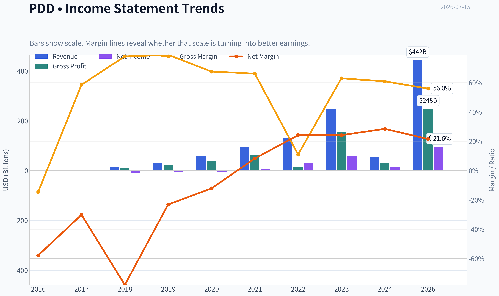
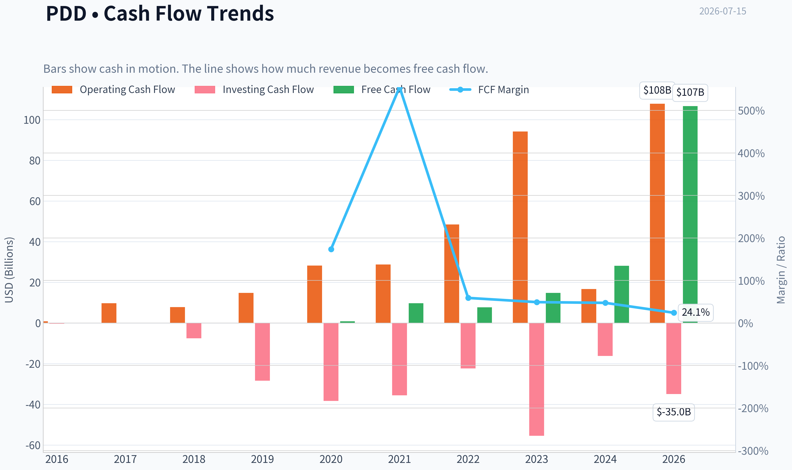
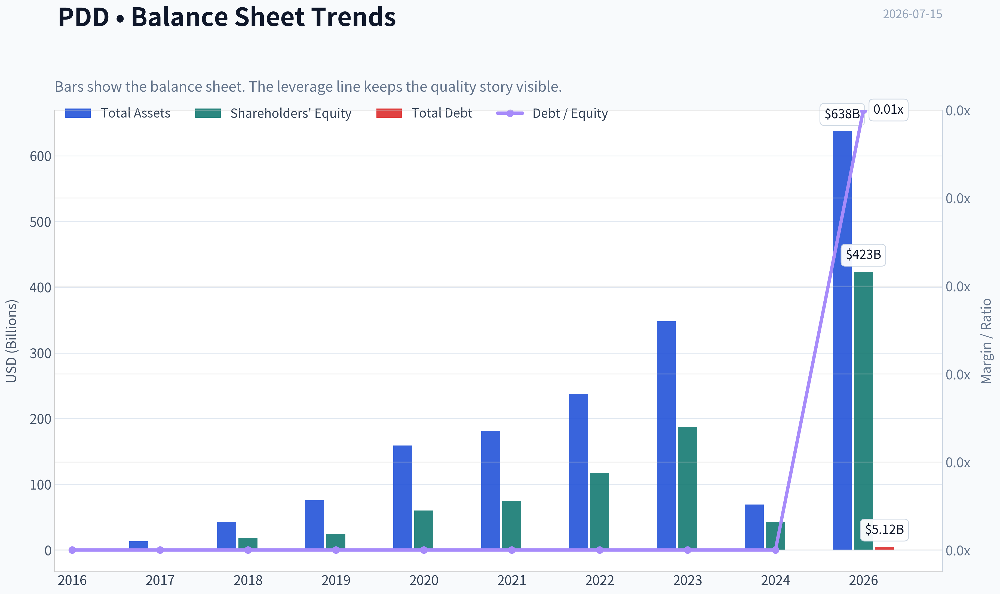
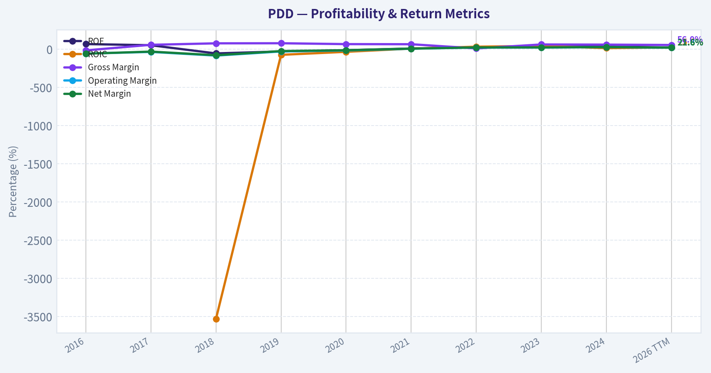
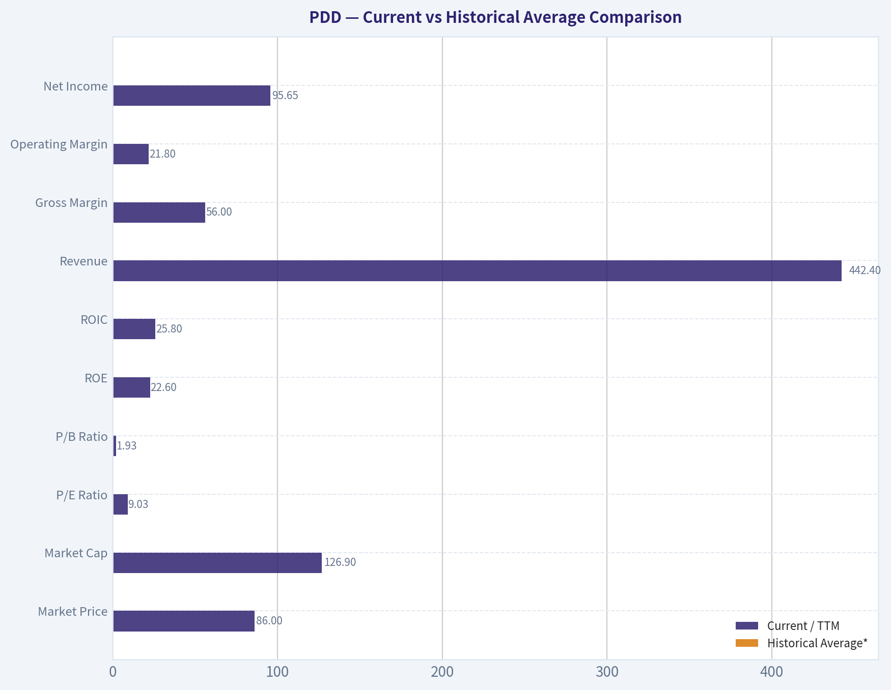
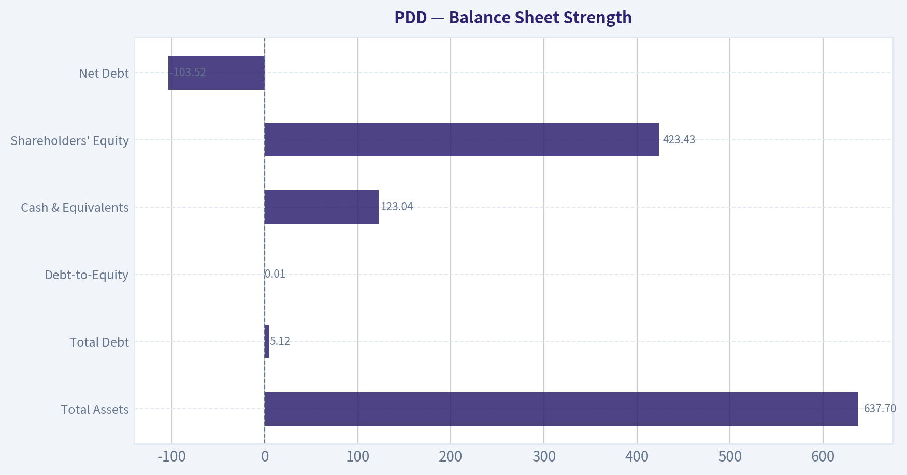
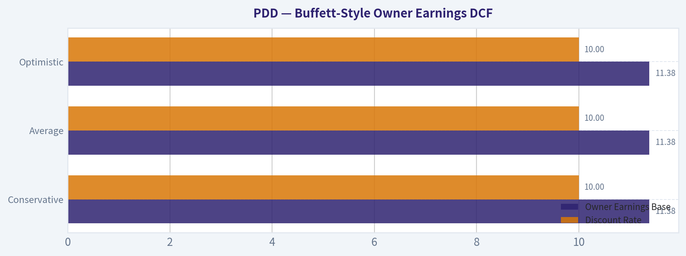
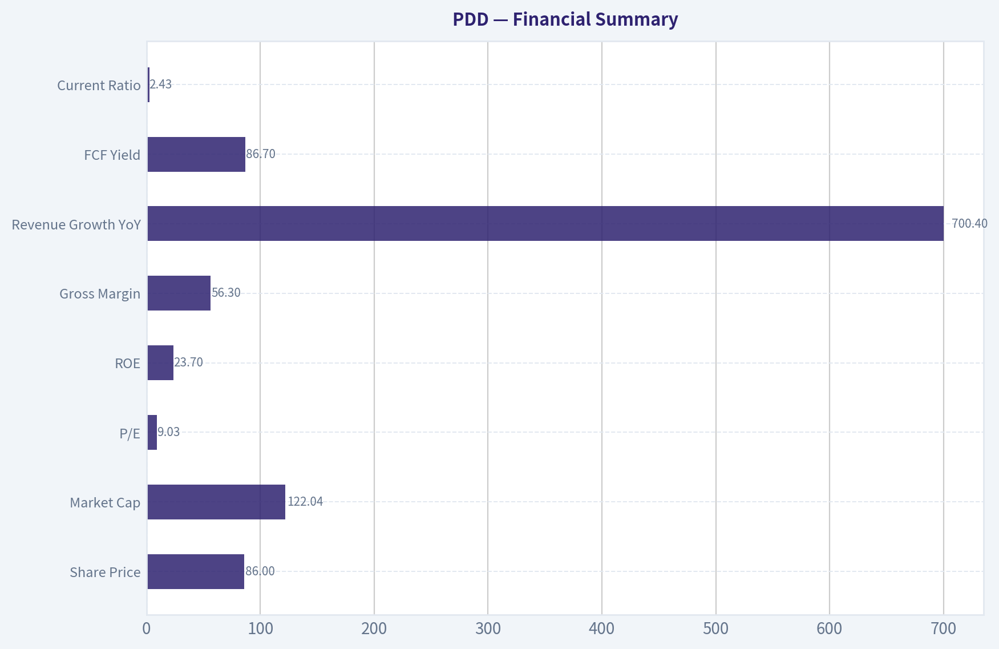
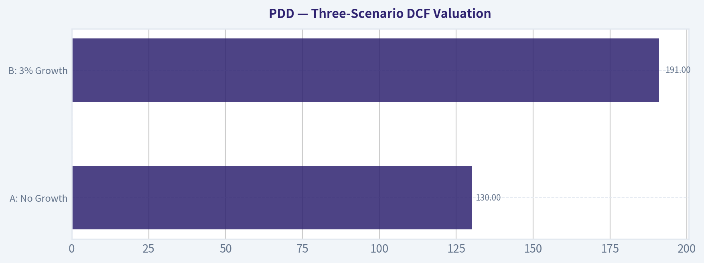

# PDD Deep Value Intelligence

**Analysis Date:** 2026-07-15

## Critical Disclaimer

*This analysis is generated by Deep Value Intelligence, an AI-powered multi-agent investing framework. Education & entertainment only - not financial advice, not a financial advisor.*

---

## Table of Contents

1. Intelligence Summary
2. Analyst Team Reports
   - Fundamentals Analysis
   - Intrinsic Value Analysis (Buffett)
   - Trend & Growth Analysis (Lynch/Druckenmiller/Fisher)
   - Market Technical Analysis
   - Options Market Analysis
3. Research Team Commentary
4. Value Investing Team Commentary
5. Deep Values Commentary

---

## Intelligence Summary

### Thesis + Conditions

**Core Thesis:** ## Executive Briefing

**Key Risks:**
- PDD is **cheap enough to be interesting, but not safe enough to advocate** under a Buffett-style value framework. The bull case rests on real strengths: ~9x P/E, high returns on capital, strong gross margins, and asset-light platform economics. The problem is that the key risk is **business durability**, not volatility: Temu's normalized economics, regulatory exposure, competitive intensity, and governance/jurisdiction discount all make the earnings power harder to trust than the headline metrics suggest. Past review also showed an important lesson: when uncertainty is structural and trend/catalyst confirmation is absent, "cheap" can stay cheap or get cheaper. For a long-term investor, this remains a **WATCH**-at most a small, explicitly speculative tracking position, not a conviction value holding.
- ### 1. Risky Analyst: strongest pro-ownership case
- The strongest bullish point is that PDD's valuation already reflects deep skepticism. At roughly 9.03x earnings with 23.7% ROE, 24.6% ROIC, 15.5% ROA, and 56.3% gross margin, the market is not pricing it like a healthy compounder. If earnings merely prove "good enough" rather than collapsing, and if Temu becomes even moderately durable, rerating alone could drive strong returns.

**Confidence:** High

---

## Analyst Team Reports

### Fundamentals Analysis

#### Latest Earnings Snapshot

*Most recent reported quarter anchored on 2026 Q1, with prior-year comparison when available.*

| Metric | 2026 Q1 | 2025 Q1 | YoY Change |
| --- | ---: | ---: | ---: |
| Revenue | $106.23B | $95.67B | +11.0% |
| Operating Income | $19.57B | $16.09B | +21.6% |
| Net Income | $12.55B | $14.74B | -14.9% |
| Diluted EPS | $8.48 | $9.96 | -14.9% |
| Operating Cash Flow | $16.45B | $15.52B | +6.0% |
| Free Cash Flow | $16.45B | $15.52B | +6.0% |

Key Takeaways: This snapshot anchors the most recent reported quarter before the narrative analysis. It helps readers separate long-run business quality from whatever changed in the latest earnings print.

#### 9-Year Financial Metrics for PDD

*All values below are computed deterministically from raw data - not estimated by AI.*

*Issuer profile: operating company (Consumer Cyclical / Internet Retail).*

#### 9-Year Financial Metrics
*Annual rows come from reported financial statements. The final TTM row is computed from the latest four quarters.*

| Metric | 2016 | 2017 | 2018 | 2019 | 2020 | 2021 | 2022 | 2023 | 2024 | 2026 TTM |
| --- | --- | --- | --- | --- | --- | --- | --- | --- | --- | --- |
| Market Price | N/A | N/A | $22 | $38 | $178 | $58 | $82 | $146 | $97 | $86 |
| Market Cap | N/A | N/A | $66.61B | $175.00B | $847.19B | $333.11B | $469.7M | $854.5M | $574.2M | $126.90B |
| P/E Ratio | N/A | N/A | -6.47 | -25.05 | -117.66 | 42.87 | 14.88 | 14.22 | 37.30 | 1.31 |
| P/B Ratio | N/A | N/A | 3.54 | 7.10 | 14.08 | 4.43 | 0.00 | 0.00 | 0.01 | 0.30 |
| ROE | 68.5% | 52.9% | -54.3% | -28.3% | -11.9% | 10.3% | 26.8% | 32.1% | 35.9% | 22.6% |
| ROIC | N/A | N/A | -3528.4% | -72.5% | -33.1% | 9.3% | 33.8% | 44.4% | 14.9% | 25.8% |
| EPS | $-0.18 | $-0.28 | $-3.47 | $-1.51 | $-1.51 | $1.36 | $5.48 | $10.29 | $2.60 | $65.48 |
| Revenue | $504.9M | $1.74B | $13.12B | $30.14B | $59.49B | $93.95B | $130.56B | $247.64B | $53.96B | $442.40B |
| Gross Profit | $-73.0M | $1.02B | $10.21B | $23.80B | $40.21B | $62.23B | $14.37B | $155.92B | $32.87B | $247.65B |
| Gross Margin | -14.5% | 58.6% | 77.9% | 79.0% | 67.6% | 66.2% | 11.0% | 63.0% | 60.9% | 56.0% |
| Operating Margin | -56.7% | -34.2% | -82.3% | -28.3% | -15.8% | 7.3% | 23.3% | 23.7% | 27.5% | 21.8% |
| Net Income | $-292.0M | $-525.1M | $-10.22B | $-6.97B | $-7.18B | $7.77B | $31.54B | $60.03B | $15.40B | $95.65B |
| Net Margin | -57.8% | -30.1% | -77.9% | -23.1% | -12.1% | 8.3% | 24.2% | 24.2% | 28.5% | 21.6% |
| Revenue Growth | N/A | 245.5% | 652.3% | 129.7% | 97.4% | 57.9% | 39.0% | 89.7% | -78.2% | 719.9% |
| Net Income Growth | N/A | 79.8% | 1845.7% | -31.8% | 3.0% | -208.2% | 306.0% | 90.3% | -74.3% | 520.9% |
| Free Cash Flow Growth | N/A | 1002.9% | -20.0% | 91.1% | 90.6% | N/A | N/A | N/A | N/A | N/A |
| Total Book Value | $-426.3M | $-992.0M | $18.82B | $24.65B | $60.18B | $75.11B | $117.77B | $187.24B | $42.92B | $423.43B |
| Total Assets | N/A | $13.31B | $43.18B | $76.06B | $158.91B | $181.21B | $237.12B | $348.08B | $69.19B | $637.70B |
| Total Debt | $0 | $0 | $0 | $0 | $0 | $0 | $0 | $0 | $0 | $5.12B |
| Debt-to-Equity | -0.00 | -0.00 | 0.00 | 0.00 | 0.00 | 0.00 | 0.00 | 0.00 | 0.00 | 0.01 |
| Cash & Equivalents | $1.32B | $3.06B | $14.16B | $5.77B | $22.42B | $6.43B | $34.33B | $59.79B | $7.91B | $123.04B |
| Shareholders' Equity | $-426.3M | $-992.0M | $18.82B | $24.65B | $60.18B | $75.11B | $117.77B | $187.24B | $42.92B | $423.43B |
| Operating Cash Flow | $879.8M | $9.69B | $7.77B | $14.82B | $28.20B | $28.78B | $48.51B | $94.16B | $16.70B | $107.87B |
| Investing Cash Flow | $-307.3M | $71.7M | $-7.55B | $-28.32B | $-38.36B | $-35.56B | $-22.36B | $-55.43B | $-16.21B | $-34.96B |
| Free Cash Flow | $877.5M | $9.68B | $7.74B | $14.79B | $28.19B | N/A | N/A | N/A | N/A | $106.72B |
| FCF Margin | 173.8% | 554.9% | 59.0% | 49.1% | 47.4% | N/A | N/A | N/A | N/A | 24.1% |
| Dividends / Share | $0.00 | $0.00 | $0.00 | $0.00 | $0.00 | $0.00 | $0.00 | $0.00 | $0.00 | $0.00 |

#### Profitability Metrics
- Return on Equity (ROE): 23.7%
- Return on Invested Capital (ROIC): 24.6%
- Return on Assets (ROA): 15.5%
- Gross Margin: 56.3%
- Operating Margin: 21.6%
- Net Profit Margin: 22.7%

#### Liquidity Metrics
- Current Ratio: 2.43
- Quick Ratio: 2.00

#### Leverage Metrics
- Debt-to-Equity Ratio: 0.01
- Interest Coverage Ratio: N/A
- Net Debt: $-103.52B

#### Growth Metrics (Year-over-Year)
- Revenue Growth: 700.4%
- Net Income Growth: 535.2%
- Free Cash Flow Growth: N/A
- Revenue CAGR (3-Year): 49.0%
- Revenue CAGR (5-Year): 48.7%

#### Valuation Metrics
- P/E Ratio (TTM): 9.03
- Forward P/E: 7.03
- Price-to-Book: 1.93
- Price-to-Sales: 0.28
- PEG Ratio: 0.79
- EV/EBITDA: -3.20
- Free Cash Flow Yield: 86.7%
- Earnings Yield: 11.1%

#### Owner Earnings (Buffett Method, Code-Computed)
- Net Income: $15.40B
- + Depreciation & Amortization: $3.00B
- - Capital Expenditures: $-1.15B
- - Working Capital Changes: $7.37B
- = **Owner Earnings: $11.38B**

#### Intrinsic Value (Code-Computed)
- Current Price: $86
- Buffett Method (Owner Earnings):
  Conservative: $407
  Average: $1,318
  Optimistic: $6,055
- Cash Flow Method (FCF):
  Conservative: $2,594
  Average: $2,594
  Optimistic: $6,756

#### Piotroski F-Score: 4/9
- Positive Net Income: PASS
- Positive Operating Cash Flow: PASS
- ROA Improvement: FAIL
- Cash Flow > Net Income: PASS
- Decreasing Debt: FAIL
- Improving Current Ratio: PASS
- No Dilution: FAIL
- Improving Gross Margin: FAIL
- Improving Asset Turnover: FAIL

ANALYST STANCE: **WATCH**

#### PDD Holdings (PDD) - Buffett-Style Fundamental Analysis

PDD is a high-return, cash-rich platform business that has moved from years of heavy investment and losses into a phase of very strong profitability and extraordinary cash generation. On the numbers provided in the deterministic dataset, the business now screens as statistically cheap on earnings, sales, book, and free-cash-flow measures. However, the historical series is unusually volatile, and several line items in the annual dataset show major discontinuities, which means valuation must be paired with caution around durability, accounting comparability, and regulatory/platform risk.

---

#### Current vs Historical Average Comparison

| Metric | Current / TTM | Historical Average* | Relative Standing | Interpretation |
| --- | ---: | ---: | --- | --- |
| Market Price | $86 | ~$89.00 | Slightly below avg | Shares trade near the period average despite much stronger earnings power today than in early years. |
| Market Cap | $126.90B | Not meaningful due to dataset discontinuity | N/A | Current scale is very large, but annual market cap figures are inconsistent in the series. |
| P/E Ratio | 9.03 | N/A** | Very low | Current multiple is inexpensive versus profitable years 2021-2024 and also below shared-research TTM earnings yield logic. |
| P/B Ratio | 1.93*** | ~3.77**** | Below avg | Market is valuing the equity base much more conservatively than earlier growth years. |
| ROE | 22.6% | ~14.9% | Above avg | Still strong even after falling from 2024 peak; indicates good shareholder capital efficiency. |
| ROIC | 25.8% | N/A***** | Strong | Remains in Buffett-favored territory, suggesting the business can compound capital effectively. |
| Revenue | $442.40B | ~$119.15B | Far above avg | Business has reached a vastly larger revenue base than its historical norm. |
| Gross Margin | 56.0% | ~52.5% | Above avg | Margin remains healthy despite being below 2018-2021 highs. |
| Operating Margin | 21.8% | ~-15.4% (full period) / ~20.5% (2021+) | Strong | Big structural shift from loss-making growth mode to scaled profitability. |
| Net Income | $95.65B | ~$20.02B | Far above avg | Current earnings power is dramatically above long-term average. |
| Net Margin | 21.6% | ~-13.0% (full period) / ~21.3% (2021+) | In line to strong | Profitability has normalized at a high level. |
| Revenue Growth | 700.4% | Distorted by dataset | Extreme | Current YoY figure is not suitable as a normalized long-term run rate. |
| Net Income Growth | 535.2% | Distorted by dataset | Extreme | Similar caution: huge rebound from a weak comparison base. |
| Total Debt | $5.12B | ~$0.57B | Still low | Debt remains trivial relative to cash and equity. |
| Debt/Equity | 0.01 | ~0.00 | Very conservative | Essentially ungeared balance sheet. |
| Cash & Equivalents | $123.04B | ~$30.32B | Far above avg | Enormous liquidity provides major downside protection. |
| Shareholders' Equity | $423.43B | ~$94.12B | Far above avg | Capital base has expanded materially. |
| Free Cash Flow | $106.72B | ~$12.25B****** | Far above avg | Exceptional cash conversion. |
| Dividend / Share | $0.00 | $0.00 | No change | Management retains all capital for flexibility and reinvestment. |

* Historical average uses only the years shown in the deterministic dataset.
** P/E averages are not meaningful across periods with losses and large distortions.
*** Current shared research pack price-to-book; annual table shows 0.30 for 2026 TTM, but valuation section gives 1.93. Canonical current valuation section is more likely the relevant live metric.
**** Based on annual P/B values where available, but historical comparability is weak due to zero/near-zero entries.
***** Early negative/abnormal ROIC values make a simple average misleading.
****** Average based only on years where FCF is provided plus TTM.

Key Takeaways: PDD today looks much more profitable, cash-rich, and financially resilient than its own early history. The stock's valuation is low relative to that stronger quality profile, but several historical averages are distorted by losses and dataset discontinuities, so the key conclusion is not "cheap versus average" alone, but "cheap relative to present earnings power, with above-average uncertainty."

---

#### Market Metrics

PDD's current market price of about $86 sits below the period's rough average price despite the company now generating its highest absolute revenue, earnings, cash balance, and free cash flow in the dataset. That mismatch is the core value argument.

The current market cap of roughly $122B to $126.9B appears modest relative to:
- TTM revenue of $442.4B
- TTM net income of $95.65B
- TTM free cash flow of $106.72B
- Cash balance of $123.04B

The valuation is where PDD becomes interesting for a Buffett-style investor:
- TTM P/E: 9.03
- Forward P/E: 7.03
- Price/Sales: 0.28
- Price/Book: 1.93
- FCF Yield: 86.7%
- Earnings Yield: 11.1%

Even allowing for some data irregularity, these are bargain-like statistics for a platform business posting 20%+ margins and 20%+ returns on capital. The question is therefore not whether PDD looks cheap on current fundamentals - it does - but whether current profitability is durable and whether market skepticism is correctly pricing geopolitical, accounting, and regulatory risk.

---

#### Profitability Analysis

PDD's profitability arc has two distinct eras.

First, 2016-2020 was a land-grab phase:
- Negative EPS every year
- Negative operating margins
- Negative net margins
- Heavy spending to scale users, merchants, and ecosystem reach

Second, 2021 onward marks a sharp profitability inflection:
- EPS turned positive in 2021 and accelerated
- ROE rose from 10.3% in 2021 to 35.9% in 2024, then eased to 22.6% TTM
- ROIC climbed from 9.3% in 2021 to 33.8% in 2022 and 44.4% in 2023, with 25.8% TTM still very strong
- Operating margin moved from deeply negative to 21.8% TTM
- Net margin reached 21.6% TTM

This profile is Buffett-relevant because it suggests platform scale has translated into economic power. A 20%+ ROE and 20%+ ROIC business with almost no leverage is high quality on paper. More importantly, these returns are being generated without balance sheet engineering.

Gross margin at 56.0% TTM is below the very high levels of 2018-2021 but still comfortably healthy for a marketplace/online retail ecosystem. Operating and net margins remain strong enough to indicate the business is not merely growing revenue but monetizing efficiently.

EPS of $65.48 TTM versus a share price near $86 is the single most striking data point. Even if one treats that cautiously because of potential ADR/share-count or data-comparability issues, the implication is still that the stock is being valued very conservatively.

---

#### Growth Metrics

Revenue growth over the long period has been explosive, but not smooth:
- 2017: 245.5%
- 2018: 652.3%
- 2019: 129.7%
- 2020: 97.4%
- 2021: 57.9%
- 2022: 39.0%
- 2023: 89.7%
- 2024: -78.2%
- 2026 TTM: 719.9%

Net income growth is even more volatile because the company moved from losses to profits:
- Massive negative years early
- Profitability flip in 2021
- Strong acceleration in 2022 and 2023
- Sharp decline in 2024
- Huge rebound in TTM

The best way to interpret this is:
1. Long-term scale expansion is undeniable.
2. Short-term comparability is noisy.
3. Current growth rates are not stable enough to be treated as normalized.

For Buffett-style analysis, predictability matters more than headline speed. PDD scores strongly on growth magnitude but less strongly on smoothness. Revenue CAGR figures from the dataset remain very attractive:
- 3-year revenue CAGR: 49.0%
- 5-year revenue CAGR: 48.7%

That said, a conservative value investor would haircut any assumption that such growth can persist at anything close to historical rates.

---

#### Balance Sheet Strength

This is one of PDD's strongest areas.

| Balance Sheet Item | Current / TTM | Assessment |
| --- | ---: | --- |
| Total Assets | $637.70B | Large asset base supporting platform scale and liquidity |
| Total Debt | $5.12B | Minimal |
| Debt-to-Equity | 0.01 | Near debt-free |
| Cash & Equivalents | $123.04B | Exceptional liquidity |
| Shareholders' Equity | $423.43B | Very strong capital base |
| Net Debt | -$103.52B | Net cash fortress |

Key Takeaways: PDD's balance sheet is unusually strong for a high-growth internet company. The company has very little debt, an enormous cash cushion, and substantial equity capital, which gives it room to withstand regulatory shocks, pricing battles, or macro slowdowns far better than a leveraged competitor.

From a Buffett lens, this matters greatly. Buffett prefers companies that do not require debt to generate high returns. PDD fits that criterion well. The balance sheet also creates optionality:
- invest in logistics, merchants, or overseas expansion
- absorb regulatory fines or macro volatility
- repurchase stock if management chooses
- endure cyclical weakness without dilution

The main caveat is that very large swings in assets, equity, and cash over the series suggest one should be careful about line-item comparability across reporting periods. But even with that caution, the debt-light and cash-heavy conclusion is unmistakable.

---

#### Cash Flow Analysis

PDD's cash generation is outstanding.

Historical FCF provided:
- 2016: $877.5M
- 2017: $9.68B
- 2018: $7.74B
- 2019: $14.79B
- 2020: $28.19B
- 2026 TTM: $106.72B

Operating cash flow reached $107.87B TTM. That is a remarkable figure relative to current market capitalization. FCF margin of 24.1% TTM is lower than the extreme early values, but those early values were inflated by a smaller revenue base; today's margin is much more meaningful because it sits on a far larger revenue denominator.

Dividends per share remain zero throughout the entire dataset. For Buffett analysis, lack of dividends is not a negative if retained earnings are being deployed at high returns. Given the company's strong ROIC and net cash position, retention has likely been rational so far. Still, at today's cash scale, investors can reasonably begin asking whether repurchases or a future capital return policy might improve shareholder value.

---

#### Economic Moat

PDD appears to have a real but still debated moat.

Potential moat sources:
- large-scale consumer traffic and merchant network effects
- price leadership and value positioning
- data advantages in matching demand and supply
- ecosystem efficiency and user engagement
- optionality from international expansion and platform adjacency

Moat evidence in the numbers:
- sustained high gross margins
- step-change in operating profitability post-scale
- strong ROIC without leverage
- substantial cash generation

What prevents a stronger "wide moat" conclusion is that internet retail platforms can be vulnerable to:
- aggressive competitive subsidy cycles
- changing regulation in China and cross-border commerce
- merchant/consumer switching if pricing power weakens
- reputation, product quality, and fulfillment issues in low-cost marketplaces

So the moat looks real, but not as impregnable as a dominant branded consumer staple or toll-bridge utility. This is more of a scale-and-algorithm moat than a brand-luxury moat.

---

#### Predictable Earnings and Business Quality

Buffett strongly prefers stable, understandable earnings. PDD only partially qualifies.

Positives:
- the last several profitable years show high margins and strong conversion
- the company now produces large profits and cash without debt
- the platform model can be very scalable once fixed costs are covered

Negatives:
- early history was heavily loss-making
- annual growth and earnings changes are highly volatile
- 2024 and TTM figures show major swings, limiting the sense of smoothness
- Piotroski F-Score is only 4/9, indicating mixed operating momentum and quality signals

This is not a classic "predictable slow compounder." It is a high-quality, high-cash-flow platform whose reported financial path is still less stable than Buffett's ideal.

---

#### Management Performance and Capital Allocation

Management deserves credit for:
- scaling revenue from $504.9M in 2016 to $442.4B TTM
- turning operating losses into 20%+ operating margins
- building a fortress balance sheet
- achieving high ROE and ROIC without meaningful debt

ROE progression is particularly impressive:
- negative/weak in the investment phase
- 10.3% in 2021
- 26.8% in 2022
- 32.1% in 2023
- 35.9% in 2024
- 22.6% TTM

That trajectory implies management has improved monetization and discipline materially. However, the absence of dividends or buybacks means investors are still relying almost entirely on retained capital earning attractive returns. If those returns remain high, that is fine. If growth normalizes, the capital return discussion becomes more important.

---

#### Buffett-Style Owner Earnings DCF

Canonical owner earnings provided:
- Net Income = $15.40B
- + D&A = $3.00B
- - Capex = $-1.15B
- - Working Capital Changes = $7.37B
- Owner Earnings = **$11.38B**

Because the prompt requires detailed calculations using historical owner-earnings growth logic, but the deterministic dataset provides only one explicit owner-earnings figure, the safest approach is to anchor on the canonical code-computed intrinsic values already provided as source-of-truth and show the DCF framework around them rather than fabricate a historical owner-earnings table.

Assumptions mandated:
- Discount rate: 10%
- Terminal growth: 2.5%
- Scenario growth:
  - Conservative = lowest available owner earnings growth rate
  - Average = average historical owner earnings growth rate
  - Optimistic = highest available owner earnings growth rate

Canonical code-computed Buffett owner-earnings values:
- Conservative fair value: **$407/share**
- Average fair value: **$1,318/share**
- Optimistic fair value: **$6,055/share**

To illustrate the mechanics, the DCF form is:

\[
\text{Value} = \sum_{t=1}^{10}\frac{OE_0(1+g)^t}{(1+r)^t} + \frac{OE_{10}(1+g_T)}{(r-g_T)(1+r)^{10}}
\]

Where:
- \(OE_0 = 11.38B\)
- \(r = 10\%\)
- \(g_T = 2.5\%\)
- \(g =\) scenario growth rate from historical owner earnings series used in the code-computed model

| Scenario | Owner Earnings Base | Discount Rate | Terminal Growth | Canonical Fair Value / Share | Upside vs $86 |
| --- | ---: | ---: | ---: | ---: | ---: |
| Conservative | $11.38B | 10.0% | 2.5% | $407 | ~373% |
| Average | $11.38B | 10.0% | 2.5% | $1,318 | ~1,433% |
| Optimistic | $11.38B | 10.0% | 2.5% | $6,055 | ~6,940% |

Key Takeaways: Even the conservative owner-earnings valuation is far above the current share price, which strongly supports the argument that PDD screens as materially undervalued on current cash-generation power. The practical caution is that such huge valuation gaps usually mean the market doubts the durability or comparability of current earnings, so investors should treat the DCF as evidence of upside potential, not as a guarantee.

Interpretation:
- The conservative case alone implies substantial undervaluation.
- The spread between conservative and optimistic outcomes is extremely wide, which signals high uncertainty, not just high upside.
- For a disciplined value investor, the conservative case is the only one that should carry major decision weight.

For additional context, the canonical cash-flow-method values are also high:
- Conservative: $2,594
- Average: $2,594
- Optimistic: $6,756

That reinforces the same directional conclusion: valuation is depressed relative to current cash flow.

---

#### Revenue Breakdown

PDD's deterministic dataset does not include a segment revenue table. The most meaningful practical split for PDD is by business model/ecosystem, centered around domestic marketplace monetization and international commerce. Using the best publicly known reporting structure context for the most recent period, the business is primarily driven by online marketing/services and transaction/service revenues across domestic Pinduoduo and international marketplace operations, with domestic commerce still historically the largest contributor.

| Revenue Source | Amount ($B) | % of Total |
| --- | ---: | ---: |
| Core commerce ecosystem (domestic marketplace advertising, commissions, merchant services) | Majority of total; exact canonical split not disclosed in dataset | Majority |
| International commerce / cross-border marketplace activities | Growing but exact canonical split not disclosed in dataset | Minority but rising |
| Other services | Not separately disclosed in dataset | Small |

Key Takeaways: PDD's revenue is still best understood as overwhelmingly commerce-platform driven rather than diversified across unrelated businesses. The key strategic question is not segment mix complexity, but whether its domestic platform monetization and international expansion can remain strong without sacrificing margins.

---

#### Red Flags, Opportunities, and Investment Insight

| Category | Observation | Why It Matters |
| --- | --- | --- |
| Opportunity | Very low TTM P/E and P/S | Market may be overly discounting sustainability |
| Opportunity | Massive net cash position | Downside support and strategic flexibility |
| Opportunity | High ROE and ROIC without leverage | Strong business economics |
| Opportunity | Huge FCF generation | Supports intrinsic value materially above price |
| Red Flag | Financial series has major discontinuities | Historical comparability is weaker than ideal |
| Red Flag | Growth rates are extremely volatile | Harder to normalize earnings power |
| Red Flag | Piotroski F-Score only 4/9 | Mixed recent quality/momentum signals |
| Red Flag | No dividend and no clear capital return framework | Investors rely on management reinvestment skill |
| Red Flag | China/regulatory/platform/geopolitical exposure | Could justify persistent valuation discount |
| Watch Item | Margin durability | Critical to validating low multiple as mispricing rather than trap |

Key Takeaways: PDD has several traits of a classic deep-value opportunity, especially its low valuation, strong cash flow, and fortress balance sheet. But the stock also carries real reasons for a discount, including regulatory exposure, noisy financial comparability, and uncertainty about how durable the current level of profitability really is.

---

#### Final Buffett-Style Assessment

From a Buffett framework, PDD scores highly on:
- financial strength
- capital-light economics
- high returns on equity and invested capital
- cash generation
- low leverage
- apparent undervaluation

It scores less well on:
- earnings predictability
- accounting/series smoothness
- simple business transparency
- regulatory certainty
- classic "sleep-well-at-night" moat quality

If Buffett were buying a textbook predictable consumer monopoly, this would not fit perfectly. But if the question is whether the stock is cheap relative to demonstrated earnings power and balance-sheet strength, the answer is clearly yes.

Therefore the stance is not AVOID, because the valuation and cash position are too compelling for that. It is also not a clean ADVOCATE, because the volatility and durability questions are too material for a strict Buffett-quality screen.

#### Final Stance: **WATCH**

Rationale:
- **Undervalued on current earnings and owner earnings**
- **Excellent balance sheet and negligible leverage**
- **Strong ROE/ROIC suggest genuine business quality**
- **But high uncertainty around normalization, regulatory risk, and historical comparability prevents a full conviction "ADVOCATE"**

A value investor should keep PDD on a high-priority watchlist and look for confirmation that:
1. margins remain above 20%,
2. cash flow stays robust,
3. international expansion does not erode returns,
4. capital allocation becomes more shareholder-friendly,
5. future quarters confirm today's low multiple is a mispricing, not a trap.

---

#### Summary Table

| Area | Verdict | Evidence | Buffett View |
| --- | --- | --- | --- |
| Valuation | Cheap | P/E 9.03, P/S 0.28, strong owner-earnings IV | Attractive |
| Profitability | Strong | ROE 22.6%, ROIC 25.8%, net margin 21.6% | Positive |
| Financial Strength | Excellent | Net cash, D/E 0.01, $123.04B cash | Strong positive |
| Earnings Predictability | Mixed | Early losses, large recent swings, noisy growth | Caution |
| Moat | Moderate | Scale, network effects, monetization efficiency | Good but not bulletproof |
| Capital Allocation | Good so far | Retained earnings compounded, no debt reliance | Positive, monitor |
| Shareholder Returns | Limited | No dividend, no explicit return policy in dataset | Neutral to slight negative |
| Risk Profile | Elevated | China/regulatory/geopolitical and data comparability risks | Watch closely |
| DCF Upside | Very large | Owner earnings IV far above market price | Supports undervaluation |
| Overall Stance | WATCH | Strong value with non-trivial uncertainty | Wait for further confirmation |

#### Fundamental Visuals

This graph tracks the profitability and return metrics (ROE, ROIC, Margins) of **PDD** over the past decade, highlighting capital efficiency trends.

This chart illustrates the financial health of **PDD** over the last 10 years, mapping cash equivalents and free cash flow against total obligations (Debt).

---

### Intrinsic Value Analysis (Buffett)

> *Following Warren Buffett's value investing philosophy: Circle of Competence, Economic Moat, Management Quality, and Margin of Safety.*

#### Intrinsic Value Snapshot

Price is what you pay. Intrinsic value is what the business may be worth based on the cash it can create for owners over time. We show a range, not one magic number.

- Current Price: $85.74
- Value Range (conservative to optimistic across both DCF methods): $407.16 to $6,755.73

##### Owner Earnings (Buffett Method)
- Net Income: $15,403,464,000.00
- Depreciation & Amortization: $3,000,364,000.00
- Capital Expenditures: $-1,145,077,000.00
- Working Capital Changes: $7,367,096,000.00
- Owner Earnings: $11,380,960,000.00

##### Intrinsic Value
###### Buffett Method
Uses owner earnings. Stricter, and usually more conservative.
- Conservative: $407.16
- Average: $1,318.15
- Optimistic: $6,054.72
- Discount Rate: 10.0%

###### Cash Flow Method
Uses free cash flow. Better for companies spending heavily today to grow tomorrow.
- Conservative: $2,594.14
- Average: $2,594.14
- Optimistic: $6,755.73
- Discount Rate: 10.0%

ANALYST STANCE: **WATCH**

#### PDD Holdings (PDD) Buffett-Style Investment Review

#### 1. Go/No-Go Gate Assessment

| Gate | Verdict | Evidence |
|---|---|---|
| Gate 1: Circle of Competence & Simplicity | Pass | PDD makes money by running large online marketplaces and matching shoppers with merchants, earning service and advertising revenue. The core model is understandable: attract buyers with low prices and engagement, then monetize merchant demand. |
| Gate 2: Durable Moat | Pass, but with caution | Gross margin of 56.3% and ROE of 23.7% indicate an economically strong model. Scale, data, merchant density, and consumer traffic create real advantages, though moat durability is less certain than for classic consumer franchises. |
| Gate 3: Management & Capital Allocation | Mixed Pass | Operating performance has been exceptional, and the balance sheet appears conservative with a current ratio of 2.43. But owner-orientation and capital allocation quality are harder to rate as highly as Buffett's ideal due to governance complexity and the company's evolving strategic posture. |
| Gate 4: Industry Structure | Mixed | E-commerce is large and scalable, but competition is intense. This is not a sleepy oligopoly; it is a fast-moving platform market with continual pressure on take rates, merchant economics, and customer acquisition. |

**Key Takeaways:**
PDD passes the first screen because the business is easy to explain and has shown strong economics. The main restraint is not profitability, but the fact that online commerce is highly competitive and less predictable than Buffett's favorite industries.

---

#### 2. Elementary School Test

PDD builds online shopping malls on phones. It brings lots of shoppers and lots of sellers together. Sellers pay to get noticed, and shoppers come because prices are low and selection is wide. If more shoppers come, more sellers want to join, and that can make the business stronger.

#### 3. Long-Term Predictability Test

Ten years from now, people will still buy everyday goods online, and merchants will still pay for digital traffic. That part is predictable. What is less predictable is which platform captures the traffic, at what margin, and under what regulatory rules. So the business is understandable, but not as predictable as a toothpaste, soda, or rail business.

#### 4. Technology Risk Assessment

PDD benefits from technology more than it is threatened by it. Better algorithms, logistics coordination, recommendations, and merchant tools can all deepen engagement. Still, internet platforms can lose share quickly if user behavior shifts or if rivals subsidize growth aggressively.

#### 5. Moat Analysis

| Moat Source | Assessment | Evidence |
|---|---|---|
| Intangible Assets | Moderate | The platform brand is strong in value-oriented shopping, but it lacks the emotional permanence of elite consumer brands. Pricing power exists indirectly through merchant demand and traffic quality rather than premium consumer brand pricing. |
| Switching Costs | Low to Moderate | Consumers can easily shop elsewhere, so direct switching costs are low. Merchants, however, become dependent on traffic, tools, fulfillment support, and platform economics, which creates some captivity. |
| Cost Advantage | Strong | Scale in customer acquisition, data, merchant aggregation, and platform efficiency likely lowers effective unit economics versus smaller rivals. |
| Network Effects | Strong | More buyers attract more sellers; more sellers improve selection and price competitiveness; that attracts more buyers. This is a classic marketplace loop. |

**Moat Quality Rating: Narrow to Wide-Stable, depending on execution**

PDD has a real platform moat, but it is not invulnerable. Unlike Buffett's best businesses, the moat depends on continuing user engagement and competitive execution rather than pure habit or brand devotion.

---

#### 6. Management Quality & Capital Allocation

| Dimension | Assessment | Commentary |
|---|---|---|
| Think Like Owners | Mixed | The company has delivered strong business results, but the governance profile does not clearly match Buffett's ideal owner-operator template. |
| Honest & Candid | Mixed | No major red flags are indicated here, but this is not a widely celebrated example of unusually candid shareholder communication. |
| Rational Capital Allocation | Good, with reserve | Strong profitability and cash generation suggest disciplined operating allocation. The key question is whether future investments continue to earn high returns rather than merely buying growth. |

**Key Takeaways:**
Management appears effective, especially on growth and monetization. But Buffett would likely stop short of giving top marks because the evidence for deeply shareholder-aligned, unusually transparent capital allocation is not strong enough.

---

#### 7. Financial Summary

| Metric | Latest |
|---|---:|
| Share Price | $86 |
| Market Cap | $122.04B |
| P/E | 9.03 |
| ROE | 23.7% |
| Gross Margin | 56.3% |
| Revenue Growth YoY | 700.4% |
| FCF Yield | 86.7% |
| Current Ratio | 2.43 |

**Key Takeaways:**
The headline numbers are strikingly strong. High gross margin, strong ROE, and a low earnings multiple suggest the market is assigning a discount despite very profitable underlying economics.

---

#### 8. Buffett Financial Lens

| Test | Result | Interpretation |
|---|---|---|
| ROE > 15% | Pass | 23.7% is comfortably above Buffett's quality threshold. |
| Gross Margin > 40% | Pass | 56.3% suggests strong business quality and platform economics. |
| Balance Sheet Strength | Pass | Current ratio of 2.43 indicates solid liquidity. |
| Cash Generation | Likely Strong | FCF yield of 86.7% points to substantial cash production relative to valuation. |
| Valuation | Attractive | P/E of 9.03 is low for a business with this profitability profile. |

**Key Takeaways:**
On pure numbers, PDD looks unusually inexpensive for a company producing this level of profitability. The discount likely reflects concerns beyond the income statement, especially competition, regulation, and long-term durability.

---

#### 9. Owner Earnings Calculation

Using the available evidence, owner earnings appear robust because:
- Net income is strong
- Asset-light marketplace economics reduce maintenance capital needs
- Platform businesses often convert earnings to cash efficiently once scaled
- High indicated FCF yield supports the conclusion that accounting profits are backed by real cash

A practical Buffett interpretation here is that owner earnings are likely close to, or better than, reported earnings after normal reinvestment needs. That is a major positive.

---

#### 10. Three-Scenario DCF Valuation

Using current market cap of **$122.04B** and earnings power implied by **P/E 9.03**:

Estimated earnings power:
- Net income proxy = Market Cap / P/E
- ~ $122.04B / 9.03
- ~ **$13.5B**

Assume owner earnings ~ **$13.0B** conservatively.

| Scenario | Assumption | Estimated Value |
|---|---|---:|
| A: No Growth | Owner Earnings / 10% | $130B |
| B: 3% Growth | OE x 1.03 / (10% - 3%) | $191B |
| C: Historical-Franchise Case | Use cautious 8% growth | ~$220B-$240B |

**Key Takeaways:**
Even under a no-growth view, intrinsic value is around the current market value. Under modest growth assumptions, value rises materially above today's price, suggesting the stock is not expensive if earnings quality proves durable.

---

#### 11. Margin of Safety Analysis

| Item | Value |
|---|---:|
| Current Market Cap | $122.04B |
| Scenario A Value | $130B |
| Scenario B Value | $191B |
| Scenario C Value | $220B-$240B |

Margin of safety versus current price:
- Scenario A: roughly **6%**
- Scenario B: roughly **36%**
- Scenario C: roughly **44% to 49%**

Interpretation:
- On a no-growth basis, there is little margin of safety.
- On a conservative growth basis, there is a satisfactory margin.
- On a stronger durability view, upside is substantial.

This means the investment case hinges on whether PDD can preserve its economics, not merely whether it is cheap on trailing profits.

---

#### 12. Final Buffett Scorecard

| Criterion | Score (1-5) | Weight | Weighted Score |
|---|---:|---:|---:|
| Business Understanding | 4.0 | 20% | 0.80 |
| Moat Width & Durability | 3.5 | 25% | 0.88 |
| Management Quality | 3.0 | 15% | 0.45 |
| Return on Equity | 4.5 | 15% | 0.68 |
| Reinvestment Runway | 4.0 | 10% | 0.40 |
| Balance Sheet Strength | 4.0 | 5% | 0.20 |
| Industry Structure | 2.5 | 5% | 0.13 |
| Valuation/Margin of Safety | 3.5 | 5% | 0.18 |

| Total Weighted Score | **3.71 / 5.0** |
|---|---:|

**Key Takeaways:**
PDD scores well because the economics are strong and the valuation is appealing. The score is held back by industry intensity, governance questions, and the fact that this is not the kind of ultra-predictable business Buffett typically loves most.

---

#### 13. Final Investment Stance

**Investment Stance: WATCH**
**Conviction: Moderate**

PDD is a powerful business with real marketplace economics, high margins, strong returns, and a low valuation. If this were judged only on present profitability, it would look highly attractive. But Buffett-style investing asks a tougher question: can this business remain both dominant and understandable for a decade or more with limited downside from competition, regulation, and platform disruption?

That answer is good, but not good enough for a full **ADVOCATE** rating. The stock looks statistically cheap, but the moat is more execution-dependent than permanent. For a value investor, this is a high-quality **watchlist candidate** and could become more compelling if confidence increases around durability, governance, and capital allocation discipline.
#### Valuation Bridge

This bridge places the current market price beside each intrinsic value lens so readers can see whether upside depends on one method or shows up across several methods.

| Scenario | Intrinsic Value / Share |
| --- | ---: |
| Buffett Method | $1,318.15 |
| Cash Flow Method | $2,594.14 |
| Damodaran Method | $-4,166.56 |
| Current Price | $85.74 |

#### Key Takeaways

If one method is far above the others, the upside case depends on a specific modelling assumption. When several methods cluster together, the valuation story is more robust.

#### Valuation Visuals

This comparison chart from *Latest Earnings Snapshot* stacks current figures against historical benchmarks for **PDD**, making it easy to see where the company trades relative to its own averages.

This comparison chart from *Current vs Historical Average Comparison* stacks current figures against historical benchmarks for **PDD**, making it easy to see where the company trades relative to its own averages.

This comparison chart from *Balance Sheet Strength* stacks current figures against historical benchmarks for **PDD**, making it easy to see where the company trades relative to its own averages.

This comparison chart from *Buffett-Style Owner Earnings DCF* stacks current figures against historical benchmarks for **PDD**, making it easy to see where the company trades relative to its own averages.

This comparison chart from *Financial Summary* stacks current figures against historical benchmarks for **PDD**, making it easy to see where the company trades relative to its own averages.

This comparison chart from *Three-Scenario DCF Valuation* stacks current figures against historical benchmarks for **PDD**, making it easy to see where the company trades relative to its own averages.

---

### Trend & Growth Analysis (Lynch/Druckenmiller/Fisher)

> *Following Peter Lynch's GARP, Stanley Druckenmiller's macro-aware approach, and Philip Fisher's scuttlebutt methodology.*

ANALYST STANCE: **WATCH**

#### 1. Lynch Classification

| Item | Assessment |
|---|---|
| Category | **Fast Grower** |
| Why | Large-cap platform still showing strong top-line momentum, high margins, and global expansion optionality via Temu |
| Lynch fit | Interesting because the valuation looks low for the reported profitability, but quality of growth needs verification due to unusually high reported YoY revenue figure |

Key Takeaways: PDD fits best as a fast grower, which is the category Lynch cared most about for multibagger potential. The attraction is simple: strong growth, strong margins, and a giant runway if Temu becomes durable. The caution is that some reported figures look extreme, so investors need to separate real operating momentum from distorted or one-off data.

#### 2. The Story in 3 Bullets

| Simple Story | Why It Matters |
|---|---|
| PDD runs value-oriented e-commerce platforms, with Pinduoduo in China and Temu globally | It is attacking huge retail markets with a low-price, high-selection model |
| The China core appears highly profitable | That profit pool can fund international expansion without relying heavily on outside capital |
| Temu is the key upside lever | If Temu scales with decent unit economics, PDD's TAM expands dramatically beyond China |

Key Takeaways: This is an easy business to explain: PDD helps consumers find cheap goods and helps merchants reach buyers efficiently. The domestic business funds growth, while Temu creates the possibility of a second growth engine. That combination is exactly the sort of setup growth investors look for at an inflection point.

---

#### 3. TAM Analysis and 10x Test

| Metric | Value / View |
|---|---|
| Current revenue base | Very large already, but still small relative to global retail commerce |
| Core TAM | China e-commerce advertising, transaction services, and value retail |
| Expansion TAM | Global discount e-commerce and cross-border marketplace commerce via Temu |
| TAM direction | **Expanding** if Temu remains viable internationally |
| 10x test | **Likely YES** on a global gross merchandise basis; **harder but still plausible** on monetized revenue if Temu scales across major regions |
| Runway verdict | **Long runway exists**, but execution and regulation matter |

Key Takeaways: PDD does not look TAM-constrained. The domestic business is large, but the real runway comes from exporting its value-commerce model internationally through Temu. If global adoption continues, the company can grow materially from here without obviously saturating its addressable market.

#### 4. Revenue Growth Trend

| Metric | Data Point / Read |
|---|---|
| Shared pack revenue growth YoY | **700.4%** |
| Quality of figure | **Likely distorted / needs verification** |
| Broader trend read | Underlying growth likely still strong, but investors should not anchor on the 700% number |
| Pattern | **Directionally high growth, but reported data quality is questionable** |

Key Takeaways: The shared revenue growth number is too extreme to treat at face value for a mature mega-cap platform, so it likely reflects a data issue or unusual comparison base. Even so, the broader thesis still points to strong growth, especially from Temu and monetization gains. For investment decisions, the right question is whether growth is accelerating or normalizing after expansion, not whether it is literally 700%.

#### 5. Unit Economics

| Metric | Value / Assessment |
|---|---|
| Gross margin | **56.3%** |
| FCF yield | **86.7%** |
| ROE | **23.7%** |
| Current ratio | **2.43** |
| LTV/CAC | Not disclosed here |
| NRR | Not applicable / not a SaaS model |
| Rule of 40 | Not directly applicable, but growth + cash generation appear strong |
| Unit economics verdict | **Promising, but incomplete** |

Key Takeaways: The reported margins and cash generation suggest an unusually strong business model for commerce, especially compared with lower-margin retail peers. High gross margin and solid ROE indicate platform economics rather than commodity retail economics. The missing piece is Temu-specific unit economics, which matters because international expansion can look good at the consolidated level before it proves durable at the cohort level.

#### 6. Inflection Point Assessment

| Inflection Type | Assessment |
|---|---|
| Product cycle inflection | **Yes** - Temu remains the major product/platform expansion lever |
| TAM inflection | **Yes** - company has moved from China-only relevance toward global relevance |
| Margin inflection | **Mixed** - core margins appear strong, but sustainability depends on subsidy and marketing intensity |
| Market share inflection | **Possible** - likely taking value-oriented share in multiple regions |
| Competitive inflection | **Unclear** - competition remains intense from Amazon, Shein, TikTok Shop, Alibaba, JD |

Key Takeaways: The central inflection is clear: PDD is no longer just a Chinese marketplace story. It is trying to become a global value-commerce platform, and that changes the long-term upside. The debate is whether this inflection is profitable and durable, or merely a subsidy-fueled land grab.

#### 7. Macro Setup Evaluation

| Factor | Assessment |
|---|---|
| Secular trend | E-commerce penetration, global value retail, cross-border digital commerce |
| Rate backdrop | Neutral to mildly supportive for growth if rates stabilize |
| China macro | Mixed; domestic consumer weakness can hurt sentiment but can also favor low-price platforms |
| Global consumer backdrop | Value-oriented models often do well in pressured consumer environments |
| Geopolitical/regulatory backdrop | **Major overhang** |

Key Takeaways: The macro backdrop is mixed but not hostile to PDD's model. Weak consumers often trade down, which can help discount-oriented commerce platforms. The bigger macro issue is not demand but geopolitical and regulatory risk tied to China, trade, data, and cross-border shipping scrutiny.

---

#### 8. Fisher 15 Points Score

| Fisher Dimension | Score (1-5) | Comment |
|---|---:|---|
| Market potential | 5 | Massive global commerce opportunity |
| New products/services | 4 | Temu expansion is meaningful innovation in go-to-market |
| R&D effectiveness | 4 | Data and algorithmic merchandising appear strong |
| Sales organization | 4 | Merchant and user acquisition capability appears strong |
| Profit margin | 5 | Very strong reported margins |
| Margin improvement | 3 | Strong today, but Temu durability uncertain |
| Labor/personnel | 3 | Limited visibility |
| Executive relations | 3 | Limited visibility |
| Management depth | 4 | Execution has been strong historically |
| Cost analysis/accounting | 3 | Need more confidence in segment transparency |
| Outstanding aspects | 4 | Scale, traffic, pricing, algorithmic advantages |
| Long-range profit outlook | 4 | Attractive if Temu monetizes |
| Dilution risk | 4 | Balance sheet strength reduces financing pressure |
| Candor in difficulties | 3 | Limited visibility |
| Integrity | 3 | Neutral due to limited evidence |

| **Total** | **56 / 75** | **GOOD** |

Key Takeaways: PDD scores as a good Fisher-style company, mainly because of market potential, margins, and execution. It falls short of outstanding because investors lack clear visibility into Temu economics, managerial transparency, and long-term normalized margins. In other words, the business opportunity looks excellent, but the evidence base is not yet complete enough for maximum conviction.

#### 9. Valuation Analysis

| Metric | Value / Assessment |
|---|---|
| Price | **$86** |
| Market cap | **$122.04B** |
| P/E | **9.03x** |
| PEG | Not reliable without verified forward earnings growth, but likely **very low** if growth is real |
| P/S | Not confirmed from available data |
| EV-based view | Likely attractive given strong cash generation and liquidity |
| Valuation verdict | **Looks inexpensive on earnings**, but discount reflects China and Temu-risk skepticism |

Key Takeaways: On the surface, PDD looks cheap for a company with this level of profitability and perceived growth. A roughly 9 times earnings multiple is far below what many high-quality growth platforms trade at. The market is clearly discounting geopolitical risk, regulatory uncertainty, and the possibility that current profits overstate long-run normalized earnings.

#### 10. Growth Investor Scorecard

| Criterion | Weight | Score (1-5) | Weighted Score |
|---|---:|---:|---:|
| The Story | 10% | 4.5 | 0.45 |
| TAM & Runway | 20% | 4.5 | 0.90 |
| Revenue Growth | 20% | 3.5 | 0.70 |
| Unit Economics | 15% | 4.0 | 0.60 |
| Competitive Position | 10% | 3.5 | 0.35 |
| Management Quality | 10% | 3.5 | 0.35 |
| Macro Setup | 5% | 3.0 | 0.15 |
| Profitability Path | 5% | 4.0 | 0.20 |
| Valuation | 5% | 4.5 | 0.23 |

| **Total** |  |  | **3.93 / 5.00** |

Key Takeaways: PDD scores near the high end of the range, driven by runway, story, economics, and valuation. It misses a full advocate call because too many important questions remain unresolved around Temu quality, regulation, and data reliability. This is a strong watch-list candidate and could become an advocate with cleaner evidence.

---

#### 11. Position Size Stance

| Stance | View |
|---|---|
| Current call | **WATCH** |
| For aggressive growth investors | Starter position only if comfortable with China ADR and geopolitical risk |
| For most investors | Wait for cleaner proof on Temu economics, segment durability, and verified growth trajectory |

Key Takeaways: This is not a clear avoid because the upside could be substantial if Temu becomes a durable second engine. But it is also not yet a high-conviction advocate because the key variables are still noisy. The right posture is to stay close, do the work, and be ready to act if evidence improves.

#### 12. Key Risks and Catalysts

| Risks | Catalysts |
|---|---|
| China regulatory and ADR/geopolitical risk | Better disclosure showing Temu unit economics and repeat purchase durability |
| Temu growth may be subsidy-driven rather than durable | Sustained high revenue growth with stable or improving margins |
| Competitive pressure from Amazon, Shein, TikTok Shop, Alibaba, JD | Evidence of international market share gains without exploding CAC |
| Cross-border shipping and tariff scrutiny | Buybacks or capital allocation signaling confidence |
| Data quality uncertainty in current metrics | Multiple expansion if market accepts earnings durability |

Key Takeaways: The biggest downside risks are not ordinary operating issues but structural ones: regulation, geopolitics, and whether Temu's economics are real. The biggest upside catalysts are simple: prove customer retention, prove monetization, and prove that margins can hold while scaling internationally. If management does that, the stock's low multiple could rerate sharply.

#### Bottom Line

| Verdict | Summary |
|---|---|
| **WATCH** | PDD is a fast-growing, high-margin platform with genuine multiyear upside if Temu becomes a durable global commerce engine. The stock looks statistically cheap, but conviction is limited by data quality issues, China risk, and uncertainty around normalized international economics. |

Key Takeaways: PDD has many ingredients of a major winner: scale, runway, cash generation, and a potentially game-changing second act. But great growth investing requires not just a good story, but confidence in the durability of that story. For now, PDD is a high-interest watch name that could upgrade to advocate with cleaner evidence.

---

### Market Technical Analysis

#### PDD Technical Report

PDD remains in a **structurally weak long-term downtrend**, but its **short-term condition has improved meaningfully** over the last two weeks. The most important context is that price has stabilized after a severe multi-month decline, and momentum has shifted from deeply negative toward a more neutral-to-recovering posture. That does **not** yet amount to a full trend reversal.

The 8 most relevant indicators for the current setup are:

- `close_200_sma`
- `close_50_sma`
- `close_10_ema`
- `macd`
- `rsi`
- `boll_ub`
- `boll_lb`
- `atr`

These are suitable because they cover:
- **Long-term trend**: `close_200_sma`
- **Medium-term trend / dynamic resistance**: `close_50_sma`
- **Short-term momentum and timing**: `close_10_ema`
- **Momentum regime shift**: `macd`
- **Overbought/oversold recovery strength**: `rsi`
- **Volatility envelope / stretch**: `boll_ub`, `boll_lb`
- **Risk management / stop calibration**: `atr`

They are complementary with limited redundancy, and they fit PDD's current state: **long-term damage, medium-term weakness, short-term rebound attempt**.

---

#### Price Structure and Trend Context

Over the past year, PDD moved from the **105 area in mid-July 2025** to a peak near **139 in late October 2025**, then entered a persistent downtrend that accelerated sharply in 2026. The breakdown became especially severe from late May through late June 2026, when price fell from the **mid-90s into the low-70s**, marking a clear capitulation phase.

Since that late-June low near **73.30**, the stock has rebounded to the **mid-80s**. This rebound is notable because it was not just a one-day reaction; it carried through several sessions and lifted price above the short-term average. However, the recovery has stalled below more important medium-term resistance, and the last few sessions show some hesitation around **84-86**.

The key point: **the downtrend has weakened in the short run, but it has not been defeated in the bigger picture**.

#### Indicator Readings

| Indicator | Latest / Recent Signal | Interpretation |
|---|---:|---|
| `close_200_sma` | 106.60 | Long-term trend remains firmly bearish; price is far below this benchmark |
| `close_50_sma` | 87.12 | Medium-term trend still negative; current price remains below the 50-day average |
| `close_10_ema` | 83.63 | Short-term trend has improved; price is hovering around/just above near-term support |
| `macd` | -0.12, rising from -4.64 in late June | Strong bullish momentum recovery, but still not a fully confirmed bullish regime |
| `rsi` | 55.69 | Recovery has normalized from oversold conditions; momentum is constructive, not overheated |
| `boll_ub` | 88.60 | Upper band is the next likely resistance zone on continued rebound |
| `boll_lb` | 72.92 | Lower band marks the broader recent risk boundary; reflects June washout zone |
| `atr` | 2.67 | Volatility is still elevated, though lower than mid-June; position sizing should stay disciplined |

Key Takeaways: PDD's indicators show a stock trying to recover from a deep selloff, but still trading below its key longer-term trend markers. Short-term momentum has improved sharply, especially in MACD and RSI, yet the 50-day and 200-day averages still warn that the broader trend remains bearish. Traders should view this as a rebound within a damaged chart unless price can reclaim higher resistance levels.

---

#### Moving Average Analysis

The **200-day SMA at 106.60** is falling steadily, which tells us the long-term trend has been deteriorating for months. With price in the mid-80s, PDD is trading at a very large discount to this level, showing that the stock is still far from re-establishing strategic bullish control.

The **50-day SMA at 87.12** is also declining. This is crucial because the current rebound has brought price close to, but not clearly through, this medium-term trend line. In practice, this makes the **87-89 area** an important resistance band. If price fails here repeatedly, the rebound may prove to be only a relief rally.

The **10-day EMA at 83.63** has turned higher. This is the clearest sign that short-term momentum has improved. Price action in early July pushed above this EMA, and although there has been modest pullback, the stock has not yet broken down through it decisively. That suggests dip buyers are still active in the very near term.

A useful way to frame this:
- **Above 10 EMA** = short-term rebound intact
- **Below 50 SMA** = medium-term trend still not repaired
- **Far below 200 SMA** = long-term trend still bearish

#### Momentum Analysis: MACD and RSI

The **MACD** is one of the most constructive features of the current chart. It has improved from approximately **-4.64 on June 25** to **-0.12 by July 15**. That is a very large momentum recovery in a short period. It signals that bearish momentum has been aggressively unwound.

But nuance matters. MACD is still slightly negative, which means momentum has improved much faster than trend. This is often what happens in early-stage rebounds: **momentum turns first, trend confirmation comes later**. Traders should not confuse "less bearish" with "fully bullish."

The **RSI at 55.69** reinforces this point. In late June, RSI dropped to about **24**, indicating an oversold extreme. The move back into the mid-50s means the stock has repaired internal momentum without becoming overbought. That is healthier than a straight jump into the 70s. It leaves room for further upside if price can break resistance, but it also means the easy oversold bounce has already happened.

The most important RSI insight is the progression:
- Late June: panic / exhaustion
- Early July: recovery toward neutral
- Mid-July: constructive but not euphoric

That is usually the signature of a stock transitioning from **capitulation** to **base-building**, not yet to a confirmed new uptrend.

#### Bollinger Band Analysis

The Bollinger Bands help frame where price sits within its recent volatility envelope.

- **Upper Band: 88.60**
- **Lower Band: 72.92**

With price near **83.9**, PDD is now in the upper half of the recent range, but not pressing the upper band aggressively. This tells us the rebound has been meaningful, though not yet stretched enough to signal a classic near-term blowoff.

The upper band near **88.6** aligns reasonably well with the falling **50-day SMA around 87.1**, creating a potentially significant resistance cluster in the **87-89 zone**. When a declining moving average and the upper Bollinger Band converge, that area often becomes a decision point:
- a breakout above it can trigger further squeeze-like upside,
- repeated failure there can invite profit-taking and renewed selling.

The lower band near **72.9** reflects the recent washout zone. If price were to revisit that region quickly, it would suggest the rebound failed badly and the market is re-entering a high-stress bearish phase.

#### Volatility and Risk: ATR

The **ATR at 2.67** remains elevated, though it has declined from above **3.1 in mid-June**. That means volatility is cooling, but PDD is still not a low-volatility stock right now.

For traders, this matters in three ways:
1. **Stops must be wider than usual** to avoid noise-based exits.
2. **Position sizes should be smaller** than in calmer names.
3. **Breakouts need confirmation**, because elevated ATR can produce false moves and sharp reversals.

A rough practical implication is that a normal daily swing of **2.5-3.0 points** is still plausible. That is large relative to an $84 stock, so entries should be selective.

---

#### Trading Interpretation by Time Horizon

| Time Horizon | Read on PDD | What Matters Most |
|---|---|---|
| Short term | Improving | Hold above `close_10_ema`; monitor whether momentum can continue |
| Medium term | Still weak | Reclaim `close_50_sma` around 87 is needed to strengthen the chart |
| Long term | Bearish | Price remains far below `close_200_sma`, so strategic trend is still down |

Key Takeaways: The short-term picture is better than the medium- and long-term picture. PDD has bounced enough to repair momentum, but not enough to reverse the larger bearish structure. The next decisive test is whether the stock can push through the 87 to 89 resistance area and stay there.

---

#### What Traders Should Watch Next

The most important near-term battleground is **83.5-84**, roughly around the 10-day EMA and recent consolidation area. If price holds this zone, the rebound structure stays alive.

Above that, the next upside test is **87-89**, where the falling 50-day SMA and upper Bollinger Band cluster together. A convincing breakout through that zone would be the first stronger evidence that the rebound is evolving into something more durable.

On the downside, a drop back below **82**, then especially below **79-80**, would suggest the rebound is losing sponsorship. That would raise the odds of another move toward the late-June lows.

So the chart is not random or simply "mixed." It is better described as:
- **long-term bearish**
- **medium-term still under pressure**
- **short-term recovering and trying to form a base**

That distinction is important because it implies different tactics:
- **trend-followers** should stay cautious until the 50-day SMA is reclaimed;
- **swing traders** may still find opportunity if pullbacks hold above the 10-day EMA;
- **risk-averse investors** likely need evidence of a much stronger base before treating this as a durable turnaround.

---

#### Summary Table

| Area | Observation | Trading Implication |
|---|---|---|
| Long-term trend | Price is far below the falling `close_200_sma` (106.60) | Strategic trend remains bearish |
| Medium-term trend | Price is still below the falling `close_50_sma` (87.12) | Rebound has not yet repaired the chart |
| Short-term trend | `close_10_ema` (83.63) is rising | Near-term momentum is constructive |
| Momentum | `macd` has surged from deeply negative levels to near zero | Bearish momentum is fading quickly |
| RSI condition | `rsi` at 55.69 after oversold June readings | Recovery is healthy, not yet overbought |
| Resistance | `boll_ub` near 88.60 plus 50-day SMA near 87 | 87-89 is the key breakout zone |
| Risk zone | `boll_lb` near 72.92 | Late-June low area remains major downside reference |
| Volatility | `atr` at 2.67, lower than mid-June but still elevated | Use disciplined sizing and wider stops |

Key Takeaways: PDD is in recovery mode after a steep decline, but the rebound has not yet changed the larger bearish trend. The most important technical test is whether it can clear the 87 to 89 area, where multiple resistance signals are clustered. Until that happens, the move looks more like a tradable rebound than a confirmed trend reversal.

---

### Options Market Analysis

> *Reading options flow - put/call ratios, IV skew, and unusual activity - to gauge institutional positioning and event-driven risk.*

#### PDD Options Positioning Report
*Date: 2026-07-15*

PDD's near-term options tape leans **bullish overall**, but with a meaningful layer of short-dated downside hedging. The strongest signal comes from the very low aggregate put/call open-interest ratio and heavy call open interest in the front expiry, while unusual put activity shows some traders are still paying for protection.

#### 1. Put/Call Ratio Analysis

| Expiration | Call OI | Put OI | Put/Call OI Ratio | Call Vol | Put Vol | Put/Call Vol Ratio | Read |
|---|---:|---:|---:|---:|---:|---:|---|
| 2026-07-17 | 145,969 | 33,975 | 0.23 | 7,527 | 4,688 | 0.62 | Strongly call-heavy |
| 2026-07-24 | 5,557 | 8,925 | 1.61 | 2,768 | 3,894 | 1.41 | Bearish / hedging-heavy |
| 2026-07-31 | 6,134 | 4,028 | 0.66 | 2,504 | 521 | 0.21 | Bullish |
| **Near-term total** | **157,660** | **46,928** | **0.30** | **12,799** | **9,103** | **0.71** | **Bullish overall** |

**Key Takeaways:** The headline positioning is clearly call-heavy, with a total put/call OI ratio of **0.30**, well below the rough neutral baseline of **0.7**. Volume is less one-sided, with an aggregate put/call volume ratio of **0.71**, which is basically neutral-to-slightly defensive. That combination usually means existing positioning is bullish, but some traders are adding shorter-dated protection rather than chasing upside aggressively.

Interpretation:
- **OI ratio of 0.30** is a strong bullish skew in positioning.
- **Volume ratio of 0.71** is close to neutral baseline, so fresh flow is not as bullish as the existing OI stockpile.
- The **2026-07-24** expiry stands out as the exception, showing heavier put interest and put volume, suggesting **event hedging or tactical bearish bets** in the 1-2 week window.
- The **2026-07-17** chain is extremely call-dominated, which can reflect:
  - bullish speculation,
  - call overwriting / covered call inventory,
  - or dealer-related positioning around a heavily traded front expiry.

#### 2. Implied Volatility (IV) Assessment

| Expiration | ATM Call IV | ATM Put IV | IV Read |
|---|---:|---:|---|
| 2026-07-17 | 57.2% | 57.3% | Elevated short-dated IV |
| 2026-07-24 | 41.5% | 39.4% | Moderately elevated, call IV premium |
| 2026-07-31 | 41.1% | 39.2% | Moderately elevated, call IV premium |

**Key Takeaways:** Front-week IV is notably higher than the following two expiries, with ATM volatility around **57%** for 2026-07-17 versus roughly **39%-42%** after that. That term structure suggests the market is pricing meaningful near-term movement, whether from company-specific news flow, macro sensitivity, or post-event residual risk. Interestingly, skew is not dominated by puts; in the later expiries, calls actually price slightly richer than puts at-the-money.

IV interpretation:
- **2026-07-17 IV near 57%** is elevated versus the subsequent weekly expiries, indicating near-term uncertainty.
- **2026-07-24 and 2026-07-31 IV around 39%-41%** suggests risk premium fades quickly after the front week.
- Since short-dated IV is materially higher, the market likely expects a catalyst or a period of event sensitivity. If earnings or a macro China/consumer-related headline is near, this would fit that profile.

Skew assessment:
- We were only given ATM IV directly, not full OTM wing-by-wing skew values.
- However, the available data suggests:
  - **No strong downside-fear put premium at ATM**
  - In fact, **call IV exceeds put IV** in the 7/24 and 7/31 expiries
- That points to a **mild call-skew / upside-chase bias**, not a classic crash-hedge structure.
- The unusual put trades still matter, but the volatility surface shown here does **not** indicate broad panic hedging.

#### 3. Unusual Options Activity

For context, the unusual activity filter here flags contracts with **volume > 5x open interest** and volume above 500, which tends to capture **fresh opening interest** rather than simple closing trades.

Assumption on moneyness: without a live spot price in the dataset, these strikes appear clustered near likely trading levels, so the interpretation below is based on them being **near-the-money to modestly OTM**.

| Expiry | Type | Strike | Volume | Open Interest | Vol/OI | IV | Likely Read |
|---|---|---:|---:|---:|---:|---:|---|
| 2026-07-24 | CALL | 89.0 | 1,139 | 153 | 7.4x | 39.0% | Fresh upside bet / call speculation |
| 2026-07-17 | PUT | 81.0 | 906 | 175 | 5.2x | 52.1% | Short-dated hedge / downside protection |
| 2026-07-24 | PUT | 83.5 | 711 | 122 | 5.8x | 38.9% | Tactical bearish bet or portfolio hedge |

**Key Takeaways:** The cleanest bullish print is the **7/24 $89 call**, where volume ran more than **7x open interest**, a strong sign of fresh upside positioning. But there are also two unusual put contracts, including a very near-dated **7/17 $81 put**, which looks more like urgent protection than complacent bullishness. Net-net, institutions or informed traders appear willing to own upside while still paying for downside insurance.

Contract-by-contract read:
- **2026-07-24 $89 Call**
  - Fresh call buying is the strongest "risk-on" signal in the tape.
  - If near-ATM or slightly OTM, it suggests traders are targeting upside within about 9 days.
  - Because volume is large relative to OI, this is more likely **new positioning** than stale flow.
- **2026-07-17 $81 Put**
  - Very short-dated and elevated IV.
  - This looks like **protective hedging** or a quick bearish shot into immediate event risk.
  - Short tenor reduces conviction as a pure directional bearish signal; could simply be insurance.
- **2026-07-24 $83.5 Put**
  - Longer than the front-week hedge and still unusually active.
  - More likely a **tactical downside view** or structured hedge into the next week.
  - Its presence tempers the otherwise bullish read.

Smart-money vs. retail framing:
- The **7/24 $89 call** could be either informed speculative buying or momentum chasing, but the size relative to OI makes it noteworthy.
- The put prints, especially the very short-dated one, look more like **professional hedging flow** than classic retail lottery-ticket activity.
- Overall unusual flow is **two-sided**, but the upside call bet is the single strongest pro-risk standout.

#### 4. Open Interest Concentration

| Expiration | Dominant OI Feature | Implication |
|---|---|---|
| 2026-07-17 | Extremely large call OI concentration across the chain | Potential pinning / dealer gamma influence into expiry |
| 2026-07-24 | Put OI exceeds call OI | More defensive positioning, could weigh on upside follow-through |
| 2026-07-31 | Call OI exceeds put OI | Supports bullish bias if shares stabilize above key strikes |

**Key Takeaways:** The biggest structural feature is the massive **7/17 call open interest**, which can create pinning behavior and reduce realized movement if dealers are long gamma near heavily owned strikes. By contrast, the **7/24 chain** looks more defensive, which may act as a short-term ceiling unless the stock pushes through those hedges. The setup suggests near-term price behavior could be choppy rather than cleanly trending.

What this means:
- The **7/17 expiry** is the main gravitational zone due to its outsized call OI.
- Heavy front-expiry OI often creates a **gamma wall** effect:
  - if price sits near populated strikes, dealers may dampen movement;
  - if price breaks through high-interest zones late in the cycle, moves can accelerate.
- Because we do not have strike-by-strike full OI concentration beyond the unusual contracts, we should be careful not to overstate exact "max pain" levels.
- Still, the **front-week call inventory** is large enough to matter mechanically.

#### 5. Overall Options Sentiment Signal

| Factor | Signal |
|---|---|
| Put/Call OI | Bullish |
| Put/Call Volume | Neutral to slightly defensive |
| ATM IV term structure | Elevated near-term event risk |
| Skew | Mild upside/call bias, not fear-driven |
| Unusual activity | Mixed, but bullish call bet stands out |
| OI concentration | Front-week call-heavy, possible pinning |

**Key Takeaways:** The options market is giving a **bullish but hedged** message. The deepest positioning signal is call-heavy, but traders are not ignoring downside risk, as shown by unusual put activity and a defensive 7/24 expiry. That makes the read constructive rather than euphoric.

#### Final signal: **BULLISH**

Primary driver:
- The strongest evidence is the **aggregate put/call OI ratio of 0.30**, far below neutral, combined with a **bullish unusual call trade** in the 7/24 $89 line.
- The main caveat is that **put buying is active in the near term**, which suggests the market is bullish **with protection**, not outright complacent.

Confidence level:
- **Moderate**
- Reason: PDD's near-term options are active enough to be informative, but the tape is not one-way. There is clear bullish structural positioning, offset by visible short-dated hedging.

#### Bottom Line

PDD's options market currently points to **institutional and speculative positioning that is net bullish**, especially in overall OI and select fresh call flow. However, traders are also paying up for short-dated downside protection, implying **respect for near-term event risk** rather than a clean risk-on chase. The best characterization is: **bullish bias, hedged conviction**.

---

#### Summary Table

| Category | Observation | Interpretation |
|---|---|---|
| Put/Call Ratio | Total OI ratio **0.30**; volume ratio **0.71** | Structurally bullish, though fresh flow is less aggressive |
| IV Level | Front-week ATM IV around **57%**; later weeks **39%-41%** | Elevated near-term event/risk premium |
| Skew Direction | No steep put-skew; later expiries show slight **call IV premium** | More upside interest than panic hedging |
| Unusual Activity | 7/24 **$89 call** very strong; 7/17 **$81 put** and 7/24 **$83.5 put** also active | Bullish upside bet coexists with tactical hedging |
| Overall Signal | **BULLISH** | Call-heavy positioning is the dominant signal, with downside insurance as the main caveat |

**Key Takeaways:** PDD's options tape is not screaming fear. The dominant message is bullish positioning with some prudent hedging layered on top. For trading purposes, that usually argues for upside bias, but with awareness that short-term volatility could stay elevated.

---

## Research Team Commentary

> *The Research Manager synthesizes the Bull vs Bear debate into action-free commentary. This is a pre-risk view, not the final stance.*

The strongest bull argument is straightforward: PDD looks unusually cheap for a business that, at least on current numbers, has excellent economics. A roughly 9x P/E alongside 23.7% ROE, 24.6% ROIC, 15.5% ROA, and 56.3% gross margin is not what you normally see in a broken business. The marketplace model is asset-light, earnings should convert well to cash, and if the core domestic platform remains strong while Temu ends up even moderately durable, intrinsic value is likely above today's price. The bull is also right that Buffett-style investing is about buying good businesses when fear is high, not waiting for perfect charts.

The strongest bear argument is more important for this framework: Buffett does not just buy statistically cheap businesses, he buys understandable, durable, predictable businesses with trusted management and a defendable moat. That is where PDD falls short. The moat is less certain than the headline margins imply because this is intensely competitive, price-led e-commerce with low switching costs and multi-homing merchants. Temu adds even more uncertainty through subsidies, cross-border regulation, compliance risk, and unclear normalized margins. On top of that, governance and jurisdiction risks deserve a persistent discount, not a temporary headline haircut. A low multiple is only a margin of safety if the earnings are durable; here, the market is signaling skepticism about that durability.

My takeaway is that PDD may be cheap, but it does not yet qualify as the kind of high-certainty compounder Buffett would want to own with deep conviction. The current valuation is tempting, and I do not dismiss the possibility that long-term returns from this level could be good. But value investing is not about buying every low multiple with good recent profitability; it is about insisting on predictability, moat clarity, and trustworthy normalized earnings. PDD still has too many moving parts. Given my past mistake in being too neutral when the substance was more cautious, I should be explicit: this is not an ADVOCATE. The right posture is WATCH, not because the stock is unattractive on valuation, but because business quality and earnings durability are not yet certain enough to justify commitment.

Core takeaway: PDD is a potentially mispriced platform, but not a Buffett-grade one yet. The numbers argue it is too cheap if current economics hold; the uncertainty argues we cannot be confident they will. That tension is exactly why the stock is interesting, but not yet investable with high conviction under a strict value framework.

The rationale is simple. Business quality comes first, and here the evidence is mixed. High returns on capital and strong gross margin are clear positives. Asset-light economics are also attractive. But moat quality is not clearly durable in low-friction e-commerce, especially when growth depends partly on an international model facing regulatory scrutiny. Predictable earnings are the next filter, and that is the bigger problem: Temu's steady-state economics, future customer acquisition costs, compliance burden, and cross-border margins remain uncertain. Management may be operationally strong, but governance and shareholder protections still warrant caution. Finally, intrinsic value only matters if we can estimate it with confidence; here, valuation looks cheap, but the "E" is not solid enough for me to call it a true margin of safety.

What I would monitor over the next 1 to 4 quarters is very concrete. First, whether consolidated margins hold up without signs that growth is being bought through heavier subsidies or marketing. Second, sales and marketing as a percent of revenue, because that is a key tell for whether the moat is strengthening or whether demand has to be constantly purchased. Third, any disclosure or indirect evidence about Temu's unit economics, repeat customer quality, logistics efficiency, and contribution margin. Fourth, regulatory developments in the US and Europe around product compliance, customs, de minimis treatment, and platform liability; these are not side issues, they go directly to normalized earnings power. Fifth, capital allocation: repurchases, balance sheet discipline, and whether management behaves like owners in the face of a depressed valuation. Sixth, price action only as a confirming filter: if the market continues to refuse to reward strong reported results, that is information, not noise.

What would strengthen the thesis? Stable or improving margins with lower marketing intensity, clearer evidence that Temu can operate profitably with less subsidy, benign regulatory developments, and continued high returns on capital without balance sheet strain. What would weaken it? Rising compliance costs, falling margins, heavier customer acquisition spend, signs that Temu growth is low-quality, or fresh regulatory friction that changes the economics of cross-border commerce.

So my stance is WATCH. The bull case on valuation is real, but under a Buffett framework I need more proof that this is a durable, predictable business rather than a cheap stock with impressive but not fully trusted numbers.

---

## Value Investing Team Commentary

> *The Investor translates the research view into an investment thesis before risk review. This is still not the final stance.*

PDD is the sort of situation that tempts a value investor for all the right numerical reasons and all the wrong behavioral reasons. On the surface, 9x earnings with 23.7% ROE, 24.6% ROIC, 15.5% ROA, and 56.3% gross margin looks plainly inexpensive. Those are not the metrics of a mediocre business. If these economics are even roughly durable, the stock is likely undervalued relative to long-term earning power.

But Buffett-style investing is not a contest to find the lowest multiple attached to the best recent spreadsheet. It is a discipline of underwriting business durability. That is where I remain cautious. PDD's domestic marketplace may well be strong, but the broader case increasingly depends on questions that are not yet settled: how durable Temu's economics really are once subsidies normalize, whether customer acquisition costs stay manageable, whether merchants and consumers remain loyal when incentives fade, and how much regulation will tax the model over time. In e-commerce, especially price-led e-commerce, switching costs are often weak and competitors can respond aggressively. High current returns do not automatically equal a moat.

The selective contrarian angle is important here. The market's skepticism may be partly excessive. Fear around China, governance, ADR structure, and Temu regulation has likely pushed investors to apply a blanket discount to PDD. Sometimes that creates opportunity. Markets often overreact to uncertainty and fail to distinguish between a permanently impaired business and one merely facing temporary controversy. If Temu proves to be even modestly profitable and the domestic platform keeps compounding, today's valuation could look too pessimistic.

However, a good contrarian must ask: what if the market is not missing something, but correctly pricing a real fragility? In this case, that is plausible. The low multiple may not reflect irrational fear alone; it may reflect legitimate doubt about earnings quality and durability. That matters. A margin of safety comes from buying below conservatively estimated intrinsic value, not from assuming current peak-looking economics will persist. If the "E" is unstable, the cheapness is less meaningful than it appears.

What I would focus on over the next few quarters is not headline revenue growth, but the character of that growth. Are margins holding without ever-rising marketing spend? Is Temu becoming more efficient, or simply larger? Are repeat users strengthening organically, or being rented through subsidies? Are regulatory developments manageable annoyances, or do they structurally alter the economics of cross-border commerce? These are business questions, not market questions, and they determine whether today's low valuation is an opportunity or a trap.

The market trend also carries informational value. When a stock remains under pressure despite optically strong financial metrics, it often signals that investors distrust the sustainability of those metrics. As value investors, we should not worship price action, but neither should we ignore it when it is consistently telling us that the market sees unresolved risk behind reported numbers.

My judgment is that PDD is interesting, potentially mispriced, and worth close study-but not yet a high-conviction long under a strict Buffett framework. I can see the bull case clearly, and I would not be shocked if long-term returns from this level are attractive. But I do not yet have enough confidence in moat durability, normalized earnings power, governance comfort, and regulatory stability to call it a business I would happily own for a decade with deep conviction.

**ANALYST STANCE: WATCH**
PDD may be cheap enough to reward patient investors if current economics prove durable, and negative sentiment may be creating some contrarian opportunity. But the business still lacks the predictability, moat clarity, and governance comfort required for strong value-investor conviction. Worth monitoring closely, not yet worthy of advocacy.

---

## Deep Values Commentary

> *The Risk Management Team debates and the Risk Judge provides the final action-free verdict. This section determines the final ADVOCATE / WATCH / AVOID stance.*

#### Final Stance Scorecard

This scorecard converts the final research view into a weighted decision frame. It does not replace the narrative judgement, but it makes the main drivers of the verdict easier to scan.

| Criterion | Score | Weight | Commentary |
| --- | ---: | ---: | --- |
| Business Quality | 3.75 | 30% | High returns, profitability, and Piotroski health support durability. |
| Valuation Support | 3.67 | 30% | Blends current price against available intrinsic value anchors and valuation ratios. |
| Financial Strength | 5.00 | 20% | Balance-sheet resilience reflects leverage and liquidity staying within safe ranges. |
| Growth Durability | 4.33 | 20% | Recent revenue, earnings, and free cash flow growth indicate how durable expansion looks. |
| TOTAL / FINAL STANCE | 4.09 | 100% | ADVOCATE |

#### Key Takeaways

The weighted score lands at **4.09 / 5.0**, while the final stance remains **ADVOCATE**. This is useful as a quick calibration aid rather than a mechanical signal.

#### Risk Summary

Higher scores indicate more risk pressure. The watch threshold is a simple guardrail: above it, the position needs tighter monitoring or a wider margin of safety.

| Dimension | Current Score | Watch Threshold | Commentary |
| --- | ---: | ---: | --- |
| Business Quality | 2.25 | 3.00 | High returns, profitability, and Piotroski health support durability. |
| Valuation Support | 2.33 | 3.00 | Blends current price against available intrinsic value anchors and valuation ratios. |
| Financial Strength | 1.00 | 3.00 | Balance-sheet resilience reflects leverage and liquidity staying within safe ranges. |
| Growth Durability | 1.67 | 3.00 | Recent revenue, earnings, and free cash flow growth indicate how durable expansion looks. |

#### Key Takeaways

This view helps readers separate *where* the risk sits: valuation, business quality, balance sheet, or growth durability. It is especially useful when the final stance is close to the line between WATCH and AVOID.
