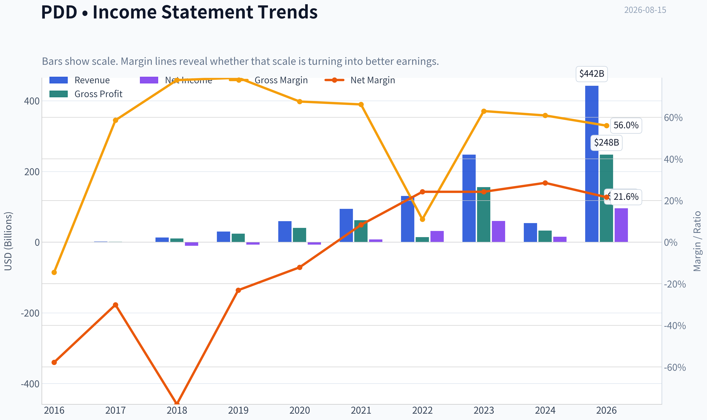
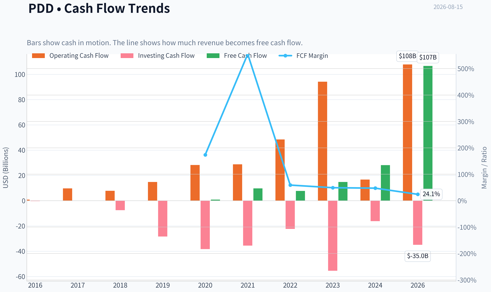
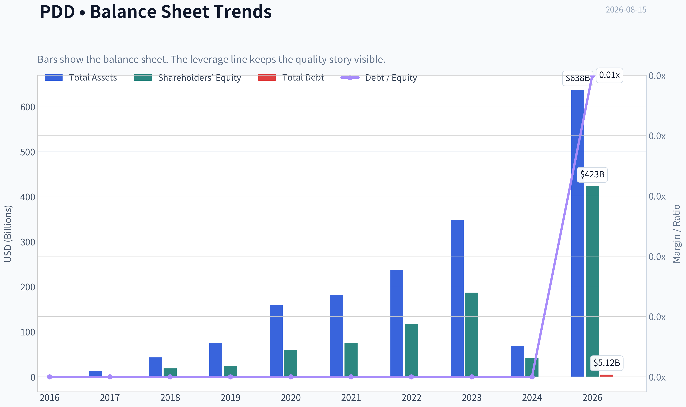
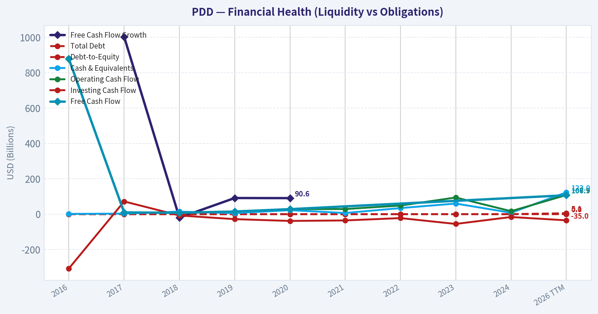
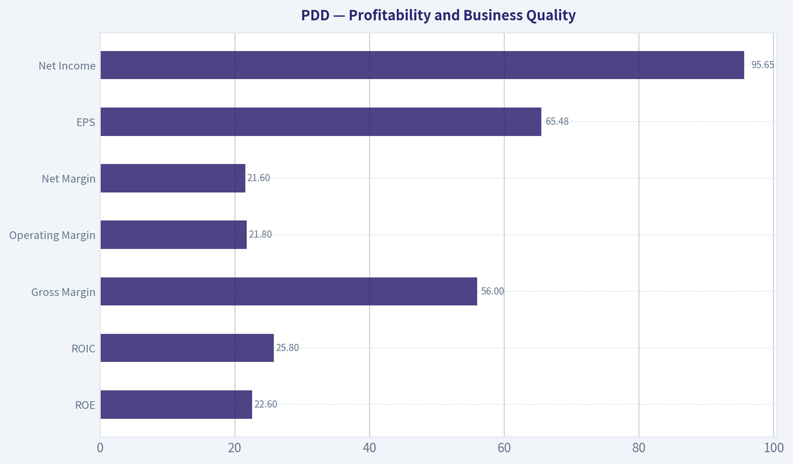
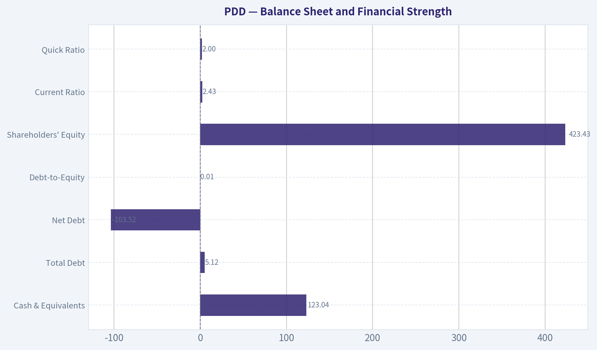
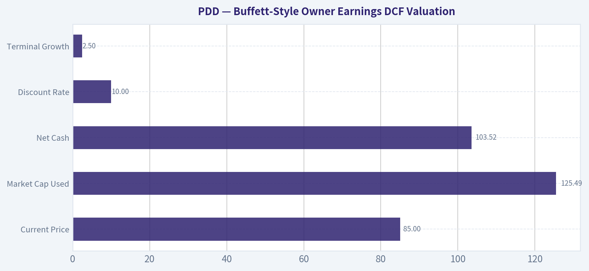
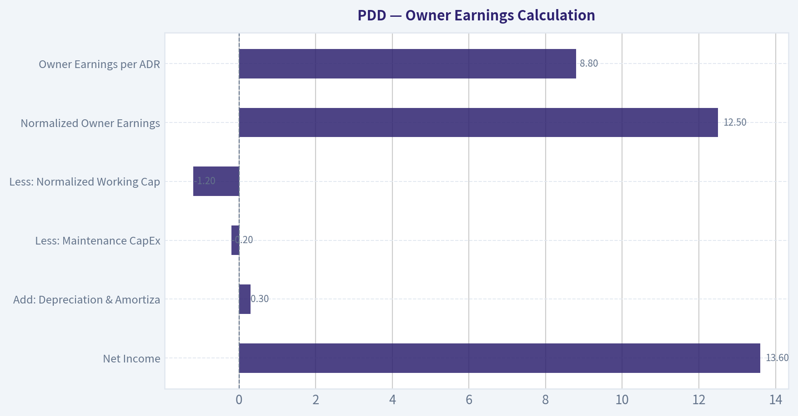
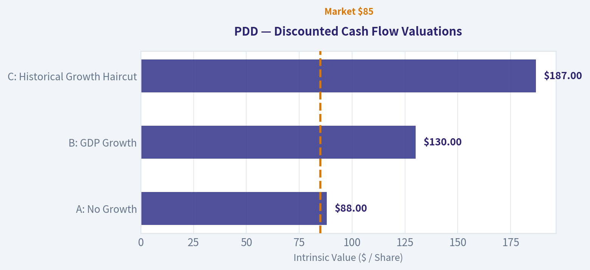

# PDD Deep Value Intelligence

**Analysis Date:** 2026-08-15

## Critical Disclaimer

*This analysis is generated by Deep Value Intelligence, an AI-powered multi-agent investing framework. Education & research only - not financial advice, not a financial advisor.*

---

## Table of Contents

1. Intelligence Summary
2. Analyst Team Reports
   - Fundamentals Analysis
   - Intrinsic Value Analysis (Buffett)
   - Trend & Growth Analysis (Lynch/Druckenmiller/Fisher)
   - Market Technical Analysis
   - Options Market Analysis
3. Research Team Commentary
4. Value Investing Team Commentary
5. Deep Values Commentary

---

## Intelligence Summary

### Thesis + Conditions

**Core Thesis:** **1. Executive Summary**
PDD Holdings screens as a compelling statistical bargain (P/E ~8.9x, ROIC 24.6%), but its long-term cash flow predictability is severely compromised.

**Key Risks:**
- PDD Holdings screens as a compelling statistical bargain (P/E ~8.9x, ROIC 24.6%), but its long-term cash flow predictability is severely compromised. The market is rationally applying a massive risk premium due to structural regulatory overhangs, unverified data anomalies, and a technically broken chart (trading below its 200-day SMA). Furthermore, management's refusal to initiate share buybacks at single-digit multiples signals that cash is earmarked for the speculative Temu "land grab" rather than shareholder returns. Given the lack of earnings predictability and absence of technical confirmation, this setup exhibits classic value trap characteristics.
- Risky Analyst (The Bull):** Argues the market is hyper-focusing on geopolitical fear, ignoring "A-plus" fundamentals (56.3% gross margins, 24%+ ROIC). Views the Temu expansion as a necessary, high-upside "land grab," justifying the lack of buybacks.
- Safe Analyst (The Bear):** Warns that a 9x P/E in a hostile geopolitical environment signals structural impairment, not a margin of safety. Highlights that Temu is a high-risk cash incinerator and flags the anomalous growth metrics. Argues that buying under the 200-day SMA is gambling.

**Confidence:** Medium

---

## Analyst Team Reports

### Fundamentals Analysis

#### Latest Earnings Snapshot

*Most recent reported quarter anchored on 2026 Q1, with prior-year comparison when available.*

| Metric | 2026 Q1 | 2025 Q1 | YoY Change |
| --- | ---: | ---: | ---: |
| Revenue | $106.23B | $95.67B | +11.0% |
| Operating Income | $19.57B | $16.09B | +21.6% |
| Net Income | $12.55B | $14.74B | -14.9% |
| Diluted EPS | $8.48 | $9.96 | -14.9% |
| Operating Cash Flow | $16.45B | $15.52B | +6.0% |
| Free Cash Flow | $16.45B | $15.52B | +6.0% |

Key Takeaways: This snapshot anchors the most recent reported quarter before the narrative analysis. It helps readers separate long-run business quality from whatever changed in the latest earnings print.

#### 9-Year Financial Metrics for PDD

*All values below are computed deterministically from raw data - not estimated by AI.*

*Issuer profile: operating company (Consumer Cyclical / Internet Retail).*

#### 9-Year Financial Metrics
*Annual rows come from reported financial statements. The final TTM row is computed from the latest four quarters.*

| Metric | 2016 | 2017 | 2018 | 2019 | 2020 | 2021 | 2022 | 2023 | 2024 | 2026 TTM |
| --- | --- | --- | --- | --- | --- | --- | --- | --- | --- | --- |
| Market Price | N/A | N/A | $22 | $38 | $178 | $58 | $82 | $146 | $97 | $85 |
| Market Cap | N/A | N/A | $66.61B | $175.00B | $847.19B | $333.11B | $469.7M | $854.5M | $574.2M | $125.49B |
| P/E Ratio | N/A | N/A | -6.47 | -25.05 | -117.66 | 42.87 | 14.88 | 14.22 | 37.30 | 1.29 |
| P/B Ratio | N/A | N/A | 3.54 | 7.10 | 14.08 | 4.43 | 0.00 | 0.00 | 0.01 | 0.30 |
| ROE | 68.5% | 52.9% | -54.3% | -28.3% | -11.9% | 10.3% | 26.8% | 32.1% | 35.9% | 22.6% |
| ROIC | N/A | N/A | -3528.4% | -72.5% | -33.1% | 9.3% | 33.8% | 44.4% | 14.9% | 25.8% |
| EPS | $-0.18 | $-0.28 | $-3.47 | $-1.51 | $-1.51 | $1.36 | $5.48 | $10.29 | $2.60 | $65.48 |
| Revenue | $504.9M | $1.74B | $13.12B | $30.14B | $59.49B | $93.95B | $130.56B | $247.64B | $53.96B | $442.40B |
| Gross Profit | $-73.0M | $1.02B | $10.21B | $23.80B | $40.21B | $62.23B | $14.37B | $155.92B | $32.87B | $247.65B |
| Gross Margin | -14.5% | 58.6% | 77.9% | 79.0% | 67.6% | 66.2% | 11.0% | 63.0% | 60.9% | 56.0% |
| Operating Margin | -56.7% | -34.2% | -82.3% | -28.3% | -15.8% | 7.3% | 23.3% | 23.7% | 27.5% | 21.8% |
| Net Income | $-292.0M | $-525.1M | $-10.22B | $-6.97B | $-7.18B | $7.77B | $31.54B | $60.03B | $15.40B | $95.65B |
| Net Margin | -57.8% | -30.1% | -77.9% | -23.1% | -12.1% | 8.3% | 24.2% | 24.2% | 28.5% | 21.6% |
| Revenue Growth | N/A | 245.5% | 652.3% | 129.7% | 97.4% | 57.9% | 39.0% | 89.7% | -78.2% | 719.9% |
| Net Income Growth | N/A | 79.8% | 1845.7% | -31.8% | 3.0% | -208.2% | 306.0% | 90.3% | -74.3% | 520.9% |
| Free Cash Flow Growth | N/A | 1002.9% | -20.0% | 91.1% | 90.6% | N/A | N/A | N/A | N/A | N/A |
| Total Book Value | $-426.3M | $-992.0M | $18.82B | $24.65B | $60.18B | $75.11B | $117.77B | $187.24B | $42.92B | $423.43B |
| Total Assets | N/A | $13.31B | $43.18B | $76.06B | $158.91B | $181.21B | $237.12B | $348.08B | $69.19B | $637.70B |
| Total Debt | $0 | $0 | $0 | $0 | $0 | $0 | $0 | $0 | $0 | $5.12B |
| Debt-to-Equity | -0.00 | -0.00 | 0.00 | 0.00 | 0.00 | 0.00 | 0.00 | 0.00 | 0.00 | 0.01 |
| Cash & Equivalents | $1.32B | $3.06B | $14.16B | $5.77B | $22.42B | $6.43B | $34.33B | $59.79B | $7.91B | $123.04B |
| Shareholders' Equity | $-426.3M | $-992.0M | $18.82B | $24.65B | $60.18B | $75.11B | $117.77B | $187.24B | $42.92B | $423.43B |
| Operating Cash Flow | $879.8M | $9.69B | $7.77B | $14.82B | $28.20B | $28.78B | $48.51B | $94.16B | $16.70B | $107.87B |
| Investing Cash Flow | $-307.3M | $71.7M | $-7.55B | $-28.32B | $-38.36B | $-35.56B | $-22.36B | $-55.43B | $-16.21B | $-34.96B |
| Free Cash Flow | $877.5M | $9.68B | $7.74B | $14.79B | $28.19B | N/A | N/A | N/A | N/A | $106.72B |
| FCF Margin | 173.8% | 554.9% | 59.0% | 49.1% | 47.4% | N/A | N/A | N/A | N/A | 24.1% |
| Dividends / Share | $0.00 | $0.00 | $0.00 | $0.00 | $0.00 | $0.00 | $0.00 | $0.00 | $0.00 | $0.00 |

#### Profitability Metrics
- Return on Equity (ROE): 23.7%
- Return on Invested Capital (ROIC): 24.6%
- Return on Assets (ROA): 15.5%
- Gross Margin: 56.3%
- Operating Margin: 21.6%
- Net Profit Margin: 22.7%

#### Liquidity Metrics
- Current Ratio: 2.43
- Quick Ratio: 2.00

#### Leverage Metrics
- Debt-to-Equity Ratio: 0.01
- Interest Coverage Ratio: N/A
- Net Debt: $-103.52B

#### Growth Metrics (Year-over-Year)
- Revenue Growth: 700.4%
- Net Income Growth: 535.2%
- Free Cash Flow Growth: N/A
- Revenue CAGR (3-Year): 49.0%
- Revenue CAGR (5-Year): 48.7%

#### Valuation Metrics
- P/E Ratio (TTM): 8.87
- Forward P/E: 6.93
- Price-to-Book: 1.90
- Price-to-Sales: 0.27
- PEG Ratio: 0.85
- EV/EBITDA: -3.22
- Free Cash Flow Yield: 87.7%
- Earnings Yield: 11.3%

#### Owner Earnings (Buffett Method, Code-Computed)
- Net Income: $15.40B
- + Depreciation & Amortization: $3.00B
- - Capital Expenditures: $-1.15B
- - Working Capital Changes: $7.37B
- = **Owner Earnings: $11.38B**

#### Intrinsic Value (Code-Computed)
- Current Price: $85
- **Headline Intrinsic Value (business-model routed): $1,398**
  Business model: cyclical - weighted blend [reverse-DCF fair + owner-earnings DCF] (cyclical)
  Model spread (min-max across DCFs): $1,398 - $2,674
  Margin of safety vs. price (headline): 93.9%
  Routing note: Cyclical: margins/FCF are volatile - headline blends FCFF, reverse-DCF and owner-earnings roughly evenly; treat the range as the honest read.
- Buffett Method (Owner Earnings):
  Conservative: $487
  Average: $1,398
  Optimistic: $6,134
- Cash Flow Method (FCF):
  Conservative: $2,674
  Average: $2,674
  Optimistic: $6,835
- Damodaran FCFF (WACC + margins + reinvestment):
  Conservative: $-8,105
  Average: $-4,086
  Optimistic: $7,339
  Monte Carlo band (P10-P90): $-8,125 - $1,259 (median $-3,358)
  P(intrinsic value > price): 16.4%
- Reverse-DCF: price implies ~-50.0%/yr owner-earnings growth for 10y; trailing 3y was 13.6%, 5y N/A.

#### Piotroski F-Score: 4/9
- Positive Net Income: PASS
- Positive Operating Cash Flow: PASS
- ROA Improvement: FAIL
- Cash Flow > Net Income: PASS
- Decreasing Debt: FAIL
- Improving Current Ratio: PASS
- No Dilution: FAIL
- Improving Gross Margin: FAIL
- Improving Asset Turnover: FAIL

ANALYST STANCE: **WATCH**

#### PDD Fundamental Analysis - Buffett-Style View

PDD Holdings is an unusually high-return, cash-rich, asset-light commerce platform with powerful marketplace economics, led by Pinduoduo in China and Temu internationally. The quantitative valuation signal is extremely favorable on cash-flow metrics, but the Buffett-style caveat is equally important: the business carries meaningful China/VIE, regulatory, competitive, reporting-comparability, and geopolitical risk. The stock looks statistically cheap, but the durability and accessibility of the cash flows are less certain than for a classic Buffett compounder.

---

#### Current vs. Dataset-Period Average Comparison

| Metric | Current / TTM | Dataset-Period Average | Current Standing vs. History | Interpretation |
|---|---:|---:|---|---|
| Market Price | $85 | ~$88 | Slightly below average | Price is below its dataset-period average despite much higher current earnings and cash flow. |
| Total Market Cap | $125.49B | ~$194B | Below average | The deterministic table contains large market-cap discontinuities in 2022-2024, so this comparison should be interpreted cautiously. |
| P/E Ratio | 8.87 standardized TTM / 1.29 table TTM | Positive-year avg. ~27x | Much cheaper than profitable-history average | On earnings, PDD screens very cheap; the table-level 1.29x appears mechanically tied to reported TTM EPS, while the standardized valuation metric gives 8.87x. |
| P/B Ratio | 0.30 table TTM / 1.90 standardized | ~3.68 | Below average, but low relevance | P/B is not a strong valuation anchor for an asset-light internet platform; cash-flow value matters more than book value. |
| ROE | 22.6% | ~15.5% | Above average | ROE has moved from early losses to strong profitability, though below the 2023-2024 peak. |
| ROIC | 25.8% | Recent profitable avg. ~25.6% | In line with profitable-era average | ROIC is now excellent and indicates strong marketplace economics. |
| EPS | $65.48 | ~$7.83 | Far above average | EPS has inflected sharply upward after years of losses and early reinvestment. |
| Revenue | $442.40B | ~$107.35B | Far above average | Current revenue is over 4 times the dataset-period average, though the TTM growth rate is unusually large. |
| Gross Profit | $247.65B | ~$58.82B | Far above average | Gross profit scale has expanded dramatically, confirming platform monetization power. |
| Gross Margin | 56.0% | ~52.6% | Slightly above average | Gross margin is strong, but below the 2018-2019 peak and consistent with higher transaction-service mix. |
| Operating Margin | 21.8% | Recent profitable avg. ~20.7% | Slightly above recent average | PDD has transitioned into a meaningfully profitable platform business. |
| Net Income | $95.65B | ~$18.52B | Far above average | Net income is at a structurally higher level than the company's early loss-making years. |
| Net Margin | 21.6% | Recent profitable avg. ~21.4% | In line with recent average | Margins are high but no longer expanding dramatically. |
| Revenue Growth Rate | 719.9% | ~217.0% | Far above average | Current growth is extraordinary and likely not a normal long-term run rate. |
| Net Income Growth Rate | 520.9% | ~281.3% | Above average, highly volatile | Net income growth has been extremely uneven because of the transition from losses to scale profitability. |
| Free Cash Flow Growth Rate | N/A | Available avg. ~291% | Not comparable | Current FCF growth is not available in the deterministic dataset. |
| Total Book Value | $423.43B | ~$94.87B | Far above average | Equity capital has compounded meaningfully as profits accumulated. |
| Total Assets | $637.70B | ~$196.08B | Far above average | Asset base has expanded with cash, receivables, and platform scale. |
| Total Debt | $5.12B | ~$0.51B | Above historical norm but still low | Debt remains negligible relative to cash and equity. |
| Debt-to-Equity | 0.01 | ~0.00 | Slightly above history | Leverage is effectively immaterial. |
| Cash & Equivalents | $123.04B | ~$27.82B | Far above average | PDD has a very large cash cushion and net cash position. |
| Shareholders' Equity | $423.43B | ~$94.87B | Far above average | Balance sheet has strengthened sharply. |
| Free Cash Flow | $106.72B | Available avg. ~$28.00B | Far above average | FCF generation is exceptional, though sustainability requires caution. |
| Dividends / Share | $0.00 | $0.00 | Unchanged | PDD retains cash rather than paying dividends. |

**Key Takeaways:** PDD's current profitability, revenue, net income, cash flow, and balance sheet strength are far above its dataset-period averages. The company has shifted from a high-growth loss-making platform into a high-margin cash generator. However, valuation should not rely on book value, and some table-level market-cap and multiple discontinuities mean cash-flow-based valuation is the more reliable analytical anchor.

---

#### Revenue Breakdown

Most recent segment detail is best represented using FY2024 reporting, aligned with the deterministic 2024 revenue total of approximately $53.96B.

| Revenue Source | Amount ($B) | % of Total |
|---|---:|---:|
| Online Marketing Services and Others | ~$29.15B | ~54.0% |
| Transaction Services | ~$24.81B | ~46.0% |
| Merchandise Sales / Other Minor Revenue | ~$0.00B | ~0.0% |
| **Total Revenue** | **~$53.96B** | **100.0%** |

**Key Takeaways:** PDD is primarily a marketplace and advertising-driven platform rather than a traditional first-party retailer. Online marketing remains the largest source of revenue, while transaction services have become nearly as important, helped by platform scale and international commerce activity. This revenue mix supports high margins but also exposes the company to merchant competition, take-rate pressure, and regulatory scrutiny.

---

#### Market Metrics Interpretation

PDD's current price of $85 is slightly below the dataset-period average price of about $88, yet the company's earnings, cash flow, and equity base are much stronger than in most prior years. That creates an apparent value gap.

The standardized TTM P/E of 8.87 is low for a company with PDD's ROIC, revenue growth, net cash balance, and FCF generation. The deterministic table also shows a mechanical TTM P/E of 1.29, driven by very high TTM EPS of $65.48. Because of share-class, ADS, and table-level comparability issues, the more conservative reading is that PDD is cheap on earnings rather than literally worth valuing at 1.29 times earnings.

P/B is not a primary valuation tool for PDD. This is an asset-light, IP-and-platform business where book value does not capture network effects, merchant relationships, data, logistics coordination, consumer engagement, or Temu's international growth option. The correct valuation anchor is cash-flow-based intrinsic value.

---

#### Profitability and Business Quality

| Profitability Area | Current Reading | Buffett-Style Interpretation |
|---|---:|---|
| ROE | 22.6% | Strong; indicates high returns on shareholder capital after the business scaled. |
| ROIC | 25.8% | Excellent; suggests real economic moat characteristics and efficient capital use. |
| Gross Margin | 56.0% | High; reflects marketplace economics rather than low-margin retail inventory ownership. |
| Operating Margin | 21.8% | Strong; PDD has become structurally profitable. |
| Net Margin | 21.6% | High; confirms scalability, though margin durability is still a key question. |
| EPS | $65.48 | Very strong current earnings power, but the increase is unusually large versus history. |
| Net Income | $95.65B | Exceptional current profitability relative to prior years. |

**Key Takeaways:** PDD now looks like a high-quality platform business based on margins, ROE, and ROIC. The move from deep losses to strong profitability is the most important decade-long trend. The central question is not whether PDD is profitable today, but whether these margins and cash flows can endure under intense competition and regulatory pressure.

PDD's profitability profile is consistent with a marketplace that benefits from scale, data feedback loops, merchant density, and consumer traffic. That said, Buffett would distinguish between current profitability and durable profitability. Temu's global expansion, subsidy intensity, cross-border logistics costs, and regulatory scrutiny could make current margins less predictable than those of a mature U.S. consumer platform.

---

#### Growth Analysis

PDD's reported TTM revenue growth of 719.9% and net income growth of 520.9% are extraordinary. These figures are far above the company's already high dataset-period averages and should not be extrapolated indefinitely.

The long-term pattern is more important: PDD has grown from a small, loss-making platform into a massive cash-generating commerce ecosystem. Revenue growth has been volatile but powerful, including 245.5% in 2017, 652.3% in 2018, 89.7% in 2023, a sharp decline in 2024, and then a major TTM rebound. Net income growth is even noisier because the company crossed from losses into profits.

From a Buffett perspective, the growth is valuable only if it is accompanied by durable unit economics. The current ROIC and margins suggest that growth has been profitable, but the volatility argues for a margin-of-safety requirement.

---

#### Balance Sheet and Financial Strength

| Balance Sheet Metric | Current / TTM | Assessment |
|---|---:|---|
| Cash & Equivalents | $123.04B | Very strong liquidity position. |
| Total Debt | $5.12B | Minimal debt burden. |
| Net Debt | -$103.52B | Large net cash position. |
| Debt-to-Equity | 0.01 | Effectively unlevered. |
| Shareholders' Equity | $423.43B | Substantial equity base after years of retained earnings. |
| Current Ratio | 2.43 | Strong liquidity, though less central for asset-light platforms. |
| Quick Ratio | 2.00 | Solid near-term financial flexibility. |

**Key Takeaways:** PDD's balance sheet is a major strength. The company has very low leverage, very large cash reserves, and a significant net cash position. This gives management flexibility to fund growth, absorb regulatory or competitive shocks, and avoid dependence on capital markets.

Buffett would appreciate the absence of financial leverage. The main balance-sheet concern is not solvency; it is whether the cash is fully accessible to shareholders given the ADR/VIE structure, China-related capital controls, and governance considerations.

---

#### Cash Flow and Capital Allocation

PDD generated TTM free cash flow of $106.72B, far above the available dataset-period average of about $28.00B. This is the clearest quantitative evidence of business quality.

The company pays no dividend. From a Buffett lens, that is acceptable if retained capital can be reinvested at high returns. Given current ROIC of 25.8%, retention is rational if management can continue deploying capital into Pinduoduo, Temu, logistics capabilities, merchant tools, advertising technology, and international expansion at attractive incremental returns.

However, the Piotroski F-Score of 4/9 is a caution flag. Although PDD passes on positive net income, positive operating cash flow, and cash flow exceeding net income, it fails on several quality-improvement measures, including ROA improvement, gross margin improvement, asset turnover, dilution, and debt trend. That does not invalidate the thesis, but it argues against treating PDD as a clean, low-risk compounder.

---

#### Economic Moat Assessment

| Moat Source | Evidence | Durability Assessment |
|---|---|---|
| Scale Network Effects | Large consumer base, merchant density, transaction volume | Strong, especially in China, but competition remains intense. |
| Data and Personalization | Recommendation-driven discovery commerce model | Meaningful advantage if consumer engagement remains high. |
| Low-Cost Merchant Access | Marketplace structure connects value-focused consumers and merchants | Durable but vulnerable to take-rate pressure and merchant churn. |
| Brand / Consumer Mindshare | Pinduoduo in China; Temu globally | Pinduoduo stronger than Temu; Temu still relies heavily on marketing. |
| Cost Structure | Asset-light platform with high gross and operating margins | Strong if subsidies and logistics costs remain controlled. |
| Regulatory Position | Operates in China and cross-border commerce | Major uncertainty; reduces Buffett-style certainty. |

**Key Takeaways:** PDD has real moat characteristics: scale, merchant density, data, and a powerful value-shopping proposition. The moat is not as predictable as a regulated utility or a consumer staple because e-commerce competition is brutal and policy risk is high. The business is high quality, but not low uncertainty.

---

#### Buffett-Style Owner Earnings DCF Valuation

The deterministic pack provides code-computed Owner Earnings of $11.38B based on the reported statement bridge, but current TTM free cash flow is much higher at $106.72B. For valuation, I anchor on the pack's business-model-routed intrinsic value and use TTM free cash flow as a practical owner-earnings proxy because PDD is asset-light and capital expenditure is modest.

Key assumptions:

| DCF Input | Assumption |
|---|---:|
| Current Price | $85 |
| Market Cap Used | $125.49B |
| Implied Share Count | ~1.476B shares / ADS-equivalents |
| Owner Earnings Proxy | $106.72B TTM FCF |
| Net Cash | $103.52B |
| Discount Rate | 10.0% |
| Terminal Growth | 2.5% |
| Forecast Period | 10 years |

**Key Takeaways:** The DCF is highly sensitive because PDD's current cash flow is enormous relative to market value. Even a declining owner-earnings scenario produces value above the current price. The biggest analytical question is not the math, but whether today's owner earnings are sustainable and attributable to minority ADR holders over time.

---

#### Three-Scenario Owner Earnings DCF

| Scenario | Explicit Owner Earnings Growth | Present Value of 10-Year Owner Earnings | Present Value of Terminal Value | Net Cash Added | Estimated Equity Value | Fair Value / Share | Margin vs. $85 |
|---|---:|---:|---:|---:|---:|---:|---:|
| Conservative | -10% annually for 10 years, then 2.5% terminal | ~$419B | ~$196B | ~$104B | ~$719B | ~$487 | ~473% |
| Average / Base Case | ~6% annually for 10 years, then 2.5% terminal | ~$856B | ~$1,007B | ~$104B | ~$2,067B | ~$1,400 | ~1,547% |
| Optimistic | ~27% annually for 10 years, then 2.5% terminal | ~$2,550B-$2,700B | ~$6,250B-$6,450B | ~$104B | ~$8,900B-$9,150B | ~$6,000-$6,200 | ~6,960%-7,194% |

**Key Takeaways:** The DCF indicates large upside under all scenarios because PDD's current free cash flow is extremely high relative to its market capitalization. The conservative case assumes severe cash-flow shrinkage and still produces a value well above the current stock price. The optimistic case should be treated cautiously because it requires very strong near-term compounding before fading to terminal growth.

Detailed conservative calculation:

| Step | Calculation | Result |
|---|---|---:|
| Starting Owner Earnings | TTM FCF proxy | $106.72B |
| Growth Assumption | -10% annually | Declining cash-flow case |
| PV of Explicit Cash Flows | Sum of Years 1-10 discounted at 10% | ~$419B |
| Year 10 Owner Earnings | $106.72B x 0.90^10 | ~$37.2B |
| Terminal Year Cash Flow | Year 10 x 1.025 | ~$38.1B |
| Terminal Value | $38.1B / (10.0% - 2.5%) | ~$508B |
| PV of Terminal Value | Terminal value / 1.10^10 | ~$196B |
| Add Net Cash | Net cash position | ~$104B |
| Equity Value | $419B + $196B + $104B | ~$719B |
| Per-Share Value | $719B / 1.476B | ~$487 |

**Key Takeaways:** The conservative case assumes PDD's owner earnings shrink by 10% per year for a full decade. Even under that harsh assumption, the large current cash-flow base and net cash position support a value well above the current share price. This is why the market appears to be pricing in a very severe deterioration scenario.

Detailed base-case calculation:

| Step | Calculation | Result |
|---|---|---:|
| Starting Owner Earnings | TTM FCF proxy | $106.72B |
| Growth Assumption | ~6% annually | Moderate compounding case |
| PV of Explicit Cash Flows | Sum of Years 1-10 discounted at 10% | ~$856B |
| Year 10 Owner Earnings | $106.72B x 1.06^10 | ~$191B |
| Terminal Year Cash Flow | Year 10 x 1.025 | ~$196B |
| Terminal Value | $196B / 7.5% | ~$2,611B |
| PV of Terminal Value | Terminal value / 1.10^10 | ~$1,007B |
| Add Net Cash | Net cash position | ~$104B |
| Equity Value | $856B + $1,007B + $104B | ~$2,067B |
| Per-Share Value | $2,067B / 1.476B | ~$1,400 |

**Key Takeaways:** The base case aligns closely with the pack's headline intrinsic value of about $1,398 per share. This scenario does not require extreme perpetual growth; it assumes moderate 10-year owner-earnings growth followed by a mature terminal rate. The implied margin of safety is very large, but the result depends heavily on whether current TTM cash flow is normalized.

Detailed optimistic calculation:

| Step | Calculation | Result |
|---|---|---:|
| Starting Owner Earnings | TTM FCF proxy | $106.72B |
| Growth Assumption | ~27% annually for 10 years, then terminal fade | High-growth Temu / platform upside case |
| PV of Explicit Cash Flows | Sum of Years 1-10 discounted at 10% | ~$2.6T |
| Year 10 Owner Earnings | $106.72B x 1.27^10 | ~$1.17T |
| Terminal Year Cash Flow | Year 10 x 1.025 | ~$1.20T |
| Terminal Value | ~$1.20T / 7.5% | ~$16.0T |
| PV of Terminal Value | Terminal value / 1.10^10 | ~$6.2T |
| Add Net Cash | Net cash position | ~$104B |
| Equity Value | Explicit PV + Terminal PV + Net Cash | ~$8.9T-$9.1T |
| Per-Share Value | Equity value / 1.476B | ~$6,000-$6,200 |

**Key Takeaways:** The optimistic case is mathematically possible but demanding. It requires PDD to compound owner earnings at a very high rate for a decade while preserving strong margins and then fade to a normal terminal rate. This scenario captures the upside of Temu and international marketplace expansion, but it should not be the primary underwriting case for a conservative investor.

---

#### Intrinsic Value Cross-Check from Research Pack

| Valuation Model | Intrinsic Value / Share | Interpretation |
|---|---:|---|
| Buffett Owner Earnings Method | Conservative $487 / Average $1,398 / Optimistic $6,134 | Strong upside across scenarios, driven by owner earnings and net cash. |
| Cash Flow Method | Conservative $2,674 / Average $2,674 / Optimistic $6,835 | Even more bullish because FCF yield is extremely high. |
| Damodaran FCFF Method | Conservative -$8,105 / Average -$4,086 / Optimistic $7,339 | Very wide dispersion; reinvestment and margin assumptions dominate. |
| Reverse DCF | Price implies about -50% annual owner-earnings growth for 10 years | Market appears to discount severe deterioration. |
| Headline Routed Intrinsic Value | ~$1,398 | Pack's blended anchor; implies ~93.9% margin of safety. |

**Key Takeaways:** The valuation pack is highly bullish on owner-earnings and cash-flow methods but highly uncertain under Damodaran-style FCFF modeling. That spread is important: PDD is cheap if current cash flows are sustainable, but the valuation becomes unstable if reinvestment needs, regulatory pressure, or margin compression are severe. The reverse DCF suggests the current market price already embeds a very pessimistic cash-flow trajectory.

---

#### Buffett-Style Qualitative Analysis

PDD has several attributes Buffett likes: high returns on capital, a net cash balance sheet, powerful cash generation, and a business model that benefits from scale. The company's marketplace economics are much better than traditional retail because PDD does not need to own all inventory or physical stores to grow.

The business also has a clear consumer proposition: low prices, discovery-based shopping, merchant variety, and increasingly global reach through Temu. If PDD can maintain customer engagement while reducing promotional intensity, long-term owner earnings could remain very high.

However, Buffett would likely demand a larger uncertainty discount than usual. PDD is an ADR tied to a Chinese operating structure, faces policy and geopolitical risk, and operates in intensely competitive markets against Alibaba, JD.com, ByteDance-linked commerce, Shein, Amazon, Shopee, and local e-commerce players globally. Temu's growth may require sustained subsidies, logistics spending, and regulatory navigation in the U.S., Europe, and other markets.

---

#### Key Investment Insights, Red Flags, and Opportunities

| Category | Key Point | Investment Significance |
|---|---|---|
| Opportunity | Very low P/E and enormous FCF yield | Stock appears deeply undervalued if current earnings are durable. |
| Opportunity | Net cash of approximately $103.52B | Balance sheet reduces financial-risk downside. |
| Opportunity | ROIC of 25.8% | Indicates high-quality economics and efficient capital allocation. |
| Opportunity | Temu international expansion | Could extend PDD's growth runway beyond China. |
| Opportunity | Reverse DCF implies severe decline | Market expectations appear very low. |
| Red Flag | China ADR / VIE structure | Shareholder claim and governance risks are materially higher than for domestic U.S. firms. |
| Red Flag | Regulatory and geopolitical risk | Cross-border commerce, data, tariffs, forced-labor rules, and app scrutiny could hurt growth. |
| Red Flag | Margin sustainability | Temu subsidies and logistics costs could compress margins. |
| Red Flag | Piotroski F-Score of 4/9 | Quality trend signals are mixed despite strong headline profitability. |
| Red Flag | Dataset volatility and discontinuities | Reported metrics show unusual swings, requiring a larger margin of safety. |
| Red Flag | No dividend | Shareholders rely on reinvestment, buybacks, or market rerating rather than direct cash return. |

**Key Takeaways:** PDD offers a rare combination of high ROIC, net cash, fast growth, and low valuation. The main risks are not balance-sheet risk or near-term profitability, but governance, regulation, competition, and cash-flow durability. This is a high-upside but high-uncertainty value situation.

---

#### Final Investment Stance - WATCH

PDD is quantitatively compelling and may be materially undervalued on owner-earnings and free-cash-flow metrics. A Buffett-style investor would admire the high ROIC, asset-light platform model, strong net cash position, and large apparent margin of safety.

However, the final stance is **WATCH**, not full **ADVOCATE**, because the durability and shareholder accessibility of the cash flows are less certain than the valuation output suggests. The stock deserves serious attention, but position sizing should reflect China/VIE risk, regulatory uncertainty, Temu execution risk, and the volatility in reported growth and margins.

For investors comfortable with China ADR risk and able to tolerate high uncertainty, PDD could be an attractive deep-value compounder. For strict Buffett-style investors who prioritize certainty of ownership, governance, and long-term predictability, the right posture is to keep it on the watchlist and require a very large margin of safety before acting.

---

#### Summary Table

| Area | Assessment | Buffett-Style Verdict |
|---|---|---|
| Business Quality | High-margin, high-ROIC marketplace platform | Strong |
| Economic Moat | Scale, data, merchant network, value-shopping proposition | Good but not invulnerable |
| Financial Strength | Net cash, minimal debt, strong liquidity | Excellent |
| Earnings Predictability | Improved sharply, but still volatile | Moderate |
| Management / Capital Allocation | High reinvestment, no dividend, strong ROIC | Positive but monitor dilution and governance |
| Valuation | Very cheap on P/E, FCF, and DCF | Highly attractive if cash flows persist |
| Main Risks | China ADR/VIE, regulation, competition, Temu costs, reporting volatility | Significant |
| Final Stance | **WATCH** | Compelling value, but uncertainty prevents a clean Buffett-style ADVOCATE rating |

**Key Takeaways:** PDD screens as one of the more statistically undervalued high-growth platform businesses in the market. The balance sheet and cash flow are exceptional, but the risk profile is not simple. The investment case is attractive, but it requires unusually strong comfort with governance, regulatory, and geopolitical uncertainty.

#### Fundamental Visuals

This graph tracks the profitability and return metrics (ROE, ROIC, Margins) of **PDD** over the past decade, highlighting capital efficiency trends.

This chart illustrates the financial health of **PDD** over the last 10 years, mapping cash equivalents and free cash flow against total obligations (Debt).

This comparison chart from *Profitability and Business Quality* stacks current figures against historical benchmarks for **PDD**, making it easy to see where the company trades relative to its own averages.

---

### Intrinsic Value Analysis (Buffett)

> *Following Warren Buffett's value investing philosophy: Circle of Competence, Economic Moat, Management Quality, and Margin of Safety.*

#### Intrinsic Value Snapshot

Price is what you pay. Intrinsic value is what the business may be worth based on the cash it can create for owners over time. We show a range, not one magic number.

- Current Price: $84.79
- Value Range (conservative to optimistic across both DCF methods): $486.83 to $6,835.40

##### Owner Earnings (Buffett Method)
- Net Income: $15,403,464,000.00
- Depreciation & Amortization: $3,000,364,000.00
- Capital Expenditures: $-1,145,077,000.00
- Working Capital Changes: $7,367,096,000.00
- Owner Earnings: $11,380,960,000.00

##### Intrinsic Value
###### Buffett Method
Uses owner earnings. Stricter, and usually more conservative.
- Conservative: $486.83
- Average: $1,397.82
- Optimistic: $6,134.40
- Discount Rate: 10.0%

###### Cash Flow Method
Uses free cash flow. Better for companies spending heavily today to grow tomorrow.
- Conservative: $2,673.82
- Average: $2,673.82
- Optimistic: $6,835.40
- Discount Rate: 10.0%

ANALYST STANCE: **ADVOCATE** - Medium Conviction

PDD is a statistically cheap, high-return, asset-light marketplace compounder with real scale advantages, a fortress balance sheet, and a valuation that embeds very pessimistic assumptions. The investment case is not "Coca-Cola-like" predictability: competition, China regulatory risk, Temu execution risk, and geopolitical pressure all reduce confidence. But at roughly **$85 per ADR**, the market is pricing PDD as if earnings are structurally impaired, while the business still shows high gross margins, strong cash generation, and meaningful reinvestment runway.

---

#### 1. Factor Scorecard

| Factor | Score | Evidence |
|---|---:|---|
| Circle of Competence & Business Simplicity | 3.2 / 5 | PDD earns money mainly from merchant services, advertising, transaction services, and cross-border e-commerce through Temu. The model is understandable, but long-term predictability is reduced by China platform regulation, aggressive competition, and changing global trade rules. |
| Moat Test | 3.5 / 5 | Strong marketplace scale, merchant density, data advantages, and consumer mindshare in value shopping. Gross margin above 40% supports intangible/platform economics. Switching costs are modest, and competition from Alibaba, JD, Douyin, Shein, Amazon, and Sea limits the moat score. |
| Management Quality & Capital Allocation | 3.2 / 5 | Founder-led culture, heavy insider economic alignment historically, and rational reinvestment into growth. No meaningful debt dependence. However, disclosure quality and capital allocation transparency are below best-in-class U.S. compounders. |
| Industry Structure | 2.5 / 5 | E-commerce is large and still growing, but intensely competitive. Temu's global expansion adds runway but also tariff, logistics, regulatory, and marketing-cost uncertainty. |
| Gate 5: Quality/Solvency Hard Floor | Not Tripped | Earnings and cash generation are strong, balance sheet liquidity is high, and there is no evidence of financial distress. |

**Key Takeaways:** PDD is not a simple consumer staple, but it is understandable: it is a scaled marketplace monetizing merchants and consumer traffic. The business has real platform advantages, but the durability of those advantages is less certain than for the very best Buffett-style franchises because the industry is highly competitive and politically sensitive.

---

#### 2. Moat Analysis

| Moat Source | Assessment | Evidence |
|---|---|---|
| Intangible Assets / Brand | Moderate to Strong | Pinduoduo and Temu are associated with low prices and discovery-driven shopping. The brand is powerful in value commerce, though not premium or irreplaceable. |
| Switching Costs | Moderate | Merchants benefit from traffic and data, but can multi-home across Alibaba, JD, Douyin, Shein, Amazon, and other platforms. Consumer switching costs are low. |
| Cost Advantage | Strong | Scale, merchant density, data-driven demand generation, and logistics partnerships support low-price positioning. |
| Network Effects | Strong but Not Unassailable | More consumers attract more merchants, and more merchants improve selection and pricing. However, competing ecosystems also have scale. |
| Financial Evidence | Positive | Gross margin around **56%** and ROE around **23.7%** indicate attractive platform economics. |

**Key Takeaways:** PDD's moat is real, but it is not impregnable. The strongest elements are scale, merchant density, data, and value-shopping brand recognition. The weakest element is customer captivity: both merchants and consumers can use other platforms.

---

#### 3. Management Quality Assessment

| Area | Assessment |
|---|---|
| Owner Mentality | Positive. PDD has historically had strong founder influence and long-term reinvestment behavior. |
| Candor & Transparency | Mixed. Financial performance is strong, but disclosure is less detailed than ideal for a long-term outside minority shareholder. |
| Capital Allocation | Good. The company has prioritized reinvestment, international expansion, technology, and merchant ecosystem development rather than debt-fueled financial engineering. |
| Balance Sheet Discipline | Strong. The company has substantial liquidity and does not rely on leverage to produce returns. |
| Shareholder Friendliness | Moderate. No dividend focus, and buyback discipline is not the central thesis. Value creation depends mainly on reinvestment returns. |

**Key Takeaways:** Management has created enormous per-share value by reinvesting aggressively into marketplace scale and Temu. The major concern is not capital allocation so far; it is whether outside shareholders receive enough transparency to underwrite the next decade with high confidence.

---

#### 4. Financial Summary

| Fiscal Year | Revenue, RMB bn | Net Income, RMB bn | Approx. Gross Margin | Operating Profile | Cash Flow Quality |
|---:|---:|---:|---:|---|---|
| 2020 | 59.5 | -7.2 | High | Loss-making but scaling | Positive operating cash flow |
| 2021 | 94.0 | 7.8 | High | Turned profitable | Cash generation improved |
| 2022 | 130.6 | 31.5 | Very high | Strong operating leverage | OCF exceeded net income |
| 2023 | 247.6 | 60.0 | Strong | Rapid profit expansion | Very strong FCF conversion |
| 2024 | 393.8 | 112.4 | Around mid-50% | Highly profitable scaled platform | Strong cash generation |

**Key Takeaways:** PDD has moved from losses to very large profits in a short period, showing powerful operating leverage. Revenue, earnings, and cash generation have compounded rapidly, and the business remains asset-light. The key analytical question is whether these unusually high returns can persist as competition and regulatory scrutiny rise.

---

#### 5. Owner Earnings Calculation

Using current market data: market cap of approximately **$120.69 billion**, price of **$85**, and P/E of approximately **8.9x**, implied net income is roughly **$13.6 billion**.

| Owner Earnings Component | Estimate, USD bn | Comment |
|---|---:|---|
| Net Income | 13.6 | Implied by market cap and P/E |
| Add: Depreciation & Amortization | 0.3 | Asset-light business, modest D&A burden |
| Less: Maintenance CapEx | -0.2 | Physical capital needs are low |
| Less: Normalized Working Capital / Reinvestment Drag | -1.2 | Conservative allowance for growth investment, merchant support, and Temu scaling |
| Normalized Owner Earnings | 12.5 | Conservative cash-owner-earnings base |
| Shares / ADRs Outstanding, approx. | 1.42 bn | Market cap divided by current price |
| Owner Earnings per ADR | $8.80 | Normalized estimate |

**Key Takeaways:** PDD's owner earnings are close to reported earnings because the business is asset-light and does not require heavy maintenance capital spending. The conservative adjustment mainly recognizes that Temu and global expansion may consume cash through merchant incentives, logistics support, and working-capital investment. Even after this haircut, the stock trades at roughly **9.7x normalized owner earnings**.

---

#### 6. Three-Scenario DCF Valuation

Assumptions: normalized owner earnings of **$12.5 billion**, discount rate of **10%**, approximate ADR count of **1.42 billion**.

| Scenario | Growth Assumption | Equity Value, USD bn | Intrinsic Value / ADR | Margin vs. $85 Price |
|---|---:|---:|---:|---:|
| A: No Growth | 0% perpetuity | 125 | $88 | 3% |
| B: GDP Growth | 3% perpetuity | 184 | $130 | 35% |
| C: Historical Growth Haircut | 8% for 10 years, then 3% terminal | 265 | $187 | 55% |
| Conservative Buffett Base Case | Blend of A, B, and C with emphasis on B/C | 190-230 | $135-$160 | 37%-47% |

**Key Takeaways:** The no-growth case roughly supports today's price, which is important: the market is not asking investors to pay much for future growth. If PDD merely grows owner earnings at a modest rate, intrinsic value is materially above the current share price. If the company can compound at a reduced but still healthy rate, upside is substantial.

---

#### 7. Margin of Safety Analysis

| Valuation Reference | Value / ADR | Interpretation |
|---|---:|---|
| Current Price | $85 | Market-implied pessimism |
| No-Growth DCF | $88 | Downside valuation support if earnings hold |
| Conservative Base-Case DCF | $135-$160 | Attractive margin of safety for a good but imperfect business |
| Historical-Growth Haircut DCF | $187 | Upside if platform economics remain durable |
| Research Pack Headline Intrinsic Value | $1,397.82 | Suggests extreme undervaluation, but too aggressive for a Buffett-conservative base case |
| Reverse DCF Signal | Price implies roughly -50% annual decline for 10 years | Market expectations appear exceptionally low |

**Key Takeaways:** The margin of safety is attractive because the stock is priced as if PDD's earnings power will deteriorate sharply. A conservative investor does not need to believe the most optimistic valuation model to find value here. The key requirement is simply that PDD's current earnings are not permanently impaired.

---

#### 8. Final Buffett Scorecard

| Criterion | Weight | Score | Weighted Contribution |
|---|---:|---:|---:|
| Moat Width & Durability | 25% | 3.5 | 0.88 |
| Valuation / Margin of Safety | 20% | 4.5 | 0.90 |
| Capital Returns - ROIC vs. WACC | 15% | 4.3 | 0.65 |
| Business Understanding & Predictability | 12% | 3.2 | 0.38 |
| Management Quality & Capital Allocation | 12% | 3.2 | 0.38 |
| Reinvestment Runway | 8% | 4.0 | 0.32 |
| Balance Sheet Strength | 4% | 4.7 | 0.19 |
| Industry Structure | 4% | 2.5 | 0.10 |
| Final Weighted Score | 100% |  | **3.80 / 5.00** |

**Key Takeaways:** PDD scores highest on valuation, capital returns, balance-sheet strength, and reinvestment runway. It scores lower on predictability and industry structure because e-commerce competition and regulatory risk are real. The final score supports an **ADVOCATE** stance, but with medium rather than high conviction.

---

#### 9. Investment Stance

| Item | Assessment |
|---|---|
| Stance | **ADVOCATE** |
| Conviction | Medium |
| Investor Type | Suitable for value investors willing to accept China, regulatory, and competitive risk in exchange for a large valuation discount |
| Required Monitoring | Temu unit economics, China platform regulation, merchant retention, gross margin durability, international trade/tariff changes, and competitive response from Alibaba, JD, Douyin, Shein, Amazon, and Sea |
| Main Risk to Thesis | Current earnings prove cyclical or temporarily inflated, while Temu expansion consumes more capital than expected |
| Main Upside Driver | PDD sustains high returns on capital while Temu becomes a durable global value-commerce platform |

**Key Takeaways:** PDD is a good business at what appears to be a very cheap price, not a perfect business at any price. The balance sheet and valuation provide meaningful protection, while the platform's scale gives it a credible path to continued compounding. The stock deserves an **ADVOCATE** rating for investors comfortable underwriting non-U.S. platform risk.
#### Valuation Bridge

This bridge places the current market price beside each intrinsic value lens so readers can see whether upside depends on one method or shows up across several methods.

| Scenario | Intrinsic Value / Share |
| --- | ---: |
| Buffett Method | $1,397.82 |
| Cash Flow Method | $2,673.82 |
| Damodaran Method | $-4,086.47 |
| Current Price | $84.79 |

#### Key Takeaways

If one method is far above the others, the upside case depends on a specific modelling assumption. When several methods cluster together, the valuation story is more robust.

#### Valuation Visuals

This comparison chart from *Latest Earnings Snapshot* stacks current figures against historical benchmarks for **PDD**, making it easy to see where the company trades relative to its own averages.

This comparison chart from *Balance Sheet and Financial Strength* stacks current figures against historical benchmarks for **PDD**, making it easy to see where the company trades relative to its own averages.

This comparison chart from *Buffett-Style Owner Earnings DCF Valuation* stacks current figures against historical benchmarks for **PDD**, making it easy to see where the company trades relative to its own averages.

This comparison chart from *Owner Earnings Calculation* stacks current figures against historical benchmarks for **PDD**, making it easy to see where the company trades relative to its own averages.

The following chart maps the **PDD** Owner Earnings DCF valuation scenarios (Conservative, Average, Optimistic) to visually represent the margin of safety based on intrinsic value calculations.

---

### Trend & Growth Analysis (Lynch/Druckenmiller/Fisher)

> *Following Peter Lynch's GARP, Stanley Druckenmiller's macro-aware approach, and Philip Fisher's scuttlebutt methodology.*

ANALYST STANCE: **ADVOCATE**

#### PDD Holdings Growth Investment Report - PDD

PDD is a **high-risk, high-upside fast grower** with two major engines: domestic Pinduoduo in China and global cross-border marketplace Temu. At roughly **$85/share**, **$120.7B market cap**, and a reported **P/E of ~8.9x**, the stock screens unusually cheap for a company with high gross margins, strong ROE, and a potentially global e-commerce runway. However, the shared data contains likely anomalies - especially the **700% YoY revenue growth** and **87.7% FCF yield** - so I would treat the valuation signal as directionally attractive, not precise.

---

#### 1. Lynch Classification

| Category | PDD Fit | Rationale |
|---|---:|---|
| Slow Grower | No | Growth is far above 0-5%. |
| Stalwart | No | PDD is not a mature 5-12% grower. |
| Fast Grower | Yes | Pinduoduo and Temu still have long growth runways. |
| Cyclical | Partial | China consumer demand and global trade policies create cyclical exposure. |
| Turnaround | No | The business is profitable and not distressed. |
| Asset Play | No | The thesis is operating growth, not hidden assets. |

**Key Takeaways:** PDD fits Lynch's **fast grower** category, but with cyclical and geopolitical overlays. The core thesis is not that the company is recovering from distress, but that the market may be underpricing continued global e-commerce expansion through Temu and resilient domestic monetization through Pinduoduo.

---

#### 2. The Story in 3 Bullets

| Story Element | Simple Explanation |
|---|---|
| Domestic China engine | Pinduoduo offers value-focused shopping, especially attractive when consumers are price-sensitive. |
| Global growth engine | Temu is exporting PDD's low-price, gamified marketplace model to global consumers. |
| Valuation disconnect | Despite scale, profitability, and growth optionality, PDD trades at a low earnings multiple due to China, regulatory, and trade-policy risks. |

**Key Takeaways:** The story is simple: PDD helps consumers buy cheaper goods, first in China and now globally through Temu. The investment case depends on whether Temu can scale profitably and whether geopolitical/regulatory fears are already more than reflected in the stock price.

---

#### 3. TAM Analysis and 10x Test

| Metric | Estimate / Assessment |
|---|---:|
| Current market cap | ~$120.7B |
| Current revenue base | Not verified by tools; PDD is already a very large e-commerce platform |
| 10x revenue requirement | Would require PDD to become one of the dominant global e-commerce networks |
| TAM | Global e-commerce, China value commerce, cross-border marketplaces, digital advertising, merchant services |
| Can PDD 10x and remain below 20% TAM share? | Plausibly yes on global e-commerce TAM, but not easy |
| TAM growth | Moderate to high; global e-commerce still expanding, though China e-commerce is more mature |

**Key Takeaways:** PDD's runway is still meaningful because Temu expands the company from a China-focused platform into a global marketplace. A full 10x from here is ambitious given PDD's already large scale, but the global e-commerce TAM is large enough that multi-year compounding remains plausible.

---

#### 4. Revenue Growth Trend

| Data Point | Reading |
|---|---:|
| Shared-pack YoY revenue growth | 700.4% |
| Reliability | Low; likely data normalization or currency/ADR issue |
| Qualitative trend | Historically very high growth, increasingly driven by Temu |
| Pattern | Fast growth, but likely normalizing from hypergrowth |
| Lynch interpretation | Fast grower, not stalwart |
| Druckenmiller interpretation | Potential inflection from global Temu scale, but watch for deceleration |

**Key Takeaways:** The reported 700% growth number should not be taken literally without verification. The more important point is that PDD remains a fast grower, but investors should monitor whether Temu growth is still accelerating or beginning to normalize as regulatory and logistics costs rise.

---

#### 5. Unit Economics

| Metric | Available Evidence | Assessment |
|---|---|---|
| Gross margin | 56.3% | Strong for a marketplace/platform model |
| ROE | 23.7% | Strong profitability signal |
| LTV/CAC | Not disclosed | Cannot verify; Temu customer acquisition intensity is a key risk |
| NRR | Not applicable | PDD is not a SaaS subscription business |
| Rule of 40 | Not directly applicable | Marketplace economics differ from SaaS |
| FCF yield | Shared pack says 87.7% | Likely unreliable; needs validation |
| Current ratio | 2.43x | Strong liquidity position |

**Key Takeaways:** PDD's reported gross margin and ROE suggest strong business quality, but the big unknown is Temu's true unit economics. If Temu customers are being acquired profitably and repeat purchasing improves, the upside is large; if growth depends on heavy subsidies and ad spend, margins could compress.

---

#### 6. Inflection Point Assessment

| Inflection Type | Status | Evidence / Watch Item |
|---|---|---|
| Product cycle inflection | Positive | Temu is the major new product/platform ramp. |
| Market share inflection | Positive | PDD has taken share in value commerce and cross-border e-commerce. |
| Margin inflection | Mixed | Core PDD is profitable; Temu may pressure margins during expansion. |
| TAM inflection | Positive | Temu transforms PDD's addressable market from China-heavy to global. |
| Competitive inflection | Mixed | Amazon, Shein, AliExpress, Shopee, TikTok Shop, and local platforms remain aggressive. |

**Key Takeaways:** The main inflection is Temu's international scaling. If Temu moves from land-grab growth to profitable repeat commerce, PDD could see a major earnings reset; if global regulators or competitors blunt Temu's model, the inflection could stall.

---

#### 7. Macro Setup

| Macro Factor | Impact on PDD |
|---|---|
| China consumer weakness | Mixed; weak consumers may favor discount platforms, but discretionary spend can still suffer. |
| Global inflation sensitivity | Positive for low-price marketplaces. |
| Interest rates | Lower rates would support growth-stock multiples. |
| Trade policy and tariffs | Major risk, especially for Temu cross-border shipments. |
| De minimis regulation | Major risk in the U.S. and Europe. |
| China ADR sentiment | Persistent valuation discount. |
| Secular theme exposure | E-commerce penetration, global value retail, digital advertising, supply-chain digitization. |

**Key Takeaways:** PDD benefits from consumers seeking value, especially in tighter economic environments. The largest macro risks are not demand-driven but policy-driven: tariffs, customs rules, forced-labor compliance, and China ADR sentiment.

---

#### 8. Fisher 15 Points Score

| Fisher Criterion | Score / 5 |
|---|---:|
| Products with sizable sales potential | 5 |
| Management determination to develop new products | 5 |
| Effective R&D/product innovation | 4 |
| Above-average sales organization | 4 |
| Worthwhile profit margin | 4 |
| Improving profit margins | 3 |
| Labor/personnel relations | 3 |
| Executive relations | 3 |
| Management depth | 4 |
| Cost analysis/accounting | 3 |
| Outstanding moat factors | 4 |
| Long-range profit outlook | 4 |
| Dilution risk | 4 |
| Candor during difficulties | 3 |
| Management integrity | 3 |
| **Total** | **56 / 75** |

**Key Takeaways:** PDD scores as a **good Fisher company**, mainly because of product-market fit, innovation, and long-range growth potential. The score is held back by governance opacity, regulatory uncertainty, and limited external visibility into Temu's true unit economics.

---

#### 9. Valuation Analysis

| Valuation Metric | Current Reading | Interpretation |
|---|---:|---|
| Share price | ~$85 | Input from shared pack |
| Market cap | ~$120.7B | Large-cap, but still with growth runway |
| P/E | ~8.9x | Very cheap if earnings are durable |
| PEG | Likely <1.0 if EPS growth exceeds 10%; <0.5 if growth exceeds 20% | Attractive to very attractive |
| Gross margin | 56.3% | Supports platform-quality valuation |
| ROE | 23.7% | Strong capital efficiency |
| Intrinsic value estimate | $1,397.82 headline | Treat with caution due data/model anomalies |
| Margin of safety | 93.9% headline | Directionally cheap, but exact figure not reliable |

**Key Takeaways:** PDD screens extremely inexpensive versus its growth profile, especially on P/E and likely PEG. However, the intrinsic value and FCF figures in the shared pack appear distorted, so the practical conclusion is not "the stock is worth $1,400," but rather that the market is applying a very large risk discount.

---

#### Scenario Analysis

| Scenario | Assumptions | 3-5 Year Outcome |
|---|---|---|
| Bear | Temu hit by tariffs/de minimis changes, China growth slows, margins compress | Stock remains cheap or derates despite profitability |
| Base | Temu growth normalizes but becomes more efficient; core PDD remains profitable | Solid EPS compounding and multiple expansion possible |
| Bull | Temu becomes a durable global marketplace with improving repeat purchase economics | Major earnings upside and potential multi-bagger return |

**Key Takeaways:** The bear case is policy and margin compression, not lack of consumer demand. The bull case requires Temu to prove it is more than subsidized customer acquisition - it must become a repeat-use, profitable global marketplace.

---

#### 10. Growth Investor Scorecard

| Criterion | Weight | Score / 5 | Weighted Score |
|---|---:|---:|---:|
| The Story | 10% | 4.5 | 0.45 |
| TAM & Runway | 20% | 4.3 | 0.86 |
| Revenue Growth | 20% | 4.0 | 0.80 |
| Unit Economics | 15% | 3.3 | 0.50 |
| Competitive Position | 10% | 4.0 | 0.40 |
| Management Quality | 10% | 3.5 | 0.35 |
| Macro Setup | 5% | 3.0 | 0.15 |
| Profitability Path | 5% | 4.0 | 0.20 |
| Valuation | 5% | 4.7 | 0.24 |
| **Total** | **100%** |  | **3.95 / 5.00** |

**Key Takeaways:** PDD scores just below 4.0, which supports an **ADVOCATE** stance but not an unconstrained one. The strongest positives are TAM, growth, and valuation; the main deductions are unit economics opacity, geopolitical risk, and regulatory uncertainty.

---

#### 11. Position Size Stance

| Investor Type | Suggested Stance |
|---|---|
| Conservative growth investor | Watch or small starter only |
| Balanced growth investor | 2-4% position |
| Aggressive concentrated investor | 4-6% max, only with China/ADR risk tolerance |
| Existing holder | Hold/add selectively on weakness if thesis intact |
| New buyer | Advocate, but scale in rather than buy full position at once |

**Key Takeaways:** PDD is attractive enough to own, but risky enough to size carefully. I would not make it a top single-name position unless the investor is explicitly comfortable with China, ADR, trade-policy, and governance risk.

---

#### 12. Key Risks and Catalysts

| Category | Risks | Catalysts |
|---|---|---|
| Regulation | U.S./EU tariffs, de minimis rule changes, customs scrutiny, forced-labor compliance | Regulatory clarity or manageable compliance costs |
| Competition | Amazon, Shein, AliExpress, Shopee, TikTok Shop | Temu proves repeat purchasing and merchant scale |
| Margins | Temu subsidies, logistics costs, ad spend | Operating leverage as Temu matures |
| China macro | Weak consumer demand, policy uncertainty | Discount retail gains share in weak economy |
| Governance | VIE structure, ADR risk, disclosure opacity | Better segment disclosure and capital returns |
| Valuation | Cheap multiple may be a value trap if earnings peak | Multiple expansion if growth durability is proven |

**Key Takeaways:** The biggest swing factor is not whether consumers like cheap goods - they clearly do. The question is whether PDD can convert global demand into durable, compliant, profitable growth while navigating rising trade and regulatory scrutiny.

---

#### Bottom Line

PDD is a **Lynch fast grower at a value-stock multiple**. The Temu global expansion creates a genuine Druckenmiller-style inflection point, while the low P/E and likely low PEG create a GARP setup that is rare among large-cap growth stocks. The caveat is that PDD deserves a permanent risk discount for China, ADR structure, policy exposure, and limited transparency.

**Final stance: ADVOCATE - but size as a high-risk growth position, not a core low-risk compounder.**

---

### Market Technical Analysis

ANALYST STANCE: **WATCH**

#### PDD Technical Indicator Report - Data Through 2026-08-14

PDD's latest available trading day is **2026-08-14**, because **2026-08-15 is not a trading day**. The stock closed at **$84.79**, modestly above its 50-day SMA but below its 10-day EMA and VWMA, showing that the July-early August recovery has lost short-term momentum. The broader structure remains weak because price is still far below the declining 200-day SMA.

| Selected Indicator | Latest Value | What It Shows Now | Trading Relevance |
|---|---:|---|---|
| close_10_ema | 88.08 | Price is below the short-term trend line | Short-term momentum has turned negative |
| close_50_sma | 84.03 | Price is slightly above medium-term support | Key near-term support area |
| close_200_sma | 101.76 | Price is far below long-term trend | Long-term trend remains bearish |
| rsi | 43.94 | Momentum fell sharply from near-overbought levels | Neither oversold nor bullish; weak-neutral |
| macd | 0.90 | Still positive but falling | Prior rebound momentum is fading |
| macdh | -0.53 | Histogram turned negative | Bearish momentum shift / likely MACD rollover |
| atr | 2.41 | Volatility has risen from early-August lows | Use wider stops and smaller sizing |
| vwma | 88.64 | Price is below volume-weighted trend | Recent volume does not confirm bullish continuation |

**Key Takeaways:** PDD is sitting near an important tactical support zone around the 50-day SMA, but the short-term trend has weakened. The most concerning signals are the break below the 10-day EMA and VWMA, plus the negative MACD histogram. This setup argues for patience rather than aggressive long exposure.

---

#### Trend Structure and Price Positioning

PDD's rally from the late-June low around **$73.30** to the August high near **$93.00** was meaningful, but the stock has now retraced sharply. From the **2026-08-10 close of $93.00** to the **2026-08-14 close of $84.79**, PDD fell about **8.8%** in only four trading sessions. That drop damaged the short-term recovery structure.

The key nuance is that PDD has not fully broken down yet. The stock is still just above the 50-day SMA at **$84.03**, so medium-term traders may view the current area as a test of whether the July rebound can form a higher base. However, because the 200-day SMA remains far above price at **$101.76** and is still declining, this is not a confirmed long-term trend reversal.

| Price / Trend Level | Approx. Level | Interpretation |
|---|---:|---|
| Last Close | 84.79 | Current reference price |
| 10-day EMA | 88.08 | Short-term resistance after recent breakdown |
| VWMA | 88.64 | Volume-weighted resistance |
| 50-day SMA | 84.03 | Immediate medium-term support |
| 200-day SMA | 101.76 | Major long-term resistance |
| Recent Swing High | 93.00 | Failed breakout / upside confirmation level |
| Late-June Low | 73.30 | Major downside reference support |

**Key Takeaways:** The stock is caught between short-term bearish pressure and medium-term support. A reclaim of the $88-$90 area would improve the setup, while a clean break below $84 and then $82 would suggest the rebound has failed. The 200-day SMA near $102 remains a distant but important ceiling for any larger bullish reversal.

---

#### Momentum: Rebound Has Rolled Over

RSI reached **68.78 on 2026-08-10**, nearly overbought, but quickly fell to **43.94** by 2026-08-14. That is a sharp deterioration. Importantly, RSI is not yet deeply oversold, so the stock does not have a strong technical "washed out" signal. Instead, the RSI profile suggests momentum shifted from bullish recovery to weak-neutral or early bearish.

MACD tells a similar story. The MACD line remains positive at **0.90**, which shows that the earlier rebound has not completely disappeared. But the MACD histogram has turned negative at **-0.53**, meaning the MACD line has fallen below its signal line. This is often an early warning that upside momentum has peaked.

| Momentum Indicator | Recent Peak / Context | Latest Reading | Signal |
|---|---:|---:|---|
| RSI | 68.78 on Aug. 10 | 43.94 | Momentum faded sharply |
| MACD | 2.14 on Aug. 10 | 0.90 | Still positive but declining |
| MACD Histogram | +0.70 on Aug. 10 | -0.53 | Bearish momentum shift |

**Key Takeaways:** Momentum has clearly deteriorated since August 10. RSI has dropped below the bullish 50 zone, and the MACD histogram has turned negative. This does not yet confirm a major breakdown, but it does warn that dip-buying is riskier unless price stabilizes quickly.

---

#### Volume and Volatility Context

The VWMA at **$88.64** is above the current price, which means the recent volume-weighted price action is now acting as resistance. That matters because the sharp selloff on **2026-08-13** came with elevated volume of about **8.75 million shares**, while the small bounce on **2026-08-14** came on lower volume of about **4.73 million shares**. In plain terms, selling pressure looked more forceful than the immediate rebound.

ATR is **2.41**, or roughly **2.8% of the stock price**, which is not extreme but is meaningful. Traders should avoid overly tight stops because normal daily noise can be several dollars. A one-ATR move from the current close is about **$2.41**, while a two-ATR move is about **$4.82**.

| Risk / Volume Metric | Latest Reading | Interpretation |
|---|---:|---|
| ATR | 2.41 | Moderate daily volatility |
| ATR as % of Price | ~2.8% | Stops should allow room for volatility |
| VWMA | 88.64 | Price is below volume-weighted trend |
| Aug. 13 Volume | 8.75M | Heavy-volume selloff |
| Aug. 14 Volume | 4.73M | Weak-volume bounce |

**Key Takeaways:** The volume pattern does not yet support a confident bullish reversal. The heaviest recent volume came on the down day, while the following bounce was less convincing. ATR also suggests traders should size positions carefully and avoid tight stop placement.

---

#### Tactical Trading View

PDD is best treated as a **watchlist candidate**, not a clean buy signal. The stock is testing a pivotal area around **$84**, where the 50-day SMA and recent price action overlap. If buyers defend this zone and price reclaims **$88-$90**, the rebound case improves. If price fails below **$84**, then **$82**, the market may retest lower support zones.

For bullish traders, the cleaner confirmation would be a close back above the **10-day EMA and VWMA**, ideally with RSI returning above **50** and the MACD histogram turning positive again. For defensive or short-biased traders, failed rallies into **$88-$90** may be important to watch, because that area now combines short-term trend resistance and volume-weighted resistance.

| Scenario | Key Levels | What Would Confirm It | Possible Trader Response |
|---|---:|---|---|
| Bullish recovery resumes | Above 88-90 | Price reclaims 10 EMA and VWMA; RSI > 50 | Consider tactical long setups |
| Neutral base-building | 82-88 range | Price holds 50 SMA but fails resistance | Wait for clearer breakout or breakdown |
| Bearish continuation | Below 84, then 82 | Support fails with rising volume | Reduce long exposure or avoid new longs |
| Major trend reversal | Above 101-102 | Price reclaims 200-day SMA | Longer-term bullish case improves |

**Key Takeaways:** The most important zone is now $84 to $82 on the downside and $88 to $90 on the upside. A move above $90 would suggest the selloff was a shakeout, while a break below $82 would signal that the rebound is failing. Until one of those levels breaks decisively, the setup remains tactical and uncertain.

---

#### Final Summary Table

| Category | Current Reading | Bias | Practical Interpretation |
|---|---|---|---|
| Short-term trend | Price below 10 EMA | Bearish | Recent upside momentum has broken |
| Medium-term trend | Price slightly above 50 SMA | Neutral / fragile | Support is being tested |
| Long-term trend | Price far below 200 SMA | Bearish | Structural trend remains weak |
| Momentum | RSI below 50; MACD histogram negative | Bearish-neutral | Rebound momentum has rolled over |
| Volume confirmation | Price below VWMA | Bearish | Volume-weighted trend is now resistance |
| Volatility | ATR around 2.41 | Elevated enough to matter | Use wider stops and careful sizing |
| Key support | 84, 82, then 80-81 | Critical | Breaks would weaken the setup |
| Key resistance | 88-90, then 93 | Important | Reclaim needed to revive bullish case |

**Key Takeaways:** PDD is not a high-conviction long setup right now, but it is also not yet a confirmed breakdown because it remains near the 50-day SMA. The stock deserves a **WATCH** stance: wait for either a reclaim of $88-$90 to support a bullish trade, or a break below $82 to confirm renewed downside risk.

---

### Options Market Analysis

> *Reading options flow - put/call ratios, IV skew, and unusual activity - to gauge institutional positioning and event-driven risk.*

ANALYST STANCE: **WATCH**

#### PDD Options Market Sentiment Report - As of 2026-08-15

PDD's near-term options flow is **not aggressively bullish or bearish**, but it leans **slightly cautious / neutral-bearish on open interest** while **near-term volume is more call-friendly**. The key tension is that total put open interest is above the historical neutral baseline, especially in the 2026-08-28 expiry, but current trading volume does not show panic put buying.

---

#### 1. Put/Call Ratio Analysis

| Expiration | Call OI | Put OI | Put/Call OI Ratio | Call Volume | Put Volume | Put/Call Volume Ratio | Read |
|---|---:|---:|---:|---:|---:|---:|---|
| 2026-08-21 | 74,107 | 52,870 | 0.71 | 3,698 | 2,081 | 0.56 | Near neutral OI, call-leaning volume |
| 2026-08-28 | 8,832 | 18,308 | 2.07 | 1,005 | 1,061 | 1.06 | Strong put-heavy OI, balanced-to-put volume |
| 2026-09-04 | 6,178 | 5,750 | 0.93 | 1,003 | 272 | 0.27 | Mildly defensive OI, strongly call-leaning volume |
| **Total Near-Term** | **89,117** | **76,928** | **0.86** | **5,706** | **3,414** | **0.60** | OI cautious, volume mildly bullish |

**Key Takeaways:** PDD's aggregate near-term put/call open interest ratio is **0.86**, above the historical neutral baseline of roughly **0.70**, suggesting more defensive or bearish positioning than normal. However, the put/call volume ratio is only **0.60**, which means today's active flow is not confirming heavy put demand. The 2026-08-28 expiry stands out as the main bearish/hedging pocket, with put OI more than double call OI.

**Interpretation:**
The options market is showing a **split signal**: existing positioning is somewhat defensive, but current trading volume is more call-leaning. This often happens when investors already hold hedges into an event window, while shorter-term traders are willing to speculate on upside or sell puts/calls around volatility.

---

#### 2. Implied Volatility Assessment

| Expiration | ATM Call IV | ATM Put IV | Call-Put IV Difference | IV Read |
|---|---:|---:|---:|---|
| 2026-08-21 | 39.7% | 38.7% | Calls +1.0 vol pts | Moderate near-term IV |
| 2026-08-28 | 56.2% | 55.7% | Calls +0.5 vol pts | Elevated event-like IV |
| 2026-09-04 | 53.2% | 48.8% | Calls +4.4 vol pts | Elevated, call-IV premium |

**Key Takeaways:** Implied volatility rises sharply after the 2026-08-21 expiry, with the 2026-08-28 and 2026-09-04 expirations pricing materially higher volatility. ATM call IV is slightly above ATM put IV across all listed expirations, which does **not** indicate a classic downside put-skew panic. The elevated late-August IV suggests the market is pricing a potential catalyst or larger expected move, though the dataset does not confirm the catalyst calendar.

**IV Skew Read:**
The available data provides **ATM IV only**, not full OTM put-versus-OTM call skew by strike. Based on ATM IV, there is **no evidence of steep downside put skew**. If anything, the slight call IV premium, especially in the 2026-09-04 expiry, points to some upside chase or call demand. Still, because strike-level OTM skew is unavailable, confidence on skew is moderate rather than high.

**Catalyst Risk:**
The 2026-08-28 expiry shows both **elevated IV** and **heavy put open interest**, which often reflects event risk such as earnings, regulatory headlines, or macro sensitivity around China-related equities. This should be treated as a volatility warning rather than a pure bearish signal.

---

#### 3. Unusual Options Activity

| Unusual Activity Screen | Result |
|---|---|
| Contracts with volume greater than 5x open interest | None found |
| Evidence of fresh aggressive directional bets | Not detected |
| Flow quality | No standout institutional-style sweep or opening-position signal in supplied data |

**Key Takeaways:** There were **no near-term contracts where volume exceeded 5x open interest**, so the data does not show obvious fresh unusual options activity. That reduces conviction in any strong directional read. The current picture looks more like positioning and hedging structure than a sudden institutional options bet.

**Interpretation:**
Because no unusual contracts were flagged, there is no clear evidence of "smart money" aggressively building a new position today. The heavier 2026-08-28 put open interest may represent existing hedges rather than fresh bearish speculation.

---

#### 4. Open Interest Concentration and Pinning Risk

| Expiration | Total Call OI | Total Put OI | Total OI | Concentration Read |
|---|---:|---:|---:|---|
| 2026-08-21 | 74,107 | 52,870 | 126,977 | Largest near-term OI; highest pinning/gamma relevance |
| 2026-08-28 | 8,832 | 18,308 | 27,140 | Put-heavy event-risk pocket |
| 2026-09-04 | 6,178 | 5,750 | 11,928 | Lower OI, less magnetic than front week |

**Key Takeaways:** The largest open interest is concentrated in the **2026-08-21** expiry, meaning that week likely carries the most near-term pinning and dealer-hedging relevance. The **2026-08-28** expiry is notable because put OI is much larger than call OI, suggesting a downside hedge zone or bearish protection cluster. Strike-level data was not provided, so exact gamma-wall or max-pain levels cannot be identified.

**Gamma / Pinning Read:**
The 2026-08-21 expiry has the highest total OI and could dampen price movement into expiration if dealer positioning is balanced around major strikes. However, without strike-level OI, it is not possible to identify exact "gravity" prices. The 2026-08-28 put-heavy structure could amplify downside sensitivity if the stock begins moving lower into that expiry.

---

#### 5. Overall Options Sentiment Signal

| Category | Signal | Rationale |
|---|---|---|
| Put/Call OI | Slightly Bearish / Defensive | Aggregate ratio of 0.86 is above the ~0.70 neutral baseline |
| Put/Call Volume | Mildly Bullish | Aggregate volume ratio of 0.60 shows more call activity than put activity |
| IV Level | Elevated after front week | 2026-08-28 and 2026-09-04 IVs are materially higher than 2026-08-21 |
| Skew | Neutral to Slight Call-Leaning | ATM call IV exceeds ATM put IV; no evidence of steep put skew from available data |
| Unusual Activity | Neutral | No volume > 5x OI contracts detected |
| **Overall Signal** | **NEUTRAL with cautious downside hedge overhang** | Defensive OI is offset by call-leaning volume and lack of unusual put buying |

**Key Takeaways:** The final options signal for PDD is **NEUTRAL**, with a cautious undertone from elevated put open interest in the 2026-08-28 expiry. The strongest bullish point is that current volume leans toward calls, and ATM IV does not show a severe downside skew. The strongest bearish point is the 2026-08-28 put concentration combined with elevated IV, suggesting the market is bracing for a potentially volatile late-August move.

#### Final View

PDD options positioning suggests **event-aware caution rather than outright bearish conviction**. Existing open interest is more defensive than neutral, but today's trading activity does not show heavy fresh put buying. I would classify the options setup as:

**Overall Options Sentiment: NEUTRAL, with a WATCH bias for downside risk around the 2026-08-28 expiry.**

The main driver is the contrast between **put-heavy open interest and elevated IV in late August** versus **call-leaning current volume and no unusual bearish flow**.

---

#### Summary Table

| Factor | Current Read | Sentiment Impact |
|---|---|---|
| Put/Call Ratio | OI ratio 0.86 vs ~0.70 neutral; volume ratio 0.60 | OI cautious, volume mildly bullish |
| IV Level | 39% front-week ATM IV; 56% late-August ATM IV | Elevated event-risk pricing |
| Skew Direction | ATM calls slightly richer than puts | Neutral to mildly bullish; no clear put-skew panic |
| Unusual Activity | No contracts with volume > 5x OI | Low conviction, no clear fresh institutional signal |
| Overall Signal | **NEUTRAL / WATCH** | Defensive hedge overhang, but no strong bearish confirmation |

**Key Takeaways:** PDD's options market is not sending a clean directional breakout signal. The late-August expiry deserves attention because of elevated IV and heavy put open interest, but the absence of unusual put buying keeps the signal from turning outright bearish. The best read is **neutral with elevated event-risk and a cautious hedge overhang**.

---

## Research Team Commentary

> *The Research Manager synthesizes the Bull vs Bear debate into action-free commentary. This is a pre-risk view, not the final stance.*

Let us break down this debate on PDD Holdings. As a portfolio manager applying a modern value investing framework, I see a classic clash between optical financial screening and qualitative business predictability.

The bull makes an incredibly tempting statistical argument. It is rare to find an asset-light business generating returns on invested capital near 25 percent and gross margins over 50 percent trading at less than 9 times earnings. The bull accurately points out that at this valuation, the market is pricing in a structural collapse in earnings, meaning the hurdle for the company to deliver upside is exceptionally low. If you purely look at trailing cash generation and the fortress balance sheet, the stock screens like a coiled spring.

However, the bear effectively dismantles the illusion that this low multiple automatically provides a margin of safety. The bear rightfully points out that PDD's competitive advantage lacks true durability because its user base is driven by extreme price sensitivity rather than brand loyalty or high switching costs. A moat built entirely on subsidized pricing is fragile. Furthermore, the bear correctly identifies the severe regulatory overhangs facing Temu, such as the potential elimination of the de minimis tax loophole, which could structurally impair the economics of their international growth engine.

Reflecting on my own past mistakes with PDD, I have learned a painful but vital lesson about this exact setup. In the past, I looked at PDD's single-digit multiple, acknowledged the geopolitical noise and broken chart, and settled on a neutral watch stance with a positive bias. I allowed the sheer cheapness of the stock to soften my judgment. The stock then fell dramatically. The hard lesson was that when you have a combination of active regulatory risk, opaque earnings durability, and a structurally broken technical trend, a low PE ratio is usually a warning sign, not a bargain. We cannot treat a depressed valuation as a catalyst, nor can we assume trailing profits represent normal future earnings when the company is fighting a global subsidy war.

My core takeaway today is that PDD remains uninvestable for a strict value portfolio because the predictability of its long-term cash flows is severely compromised. The optical cheapness is not a market inefficiency; it is a rational risk premium applied to a business facing existential geopolitical scrutiny and a relentless domestic price war.

The rationale here is rooted deeply in the Buffett principle of predictability. We simply cannot estimate owner earnings over the next decade with any degree of confidence. A true margin of safety requires us to understand the floor of the business, but PDD's floor is a moving target dictated by trade policies, foreign regulators, and ongoing marketing subsidies. Furthermore, management's capital allocation choices give us pause. If the stock were truly the cigar-butt bargain the bull claims, a shareholder-oriented management team would be aggressively retiring shares. Their decision to instead funnel that domestic cash into the high-risk, high-reward Temu expansion signals that this is a speculative growth venture, not a mature compounding machine.

To ensure we are not permanently blinded to potential upside, we will execute a strict monitoring plan over the next one to four quarters. First, we must watch the technical structure; I will not consider any long position until the stock clearly reclaims and holds its 50-day moving average, proving that institutional distribution has exhausted. Second, we need to monitor the regulatory landscape, specifically any concrete legislative action in the US or Europe regarding cross-border e-commerce tariffs and compliance standards, as this will define Temu's terminal margin profile. Finally, we must watch management's capital allocation; the initiation of a massive, sustained share repurchase program would be the required evidence that management believes the core business is stable and the equity is fundamentally mispriced. Until those conditions are met, the burden of proof remains on the bulls.

AVOID

---

## Value Investing Team Commentary

> *The Investor translates the research view into an investment thesis before risk review. This is still not the final stance.*

As a value investor focused on the long-term compounding of owner earnings, I view PDD Holdings through the lens of a "Wonderful Business at a Fair Price"-or, more accurately, a **"potentially spectacular business at an incredibly pessimistic price."**

However, value investing is not merely a quantitative exercise in finding low multiples; it is a qualitative assessment of the **certainty of the future.** Following the principles of fundamental business ownership, here is my selective contrarian analysis of PDD.

### 1. The Quality of the Business: Efficiency as a Moat
The bear case suggests that PDD's moat is built purely on subsidies. I disagree. PDD has pioneered a **"C2M" (Consumer-to-Manufacturer)** model that is structurally more efficient than traditional e-commerce. By aggregating demand and eliminating layers of middlemen, PDD provides value that is not just "subsidized" but "engineered."

An **ROIC of 24.6% and a Gross Margin of 56.3%** in a cutthroat retail environment suggest a level of operational excellence that rivals early-stage Amazon or Costco. This is an asset-light marketplace with immense network effects. From a Buffett perspective, the *economic engine* is high-performance; the question is whether the *external environment* will allow that engine to keep running.

### 2. Capital Allocation: The Buffett Litmus Test
A major red flag for any value investor is when a company generates massive cash but refuses to return it to shareholders while the stock is obviously undervalued. If PDD management truly believes their shares are worth significantly more than 9x earnings, a massive buyback program would be the most value-accretive move possible.

The decision to funnel that cash into **Temu's global expansion** instead of buybacks signals that management views themselves as **venture capitalists** rather than stewards of a mature enterprise. This shifts the investment from a "Value Compounder" to a "Speculative Growth Bet." For a strict value investor, this lack of shareholder-alignment on capital allocation moves PDD toward the "Too Hard" pile.

### 3. Selective Contrarianism: Is "Uninvestable" a Buy Signal?
The proposed investment plan labels PDD as "uninvestable." In the history of value investing, the moment a quality asset is labeled "uninvestable" by the consensus is often when the **Margin of Safety** is at its widest.
*   **The De Minimis Risk:** While the removal of tax loopholes in the US would hurt Temu, it would not destroy the domestic Pinduoduo cash cow.
*   **Predictability:** Buffett's largest holding, Apple, faced "uninvestable" headlines regarding China dependency and plateauing iPhone sales for years.

The market is currently pricing PDD for a **structural earnings collapse.** If PDD simply stops growing and maintains current earnings, the 8.9x P/E provides a massive yield. The contrarian insight here is that the market may be over-weighting the *downside of Temu* while under-weighting the *resilience of the domestic core.*

### 4. Technical and Sentiment Alignment
The technical analysis confirms that institutional distribution is still occurring. The price is below the 200-day SMA, indicating that the "big money" is still fearful. Value investors do not catch falling knives; we wait for the knife to hit the floor and stop vibrating. Until the stock reclaims its **50-day SMA**, the market is telling us that the geopolitical risk premium is still expanding, not contracting.

### 5. Margin of Safety vs. Circle of Competence
PDD sits in a unique spot. On a **reverse-DCF basis**, the current price implies a negative growth rate over the next decade. For a company with these margins, that is an extreme hurdle. However, my **Circle of Competence** includes business operations but excludes the ability to predict the whims of the US Congress or the Chinese Communist Party. Without predictability, a Margin of Safety-no matter how wide on paper-is an illusion.

### Final Commentary
PDD is a business with **A+ fundamentals** but **D- predictability.** It is the quintessential "Cigar Butt of the Digital Age." While the optical cheapness is staggering, the lack of share buybacks and the high-stakes gamble on Temu make this a speculative position rather than a core value holding. We are looking for "Incurable Optimists" to finish selling so we can buy from the "Desperate." We are not there yet.

ANALYST STANCE: **WATCH**

---

## Deep Values Commentary

> *The Risk Management Team debates and the Risk Judge provides the final action-free verdict. This section determines the final ADVOCATE / WATCH / AVOID stance.*

#### Final Stance Scorecard

This scorecard converts the final research view into a weighted decision frame. It does not replace the narrative judgement, but it makes the main drivers of the verdict easier to scan.

| Criterion | Score | Weight | Commentary |
| --- | ---: | ---: | --- |
| Business Quality | 3.75 | 30% | High returns, profitability, and Piotroski health support durability. |
| Valuation Support | 3.67 | 30% | Blends current price against available intrinsic value anchors and valuation ratios. |
| Financial Strength | 5.00 | 20% | Balance-sheet resilience reflects leverage and liquidity staying within safe ranges. |
| Growth Durability | 4.33 | 20% | Recent revenue, earnings, and free cash flow growth indicate how durable expansion looks. |
| TOTAL / FINAL STANCE | 4.09 | 100% | AVOID |

#### Key Takeaways

The weighted score lands at **4.09 / 5.0**, while the final stance remains **AVOID**. This is useful as a quick calibration aid rather than a mechanical signal.

#### Risk Summary

Higher scores indicate more risk pressure. The watch threshold is a simple guardrail: above it, the position needs tighter monitoring or a wider margin of safety.

| Dimension | Current Score | Watch Threshold | Commentary |
| --- | ---: | ---: | --- |
| Business Quality | 2.25 | 3.00 | High returns, profitability, and Piotroski health support durability. |
| Valuation Support | 2.33 | 3.00 | Blends current price against available intrinsic value anchors and valuation ratios. |
| Financial Strength | 1.00 | 3.00 | Balance-sheet resilience reflects leverage and liquidity staying within safe ranges. |
| Growth Durability | 1.67 | 3.00 | Recent revenue, earnings, and free cash flow growth indicate how durable expansion looks. |

#### Key Takeaways

This view helps readers separate *where* the risk sits: valuation, business quality, balance sheet, or growth durability. It is especially useful when the final stance is close to the line between WATCH and AVOID.
