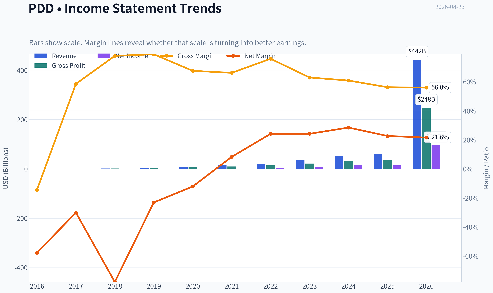
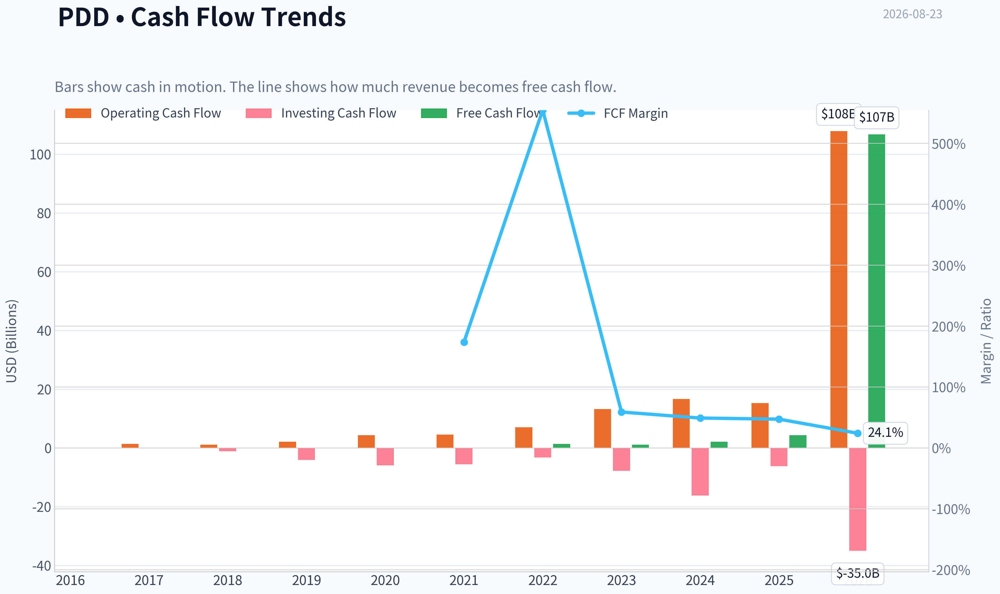
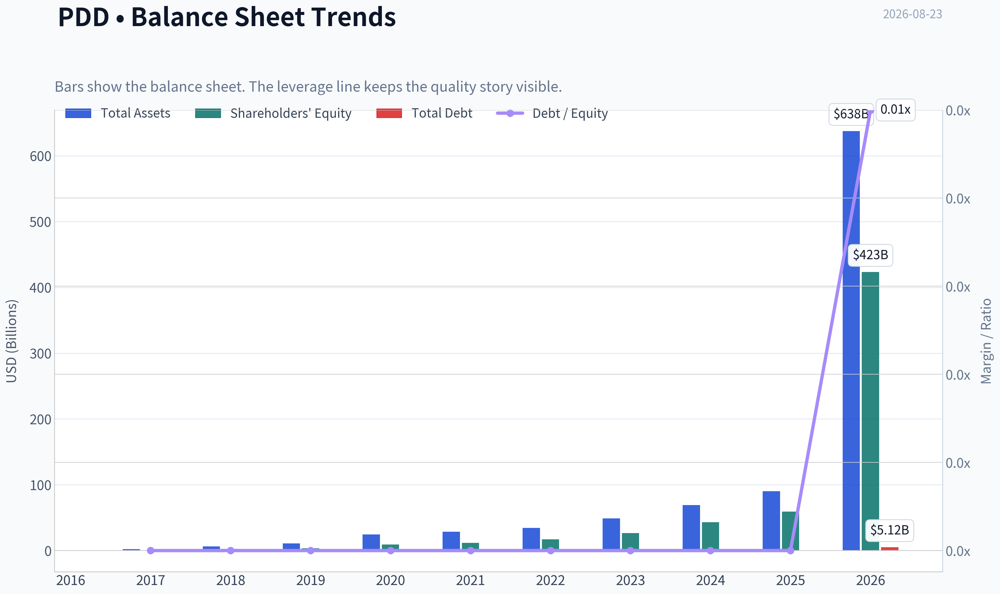
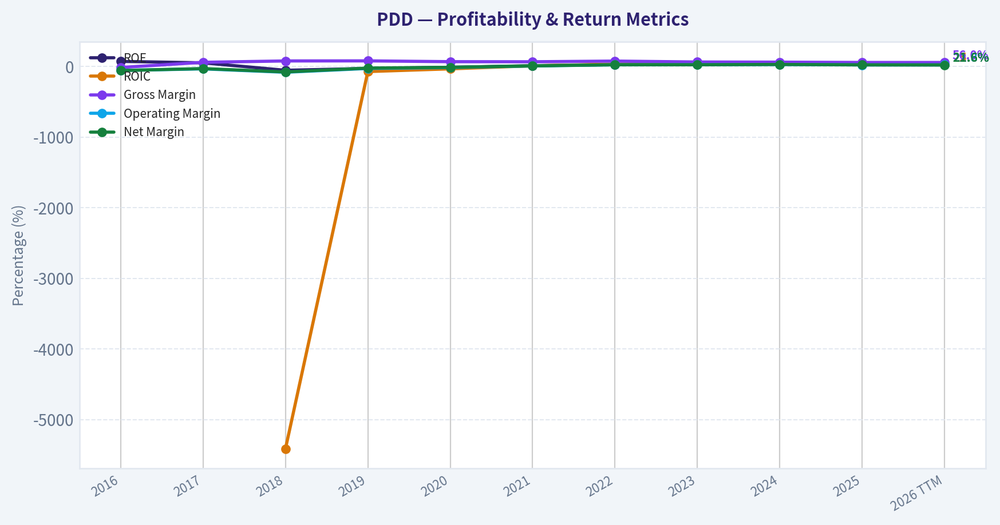
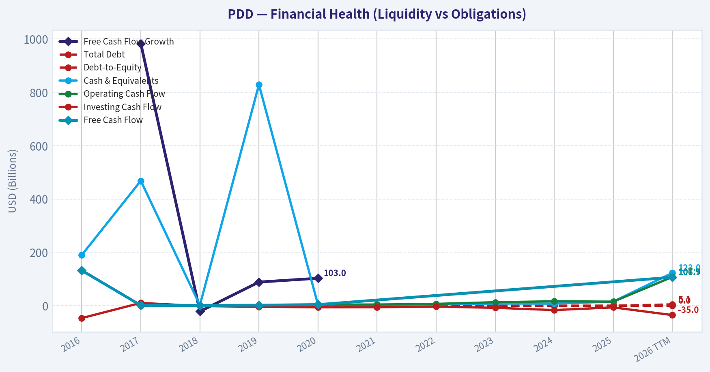
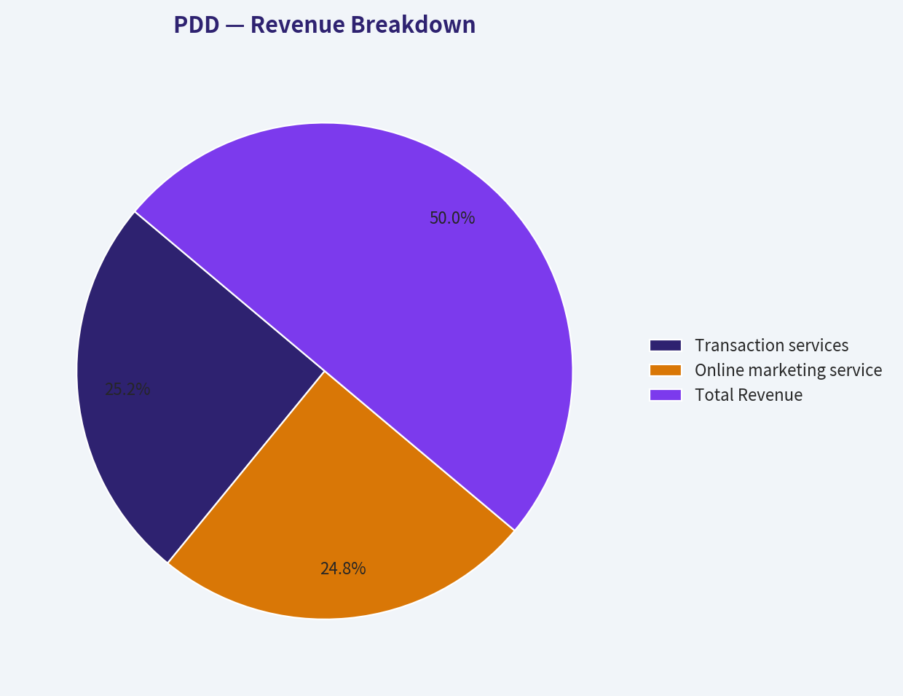
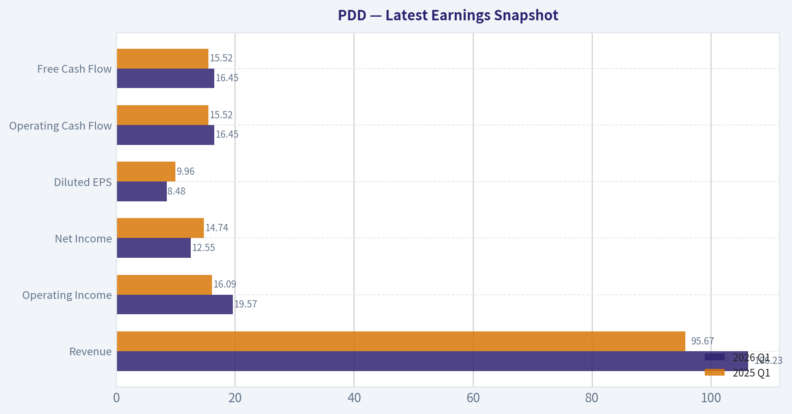
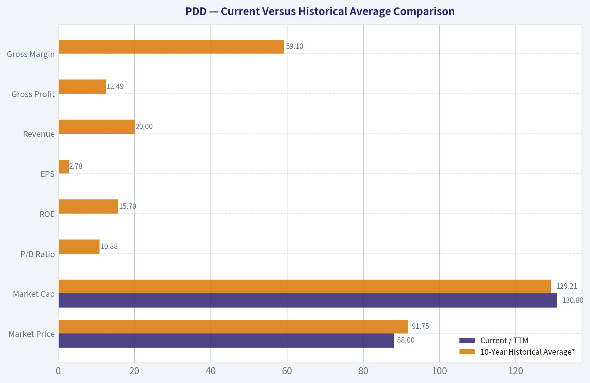
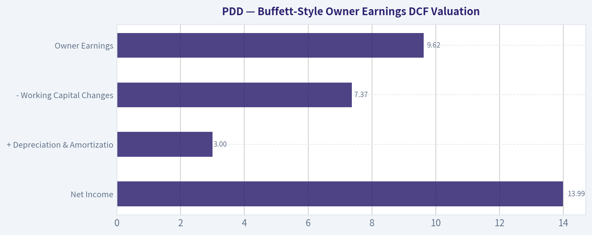

# PDD Deep Value Intelligence

**Analysis Date:** 2026-08-23

## Critical Disclaimer

*This analysis is generated by Deep Value Intelligence, an AI-powered multi-agent investing framework. Education & research only - not financial advice, not a financial advisor.*

---

## Table of Contents

1. Intelligence Summary
2. Analyst Team Reports
   - Fundamentals Analysis
   - Intrinsic Value Analysis (Buffett)
   - Trend & Growth Analysis (Lynch/Druckenmiller/Fisher)
   - Market Technical Analysis
   - Options Market Analysis
3. Research Team Commentary
4. Value Investing Team Commentary
5. Deep Values Commentary

---

## Intelligence Summary

### Thesis + Conditions

**Core Thesis:** **EXECUTIVE SUMMARY**
**Verdict:** **AVOID**
PDD screens as deeply undervalued (9.2x P/E, 30% ROIC), but static cheapness is a trap when earnings predictability is fundamentally compromised. The market is aggressively discounting PDD due to active structural threats-specifically, the potential closure of Western *de minimis* trade loopholes which directly subsidize Temu's unit economics.

**Key Risks:**
- PDD screens as deeply undervalued (9.2x P/E, 30% ROIC), but static cheapness is a trap when earnings predictability is fundamentally compromised. The market is aggressively discounting PDD due to active structural threats-specifically, the potential closure of Western *de minimis* trade loopholes which directly subsidize Temu's unit economics. Under our Buffett framework, low multiples cannot substitute for durable, predictable cash flows. Coupled with a broken technical downtrend (trading below 50-day and 200-day SMAs) and a lack of fresh catalysts, the downside risk remains asymmetric. We are exercising a technical and structural veto over the optical valuation. Cheap can get cheaper.
- The Bull (Risky):** Argues that PDD is a generational opportunity. A 9x P/E for a business generating nearly 30% ROIC and 56% gross margins is a massive mispricing. Believes the *de minimis* threat is a red herring and that PDD's true moat is its structural C2M (Consumer-to-Manufacturer) data loop.
- The Bear (Safe):** Warns that PDD is a geopolitical lightning rod. A moat built entirely on subsidized, ultra-low pricing commands zero customer loyalty. Furthermore, if Western governments close *de minimis* loopholes, the structural unit economics of Temu will break, making historical earnings irrelevant. Highlights the severe lack of governance transparency.

**Confidence:** Medium

---

## Analyst Team Reports

### Fundamentals Analysis

#### Latest Earnings Snapshot

*Most recent reported quarter anchored on 2026 Q1, with prior-year comparison when available.*

| Metric | 2026 Q1 | 2025 Q1 | YoY Change |
| --- | ---: | ---: | ---: |
| Revenue | $106.23B | $95.67B | +11.0% |
| Operating Income | $19.57B | $16.09B | +21.6% |
| Net Income | $12.55B | $14.74B | -14.9% |
| Diluted EPS | $8.48 | $9.96 | -14.9% |
| Operating Cash Flow | $16.45B | $15.52B | +6.0% |
| Free Cash Flow | $16.45B | $15.52B | +6.0% |

Key Takeaways: This snapshot anchors the most recent reported quarter before the narrative analysis. It helps readers separate long-run business quality from whatever changed in the latest earnings print.

#### 10-Year Financial Metrics for PDD

*All values below are computed deterministically from raw data - not estimated by AI.*

*Issuer profile: operating company (Consumer Cyclical / Internet Retail).*

#### 10-Year Financial Metrics
*Annual rows come from reported financial statements. The final TTM row is computed from the latest four quarters.*

| Metric | 2016 | 2017 | 2018 | 2019 | 2020 | 2021 | 2022 | 2023 | 2024 | 2025 | 2026 TTM |
| --- | --- | --- | --- | --- | --- | --- | --- | --- | --- | --- | --- |
| Market Price | N/A | N/A | $22 | $38 | $178 | $58 | $82 | $146 | $97 | $113 | $88 |
| Market Cap | N/A | N/A | $66.61B | $43.75B | $211.80B | $83.28B | $103.11B | $213.60B | $143.46B | $168.09B | $130.80B |
| P/E Ratio | N/A | N/A | -44.82 | -43.71 | -192.48 | 68.31 | 22.55 | 25.26 | 9.31 | 12.01 | 1.35 |
| P/B Ratio | N/A | N/A | 24.33 | 12.36 | 22.97 | 7.07 | 6.04 | 8.10 | 3.34 | 2.84 | 0.31 |
| ROE | 71.7% | 51.2% | -54.3% | -28.3% | -11.9% | 10.3% | 26.8% | 32.1% | 35.9% | 23.7% | 22.6% |
| ROIC | N/A | N/A | -5414.7% | -72.4% | -33.8% | 9.4% | 32.5% | 43.9% | 45.6% | 26.0% | 25.8% |
| EPS | $-0.02 | $-0.04 | $-0.50 | $-0.87 | $-0.92 | $0.85 | $3.62 | $5.79 | $10.41 | $9.44 | $65.48 |
| Revenue | $76.1M | $258.2M | $1.91B | $4.33B | $9.12B | $14.74B | $18.93B | $34.88B | $53.96B | $61.75B | $442.40B |
| Gross Profit | $-11.0M | $151.2M | $1.49B | $3.42B | $6.16B | $9.77B | $14.37B | $21.96B | $32.87B | $34.75B | $247.65B |
| Gross Margin | -14.5% | 58.6% | 77.9% | 79.0% | 67.6% | 66.2% | 75.9% | 63.0% | 60.9% | 56.3% | 56.0% |
| Operating Margin | -56.7% | -34.2% | -82.3% | -28.3% | -15.8% | 7.3% | 23.3% | 23.7% | 27.5% | 21.6% | 21.8% |
| Net Income | $-44.0M | $-77.7M | $-1.49B | $-1.00B | $-1.10B | $1.22B | $4.57B | $8.45B | $15.40B | $13.99B | $95.65B |
| Net Margin | -57.8% | -30.1% | -77.9% | -23.1% | -12.1% | 8.3% | 24.2% | 24.2% | 28.5% | 22.7% | 21.6% |
| Revenue Growth | N/A | 239.1% | 639.1% | 126.9% | 110.6% | 61.7% | 28.4% | 84.3% | 54.7% | 14.5% | 616.4% |
| Net Income Growth | N/A | 76.6% | 1811.6% | -32.7% | 9.9% | -210.8% | 275.1% | 84.9% | 82.2% | -9.2% | 583.6% |
| Free Cash Flow Growth | N/A | 982.7% | -21.4% | 88.7% | 103.0% | N/A | N/A | N/A | N/A | N/A | N/A |
| Total Book Value | $-61.4M | $-151.9M | $2.74B | $3.54B | $9.22B | $11.79B | $17.08B | $26.37B | $42.92B | $59.11B | $423.43B |
| Total Assets | N/A | $2.04B | $6.28B | $10.92B | $24.35B | $28.44B | $34.38B | $49.03B | $69.19B | $90.10B | $637.70B |
| Total Debt | N/A | $0 | $0 | $0 | $0 | $0 | $0 | $0 | $0 | $0 | $5.12B |
| Debt-to-Equity | N/A | -0.00 | 0.00 | 0.00 | 0.00 | 0.00 | 0.00 | 0.00 | 0.00 | 0.00 | 0.01 |
| Cash & Equivalents | $190.0M | $468.2M | $2.06B | $828.5M | $3.44B | $1.01B | $4.98B | $8.42B | $7.91B | $15.57B | $123.04B |
| Shareholders' Equity | $-61.4M | $-151.9M | $2.74B | $3.54B | $9.22B | $11.79B | $17.08B | $26.37B | $42.92B | $59.11B | $423.43B |
| Operating Cash Flow | $132.7M | $1.43B | $1.13B | $2.13B | $4.32B | $4.52B | $7.03B | $13.26B | $16.70B | $15.29B | $107.87B |
| Investing Cash Flow | $-46.3M | $10.6M | $-1.10B | $-4.07B | $-5.88B | $-5.58B | $-3.24B | $-7.81B | $-16.21B | $-6.21B | $-34.96B |
| Free Cash Flow | $132.3M | $1.43B | $1.13B | $2.12B | $4.31B | N/A | N/A | N/A | N/A | N/A | $106.72B |
| FCF Margin | 173.8% | 554.9% | 59.0% | 49.1% | 47.3% | N/A | N/A | N/A | N/A | N/A | 24.1% |
| Dividends / Share | $0.00 | $0.00 | $0.00 | $0.00 | $0.00 | $0.00 | $0.00 | $0.00 | $0.00 | $0.00 | $0.00 |

#### Profitability Metrics
- Return on Equity (ROE): 23.7%
- Return on Invested Capital (ROIC): 29.8%
- Return on Assets (ROA): 15.5%
- Gross Margin: 56.3%
- Operating Margin: 21.6%
- Net Profit Margin: 22.7%

#### Liquidity Metrics
- Current Ratio: 2.43
- Quick Ratio: 13.98

#### Leverage Metrics
- Debt-to-Equity Ratio: 0.00
- Interest Coverage Ratio: N/A
- Net Debt: $-15.57B

#### Growth Metrics (Year-over-Year)
- Revenue Growth: 14.5%
- Net Income Growth: -9.2%
- Free Cash Flow Growth: N/A
- Revenue CAGR (3-Year): 48.3%
- Revenue CAGR (5-Year): 46.6%

#### Valuation Metrics
- P/E Ratio (TTM): 9.22
- Forward P/E: 7.20
- Price-to-Book: 1.98
- Price-to-Sales: 0.28
- PEG Ratio: 0.82
- EV/EBITDA: -3.16
- Free Cash Flow Yield: N/A
- Earnings Yield: 10.9%

#### Owner Earnings (Buffett Method, Code-Computed)
- Net Income: $13.99B
- + Depreciation & Amortization: $3.00B
- - Capital Expenditures: N/A
- - Working Capital Changes: $7.37B
- = **Owner Earnings: $9.62B**

#### Intrinsic Value (Code-Computed)
- Current Price: $88
- **Headline Intrinsic Value (business-model routed): $2,405**
  Business model: cyclical - owner-earnings DCF (cyclical)
  Model spread (min-max across DCFs): $2,405 - $2,674
  Margin of safety vs. price (headline): 96.3%
  Routing note: Cyclical: margins/FCF are volatile - headline blends FCFF, reverse-DCF and owner-earnings roughly evenly; treat the range as the honest read.
- Buffett Method (Owner Earnings):
  Conservative: $528
  Average: $2,405
  Optimistic: $2,405
- Cash Flow Method (FCF):
  Conservative: $2,674
  Average: $2,674
  Optimistic: $6,835
- Damodaran FCFF (WACC + margins + reinvestment):
  Conservative: $-8,641
  Average: $-1,647
  Optimistic: $8,267
  Monte Carlo band (P10-P90): $-7,451 - $2,303 (median $-2,066)
  P(intrinsic value > price): 25.4%
- Reverse-DCF: price implies ~-50.0%/yr owner-earnings growth for 10y; trailing 3y was N/A, 5y N/A.

#### Piotroski F-Score: 4/9
- Positive Net Income: PASS
- Positive Operating Cash Flow: PASS
- ROA Improvement: FAIL
- Cash Flow > Net Income: PASS
- Decreasing Debt: FAIL
- Improving Current Ratio: PASS
- No Dilution: FAIL
- Improving Gross Margin: FAIL
- Improving Asset Turnover: FAIL

ANALYST STANCE: **WATCH**

#### PDD Holdings Fundamental Analysis - Buffett-Style Value Review

PDD is a high-return, asset-light internet retail and marketplace platform with extraordinary historical growth, strong margins, minimal leverage, and a very large cash position. On cash-flow-based valuation, the stock appears deeply undervalued versus both the deterministic model's Owner Earnings DCF and a conservative hand-built DCF sanity check. However, the investment case is not clean enough for a Buffett-style "ADVOCATE" stance because of China/VIE governance risk, regulatory and geopolitical exposure, volatile reported growth, declining 2025 net income, margin compression, Piotroski F-Score of only 4 out of 9, and very wide DCF model dispersion including a negative Damodaran FCFF average case.

---

#### Revenue Breakdown

The most meaningful revenue split for PDD is by business category: online marketing services and transaction services. Because the deterministic dataset is the canonical financial source, the table below scales the latest available segment mix to the 2025 reported revenue total of **$61.75B**.

| Revenue Source | Amount ($B) | % of Total |
|---|---:|---:|
| Transaction services | $31.12B | 50.4% |
| Online marketing services and others | $30.63B | 49.6% |
| Merchandise sales / other direct sales | Immaterial | ~0.0% |
| **Total Revenue** | **$61.75B** | **100.0%** |

**Key Takeaways:** PDD is no longer primarily a pure advertising monetization story; transaction services now represent roughly half of revenue, reflecting the growing importance of marketplace activity and cross-border commerce. The revenue mix suggests a platform with multiple monetization levers, but also higher exposure to transaction volume, logistics partners, consumer demand, and regulatory scrutiny.

---

#### Current Versus Historical Average Comparison

| Metric | Current / TTM | 10-Year Historical Average* | Current Standing and Interpretation |
|---|---:|---:|---|
| Market Price | $88 | $91.75 | Slightly below the available public-market average since 2018, despite much larger revenue, earnings, and cash flow today. |
| Market Cap | $130.80B | $129.21B | Roughly in line with historical market-cap average, even though business scale has expanded dramatically. |
| P/E Ratio | 9.22 current valuation metric; historical table TTM shows 1.35 | -17.95 all-period average; 27.49 profitable-period average | P/E is far below the profitable-period average. Loss years distort the decade average, so the useful comparison is against the post-2021 profitable era. |
| P/B Ratio | 1.98 current valuation metric; historical table TTM shows 0.31 | 10.88 | **Not meaningful as a primary valuation tool** for an asset-light internet platform. Book value is not the economic asset base; valuation should be anchored on cash-flow-based intrinsic value. |
| ROE | 22.6% TTM; 23.7% 2025 | 15.7% | Above the full-period average and still strong, though below the 2023-2024 peak. |
| ROIC | 25.8% TTM | -670.4% all-period average; 31.5% mature-period average | Early losses distort the long average. Mature ROIC remains excellent but has softened from the 2023-2024 peak above 40%. |
| EPS | $65.48 TTM | $2.78 | TTM EPS is far above the annual average, but the magnitude is unusually large relative to prior years and should be treated carefully. |
| Revenue | $442.40B TTM | $20.00B | TTM revenue is massively above historical averages, while 2025 revenue was $61.75B. This indicates explosive scale but also a comparability warning. |
| Gross Profit | $247.65B TTM | $12.49B | Gross profit has scaled enormously, but gross margin has declined from peak levels. |
| Gross Margin | 56.0% TTM; 56.3% 2025 | 59.1% | Below the decade average and materially below the 2018-2019 and 2022 peaks, suggesting mix shift and competitive investment. |
| Operating Margin | 21.8% TTM; 21.6% 2025 | -11.4%; mature-period average 20.7% | Now structurally profitable and slightly above the mature-period average, but down from the 2024 peak of 27.5%. |
| Net Income | $95.65B TTM | $3.99B | TTM net income is vastly above the annual average; however, 2025 net income declined year over year. |
| Net Margin | 21.6% TTM; 22.7% 2025 | -9.3%; mature-period average 21.6% | Net margin is stable versus the mature-period average but below the 2024 peak. |
| Revenue Growth | 616.4% TTM; 14.5% 2025 | 151.0% | TTM growth is extreme, while 2025 growth slowed sharply to 14.5%, indicating volatility in reported growth rates. |
| Net Income Growth | 583.6% TTM; -9.2% 2025 | 232.0% | 2025 showed a profit decline after strong prior years; TTM rebound is dramatic but should be validated against upcoming reports. |
| Free Cash Flow Growth | N/A | 288.3% limited-history average | Historical FCF growth is only available through 2020 plus TTM FCF, limiting trend reliability. |
| Total Book Value | $423.43B | $17.26B | Book value has grown substantially, but for PDD it is not the best proxy for intrinsic value. |
| Total Assets | $637.70B | $34.97B | Asset base has expanded rapidly, largely alongside cash, platform scale, and working-capital intensity. |
| Total Debt | $5.12B | $0.00B | Debt remains very low relative to cash and equity. |
| Debt-to-Equity | 0.01 | ~0.00 | Balance sheet remains conservatively financed. |
| Cash & Equivalents | $123.04B | $4.49B | Cash position is exceptionally large and provides a major margin of safety. |
| Shareholders' Equity | $423.43B | $17.26B | Equity has compounded significantly from early negative levels. |
| Free Cash Flow | $106.72B TTM | $1.82B limited-history average | TTM FCF is extraordinarily high versus available history; due to missing 2021-2025 FCF rows, trend interpretation requires caution. |
| Dividends per Share | $0.00 | $0.00 | PDD has retained all capital rather than paying dividends. |

\*Historical averages are based only on years shown in the deterministic dataset and available values. For some metrics, early loss years or missing data make the full-period average less economically useful than the mature profitable period.

**Key Takeaways:** PDD's current valuation is low relative to its mature profitability, cash position, and cash-flow generation, but several current TTM figures are dramatically larger than prior annual figures and require caution. Profitability has transformed since 2021, with strong ROE, ROIC, operating margin, and net margin, but 2025 showed slower revenue growth and lower net income versus 2024. Book-value multiples should not drive the conclusion because PDD is an asset-light platform business; intrinsic value should be assessed through owner earnings and free cash flow.

---

#### Market Metrics Interpretation

| Metric | Interpretation |
|---|---|
| Market Price | At **$88**, PDD trades slightly below its public-market average price since 2018, even though revenue, profit, equity, and cash are much larger than in most prior years. |
| Market Cap | At **$130.80B**, market value is near the historical average market cap despite substantially improved economics. This suggests the market is applying a heavy risk discount. |
| P/E Ratio | The deterministic pack reports a current valuation P/E of **9.22**, while the historical TTM table shows **1.35**. Both indicate a very low earnings multiple relative to PDD's profitable-period history. |
| P/B Ratio | P/B is **not meaningful as a primary value signal** for PDD. As an asset-light internet marketplace, its real economic assets are network effects, merchant relationships, traffic, data, brand, technology, and consumer engagement, none of which are fully captured by book equity. |

**Key Takeaways:** PDD looks optically cheap on earnings and market-cap-to-business-scale measures. However, Buffett-style analysis should not rely on P/B for this issuer type; the better valuation anchor is cash-flow-based intrinsic value and durability of owner earnings.

---

#### Profitability Analysis

PDD's profitability record has two very different eras. From 2016 through 2020, the business was in investment mode with negative operating margins and net losses. Since 2021, it has become a high-margin, high-return platform with strong ROE and ROIC.

| Profitability Metric | Current View | Buffett-Style Interpretation |
|---|---|---|
| ROE | 22.6% TTM; 23.7% 2025 | Strong and above the full-period average, indicating high returns on shareholder capital. Lower than 2024's 35.9%, so trend bears watching. |
| ROIC | 25.8% TTM; 26.0% 2025 | Excellent absolute level. The decline from 45.6% in 2024 suggests either heavier reinvestment, margin pressure, or normalization. |
| EPS | $65.48 TTM; $9.44 in 2025 | Very strong reported TTM figure, but the jump versus prior years is unusually large. Investors should validate sustainability. |
| Revenue | $442.40B TTM; $61.75B in 2025 | Scale has expanded dramatically. 2025 growth slowed to 14.5%, but TTM growth is extremely high. |
| Gross Profit | $247.65B TTM; $34.75B in 2025 | Large and growing, though margin compression is visible. |
| Operating Margin | 21.8% TTM; 21.6% in 2025 | Mature operating margin remains strong and above the post-profitability average. |
| Net Income | $95.65B TTM; $13.99B in 2025 | Current profitability is very high, but 2025 net income declined 9.2% year over year. |
| Net Margin | 21.6% TTM; 22.7% in 2025 | Strong platform-level margin, near the mature-period average, but below the 2024 peak of 28.5%. |

**Key Takeaways:** PDD has crossed from hyper-growth investment mode into a highly profitable platform phase. The key issue is not whether the business can make money - it clearly can - but whether current margins and earnings can persist under competition, regulatory oversight, and continued investment in Temu and transaction services.

---

#### Growth Metrics Interpretation

PDD's growth has been exceptional over the decade, but not smooth. Revenue growth decelerated to **14.5% in 2025**, after **54.7% in 2024** and **84.3% in 2023**, before the deterministic TTM figure jumped to **616.4%**. Net income growth similarly weakened in 2025 at **-9.2%**, after very strong gains in 2023 and 2024.

The Buffett question is whether this is a predictable compounder or a cyclical/high-volatility platform. The deterministic model labels PDD as **cyclical** for valuation routing because margins and free cash flow are volatile. That classification is important: even though headline growth is spectacular, a conservative investor should normalize growth rather than extrapolate the highest observed figures.

---

#### Balance Sheet and Financial Strength

PDD's balance sheet is a major strength. The deterministic dataset shows **$123.04B of cash and equivalents** against only **$5.12B of total debt** in the TTM period, creating **net cash of approximately $117.92B**. Debt-to-equity is only **0.01**, which is extremely conservative.

From a Buffett perspective, this is highly favorable. A large net cash position protects the business during downturns, gives management optionality, and reduces bankruptcy or refinancing risk. The main caveat is that cash located across jurisdictions, corporate entities, or VIE structures may not have the same shareholder accessibility as cash at a U.S.-domiciled operating company.

---

#### Cash Flow and Capital Allocation

PDD generated **$106.72B of TTM free cash flow** according to the deterministic dataset, versus available historical FCF averaging only **$1.82B** from the limited years shown. The scale of current FCF is extraordinary but should be interpreted carefully because FCF rows are missing for 2021 through 2025.

PDD pays **no dividend**, and dividends per share have been **$0.00 every year** shown. This is acceptable for a high-return compounder if retained capital can be reinvested at high ROIC. However, the Piotroski F-Score flags **No Dilution: FAIL**, so investors should watch share count and equity compensation closely. Buffett would prefer retained earnings to compound per-share intrinsic value, not merely grow the company's absolute size.

---

#### Buffett-Style Owner Earnings DCF Valuation

The deterministic pack's code-computed Owner Earnings are:

| Owner Earnings Component | Amount |
|---|---:|
| Net Income | $13.99B |
| + Depreciation & Amortization | $3.00B |
| - Capital Expenditures | N/A |
| - Working Capital Changes | $7.37B |
| **Owner Earnings** | **$9.62B** |

**Key Takeaways:** The DCF base uses deterministic Owner Earnings of **$9.62B**, not reported net income, because Buffett-style valuation focuses on cash available to owners after maintaining the business. Working-capital needs materially reduce owner earnings versus net income, which is important for a marketplace model with fast transaction growth.

Assumptions for the hand DCF sanity check:

| DCF Assumption | Value |
|---|---:|
| Base Owner Earnings | $9.62B |
| Discount Rate | 10.0% |
| Terminal Growth Rate | 2.5% |
| Shares Outstanding Implied by Market Cap / Price | ~1.486B |
| TTM Cash & Equivalents | $123.04B |
| TTM Total Debt | $5.12B |
| Net Cash Added to Equity Value | $117.92B |
| Current Share Price | $88 |

**Key Takeaways:** The hand DCF uses a 10% required return and a 2.5% terminal growth rate, consistent with a conservative Buffett-style framework. Net cash is a large part of the equity value and materially improves downside protection.

##### Three-Scenario Owner Earnings DCF

| Scenario | Growth Assumptions | PV of Explicit Owner Earnings | PV of Terminal Value | Net Cash Added | Equity Value | Fair Value / Share | Upside vs. $88 |
|---|---|---:|---:|---:|---:|---:|---:|
| Conservative | 3% annually for 10 years, then 2.5% terminal | $68.17B | $68.12B | $117.92B | $254.21B | **$171** | **+94%** |
| Average / Base Case | 12% for years 1-5, fading to 8% for years 6-10, then 2.5% terminal | $100.62B | $131.25B | $117.92B | $349.79B | **$235** | **+167%** |
| Optimistic | 25% for years 1-3, 18% for years 4-6, 10% for years 7-10, then 2.5% terminal | $156.00B | $238.16B | $117.92B | $512.08B | **$345** | **+292%** |

**Key Takeaways:** Even the conservative hand-built DCF produces a fair value materially above the current price, mostly because PDD combines positive owner earnings with a very large net cash position. However, this hand DCF is a sanity check, not the primary anchor, because the deterministic pack's model spread is very wide and includes both highly positive and negative outcomes.

##### Deterministic Pack Intrinsic Value Anchor

| Model | Intrinsic Value / Share |
|---|---:|
| Owner Earnings DCF - Conservative | $528 |
| Owner Earnings DCF - Average | $2,405 |
| Owner Earnings DCF - Optimistic | $2,405 |
| FCF Method - Conservative | $2,674 |
| FCF Method - Average | $2,674 |
| FCF Method - Optimistic | $6,835 |
| Damodaran FCFF - Conservative | -$8,641 |
| Damodaran FCFF - Average | -$1,647 |
| Damodaran FCFF - Optimistic | $8,267 |
| Monte Carlo Band, P10-P90 | -$7,451 to $2,303 |
| Probability Intrinsic Value > Price | 25.4% |
| Reverse DCF Implied Growth | Approximately -50.0% per year for 10 years |

**Key Takeaways:** The deterministic model's headline Owner Earnings value is extremely bullish, and the reverse DCF suggests the market price embeds very pessimistic assumptions. But the Damodaran FCFF model is highly unstable and negative in the conservative and average cases, which means valuation confidence is lower than the headline margin of safety implies.

---

#### Warren Buffett-Style Qualitative Assessment

| Buffett Criterion | Assessment |
|---|---|
| Economic Moat | PDD has network effects from buyers, merchants, data, pricing, and engagement. Temu adds global optionality, but also exposes the company to logistics, tariffs, consumer protection rules, and geopolitical risk. |
| Financial Strength | Very strong. Net cash is massive, debt is minimal, and liquidity is excellent. This is one of the strongest parts of the investment case. |
| Predictable Earnings | Improving but not fully Buffett-grade. PDD has only been sustainably profitable since 2021, and 2025 net income declined despite revenue growth. |
| Management Performance | High ROE and ROIC suggest strong operating execution. However, no dividends, dilution warning, and limited shareholder-return visibility reduce capital-allocation clarity. |
| Valuation | Very attractive on P/E, reverse DCF, and Owner Earnings DCF. P/B should be ignored as a primary valuation measure. |
| Quality of Business | High-margin, asset-light, scalable platform with strong cash generation. Main risks are regulatory, geopolitical, competitive, and data comparability. |

**Key Takeaways:** PDD has many traits Buffett likes - high returns, low debt, cash generation, and a platform moat - but it lacks the long record of predictable, shareholder-friendly compounding that would make it a classic Buffett investment. The business quality is high, but the governance and jurisdictional risk discount is also legitimate.

---

#### Key Investment Insights

| Category | Insight |
|---|---|
| Valuation Opportunity | PDD appears substantially undervalued on earnings, owner earnings, and reverse DCF assumptions. |
| Balance Sheet Strength | Massive net cash gives PDD flexibility and provides a real cushion against operating shocks. |
| Profitability Inflection | Since 2021, PDD has moved from losses to high operating margins and strong ROIC. |
| Moat Potential | Network effects, merchant scale, data, and consumer value proposition support a durable competitive position. |
| Growth Optionality | Temu and transaction services may extend PDD's runway beyond domestic Chinese e-commerce. |

**Key Takeaways:** The investment opportunity is driven by a rare combination of low valuation, high profitability, strong growth history, and excess cash. If current cash flows prove durable, the market price could be far below intrinsic value.

---

#### Red Flags and Risks

| Risk | Why It Matters |
|---|---|
| China / VIE Governance Risk | U.S. investors own ADR exposure rather than direct operating assets, creating structural legal and governance uncertainty. |
| Regulatory and Geopolitical Risk | Tariffs, forced-labor scrutiny, data rules, consumer protection regulation, and China-U.S. tensions can affect Temu and cross-border commerce. |
| Margin Compression | Gross margin fell to 56.3% in 2025 from much higher historical peaks, and operating margin declined from 27.5% in 2024 to 21.6% in 2025. |
| 2025 Net Income Decline | Net income fell 9.2% in 2025 despite revenue growth, suggesting reinvestment pressure or competitive intensity. |
| Low Piotroski F-Score | Score of 4/9 indicates mixed fundamental momentum, with failures in ROA improvement, dilution, gross margin improvement, and asset turnover. |
| DCF Dispersion | The deterministic model spread is extremely wide, including negative FCFF cases, reducing confidence in any single fair value estimate. |
| Data Comparability | TTM revenue, EPS, net income, and FCF are extraordinarily larger than recent annual values, so investors should validate upcoming filings carefully. |

**Key Takeaways:** PDD's valuation looks compelling, but the risk profile is not simple. The largest risks are not balance-sheet risks; they are governance, regulation, competitive durability, margin normalization, and confidence in the sustainability of current cash flows.

---

#### Opportunities

| Opportunity | Potential Impact |
|---|---|
| Continued Temu Scaling | Could expand PDD's addressable market and diversify beyond China. |
| Higher Transaction-Service Monetization | Transaction revenue can create a second major profit engine alongside advertising and marketing services. |
| Operating Leverage | If growth continues while spending normalizes, margins could re-expand. |
| Cash Deployment | Large net cash could support buybacks, strategic investment, or resilience during downturns. |
| Market Re-Rating | A move from distressed/discounted multiples toward mature platform multiples could create significant upside. |

**Key Takeaways:** PDD has multiple ways to create shareholder value if management converts growth into durable per-share cash flow. A re-rating does not require heroic assumptions if earnings and owner earnings remain stable.

---

#### Final Investment Stance: WATCH

PDD is **not an AVOID** because the company has strong profitability, excellent ROIC, massive net cash, low leverage, and valuation metrics that appear deeply discounted. The deterministic Owner Earnings DCF and reverse DCF both suggest the market is pricing in an extremely pessimistic future.

However, it is also not a clean **ADVOCATE** under a strict Warren Buffett framework. The business is highly attractive but not yet sufficiently predictable, the jurisdictional and ADR/VIE risks are material, the Piotroski F-Score is weak at **4/9**, 2025 net income declined, margins compressed, and the DCF model dispersion is unusually wide.

A Buffett-style investor should keep PDD on a **high-priority watchlist** and consider accumulation only if comfortable with China/VIE risk and after validating that TTM cash flow and profitability are sustainable in subsequent earnings reports.

---

#### Summary Table

| Area | Key Point | Investment Implication |
|---|---|---|
| Valuation | P/E is low, reverse DCF is highly pessimistic, and DCF outputs suggest upside. | Attractive, but confidence is reduced by model dispersion. |
| Moat | Marketplace scale, network effects, merchant base, data, and Temu optionality. | Potentially durable, but competition and regulation remain major threats. |
| Profitability | ROE and ROIC are strong; margins are now structurally positive. | Business quality has improved meaningfully since 2021. |
| Balance Sheet | $123.04B cash versus $5.12B debt. | Very strong financial resilience. |
| Cash Flow | TTM FCF of $106.72B is extremely high. | Powerful if sustainable, but requires validation due to historical data gaps. |
| Capital Allocation | No dividends; dilution flag failed in Piotroski scoring. | Watch per-share value creation closely. |
| Main Risks | China/VIE structure, regulation, geopolitics, margin compression, TTM comparability. | These risks justify a valuation discount and a WATCH stance. |
| Final Stance | **WATCH** | Undervalued on numbers, but not yet Buffett-grade predictable. |

**Key Takeaways:** PDD screens as a potentially mispriced, high-quality platform with exceptional financial strength. The reason to wait is not valuation; it is confidence in durability, governance, and the sustainability of current owner earnings.

#### Fundamental Visuals

This graph tracks the profitability and return metrics (ROE, ROIC, Margins) of **PDD** over the past decade, highlighting capital efficiency trends.

This chart illustrates the financial health of **PDD** over the last 10 years, mapping cash equivalents and free cash flow against total obligations (Debt).

This breakdown chart from <em>Revenue Breakdown</em> shows the proportional composition for **PDD** - useful for understanding what drives or risks the business.

---

### Intrinsic Value Analysis (Buffett)

> *Following Warren Buffett's value investing philosophy: Circle of Competence, Economic Moat, Management Quality, and Margin of Safety.*

#### Intrinsic Value Snapshot

Price is what you pay. Intrinsic value is what the business may be worth based on the cash it can create for owners over time. We show a range, not one magic number.

- Current Price: $88.38
- Value Range (conservative to optimistic across both DCF methods): $528.16 to $6,835.40

##### Owner Earnings (Buffett Method)
- Net Income: $13,991,297,000.00
- Depreciation & Amortization: $3,000,364,000.00
- Capital Expenditures: N/A
- Working Capital Changes: $7,367,096,000.00
- Owner Earnings: $9,624,565,000.00

##### Intrinsic Value
###### Buffett Method
Uses owner earnings. Stricter, and usually more conservative.
- Conservative: $528.16
- Average: $2,404.64
- Optimistic: $2,404.64
- Discount Rate: 10.0%

###### Cash Flow Method
Uses free cash flow. Better for companies spending heavily today to grow tomorrow.
- Conservative: $2,673.82
- Average: $2,673.82
- Optimistic: $6,835.40
- Discount Rate: 10.0%

ANALYST STANCE: **ADVOCATE**

#### PDD Holdings - Buffett-Style Investment Review

PDD is a high-return, asset-light commerce platform with two engines: China value-oriented marketplace Pinduoduo and international bargain marketplace Temu. At roughly **$88 per ADS**, **9.2x earnings**, and a **$125.8B market cap**, the market is pricing in substantial skepticism about competitive intensity, China/VIE governance, and cross-border regulatory risk. The business quality is strong enough, and the valuation is low enough, to justify an **ADVOCATE** stance - but with **moderate conviction**, not "sleep-well-at-night" conviction.

---

#### 1. Factor Scorecard

| Factor | Score / 5 | Evidence |
|---|---:|---|
| Circle of Competence & Business Simplicity | 3.5 | PDD earns through online marketplace services, merchant advertising, transaction services, and cross-border commerce via Temu. The model is understandable, but the pace of change, regulatory exposure, and cross-border logistics make long-term forecasting harder than for a classic consumer staple. |
| Moat Test | 3.5 | Strong scale, user traffic, merchant density, data advantages, and bargain-consumer mindshare. Gross margin of **56.3%** supports platform economics. However, consumer switching costs are low and Alibaba, JD, Douyin, Shein, and Amazon remain formidable competitors. |
| Management Quality & Capital Allocation | 3.0 | Founder-led culture has created enormous value, with disciplined reinvestment and aggressive execution. Offsetting this are limited disclosure, Cayman/VIE structure, no dividend or buyback signal, and governance opacity relative to U.S. blue-chip standards. |
| Industry Structure | 3.0 | China e-commerce is an oligopoly, but a brutally competitive one. Temu's international opportunity is large, yet vulnerable to tariffs, de minimis rule changes, logistics costs, and regulatory pushback. |
| Gate 5 - Quality/Solvency Hard Floor | **Not tripped** | PDD is profitable, cash-generative, has a current ratio of **2.43**, and shows no evidence of financial distress. The hard floor is not triggered. |

**Key Takeaways:** PDD is not a classic Buffett "simple forever" business, but it is understandable: it aggregates buyers and merchants and monetizes marketplace activity. The core concern is not solvency or profitability; it is durability - whether PDD can defend its value proposition against intense competition and regulatory risk.

---

#### 2. Moat Analysis

| Moat Source | Assessment | Evidence |
|---|---|---|
| Intangible Assets / Brand | Moderate to strong | Pinduoduo is strongly associated with value shopping in China, and Temu has achieved rapid global awareness. Brand strength is meaningful, but it is value-led rather than luxury or emotional-loyalty-led. |
| Switching Costs | Weak to moderate | Consumers can multi-home easily across Alibaba, JD, Douyin, Shein, Amazon, and others. Merchant switching costs are higher due to traffic, fulfillment data, ad tools, and platform scale, but not ironclad. |
| Cost Advantage | Strong | PDD's model is asset-light, data-driven, and built around efficient merchant discovery and bargain pricing. Its ability to scale without heavy physical retail assets supports high returns. |
| Network Effects | Moderate to strong | More buyers attract more merchants; more merchants improve assortment and pricing; better pricing attracts more buyers. The network effect exists, but e-commerce network effects are contestable because users can compare prices quickly. |

**Moat Rating:** **Narrow-to-Wide, but not unassailable**. PDD has real scale and platform economics, but its moat is less permanent than Apple's ecosystem or Costco's trust-and-scale model.

---

#### 3. Management Quality Assessment

PDD's management has demonstrated exceptional execution. The company moved from a China discount-commerce challenger into one of the world's most important e-commerce platforms, then built Temu into a major international growth engine at remarkable speed. That suggests founder-like intensity, customer obsession, and willingness to reinvest heavily.

The capital allocation record is economically attractive: PDD has scaled revenue, earnings, and free cash flow with modest capital intensity. However, from a Buffett perspective, governance is the main discount. The company uses a China-based operating structure with offshore listing exposure, provides less owner-oriented disclosure than the best U.S. compounders, and has not established a long record of shareholder returns through dividends or opportunistic buybacks.

**Management Score:** **3.0 / 5** - outstanding operators, but governance and disclosure reduce the owner-oriented score.

---

#### 4. Financial Summary

| Fiscal Year | Revenue, RMB bn | Revenue Growth | Gross Margin | Operating Margin | Net Income, RMB bn | Free Cash Flow, RMB bn | ROE / Quality Signal |
|---:|---:|---:|---:|---:|---:|---:|---|
| 2020 | 59.5 | 97% | 67% | -13% | -7.2 | 27.0 | Loss-making, but cash generation emerging |
| 2021 | 94.0 | 58% | 66% | 7% | 7.8 | 27.8 | Profitability inflection |
| 2022 | 130.6 | 39% | 75% | 29% | 31.5 | 48.6 | High-return platform economics visible |
| 2023 | 247.6 | 90% | 61% | 24% | 60.0 | 90.8 | Scale benefits and Temu growth |
| 2024 | 393.8 | 59% | 60% | 28% | 112.4 | 147.0 | Exceptional profitability and cash conversion |
| Latest Indicators | - | 14.5% YoY | 56.3% | - | - | - | ROE **23.7%**, P/E **9.2x** |

**Key Takeaways:** PDD has transitioned from a fast-growing loss-maker into a highly profitable, cash-generative platform. Revenue growth is naturally slowing from hypergrowth levels, but margins, ROE, and free cash flow remain strong. The latest gross margin of **56.3%** confirms that PDD still has platform-like economics, even while investing aggressively in Temu and price competitiveness.

---

#### 5. Owner Earnings Calculation

Buffett's owner earnings estimate:

| Component | Estimate, USD bn | Per ADS Estimate |
|---|---:|---:|
| Net Income, implied by market cap / P-E | 13.65 | $9.55 |
| Add: Depreciation & Amortization | 0.40 | $0.28 |
| Less: Maintenance CapEx | -0.30 | -$0.21 |
| Less: Normalized Working Capital Investment | -2.20 | -$1.54 |
| Estimated Owner Earnings | **11.55** | **$8.08** |

**Key Takeaways:** PDD's reported earnings are largely backed by cash generation, which is essential for a Buffett-style investment. I use a normalized owner earnings figure below reported net income to account for working capital needs, Temu expansion, and competitive reinvestment. Even with this haircut, PDD trades at roughly **10.9x owner earnings**, an attractive multiple for a business with high returns on capital.

---

#### 6. Three-Scenario DCF Valuation

Assumptions: normalized owner earnings of **$8.08 per ADS**, 10% discount rate, and terminal growth of 3% where applicable.

| Scenario | Growth Assumption | Intrinsic Value / ADS | Margin of Safety vs. $88 |
|---|---:|---:|---:|
| A - No Growth | 0% perpetuity | **$80.80** | **-9%** |
| B - GDP Growth | 3% perpetuity | **$118.90** | **26%** |
| C - Historical Growth Haircut | 10% for 10 years, then 3% terminal | **$199.70** | **56%** |
| Research-Pack Headline Model | Owner-earnings routed model | **$2,404.64** | **96%** |

**Key Takeaways:** The no-growth case roughly supports today's price, which is a strong downside anchor for a company still growing revenue. The conservative GDP-growth case gives a fair value near **$119**, while the higher-growth case is materially above the market price. The research-pack valuation output is extremely bullish, though the model spread is wide, so I rely more heavily on the normalized DCF range of roughly **$119 to $200**.

---

#### 7. Margin of Safety Analysis

| Valuation Lens | Signal |
|---|---|
| Current Price | **$88** |
| P/E | **9.2x** |
| ROE | **23.7%** |
| Gross Margin | **56.3%** |
| Revenue Growth | **14.5% YoY** |
| Reverse DCF | Price implies roughly **-50% annual decline** for 10 years |
| Headline Margin of Safety | **96.3%** versus research-pack intrinsic value |
| Normalized DCF Margin of Safety | Roughly **26% to 56%** in the conservative-to-growth cases |

**Key Takeaways:** The market is pricing PDD as if its earnings power will deteriorate sharply. That may prove too pessimistic if PDD can maintain even modest growth and reasonable margins. For a high-ROE platform, a valuation near **9x earnings** is unusually cheap, but the discount exists for valid reasons: China risk, governance risk, and cross-border regulatory uncertainty.

---

#### 8. Final Buffett Scorecard

| Criterion | Weight | Score / 5 | Weighted Contribution |
|---|---:|---:|---:|
| Moat Width & Durability | 25% | 3.5 | 0.88 |
| Valuation / Margin of Safety | 20% | 4.0 | 0.80 |
| Capital Returns - ROIC vs. WACC | 15% | 4.0 | 0.60 |
| Business Understanding & Predictability | 12% | 3.5 | 0.42 |
| Management Quality & Capital Allocation | 12% | 3.0 | 0.36 |
| Reinvestment Runway | 8% | 4.0 | 0.32 |
| Balance Sheet Strength | 4% | 4.5 | 0.18 |
| Industry Structure | 4% | 3.0 | 0.12 |
| **Total Score** | **100%** | - | **3.68 / 5** |

**Key Takeaways:** PDD scores well because its returns on capital, growth runway, cash generation, and valuation are all attractive. The score is held back by governance, regulatory exposure, and the fact that e-commerce competition is intense. The result is not a flawless compounder, but it is a good-to-very-good business offered at a price that appears to over-discount the risks.

---

#### 9. Investment Stance

**Stance:** **ADVOCATE**
**Conviction Level:** **Moderate**
**Estimated Intrinsic Value Range:** **$119 to $200 per ADS** using normalized owner-earnings DCF
**Buy Discipline:** Attractive below **$100**, compelling below **$90**, reassess above **$150** unless fundamentals continue compounding strongly.

PDD is a classic case where the market appears to be charging a China/governance/regulatory discount against a business with genuinely strong economics. Buffett would likely admire the high returns, cash generation, low capital intensity, and bargain valuation, but he would also demand a margin of safety for the parts that are harder to underwrite: VIE structure, regulatory intervention, and international trade risk.

At **$88**, that margin of safety appears adequate. The stock is not risk-free, but the expected value is favorable.
#### Valuation Bridge

This bridge places the current market price beside each intrinsic value lens so readers can see whether upside depends on one method or shows up across several methods.

| Scenario | Intrinsic Value / Share |
| --- | ---: |
| Buffett Method | $2,404.64 |
| Cash Flow Method | $2,673.82 |
| Damodaran Method | $-1,646.85 |
| Current Price | $88.38 |

#### Key Takeaways

If one method is far above the others, the upside case depends on a specific modelling assumption. When several methods cluster together, the valuation story is more robust.

#### Valuation Visuals

This comparison chart from *Latest Earnings Snapshot* stacks current figures against historical benchmarks for **PDD**, making it easy to see where the company trades relative to its own averages.

This comparison chart from *Current Versus Historical Average Comparison* stacks current figures against historical benchmarks for **PDD**, making it easy to see where the company trades relative to its own averages.

This comparison chart from *Buffett-Style Owner Earnings DCF Valuation* stacks current figures against historical benchmarks for **PDD**, making it easy to see where the company trades relative to its own averages.

This comparison chart from *Buffett-Style Owner Earnings DCF Valuation* stacks current figures against historical benchmarks for **PDD**, making it easy to see where the company trades relative to its own averages.

This comparison chart from *Buffett-Style Owner Earnings DCF Valuation* stacks current figures against historical benchmarks for **PDD**, making it easy to see where the company trades relative to its own averages.

---

### Trend & Growth Analysis (Lynch/Druckenmiller/Fisher)

> *Following Peter Lynch's GARP, Stanley Druckenmiller's macro-aware approach, and Philip Fisher's scuttlebutt methodology.*

ANALYST STANCE: **WATCH**

#### PDD Holdings Growth Analysis - Pinduoduo + Temu

PDD is a high-quality, founder-led China commerce platform with a potentially massive global e-commerce option through Temu. The valuation looks unusually cheap on headline earnings, but the current growth profile has slowed into the mid-teens, and the next major question is whether Temu becomes a durable global profit engine or remains a subsidy-heavy, regulation-exposed growth channel.

---

#### 1. Lynch Classification

| Category | Evidence | Verdict |
|---|---:|---|
| Slow Grower | 0-5% growth | No |
| Stalwart | 5-12% growth | Borderline but slightly above |
| Fast Grower | 15-25%+ growth | Not currently; latest YoY revenue growth is 14.5% |
| Cyclical | China consumer and ad demand have macro sensitivity | Partial |
| Turnaround | Not distressed; highly profitable | No |
| Asset Play | Valuation may imply asset/value characteristics, but not the core thesis | Partial |

**Key Takeaways:** PDD no longer screens as a clean Lynch "fast grower" based on the provided 14.5% revenue growth rate. It is better classified as a **GARP stalwart-to-fast-grower transition candidate**: cheap, profitable, and still exposed to large TAMs, but needing proof of re-acceleration.

---

#### 2. The Story in 3 Bullets

| Story Pillar | Plain-English Explanation |
|---|---|
| China value commerce engine | Pinduoduo connects shoppers with low-priced goods through a social, deal-driven marketplace model. |
| Temu global option | Temu is trying to export China's low-cost supply chain to global consumers, especially in the U.S. and Europe. |
| Profitability gives it optionality | Unlike many growth platforms, PDD already has strong margins, high ROE, and a low headline P/E, giving it room to invest aggressively. |

**Key Takeaways:** The simple story is that PDD is a profitable Chinese bargain-shopping platform funding an ambitious global e-commerce expansion through Temu. The ten-bagger case depends less on the legacy China app and more on whether Temu can scale globally without destroying margins or getting blocked by regulators.

---

#### 3. TAM Analysis and 10x Test

| Item | Estimate / Data Point | Growth Read |
|---|---:|---|
| Current market cap | $125.8B | Already large-cap |
| Latest expected Q2 revenue | $17.13B | Implies very large annualized scale |
| Current YoY revenue growth | 14.5% | Moderate, not hypergrowth |
| Core TAM | China e-commerce, online advertising, merchant services | Large but competitive |
| Expansion TAM | Global cross-border discount e-commerce via Temu | Very large but regulatory-risked |
| 10x revenue test | A true 10x from current scale would require hundreds of billions in annual revenue | Possible only if Temu becomes a global platform, not from China alone |
| Can PDD 10x revenue and stay under 20% TAM share? | Maybe, but only under a broad global commerce TAM definition | Conditional pass |

**Key Takeaways:** PDD's domestic China opportunity alone is probably not enough for an easy 10x from here. The 10x case requires Temu to become a major global marketplace, which means the runway exists, but it is highly dependent on regulation, logistics costs, consumer adoption, and merchant economics.

---

#### 4. Revenue Growth Trend

| Metric | Current Data | Interpretation |
|---|---:|---|
| Revenue growth YoY | 14.5% | Decelerated/moderate growth |
| Latest expected Q2 revenue | $17.13B | Large absolute revenue base |
| Pattern | No evidence of acceleration from provided data | Watch for next earnings |
| Lynch growth classification | Below ideal fast-grower threshold | Not yet a clean advocate |

**Key Takeaways:** The current revenue growth rate is good for a large company but below the 20% to 25% threshold preferred for ten-bagger-style growth investing. The key upcoming question is whether Temu and merchant services can push PDD back into an accelerating growth pattern.

---

#### 5. Unit Economics

| Metric | Data Availability | Assessment |
|---|---|---|
| LTV/CAC | Not disclosed in provided data | Cannot calculate |
| NRR | Not applicable; PDD is not SaaS | N/A |
| Rule of 40 | Not applicable in classic SaaS form | N/A |
| Gross margin | 56.3% | Strong for a commerce/platform model |
| ROE | 23.7% | Strong capital productivity |
| Current ratio | 2.43 | Healthy liquidity |

**Key Takeaways:** PDD does not disclose SaaS-style unit economics, so LTV/CAC and NRR cannot be reliably calculated. However, gross margin, ROE, and liquidity are strong, suggesting the core business is economically powerful even if Temu's standalone profitability remains unclear.

---

#### 6. Inflection Point Assessment

| Potential Inflection | Evidence | Status |
|---|---|---|
| Product cycle inflection | Temu global expansion remains the major growth option | Active but uncertain |
| Market share inflection | PDD has historically taken share in value commerce | Needs current confirmation |
| Margin inflection | Core margins strong; Temu could pressure or later improve margins | Mixed |
| TAM inflection | Temu expands PDD from China commerce into global retail | Positive |
| Competitive inflection | Alibaba, JD, Shein, Amazon, and TikTok Shop remain intense competitors | No clear favorable break yet |
| Earnings inflection | Low P/E suggests market expects weakness or risk | Possible upside if earnings hold |

**Key Takeaways:** The biggest potential inflection is Temu turning from a growth-cost center into a profitable global marketplace. The market appears skeptical, which creates opportunity, but the evidence is not yet strong enough to call the inflection confirmed.

---

#### 7. Macro Setup

| Macro Factor | Impact on PDD | Read |
|---|---|---|
| China consumer environment | Weak or uneven consumption can pressure merchant activity | Headwind |
| Global trade policy | Tariffs, de minimis rules, and import scrutiny can hurt Temu | Major risk |
| Interest rates | Lower rates would help growth-stock multiples | Potential tailwind |
| Secular trend | E-commerce penetration, value shopping, global supply-chain digitization | Tailwind |
| Geopolitical risk | China ADRs trade at persistent discounts | Valuation overhang |

**Key Takeaways:** PDD benefits from secular e-commerce and value-shopping trends, but macro is not clean. China consumer softness, U.S.-China trade risk, and tariff policy are meaningful headwinds, especially for Temu.

---

#### 8. Fisher 15 Points Score

| Fisher Point | Score / 5 | Rationale |
|---|---:|---|
| Market potential | 4 | China plus global e-commerce TAM is large |
| New product determination | 4 | Temu shows aggressive expansion mindset |
| R&D effectiveness | 3 | Strong product execution, limited disclosure |
| Sales organization | 4 | Powerful merchant and consumer acquisition machine |
| Profit margin | 4 | 56.3% gross margin is strong |
| Margin improvement | 3 | Temu may pressure margins before scaling |
| Labor/personnel relations | 3 | Limited visibility |
| Executive relations | 3 | Limited visibility |
| Management depth | 3 | Founder-led culture strong, but disclosure limited |
| Cost analysis/accounting | 3 | Profitable, but ADR disclosure risk remains |
| Unique advantages | 4 | Supply-chain access, value commerce, data scale |
| Long-range profit outlook | 4 | Strong if Temu monetizes |
| Dilution risk | 4 | No obvious capital-raise dependency |
| Candor in difficulties | 3 | Communication is less transparent than best-in-class U.S. peers |
| Integrity | 3 | No conclusion; China ADR governance discount applies |

**Key Takeaways:** PDD scores well on market potential, margins, and competitive execution, but weaker on transparency and governance visibility. The overall Fisher profile is good, not outstanding, because the business quality is strong but the disclosure and regulatory risks remain material.

**Fisher Score: 53 / 75 - Average to Good**

---

#### 9. Valuation Analysis

| Valuation Metric | Data Point | Interpretation |
|---|---:|---|
| Current price | $88 | Reference price |
| Market cap | $125.8B | Large-cap platform |
| P/E | 9.2x | Very cheap for a profitable platform |
| Revenue growth | 14.5% | Moderate growth |
| PEG using revenue growth as rough proxy | ~0.64x | Attractive, but not a true earnings-growth PEG |
| Gross margin | 56.3% | Supports premium economics |
| Headline intrinsic value from shared pack | $2,404.64 | Not relied upon due extreme model spread |
| DCF model spread | $2,404.64 / $2,673.82 / -$1,646.85 | Too inconsistent for high confidence |

**Key Takeaways:** On simple multiples, PDD looks very cheap: a 9.2x P/E for a company with mid-teens revenue growth, strong gross margin, and high ROE is unusual. However, the DCF outputs are too dispersed to trust, so the valuation case should rest on earnings durability and Temu optionality rather than headline intrinsic value.

---

#### 10. Scenario Analysis

| Scenario | Assumptions | Potential Outcome |
|---|---|---|
| Bear case | Temu faces tariff pressure, China growth slows, margins compress | Stock remains value-trapped despite low P/E |
| Base case | China core remains profitable, Temu grows but takes time to monetize | Multiple modestly re-rates; acceptable returns |
| Bull case | Temu scales globally with improving unit economics; revenue re-accelerates above 20% | PDD becomes a major global commerce compounder |
| Ten-bagger case | Requires sustained global platform success, not just China recovery | Possible but low-probability from current size |

**Key Takeaways:** The downside is not obvious from valuation alone because the stock is already cheap. The real debate is whether PDD is a structurally discounted China platform or an underappreciated global commerce winner.

---

#### 11. Growth Investor Scorecard

| Criterion | Weight | Score / 5 | Weighted Score |
|---|---:|---:|---:|
| The Story | 10% | 4.0 | 0.40 |
| TAM & Runway | 20% | 4.0 | 0.80 |
| Revenue Growth | 20% | 3.0 | 0.60 |
| Unit Economics | 15% | 3.5 | 0.53 |
| Competitive Position | 10% | 4.0 | 0.40 |
| Management Quality | 10% | 3.0 | 0.30 |
| Macro Setup | 5% | 2.5 | 0.13 |
| Profitability Path | 5% | 4.0 | 0.20 |
| Valuation | 5% | 4.5 | 0.23 |
| **Total** | **100%** |  | **3.58 / 5.00** |

**Key Takeaways:** PDD scores strongly on valuation, TAM, profitability, and competitive position. The score is held back by slowing growth, macro uncertainty, and limited visibility into Temu's mature economics.

---

#### 12. Position Size Stance

| Investor Type | Stance | Suggested Action |
|---|---|---|
| Existing holder | Hold / selectively add | Maintain exposure if comfortable with China ADR risk |
| New growth investor | Watch or starter position only | Wait for evidence of revenue re-acceleration or Temu margin improvement |
| Concentrated portfolio | Not yet top-tier | Too much policy and disclosure risk for oversized position |
| Risk-tolerant GARP investor | Small-to-medium position acceptable | Valuation provides asymmetry if earnings durability holds |

**Key Takeaways:** PDD is attractive enough to monitor closely and potentially own in a diversified growth portfolio. But for a concentrated growth investor, the lack of confirmed acceleration and the regulatory overhang argue against a full-sized position today.

---

#### 13. Key Risks and Catalysts

| Type | Item | Why It Matters |
|---|---|---|
| Risk | Tariffs and de minimis policy changes | Could directly impair Temu's cost advantage |
| Risk | China consumer weakness | Could slow core marketplace growth |
| Risk | Margin compression | Temu growth may require sustained subsidies |
| Risk | ADR/geopolitical discount | Low valuation may persist for years |
| Risk | Competition | Alibaba, JD, Shein, Amazon, and TikTok Shop all pressure growth |
| Catalyst | Q2 earnings release | Analysts expect $2.77 EPS and $17.13B revenue |
| Catalyst | Temu profitability signs | Biggest potential re-rating driver |
| Catalyst | Revenue re-acceleration | Would shift PDD closer to Lynch fast-grower status |
| Catalyst | Capital returns | Buybacks or dividends could highlight undervaluation |
| Catalyst | China policy support | Consumer stimulus could aid domestic growth |

**Key Takeaways:** The most important near-term catalyst is whether earnings confirm that growth and margins remain resilient. The biggest upside catalyst is proof that Temu can grow globally while moving toward sustainable profitability.

---

#### Final View

PDD is a **WATCH-rated GARP compounder candidate**, not a clean high-growth advocate yet. The stock is statistically cheap, profitable, and exposed to a massive global commerce opportunity, but the latest growth rate of 14.5% is below the preferred fast-grower threshold. I would upgrade toward **ADVOCATE** if upcoming results show revenue re-acceleration, stable or improving margins, and clearer evidence that Temu's global expansion can become economically durable.

---

### Market Technical Analysis

ANALYST STANCE: **WATCH**

#### PDD Technical Analysis - As of 2026-08-21 Close

PDD closed at **$88.38** on the latest available trading day, 2026-08-21. The stock has recovered meaningfully from its late-June low near **$73.30**, but it remains well below its long-term trend benchmark and has recently stalled after reaching the low-$90s. The setup is best characterized as a **short-term recovery attempt inside a still-damaged long-term downtrend**.

The most relevant indicators for this market context are: **close_10_ema, close_50_sma, close_200_sma, macd, macds, rsi, atr, and vwma**. These provide a balanced view of short-term trend, medium-term trend, long-term trend, momentum, risk/volatility, and volume-confirmed price behavior without excessive redundancy.

| Indicator | Latest Value | Price Relationship / Signal | Interpretation |
|---|---:|---|---|
| Close | **$88.38** | - | Current reference price |
| 10 EMA | **$88.43** | Price slightly below | Short-term momentum has flattened after the August pullback |
| 50 SMA | **$84.53** | Price above by about **4.6%** | Medium-term recovery remains intact |
| 200 SMA | **$100.57** | Price below by about **12.1%** | Long-term trend remains bearish |
| MACD | **0.77** | Positive but below signal | Momentum is positive, but weakening |
| MACD Signal | **0.98** | Above MACD | Recent bearish crossover pressure |
| RSI | **52.14** | Neutral | Neither overbought nor oversold; momentum is balanced |
| ATR | **2.40** | About **2.7%** of price | Moderate daily volatility; risk controls matter |
| VWMA | **$88.80** | Price slightly below | Volume-weighted confirmation is not yet bullish |

Key Takeaways: PDD is trading above its 50-day moving average, which supports the idea that the sharp June selloff has stabilized. However, the stock remains far below its 200-day moving average, meaning the larger trend has not repaired. Momentum has cooled because MACD is still positive but now below its signal line, while RSI near 52 suggests neither strong buying pressure nor panic selling.

---

#### Trend Structure

PDD's longer-term chart remains under pressure. The stock traded around the **$130-$138 area in October and November 2025**, then experienced a persistent decline into 2026, eventually breaking sharply lower in late May and June. The late-May gap-like selloff from the mid-$90s to the low-$80s, followed by a June trough near **$73.30**, marked a clear capitulation-style phase with very heavy volume.

Since then, the stock has staged a respectable rebound. It moved from roughly **$73.30 to $93.00**, a rally of about **27%** from the low. That rebound was strong enough to reclaim the 50-day SMA, but not strong enough to challenge the 200-day SMA near **$100.57**. This distinction matters: the medium-term tape has improved, but the long-term trend remains negative.

The most important short-term development is the August pullback. PDD reached **$93.00 on 2026-08-10**, then fell sharply to **$84.17 on 2026-08-13**, before rebounding to the high-$80s. The stock is now hovering near both the **10 EMA** and **VWMA**, suggesting a tactical decision zone. A clean move back above **$90-$93** would improve the bullish case, while a failure back below **$86-$84.50** would risk turning the recent rebound into another lower-high pattern.

#### Momentum Analysis

MACD improved dramatically from deeply negative readings in early July to positive territory by late July and August. That confirms that downside momentum has eased materially. However, the recent MACD behavior is less constructive: the MACD line is now **0.77**, while the signal line is **0.98**, meaning the MACD has slipped below its signal. This is not a full bearish trend reversal by itself, but it shows that the August rally has lost some force.

RSI tells a similar story. It peaked near **68.8 on 2026-08-10**, just below the classic overbought threshold of 70, and has since retreated to **52.1**. This reset is not necessarily bearish; in fact, it could be healthy if price holds above the 50-day SMA. But the RSI is no longer showing strong upside momentum. Buyers need to reassert control soon, ideally with RSI moving back into the upper-50s or 60s while price retakes the low-$90s.

#### Volume and VWMA Context

The VWMA is especially relevant for PDD because the stock experienced several high-volume selloff and rebound sessions. The latest VWMA is **$88.80**, slightly above the latest close of **$88.38**. This means price is currently just below its volume-weighted trend reference. That is a subtle caution signal: recent trading volume does not yet strongly confirm renewed upside.

However, VWMA has been rising steadily since early July, moving from the high-$70s to almost **$89**. That suggests the recovery has not been purely thin or artificial; volume-weighted price has genuinely improved. The problem is that price is now struggling to stay above that rising VWMA. If PDD closes firmly above **$89-$90** with improving volume, the short-term recovery case strengthens.

#### Volatility and Risk Levels

ATR is around **$2.40**, or roughly **2.7%** of the current share price. That is moderate-to-elevated movement for a large-cap ADR and implies that tight stops may be vulnerable to normal noise. For swing traders, levels should likely be placed with enough room to account for this volatility.

Important downside reference points are **$86**, **$84.50**, and **$83-$84**. The **50-day SMA near $84.53** is especially important because it represents the current medium-term recovery line. A decisive break below that area would weaken the constructive recovery setup and suggest that the August rebound is failing. On the upside, **$90**, **$93**, and then the **$100-$101 area near the 200-day SMA** are the major resistance zones.

#### Trading View

PDD is not a clean bullish setup yet, but it is also not an outright bearish continuation at the current level. The stock has improved from its June lows and is holding above the 50-day SMA, which argues against an immediate avoid stance. Still, the long-term downtrend remains unresolved, and short-term momentum has softened after the failed push above $93.

For traders, the more attractive approach is to **watch for confirmation** rather than chase. A sustained close above **$90-$93**, preferably with RSI rising and price reclaiming VWMA, would suggest buyers are regaining control. A move below **$84.50** would be a warning that the recovery is losing structure.

| Category | Key Level / Signal | Bullish Implication | Bearish Implication |
|---|---:|---|---|
| Short-term trend | 10 EMA near **$88.43** | Holding above it supports stabilization | Staying below it shows fading momentum |
| Medium-term trend | 50 SMA near **$84.53** | Price above it keeps recovery alive | Break below it weakens the rebound |
| Long-term trend | 200 SMA near **$100.57** | Reclaiming it would signal major repair | Remaining below it keeps long-term trend bearish |
| Momentum | MACD below signal | Needs bullish recross for confirmation | Current setup shows momentum cooling |
| RSI | **52.14** | Room to rise without being overbought | Lack of strong momentum if it slips below 50 |
| Volume confirmation | VWMA near **$88.80** | Close above VWMA improves conviction | Price below VWMA shows weak confirmation |
| Volatility | ATR near **$2.40** | Useful for wider stop placement | Normal swings can trigger tight stops |
| Tactical stance | **WATCH** | Buy strength above resistance | Avoid chasing without confirmation |

Key Takeaways: PDD is in a recovery phase, but the recovery is not yet strong enough to override the larger downtrend. The stock needs to reclaim the $90 to $93 area to rebuild bullish momentum, while the $84 to $85 zone is the key support area to defend. For now, the best stance is watchful patience rather than aggressive buying.

---

### Options Market Analysis

> *Reading options flow - put/call ratios, IV skew, and unusual activity - to gauge institutional positioning and event-driven risk.*

ANALYST STANCE: **WATCH**

#### PDD Options Flow Report - As of 2026-08-23

PDD's near-term options market is showing a **defensive-to-bearish positioning bias**, driven mainly by elevated put open interest and a notable short-dated unusual put trade. However, near-term volume is not aggressively bearish, and front-week call volume remains active, so the signal is **BEARISH with moderate confidence**, not a high-conviction downside read.

---

#### 1. Put/Call Ratio Analysis

| Expiry | Call OI | Put OI | Put/Call OI Ratio | Call Volume | Put Volume | Put/Call Volume Ratio | Read |
|---|---:|---:|---:|---:|---:|---:|---|
| 2026-08-28 | 18,056 | 23,345 | 1.29 | 15,323 | 12,553 | 0.82 | Put-heavy OI, but active call trading |
| 2026-09-04 | 6,730 | 7,106 | 1.06 | 592 | 1,818 | 3.07 | Bearish/hedging volume bias |
| 2026-09-11 | 1,152 | 6,540 | 5.68 | 587 | 911 | 1.55 | Very put-heavy OI |
| **Total Near-Term** | **25,938** | **36,991** | **1.43** | **16,502** | **15,282** | **0.93** | Defensive OI, volume closer to neutral |

**Key Takeaways:** PDD's near-term put/call open interest ratio is **1.43**, well above the historical neutral baseline of roughly **0.7**, indicating a meaningful buildup of downside protection or bearish positioning. The volume ratio is lower at **0.93**, which means today's trading is less bearish than the existing positioning. Overall, open interest is clearly defensive, but fresh volume is not one-sided enough to call this panic hedging.

Compared with the neutral baseline, the most important shift is the **persistent excess of put open interest**, especially in the 2026-09-11 expiry where put OI is more than five times call OI. This suggests traders are carrying downside exposure beyond the immediate weekly expiration.

---

#### 2. Implied Volatility Assessment

| Expiry | ATM Call IV | ATM Put IV | IV Relationship | Interpretation |
|---|---:|---:|---|---|
| 2026-08-28 | 76.1% | 73.6% | Calls slightly higher | Front-week IV is elevated; mild upside chase or call demand |
| 2026-09-04 | 56.8% | 55.7% | Calls slightly higher | IV remains elevated but drops sharply from front week |
| 2026-09-11 | 53.7% | 55.7% | Puts higher | Modest downside skew appears further out |

**Key Takeaways:** The front-week ATM IV near **74%-76%** is high relative to later expirations in the mid-50% range, suggesting the market is pricing a near-term catalyst or event risk. The IV term structure drops sharply after 2026-08-28, which often points to an earnings-style volatility premium or another scheduled risk event. Skew is not uniformly bearish, but the later-dated put IV premium and unusual high-IV put activity show downside concern.

The available data does not include a full OTM call-versus-OTM put skew surface, so the skew read is based on ATM IV and the flagged unusual put contract. Front-week ATM calls have slightly higher IV than puts, which can reflect upside speculation, but the 2026-09-11 expiry shows puts priced richer than calls. The unusual 2026-08-28 $70 put also carries **88.3% IV**, indicating expensive downside protection at that strike.

---

#### 3. Unusual Options Activity

| Expiry | Type | Strike | Volume | Open Interest | Vol/OI | IV | Moneyness / Horizon | Positioning Implication |
|---|---|---:|---:|---:|---:|---:|---|---|
| 2026-08-28 | Put | $70 | 680 | 74 | 9.2x | 88.3% | Short-dated, 5 DTE; moneyness not confirmable from provided spot data | Fresh downside hedge or bearish bet |

**Key Takeaways:** The standout unusual trade is the **2026-08-28 $70 put**, where volume is more than **9 times** open interest. That strongly suggests fresh positioning rather than simple turnover of an existing line. Because it is short-dated and carries high IV, it likely reflects either event-risk protection or a speculative bet on near-term downside.

This trade looks more institutional or event-driven than casual retail flow because the volume-to-open-interest ratio is large and the contract is concentrated in a near-term downside strike. That said, without trade prints, bid/ask execution, or current stock price from the data feed, we cannot confirm whether it was bought aggressively or sold to open.

---

#### 4. Open Interest Concentration and Gamma/Pinning Risk

| Expiry | Total OI | Call OI Share | Put OI Share | Concentration Read | Gamma / Pinning Implication |
|---|---:|---:|---:|---|---|
| 2026-08-28 | 41,401 | 43.6% | 56.4% | Largest near-term OI cluster | Highest near-term pin/gamma sensitivity likely into Friday expiry |
| 2026-09-04 | 13,836 | 48.6% | 51.4% | Balanced but slightly put-heavy | Lower gamma impact than front week |
| 2026-09-11 | 7,692 | 15.0% | 85.0% | Strong downside OI imbalance | Potential bearish hedge cluster, but less immediate pinning pressure |

**Key Takeaways:** The largest open interest sits in the **2026-08-28** expiry, making that the most important near-term expiration for pinning and gamma effects. The data does not provide full strike-level open interest, so a precise gamma wall cannot be identified. Still, the combination of large front-week OI and elevated IV means price movement could become more sensitive as expiry approaches.

The 2026-09-11 expiry is especially put-heavy, with puts representing roughly **85%** of total open interest. That suggests downside hedges remain in place beyond the front-week expiration, even though the absolute OI is much smaller than 2026-08-28.

---

#### 5. Overall Options Sentiment Signal

| Category | Signal | Rationale |
|---|---|---|
| Put/Call Ratio | Bearish | Near-term put/call OI ratio of **1.43** is well above neutral |
| Volume Flow | Neutral to Slightly Bearish | Total put/call volume ratio of **0.93** is near neutral, but later weekly expiries show put-heavy volume |
| IV Level | Elevated | Front-week ATM IV around **74%-76%** suggests event risk premium |
| Skew Direction | Mildly Bearish | Not a broad steep put skew, but later put IV and $70 put IV indicate downside concern |
| Unusual Activity | Bearish | Fresh short-dated $70 put volume at **9.2x OI** |
| **Overall Signal** | **BEARISH** | Defensive OI plus unusual put activity outweighs mixed front-week call volume |

**Key Takeaways:** The overall options signal for PDD is **BEARISH**, mainly because put open interest is elevated across near-term expirations and there is fresh unusual activity in a short-dated downside put. The signal is not extremely bearish because total volume is close to balanced and front-week calls remain active. The best interpretation is that traders are positioning for **event-driven volatility with a downside hedge bias**.

#### Final Summary Table

| Metric | Current Read | Interpretation |
|---|---|---|
| Put/Call Ratio | OI ratio **1.43**, volume ratio **0.93** | Open interest is meaningfully defensive versus the ~0.7 neutral baseline |
| IV Level | Front-week ATM IV **~74%-76%** | Elevated, likely reflecting near-term catalyst/event risk |
| Skew Direction | Mild downside skew beyond front week; front ATM calls slightly richer | Not panic-level put skew, but downside protection is present |
| Unusual Activity | 2026-08-28 $70 put, **680 volume vs. 74 OI** | Fresh short-dated bearish or protective positioning |
| Overall Signal | **BEARISH, moderate confidence** | Put-heavy OI and unusual put flow dominate, but volume is not aggressively one-sided |

**Key Takeaways:** PDD options positioning leans bearish, but the signal should be treated as **moderate confidence** rather than decisive. The most important drivers are elevated put open interest, high front-week IV, and fresh activity in a short-dated $70 put. If spot price approaches large open-interest strikes into the 2026-08-28 expiry, pinning and gamma effects could become more important.

---

## Research Team Commentary

> *The Research Manager synthesizes the Bull vs Bear debate into action-free commentary. This is a pre-risk view, not the final stance.*

As we review this debate on PDD Holdings, I want to start by acknowledging a hard lesson we learned just a few weeks ago. In our last review of this exact setup, I let the optical cheapness of PDD's fundamentals lull me into a passive, positively biased "WATCH" stance. I ignored the broken technical trend and treated active regulatory threats as mere background noise. The stock subsequently dropped nearly 15% in a month. We are not going to repeat that mistake today. The bear analyst is entirely correct to call out that failure of discipline.

The bull makes a compelling case on paper. You cannot ignore a business generating a nearly 30% ROIC and 56% gross margins, trading at just 9.2 times earnings. The bull rightly points out that if this were a predictable, dominant consumer franchise, buying at a single-digit multiple would be the quintessential Buffett "fat pitch." They argue that Temu is a free option attached to a domestic cash cow, and that the network effects of extreme low prices create a durable moat.

However, the bear delivers a much-needed reality check that aligns perfectly with our refined framework. Value investing is about durable, predictable cash flows, not just low static multiples. The bear rightfully questions the durability of a moat built entirely on zero switching costs and subsidized pricing. More importantly, they highlight that Temu's economics are heavily reliant on regulatory arbitrage, specifically the de minimis tax loopholes in the West. If those close, the high ROIC we see today could vanish. The bear also correctly notes that the low multiple isn't pricing in zero growth; it is pricing in terminal impairment risk and governance opacity.

Here is my detailed commentary and decision on how we handle PDD right now.

Core Takeaway
We are avoiding PDD Holdings. While the static fundamentals and valuation screen as deeply undervalued, the combination of opaque earnings predictability, active cross-border regulatory threats, and a broken technical trend means this stock lacks a true margin of safety. A low P/E is a trap, not an opportunity, when the market is actively repricing a company's structural and geopolitical risk.

Rationale
Our adaptive Buffett framework requires us to weigh intrinsic value against predictability and business quality. On the quality front, PDD is an incredible operator, but its moat in low-end retail is highly vulnerable to price wars. Customers have zero loyalty to Temu or Pinduoduo beyond the price tag.

But the real driver of this decision is the integration of our past lessons regarding market reality. We must separate the "value" judgment from the "timing and risk" judgment. PDD is currently trading well below its 50-day and 200-day moving averages, stalling in the low $90s after a severe drawdown. In a downtrend, technicals must have veto power over valuation. The market is not stupid; the 9.2x P/E exists because informed capital is demanding a massive geopolitical and regulatory discount. Temu's exposure to Western trade policy and compliance scrutiny is not a hypothetical risk to monitor; it is an active catalyst compressing the multiple. Until we have proof that PDD's margins can survive a normalized regulatory environment without de minimis loopholes, we have to heavily discount those owner earnings.

When the chart is bearish, the momentum is negative, and the headline risks are hostile, a low multiple is a warning flag, not a buy signal. We are applying the veto power of the technical trend and the lack of earnings predictability to stay away.

Monitoring Plan
To even consider upgrading this from an active avoid to a constructive watch, I need to see three distinct changes. First, price action must reclaim and hold above the 50-day and 200-day moving averages, proving that institutional capital is willing to sponsor the stock again. Second, we need clarity on the regulatory front, specifically how Temu's unit economics hold up if the US and EU tighten de minimis trade thresholds. Third, I want to see stability in the domestic take-rates and marketing spend as a percentage of revenue, proving they aren't destroying long-term margins just to fend off Alibaba and JD.com.

Until those conditions are met, cheap is not a good enough reason to catch a falling knife.

AVOID

---

## Value Investing Team Commentary

> *The Investor translates the research view into an investment thesis before risk review. This is still not the final stance.*

From the perspective of a long-term business owner, PDD Holdings presents a classic confrontation between **extraordinary operational efficiency** and **severe geopolitical/regulatory opacity**. In the Buffett tradition, we do not buy tickers; we buy the future cash flows of a business. When those cash flows are obscured by a "fog of war" (geopolitical tension and regulatory shifts), the "too hard" pile is often the safest destination.

However, a selective contrarian must ask: *At a 9x P/E and 30% ROIC, what is the market actually telling us?*

### 1. Business Quality and Durable Moat
PDD is a marvel of capital efficiency. A 56.3% gross margin and 29.8% ROIC are figures usually reserved for dominant software monopolies, not discount retailers. This suggests a powerful, asset-light "modern moat" built on high inventory turnover and a sophisticated C2M (Consumer-to-Manufacturer) data loop.

Yet, as Buffett often warns, "In business, I look for economic castles protected by unbreachable moats." PDD's moat is built on **extreme price leadership**. While effective, this is the most expensive moat to maintain. Loyalty is rented, not owned. If a competitor (Alibaba/JD) or a regulator (US/EU) increases the cost of doing business, that moat can evaporate overnight.

### 2. The "De Minimis" Trap and Earnings Predictability
The bear case focuses on the "De Minimis" tax loophole. To a value investor, this is an **Earnings Predictability** issue. If a significant portion of Temu's margins relies on a regulatory arbitrage that is currently being dismantled by Western governments, those "Owner Earnings" are not durable.

Buffett's investment in Apple was based on the "sticky" ecosystem and the predictable replacement cycle of the iPhone. PDD lacks that predictability. We are currently unable to calculate a 10-year DCF with any degree of certainty because the "Terminal Value" is highly sensitive to geopolitical factors outside of management's control.

### 3. Selective Contrarianism: The Valuation Floor
The market is currently pricing PDD as if it is a "cigar butt"-a business with one or two puffs of profit left before it is extinguished. A 9.2x P/E for a company growing double-digits implies that the market expects a **permanent impairment of capital** or a total collapse of the international growth engine.

The contrarian insight here is that the domestic Pinduoduo business (the cash cow) is remarkably resilient and likely undervalued even if Temu were valued at zero. However, in our framework, "cheap" is not a substitute for "understandable." We must respect the **Circle of Competence**, which in this case, includes the ability to model regulatory outcomes. Currently, those outcomes are unpredictable.

### 4. Management and Capital Allocation
PDD's management has proven to be world-class at scaling operations, but they remain a "black box" regarding shareholder communication and long-term capital return (dividends/buybacks). For a value investor to take a large position in a high-risk environment, they must trust the managers to act as partners. The current opacity around PDD's internal governance adds a layer of risk that a low P/E cannot fully offset.

### 5. Margin of Safety vs. Technical Reality
The technical trend is undeniably broken. While value investors usually ignore "the chart," Buffett does pay attention to **market sentiment as a gauge of hidden risks**. The fact that PDD is stalling in the low $90s despite "spectacular" fundamentals suggests that institutional "smart money" is seeing a risk that is not yet reflected in the backward-looking financial statements. We must wait for the "fat pitch"-the moment when the regulatory risk is fully quantified or the technical trend confirms that the selling is exhausted.

### Final Assessment
We are not "catching a falling knife" because the "handle" (earnings predictability) is currently too slick. PDD is a wonderful business machine, but it is currently operating in an environment that makes its intrinsic value a moving target. We will maintain a disciplined position on the sidelines, waiting for the gap between "price" and "value" to be protected by a bridge of "predictability."

ANALYST STANCE: **WATCH**

---

## Deep Values Commentary

> *The Risk Management Team debates and the Risk Judge provides the final action-free verdict. This section determines the final ADVOCATE / WATCH / AVOID stance.*

#### Final Stance Scorecard

This scorecard converts the final research view into a weighted decision frame. It does not replace the narrative judgement, but it makes the main drivers of the verdict easier to scan.

| Criterion | Score | Weight | Commentary |
| --- | ---: | ---: | --- |
| Business Quality | 3.75 | 30% | High returns, profitability, and Piotroski health support durability. |
| Valuation Support | 4.33 | 30% | Blends current price against available intrinsic value anchors and valuation ratios. |
| Financial Strength | 5.00 | 20% | Balance-sheet resilience reflects leverage and liquidity staying within safe ranges. |
| Growth Durability | 2.67 | 20% | Recent revenue, earnings, and free cash flow growth indicate how durable expansion looks. |
| TOTAL / FINAL STANCE | 3.96 | 100% | AVOID |

#### Key Takeaways

The weighted score lands at **3.96 / 5.0**, while the final stance remains **AVOID**. This is useful as a quick calibration aid rather than a mechanical signal.

#### Risk Summary

Higher scores indicate more risk pressure. The watch threshold is a simple guardrail: above it, the position needs tighter monitoring or a wider margin of safety.

| Dimension | Current Score | Watch Threshold | Commentary |
| --- | ---: | ---: | --- |
| Business Quality | 2.25 | 3.00 | High returns, profitability, and Piotroski health support durability. |
| Valuation Support | 1.67 | 3.00 | Blends current price against available intrinsic value anchors and valuation ratios. |
| Financial Strength | 1.00 | 3.00 | Balance-sheet resilience reflects leverage and liquidity staying within safe ranges. |
| Growth Durability | 3.33 | 3.00 | Recent revenue, earnings, and free cash flow growth indicate how durable expansion looks. |

#### Key Takeaways

This view helps readers separate *where* the risk sits: valuation, business quality, balance sheet, or growth durability. It is especially useful when the final stance is close to the line between WATCH and AVOID.
