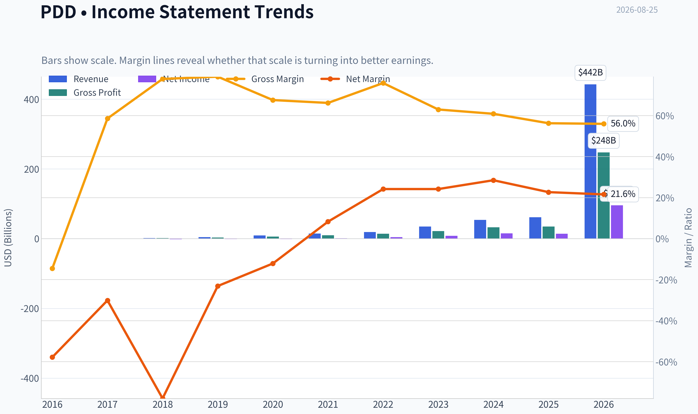
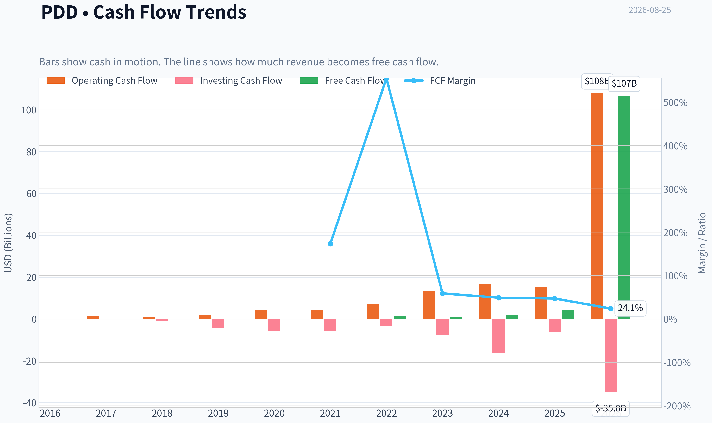
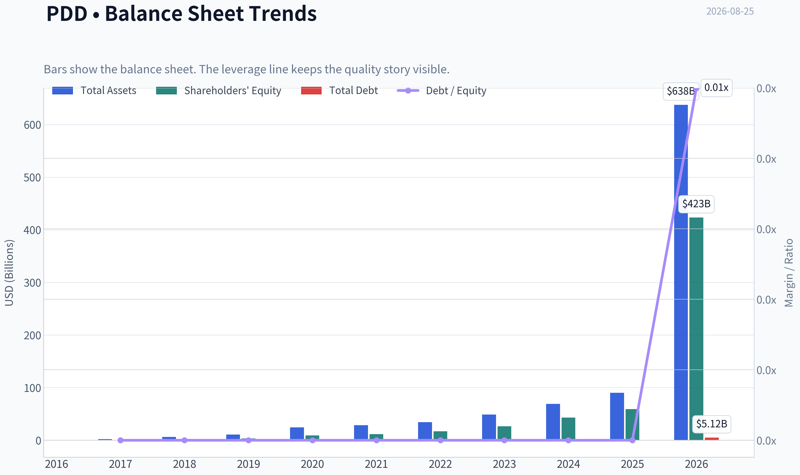
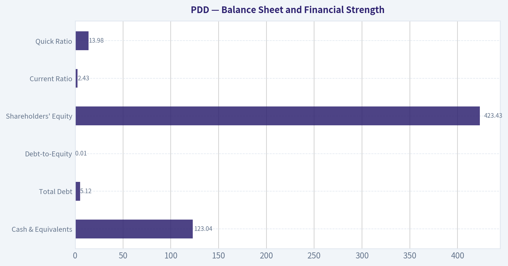
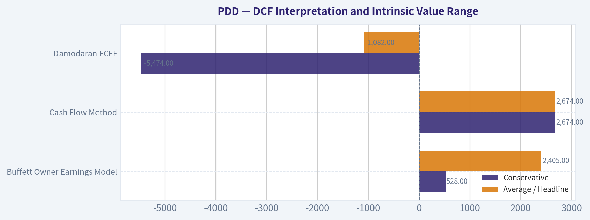
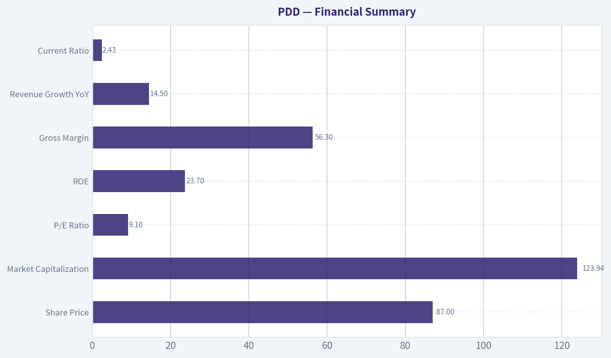
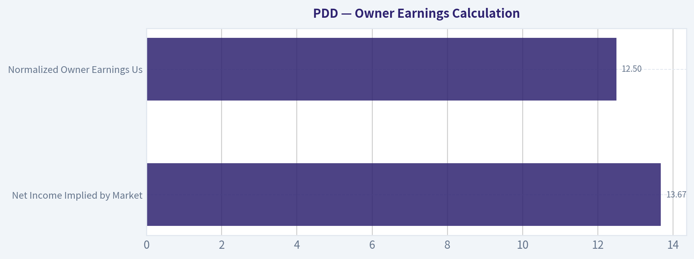
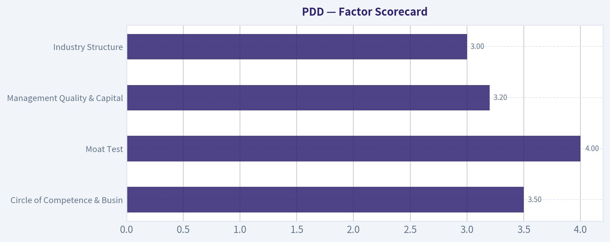

# PDD Deep Value Intelligence

**Analysis Date:** 2026-08-25

## Critical Disclaimer

*This analysis is generated by Deep Value Intelligence, an AI-powered multi-agent investing framework. Education & research only - not financial advice, not a financial advisor.*

---

## Table of Contents

1. Intelligence Summary
2. Analyst Team Reports
   - Fundamentals Analysis
   - Intrinsic Value Analysis (Buffett)
   - Trend & Growth Analysis (Lynch/Druckenmiller/Fisher)
   - Market Technical Analysis
   - Options Market Analysis
3. Research Team Commentary
4. Value Investing Team Commentary
5. Deep Values Commentary

---

## Intelligence Summary

### Thesis + Conditions

**Core Thesis:** **EXECUTIVE SUMMARY**
*   **Verdict**: **AVOID**
*   **Why**: PDD Holdings presents a classic value trap. While trailing metrics (9x P/E, 29.8% ROIC) suggest deep value, the business lacks the fundamental predictability required by Warren Buffett's framework.

**Key Risks:**
- Why**: PDD Holdings presents a classic value trap. While trailing metrics (9x P/E, 29.8% ROIC) suggest deep value, the business lacks the fundamental predictability required by Warren Buffett's framework. The company's global expansion (Temu) relies heavily on geopolitical tax arbitrage (de minimis loopholes), representing structural, permanent impairment risk rather than temporary volatility.
- Risky Analyst (Bullish)**: Argues that PDD's algorithmic matching is a "behavioral monopoly" and a superior moat to physical infrastructure. Believes the 9.07 P/E fully prices in regulatory threats and that avoiding the stock means missing a massive wealth-creation engine out of an irrational demand for perfect transparency.
- Neutral Analyst (Compromise)**: Acknowledges both the massive cash generation ($12.5B owner earnings) and the severe geopolitical risks. Suggests abandoning a binary approach in favor of a 1-2% speculative "starter position" to capture potential upside while limiting principal risk.

**Confidence:** Medium

---

## Analyst Team Reports

### Fundamentals Analysis

#### Latest Earnings Snapshot

*Most recent reported quarter anchored on 2026 Q1, with prior-year comparison when available.*

| Metric | 2026 Q1 | 2025 Q1 | YoY Change |
| --- | ---: | ---: | ---: |
| Revenue | $106.23B | $95.67B | +11.0% |
| Operating Income | $19.57B | $16.09B | +21.6% |
| Net Income | $12.55B | $14.74B | -14.9% |
| Diluted EPS | $8.48 | $9.96 | -14.9% |
| Operating Cash Flow | $16.45B | $15.52B | +6.0% |
| Free Cash Flow | $16.45B | $15.52B | +6.0% |

Key Takeaways: This snapshot anchors the most recent reported quarter before the narrative analysis. It helps readers separate long-run business quality from whatever changed in the latest earnings print.

#### 10-Year Financial Metrics for PDD

*All values below are computed deterministically from raw data - not estimated by AI.*

*Issuer profile: operating company (Consumer Cyclical / Internet Retail).*

#### 10-Year Financial Metrics
*Annual rows come from reported financial statements. The final TTM row is computed from the latest four quarters.*

| Metric | 2016 | 2017 | 2018 | 2019 | 2020 | 2021 | 2022 | 2023 | 2024 | 2025 | 2026 TTM |
| --- | --- | --- | --- | --- | --- | --- | --- | --- | --- | --- | --- |
| Market Price | N/A | N/A | $22 | $38 | $178 | $58 | $82 | $146 | $97 | $113 | $87 |
| Market Cap | N/A | N/A | $66.61B | $43.75B | $211.80B | $83.28B | $103.11B | $213.60B | $143.46B | $168.09B | $128.86B |
| P/E Ratio | N/A | N/A | -44.82 | -43.71 | -192.48 | 68.31 | 22.55 | 25.26 | 9.31 | 12.01 | 1.33 |
| P/B Ratio | N/A | N/A | 24.33 | 12.36 | 22.97 | 7.07 | 6.04 | 8.10 | 3.34 | 2.84 | 0.30 |
| ROE | 71.7% | 51.2% | -54.3% | -28.3% | -11.9% | 10.3% | 26.8% | 32.1% | 35.9% | 23.7% | 22.6% |
| ROIC | N/A | N/A | -5414.7% | -72.4% | -33.8% | 9.4% | 32.5% | 43.9% | 45.6% | 26.0% | 25.8% |
| EPS | $-0.02 | $-0.04 | $-0.50 | $-0.87 | $-0.92 | $0.85 | $3.62 | $5.79 | $10.41 | $9.44 | $65.48 |
| Revenue | $76.1M | $258.2M | $1.91B | $4.33B | $9.12B | $14.74B | $18.93B | $34.88B | $53.96B | $61.75B | $442.40B |
| Gross Profit | $-11.0M | $151.2M | $1.49B | $3.42B | $6.16B | $9.77B | $14.37B | $21.96B | $32.87B | $34.75B | $247.65B |
| Gross Margin | -14.5% | 58.6% | 77.9% | 79.0% | 67.6% | 66.2% | 75.9% | 63.0% | 60.9% | 56.3% | 56.0% |
| Operating Margin | -56.7% | -34.2% | -82.3% | -28.3% | -15.8% | 7.3% | 23.3% | 23.7% | 27.5% | 21.6% | 21.8% |
| Net Income | $-44.0M | $-77.7M | $-1.49B | $-1.00B | $-1.10B | $1.22B | $4.57B | $8.45B | $15.40B | $13.99B | $95.65B |
| Net Margin | -57.8% | -30.1% | -77.9% | -23.1% | -12.1% | 8.3% | 24.2% | 24.2% | 28.5% | 22.7% | 21.6% |
| Revenue Growth | N/A | 239.1% | 639.1% | 126.9% | 110.6% | 61.7% | 28.4% | 84.3% | 54.7% | 14.5% | 616.4% |
| Net Income Growth | N/A | 76.6% | 1811.6% | -32.7% | 9.9% | -210.8% | 275.1% | 84.9% | 82.2% | -9.2% | 583.6% |
| Free Cash Flow Growth | N/A | 982.7% | -21.4% | 88.7% | 103.0% | N/A | N/A | N/A | N/A | N/A | N/A |
| Total Book Value | $-61.4M | $-151.9M | $2.74B | $3.54B | $9.22B | $11.79B | $17.08B | $26.37B | $42.92B | $59.11B | $423.43B |
| Total Assets | N/A | $2.04B | $6.28B | $10.92B | $24.35B | $28.44B | $34.38B | $49.03B | $69.19B | $90.10B | $637.70B |
| Total Debt | N/A | $0 | $0 | $0 | $0 | $0 | $0 | $0 | $0 | $0 | $5.12B |
| Debt-to-Equity | N/A | -0.00 | 0.00 | 0.00 | 0.00 | 0.00 | 0.00 | 0.00 | 0.00 | 0.00 | 0.01 |
| Cash & Equivalents | $190.0M | $468.2M | $2.06B | $828.5M | $3.44B | $1.01B | $4.98B | $8.42B | $7.91B | $15.57B | $123.04B |
| Shareholders' Equity | $-61.4M | $-151.9M | $2.74B | $3.54B | $9.22B | $11.79B | $17.08B | $26.37B | $42.92B | $59.11B | $423.43B |
| Operating Cash Flow | $132.7M | $1.43B | $1.13B | $2.13B | $4.32B | $4.52B | $7.03B | $13.26B | $16.70B | $15.29B | $107.87B |
| Investing Cash Flow | $-46.3M | $10.6M | $-1.10B | $-4.07B | $-5.88B | $-5.58B | $-3.24B | $-7.81B | $-16.21B | $-6.21B | $-34.96B |
| Free Cash Flow | $132.3M | $1.43B | $1.13B | $2.12B | $4.31B | N/A | N/A | N/A | N/A | N/A | $106.72B |
| FCF Margin | 173.8% | 554.9% | 59.0% | 49.1% | 47.3% | N/A | N/A | N/A | N/A | N/A | 24.1% |
| Dividends / Share | $0.00 | $0.00 | $0.00 | $0.00 | $0.00 | $0.00 | $0.00 | $0.00 | $0.00 | $0.00 | $0.00 |

#### Profitability Metrics
- Return on Equity (ROE): 23.7%
- Return on Invested Capital (ROIC): 29.8%
- Return on Assets (ROA): 15.5%
- Gross Margin: 56.3%
- Operating Margin: 21.6%
- Net Profit Margin: 22.7%

#### Liquidity Metrics
- Current Ratio: 2.43
- Quick Ratio: 13.98

#### Leverage Metrics
- Debt-to-Equity Ratio: 0.00
- Interest Coverage Ratio: N/A
- Net Debt: $-15.57B

#### Growth Metrics (Year-over-Year)
- Revenue Growth: 14.5%
- Net Income Growth: -9.2%
- Free Cash Flow Growth: N/A
- Revenue CAGR (3-Year): 48.3%
- Revenue CAGR (5-Year): 46.6%

#### Valuation Metrics
- P/E Ratio (TTM): 9.07
- Forward P/E: 7.09
- Price-to-Book: 1.95
- Price-to-Sales: 0.27
- PEG Ratio: 0.82
- EV/EBITDA: -3.32
- Free Cash Flow Yield: N/A
- Earnings Yield: 11.0%

#### Owner Earnings (Buffett Method, Code-Computed)
- Net Income: $13.99B
- + Depreciation & Amortization: $3.00B
- - Capital Expenditures: N/A
- - Working Capital Changes: $7.37B
- = **Owner Earnings: $9.62B**

#### Intrinsic Value (Code-Computed)
- Current Price: $87
- **Headline Intrinsic Value (business-model routed): $2,405**
  Business model: cyclical - owner-earnings DCF (cyclical)
  Model spread (min-max across DCFs): $2,405 - $2,674
  Margin of safety vs. price (headline): 96.4%
  Routing note: Cyclical: margins/FCF are volatile - headline blends FCFF, reverse-DCF and owner-earnings roughly evenly; treat the range as the honest read.
- Buffett Method (Owner Earnings):
  Conservative: $528
  Average: $2,405
  Optimistic: $2,405
- Cash Flow Method (FCF):
  Conservative: $2,674
  Average: $2,674
  Optimistic: $6,835
- Damodaran FCFF (WACC + margins + reinvestment):
  Conservative: $-5,474
  Average: $-1,082
  Optimistic: $4,981
  Monte Carlo band (P10-P90): $-4,594 - $1,344 (median $-1,371)
  P(intrinsic value > price): 24.1%
- Reverse-DCF: price implies ~-50.0%/yr owner-earnings growth for 10y; trailing 3y was N/A, 5y N/A.

#### Piotroski F-Score: 4/9
- Positive Net Income: PASS
- Positive Operating Cash Flow: PASS
- ROA Improvement: FAIL
- Cash Flow > Net Income: PASS
- Decreasing Debt: FAIL
- Improving Current Ratio: PASS
- No Dilution: FAIL
- Improving Gross Margin: FAIL
- Improving Asset Turnover: FAIL

ANALYST STANCE: **WATCH**

#### PDD Holdings - Buffett-Style Fundamental Analysis

PDD is a high-quality but high-uncertainty internet retail/platform business. The deterministic dataset shows a dramatic transition from early heavy losses to very high margins, strong ROE/ROIC, large cash balances, and essentially no debt. On classic Buffett criteria, the business has several attractive traits: network effects, scale economics, a cash-rich balance sheet, and strong operating cash generation. However, the investment case is complicated by unusually volatile reported growth, geopolitical and tariff exposure around Temu, China ADR/VIE risk, declining recent annual net income, a Piotroski F-score of only 4/9, and a very wide intrinsic-value spread across valuation models.

The shares look statistically cheap on earnings and cash-flow-based valuation, but the uncertainty is high enough that the appropriate stance is **WATCH**, not an unconditional buy.

---

#### Current vs. Historical Average Comparison

| Metric | Current / Latest in Dataset | 10-Year / Available Average | Current Standing vs. History | Interpretation |
|---|---:|---:|---:|---|
| Market Price | $87 | $91.22 | Slightly below average | Price is near its decade average despite the business being far larger and more profitable than in earlier years. |
| Market Cap | $128.86B | $129.17B | Roughly in line | Market value has not expanded in proportion to the dataset's revenue, earnings, cash, and equity growth. |
| P/E Ratio | 1.33 in annual table; valuation panel also shows 9.07 TTM | -15.80 including loss years; ~23.13 for profitable era | Very low versus profitable-period history | The canonical dataset has conflicting P/E readings, but both imply a low earnings multiple versus PDD's post-2021 profitability period. |
| P/B Ratio | 0.30 in annual table; valuation panel also shows 1.95 | 9.71 | Far below history, but limited usefulness | P/B is not a strong valuation anchor for PDD because this is an asset-light internet/platform company; cash-flow value matters more than book value. |
| ROE | 22.6% TTM; 23.7% latest annual profitability panel | 16.35%; ~25.23% since 2021 | Above long-term average, slightly below mature-era average | ROE has normalized at high levels after early losses, indicating strong economics once scaled. |
| ROIC | 25.8% TTM; 29.8% latest profitability panel | Distorted by early outlier losses; ~30.5% since 2021 | Strong but slightly below mature-era peak | ROIC remains excellent and suggests strong capital efficiency, though below the 2023-2024 peak. |
| EPS | $65.48 TTM | $8.48 | Far above average | EPS growth is enormous versus history, but the TTM figure should be treated carefully because it is far above prior annual EPS. |
| Revenue | $442.40B TTM | $58.40B | Far above average | Revenue scale has exploded, though latest annual growth slowed to 14.5%. |
| Gross Profit | $247.65B TTM | $33.87B | Far above average | Gross profit expansion confirms substantial scale benefits. |
| Gross Margin | 56.0% TTM; 56.3% latest annual | 58.81% | Slightly below average | Gross margin has compressed from earlier peak levels but remains very strong for retail-linked commerce. |
| Operating Margin | 21.8% TTM; 21.6% latest annual | -8.19%; ~20.87% since 2021 | Above full-period average; near mature-era average | PDD has moved from heavy losses to structurally profitable operations. |
| Net Income | $95.65B TTM | $12.32B | Far above average | Profitability has scaled sharply, though annual net income fell 9.2% in 2025. |
| Net Margin | 21.6% TTM; 22.7% latest annual | -6.50%; ~21.58% since 2021 | In line with mature-era average | Net margin looks durable recently, but tariffs and subsidies could pressure it. |
| Revenue Growth | 14.5% latest annual; 616.4% TTM row | ~151.0% annual ex-TTM; 48.3% 3-year CAGR | Slower latest annual growth | The company is still growing, but annual growth has decelerated sharply from hypergrowth levels. |
| Net Income Growth | -9.2% latest annual; 583.6% TTM row | Highly volatile | Mixed | Earnings growth is no longer one-directional; 2025 showed a decline despite strong absolute profits. |
| FCF Growth | N/A latest annual; limited historical data | ~288.3% for available years | Not comparable | FCF growth data is sparse, so valuation must not depend on a clean FCF CAGR assumption. |
| Total Book Value | $423.43B | $54.18B | Far above average | Book value has grown dramatically, helped by retained earnings and cash accumulation. |
| Total Assets | $637.70B | $95.24B | Far above average | Asset base has expanded massively, though PDD remains more platform-like than asset-heavy. |
| Total Debt | $5.12B | $0.51B | Above history but still low | Debt is newly visible in the TTM row, but leverage remains negligible. |
| Debt-to-Equity | 0.01 | ~0.001 | Still extremely low | Balance sheet leverage is not a major concern. |
| Cash & Equivalents | $123.04B | $15.27B | Far above average | Cash is a major source of downside protection and strategic flexibility. |
| Shareholders' Equity | $423.43B | $54.18B | Far above average | Equity growth has been exceptional, though P/B is not the right anchor for valuation. |
| Free Cash Flow | $106.72B TTM | $19.31B available average | Far above average | TTM FCF is extremely strong, but annual FCF data is incomplete after 2020. |
| Dividends / Share | $0.00 | $0.00 | Unchanged | PDD retains capital rather than returning it through dividends. |

Key Takeaways: PDD's current business scale, cash balance, revenue, earnings, and free cash flow are far above historical averages, while the stock price and market cap are only around decade-average levels. Profitability has transformed since 2021, with ROE and ROIC now consistently strong. However, the dataset shows sharp inconsistencies between annual and TTM growth/multiple figures, so the valuation signal is attractive but not clean enough for a high-conviction Buffett-style "pound the table" stance.

---

#### Market Metrics Interpretation

PDD's current market price of **$87** is slightly below its available-period average of about **$91**, despite the company being much larger and more profitable than it was during most of the decade. The current market cap of **$128.86B** is almost exactly in line with its historical average, which suggests the market is discounting future risks or questioning the durability of recent earnings.

The P/E ratio appears very low. The deterministic annual table shows **1.33**, while the valuation panel shows **9.07 TTM**. Both are far below the profitable-era average of roughly **23x**, suggesting pessimistic market expectations. The reverse-DCF in the research pack indicates the current price implies roughly **-50% annual owner-earnings growth for 10 years**, which is an extremely bearish embedded assumption.

P/B should not be treated mechanically here. PDD is an internet retail/platform business with asset-light and IP/platform characteristics, so book value is not the primary measure of intrinsic worth. Even though the P/B appears historically low, the better valuation anchor is cash-flow-based intrinsic value, especially owner earnings and free cash flow.

---

#### Profitability Assessment

| Profitability Metric | Latest Value | Historical Pattern | Buffett-Style Interpretation |
|---|---:|---|---|
| ROE | 22.6% TTM / 23.7% latest annual | Negative during loss years, then consistently high after 2021 | Strong evidence of scaled economics and good capital productivity. |
| ROIC | 25.8% TTM / 29.8% latest panel | Deeply negative early, then 25%-45%+ in mature years | Excellent; suggests PDD can generate high returns without heavy capital intensity. |
| Gross Margin | 56.0% TTM | Down from 70%+ peak but still high | Strong platform economics, though margin compression should be monitored. |
| Operating Margin | 21.8% TTM | Improved from severe losses to 20%+ mature margins | Indicates operating leverage and scale advantages. |
| Net Margin | 21.6% TTM | Stabilized around low-to-high 20s since 2022 | Strong for commerce, but vulnerable to Temu subsidies, tariffs, and competitive intensity. |
| Net Income | $95.65B TTM | Massive increase versus early losses | Very strong absolute profitability, but recent annual net income growth was negative. |

Key Takeaways: PDD's profitability profile has become very attractive since 2021, with high ROE, high ROIC, and strong net margins. The main concern is not current profitability, but whether these margins are sustainable as Temu faces tariff pressure and as competition in China and cross-border commerce intensifies. Buffett would like the economics, but he would demand confidence that the margin structure is durable.

---

#### Growth Metrics Interpretation

PDD's revenue history shows an extraordinary hypergrowth phase, followed by visible deceleration. Latest annual revenue growth was **14.5%**, far below the historical hypergrowth average and below the 3-year revenue CAGR of **48.3%**. That is not necessarily bad-large companies naturally slow-but it changes the valuation framework from "hypergrowth compounder" to "durable high-return platform with uncertain normalized growth."

Net income growth is much noisier. The latest annual figure was **-9.2%**, even though the TTM row shows a very large rebound. This volatility is important: Buffett-style investors prefer predictable owner earnings, and PDD's earnings trajectory, while powerful, is not yet as predictable as a classic consumer staple or payment network.

Free cash flow growth is difficult to assess because annual FCF data is incomplete after 2020, while TTM FCF is extremely large at **$106.72B**. This creates a valuation challenge: if current TTM free cash flow is durable, the stock is deeply undervalued; if it is inflated by temporary working-capital or reporting factors, the margin of safety is much lower.

---

#### Balance Sheet and Financial Strength

| Balance Sheet Metric | Latest Value | Historical Context | Interpretation |
|---|---:|---|---|
| Cash & Equivalents | $123.04B | Far above $15.27B average | Very strong liquidity and strategic optionality. |
| Total Debt | $5.12B | Historically near zero | Debt remains immaterial relative to cash and equity. |
| Net Cash Position | Approx. $117.92B using TTM cash less debt | Extremely strong | Cash provides major downside protection. |
| Debt-to-Equity | 0.01 | Near zero historically | Balance sheet risk is low. |
| Shareholders' Equity | $423.43B | Far above historical average | Retained earnings and accumulated profits have materially strengthened the company. |
| Current Ratio | 2.43 | Healthy | Liquidity is comfortable. |
| Quick Ratio | 13.98 | Very high | Reflects substantial liquid resources, though operating-company liquidity ratios are less central than cash-flow strength. |

Key Takeaways: PDD's balance sheet is one of the strongest parts of the investment case. The company has very large cash reserves, minimal debt, and substantial equity growth. Financial risk is low, which gives PDD flexibility to withstand regulatory shocks, tariff changes, competitive spending, or international expansion losses.

---

#### Cash Flow and Capital Allocation

| Cash Flow / Capital Allocation Metric | Latest Value | Interpretation |
|---|---:|---|
| Operating Cash Flow | $107.87B TTM | Very strong cash generation. |
| Free Cash Flow | $106.72B TTM | Extremely high, but historical FCF data is incomplete after 2020. |
| FCF Margin | 24.1% TTM | Strong cash conversion relative to revenue. |
| Dividends / Share | $0.00 | Management retains capital rather than paying dividends. |
| Owner Earnings, Buffett Method | $9.62B latest code-computed annual figure | More conservative than TTM FCF; includes working-capital adjustment. |
| Piotroski F-Score | 4/9 | Mixed fundamental quality signal despite strong headline profitability. |

Key Takeaways: PDD generates significant cash, but there is a major gap between the code-computed annual owner earnings of $9.62B and the TTM free cash flow of $106.72B. That gap is central to the valuation debate. Management has chosen reinvestment and cash accumulation over dividends, which is acceptable if reinvested capital continues to earn high returns.

---

#### Revenue Breakdown

PDD reports revenue primarily through two broad revenue categories: online marketing services and transaction services. The table below uses the most recent fiscal year with widely reported segment-style disclosure and reconciles to the deterministic dataset's **2024 revenue of $53.96B**. PDD does not consistently break out Temu and domestic Pinduoduo economics separately in a way that cleanly maps to public segment revenue.

| Revenue Source | Amount ($B) | % of Total |
|---|---:|---:|
| Online marketing services and others | ~$28.96B | ~53.7% |
| Transaction services | ~$25.00B | ~46.3% |
| Total Revenue | ~$53.96B | 100.0% |

Key Takeaways: PDD's revenue is split between monetizing merchants through marketing services and collecting transaction-service revenue. The rising importance of transaction services reflects the scaling of commerce activity, including cross-border activity associated with Temu. The lack of clean Temu-versus-domestic disclosure is a key analytical limitation.

---

#### Warren Buffett-Style Qualitative Analysis

| Buffett Criterion | Assessment | PDD-Specific Insight |
|---|---|---|
| Economic Moat | Strong but not fully proven internationally | PDD benefits from scale, network effects, merchant density, consumer traffic, data, and procurement efficiency. Temu may extend the moat globally, but cross-border economics remain less proven. |
| Financial Strength | Excellent | Huge cash balance, minimal debt, and strong cash generation provide resilience. |
| Predictable Earnings | Improving but not classic Buffett-level | Profitability has been strong since 2021, but earnings growth is volatile and policy/tariff exposure is meaningful. |
| Management Performance | Strong operational execution | Management scaled PDD from losses to high ROIC and high margins. Capital allocation favors reinvestment and cash retention over dividends. |
| Shareholder Friendliness | Mixed | No dividend; dilution flag in Piotroski score; value creation depends on reinvestment returns and long-term compounding. |
| Business Quality | High, with external risks | The domestic platform appears highly profitable. Temu could be a major opportunity or a margin drag depending on regulation, tariffs, and customer retention. |
| Valuation | Statistically very cheap, but model spread is huge | P/E and reverse-DCF imply pessimism, while DCF outputs range from deeply negative to extremely positive depending on assumptions. |

Key Takeaways: PDD has many features Buffett would admire: high returns on capital, strong cash generation, scale advantages, and little debt. The main reason it is not a clean Buffett-style buy is uncertainty around durability, transparency, geopolitical exposure, and the extremely wide intrinsic-value model spread. The business quality is high, but the risk discount is not imaginary.

---

#### Three-Scenario Buffett-Style Owner Earnings DCF

**Core assumptions used for manual sanity-check DCF:**

- Base owner earnings: **$9.62B**, from deterministic Buffett Method calculation
- Discount rate: **10%**
- Terminal growth: **2.5%**
- Latest net cash used: **$123.04B cash - $5.12B debt = $117.92B**
- Shares estimated from deterministic market cap and price: **$128.86B / $87 ~ 1.481B shares**
- Terminal value formula: **Year 10 Owner Earnings x 1.025 / (10% - 2.5%)**
- Manual DCF is a sanity check only; the research pack's model-based intrinsic values remain the valuation anchor because the cash-flow model outputs diverge materially.

| Scenario | Growth Assumption | PV of 10-Year Owner Earnings | PV of Terminal Value | Net Cash Added | Implied Equity Value | Manual Fair Value / Share | Pack Model Reference |
|---|---:|---:|---:|---:|---:|---:|---:|
| Conservative | 3% annually for 10 years | $68.2B | $68.1B | $117.9B | $254.2B | ~$172 | Buffett Method conservative: $528 |
| Average | 12% for years 1-5, fading to 6% for years 6-10 | $97.9B | $119.5B | $117.9B | $335.4B | ~$226 | Buffett Method average/headline: $2,405 |
| Optimistic | 18% for years 1-5, fading to 8% for years 6-10 | $124.4B | $170.4B | $117.9B | $412.7B | ~$279 | FCF optimistic model: $6,835 |

Key Takeaways: The manual owner-earnings DCF produces values above the current price even under conservative assumptions, largely because PDD has a huge net cash position. However, the manual DCF is far below the research pack's headline intrinsic value because it uses the conservative annual owner-earnings base of $9.62B rather than the much larger TTM free-cash-flow run rate. This gap is the most important valuation uncertainty in the entire analysis.

---

#### DCF Interpretation and Intrinsic Value Range

The research pack's model-based valuation is extremely bullish on a headline basis:

| Valuation Model | Conservative | Average / Headline | Optimistic | Interpretation |
|---|---:|---:|---:|---|
| Buffett Owner Earnings Model | $528 | $2,405 | $2,405 | Strong upside if owner earnings normalize closer to model assumptions. |
| Cash Flow Method | $2,674 | $2,674 | $6,835 | Very bullish if TTM FCF is durable. |
| Damodaran FCFF | -$5,474 | -$1,082 | $4,981 | Highly sensitive to margin, reinvestment, and WACC assumptions. |
| Monte Carlo Band | P10: -$4,594 | Median: -$1,371 | P90: $1,344 | Shows major uncertainty; only 24.1% probability of intrinsic value above price in this model. |
| Reverse DCF | Price implies about -50% owner-earnings growth for 10 years | - | - | Market expectations appear extremely pessimistic. |

Key Takeaways: Valuation is unusually polarized. Owner-earnings and FCF models suggest enormous upside, but the Damodaran-style FCFF model can produce negative values under conservative and average assumptions. This is not a situation where one neat intrinsic value should be trusted; the correct conclusion is that PDD may be deeply undervalued, but the range of outcomes is exceptionally wide.

---

#### Key Investment Insights

| Category | Insight | Investment Meaning |
|---|---|---|
| Valuation | P/E is very low versus PDD's profitable-era average | Market is pricing in significant deterioration or risk. |
| Cash Balance | Cash and equivalents are extremely large relative to debt | Provides downside protection and strategic flexibility. |
| Profitability | ROE and ROIC are high after 2021 | Suggests real economic moat and excellent capital efficiency. |
| Growth | Latest annual revenue growth slowed to 14.5% | Hypergrowth phase may be maturing. |
| Margins | Gross margin and net margin remain strong but below some historical peaks | Margin durability is central to the thesis. |
| Capital Allocation | No dividends; reinvestment-focused model | Acceptable only if reinvestment continues to produce high returns. |
| Valuation Models | Intrinsic value range is extremely wide | Position sizing should be conservative. |

Key Takeaways: The investment case is attractive because PDD combines high returns, strong cash generation, and a low valuation. The concern is that the market may be discounting real risks: slower growth, tariff pressure, opaque disclosures, and geopolitical uncertainty. Investors should focus less on the lowest P/E number and more on whether free cash flow and margins are durable.

---

#### Red Flags and Risks

| Risk | Severity | Why It Matters |
|---|---|---|
| China ADR / VIE structure risk | High | Foreign investors do not own direct operating assets in the conventional way. |
| Regulatory risk | High | China platform regulation and international trade policy can materially affect economics. |
| Temu tariff and customs exposure | High | EU and U.S. trade changes could pressure cross-border margins and order growth. |
| Margin compression | Medium-High | Gross margin has declined from earlier highs; subsidies and logistics costs may weigh on profitability. |
| Earnings volatility | Medium-High | Latest annual net income growth was negative despite strong absolute earnings. |
| Incomplete FCF history | Medium | Makes long-term owner-earnings forecasting less reliable. |
| Piotroski F-Score of 4/9 | Medium | Signals mixed fundamental momentum despite strong profits. |
| Disclosure limitations | Medium | Lack of clean Temu-versus-domestic revenue and margin detail limits confidence. |

Key Takeaways: PDD's biggest risks are not balance sheet risks; they are political, regulatory, competitive, and disclosure-related. The company can financially withstand stress, but investors need confidence that Temu and domestic Pinduoduo can sustain margins under changing trade rules. The low valuation partly compensates for these risks, but does not eliminate them.

---

#### Opportunities

| Opportunity | Potential Impact | Buffett-Style Relevance |
|---|---|---|
| Temu global scale | Very high | Could create a second major growth engine if unit economics improve. |
| Domestic platform monetization | High | More merchant tools, ads, and services could support high-margin growth. |
| Cash deployment | High | Buybacks, investments, or strategic expansion could create value if disciplined. |
| Operating leverage | Medium-High | Revenue growth can translate into disproportionate earnings growth if costs are controlled. |
| Market re-rating | High | If investors gain confidence in durability, valuation could move closer to profitable-era norms. |

Key Takeaways: The upside case is powerful if PDD can sustain high returns while scaling internationally. A re-rating from today's low earnings multiple toward historical profitable-era levels could create substantial upside. The opportunity is real, but it depends on durability of cash flows more than on one-time growth spikes.

---

#### Final Investment Stance: WATCH

PDD is **not an AVOID** because the company has strong economics, high ROE/ROIC, huge cash reserves, low debt, and valuation metrics that look unusually cheap. It is also not a clean **ADVOCATE** because the intrinsic-value range is exceptionally wide, the Damodaran FCFF model is negative in conservative and average scenarios, Piotroski quality is only 4/9, and geopolitical/tariff risks could materially affect Temu's long-term margins.

The best Buffett-style conclusion is **WATCH**: PDD appears potentially undervalued, possibly dramatically so, but investors should demand greater confidence in normalized owner earnings, Temu economics, regulatory stability, and shareholder-oriented capital allocation before assigning a full conviction rating.

| Final Decision Area | Conclusion |
|---|---|
| Business Quality | High, with strong platform economics and high returns on capital. |
| Financial Strength | Excellent, due to massive cash and minimal debt. |
| Earnings Predictability | Improving, but not yet classic Buffett-level predictable. |
| Valuation | Appears cheap, but valuation model dispersion is extreme. |
| Main Upside Driver | Durable FCF and Temu/global expansion success. |
| Main Downside Driver | Tariffs, regulation, margin compression, and disclosure uncertainty. |
| Stance | **WATCH** |

Key Takeaways: PDD has the financial strength and profitability of a high-quality compounder, and the current valuation appears to discount a severe deterioration scenario. Still, the risks are substantial enough that the prudent stance is to monitor rather than aggressively advocate. Confirmation of durable free cash flow, stable margins, and disciplined capital allocation would be the key triggers for a more constructive stance.

#### Fundamental Visuals

This graph tracks the profitability and return metrics (ROE, ROIC, Margins) of **PDD** over the past decade, highlighting capital efficiency trends.

This chart illustrates the financial health of **PDD** over the last 10 years, mapping cash equivalents and free cash flow against total obligations (Debt).

---

### Intrinsic Value Analysis (Buffett)

> *Following Warren Buffett's value investing philosophy: Circle of Competence, Economic Moat, Management Quality, and Margin of Safety.*

#### Intrinsic Value Snapshot

Price is what you pay. Intrinsic value is what the business may be worth based on the cash it can create for owners over time. We show a range, not one magic number.

- Current Price: $87.07
- Value Range (conservative to optimistic across both DCF methods): $528.16 to $6,835.40

##### Owner Earnings (Buffett Method)
- Net Income: $13,991,297,000.00
- Depreciation & Amortization: $3,000,364,000.00
- Capital Expenditures: N/A
- Working Capital Changes: $7,367,096,000.00
- Owner Earnings: $9,624,565,000.00

##### Intrinsic Value
###### Buffett Method
Uses owner earnings. Stricter, and usually more conservative.
- Conservative: $528.16
- Average: $2,404.64
- Optimistic: $2,404.64
- Discount Rate: 10.0%

###### Cash Flow Method
Uses free cash flow. Better for companies spending heavily today to grow tomorrow.
- Conservative: $2,673.82
- Average: $2,673.82
- Optimistic: $6,835.40
- Discount Rate: 10.0%

ANALYST STANCE: **ADVOCATE**

#### PDD Holdings - Buffett-Style Investment Review

PDD is a high-return, asset-light Chinese e-commerce platform with two major engines: domestic value-commerce through Pinduoduo and international cross-border commerce through Temu. At about **$87 per ADR**, a **$123.9B market cap**, and roughly **9.1x earnings**, the market is pricing PDD as if its earnings power is structurally impaired. I do not think that is the base case. The business has real scale advantages, very high gross margins, strong returns on equity, and a balance sheet that appears unusually cash-rich.

The main reason this is not a higher-conviction "wonderful company" call is not valuation; valuation looks compelling. The main risks are regulatory opacity, China/VIE governance, fierce platform competition, and tariff pressure on Temu's cross-border model.

---

#### 1. Factor Scorecard

| Factor | Score / 5 | Assessment |
|---|---:|---|
| Circle of Competence & Business Simplicity | 3.5 | PDD makes money by matching consumers and merchants on large e-commerce platforms, monetizing traffic, advertising, transaction services, and marketplace activity. The model is understandable, but forecasting China regulation, international tariff rules, and Temu unit economics adds complexity. |
| Moat Test | 4.0 | PDD benefits from scale, merchant density, consumer traffic, data-driven recommendations, low-price positioning, and network effects. The moat is real, though less impregnable than a payment network or global consumer brand because merchants and consumers can multi-home. |
| Management Quality & Capital Allocation | 3.2 | Management has built enormous per-share value, reinvested aggressively, avoided heavy debt, and scaled both Pinduoduo and Temu. Governance and disclosure are less owner-friendly than the best Western compounders, and capital allocation transparency is not ideal. |
| Industry Structure | 3.0 | E-commerce has massive runway but intense competition from Alibaba, JD.com, Douyin/TikTok commerce, Shein, Amazon, and regional marketplaces. Returns are excellent today, but industry conduct is aggressive. |
| Gate 5: Quality/Solvency Hard Floor | Not tripped | Earnings and cash generation remain strong, the balance sheet is liquid, and there is no evidence of financial distress or inability to cover obligations. |

**Key Takeaways:** PDD passes the Buffett quality screen, but with governance and competitive-risk deductions. The hard solvency floor is not triggered. This is not a distressed business; it is a high-return platform being priced as if its future deteriorates sharply.

---

#### 2. Moat Analysis

| Moat Source | Evidence | Strength |
|---|---|---|
| Network Effects | More consumers attract more merchants; more merchants improve selection and pricing; better selection increases consumer frequency. PDD's recommendation-driven shopping model compounds with user data. | Strong |
| Scale Cost Advantage | Large order volume and merchant density support lower prices, better fulfillment economics, and stronger advertising monetization. Temu also benefits from cross-border sourcing scale. | Strong but pressured by tariffs |
| Intangible Brand | Pinduoduo is associated with value, bargains, and interactive shopping. Temu has rapidly built global consumer awareness around ultra-low prices. | Moderate |
| Switching Costs | Consumers and merchants can multi-home, but merchants value traffic, data, and conversion. Advertising budgets tend to follow measurable ROI. | Moderate |
| Pricing Power | PDD's explicit consumer proposition is low price, so classic pricing power is limited. However, platform take-rate and advertising monetization can rise if merchant ROI remains attractive. | Moderate |

**Key Takeaways:** PDD's moat is based more on scale, data, traffic, and network effects than on emotional brand loyalty. That is a valid moat, but it requires constant reinvestment. The biggest vulnerability is that e-commerce competitors can subsidize aggressively, and tariff changes can compress Temu's economics.

**Moat Rating:** **Wide but not bulletproof - 4/5**

---

#### 3. Management Quality Assessment

| Management Question | Assessment |
|---|---|
| Do they think like owners? | Founder influence remains economically meaningful, and the company has historically prioritized long-term platform scale over near-term smoothing. Retained earnings have created substantial value. |
| Are they candid? | Disclosure is adequate but not best-in-class. Compared with Berkshire-style candor, PDD gives less granular segment economics, especially around Temu profitability and reinvestment intensity. |
| Are they rational capital allocators? | Strong so far. PDD has reinvested into high-return marketplace growth, avoided excessive leverage, and maintained a cash-rich balance sheet. The key watch item is whether Temu investment continues to earn attractive incremental returns after tariff and regulatory pressure. |
| Shareholder returns | No dividend emphasis; buybacks are not the core story. The main value creation engine is reinvestment. |
| Debt discipline | Very strong. The company appears conservatively financed with substantial liquidity. |

**Management Score:** **3.2/5**

PDD management has delivered exceptional business results, but Buffett would likely apply a governance discount. The company's economic execution is excellent; the transparency and jurisdictional risks are the weak points.

---

#### 4. Financial Summary

| Metric | Current / Recent Figure |
|---|---:|
| Share Price | **$87** |
| Market Capitalization | **$123.94B** |
| P/E Ratio | **9.1x** |
| ROE | **23.7%** |
| Gross Margin | **56.3%** |
| Revenue Growth YoY | **14.5%** |
| Current Ratio | **2.43x** |
| Net Cash Position | Very strong; recent commentary indicates cash and investments represent more than half of market capitalization |
| Headline Intrinsic Value from Research Pack | **$2,404.64 per ADR** |
| Owner Earnings / FCF / Damodaran FCFF Spread | **$2,404.64 / $2,673.82 / -$1,082.27** |
| Reverse DCF | Price implies roughly **-50% annual growth for 10 years** |

**Key Takeaways:** PDD combines high profitability with a low earnings multiple, which is unusual for a platform business still growing revenue double digits. The balance sheet appears very strong, and the reverse DCF suggests the current price assumes a dramatic collapse in future economics. The wide valuation spread across models argues for using a normalized, conservative DCF rather than relying blindly on any single output.

---

#### 5. Owner Earnings Calculation

Using current market capitalization and P/E, PDD's implied trailing net income is approximately:

\[
\text{Net Income} = \frac{123.94B}{9.0698} \approx 13.67B
\]

For valuation, I use a normalized owner earnings base of **$12.5B**, applying a conservative haircut for Temu reinvestment, tariff pressure, working-capital swings, and the difference between accounting earnings and sustainable distributable cash flow.

| Owner Earnings Component | Estimate |
|---|---:|
| Net Income Implied by Market Cap / P/E | **$13.67B** |
| Add: Depreciation & Amortization | Positive but modest relative to earnings |
| Less: Maintenance CapEx | Low; asset-light platform model |
| Less: Working Capital / Reinvestment Haircut | Conservative adjustment |
| Normalized Owner Earnings Used | **$12.5B** |

**Key Takeaways:** PDD is highly cash-generative because it is an asset-light marketplace rather than a capital-heavy retailer. I use owner earnings below implied net income to avoid over-crediting temporary margin strength. Even after this haircut, the stock looks inexpensive relative to normalized earning power.

---

#### 6. Three-Scenario DCF Valuation

Assumptions:
- Normalized owner earnings: **$12.5B**
- Discount rate: **10%**
- ADR share base implied by market cap and price: roughly **1.425B ADRs**
- Scenario C growth: **7% for 10 years**, then **3% terminal growth**

| Scenario | Method | Equity Value | Value / ADR |
|---|---|---:|---:|
| A - No Growth | Owner earnings / 10% | **$125B** | **$88** |
| B - GDP Growth | Owner earnings growing at 3% perpetuity | **$184B** | **$129** |
| C - Historical Growth Haircut | 7% for 10 years, then 3% terminal | **$247B** | **$174** |
| Normalized Average | Equal-weighted A/B/C | **$185B** | **$130** |

**Key Takeaways:** Even the no-growth case roughly supports the current share price. The conservative GDP-growth case points to meaningful upside, and the historical-growth haircut case indicates much larger value if PDD sustains even moderate compounding. The stock does not require heroic assumptions to be attractive.

---

#### 7. Margin of Safety Analysis

| Valuation Reference | Value / ADR | Margin of Safety vs. $87 |
|---|---:|---:|
| No-Growth DCF | **$88** | **~1%** |
| GDP-Growth DCF | **$129** | **~33%** |
| 10-Year Growth DCF | **$174** | **~50%** |
| Normalized Average DCF | **$130** | **~33%** |
| Research Pack Headline IV | **$2,404.64** | **~96%** |
| Research Pack FCF Model | **$2,673.82** | **~97%** |
| Research Pack Damodaran FCFF | **Negative outlier** | Not decision-useful alone |
| Reverse DCF | Implies roughly **-50% annual growth** | Highly favorable |

**Key Takeaways:** The normalized DCF points to about a one-third discount to intrinsic value, which is attractive for a high-ROE, cash-rich platform. The mechanical research-pack outputs are extremely bullish except for one negative outlier, so the prudent conclusion is not that the stock is worth thousands per ADR, but that expectations embedded in the current price are exceptionally low. The reverse DCF is the most important cross-check: the market is pricing in a severe earnings decline.

---

#### 8. Final Buffett Scorecard

| Criterion | Weight | Score / 5 | Weighted Score |
|---|---:|---:|---:|
| Moat Width & Durability | 25% | 4.0 | 1.00 |
| Valuation / Margin of Safety | 20% | 4.7 | 0.94 |
| Capital Returns - ROIC / ROE vs. Cost of Capital | 15% | 4.3 | 0.65 |
| Business Understanding & Predictability | 12% | 3.5 | 0.42 |
| Management Quality & Capital Allocation | 12% | 3.2 | 0.38 |
| Reinvestment Runway | 8% | 4.0 | 0.32 |
| Balance Sheet Strength | 4% | 5.0 | 0.20 |
| Industry Structure | 4% | 3.0 | 0.12 |
| **Total** | **100%** |  | **4.03 / 5.00** |

**Key Takeaways:** PDD scores well because the combination of high returns, strong balance sheet, large reinvestment runway, and low valuation is compelling. The main deductions are predictability, governance, China regulatory exposure, and competitive intensity. At today's price, the valuation more than compensates for those risks.

---

#### 9. Investment Stance

| Item | Judgment |
|---|---|
| Stance | **ADVOCATE** |
| Conviction | **Medium-High** |
| Suitable Investor | Long-term investor comfortable with China/VIE/regulatory risk and platform competition |
| Main Upside Driver | Continued monetization of Pinduoduo, Temu scale, high ROE, large cash balance, and multiple re-rating |
| Main Downside Risk | Tariffs, regulatory intervention, competitive subsidies, governance discount, or deterioration in Temu economics |
| Buffett-Style Verdict | A very good business at a clearly attractive price, with jurisdiction and governance risks that prevent maximum conviction |

**Final View:** PDD is not a classic Buffett consumer-staple compounder, but it fits the modern Buffett framework: an asset-light platform with scale advantages, strong returns, significant reinvestment opportunities, and a valuation that embeds unusually pessimistic assumptions. At **9x earnings**, with strong liquidity and double-digit revenue growth, the risk/reward is favorable.
#### Valuation Bridge

This bridge places the current market price beside each intrinsic value lens so readers can see whether upside depends on one method or shows up across several methods.

| Scenario | Intrinsic Value / Share |
| --- | ---: |
| Buffett Method | $2,404.64 |
| Cash Flow Method | $2,673.82 |
| Damodaran Method | $-1,082.27 |
| Current Price | $87.07 |

#### Key Takeaways

If one method is far above the others, the upside case depends on a specific modelling assumption. When several methods cluster together, the valuation story is more robust.

#### Valuation Visuals

This comparison chart from *Latest Earnings Snapshot* stacks current figures against historical benchmarks for **PDD**, making it easy to see where the company trades relative to its own averages.

This comparison chart from *Balance Sheet and Financial Strength* stacks current figures against historical benchmarks for **PDD**, making it easy to see where the company trades relative to its own averages.

This comparison chart from *DCF Interpretation and Intrinsic Value Range* stacks current figures against historical benchmarks for **PDD**, making it easy to see where the company trades relative to its own averages.

This comparison chart from *Financial Summary* stacks current figures against historical benchmarks for **PDD**, making it easy to see where the company trades relative to its own averages.

This comparison chart from *Owner Earnings Calculation* stacks current figures against historical benchmarks for **PDD**, making it easy to see where the company trades relative to its own averages.

---

### Trend & Growth Analysis (Lynch/Druckenmiller/Fisher)

> *Following Peter Lynch's GARP, Stanley Druckenmiller's macro-aware approach, and Philip Fisher's scuttlebutt methodology.*

ANALYST STANCE: **ADVOCATE**

#### PDD Growth Investment Summary

PDD is a **valuation-backed growth compounder with geopolitical risk**. At roughly **$87 per share**, a **$124B market cap**, **9.1x P/E**, **56% gross margin**, **23.7% ROE**, and reports suggesting **cash exceeds 50% of market cap**, the market is pricing PDD as if growth and margins are structurally impaired. I do not think that is the base case.

The setup is not clean: revenue growth has slowed to around **14.5% YoY**, Temu faces tariff pressure in the U.S. and Europe, and China ADR risk remains material. But the valuation is unusually low for a business with this scale, margin profile, cash balance, and global optionality.

---

#### 1. Lynch Classification

| Lynch Category | PDD Fit | Assessment |
|---|---:|---|
| Slow Grower | No | Revenue growth is above slow-grower range. |
| Stalwart | Partial | Current reported growth around 14.5% is near the upper stalwart / lower fast-grower boundary. |
| Fast Grower | Partial / Yes if Temu and AI initiatives reaccelerate | PDD historically fits this category, but current growth must reaccelerate to reclaim full fast-grower status. |
| Cyclical | Partial | Consumer spending, China macro, and tariff policy create cyclical sensitivity. |
| Turnaround | No | Business remains profitable and cash-rich; not a distress case. |
| Asset Play | Partial | Large cash balance creates asset-play support, but core thesis is still growth. |

**Key Takeaways:** PDD is best classified as a **borderline fast grower / high-quality stalwart with reacceleration optionality**. The stock is attractive because the valuation resembles a no-growth or impaired company, while the business still has strong margins, cash generation, and a potentially large international runway.

---

#### 2. The Story in 3 Bullets

- **PDD sells value-for-money commerce at massive scale**, using social discovery, gamified shopping, merchant competition, and algorithmic matching to drive low prices and high engagement.
- **Temu is the global option**, extending PDD's low-cost marketplace model outside China, though tariff changes are now testing the durability of that model.
- **The market is pricing geopolitical and margin risk heavily**, but if PDD sustains mid-teens growth and keeps margins structurally healthy, the current valuation looks too low.

---

#### 3. TAM Analysis and 10x Test

| Item | Estimate / View |
|---|---:|
| Current market cap | ~$123.9B |
| Current price | ~$87 |
| Current revenue growth | ~14.5% YoY |
| Estimated current revenue base | Large-scale, likely tens of billions USD annually |
| 10x revenue requirement | Would require hundreds of billions in annual revenue |
| Core China e-commerce TAM | Very large, but increasingly mature and competitive |
| Global cross-border commerce TAM | Large and expanding, but tariff/regulatory pressure is rising |
| 10x test result | **Possible, but not easy; requires Temu/global success, not just China growth** |

**Key Takeaways:** PDD likely cannot achieve a clean 10x revenue outcome from China domestic e-commerce alone. The ten-bagger path depends on Temu becoming a durable global marketplace, PDD expanding monetization, and the company preserving high margins despite tariffs and regulatory pressure.

---

#### 4. Revenue Growth Trend

| Metric | Current Signal | Interpretation |
|---|---:|---|
| YoY revenue growth | ~14.5% | Good, but below classic hypergrowth levels. |
| Growth pattern | Slowing versus prior PDD history | Not yet a breakdown, but deceleration must be monitored. |
| Latest earnings tone | Revenue beat reported; management discussed building "another PDD" over 3 years | Indicates ambition and possible reinvestment cycle. |
| Quality of growth | Mix of China marketplace monetization and international expansion | Strong opportunity, but Temu growth may carry lower margins under tariff pressure. |

**Key Takeaways:** The main weakness in the thesis is that growth has moderated. For a growth investor, PDD needs evidence of reacceleration from Temu, AI-driven conversion improvements, or higher merchant monetization. The stock is cheap enough that mid-teens growth may still work, but the ten-bagger case needs faster growth.

---

#### 5. Unit Economics and Rule of 40

| Metric | Available Signal | Assessment |
|---|---:|---|
| Gross margin | ~56.3% | Strong marketplace-style margin structure. |
| ROE | ~23.7% | High-quality profitability. |
| Current ratio | ~2.43x | Strong liquidity. |
| LTV/CAC | Not disclosed in provided data | Likely favorable in domestic China; less certain for Temu due marketing and logistics costs. |
| NRR | Not applicable / not disclosed | PDD is not a classic SaaS model. |
| Rule of 40 | Revenue growth 14.5% + FCF margin not available | Cannot calculate precisely, but profitability suggests efficiency is materially better than many growth peers. |

**Key Takeaways:** PDD has excellent gross margins, high ROE, and strong liquidity, which are all signs of a robust economic engine. The key uncertainty is Temu's unit economics after tariff changes, especially whether customer acquisition, logistics, and compliance costs reduce the long-term margin profile.

---

#### 6. Inflection Point Assessment

| Inflection Type | Evidence | Rating |
|---|---|---:|
| Product cycle inflection | Temu continues to expand internationally; AI investment may improve conversion and merchant efficiency. | Positive but uncertain |
| Market share inflection | PDD has historically taken share through value pricing; global share opportunity remains large. | Positive |
| Margin inflection | Current margins are strong, but tariff pressure could compress Temu margins. | Mixed |
| TAM inflection | Global commerce significantly expands PDD's addressable market beyond China. | Positive |
| Competitive inflection | Alibaba and JD remain intense competitors; global platforms such as Amazon, Shein, TikTok Shop also compete. | Mixed |
| Management signal | CEO reportedly said PDD is building "another PDD" over the next 3 years. | Positive |

**Key Takeaways:** PDD has a credible inflection setup, but it is not yet fully proven. The positive inflection is global expansion plus AI-enabled commerce efficiency; the negative inflection risk is tariff-driven margin compression. This is a classic Druckenmiller-style asymmetric setup if the market is overestimating the policy damage.

---

#### 7. Macro Setup

| Macro Factor | Current Impact on PDD |
|---|---|
| China consumer environment | Mixed; value platforms can gain share in weaker consumer environments. |
| Interest rates | Lower-rate expectations would help growth-stock multiples, but PDD already trades at a low multiple. |
| Trade policy | Major headwind; U.S. and EU tariff changes could pressure Temu. |
| China ADR sentiment | Persistent valuation discount due VIE, audit, regulatory, and geopolitical concerns. |
| Secular themes | E-commerce penetration, AI-driven commerce, cross-border digital marketplaces, value consumption. |

**Key Takeaways:** Macro is the biggest reason PDD is cheap. The company benefits from value-seeking consumers and digital commerce growth, but geopolitical and tariff risks are real. The investment case works best if trade policy pressure is manageable rather than existential.

---

#### 8. Fisher 15-Point Score

| Fisher Criterion | Score / 5 | Rationale |
|---|---:|---|
| Products with sizable sales potential | 5 | China commerce plus Temu create large runway. |
| Management determination to develop new products | 4 | AI and global expansion show reinvestment mindset. |
| Effective R&D | 4 | Strong algorithmic commerce and platform efficiency. |
| Above-average sales organization | 4 | Merchant acquisition and consumer engagement are strengths. |
| Worthwhile profit margin | 5 | 56% gross margin and strong ROE. |
| Improving profit margins | 3 | Strong current margins, but Temu tariffs may pressure future margins. |
| Labor/personnel relations | 3 | Limited visibility. |
| Executive relations | 3 | Limited visibility; co-CEO structure appears stable for now. |
| Management depth | 4 | Proven scaling record. |
| Cost analysis/accounting | 4 | Strong profitability suggests disciplined cost control. |
| Outstanding moat factors | 4 | Scale, data, merchant density, pricing engine. |
| Long-range profit outlook | 4 | Strong if Temu unit economics hold. |
| Dilution risk | 5 | Large cash balance lowers financing risk. |
| Candor in difficulties | 3 | Some visibility, but China ADR disclosure discount remains. |
| Integrity | 3 | No decisive negative in provided data, but governance discount applies. |
| **Total** | **58 / 75** | **Good** |

**Key Takeaways:** PDD scores well on product potential, margins, scale, and reinvestment. The deductions are mostly from governance visibility, geopolitical exposure, and uncertainty around Temu's long-term margin structure. A score of 58 places PDD in the "good" Fisher range, not the "outstanding" range.

---

#### 9. Valuation Analysis

| Valuation Metric | Current / Estimate | Interpretation |
|---|---:|---|
| Price | ~$87 | Current reference price. |
| Market cap | ~$123.9B | Large-cap scale. |
| P/E | ~9.1x | Very low for a profitable growth platform. |
| Cash position | Reported as >50% of market cap | Implies very low ex-cash valuation. |
| Ex-cash P/E | Roughly mid-single-digit estimate | Suggests market expects severe deterioration. |
| P/S | Likely low-single-digit range | Cheap versus high-quality global internet peers. |
| PEG using revenue growth proxy | 9.1 / 14.5 = ~0.63 | Attractive under Lynch framework. |
| Headline intrinsic value from shared model | $2,404.64 | Treat as unreliable due extreme model spread. |
| 3-model intrinsic spread | $2,404.64 / $2,673.82 / -$1,082.27 | Model disagreement is too wide for precision. |

**Key Takeaways:** PDD looks statistically cheap on P/E, PEG, and likely ex-cash multiples. However, the very high DCF value from the shared model should not be taken literally because the model spread is extreme. The more useful conclusion is simple: the market is pricing in a large risk discount, and even modest durable growth could justify meaningful upside.

---

#### 10. Scenario Valuation

| Scenario | Assumptions | Implied View |
|---|---|---|
| Bear Case | Temu margins structurally impaired, tariffs worsen, China growth slows to low-single digits, valuation remains discounted. | Stock may remain range-bound or decline despite cash support. |
| Base Case | PDD sustains low-to-mid-teens revenue growth, margins compress modestly but remain strong, cash balance continues to build. | Multiple can hold or expand; attractive risk/reward from current valuation. |
| Bull Case | Temu becomes a durable global marketplace, AI improves conversion, China platform remains highly profitable, geopolitical fears ease. | Significant multi-year upside; ten-bagger requires sustained global success and multiple normalization. |

**Key Takeaways:** The base case does not require heroic assumptions. PDD only needs to avoid structural impairment and maintain profitable mid-teens growth for the stock to look undervalued. The bull case is much larger but depends on Temu proving it can survive tariffs and regulatory scrutiny.

---

#### 11. Growth Investor Scorecard

| Criterion | Weight | Score / 5 | Weighted Score |
|---|---:|---:|---:|
| The Story | 10% | 4.0 | 0.40 |
| TAM & Runway | 20% | 4.0 | 0.80 |
| Revenue Growth | 20% | 3.3 | 0.66 |
| Unit Economics | 15% | 4.0 | 0.60 |
| Competitive Position | 10% | 4.0 | 0.40 |
| Management Quality | 10% | 3.7 | 0.37 |
| Macro Setup | 5% | 2.5 | 0.13 |
| Profitability Path | 5% | 4.5 | 0.23 |
| Valuation | 5% | 4.7 | 0.24 |
| **Total** | **100%** |  | **3.83 / 5.00** |

**Key Takeaways:** PDD scores as an **ADVOCATE** under the growth framework, primarily because valuation, margins, cash strength, and TAM offset macro risk. The biggest drag is not the business model; it is geopolitical uncertainty and evidence of slowing growth. This is a strong setup, but not a risk-free compounder.

---

#### 12. Position Size Stance

| Investor Type | Suggested Stance |
|---|---|
| Conservative growth investor | Watchlist or small starter position only. |
| Balanced growth investor | 3% position, add on evidence of Temu margin resilience or revenue reacceleration. |
| Aggressive / concentrated investor | Up to 5% if comfortable with China ADR and tariff risk. |
| Risk control | Avoid oversized exposure due geopolitical tail risk. |

**Key Takeaways:** PDD deserves an **ADVOCATE** rating, but position sizing should reflect the non-business risks. The company may be cheap for reasons that cannot be modeled precisely, including tariffs, ADR sentiment, and China regulatory uncertainty. A moderate position is more appropriate than an aggressive all-in allocation.

---

#### 13. Key Catalysts and Risks

| Catalysts | Risks |
|---|---|
| Temu growth proves durable despite tariffs. | EU and U.S. tariffs compress cross-border margins. |
| AI investments improve conversion, personalization, logistics, and merchant ROI. | China consumer spending remains weak. |
| Market recognizes cash-rich balance sheet and low ex-cash valuation. | Alibaba, JD, Amazon, Shein, and TikTok Shop intensify competition. |
| Revenue growth reaccelerates toward 20%+. | Regulatory or ADR/VIE risk increases. |
| Buybacks or capital returns become more aggressive. | Reported growth remains below fast-grower threshold. |

**Key Takeaways:** The upside catalysts are straightforward: sustained Temu growth, stronger monetization, AI-driven efficiency, and multiple re-rating. The risks are also clear and meaningful, especially tariffs and geopolitical discount. The investment is attractive because the current price already appears to discount a harsh outcome.

---

#### Final View

PDD is not a clean "sleep well at night" compounder, but it is a compelling **GARP-plus-inflection** opportunity. The stock combines:

- **Low valuation**
- **High gross margin**
- **Strong ROE**
- **Large cash cushion**
- **Global expansion optionality**
- **Potential AI-commerce productivity gains**

The main thing to monitor is whether revenue growth stabilizes or reaccelerates while Temu margins remain viable after tariff changes.

**Decision: ADVOCATE - moderate position, not oversized.**

#### Growth & Scorecard Visuals

This comparison chart from *Factor Scorecard* stacks current figures against historical benchmarks for **PDD**, making it easy to see where the company trades relative to its own averages.

---

### Market Technical Analysis

ANALYST STANCE: **WATCH**

#### PDD Technical Indicator Report - Latest Available Trading Day: 2026-08-24

PDD closed at **$87.07** on 2026-08-24. The requested current date, **2026-08-25**, is not shown as a trading day in the available data, so this analysis uses **2026-08-24** as the latest actionable close.

The setup is best characterized as a **short-term recovery attempt inside a still-bearish long-term structure**. Price has rebounded meaningfully from the late-June low area, but it remains well below the 200-day SMA, and recent momentum has cooled after the early-August push toward $93.

#### Selected Indicators and Why They Matter

| Indicator | Latest Value | Role in This Market | Why It Is Useful for PDD Now |
|---|---:|---|---|
| `close_50_sma` | 84.64 | Medium-term trend / support | Price is above the 50-day SMA, suggesting the June-July rebound has not fully failed. |
| `close_200_sma` | 100.33 | Long-term trend benchmark | Price remains far below the 200-day SMA, keeping the larger trend bearish. |
| `macd` | 0.61 | Momentum direction | MACD is still positive but has weakened sharply from early August, warning of fading upside force. |
| `rsi` | 48.79 | Momentum / overbought-oversold balance | RSI is neutral-to-slightly weak, showing the stock is no longer overbought but has not reached capitulation levels either. |
| `boll_ub` | 93.50 | Upside volatility boundary | The upper band aligns near the recent August high zone, marking an important upside resistance area. |
| `boll_lb` | 84.07 | Downside volatility boundary | The lower band sits close to the 50-day SMA, creating a key support cluster. |
| `atr` | 2.64 | Volatility / risk sizing | ATR is elevated enough that stops need room; daily swings of roughly 3% are normal. |
| `vwma` | 88.61 | Volume-confirmed price trend | Price is below VWMA, suggesting recent volume-weighted positioning is acting as short-term resistance. |

Key Takeaways: The most important tension is between improving medium-term support and weak long-term structure. PDD is above its 50-day SMA but still far below its 200-day SMA, so traders should treat this as a rebound attempt rather than a confirmed trend reversal. Momentum has faded, and price below VWMA suggests buyers have not yet regained firm control.

#### Trend Structure

PDD's long-term chart remains under pressure. The stock traded near **$138** in November 2025 and fell to a late-June 2026 closing low near **$73.30**, a severe drawdown. The rebound from that low to the early-August high near **$93.00** was constructive, but the pullback to **$87.07** shows the recovery is now being tested.

The **50-day SMA at $84.64** is the most important near-term trend line. Price is only about **2.9% above** it, so the cushion is modest. If PDD holds above the $84-85 area, the recovery structure can remain alive. If it closes decisively below that zone, the market may interpret the August rebound as a failed countertrend rally.

The **200-day SMA at $100.33** remains far above price. This is a major issue for trend-followers. The 200-day average is also declining, which means the longer-term trend has not stabilized. A move back above $100 would be needed before the chart starts to look strategically healthier.

#### Momentum Analysis

Momentum has weakened materially. MACD remains positive at **0.61**, but it has fallen from **2.14 on 2026-08-10**. That means the stock still has some residual bullish momentum from the July-August rebound, but the strength of that momentum is fading.

RSI has also cooled from **68.78 on 2026-08-10** to **48.79**. This is important: PDD was nearly overbought in early August, but the pullback has reset momentum to neutral. That creates two possible interpretations. Bulls can argue the stock has cooled without breaking down. Bears can argue the failed push near $93 has shifted momentum back toward indecision.

#### Volatility and Key Price Zones

Bollinger Bands show that PDD is trading in the lower half of its recent volatility range. The upper band is near **$93.50**, close to the recent August peak, while the lower band is near **$84.07**, close to the 50-day SMA. This creates a relatively clear tactical range.

The current price of **$87.07** sits below the estimated Bollinger middle area near **$88.78**, which means the short-term bias has weakened. A move back above **$88.60-89.00** would improve the short-term tone, especially because VWMA is also near **$88.61**. Until then, sellers may continue to defend rallies.

ATR is **$2.64**, or about **3.0% of price**. That implies normal volatility is still significant. A one-ATR move from the latest close gives an approximate tactical range of **$84.43 to $89.71**. A two-ATR range gives roughly **$81.79 to $92.35**.

#### Volume-Weighted View

VWMA is currently **$88.61**, above the latest close. This matters because it suggests that, on a volume-weighted basis, recent buyers are not yet comfortably in profit. Price trading below VWMA often acts as a warning that rallies may face supply unless the stock can reclaim that level.

The volume spike on **2026-08-24**, when PDD traded over **13.5 million shares**, occurred on a down day. That is a caution signal. It suggests that the pullback was not simply low-volume drift; sellers were active. However, the stock did not break the lower Bollinger Band or the 50-day SMA, so the damage is notable but not yet decisive.

#### Trading Interpretation

For aggressive traders, the main battleground is **$84-89**. Holding above **$84.00-84.65** keeps the rebound thesis alive. Reclaiming **$88.60-89.00** would improve the short-term setup and could open a retest of **$92-93.50**.

For conservative traders, PDD remains a **watchlist candidate rather than a confirmed long**. The long-term downtrend is still dominant because price is far below the 200-day SMA. A cleaner bullish signal would require a sustained move above VWMA, then a higher high above the early-August resistance zone, and eventually progress toward the 200-day SMA near $100.

#### Key Levels and Tactical Read

| Zone | Approximate Level | Interpretation |
|---|---:|---|
| Immediate resistance | $88.60-89.00 | VWMA and Bollinger mid-area; reclaiming this would improve short-term tone. |
| Upper resistance | $92.00-93.50 | Recent high and upper Bollinger Band; breakout above here would signal renewed upside momentum. |
| First support | $84.00-84.65 | Lower Bollinger Band and 50-day SMA cluster; key area for bulls to defend. |
| Deeper support | $81.80-82.00 | Roughly two-ATR downside zone; loss of this would suggest the rebound is failing. |
| Major trend resistance | $100.00-100.50 | 200-day SMA zone; needed for a larger trend reversal argument. |

Key Takeaways: PDD's most important support sits around $84, where the lower Bollinger Band and 50-day SMA converge. The first upside test is near $89, where VWMA and the Bollinger mid-area create resistance. A move above $93.50 would materially improve the bullish case, while a close below $84 would weaken the rebound structure.

#### Final View

PDD is not in a clean bullish trend yet. The stock has improved from the June lows, but the latest pullback, weakening MACD, neutral RSI, and price below VWMA argue for patience. The chart deserves a **WATCH** stance: constructive above $84, improving above $89, bullish only on a stronger breakout above $93.50, and strategically healthier only if it starts moving back toward the 200-day SMA near $100.

| Category | Current Signal | Evidence | Trader Implication |
|---|---|---|---|
| Long-term trend | Bearish | Price $87.07 is well below 200-day SMA at $100.33 | Avoid assuming a full trend reversal yet. |
| Medium-term trend | Tentatively constructive | Price remains above 50-day SMA at $84.64 | Rebound remains valid if $84 holds. |
| Momentum | Cooling | MACD positive but falling; RSI back below 50 | Upside momentum has weakened after early-August strength. |
| Volatility | Elevated but manageable | ATR around $2.64, about 3% of price | Use wider stops and avoid over-sizing positions. |
| Volume confirmation | Cautious | Price below VWMA at $88.61 after heavy-volume down day | Buyers need to reclaim $89 to regain control. |
| Tactical stance | Watch | Support nearby, resistance nearby, long-term trend still weak | Wait for either reclaim above $89 or breakdown below $84. |

Key Takeaways: PDD is in a sensitive technical position. The stock is trying to build a base above its 50-day SMA, but it has not yet overcome volume-weighted resistance or the broader long-term downtrend. Traders should watch the $84 support and $89 resistance levels closely, because the next decisive move through either zone may define the near-term direction.

---

### Options Market Analysis

> *Reading options flow - put/call ratios, IV skew, and unusual activity - to gauge institutional positioning and event-driven risk.*

ANALYST STANCE: **WATCH**

#### PDD Options Market Sentiment Report
*Options data as of 2026-08-25. Analysis based on near-term expirations: 2026-08-28, 2026-09-04, and 2026-09-11.*

---

#### 1. Put/Call Ratio Analysis

| Expiration | Call Open Interest | Put Open Interest | Put/Call OI Ratio | Call Volume | Put Volume | Put/Call Volume Ratio |
|---|---:|---:|---:|---:|---:|---:|
| 2026-08-28 | 26,161 | 33,124 | 1.27 | 17,859 | 18,106 | 1.01 |
| 2026-09-04 | 7,997 | 8,299 | 1.04 | 2,111 | 1,500 | 0.71 |
| 2026-09-11 | 1,676 | 7,234 | 4.32 | 958 | 591 | 0.62 |
| **Total Near-Term** | **35,834** | **48,657** | **1.36** | **20,928** | **20,197** | **0.97** |

**Key Takeaways:** PDD's near-term put/call open interest ratio is **1.36**, well above the historical neutral baseline of roughly **0.7**, showing a clear tilt toward put-heavy positioning. However, the near-term volume ratio is only **0.97**, meaning current trading activity is nearly balanced between puts and calls. The bearish or hedging bias is more visible in existing open interest than in fresh same-day flow.

The most notable imbalance is the **2026-09-11 expiry**, where the put/call OI ratio is **4.32**. That suggests traders are carrying substantial downside protection or bearish positioning into mid-September. The front-week 2026-08-28 chain is also put-heavy by open interest, but actual trading volume is almost perfectly balanced.

---

#### 2. Implied Volatility Assessment

| Expiration | ATM Call IV | ATM Put IV | ATM IV Read | Put/Call IV Difference |
|---|---:|---:|---|---:|
| 2026-08-28 | 3.1% | 3.2% | Slightly higher front-week IV | Puts +0.1 pts |
| 2026-09-04 | 1.9% | 1.9% | Lower, balanced IV | Flat |
| 2026-09-11 | 1.8% | 1.6% | Lower, slightly call-favored | Calls +0.2 pts |

**Key Takeaways:** Reported near-term ATM IV is highest in the front-week expiration, which is normal as very short-dated options can be more sensitive to immediate price movement. ATM put and call IV are broadly similar, so there is no strong ATM volatility imbalance. The data does **not** show a clear panic-style volatility bid in puts.

The provided dataset does not include detailed OTM put-versus-OTM call IV by strike, so a full skew analysis is limited. Based only on ATM IV, there is **no obvious steep downside put skew** and no strong upside call-skew chase. If PDD has an earnings or macro-related China/e-commerce catalyst pending, traders should confirm separately, because the options data supplied here does not show a major event-volatility spike.

---

#### 3. Unusual Options Activity

| Unusual Activity Screen | Result |
|---|---|
| Contracts with volume greater than 5x open interest | **None detected** |
| Fresh directional flow signal | **Not present in near-term expirations** |
| Institutional-style sweep/block evidence | **Not visible in provided data** |
| Retail speculation evidence | **Not visible in provided data** |

**Key Takeaways:** There were **no near-term contracts where volume exceeded 5x open interest**, which means the screen did not detect obvious fresh aggressive positioning. This reduces confidence in any strong directional call from options flow alone. The market appears more defined by existing put-heavy open interest than by new unusual trades.

Because there is no unusual activity cluster, the current read is less about "smart money urgently buying puts or calls" and more about a standing hedge or bearish positioning profile. That makes the signal cautious rather than aggressively bearish.

---

#### 4. Open Interest Concentration and Gamma Considerations

| Area | Observation | Interpretation |
|---|---|---|
| Highest aggregate OI expiry | 2026-08-28 | Front-week options carry the most open interest and may have the strongest near-term pinning influence |
| Put-heavy expiry | 2026-09-11 | Put OI is more than 4x call OI, suggesting downside hedging or bearish positioning into mid-September |
| Strike-level OI concentration | Not provided in dataset | Specific max-pain strike and gamma-wall levels cannot be identified from the available data |
| Gamma risk | Moderate, but incomplete read | Front-week OI is meaningful, but without strike-level data, precise upside or downside gamma walls cannot be mapped |

**Key Takeaways:** The largest overall options interest sits in the **2026-08-28** expiration, so short-term pinning effects may be strongest this week. The **2026-09-11** chain is the most put-heavy, which may reflect lingering downside protection beyond the immediate expiration. However, without strike-level open interest, exact gamma walls or max-pain levels cannot be reliably identified.

---

#### 5. Overall Options Sentiment Signal

| Signal Component | Read | Sentiment Contribution |
|---|---|---|
| Put/Call OI Ratio | 1.36, above neutral 0.7 | Bearish / hedging |
| Put/Call Volume Ratio | 0.97, nearly balanced | Neutral |
| ATM IV | Balanced between calls and puts | Neutral |
| IV Skew | No clear skew from available ATM data | Neutral / inconclusive |
| Unusual Activity | None detected | Neutral |
| OI Concentration | Put-heavy, especially 2026-09-11 | Mildly bearish |

**Key Takeaways:** The options market signal for PDD is **mildly bearish**, driven mainly by elevated put open interest rather than fresh put-buying volume. Current trading volume is balanced, IV is not showing a strong fear premium, and unusual activity is absent. That means the bearish signal is real but not urgent.

#### Final Options Sentiment: **BEARISH, with moderate-to-low conviction**

PDD's near-term options positioning leans bearish because the total put/call open interest ratio of **1.36** is meaningfully above the neutral baseline of roughly **0.7**. The strongest evidence is the substantial put concentration into the **2026-09-11** expiration.

However, this is not a high-conviction bearish flow signal. Put/call volume is close to balanced, unusual options activity is absent, and ATM IV does not show a strong downside fear bid. The best interpretation is that traders are carrying elevated downside protection or cautious bearish exposure, but they are not aggressively adding new bearish bets at the moment.

| Category | Summary |
|---|---|
| Put/Call Ratio | Bearish by open interest; total near-term P/C OI ratio is **1.36** vs. neutral baseline near **0.7** |
| IV Level | Front-week ATM IV is highest, but overall IV does not show a clear event-driven spike in the provided data |
| Skew Direction | No strong skew confirmed; ATM call/put IV is broadly balanced |
| Unusual Activity | No contracts with volume greater than 5x open interest detected |
| Overall Signal | **BEARISH**, but with moderate-to-low conviction due to balanced volume and lack of unusual flow |

---

## Research Team Commentary

> *The Research Manager synthesizes the Bull vs Bear debate into action-free commentary. This is a pre-risk view, not the final stance.*

As a value investing portfolio manager, I have listened closely to both the bull and bear arguments for PDD Holdings. This debate perfectly captures the classic tension in modern value investing: the conflict between optical cheapness and actual business predictability.

The bull case rests heavily on a mathematical reality that is hard to ignore. We are looking at a business generating a 29.8% return on invested capital and operating at a 56% gross margin, yet it trades at roughly 9 times earnings. The bulls argue this is time-horizon arbitrage, where the market's short-term fear is offering us a compounding machine-and its global expansion arm, Temu-for next to nothing. To the bull, consumer desire for the lowest price is the ultimate, enduring moat.

On the other side, the bear makes a compelling structural argument. They point out that PDD's network effect is entirely tied to price subsidies, meaning customer loyalty is transient. More importantly, the bear highlights that Temu isn't a free call option; it is a potential liability facing severe regulatory headwinds, specifically the closure of de minimis tax loopholes in the US and Europe. To the bear, the single-digit P/E isn't a mispricing; it is a necessary risk premium for a business with opaque governance, unpredictable long-term economics, and an eroding technical structure.

Looking at this through our Buffett-adapted framework, and heavily informed by my past mistakes with this exact setup, here is my synthesis and commentary.

Core Takeaway
My stance is an active AVOID. Do not initiate long positions, and maintain a downside bias until the stock definitively repairs its technical structure and the regulatory pressure surrounding Temu stabilizes. PDD is statistically cheap, but its earnings predictability is simply too low to justify the confidence required for a true value investment right now.

Rationale
In my previous analysis of PDD, I made a critical error: I allowed the stock's optical cheapness-the low P/E and high free cash flow yield-to anchor my judgment, resulting in a passive "WATCH with a positive bias." The stock subsequently dropped heavily. I learned a hard lesson that I am applying directly here: when a stock has a broken technical structure, an active regulatory overhang, and opaque earnings visibility, you must heavily discount its valuation. Cheapness is not a margin of safety if the "E" in the P/E ratio is vulnerable to sudden regulatory shifts.

Warren Buffett teaches us to prioritize business quality and the predictability of cash flows. While PDD's current financials are exceptional, a moat built purely on price-matching algorithms and cross-border tax arbitrage is highly fragile. If the US and EU clamp down on de minimis exemptions, PDD's cost-structure advantage evaporates overnight. The market is not making a mathematical error by pricing this at 9x earnings; it is aggressively discounting the terminal risk of Temu's business model.

Furthermore, we must respect market intelligence. The technical report indicates a short-term recovery attempt inside a still-bearish long-term structure. In the past, I treated poor technicals as secondary to fundamental valuation. Not anymore. In policy-sensitive, low-moat growth stocks, an unbroken downtrend combined with active negative news flow acts as a gating filter. Until the market stops treating PDD's global expansion as a liability, fundamentals alone will not save the stock in the near term.

Monitoring Plan
To shift this from an AVOID to a more constructive stance, I am looking for explicit evidence that the burden of proof has been met by the bulls. Over the next 1 to 4 quarters, I will be watching the following:

First, technical confirmation. I will not consider a long entry until the price reclaims its 50-day moving average and breaks out of its long-term bearish structure. Price action must validate the fundamental thesis.

Second, regulatory clarity on cross-border e-commerce. We need concrete developments on how US and EU regulators will handle de minimis shipping loopholes, and more importantly, how Temu's unit economics and contribution margins hold up if those rules change.

Third, domestic margin durability. We must monitor sales and marketing expenses as a percentage of revenue to see if PDD is forced to subsidize growth to defend its market share against rivals like Alibaba and ByteDance in China.

Until these conditions are met, PDD remains a value trap candidate. We will wait for a wonderful business with predictable economics, rather than rolling the dice on a fair business at an optically wonderful price.

Final Stance: AVOID

---

## Value Investing Team Commentary

> *The Investor translates the research view into an investment thesis before risk review. This is still not the final stance.*

As a value investor operating within the Buffett-Munger tradition, I view PDD Holdings through a lens that prioritizes the **durability of the franchise** over the **optical allure of the valuation**. While a P/E of 9.07 and an ROIC of nearly 30% are figures that would typically set a value investor's heart racing, we must distinguish between a "wonderful business" and a "highly profitable phenomenon."

### The Business Moat: Durable or Transient?
PDD's primary moat is a "Low-Price Discovery" engine fueled by extreme merchant competition and social gamification. From a Buffett perspective, the question is: *Does this business possess a "share of mind" or merely a "share of wallet" based on subsidies?* While Alibaba and JD built infrastructure (logistics/trust), PDD built an algorithm for price optimization. This is a powerful tool, but it is less of a "moat" and more of a "process advantage." Process advantages are more easily replicated or disrupted by regulatory shifts than ecosystem moats like Apple's or network effects like Costco's.

### The Temu Variable: Regulatory Arbitrage vs. Business Value
The Growth Analyst views Temu as a global expansion arm. However, a strict value analysis must ask if Temu's profitability is predicated on the *de minimis* tax loophole. If a business requires a specific tax exemption to remain competitive, it does not possess a durable competitive advantage; it possesses a **regulatory arbitrage**. Buffett's "Circle of Competence" requires us to predict a business's earnings five to ten years out. With the US and EU actively looking to close these loopholes, the "predictability" of Temu's contribution to owner earnings drops to near zero.

### Selective Contrarian Analysis: What is the Market Missing?
The prevailing sentiment is fear regarding geopolitical risks. A contrarian might argue that at 9x earnings, you are getting the domestic Chinese business (which is highly profitable) for a fair price and getting the massive global potential of Temu for "free."

However, a **quality-scaled margin of safety** requires a deeper discount when management is opaque. PDD's lack of transparency regarding its balance sheet specifics and its aggressive "black box" algorithms makes it difficult to treat as a partner-led business. In value investing, "cheap" is not a substitute for "understandable." If the "E" (earnings) in our P/E ratio is subject to a 50% overnight haircut due to a policy change in Washington or Brussels, the 9x multiple is an illusion.

### Respecting the "Market Intelligence" of the Tape
While we generally ignore short-term volatility, a sustained, long-term bearish structure in a high-growth stock often signals that "informed money" is pricing in a structural impairment that hasn't fully hit the financial statements yet. My past mistakes-allowing a low P/E to blind me to a deteriorating business reality-weigh heavily here. We must respect the market's current assessment that PDD's global model is under existential threat.

### Investment Philosophy Alignment
We seek businesses that we can put in the "Too Simple" pile. PDD, with its complex cross-border logistics, shifting geopolitical status, and aggressive domestic competition, sits firmly in the **"Too Hard"** pile. We are not in the business of gambling on regulatory outcomes; we are in the business of owning durable compounders. PDD may very well double from here, but as business owners, we cannot calculate the intrinsic value with enough certainty to provide a true margin of safety.

ANALYST STANCE: **AVOID**

---

## Deep Values Commentary

> *The Risk Management Team debates and the Risk Judge provides the final action-free verdict. This section determines the final ADVOCATE / WATCH / AVOID stance.*

#### Final Stance Scorecard

This scorecard converts the final research view into a weighted decision frame. It does not replace the narrative judgement, but it makes the main drivers of the verdict easier to scan.

| Criterion | Score | Weight | Commentary |
| --- | ---: | ---: | --- |
| Business Quality | 3.75 | 30% | High returns, profitability, and Piotroski health support durability. |
| Valuation Support | 4.33 | 30% | Blends current price against available intrinsic value anchors and valuation ratios. |
| Financial Strength | 5.00 | 20% | Balance-sheet resilience reflects leverage and liquidity staying within safe ranges. |
| Growth Durability | 2.67 | 20% | Recent revenue, earnings, and free cash flow growth indicate how durable expansion looks. |
| TOTAL / FINAL STANCE | 3.96 | 100% | AVOID |

#### Key Takeaways

The weighted score lands at **3.96 / 5.0**, while the final stance remains **AVOID**. This is useful as a quick calibration aid rather than a mechanical signal.

#### Risk Summary

Higher scores indicate more risk pressure. The watch threshold is a simple guardrail: above it, the position needs tighter monitoring or a wider margin of safety.

| Dimension | Current Score | Watch Threshold | Commentary |
| --- | ---: | ---: | --- |
| Business Quality | 2.25 | 3.00 | High returns, profitability, and Piotroski health support durability. |
| Valuation Support | 1.67 | 3.00 | Blends current price against available intrinsic value anchors and valuation ratios. |
| Financial Strength | 1.00 | 3.00 | Balance-sheet resilience reflects leverage and liquidity staying within safe ranges. |
| Growth Durability | 3.33 | 3.00 | Recent revenue, earnings, and free cash flow growth indicate how durable expansion looks. |

#### Key Takeaways

This view helps readers separate *where* the risk sits: valuation, business quality, balance sheet, or growth durability. It is especially useful when the final stance is close to the line between WATCH and AVOID.
