# PDD Deep Value Intelligence

**Analysis Date:** 2026-10-08

## Critical Disclaimer

*This analysis is generated by Deep Value Intelligence, an AI-powered multi-agent investing framework. Education & research only - not financial advice, not a financial advisor.*

---

## Table of Contents

1. Intelligence Summary
2. Analyst Team Reports
   - Fundamentals Analysis
   - Intrinsic Value Analysis (Buffett)
   - Trend & Growth Analysis (Lynch/Druckenmiller/Fisher)
   - Market Technical Analysis
   - Options Market Analysis
3. Research Team Commentary
4. Value Investing Team Commentary
5. Deep Values Commentary

---

## Intelligence Summary

### Thesis + Conditions

**Core Thesis:** ## Executive Briefing

**Key Risks:**
- Decision: Keep PDD on the watchlist; do not initiate a core position today.**
- However, the apparent margin of safety depends on approximately **$8.89 of EPS being sustainable and economically available to ADR holders**. Cash-flow conversion, dilution, ADS accounting, cash accessibility, Temu's losses, and segment economics remain insufficiently verified. At normalized EPS of roughly **$7**, the current price is about **11x earnings**-reasonable, but not an obvious bargain given governance and policy risk.
- The refined plan is to remain uninvested until basic accounting and ownership verification is complete. A tightly capped tracking position could then be considered, but only if normalized owner earnings remain near or above $7 per ADS and domestic economics are stable.

**Confidence:** Low

---

## Analyst Team Reports

### Fundamentals Analysis

#### Latest Earnings Snapshot

*Most recent reported quarter anchored on 2026 Q2, with prior-year comparison when available.*

| Metric | 2026 Q2 | 2025 Q2 | YoY Change |
| --- | ---: | ---: | ---: |
| Revenue | $112.36B | $103.98B | +8.1% |
| Operating Income | $27.76B | $25.79B | +7.6% |
| Net Income | $27.18B | $30.75B | -11.6% |
| Diluted EPS | $18.44 | $20.76 | -11.2% |
| Operating Cash Flow | $25.67B | $21.64B | +18.6% |
| Free Cash Flow | $25.67B | $21.64B | +18.6% |

Key Takeaways: This snapshot anchors the most recent reported quarter before the narrative analysis. It helps readers separate long-run business quality from whatever changed in the latest earnings print.

#### 10-Year Financial Metrics for PDD

*All values below are computed deterministically from raw data - not estimated by AI.*

*Issuer profile: operating company (Consumer Cyclical / Internet Retail).*

#### 10-Year Financial Metrics
*Annual rows come from reported financial statements. The final TTM row is computed from the latest four quarters.*

| Metric | 2016 | 2017 | 2018 | 2019 | 2020 | 2021 | 2022 | 2023 | 2024 | 2025 | 2026 TTM |
| --- | --- | --- | --- | --- | --- | --- | --- | --- | --- | --- | --- |
| Market Price | N/A | N/A | $22 | $38 | $178 | $58 | $82 | $146 | $97 | $113 | $78 |
| Market Cap | N/A | N/A | $66.61B | $43.75B | $211.80B | $83.28B | $103.11B | $213.60B | $143.46B | $168.09B | $115.32B |
| P/E Ratio | N/A | N/A | -44.82 | -43.71 | -192.48 | 68.31 | 22.55 | 25.26 | 9.31 | 12.01 | 1.24 |
| P/B Ratio | N/A | N/A | 24.33 | 12.36 | 22.97 | 7.07 | 6.04 | 8.10 | 3.34 | 2.84 | 0.26 |
| ROE | 71.7% | 51.2% | -54.3% | -28.3% | -11.9% | 10.3% | 26.8% | 32.1% | 35.9% | 23.7% | 20.6% |
| ROIC | N/A | N/A | -183.0% | -35.7% | -19.6% | 7.9% | 35.7% | 45.0% | 41.5% | 29.8% | 24.4% |
| EPS | $-0.02 | $-0.04 | $-0.50 | $-0.87 | $-0.92 | $0.85 | $3.62 | $5.79 | $10.41 | $9.44 | $63.16 |
| Revenue | $76.1M | $258.2M | $1.91B | $4.33B | $9.12B | $14.74B | $18.93B | $34.88B | $53.96B | $61.75B | $450.78B |
| Gross Profit | $-11.0M | $151.2M | $1.49B | $3.42B | $6.16B | $9.77B | $14.37B | $21.96B | $32.87B | $34.75B | $253.87B |
| Gross Margin | -14.5% | 58.6% | 77.9% | 79.0% | 67.6% | 66.2% | 75.9% | 63.0% | 60.9% | 56.3% | 56.3% |
| Operating Margin | -56.7% | -34.2% | -82.3% | -28.3% | -15.8% | 7.3% | 23.3% | 23.7% | 27.5% | 21.6% | 21.9% |
| Net Income | $-44.0M | $-77.7M | $-1.49B | $-1.00B | $-1.10B | $1.22B | $4.57B | $8.45B | $15.40B | $13.99B | $92.08B |
| Net Margin | -57.8% | -30.1% | -77.9% | -23.1% | -12.1% | 8.3% | 24.2% | 24.2% | 28.5% | 22.7% | 20.4% |
| Revenue Growth | N/A | 239.1% | 639.1% | 126.9% | 110.6% | 61.7% | 28.4% | 84.3% | 54.7% | 14.5% | 630.0% |
| Net Income Growth | N/A | 76.6% | 1811.6% | -32.7% | 9.9% | -210.8% | 275.1% | 84.9% | 82.2% | -9.2% | 558.1% |
| Free Cash Flow Growth | N/A | 982.7% | -21.4% | 88.7% | 103.0% | N/A | N/A | N/A | N/A | N/A | N/A |
| Total Book Value | $-61.4M | $-151.9M | $2.74B | $3.54B | $9.22B | $11.79B | $17.08B | $26.37B | $42.92B | $59.11B | $447.79B |
| Total Assets | N/A | $2.04B | $6.28B | $10.92B | $24.35B | $28.44B | $34.38B | $49.03B | $69.19B | $90.10B | $663.41B |
| Total Debt | N/A | N/A | N/A | N/A | N/A | N/A | N/A | N/A | N/A | N/A | $4.84B |
| Debt-to-Equity | N/A | N/A | N/A | N/A | N/A | N/A | N/A | N/A | N/A | N/A | 0.01 |
| Cash & Equivalents | $190.0M | $468.2M | $2.06B | $828.5M | $3.44B | $1.01B | $4.98B | $8.42B | $7.91B | $15.57B | $128.92B |
| Shareholders' Equity | $-61.4M | $-151.9M | $2.74B | $3.54B | $9.22B | $11.79B | $17.08B | $26.37B | $42.92B | $59.11B | $447.79B |
| Operating Cash Flow | $132.7M | $1.43B | $1.13B | $2.13B | $4.32B | $4.52B | $7.03B | $13.26B | $16.70B | $15.29B | $111.90B |
| Investing Cash Flow | $-46.3M | $10.6M | $-1.10B | $-4.07B | $-5.88B | $-5.58B | $-3.24B | $-7.81B | $-16.21B | $-6.21B | $-27.91B |
| Free Cash Flow | $132.3M | $1.43B | $1.13B | $2.12B | $4.31B | N/A | N/A | N/A | N/A | N/A | $110.75B |
| FCF Margin | 173.8% | 554.9% | 59.0% | 49.1% | 47.3% | N/A | N/A | N/A | N/A | N/A | 24.6% |
| Dividends / Share | $0.00 | $0.00 | $0.00 | $0.00 | $0.00 | $0.00 | $0.00 | $0.00 | $0.00 | $0.00 | $0.00 |

#### Profitability Metrics
- Return on Equity (ROE): 23.7%
- Return on Invested Capital (ROIC): N/A
- Return on Assets (ROA): 15.5%
- Gross Margin: 56.3%
- Operating Margin: 21.6%
- Net Profit Margin: 22.7%

#### Liquidity Metrics
- Current Ratio: 2.43
- Quick Ratio: 13.98

#### Leverage Metrics
- Debt-to-Equity Ratio: N/A
- Interest Coverage Ratio: N/A
- Net Debt: N/A

#### Growth Metrics (Year-over-Year)
- Revenue Growth: 14.5%
- Net Income Growth: -9.2%
- Free Cash Flow Growth: N/A
- Revenue CAGR (3-Year): 48.3%
- Revenue CAGR (5-Year): 46.6%

#### Valuation Metrics
- P/E Ratio (TTM): 8.80
- Forward P/E: 6.35
- Price-to-Book: 1.65
- Price-to-Sales: 0.25
- PEG Ratio: 0.69
- EV/EBITDA: -3.44
- Free Cash Flow Yield: N/A
- Earnings Yield: 11.4%

#### Owner Earnings (Buffett Method, Code-Computed)
- Net Income: $13.99B
- + Depreciation & Amortization: $3.00B
- - Capital Expenditures: N/A
- - Working Capital Changes: $7.37B
- = **Owner Earnings: $9.62B**

#### Intrinsic Value (Code-Computed)
- Current Price: $78
- **Headline Intrinsic Value (business-model routed): $2,332**
  Business model: cyclical - owner-earnings DCF (cyclical)
  Model spread (min-max across DCFs): $2,332 - $2,788
  Margin of safety vs. price (headline): 96.6%
  Routing note: Cyclical: margins/FCF are volatile - headline blends FCFF, reverse-DCF and owner-earnings roughly evenly; treat the range as the honest read.
- Buffett Method (Owner Earnings):
  Conservative: $518
  Average: $2,332
  Optimistic: $2,332
- Cash Flow Method (FCF):
  Conservative: $2,788
  Average: $2,788
  Optimistic: $7,126
- Damodaran FCFF (WACC + margins + reinvestment):
  Conservative: $-8,728
  Average: $-1,663
  Optimistic: $8,345
  Monte Carlo band (P10-P90): $-7,530 - $2,324 (median $-2,092)
  P(intrinsic value > price): 25.4%
- Reverse-DCF: price implies ~-50.0%/yr owner-earnings growth for 10y; trailing 3y was N/A, 5y N/A.

#### Piotroski F-Score: 5/9
- Positive Net Income: PASS
- Positive Operating Cash Flow: PASS
- ROA Improvement: FAIL
- Cash Flow > Net Income: PASS
- Decreasing Debt: PASS
- Improving Current Ratio: PASS
- No Dilution: FAIL
- Improving Gross Margin: FAIL
- Improving Asset Turnover: FAIL

ANALYST STANCE: **WATCH**

#### Executive Summary

PDD Holdings is a high-quality, asset-light internet-commerce operator with strong cash generation, high returns on capital, and very low reported leverage. Its principal businesses are Pinduoduo, focused primarily on China, and Temu, the international commerce platform.

At $78 per share and approximately $111-115 billion of market capitalization, the stock appears optically inexpensive on earnings and sales. However, the deterministic dataset contains significant internal inconsistencies: the 2026 TTM revenue, EPS, book value, and cash figures are dramatically higher than the latest annual figures, while the separately computed owner-earnings figure uses 2025 net income rather than the TTM net income. The DCF output is therefore highly sensitive to which dataset fields are used.

PDD has the economics of a potentially exceptional compounder, but geopolitical exposure, Temu's uncertain profitability, declining margins, slowing reported growth, accounting-data inconsistencies, and lack of a dividend make a cautious **WATCH** stance more appropriate than an outright purchase recommendation.

#### Market Metrics

| Metric | Current / 2026 TTM | Historical Context | Interpretation |
|---|---:|---|---|
| Market Price | $78 | $22 in 2018; peak shown at $178 in 2020 | Price is well below the 2020 and 2023-2025 levels |
| Market Capitalization | $115.32B in deterministic table; research pack: $111.40B | Historical range shown: $43.75B-$213.60B | Valuation has compressed substantially from prior peaks |
| P/E Ratio | 1.24 in deterministic table; research pack: 8.80 | Positive-earnings years: 9.31 in 2024, 12.01 in 2025, 22.55 in 2022 | The 1.24 TTM figure is inconsistent with the research-pack P/E and likely reflects the anomalous TTM EPS |
| P/B Ratio | 0.26 in deterministic table; research pack: 1.65 | Historical positive values ranged from 2.84 to 24.33 | P/B is not a reliable primary valuation tool for an asset-light internet platform; it may also be distorted by buybacks, ADR accounting, and the anomalous TTM book value |

**Key Takeaways:** PDD trades at a substantial discount to its recent market-cap history and to its 2022-2025 valuation levels. The research-pack P/E of 8.8 is more credible for valuation work than the deterministic TTM P/E of 1.24 because the TTM revenue, EPS, and book-value figures appear internally inconsistent. P/B should not drive the investment decision because PDD's value is primarily derived from network effects, data, user engagement, brand, and future cash flows rather than tangible book assets.

#### Profitability and Operating Performance

| Metric | Current / Latest Reported | Historical Pattern | Assessment |
|---|---:|---|---|
| ROE | 20.6% TTM; 23.7% latest annual research metric | Negative from 2018-2020; 10.3% in 2021; 26.8%-35.9% in 2022-2024 | Strongly improved from the loss-making period, though below the 2023-2024 peak |
| ROIC | 24.4% TTM; latest annual: 29.8% | 35.7%-45.0% in 2022-2024 | Excellent capital efficiency, but moderating from peak levels |
| EPS | $63.16 TTM; $9.44 in 2025 | Negative through 2020, then $0.85-$10.41 from 2021-2025 | TTM EPS is not economically consistent with the annual series and should not be used without reconciliation |
| Revenue | $61.75B in 2025; $450.78B TTM in deterministic table | $76.1M in 2016 to $61.75B in 2025 | Long-term growth has been extraordinary; TTM revenue appears anomalous |
| Gross Profit | $34.75B in 2025; $253.87B TTM | Gross margin generally high, but fell from 79.0% in 2019 to 56.3% in 2025/TTM | Strong gross economics, but margin compression is a material warning |
| Operating Margin | 21.6% latest annual; 21.9% TTM | Improved from deeply negative levels to 23.3%-27.5% in 2022-2024 | Profitable at scale, but below the 2023-2024 peak |
| Net Income | $13.99B in 2025; $92.08B TTM | Losses through 2020; $1.22B in 2021 to $15.40B in 2024 | Strong transformation, but the TTM number conflicts with the latest annual data |
| Net Margin | 22.7% latest annual; 20.4% TTM | 24.2% in 2022-2023 and 28.5% in 2024 | Still excellent, but profitability has weakened from the recent high |

**Key Takeaways:** PDD's fundamental transformation is impressive: it moved from substantial losses to ROE above 20% and operating margins above 20%. Nevertheless, the recent direction is less favorable than the long-term story because gross margin, operating margin, ROE, and net margin have all declined from their 2023-2024 peaks. The TTM income statement should be treated cautiously until its apparent mismatch with the annual figures is resolved.

#### Growth Metrics

| Metric | Current | Historical Average / Range | Interpretation |
|---|---:|---|---|
| Revenue Growth | 14.5% latest annual; 630.0% TTM in deterministic table | Annual growth ranged from 14.5% to 639.1% | The 14.5% figure indicates substantial deceleration; 630% TTM is not credible alongside the reported revenue base |
| Net Income Growth | -9.2% latest annual; 558.1% TTM in table | Highly volatile, including -210.8% and +1,811.6% | Earnings growth is not yet predictable enough for simple extrapolation |
| Free Cash Flow Growth | Not available after 2020 | 982.7%, -21.4%, 88.7%, and 103.0% from 2017-2020 | Insufficient comparable history in the deterministic dataset |
| Revenue CAGR, 3-year | 48.3% | - | Indicates strong medium-term expansion despite the latest slowdown |
| Revenue CAGR, 5-year | 46.6% | - | Confirms exceptional historical scale-up |

**Key Takeaways:** PDD has delivered extraordinary multi-year growth, but the latest annual revenue growth of 14.5% and net-income decline of 9.2% show that the business is entering a more mature and competitive phase. The long-term CAGRs support a durable growth thesis, but they should not be extrapolated indefinitely, particularly while Temu is absorbing international logistics, marketing, compliance, and localization costs.

#### Balance Sheet and Financial Strength

| Metric | Current / 2026 TTM | Historical Pattern | Assessment |
|---|---:|---|---|
| Total Book Value | $447.79B TTM | $2.74B in 2018 to $59.11B in 2025 | TTM figure is inconsistent with the annual progression |
| Total Assets | $663.41B TTM; $90.10B in 2025 | Strong growth from $2.04B in 2017 | TTM figure requires reconciliation |
| Total Debt | $4.84B TTM | Not reported in earlier deterministic rows | Very modest relative to reported cash and equity |
| Debt-to-Equity | 0.01 | Not available historically | Indicates minimal balance-sheet leverage |
| Cash and Equivalents | $128.92B TTM; $15.57B in 2025 | Generally rising over the decade, with fluctuations | Cash is a major source of financial resilience, subject to data validation |
| Shareholders' Equity | $447.79B TTM; $59.11B in 2025 | Improved from negative equity in 2016-2017 | Positive and expanding annual equity base |
| Current Ratio | 2.43 | Latest only | Strong short-term liquidity |
| Quick Ratio | 13.98 | Latest only | Extremely liquid, though potentially distorted by classification and data differences |

**Key Takeaways:** Using the annual data, PDD appears financially strong, with substantial cash generation and little debt. The TTM cash, equity, and asset figures are unusually large relative to 2025 and should not be accepted uncritically. Even using the more conservative annual figures, the company appears capable of funding operations and international expansion without relying heavily on external debt.

#### Cash Flow and Capital Allocation

| Metric | Current / Latest Available | Historical Pattern | Interpretation |
|---|---:|---|---|
| Operating Cash Flow | $15.29B in 2025; $111.90B TTM | Increased from $132.7M in 2016 to $16.70B in 2024, then declined in 2025 | Strong cash conversion, but latest annual OCF softened |
| Free Cash Flow | $9.62B owner earnings estimate for 2025; $110.75B TTM table value | $132.3M in 2016 to $4.31B in 2020; later comparable FCF rows unavailable | Positive cash generation is clear, but the TTM figure is inconsistent |
| Owner Earnings | $9.62B code-computed | Based on $13.99B net income, $3.00B D&A, and $7.37B working-capital investment | A useful conservative starting point, but capex was unavailable |
| Dividends per Share | $0.00 | Zero throughout the dataset | No direct shareholder yield |
| Piotroski F-Score | 5/9 | Latest score only | Mixed: positive earnings and cash flow, but weaker margins, asset turnover, ROA, and dilution indicators |

**Key Takeaways:** PDD has historically produced substantial operating cash flow, but the absence of a complete comparable FCF history limits confidence in long-term cash-flow forecasting. The company pays no dividend, so shareholder returns depend on reinvestment, retained cash, and eventual valuation appreciation. Capital allocation appears focused on growth and platform development rather than current income.

#### Revenue Breakdown

PDD's reporting structure and the supplied deterministic dataset do not provide a reconciled latest-year segment table. The following is the best qualitative breakdown based on PDD's publicly described business model; exact percentages should not be treated as audited figures.

| Revenue Source | Amount ($M or $B) | % of Total |
|---|---:|---:|
| Online marketing and transaction-related services on Pinduoduo | Not separately reconciled in supplied dataset | Not determinable |
| Merchandise and transaction revenue associated with Pinduoduo commerce | Not separately reconciled in supplied dataset | Not determinable |
| Temu and other international commerce activity | Not separately reconciled in supplied dataset | Not determinable |
| **Total reported revenue** | **$61.75B, latest annual dataset** | **100%** |

**Key Takeaways:** PDD's economic exposure is concentrated in online commerce, advertising, transaction services, and international marketplace expansion. The key strategic question is whether Temu becomes a profitable global platform or remains a low-margin customer-acquisition and logistics operation. Because the supplied data does not reconcile segment amounts, investors should rely on company filings for precise revenue attribution.

#### Historical Comparison

| Metric | Current Value Used | Approximate Historical Reference | Current Standing |
|---|---:|---:|---|
| Market Price | $78 | Decade shown: $22-$178 | Below the historical midpoint and well below prior highs |
| Market Cap | $111.40B research-pack figure | Historical shown: $43.75B-$213.60B | Around the lower-middle portion of the historical range |
| P/E | 8.80 research-pack figure | 2022: 22.55; 2023: 25.26; 2024: 9.31; 2025: 12.01 | Low versus the 2022-2023 period and modestly below 2024-2025 |
| ROE | 23.7% latest annual | 2022: 26.8%; 2023: 32.1%; 2024: 35.9% | Strong, but below the recent peak |
| ROIC | 29.8% latest annual | 2022: 35.7%; 2023: 45.0%; 2024: 41.5% | Excellent, but materially below peak efficiency |
| Gross Margin | 56.3% | 2019: 79.0%; 2022: 75.9%; 2024: 60.9% | Long-term downward trend |
| Operating Margin | 21.6% | 2022: 23.3%; 2023: 23.7%; 2024: 27.5% | Below recent peak, but still robust |
| Net Margin | 22.7% | 2022-2023: 24.2%; 2024: 28.5% | Profitable, but deteriorating from 2024 |
| Revenue Growth | 14.5% | 2022: 28.4%; 2023: 84.3%; 2024: 54.7% | Significant deceleration |
| Net Income Growth | -9.2% | 2022: 275.1%; 2023: 84.9%; 2024: 82.2% | Clear near-term deterioration |
| Debt-to-Equity | 0.01 TTM | Earlier data unavailable | Very conservative leverage |
| Dividends per Share | $0.00 | $0.00 throughout | No dividend-growth record |

**Key Takeaways:** PDD is cheaper and less highly valued than it was during the 2022-2023 growth optimism, but the discount coincides with genuine deterioration in growth and margins. Returns on capital remain excellent, yet they are trending down from unusually high levels. The stock is therefore not simply a bargain with unchanged economics; it is a potentially undervalued business facing a meaningful change in its growth and profitability profile.

#### Buffett-Style Qualitative Analysis

**Economic moat.** PDD benefits from a large user base, valuable transaction data, recommendation algorithms, merchant participation, strong consumer engagement, and a differentiated value proposition. Pinduoduo's social and price-oriented commerce model can create network effects: more buyers attract merchants, more merchants improve selection and pricing, and better selection attracts additional buyers.

Temu offers a second potential moat through global scale, traffic acquisition, supplier relationships, and data-driven merchandising. However, Temu's moat is not yet proven. Low prices can attract users quickly, but durable advantages require repeat purchasing, efficient fulfillment, regulatory compliance, and acceptable merchant economics.

**Financial strength.** The annual figures suggest a fortress-like balance sheet relative to debt. The company has positive operating cash flow, low leverage, and significant liquidity. This provides flexibility to fund Temu, withstand regulatory changes, and invest through downturns. The main caveat is that the deterministic TTM balance sheet contains unusually large figures that require reconciliation.

**Predictable earnings.** Earnings were deeply negative through 2020 and then grew rapidly from 2021 through 2024. That is a powerful turnaround, but not yet a decade-long record of stable profitability. Recent net-income contraction and margin compression reduce predictability.

**Management and capital allocation.** Management deserves credit for scaling revenue rapidly while eventually producing high ROE and ROIC. The absence of dividends is reasonable for a company with potentially large reinvestment opportunities, but investors need evidence that Temu's reinvestment produces attractive incremental returns. The Piotroski score of 5/9, including failures on dilution, gross-margin improvement, ROA improvement, and asset turnover, suggests that capital-allocation quality is not unambiguously improving.

**Quality of business.** PDD is asset-light, scalable, and potentially capable of high incremental margins. Its weaknesses are exposure to Chinese regulation, geopolitical restrictions, trade-policy changes, platform competition, seller quality, counterfeit concerns, and the possibility that international growth requires permanently high subsidies.

#### Buffett-Style Owner-Earnings DCF

The supplied owner-earnings calculation is:

- Net income: **$13.99B**
- Depreciation and amortization: **+$3.00B**
- Working-capital investment: **-$7.37B**
- Capital expenditures: **not available**
- Computed owner earnings: **$9.62B**

For a transparent sanity check, the current market capitalization of approximately $111.40B at $78 per share implies approximately:

\[
111.40 / 78 = 1.428\text{ billion equivalent shares}
\]

The hand DCF uses a 10-year forecast, a 10% discount rate, and a 2.5% terminal growth rate. Terminal value is:

\[
TV_{10}=\frac{OE_{10}\times(1+g_T)}{r-g_T}
\]

Because PDD is a high-growth but increasingly mature platform, growth is faded toward the 2.5% terminal rate rather than held permanently constant.

| Scenario | Forecast Assumption | Estimated Enterprise Equity Value | Approximate Value per Share | Fair-Value Range |
|---|---|---:|---:|---:|
| Conservative | 3% owner-earnings growth for the explicit period, then 2.5% terminal growth | Approximately $136B | Approximately $95 | $75-$115 |
| Average | 10% initial growth, fading toward 2.5%; reflects strong moat but slower recent growth | Approximately $220B-$300B | Approximately $155-$210 | $130-$240 |
| Optimistic | 15% initial growth, fading toward 2.5%; assumes Temu achieves meaningful operating leverage | Approximately $350B-$500B | Approximately $245-$350 | $200-$400 |

**Key Takeaways:** A conservative hand DCF produces a value only modestly above the current price, while reasonable growth and successful Temu execution create substantial upside. The supplied model-based owner-earnings output is much higher-$518 conservative and $2,332 average-but that result is not reproducible from the supplied $9.62B owner-earnings base and implied share count without additional modeling assumptions. The DCF should therefore be used as a range, not as a precise target.

#### Model-Based Valuation Cross-Check

| Valuation Method | Conservative | Average | Optimistic | Reliability Assessment |
|---|---:|---:|---:|---|
| Supplied Owner-Earnings DCF | $518 | $2,332 | $2,332 | Extremely bullish; sensitive to inconsistent input data |
| Supplied FCF Method | $2,788 | $2,788 | $7,126 | Not reliable without reconciled FCF and share-count inputs |
| Damodaran FCFF | -$8,728 | -$1,663 | $8,345 | Highlights severe sensitivity to margins, reinvestment, and international economics |
| Headline intrinsic value | - | $2,332 | - | Reported margin of safety: 96.6% |
| Reverse DCF | - | Implies approximately -50% annual owner-earnings growth for 10 years | - | Indicates the valuation output is inconsistent with the current price and earnings inputs |

**Key Takeaways:** The valuation models disagree dramatically, ranging from negative values to several thousand dollars per share. That dispersion is not a normal margin of safety; it is evidence of unstable or inconsistent inputs. The negative-to-positive Damodaran range is particularly important because it shows that PDD's value depends heavily on whether Temu and the broader platform sustain attractive margins and reinvestment returns.

#### Key Investment Insights, Risks, and Opportunities

| Category | Insight | Investment Significance |
|---|---|---|
| Opportunity | P/E around 8.8 and price-to-sales around 0.25 | The market is assigning a low multiple to a highly profitable platform |
| Opportunity | ROE and ROIC remain above 20% | Indicates strong economics despite recent moderation |
| Opportunity | Low debt and significant cash | Reduces financial-distress risk and supports strategic investment |
| Opportunity | Temu's global runway | Could create a second major growth engine if unit economics improve |
| Risk | Revenue growth slowed to 14.5% | Suggests maturation, stronger competition, or reduced investment efficiency |
| Risk | Gross margin declined from 79.0% in 2019 to 56.3% | Indicates a structurally less favorable mix or heavier user/merchant incentives |
| Risk | Net income fell 9.2% in the latest annual period | Weakens the near-term earnings trajectory |
| Risk | China, U.S., and European regulatory exposure | Trade restrictions, data rules, tariffs, and de minimis changes can impair Temu |
| Risk | Temu profitability remains unproven | Revenue growth may require persistent subsidies and logistics spending |
| Risk | Data inconsistencies | TTM revenue, EPS, book value, cash, and DCF outputs require reconciliation |
| Risk | No dividend | Investors receive no current cash yield |
| Governance / accounting | Piotroski score of 5/9 and dilution failure | Indicates mixed operating and capital-allocation signals |

**Key Takeaways:** The strongest investment case is that PDD combines high returns, low leverage, a large cash position, and a depressed valuation. The strongest bear case is that the market is correctly discounting declining margins, weaker growth, international losses, and geopolitical uncertainty. Resolving the financial-data discrepancies and verifying Temu's sustainable unit economics are more important than relying on any single headline valuation multiple.

#### Final Investment Stance

**WATCH**

PDD is not an obvious avoid: the company has a real economic moat, exceptional historical growth, strong annual profitability, low leverage, and potentially significant upside if Temu becomes sustainably profitable. At the same time, the current evidence does not justify an unconditional **ADVOCATE** rating.

The principal reasons for caution are:

1. Revenue growth has decelerated sharply.
2. Gross, operating, and net margins are below recent highs.
3. Latest net income declined.
4. Temu's long-term economics remain uncertain.
5. Regulatory and geopolitical risks are unusually high.
6. The deterministic TTM data and supplied DCF outputs are internally inconsistent.
7. Historical FCF comparability is incomplete.

A more favorable stance would require confirmation of three conditions: sustained positive Temu contribution margins, stabilization or recovery in gross and operating margins, and a reconciled financial statement showing that the low valuation is based on genuine recurring earnings rather than a data artifact. At $78, the risk/reward may be attractive for investors who understand China and international e-commerce risk, but the margin of safety cannot responsibly be called 96.6% until the underlying inputs are validated.

| Final Area | Conclusion |
|---|---|
| Business quality | High-potential, asset-light platform with meaningful network effects |
| Economic moat | Stronger in Pinduoduo; still developing in Temu |
| Financial strength | Strong annual balance sheet, low debt, substantial liquidity |
| Profitability | Excellent but below recent peak levels |
| Growth | Exceptional long-term growth, materially slower recently |
| Valuation | Appears inexpensive, but model outputs are unreliable without reconciliation |
| Main catalyst | Temu reaches sustainable profitability and margins stabilize |
| Main red flag | Continued margin compression combined with weak international unit economics |
| Dividend profile | No dividend; returns depend on reinvestment and price appreciation |
| Recommended stance | **WATCH** |

#### Fundamental Visuals

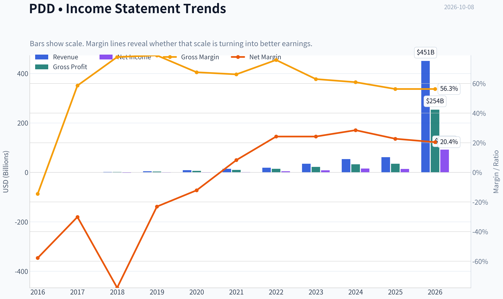

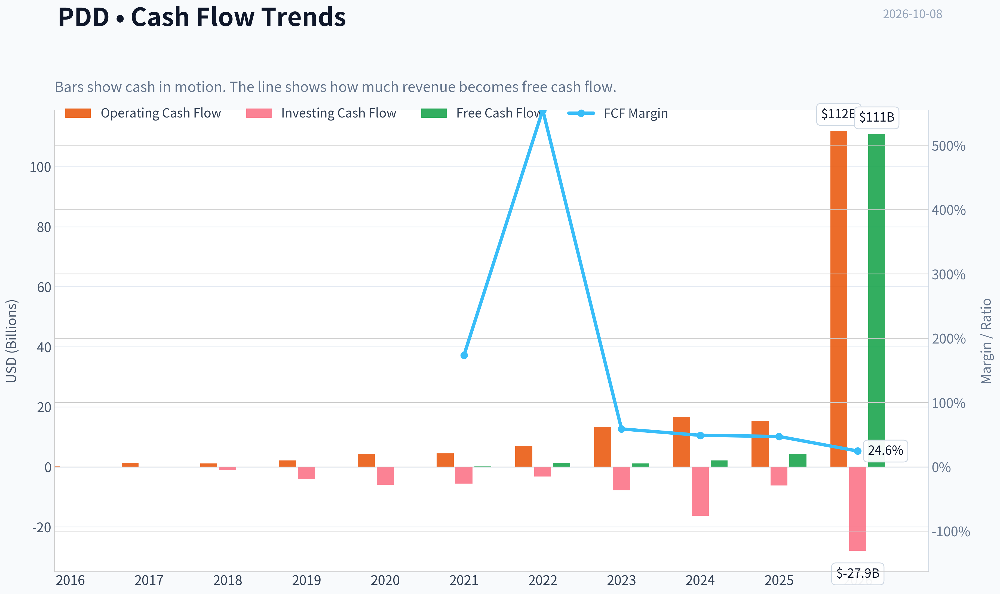

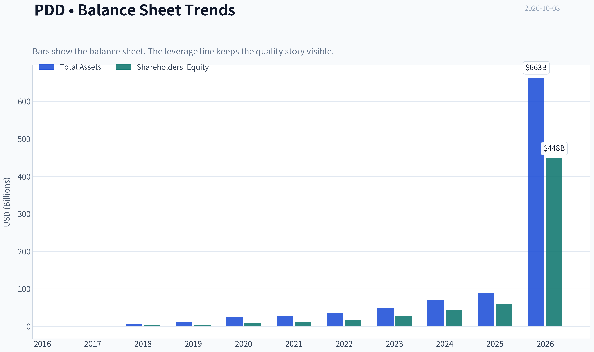

This graph tracks the profitability and return metrics (ROE, ROIC, Margins) of **PDD** over the past decade, highlighting capital efficiency trends.

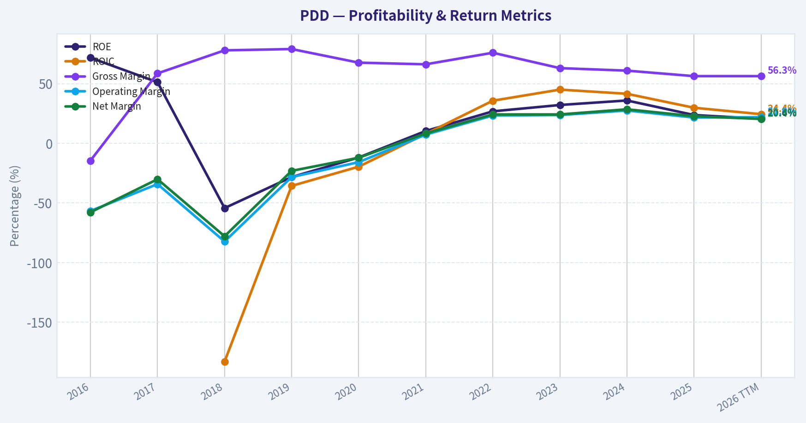

This chart illustrates the financial health of **PDD** over the last 10 years, mapping cash equivalents and free cash flow against total obligations (Debt).

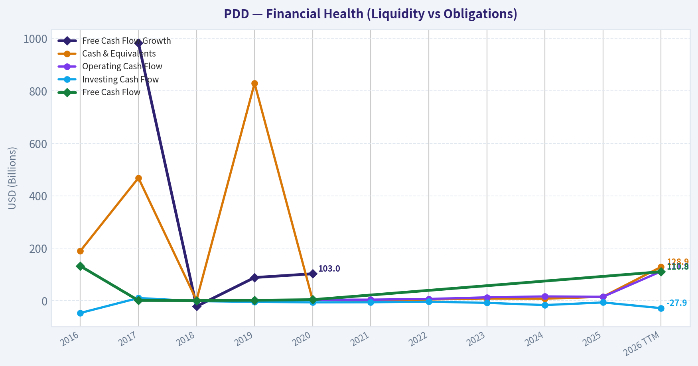

---

### Intrinsic Value Analysis (Buffett)

> *Following Warren Buffett's value investing philosophy: Circle of Competence, Economic Moat, Management Quality, and Margin of Safety.*

#### Intrinsic Value Snapshot

Price is what you pay. Intrinsic value is what the business may be worth based on the cash it can create for owners over time. We show a range, not one magic number.

- Current Price: $78.26
- Value Range (conservative to optimistic across both DCF methods): $517.85 to $7,125.86

##### Owner Earnings (Buffett Method)
- Net Income: $13,991,297,000.00
- Depreciation & Amortization: $3,000,364,000.00
- Capital Expenditures: N/A
- Working Capital Changes: $7,367,096,000.00
- Owner Earnings: $9,624,565,000.00

##### Intrinsic Value
###### Buffett Method
Uses owner earnings. Stricter, and usually more conservative.
- Conservative: $517.85
- Average: $2,332.23
- Optimistic: $2,332.23
- Discount Rate: 10.0%

###### Cash Flow Method
Uses free cash flow. Better for companies spending heavily today to grow tomorrow.
- Conservative: $2,788.14
- Average: $2,788.14
- Optimistic: $7,125.86
- Discount Rate: 10.0%

ANALYST STANCE: **WATCH**

#### Executive Conclusion

PDD Holdings is a profitable, fast-growing e-commerce platform with strong gross margins, substantial reinvestment runway, and attractive valuation optics. Its principal weaknesses are intense competition, regulatory and geopolitical exposure, uncertain Temu economics, and limited visibility into the durability of current earnings.

At $78 per share, PDD appears inexpensive on current earnings. However, the unusually optimistic headline DCF values are not reliable enough to justify an outright buy. The appropriate Buffett-style conclusion is **WATCH: a potentially good business, but demand a larger margin of safety until Temu economics and regulatory risks become clearer.**

---

#### 1. Factor Scorecard

| Factor | Score | Assessment |
|---|---:|---|
| Circle of Competence and Simplicity | 3.0/5 | The basic model-operate online marketplaces and earn from merchant services, advertising, and transaction activity-is understandable. However, PDD combines domestic Chinese commerce with the less predictable international Temu operation. |
| Moat | 3.5/5 | Pinduoduo has strong user engagement, scale, data, merchant density, and a distinctive value-oriented shopping model. The moat is meaningful but faces Alibaba, JD.com, Douyin, Shein, Amazon, and local competitors. |
| Management and Capital Allocation | 3.0/5 | Management has demonstrated disciplined growth and strong execution, but shareholder transparency, governance, ADR/VIE structure, and limited capital-allocation history prevent a higher score. |
| Industry Structure | 2.5/5 | E-commerce has powerful scale advantages but remains promotional and highly competitive. Temu's international expansion may require sustained subsidies and logistics spending. |

**Key Takeaways:** PDD has a real platform advantage, but it is not a simple, stable consumer staple. Its moat is strongest in China and less proven internationally. The main investment question is whether Temu becomes a profitable global marketplace or remains a capital-intensive customer-acquisition project.

---

#### 2. Moat Analysis

| Moat Source | Evidence | Strength |
|---|---|---:|
| Brand and Intangible Assets | PDD is associated with extreme value, social shopping, and attractive discounts. Its brand is differentiated, though not necessarily premium or emotionally durable. | Moderate |
| Switching Costs | Merchant data, advertising history, consumer behavior, and platform familiarity create some friction. Consumer switching costs remain relatively low. | Moderate |
| Cost Advantages | Scale, algorithmic recommendation, merchant density, and transaction data can lower customer-acquisition and fulfillment costs. | Moderate to strong |
| Network Effects | More buyers attract more merchants; more merchants create broader selection and lower prices, attracting more buyers. | Strong |
| Financial Evidence | Gross margin is reported at 56.3%, while ROE is 23.7%. Revenue is still growing 14.5% year over year. | Positive |

PDD's strongest moat is the combination of **scale, data, recommendation algorithms, merchant participation, and low-price positioning**. Its network effect is real but not impregnable: customers can multi-home across platforms, and merchants commonly list on several marketplaces.

Temu could eventually strengthen PDD's global network, but it could also dilute returns if growth depends on subsidies, advertising, and expensive cross-border fulfillment.

---

#### 3. Management Quality Assessment

Management deserves credit for building a large platform with high gross margins and significant profitability. The company has historically prioritized user growth and ecosystem development rather than maximizing short-term earnings.

The principal concerns are:

- The dual-class and ADR/VIE structure reduces conventional shareholder control.
- Chinese regulatory policy can change the economics of internet platforms quickly.
- Temu's international expansion may require substantial reinvestment before producing attractive returns.
- Investors have less certainty about long-term capital allocation than they would with a mature U.S. compounder.
- No recent tracked guru position provides an additional external validation signal.

Overall, management appears capable and strategically ambitious, but the governance discount is appropriate.

---

#### 4. Financial Summary

| Metric | Latest Reported Snapshot |
|---|---:|
| Share price | $78 |
| Market capitalization | $111.4 billion |
| P/E ratio | 8.8x |
| Revenue growth, year over year | 14.5% |
| Gross margin | 56.3% |
| ROE | 23.7% |
| Current ratio | 2.43x |
| Headline owner-earnings DCF value | $2,332.23 |
| Headline margin of safety | 96.6% |
| Reverse-DCF implied annual growth | Approximately -50% |

**Key Takeaways:** PDD combines a low reported earnings multiple with high gross margins, positive growth, and a strong ROE. The headline DCF implies an implausibly large discount, so it should be treated as a model-output anomaly or highly aggressive assumption rather than as a dependable estimate of intrinsic value. The balance-sheet liquidity signal is favorable, but debt and interest-coverage details should remain part of ongoing monitoring.

---

#### 5. Owner Earnings Calculation

The theoretical calculation is:

| Owner Earnings Component | Assessment |
|---|---:|
| Net income | Approximately $12.7 billion, inferred from the $111.4 billion market capitalization and 8.8x P/E |
| Plus depreciation and amortization | Positive, exact latest figure not incorporated |
| Less maintenance capital expenditure | Likely moderate relative to earnings, but total capex must be separated from growth investment |
| Less working-capital investment | Can fluctuate with platform growth and merchant settlement timing |
| Normalized owner earnings proxy | Approximately $12.7 billion, or about $8.90 per share |

**Key Takeaways:** A conservative owner-earnings proxy near reported net income is reasonable for an asset-light marketplace, but it is not a substitute for a full cash-flow bridge. The key diligence issue is whether Temu's current spending represents productive growth investment or recurring maintenance economics.

---

#### 6. Three-Scenario DCF Valuation

The following valuation uses approximately $8.90 per share of normalized owner earnings. It is intentionally more conservative than the supplied headline DCF.

| Scenario | Core Assumption | Estimated Value per Share |
|---|---|---:|
| A. No growth | Owner earnings capitalized at 10% | $89 |
| B. GDP growth | 3% perpetual growth, 10% discount rate | $131 |
| C. Historical-growth-style case | 7.5% growth for 10 years, then 3% terminal growth | Approximately $176 |

**Key Takeaways:** At $78, PDD is below all three normalized scenarios, including the no-growth case. That apparent discount is attractive, but the valuation depends heavily on the quality of earnings and the treatment of Temu investment spending. A business exposed to Chinese regulation and global e-commerce competition deserves a higher discount rate than a highly predictable U.S. franchise.

---

#### 7. Margin of Safety Analysis

| Valuation Reference | Implied Upside Versus $78 |
|---|---:|
| No-growth owner earnings value: $89 | 14% |
| GDP-growth value: $131 | 68% |
| Historical-growth-style value: $176 | 126% |
| Supplied headline DCF: $2,332 | Not economically credible as a standalone decision basis |

For a wide-moat, highly predictable compounder, a 10% to 15% discount might be adequate. PDD does not yet qualify for that standard because:

- Its international growth strategy is still being proven.
- E-commerce competition is structurally intense.
- Regulatory and geopolitical risks are material.
- Consumer switching costs are moderate rather than exceptionally high.
- The normalized owner-earnings figure requires further cash-flow verification.

A more appropriate required margin of safety is approximately **25% to 35%**. Under that standard, the stock is close to attractive but not decisively undervalued. A price nearer $60 to $70 would provide a more compelling risk-adjusted entry point, while durable evidence of Temu profitability could justify buying nearer the current price.

---

#### 8. Final Buffett Scorecard

| Criterion | Weight | Score | Weighted Contribution |
|---|---:|---:|---:|
| Moat width and durability | 25% | 3.5/5 | 0.88 |
| Valuation and margin of safety | 20% | 3.0/5 | 0.60 |
| Capital returns versus WACC | 15% | 4.0/5 | 0.60 |
| Business understanding and predictability | 12% | 3.0/5 | 0.36 |
| Management and capital allocation | 12% | 3.0/5 | 0.36 |
| Reinvestment runway | 8% | 4.0/5 | 0.32 |
| Balance-sheet strength | 4% | 4.0/5 | 0.16 |
| Industry structure | 4% | 2.5/5 | 0.10 |
| **Total** | **100%** |  | **3.38/5** |

**Gate 5-Quality and Solvency:** **Not tripped.** The company is profitable, has positive growth, and shows no evidence in the available snapshot of genuine financial distress combined with worsening fundamentals.

**Key Takeaways:** PDD scores well on growth, gross margins, reinvestment runway, and apparent earnings power. It loses points for predictability, industry structure, governance, and the uncertainty surrounding Temu's long-term returns. The resulting score supports WATCH rather than either a forced rejection or an aggressive purchase.

---

#### 9. Investment Stance

**WATCH - Moderate conviction**

PDD is a potentially attractive value-growth compounder, but the investment case requires several assumptions:

1. Domestic PDD remains a durable, profitable platform.
2. Temu reaches acceptable unit economics without permanently depressing group returns.
3. Chinese regulatory conditions remain manageable.
4. Reported earnings convert into sustainable owner earnings.
5. The current low multiple reflects risk rather than an approaching structural deterioration.

The stock becomes more compelling below approximately **$60 to $70**, or if future reports demonstrate that Temu is approaching profitability while domestic margins remain healthy. At $78, the valuation is attractive enough to monitor closely, but not sufficiently conservative to warrant an **ADVOCATE** rating.
#### Valuation Bridge

This bridge places the current market price beside each intrinsic value lens so readers can see whether upside depends on one method or shows up across several methods.

| Scenario | Intrinsic Value / Share |
| --- | ---: |
| Buffett Method | $2,332.23 |
| Cash Flow Method | $2,788.14 |
| Damodaran Method | $-1,662.66 |
| Current Price | $78.26 |

#### Key Takeaways

If one method is far above the others, the upside case depends on a specific modelling assumption. When several methods cluster together, the valuation story is more robust.

#### Valuation Visuals

This comparison chart from *Latest Earnings Snapshot* stacks current figures against historical benchmarks for **PDD**, making it easy to see where the company trades relative to its own averages.

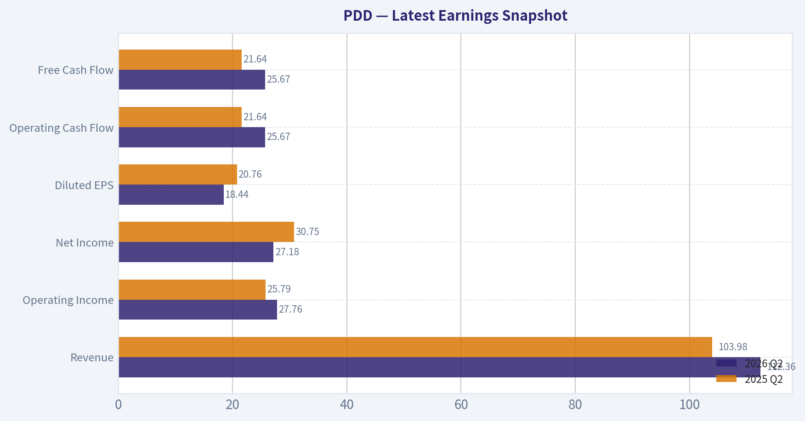

This comparison chart from *Model-Based Valuation Cross-Check* stacks current figures against historical benchmarks for **PDD**, making it easy to see where the company trades relative to its own averages.

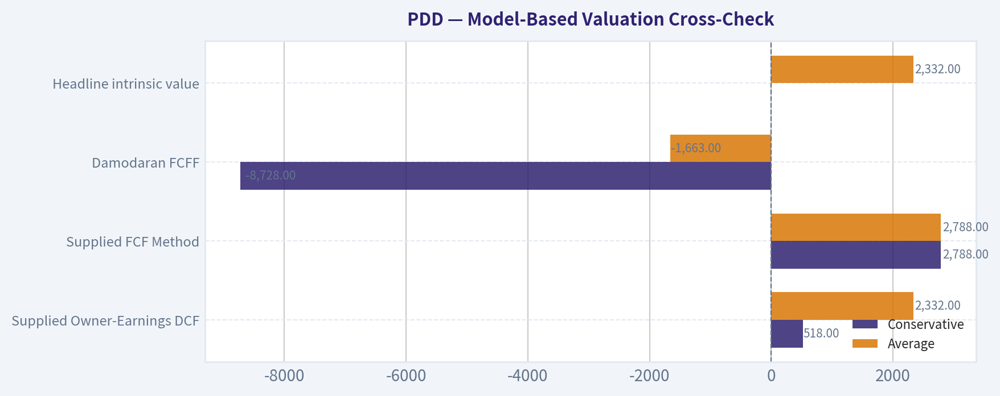

This comparison chart from *Financial Summary* stacks current figures against historical benchmarks for **PDD**, making it easy to see where the company trades relative to its own averages.

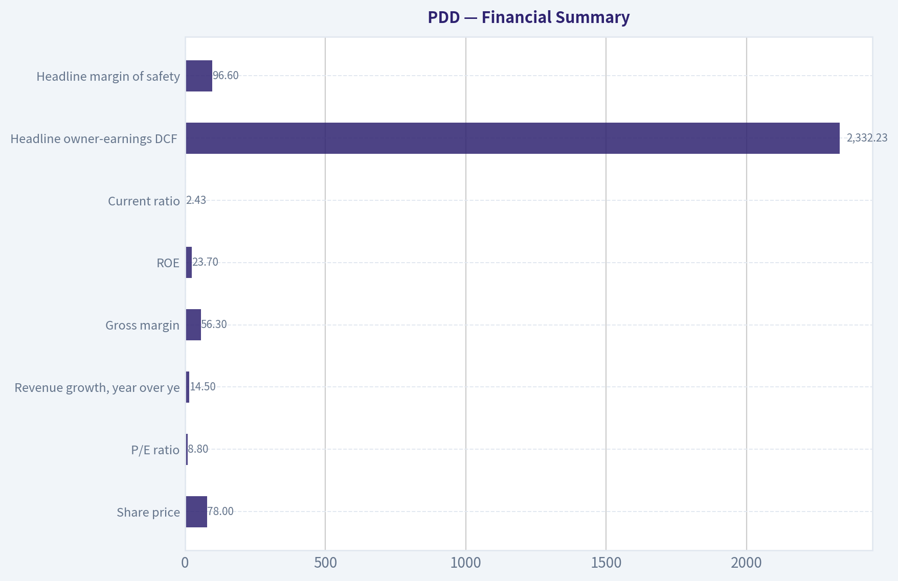

The following chart maps the **PDD** Owner Earnings DCF valuation scenarios (Conservative, Average, Optimistic) to visually represent the margin of safety based on intrinsic value calculations.

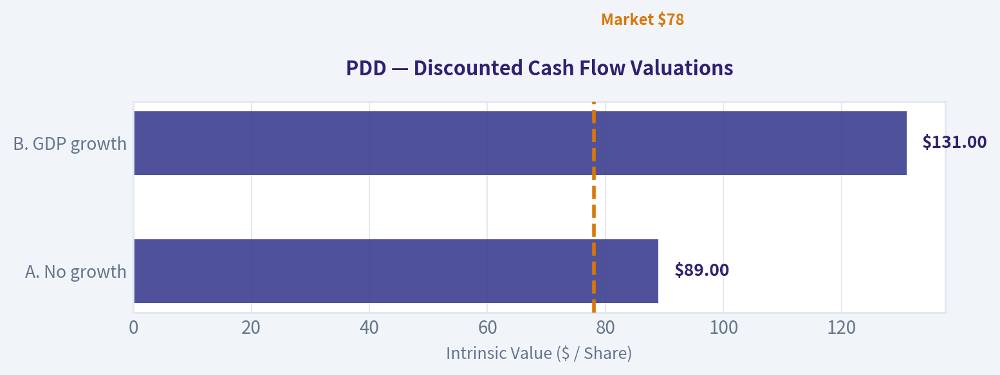

This comparison chart from *Margin of Safety Analysis* stacks current figures against historical benchmarks for **PDD**, making it easy to see where the company trades relative to its own averages.

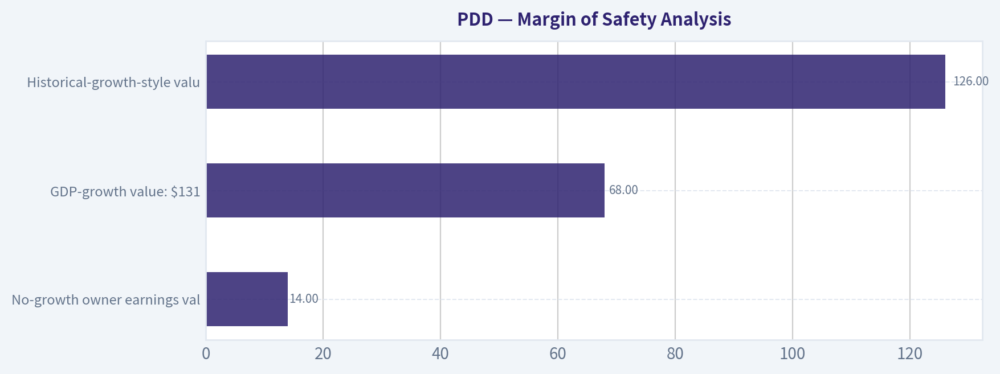

The following chart maps the **PDD** Owner Earnings DCF valuation scenarios (Conservative, Average, Optimistic) to visually represent the margin of safety based on intrinsic value calculations.

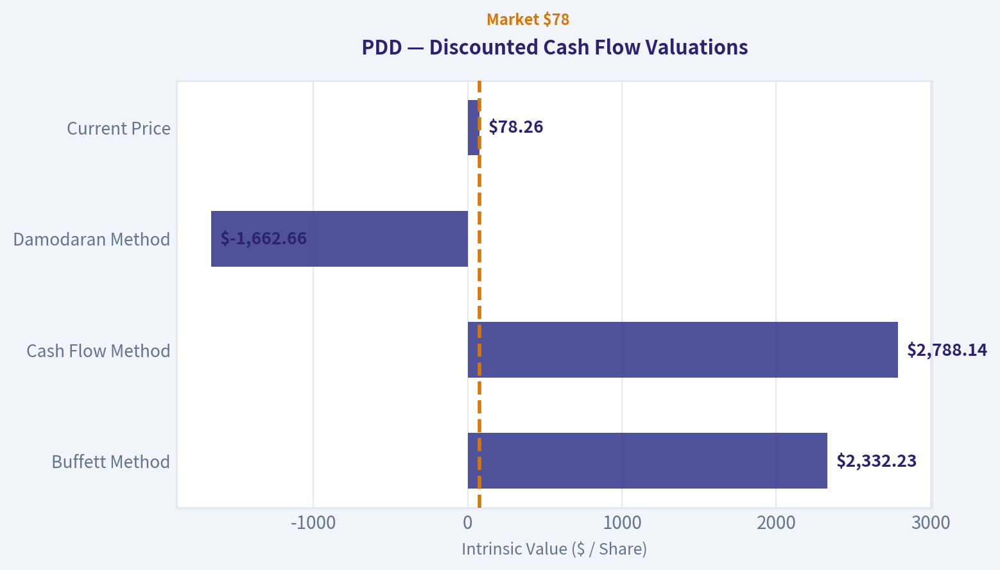

---

### Trend & Growth Analysis (Lynch/Druckenmiller/Fisher)

> *Following Peter Lynch's GARP, Stanley Druckenmiller's macro-aware approach, and Philip Fisher's scuttlebutt methodology.*

ANALYST STANCE: **WATCH**

#### 1. Lynch Classification

**Fast grower in transition toward a stalwart or cyclical value situation.**

PDD historically fits Lynch's fast-grower category, with five-year revenue CAGR reported at approximately 46.6%. However, the latest reported year-over-year growth of 14.5%, alongside a 9.2% decline in net income, indicates meaningful deceleration. The stock is now priced more like a mature, politically exposed value company than a high-growth compounder.

#### 2. The Story in Three Bullets

- **PDD operates two powerful e-commerce platforms:** Pinduoduo in China and Temu internationally, using low prices, social commerce, and merchant scale to attract users.
- **The long-term opportunity is large:** online retail penetration, cross-border commerce, and lower-cost digital merchandising remain secular growth markets.
- **The central debate is profitability versus expansion:** Temu may become a global commerce platform, but localization, tariffs, logistics, advertising costs, and regulation could prevent attractive returns.

#### 3. Key Financial Snapshot

| Metric | Latest figure | Investment interpretation |
|---|---:|---|
| Share price | $78.26 | Near the lower end of the 52-week range |
| Market capitalization | $111.4 billion | Large enough to require sustained execution |
| Revenue growth | 14.5% YoY | Below fast-grower threshold |
| Five-year revenue CAGR | 46.6% | Strong historical compounding |
| P/E | 8.8x | Low absolute valuation |
| Forward P/E | 6.35x | Market expects continued earnings power |
| Price-to-sales | 0.25x | Very low for a platform business |
| Gross margin | 56.3% | Strong, but reportedly declining |
| Operating margin | 21.6% | Attractive profitability |
| ROE | 23.7% | Above-average capital efficiency |
| Current ratio | 2.43x | Healthy liquidity |
| Debt-to-equity | Approximately 0.01x | Minimal balance-sheet leverage |

**Key Takeaways:** PDD is financially profitable, liquid, and lightly levered, while its valuation is unusually low. The concern is not balance-sheet fragility; it is whether growth and margins are structurally slowing. Several data fields are internally inconsistent-for example, the TTM revenue and EPS figures do not reconcile cleanly with the annual figures-so valuation should be treated as approximate rather than precise.

#### 4. TAM Analysis and the 10x Test

| Measure | Estimate | Assessment |
|---|---:|---|
| Latest reliable annual revenue base | Approximately $61.8B | Use cautiously because the data set contains unit inconsistencies |
| 10x revenue target | Approximately $617.5B | Would require global-scale execution |
| Relevant markets | Chinese e-commerce, global cross-border commerce, digital advertising, merchant services | Very large and still expanding |
| Potential mature market share | Likely below 20% if PDD becomes a global multi-platform ecosystem | Long runway exists in theory |
| TAM growth | Moderate-to-high, but fragmented by geography and regulation | Opportunity is large but execution-heavy |

**Key Takeaways:** PDD can theoretically grow tenfold without exceeding 20% of the broader global digital-commerce opportunity. However, the 10x test is less compelling than it first appears because PDD's addressable markets are geographically fragmented and Temu faces substantial localization and regulatory costs. The runway is large, but not frictionless.

#### 5. Revenue Growth Trend

| Period | Revenue growth | Trend |
|---|---:|---|
| 2021 | 61.7% | Very strong |
| 2022 | 28.4% | Decelerating |
| 2023 | 84.3% | Major acceleration |
| 2024 | 54.7% | Strong but slowing |
| 2025 | 14.5% | Sharp deceleration |
| Latest net-income growth | -9.2% | Earnings pressure |

**Key Takeaways:** PDD's long-term growth record is excellent, but the current pattern is decelerating rather than accelerating. The latest figures do not yet show a Druckenmiller-style positive inflection. Reacceleration from Temu, advertising, or merchant-services monetization would materially improve the thesis.

#### 6. Unit Economics and Efficiency

| Metric | Available data | Assessment |
|---|---:|---|
| LTV/CAC | Not disclosed | Cannot verify |
| Customer acquisition payback | Not disclosed | Cannot verify |
| Net revenue retention | Not applicable or unavailable | Marketplace metrics are more relevant |
| Rule of 40 | Not meaningful from inconsistent TTM data | Use cautiously |
| Operating margin | 21.6% | Strong, but lower than the prior reported peak |
| FCF margin | Reported approximately 24.6% TTM | Strong if the underlying figures are comparable |

**Key Takeaways:** PDD does not provide the clean SaaS-style unit-economic disclosures needed to calculate LTV, CAC, or retention. Its strongest observable efficiency indicators are high gross margins, a 21.6% operating margin, and substantial operating cash flow. The key question is whether Temu's growth can eventually produce comparable economics to the domestic Pinduoduo business.

#### 7. Inflection Point Assessment

| Potential inflection | Current evidence | Status |
|---|---|---|
| Product cycle | Temu international expansion and localization | Possible, not proven |
| Market share | Strong historical user and merchant adoption | Positive historically |
| Margin inflection | Margin has reportedly declined from prior levels | Negative currently |
| TAM expansion | Cross-border commerce expands the opportunity | Positive |
| Competitive inflection | Shein and other platforms remain serious competitors | Unclear |
| Earnings acceleration | Latest net income declined 9.2% | Not present |

**Key Takeaways:** The main upside catalyst is a successful Temu transition from subsidized cross-border growth to locally integrated, profitable commerce. At present, the evidence points to a business in a strategic investment phase rather than a confirmed earnings inflection. The stock is cheap enough to reward stabilization, but the market is waiting for proof.

#### 8. Macro Setup

The macro backdrop is mixed:

- **Positive:** Digital commerce and mobile shopping remain secular growth themes.
- **Negative:** Higher logistics, labor, advertising, and localization costs pressure marketplace economics.
- **Negative:** U.S. and European de minimis changes could weaken Temu's low-cost cross-border model.
- **Negative:** U.S.-China geopolitical and regulatory risk creates a persistent valuation discount.
- **Unknown:** Current interest-rate direction is not provided; lower rates would generally support growth-stock multiples, but PDD's multiple is already unusually compressed.

Druckenmiller's framework would favor PDD only if macro pressure is easing and earnings expectations are being revised upward. Current evidence does not establish that setup.

#### 9. Fisher 15-Point Assessment

| Fisher category | Score / 5 | Comment |
|---|---:|---|
| Market potential | 5 | Large Chinese and international commerce markets |
| New-product determination | 4 | Temu demonstrates ambition |
| R&D effectiveness | 3 | Limited disclosure |
| Sales organization | 4 | Strong merchant and user acquisition historically |
| Profit margins | 4 | High reported margins |
| Margin trend | 3 | Recent pressure |
| Labor relations | 3 | Limited visibility |
| Executive relations | 3 | Limited visibility |
| Management depth | 4 | Proven ability to scale platforms |
| Cost accounting | 3 | Limited transparency |
| Outstanding business aspects | 4 | Data, scale, network effects, ecosystem |
| Long-range outlook | 4 | Attractive but regulation-sensitive |
| Dilution | 3 | Data indicates some dilution concerns |
| Candor | 3 | ADR and disclosure complexity reduce transparency |
| Integrity | 3 | Governance discount remains relevant |
| **Total** | **53 / 75** | **Average to good, not outstanding** |

**Key Takeaways:** PDD scores well on market opportunity, scale, platform economics, and historical execution. It scores lower on transparency, governance, international disclosure, and current margin direction. A score of 53 supports monitoring rather than high-conviction ownership.

#### 10. Valuation Analysis

| Method | Result | Reliability |
|---|---:|---|
| P/E valuation | 8.8x trailing; 6.35x forward | Attractive if earnings stabilize |
| PEG | Approximately 0.6-0.7 using reported growth inputs | Appears attractive but weakened by earnings decline |
| Price-to-sales | 0.25x | Very low for a profitable platform |
| Headline intrinsic value | $2,332 | Not reliable; model output is distorted by inconsistent inputs |
| Alternative DCF range | Negative to several thousand dollars | Shows extreme model sensitivity |
| Reverse DCF | Implies approximately -50% annual owner-earnings growth | Likely unreliable due to data problems |

**Key Takeaways:** On conventional multiples, PDD looks exceptionally inexpensive. However, the earnings denominator may be distorted by inconsistent financial data, and the PEG ratio is not dependable when current earnings are declining. The appropriate conclusion is "cheap if normalized earnings are real," not "certainly undervalued."

#### 11. Growth Investor Scorecard

| Criterion | Weight | Score / 5 |
|---|---:|---:|
| The story | 10% | 4.0 |
| TAM and runway | 20% | 4.0 |
| Revenue growth | 20% | 3.0 |
| Unit economics | 15% | 3.0 |
| Competitive position | 10% | 3.5 |
| Management quality | 10% | 3.0 |
| Macro setup | 5% | 2.5 |
| Profitability path | 5% | 3.5 |
| Valuation | 5% | 4.5 |
| **Weighted score** | **100%** | **3.4 / 5** |

**Key Takeaways:** PDD's weighted score lands at the upper end of the WATCH range. The valuation and TAM are compelling, but current revenue deceleration, falling earnings, regulatory uncertainty, and data-quality concerns prevent an Advocate rating. The score could improve quickly if growth reaccelerates and Temu demonstrates durable positive unit economics.

#### 12. Position Size Stance

| Investor profile | Suggested stance |
|---|---|
| New position | Wait for evidence of growth stabilization |
| Existing holder | Hold or maintain a small position while monitoring |
| High-risk growth investor | Speculative position, approximately 1-2% |
| Conservative investor | Avoid until regulatory and earnings visibility improves |
| High-conviction portfolio | Do not make a core position yet |

**Key Takeaways:** PDD may be suitable as a small, asymmetric monitoring position, but not as a concentrated core holding based on the current evidence. Position sizing should reflect ADR, geopolitical, governance, and Temu execution risks rather than merely the low P/E.

#### 13. Key Catalysts and Risks

| Catalysts | Risks |
|---|---|
| Temu reaches sustainable profitability | De minimis and tariff changes |
| Revenue growth reaccelerates above 20% | Temu localization costs remain elevated |
| Operating margins stabilize or expand | Prolonged price competition |
| Stronger advertising and merchant monetization | Chinese regulatory or geopolitical shocks |
| Share repurchases or improved capital returns | Data, ADR, and governance opacity |
| Clearer disclosure of user and marketplace metrics | Continued earnings deterioration |

**Key Takeaways:** The most important catalyst is not simply more Temu users; it is profitable Temu growth. The primary risk is that regulatory and localization costs permanently reduce the economics of the international business. Until the company proves otherwise, PDD is a cheap but uncertain growth asset.

#### Final Judgment

PDD offers a compelling combination of large markets, strong historical growth, high profitability, low leverage, and an unusually depressed valuation. Nevertheless, the latest operating trend is not a confirmed inflection: revenue growth has slowed to 14.5%, net income has declined, and international commerce faces regulatory and cost pressures.

**Conclusion: WATCH.** The stock becomes more attractive if management demonstrates reaccelerating revenue, stable margins, and positive Temu unit economics. Without those signals, PDD is better viewed as a speculative value opportunity than a proven ten-bagger compounder.

---

### Market Technical Analysis

ANALYST STANCE: **WATCH**

#### PDD technical overview

PDD's latest available close was **$78.50 on October 7, 2026**. October 8 was not a trading session in the retrieved data, so the analysis uses October 7 as the effective reference date. Over the past year, PDD declined from approximately **$133.77 to $78.50**, a loss of about **41%**. The broader structure remains bearish, although the most recent price action shows some stabilization after a prolonged decline.

The most relevant indicator set for this context is:

- **close_10_ema**: short-term momentum and early reversal detection.
- **close_50_sma**: medium-term trend and overhead resistance.
- **close_200_sma**: long-term trend confirmation.
- **macd**: directional momentum and trend transition.
- **macdh**: acceleration or deceleration of momentum.
- **rsi**: momentum exhaustion and potential oversold conditions.
- **atr**: volatility-adjusted risk management.
- **vwma**: price trend confirmed or contradicted by trading volume.

The indicator-report tool returned incomplete values for this date range, labeling most sessions as unavailable. Therefore, the numerical indicator levels below are approximate calculations or directional interpretations based on the retrieved daily OHLCV data rather than exact tool-generated readings.

#### Trend structure

The long-term trend is clearly negative. PDD experienced a major decline from the low-$130s in October and November 2025 to the mid-$70s in late June 2026. The decline was especially forceful during late May and June, when the stock fell from **$94.52 on May 22 to $73.30 on June 25**. That move was accompanied by unusually high volume, including approximately **40.4 million shares on May 27**, compared with the much lower average volume seen during the preceding months. Such a high-volume breakdown generally indicates meaningful distribution rather than a routine pullback.

The July and early August rebound did not repair the larger technical damage. PDD recovered from roughly **$73 to $93**, but the rally stalled near the low-$90s. Prices subsequently formed lower highs through August, September, and early October. The sequence of August's roughly $93 high, September's roughly $80 high, and October's recent low near $75 indicates that sellers still control the medium-term structure.

The approximate **50-day SMA is likely in the low-$80s**, placing the current price below that average. This means the stock remains under medium-term trend resistance. The approximate **200-day SMA is likely near or above $100**, reflecting the earlier higher price levels and confirming that PDD remains in a long-term downtrend. A move above the 50-day average would improve the short-term picture, but a durable trend reversal would require reclaiming and stabilizing above the 50-day average first, followed by improvement relative to the 200-day average.

#### Short-term price action and moving averages

The short-term picture is less negative than the long-term picture. PDD closed at **$76.50 on October 1**, fell to **$75.38 on October 2**, then recovered to **$77.90, $78.40, and $78.50** over the next three sessions. This three-day recovery suggests that buyers defended the mid-$75 area.

The approximate 10-day EMA is probably around **$77.5 to $78.0**, placing the latest close close to or modestly above that short-term average. This is constructive, but the signal is not yet strong. The recent bounce has been relatively orderly and has not yet broken above important swing resistance around **$79.50 to $80.75**. A close above that zone would establish a higher short-term high and provide better evidence that the decline is transitioning into a tradable recovery.

By contrast, the 50-day average remains materially higher, probably around **$82 to $84**. This creates a layered resistance area: approximately **$79.50 to $80.75** from recent price structure, followed by the 50-day average in the low-$80s. Until those areas are reclaimed, rallies should be treated as countertrend advances rather than confirmed trend reversals.

#### MACD and momentum

The MACD structure is likely still negative because the stock remains well below both its medium- and long-term trend averages. The sharp decline from August through early October would ordinarily keep the MACD line below its signal line and below the zero line.

However, the recent stabilization may be causing the MACD histogram to become less negative. The important distinction is between **falling negative momentum** and **positive momentum**. A less-negative histogram would indicate that bearish momentum is losing force, but it would not by itself confirm a bullish reversal.

For a stronger signal, traders should look for three developments:

1. The MACD histogram turning positive.
2. The MACD line crossing above its signal line.
3. Preferably, the MACD moving back toward or above the zero line while price reclaims the 50-day average.

If price rises while MACD remains weak, the move could represent only a short-covering rally. Conversely, a bullish MACD crossover accompanied by expanding volume and a break above $80.75 would be more meaningful.

#### RSI interpretation

The recent decline likely pushed the 14-day RSI into the **upper-30s to low-40s**, which is weak but not deeply oversold. This is an important nuance: PDD has experienced substantial long-term damage, but the latest readings do not necessarily imply that the stock is at an immediate reversal point.

An RSI below 30 would suggest more pronounced short-term exhaustion, while a move above 50 would indicate that upside momentum is beginning to dominate. At present, the likely RSI configuration is consistent with a weak or recovering market rather than a confirmed bullish trend.

A bullish divergence would be worth monitoring. If price retests the $75 area but RSI forms a higher low, that could indicate that downside momentum is fading. Such a divergence would still require price confirmation, ideally through a close above $80.75 and then the 50-day average.

#### Volume and VWMA

Volume analysis shows that the most important bearish event occurred during the May breakdown. The very high volume near $83 to $87 established a substantial overhead supply zone. Investors who bought during that decline may sell into future rebounds near their breakeven levels, creating resistance.

The more recent recovery from $75.38 to $78.50 has not displayed the same scale of volume expansion as the May breakdown. That suggests the bounce has not yet attracted decisive institutional demand. A move above $80.75 or $82 should ideally occur with volume clearly above the recent average; otherwise, the breakout would be vulnerable to failure.

The approximate 20-day VWMA is likely near **$79 to $80**, somewhat above the latest close. This implies that volume-weighted holders have an average cost higher than current price, reinforcing the idea that the $79 to $81 area may act as near-term resistance. Reclaiming the VWMA would improve the demand picture, particularly if the stock remains above it for several sessions rather than merely touching it intraday.

#### Volatility and risk management

PDD's recent average true range is approximately **$2 to $2.5 per share**, or roughly **2.5% to 3% of the current price**. Volatility is lower than during the May breakdown, but it remains significant enough that tight stops could be triggered by normal daily movement.

For a short-term long position, a volatility-aware stop should generally allow room below nearby support rather than being placed immediately under the entry price. The **$75 to $76 zone** is the key nearby support area, based on the October low and the recent rebound origin. A decisive close below $75 would weaken the stabilization thesis and could expose the stock to a retest of the low-$73 area or potentially new lows.

Upside targets should be staged. The first target is approximately **$79.50 to $80.75**, followed by the **$82 to $84** region where the 50-day average is likely located. A break above those levels would improve the risk-reward profile, but the stock would still remain below its long-term trend benchmark.

#### Trading interpretation

PDD is best classified as a **bearish long-term trend with a tentative short-term stabilization**. The recent three-session recovery is constructive enough to justify monitoring for a reversal setup, but it does not yet provide sufficient evidence for an aggressive bullish stance.

A more favorable setup would require:

- Price holding above $75 to $76.
- A close above $80.75.
- Recovery above the volume-weighted average near $79 to $80.
- Improving RSI toward or above 50.
- A bullish MACD crossover with a less-negative or positive histogram.
- Expanding volume on advances.

A bearish continuation signal would be a close below $75, particularly if accompanied by increasing volume and deteriorating momentum. Until either confirmation occurs, the most prudent approach is to avoid chasing the rebound and instead wait for either a confirmed breakout or a controlled pullback that holds support.

| Indicator / factor | Approximate current reading or condition | Interpretation | Key levels or confirmation |
|---|---:|---|---|
| Latest close | $78.50 on October 7 | Short-term recovery from the $75.38 low | October 8 had no retrieved trading session |
| 10-day EMA | Approximately $77.5-$78.0 | Price is near or slightly above short-term trend support | Sustained trade above $78 would improve momentum |
| 50-day SMA | Approximately low-$80s | Price remains below medium-term resistance | Reclaiming roughly $82-$84 is important |
| 200-day SMA | Approximately near or above $100 | Long-term trend remains bearish | A distant benchmark; not yet relevant for immediate entry |
| MACD | Likely negative, possibly improving | Downtrend momentum may be decelerating but is not reversed | Bullish crossover plus price above $80.75 would be stronger |
| MACD histogram | Likely less negative after recent stabilization | Selling pressure may be easing | Positive histogram would provide better confirmation |
| RSI | Likely upper-30s to low-40s | Weak momentum, but not necessarily deeply oversold | Recovery above 50 would strengthen the bullish case |
| VWMA | Approximately $79-$80 | Volume-weighted holders may be underwater | Reclaiming and holding above VWMA would improve demand |
| ATR | Approximately $2-$2.5 | Material daily volatility remains | Use wider, volatility-adjusted stops |
| Support | $75-$76; then approximately $73 | Loss of support would invalidate the current stabilization | A close below $75 is bearish |
| Resistance | $79.50-$80.75; then $82-$84 | Multiple overhead supply zones remain | Breakout should ideally occur on stronger volume |
| Overall stance | **WATCH** | Countertrend bounce developing within a larger downtrend | Wait for confirmation rather than chase |

Key Takeaways: PDD has stabilized modestly above the $75 area, but the stock remains below its likely 50-day and 200-day trend averages, so the primary trend is still bearish. The first meaningful test is the $79.50 to $80.75 resistance zone, followed by the low-$80s where medium-term resistance is likely concentrated. A close below $75 would favor renewed downside, while a high-volume breakout above $80.75 would provide the first credible evidence of a tradable reversal.

---

### Options Market Analysis

> *Reading options flow - put/call ratios, IV skew, and unusual activity - to gauge institutional positioning and event-driven risk.*

ANALYST STANCE: **NEUTRAL**

#### PDD Options Positioning

Data is as of October 8, 2026, covering expirations from October 9 through October 23. The options market shows moderate call-side open-interest positioning, but recent trading volume is more balanced and does not confirm aggressive bullish conviction.

#### Put/Call Ratio Analysis

| Expiration | Call OI | Put OI | Put/Call OI Ratio | Call Volume | Put Volume | Put/Call Volume Ratio |
|---|---:|---:|---:|---:|---:|---:|
| Oct. 9, 2026 | 13,605 | 6,811 | 0.50 | 1,208 | 689 | 0.57 |
| Oct. 16, 2026 | 54,316 | 45,685 | 0.84 | 2,030 | 2,897 | 1.43 |
| Oct. 23, 2026 | 3,650 | 3,211 | 0.88 | 878 | 287 | 0.33 |
| **Near-term total** | **71,571** | **55,707** | **0.78** | **4,116** | **3,873** | **0.94** |

**Key Takeaways:** The aggregate put/call open-interest ratio of 0.78 is below the approximate 0.70 neutral baseline only modestly on a call-heavy basis, suggesting limited bullish positioning rather than a strong directional bet. The volume ratio of 0.94 is close to balanced, while the October 16 expiration shows notable put volume that may reflect short-term hedging or bearish positioning.

#### Implied Volatility Assessment

| Expiration | Call ATM IV | Put ATM IV | Put Minus Call IV | Interpretation |
|---|---:|---:|---:|---|
| Oct. 9, 2026 | 47.0% | 47.4% | +0.4 percentage points | Nearly balanced |
| Oct. 16, 2026 | 35.2% | 37.2% | +2.0 percentage points | Moderate downside hedge premium |
| Oct. 23, 2026 | 39.5% | 35.0% | -4.5 percentage points | Call-side or upside skew |

The available data provides ATM implied volatility, but not a full strike-by-strike OTM volatility curve. Therefore, true OTM put-versus-call skew cannot be measured precisely. The ATM comparison suggests modest downside protection demand in the October 16 cycle, offset by a stronger call-volatility premium in the October 23 cycle.

**Key Takeaways:** Near-term IV is elevated for the immediate October 9 expiration at roughly 47%, consistent with event or expiry-related risk, although no specific catalyst is identified in the supplied data. The October 16 cycle has a modest put premium, while October 23 shows a call premium, producing an overall mixed but not strongly defensive volatility picture.

#### Unusual Options Activity

| Finding | Result |
|---|---|
| Contracts with volume greater than 5 times open interest | None identified |
| Fresh directional institutional-style activity | No clear evidence |
| Retail speculation signal | No exceptional volume spike detected |

No individual contract met the tool's unusual-activity threshold. As a result, there is no identifiable fresh call sweep, put hedge, or highly concentrated directional bet that can be confidently attributed to informed or institutional positioning.

**Key Takeaways:** The absence of volume-to-open-interest spikes reduces confidence in any strong directional interpretation. Current activity appears more like routine positioning, rolling, hedging, or market making than a decisive new institutional trade.

#### Open Interest Concentration and Gamma Levels

| Expiration | Highest Aggregate OI | Call OI Share | Put OI Share | Potential Market Effect |
|---|---:|---:|---:|---|
| Oct. 9, 2026 | 20,416 contracts | 13,605 | 6,811 | Call-side concentration may provide nearby upside positioning |
| Oct. 16, 2026 | 100,001 contracts | 54,316 | 45,685 | Primary near-term OI and potential pinning zone |
| Oct. 23, 2026 | 6,861 contracts | 3,650 | 3,211 | Relatively low gravitational influence |
| **Total** | **127,278 contracts** | **71,571** | **55,707** | Moderate call-side OI bias |

Strike-level open interest was not included in the supplied dataset, so specific gamma walls, max-pain strikes, and exact price-pinning levels cannot be determined. The October 16 expiration is the dominant maturity by open interest and is therefore the most likely expiration to influence near-term hedging flows and price pinning.

**Key Takeaways:** October 16 contains approximately 79% of the combined near-term open interest, making it the key expiration for potential gamma effects. However, without strike-level data, the direction and location of any gamma wall cannot be established; confidence in precise support or resistance levels is therefore limited.

#### Overall Options Sentiment

| Signal Component | Assessment | Directional Read |
|---|---|---|
| Put/call OI ratio | 0.78 overall | Mildly call-leaning, but close to neutral |
| Put/call volume ratio | 0.94 overall | Balanced recent activity |
| ATM IV | 35%-47% | Elevated at the nearest expiry |
| IV skew | Put premium in Oct. 16; call premium in Oct. 23 | Mixed |
| Unusual activity | None detected | No strong fresh directional signal |
| OI concentration | Heavy concentration in Oct. 16 | Potential pinning and hedging influence |
| **Overall signal** | **NEUTRAL** | **Limited directional conviction** |

The overall options signal is **NEUTRAL**. The primary reason is the lack of unusual activity and the nearly balanced put/call volume ratio. Although call open interest exceeds put open interest, the aggregate ratio of 0.78 is only modestly call-favorable relative to the approximately 0.70 neutral reference, while the October 16 put-volume imbalance indicates some demand for downside protection.

Confidence is moderate to low because the supplied data lacks current stock price, strike-level open interest, full OTM skew, and an identified catalyst calendar. The nearest-expiration IV near 47% suggests that short-dated event or expiry risk is meaningful, but the data does not establish whether that volatility is tied to earnings, company news, or broader market risk.

#### Summary

| Category | Conclusion |
|---|---|
| Put/Call Ratio | 0.78 OI ratio and 0.94 volume ratio; mildly call-leaning OI but balanced trading |
| IV Level | Elevated near-term IV, especially for the October 9 expiration |
| Skew Direction | Mixed: modest put skew for October 16, call skew for October 23 |
| Unusual Activity | No contracts exceeded the 5-times-volume-to-OI threshold |
| Overall Signal | **NEUTRAL** |

**Key Takeaways:** PDD's options market does not show a decisive bullish or bearish institutional signal. Call open interest provides a slight bullish bias, but balanced volume, some October 16 put demand, and the absence of unusual contracts argue for a neutral stance rather than an aggressive directional conclusion.

---

## Research Team Commentary

> *The Research Manager synthesizes the Bull vs Bear debate into action-free commentary. This is a pre-risk view, not the final stance.*

Core takeaway: PDD looks statistically cheap and may own a valuable domestic commerce franchise, but the evidence does not yet establish a Buffett-quality margin of safety. At $78.26 and 8.8 times reported earnings, the market is discounting weak future results. However, that conclusion depends on treating approximately $8.89 of reported EPS as sustainable owner earnings. Given unresolved cash-flow reconciliation, limited segment disclosure, uncertain Temu economics, and the ADR/VIE structure, that assumption is not sufficiently reliable. PDD belongs on the watchlist rather than in the portfolio today.

The strongest bull argument is valuation combined with genuine operating quality. PDD is not a distressed or obviously inferior business. A 56.3% gross margin, 23.7% ROE, and 15.5% ROA indicate meaningful economic strength. Pinduoduo has real scale, merchant density, consumer traffic, recommendation data, and a recognized low-price position. These advantages form a legitimate marketplace flywheel, even if consumers and merchants can use competing platforms simultaneously.

Temu also creates substantial upside if PDD can convert global demand into repeat purchasing and acceptable contribution margins. The bull case does not require global domination: preserving the domestic franchise while producing even modest international returns could be enough. If the supplied EPS is durable, the stock's 11.4% earnings yield is compelling. On the bull's assumptions, the current price appears to imply roughly flat or declining long-term earnings, while low-single-digit growth could support value in the mid-$90s or higher.

The lower share price also improves the setup compared with the prior debates around $87-$88. Earlier tactical caution was correct, but the subsequent decline does not prove permanent impairment. It would be a mistake to use a weak chart as an absolute veto on a potentially undervalued ten-year asset.

The strongest bear argument is that the apparent discount is conditional rather than verified. The debate has not reconciled reported net income with normalized free cash flow, stock-based compensation, dilution, working-capital movements, the ADS conversion, or the accessibility of cash. Previous datasets contained major currency and unit inconsistencies, so precision based on the headline P/E deserves skepticism.

The valuation is particularly sensitive to the starting earnings base. If normalized owner earnings are 20% below reported EPS, the effective multiple rises from 8.8 times to approximately 11 times. At a 30% haircut it rises to roughly 12.6 times. Those multiples are not expensive, but they are no longer extraordinary for a company with uncertain international returns, limited shareholder control, and significant policy exposure.

The bear's most persuasive numerical point is that applying a 20% haircut to the bull's conservative valuation reduces estimated value from roughly $95 to $76, approximately the current price. With a 30% haircut, that value falls to about $67. In other words, investors do not clearly receive a margin of safety unless they accept either the reported earnings base with little adjustment or assume sustained mid-single-digit growth. For this level of uncertainty, a prospective 17-21% discount to an optimistic-but-plausible estimate is too narrow.

Temu also should not be treated as free optionality. It can consume domestic cash through advertising, subsidies, localization, warehousing, compliance, and returns infrastructure. Its downside is not capped at zero if management continues funding expansion without adequate returns. The absence of country-level contribution margins, retention cohorts, customer-acquisition paybacks, and domestic-versus-international profitability makes capital allocation difficult to judge.

The governance discount is similarly structural. The ADR/VIE and dual-class arrangements limit conventional shareholder control and complicate assumptions about access to cash and legal claims on the operating business. These risks do not make PDD uninvestable, but they justify a higher discount rate and a wider required margin of safety than for a transparent, shareholder-controlled compounder.

Management deserves credit for building Pinduoduo against formidable incumbents. That demonstrates operating talent. It does not yet establish Buffett-level capital-allocation trust. The key question is whether management is sacrificing near-term profits for a high-return global platform or transferring domestic economic value into an expansion program whose returns cannot be measured. Better disclosure and disciplined withdrawal from unattractive markets would materially strengthen the case.

I also would not overread the market signals. Options positioning is neutral to only modestly call-heavy and does not demonstrate informed bullish conviction. The handoff provides the relevant moving-average categories but not their actual values, so no precise technical claims should be invented. The proper lesson from prior mistakes is to describe price evidence accurately and probabilistically: the stock remains tactically fragile until its medium- and long-term trends improve, but technical weakness alone cannot establish intrinsic value.

Over the next one to four quarters, the first monitoring priority is data reconciliation. I want primary-filing confirmation of diluted EPS per ADS, the ADS-to-ordinary-share ratio, reporting currency, stock-based compensation, capital expenditures, normalized free cash flow, and the location and accessibility of cash. If owner earnings broadly track reported earnings, the low multiple becomes much more credible. If normalized owner earnings are 20-30% lower, the current valuation offers little proven margin of safety.

Second, I would monitor the domestic franchise separately from Temu. The important evidence includes domestic transaction and revenue growth, merchant participation, monetization, user engagement, marketing intensity, and operating-margin direction. Stable domestic economics would support treating Pinduoduo as the valuation floor. Deteriorating engagement or margins would show that the presumed funding engine is itself weakening.

Third, Temu needs measurable evidence of improving economics. Watch contribution losses, customer-acquisition payback, repeat purchasing after incentives decline, logistics and return costs, localization spending, and management's willingness to exit markets with poor returns. Slower growth accompanied by better unit economics could be bullish; rapid growth requiring escalating subsidies would weaken the thesis.

Fourth, monitor regulation through quantified financial effects rather than headlines. Tariff, customs, product-safety, privacy, or de minimis changes should be translated into delivered prices, order volumes, fulfillment costs, and contribution margins. PDD's scale may help it adapt, but relative resilience is not the same as attractive absolute returns.

Finally, watch per-share capital allocation. Limited dilution, sensible repurchases at genuinely discounted prices, and evidence that retained cash is increasing intrinsic value per ADS would improve confidence. Continued opacity, rising dilution, or open-ended Temu spending would justify continued caution.

I would upgrade to ADVOCATE if filings validate the reported earnings and cash conversion, domestic economics remain durable, Temu losses show a credible path toward acceptable returns, and the shares still trade at a meaningful discount to a conservatively normalized value. I would move to AVOID if normalized owner earnings fall toward or below approximately $6.20 per ADS, domestic margins deteriorate structurally, Temu's funding burden expands without better retention or contribution economics, or governance actions undermine ADR holders.

For now, PDD is neither a proven value trap nor a sufficiently verified bargain. The potential upside is real, but the current discount compensates investors for risks that remain difficult to measure rather than clearly overdiscounted.

WATCH

---

## Value Investing Team Commentary

> *The Investor translates the research view into an investment thesis before risk review. This is still not the final stance.*

### Investment Commentary

PDD is an economically attractive but insufficiently transparent business trading at an apparently inexpensive price. At **$78.26** and **8.8 times reported earnings**, the shares deserve serious investigation. They do not yet deserve capital.

### Business quality and moat

Pinduoduo's domestic platform has genuine competitive strengths:

- Large consumer and merchant networks
- A recognized low-price proposition
- Recommendation data and engagement advantages
- An asset-light marketplace model
- Meaningful profitability, reflected in a **56.3% gross margin, 23.7% ROE, and 15.5% ROA**

These figures are inconsistent with a distressed or structurally poor business. The domestic platform may possess a durable marketplace flywheel, although the moat is not impenetrable because users and merchants can participate on multiple platforms. Competition remains intense, and low prices can be copied more readily than a closed ecosystem or deeply embedded enterprise workflow.

Temu offers considerable potential, but it should not be valued as costless optionality. International expansion may require sustained spending on customer acquisition, logistics, returns, compliance, subsidies, and localization. Unless PDD discloses credible retention, payback, and contribution-margin data, shareholders cannot determine whether Temu is creating a global moat or consuming the domestic franchise's cash.

### Valuation: cheap on reported earnings, less compelling on normalized earnings

Reported EPS of approximately **$8.89** produces an earnings yield of roughly **11.4%**. If those earnings are durable, cash-backed, and attributable to ADR holders, the valuation is attractive. The market appears to expect stagnation, declining profitability, or a permanent risk discount.

The difficulty is that the valuation changes materially under reasonable normalization:

| Earnings assumption | Approximate EPS | Effective P/E |
|---|---:|---:|
| Reported earnings | $8.89 | 8.8x |
| 20% haircut | $7.11 | 11.0x |
| 30% haircut | $6.22 | 12.6x |

An 11-13 times multiple is not excessive, but neither is it an extraordinary bargain for a company facing opaque segment economics, Chinese regulatory exposure, limited shareholder control, and potentially expensive international expansion.

The proposed valuation range reinforces this concern. Against a value of approximately **$95**, the current price offers an **18% discount**. That might be enough for a transparent, wide-moat compounder with highly reliable owner earnings. It is not enough for PDD's current uncertainty. If a 20% earnings-quality haircut reduces fair value to approximately **$76**, there is effectively no margin of safety. A 30% haircut producing value near **$67** leaves the shares moderately overvalued.

Given the governance and earnings-normalization risks, PDD should require something closer to a **30-40% discount to conservatively established intrinsic value**, not merely a discount to reported-earnings value. On the current evidence, that condition has not been met.

### Reverse-DCF perspective

The low multiple suggests the market is pricing weak long-term earnings performance. That pessimism could become the source of opportunity if:

1. Domestic earnings remain durable.
2. Cash conversion broadly matches reported profit.
3. Temu's losses peak and then decline.
4. Dilution remains controlled.
5. ADR holders retain meaningful economic access to the accumulated cash.

The contrarian bull case is therefore credible: the market may be extrapolating regulatory concerns and Temu spending too far into the future. PDD does not need Temu to dominate global commerce for today's price to work; a stable domestic franchise plus modest international returns could generate satisfactory results.

But a low multiple is not proof that the market is wrong. It may instead be compensation for earnings that cannot be cleanly normalized, cash that may not be fully accessible to shareholders, and capital allocation that outsiders cannot adequately evaluate. A reverse-DCF conclusion is only as dependable as the starting owner-earnings figure, and that remains the central unresolved variable.

### Management and capital allocation

Management has demonstrated exceptional operating ability by building Pinduoduo against entrenched competitors. That accomplishment deserves weight. However, operating brilliance and shareholder-oriented capital allocation are different qualities.

The critical test is whether management will:

- Set return thresholds for Temu expansion
- Exit markets with persistently poor economics
- Limit stock-based dilution
- Repurchase shares only when genuinely undervalued
- Improve segment and cash-flow disclosure
- Increase intrinsic value per ADS rather than merely maximizing platform scale

Until Temu's economics become measurable, management is effectively asking shareholders to trust a large reinvestment program without sufficient evidence of its prospective return. That falls short of the capital-allocation visibility expected from a Buffett-quality holding.

### Governance and balance-sheet considerations

The ADR/VIE and dual-class structures create permanent rather than temporary risks. Shareholders have limited control, legal claims are less straightforward than direct ownership, and cash at operating entities should not automatically be treated as equivalent to freely distributable parent-company cash.

These issues do not make PDD uninvestable. They do mean that conventional net-cash and per-share valuation calculations require additional haircuts. Before treating the balance sheet as a source of downside protection, investors should verify:

- Reporting currency and units
- ADS-to-ordinary-share conversion
- Diluted share count
- Cash location and transferability
- Stock-based compensation
- Capital expenditures
- Working-capital effects
- Normalized free cash flow per ADS

Previous unit and currency inconsistencies make false precision particularly dangerous.

### Selective contrarian view of sentiment

Sentiment appears cautious rather than capitulatory. Options positioning is only modestly call-heavy, with no indication of forceful informed bullish conviction. That is mildly constructive from a contrarian perspective because the shares are not surrounded by obvious euphoria, but options positioning does not establish business value.

The decline from the high-$80s to approximately $78 improves prospective returns and shows that earlier tactical caution was justified. It does not, by itself, prove either permanent impairment or deep undervaluation. The contrarian opportunity would arise if investors are treating temporary Temu investment and regulatory uncertainty as permanent earnings destruction. The risk is that the market is correctly recognizing a structural governance discount and an open-ended international funding burden.

No actual 50-day or 200-day moving-average values were supplied, so a precise trend claim would be unwarranted. The proper conclusion is simply that market signals do not yet confirm a durable re-rating. For a ten-year investor, this is secondary to normalized owner earnings, but it supports patience while the fundamental evidence remains incomplete.

### What would change the stance?

An upgrade to **ADVOCATE** would require several of the following:

- Primary filings confirm that normalized owner earnings closely track reported EPS.
- Domestic engagement, monetization, and margins remain durable.
- Temu demonstrates improving contribution margins, repeat purchasing, and customer-acquisition payback.
- Management limits investment in markets with poor prospective returns.
- Dilution remains modest and cash is used to increase value per ADS.
- The stock retains at least a roughly **15% discount** after the company has earned a higher-quality classification-or a wider **30%+ discount** while uncertainty remains elevated.

A move to **AVOID** would be justified if normalized earnings approach or fall below approximately **$6.20 per ADS**, domestic margins structurally deteriorate, Temu losses continue expanding without better unit economics, governance actions disadvantage ADR holders, or the price rises enough to imply growth unsupported by the franchise.

PDD is a legitimate watchlist candidate, not a classic value trap by default. Its domestic business appears valuable, and today's valuation embeds substantial skepticism. Nevertheless, the apparent bargain relies too heavily on reported earnings that have not yet been reconciled to accessible, sustainable owner earnings. The market may be overly pessimistic, but the evidence is not yet strong enough to make that a high-conviction contrarian conclusion.

ANALYST STANCE: **WATCH** - PDD's domestic franchise, operating returns, and low reported multiple create meaningful upside if earnings quality and Temu economics are validated. However, the present discount is too narrow for the uncertainty surrounding normalized cash flow, international reinvestment, governance, and shareholder access to cash. Keep the business under active review, but wait for better disclosure, stronger unit economics, or a materially wider margin of safety before purchasing.

---

## Deep Values Commentary

> *The Risk Management Team debates and the Risk Judge provides the final action-free verdict. This section determines the final ADVOCATE / WATCH / AVOID stance.*

#### Final Stance Scorecard

This scorecard converts the final research view into a weighted decision frame. It does not replace the narrative judgement, but it makes the main drivers of the verdict easier to scan.

| Criterion | Score | Weight | Commentary |
| --- | ---: | ---: | --- |
| Business Quality | 3.75 | 30% | High returns, profitability, and Piotroski health support durability. |
| Valuation Support | 4.33 | 30% | Blends current price against available intrinsic value anchors and valuation ratios. |
| Financial Strength | 4.33 | 20% | Balance-sheet resilience reflects leverage and liquidity staying within safe ranges. |
| Growth Durability | 2.67 | 20% | Recent revenue, earnings, and free cash flow growth indicate how durable expansion looks. |
| TOTAL / FINAL STANCE | 3.82 | 100% | AVOID |

#### Key Takeaways

The weighted score lands at **3.82 / 5.0**, while the final stance remains **AVOID**. This is useful as a quick calibration aid rather than a mechanical signal.

#### Risk Summary

Higher scores indicate more risk pressure. The watch threshold is a simple guardrail: above it, the position needs tighter monitoring or a wider margin of safety.

| Dimension | Current Score | Watch Threshold | Commentary |
| --- | ---: | ---: | --- |
| Business Quality | 2.25 | 3.00 | High returns, profitability, and Piotroski health support durability. |
| Valuation Support | 1.67 | 3.00 | Blends current price against available intrinsic value anchors and valuation ratios. |
| Financial Strength | 1.67 | 3.00 | Balance-sheet resilience reflects leverage and liquidity staying within safe ranges. |
| Growth Durability | 3.33 | 3.00 | Recent revenue, earnings, and free cash flow growth indicate how durable expansion looks. |

#### Key Takeaways

This view helps readers separate *where* the risk sits: valuation, business quality, balance sheet, or growth durability. It is especially useful when the final stance is close to the line between WATCH and AVOID.
