# PDD Deep Value Intelligence

**Analysis Date:** 2026-11-17

## Critical Disclaimer

*This analysis is generated by Deep Value Intelligence, an AI-powered multi-agent investing framework. Education & research only - not financial advice, not a financial advisor.*

---

## Table of Contents

1. Intelligence Summary
2. Analyst Team Reports
   - Fundamentals Analysis
   - Intrinsic Value Analysis (Buffett)
   - Trend & Growth Analysis (Lynch/Druckenmiller/Fisher)
   - Market Technical Analysis
   - Options Market Analysis
3. Research Team Commentary
4. Value Investing Team Commentary
5. Deep Values Commentary

---

## Intelligence Summary

### Thesis + Conditions

**Core Thesis:** **Verdict: Retain Neutral.** At **$77.39 and 8.17x trailing earnings**, PDD is financially strong and statistically inexpensive, but the margin of safety is not yet proven against normalized, shareholder-accessible cash flow.

**Key Risks:**
- **Verdict: Retain Neutral.** At **$77.39 and 8.17x trailing earnings**, PDD is financially strong and statistically inexpensive, but the margin of safety is not yet proven against normalized, shareholder-accessible cash flow.
- A **small, risk-budgeted position** may be reasonable for investors who understand these structural risks. Do not make PDD a core holding or add merely because the price falls. Upgrade only when cash conversion, domestic moat durability, and Temu contribution margins become demonstrably stronger.
- At 8.17x earnings, the shares offer an earnings yield above 12%. PDD does not need extraordinary growth for investors to earn an acceptable return if current earnings are durable.

**Confidence:** Low

---

## Analyst Team Reports

### Fundamentals Analysis

#### Latest Earnings Snapshot

*Most recent reported quarter anchored on 2026 Q2, with prior-year comparison when available.*

| Metric | 2026 Q2 | 2025 Q2 | YoY Change |
| --- | ---: | ---: | ---: |
| Revenue | $16.85B | $15.60B | +8.1% |
| Operating Income | $4.16B | $3.87B | +7.6% |
| Net Income | $4.08B | $4.61B | -11.6% |
| Diluted EPS | $2.77 | $3.11 | -11.2% |
| Operating Cash Flow | $3.85B | $3.25B | +18.6% |
| Free Cash Flow | $3.85B | $3.25B | +18.6% |

Key Takeaways: This snapshot anchors the most recent reported quarter before the narrative analysis. It helps readers separate long-run business quality from whatever changed in the latest earnings print.

#### 10-Year Financial Metrics for PDD

*All values below are computed deterministically from raw data - not estimated by AI.*

*Issuer profile: operating company (Consumer Cyclical / Internet Retail).*

#### 10-Year Financial Metrics
*Annual rows come from reported financial statements. The final TTM row is computed from the latest four quarters.*

| Metric | 2016 | 2017 | 2018 | 2019 | 2020 | 2021 | 2022 | 2023 | 2024 | 2025 | 2026 TTM |
| --- | --- | --- | --- | --- | --- | --- | --- | --- | --- | --- | --- |
| Market Price | N/A | N/A | $22 | $38 | $178 | $58 | $82 | $146 | $97 | $113 | $77 |
| Market Cap | N/A | N/A | $66.61B | $43.75B | $211.80B | $83.28B | $103.11B | $213.60B | $143.46B | $168.09B | $114.03B |
| P/E Ratio | N/A | N/A | -44.82 | -43.71 | -192.48 | 68.31 | 22.55 | 25.26 | 9.31 | 12.01 | 8.17 |
| P/B Ratio | N/A | N/A | 24.33 | 12.36 | 22.97 | 7.07 | 6.04 | 8.10 | 3.34 | 2.84 | 1.70 |
| ROE | 71.6% | 51.0% | -54.3% | -28.3% | -11.9% | 10.3% | 26.8% | 32.1% | 35.9% | 23.7% | 20.6% |
| ROIC | N/A | N/A | -183.0% | -35.7% | -19.6% | 7.9% | 31.9% | 38.9% | 36.5% | 25.3% | 24.4% |
| EPS | $-0.02 | $-0.04 | $-0.50 | $-0.87 | $-0.92 | $0.85 | $3.62 | $5.79 | $10.41 | $9.44 | $9.47 |
| Revenue | $76.0M | $258.2M | $1.91B | $4.33B | $9.12B | $14.74B | $18.93B | $34.88B | $53.96B | $61.75B | $67.62B |
| Gross Profit | $-11.0M | $151.2M | $1.49B | $3.42B | $6.16B | $9.77B | $14.37B | $21.96B | $32.87B | $34.75B | $38.08B |
| Gross Margin | -14.5% | 58.6% | 77.9% | 79.0% | 67.6% | 66.2% | 75.9% | 63.0% | 60.9% | 56.3% | 56.3% |
| Operating Margin | -56.7% | -34.2% | -82.3% | -28.3% | -15.8% | 7.3% | 23.3% | 23.7% | 27.5% | 21.6% | 21.9% |
| Net Income | $-44.0M | $-77.7M | $-1.49B | $-1.00B | $-1.10B | $1.22B | $4.57B | $8.45B | $15.40B | $13.99B | $13.81B |
| Net Margin | -57.8% | -30.1% | -77.9% | -23.1% | -12.1% | 8.3% | 24.2% | 24.2% | 28.5% | 22.7% | 20.4% |
| Revenue Growth | N/A | 239.6% | 639.2% | 126.9% | 110.6% | 61.7% | 28.4% | 84.3% | 54.7% | 14.5% | 9.5% |
| Net Income Growth | N/A | 76.8% | 1811.8% | -32.7% | 9.9% | -210.8% | 275.1% | 84.9% | 82.2% | -9.2% | -1.3% |
| Free Cash Flow Growth | N/A | 984.1% | -21.4% | 88.7% | 103.0% | N/A | N/A | N/A | N/A | N/A | N/A |
| Total Book Value | $-61.4M | $-152.4M | $2.74B | $3.54B | $9.22B | $11.79B | $17.08B | $26.37B | $42.92B | $59.11B | $67.17B |
| Total Assets | N/A | $2.05B | $6.28B | $10.92B | $24.35B | $28.44B | $34.38B | $49.03B | $69.19B | $90.10B | $99.51B |
| Total Debt | N/A | N/A | N/A | N/A | N/A | N/A | N/A | N/A | N/A | N/A | $726.6M |
| Debt-to-Equity | N/A | N/A | N/A | N/A | N/A | N/A | N/A | N/A | N/A | N/A | 0.01 |
| Cash & Equivalents | $190.1M | $469.9M | $2.06B | $828.5M | $3.44B | $1.01B | $4.98B | $8.42B | $7.91B | $15.57B | $19.34B |
| Shareholders' Equity | $-61.4M | $-152.4M | $2.74B | $3.54B | $9.22B | $11.79B | $17.08B | $26.37B | $42.92B | $59.11B | $67.17B |
| Operating Cash Flow | $132.5M | $1.43B | $1.13B | $2.13B | $4.32B | $4.52B | $7.03B | $13.26B | $16.70B | $15.29B | $16.78B |
| Investing Cash Flow | $-46.3M | $10.6M | $-1.10B | $-4.07B | $-5.88B | $-5.58B | $-3.24B | $-7.81B | $-16.21B | $-6.21B | $-4.19B |
| Free Cash Flow | $132.1M | $1.43B | $1.13B | $2.12B | $4.31B | N/A | N/A | N/A | N/A | N/A | $16.61B |
| FCF Margin | 173.8% | 554.9% | 59.0% | 49.1% | 47.3% | N/A | N/A | N/A | N/A | N/A | 24.6% |
| Dividends / Share | $0.00 | $0.00 | $0.00 | $0.00 | $0.00 | $0.00 | $0.00 | $0.00 | $0.00 | $0.00 | $0.00 |

#### Profitability Metrics
- Return on Equity (ROE): 23.7%
- Return on Invested Capital (ROIC): N/A
- Return on Assets (ROA): 15.5%
- Gross Margin: 56.3%
- Operating Margin: 21.6%
- Net Profit Margin: 22.7%

#### Liquidity Metrics
- Current Ratio: 2.43
- Quick Ratio: 2.10

#### Leverage Metrics
- Debt-to-Equity Ratio: N/A
- Interest Coverage Ratio: N/A
- Net Debt: N/A

#### Growth Metrics (Year-over-Year)
- Revenue Growth: 14.5%
- Net Income Growth: -9.2%
- Free Cash Flow Growth: N/A
- Revenue CAGR (3-Year): 48.3%
- Revenue CAGR (5-Year): 46.6%

#### Valuation Metrics
- P/E Ratio (TTM): 8.17
- Forward P/E: N/A
- Price-to-Book: 1.64
- Price-to-Sales: 1.63
- PEG Ratio: 0.57
- EV/EBITDA: 2.30
- Free Cash Flow Yield: N/A
- Earnings Yield: 12.2%

#### Owner Earnings (Buffett Method, Code-Computed)
- Net Income: $13.99B
- + Depreciation & Amortization: $450.1M
- - Capital Expenditures: N/A
- - Working Capital Changes: $1.11B
- = **Owner Earnings: $13.34B**

#### Intrinsic Value (Code-Computed)
- Current Price: $77
- **Headline Intrinsic Value (business-model routed): $324**
  Business model: cyclical - weighted blend [reverse-DCF fair + owner-earnings DCF] (cyclical)
  Model spread (min-max across DCFs): $350 - $418
  Margin of safety vs. price (headline): 76.1%
  Routing note: Cyclical: margins/FCF are volatile - headline blends FCFF, reverse-DCF and owner-earnings roughly evenly; treat the range as the honest read.
- Buffett Method (Owner Earnings):
  Conservative: $214
  Average: $350
  Optimistic: $891
- Cash Flow Method (FCF):
  Conservative: $418
  Average: $418
  Optimistic: $1,069
- Damodaran FCFF (WACC + margins + reinvestment):
  Conservative: $-1,006
  Average: $-205
  Optimistic: $908
  Monte Carlo band (P10-P90): $-875 - $240 (median $-257)
  P(intrinsic value > price): 19.1%
- Reverse-DCF: price implies ~-15.5%/yr owner-earnings growth for 10y; trailing 3y was 51.1%, 5y N/A.

#### Piotroski F-Score: 5/9
- Positive Net Income: PASS
- Positive Operating Cash Flow: PASS
- ROA Improvement: FAIL
- Cash Flow > Net Income: PASS
- Decreasing Debt: PASS
- Improving Current Ratio: PASS
- No Dilution: FAIL
- Improving Gross Margin: FAIL
- Improving Asset Turnover: FAIL

ANALYST STANCE: **Bullish**

#### Executive Summary

PDD Holdings is a high-quality, highly profitable internet-commerce platform whose valuation has fallen sharply despite substantial cash generation. The deterministic dataset shows a current price of **$77**, market capitalization of **$114.03 billion**, trailing P/E of **8.17**, ROE of **20.6%**, ROIC of **24.4%**, and trailing free cash flow of **$16.61 billion**.

The investment case is supported by strong liquidity, minimal debt, high operating profitability, and a large valuation discount to the company's recent earnings power. The principal risks are slowing growth, declining margins, regulatory and geopolitical uncertainty, competition, and the difficulty of forecasting Temu-related economics. On balance, the current valuation appears to price in a severe deterioration that is not yet evident in the balance sheet or cash flow statement.

#### Current Metrics and Historical Comparison

| Metric | Current / TTM | Historical Average or Reference | Interpretation |
|---|---:|---:|---|
| Market Price | $77 | $101.56 average for 2018-2026 rows | Approximately 24% below the observed average; highly volatile historically |
| Market Capitalization | $114.03B | Approximately $127.5B average for available 2018-2026 rows | Below recent average despite much stronger profitability than earlier years |
| P/E Ratio | 8.17 | 27.49 average for profitable 2021-2025 years | Major valuation compression; indicates low market expectations |
| P/B Ratio | 1.70 | Approximately 9.78 for available 2018-2026 rows | Not a primary valuation signal for an asset-light platform business |
| ROE | 20.6% | 15.7% for 2016-2025 | Current profitability is above the decade average after a loss-making formative period |
| ROIC | 24.4% | Approximately -12.2% for available 2018-2025 rows | Dramatically improved from early negative returns |
| Revenue | $67.62B | $20.00B average for 2016-2025 | More than three times the historical average, reflecting rapid scale |
| Revenue Growth | 9.5% TTM; 14.5% latest annual | Approximately 151% across early available growth observations | Growth has decelerated sharply from hyper-growth levels |
| Operating Margin | 21.9% TTM | -11.4% average for 2016-2025 | Current margin profile is vastly superior to the decade average |
| Net Margin | 20.4% TTM | -9.3% average for 2016-2025 | Strong profitability represents a structural change from early losses |
| Net Income | $13.81B TTM | $3.99B average for 2016-2025 | Current earnings are well above the historical mean |
| Free Cash Flow | $16.61B TTM | $1.82B average for available 2016-2020 rows | Current cash generation is substantially higher, although historical FCF reporting is incomplete |
| Cash and Equivalents | $19.34B | $5.99B average for 2016-2025 | Cash resources have expanded materially |
| Debt-to-Equity | 0.01 | Historical annual debt data unavailable | Extremely conservative reported leverage |

**Key Takeaways:** PDD's headline valuation is substantially below its profitable-period average, while current ROE, ROIC, margins, earnings, and cash balances are materially stronger than decade averages. Growth has slowed from extraordinary early rates, but the company has transitioned from a loss-making start-up into a highly profitable cash-generating platform. P/B should not be treated as a conventional cheapness signal because PDD is primarily an asset-light technology and marketplace business; cash flow and earnings power are more relevant.

#### Market Metrics

- **Market price:** $77, down from $113 in 2025 and $146 in 2023. The stock has experienced substantial volatility, reaching $178 in 2020 and falling to $58 in 2021.
- **Market capitalization:** $114.03 billion TTM. This is below the approximately $127.5 billion average of available 2018-2026 observations.
- **P/E ratio:** 8.17, versus an approximately 27.5 average for profitable 2021-2025 years. The current multiple is unusually low for a company with ROE above 20%, ROIC above 24%, and double-digit operating margins.
- **P/B ratio:** 1.70 in the canonical TTM dataset. This is much lower than earlier reported levels, but P/B is not a dependable valuation anchor for PDD. The company's value is primarily derived from platform economics, user engagement, brand, network effects, and future cash generation rather than tangible book assets. Buybacks, accounting treatment, and accumulated retained earnings can also make book value a poor proxy for economic value.

#### Profitability Analysis

| Profitability Metric | Current / TTM | Historical Pattern | Assessment |
|---|---:|---|---|
| ROE | 20.6% TTM; 23.7% latest annual | Negative from 2018-2020, then positive from 2021 onward | Strong current returns, though below the 2024 peak of 35.9% |
| ROIC | 24.4% TTM; 25.3% latest annual | Improved from deeply negative early years to above 30% in 2022-2024 | Excellent capital efficiency, but moderating from peak levels |
| EPS | $9.47 TTM | -$0.92 in 2020, rising to $10.41 in 2024 | Large structural earnings improvement |
| Revenue | $67.62B | $76M in 2016 and $61.75B in 2025 | Exceptional long-term scale expansion |
| Gross Profit | $38.08B | $34.75B in 2025 | Continues to rise in absolute terms |
| Gross Margin | 56.3% | Peaked at 79.0% in 2019 and 75.9% in 2022 | Still high, but declining materially |
| Operating Margin | 21.9% TTM | Negative through 2020; peaked at 27.5% in 2024 | Strong but below recent peak |
| Net Income | $13.81B TTM | Losses through 2020; $15.40B in 2024 | Profitable scale is well established |
| Net Margin | 20.4% TTM | Negative through 2020; peaked at 28.5% in 2024 | Excellent but trending below peak profitability |

**Key Takeaways:** PDD has undergone a major profitability transformation. ROE and ROIC are now very strong, while operating and net margins remain attractive even after declining from 2024 peaks. The key question is whether margin compression reflects temporary investment and competitive spending or a durable reduction in the economics of the business.

Revenue increased from only $76 million in 2016 to $67.62 billion TTM. However, growth has decelerated:

- Revenue growth was **84.3% in 2023**, **54.7% in 2024**, **14.5% in 2025**, and **9.5% TTM**.
- Net income declined **9.2% in 2025** and **1.3% TTM**.
- EPS remains close to $9.50, but the decline from the 2024 EPS peak of $10.41 suggests earnings have plateaued rather than continued compounding at prior rates.

The margin trend is more concerning than the revenue trend. Gross margin fell from **79.0% in 2019** to **56.3% TTM**, while operating margin fell from **27.5% in 2024** to **21.9% TTM**. This could reflect greater subsidies, international expansion, merchant incentives, logistics investment, competitive pressure, or a shift toward lower-margin transaction revenue.

#### Balance Sheet and Financial Strength

| Balance-Sheet Metric | Current / TTM | Historical or Contextual Comparison | Assessment |
|---|---:|---|---|
| Total Book Value | $67.17B | $59.11B in 2025; negative in 2016-2017 | Rapid accumulation of equity through retained profits |
| Total Assets | $99.51B | $90.10B in 2025 and $24.35B in 2020 | Strong asset growth alongside business expansion |
| Total Debt | $726.6M | Historical annual debt values unavailable | Very low relative to cash and equity |
| Debt-to-Equity | 0.01 | No meaningful historical series available | Minimal balance-sheet leverage |
| Cash and Equivalents | $19.34B | $15.57B in 2025 and $1.01B in 2021 | Strong liquidity and financial flexibility |
| Shareholders' Equity | $67.17B | $59.11B in 2025 and $11.79B in 2021 | Substantial growth from retained earnings |
| Current Ratio | 2.43 | Latest available | Strong short-term liquidity, though not the central valuation measure |
| Quick Ratio | 2.10 | Latest available | Comfortable liquid-asset coverage |

**Key Takeaways:** PDD has a fortress-like balance sheet relative to its reported debt. Cash of $19.34 billion is more than 26 times reported debt, while shareholder equity has expanded rapidly through retained earnings. The balance sheet provides capacity for international investment, technology spending, buybacks, or strategic responses to competition.

PDD's financial strength is one of the clearest elements of the investment case:

- Total debt is only **$726.6 million**.
- Debt-to-equity is approximately **0.01**.
- Cash and equivalents increased from **$1.01 billion in 2021** to **$19.34 billion TTM**.
- There is no dividend burden; dividends per share have been **$0.00 in every reported period**.

The absence of dividends is not necessarily negative. For a high-return growth platform, retaining capital can be rational if management can reinvest it at attractive returns. However, as growth slows, investors should watch whether excess cash is deployed productively or simply accumulates without improving per-share value.

#### Cash Flow Analysis

Operating cash flow reached **$16.78 billion TTM**, while free cash flow was **$16.61 billion**. This is a favorable conversion profile: operating cash flow and free cash flow are both above reported net income of $13.81 billion.

The dataset's computed Buffett-style owner earnings are:

- Net income: **$13.99 billion**
- Depreciation and amortization: **$450.1 million**
- Working-capital adjustment: **$1.11 billion**
- Capital expenditures: not separately available in the canonical dataset
- Owner earnings: **$13.34 billion**

The resulting owner earnings per implied share are approximately:

\[
\text{Implied shares} = \frac{\$114.03B}{\$77} \approx 1.481B
\]

\[
\text{Owner earnings per share} = \frac{\$13.34B}{1.481B} \approx \$9.00
\]

The current price therefore represents approximately:

\[
\frac{\$77}{\$9.00} \approx 8.6\times \text{ owner earnings}
\]

This is broadly consistent with the low reported P/E and indicates that the market is valuing PDD at a modest multiple of current cash-generating capacity.

Historical FCF growth should be interpreted cautiously. The deterministic dataset provides complete FCF growth observations only through 2020; later annual FCF growth values are unavailable, although TTM FCF is reported. Consequently, it would be inappropriate to claim a precise ten-year FCF compound growth rate.

#### Revenue Breakdown

The deterministic dataset provides total TTM revenue but does not provide a current segment-level revenue table. The following is therefore an approximate allocation based on PDD's publicly disclosed business categories and recent revenue mix. Temu is generally embedded within the relevant reported categories rather than disclosed as a fully separate revenue segment.

| Revenue Source | Amount ($B) | % of Total |
|---|---:|---:|
| Transaction services, including marketplace transaction-related fees | $34.2B | 50.6% |
| Online marketing services | $31.3B | 46.3% |
| Merchandise sales and other sources | $2.1B | 3.1% |
| **Total TTM revenue** | **$67.6B** | **100.0%** |

**Key Takeaways:** PDD's revenue is primarily generated by transaction services and online marketing, with only a small contribution from direct merchandise sales. This is economically attractive because marketplace and advertising revenue can scale without requiring PDD to own large inventories, although transaction-related revenue may carry different margins and may require substantial investment in subsidies and user acquisition. Temu's economics remain difficult to isolate because it is not separately disclosed in the deterministic dataset.

#### Growth and Earnings Predictability

PDD's growth history has two distinct phases:

1. **2016-2020:** Rapid top-line expansion accompanied by heavy losses and unstable returns.
2. **2021-2026:** Rapid improvement in earnings, cash flow, ROE, and ROIC, followed by a recent slowdown.

Revenue growth remains positive, but the progression from 84.3% in 2023 to 54.7% in 2024, 14.5% in 2025, and 9.5% TTM signals substantial maturation. Net income growth is now slightly negative. This weakens the predictability of near-term earnings, even though the long-term platform economics remain compelling.

The Piotroski F-score of **5/9** is neutral rather than exceptionally strong:

- Positive net income: pass
- Positive operating cash flow: pass
- Cash flow greater than net income: pass
- Decreasing debt: pass
- Improving current ratio: pass
- ROA improvement: fail
- No dilution: fail
- Improving gross margin: fail
- Improving asset turnover: fail

The failures in gross margin, ROA improvement, and asset turnover are consistent with a business that is investing heavily or experiencing lower incremental efficiency.

#### Warren Buffett-Style Qualitative Analysis

##### Economic Moat

PDD's moat is based less on physical assets and more on:

- A large two-sided marketplace connecting consumers and merchants.
- Network effects from buyer and seller participation.
- Data and recommendation capabilities.
- Strong user engagement and value-oriented consumer positioning.
- Scale advantages in advertising, payments, merchant tools, and traffic acquisition.
- Brand recognition in China and growing international exposure through Temu.

The moat is real but not unassailable. Alibaba, JD.com, ByteDance-linked commerce initiatives, TikTok commerce, and local competitors can compete aggressively on price, traffic, logistics, and merchant acquisition. PDD's moat is strongest where its recommendation-driven model creates superior consumer discovery and merchant conversion; it is weaker where competition becomes a pure subsidy contest.

##### Financial Strength

Financial strength is excellent. The company has minimal debt, substantial cash, strong current liquidity, and positive free cash flow materially above net income. This reduces bankruptcy risk and gives management the ability to absorb temporary margin pressure.

##### Predictable Earnings

Earnings predictability has improved dramatically since 2021 but is not yet comparable to a mature consumer staple or regulated utility. The recent declines in growth, gross margin, operating margin, and net income show that earnings remain sensitive to investment intensity and competitive conditions.

##### Management and Capital Allocation

Management has demonstrated strong operating execution in scaling revenue and improving returns from negative to highly positive levels. The absence of dividends is reasonable while reinvestment opportunities remain available. However, investors should monitor:

- Whether international expansion produces acceptable returns.
- Whether management issues or repurchases shares efficiently.
- The dataset's Piotroski dilution failure.
- Whether excess cash is used to increase per-share intrinsic value.
- Whether spending produces sustainable users and merchant economics rather than temporary volume.

##### Quality of Business

The business has high-quality characteristics:

- Strong gross profit generation.
- High operating and net margins.
- Asset-light marketplace economics.
- High ROE and ROIC.
- Strong cash conversion.
- Low leverage.

The main quality concern is durability of margins. A business can be excellent operationally while still being a poor investment if its high current profitability is temporary. PDD's valuation provides some protection against this risk, but not against a prolonged structural deterioration.

#### Buffett-Style Owner Earnings DCF

The deterministic pack provides model-based owner-earnings valuations of:

- Conservative: **$214 per share**
- Average: **$350 per share**
- Optimistic: **$891 per share**

These figures should be treated as scenario outputs rather than precise targets. The pack's headline intrinsic value is **$324**, based on a weighted blend of reverse-DCF and owner-earnings methods. The broader model spread is approximately **$350-$418** across the positive Owner Earnings, FCF, and selected model outputs, although the Damodaran FCFF model produces materially negative results under conservative and average assumptions because of its sensitivity to reinvestment, margins, and discount-rate assumptions.

A Buffett-style DCF can be expressed as:

\[
V_0 =
\sum_{t=1}^{10}
\frac{OE_0(1+g_t)^t}{(1+r)^t}
+
\frac{OE_{10}(1+g_T)}
{(r-g_T)(1+r)^{10}}
\]

Where:

- \(OE_0 = \$13.34B\)
- \(r \approx 10\%\)
- \(g_T = 2.5\%\)
- Growth fades toward the terminal rate
- Net debt is negligible, so enterprise and equity value are similar

| Scenario | Growth Assumption | Model Fair Value / Share | Approximate Upside vs. $77 | Interpretation |
|---|---|---:|---:|---|
| Conservative | Low growth with rapid normalization toward 2.5% terminal growth | $214 | 178% | Assumes meaningful deterioration but ongoing positive owner earnings |
| Average | Durable platform growth with gradual fading toward terminal growth | $350 | 355% | Assumes the business retains a significant portion of its competitive economics |
| Optimistic | Strong international and platform growth, fading over time rather than remaining permanently elevated | $891 | 1,057% | Requires sustained high returns and successful reinvestment |

**Key Takeaways:** Even the conservative owner-earnings valuation is substantially above the current price, while the average case implies a very large margin of safety. However, the optimistic case is highly sensitive to long-term growth and should not be treated as a base-case target. The pack's headline intrinsic value of approximately $324 is more credible as a central estimate than the $891 optimistic output.

The model-implied interpretation is important:

- At $77, the market price implies approximately **-15.5% annual owner-earnings growth over the next ten years** in the reverse-DCF analysis.
- This is sharply inconsistent with the company's historical operating trajectory, although historical growth rates are not fully repeatable.
- The trailing three-year revenue CAGR was **48.3%**, and the five-year revenue CAGR was **46.6%**, but the current growth rate is far lower.
- The market does not need PDD to repeat past hyper-growth for the stock to work; it needs only stable positive cash generation and moderate long-term growth.

The Damodaran FCFF model is a significant cautionary counterpoint. Its conservative and average outputs are negative, with a Monte Carlo median of approximately **-$257** and a probability of intrinsic value exceeding the current price of only **19.1%**. This dispersion demonstrates that valuation is highly dependent on assumptions about margin sustainability, reinvestment, discount rates, and international economics. The positive owner-earnings models are more favorable because they place greater weight on current cash generation and the company's net-cash position.

#### Key Investment Insights

| Category | Positive Evidence | Concern or Risk |
|---|---|---|
| Valuation | P/E of 8.17 and owner-earnings yield near 11.7% | Low valuation may reflect genuine concerns about China, Temu, or margins |
| Profitability | ROE of 20.6%, ROIC of 24.4%, net margin of 20.4% | ROE, ROIC, and margins are below recent peaks |
| Cash Flow | $16.61B TTM FCF and $16.78B operating cash flow | Historical annual FCF series is incomplete |
| Balance Sheet | $19.34B cash and only $726.6M debt | Cash allocation and dilution require monitoring |
| Growth | Long-term revenue CAGR above 40% | Current revenue growth has slowed to 9.5% |
| Competitive Position | Marketplace network effects, traffic, data, and scale | Alibaba, JD.com, TikTok commerce, and price competition |
| International Expansion | Temu offers substantial growth runway | Potentially lower margins, regulatory risk, logistics costs, and subsidies |
| Capital Allocation | No dividend burden; funds can be reinvested | No dividend or explicit shareholder distribution supports the valuation |
| Technical/Market Sentiment | Price is far below prior peaks and historical profitable-period multiples | Volatility and geopolitical risk may persist |

**Key Takeaways:** The strongest opportunity is the disconnect between PDD's current cash-generation capability and its depressed valuation. The largest risk is that current margins are temporarily inflated or that international growth requires sustained spending that permanently lowers returns. Investors should focus less on whether PDD returns to historical hyper-growth and more on whether it can maintain double-digit returns on capital while preserving positive free cash flow.

#### Red Flags

1. **Margin compression:** Gross margin declined from 79.0% in 2019 to 56.3% TTM, while operating margin fell from 27.5% in 2024 to 21.9% TTM.
2. **Growth deceleration:** Revenue growth is now 9.5% TTM versus much higher rates earlier in the decade.
3. **Recent earnings decline:** Net income declined in both the latest annual period and TTM comparison.
4. **International execution risk:** Temu may require substantial fulfillment, marketing, subsidy, and compliance spending.
5. **Competitive intensity:** E-commerce economics can deteriorate quickly when platforms compete on price and merchant incentives.
6. **Regulatory and geopolitical risk:** Chinese regulatory policy, U.S. scrutiny, data restrictions, tariffs, and cross-border trade policy could affect valuation and operations.
7. **Dilution flag:** The Piotroski analysis indicates a failure on the no-dilution criterion.
8. **Valuation model disagreement:** Positive owner-earnings models are very bullish, while the FCFF model produces deeply negative values under some assumptions.

#### Opportunities

1. **Valuation re-rating:** A return merely to a low-teens P/E could produce substantial upside if earnings stabilize.
2. **Continued cash accumulation:** Net cash provides resilience and optionality.
3. **Temu operating leverage:** If international customer acquisition and logistics become more efficient, margins could improve.
4. **Marketplace monetization:** Advertising and transaction services may continue expanding without proportionate asset investment.
5. **Shareholder returns:** With growth moderating, buybacks could create meaningful per-share value if executed below intrinsic value.
6. **Operating efficiency:** Stabilizing gross margin and improving asset turnover would materially strengthen the investment thesis.

#### Final Investment Stance

PDD merits an **Bullish** stance for long-term value investors who can tolerate substantial volatility, geopolitical uncertainty, and imperfect earnings predictability.

The recommendation is based on:

- Current valuation near **8 times earnings**.
- Owner earnings of approximately **$13.34 billion**.
- TTM free cash flow of **$16.61 billion**.
- ROE of **20.6%** and ROIC of **24.4%**.
- Cash of **$19.34 billion** versus only **$726.6 million** of debt.
- Conservative owner-earnings fair value of **$214**, compared with a market price of $77.
- Headline intrinsic value of approximately **$324**, implying a substantial margin of safety.

The recommendation is not risk-free. A more cautious investor should demand evidence that gross margins stabilize, Temu approaches sustainable profitability, and cash flow remains strong. The stock should be monitored closely for further earnings deterioration, continued dilution, accelerating competitive subsidies, or evidence that the cash-generation figures are not durable. Nevertheless, the current valuation appears to discount an unusually severe deterioration, creating an attractive asymmetry for investors with a long time horizon.

| Key Point | Current Evidence | Investment Meaning |
|---|---|---|
| Valuation | $77 price; 8.17 P/E | Significant discount if earnings remain broadly stable |
| Profitability | 20.6% ROE; 24.4% ROIC | Strong economic returns despite recent moderation |
| Cash Generation | $16.61B TTM FCF; $13.34B owner earnings | Supports intrinsic value materially above market price |
| Financial Strength | $19.34B cash; $726.6M debt | Very low balance-sheet risk |
| Growth | 9.5% TTM revenue growth | Business is maturing and no longer hyper-growth |
| Main Risk | Margin compression and Temu execution | Could reduce normalized owner earnings |
| DCF Range | $214 conservative; $350 average; $891 optimistic | Wide range reflects assumption sensitivity |
| Overall Stance | **Bullish** | Attractive value proposition with meaningful execution and geopolitical risks |

#### Fundamental Visuals

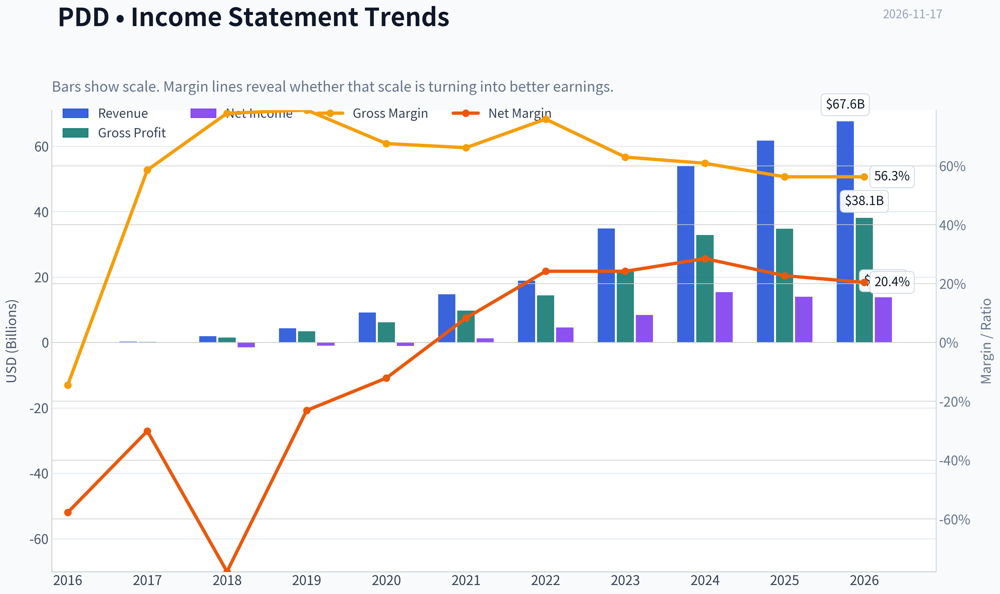

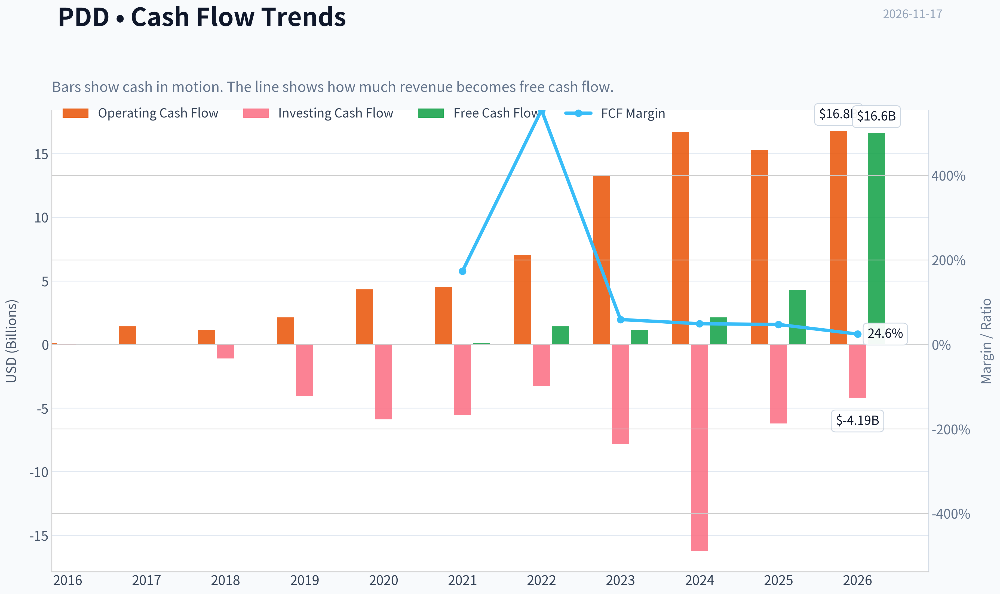

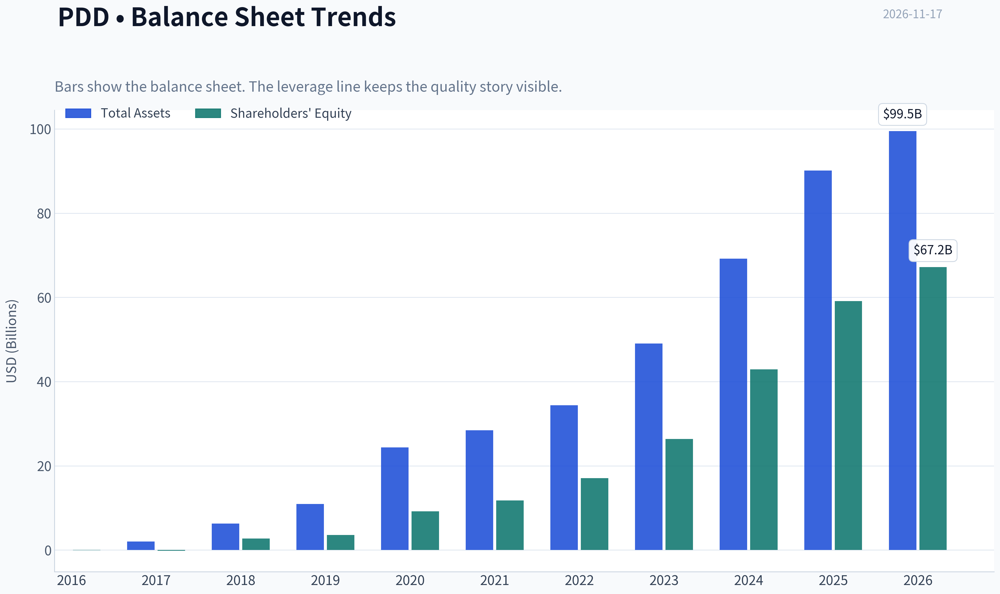

This graph tracks the profitability and return metrics (ROE, ROIC, Margins) of **PDD** over the past decade, highlighting capital efficiency trends.

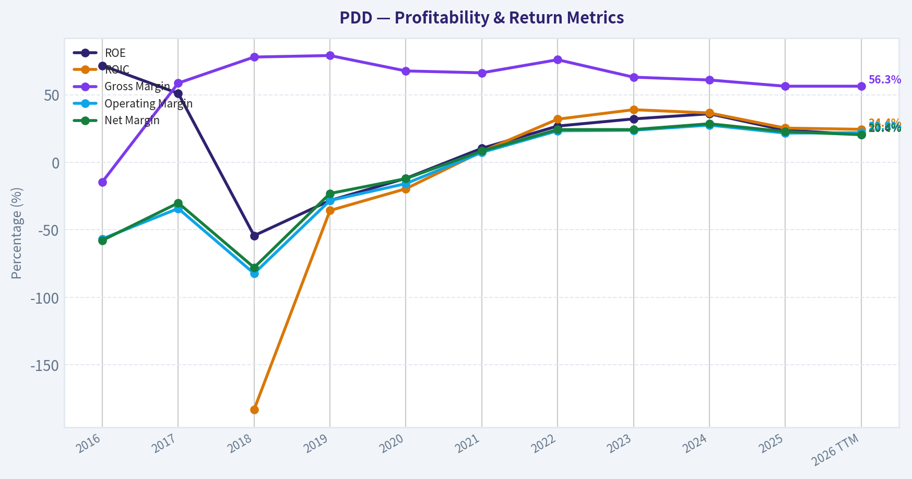

This chart illustrates the financial health of **PDD** over the last 10 years, mapping cash equivalents and free cash flow against total obligations (Debt).

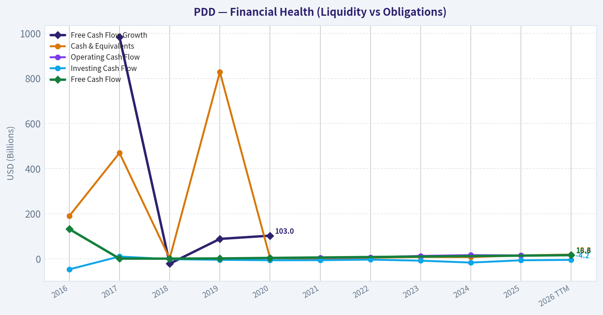

This breakdown chart from <em>Revenue Breakdown</em> shows the proportional composition for **PDD** - useful for understanding what drives or risks the business.

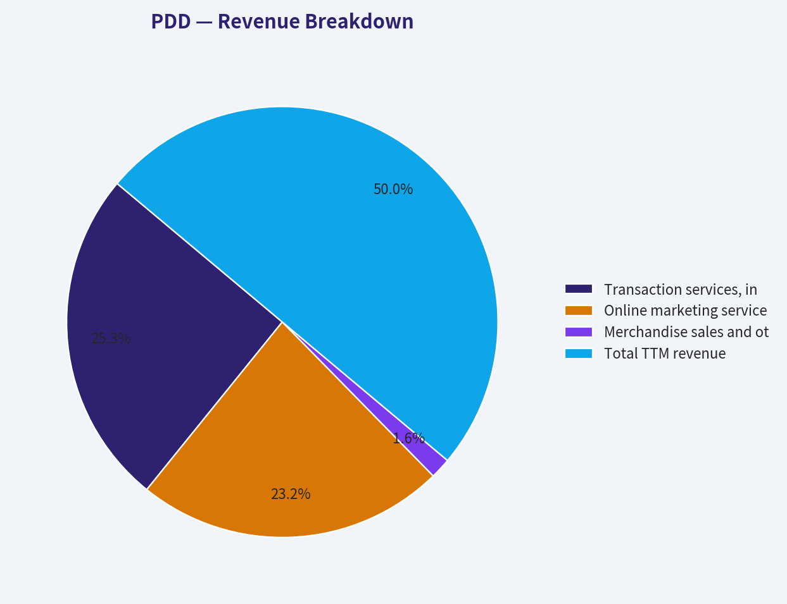

---

### Intrinsic Value Analysis (Buffett)

> *Following Warren Buffett's value investing philosophy: Circle of Competence, Economic Moat, Management Quality, and Margin of Safety.*

#### Intrinsic Value Snapshot

Price is what you pay. Intrinsic value is what the business may be worth based on the cash it can create for owners over time. We show a range, not one magic number.

- Current Price: $77.39
- Value Range (conservative to optimistic across both DCF methods): $213.52 to $1,068.87

##### Owner Earnings (Buffett Method)
- Net Income: $13,991,297,000.00
- Depreciation & Amortization: $450,052,337.73
- Capital Expenditures: N/A
- Working Capital Changes: $1,105,058,845.22
- Owner Earnings: $13,336,290,492.51

##### Intrinsic Value
###### Buffett Method
Uses owner earnings. Stricter, and usually more conservative.
- Conservative: $213.52
- Average: $349.83
- Optimistic: $890.78
- Discount Rate: 10.0%

###### Cash Flow Method
Uses free cash flow. Better for companies spending heavily today to grow tomorrow.
- Conservative: $418.22
- Average: $418.22
- Optimistic: $1,068.87
- Discount Rate: 10.0%

ANALYST STANCE: **Bullish**

#### Executive Conclusion

PDD is a high-quality, asset-light e-commerce platform trading at a valuation that appears unusually low relative to its profitability, cash generation, and reinvestment runway. Its advantages include scale, data, a large merchant ecosystem, consumer engagement, and the rapidly expanding Temu international platform.

The principal risks are China-related regulation, intense competition, governance and variable-interest-entity structure, and uncertainty over how much Temu growth will require in future subsidies and marketing. At approximately $77 per ADR, the valuation provides a substantial margin of safety, but the investment merits **low-to-moderate conviction** rather than maximum conviction because the business and jurisdiction are less predictable than a classic Buffett holding.

#### Factor Scorecard

| Factor | Score | Assessment |
|---|---:|---|
| 1. Business simplicity and predictability | 3.0/5 | The basic model is understandable: PDD connects consumers and merchants and earns through transaction and marketing services. International expansion and regulatory exposure reduce long-term predictability. |
| 2. Durable competitive advantage | 3.5/5 | Strong platform scale, merchant density, consumer engagement, data advantages, and low-asset economics. The moat is meaningful but faces Alibaba, JD.com, TikTok, Amazon, and regulatory risks. |
| 3. Management and capital allocation | 3.0/5 | Strong growth execution and apparent financial discipline, but governance transparency, founder control, China domicile, and VIE-related issues warrant a discount. |
| 4. Industry structure | 3.0/5 | E-commerce benefits from scale and network effects, but competition is aggressive and customer acquisition can be expensive. |
| **Gate 5: Quality and solvency floor** | **Not tripped** | Profitability is strong, earnings are growing, the current ratio is approximately 2.4, and there is no evidence of deteriorating earnings combined with financial distress. |

**Key Takeaways:** PDD scores well on economics and valuation but less well on predictability and governance. The company does not meet the hard-avoid distress condition; the main concerns are investment risks rather than solvency risks.

#### Moat Analysis

| Moat source | Evidence | Assessment |
|---|---|---|
| Network effects | More consumers attract more merchants, while more merchants increase assortment and improve consumer value. | Strong, but not unassailable |
| Cost advantage | Scale, algorithmic matching, and an asset-light marketplace model can support attractive margins without owning large physical inventories. | Meaningful |
| Switching costs | Merchants benefit from traffic, tools, data, and customer access, although consumers can use multiple platforms. | Moderate |
| Brand and intangible assets | Pinduoduo has strong consumer recognition in China; Temu is building international brand awareness. | Strong domestically, developing internationally |
| Scale and data | Large transaction volume improves recommendations, merchant targeting, and platform economics. | Important and potentially widening |

The gross margin is approximately **56.3%**, a strong indicator that PDD is not merely reselling products at thin retail margins. Its **23.7% ROE** and **14.5% year-over-year revenue growth** also indicate that the platform remains economically productive.

The moat is best classified as **wide but not fully stable**. PDD's scale and engagement are real advantages, but the company must continually spend to defend market share and establish Temu outside China.

#### Management Quality and Capital Allocation

Management deserves credit for building one of China's most powerful consumer platforms and for successfully extending the model internationally through Temu. The company has demonstrated a willingness to invest aggressively where management sees a large opportunity.

However, Buffett-style analysis requires a higher governance standard than simply rewarding growth. Relevant concerns include:

- Founder influence and concentrated voting control.
- The variable-interest-entity structure used by many Chinese internet companies.
- Regulatory uncertainty in China.
- Limited visibility for U.S. shareholders into ultimate control and legal protections.
- Potentially heavy customer-acquisition spending as Temu expands globally.

Management therefore receives a **3.0/5** rather than a top score. The operating record is impressive, but the shareholder-control and jurisdictional risks justify a valuation discount.

#### Financial Summary

| Metric | Latest available figure |
|---|---:|
| Share price | $77 |
| Market capitalization | $110.16 billion |
| P/E ratio | 8.17x |
| Revenue growth | 14.5% year over year |
| Gross margin | 56.3% |
| ROE | 23.7% |
| Current ratio | 2.43x |
| Headline intrinsic value | $323.56 |
| Owner-earnings model value | $349.83 |
| FCF model value | $418.22 |
| Damodaran FCFF model value | Negative $205.13 |
| Reverse-DCF implied 10-year growth | Approximately negative 15.5% annually |

**Key Takeaways:** PDD combines a low headline earnings multiple with high profitability and double-digit growth. The very large difference between the positive owner-earnings and FCF models and the negative FCFF model shows that valuation is sensitive to methodology, especially around cash-flow normalization and reinvestment assumptions.

#### Owner Earnings Calculation

Buffett's preferred framework is:

| Component | Treatment |
|---|---|
| Net income | Added |
| Depreciation and amortization | Added back |
| Maintenance capital expenditure | Subtracted |
| Working-capital investment | Subtracted |
| Result | Owner earnings available to shareholders |

PDD's reported P/E of approximately 8.17x implies trailing earnings of roughly:

- Market capitalization: $110.16 billion
- Implied net income: approximately **$13.5 billion**
- Implied earnings per share: approximately **$9.43**

The research pack's owner-earnings valuation implies normalized owner earnings of approximately **$34.98 per ADR** when applying the no-growth 10% capitalization formula. This is substantially above accounting earnings and likely reflects PDD's asset-light model, cash balances, and favorable working-capital characteristics.

Because maintenance capital expenditure and working-capital requirements are not separately available in the supplied figures, the $34.98 figure should be treated as a normalized model estimate rather than a reported accounting metric.

**Key Takeaways:** PDD's accounting earnings already support a low valuation, while its asset-light structure may produce owner earnings above net income. The key diligence issue is whether the elevated cash generation is sustainable after normalizing Temu investment and international customer-acquisition costs.

#### Three-Scenario DCF Valuation

Using normalized owner earnings of approximately $34.98 per ADR:

| Scenario | Assumptions | Estimated value per ADR |
|---|---|---:|
| A. No growth | Owner earnings capitalized at 10% | $349.83 |
| B. GDP-like growth | 3% perpetual growth, 10% discount rate | $514.70 |
| C. Historical-growth sensitivity | 9% growth for 10 years, then 3% terminal growth | Approximately $692 |

Scenario C is deliberately aggressive and should not be treated as a base case. It assumes that PDD can sustain a substantial portion of its historical expansion while eventually settling into a mature 3% terminal growth rate.

A more conservative blended estimate is the research-pack headline value of **$323.56**, which incorporates reverse-DCF and owner-earnings approaches and recognizes the cyclical nature of the business.

**Key Takeaways:** Even the no-growth capitalization approach produces a value far above the $77 share price, while growth scenarios produce substantially higher figures. The conservative blended estimate is the most useful anchor because it incorporates uncertainty around Temu, competition, regulation, and normalized cash generation.

#### Margin of Safety Analysis

| Valuation reference | Value per ADR | Margin versus $77 price |
|---|---:|---:|
| Headline blended intrinsic value | $323.56 | 76.1% |
| Owner-earnings model | $349.83 | 78.0% |
| FCF model | $418.22 | 81.6% |
| No-growth owner-earnings value | $349.83 | 78.0% |

PDD's reverse DCF indicates that the current price implies approximately **negative 15.5% annual earnings growth over the next decade**. That is far below what the company has recently achieved and below what would normally be expected from a platform with a 56.3% gross margin, 23.7% ROE, and ongoing international expansion.

The margin of safety appears unusually large even after applying a quality discount for governance and geopolitical risk. A reasonable interpretation is that the market is pricing in a major deterioration in growth, profitability, or investor access.

#### Final Buffett Scorecard

| Criterion | Weight | Score | Weighted contribution |
|---|---:|---:|---:|
| Moat width and durability | 25% | 3.5/5 | 0.88 |
| Valuation and margin of safety | 20% | 5.0/5 | 1.00 |
| Capital returns versus WACC | 15% | 4.5/5 | 0.68 |
| Business understanding and predictability | 12% | 3.0/5 | 0.36 |
| Management and capital allocation | 12% | 3.0/5 | 0.36 |
| Reinvestment runway | 8% | 4.5/5 | 0.36 |
| Balance-sheet strength | 4% | 4.5/5 | 0.18 |
| Industry structure | 4% | 3.0/5 | 0.12 |
| **Total** | **100%** |  | **3.93/5** |

**Key Takeaways:** PDD's score is driven primarily by valuation, capital returns, and reinvestment potential. Governance, regulatory, and competitive risks prevent a perfect score, but they do not offset the unusually wide valuation gap at the current price.

#### Investment Stance

**Bullish - Low-to-Moderate Conviction**

At approximately $77, PDD appears materially undervalued relative to normalized owner earnings and conservative intrinsic-value estimates. The company has a credible platform moat, strong margins, high returns on equity, substantial growth opportunities, and a balance sheet that does not suggest financial distress.

The position should nevertheless be sized conservatively because the investment involves:

- China regulatory and geopolitical risk.
- VIE and shareholder-rights risk.
- Aggressive competition in e-commerce.
- Uncertainty regarding Temu's long-term profitability.
- Potential volatility in reported margins and cash flow.

For a value investor able to tolerate jurisdictional and governance risk, PDD offers a compelling asymmetric opportunity. A sustained deterioration in Temu economics, falling ROE, weakening cash conversion, or new restrictions on foreign ownership would be reasons to reassess the thesis.
#### Valuation Bridge

This bridge places the current market price beside each intrinsic value lens so readers can see whether upside depends on one method or shows up across several methods.

| Scenario | Intrinsic Value / Share |
| --- | ---: |
| Buffett Method | $349.83 |
| Cash Flow Method | $418.22 |
| Damodaran Method | $-205.13 |
| Current Price | $77.39 |

#### Key Takeaways

If one method is far above the others, the upside case depends on a specific modelling assumption. When several methods cluster together, the valuation story is more robust.

#### Valuation Visuals

This comparison chart from *Latest Earnings Snapshot* stacks current figures against historical benchmarks for **PDD**, making it easy to see where the company trades relative to its own averages.

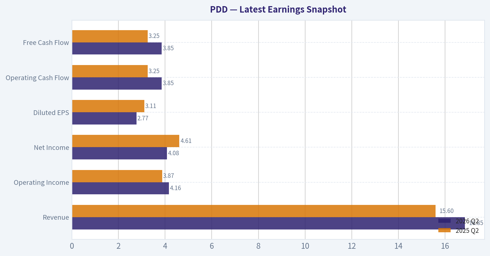

This comparison chart from *Balance Sheet and Financial Strength* stacks current figures against historical benchmarks for **PDD**, making it easy to see where the company trades relative to its own averages.

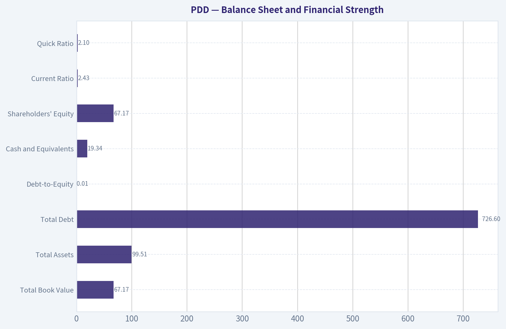

This comparison chart from *Buffett-Style Owner Earnings DCF* stacks current figures against historical benchmarks for **PDD**, making it easy to see where the company trades relative to its own averages.

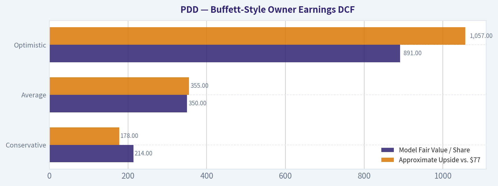

This comparison chart from *Financial Summary* stacks current figures against historical benchmarks for **PDD**, making it easy to see where the company trades relative to its own averages.

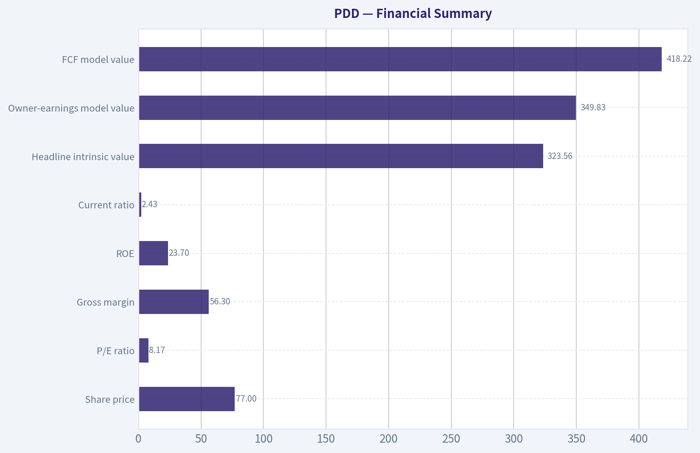

This comparison chart from *Three-Scenario DCF Valuation* stacks current figures against historical benchmarks for **PDD**, making it easy to see where the company trades relative to its own averages.

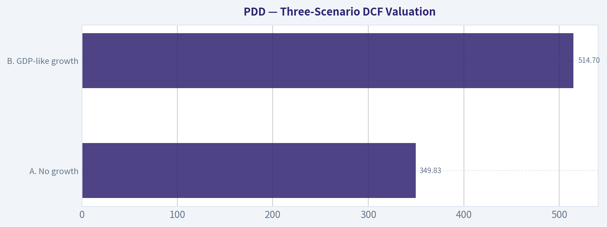

---

### Trend & Growth Analysis (Lynch/Druckenmiller/Fisher)

> *Following Peter Lynch's GARP, Stanley Druckenmiller's macro-aware approach, and Philip Fisher's scuttlebutt methodology.*

ANALYST STANCE: **Neutral**

#### 1. Lynch Classification

**Fast grower, but currently decelerating toward stalwart territory.** PDD has produced exceptional multi-year growth, but the latest data show revenue growth slowing to approximately 10-15%, while net income is declining. It remains a growth company because of international expansion and substantial market runway, but the acceleration required for a high-conviction entry is not yet visible.

#### 2. The Story in Three Bullets

- **PDD operates value-focused e-commerce platforms**, including Pinduoduo in China and Temu internationally, using low prices, social shopping, and merchant scale to drive consumer adoption.
- **International e-commerce expansion is the potential second growth engine.** If Temu develops durable customer retention and acceptable unit economics, it could materially expand PDD's addressable market.
- **The company is financially strong and inexpensive:** approximately $67.6 billion of TTM revenue, 56.3% gross margin, 20%-22% net margin, a P/E near 8, and a current ratio above 2.

#### 3. Key Financial Snapshot

| Metric | Latest figure | Interpretation |
|---|---:|---|
| Share price | $77.39 | Near the low end of the $71.94-$125.36 52-week range |
| Market capitalization | $110.2B | Large-cap internet retailer |
| TTM revenue | $67.6B | Large existing revenue base |
| Latest reported revenue growth | 14.5% YoY | Positive, but slower than historical growth |
| TTM revenue growth | 9.5% | Indicates further recent deceleration |
| Net income | $13.8B-$14.0B | Highly profitable |
| Net margin | 20.4%-22.7% | Strong, though below peak levels |
| Gross margin | 56.3% | High for e-commerce |
| P/E | 8.17x | Very low relative to historical growth |
| Price-to-sales | 1.63x | Reasonable for a profitable e-commerce company |
| ROE | 23.7% | Strong capital productivity |
| Current ratio | 2.43x | Good liquidity |
| Debt-to-equity | Approximately 0.01x | Very low balance-sheet leverage |

**Key Takeaways:** PDD combines unusually strong profitability with a low valuation and minimal leverage. The central concern is not financial fragility; it is whether revenue and earnings growth can reaccelerate after a sharp slowdown from prior years.

#### 4. TAM Analysis and the 10x Test

PDD's opportunity spans Chinese consumer commerce, cross-border e-commerce, online advertising, merchant services, and potentially broader global retail. The largest incremental opportunity is Temu, but its long-term value depends on repeat purchasing, logistics efficiency, regulatory acceptance, and sustainable contribution margins.

| 10x test | Estimate |
|---|---:|
| Current revenue | $67.6B |
| 10x revenue target | Approximately $676B |
| Relevant global e-commerce market | Measured in multiple trillions of dollars |
| Implied share at 10x revenue | Potentially below 20% |
| Runway conclusion | Mathematically substantial, operationally unproven |

**Key Takeaways:** PDD can theoretically grow revenue tenfold while remaining below a dominant share of the global e-commerce market. However, the TAM is not automatically available to PDD; international customer retention, local competition, tariffs, regulation, and fulfillment economics will determine how much of that market is economically accessible.

#### 5. Revenue Growth Trend

| Period | Revenue growth |
|---|---:|
| 2021 | 61.7% |
| 2022 | 28.4% |
| 2023 | 84.3% |
| 2024 | 54.7% |
| 2025 | 14.5% |
| 2026 TTM | 9.5% |
| Three-year revenue CAGR | 48.3% |
| Five-year revenue CAGR | 46.6% |

**Key Takeaways:** PDD's long-term growth record is outstanding, but the current trend is clearly decelerating rather than accelerating. This is a warning for a momentum-oriented growth investor, although one or two weak periods would not invalidate the thesis if Temu or domestic commerce later produces renewed acceleration.

#### 6. Unit Economics and Operating Efficiency

Detailed CAC, LTV, payback period, and NRR data were not available in the supplied fundamentals. This is particularly important for evaluating Temu, where rapid gross merchandise volume growth may require heavy subsidies, advertising, logistics spending, or merchant incentives.

| Metric | Available data | Assessment |
|---|---:|---|
| LTV/CAC | Not disclosed | Cannot confirm value creation |
| CAC payback | Not disclosed | Key Temu risk |
| Net revenue retention | Not applicable/not disclosed | Marketplace economics differ from SaaS |
| Rule of 40 | Approximately 34%-35% using 9.5% growth plus 24.6% FCF margin | Acceptable, but not elite |
| Operating margin | Approximately 21.9% | Strong profitability |
| TTM free cash flow | Approximately $16.6B | Major financial strength |
| FCF margin | Approximately 24.6% | Supports reinvestment and buybacks |

**Key Takeaways:** PDD passes a basic efficiency test because its cash generation and margins are strong. The missing evidence is segment-level economics: investors need to know whether international expansion is moving toward self-sustaining profitability or merely buying market share.

#### 7. Inflection Point Assessment

| Potential inflection | Current evidence | Status |
|---|---|---|
| Product cycle | Temu remains the principal new growth initiative | Unproven |
| Market share | Potential share gains in value-oriented e-commerce | Positive but difficult to verify |
| Margin inflection | Strong margins, but recent earnings declined | Not confirmed |
| TAM expansion | International commerce materially expands the opportunity | Positive |
| Competitive inflection | No clear evidence of a major competitor failure | Neutral |
| Earnings revision inflection | Latest earnings growth is negative | Negative |

**Key Takeaways:** The TAM expansion is real, but the earnings inflection is not yet confirmed. A high-conviction upgrade would require accelerating revenue, improving international contribution margins, or evidence that Temu users are becoming repeat customers without proportionally higher subsidies.

#### 8. Macro Setup

PDD is exposed to several macro forces:

- **Positive:** Long-term e-commerce penetration, digital advertising, mobile commerce, and value-conscious consumers.
- **Positive:** A low interest-rate environment would generally support growth-stock multiples, although PDD's current valuation is already unusually low.
- **Negative:** Chinese consumer confidence, geopolitical tension, tariffs, cross-border regulation, and potential restrictions on data or marketplace practices.
- **Negative:** A weak Chinese economy could pressure merchant activity and discretionary spending.
- **Mixed:** PDD's international exposure diversifies its revenue opportunity but increases regulatory and logistics complexity.

Overall, the macro setup is **mixed rather than strongly favorable**. The company has secular tailwinds, but country and cross-border risks prevent a clean Druckenmiller-style "wind at the back" setup.

#### 9. Fisher 15-Point Assessment

This is a qualitative estimate based on the supplied financial data and business characteristics rather than direct management interviews or full scuttlebutt research.

| Fisher criterion | Score / 5 | Comment |
|---|---:|---|
| Market potential | 5 | Large Chinese and global e-commerce opportunity |
| New-product determination | 4 | Temu represents meaningful international ambition |
| R&D effectiveness | 3 | Technology appears capable, but evidence is limited |
| Sales organization | 4 | Strong merchant and consumer acquisition capabilities |
| Profit margins | 5 | High gross and net margins |
| Margin trend | 3 | Strong absolute margins, but recent pressure |
| Labor relations | 3 | Limited evidence |
| Executive relations | 3 | Limited evidence |
| Management depth | 4 | Scaled operating platform |
| Cost analysis/accounting | 3 | Adequate public evidence |
| Outstanding competitive aspects | 4 | Network effects, data, scale, and value positioning |
| Long-range profit outlook | 4 | Attractive but dependent on Temu economics |
| Dilution | 3 | No major dilution signal, but Piotroski data flags some dilution |
| Management candor | 3 | Requires further scuttlebutt |
| Management integrity | 3 | Governance and geopolitical complexity warrant caution |
| **Total** | **52 / 75** | **Average to good, not outstanding** |

**Key Takeaways:** PDD scores well on market opportunity, profitability, and competitive positioning. The score is held back by limited visibility into management quality, international unit economics, governance, and margin durability.

#### 10. Valuation Analysis

| Valuation measure | Result | Interpretation |
|---|---:|---|
| P/E | 8.17x | Very inexpensive if earnings are durable |
| Earnings yield | Approximately 12.2% | Attractive absolute valuation |
| PEG | Approximately 0.57 | Attractive, but unreliable while earnings are declining |
| Price-to-sales | 1.63x | Reasonable for profitable e-commerce |
| Headline intrinsic value | Approximately $324 | Highly model-sensitive |
| Owner-earnings valuation range | Approximately $214-$891 | Very wide range |
| FCFF model range | Approximately negative $1,006 to $908 | Demonstrates modeling instability |
| Reverse-DCF implication | Approximately -15.5% annual owner-earnings growth for 10 years | Extremely conservative market pricing assumption |

**Key Takeaways:** PDD is statistically cheap under conventional earnings and cash-flow measures. However, the large valuation-model dispersion means the apparent margin of safety depends heavily on whether current earnings are sustainable and whether Temu requires substantial ongoing reinvestment.

A practical scenario framework is:

| Scenario | Operating assumption | Indicative valuation view |
|---|---|---:|
| Bear | Revenue growth remains below 10%, earnings continue to contract, and regulatory risk rises | $50-$80 |
| Base | Revenue returns to roughly 12%-18% growth and margins stabilize | $110-$180 |
| Bull | Temu becomes a durable global growth engine and earnings reaccelerate above 20% | $250+ |

These are analytical ranges rather than price targets. The bear case is not necessarily a business failure; it represents a permanently lower growth and valuation regime.

#### 11. Growth Investor Scorecard

| Criterion | Weight | Score / 5 | Weighted contribution |
|---|---:|---:|---:|
| Lynch story | 10% | 4.0 | 0.40 |
| TAM and runway | 20% | 4.5 | 0.90 |
| Revenue growth | 20% | 2.5 | 0.50 |
| Unit economics | 15% | 3.0 | 0.45 |
| Competitive position | 10% | 4.0 | 0.40 |
| Management quality | 10% | 3.0 | 0.30 |
| Macro setup | 5% | 3.0 | 0.15 |
| Profitability path | 5% | 4.0 | 0.20 |
| Valuation | 5% | 4.5 | 0.23 |
| **Total** | **100%** |  | **3.53 / 5.00** |

**Key Takeaways:** PDD earns a low-end **Bullish-quality score**, but the most important category-revenue growth-is currently weak relative to its historical standard. The valuation is compelling enough to prevent an avoid rating, while the lack of confirmed reacceleration prevents a high-conviction advocate stance.

#### 12. Position Size Stance

**Suggested stance: Neutral / small starter position only.**

- **Existing holders:** Continue holding if comfortable with Chinese and geopolitical risk, but monitor growth closely.
- **New investors:** Consider a small exploratory position rather than a full allocation.
- **Position sizing:** Approximately **1%-2%** for a diversified growth portfolio until growth reaccelerates.
- **Potential increase:** Only after evidence of accelerating revenue, stable margins, and improving Temu unit economics.
- **Concentration limit:** Avoid making PDD a large single-country or single-stock position because valuation does not eliminate regulatory and geopolitical risk.

#### 13. Key Catalysts and Risks

| Catalysts | Risks |
|---|---|
| Revenue growth reaccelerates above 20% | Continued revenue deceleration |
| Temu achieves repeat-purchase economics | Persistent customer-acquisition subsidies |
| International margins improve | Tariffs, restrictions, or regulatory intervention |
| Chinese consumption recovers | Weak consumer demand and merchant pressure |
| Share repurchases or capital returns increase | Governance, ADR, and geopolitical risk |
| Earnings estimates begin rising | Margin compression from international expansion |

**Key Takeaways:** The key catalyst is not merely Temu user growth; it is profitable, repeatable growth. The key risk is that PDD's low valuation reflects a durable slowdown rather than temporary investor pessimism.

#### Bottom Line

PDD is a **high-quality, financially strong, inexpensive e-commerce platform with substantial theoretical runway**, but the current operating data do not yet show a fresh growth inflection. Its historical growth and valuation create meaningful upside potential, while decelerating revenue, falling earnings, uncertain Temu economics, and China-related risks require patience and position discipline.

**Decision: Neutral, with a small starter position acceptable for investors who can tolerate substantial geopolitical and business-model uncertainty.**

---

### Market Technical Analysis

ANALYST STANCE: **Bearish**

#### PDD technical analysis

The latest available trading session in the retrieved data is **November 16, 2026**, when PDD closed at **$78.11**. November 17 was not present as a trading session, so the analysis uses November 16 as the effective observation date.

The indicator-report tool returned incomplete values because the requested date was not recognized as a valid trading day. Therefore, the observations below are calculated or inferred from the retrieved daily price series and should be treated as approximate rather than as an official broker-grade indicator feed.

#### Trend structure

PDD remains in a pronounced medium- and long-term downtrend. The stock fell from approximately **$131.50 at the start of the retrieved period to $78.11**, a decline of about **41%**. The selling was not a single isolated event: after an initial decline in November and December 2025, the stock experienced another sharp breakdown in January, then continued making lower lows into late May and June 2026.

The most severe acceleration occurred around **May 27-29**, when PDD dropped from **$96.64 to $83.03** over two sessions and traded with exceptionally high volume. That type of price-and-volume event often creates a major overhead supply zone because investors who bought before the decline may sell into later rebounds near their breakeven levels.

There was a meaningful recovery from the late-June low near **$73.30**. PDD rallied toward **$93** in August, but that recovery failed to reverse the broader structure. The subsequent decline produced lower highs near $90, $83, and $82, followed by a November move back toward the high-$70s. This is characteristic of a bear-market rally followed by renewed distribution rather than a confirmed trend reversal.

The approximate **50-day simple moving average is near the low-$80s**, while the latest close is below it. The approximate **200-day moving average is materially higher, likely in the mid-$90s**, leaving price well below both medium- and long-term trend benchmarks. Until PDD can reclaim the 50-day average and then establish itself above the 200-day average, rallies should be treated as countertrend moves.

#### Short-term momentum

The approximate 10-day exponential moving average is close to the current price, around **$79-$80**. This indicates that the immediate trend is not collapsing at the same speed as the May-June decline, but it also does not show a decisive bullish impulse. The latest close near $78.11 is below this short-term average, suggesting that sellers still have short-term control.

The approximate 14-day RSI is near **49**, which is neutral rather than oversold. This is important: PDD has already experienced substantial long-term weakness, but the current RSI does not indicate that the stock is at an extreme short-term oversold level. A neutral RSI while price remains below major moving averages is generally more consistent with unresolved weakness than with a high-confidence reversal.

The MACD configuration appears mildly negative or near neutral after the November decline. Momentum has weakened from the early-November rebound, but there is not yet evidence of a strong bullish crossover. A more constructive setup would require the MACD line to cross above its signal line while price simultaneously reclaims the $80-$82 area on improving volume.

#### Volatility and Bollinger-band context

Using the most recent 20 sessions, the approximate Bollinger middle line is around **$80-$81**, with the upper band near **$84-$85** and the lower band near **$76-$77**. The November 16 close at $78.11 is below the middle band and relatively close to the lower band.

This placement conveys two opposing messages:

1. PDD is trading in the weaker half of its recent range, confirming short-term bearish pressure.
2. Because price is approaching the lower band, a reflexive bounce is possible.

However, touching or approaching the lower Bollinger Band is not by itself a buy signal. In persistent downtrends, prices can remain near the lower band for an extended period. A durable reversal would require a close back above the middle band, followed by a higher high above the recent resistance zone around $82-$84.

The approximate 14-day ATR is around **$2-$3 per share**, implying that ordinary daily movement can be several percent at the current price. Position sizing should therefore be conservative, and stops placed too close to the entry price would be vulnerable to normal volatility.

#### Price levels and scenarios

The first nearby support region is approximately **$76-$77**, corresponding to the recent lower Bollinger area and the November intraday lows. A decisive close below that zone would expose the stock to a possible retest of the **$73-$74** region established in June.

On the upside, **$80-$82** is the first recovery hurdle. This zone contains the recent short-term average area and several recent closing levels. A move through $82 would improve the short-term picture, but it would not yet reverse the larger trend. Stronger resistance is located around **$84-$85**, followed by the **$88-$90** area where the August rebound stalled.

The bullish case would require several confirmations: price holding above $76-$77, a recovery above $82, a move through $84-$85, improving MACD momentum, and preferably stronger-than-average volume on up days. Without those conditions, a bounce may simply provide another opportunity for sellers to reduce exposure.

The bearish case is activated by a sustained break below $76-$77, particularly if accompanied by expanding volume. That would suggest that the market is rejecting the recent consolidation and that the June low near $73.30 could be tested again.

#### Indicator selection

The most relevant complementary indicators for PDD's current condition are:

- **close_50_sma:** Establishes the medium-term trend and identifies the first major recovery hurdle.
- **close_200_sma:** Measures the broader trend and confirms that price remains structurally weak.
- **close_10_ema:** Provides a faster signal for short-term momentum changes.
- **macd:** Helps determine whether the November decline is losing momentum or continuing.
- **rsi:** Distinguishes ordinary weakness from genuinely oversold conditions.
- **boll_ub:** Defines the upper side of the current volatility range and recovery resistance.
- **boll_lb:** Identifies downside extension and potential short-term reaction zones.
- **atr:** Provides essential volatility information for stop placement and position sizing.

The two moving averages provide different time horizons, while the 10-day EMA captures short-term changes. MACD and RSI both address momentum but in different ways: MACD emphasizes trend acceleration and crossovers, whereas RSI measures the balance of recent gains and losses. The Bollinger bands add range and volatility context, and ATR contributes risk-management information without duplicating the directional indicators.

#### Overall assessment

PDD's long-term trend remains bearish, and the stock is still below its approximate 50-day and 200-day trend benchmarks. The recent price action is weak but not yet deeply oversold, which means the risk-reward profile does not strongly favor an immediate purchase. A short-term bounce from the $76-$77 region is possible, but it should be considered speculative unless price reclaims $80-$82 and then breaks through $84-$85 with confirmation.

For trend-following traders, the preferable approach is to wait for evidence of stabilization and a higher-high sequence. For existing holders, the $76-$77 area is the key near-term risk level, while a break below it would materially weaken the case for a sustained recovery. For new buyers, the current setup is better classified as **watchlist-only rather than an active entry**.

| Area | Approximate observation | Trading implication |
|---|---:|---|
| Latest close | $78.11 on November 16, 2026 | Price remains near the lower part of its recent range |
| One-year performance in retrieved data | About -41% | Long-term trend is decisively bearish |
| 50-day SMA | Approximately low-$80s | First major medium-term recovery hurdle |
| 200-day SMA | Approximately mid-$90s | Stock remains far below long-term trend confirmation |
| 10-day EMA | Approximately $79-$80 | Short-term momentum is weak to neutral |
| 14-day RSI | Approximately 49 | Neutral; not a strong oversold signal |
| MACD | Mildly negative or near neutral | No confirmed bullish momentum reversal |
| Bollinger middle band | Approximately $80-$81 | Reclaim would improve short-term structure |
| Bollinger lower band | Approximately $76-$77 | Important support and downside-risk zone |
| Bollinger upper band | Approximately $84-$85 | Initial stronger resistance |
| Approximate ATR | About $2-$3 | Volatility is high; use smaller position sizes |
| Key support | $76-$77, then $73-$74 | Break below could trigger a retest of June lows |
| Key resistance | $80-$82, then $84-$85 and $88-$90 | Recovery must clear these zones to improve technically |
| Current stance | Avoid / wait for confirmation | No clear risk-adjusted long entry yet |

**Key Takeaways:** PDD is trading below its major moving-average trend levels, and the broader pattern remains one of lower highs and lower lows. The stock is near short-term support, so a rebound is possible, but RSI is neutral rather than deeply oversold and MACD has not confirmed a bullish reversal. A sustained move above $82, followed by a break through $84-$85, would be needed to improve the setup; a break below $76-$77 would increase downside risk toward the low-$70s.

---

### Options Market Analysis

> *Reading options flow - put/call ratios, IV skew, and unusual activity - to gauge institutional positioning and event-driven risk.*

#### PDD Options Market Report

*Data as of November 17, 2026. The available chain is very thin and does not include strike-level prices, so strike-specific IV skew, gamma walls, and exact ITM/ATM/OTM classification cannot be reliably determined.*

#### Put/Call Ratio Analysis

| Near-term expiry | Call OI | Put OI | Put/Call OI | Call volume | Put volume | Put/Call volume |
|---|---:|---:|---:|---:|---:|---:|
| Nov. 20, 2026 | 1,003 | 37 | 0.04 | 7,429 | 5,723 | 0.77 |
| Nov. 27, 2026 | 0 | 0 | N/A | 985 | 1,526 | 1.55 |
| Dec. 4, 2026 | 0 | 0 | N/A | 651 | 392 | 0.60 |
| **Total near-term** | **1,003** | **37** | **0.04** | **9,065** | **7,641** | **0.84** |

The aggregate put/call open-interest ratio of 0.04 is substantially below the approximately 0.70 neutral baseline, indicating that existing near-term positioning is overwhelmingly call-oriented. The volume ratio of 0.84 is only modestly below neutral and is less bullish, while the Nov. 27 expiration shows heavier put volume. Overall, the OI data is bullish, but the volume signal is closer to balanced.

**Key Takeaways:** PDD's existing near-term open interest is strongly call-heavy. Trading volume is much less decisive, suggesting that the low OI ratio may reflect limited positioning rather than broad, aggressive bullish conviction.

#### Implied Volatility Assessment

| Expiry | Call ATM IV | Put ATM IV | Put-versus-call IV spread | Assessment |
|---|---:|---:|---:|---|
| Nov. 20, 2026 | 4.3% | 4.1% | -0.2 percentage points | Very low and nearly balanced |
| Nov. 27, 2026 | 2.5% | 2.1% | -0.4 percentage points | Very low; slight call premium |
| Dec. 4, 2026 | 2.3% | 1.7% | -0.6 percentage points | Very low; call IV premium |

The reported near-term ATM IV is exceptionally low, ranging from roughly 2.3% to 4.3%. Put IV is below call IV across the listed expirations, which is the opposite of a conventional downside put skew and suggests limited demand for immediate crash protection, or possible data-quality/quote limitations. No catalyst calendar was provided, so elevated event risk cannot be confirmed; in fact, the reported IV does not indicate meaningful event premium.

**Key Takeaways:** Implied volatility is unusually low, and the skew leans slightly toward calls rather than puts. This points to limited downside hedging demand, but the extreme IV readings and sparse chain warrant low confidence.

#### Unusual Options Activity

| Finding | Result |
|---|---|
| Contracts meeting volume greater than 5x open interest | None identified |
| Fresh directional bets | Not confirmed |
| Smart-money versus retail distinction | Not possible from the supplied aggregate data |

No individual contracts met the tool's unusual-activity threshold. Therefore, there is no verified evidence of a large fresh call purchase, put hedge, or directional sweep. The absence of flagged contracts should not be interpreted as an absence of trading, because several expirations show volume despite zero reported open interest and the chain is thin.

**Key Takeaways:** There are no confirmed unusual contracts to anchor a directional trade thesis. The lack of strike-level flow makes it impossible to distinguish institutional accumulation from short-dated retail speculation.

#### Open Interest Concentration and Gamma Levels

| Expiration | Highest reported call OI | Highest reported put OI | Concentration assessment |
|---|---:|---:|---|
| Nov. 20, 2026 | 1,003 contracts in aggregate | 37 contracts in aggregate | Call-heavy, but strike concentration unavailable |
| Nov. 27, 2026 | 0 | 0 | No reported OI |
| Dec. 4, 2026 | 0 | 0 | No reported OI |

The Nov. 20 expiration contains essentially all reported near-term open interest, making it the primary expiration for potential pinning or gamma effects. However, strike-level open interest and current stock price were not supplied, so no specific gravitational price level, max-pain estimate, or call/put gamma wall can be calculated. Given the small overall OI, any pinning effect is likely limited unless the 1,003 calls are concentrated at one or two strikes.

**Key Takeaways:** Near-term positioning is concentrated in the Nov. 20 expiration and is heavily call-weighted. Specific support, resistance, and gamma levels cannot be identified without strike-level data, and the total chain appears too small for high-confidence market-maker effects.

#### Overall Options Sentiment

**Signal: BULLISH, with low confidence.**

The primary bullish driver is the extremely low aggregate put/call OI ratio of 0.04, combined with slightly call-favorable volume and call IV premiums over put IV. This indicates that traders with existing near-term positions are much more exposed to calls than puts.

The signal is tempered by several limitations:

- No unusual contracts were identified.
- Volume is only modestly call-favorable overall.
- Most reported OI is confined to one very near-term expiration.
- The chain has zero reported OI in the later expirations despite meaningful volume.
- Strike-level data, current price, and exact IV skew are unavailable.
- The reported IV levels are unusually low and may not fully represent executable market pricing.

Accordingly, the options market leans bullish, but it does not provide strong evidence of high-conviction institutional buying. The appropriate interpretation is **mild bullish positioning rather than a robust bullish signal**.

#### Summary

| Category | Assessment |
|---|---|
| Put/Call Ratio | **Bullish by OI:** 0.04 versus approximately 0.70 neutral; **volume mildly bullish:** 0.84 |
| IV Level | **Very low**, approximately 2.3%-4.3% ATM across near-term expirations |
| Skew Direction | **Slight call skew:** put IV is below call IV; no strike-level OTM skew available |
| Unusual Activity | **None flagged** at volume greater than 5x open interest |
| Overall Signal | **BULLISH, low confidence**; call-heavy OI is the main driver, but the chain is thin and incomplete |

---

## Research Team Commentary

> *The Research Manager synthesizes the Bull vs Bear debate into action-free commentary. This is a pre-risk view, not the final stance.*

Core takeaway: PDD is financially strong and statistically cheap, but the evidence is not yet sufficient to call it a predictable Buffett-quality compounder. At $77.39 and roughly 8.2 times trailing earnings, the shares already discount weak growth and a permanently elevated China risk premium. Nevertheless, current earnings cannot be treated as durable owner earnings until free-cash-flow conversion, Temu's economics, and access to the underlying cash are clearer. The appropriate stance is Neutral rather than Bullish or Bearish.

The strongest bull argument is the combination of operating quality and valuation. PDD is an asset-light marketplace with a 56.3% gross margin, an estimated 20%-22% net margin, 23.7% ROE, 15.5% ROA, and ample liquidity. Its domestic platform benefits from consumer engagement, merchant scale, recommendation data, and a strong position among value-conscious shoppers. These are real advantages, even if they do not create the hard switching costs found in enterprise software.

The price is also compelling on its face. An 8.17 multiple represents an earnings yield above 12%. PDD does not need Temu to become the next Amazon for the shares to work; maintaining the domestic franchise, producing modest long-term earnings growth, and avoiding serious regulatory disruption could support value above the current quotation. Temu then provides potentially significant upside if customer retention improves and international operations reach positive contribution margins. Short-term technical weakness may reflect broad pessimism rather than a deterioration in long-term intrinsic value.

The strongest bear argument is that the headline P/E may overstate the margin of safety. We have not been given enough information about normalized free cash flow, stock-based compensation, working-capital effects, cash accessibility, or the portion of current earnings supported by spending that may have to continue. High gross margins demonstrate an asset-light accounting model, but not necessarily high owner earnings after customer acquisition, promotions, compliance, logistics support, and international expansion.

Temu is the key uncertainty. It should not be treated as free optionality because exercising that option may require substantial and recurring expenditure. Rapid transaction growth is not evidence of value unless mature customer cohorts generate positive contribution profit after advertising, shipping, returns, refunds, and regulatory costs. Founder control could support patient investment, but it could also allow an uneconomic international strategy to persist longer than outside shareholders would prefer.

The domestic moat also deserves a more measured description than "wide." PDD has scale, data, engagement, and merchant liquidity, but consumers and merchants can use multiple platforms with little friction. Alibaba, JD, Douyin, and other competitors have the capital and technology to copy features or subsidize prices. PDD's advantage may be durable, but it requires continuing evidence that engagement and monetization can be maintained without an escalating subsidy cycle.

China, VIE, and governance risks are not ordinary quarterly volatility. Foreign shareholders' economic claims depend on an offshore contractual structure, regulatory tolerance, and the ability to move or return capital. These risks justify both a higher discount rate and a lower terminal multiple. They also mean that PDD should require a larger margin of safety than a similarly profitable platform with conventional ownership and stronger minority-shareholder protections.

From an intrinsic-value perspective, both sides' ranges are plausible. The bull's approximate $95-$125 base case assumes mid-single-digit or better earnings growth and some multiple normalization. The bear's $65-$85 conservative range assumes flat or slowly growing earnings, little value for Temu, and a continuing 8-10 times risk-adjusted multiple. At $77.39, the shares are attractive under the first framework but near fair value under the second.

That distinction is decisive. PDD is not obviously overvalued or financially distressed, so Bearish would be too harsh. But a low multiple alone is not enough for Bullish when normalized owner earnings and international returns remain inadequately demonstrated. Given the structural uncertainty, I would want approximately a 25%-35% discount to a conservative estimate of intrinsic value, not merely to a favorable scenario. The current price does not clearly provide that discount against the bear's reasonable assumptions.

The market may be overly pessimistic, but it is not obviously irrational. It appears to expect a maturing domestic business, limited or negative value from Temu, and a permanently low valuation due to structural risks. PDD can beat those expectations, but the investment case remains dependent on evidence that current profitability is sustainable and that Temu is becoming an asset rather than an open-ended capital commitment.

Over the next one to four quarters, I would monitor free cash flow against net income, including stock-based compensation, working-capital movements, and cash taxes. Persistent cash conversion close to or above reported earnings would strengthen confidence in the 8.2 times multiple; widening divergence would weaken it. Disclosure about where cash is held, whether it is accessible to the listed entity, and whether management returns capital through credible repurchases would also matter.

For the domestic business, I would watch revenue and gross-profit growth, merchant-service monetization, sales and marketing expense, and operating margins. The best evidence of moat durability would be stable engagement and growth without disproportionate promotional spending. Material margin contraction combined with slowing growth would suggest that current earnings are above their normalized level.

For Temu, the critical indicators are repeat-purchase rates, customer-acquisition costs, marketing intensity, fulfillment and return costs, and contribution margins by mature geography. Management does not need to disclose every cohort, but it should provide enough evidence to show that older markets improve as they scale. Continued international growth accompanied by accelerating losses or vague unit-economic commentary would be a serious warning.

Regulatory developments also require close attention, particularly changes to de minimis import treatment, tariffs, product-safety obligations, data rules, VIE enforceability, and audit or listing access. These developments should be evaluated for their effect on cash flows rather than traded as headlines. A manageable compliance cost is different from a structural change that removes Temu's delivered-price advantage.

The key lesson from similar mistakes is not to confuse a low P/E with a margin of safety or transaction growth with shareholder value. The next decision should be driven by normalized cash generation and returns on incremental Temu spending, not by a technical rebound or excitement about gross merchandise volume. Conversely, we should not dismiss PDD merely because it is Chinese or because its moat is asset-light. If cash conversion remains strong and Temu's unit economics visibly improve, the low implied expectations could make the shares a compelling contrarian opportunity.

For now, PDD is a promising but insufficiently verified value candidate: inexpensive, profitable, and potentially mispriced, yet not predictable enough to warrant full advocacy.

Neutral

---

## Value Investing Team Commentary

> *The Investor translates the research view into an investment thesis before risk review. This is still not the final stance.*

PDD is an unusually interesting value situation: a profitable, asset-light platform with strong reported margins, substantial liquidity, and a valuation that already reflects considerable skepticism. However, the discount is not automatically a margin of safety because the central uncertainties involve ownership structure, cash accessibility, regulatory exposure, and the economics of Temu.

### The business: attractive economics, but not yet fully proven

PDD's domestic platforms possess several meaningful advantages:

- Large merchant and consumer networks
- Strong recommendation and transaction data
- A value-oriented customer base
- Low incremental infrastructure requirements relative to traditional retail
- High reported gross margins and strong asset efficiency

The 56.3% gross margin, approximately 20%-22% net margin, 23.7% ROE, and 15.5% ROA indicate a business with considerable operating quality. An asset-light marketplace can compound efficiently if customer engagement and merchant monetization remain durable.

That said, this is not an unquestionable wide-moat business. Unlike enterprise software, PDD does not impose significant switching costs. Consumers can use Pinduoduo, Alibaba, JD.com, Douyin, and other platforms simultaneously. Merchants can also diversify their distribution. PDD's advantage therefore depends on maintaining superior traffic, recommendation quality, price perception, and merchant liquidity. Those are valuable advantages, but they must be continuously earned.

The domestic business appears capable of producing substantial cash, but the analysis should focus on cash available to the listed shareholders rather than accounting earnings alone.

### Valuation: cheap enough to investigate, not cheap enough to ignore risk

At $77.39 and approximately 8.2 times trailing earnings, the shares offer an earnings yield of roughly 12%. That is a low price for a company with strong profitability and a potentially meaningful international growth opportunity.

The market appears to be discounting some combination of:

1. Slower domestic growth
2. Limited long-term value from Temu
3. Persistent Chinese regulatory and geopolitical risk
4. A permanently lower valuation multiple
5. Uncertainty over the accessibility of corporate cash to ADR holders

The contrarian opportunity is that PDD does not need Temu to become a global retail giant for the investment to succeed. If the domestic business remains profitable, grows modestly, and preserves its cash-generation ability, the current valuation could prove too pessimistic.

However, the reverse-DCF question is more important than the headline P/E: what level of normalized earnings and growth is the current price assuming? At roughly eight times earnings, the market is not pricing in a great deal of long-term growth. But it may be pricing in lower-quality earnings, sustained regulatory risk, and a significant probability that capital is reinvested into Temu at mediocre returns. The shares are therefore inexpensive relative to reported earnings, but not necessarily deeply discounted relative to conservative owner earnings.

For a conventional high-quality compounder, a 10%-15% discount to intrinsic value might be sufficient. PDD deserves a larger discount because of the VIE structure, founder control, regulatory uncertainty, and uncertain international capital requirements. The available information does not yet demonstrate a clear 25%-35% discount to conservative intrinsic value. That is why Neutral remains more appropriate than Bullish.

### Temu: real optionality, but not free optionality

Temu is the most important variable in the thesis. It could become a second growth engine, but revenue growth and transaction volume are not enough to establish economic value.

The relevant questions are:

- Are repeat-purchase rates improving in mature markets?
- Is customer acquisition cost declining?
- Can fulfillment, returns, refunds, and compliance costs be absorbed?
- Are mature cohorts generating positive contribution margins?
- Does international scale improve economics, or merely increase gross merchandise volume and losses?
- Can the business remain competitive if tariffs, de minimis rules, or product-safety requirements become less favorable?

The market may be underestimating Temu's long-term potential. Low prices, broad assortment, merchant scale, and data-driven discovery can produce a powerful consumer proposition. But the market may also be correctly skeptical that a delivered-price advantage depends partly on favorable trade rules and heavy promotional spending.

Management should receive credit for pursuing a potentially very large opportunity, but investors should not capitalize Temu's future profits before evidence exists. Every additional dollar invested internationally should be judged by incremental contribution profit, not by user growth alone.

### Governance and China risk are structural, not temporary sentiment

Founder influence can be a positive if it supports long-term thinking and prevents short-term financial engineering. It can also reduce the influence of minority shareholders and make it easier for management to pursue investments that outside owners would not approve.

The VIE structure and Chinese regulatory environment require a permanent valuation discount. These are not risks that disappear simply because quarterly results are strong. The investment claim is ultimately dependent on a contractual structure, regulatory tolerance, cross-border capital access, and the continued ability of the listed entity to benefit from the underlying operating businesses.

This does not make PDD uninvestable. It does mean that a Chinese internet company should not be valued like a similarly profitable U.S. platform with straightforward ownership, stronger legal protections, and more predictable capital repatriation.

### What the current weakness may be saying

The weak share price and position near the lower portion of its recent range could reflect excessive pessimism, but the technical pattern itself has little fundamental significance. A bounce would not validate the investment case, and further weakness would not necessarily invalidate it.

The more useful interpretation of negative sentiment is that investors are demanding proof in three areas:

- Sustainable free-cash-flow conversion
- Rational Temu investment
- Evidence that the domestic moat can persist without escalating subsidies

If those concerns improve while the valuation remains near current levels, the risk-reward profile could become substantially more attractive. Conversely, if earnings remain high but free cash flow trails materially, Temu losses expand, or domestic margins weaken, the low P/E could be a value trap rather than a bargain.

Options activity adds little to the long-term thesis. Modest call skew and concentrated near-term open interest are trading observations, not evidence of durable shareholder value.

### What would change the stance?

The case would strengthen materially if the next several quarters show:

- Free cash flow consistently tracking or exceeding reported net income
- Limited dilution from stock-based compensation
- Stable or improving domestic operating margins
- Revenue growth maintained without disproportionate sales and marketing expense
- Improving repeat purchase and contribution economics at Temu
- Greater clarity around cash location and accessibility
- Credible repurchases or other shareholder-friendly capital allocation

The stance would weaken toward Bearish if:

- Temu requires escalating spending with no evidence of improving cohort economics
- Domestic growth slows while promotional intensity rises
- Free cash flow persistently diverges from net income
- Regulatory changes materially impair the cost or speed advantage
- Cash becomes less accessible to the listed entity
- Management continues aggressive expansion without transparent return thresholds

### Conclusion

PDD is not a mediocre business trading at a distressed price. It is a potentially high-quality, profitable platform trading at a low multiple because investors reasonably question the durability and accessibility of its earnings. That distinction matters.

The stock has genuine contrarian appeal: the domestic franchise may be worth more than the market price implies, and Temu could provide meaningful upside without being essential to a satisfactory outcome. But the investment still requires proof that reported profits translate into durable, accessible owner earnings and that international growth is economically rational.

At the current valuation, PDD is worth continued serious research and perhaps a small, staged position for an investor comfortable with Chinese regulatory and governance risks. It does not yet deserve full advocacy because the required margin of safety has not been clearly established against conservative assumptions.

**ANALYST STANCE: Neutral** - PDD is inexpensive and financially strong, with meaningful upside if cash conversion remains robust and Temu's unit economics improve. Until those facts are demonstrated, the low P/E should be treated as compensation for real structural risks rather than as proof of a wide margin of safety.

---

## Deep Values Commentary

> *The Risk Management Team debates and the Risk Judge provides the final action-free verdict. This section determines the final Bullish / Neutral / Bearish stance.*

#### Final Stance Scorecard

This scorecard converts the final research view into a weighted decision frame. It does not replace the narrative judgement, but it makes the main drivers of the verdict easier to scan.

| Criterion | Score | Weight | Commentary |
| --- | ---: | ---: | --- |
| Business Quality | 3.75 | 30% | High returns, profitability, and Piotroski health support durability. |
| Valuation Support | 4.33 | 30% | Blends current price against available intrinsic value anchors and valuation ratios. |
| Financial Strength | 4.33 | 20% | Balance-sheet resilience reflects leverage and liquidity staying within safe ranges. |
| Growth Durability | 2.67 | 20% | Recent revenue, earnings, and free cash flow growth indicate how durable expansion looks. |
| TOTAL / FINAL STANCE | 3.82 | 100% | Neutral |

#### Key Takeaways

The weighted score lands at **3.82 / 5.0**, while the final stance remains **Neutral**. This is useful as a quick calibration aid rather than a mechanical signal.

#### Risk Summary

Higher scores indicate more risk pressure. The watch threshold is a simple guardrail: above it, the position needs tighter monitoring or a wider margin of safety.

| Dimension | Current Score | Watch Threshold | Commentary |
| --- | ---: | ---: | --- |
| Business Quality | 2.25 | 3.00 | High returns, profitability, and Piotroski health support durability. |
| Valuation Support | 1.67 | 3.00 | Blends current price against available intrinsic value anchors and valuation ratios. |
| Financial Strength | 1.67 | 3.00 | Balance-sheet resilience reflects leverage and liquidity staying within safe ranges. |
| Growth Durability | 3.33 | 3.00 | Recent revenue, earnings, and free cash flow growth indicate how durable expansion looks. |

#### Key Takeaways

This view helps readers separate *where* the risk sits: valuation, business quality, balance sheet, or growth durability. It is especially useful when the final stance is close to the line between Neutral and Bearish.
