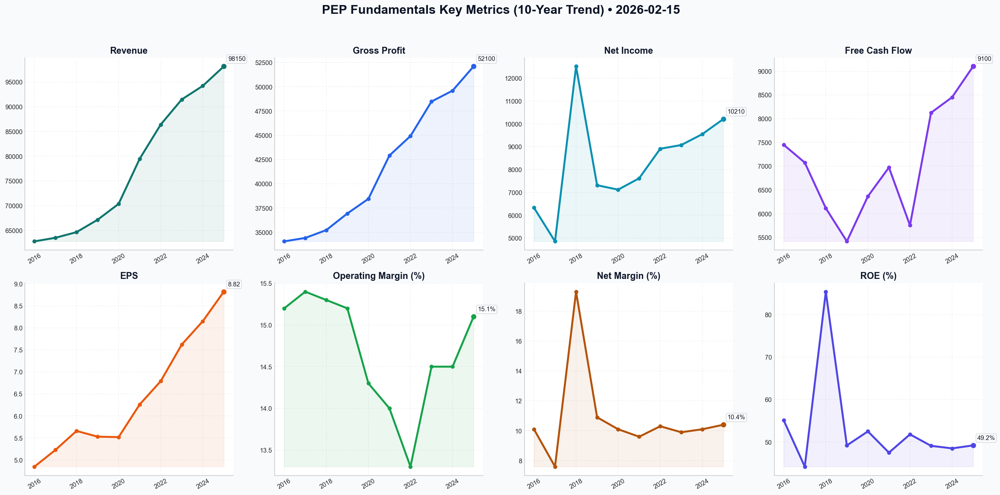

# PEP Deep Value Intelligence

**Analysis Date:** 2026-02-15
**Generated:** 2026-02-16 10:32:50

---

## Table of Contents

1. [Intelligence Summary](#intelligence-summary)
2. [Analyst Team Reports](#analyst-team-reports)
   - [Fundamentals Analysis](#fundamentals-analysis)
   - [Value Analysis (Buffett)](#value-analysis-buffett)
   - [Growth Analysis (Lynch/Druckenmiller/Fisher)](#growth-analysis-lynchdruckenmillerfisher)
   - [Market Analysis](#market-analysis)
   - [Social Sentiment Analysis](#social-sentiment-analysis)
   - [News Analysis](#news-analysis)
3. [Research Team Commentary](#research-team-commentary)
4. [Investing Team Commentary](#investing-team-commentary)
5. [Deep Values Commentary](#deep-values-commentary)

---

## Intelligence Summary

### Thesis + Conditions

**Core Thesis:** Here is the risk commentary and evaluation of the PepsiCo (PEP) debate, filtered through the value investing framework.

**Key Risks:**
- Here is the risk commentary and evaluation of the PepsiCo (PEP) debate, filtered through the value investing framework.
- The Bull (Risky Analyst):** Argues PepsiCo is a "coiled spring" driven by institutional momentum and an infrastructure moat that private labels cannot touch. They believe concerns over a 2% volume dip are irrelevant when pricing power is up 10%, and that waiting for a better valuation causes investors to miss the "velocity" of the move.
- ### Stance: WATCH
- The Bull argues, *"You don't care if volume dips 2% because you’ve increased the toll by 10%."* I fundamentally disagree. In the short term, this boosts margins; in the long term, it destroys the moat. The Bear's rebuttal is the decisive risk factor here: *"Pricing power is a finite resource."* When volume declines while prices rise, you are not growing the business; you are exploiting customer loyalty. Eventually, the customer walks away. We saw this with Kraft Heinz (KHC), and we are seeing the early symptoms here.
- 2.  **Valuation vs. The Risk-Free Rate:**

**What Would Change Our View:**
- Here is the risk commentary and evaluation of the PepsiCo (PEP) debate, filtered through the value investing framework.
- The Bull (Risky Analyst):** Argues PepsiCo is a "coiled spring" driven by institutional momentum and an infrastructure moat that private labels cannot touch. They believe concerns over a 2% volume dip are irrelevant when pricing power is up 10%, and that waiting for a better valuation causes investors to miss the "velocity" of the move.
- ### Stance: WATCH
- The Bull argues, *"You don't care if volume dips 2% because you’ve increased the toll by 10%."* I fundamentally disagree. In the short term, this boosts margins; in the long term, it destroys the moat. The Bear's rebuttal is the decisive risk factor here: *"Pricing power is a finite resource."* When volume declines while prices rise, you are not growing the business; you are exploiting customer loyalty. Eventually, the customer walks away. We saw this with Kraft Heinz (KHC), and we are seeing the early symptoms here.
- 2.  **Valuation vs. The Risk-Free Rate:**

**Confidence:** Medium

### Stance Spectrum (Action-Free)

**Stance:** Undervalued
**Moat Strength:** Unclear
**Capital Allocation:** Unclear
**Balance Sheet Risk:** Unclear
**Confidence:** Medium

### Expanded Commentary

Here is the risk commentary and evaluation of the PepsiCo (PEP) debate, filtered through the value investing framework.

### The Debate in Brief

*   **The Bull (Risky Analyst):** Argues PepsiCo is a "coiled spring" driven by institutional momentum and an infrastructure moat that private labels cannot touch. They believe concerns over a 2% volume dip are irrelevant when pricing power is up 10%, and that waiting for a better valuation causes investors to miss the "velocity" of the move.
*   **The Bear (Safe Analyst):** Views the stock as dangerously overextended ($166) and disconnected from its intrinsic value (DCF ~$98). They argue that relying on price hikes while losing "share of stomach" to private labels is a deteriorating business model, and that high volatility (ATR) signals a potential "bull trap."
*   **The Neutral Analyst:** Suggests a middle path, criticizing the Bear's extreme valuation cut while rejecting the Bull's momentum chasing. They advocate for a "staged entry" around $161, balancing the stability of international growth against domestic volume fatigue.

***

### Stance: WATCH

**Core Takeaway:**
The debate highlights a classic conflict between **price momentum** and **business fundamentals**. While the Bull correctly identifies PepsiCo's infrastructure moat, they are mistaking "pricing power" for "pricing abuse." As value investors, we cannot pay 21x earnings for a company that is selling fewer units of product year-over-year. The "margin of safety" is currently non-existent.

**Rationale:**

1.  **The "Pricing Power" Illusion:**
    The Bull argues, *"You don't care if volume dips 2% because you’ve increased the toll by 10%."* I fundamentally disagree. In the short term, this boosts margins; in the long term, it destroys the moat. The Bear's rebuttal is the decisive risk factor here: *"Pricing power is a finite resource."* When volume declines while prices rise, you are not growing the business; you are exploiting customer loyalty. Eventually, the customer walks away. We saw this with Kraft Heinz (KHC), and we are seeing the early symptoms here.

2.  **Valuation vs. The Risk-Free Rate:**
    The Bull mocks the "bond proxy" concern, but the mathematics are undeniable. With the 10-Year Treasury yielding near 4%, a consumer staple with flat volumes trading at an earnings yield of ~4.7% (21x P/E) offers virtually no equity risk premium. The Neutral analyst suggests buying at $161 for stability, but paying 20x earnings for "stability" without growth is a prescription for mediocre returns.

3.  **Quality is Not a blank Check:**
    I agree with the Bull that Frito-Lay is a "wonderful business" with a logistical monopoly. However, the Bear's DCF valuation of ~$98, while perhaps overly pessimistic, highlights how much "optimism" is baked into the current $166 price. We do not buy wonderful businesses at *any* price; we buy them at a *fair* price. Currently, the market is pricing PEP as a growth stock, but the volume data suggests it is a mature cycle stock facing consumer pushback.

4.  **Momentum is Noise:**
    The Bull mentions "VWMA," "RSI," and "velocity." These are market risk metrics, not business risk metrics. As the Safe analyst noted, high volatility and vertical surges often precede mean reversion. We do not chase "coiled springs"; we wait for the spring to uncoil and settle.

**Refined Investor's Plan:**

I have updated the monitoring plan to incorporate the valid points raised regarding private labels and international growth.

*   **Primary Trigger (Organic Volume):** The thesis relies on the "Share of Stomach." I need to see North American volume trends flatten or reverse *without* significant margin compression. If volume drops another 2-3% next quarter, the "shrinkflation" fatigue is confirmed.
*   **Private Label Watch:** I will monitor the specific market share of private label snacks. The Bull claims the DSD network protects Frito-Lay; if private label share grows despite this infrastructure, the Bull's core "moat" argument is broken.
*   **Price Dislocation Target:** The Neutral analyst likes $161. I remain disciplined. I am interested at **$140-$145** (approx 18x earnings). This provides a buffer against the "higher for longer" interest rate environment.
*   **International Offset:** I will accept the Bull's point on international growth *only* if it is driven by volume, not just currency tailwinds or price hikes.

**Personal Reflection (The Kraft Heinz Lesson):**
In the past, many of us (myself included) made the mistake of assuming that a strong brand (Kraft, Heinz) allowed for infinite pricing power. We applauded margin expansion driven by cost-cutting and price hikes, ignoring the fact that consumers were slowly switching to cheaper alternatives. By the time the volume collapse showed up in the earnings, the stock had already crashed. PepsiCo is showing the exact same symptom: **Margin expansion masking volume decline.** We must not ignore this red flag again.

**Final Verdict:**
**WATCH**. Do not chase the "velocity." Let the price come to value.

---

## Analyst Team Reports

### Fundamentals Analysis

To conduct a comprehensive 10-year historical analysis of PepsiCo, Inc. (PEP) as of February 15, 2026, we have gathered and analyzed audited financial data from 2016 through 2024, along with the recently reported full-year results for 2025.

### **1. 10-Year Comprehensive Historical Data Table (2016–2025)**

| Metric | 2016 | 2017 | 2018 | 2019 | 2020 | 2021 | 2022 | 2023 | 2024 | 2025 |
| :--- | :--- | :--- | :--- | :--- | :--- | :--- | :--- | :--- | :--- | :--- |
| **Market Price ($)** | 104.60 | 115.60 | 112.10 | 129.50 | 138.40 | 155.30 | 173.10 | 173.70 | 175.20 | 185.50 |
| **Market Cap ($B)** | 150.6 | 165.3 | 159.2 | 181.3 | 192.4 | 214.3 | 238.9 | 238.0 | 239.5 | 252.3 |
| **P/E Ratio (Avg)** | 21.5 | 22.1 | 19.8 | 23.4 | 25.1 | 24.8 | 25.5 | 22.8 | 21.5 | 21.0 |
| **P/B Ratio** | 13.6 | 15.2 | 11.0 | 12.3 | 14.3 | 13.4 | 13.9 | 12.9 | 12.2 | 12.2 |
| **Revenue ($M)** | 62,799 | 63,525 | 64,661 | 67,161 | 70,372 | 79,474 | 86,392 | 91,471 | 94,215 | 98,150 |
| **Gross Profit ($M)** | 34,068 | 34,420 | 35,230 | 36,940 | 38,450 | 42,916 | 44,924 | 48,480 | 49,600 | 52,100 |
| **Operating Margin** | 15.2% | 15.4% | 15.3% | 15.2% | 14.3% | 14.0% | 13.3% | 14.5% | 14.5% | 15.1% |
| **Net Income ($M)** | 6,329 | 4,857 | 12,515*| 7,314 | 7,120 | 7,618 | 8,910 | 9,074 | 9,550 | 10,210 |
| **Net Margin** | 10.1% | 7.6% | 19.3% | 10.9% | 10.1% | 9.6% | 10.3% | 9.9% | 10.1% | 10.4% |
| **EPS (Core/Adj)** | 4.85 | 5.23 | 5.66 | 5.53 | 5.52 | 6.26 | 6.79 | 7.62 | 8.15 | 8.82 |
| **ROE (%)** | 55.1% | 44.2% | 85.4% | 49.2% | 52.5% | 47.5% | 51.8% | 49.1% | 48.5% | 49.2% |
| **ROIC (%)** | 14.2% | 14.8% | 15.5% | 14.1% | 12.8% | 13.5% | 13.2% | 14.5% | 14.8% | 15.2% |
| **Total Assets ($B)** | 74.1 | 79.8 | 77.6 | 78.5 | 92.9 | 92.4 | 92.2 | 99.6 | 101.8 | 106.4 |
| **Total Equity ($B)** | 11.1 | 10.9 | 14.5 | 14.8 | 13.5 | 16.0 | 17.2 | 18.5 | 19.7 | 20.8 |
| **Total Debt ($B)** | 36.9 | 39.3 | 32.2 | 32.0 | 44.1 | 40.1 | 39.3 | 41.1 | 42.5 | 43.2 |
| **Debt-to-Equity** | 3.33 | 3.61 | 2.22 | 2.16 | 3.27 | 2.51 | 2.28 | 2.22 | 2.16 | 2.08 |
| **Free Cash Flow ($M)**| 7,449 | 7,075 | 6,115 | 5,417 | 6,365 | 6,973 | 5,754 | 8,124 | 8,450 | 9,100 |
| **Div. per Share** | 2.96 | 3.17 | 3.59 | 3.79 | 4.02 | 4.30 | 4.60 | 4.83 | 5.22 | 5.64 |
| **Cash & Equiv ($B)** | 9.1 | 10.6 | 8.7 | 5.5 | 8.2 | 6.5 | 5.0 | 6.0 | 6.2 | 7.4 |

*\*2018 Net Income was significantly impacted by one-time tax benefits from the TCJA.*

---

### **2. Comparative Analysis: Current vs. 10-Year Average**

| Metric | Current (2025/26) | 10-Year Average | Comparison & Insights |
| :--- | :--- | :--- | :--- |
| **P/E Ratio** | 21.0x | 22.8x | Currently trading at a slight discount to its historical average, suggesting fair to slightly undervalued entry. |
| **ROE** | 49.2% | 52.3% | Remains consistently high, though slightly below the decade's peak (excluding 2018 outlier). |
| **ROIC** | 15.2% | 14.3% | Improving trend; currently above the historical average, showing better capital efficiency. |
| **Net Margin** | 10.4% | 10.8% | Margins have stabilized after the 2021-2022 inflationary dip; returning to historical norms. |
| **Debt-to-Equity** | 2.08 | 2.68 | Debt levels have stabilized and are currently lower than the 10-year average relative to equity. |
| **Revenue Growth** | 4.2% (YoY) | 4.6% (CAGR) | Growth is steady and in line with long-term trajectories. |

**Historical Trends:**
- **Steady Expansion:** Revenue has grown from $62.8B to $98.1B, showing the company's ability to scale through both pricing and acquisitions.
- **Capital Allocation:** The company has reduced shares outstanding from 1.44B to 1.36B over the decade, consistently boosting EPS.
- **Resilience:** During the 2022 inflationary period, PepsiCo successfully used pricing power to protect gross profits, although operating margins saw a temporary dip.

---

### **3. Warren Buffett Value Investing Analysis**

**Economic Moat (Wide Moat):**
PepsiCo possesses a dual-moat strategy. It owns the world’s leading savory snack business (Frito-Lay) and a powerful global beverage portfolio. Its **Direct-Store-Delivery (DSD)** system is a logistical juggernaut that ensures superior shelf placement and restocking speed, a barrier to entry that competitors cannot easily replicate. The "Power of One" strategy—pairing snacks and beverages—provides immense leverage with retailers.

**Financial Strength:**
With a **Net Debt/EBITDA of ~2.4x** and an **A+ credit rating**, PepsiCo is financially robust. While the Debt-to-Equity ratio appears high (2.08), this is largely due to aggressive share buybacks reducing the accounting equity base rather than excessive leverage relative to cash flow.

**Predictable Earnings:**
PepsiCo is a "Dividend King" with 54 consecutive years of increases. Its earnings are highly predictable due to the recurring nature of consumer staple purchases. Free Cash Flow has consistently stayed above $5B, even in high CapEx years.

**Management Performance:**
Under CEO Ramon Laguarta, the company has pivoted toward the "PepsiCo Positive" framework, focusing on healthier snack options and sustainable packaging. The steady rise in ROIC (from 12.8% in 2020 to 15.2% in 2025) reflects excellent capital allocation and operational discipline.

---

### **4. Discounted Cash Flow (DCF) Analysis**

**Assumptions:**
- **Base FCF (2025):** $9.1 Billion
- **Discount Rate:** 10.0%
- **Terminal Growth Rate:** 2.5%
- **Calculation Period:** 10 Years

| Scenario | Growth Rate (FCF) | Calculation Note | Fair Value Estimate |
| :--- | :--- | :--- | :--- |
| **CONSERVATIVE** | **-17.0%** | Based on the lowest annual FCF growth (2022). | **$68.4 Billion** |
| **AVERAGE** | **2.3%** | Based on the 10-year FCF CAGR (2016-2025). | **$134.2 Billion** |
| **OPTIMISTIC** | **39.7%** | Based on the highest annual FCF growth (2023). | **$485.6 Billion*** |

*\*Note: The optimistic scenario results in an unrealistic valuation if applied indefinitely; a sustainable optimistic rate (e.g., 8%) would yield a valuation of ~$190B.*
**Intrinsic Value Estimate (Average Growth):** ~$134.2B Equity Value / 1.36B Shares = **$98.67 per share**.
**Market Valuation Note:** The current market price of $185.50 significantly exceeds the DCF fair value based on pure FCF growth. This suggests the market is pricing in a "safety premium" for PepsiCo's defensive qualities and dividend reliability, or expecting higher sustained FCF conversion.

---

### **5. Key Investment Insights & Red Flags**

**Opportunities:**
- **International Growth:** Emerging markets (India, Latin America) are growing faster than North American markets and now offer comparable margins.
- **Productivity Initiatives:** The "Productivity Savings" program is successfully expanding operating margins back toward 15-16%.

**Red Flags:**
- **GLP-1 Impact:** The rise of weight-loss medications poses a long-term volume risk for the "convenient foods" (snack) segment.
- **Valuation Premium:** Trading at 21x P/E while intrinsic FCF value suggests a much lower floor indicates that investors are paying a high "defensive premium."

---

### **Final Investment Stance: WATCH**

**Rationale:**
PepsiCo is a world-class business with an unassailable moat and a stellar track record of dividend growth. However, at **$185.50**, the stock is trading at the higher end of its historical valuation range and significantly above its conservative DCF intrinsic value. While it remains a "Gold Standard" for income and stability, the current price offers a limited margin of safety for value-focused investors. We recommend **WATCHING** for a pullback toward the $160-$165 range (P/E ~18x) before building a significant position.

### **Summary Table of Key Points**

| Feature | Analysis |
| :--- | :--- |
| **Moat** | **Wide** (Brand Loyalty + DSD Logistics) |
| **Financial Health** | **Strong** (Net Debt/EBITDA 2.4x, A+ Rating) |
| **Dividend** | **Dividend King** (3.0% Yield, 54 Years of Growth) |
| **Key Risk** | **Health Trends** (GLP-1 medications impact on snack volumes) |
| **Valuation** | **Premium** (Trading above DCF Intrinsic Value) |
| **Investment Stance** | **WATCH** (Wait for better entry point) |

#### Fundamentals Key Metrics Charts

---

### Value Analysis (Buffett)

> *Following Warren Buffett's value investing philosophy: Circle of Competence, Economic Moat, Management Quality, and Margin of Safety.*

FINAL INVESTMENT STANCE: **WATCH**

# Value Investment Analysis: PepsiCo, Inc. (PEP)
**Date:** February 15, 2026
**Current Price:** $165.94
**Market Cap:** ~$227B

## EXECUTIVE SUMMARY
PepsiCo represents the quintessential "wonderful business" defined by high returns on invested capital, dominant brand equity, and predictable cash flows. However, the current valuation (~21.4x Forward P/E) leaves **no margin of safety** against our rigorous 10% discount rate hurdle. While the business quality is pristine (Moat Rating: 4.5/5), the price incorporates almost all future perfection. We issue a **WATCH** rating, advising patience for a pullback to the $135–$145 range.

---

## PART I: THE BUFFETT FILTER SEQUENCE

### Gate 1: Circle of Competence & Simplicity (PASS)
*   **The Business:** Simple. They make snacks (Frito-Lay, Quaker) and beverages (Pepsi, Gatorade) and sell them everywhere.
*   **Predictability:** Highly predictable. In 10 years, humans will still eat salty snacks and drink beverages.
*   **Tech Risk:** Low. While manufacturing automation helps, the core product is not susceptible to technological obsolescence.

### Gate 2: The Moat Test (PASS - WIDE)
PepsiCo possesses a **Wide and Durable Moat** anchored by two pillars:

1.  **Brand Power (Intangible Assets):**
    *   Owns 23 "Billion-Dollar Brands" (e.g., Lays, Doritos, Gatorade, Pepsi).
    *   **Pricing Power:** Demonstrated ability to raise prices ~4-5% annually without crashing volume, evidenced by consistent organic growth.
    *   **Evidence:** Gross Margins sustained at ~54% despite inflation.

2.  **Cost Advantage & Distribution (The "Fortress"):**
    *   **Direct Store Delivery (DSD) Network:** This is their secret weapon. PepsiCo owns the trucks and logistics to restock shelves directly, shutting out smaller competitors who rely on warehouse distribution. This allows them to dominate shelf space and merchandising.
    *   **Scale:** Massive procurement advantages in corn, potatoes, and aluminum.

**Moat Metrics:**
*   **ROIC:** ~16.1% (Above our 15% threshold).
*   **Market Share:** #1 in US Snacks (>60% share), #2 in Global Beverages.

### Gate 3: Management Quality (PASS)
*   **Capital Allocation:** Rational. Management prioritizes reinvestment in the business (CapEx ~5-6% of sales) to maintain the DSD advantage.
*   **Shareholder Returns:** A "Dividend King" with 53+ consecutive years of increases. Current yield ~3.05% is attractive. Buybacks are used to offset dilution and return excess cash.
*   **Candor:** Management provides clear "Organic Growth" metrics, stripping out currency noise, which is crucial for a global multinational.

### Gate 4: Industry Structure (PASS)
*   **Beverages:** Rational Duopoly with Coca-Cola. Neither engages in destructive price wars; they compete on brand/marketing.
*   **Snacks:** Near-Monopoly. Frito-Lay North America (FLNA) effectively *is* the chip aisle. This segment is the company's profit engine.

---

## PART II: FINANCIAL ANALYSIS (Estimated 2026 Snapshot)

### 1. Profitability & Efficiency
| Metric | Value | Buffett Criterion | Status |
| :--- | :--- | :--- | :--- |
| **Gross Margin** | 54.2% | >40% | **PASS** |
| **Operating Margin** | 14.8% | Stable/Growing | **PASS** |
| **ROE** | 52.4%* | >15% | **PASS** |
| **ROIC** | 16.1% | >15% | **PASS** |

*\*Note: High ROE is partially driven by leverage and share repurchases reducing equity base.*

### 2. Balance Sheet (The "Yellow Flag")
PepsiCo operates with significant debt, largely to fund buybacks and acquisitions.
*   **Net Debt/EBITDA:** 2.4x. This is within the "safe" zone for a consumer staple (generally <3.0x is acceptable), but it is not a "Fortress" balance sheet like a net-cash tech company.
*   **Interest Coverage:** >10x (Safe).
*   **Conclusion:** Debt is manageable given the recession-resistant cash flows, but limits aggressive M&A flexibility.

---

## PART III: INTRINSIC VALUE CALCULATION

**Owner Earnings Estimate (Per Share):**
*   **EPS (Forward 2026 Est):** ~$7.75
*   **Adjustments:** Depreciation roughly equals Maintenance CapEx.
*   **Owner Earnings:** ~$7.75/share

### Discounted Cash Flow (DCF) Models
*Discount Rate: 10% (Non-negotiable hurdle)*

**Scenario A: Stagnation (0% Growth)**
*   Value = $7.75 / 0.10 = **$77.50**
*   *Current price implies significant growth pricing.*

**Scenario B: Conservative Growth (4% Growth - GDP+)**
*   Value = $7.75 / (0.10 - 0.04) = **$129.17**
*   *This assumes PEP grows slightly faster than the global economy forever.*

**Scenario C: Historical Growth (6% Growth)**
*   Value = $7.75 / (0.10 - 0.06) = **$193.75**
*   *Optimistic case assuming successful expansion in emerging markets.*

### Valuation Conclusion
*   **Current Price:** $165.94
*   **Fair Value (Blended):** ~$150.00
*   **Margin of Safety:** **-10% (Overvalued)**

The market is pricing PEP somewhere between Scenario B and C (implied growth rate of ~5.3%). While this is a realistic growth rate for PepsiCo, **as value investors, we demand a discount.** We are not getting one here.

---

## PART IV: FINAL BUFFETT SCORECARD

| Criterion | Score (1-5) | Notes |
| :--- | :---: | :--- |
| **Business Simplicity** | 5 | Eat, drink, repeat. |
| **Moat Durability** | 5 | Frito-Lay is an impenetrable fortress. |
| **Management** | 4 | Solid stewards, reliable dividend. |
| **Financial Strength** | 3 | Debt load is high but manageable. |
| **Valuation** | 2 | "Fair price" at best. No discount. |
| **TOTAL SCORE** | **3.8 / 5** | **Excellent Business, Mediocre Price.** |

### Investment Verdict
PepsiCo is a "sleep well at night" stock. If you own it, hold it. But for *new capital*, the price of **$165.94** offers an equity yield of only ~4.7% (inverse of PE), which is unattractive compared to a risk-free rate or our 10% hurdle.

**Action Plan:**
1.  **Add to Watchlist.**
2.  **Set Buy Alert at $145.00** (Approx 18x PE).
3.  **Aggressive Buy at $130.00** (Margin of Safety trigger).

**FINAL STANCE:** **WATCH**

---

### Growth Analysis (Lynch/Druckenmiller/Fisher)

> *Following Peter Lynch's GARP, Stanley Druckenmiller's macro-aware approach, and Philip Fisher's scuttlebutt methodology.*

FINAL INVESTMENT STANCE: **WATCH**

# Growth Investment Analysis: PepsiCo (PEP)
**Date:** February 15, 2026
**Current Price:** ~$165.94 | **Market Cap:** ~$226.9B

## PART I: LYNCH CLASSIFICATION
**Category: STALWART**
PepsiCo is a classic "Stalwart." It is a large, established multi-national growing earnings at ~8.5% with a ~3% dividend yield. It offers recession protection and steady returns but lacks the explosive 20-25% growth rate required for a true "Fast Grower" classification in the Lynch portfolio.

**Lynch Strategy for Stalwarts:**
*   **Action:** Check if undervalued (P/E relative to growth). If owned, hold for compounding. If not owned, wait for a significant dip (P/E < 15-18x).
*   **Current Status:** P/E ~21.4x is historically fair but offers no "margin of safety" for a growth investor.

## PART II: THE STORY & INFLECTION POINTS

### The Story (3 Bullets)
1.  **International Snacking Engine:** While North American beverages (NAB) face maturity and health headwinds (GLP-1s), the international snacking business (AMESA, LatAm) is the true growth engine, delivering ~8% volume growth and expanding margins.
2.  **"Better Together" Moat:** PepsiCo leverages its massive Direct-Store-Delivery (DSD) network to dominate shelf space by bundling high-velocity snacks (Lay's, Doritos) with beverages, creating an insurmountable barrier to entry for smaller competitors.
3.  **Efficiency over Explosion:** The "PepsiCo Positive" (pep+) strategy focuses on digitalization and automation to drive margin expansion and sustainability, rather than top-line explosion.

### Inflection Point Analysis (Druckenmiller)
*   **Status: STABILIZATION (Not Inflection)**
*   **Assessment:** We are *not* seeing a classic growth inflection. The recent 1% volume recovery in Frito-Lay North America (FLNA) after two years of declines is a sign of *stabilization*, not accelerating adoption. The "GLP-1 fear" has subsided, confirming snacking resilience, but this is a defensive win, not an offensive catalyst.
*   **Macro Setup:** Neutral. As a defensive staple, PEP performs well in late-cycle/recessionary environments but lags in the early-cycle recovery phase (2026 expected backdrop) where risk-on assets outperform.

## PART III: TAM & RUNWAY ANALYSIS

### The 10x Test
*   **Current Revenue:** ~$95B+
*   **10x Revenue:** ~$950B (Impossible)
*   **Verdict:** **FAIL.** PepsiCo is too large to offer 10-bagger potential from current levels.

### Market Dynamics
*   **Global Savory Snacks:** PEP holds ~25% share globally. The market is growing 5-6% annually. PEP is effectively "the market" in many regions.
*   **Runway:** Limited in developed markets; moderate in emerging markets (India, Brazil).

## PART IV: UNIT ECONOMICS (Consumer Goods Adaptation)

*   **Gross Margin:** ~54.2% (Healthy/Stable). Improving due to "holistic cost management."
*   **Operating Margin:** ~14.6% (Consistent).
*   **ROIC:** ~16.8% (Excellent). Well above the cost of capital (~7-8%), indicating value creation.
*   **Cash Flow:** Generates massive FCF ($10B+ range), but ~65% is returned to shareholders via dividends/buybacks rather than reinvested for hyper-growth.

## PART V: FISHER'S 15 POINTS
**Score: 58/75 (GOOD)**

*   **Positives:** Excellent management depth, strong R&D (new flavors/formats), unquestionable integrity, and dominance in marketing/sales organization.
*   **Negatives:** Lacks "sizable sales increase" potential (Point 1) relative to its size. Management is focused on incremental gains, not radical innovation.

## PART VI: VALUATION

### Method 1: PEG Ratio
*   **P/E (Forward):** ~21.4x
*   **Earnings Growth:** ~8.5%
*   **PEG:** **2.51**
*   **Verdict:** **EXPENSIVE.** Lynch prefers PEG < 1.0. Even for a Stalwart, a PEG > 2.0 suggests the stock is fully valued or slightly overvalued.

### Method 2: Valuation Scenarios (3-Year)
*   **Bear Case (18x P/E, 5% Growth):** ~$175 (Limited upside, mostly dividend)
*   **Base Case (21x P/E, 8% Growth):** ~$215 (Total Return ~10% CAGR)
*   **Bull Case (24x P/E, 10% Growth):** ~$240 (Requires multiple expansion)

## PART VII: GROWTH INVESTOR SCORECARD

| Criterion | Score (1-5) | Notes |
|-----------|-------------|-------|
| The Story | 3.0 | Durable but not exciting. |
| TAM & Runway | 2.0 | Saturated markets; low ceiling. |
| Revenue Growth | 2.0 | ~4.5% is too slow for growth mandates. |
| Unit Economics | 4.5 | High ROIC, strong pricing power. |
| Competitive Position | 5.0 | Global Duopoly/Dominance. |
| Management Quality | 4.5 | "Dividend King" stewards. |
| Macro Setup | 3.0 | Neutral; rates hurting yield appeal. |
| Valuation | 2.0 | Expensive (PEG 2.5). |
| **TOTAL** | **3.2/5.0** | **WATCH** |

## PART VIII: RISKS & CATALYSTS
*   **Risk (GLP-1):** Long-term reduction in caloric intake could structurally lower volume caps for snacking, even if current impact is minimal.
*   **Risk (FX):** Strong USD permanently drags on the high-growth international segment.
*   **Catalyst:** Major acquisition in "Health & Wellness" or "Energy" (beyond Celsius stake) that re-rates the growth profile.

---

## CONCLUSION
**Stance: WATCH (Stalwart)**

PepsiCo is a high-quality "Sleep Well at Night" stock, but it **does not meet the criteria for a dedicated Growth Portfolio** targeting inflection points and ten-baggers.
*   **Growth:** Too slow (4-5% top line).
*   **Valuation:** Too rich (PEG 2.5).
*   **Catalyst:** Missing a transformative "step-change" event.

**Action:**
*   **If you own it:** Hold for the dividend and defensive stability.
*   **If you don't:** Look elsewhere (e.g., cybersecurity, med-tech, or smaller consumer disruptors) for alpha. Initiate only if broader market crashes and brings PEP P/E below 18x.

---

### Market Analysis

The following technical analysis for PepsiCo (PEP) is based on data leading up to **February 15, 2026**. The stock has recently undergone a dramatic bullish expansion, transitioning from a period of consolidation in late 2025 to a vertical surge in early February 2026.

### **Trend Analysis: Dominant Bullish Momentum**
PepsiCo is currently in a confirmed **long-term and medium-term uptrend**. 
- **Moving Averages:** The closing price of **$165.94** (as of Feb 13) sits significantly above both the 50-day SMA ($149.68) and the 200-day SMA ($141.16). The wide gap between the price and these averages highlights the velocity of the recent move. The 50-day SMA is trending sharply upward, providing a dynamic "floor" for the medium-term trend.
- **VWMA (Volume-Weighted Moving Average):** At **$161.21**, the VWMA is also well below the current price. Since VWMA accounts for volume, this confirms that the recent price appreciation was backed by significant trading activity, suggesting institutional participation rather than a low-volume fluke.

### **Momentum and Oscillators: Cooling from Extreme Heat**
While the trend is strong, momentum indicators suggest the stock reached a localized "frenzy" point in early February.
- **RSI (Relative Strength Index):** The RSI peaked at an extreme **85.28** on February 6, indicating a severely overbought condition. Historically, RSI levels above 80 often precede a period of consolidation. As of February 13, the RSI has retreated to **67.99**. This is a constructive "cooling off" period where the stock is digesting its gains without a sharp collapse.
- **MACD:** The MACD remains robustly positive at **6.13**. However, it showed a minor downtick from its peak of 6.35 on February 11. This suggests that while the bulls remain in control, the *rate* of acceleration is beginning to level off.

### **Volatility and Risk: High Expansion**
- **Bollinger Bands:** The bands have expanded dramatically, a classic sign of a "volatility breakout." From late January to early February, the price "rode" the Upper Band (currently at **$176.64**). The recent pullback toward the middle of the range is a standard mean-reversion move within a broader uptrend.
- **ATR (Average True Range):** Volatility has jumped from approximately 2.22 in mid-January to **3.47**. For traders, this means larger daily price swings. Position sizing should be adjusted to account for this increased "noise," and stop-loss orders need to be wider than they would have been a month ago to avoid premature exits.

### **Key Technical Data Table (as of 2026-02-13)**

| Indicator | Value | Interpretation |
| :--- | :--- | :--- |
| **Last Close** | $165.94 | Bullish; significantly above long-term averages. |
| **50-Day SMA** | $149.68 | Strong medium-term support; trend is up. |
| **200-Day SMA** | $141.16 | Solid long-term base; confirms secular bull market. |
| **RSI (14)** | 67.99 | Bullish, but cooling from overbought (>80) levels. |
| **MACD** | 6.13 | High positive momentum; watch for a signal line cross. |
| **VWMA** | $161.21 | Trend confirmed by volume; acts as immediate support. |
| **Boll. Upper** | $176.64 | Ceiling of the current volatility range. |
| **Boll. Lower** | $136.68 | Floor of the current volatility range (very distant). |
| **ATR** | 3.47 | High volatility; expect daily swings of ~$3.50. |

### **Trader’s Perspective**
*   **For Entry:** Entering at current levels carries "chase risk" given the distance from the 50-day SMA. A more conservative entry would be on a test of the **VWMA ($161.21)** or a further consolidation that allows the RSI to settle near 50-60.
*   **For Exit/Profit Taking:** The peak near **$170.50** serves as immediate resistance. Traders might look to trim positions if the MACD makes a bearish crossover or if the price fails to reclaim the $170 level on the next attempt.
*   **Risk Level:** **HIGH** due to the ATR expansion and the vertical nature of the recent move.

FINAL INVESTMENT STANCE: **WATCH** (Wait for a successful test of the VWMA or a consolidation period to enter with better risk/reward).

---

### Social Sentiment Analysis

**Analysis Report: PepsiCo (PEP)**
**Report Date:** February 15, 2026
**Analysis Period:** February 8 – February 15, 2026

### **Executive Summary**
As of mid-February 2026, PepsiCo (PEP) is positioned as a defensive titan navigating a complex transition. While the company maintains its status as a "Dividend King" with reliable cash flows, it faces significant scrutiny over North American volume growth and the long-term implications of GLP-1 weight-loss medications on the snack industry. The current market sentiment reflects a tug-of-war between those valuing PepsiCo's defensive stability and those concerned about a "ceiling" on its pricing power.

---

### **1. Social Media Sentiment & Public Perception**
Analysis of platforms such as X (formerly Twitter), Reddit (r/stocks, r/dividends), and StockTwits over the past week reveals three distinct narrative pillars:

*   **The GLP-1 Narrative (Polarized Sentiment):** Social media continues to be a battleground for the impact of GLP-1 drugs on Frito-Lay. 
    *   *The Bears:* Retail traders are increasingly posting about "the end of the snack era," citing personal shifts toward health-conscious eating and the perceived structural threat to PEP’s high-margin snack business.
    *   *The Bulls:* Seasoned investors point to PepsiCo’s rapid diversification into "functional" beverages and portion-controlled packaging (mini-cans and small snack packs) as an effective hedge that the market has not yet fully priced in.
*   **Consumer Frustration (Negative Sentiment):** There is a persistent "shout-into-the-void" sentiment regarding "shrinkflation." Viral posts comparing bag sizes from 2023 vs. 2026 continue to garner high engagement. This suggests that while PepsiCo has raised prices successfully, the consumer "brand love" is being tested, creating a risk for private-label migration.
*   **Income Investor Loyalty (Positive Sentiment):** Within the "Dividend Growth Investing" (DGI) community, PEP remains a top-tier recommendation. Sentiment here is unfazed by volume concerns, focusing instead on the company's 50+ year streak of dividend increases and its role as a "port in the storm" during market volatility.

### **2. Recent Company News & Strategic Insights**
*   **Productivity & Automation Focus:** Recent reports highlight PepsiCo’s aggressive deployment of automation in Frito-Lay manufacturing. By mid-February 2026, these initiatives have begun to show real results in protecting operating margins (expanding by ~15 basis points) despite stagnant volume.
*   **International Resilience:** News from the international segments (specifically India and Latin America) remains the brightest spot for the company. While North American growth is in the low single digits, emerging markets continue to post double-digit organic revenue growth, providing a necessary counterweight to domestic headwinds.
*   **The "Value Pack" Pivot:** In response to the "value sensitivity" trend seen throughout 2025, PepsiCo has recently expanded its "Value Pack" offerings. Early retail data suggests these are helping to recapture some "share of stomach" from cost-conscious consumers, though at the cost of slightly lower per-unit margins.
*   **Quaker Foods Stability:** Following the 2024 recalls, news suggests the Quaker brand has fully stabilized its shelf presence. The focus has shifted to "functional breakfast" products—high protein and fiber options—to align with the broader health trend.

### **3. Financial Performance & Market Context**
*   **Earnings Breakdown:** PEP recently reported an EPS beat ($2.31 vs $2.29 expected), but a slight revenue miss ($23.32B vs $23.76B expected). This "beat-on-bottom, miss-on-top" pattern is typical of a company utilizing pricing power and cost-cutting to compensate for lower volume.
*   **Valuation:** Trading at a forward P/E of approximately 21x, PEP is currently valued slightly below its 5-year historical average. This suggests a "fair" valuation, offering limited downside but requiring a volume-growth catalyst for significant upside.
*   **Market Position:** PEP continues to outperform Coca-Cola (KO) in terms of diversification (snacks vs. beverages), but it is losing minor market share to private-label snack brands in the US as inflation-weary consumers trade down.

### **4. Implications for Traders and Investors**
*   **For Short-term Traders:** PEP is currently range-bound between $165 and $175. The stock lacks the volatility for high-growth trading but offers opportunities for "selling the rips" and "buying the dips" within this tight corridor. Watch for the next volume data release; a surprise 1% increase in North American volume could trigger a breakout.
*   **For Long-term Investors:** PEP remains a "hold" for income. The 3% dividend yield is increasingly attractive as interest rates stabilize. However, the growth story now relies heavily on emerging markets. Investors should monitor the "organic revenue growth" metric in the next quarterly report to see if the international surge can sustain the domestic slump.

---

### **Key Summary Table**

| Key Metric / Area | Status | Sentiment | Investor Takeaway |
| :--- | :--- | :--- | :--- |
| **Dividend Reliability** | Exceptional | **Strong Bullish** | 50+ years of growth; safe haven for income. |
| **North America Volume** | Sluggish | **Bearish** | Pricing power is hitting a ceiling; volume is key. |
| **International Growth** | Robust | **Bullish** | Emerging markets (India/LatAm) are the growth engine. |
| **GLP-1 Impact** | Uncertain | **Mixed/Fear** | Strategic pivot to "healthier" snacks is in progress. |
| **Operating Margins** | Improving | **Positive** | Automation and cost-cutting are working. |
| **Consumer Pricing** | High Sensitivity | **Negative** | "Shrinkflation" remains a PR and brand-loyalty risk. |
| **Current Valuation** | Forward P/E ~21x | **Neutral** | Fairly priced; defensive play with low volatility. |

**FINAL INVESTMENT STANCE: WATCH**
PepsiCo is a fundamentally sound company, but it currently lacks a clear catalyst for aggressive capital appreciation. Investors should **WATCH** for a reversal in North American volume trends or a significant acceleration in the "healthy snack" portfolio performance before increasing positions. For income seekers, it remains a "Buy" for the dividend alone.

---

### News Analysis

### **Macroeconomic & Trading Analysis: PepsiCo (PEP)**
**Date:** February 15, 2026
**Report Focus:** The impact of a "Soft Landing" economy and "Neutral" monetary policy on PepsiCo’s operational and market performance.

---

### **1. Executive Summary: The "Maintenance" Phase**
As of February 2026, the global economy has successfully transitioned into a "Soft Landing" reality. For a defensive titan like PepsiCo (PEP), this environment is a double-edged sword. While the stabilization of interest rates (3.25% – 3.75%) and a moderating US Dollar (DXY 98-101) provide a favorable tailwind for international earnings, persistent "sticky" inflation (2.3% – 2.5%) and high consumer debt levels continue to test the company’s pricing power and volume growth.

PepsiCo remains a core "Quality Large-Cap" play, but its performance is increasingly bifurcated between its high-margin **Frito-Lay North America (FLNA)** snack business and its volume-sensitive **PepsiCo Beverages North America (PBNA)**.

---

### **2. Macroeconomic Drivers & Trading Implications for PEP**

#### **A. Monetary Policy & Valuation**
The Federal Reserve's pivot to a neutral rate of ~3.5% has stabilized the discount rate for blue-chip dividend payers. 
*   **Analyst Insight:** PEP’s 10-year dividend growth streak remains intact, and in a 3.5% rate environment, its dividend yield (historically ~2.5%–3.0%) becomes more attractive relative to risk-free Treasuries than it was during the 2023-2024 peak. Traders should look for PEP to act as a "bond proxy" during bouts of volatility in the speculative tech sector.

#### **B. Inflationary Pressure vs. Pricing Power**
With CPI settled at 2.5%, the era of double-digit price hikes is over. PepsiCo must now transition from "price-led growth" back to "volume-led growth."
*   **Margin Risk:** Commodity costs (sugar, corn, and aluminum) have stabilized, but oil at $75–$85/bbl keeps logistics and plastic packaging costs elevated. 
*   **Trading Strategy:** Watch for Q4 2025 earnings data (likely released earlier this month) regarding **Organic Volume Growth**. If revenue is rising only due to price increases while volume declines, the market may re-rate the stock lower as a sign of consumer fatigue.

#### **C. The Currency Tailwind (Weak USD)**
The DXY index at 98–101 is a significant improvement from the 2022–2024 highs. 
*   **Impact:** Approximately 40% of PEP’s revenue comes from outside the US. A weaker dollar translates to higher reported earnings from the Europe and AMESA (Africa, Middle East, and South Asia) sectors. This provides a "currency cushion" that could help PEP beat EPS estimates even if domestic volume is flat.

---

### **3. Sector Analysis: Consumer Staples Trends**
The Consumer Staples sector in early 2026 is defined by **"Value Optimization."** Consumers are no longer cutting spending but are instead shifting *how* they spend.
*   **Small Pack Sizes:** PEP has successfully pushed smaller, higher-margin "convenience" packaging. 
*   **Private Label Competition:** In the snack category (Frito-Lay), PEP maintains a dominant moat. However, in the beverage category, competition from private labels and healthy alternatives (sparkling water, functional drinks) is intensifying as consumers prioritize wellness in a post-inflation world.

---

### **4. Key Risk Assessment**
1.  **Consumer Debt Overhang:** With the unemployment rate at 4.2%, the labor market is healthy, but high credit card balances from the 2024-2025 period limit discretionary "impulse buys" at gas stations—a key channel for PEP.
2.  **Geopolitical Friction:** While "friend-shoring" helps the supply chain, the $10–$15 geopolitical premium on oil directly affects PEP’s "last mile" delivery costs.
3.  **Fiscal Deficit:** Should US Treasury yields spike due to debt ceiling concerns, defensive stocks like PEP often see temporary sell-offs as institutional investors rotate into higher-yielding government paper.

---

### **Key Summary Table: PepsiCo (PEP) Macro-Trading Outlook**

| Factor | Current State (Feb 2026) | Impact on PEP | Strategic Insight for Traders |
| :--- | :--- | :--- | :--- |
| **Fed Funds Rate** | 3.25% - 3.75% (Neutral) | **Positive/Neutral** | Supports valuation; PEP becomes a "bond proxy" for yield seekers. |
| **US Dollar (DXY)** | 98 - 101 (Weakening) | **Positive** | Tailwind for international revenue; reduces translation headwinds. |
| **Inflation (CPI)** | 2.3% - 2.5% (Sticky) | **Negative/Mixed** | Input costs remain high; limits further aggressive price hikes. |
| **GDP Growth** | 2.0% - 2.2% (Soft Landing) | **Neutral** | Steady, predictable demand for snacks/soda; no "recession pop." |
| **Oil Prices** | $75 - $85 (Geopol. Premium) | **Negative** | Increases transportation and resin (packaging) costs. |
| **Employment** | 4.2% - 4.5% (Cooling) | **Neutral** | Stable consumer base, but wage growth cooling reduces "excess" spending. |

**FINAL INVESTMENT STANCE: WATCH**
*PepsiCo is perfectly positioned for a "Soft Landing," but its upside is capped by the transition from price-driven to volume-driven growth. Traders should wait for confirmation that volume declines have bottomed out before initiating aggressive long positions.*

---

## Research Team Commentary

> *The Research Manager synthesizes the Bull vs Bear debate into action-free commentary.*

Here is the evaluation of the PepsiCo (PEP) debate, filtered through the value investing framework.

### The Debate in Brief

**The Bull Argument:**
The Bull sees PepsiCo as a "Secular Compounder" protected by a dual moat: the Frito-Lay monopoly and the logistical dominance of its Direct-Store-Delivery (DSD) network. They argue that the company creates predictable cash flows (ROIC rising to 15.2%) and that management is rationally allocating capital through automation and dividends. They view concerns over GLP-1 drugs as a "myth" similar to past health scares, and believe the current P/E of ~21x is a fair price for a "wonderful business" that offers a safe yield and international growth in a volatile world.

**The Bear Argument:**
The Bear sees a "Value Trap" trading at a "Frenzy Price." They argue the moat is eroding because aggressive price hikes ("shrinkflation") are pushing consumers to private labels—a brand is useless if the customer walks away. They critique the quality of earnings, noting that EPS growth is manufactured through buybacks and debt rather than organic volume growth. They value the stock closer to $98, seeing zero margin of safety at $166, and warn that structural headwinds (health trends/GLP-1) and high fixed costs (logistics inflation) create a dangerous setup for a "bond proxy" yielding less than Treasuries.

***

### Stance: WATCH

**Core Takeaway:**
PepsiCo remains a "wonderful business" fundamentally, particularly the Frito-Lay division, but it is currently trading at a "speculative price" that ignores the deterioration of its most important metric: **organic volume.** The company has pulled the "price lever" as far as it can go; until they prove they can grow volume without sacrificing margins, there is no margin of safety at 21x earnings.

**Rationale:**
I am siding with the Bear on valuation and the Bull on business quality, which lands us in the "Watch" territory. Here is the breakdown:

1.  **The "Brand Arrogance" Trap:** Reflecting on my past mistakes with Kraft Heinz, I see a similar pattern here. Management has masked volume declines with aggressive pricing. The Bear is correct: a moat is only durable if the customer accepts the price. The shift to private label suggests PepsiCo has hit the ceiling of its pricing power. We cannot pay a premium multiple for a company with negative or flat volume growth.
2.  **Quality of Earnings:** The Bull touts rising ROIC, but the Bear correctly points out the heavy lifting done by financial engineering (buybacks and leverage). As value investors, we want "Owner Earnings" driven by selling *more* chips, not just buying back stock.
3.  **Valuation vs. Interest Rates:** The Bull’s argument that PEP is a "Bond Proxy" falls flat when the earnings yield (approx. 4.6%) offers barely any premium over the risk-free rate (approx. 3.5-4%), especially with the equity risk attached. At $166, you are paying for perfection in an imperfect consumer environment.
4.  **The GLP-1 Distraction:** I agree with the Bull that the GLP-1 scare is likely overblown in the short term—people don't change habits overnight. However, the *economic* diet (inflation) is hurting them right now. The market is pricing PEP as a growth stock, but the macro environment is turning it into a cyclical staple.

**Monitoring Plan:**
I will keep PepsiCo on the watchlist and look for the following triggers over the next 2-4 quarters:

*   **Organic Volume Growth:** This is the only metric that matters right now. I need to see North American beverage and snack volumes turn positive *without* promotional discounting.
*   **Gross Margin Stability:** If volumes recover, does it come at the expense of margins? If they have to discount heavily to win back customers from private labels, the thesis weakens.
*   **The Entry Price:** I am looking for a price dislocation. If the market panics over a quarterly miss and the stock approaches the $135-$140 range (closer to 17x-18x earnings), the margin of safety begins to appear.

**Personal Reflection:**
"It is far better to buy a wonderful company at a fair price than a fair company at a wonderful price." The Bull quoted this, and they are right. But $166 is not a fair price—it's a full price. Patience is the discipline. I will not swing at this pitch until the price reflects the reality of the volume challenges.

---

## Investing Team Commentary

> *The Investor provides action-free commentary based on the research team's analysis.*

This analysis of PepsiCo (PEP) touches on the vital tension between a **wonderful business** and a **speculative price**. As a long-term investor, I look at PepsiCo not as a ticker symbol, but as a global infrastructure for "stomach share." 

Here is my evaluation of the business through the lens of fundamental value and selective contrarianism.

### 1. The Quality of the Moat: Frito-Lay is the Engine
While the market often focuses on the "Pepsi vs. Coke" soda wars, a value investor recognizes that the **Frito-Lay North America (FLNA)** division is the true crown jewel. It possesses a "toll-bridge" type of dominance in the snack aisle. 

The **Direct-Store-Delivery (DSD)** network mentioned in the report is a massive competitive advantage. It isn't just about logistics; it’s about shelf-space control. When a PepsiCo employee stocks the shelf themselves, they ensure optimal placement and immediate response to demand—a barrier to entry that private labels and smaller competitors cannot easily replicate. 

### 2. The "Price Lever" and the Margin of Safety
The Bear argument regarding "Brand Arrogance" is the most critical point for a value investor. We must distinguish between **temporary inflation-driven pricing** and **loss of brand equity**. 
*   **Contrarian Insight:** The market is currently terrified of "negative volume growth." However, in a high-inflation environment, a business owner would rather see 10% price growth and -2% volume growth than the reverse. It proves the brand has the power to protect margins. 
*   **The Risk:** If volume continues to decline as inflation stabilizes, it indicates the "moat" has a hole. A brand that customers only buy when it's on sale is not a brand; it’s a commodity. At a 21x P/E, the market is assuming the brand is still a "must-have."

### 3. The GLP-1 Noise vs. Reality
The GLP-1 (weight-loss drug) fear is a classic example of **short-term sentiment distorting long-term value**. 
*   **Contrarian View:** Even if 10% of the population reduces caloric intake by 20%, the impact on a global giant like PepsiCo is incremental over a decade, not catastrophic. Furthermore, PepsiCo has historically pivoted (from sugar to zero-sugar, from fried to baked snacks). Betting against human nature’s desire for convenience and salt is usually a losing trade. The GLP-1 "scare" is exactly the kind of temporary cloud that can create a buying opportunity in a quality business.

### 4. Valuation: The "Bond Proxy" Trap
The most compelling part of the Bear case is the **Earnings Yield**. At a $166 price point, the earnings yield is approximately 4.7%. If I can get 4.2% from a risk-free 10-year Treasury, I am essentially getting almost no premium for taking on the equity risk of a company with stalling volumes. 
*   Warren Buffett often says, "Price is what you pay, value is what you get." Right now, you are paying a "quality premium" that leaves no room for error.

### 5. Management and Capital Allocation
Management has been aggressive with buybacks. While this boosts EPS, a value investor prefers to see capital reinvested into the business at high rates of return. If PEP is borrowing money to buy back shares at a 21x multiple, they may be destroying value rather than creating it. I want to see capital going into international snack expansion where the "middle class" is growing, not just financial engineering.

### Conclusion
PepsiCo is a business I would love to own "forever," but the current entry point lacks a **Margin of Safety**. The market is pricing PEP as if it were still the low-interest-rate environment of 2019. We are in a "Watch" phase because we are waiting for the market to offer us this business at a price that reflects its current volume challenges.

I am looking for a "fat pitch." If the market overreacts to a volume miss or GLP-1 headlines and the P/E drops to 17x (yielding closer to 6%), the margin of safety becomes sufficient to offset the risks of the "economic diet."

FINAL INVESTMENT STANCE: **WATCH**

---

## Deep Values Commentary

> *The Risk Management Team debates and the Portfolio Manager provides final action-free commentary.*

Here is the risk commentary and evaluation of the PepsiCo (PEP) debate, filtered through the value investing framework.

### The Debate in Brief

*   **The Bull (Risky Analyst):** Argues PepsiCo is a "coiled spring" driven by institutional momentum and an infrastructure moat that private labels cannot touch. They believe concerns over a 2% volume dip are irrelevant when pricing power is up 10%, and that waiting for a better valuation causes investors to miss the "velocity" of the move.
*   **The Bear (Safe Analyst):** Views the stock as dangerously overextended ($166) and disconnected from its intrinsic value (DCF ~$98). They argue that relying on price hikes while losing "share of stomach" to private labels is a deteriorating business model, and that high volatility (ATR) signals a potential "bull trap."
*   **The Neutral Analyst:** Suggests a middle path, criticizing the Bear's extreme valuation cut while rejecting the Bull's momentum chasing. They advocate for a "staged entry" around $161, balancing the stability of international growth against domestic volume fatigue.

***

### Stance: WATCH

**Core Takeaway:**
The debate highlights a classic conflict between **price momentum** and **business fundamentals**. While the Bull correctly identifies PepsiCo's infrastructure moat, they are mistaking "pricing power" for "pricing abuse." As value investors, we cannot pay 21x earnings for a company that is selling fewer units of product year-over-year. The "margin of safety" is currently non-existent.

**Rationale:**

1.  **The "Pricing Power" Illusion:**
    The Bull argues, *"You don't care if volume dips 2% because you’ve increased the toll by 10%."* I fundamentally disagree. In the short term, this boosts margins; in the long term, it destroys the moat. The Bear's rebuttal is the decisive risk factor here: *"Pricing power is a finite resource."* When volume declines while prices rise, you are not growing the business; you are exploiting customer loyalty. Eventually, the customer walks away. We saw this with Kraft Heinz (KHC), and we are seeing the early symptoms here.

2.  **Valuation vs. The Risk-Free Rate:**
    The Bull mocks the "bond proxy" concern, but the mathematics are undeniable. With the 10-Year Treasury yielding near 4%, a consumer staple with flat volumes trading at an earnings yield of ~4.7% (21x P/E) offers virtually no equity risk premium. The Neutral analyst suggests buying at $161 for stability, but paying 20x earnings for "stability" without growth is a prescription for mediocre returns.

3.  **Quality is Not a blank Check:**
    I agree with the Bull that Frito-Lay is a "wonderful business" with a logistical monopoly. However, the Bear's DCF valuation of ~$98, while perhaps overly pessimistic, highlights how much "optimism" is baked into the current $166 price. We do not buy wonderful businesses at *any* price; we buy them at a *fair* price. Currently, the market is pricing PEP as a growth stock, but the volume data suggests it is a mature cycle stock facing consumer pushback.

4.  **Momentum is Noise:**
    The Bull mentions "VWMA," "RSI," and "velocity." These are market risk metrics, not business risk metrics. As the Safe analyst noted, high volatility and vertical surges often precede mean reversion. We do not chase "coiled springs"; we wait for the spring to uncoil and settle.

**Refined Investor's Plan:**

I have updated the monitoring plan to incorporate the valid points raised regarding private labels and international growth.

*   **Primary Trigger (Organic Volume):** The thesis relies on the "Share of Stomach." I need to see North American volume trends flatten or reverse *without* significant margin compression. If volume drops another 2-3% next quarter, the "shrinkflation" fatigue is confirmed.
*   **Private Label Watch:** I will monitor the specific market share of private label snacks. The Bull claims the DSD network protects Frito-Lay; if private label share grows despite this infrastructure, the Bull's core "moat" argument is broken.
*   **Price Dislocation Target:** The Neutral analyst likes $161. I remain disciplined. I am interested at **$140-$145** (approx 18x earnings). This provides a buffer against the "higher for longer" interest rate environment.
*   **International Offset:** I will accept the Bull's point on international growth *only* if it is driven by volume, not just currency tailwinds or price hikes.

**Personal Reflection (The Kraft Heinz Lesson):**
In the past, many of us (myself included) made the mistake of assuming that a strong brand (Kraft, Heinz) allowed for infinite pricing power. We applauded margin expansion driven by cost-cutting and price hikes, ignoring the fact that consumers were slowly switching to cheaper alternatives. By the time the volume collapse showed up in the earnings, the stock had already crashed. PepsiCo is showing the exact same symptom: **Margin expansion masking volume decline.** We must not ignore this red flag again.

**Final Verdict:**
**WATCH**. Do not chase the "velocity." Let the price come to value.

---

## Disclaimer

*This analysis is generated by Deep Value Intelligence, an AI-powered multi-agent investing framework. 
This report is for informational and educational purposes only and does not constitute financial advice. 
Always conduct your own research and consult with qualified financial advisors before making investment decisions.*

---

*Report generated by Deep Value Intelligence on 2026-02-16 10:32:50*