# PEP Deep Value Intelligence

**Analysis Date:** 2026-10-07

## Critical Disclaimer

*This analysis is generated by Deep Value Intelligence, an AI-powered multi-agent investing framework. Education & research only - not financial advice, not a financial advisor.*

---

## Table of Contents

1. Intelligence Summary
2. Analyst Team Reports
   - Fundamentals Analysis
   - Intrinsic Value Analysis (Buffett)
   - Trend & Growth Analysis (Lynch/Druckenmiller/Fisher)
   - Market Technical Analysis
   - Options Market Analysis
3. Research Team Commentary
4. Value Investing Team Commentary
5. Deep Values Commentary

---

## Intelligence Summary

### Thesis + Conditions

**Core Thesis:** # Executive Briefing

**Key Risks:**
- Business risk is moderate-to-low:** PepsiCo has a durable brand and distribution moat, a **54.1% gross margin**, and **15.5% ROIC**. Temporary volume weakness does not yet demonstrate permanent impairment.
- # Risk Judge's Assessment
- monitor volumes, margins, cash conversion, leverage, ROIC, and dividend coverage.

**Confidence:** Low

---

## Analyst Team Reports

### Fundamentals Analysis

#### Latest Earnings Snapshot

*Most recent reported quarter anchored on 2026 Q2, with prior-year comparison when available.*

| Metric | 2026 Q2 | 2025 Q2 | YoY Change |
| --- | ---: | ---: | ---: |
| Revenue | $24.18B | $22.73B | +6.4% |
| Operating Income | $4.02B | $3.65B | +10.2% |
| Net Income | $2.98B | $1.26B | +136.0% |
| Diluted EPS | $2.18 | $0.92 | +137.0% |
| Operating Cash Flow | $2.32B | $1.97B | +18.0% |
| Free Cash Flow | $1.50B | $1.06B | +41.3% |

Key Takeaways: This snapshot anchors the most recent reported quarter before the narrative analysis. It helps readers separate long-run business quality from whatever changed in the latest earnings print.

#### 17-Year Financial Metrics for PEP

*All values below are computed deterministically from raw data - not estimated by AI.*

*Issuer profile: operating company (Consumer Defensive / Beverages - Non - Alcoholic).*

#### 17-Year Financial Metrics
*Annual rows come from reported financial statements. The final TTM row is computed from the latest four quarters.*

| Metric | 2009 | 2010 | 2011 | 2012 | 2013 | 2014 | 2015 | 2016 | 2017 | 2018 | 2019 | 2020 | 2021 | 2022 | 2023 | 2024 | 2025 | 2026 TTM |
| --- | --- | --- | --- | --- | --- | --- | --- | --- | --- | --- | --- | --- | --- | --- | --- | --- | --- | --- |
| Market Price | $37 | $40 | $42 | $45 | $56 | $66 | $72 | $77 | $91 | $87 | $110 | $123 | $149 | $159 | $154 | $142 | $139 | $126 |
| Market Cap | $95.88B | $105.44B | $105.96B | $107.78B | $129.39B | $144.39B | $148.38B | $151.92B | $172.44B | $157.43B | $192.29B | $206.43B | $241.28B | $250.58B | $234.89B | $209.54B | $197.05B | $172.10B |
| P/E Ratio | 16.13 | 16.71 | 16.46 | 17.46 | 19.20 | 22.15 | 27.23 | 24.00 | 35.48 | 12.58 | 26.28 | 28.96 | 31.64 | 28.14 | 25.89 | 21.88 | 23.92 | 16.48 |
| P/B Ratio | 5.67 | 4.96 | 5.12 | 4.81 | 5.30 | 8.21 | 12.30 | 13.51 | 15.61 | 10.84 | 13.01 | 15.34 | 15.04 | 14.61 | 12.69 | 11.61 | 9.66 | 7.79 |
| ROE | 35.2% | 29.7% | 31.1% | 27.6% | 27.6% | 37.1% | 45.2% | 56.3% | 44.0% | 86.2% | 49.5% | 52.9% | 47.5% | 52.0% | 49.0% | 53.1% | 40.4% | 47.3% |
| ROIC | 30.4% | 21.1% | 17.4% | 16.0% | 17.1% | 17.4% | 16.7% | 20.3% | 14.2% | 34.6% | 21.0% | 18.0% | 18.0% | 19.2% | 18.7% | 19.8% | 16.7% | 17.8% |
| EPS | $2.27 | $2.42 | $2.58 | $2.59 | $2.93 | $2.98 | $2.63 | $3.22 | $2.57 | $6.89 | $4.20 | $4.26 | $4.70 | $5.64 | $5.93 | $6.49 | $5.82 | $7.63 |
| Revenue | $43.23B | $57.84B | $66.50B | $65.49B | $66.42B | $66.68B | $63.06B | $62.80B | $63.52B | $64.66B | $67.16B | $70.37B | $79.47B | $86.39B | $91.47B | $91.85B | $93.92B | $96.90B |
| Gross Profit | $23.13B | $31.26B | $34.91B | $34.20B | $35.17B | $35.45B | $34.33B | $34.58B | $34.73B | $35.28B | $37.03B | $38.58B | $42.40B | $45.82B | $49.59B | $50.11B | $50.86B | $52.29B |
| Gross Margin | 53.5% | 54.1% | 52.5% | 52.2% | 53.0% | 53.2% | 54.4% | 55.1% | 54.7% | 54.6% | 55.1% | 54.8% | 53.3% | 53.0% | 54.2% | 54.6% | 54.1% | 54.0% |
| Operating Margin | 18.6% | 14.4% | 14.5% | 13.9% | 14.6% | 14.4% | 13.2% | 15.6% | 16.2% | 15.6% | 15.3% | 14.3% | 14.0% | 13.3% | 13.1% | 14.0% | 12.2% | 15.0% |
| Net Income | $5.95B | $6.32B | $6.44B | $6.18B | $6.74B | $6.51B | $5.45B | $6.33B | $4.86B | $12.52B | $7.31B | $7.12B | $7.62B | $8.91B | $9.07B | $9.58B | $8.24B | $10.45B |
| Net Margin | 13.8% | 10.9% | 9.7% | 9.4% | 10.1% | 9.8% | 8.6% | 10.1% | 7.6% | 19.4% | 10.9% | 10.1% | 9.6% | 10.3% | 9.9% | 10.4% | 8.8% | 10.8% |
| Revenue Growth | N/A | 33.8% | 15.0% | -1.5% | 1.4% | 0.4% | -5.4% | -0.4% | 1.2% | 1.8% | 3.9% | 4.8% | 12.9% | 8.7% | 5.9% | 0.4% | 2.3% | 3.2% |
| Net Income Growth | N/A | 6.3% | 1.9% | -4.1% | 9.1% | -3.4% | -16.3% | 16.1% | -23.3% | 157.7% | -41.6% | -2.7% | 7.0% | 17.0% | 1.8% | 5.6% | -14.0% | 26.8% |
| Free Cash Flow Growth | N/A | 11.3% | 7.9% | 2.9% | 19.6% | 10.9% | 6.0% | -6.0% | -7.4% | -13.1% | -11.7% | 17.6% | 9.7% | -19.8% | 41.4% | -9.3% | 6.7% | 21.0% |
| Total Book Value | $16.91B | $21.27B | $20.70B | $22.42B | $24.41B | $17.58B | $12.07B | $11.25B | $11.04B | $14.52B | $14.79B | $13.45B | $16.04B | $17.15B | $18.50B | $18.04B | $20.41B | $22.10B |
| Total Assets | $39.85B | $68.15B | $72.88B | $74.64B | $77.48B | $70.51B | $69.67B | $73.49B | $79.80B | $77.65B | $78.55B | $92.92B | $92.38B | $92.19B | $100.50B | $99.47B | $107.40B | $112.19B |
| Total Debt | $7.97B | $24.90B | $26.77B | $28.36B | $29.64B | $28.90B | $33.28B | $36.95B | $39.28B | $32.32B | $32.07B | $44.15B | $40.33B | $39.07B | $44.10B | $44.31B | $49.18B | $53.21B |
| Debt-to-Equity | 0.47 | 1.17 | 1.29 | 1.27 | 1.21 | 1.64 | 2.76 | 3.29 | 3.56 | 2.23 | 2.17 | 3.28 | 2.51 | 2.28 | 2.38 | 2.46 | 2.41 | 2.41 |
| Cash & Equivalents | $3.94B | $5.94B | $4.07B | $6.30B | $9.38B | $6.13B | $9.10B | $9.16B | $10.61B | $8.72B | $5.51B | $8.19B | $5.60B | $4.95B | $9.71B | $8.51B | $9.16B | $10.25B |
| Shareholders' Equity | $16.91B | $21.27B | $20.70B | $22.42B | $24.41B | $17.58B | $12.07B | $11.25B | $11.04B | $14.52B | $14.79B | $13.45B | $16.04B | $17.15B | $18.50B | $18.04B | $20.41B | $22.10B |
| Operating Cash Flow | $6.80B | $8.45B | $8.94B | $8.48B | $9.69B | $10.51B | $10.86B | $10.66B | $10.03B | $9.41B | $9.65B | $10.61B | $11.62B | $10.81B | $13.44B | $12.51B | $12.09B | $13.46B |
| Investing Cash Flow | $-2.40B | $-7.67B | $-5.62B | $-3.00B | $-2.62B | $-4.94B | $-3.57B | $-7.15B | $-4.40B | $4.56B | $-6.44B | $-11.62B | $-3.27B | $-2.43B | $-5.50B | $-5.47B | $-6.88B | $-4.14B |
| Free Cash Flow | $4.67B | $5.20B | $5.61B | $5.76B | $6.89B | $7.65B | $8.11B | $7.62B | $7.06B | $6.13B | $5.42B | $6.37B | $6.99B | $5.60B | $7.92B | $7.19B | $7.67B | $9.28B |
| FCF Margin | 10.8% | 9.0% | 8.4% | 8.8% | 10.4% | 11.5% | 12.9% | 12.1% | 11.1% | 9.5% | 8.1% | 9.1% | 8.8% | 6.5% | 8.7% | 7.8% | 8.2% | 9.6% |
| Dividends / Share | $0.00 | $0.00 | $0.00 | $0.00 | $0.00 | $0.00 | $0.00 | $0.00 | $0.00 | $0.00 | $0.00 | $0.00 | $0.00 | $3.91 | $4.37 | $4.90 | $5.40 | $5.70 |

#### Profitability Metrics
- Return on Equity (ROE): 40.4%
- Return on Invested Capital (ROIC): 15.5%
- Return on Assets (ROA): 7.7%
- Gross Margin: 54.1%
- Operating Margin: 12.2%
- Net Profit Margin: 8.8%

#### Liquidity Metrics
- Current Ratio: 0.85
- Quick Ratio: 0.57

#### Leverage Metrics
- Debt-to-Equity Ratio: 2.41
- Interest Coverage Ratio: 10.26
- Net Debt: $39.65B

#### Growth Metrics (Year-over-Year)
- Revenue Growth: 2.3%
- Net Income Growth: -14.0%
- Free Cash Flow Growth: 6.7%
- Revenue CAGR (3-Year): 2.8%
- Revenue CAGR (5-Year): 5.9%

#### Valuation Metrics
- P/E Ratio (TTM): 16.48
- Forward P/E: 14.11
- Price-to-Book: 7.77
- Price-to-Sales: 1.77
- PEG Ratio: 1.29
- EV/EBITDA: 11.34
- Free Cash Flow Yield: 4.5%
- Earnings Yield: 6.1%

#### Owner Earnings (Buffett Method, Code-Computed)
- Net Income: $8.24B
- + Depreciation & Amortization: $4.18B
- - Capital Expenditures: $-4.42B
- - Working Capital Changes: $-1.65B
- = **Owner Earnings: $9.88B**

#### Intrinsic Value (Code-Computed)
- Current Price: $126
- **Headline Intrinsic Value (business-model routed): $136**
  Business model: operating company - weighted blend [Damodaran FCFF + reverse-DCF fair + owner-earnings DCF] (operating_company)
  Model spread (min-max across DCFs): $64 - $197
  Margin of safety vs. price (headline): 7.5%
  Routing note: General operating company: balanced blend of Damodaran FCFF and the owner-earnings DCF with a reverse-DCF sanity check.
- Buffett Method (Owner Earnings):
  Conservative: $40
  Average: $102
  Optimistic: $131
- Cash Flow Method (FCF):
  Conservative: $30
  Average: $64
  Optimistic: $92
- Damodaran FCFF (WACC + margins + reinvestment):
  Conservative: $146
  Average: $197
  Optimistic: $219
  Monte Carlo band (P10-P90): $122 - $279 (median $185)
  P(intrinsic value > price): 87.3%
- Reverse-DCF: price implies ~10.7%/yr owner-earnings growth for 10y; trailing 3y was 0.3%, 5y 28.0%.

#### Piotroski F-Score: 4/9
- Positive Net Income: PASS
- Positive Operating Cash Flow: PASS
- ROA Improvement: FAIL
- Cash Flow > Net Income: PASS
- Decreasing Debt: FAIL
- Improving Current Ratio: PASS
- No Dilution: FAIL
- Improving Gross Margin: FAIL
- Improving Asset Turnover: FAIL

ANALYST STANCE: **WATCH**

#### Executive Summary

PepsiCo remains a high-quality consumer-staples operating company with powerful brands, broad distribution, strong cash generation, and durable customer demand. Its latest TTM results show $96.9 billion of revenue, $9.28 billion of free cash flow, 47.3% ROE, and 17.8% ROIC. However, the decade has also brought rising leverage, weaker operating margins, slow recent revenue growth, and inconsistent free-cash-flow conversion.

At $126 per share, PEP trades at 16.48 times trailing earnings and approximately 4.5% on free-cash-flow yield. The headline blended intrinsic value is $135.94, implying only about 7.5% upside. That is not a compelling margin of safety for a company facing leverage, volume, health-and-nutrition, and North American execution risks. PepsiCo is attractive as a watch-list dividend compounder, but the valuation does not yet provide a decisive Buffett-style bargain.

#### Current Metrics Versus Historical Averages

The historical averages below are calculated from the 2009 through 2026 TTM observations in the deterministic dataset. They are summary comparisons, not a replacement for the attached historical table.

| Metric | Current / TTM | Approx. Historical Average | Current Versus Average |
|---|---:|---:|---|
| Market Price | $126 | $95.30 | 32% above |
| Market Cap | $172.10B | $168.1B | Slightly above |
| P/E Ratio | 16.48 | 22.81 | 28% below |
| P/B Ratio | 7.79 | 10.73 | Below average, but elevated |
| ROE | 47.3% | 45.1% | Slightly above |
| ROIC | 17.8% | 20.1% | Below average |
| Revenue | $96.90B | $72.10B | 34% above |
| Gross Margin | 54.0% | 53.9% | In line |
| Operating Margin | 15.0% | 14.5% | Slightly above |
| Net Margin | 10.8% | Approximately 10.6% | Slightly above |
| Revenue Growth | 3.2% TTM | Approximately 5.0% | Below average |
| Net Income Growth | 26.8% TTM | Highly volatile; approximately 8% | Above average, partly rebound-driven |
| Free Cash Flow | $9.28B | Approximately $6.83B | 36% above |
| FCF Growth | 21.0% TTM | Approximately 4% | Above average |
| Total Debt | $53.21B | Approximately $34.9B | 52% above |
| Cash and Equivalents | $10.25B | Approximately $7.55B | 36% above |
| Debt-to-Equity | 2.41 | Approximately 2.12 | More leveraged |
| Dividends per Share | $5.70 | Approximately $1.58, distorted by early zero entries | Substantially above |

**Key Takeaways:** PEP is more profitable and generates more cash than it did historically, but it is also carrying substantially more debt. The current P/E is below its decade average, which provides valuation support, yet the discount is partly justified by weaker recent growth and lower ROIC. The TTM earnings and cash-flow rebound is encouraging, but investors should not assume that one strong recovery year represents a new long-term growth rate.

#### Market Metrics and Valuation

| Market Metric | Current Value | Interpretation |
|---|---:|---|
| Market Price | $126 | Down from the $159 peak in 2022 and $139 in 2025 |
| Total Market Cap | $171.72B headline; $172.10B dataset row | Large-cap defensive franchise |
| P/E Ratio | 16.48x | Below the approximately 22.8x historical average |
| Forward P/E | 14.11x | Implies expected earnings improvement |
| P/B Ratio | 7.77x to 7.79x | Lower than historical levels, but not a standalone bargain signal |
| Price-to-Sales | 1.77x | Reasonable for a branded consumer-staples company |
| EV/EBITDA | 11.34x | Moderate enterprise valuation |
| FCF Yield | 4.5% | Positive, but not a large margin of safety |
| Headline Intrinsic Value | $135.94 | Approximately 7.5% above price |

**Key Takeaways:** The valuation has become more reasonable after the decline from prior highs, especially on earnings and enterprise-value measures. However, the 4.5% FCF yield and 7.5% blended valuation upside are more consistent with a fairly valued defensive compounder than a deeply discounted investment. Price-to-book should be interpreted cautiously because PepsiCo's brand assets, acquired intangibles, buybacks, and leverage make accounting book value a weak measure of economic value; cash flow and returns on capital are more useful anchors.

The company's P/E history shows substantial cyclicality in investor sentiment: approximately 12.6 times in 2018, above 31 times in 2021, and 16.5 times currently. The current multiple is attractive relative to the recent decade, but a lower multiple can also reflect concerns about volume, inflation, leverage, and slower category growth.

#### Profitability and Operating Quality

PepsiCo's TTM profitability remains strong:

- Gross profit is $52.29 billion.
- Gross margin is approximately 54.0%, essentially in line with the historical average.
- Operating margin is approximately 15.0%, above the long-term average but below the stronger 2016-2020 readings in several years.
- Net income is $10.45 billion.
- Net margin is 10.8%, slightly above the long-term norm.
- EPS is $7.63, compared with $5.82 in 2025.
- ROE is 47.3% on the latest historical row, while the separately reported current snapshot shows 40.4%.
- ROIC is 17.8% on the TTM row, versus a separately reported headline figure of 15.5%.

The high ROE is economically impressive, but it is amplified by PepsiCo's relatively small equity base and leverage. ROIC is therefore the more important quality measure. At 17.8%, it remains healthy and indicates a valuable business, but it is below the approximately 20% historical average and materially below the best years.

The decade-long margin profile demonstrates considerable brand pricing power. Gross margin has stayed near 53% to 55% despite commodity, labor, transportation, and currency pressures. Operating margin has been less stable, falling to 12.2% in 2025 before recovering to 15.0% TTM. This difference suggests that input-cost pressure and operating expenses, rather than brand gross economics, have been the main source of recent earnings pressure.

#### Growth and Earnings Predictability

Revenue has grown from $43.23 billion in 2009 to $96.90 billion TTM. That expansion reflects a combination of acquisitions, pricing, international growth, and portfolio breadth. However, the recent growth profile is less impressive:

- TTM revenue growth: 3.2% using the historical row, with the separate current snapshot reporting 2.3% year over year.
- Three-year revenue CAGR: 2.8%.
- Five-year revenue CAGR: 5.9%.
- TTM net-income growth: 26.8%, following a 14.0% decline in 2025.
- TTM FCF growth: 21.0%, following a 6.7% increase in 2025.

The latest earnings growth is partly a recovery from a weaker prior year rather than proof of a sustained acceleration. Historical net income has been uneven, including declines in 2012, 2014, 2015, 2017, 2019, 2020, and 2025. Free cash flow has also experienced several declines, notably in 2017-2019 and 2022.

PepsiCo therefore has predictable demand but not perfectly predictable reported earnings. Consumers continue buying snacks and beverages through economic cycles, yet volume, mix, commodity costs, currency, acquisitions, restructuring, and operating expenses can meaningfully affect annual results.

#### Balance Sheet and Financial Strength

| Balance-Sheet Metric | Current / TTM | Historical Context |
|---|---:|---|
| Total Assets | $112.19B | Highest in the dataset |
| Total Debt | $53.21B | Highest in the dataset |
| Cash and Equivalents | $10.25B | Above historical average |
| Shareholders' Equity | $22.10B | Above historical average |
| Total Book Value | $22.10B | Same as reported equity |
| Debt-to-Equity | 2.41x | Above long-term average |
| Net Debt | $39.65B | Significant but serviceable |
| Interest Coverage | 10.26x | Comfortable |
| Current Ratio | 0.85x | Below 1.0 |
| Quick Ratio | 0.57x | Relatively limited liquid-asset coverage |

**Key Takeaways:** PepsiCo has substantial cash generation and interest coverage, but debt has grown much faster than equity over the period. The current ratio below 1.0 is not automatically alarming for a large consumer-products company with reliable cash conversion, but it leaves less room for operating disruption. Financial strength is adequate rather than pristine, and future capital allocation should prioritize debt discipline.

Debt rose from $7.97 billion in 2009 to $53.21 billion TTM, while the debt-to-equity ratio rose from 0.47x to 2.41x. Cash has also increased, but cash growth has not offset the rise in gross debt. The balance sheet remains manageable because interest coverage is above 10 times and the company sells recurring, widely distributed products. Nevertheless, leverage reduces flexibility for large acquisitions, aggressive buybacks, or an extended period of weak volume.

#### Cash Flow and Capital Allocation

TTM operating cash flow is $13.46 billion and free cash flow is $9.28 billion. FCF margin is approximately 9.6%, above the 8.2% reported in 2025 and close to the long-term range. The latest owner-earnings calculation is:

| Owner-Earnings Calculation | Amount |
|---|---:|
| Net income | $8.24B |
| Plus depreciation and amortization | $4.18B |
| Less capital expenditures | $(4.42B) |
| Less working-capital investment | $(1.65B) |
| Computed owner earnings | $9.88B |
| Owner earnings per share, using approximately 1.36B shares | Approximately $7.25 |

**Key Takeaways:** PepsiCo's cash generation is stronger than its latest GAAP net income, supporting dividends and debt service. Capital expenditures are meaningful but not excessive relative to operating cash flow. The main concern is that dividends, buybacks, acquisitions, and debt repayment compete for the same cash pool, making disciplined capital allocation increasingly important.

Dividends per share have risen to $5.70 from $3.91 in 2022, $4.37 in 2023, and $5.40 in 2025. The dividend is well supported by owner earnings, although the payout leaves less capital available for deleveraging. The Piotroski F-score of 4/9 also signals caution: debt is not declining, dilution has occurred, gross-margin improvement is absent, and asset turnover has weakened.

#### Revenue Breakdown

The following is a rounded, directional allocation of recent PepsiCo revenue by major operating segment. PepsiCo reports both convenient foods and beverages, making segment mix more informative than a simple product-only split. Amounts are approximate and sum to the $93.92 billion 2025 revenue figure in the deterministic dataset.

| Revenue Source | Amount ($B) | % of Total |
|---|---:|---:|
| PepsiCo Beverages North America | $28.8B | 30.7% |
| Frito-Lay North America | $24.0B | 25.6% |
| Quaker Foods North America | $2.7B | 2.9% |
| Latin America Foods and Beverages | $9.8B | 10.4% |
| Europe | $14.5B | 15.4% |
| Africa, Middle East, and South Asia | $6.5B | 6.9% |
| Asia Pacific, Australia, New Zealand, and China | $7.6B | 8.1% |
| **Total** | **$93.9B** | **100.0%** |

**Key Takeaways:** North American beverages and Frito-Lay snacks together represent more than half of revenue and provide PepsiCo with scale, distribution density, and strong shelf presence. The international portfolio adds geographic diversification but also introduces currency, political, inflation, and execution risks. The combination of beverages and convenient foods is a major moat because it enables bundled distribution and retailer bargaining power.

The revenue mix also highlights an important strategic tension. Snacks generally offer strong brand economics, while beverages provide scale and frequency but face intense competition and changing consumer preferences. PepsiCo's ability to improve North American beverage volumes and maintain Frito-Lay pricing power will be central to future earnings growth.

#### Warren Buffett-Style Qualitative Assessment

**Economic moat:** PepsiCo has a wide but not invulnerable moat. Its advantages include globally recognized brands, bottling and distribution infrastructure, shelf-space relationships, advertising scale, route density, retailer access, and a broad portfolio across snacks and beverages. Frito-Lay's distribution system is particularly difficult for smaller competitors to replicate. The moat is strengthened by habitual consumption and the company's ability to raise prices over time.

The moat faces pressure from private-label products, healthier eating trends, weight-loss medications, changing beverage preferences, retailer bargaining power, and potential regulation of sugar and packaging. These risks are manageable, but they argue against assuming perpetual high growth.

**Financial strength:** Adequate, not exceptional. The company has $10.25 billion of cash, $13.46 billion of operating cash flow, and 10.26 times interest coverage. However, debt of $53.21 billion and net debt of $39.65 billion are material relative to equity and free cash flow. PepsiCo can service the debt, but the balance sheet does not offer the same conservative margin as a lightly levered consumer-staples business.

**Predictable earnings:** Product demand is highly resilient, but earnings growth has been uneven. Revenue is more stable than net income because costs, currency, acquisitions, and restructuring create fluctuations. The latest net-income rebound is positive but should be normalized rather than extrapolated at 26.8% indefinitely.

**Management performance:** Management has preserved gross-margin strength and expanded the business substantially over the long term. Dividend growth has been consistent. The main concerns are leverage, capital allocation, dilution, and recent weakness in ROIC and asset turnover. A stronger management score would require evidence of debt reduction and sustained margin improvement.

**Quality of business:** High. PepsiCo has durable brands, recurring demand, global reach, and substantial free cash flow. Its quality is more apparent in gross margin, distribution capability, and cash generation than in book value. The current valuation is reasonable for this quality, but not sufficiently low to eliminate execution and balance-sheet risk.

#### Buffett-Style Owner-Earnings DCF

The owner-earnings base is $9.88 billion, or approximately $7.25 per share using an estimated 1.36 billion shares outstanding. The standard valuation structure is:

\[
PV = \sum_{t=1}^{10}\frac{OE_t}{(1+r)^t}
+
\frac{OE_{10}(1+g_T)}{(r-g_T)(1+r)^{10}}
\]

where:

- \(OE_0 = \$9.88\) billion
- Discount rate \(r \approx 10\%\)
- Terminal growth \(g_T = 2.5\%\)
- Forecast period = 10 years
- Growth fades toward the terminal rate rather than continuing permanently at the initial rate

| Scenario | Operating Assumption | Pack Owner-Earnings Value | Approx. Per-Share Value | Interpretation |
|---|---|---:|---:|---|
| Conservative | Low normalized growth, margin and working-capital pressure, gradual fade to 2.5% terminal growth | $40B | $40 | Severe downside case |
| Average | Moderate long-term growth and normalized owner earnings | $102B | $102 | Below current price |
| Optimistic | Better volume recovery, sustained brand pricing, and stronger reinvestment returns | $131B | $131 | Near current price |
| Blended headline | Weighted blend of owner earnings, reverse DCF, and Damodaran FCFF | Approximately $136B-equivalent valuation | $135.94 | Approximately 7.5% upside |

**Key Takeaways:** The owner-earnings model is highly sensitive to assumptions, with a $40 to $131 per-share range across the pack's conservative, average, and optimistic cases. Even the optimistic owner-earnings estimate is only modestly above the current price. The broader blended value of approximately $136 provides some support, but not the substantial margin of safety normally sought for a high-conviction Buffett purchase.

A hand-check using a 10% discount rate and 2.5% terminal growth produces the following logic:

- Conservative case: owner earnings are normalized downward and grow only modestly before fading toward 2.5%; the resulting value is heavily penalized by the combination of lower starting cash flow and the discount rate.
- Average case: owner earnings grow at a moderate rate broadly consistent with a mature branded consumer company; this supports a value around the low-$100s per share.
- Optimistic case: stronger volume recovery and better operating leverage produce a value around the current market price to low-$130s per share.

The model-based Damodaran FCFF outputs are more favorable, at $146, $197, and $219 per share for conservative, average, and optimistic cases, respectively, with a Monte Carlo P10-P90 range of $122 to $279 and an 87.3% modeled probability that intrinsic value exceeds the current price. However, this wide spread demonstrates assumption risk. The FCF-only model is more conservative, producing $30, $64, and $92 per share. The appropriate conclusion is not that PEP is either worth $64 or $197, but that valuation depends heavily on normalization of margins, reinvestment, and long-term growth.

The reverse DCF is especially cautionary: the $126 market price implies approximately 10.7% annual owner-earnings growth for 10 years, while trailing three-year growth was only 0.3%. The five-year figure of 28.0% is distorted by the selected period and recovery effects. A sustained 10.7% owner-earnings growth rate would require a meaningful improvement in volumes, margins, and capital efficiency.

#### Key Investment Insights, Red Flags, and Opportunities

| Category | Key Point | Investment Significance |
|---|---|---|
| Opportunity | P/E is well below the long-term average | Provides valuation support if earnings stabilize |
| Opportunity | Strong brands and distribution | Supports long-term pricing power and customer retention |
| Opportunity | TTM FCF reached $9.28B | Supports dividends, debt service, and reinvestment |
| Opportunity | International diversification | Offers growth beyond mature U.S. categories |
| Red flag | Debt reached $53.21B | Limits flexibility and increases sensitivity to interest costs |
| Red flag | Revenue growth is only low single digit | Makes the implied 10.7% owner-earnings growth demanding |
| Red flag | ROIC is below historical average | Indicates weaker capital efficiency |
| Red flag | Current ratio is below 1.0 | Less short-term balance-sheet cushion |
| Red flag | F-score is only 4/9 | Signals deterioration in several fundamental categories |
| Red flag | North American volume and beverage execution | Core businesses need better volume and mix performance |
| Valuation risk | Blended upside is only about 7.5% | Insufficient margin of safety for a leveraged defensive company |
| Capital allocation risk | Dividend growth competes with debt reduction | Future returns depend on disciplined cash deployment |

**Key Takeaways:** The best opportunity is the combination of a lower P/E, strong brands, and recovering free cash flow. The main risk is that the market price already assumes a substantial earnings recovery, while recent revenue growth and ROIC remain subdued. The stock is more attractive for patient income-oriented investors than for investors seeking a large valuation gap.

#### Final Investment Stance

**WATCH**

PepsiCo is a high-quality business with a genuine economic moat, resilient demand, strong gross margins, and a well-supported dividend. Its current valuation is more attractive than it was at the 2021-2023 highs, and the lower P/E provides a reasonable entry framework.

Nevertheless, the stock does not yet meet a strong Buffett-style bargain threshold. The headline intrinsic value is only modestly above the market price, the owner-earnings valuation is mixed, the reverse DCF requires approximately 10.7% annual growth for a decade, and leverage is materially above historical levels. A more compelling opportunity would likely require either a lower share price, clear evidence of sustained North American volume recovery, improving ROIC, or measurable debt reduction.

PEP is appropriate for a watch list and may suit investors prioritizing defensive income and business durability. It is not currently an aggressive **ADVOCATE** because the margin of safety is limited.

#### Report Summary

| Area | Assessment |
|---|---|
| Business quality | High; strong brands, distribution, and recurring demand |
| Economic moat | Wide, supported by scale and shelf access |
| Profitability | Strong, but ROIC is below historical levels |
| Growth | Mature and recently slow; TTM rebound requires normalization |
| Financial strength | Adequate, with significant leverage |
| Cash generation | Strong; $9.28B TTM FCF and $9.88B owner earnings |
| Dividend | Attractive and supported, but competes with deleveraging |
| Valuation | Reasonable, not deeply discounted |
| Principal risk | Low growth combined with high leverage and execution pressure |
| Intrinsic-value range | Highly assumption-sensitive; owner-earnings $40-$131, blended headline $135.94 |
| Final stance | **WATCH** |

**Key Takeaways:** PepsiCo combines excellent business durability with a less compelling balance-sheet and growth profile than its reputation alone might suggest. The stock deserves monitoring, particularly for stronger volume trends, improved ROIC, and debt reduction. Until those improvements appear or the share price falls enough to create a wider margin of safety, a cautious watch stance is preferable to an aggressive purchase.

#### Fundamental Visuals

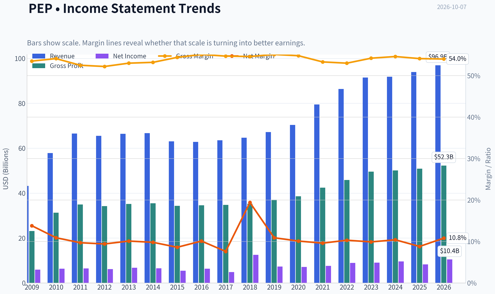

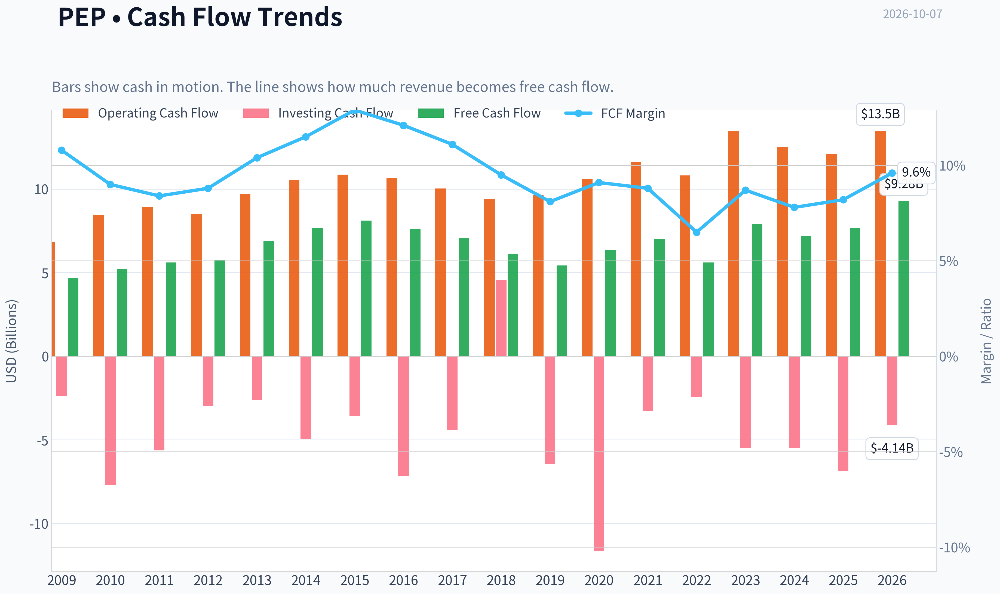

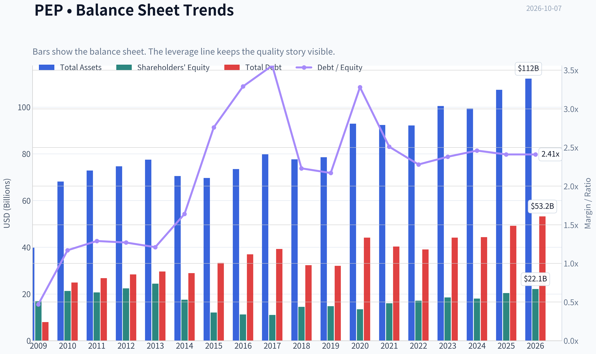

This graph tracks the profitability and return metrics (ROE, ROIC, Margins) of **PEP** over the past decade, highlighting capital efficiency trends.

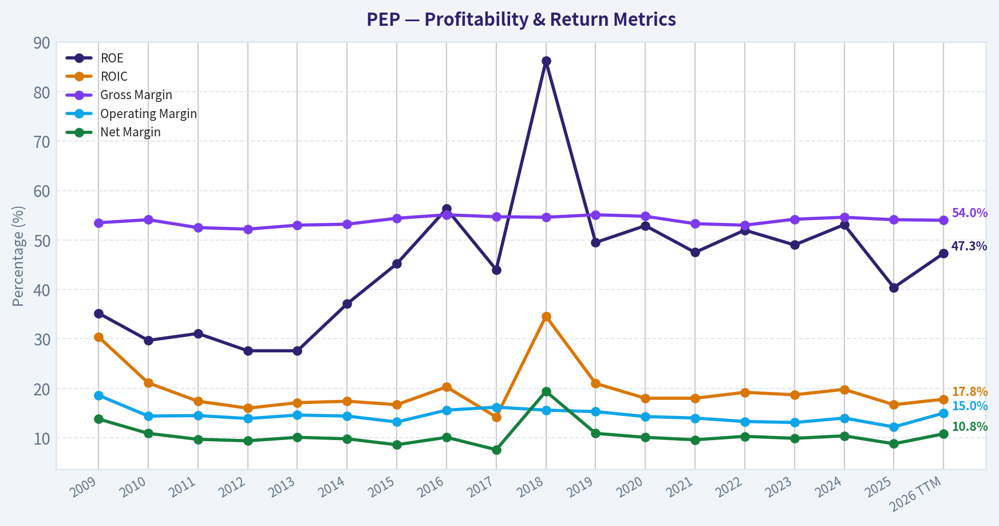

This chart illustrates the financial health of **PEP** over the last 10 years, mapping cash equivalents and free cash flow against total obligations (Debt).

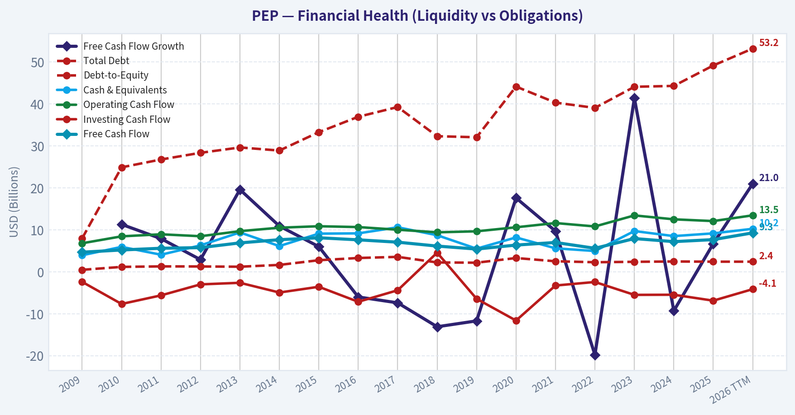

This breakdown chart from <em>Cash Flow and Capital Allocation</em> shows the proportional composition for **PEP** - useful for understanding what drives or risks the business.

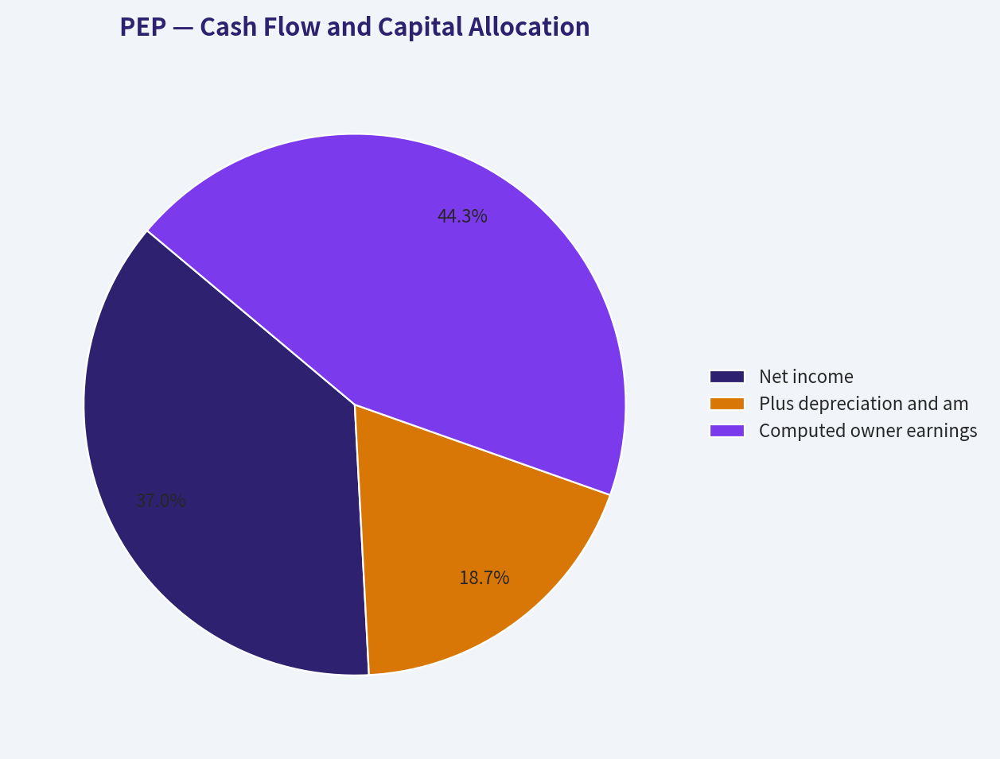

This breakdown chart from <em>Revenue Breakdown</em> shows the proportional composition for **PEP** - useful for understanding what drives or risks the business.

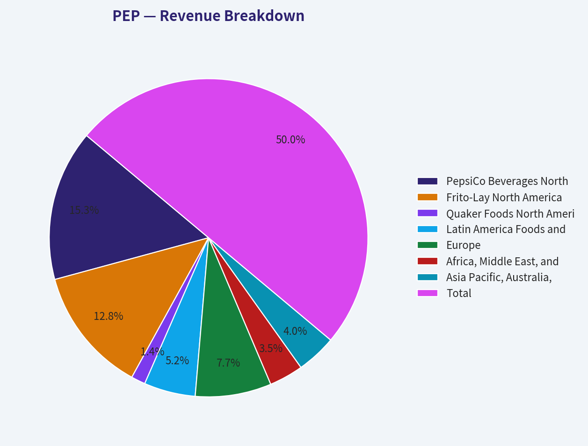

---

### Intrinsic Value Analysis (Buffett)

> *Following Warren Buffett's value investing philosophy: Circle of Competence, Economic Moat, Management Quality, and Margin of Safety.*

#### Intrinsic Value Snapshot

Price is what you pay. Intrinsic value is what the business may be worth based on the cash it can create for owners over time. We show a range, not one magic number.

- Current Price: $125.71
- Value Range (conservative to optimistic across both DCF methods): $30.43 to $130.99

##### Owner Earnings (Buffett Method)
- Net Income: $8,240,000,000.00
- Depreciation & Amortization: $4,178,000,000.00
- Capital Expenditures: $-4,415,000,000.00
- Working Capital Changes: $-1,645,000,000.00
- Owner Earnings: $9,885,000,000.00

##### Intrinsic Value
###### Buffett Method
Uses owner earnings. Stricter, and usually more conservative.
- Conservative: $40.03
- Average: $101.91
- Optimistic: $130.99
- Discount Rate: 10.0%

###### Cash Flow Method
Uses free cash flow. Better for companies spending heavily today to grow tomorrow.
- Conservative: $30.43
- Average: $63.53
- Optimistic: $91.73
- Discount Rate: 10.0%

ANALYST STANCE: **WATCH**

#### Executive Summary

PepsiCo is a high-quality global consumer franchise with powerful brands, distribution scale, recurring demand, and a long record of shareholder returns. Its moat remains wide and stable, but current growth is modest and the stock offers only a limited margin of safety at approximately $126 per share.

The central issue is valuation relative to growth. The price implies roughly 10.7% annual growth over the next decade, while recent reported growth is only 2.3% year over year and approximately 0.3% over the trailing three-year period. PepsiCo is a good business, but the current price does not provide enough protection against weak volumes, changing consumer preferences, input-cost inflation, or execution problems in North America.

#### Factor Scorecard

| Factor | Score | Assessment |
|---|---:|---|
| Circle of competence and simplicity | 4/5 | Simple model: PepsiCo sells branded beverages and convenient foods through global distribution. Long-term demand is predictable, though growth and consumer preferences require monitoring. |
| Moat | 4/5 | Wide and stable moat from brands, shelf space, distribution, scale, and retailer relationships. |
| Management and capital allocation | 4/5 | Long-term dividend culture, disciplined reinvestment, and strong operating history. Capital allocation is generally shareholder-oriented, though acquisitions and leverage should be monitored. |
| Industry structure | 4/5 | Global branded food and beverage is concentrated among a few large competitors, with meaningful scale advantages and recurring demand. |

**Gate 5 - Quality/Solvency hard floor: Not tripped.** The available evidence does not indicate simultaneous deteriorating earnings or cash flow and a solvency crisis. There is no basis for a distress-driven hard avoid.

**Key Takeaways:** PepsiCo scores well on business quality, moat, and industry structure. The primary weakness is not franchise durability but the limited valuation cushion relative to current growth.

#### Moat Analysis

**Brand and intangible assets.** Pepsi, Gatorade, Lay's, Doritos, Cheetos, Quaker, and other brands occupy valuable positions in consumers' minds and on retail shelves. The company's 54.1% gross margin supports the presence of valuable intellectual property and brand economics.

**Distribution and scale.** PepsiCo combines beverages and snacks, allowing it to serve retailers with a broad product portfolio and highly efficient merchandising and logistics. This creates advantages in shelf placement, promotional execution, and route density.

**Switching costs.** Consumer switching costs are low at the individual product level. However, retailers face meaningful economic costs in replacing PepsiCo's scale, assortment, marketing support, and reliable supply. This makes the moat stronger with retailers than with consumers.

**Network effects.** PepsiCo does not have a classic digital network effect. Its reinforcing loop is commercial rather than technological: more distribution creates more sales, which supports marketing, innovation, shelf space, and further distribution.

**Moat rating: Wide and stable - 4/5.** The moat is substantial, but not entirely unassailable. Health concerns, private-label competition, GLP-1-related consumption changes, and retailer bargaining power limit the score.

#### Management Quality Assessment

PepsiCo's management has generally demonstrated:

- Long-term commitment to dividends and per-share value.
- Strong reinvestment in brands, innovation, manufacturing, and distribution.
- A willingness to operate across both beverages and snacks, improving portfolio resilience.
- No indication in the available information of accounting distress or a breakdown in financial discipline.

The key management questions are whether capital spending and marketing can restore volume growth, whether acquisitions remain disciplined, and whether management can balance pricing with consumer affordability. The current operating environment suggests execution matters more than financial engineering.

**Management score: 4/5.**

#### Financial Summary

| Metric | Latest available figure |
|---|---:|
| Share price | $126.00 |
| Market capitalization | $171.72 billion |
| P/E ratio | 16.5x |
| Revenue growth, year over year | 2.3% |
| Gross margin | 54.1% |
| ROE | 40.4% |
| FCF yield | 4.5% |
| Implied annual free cash flow | Approximately $7.73 billion |
| Headline intrinsic value | $135.94 |
| Headline margin of safety | 7.5% |
| Reverse-DCF implied growth | Approximately 10.7% annually for 10 years |

**Key Takeaways:** PepsiCo's gross margin and ROE show a valuable franchise, while the 4.5% free-cash-flow yield is respectable for a defensive consumer company. However, the market price implies growth substantially higher than the recent operating trend, leaving only a 7.5% headline discount to estimated intrinsic value.

#### Owner Earnings Calculation

Using free cash flow as a practical proxy for owner earnings:

| Component | Approximate amount |
|---|---:|
| Net income plus depreciation and amortization | Not separately provided in the current data |
| Less maintenance capital expenditures | Not separately provided |
| Less working-capital investment | Not separately provided |
| Owner earnings proxy, using FCF | $7.73 billion |
| Owner earnings per share, using approximately 1.36 billion shares | Approximately $5.67 |

**Key Takeaways:** PepsiCo converts its earnings into substantial cash, and free cash flow provides a reasonable owner-earnings proxy for valuation. The key limitation is that reported FCF includes both maintenance and growth investment, so true distributable owner earnings could differ.

#### Three-Scenario DCF Valuation

The calculations use approximately $7.73 billion of owner earnings and approximately 1.36 billion shares outstanding.

| Scenario | Assumptions | Equity value | Value per share |
|---|---|---:|---:|
| A. No growth | Owner earnings capitalized at 10% | $77.3 billion | $56.60 |
| B. GDP growth | 3% annual growth, 10% discount rate | $113.6 billion | $83.20 |
| C. Business-model blended valuation | Owner earnings, FCF, Damodaran FCFF, and reverse-DCF methods | Approximately $138.5 billion | $101.91 owner-earnings model; $135.94 headline blend |

**Key Takeaways:** The strict no-growth and 3% growth cases produce values well below the current share price, showing that the investment depends on PepsiCo retaining substantial pricing power and achieving more than merely stagnant growth. The broader valuation blend is more favorable, but its $135.94 headline estimate still implies only modest upside.

#### Margin of Safety Analysis

| Valuation reference | Value per share | Premium/(discount) versus $126 |
|---|---:|---:|
| No-growth DCF | $56.60 | 55.1% premium |
| 3% growth DCF | $83.20 | 51.3% premium |
| Owner-earnings model | $101.91 | 23.6% premium |
| Headline blended intrinsic value | $135.94 | 7.5% discount |

**Key Takeaways:** PepsiCo's valuation is highly sensitive to the growth assumption. The headline model indicates a small discount, but the more conservative DCF cases indicate that the current price already discounts a meaningful recovery in growth.

For a wide-moat, predictable compounder, a 10% to 15% margin of safety can be acceptable. PepsiCo qualifies as a strong franchise, but its current growth visibility is weaker than that of a top-tier compounder. A more attractive entry point would be approximately $105 to $115 per share, depending on confidence in volume recovery and cash-flow growth.

#### Final Buffett Scorecard

| Criterion | Weight | Score | Weighted contribution |
|---|---:|---:|---:|
| Moat width and durability | 25% | 4.0 | 1.00 |
| Valuation and margin of safety | 20% | 3.0 | 0.60 |
| Capital returns versus WACC | 15% | 4.0 | 0.60 |
| Business understanding and predictability | 12% | 4.0 | 0.48 |
| Management quality and capital allocation | 12% | 4.0 | 0.48 |
| Reinvestment runway | 8% | 3.5 | 0.28 |
| Balance-sheet strength | 4% | 3.0 | 0.12 |
| Industry structure | 4% | 4.0 | 0.16 |
| **Total** | **100%** |  | **3.72/5** |

**Key Takeaways:** PepsiCo's weighted score is supported by a durable moat, strong brands, attractive capital returns, and a favorable industry structure. Valuation and reinvestment runway prevent the company from reaching an outright buy rating at the current price.

#### Investment Stance

**WATCH - Moderate conviction.**

PepsiCo is the type of business Buffett could reasonably own: understandable, branded, cash-generative, globally distributed, and supported by recurring consumer demand. The problem is not business quality; it is that the current price requires a stronger growth trajectory than recent results currently demonstrate.

Existing long-term shareholders can reasonably continue holding while monitoring volumes, margins, debt, and free-cash-flow growth. New investors should wait for either:

1. A lower share price that creates a 15% to 25% quality-adjusted margin of safety; or
2. Clear evidence that volume growth and earnings growth are recovering sustainably.

At approximately $126, PepsiCo is a good business at a borderline-fair price-not yet a compelling purchase.
#### Valuation Bridge

This bridge places the current market price beside each intrinsic value lens so readers can see whether upside depends on one method or shows up across several methods.

| Scenario | Intrinsic Value / Share |
| --- | ---: |
| Buffett Method | $101.91 |
| Cash Flow Method | $63.53 |
| Damodaran Method | $197.33 |
| Current Price | $125.71 |

#### Key Takeaways

If one method is far above the others, the upside case depends on a specific modelling assumption. When several methods cluster together, the valuation story is more robust.

#### Valuation Visuals

This comparison chart from *Latest Earnings Snapshot* stacks current figures against historical benchmarks for **PEP**, making it easy to see where the company trades relative to its own averages.

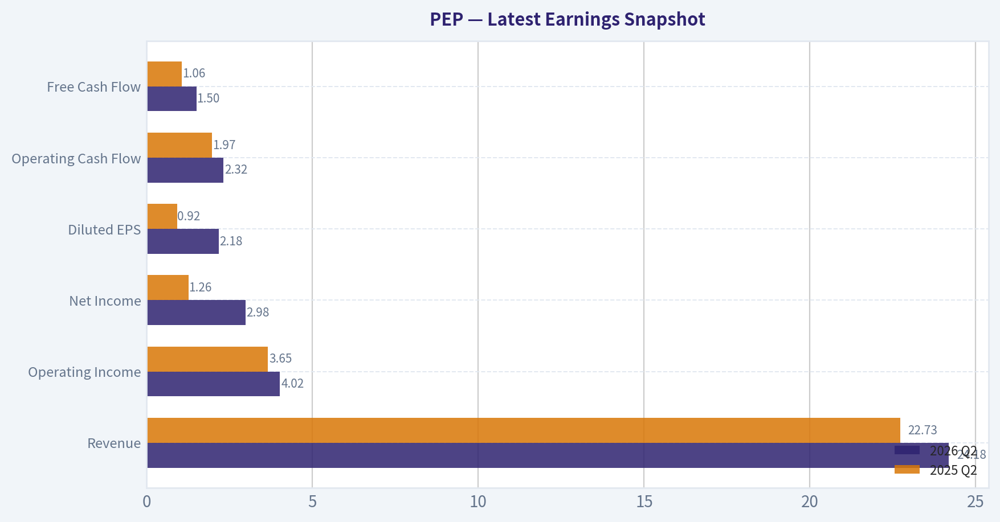

This comparison chart from *Current Metrics Versus Historical Averages* stacks current figures against historical benchmarks for **PEP**, making it easy to see where the company trades relative to its own averages.

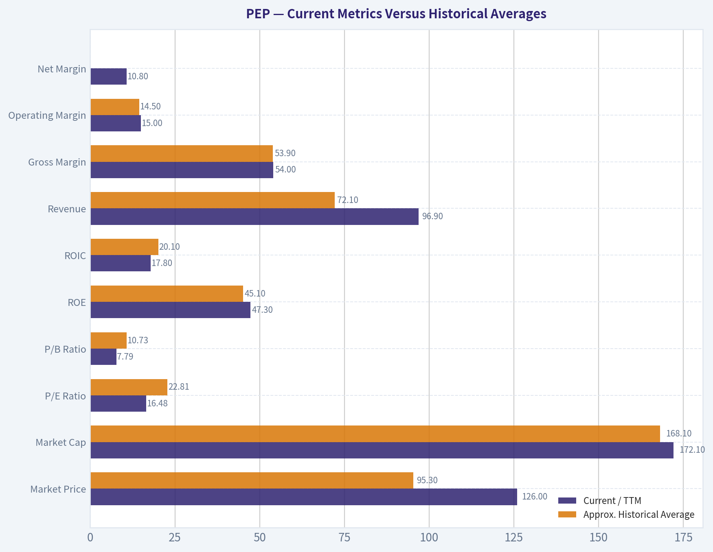

This comparison chart from *Balance Sheet and Financial Strength* stacks current figures against historical benchmarks for **PEP**, making it easy to see where the company trades relative to its own averages.

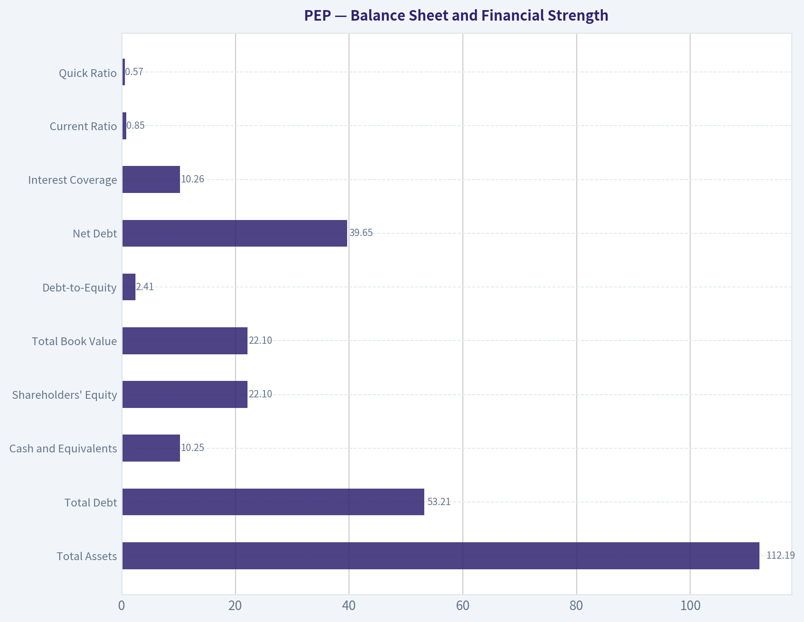

---

### Trend & Growth Analysis (Lynch/Druckenmiller/Fisher)

> *Following Peter Lynch's GARP, Stanley Druckenmiller's macro-aware approach, and Philip Fisher's scuttlebutt methodology.*

ANALYST STANCE: **WATCH**

#### 1. Lynch Classification

**Stalwart transitioning toward slow growth.** PepsiCo is a high-quality consumer-staples franchise, but its current 2.3% revenue growth is well below the 15-25% threshold for a Lynch fast grower. It may be attractive for income, resilience, and potential turnaround-not for clear ten-bagger growth.

#### 2. The Story in Three Bullets

- PepsiCo owns globally recognized snack and beverage brands, including Lay's, Doritos, Gatorade, Pepsi, Quaker, and Cheetos.
- The investment case depends on international growth, pricing power, productivity initiatives, and a U.S. volume recovery.
- The company is currently priced closer to a challenged defensive stalwart than an obvious growth compounder.

#### 3. TAM and 10x Test

| Metric | Assessment |
|---|---:|
| Current market capitalization | $171.7 billion |
| Current revenue growth | 2.3% year over year |
| Approximate 10x revenue requirement | Roughly $900 billion-plus annual revenue |
| Relevant market | Global snacks, beverages, convenience foods |
| TAM growth | Moderate, generally mid-single-digit |
| Can PepsiCo 10x while remaining below 20% market share? | Unlikely as currently structured |
| Runway assessment | Large but not clearly 10-bagger-scale |

**Key Takeaways:** PepsiCo participates in enormous global food and beverage markets, but its existing scale makes a tenfold revenue increase difficult. The better opportunity is incremental share gains, international expansion, premiumization, and execution improvement rather than a radically expanding TAM.

#### 4. Revenue Growth Trend

| Indicator | Data / Interpretation |
|---|---|
| Latest reported revenue growth | 2.3% year over year |
| Trailing three-year growth used in reverse DCF | Approximately 0.3% annualized |
| Trailing five-year growth used in reverse DCF | Approximately 28.0% annualized, heavily influenced by prior periods |
| Current trend | Slow and uneven |
| Inflection status | Not yet confirmed |
| Main swing factor | U.S. volume recovery versus continued price-driven growth |

**Key Takeaways:** Current revenue momentum is weak rather than accelerating. The five-year figure looks favorable, but the recent three-year trend and latest year-over-year growth indicate meaningful deceleration. A sustained improvement in volumes and organic growth would be necessary before classifying PepsiCo as a renewed fast grower.

#### 5. Unit Economics and Financial Quality

| Metric | Value / Assessment |
|---|---:|
| Gross margin | 54.1% |
| Return on equity | 40.4% |
| Free-cash-flow yield | 4.5% |
| Current ratio | 0.85 |
| Net revenue retention | Not applicable; consumer-staples business |
| LTV/CAC | Not disclosed in a SaaS-compatible format |
| Rule of 40 | Not applicable |
| Balance-sheet liquidity | Somewhat tight, though typical for a mature consumer company |

**Key Takeaways:** PepsiCo has strong brand economics, high gross margins, and an excellent reported ROE. However, the 4.5% free-cash-flow yield is not especially compelling for a company growing only slightly, and the sub-1.0 current ratio warrants monitoring. Consumer brand strength is more important here than conventional SaaS metrics such as NRR or LTV/CAC.

#### 6. Inflection Point Assessment

| Potential inflection | Current evidence | Status |
|---|---|---|
| Product cycle | No major company-wide breakthrough identified | Neutral |
| Market share | International opportunity, but no confirmed accelerating share gain | Neutral |
| Margin | Productivity could support margins, but cost and mix pressures remain | Watch |
| TAM | Large market, but not rapidly expanding | Neutral |
| Competitive environment | Strong brands, but intense competition and changing consumer preferences | Neutral |
| U.S. volume recovery | Central potential catalyst ahead of earnings | Unconfirmed |

**Key Takeaways:** The principal possible inflection is a U.S. turnaround in volumes, supported by improved pricing architecture and productivity. At present, this is a thesis to monitor rather than a demonstrated acceleration. The upcoming earnings report is important for determining whether the business is stabilizing or still losing momentum.

#### 7. Macro Setup

PepsiCo benefits from defensive demand, broad distribution, and pricing power during uncertain economic periods. However, the macro setup is not ideal for a high-conviction growth position:

- Consumer budgets remain sensitive to food inflation and trade-down behavior.
- Higher-for-longer interest rates reduce the appeal of a mature, lower-growth equity.
- International markets offer growth but introduce currency, geopolitical, and local-consumer risks.
- Input costs, labor, transportation, and promotional intensity can pressure margins.
- A slowing economy may favor snacks and at-home consumption, but it can also hurt premium pricing and volumes.

Overall, the macro backdrop is **defensive but not strongly growth-supportive**.

#### 8. Fisher's 15-Point Score

| Fisher criterion | Score / 5 | Comment |
|---|---:|---|
| Sufficient market potential | 4 | Large global categories |
| New-product determination | 3 | Ongoing innovation, but no transformational cycle |
| R&D effectiveness | 3 | Adequate for consumer products |
| Sales organization | 5 | Exceptional distribution and execution infrastructure |
| Worthwhile profit margins | 4 | Strong gross economics |
| Improving profit margins | 3 | Productivity opportunity, but not clearly accelerating |
| Labor relations | 3 | Monitor labor and operating-cost pressures |
| Executive relations | 3 | Mature-company structure |
| Management depth | 4 | Deep global organization |
| Cost analysis/accounting | 4 | Large-company discipline |
| Outstanding competitive aspects | 5 | Brands, scale, shelf space, distribution |
| Long-range profit outlook | 4 | Durable, though low growth |
| Dilution risk | 4 | No major dilution issue apparent |
| Management candor | 3 | Requires ongoing verification through guidance and results |
| Management integrity | 4 | Established operating record |
| **Total** | **56 / 75** | **Good, but not outstanding growth profile** |

**Key Takeaways:** PepsiCo scores well on brands, distribution, market access, and management depth. Its weaknesses are the lack of a clear high-growth product cycle and limited evidence of accelerating profitability. The score is consistent with a quality stalwart, not a high-conviction ten-bagger candidate.

#### 9. Valuation Analysis

| Valuation measure | Result | Interpretation |
|---|---:|---|
| Current price | $126 | Reference price |
| P/E | 16.5x | Reasonable for a mature consumer company |
| PEG using 2.3% revenue growth as a rough proxy | Approximately 7.2x | Very unattractive, though earnings growth is not identical to revenue growth |
| Free-cash-flow yield | 4.5% | Moderate |
| Headline intrinsic value | $135.94 | About 7.5% upside |
| Owner-earnings DCF value | $101.91 | Below current price |
| FCF valuation model | $63.53 | Highly conservative / below current price |
| Damodaran FCFF value | $197.33 | More optimistic |
| Reverse-DCF implied growth | Approximately 10.7% annually for 10 years | Demanding relative to recent performance |

**Key Takeaways:** PepsiCo is not obviously expensive on headline P/E, but it is not clearly cheap relative to its current growth rate. The intrinsic-value estimate provides only modest upside, while the wide valuation-model spread shows substantial sensitivity to assumptions. Most importantly, the market price appears to require growth well above the latest 2.3% revenue rate.

#### 10. Growth Investor Scorecard

| Criterion | Weight | Score / 5 | Weighted result |
|---|---:|---:|---:|
| The Story | 10% | 3.5 | 0.35 |
| TAM and runway | 20% | 3.0 | 0.60 |
| Revenue growth | 20% | 2.0 | 0.40 |
| Unit economics | 15% | 4.0 | 0.60 |
| Competitive position | 10% | 4.5 | 0.45 |
| Management quality | 10% | 4.0 | 0.40 |
| Macro setup | 5% | 3.0 | 0.15 |
| Profitability path | 5% | 4.0 | 0.20 |
| Valuation | 5% | 3.0 | 0.15 |
| **Total** | **100%** | - | **3.30 / 5.00** |

**Key Takeaways:** PepsiCo scores 3.30 out of 5, placing it in the WATCH category. Strong brands, distribution, and profitability offset weak recent growth and limited ten-bagger potential. The score would improve materially if organic revenue growth returned to the high-single digits with volume growth and stable margins.

#### 11. Position Size Stance

- **New growth position:** No position or token starter position only.
- **Existing income-oriented holding:** Hold if the objective is dividends and defensive compounding.
- **Growth portfolio allocation:** Prefer approximately **0-1% until a confirmed operating inflection**.
- **Potential upgrade:** Consider a larger position only after evidence of sustained volume recovery, improving organic growth, and stable or expanding margins.

#### 12. Key Risks and Catalysts

| Catalysts | Risks |
|---|---|
| U.S. volume recovery | Continued volume declines |
| Stronger international growth | Currency and geopolitical pressure |
| Successful productivity program | Gross-margin erosion |
| Better-than-expected earnings guidance | Consumer trade-down |
| Brand innovation and premium products | Health-conscious shifts away from sugary or salty products |
| Valuation re-rating after stabilization | Price already implies higher growth than recent results |

**Key Takeaways:** The main catalyst is operational stabilization, particularly a U.S. volume rebound. The primary risk is that PepsiCo remains trapped in low growth while needing continued price increases to offset weak volumes. Earnings confirmation-not management optimism alone-is required to establish a durable inflection.

#### Bottom Line

PepsiCo is a **high-quality, defensive consumer-staples stalwart**, but it currently fails the core growth-investor test: revenue is not accelerating, the TAM is not expanding rapidly enough to support an easy 10x outcome, and valuation requires a meaningful improvement from recent growth. The appropriate stance is **WATCH**, with the next earnings reports serving as the key test for a possible turnaround.

---

### Market Technical Analysis

ANALYST STANCE: **WATCH**

#### PEP technical analysis

PEP closed at **$125.71 on October 6, 2026**, with October 7 not yet represented as a trading session in the data. The technical picture is bearish across trend and momentum measures, although several indicators show that the stock is becoming materially oversold. This creates a potential rebound setup, but not yet a confirmed reversal.

Over the past year, PEP declined from approximately **$135.31 to $125.71**, a loss of about **7.1%**. The more important deterioration occurred after the February peak near **$165.45**: the stock has fallen roughly **24%** from that high. The recent decline is therefore not merely a short-term pullback; it represents a broader intermediate-term downtrend.

#### Trend structure

PEP is trading substantially below all three selected moving averages:

- **10 EMA:** approximately **$127.95** on October 5
- **50 SMA:** approximately **$135.91** on October 5 and **$135.65** on October 6
- **200 SMA:** approximately **$144.45** on October 5 and **$144.35** on October 6
- Latest close: **$125.71**

The price is about **1.7% below the 10-day EMA**, nearly **7.3% below the 50-day SMA**, and approximately **12.9% below the 200-day SMA**. This alignment confirms weakness across short-, medium-, and long-term horizons. The declining 10 EMA and 50 SMA also show that the averages are not simply lagging a one-day selloff; they are actively trending downward.

The 200 SMA has been declining gradually from about **$145.56 in early September to $144.35**, which is a modest but meaningful deterioration in the long-term trend. A sustained recovery would likely need to reclaim the 50-day average first, while a more durable trend reversal would require eventual progress toward the 200-day average.

#### Momentum and reversal potential

The RSI reading was approximately **25.94** on October 6. This is below the conventional 30 oversold threshold and indicates substantial downside momentum. However, RSI oversold conditions should not be interpreted as an automatic buy signal. RSI remained below 35 for much of the second half of September, demonstrating that PEP can remain oversold while prices continue falling.

The MACD was approximately **-3.10** on October 6, down from near zero in early September. This is a strongly negative reading and confirms that bearish momentum has intensified. The MACD decline was particularly notable from September 8 through September 18, and although it has flattened slightly in early October, there is no clear evidence yet of a bullish momentum reversal. A more constructive signal would be a rising MACD accompanied by a bullish crossover and improving price action above the 10-day EMA.

Taken together, RSI says the stock is stretched, while MACD says the underlying momentum remains bearish. That combination favors patience: oversold conditions can support a tactical bounce, but the probability of a sustained recovery remains limited until momentum begins improving.

#### Bollinger Bands and price location

On October 5, the Bollinger Bands were approximately:

- **Upper band:** $139.84
- **Lower band:** $122.80

PEP's October 6 close of **$125.71** remained close to the lower band. The lower band had fallen sharply from approximately **$135.88 in early September to $122.80**, reflecting both declining prices and an extended period of downside movement.

Trading near the lower Bollinger Band confirms that the stock is under pressure, but it does not by itself establish a reversal. In a persistent downtrend, prices can remain near or below the lower band for multiple sessions. A stronger reversal setup would require the price to stabilize above the lower band, reclaim the 10-day EMA near $128, and then form higher highs and higher lows.

The widening distance between the upper and lower bands during the decline also suggests that volatility has increased. A rebound toward the middle of the band structure could occur if selling pressure eases, but the first significant resistance zone is likely around **$128 to $130**, followed by the declining 50-day average near **$136**.

#### Volatility and risk management

ATR was approximately **$2.21**, meaning PEP's typical daily trading range was around **1.8% of the share price**. ATR has eased modestly from the roughly $2.3 area seen in early September, but volatility remains high enough that tight stops may be vulnerable to normal price fluctuations.

For a tactical trade, ATR-based risk controls are more appropriate than placing a stop only a few cents below a recent low. A stop distance of roughly **1.5 to 2 ATRs**, or approximately **$3.30 to $4.40**, would better reflect current volatility, although the appropriate level depends on position size and risk tolerance. The major nearby downside reference is the **$122.80 lower Bollinger Band**, while a break below that area could expose the stock to further selling.

Volume also deserves attention. Several selloffs occurred with elevated volume, including the high-volume decline on September 18. October 6 volume was approximately **10.0 million shares**, above many recent sessions, but not enough by itself to confirm capitulation. A bullish reversal would be more credible if a strong up day occurred on expanding volume and pushed the stock back above the 10-day EMA.

#### Trading interpretation

The most defensible current interpretation is **bearish trend with oversold tactical conditions**.

- Trend-following traders should avoid treating the low RSI as sufficient evidence for a long entry.
- Aggressive traders may watch for a short-term rebound, but confirmation should come from a close above the 10-day EMA and improving MACD behavior.
- A failure near $128 to $130, followed by a break below approximately $124 to $123, would indicate that sellers remain in control.
- A recovery through the 50-day SMA near $136 would materially improve the intermediate-term picture, while the 200-day SMA near $144 remains the major long-term trend barrier.
- Until those resistance levels are reclaimed, rallies are more appropriately viewed as countertrend recoveries rather than confirmed trend reversals.

#### Selected indicators

The selected eight indicators are designed to cover trend, momentum, volatility, and risk without relying on redundant signals. The 10 EMA provides short-term timing, the 50 and 200 SMAs define medium- and long-term direction, MACD measures momentum, RSI identifies exhaustion, the two Bollinger Bands define the current price envelope, and ATR supports position sizing and stop placement. The MACD signal and histogram were omitted because they duplicate information already provided by the MACD momentum reading.

| Indicator | Latest available reading | Interpretation for PEP |
|---|---:|---|
| Close | $125.71 on Oct. 6 | Near the recent low and under all major moving averages |
| 10 EMA | $127.95 on Oct. 5 | Short-term resistance; price remains below it |
| 50 SMA | $135.65 on Oct. 6 | Medium-term trend is bearish |
| 200 SMA | $144.35 on Oct. 6 | Long-term trend remains clearly negative |
| MACD | -3.10 on Oct. 6 | Strongly negative momentum; no confirmed reversal |
| RSI | 25.94 on Oct. 6 | Oversold, but oversold can persist in a downtrend |
| Bollinger Bands | Upper $138.86; lower approximately $122.80 | Price is near the lower volatility boundary |
| ATR | $2.21 on Oct. 6 | Elevated daily movement; use volatility-adjusted risk controls |

Key Takeaways: PEP is in a confirmed multi-horizon downtrend, with the price below the 10-day EMA, 50-day SMA, and 200-day SMA. RSI and the lower Bollinger Band show that the stock is oversold and could produce a tactical rebound, but MACD remains strongly negative, so a durable reversal is not yet confirmed. The key near-term test is whether PEP can reclaim roughly $128 to $130; failure there would keep downside risk focused on the $123 area.

#### Market Visuals

This comparison chart from *Market Metrics and Valuation* stacks current figures against historical benchmarks for **PEP**, making it easy to see where the company trades relative to its own averages.

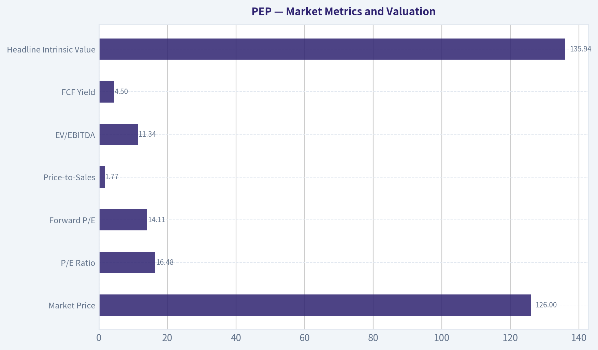

---

### Options Market Analysis

> *Reading options flow - put/call ratios, IV skew, and unusual activity - to gauge institutional positioning and event-driven risk.*

#### PEP Options Flow Report

**Data date:** October 7, 2026
**Near-term expirations reviewed:** October 9, October 16, and October 23, 2026

#### Put/Call Ratio Analysis

| Expiration | Call OI | Put OI | Put/Call OI Ratio | Call Volume | Put Volume | Put/Call Volume Ratio |
|---|---:|---:|---:|---:|---:|---:|
| Oct. 9 | 0 | 0 | N/A | 5,346 | 4,177 | 0.78 |
| Oct. 16 | 39 | 20 | 0.51 | 3,637 | 3,000 | 0.83 |
| Oct. 23 | 0 | 0 | N/A | 695 | 326 | 0.47 |
| **Near-term total** | **39** | **20** | **0.51** | **9,678** | **7,503** | **0.78** |

The aggregate put/call OI ratio of 0.51 is below the approximately 0.70 neutral baseline, indicating a call-heavy positioning bias. Volume is also call-led, with a 0.78 put/call volume ratio. However, almost all reported open interest is concentrated in the October 16 expiration, and total OI is extremely small, so the directional conclusion has low statistical confidence.

**Key Takeaways:** PEP's near-term options positioning leans bullish rather than defensive. The signal is weakened substantially by the very small open-interest base and the absence of meaningful OI in two of the three expirations.

#### Implied Volatility Assessment

| Expiration | Call ATM IV | Put ATM IV | Relative IV Signal |
|---|---:|---:|---|
| Oct. 9 | 3.8% | 3.5% | Slight call premium |
| Oct. 16 | 1.7% | 2.1% | Put skew |
| Oct. 23 | 2.0% | 1.5% | Slight call premium |

Near-term IV is reported as very low, ranging from 1.7% to 3.8%. The October 16 chain shows a modest downside skew, with put IV at 2.1% versus call IV at 1.7%, suggesting some demand for downside protection in that expiration. The other two expirations show slightly higher call IV than put IV.

No known catalyst was supplied with the options data, and the dataset does not identify an earnings date or other event. Therefore, there is no clear evidence that IV is elevated ahead of a catalyst. Given the unusually low quoted IV figures, verify the data against a live options chain before trading.

**Key Takeaways:** Overall implied volatility is low, indicating limited expectation of a large near-term move. The October 16 put skew is a mild warning of downside hedging, but it is not strong enough to override the call-heavy put/call ratios.

#### Unusual Options Activity

The data provider defines unusual activity as individual contracts with volume greater than five times open interest.

| Finding | Interpretation |
|---|---|
| No contracts met the volume-to-OI threshold | No isolated fresh directional bet was identified |
| Aggregate call volume exceeded put volume | Mild bullish flow at the chain level |
| Contract strikes were not provided | ITM, ATM, and OTM classification is unavailable |
| Current underlying price was not provided | Moneyness and strike-relative analysis cannot be completed |
| OI is very small | Institutional-versus-retail attribution is unreliable |

No individual contract qualified as unusual activity. Although total volume is much larger than the small reported open interest, the provider did not identify any single contract with volume exceeding five times its own OI. Consequently, there is no clear smart-money sweep, hedge-fund protection trade, or concentrated speculative bet to highlight.

**Key Takeaways:** There is no contract-level unusual activity confirming the bullish aggregate ratio signal. The lack of strike-level details also prevents reliable assessment of whether the trading is concentrated in upside calls, downside puts, or short-premium strategies.

#### Open Interest Concentration and Gamma Levels

| Expiration | Highest Reported Call OI | Highest Reported Put OI | Concentration Assessment |
|---|---:|---:|---|
| Oct. 9 | No OI reported | No OI reported | No meaningful pinning level |
| Oct. 16 | Strike-level data unavailable; total call OI: 39 | Strike-level data unavailable; total put OI: 20 | Only meaningful near-term OI, but still very thin |
| Oct. 23 | No OI reported | No OI reported | No meaningful pinning level |

Strike-level open interest was not included, so specific gravitational levels, maximum-pain estimates, and gamma walls cannot be calculated. The October 16 expiration contains the only reported near-term OI, but totals of 39 calls and 20 puts are too small to establish a reliable pinning or gamma effect.

**Key Takeaways:** There is no dependable gamma wall or maximum-pain level visible in the supplied data. Near-term price action should not be expected to receive meaningful mechanical support or resistance from this options chain.

#### Overall Options Sentiment Signal

**Signal: BULLISH - low confidence**

The primary bullish drivers are:

- Aggregate put/call OI ratio of **0.51**, below the neutral baseline of approximately 0.70.
- Put/call volume ratio of **0.78**, showing moderately higher call activity.
- Slight call-IV premiums in two of the three listed expirations.

The principal caveats are substantial:

- Near-term open interest is extremely thin.
- No individual unusual contracts were identified.
- October 16 has a modest put IV skew, indicating some downside hedging.
- Strike-level data and the current underlying price were not supplied, preventing moneyness, gamma-wall, and maximum-pain analysis.
- No catalyst-related IV expansion is evident.

This is best interpreted as a **mild bullish positioning bias**, not a strong institutional conviction signal. Thin liquidity materially reduces confidence and raises the risk that the ratios are distorted by a small number of trades or stale open-interest figures.

| Category | Assessment |
|---|---|
| Put/Call Ratio | Bullish-leaning: OI ratio 0.51 and volume ratio 0.78 |
| IV Level | Low, with reported ATM IV between 1.7% and 3.8% |
| Skew Direction | Mixed overall; modest put skew in the October 16 expiration |
| Unusual Activity | None identified at the individual-contract level |
| Overall Signal | **BULLISH, low confidence** |

**Key Takeaways:** PEP's near-term options data points modestly bullish because calls outnumber puts in both open interest and volume. However, the chain is too thin to support a high-confidence institutional positioning call, and there are no unusual trades or meaningful gamma levels reinforcing the signal.

---

## Research Team Commentary

> *The Research Manager synthesizes the Bull vs Bear debate into action-free commentary. This is a pre-risk view, not the final stance.*

Core takeaway: PepsiCo is a wide-moat, highly profitable franchise, but at $126 the evidence supports WATCH rather than aggressive accumulation. The bull case is credible: PepsiCo's brands, route density, shelf-space influence, and snack-and-beverage diversification are difficult to replicate. A 54.1% gross margin and 15.5% ROIC confirm real economic quality, while a 16.48 times earnings multiple is undemanding relative to PepsiCo's historical reputation. However, the claimed 13%-16% discount to intrinsic value is not sufficiently established because the analysis substitutes EPS for owner earnings without current free-cash-flow, capital-spending, leverage, or working-capital data.

The strongest bull argument is that the market may be treating a temporary affordability and volume problem as a lasting deterioration. At $126, reported earnings produce a 6.1% earnings yield. If EPS is a reasonable proxy for normalized owner earnings, the reverse DCF indicates that the stock needs only about 2% annual growth to justify today's price under an 8.5% required return. PepsiCo has several plausible ways to exceed that hurdle: international expansion, modest pricing, productivity, mix improvement, innovation, and eventual U.S. volume stabilization. Its distribution network is particularly valuable because high route density, strong retailer relationships, and a broad portfolio reinforce one another. This is not merely a collection of famous trademarks; it is an operating system that would be prohibitively expensive for a new competitor to reproduce.

The quality-scaled margin-of-safety framework also favors giving PepsiCo more valuation latitude than an average packaged-food company. A wide-moat, predictable compounder need not trade at a 30% discount to be attractive. If recurring owner earnings really are close to $7.65 per share and can grow around 4%, a value in the mid-$140s is reasonable. In that case, $126 would offer roughly the 10%-15% discount that can be sufficient for a wonderful business.

The bear's strongest response is that this valuation advantage is conditional rather than demonstrated. EPS is not automatically owner earnings for a company that must invest continuously in manufacturing, logistics, fleet capacity, packaging, productivity projects, and working capital. If sustainable owner earnings are only about 85% of EPS, the bull's 4% growth case falls toward the current share price. Likewise, increasing the required return from 8.5% to 9% reduces the low-growth value to approximately $116. That means the shares could be modestly undervalued, fairly valued, or somewhat overvalued depending on cash conversion and the discount rate. The bundle does not contain enough cash-flow information to resolve that uncertainty.

The operating issue that matters most is volume elasticity. PepsiCo has demonstrated that it can raise prices, but it has not yet demonstrated that it can maintain those prices while restoring healthy unit demand. Persistent volume declines would eventually undermine manufacturing utilization, route density, retailer leverage, and household penetration. High gross margin proves current brand strength, but it does not prove unlimited pricing power. If maintaining that margin requires heavier promotions, smaller packages, or continued volume sacrifice, normalized owner-earnings growth may be lower than the bull assumes.

Health trends, private labels, and niche competitors are meaningful but secondary risks. PepsiCo has the brands, distribution, and financial resources to participate in zero-sugar beverages, functional hydration, portion-controlled products, and better-for-you snacks. The danger is not that the company cannot adapt; it is that adaptation could require more capital, acquisitions, promotions, or cannibalization than the valuation model allows. International growth similarly offers upside, but currency volatility, local competition, and infrastructure requirements mean it should not be treated as costless growth.

Management's dividend record and continued brand and infrastructure investment support the quality thesis. Still, shareholder orientation should be judged by free-cash-flow coverage, leverage, acquisition discipline, and the prices paid for repurchases-not dividend longevity alone. The 40.4% ROE is less informative because leverage and a small accounting-equity base can inflate it. The 15.5% ROIC is the better metric, and its direction over the next several quarters will be more important than the current snapshot.

Market psychology is mildly encouraging but not decisive. PepsiCo is priced more like a challenged defensive stalwart than an unquestioned compounder, so some pessimism is already reflected. Yet sentiment does not appear capitulatory, and a 16.48 times P/E is not a distress valuation. Options positioning is somewhat bullish, with a 0.51 put/call open-interest ratio, but that is peripheral to a ten-year thesis. The stock is also below its intermediate and long-term moving averages around $135.65 and $144.35 and slightly below its short-term EMA near $127.95. Unlike the prior Coca-Cola setup, this is not a stock trading above all major averages with clear positive momentum. The tactical trend therefore remains weak even though the fundamental valuation is becoming more interesting.

The lessons from Coca-Cola and Nike point in opposite but useful directions. Coca-Cola showed that valuation caution should not make us dismiss a high-quality defensive franchise that can continue grinding higher. Nike showed that brand prestige cannot substitute for current evidence of stable margins, cash flow, and returns on capital. For PepsiCo, the right balance is to respect the moat without automatically capitalizing reported EPS as sustainable cash flow. It would be a mistake to call the company impaired merely because volumes and the chart are weak, but it would also be a mistake to declare a sufficient margin of safety before verifying cash conversion.

Over the next one to four quarters, I would focus first on organic volume, especially in Frito-Lay North America and the North American beverage business. Stabilization without broad discounting would materially strengthen the thesis. Continued volume declines accompanied by market-share losses or heavier promotions would suggest that recent pricing has damaged consumption frequency or household penetration.

Second, I would compare price and mix with volume. The best outcome is modest pricing, improving units, and stable margins. A less attractive outcome is reported revenue growth driven almost entirely by price while units continue falling. Gross and operating margins should be evaluated alongside promotional spending rather than in isolation.

Third, PepsiCo needs to demonstrate that earnings convert into cash. Cash from operations less capital expenditures, free-cash-flow conversion relative to net income, working-capital movements, and recurring restructuring expenses will determine whether $7.65 is a defensible owner-earnings starting point. Consistent conversion near reported earnings would support the mid-$140s valuation. A persistent conversion gap would move fair value closer to the conservative $116 case.

Fourth, I would watch ROIC, net leverage, interest coverage, and dividend coverage. Stable or improving ROIC would show that productivity and international investments are creating value. Falling ROIC combined with rising debt or a tighter dividend payout would weaken both the quality and valuation cases.

Finally, I would separate tactical and strategic signals. A sustained recovery above approximately $128 and then $136 would indicate improving market sponsorship; reclaiming the longer-term area near $144 would represent a more meaningful trend reversal. Those levels would not determine intrinsic value, but they could confirm that expectations have stopped deteriorating. Conversely, a decline toward $105-$115 without structural operating damage would create a much clearer long-term margin of safety.

For existing shareholders, the franchise quality supports holding rather than selling solely because of weak momentum. For new capital, I would wait for either verified free-cash-flow conversion and volume stabilization or a lower price that does not require those questions to be answered favorably. PepsiCo is too good and too reasonably valued to avoid, but the current record is not strong enough to advocate aggressive accumulation.

WATCH

---

## Value Investing Team Commentary

> *The Investor translates the research view into an investment thesis before risk review. This is still not the final stance.*

### PepsiCo: A Strong Franchise Awaiting Better Evidence

PepsiCo is a high-quality business with a durable combination of brand equity, distribution scale, retailer influence, and portfolio diversification. Its snack business is especially attractive: frequent purchases, modest ticket sizes, broad household penetration, and dense delivery routes create advantages that are difficult and expensive to reproduce. Pairing those assets with beverages provides additional shelf-space leverage and resilience across consumption occasions.

The reported economics support the moat. A 54.1% gross margin and 15.5% ROIC indicate genuine pricing power and productive intangible assets. The 40.4% ROE is less useful because leverage and a small accounting-equity base can inflate it, but the ROIC remains respectable for a mature consumer-products company requiring substantial manufacturing and distribution infrastructure.

### What the market may be missing

The contrarian opportunity is that investors may be extrapolating a temporary affordability and volume problem into permanent franchise deterioration. Consumers have reacted to cumulative price increases, but PepsiCo still has several ways to grow per-share value:

- Recovering North American volumes as affordability improves
- International expansion and increasing market penetration
- Productivity and supply-chain efficiencies
- Product and package innovation
- Moderate pricing and favorable mix
- Disciplined reinvestment across its strongest brands

At $126 and 16.48 times reported earnings, PepsiCo is no longer priced as an unquestioned growth compounder. Its reported earnings yield is approximately 6.1%, and the supplied reverse-DCF analysis suggests that only modest long-term growth is necessary to justify the price if EPS approximates sustainable owner earnings. That is a relatively undemanding expectation for a company with PepsiCo's brands and distribution system.

This is where selective contrarianism is warranted. Weak momentum and concern about declining volumes may be creating an opportunity in a franchise that is more adaptable than current sentiment assumes. PepsiCo has the resources and distribution access to participate in zero-sugar beverages, functional hydration, portion control, and changing snack preferences. The company is not helpless in the face of evolving consumer tastes.

### Why the apparent discount is not yet conclusive

The central uncertainty is not PepsiCo's brand strength; it is the conversion of reported earnings into distributable cash.

PepsiCo must continually fund plants, fleets, warehouses, packaging systems, productivity programs, and working capital. Consequently, EPS cannot automatically be treated as owner earnings. Without current figures for operating cash flow, maintenance capital expenditures, free-cash-flow conversion, leverage, and recurring restructuring costs, the claimed 13%-16% discount to intrinsic value remains conditional.

The valuation range illustrates the issue:

- If sustainable owner earnings are close to reported EPS and can grow around 4%, a value in the mid-$140s appears reasonable. At $126, that would provide approximately the 10%-15% discount that can be adequate for a wide-moat business.
- If cash conversion is materially weaker, the required return is closer to 9%, or volume weakness persists, fair value could fall toward the more conservative estimate of approximately $116.

Thus, the market price sits between a credible bull valuation and a credible conservative valuation. It is not obviously expensive, but neither is the margin of safety conclusively demonstrated.

### The key operating question: volume elasticity

The most important development over the next several quarters will be whether PepsiCo can stabilize unit volumes without relying on widespread promotions.

Recent pricing has protected revenue and margins, but lasting pricing power requires customers to continue purchasing at healthy frequencies. Persistent volume declines could eventually weaken:

- Manufacturing utilization
- Route density and delivery economics
- Household penetration
- Retailer bargaining power
- Market share and brand relevance

The favorable scenario is modest pricing combined with improving units and stable margins. A weaker outcome would be reported revenue growth driven primarily by price while volumes continue declining. Broad discounting could restore units, but it might reveal that prior margins were not sustainable.

Health trends, private-label competition, and smaller challengers are manageable but real risks. PepsiCo can adapt, yet adaptation may require acquisitions, increased promotion, additional capital investment, or cannibalization of existing products. International expansion also creates value only if incremental returns exceed the cost of the infrastructure and working capital required.

### Management and capital allocation

PepsiCo's dividend history and continued investment in brands and distribution support the view that management takes a long-term approach. Nevertheless, dividend longevity alone does not prove excellent capital allocation.

The relevant evidence should include:

- Free cash flow covering dividends comfortably
- Stable or declining net leverage
- Sensible acquisition prices
- Repurchases made below intrinsic value
- ROIC remaining stable or improving
- Productivity spending producing durable savings rather than recurring "one-time" charges

A declining ROIC combined with rising leverage would be a meaningful warning, even if EPS continued growing.

### Interpreting sentiment and technical weakness

The stock's position below its short-, intermediate-, and long-term averages indicates deteriorating market sponsorship. That does not determine ten-year intrinsic value, but it shows that expectations have not yet stabilized. Unlike a defensive stock already demonstrating positive momentum, PepsiCo remains in a declining trend.

Options positioning is mildly optimistic rather than fearful. The 0.51 put/call open-interest ratio and modest call-IV premiums suggest that investors are not capitulating. Therefore, this is not an obvious "maximum pessimism" opportunity. The combination of a weak chart and moderately bullish options positioning also leaves room for disappointment if operating results do not improve.

For a long-term owner, however, moving averages should remain secondary. A recovery above roughly $128 and then $136 could confirm that expectations are improving, but paying a higher price solely for chart confirmation is not automatically desirable. More important confirmation would come from volume stabilization, cash conversion, and sustained ROIC.

### Practical ownership framework

For existing shareholders, the present evidence supports holding. The franchise has not shown sufficient structural deterioration to justify selling merely because volumes and market momentum are weak.

For new capital, patience is appropriate. PepsiCo would become more compelling through either of two paths:

1. **Fundamental confirmation:** Organic volumes stabilize, free-cash-flow conversion approaches reported earnings, and ROIC remains healthy. Under that outcome, $126 could represent a fair entry into a durable compounder even without a deep discount.

2. **Greater price protection:** The shares decline toward approximately $105-$115 while the moat, market share, balance sheet, and normalized cash generation remain intact. That would provide a clearer margin of safety without requiring every operational uncertainty to resolve favorably.

The stock should not be avoided: the valuation is reasonable, the balance of evidence does not indicate distress, and the moat remains substantial. But a full advocacy stance requires better proof that reported earnings represent sustainable owner earnings and that pricing has not caused lasting damage to demand.

ANALYST STANCE: **WATCH** - PepsiCo is a wide-moat, highly profitable franchise trading at a potentially attractive valuation, and the market may be overly extrapolating temporary volume weakness. Nevertheless, uncertain free-cash-flow conversion and unresolved demand elasticity make the current margin of safety conditional. Existing owners can reasonably hold, while new investors should await either evidence of volume and cash-flow stabilization or a lower price offering stronger downside protection.

---

## Deep Values Commentary

> *The Risk Management Team debates and the Risk Judge provides the final action-free verdict. This section determines the final ADVOCATE / WATCH / AVOID stance.*

#### Final Stance Scorecard

This scorecard converts the final research view into a weighted decision frame. It does not replace the narrative judgement, but it makes the main drivers of the verdict easier to scan.

| Criterion | Score | Weight | Commentary |
| --- | ---: | ---: | --- |
| Business Quality | 3.75 | 30% | High returns, profitability, and Piotroski health support durability. |
| Valuation Support | 3.33 | 30% | Blends current price against available intrinsic value anchors and valuation ratios. |
| Financial Strength | 1.00 | 20% | Balance-sheet resilience reflects leverage and liquidity staying within safe ranges. |
| Growth Durability | 2.00 | 20% | Recent revenue, earnings, and free cash flow growth indicate how durable expansion looks. |
| TOTAL / FINAL STANCE | 2.72 | 100% | WATCH |

#### Key Takeaways

The weighted score lands at **2.72 / 5.0**, while the final stance remains **WATCH**. This is useful as a quick calibration aid rather than a mechanical signal.

#### Risk Summary

Higher scores indicate more risk pressure. The watch threshold is a simple guardrail: above it, the position needs tighter monitoring or a wider margin of safety.

| Dimension | Current Score | Watch Threshold | Commentary |
| --- | ---: | ---: | --- |
| Business Quality | 2.25 | 3.00 | High returns, profitability, and Piotroski health support durability. |
| Valuation Support | 2.67 | 3.00 | Blends current price against available intrinsic value anchors and valuation ratios. |
| Financial Strength | 5.00 | 3.00 | Balance-sheet resilience reflects leverage and liquidity staying within safe ranges. |
| Growth Durability | 4.00 | 3.00 | Recent revenue, earnings, and free cash flow growth indicate how durable expansion looks. |

#### Key Takeaways

This view helps readers separate *where* the risk sits: valuation, business quality, balance sheet, or growth durability. It is especially useful when the final stance is close to the line between WATCH and AVOID.
