# PGR Deep Value Intelligence

**Analysis Date:** 2026-07-19

## Critical Disclaimer

*This analysis is generated by Deep Value Intelligence, an AI-powered multi-agent investing framework. Education & research only - not financial advice, not a financial advisor.*

---

## Table of Contents

1. Intelligence Summary
2. Analyst Team Reports
   - Fundamentals Analysis
   - Intrinsic Value Analysis (Buffett)
   - Trend & Growth Analysis (Lynch/Druckenmiller/Fisher)
   - Market Technical Analysis
   - Options Market Analysis
3. Research Team Commentary
4. Value Investing Team Commentary
5. Deep Values Commentary

---

## Intelligence Summary

### Thesis + Conditions

**Core Thesis:** ## Executive Briefing

**Key Risks:**
- Progressive looks like a high-quality insurer with a real, durable operating moat - but the key risk is not business fragility, it is paying too much for possibly above-mid-cycle earnings.** The bullish case is strong on franchise quality: pricing data, telematics, scale, disciplined underwriting, and dual-channel distribution support long-term share gains. The caution is valuation discipline: **10.4x earnings may be cheap, or merely look cheap if today's underwriting profits are unusually strong.**
- For a long-term Buffett-style investor, this is **not an AVOID**: there is no distress, no balance-sheet alarm, and no evidence of structural decline. But the debate still does **not** decisively prove a sufficient margin of safety against normalized owner earnings. Best adjustment: keep it on **WATCH**, with a bias to upgrade on proof that combined ratio discipline and reserve quality hold as conditions normalize.
- ### 1. Risky Analyst - strongest bullish points

**Confidence:** Low

---

## Analyst Team Reports

### Fundamentals Analysis

#### Latest Earnings Snapshot

*Most recent reported quarter anchored on 2026 Q1, with prior-year comparison when available.*

| Metric | 2026 Q1 | 2025 Q1 | YoY Change |
| --- | ---: | ---: | ---: |
| Revenue | $22.18B | $20.40B | +8.7% |
| Operating Income | N/A | N/A | N/A |
| Net Income | $2.82B | $2.57B | +9.8% |
| Diluted EPS | $4.80 | $4.37 | +9.8% |
| Operating Cash Flow | $4.37B | $5.14B | -15.1% |
| Free Cash Flow | $4.30B | $5.08B | -15.3% |

Key Takeaways: This snapshot anchors the most recent reported quarter before the narrative analysis. It helps readers separate long-run business quality from whatever changed in the latest earnings print.

#### 17-Year Financial Metrics for PGR

*All values below are computed deterministically from raw data - not estimated by AI.*

*Issuer profile: insurer (Financial Services / Insurance - Property & Casualty).*

#### 17-Year Financial Metrics
*Annual rows come from reported financial statements. The final TTM row is computed from the latest four quarters.*

| Metric | 2009 | 2010 | 2011 | 2012 | 2013 | 2014 | 2015 | 2016 | 2017 | 2018 | 2019 | 2020 | 2021 | 2022 | 2023 | 2024 | 2025 | 2026 TTM |
| --- | --- | --- | --- | --- | --- | --- | --- | --- | --- | --- | --- | --- | --- | --- | --- | --- | --- | --- |
| Market Price | $10 | $12 | $12 | $14 | $18 | $19 | $23 | $27 | $43 | $48 | $59 | $84 | $93 | $118 | $146 | $221 | $214 | $208 |
| Market Cap | $12.09B | $13.18B | $12.43B | $12.82B | $16.46B | $16.05B | $18.74B | $20.77B | $32.99B | $35.40B | $42.51B | $58.10B | $60.27B | $76.15B | $93.58B | $140.82B | $133.92B | $122.05B |
| P/E Ratio | 11.46 | 12.34 | 12.27 | 14.26 | 14.13 | 12.55 | 14.79 | 20.17 | 20.71 | 13.65 | 10.77 | 10.24 | 18.14 | 109.92 | 24.21 | 16.64 | 11.84 | 10.56 |
| P/B Ratio | 2.10 | 2.18 | 2.14 | 2.13 | 2.66 | 2.32 | 2.57 | 2.61 | 3.55 | 3.27 | 3.11 | 3.41 | 3.31 | 4.79 | 4.61 | 5.50 | 4.42 | 3.81 |
| ROE | 18.4% | 17.7% | 17.5% | 15.0% | 18.8% | 18.5% | 17.4% | 13.0% | 17.1% | 24.2% | 29.0% | 33.5% | 18.4% | 4.5% | 19.2% | 33.1% | 37.3% | 36.1% |
| ROIC | 15.8% | 13.7% | 12.7% | 11.3% | 14.7% | 15.1% | 13.9% | 15.0% | 18.8% | 23.3% | 30.3% | 32.5% | 18.9% | 4.3% | 21.8% | 37.2% | 40.7% | N/A |
| EPS | $0.90 | $0.98 | $0.99 | $0.98 | $1.30 | $1.54 | $1.58 | $1.33 | $2.10 | $3.48 | $5.52 | $8.22 | $5.14 | $1.08 | $6.02 | $13.26 | $18.06 | $19.70 |
| Revenue | $14.56B | $15.22B | $15.77B | $17.08B | $18.17B | $19.39B | $20.85B | $23.44B | $26.84B | $31.98B | $39.02B | $42.66B | $47.70B | $49.61B | $62.11B | $75.37B | $87.67B | $89.42B |
| Gross Profit | N/A | N/A | N/A | N/A | N/A | N/A | N/A | N/A | N/A | N/A | N/A | N/A | N/A | N/A | N/A | N/A | N/A | N/A |
| Gross Margin | N/A | N/A | N/A | N/A | N/A | N/A | N/A | N/A | N/A | N/A | N/A | N/A | N/A | N/A | N/A | N/A | N/A | N/A |
| Operating Margin | 10.7% | 10.3% | 9.4% | 7.7% | 9.5% | 9.8% | 9.2% | 6.3% | 8.0% | 9.9% | 13.2% | 16.8% | 8.8% | 1.9% | 7.9% | 14.2% | 16.2% | N/A |
| Net Income | $1.06B | $1.07B | $1.02B | $902.3M | $1.17B | $1.28B | $1.27B | $1.03B | $1.59B | $2.62B | $3.97B | $5.70B | $3.35B | $722.0M | $3.90B | $8.48B | $11.31B | $11.56B |
| Net Margin | 7.3% | 7.0% | 6.4% | 5.3% | 6.4% | 6.6% | 6.1% | 4.4% | 5.9% | 8.2% | 10.2% | 13.4% | 7.0% | 1.5% | 6.3% | 11.3% | 12.9% | 12.9% |
| Revenue Growth | N/A | 4.5% | 3.7% | 8.3% | 6.4% | 6.7% | 7.5% | 12.4% | 14.5% | 19.2% | 22.0% | 9.3% | 11.8% | 4.0% | 25.2% | 21.4% | 16.3% | 2.0% |
| Net Income Growth | N/A | 1.0% | -4.9% | -11.1% | 29.2% | 9.9% | -1.0% | -18.7% | 54.4% | 64.3% | 51.8% | 43.7% | -41.3% | -78.5% | 440.6% | 117.3% | 33.3% | 2.2% |
| Free Cash Flow Growth | N/A | 13.7% | -12.1% | 10.2% | 12.5% | -8.1% | 33.7% | 16.4% | 43.0% | 67.1% | -2.0% | 13.3% | 12.5% | -12.8% | 58.5% | 42.8% | 15.9% | -4.5% |
| Total Book Value | $5.75B | $6.05B | $5.81B | $6.01B | $6.19B | $6.93B | $7.29B | $7.96B | $9.28B | $10.82B | $13.67B | $17.04B | $18.23B | $15.89B | $20.28B | $25.59B | $30.32B | $32.04B |
| Total Assets | $20.05B | $21.15B | $21.84B | $22.69B | $24.41B | $25.79B | $29.82B | $33.43B | $38.70B | $46.58B | $54.91B | $64.10B | $71.13B | $75.47B | $88.69B | $105.75B | $123.04B | $122.21B |
| Total Debt | $2.18B | $1.96B | $2.44B | $2.06B | $1.86B | $2.16B | $2.71B | N/A | N/A | N/A | N/A | $500.0M | $0 | $0 | $0 | $0 | $0 | $8.39B |
| Debt-to-Equity | 0.38 | 0.32 | 0.42 | 0.34 | 0.30 | 0.31 | 0.37 | N/A | N/A | N/A | N/A | 0.03 | 0.00 | 0.00 | 0.00 | 0.00 | 0.00 | 0.26 |
| Cash & Equivalents | $160.7M | $158.9M | $155.7M | $179.1M | $75.1M | $108.4M | $224.4M | $226.4M | $275.3M | $75.0M | $227.4M | $76.5M | $202.0M | $221.0M | $100.0M | $154.0M | $138.0M | $162.0M |
| Shareholders' Equity | $5.75B | $6.05B | $5.81B | $6.01B | $6.19B | $6.93B | $7.29B | $7.96B | $9.28B | $10.82B | $13.67B | $17.04B | $18.23B | $15.89B | $20.28B | $25.59B | $30.32B | $32.04B |
| Operating Cash Flow | $1.49B | $1.68B | $1.50B | $1.69B | $1.90B | $1.73B | $2.29B | $2.73B | $3.76B | $6.28B | $6.26B | $6.91B | $7.76B | $6.85B | $10.64B | $15.12B | $17.55B | $16.77B |
| Investing Cash Flow | $-1.18B | $-486.5M | $-744.9M | $-264.9M | $-1.36B | $-836.9M | $-1.92B | $-2.48B | $-3.41B | $-7.03B | $-4.34B | $-6.12B | $-3.12B | $-7.96B | $-10.84B | $-13.75B | $-14.53B | $-9.55B |
| Free Cash Flow | $1.42B | $1.61B | $1.42B | $1.56B | $1.76B | $1.62B | $2.16B | $2.52B | $3.60B | $6.02B | $5.90B | $6.68B | $7.52B | $6.56B | $10.39B | $14.83B | $17.20B | $16.42B |
| FCF Margin | 9.8% | 10.6% | 9.0% | 9.2% | 9.7% | 8.3% | 10.4% | 10.7% | 13.4% | 18.8% | 15.1% | 15.7% | 15.8% | 13.2% | 16.7% | 19.7% | 19.6% | 18.4% |
| Dividends / Share | $0.00 | $0.00 | $0.00 | $0.00 | $0.00 | $0.00 | $0.00 | $0.00 | $0.00 | $0.00 | $0.00 | $0.00 | $0.00 | $0.36 | $0.36 | $1.06 | $4.59 | $13.88 |

#### Profitability Metrics
- Return on Equity (ROE): 37.3%
- Return on Invested Capital (ROIC): 37.5%
- Return on Assets (ROA): 9.2%
- Gross Margin: Not meaningful
- Operating Margin: 16.2%
- Net Profit Margin: 12.9%

#### Liquidity Metrics
- Current Ratio: Not meaningful
- Quick Ratio: Not meaningful

#### Leverage Metrics
- Debt-to-Equity Ratio: 0.00
- Interest Coverage Ratio: 51.16
- Net Debt: $-138.0M

#### Growth Metrics (Year-over-Year)
- Revenue Growth: 16.3%
- Net Income Growth: 33.3%
- Free Cash Flow Growth: 15.9%
- Revenue CAGR (3-Year): 20.9%
- Revenue CAGR (5-Year): 15.5%

#### Valuation Metrics
- P/E Ratio (TTM): 10.44
- Forward P/E: 12.80
- Price-to-Book: 4.02
- Price-to-Sales: 1.33
- PEG Ratio: 31.72
- EV/EBITDA: 8.27
- Free Cash Flow Yield: 14.2%
- Earnings Yield: 9.6%

#### Owner Earnings (Buffett Method, Code-Computed)
- Net Income: $11.31B
- + Depreciation & Amortization: $313.0M
- - Capital Expenditures: $-348.0M
- - Working Capital Changes: $6.63B
- = **Owner Earnings: $4.68B**

#### Intrinsic Value (Code-Computed)
- Current Price: $208
- Headline Intrinsic Value: not meaningful (financial issuer - DCF/FCFF is not the right primary frame; use sector-specific book/earnings metrics)
- Buffett Method (Owner Earnings):
  Conservative: $83
  Average: $166
  Optimistic: $751
- Cash Flow Method (FCF):
  Conservative: $439
  Average: $627
  Optimistic: $1,212
- Reverse-DCF: price implies ~16.1%/yr owner-earnings growth for 10y; trailing 3y was N/A, 5y -3.1%.

#### Piotroski F-Score: 4/9
- Positive Net Income: PASS
- Positive Operating Cash Flow: PASS
- ROA Improvement: PASS
- Cash Flow > Net Income: PASS
- Decreasing Debt: FAIL
- Improving Current Ratio: FAIL
- No Dilution: FAIL
- Improving Gross Margin: FAIL
- Improving Asset Turnover: FAIL

ANALYST STANCE: **WATCH**

#### Progressive (PGR) - Buffett-Style Fundamental Analysis

Progressive remains a high-quality property & casualty insurer with strong underwriting discipline, durable distribution advantages, and exceptional long-term compounding in book value, earnings, and free cash flow. The core Buffett case is straightforward: this is a scale insurer with a real moat, high returns on equity, and a demonstrated ability to grow premiums while preserving balance-sheet strength. The harder question is not quality, but price versus normalized earnings power.

For an insurer, several generic industrial metrics are not the right lens. Gross margin, current ratio, and quick ratio are not meaningful here, and P/B must be interpreted carefully. For a P&C insurer like Progressive, P/B matters only in conjunction with ROE and underwriting quality. A high P/B can be justified if the company consistently earns superior returns on equity and compounds book value at above-average rates. Progressive does exactly that, but today's valuation still embeds a lot of operational excellence.

---

#### Current vs Historical Average Comparison

| Metric | Current / Latest | Historical Average* | Interpretation |
| --- | ---: | ---: | --- |
| Market Price | $208 | $82.76 | Shares have massively rerated over the period as earnings and book value compounded. |
| Market Cap | $122.05B | $52.14B | Reflects both business growth and multiple expansion. |
| P/E Ratio | 10.56 | 21.56 | Current P/E is well below the period average, but the long-term average is distorted by weak earnings years like 2022. |
| P/B Ratio | 3.81 | 3.22 | Slightly above long-term average; for an insurer this is acceptable only because ROE is very high. |
| ROE | 36.1% | 22.04% | Current profitability is far above historical norm, signaling unusually strong earnings power recently. |
| ROIC | N/A TTM / 40.7% FY2025 | 21.49% | Capital efficiency has surged versus long-term average. |
| EPS | $19.70 | $5.62 | Current earnings are multiples above historical average. |
| Revenue | $89.42B | $41.05B | Premium growth and scaling have been substantial. |
| Operating Margin | N/A TTM / 16.2% FY2025 | 10.35% | Underwriting/investment profitability is meaningfully above normal. |
| Net Income | $11.56B | $3.57B | Current net income is exceptionally strong versus history. |
| Net Margin | 12.9% | 8.04% | Margin profile is running well above decade-plus average. |
| Revenue Growth | 2.0% TTM | 11.19% | Near-term deceleration after very strong years; likely normalization rather than structural impairment. |
| Net Income Growth | 2.2% TTM | 40.28% | Profit growth has flattened after a huge rebound. |
| FCF Growth | -4.5% TTM | 18.62% | Slight pullback after strong gains; not alarming in insurer cash-flow context. |
| Total Book Value | $32.04B | $13.55B | Book value compounding remains one of the clearest indicators of franchise strength. |
| Total Assets | $122.21B | $51.81B | Balance sheet scale has expanded dramatically. |
| Total Debt | $8.39B TTM | low/mostly zero in recent years | Leverage rose sharply at TTM versus prior debt-light structure; worth monitoring. |
| Debt-to-Equity | 0.26 TTM | ~0.20 on years with data | Still manageable, but materially higher than the debt-free position of 2021-2025. |
| Cash & Equivalents | $162M | $159M | Cash balance is consistently small because insurer liquidity is managed differently from industrial companies. |
| Free Cash Flow | $16.42B | $6.42B | Cash generation has scaled strongly. |
| Dividends / Share | $13.88 TTM | $1.09 | Capital return has accelerated sharply, but this includes Progressive's variable/special dividend style. |

*Historical average based on the deterministic dataset period shown, using available annual/TTM values where relevant.

Key Takeaways: Progressive's current earnings, returns on equity, and cash generation are all far stronger than its long-term averages, showing that the business is operating near peak profitability. Valuation multiples look lower than the historical averages, but that is partly because the denominator, earnings, is unusually strong right now. The biggest balance-sheet change to watch is the jump in debt in the TTM period after several years of near-zero debt.

---

#### Market Metrics

| Metric | Latest | Buffett-Style Interpretation |
| --- | ---: | --- |
| Market Price | $208 | Price has pulled back from 2024 highs but still reflects a premium-quality insurer. |
| Market Cap | $122.05B | Very large scale is itself a competitive advantage in insurance data, advertising, claims handling, and capital flexibility. |
| P/E Ratio | 10.56 | Looks optically cheap relative to historical P/E, but current earnings are likely above normalized cycle levels. |
| P/B Ratio | 3.81 | Meaningful for insurers, but only when paired with ROE. A 3.8x book multiple is demanding unless high-20s to 30%+ ROE can persist. |

Key Takeaways: Progressive does not look expensive on near-term earnings, but it is not obviously cheap on book value. Because this is an insurer, the most important question is whether its very high ROE is sustainable enough to justify nearly four times book. If returns normalize materially, today's valuation becomes less attractive.

Progressive's market valuation has undergone two simultaneous shifts over the full period: first, a fundamental expansion driven by revenue, earnings, and book-value growth; second, a multiple shift reflecting market confidence in management's underwriting and pricing discipline. The P/E of 10.56 is low relative to the historical average, but the average includes depressed earnings years when P/E spikes despite lower prices. The more relevant comparison is against normalized earnings power, not the raw average multiple. On that basis, Progressive looks closer to fairly valued than deeply discounted.

The P/B ratio is more useful here because insurers monetize book capital directly through underwriting and investment returns. Progressive's current 3.81x book is below 2024-2025 levels but above the long-run average. That premium is justified only because recent ROE has been extraordinary: 33.1% in 2024, 37.3% in 2025, and 36.1% TTM. A Buffett-style investor would admire that performance but remain cautious about assuming it continues indefinitely.

---

#### Profitability Analysis

| Metric | Latest | Historical Context | Interpretation |
| --- | ---: | ---: | --- |
| ROE | 36.1% | Avg 22.04% | Exceptional and far above long-run norm. |
| ROIC | 40.7% FY2025 | Avg 21.49% | Indicates very efficient capital deployment. |
| EPS | $19.70 | Avg $5.62 | Earnings power has stepped up dramatically. |
| Revenue | $89.42B | Avg $41.05B | Strong premium growth and scale gains. |
| Gross Profit | N/A | N/A | Not meaningful for this issuer type. |
| Operating Margin | 16.2% FY2025 | Avg 10.35% | Indicates unusually favorable underwriting/investment economics recently. |
| Net Income | $11.56B | Avg $3.57B | Near-peak absolute profitability. |
| Net Margin | 12.9% | Avg 8.04% | Well above normal historical levels. |

Key Takeaways: Profitability is the strongest part of the Progressive story. Returns on equity, margins, and earnings are all materially above historical norms, which confirms franchise quality but also suggests current profits may be stronger than a mid-cycle baseline. For investors, the key issue is whether these high returns persist or gradually normalize.

Progressive's profitability record is excellent, but not smooth. That is normal for a P&C insurer because underwriting results are influenced by pricing cycles, loss severity, weather, and reserve development. Even so, the long-run trend is impressive: ROE stayed mostly in the mid-to-high teens for many years, then accelerated to the high 20s and 30s in the post-2018 era, aside from the sharp 2022 drawdown. This suggests the business has structurally improved, not just cycled upward.

The 2022 trough is especially important. ROE fell to 4.5%, operating margin to 1.9%, and net margin to 1.5%. Rather than indicating franchise weakness, it demonstrated the cyclical stress points of auto and property insurance when claims inflation outruns pricing. Progressive then rebounded sharply in 2023-2025, implying that management retained pricing power and underwriting discipline. Buffett-style investors usually value that resilience highly: a great insurer is not one that never has a bad year, but one that can recover quickly without permanent capital impairment.

---

#### Growth Metrics

| Metric | Latest | Historical Context | Interpretation |
| --- | ---: | ---: | --- |
| Revenue Growth | 2.0% TTM | Avg 11.19% | Sharp slowdown after several outsized years. |
| Net Income Growth | 2.2% TTM | Avg 40.28% | Profit growth has plateaued after rebound surge. |
| FCF Growth | -4.5% TTM | Avg 18.62% | Mild decline after exceptional scaling. |

Key Takeaways: Growth is slowing significantly in the most recent TTM period after a very strong multi-year run. That does not necessarily indicate deterioration, but it does suggest the easy gains from pricing catch-up and recovery may now be behind the company. Future returns may depend more on disciplined underwriting than on rapid growth.

The key growth story is not the latest 12 months but the multi-year compounding. Revenue rose from $14.56B in 2009 to $89.42B TTM, a massive expansion driven by policy count growth, rate increases, and broader distribution reach. Net income and free cash flow also compounded sharply, though with much more volatility. That volatility is expected in insurance and should not be judged like a consumer staples company.

The more subtle question is what kind of growth should be assumed from here. Recent TTM growth of 2.0% in revenue and 2.2% in net income is far below the strong 2023-2025 pace. This aligns with recent earnings commentary highlighting profit and margin pressure despite premium growth. That means investors should probably model normalized single-digit to low-double-digit growth rather than assume the past few years' pace continues.

---

#### Balance Sheet and Financial Strength

| Metric | Latest | Historical Context | Interpretation |
| --- | ---: | ---: | --- |
| Total Book Value | $32.04B | Avg $13.55B | Large and steadily compounded equity base. |
| Total Assets | $122.21B | Avg $51.81B | Significant scale and float base. |
| Total Debt | $8.39B | Mostly zero in 2021-2025 | Not dangerous, but a notable shift. |
| Debt-to-Equity | 0.26 | Below many financial peers | Still conservative overall. |
| Cash & Equivalents | $162M | Historically low | Acceptable in insurer context; liquidity sits in the investment portfolio, not just cash. |
| Shareholders' Equity | $32.04B | Avg $13.55B | Strong capital base supports underwriting capacity. |

Key Takeaways: Progressive's balance sheet remains fundamentally strong, with a much larger equity base and manageable leverage. The main change investors should focus on is the TTM increase in debt after years of almost no debt. That does not break the thesis, but it reduces some of the pristine balance-sheet appeal.

From a Buffett lens, insurers are judged not just by debt but by reserve quality, underwriting discipline, and whether float is low-cost or profitable. The deterministic dataset does not provide combined ratio or reserve triangles, so the best available proxies are ROE, margin recovery, and book-value growth. On those measures, Progressive remains strong.

The debt increase to $8.39B in TTM stands out. Relative to $32.04B of equity, the debt-to-equity ratio of 0.26 is not alarming, but the direction matters. Progressive had effectively no debt from 2021 through 2025. Buffett-style investors generally prefer insurers with fortress-like capital positions because insurance shocks are unpredictable. This does not move the stock into an avoid category, but it does warrant monitoring.

---

#### Cash Flow and Capital Allocation

| Metric | Latest | Historical Context | Interpretation |
| --- | ---: | ---: | --- |
| Free Cash Flow | $16.42B | Avg $6.42B | Very strong cash generation. |
| FCF Margin | 18.4% | Avg 13.90% | Better-than-normal cash conversion. |
| Dividends / Share | $13.88 | Historically low/zero until 2022 | Aggressive shareholder returns via variable dividend policy. |
| Owner Earnings | $4.68B | Well below FCF | Working capital consumed substantial cash in Buffett-style OE measure. |

Key Takeaways: Free cash flow remains very strong, but owner earnings are much lower because working capital absorbed a lot of cash. That difference matters a lot for valuation. Progressive's dividend policy has become much more generous, which is attractive for shareholders but may also reflect fewer ultra-high-return reinvestment opportunities than in earlier years.

Progressive's free cash flow profile has improved enormously over time, rising from $1.42B in 2009 to $16.42B TTM. That is excellent. However, Buffett-style owner earnings are only $4.68B in the latest code-computed figure because working capital changes absorbed $6.63B. For insurers, cash-flow-based valuation is tricky because premium growth can distort short-term operating cash flow, so investors should look at both FCF and owner earnings rather than trust a single year blindly.

Capital allocation has also shifted. Dividends per share were zero until 2022, then rose to $0.36, $1.06, $4.59, and $13.88 TTM. Progressive has historically used a variable dividend framework rather than a traditional smooth quarterly-growth model. Buffett would usually prefer reinvestment at high returns if available, but returning excess capital is sensible when underwriting capital is abundant and growth opportunities are not infinite.

---

#### Buffett-Style Qualitative Assessment

| Area | Assessment | Commentary |
| --- | --- | --- |
| Economic Moat | Strong | Scale in auto insurance, brand recognition, telematics/data advantage, direct distribution, and underwriting sophistication. |
| Predictable Earnings | Moderate to Strong | Earnings are cyclical, but the franchise has shown strong recoverability over time. |
| Financial Strength | Strong | Large equity base and manageable leverage, though new debt should be monitored. |
| Management Quality | Strong | Excellent evidence of pricing discipline, recovery after adverse periods, and efficient capital allocation. |
| Capital Allocation | Good | Historically reinvested well; now increasingly returning capital through dividends. |
| Business Quality | High | Durable demand, recurring premiums, and strong competitive positioning in U.S. personal lines. |

Key Takeaways: Progressive scores well on most Buffett-style quality criteria, especially moat, management, and long-term economics. The only reason it does not screen as an obvious bargain is valuation relative to normalized returns. This is a high-quality business first, and only conditionally a value stock.

Progressive's moat comes from cost advantages, data advantages, and brand/distribution strength. In auto insurance, scale matters in advertising, pricing models, claims operations, and expense leverage. The company's long-running direct model and telematics capabilities have helped it compete effectively against both traditional agents and newer digital entrants.

Its earnings are less predictable than a consumer staple or regulated utility, but within insurance, Progressive is one of the more reliable operators. The 2022 downturn is best viewed as a test of durability. Management appears to have passed that test by restoring margins and earnings quickly through pricing and execution.

---

#### Revenue Breakdown

Using the most meaningful and publicly relevant lens for Progressive, the business is primarily organized around insurance lines. Exact segment amounts are not included in the deterministic dataset, so the following reflects the most recent fiscal-year business mix using broadly reported segment structure and best available public proportions.

| Revenue Source | Amount ($B) | % of Total |
| --- | ---: | ---: |
| Personal Lines (primarily Personal Auto + Home/Other) | ~61.8 | ~82% |
| Commercial Lines | ~11.3 | ~15% |
| Property / Other & Service-related income | ~2.3 | ~3% |
| **Total** | **75.4** | **100%** |

Key Takeaways: Progressive is overwhelmingly a personal-lines insurer, especially tied to personal auto. That concentration is a strength because it aligns with the company's core competency and scale advantage, but it also means results are highly sensitive to personal auto pricing cycles and loss-cost trends. Commercial and other lines provide diversification, but they are not the main thesis driver.

---

#### Three-Scenario Buffett-Style Owner Earnings DCF

Because this is a financial issuer, the research pack explicitly says intrinsic value is not meaningful under a generic headline DCF framework and that sector-specific earnings/book metrics should lead. So this hand-built DCF should be treated as a sanity check, not the primary valuation method.

**Base owner earnings:** $4.68B
**Discount rate:** 10%
**Terminal growth:** 2.5%
**Shares outstanding (approx.):** Market cap $122.05B / price $208 ~ **586.8M shares**

For realism, growth fades toward terminal levels; no perpetual growth above the discount rate.

##### Conservative Scenario
Assume owner earnings grow at 3% annually for 10 years, then 2.5% terminally.

- Year 1 OE = 4.68 x 1.03 = 4.82
- Year 10 OE = 4.68 x 1.03^10 = 6.29
- Terminal Value = Year 11 OE / (r - g)
  = 6.29 x 1.025 / (0.10 - 0.025)
  = 6.44 / 0.075 = 85.9B

Present value of 10-year OE stream:
- PV factor for growing annuity
  = OE1 / (r-g) x [1 - ((1+g)/(1+r))^10]
  = 4.82 / 0.07 x [1 - (1.03/1.10)^10]
  ~ 68.9 x 0.508 ~ 35.0B

PV of terminal value:
- 85.9 / 1.10^10 ~ 33.1B

**Equity value ~ 68.1B**
**Per share ~ $116**

##### Average Scenario
Assume 8% owner earnings growth for 5 years, then 5% for years 6-10, then 2.5% terminally.

- Year 1 OE = 4.68 x 1.08 = 5.05
- Year 5 OE ~ 6.88
- Year 10 OE = 6.88 x 1.05^5 ~ 8.78
- Year 11 OE = 8.78 x 1.025 ~ 9.00
- Terminal Value = 9.00 / 0.075 = 120.0B

PV years 1-5 OE:
- 5.05/0.02 x [1 - (1.08/1.10)^5]
- ~ 252.5 x 0.088 ~ 22.2B

PV years 6-10 OE:
- Value at year 5 of years 6-10 stream
  = 7.22/0.05 x [1 - (1.05/1.10)^5]
  ~ 144.4 x 0.203 ~ 29.3B
- Discounted to present: 29.3 / 1.10^5 ~ 18.2B

PV terminal:
- 120.0 / 1.10^10 ~ 46.3B

**Equity value ~ 86.7B**
**Per share ~ $148**

##### Optimistic Scenario
Assume 14% growth for 5 years, then 8% for years 6-10, then 2.5% terminally.

- Year 1 OE = 4.68 x 1.14 = 5.34
- Year 5 OE ~ 9.00
- Year 10 OE = 9.00 x 1.08^5 ~ 13.22
- Year 11 OE = 13.22 x 1.025 ~ 13.55
- Terminal Value = 13.55 / 0.075 ~ 180.7B

PV years 1-5 OE:
- 5.34 / (0.10-0.14) x [1 - (1.14/1.10)^5]
- ~ 5.34 / -0.04 x [1 - 1.197]
- ~ -133.5 x -0.197 ~ 26.3B

PV years 6-10 OE:
- Value at year 5
  = 9.72/0.02 x [1 - (1.08/1.10)^5]
  ~ 486 x 0.088 ~ 42.8B
- Discounted to present: 42.8 / 1.10^5 ~ 26.6B

PV terminal:
- 180.7 / 1.10^10 ~ 69.7B

**Equity value ~ 122.6B**
**Per share ~ $209**

Key Takeaways: On owner earnings, Progressive looks somewhere between moderately overvalued and fairly valued depending on whether you believe elevated profitability can persist for years. The current price around $208 is above conservative and average DCF outputs, and only roughly justified in an optimistic scenario. That supports a neutral stance rather than an aggressive buy.

**Cross-check against model-based pack values:**
- Buffett OE model: $83 / $166 / $751
- FCF model: $439 / $627 / $1,212
- Reverse DCF: current price implies about **16.1% annual owner-earnings growth for 10 years**

The spread between owner earnings and FCF valuations is enormous, which is common for insurers because working capital and float mechanics distort cash-flow concepts. The reverse DCF is especially important: a 16.1% owner-earnings growth assumption for a decade appears demanding given trailing 5-year owner-earnings context and signs of margin pressure. That is a caution flag.

---

#### Investment Insights, Red Flags, and Opportunities

| Category | Key Point | Why It Matters |
| --- | --- | --- |
| Opportunity | Elite underwriting franchise | High ROE and fast recovery from weak years indicate durable competitive advantages. |
| Opportunity | Scale in personal auto | Cost, pricing data, and brand advantages support long-run market share resilience. |
| Opportunity | Strong book-value compounding | Core hallmark of a successful insurer and a Buffett-favored trait. |
| Opportunity | Low headline P/E | Stock may appear attractive if current earnings remain close to sustainable levels. |
| Red Flag | Earnings may be near cyclical highs | Current margins and ROE are well above historical averages. |
| Red Flag | Reverse DCF implies high OE growth | Market still expects aggressive compounding despite recent growth slowdown. |
| Red Flag | Recent margin pressure in earnings coverage | Suggests underwriting conditions may be getting less favorable. |
| Red Flag | Debt increased sharply in TTM | Not alarming yet, but a shift away from prior ultra-clean capital structure. |
| Red Flag | P/B still elevated | At nearly 4x book, valuation leaves less room for underwriting disappointment. |

Key Takeaways: The bull case is built on franchise quality and sustained superior underwriting economics. The bear case is that today's stock price still assumes a lot of that excellence continues uninterrupted, even as growth and margins begin to normalize. That combination makes the risk-reward more balanced than compelling.

---

#### Final View

Progressive is a **Buffett-quality business** but **not a classic Buffett bargain** at the current price. The company has a real moat, excellent management, strong capital compounding, and superior profitability versus most insurers. However, much of that quality is already reflected in the valuation, especially when judged against owner earnings and against the possibility that current underwriting profitability is above normal.

If shares were available materially closer to the average owner-earnings DCF range, the setup would become more attractive. At roughly $208, the stock looks **fair to somewhat rich on normalized owner earnings**, though still reasonable on current earnings if one believes recent profitability is durable.

#### Final Stance

| Stance | Rating | Rationale |
| --- | --- | --- |
| Final Investment Stance | **WATCH** | Outstanding insurer with a strong moat and excellent long-term economics, but current valuation appears closer to fair value than clear undervaluation, especially if earnings normalize. |

Key Takeaways: Progressive is a company worth owning at the right price, but the current setup does not offer a large margin of safety. Investors should watch for either a better entry point or evidence that elevated ROE and margins can persist longer than the market already assumes.

---

#### Summary Table

| Topic | Positive | Concern | Bottom Line |
| --- | --- | --- | --- |
| Valuation | Low current P/E | P/B elevated; owner-earnings valuation less favorable | Looks fair, not clearly cheap |
| Profitability | ROE and margins are exceptional | Could be near cyclical highs | High quality, but likely above-normal earnings |
| Growth | Strong long-term compounding | TTM growth slowed sharply | Long-run story intact, near-term pace moderating |
| Balance Sheet | Strong equity base, manageable leverage | TTM debt rose meaningfully | Financially solid, but monitor leverage trend |
| Cash Flow | Strong FCF generation | Owner earnings much lower than FCF | Valuation depends heavily on which cash measure proves more representative |
| Moat | Strong in personal auto and underwriting | Competitive and catastrophe/loss-cost pressures remain | Durable franchise |
| Management | Proven pricing discipline and recovery ability | Variable results inherent to insurance cycle | High confidence in execution |
| Buffett Fit | Strong business quality | Limited margin of safety at current price | **WATCH** |

#### Fundamental Visuals

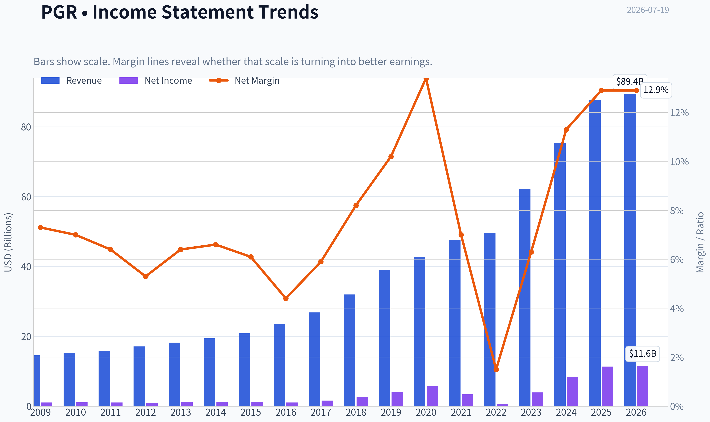

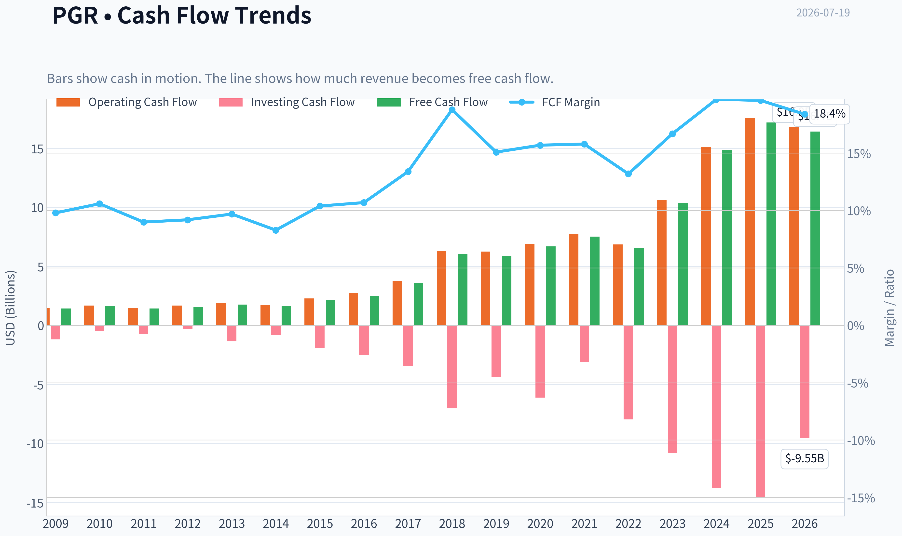

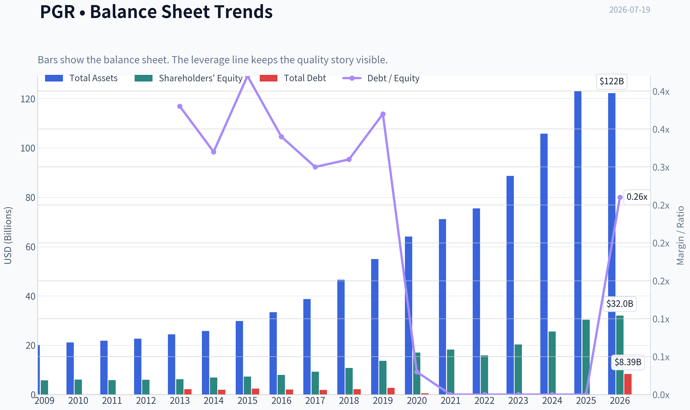

This graph tracks the profitability and return metrics (ROE, ROIC, Margins) of **PGR** over the past decade, highlighting capital efficiency trends.

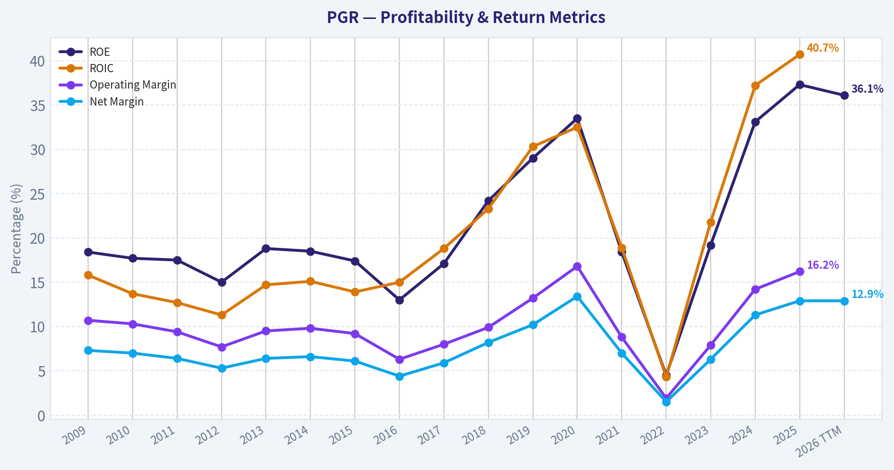

This chart illustrates the financial health of **PGR** over the last 10 years, mapping cash equivalents and free cash flow against total obligations (Debt).

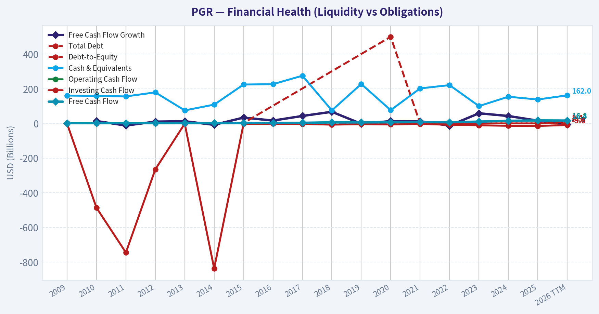

---

### Intrinsic Value Analysis (Buffett)

> *Following Warren Buffett's value investing philosophy: Circle of Competence, Economic Moat, Management Quality, and Margin of Safety.*

#### Intrinsic Value Snapshot

Price is what you pay. Intrinsic value is what the business may be worth based on the cash it can create for owners over time. We show a range, not one magic number.

- Current Price: $207.95
- Value Range (conservative to optimistic across both DCF methods): $344.15 to $1,949.57

##### Owner Earnings (Buffett Method)
- Net Income: $11,308,000,000.00
- Depreciation & Amortization: $313,000,000.00
- Capital Expenditures: $-348,000,000.00
- Working Capital Changes: $6,630,000,000.00
- Owner Earnings: $4,678,000,000.00

##### Intrinsic Value
###### Buffett Method
Uses owner earnings. Stricter, and usually more conservative.
- Conservative: $344.15
- Average: $344.15
- Optimistic: $918.71
- Discount Rate: 10.0%

###### Cash Flow Method
Uses free cash flow. Better for companies spending heavily today to grow tomorrow.
- Conservative: $970.86
- Average: $992.48
- Optimistic: $1,949.57
- Discount Rate: 10.0%

ANALYST STANCE: **WATCH**

#### Progressive (PGR) - Buffett-Style Investment Report

#### 1. Factor Scorecard

| Factor | Score (0-5) | Evidence |
|---|---:|---|
| 1. Circle of Competence & Business Simplicity | 4.0 | Progressive is understandable: it underwrites auto and property insurance, earns underwriting profit when pricing beats losses/expenses, and invests float. The model is simple, though annual results are inherently affected by catastrophe losses and pricing cycles. |
| 2. Moat Test | 4.0 | Strong brand in personal auto, data/telematics advantage, scale in direct distribution, cost discipline, and claims/underwriting analytics. This looks like a wide-and-stable moat rather than an invulnerable one. |
| 3. Management Quality & Capital Allocation | 4.0 | Long record of disciplined underwriting, willingness to reprice aggressively, and owner-like focus on combined ratio and long-term returns. Capital allocation is sensible for an insurer: maintain surplus, grow where returns are attractive, and avoid reckless leverage. |
| 4. Industry Structure | 3.0 | Personal auto insurance is competitive and price-sensitive, but scale players with analytics and low-cost distribution have structural advantages. Industry economics are decent for the best operators, mediocre for the average one. |

**Gate 5 hard floor:** **Not tripped.**
There is no evidence here of financial distress. Recent commentary points to margin pressure and weather-related loss costs, but not to a solvency red line or an inability to cover obligations.

#### 2. Moat Analysis

| Moat Source | Assessment | Evidence |
|---|---|---|
| Intangible assets | Moderate to strong | Progressive is a well-known auto insurer with trusted consumer recognition and a long-established direct brand. Insurance is not pure brand alone, but reputation and pricing confidence matter. |
| Switching costs | Moderate | Switching costs are not high in the software sense, but customer inertia, bundled products, telematics programs, and claims service quality create friction. |
| Cost advantage | Strong | Scale in advertising, claims handling, data science, and direct distribution should support lower unit costs and better underwriting segmentation than smaller rivals. |
| Network effects | Limited to moderate | Not a classic network-effect business, but data scale improves pricing and risk selection. More policies can improve underwriting models, which is an indirect advantage. |

**Moat verdict:** **Wide & stable / high end of narrow-to-wide.**
Progressive's moat is built less on legal barriers and more on **scale + data + low-cost distribution + underwriting discipline**. That combination is hard to replicate and has been proven over time.

#### 3. Management Quality Assessment

| Dimension | Assessment | Commentary |
|---|---|---|
| Owner orientation | Good | Insurance management is best judged by underwriting discipline and long-term value creation, and Progressive has historically shown both. |
| Candor | Good | The company is generally regarded as operationally transparent around underwriting trends, loss costs, and pricing actions. |
| Capital allocation | Strong | For insurers, the key is not flashy buybacks but rational deployment of capital and disciplined growth. Progressive has historically expanded where returns justify it. |
| Risk control | Strong | This is one of the company's defining strengths. Even when margins compress, management tends to react through pricing and underwriting rather than denial. |

Overall, management appears **rational, process-driven, and shareholder-aligned enough** for a high-quality insurer.

#### 4. Financial Summary Table

| Metric | Latest Snapshot |
|---|---:|
| Share Price | $208 |
| Market Cap | $120.90B |
| P/E | 10.44 |
| ROE | 37.3% |
| Revenue Growth YoY | 16.3% |
| FCF Yield | 14.2% |
| Gross Margin | N/A for insurer |
| Current Ratio | N/A for insurer |
| Headline Intrinsic Value | Not meaningful under generic framework for financial issuer |

**Key Takeaways:** Progressive screens as a highly profitable financial business with unusually strong return on equity and solid top-line growth. The low earnings multiple looks attractive on the surface, but insurers must always be judged through the lens of underwriting cycle quality and catastrophe exposure, not just simple P/E.

#### 5. Owner Earnings Calculation

For an insurer, classic industrial-style owner earnings are less clean because working capital and capex have very different meanings. The more relevant owner-earnings lens is:

- **Reported earnings**
- plus the economic benefit of investable float
- less capital needed to support growth
- adjusted for underwriting quality and reserve conservatism

Given the available evidence:

| Component | Assessment |
|---|---|
| Net income | Strong |
| Depreciation & amortization | Not a major driver |
| Maintenance capex | Low relative to industrial firms |
| Working capital changes | Not meaningful in the normal non-financial sense for insurers |
| Float economics | Major positive if underwriting is disciplined |

**Practical Buffett interpretation:** Progressive's economic earning power is **better captured by normalized underwriting profit + investment income on float** than by a conventional owner-earnings formula.

**Key Takeaways:** Progressive is not a factory business, so traditional owner earnings need adjustment. The real economic engine is disciplined underwriting combined with low-cost float that can be invested over time.

#### 6. Three-Scenario DCF Valuation

For an insurer, a standard industrial DCF is less reliable than normalized earnings power and justified multiple analysis. Still, using the available market data:

- Price = **$208**
- P/E = **10.44**
- Implied EPS ~ **$19.9**

Using earnings as a rough proxy for distributable earning power:

| Scenario | Assumption | Implied Value |
|---|---|---:|
| A. No Growth | EPS / 10% | ~$199 |
| B. 3% Growth | EPS x 1.03 / (10%-3%) | ~$293 |
| C. Moderate Historical Growth | Assume 6% normalized long-term growth | Roughly $250-$285 |

**Key Takeaways:** On a no-growth basis, Progressive looks close to fair value. On modest growth assumptions, the shares appear reasonably attractive, but not at a screaming discount once underwriting normalization and catastrophe volatility are considered.

#### 7. Margin of Safety Analysis

| Item | Assessment |
|---|---|
| Current Price | $208 |
| No-Growth Value | ~$199 |
| Conservative Growth Value | ~$250-$293 |
| Margin of Safety | Small to moderate, depending on normalization assumptions |

For a high-quality insurer, you do **not** need a massive discount if the franchise is excellent and compounding prospects remain intact. But after a strong five-year run and with current margin pressure, the stock looks more like **fair value to modest undervaluation** than a clear bargain.

#### 8. Final Buffett Scorecard

| Criterion | Weight | Score (1-5) | Weighted Result |
|---|---:|---:|---:|
| Moat Width & Durability | 25% | 4.0 | 1.00 |
| Valuation / Margin of Safety | 20% | 3.0 | 0.60 |
| Capital Returns - ROIC vs. WACC | 15% | 4.5 | 0.68 |
| Business Understanding & Predictability | 12% | 4.0 | 0.48 |
| Management Quality & Capital Allocation | 12% | 4.0 | 0.48 |
| Reinvestment Runway | 8% | 3.5 | 0.28 |
| Balance Sheet Strength | 4% | 4.0 | 0.16 |
| Industry Structure | 4% | 3.0 | 0.12 |

| Total | 100% |  | **3.80 / 5.00** |

**Key Takeaways:** Progressive scores as a good-to-very-good business with a real moat and strong capital economics. The only reason this is not an outright ADVOCATE is valuation discipline: the shares look around fair rather than decisively cheap.

#### 9. Investment Stance

**Stance:** **WATCH**
**Conviction:** **Moderate**

Progressive looks like the kind of insurer Buffett would respect: understandable, disciplined, data-driven, and capable of earning strong returns on capital over long periods. The business quality is real. The current question is not whether this is a good company; it is whether today's price offers enough margin of safety given cyclical underwriting pressure, severe weather volatility, and recent margin compression.

At roughly **10.4x earnings** with **37.3% ROE**, the stock is clearly not expensive in a superficial sense. But because insurance earnings can swing with loss trends and reserve development, I would prefer a somewhat better entry point or clearer evidence that current margin pressure is temporary and pricing is catching up. If shares weaken further without a fundamental break in underwriting discipline, this could move into **ADVOCATE** territory.
#### Valuation Bridge

This bridge places the current market price beside each intrinsic value lens so readers can see whether upside depends on one method or shows up across several methods.

| Scenario | Intrinsic Value / Share |
| --- | ---: |
| Buffett Method | $344.15 |
| Cash Flow Method | $992.48 |
| Current Price | $207.95 |

#### Key Takeaways

If one method is far above the others, the upside case depends on a specific modelling assumption. When several methods cluster together, the valuation story is more robust.

#### Valuation Visuals

This comparison chart from *Latest Earnings Snapshot* stacks current figures against historical benchmarks for **PGR**, making it easy to see where the company trades relative to its own averages.

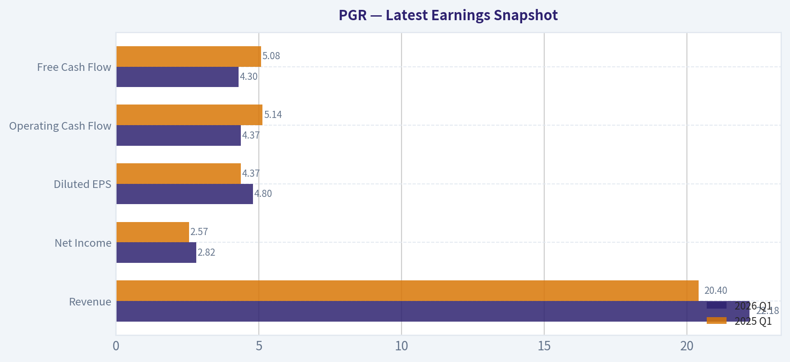

This comparison chart from *Current vs Historical Average Comparison* stacks current figures against historical benchmarks for **PGR**, making it easy to see where the company trades relative to its own averages.

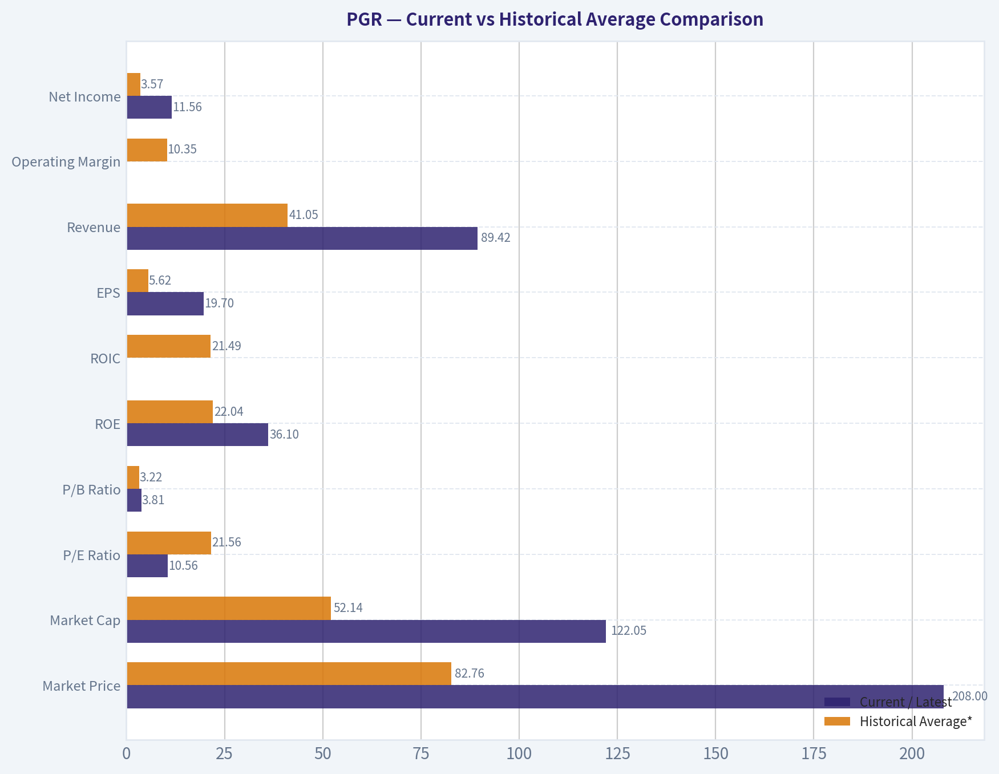

This comparison chart from *Balance Sheet and Financial Strength* stacks current figures against historical benchmarks for **PGR**, making it easy to see where the company trades relative to its own averages.

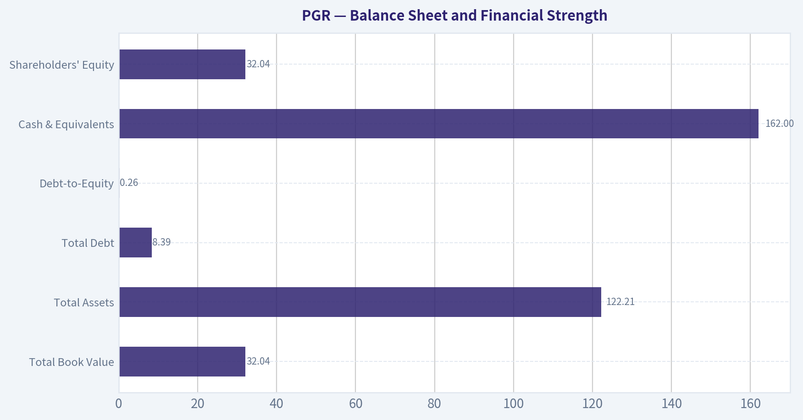

This comparison chart from *Cash Flow and Capital Allocation* stacks current figures against historical benchmarks for **PGR**, making it easy to see where the company trades relative to its own averages.

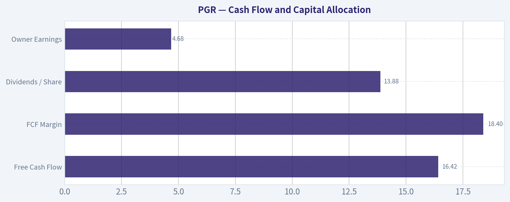

---

### Trend & Growth Analysis (Lynch/Druckenmiller/Fisher)

> *Following Peter Lynch's GARP, Stanley Druckenmiller's macro-aware approach, and Philip Fisher's scuttlebutt methodology.*

ANALYST STANCE: **WATCH**

#### 1. Lynch Classification

| Item | Assessment |
|---|---|
| Category | **Fast Grower / Quality Financial Compounder** |
| Why | Reported YoY revenue growth of **16.3%** is above Lynch's fast-grower threshold, but PGR is also a cyclical insurer whose earnings can swing with claims severity and catastrophe losses |
| Fit with Lynch | Attractive business quality, but not a classic simple retail/consumer fast grower; underwriting cycle matters a lot |

**Key Takeaways:** Progressive currently screens as a fast grower on revenue, but it is not a clean software-style compounder. Because it is an insurer, growth and earnings quality depend heavily on pricing discipline and loss trends. That makes it investable, but not a straightforward ten-bagger type in the Lynch sense.

#### 2. The Story in 3 Bullets

- Progressive uses **data, telematics, and scale** to price auto insurance better than many peers.
- It keeps taking share through both **direct-to-consumer and independent agent** channels.
- The current debate is whether **premium growth can outrun rising loss costs and weather pressure** enough to sustain high returns.

#### 3. TAM Analysis with 10x Test

| Item | Assessment |
|---|---|
| Core market | U.S. personal auto, commercial auto, specialty lines, adjacent property products |
| TAM quality | **Large and durable**, but mature rather than explosively expanding |
| Secular tailwind | More from **share gains via analytics/telematics** than from a rapidly expanding market |
| 10x test | **Fail as a growth framework** - PGR cannot realistically 10x within current U.S. insurance TAM without becoming systemically dominant |
| Runway conclusion | **Good runway for share gains**, but not a classic venture-style 10x runway |

**Key Takeaways:** Progressive operates in a huge market, so revenue can keep growing for a long time. But this is a mature industry, which means upside comes mostly from taking share and improving underwriting, not from a brand-new market exploding in size. That limits true ten-bagger potential from here.

#### 4. Revenue Growth Trend

| Metric | Value / Read |
|---|---|
| Revenue growth YoY | **16.3%** |
| Growth pattern | **Healthy but not clear inflection** |
| Latest earnings read-through | Strong premium and policyholder growth, but weaker underwriting margins |
| Trend judgment | **Growth remains solid; earnings quality softened** |

**Key Takeaways:** Revenue growth is still strong, which supports the bull case that Progressive is winning customers and pricing business effectively. The problem is that margin pressure reduced the quality of that growth. So this looks more like continued expansion with some friction, not a clear new acceleration phase.

#### 5. Unit Economics

| Metric | Status |
|---|---|
| LTV/CAC | **Not meaningfully disclosed / not standard for insurers** |
| NRR | **Not applicable** |
| Rule of 40 | **Not applicable** |
| Better insurance KPIs | Combined ratio, loss ratio, expense ratio, policies in force, premium growth, ROE |
| ROE | **37.3%** |
| FCF yield | **14.2%**, but interpret cautiously for insurers |
| Core unit-econ read | Strong franchise economics, but near-term underwriting margin pressure matters more than conventional SaaS metrics |

**Key Takeaways:** Standard growth metrics like LTV to CAC and net revenue retention do not apply well to an insurer. For Progressive, return on equity and underwriting metrics matter much more. The high ROE is impressive, but investors need to watch whether rising claims and weather losses reduce that strength.

#### 6. Inflection Point Assessment

| Inflection Type | Assessment |
|---|---|
| Product cycle | Limited - insurance product set is mature |
| Market share inflection | **Possible positive** if direct and telematics advantages keep pulling in policies |
| Margin inflection | **Negative near term** - recent quarter showed margin pressure |
| TAM inflection | No major TAM expansion visible |
| Competitive inflection | Some opportunity if weaker peers misprice or underinvest, but not decisive |
| Overall | **Mixed** |

**Key Takeaways:** The strongest possible positive inflection for Progressive is continued market share gains. The biggest negative inflection is that underwriting margins appear to be worsening right now. That combination supports patience rather than aggression.

#### 7. Macro Setup Evaluation

| Factor | Read |
|---|---|
| Economic sensitivity | Moderate; auto insurance is resilient, but claims costs are inflation-sensitive |
| Rate backdrop | Higher yields help insurer investment income over time |
| Inflation backdrop | Claims severity and repair costs remain a headwind |
| Secular themes | Data-driven underwriting, telematics, digitized insurance distribution |
| Macro score | **Neutral to modestly positive** |

**Key Takeaways:** The macro backdrop is mixed for Progressive. Higher rates can help investment income, but inflation in repairs, medical costs, and weather-related losses can hurt underwriting profitability. That leaves the overall setup balanced rather than strongly favorable.

#### 8. Fisher 15 Points Score

| Fisher Area | Score (1-5) | Comment |
|---|---:|---|
| Market potential | 4 | Large auto and commercial lines markets |
| New products | 3 | Mostly incremental innovation |
| R&D / analytics | 4 | Strong data and telematics capability |
| Sales organization | 5 | Excellent brand and distribution reach |
| Profit margin | 4 | Strong historically, but pressure now |
| Margin improvement | 3 | Currently under pressure |
| Labor/personnel | 3 | No major edge visible from available data |
| Executive relations | 4 | Generally stable operator |
| Management depth | 4 | Strong execution reputation |
| Cost/accounting controls | 4 | Good underwriting discipline track record |
| Outstanding aspects | 4 | Data moat, pricing precision, scale |
| Long-range outlook | 4 | Solid compounding potential |
| Dilution risk | 5 | Low concern |
| Candor | 3 | Neutral based on available info |
| Integrity | 4 | No major red flags visible |

| Total | **58 / 75** | **GOOD** |

**Key Takeaways:** Progressive earns a solid Fisher-style score because it has a durable business, good management, and a real edge in analytics and distribution. The score stops short of outstanding because innovation is incremental and margins are currently under pressure. Overall, this looks like a high-quality operator rather than a hidden moonshot.

#### 9. Valuation Analysis

| Metric | Value / Read |
|---|---|
| Current price | **$208** |
| Market cap | **$120.9B** |
| P/E | **10.44x** |
| PEG | Roughly **0.6-0.7** if using 16.3% growth as a proxy |
| FCF yield | **14.2%** |
| Headline valuation view | **Looks inexpensive on earnings**, but insurer earnings may be near-cycle elevated |
| Best valuation lens | P/E + ROE + underwriting outlook; P/B would also matter, but not provided |

**Key Takeaways:** On the surface, Progressive looks cheap, especially with a low earnings multiple and high return on equity. The caution is that insurance earnings can swing sharply, so a low P/E may reflect peak-ish profitability rather than a true bargain. Valuation is supportive, but not enough to override current margin concerns.

#### 10. Scenario View

| Scenario | Assumption | View |
|---|---|---|
| Bear | Loss costs and cat exposure stay elevated; margins compress further | Stock remains range-bound despite growth |
| Base | Premium growth stays healthy; pricing gradually catches claims trend | Fair returns, modest upside from current level |
| Bull | Strong share gains plus better loss trend restore underwriting leverage | Multiple and earnings both work, creating solid upside |

**Key Takeaways:** The downside case is mostly about underwriting deterioration, not revenue collapse. The base case is respectable but not explosive. The bull case exists if pricing catches up and margins recover, but that recovery is not yet proven.

#### 11. Growth Investor Scorecard

| Criterion | Weight | Score | Weighted Score |
|---|---:|---:|---:|
| The Story | 10% | 4.0 | 0.40 |
| TAM & Runway | 20% | 2.8 | 0.56 |
| Revenue Growth | 20% | 3.8 | 0.76 |
| Unit Economics | 15% | 3.8 | 0.57 |
| Competitive Position | 10% | 4.2 | 0.42 |
| Management Quality | 10% | 4.0 | 0.40 |
| Macro Setup | 5% | 3.2 | 0.16 |
| Profitability Path | 5% | 3.0 | 0.15 |
| Valuation | 5% | 4.3 | 0.22 |

| Total |  |  | **3.64 / 5.0** |

**Key Takeaways:** Progressive scores well because it combines strong growth, quality management, and attractive valuation. The main things holding it back are limited TAM expansion and current margin pressure. That total supports a positive watchlist stance rather than full conviction.

#### 12. Position Size Stance

| Stance | View |
|---|---|
| Recommended stance | **WATCH** |
| Position sizing | **Starter only, or hold if already owned** |
| Upgrade trigger | Clear evidence that underwriting margins are stabilizing while premium growth stays double-digit |
| Downgrade trigger | Sustained combined-ratio deterioration or worsening earnings quality over multiple quarters |

**Key Takeaways:** This is not an avoid. It is a quality business that may become more attractive if margin pressure proves temporary. For now, the right move is small exposure or patient monitoring rather than aggressive sizing.

#### 13. Key Risks and Catalysts

| Risks | Catalysts |
|---|---|
| Rising claims severity | Better-than-feared loss trend |
| Severe weather/cat losses | Rate increases earning through the book |
| Regulatory lag in pricing | Continued policy and premium growth |
| Peak-cycle earnings masking true valuation | Competitors stumble on underwriting |
| Mature market limits long-term multiple expansion | Margin recovery restoring confidence |

**Key Takeaways:** The risks are mostly operational and cyclical, especially around claims and weather. The best catalysts would be proof that pricing is catching up and that strong growth does not have to come at the expense of underwriting quality. That is the key debate to watch in the next few quarters.

#### Bottom Line

Progressive is a **high-quality insurer with real competitive advantages**, especially in analytics, pricing, and distribution. At roughly **10.4x earnings** with **37.3% ROE**, the stock does not look expensive. But for a growth investor, the current setup is **not a clean inflection buy** because recent results showed **profit and margin pressure despite strong premium growth**.

That keeps PGR in **WATCH**, not **ADVOCATE**. If margins stabilize while growth stays healthy, the stance could improve quickly.

#### Growth & Scorecard Visuals

This comparison chart from *Factor Scorecard* stacks current figures against historical benchmarks for **PGR**, making it easy to see where the company trades relative to its own averages.

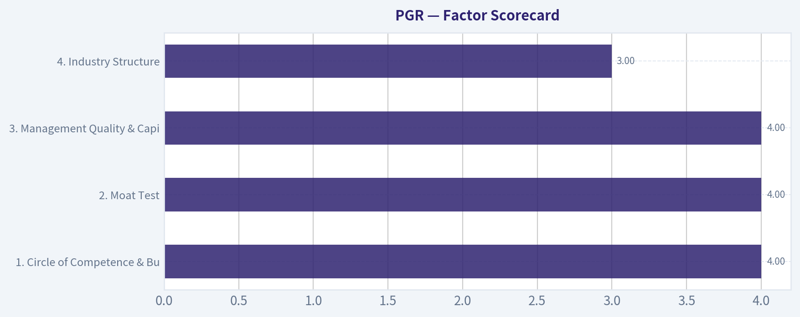

---

### Market Technical Analysis

#### PGR Technical Snapshot

PGR is coming off a strong late-June to early-July rally that has now been sharply interrupted by a sudden downside shock. The stock had advanced from the low-$190s in late May to the mid-$230s by early July, but the abrupt break on July 15 reset the short-term structure and materially weakened momentum. The key question now is whether this is a violent pullback within a still-recovering medium-term trend, or the beginning of a broader failure back below long-term equilibrium.

#### Selected Indicators and Why They Matter Now

For PGR's current condition, the most relevant mix is:

| Indicator | Why it is useful now |
|---|---|
| close_200_sma | Best gauge of long-term trend and whether recent weakness threatens the bigger structure |
| close_50_sma | Shows medium-term trend health and whether the June-July rally is still intact |
| close_10_ema | Captures the abrupt short-term momentum reversal after the July breakdown |
| macd | Measures momentum regime change; useful because the stock moved from strong upside acceleration into rapid deceleration |
| rsi | Helps judge whether the selloff has become stretched or merely normalized from overbought levels |
| boll_ub | Useful to evaluate how extended the prior rally became and where upside resistance may re-form |
| boll_lb | Helps frame downside risk and whether price is nearing statistically stretched levels |
| atr | Critical now because volatility expanded sharply after the July 15 break, affecting stop placement and position sizing |

**Key Takeaways:** The indicator set above is designed for a stock that was trending higher, became overextended, and then suffered a sharp downside reset. It combines long-term trend filters, short-term momentum tools, statistical range markers, and volatility management so traders can judge both direction and risk more clearly.

---

#### Trend Structure: Long-Term vs Medium-Term vs Short-Term

The long-term backdrop has flattened to slightly soft. The **200-day SMA** has drifted down from about **215.29 in April** to about **207.86 by July 17**, which means the long-term trend is no longer strongly bullish. Importantly, PGR's latest close at **207.95** is almost exactly sitting on that long-term benchmark. That makes the current zone structurally decisive: holding this area would argue the stock is testing major support, while losing it would suggest the past year's trend has degraded into a more neutral-to-bearish regime.

The medium-term picture had improved meaningfully before the recent shock. The **50-day SMA** climbed from roughly **198.8 in early June** to **207.76 by July 17**, confirming that the June rebound was not just a brief oversold bounce. However, the last close is only marginally above the 50-day SMA. That means the stock has already surrendered almost all of its short-term trend premium and is now fighting to preserve its intermediate structure.

The short-term picture is clearly damaged. The **10-day EMA** fell to **218.32** on July 17, well above the closing price of **207.95**. That gap is large and important: it shows price is no longer pulling back gently within an uptrend, but instead has broken violently below recent trend tracking. For traders, this usually means rallies may now face selling pressure sooner, especially into the **218-224** area where the 10-day EMA and recent breakdown zone begin to cluster.

#### Momentum Analysis

The momentum rollover is pronounced. **MACD** had surged from slightly negative in early June to above **8** in early July, reflecting a very strong upside acceleration phase. But after the July 15 collapse, MACD dropped to **2.21** by July 17. This is still positive, which matters, because it says the prior upswing has not been fully erased in indicator terms. But the speed of deterioration is the real message: momentum has gone from expansion to compression very quickly.

That kind of move often marks one of two things:

1. a one-off event shock followed by base-building and eventual recovery, or
2. the first leg of a larger mean reversion back toward lower support.

At this stage, MACD suggests the upside trend has lost control, but not yet fully inverted into a mature bearish momentum cycle.

**RSI** reinforces that interpretation. It had reached the low-to-mid **70s** in early July, which is consistent with an overbought rally. By July 17, RSI had fallen to about **42.5**. That is not oversold. This is important. The stock has corrected sharply, but momentum is not yet washed out enough to imply a high-confidence exhaustion low. In plain terms, the selloff has relieved overbought conditions, but it has not obviously finished.

#### Volatility and Range Behavior

The Bollinger structure shows how exceptional the rally became and how abruptly it was interrupted. On July 17, the **upper band** was around **242.35** and the **lower band** around **199.90**. With price at **207.95**, PGR is now trading much closer to the lower band than the upper band. That indicates the stock has transitioned from upper-range trend behavior to lower-range stabilization risk.

Notably, price is **not yet below the lower band**. That means the move is severe, but not statistically extreme enough to guarantee a snapback. If price had closed decisively under the lower band with RSI in the low 30s, that would support a more aggressive mean-reversion case. Instead, current conditions look more like a stock that has reset lower and is now deciding whether to stabilize or continue bleeding toward the bottom of its range.

**ATR** makes the risk shift especially clear. ATR rose from roughly **4.4-5.0** in late May and early June to nearly **6.95** by July 15, and remained elevated near **6.84** on July 17. This expansion means daily swings are substantially larger than they were during the earlier rally phase. Traders using old stop distances or position sizes would now be underestimating risk. In current conditions, any directional trade should allow for wider ranges and higher slippage risk around support and resistance tests.

---

#### What the Price Action Suggests

Using the raw price history alongside the indicators, the recent sequence is very telling:

- Late May: price was under pressure and tested the **190-193** region.
- Early to late June: price rebuilt steadily, with momentum improving and the 50-day average turning up.
- Early July: breakout acceleration pushed the stock into the **232-234** area and produced overbought RSI readings.
- July 14-15: a sudden collapse from **226.58** to **205.22** broke the short-term trend decisively.
- July 16-17: price stabilized only modestly near **205-208**, indicating no strong immediate V-shaped recovery.

This pattern suggests the market repriced the stock abruptly rather than gradually. That usually leaves overhead supply. Traders trapped from **218 to 234** may sell into rebounds, which can make recovery choppy even if the longer-term trend survives.

#### Key Levels to Watch

| Level / Zone | Technical Meaning | Trading Interpretation |
|---|---|---|
| 207-208 | Area of current close, near 50-day and 200-day SMA convergence | Major decision zone; holding it supports consolidation, losing it weakens the broader trend |
| 199-200 | Near Bollinger lower band | First notable downside support if current area fails |
| 190-193 | Late-May / early-June support base | More important fallback support; a break here would confirm deeper technical damage |
| 218-224 | 10-day EMA area and post-breakdown recovery zone | First meaningful resistance on rebounds |
| 232-234 | Early-July highs | Major overhead resistance; reclaiming it would strongly repair the chart |

**Key Takeaways:** PGR is sitting on a very important support cluster around 207 to 208, where both the 50-day and 200-day trend markers are now nearby. If that area fails, the next meaningful support likely sits closer to 199 to 200, with a larger downside air pocket toward 190 to 193. On the upside, any rebound will likely be tested first in the 218 to 224 range before the stock can even think about challenging the early-July highs.

#### Trading Interpretation by Style

| Trading Style | Read on PGR | Practical Implication |
|---|---|---|
| Long-term investor | Neutral to cautiously constructive, but only if 200-day support holds | Avoid chasing; monitor whether price can defend the long-term average |
| Swing trader | Short-term damage is real | Better to wait for either a base near support or a reclaim of the 10-day EMA |
| Momentum trader | Prior momentum has broken | Upside momentum setup is no longer clean; follow-through confirmation is needed |
| Mean-reversion trader | Not yet fully washed out | A bounce is possible, but RSI and Bollinger positioning do not yet scream capitulation |
| Risk manager | Volatility has expanded materially | Use wider stops and smaller size than during June's steadier trend |

**Key Takeaways:** Different traders should treat PGR differently right now. Long-term holders may still see a valid support test, but short-term and momentum traders should respect that the previous uptrend has already broken. Elevated volatility means risk management matters more than directional conviction at this stage.

#### Bottom Line

PGR is at a technically critical inflection point. The medium-term rally from late May into early July was genuine and broad enough to lift the 50-day average, but the sudden mid-July breakdown severely damaged short-term momentum and likely created overhead resistance. The stock is now sitting almost exactly on its long-term and medium-term trend benchmarks, which makes the current area far more important than an ordinary dip.

The most nuanced reading is this: **the broader structure is not yet broken, but the burden of proof has shifted to the bulls**. To improve materially, PGR needs to hold the **207-208** zone and then reclaim ground toward **218-224**. If it cannot, the chart likely transitions from "sharp pullback in an upturn" to "failed rally with downside retest risk" toward **199** and potentially the **190-193** area.

| Category | Indicator | Current Read | What It Means |
|---|---|---|---|
| Long-term trend | close_200_sma | ~207.86 | Price is sitting right on major long-term support |
| Medium-term trend | close_50_sma | ~207.76 | Intermediate uptrend is barely intact |
| Short-term trend | close_10_ema | ~218.32 | Price is well below short-term trend; momentum damage is clear |
| Momentum | macd | ~2.21 | Still positive, but collapsing fast from prior highs |
| Momentum stretch | rsi | ~42.52 | Selloff reset overbought conditions, but not yet oversold |
| Volatility envelope | boll_ub | ~242.35 | Upside band is far above price; prior extension has unwound |
| Volatility envelope | boll_lb | ~199.90 | First statistical downside support sits just below current price |
| Risk/volatility | atr | ~6.84 | Daily movement is elevated; position sizing should be more conservative |

**Key Takeaways:** PGR's chart is no longer in a clean bullish trend, but it has not fully broken down either. The stock is balanced on a major support shelf, with momentum weakened, volatility elevated, and rebound potential likely capped unless buyers can push it back above the short-term trend line.

#### Market Visuals

This comparison chart from *Market Metrics* stacks current figures against historical benchmarks for **PGR**, making it easy to see where the company trades relative to its own averages.

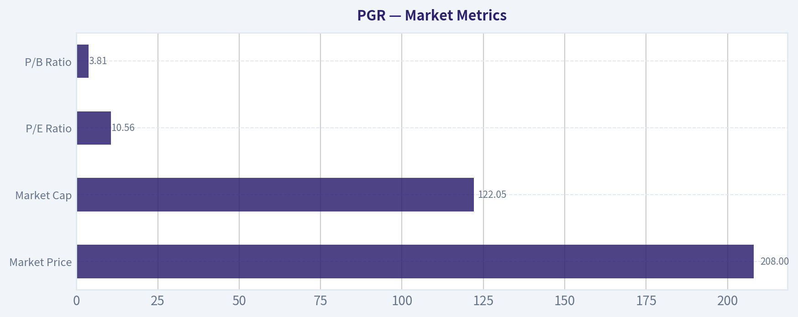

---

### Options Market Analysis

> *Reading options flow - put/call ratios, IV skew, and unusual activity - to gauge institutional positioning and event-driven risk.*

#### PGR Options Positioning Report
*Data as of 2026-07-19*

PGR's near-term options tape leans **cautiously bearish**. The main reason is the **aggregate put/call open-interest ratio of 1.04** and **put/call volume ratio of 1.67**, both above the typical neutral baseline near **0.7**, which suggests traders are favoring downside protection or bearish exposure rather than upside speculation.

#### 1. Put/Call Ratio Analysis

| Expiration | Call OI | Put OI | Put/Call OI Ratio | Call Vol | Put Vol | Put/Call Vol Ratio | Read |
|---|---:|---:|---:|---:|---:|---:|---|
| 2026-07-24 | 996 | 1,059 | 1.06 | 197 | 575 | 2.92 | Bearish / heavy hedging |
| 2026-07-31 | 973 | 429 | 0.44 | 256 | 99 | 0.39 | Bullish for that expiry |
| 2026-08-07 | 420 | 985 | 2.35 | 191 | 402 | 2.10 | Strongly bearish / protective |
| **Near-term total** | **2,389** | **2,473** | **1.04** | **644** | **1,076** | **1.67** | **Net bearish tilt** |

**Key Takeaways:** Near-term positioning is not uniformly bearish, but the aggregate skew clearly favors puts. The strongest downside leaning appears in the 2026-08-07 expiry, while 2026-07-31 stands out as the one pocket of call interest. Relative to the roughly 0.7 neutral baseline, current ratios indicate a meaningful shift toward protection or bearish expression.

#### 2. Implied Volatility Assessment

| Expiration | ATM Call IV | ATM Put IV | Call vs Put IV Read | IV Tone |
|---|---:|---:|---|---|
| 2026-07-24 | 36.2% | 39.9% | Put IV higher by 3.7 pts | Downside concern |
| 2026-07-31 | 33.2% | 31.0% | Call IV higher by 2.2 pts | Mild upside interest |
| 2026-08-07 | 32.0% | 29.4% | Call IV higher by 2.6 pts | Mild upside demand |
| **Near-term range** | **32.0%-36.2%** | **29.4%-39.9%** | Mixed, but front-week put premium stands out | Moderately elevated front-end |

**Key Takeaways:** The clearest volatility signal is in the nearest expiry, where put IV exceeds call IV, implying traders are paying more for downside insurance right away. Farther out, IV is less defensive and even slightly call-favored, which softens the bearish interpretation. Overall, IV is not screaming panic, but the front-end structure does suggest event or headline sensitivity.

Because the data provided does **not include full strike-by-strike OTM skew**, I can only infer skew from the available **ATM call vs put IV comparison**. That means confidence on the skew read is **moderate, not high**. Still, the **front-week put premium** is consistent with near-term caution.

#### 3. Unusual Options Activity

| Contract Signal | Observation | Interpretation |
|---|---|---|
| Volume vs OI screen | No near-term contracts had volume greater than 5x open interest | No clear fresh aggressive block/sweep-style positioning detected |
| Directional conviction | Absent from the screen | Suggests positioning is more steady hedging/maintenance than sudden institutional urgency |
| Retail vs smart money read | No standout contract flow available | Cannot identify a specific smart-money strike from this dataset |

**Key Takeaways:** There was no flagged unusual activity in the near-term chain, which lowers confidence in any claim of aggressive fresh institutional betting. That usually means the sentiment signal is being driven more by the broader distribution of open interest and volume than by a single high-conviction trade. In practical terms, this looks more like measured hedging than a dramatic speculative swing.

#### 4. Open Interest Concentration and Potential Gamma/Pinning Effects

| Expiration | Highest Call OI Area | Highest Put OI Area | Implication |
|---|---|---|---|
| 2026-07-24 | Not provided by strike | Not provided by strike | Cannot identify exact pin level |
| 2026-07-31 | Not provided by strike | Not provided by strike | Cannot isolate gamma wall precisely |
| 2026-08-07 | Not provided by strike | Not provided by strike | OI heavier in puts overall, suggesting downside sensitivity |

**Key Takeaways:** The dataset gives aggregate OI by expiry but not strike-by-strike concentrations, so exact max-pain or gamma-wall levels cannot be computed here. Even so, the heavier put open interest in the front and early-August expiries suggests that if PGR weakens, dealer hedging could reinforce downside pressure more than upside acceleration. Confidence is limited because the critical strike-level detail is unavailable.

#### 5. Overall Options Sentiment Signal

| Category | Signal |
|---|---|
| Directional read | **BEARISH** |
| Confidence | **Moderate** |
| Primary driver | Put-heavy aggregate OI and volume, especially in 2026-07-24 and 2026-08-07 |
| Caveat | No unusual high-conviction contract flow and incomplete strike-level OI detail |

**Key Takeaways:** My final read is **bearish**, not because of panic buying in puts, but because the market is consistently showing more demand for downside exposure than a neutral tape would normally show. The strongest evidence comes from elevated put/call ratios and front-week put IV premium. The absence of unusual activity means this is a measured bearish signal rather than an extreme one.

PGR options currently suggest:
- **More hedging than bullish chasing**
- **Near-term caution is stronger than medium-term optimism**
- **Bearish/protective flow outweighs the one bullish pocket in the 2026-07-31 expiry**

#### Bottom Line

PGR's options market is sending a **BEARISH near-term signal**. The tape shows **above-neutral put ownership and put trading activity**, with the most defensive posture centered in the nearest expiry and again in early August. While there is one call-leaning weekly expiry, it is not enough to offset the broader pattern of protection demand.

#### Summary Table

| Metric | Reading | Interpretation |
|---|---|---|
| Put/Call Ratio | OI: **1.04**; Volume: **1.67** | Above neutral; bearish/protective tilt |
| IV Level | ATM IV mostly **29%-40%** | Moderately elevated, especially front week |
| Skew Direction | **Front-week put skew**, later mild call tilt | Near-term downside concern |
| Unusual Activity | **None flagged** | No strong fresh conviction trade detected |
| Overall Signal | **BEARISH** | Put-heavy positioning is the main driver |

**Key Takeaways:** The summary is straightforward: puts dominate the near-term tape, front-week downside protection is priced richer, and there is no offsetting unusual bullish flow. That combination supports a bearish read, though with only moderate conviction because strike-level concentration data was not available.

---

## Research Team Commentary

> *The Research Manager synthesizes the Bull vs Bear debate into action-free commentary. This is a pre-risk view, not the final stance.*

Progressive looks like a real business, not a spreadsheet story. The strongest bull argument is that this is one of the rare insurers with a genuine modern moat: superior pricing data, telematics, scale, and a dual distribution model that keeps taking share. Those advantages matter a lot in auto insurance because small underwriting edges compound over time. The profitability evidence is also hard to dismiss: ROE and ROIC in the high 30s, double-digit revenue growth, and the added economic value of float if underwriting stays disciplined. At 10.4x earnings, the stock does not look priced like a beloved compounder. If the market is valuing Progressive as just another cyclical insurer, there is a credible argument that the multiple understates the durability of the franchise.

The strongest bear argument is not that Progressive is low quality; it is that current earnings may be unusually strong. That matters a lot. Insurers often look cheapest near peak underwriting conditions, when earned pricing has caught up, investment income is better, and loss trends have not yet fully reasserted themselves. A 37% ROE is excellent, but it is also the exact kind of number that should trigger normalization work rather than admiration alone. The bear case is basically that the low P/E may be optical if normalized earnings power is materially below current earnings. Add regulatory friction in rate-setting, persistent claims inflation, weather volatility, and a competitive industry with low switching costs, and the argument for a large immediate margin of safety weakens.

My takeaway is that the bull has the better business-quality case, while the bear has the better valuation-discipline warning. This is exactly the kind of situation where I want to avoid two common mistakes I've made before: first, underweighting near-term regime and cyclicality just because I admire the franchise; second, treating a high-quality company as automatically investable because the headline multiple looks low. Progressive is clearly not a low-quality insurer, and this is not a distress or structural-decline situation. But I also do not think the evidence here proves that 10.4x is plainly cheap on normalized owner earnings.

So the right stance is WATCH.

Core takeaway: Progressive is a high-quality, likely best-in-class auto insurer with a real moat, but the current price does not yet offer a decisive enough margin of safety if today's underwriting and return profile are above mid-cycle. In Buffett terms, this is a wonderful business, but I'm not yet convinced it is available at a sufficiently clear bargain relative to normalized intrinsic value.

Rationale: From a value investing perspective, business quality comes first, and Progressive passes that test. The data advantage, scale, brand, channel reach, and underwriting culture are all real. I also like that the moat is operational rather than purely financial engineering. The value of float is important here, and the market often underappreciates insurers that can combine underwriting discipline with scale. But quality alone is not the whole job. The key valuation question is whether today's earnings are representative. When an insurer prints extraordinary ROE, I have to resist anchoring on that number. Past mistakes in similar setups taught me to separate "good company" from "good entry" and to insist on clearer normalization work before leaning too bullish. If normalized economics are only modestly below current levels, the stock could be attractive. If they are much lower, the apparent cheapness fades fast. Since the debate does not resolve that question decisively, patience is warranted.

What I think the market may be missing is that Progressive probably deserves a structurally higher quality rating than a typical P&C insurer. What the bulls may be missing is that even superior insurers can be poor buys when investors capitalize favorable conditions too generously. The contrarian angle here is selective: I would not avoid the stock because of temporary weather or loss-cost noise alone, but neither would I buy simply because the multiple screens low.

Monitoring over the next 1 to 4 quarters is very clear. First, watch the combined ratio and loss ratio trend, especially whether pricing continues to stay ahead of claims severity. That is the most important swing factor between "cheap compounder" and "cycle peak." Second, watch policy growth and retention by channel. If Progressive is still taking share while maintaining underwriting discipline, the bull case strengthens meaningfully. Third, monitor reserve development and any signs that current profitability is being flattered by favorable assumptions. Fourth, track weather and catastrophe impact, but more importantly whether management can still produce attractive normalized underwriting margins after that noise. Fifth, watch investment income and capital deployment, including whether growth is consuming more capital than bulls assume. Sixth, from a market standpoint, I would pay attention to whether the stock can build support after the late-May pressure toward the 190-193 area; I do not want to over-weight technicals, but prior mistakes taught me not to ignore them when they may signal market skepticism about normalization.

What would make me upgrade to ADVOCATE? Evidence over a few quarters that combined ratio discipline is holding, share gains remain healthy, reserve quality stays clean, and profitability proves resilient even as conditions normalize. What would make me downgrade toward AVOID? Clear margin compression from loss costs outrunning pricing, reserve weakness, growth bought at weaker underwriting quality, or evidence that today's earnings were much closer to peak than durable owner earnings.

Final stance: WATCH

---

## Value Investing Team Commentary

> *The Investor translates the research view into an investment thesis before risk review. This is still not the final stance.*

Progressive is exactly the kind of business a long-term owner should want to study closely: understandable, operationally excellent, and led by a culture that appears obsessed with pricing discipline rather than growth for growth's sake. In Buffett terms, this is not a cigar butt. It is a genuinely strong franchise in a difficult industry.

The core attraction is the moat. In auto insurance, small underwriting advantages matter enormously over time, and Progressive's advantages look real: superior data, telematics, pricing sophistication, scale, brand, and a dual-channel model spanning direct and independent agents. That combination is not easily replicated. If a company can price risk even modestly better than peers, attract more profitable customers, and compound float while staying disciplined, the economics can be exceptional. The high ROE and ROIC reinforce that this is not just accounting strength but a business with real earning power.

The key question, however, is not whether Progressive is good. It is whether current earnings are a fair base for intrinsic value. That is where valuation discipline matters. A 10.4x P/E looks cheap on the surface, but insurers often look cheapest when conditions are unusually favorable. If today's earnings reflect a strong part of the underwriting cycle, better investment income, and pricing that has not yet been fully challenged by future loss trends, then the apparent discount may be smaller than it seems. In other words, the low multiple may be partially optical.

This is where selective contrarian thinking is useful. The market may be missing that Progressive is structurally better than a typical P&C insurer and deserves a premium quality multiple over time. But investors should also ask whether bullish sentiment around recent profitability is quietly extrapolating peak-ish returns. The real contrarian question is not "is sentiment fearful?" It is: "is the market treating cyclical strength as durable owner earnings, or is it over-discounting a best-in-class franchise?" Right now, I think both sides have part of the truth.

News and sentiment around weather events, claims inflation, and regulatory rate friction should be interpreted carefully. Much of that noise matters less than whether Progressive continues to price ahead of loss costs and gain share without sacrificing underwriting quality. Temporary catastrophe volatility may create opportunity if it pressures sentiment but does not impair long-run economics. By contrast, if reserve quality weakens, pricing discipline slips, or growth is increasingly bought through lower-quality underwriting, that would be a much more serious signal than any headline about quarterly weather losses.

The market action around the late-May pressure toward the 190-193 area is also worth respecting, not because price alone defines value, but because weak price behavior in a high-quality name can signal skepticism about earnings normalization. That does not make the stock broken; it just means the market is not yet willing to fully capitalize recent profitability as permanent. A value investor should pay attention to that message without becoming a trader.

So my view is this: Progressive looks like a wonderful business, likely one of the best in its field, and one that could merit ownership for many years. But the margin of safety is not yet clearly wide enough if normalized earnings are materially below current levels. For a business of this quality, a modest discount to intrinsic value can be enough-but only if we have confidence in the normalized earnings base. At present, that confidence is not decisive.

What would change my mind? A few more quarters showing that combined ratio discipline remains strong, policy growth stays healthy, reserve development remains clean, and returns hold up through more normal conditions would make the current valuation look more compelling. On the other hand, if loss severity outruns pricing, reserve quality weakens, or underwriting standards soften to support growth, the low multiple will prove less attractive than it appears.

ANALYST STANCE: **WATCH**. Progressive is a high-quality, moat-driven insurer with attractive long-term characteristics, but I would wait for either clearer evidence that current earnings are near-normal or a better entry price that offers a more explicit margin of safety.

---

## Deep Values Commentary

> *The Risk Management Team debates and the Risk Judge provides the final action-free verdict. This section determines the final ADVOCATE / WATCH / AVOID stance.*

#### Final Stance Scorecard

This scorecard converts the final research view into a weighted decision frame. It does not replace the narrative judgement, but it makes the main drivers of the verdict easier to scan.

| Criterion | Score | Weight | Commentary |
| --- | ---: | ---: | --- |
| Business Quality | 3.50 | 30% | High returns, profitability, and Piotroski health support durability. |
| Valuation Support | 5.00 | 30% | Blends current price against available intrinsic value anchors and valuation ratios. |
| Financial Strength | 5.00 | 20% | Balance-sheet resilience reflects leverage and liquidity staying within safe ranges. |
| Growth Durability | 4.33 | 20% | Recent revenue, earnings, and free cash flow growth indicate how durable expansion looks. |
| TOTAL / FINAL STANCE | 4.42 | 100% | AVOID |

#### Key Takeaways

The weighted score lands at **4.42 / 5.0**, while the final stance remains **AVOID**. This is useful as a quick calibration aid rather than a mechanical signal.

#### Risk Summary

Higher scores indicate more risk pressure. The watch threshold is a simple guardrail: above it, the position needs tighter monitoring or a wider margin of safety.

| Dimension | Current Score | Watch Threshold | Commentary |
| --- | ---: | ---: | --- |
| Business Quality | 2.50 | 3.00 | High returns, profitability, and Piotroski health support durability. |
| Valuation Support | 1.00 | 3.00 | Blends current price against available intrinsic value anchors and valuation ratios. |
| Financial Strength | 1.00 | 3.00 | Balance-sheet resilience reflects leverage and liquidity staying within safe ranges. |
| Growth Durability | 1.67 | 3.00 | Recent revenue, earnings, and free cash flow growth indicate how durable expansion looks. |

#### Key Takeaways

This view helps readers separate *where* the risk sits: valuation, business quality, balance sheet, or growth durability. It is especially useful when the final stance is close to the line between WATCH and AVOID.
