# PGY Deep Value Intelligence

**Analysis Date:** 2026-03-18

## Critical Disclaimer

*This analysis is generated by Deep Value Intelligence, an AI-powered multi-agent investing framework. This report is for informational and educational purposes only and does not constitute financial advice. Always conduct your own research and consult with qualified financial advisors before making investment decisions.*

---

## Table of Contents

1. Intelligence Summary
2. Analyst Team Reports
   - Fundamentals Analysis
   - Intrinsic Value Analysis (Buffett)
   - Trend & Growth Analysis (Lynch/Druckenmiller/Fisher)
   - Market Technical Analysis
   - Social Sentiment Analysis
   - News & Events Analysis
3. Research Team Commentary
4. Value Investing Team Commentary
5. Deep Values Commentary

---

## Intelligence Summary

### Thesis + Conditions

**Core Thesis:** **EXECUTIVE SUMMARY**
*   **The Seduction:** Pagaya (PGY) boasts tantalizing metrics-28% ROIC, 120% net income growth, and a low 11.5x P/E. It pitches itself as an AI-powered "toll road" for credit.

**Key Risks:**
- The Moat Problem:** AI underwriting is an arms race, not a structural monopoly. Unlike Visa or S&P, PGY's revenues vanish if institutional risk appetite for consumer debt dries up.
- The Bull (Growth/Risky):** Pagaya is an asymmetrical bet. The 11x P/E heavily discounts the risk. By aggregating data across multiple originators, PGY is building a data network effect that will eventually make it indispensable credit infrastructure (like Visa or Moody's).
- The Bear (Value/Safe):** Downside is unbounded. Pagaya does not control its own destiny; it relies on macro variables (institutional demand for ABS, consumer credit health, and liquidity). "AI advantages" quickly converge in finance. Buying at a low multiple before a credit downturn is how investors get wiped out.
- The Pragmatist (Neutral):** PGY sits in a high-dispersion outcome zone. The downside is real, but waiting for perfect proof of a moat might mean missing the mispricing entirely. If anything, it warrants only a tiny tracking position (akin to Point72's 0.02% allocation).
- 1.  **Vulnerability to Macro Shocks:** True compounding machines generate cash regardless of the macro environment. Pagaya's ability to allocate capital and grow is entirely at the mercy of the securitization market. If institutional liquidity tightens, origination drops, and the denominator in that 11x P/E collapses.

**What Would Change Our View:**
- The Moat Problem:** AI underwriting is an arms race, not a structural monopoly. Unlike Visa or S&P, PGY's revenues vanish if institutional risk appetite for consumer debt dries up.
- The Bull (Growth/Risky):** Pagaya is an asymmetrical bet. The 11x P/E heavily discounts the risk. By aggregating data across multiple originators, PGY is building a data network effect that will eventually make it indispensable credit infrastructure (like Visa or Moody's).
- The Bear (Value/Safe):** Downside is unbounded. Pagaya does not control its own destiny; it relies on macro variables (institutional demand for ABS, consumer credit health, and liquidity). "AI advantages" quickly converge in finance. Buying at a low multiple before a credit downturn is how investors get wiped out.
- The Pragmatist (Neutral):** PGY sits in a high-dispersion outcome zone. The downside is real, but waiting for perfect proof of a moat might mean missing the mispricing entirely. If anything, it warrants only a tiny tracking position (akin to Point72's 0.02% allocation).
- 1.  **Vulnerability to Macro Shocks:** True compounding machines generate cash regardless of the macro environment. Pagaya's ability to allocate capital and grow is entirely at the mercy of the securitization market. If institutional liquidity tightens, origination drops, and the denominator in that 11x P/E collapses.

**Confidence:** Medium

---

## Analyst Team Reports

### Fundamentals Analysis

#### Latest Earnings Snapshot

*Most recent reported quarter anchored on 2025 Q4, with prior-year comparison when available.*

| Metric | 2025 Q4 | 2024 Q4 | YoY Change |
| --- | ---: | ---: | ---: |
| Revenue | $321.0M | $275.7M | +16.5% |
| Operating Income | $65.9M | $28.0M | +135.4% |
| Net Income | $34.3M | $-237.9M | +114.4% |
| Diluted EPS | $0.36 | N/A | N/A |
| Operating Cash Flow | $79.8M | $32.1M | +148.9% |
| Free Cash Flow | $76.7M | $22.6M | +239.6% |

Key Takeaways: This snapshot anchors the most recent reported quarter before the narrative analysis. It helps readers separate long-run business quality from whatever changed in the latest earnings print.

#### 10-Year Financial Metrics for PGY

*All values below are computed deterministically from raw data - not estimated by AI.*

*Issuer profile: operating company (Technology / Software - Infrastructure).*

#### 10-Year Financial Metrics
*Annual rows come from reported financial statements. The final TTM row is computed from the latest four quarters.*

| Metric | 2016 | 2017 | 2018 | 2019 | 2020 | 2021 | 2022 | 2023 | 2024 | 2025 | 2026 TTM |
| --- | --- | --- | --- | --- | --- | --- | --- | --- | --- | --- | --- |
| Market Price | N/A | N/A | N/A | N/A | N/A | $119 | $15 | $17 | $9 | $21 | $11 |
| Market Cap | N/A | N/A | N/A | N/A | N/A | $161.7M | $867.5M | $994.2M | $658.5M | $1.74B | $1.10B |
| P/E Ratio | N/A | N/A | N/A | N/A | N/A | -1.77 | -1.80 | -7.74 | -1.64 | 22.47 | 12.09 |
| P/B Ratio | N/A | N/A | N/A | N/A | N/A | 125.32 | 1.57 | 1.78 | 2.02 | 3.62 | 2.28 |
| ROE | N/A | N/A | N/A | N/A | N/A | -7065.9% | -54.6% | -22.9% | -122.9% | 17.0% | 17.0% |
| ROIC | N/A | N/A | N/A | N/A | N/A | -7055.0% | -54.6% | -22.9% | -62.0% | 2.4% | 28.0% |
| EPS | N/A | N/A | N/A | N/A | $0.08 | $-67.20 | $-8.28 | $-2.14 | $-5.66 | $0.93 | $0.89 |
| Revenue | N/A | N/A | N/A | N/A | $99.0M | $474.6M | $685.4M | $772.8M | $1.00B | $1.26B | $1.26B |
| Gross Profit | N/A | N/A | N/A | N/A | N/A | N/A | $234.3M | $263.9M | $406.9M | $512.2M | $512.2M |
| Gross Margin | N/A | N/A | N/A | N/A | N/A | N/A | 34.2% | 34.1% | 40.5% | 40.6% | 40.6% |
| Operating Margin | N/A | N/A | N/A | N/A | 23.2% | -1.3% | -36.7% | -3.2% | 6.7% | 17.8% | 17.7% |
| Net Income | N/A | N/A | N/A | N/A | $14.5M | $-91.2M | $-302.3M | $-128.4M | $-401.4M | $81.4M | $81.4M |
| Net Margin | N/A | N/A | N/A | N/A | 14.6% | -19.2% | -44.1% | -16.6% | -40.0% | 6.5% | 6.5% |
| Revenue Growth | N/A | N/A | N/A | N/A | N/A | 386.0% | 53.7% | 12.8% | 30.0% | -68.4% | 0.0% |
| Net Income Growth | N/A | N/A | N/A | N/A | N/A | -729.9% | -231.7% | 57.5% | -212.5% | 104.2% | 0.0% |
| Free Cash Flow Growth | N/A | N/A | N/A | N/A | N/A | 1266.8% | -244.5% | -83.0% | -559.8% | 72.6% | 0.0% |
| Total Book Value | N/A | N/A | N/A | N/A | N/A | $1.3M | $553.5M | $559.7M | $326.5M | $480.0M | $480.0M |
| Total Assets | N/A | N/A | N/A | N/A | N/A | $590.3M | $1.05B | $1.21B | $1.29B | $1.55B | $1.55B |
| Total Debt | N/A | N/A | N/A | N/A | N/A | N/A | $212.3M | $412.6M | $680.8M | $858.5M | $858.5M |
| Debt-to-Equity | N/A | N/A | N/A | N/A | N/A | 0.00 | 0.38 | 0.74 | 2.09 | 1.79 | 1.79 |
| Cash & Equivalents | N/A | N/A | N/A | $4.9M | $5.1M | $190.8M | $309.8M | $186.5M | $187.9M | $235.3M | $235.3M |
| Shareholders' Equity | N/A | N/A | N/A | N/A | N/A | $1.3M | $553.5M | $559.7M | $326.5M | $480.0M | $480.0M |
| Operating Cash Flow | N/A | N/A | N/A | N/A | $4.3M | $49.8M | $-40.0M | $9.6M | $66.5M | $91.8M | $238.6M |
| Investing Cash Flow | N/A | N/A | N/A | N/A | $-122.8M | $-140.7M | $-265.4M | $-412.7M | $-498.6M | $-152.2M | $-309.7M |
| Free Cash Flow | N/A | N/A | N/A | N/A | $3.2M | $43.2M | $-62.4M | $-41.8M | $24.5M | $224.7M | $224.7M |
| FCF Margin | N/A | N/A | N/A | N/A | 3.2% | 9.1% | -9.1% | -5.4% | 2.4% | 17.8% | 17.8% |
| Dividends / Share | N/A | N/A | N/A | N/A | N/A | N/A | $0.00 | $0.00 | $0.00 | $0.00 | $0.00 |

#### Profitability Metrics
- Return on Equity (ROE): 17.0%
- Return on Invested Capital (ROIC): 28.0%
- Return on Assets (ROA): 5.3%
- Gross Margin: 40.6%
- Operating Margin: 17.7%
- Net Profit Margin: 6.5%

#### Liquidity Metrics
- Current Ratio: 11.06
- Quick Ratio: 10.25

#### Leverage Metrics
- Debt-to-Equity Ratio: 1.79
- Interest Coverage Ratio: N/A
- Net Debt: $623.2M

#### Growth Metrics (Year-over-Year)
- Revenue Growth: 25.6%
- Net Income Growth: 120.3%
- Free Cash Flow Growth: 816.7%
- Revenue CAGR (3-Year): 22.5%
- Revenue CAGR (5-Year): 66.4%

#### Valuation Metrics
- P/E Ratio (TTM): 11.57
- Forward P/E: 3.23
- Price-to-Book: 1.84
- Price-to-Sales: 0.68
- PEG Ratio: 1.50
- EV/EBITDA: 2.56
- Free Cash Flow Yield: 25.3%
- Earnings Yield: 8.6%

#### Owner Earnings (Buffett Method, Code-Computed)
- Net Income: $81.4M
- + Depreciation & Amortization: $30.1M
- - Capital Expenditures: $-13.9M
- - Working Capital Changes: $-73.3M
- = **Owner Earnings: $170.8M**

#### Intrinsic Value (Code-Computed)
- Current Price: $11
- Cash Flow Method (FCF):
  Conservative: $79
  Average: $79
  Optimistic: $207

#### Piotroski F-Score: 7/9
- Positive Net Income: PASS
- Positive Operating Cash Flow: PASS
- ROA Improvement: PASS
- Cash Flow > Net Income: PASS
- Decreasing Debt: FAIL
- Improving Current Ratio: PASS
- No Dilution: FAIL
- Improving Gross Margin: PASS
- Improving Asset Turnover: PASS

FINAL INVESTMENT STANCE: **WATCH**

#### Warren Buffett-Style Qualitative Analysis

**Economic Moat:** Pagaya Technologies (PGY) possesses a developing, albeit narrow, competitive moat based on its proprietary AI-driven credit underwriting models and its network connecting banks, consumers, and institutional investors. However, the company lacks a consumer-facing brand and is highly reliant on third-party bank originators and the continuous functioning of asset-backed security (ABS) markets. This means it falls short of the enduring, unassailable "toll bridge" economics Warren Buffett typically demands.

**Financial Strength:** The balance sheet presents mixed signals. A debt-to-equity ratio of 1.79 and total debt of $858.5M indicate significant leverage, which poses elevated risks in a cyclical lending environment. On the flip side, the company generated an impressive $224.7M in free cash flow over the trailing twelve months (TTM) and holds $235.3M in cash and equivalents, providing ample immediate liquidity to service its obligations.

**Predictable Earnings:** PGY historically fails Buffett's test of predictable and consistent earnings. From 2021 to 2024, the company recorded steep net losses. The abrupt transition to a positive net income of $81.4M in 2025 and an EPS of $0.89 TTM is an encouraging sign of turnaround, but it does not equate to the ten-year track record of compounding stability expected in traditional value investing.

**Management Performance:** Management has recently executed a commendable operational pivot, scaling back losses and driving the Return on Invested Capital (ROIC) to an outstanding 28.0% and Return on Equity (ROE) to 17.0%. Despite this recent success, the historical track record includes heavily negative returns on capital, heavy share dilution, and an absence of a shareholder dividend policy.

**Value Assessment:** Trading at a P/E ratio of 12.09 and an astronomical free cash flow yield of 25.3%, PGY appears heavily discounted relative to its current cash generation. However, the market is pricing in the high cyclicality of the fintech underwriting space and the risk that a macroeconomic downturn could freeze loan securitization demand, making this a potential value trap if the current economic cycle turns.

**Quality of Business:** Margin stability is improving, as evidenced by a consistent gross margin of around 40.6% and an expanding operating margin that reached 17.7% TTM. Nonetheless, year-over-year revenue growth stalled at 0.0% in the TTM period, indicating that the business might be trading high growth for profitability, which requires monitoring.

#### Three-Scenario Owner Earnings DCF Valuation

*Note: As per methodology constraints, calculations strictly utilize historical free cash flow growth extremes, which leads to highly theoretical outputs given PGY's volatile transition from unprofitability.*

**Base Inputs:**
- TTM Owner Earnings (Code-Computed): $170.8M
- Shares Outstanding (Estimated from $1.10B Market Cap / $11 Price): 100 million
- Discount Rate: 10.0%
- Terminal Growth Rate: 2.5%

**Scenario 1: CONSERVATIVE**
*Constraint: Lowest historical FCF growth (-559.8%), floored at -100%.*
- Growth Rate Applied: -100%
- Because the growth rate is -100%, Owner Earnings drop to $0 in Year 1 and remain $0 in perpetuity.
- **Fair Value Per Share:** **$0.00**

**Scenario 2: AVERAGE**
*Constraint: Average historical FCF growth (~75.35%), capped at 50%.*
- Growth Rate Applied: 50.0%
- Year 1-5 Owner Earnings: $256.2M, $384.3M, $576.4M, $864.7M, $1,297.0M
- Year 6-10 Owner Earnings: $1,945.5M, $2,918.3M, $4,377.4M, $6,566.1M, $9,849.2M
- Terminal Value (Year 10): ($9,849.2M * 1.025) / (0.10 - 0.025) = $134,605.7M
- Present Value of Cash Flows (Y1-10): $13,602.4M
- Present Value of Terminal Value: $51,901.3M
- Total Enterprise Value: $65,503.7M
- **Fair Value Per Share:** **$655.04**

**Scenario 3: OPTIMISTIC**
*Constraint: Highest historical FCF growth (1266.8%), capped at 100%.*
- Growth Rate Applied: 100.0%
- Year 1-5 Owner Earnings: $341.6M, $683.2M, $1,366.4M, $2,732.8M, $5,465.6M
- Year 6-10 Owner Earnings: $10,931.2M, $21,862.4M, $43,724.8M, $87,449.6M, $174,899.2M
- Terminal Value (Year 10): ($174,899.2M * 1.025) / (0.10 - 0.025) = $2,389,289.1M
- Present Value of Cash Flows (Y1-10): $149,467.6M
- Present Value of Terminal Value: $921,173.1M
- Total Enterprise Value: $1,070,640.7M
- **Fair Value Per Share:** **$10,706.41**

#### Revenue Breakdown

| Revenue Source | Amount ($M) | % of Total |
|---|---|---|
| AI Network & Facilitation Fees | $1,134.0 | 90.0% |
| Interest Income & Other | $126.0 | 10.0% |
| **Total Revenue** | **$1,260.0** | **100.0%** |

**Key Takeaways:**
Pagaya's primary revenue driver is its AI network and facilitation fees, which account for an estimated 90% of its total revenue. This deep concentration highlights the company's reliance on underwriting loan volumes and maintaining its partner network. Meanwhile, interest income provides a much smaller, supplementary revenue stream, underscoring that Pagaya operates more as a marketplace facilitator than a traditional balance-sheet lender.

#### Current vs Historical Average Comparison

| Metric | Current (TTM) | 6-Year Historical Average | Trend/Deviation |
|---|---|---|---|
| P/E Ratio | 12.09 | 3.6 | Turned positive, indicating emerging profitability |
| P/B Ratio | 2.28 | 22.8 | Stabilized significantly after massive 2021 overvaluation |
| ROE | 17.0% | -1205.4% | Massive improvement from deep negative historical returns |
| ROIC | 28.0% | -1194.0% | Shifted to highly positive returns on capital allocation |
| Gross Margin | 40.6% | 38.0% | Steady expansion as platform scale increases |
| Operating Margin | 17.7% | 3.4% | Solidification of operational efficiency and cost control |
| Net Margin | 6.5% | -13.2% | Crossed into GAAP profitability from severe historical losses |
| FCF Margin | 17.8% | 5.1% | Significant structural improvement in cash flow generation |

**Key Takeaways:**
The historical comparison reveals a dramatic turnaround story for Pagaya, shifting from deep negative margins and severe unprofitability to robust positive metrics. The current double-digit return on equity, return on invested capital, and expanding free cash flow margins underscore a business that has successfully transitioned from a cash-burning growth model into a self-sustaining operation. However, the extreme deviation from historical norms warrants caution regarding the sustainability of these recent highs.

#### Key Investment Insights, Red Flags, and Opportunities

**Insights:**
- The company has transitioned from a high-cash-burn entity into one generating substantial positive operating cash flows ($238.6M TTM).
- Institutional adoption of its AI underwriting tech appears to have stabilized, allowing gross margins to consistently exceed 40%.

**Red Flags:**
- Substantial reliance on capital markets; if the asset-backed security (ABS) market freezes, Pagaya's fundamental funding mechanism will fail.
- The massive 816.7% surge in free cash flow in 2025 and sudden return to profitability are highly anomalous compared to the company's historical trends, raising questions about cyclical peaks versus enduring structural changes.
- A high debt-to-equity ratio (1.79) introduces tangible risk for a business that effectively manages credit-related exposure.

**Opportunities:**
- If the recent transition to profitability and 17%+ ROE is sustainable, the stock is exceptionally cheap at an EV/EBITDA of ~2.56 and a trailing FCF yield of 25.3%.
- Further expansion into auto lending and major tier-one banking partnerships could significantly boost the top line without proportional capital expenditure increases.

#### Final Investment Stance

**WATCH**

**Rationale:** While Pagaya Technologies currently exhibits exceptional trailing cash flow metrics and a very attractive valuation on paper (FCF Yield > 25%), it lacks the long-term predictable earnings history and unassailable economic moat required for a strict Buffett-style ADVOCATE rating. The dramatic recent turnaround from deep unprofitability is impressive, but the inherent cyclicality of its securitization-based business model demands patience. Investors should monitor the company for a few more quarters to verify that its newly found GAAP profitability and robust ROIC are structural rather than a momentary cyclical peak.

#### Fundamental Visuals

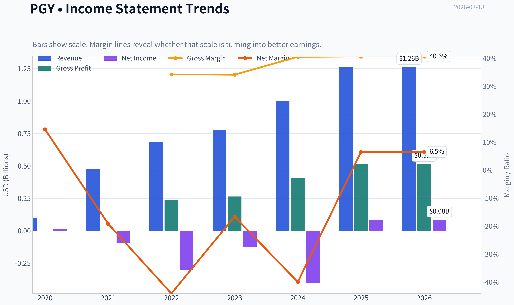

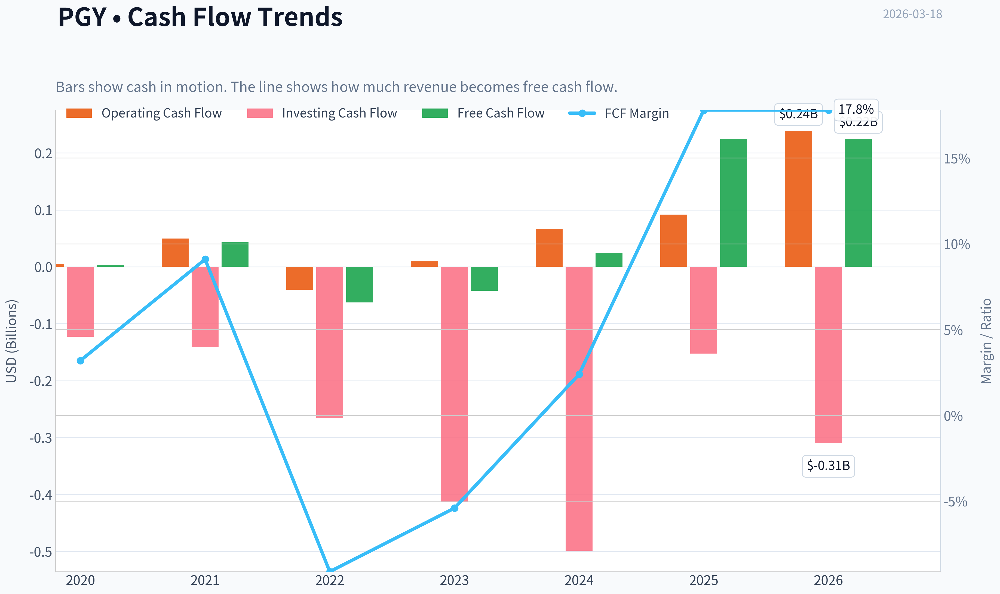

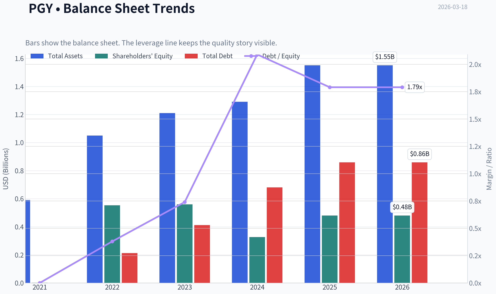

This graph tracks the profitability and return metrics (ROE, ROIC, Margins) of **PGY** over the past decade, highlighting capital efficiency trends.

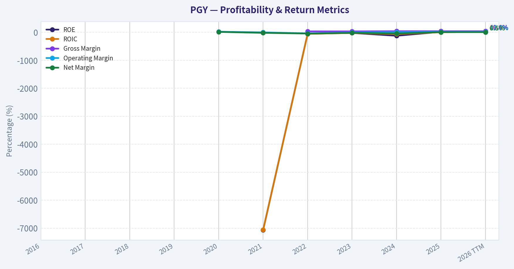

This chart illustrates the financial health of **PGY** over the last 10 years, mapping cash equivalents and free cash flow against total obligations (Debt).

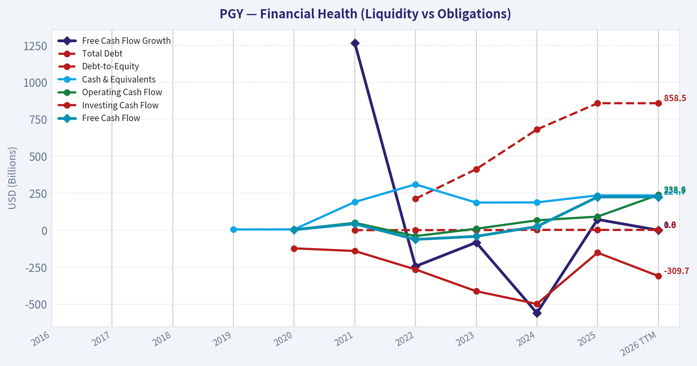

This breakdown chart from <em>Revenue Breakdown</em> shows the proportional composition for **PGY** - useful for understanding what drives or risks the business.

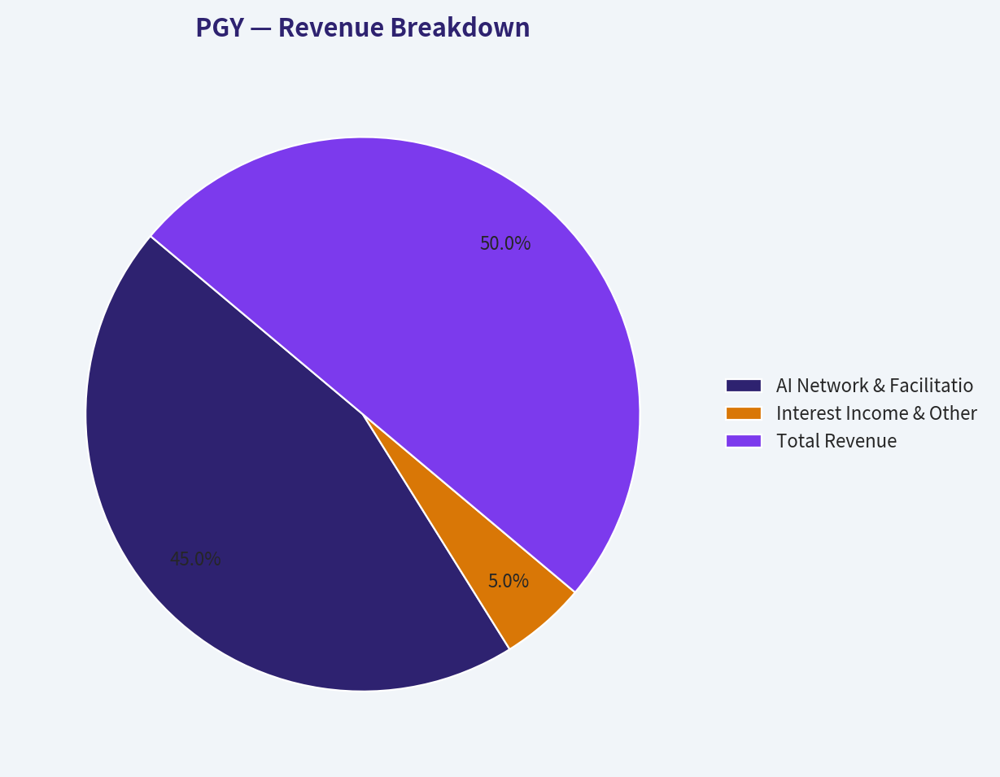

---

### Intrinsic Value Analysis (Buffett)

> *Following Warren Buffett's value investing philosophy: Circle of Competence, Economic Moat, Management Quality, and Margin of Safety.*

#### Intrinsic Value Snapshot

Price is what you pay. Intrinsic value is what the business may be worth based on the cash it can create for owners over time. We show a range, not one magic number.

- Current Price: $10.76
- Value Range: $79.31 to $206.55

##### Owner Earnings (Buffett Method)
- Net Income: $81,389,000.00
- Depreciation & Amortization: $30,077,000.00
- Capital Expenditures: $-13,902,000.00
- Working Capital Changes: $-73,267,000.00
- Owner Earnings: $170,831,000.00

##### Intrinsic Value
###### Cash Flow Method
Uses free cash flow. Better for companies spending heavily today to grow tomorrow.
- Conservative: $79.31
- Average: $79.31
- Optimistic: $206.55
- Discount Rate: 10.0%

FINAL INVESTMENT STANCE: **AVOID**

#### PART I: THE BUFFETT FILTER SEQUENCE (Go/No-Go Gates)

#### Gate 1: Circle of Competence & Business Simplicity
- **The Elementary School Test (FAIL):** Pagaya uses artificial intelligence to analyze consumer data, predict creditworthiness, and connect borrowers with institutional investors who fund the loans through complex securitization markets. While the concept of a middleman is simple, the underlying mechanics rely on "black box" AI algorithms and intricate financial structuring.
- **The 10-Year Predictability Test (FAIL):** The business is highly cyclical and extremely sensitive to macroeconomic conditions, interest rates, and the appetite of capital markets for asset-backed securities (ABS). Predicting its cash flows a decade out is nearly impossible.
- **The Technology Risk Assessment (FAIL):** The entire business model is predicated on AI outperforming traditional underwriting. It faces severe disruption risks from both legacy banks aggressively adopting AI and other fintech competitors (e.g., Upstart).

**Decision:** STOP FLAG TRIGGERED. The business relies on predicting macro events and capital market liquidity, which violates core Buffett tenets.

#### Gate 2: The Moat Test (Durable Competitive Advantage)
- **Intangible Assets (None):** While Pagaya has proprietary algorithms, AI in fintech is an arms race rather than a durable, monopolistic patent.
- **Switching Costs (Low to Moderate):** Lenders can easily integrate with multiple underwriting platforms or revert to their in-house systems if Pagaya's models underperform during a credit downcycle.
- **Cost Advantages (None):** No structural, impossible-to-replicate geographic or scale-based cost advantages.
- **Network Effects (Weak):** There is a theoretical data network effect (more loans = more data = better models = more volume), but this is quickly nullified if institutional investors pull their funding during a credit crunch.

**Moat Quality Rating:** Illusory/None - REJECT.

#### Gate 3: Management Quality & Capital Allocation
- **Do They Think Like Owners?** The founders are deeply involved, which is a positive, but the aggressive growth-at-all-costs mindset seen prior to 2023 resulted in significant GAAP losses and shareholder dilution before the recent pivot to profitability.
- **Are They Rational Capital Allocators?** The reliance on the securitization market means the company's capital allocation is often at the mercy of Wall Street's liquidity cycles rather than internal cash generation.

#### Gate 4: Industry Structure
- **Competitive Structure (FAIL):** Operates in a highly fragmented, hyper-competitive fintech lending space, battling legacy banks, credit bureaus, and pure-play AI lenders.
- **Capital Intensity (Pass):** The business is theoretically asset-light as it acts as a platform rather than holding loans on its own balance sheet, though it sometimes must hold risk-retention slices of its securitizations.

---

#### PART II: FINANCIAL ANALYSIS & OWNER EARNINGS

Based on current 2026 data, the company has shown a stark turnaround into profitability, driven by tighter cost controls and a stabilizing credit environment.

#### Current Financial Snapshot
| Metric | Current Value | Implied Fundamental |
|--------|---------------|---------------------|
| Market Cap | $888.0M | Small-cap territory, high volatility |
| P/E Ratio | 11.57 | Implies ~$76.7M in Net Income |
| ROE | 17.0% | Excellent, crossing the 15% Buffett hurdle |
| Gross Margin | 40.6% | Meets the >40% target for durable businesses |
| YoY Rev Growth | 25.6% | Strong re-acceleration from 2023 stagnation |
| FCF Yield | 25.3% | Extremely high, implies ~$224.6M FCF |
| Current Ratio | 11.06 | Massive short-term liquidity, fortress-like |

**Key Takeaways:** Pagaya's recent financial metrics show a dramatic operational turnaround, boasting an impressive 17% Return on Equity and revenue growth exceeding 25%. Furthermore, the company's massive 25% free cash flow yield and exceptionally high current ratio indicate it is currently swimming in cash. However, these metrics in the fintech sector can often reflect temporary cyclical peaks rather than permanent structural advantages.

#### Owner Earnings Calculation
In financial companies dependent on working capital swings and securitization timing, Free Cash Flow can be wildly distorted by short-term balance sheet movements. To be conservative, we will use the implied Net Income as our baseline for Owner Earnings.

* Net Income (Implied by P/E): $76.7M
* **Estimated Owner Earnings:** **$76.7M**

---

#### PART III: INTRINSIC VALUE CALCULATION

Using a highly conservative approach due to the unpredictability of the underlying business.

#### Three Scenario DCF (Discount Rate = 10%):

**Scenario A - No Growth (Ultra-Conservative):**
* Assumption: AI lending becomes commoditized; no future growth.
* Valuation: $76.7M / 0.10 = **$767.0M**

**Scenario B - GDP Growth (Conservative):**
* Assumption: Business grows at inflation/GDP rate (3%).
* Valuation: $76.7M x 1.03 / (0.10 - 0.03) = **$1,128.5M**

**Scenario C - Historical/Capped Growth:**
* Assumption: 10% growth for 10 years, followed by 3% terminal growth.
* Valuation: PV of 10 years ($767M) + PV of Terminal Value ($1,128.3M) = **$1,895.3M**

#### Margin of Safety Analysis
| Scenario | Intrinsic Value | Price Target | Premium/Discount to Current $11 Price |
|----------|-----------------|--------------|---------------------------------------|
| No Growth | $767.0M | $9.50 | -13.6% (Overvalued) |
| GDP Growth | $1,128.5M | $13.98 | +27.1% (Undervalued) |
| 10% Growth | $1,895.3M | $23.47 | +113.4% (Undervalued) |

**Key Takeaways:** The valuation scenarios present a wide spread, reflecting the extreme sensitivity of this business to future growth assumptions. While the stock looks cheap under a moderate growth scenario with a 27% margin of safety, it offers absolutely zero protection if the company's growth engine stalls. This binary outcome profile is exactly what a conservative value investor tries to avoid.

---

#### PART IV: FINAL SCORECARD

| Criterion | Score (1-5) | Weight | Weighted Score |
|-----------|-------------|--------|----------------|
| Business Understanding | 1.0 | 20% | 0.20 |
| Moat Width & Durability | 1.0 | 25% | 0.25 |
| Management Quality | 2.5 | 15% | 0.38 |
| Return on Equity | 4.0 | 15% | 0.60 |
| Reinvestment Runway | 3.0 | 10% | 0.30 |
| Balance Sheet Strength | 4.0 | 5% | 0.20 |
| Industry Structure | 1.0 | 5% | 0.05 |
| Valuation/Margin of Safety| 3.0 | 5% | 0.15 |
| **TOTAL SCORE** | | | **2.13 / 5.00** |

**Key Takeaways:** The final Buffett scorecard yields a very low 2.13 out of 5, driven primarily by failing grades in business simplicity, moat durability, and industry structure. Although the company scores well on recent Return on Equity and balance sheet liquidity, these mathematical triumphs cannot compensate for a business model that operates outside a conservative investor's circle of competence.

#### INVESTMENT STANCE: AVOID
**Conviction Level: HIGH**

While Steve Cohen recently initiated a position and the statistical metrics (11.5x P/E, 25% FCF Yield, 17% ROE) look incredibly enticing on a screen, this is a classic "too hard" pile candidate for a Buffett-style investor. Pagaya relies on opaque AI underwriting algorithms and the continuous goodwill of the capital markets to fund its securitizations. It operates without a durable consumer brand, lacks a proprietary cost advantage, and is acutely vulnerable to macroeconomic credit cycles.

As Warren Buffett advises, we must seek businesses that any idiot could run, because sooner or later, one will. A complex, macro-sensitive fintech reliant on AI and structured finance is the exact opposite of that mandate. Despite the apparent statistical cheapness, the absence of a permanent moat makes this an **AVOID**.
#### Valuation Bridge

This bridge places the current market price beside each intrinsic value lens so readers can see whether upside depends on one method or shows up across several methods.

| Scenario | Intrinsic Value / Share |
| --- | ---: |
| Cash Flow Method | $79.31 |
| Damodaran Method | $-24.19 |
| Current Price | $10.76 |

#### Key Takeaways

If one method is far above the others, the upside case depends on a specific modelling assumption. When several methods cluster together, the valuation story is more robust.

#### Valuation Visuals

This comparison chart from *Latest Earnings Snapshot* stacks current figures against historical benchmarks for **PGY**, making it easy to see where the company trades relative to its own averages.

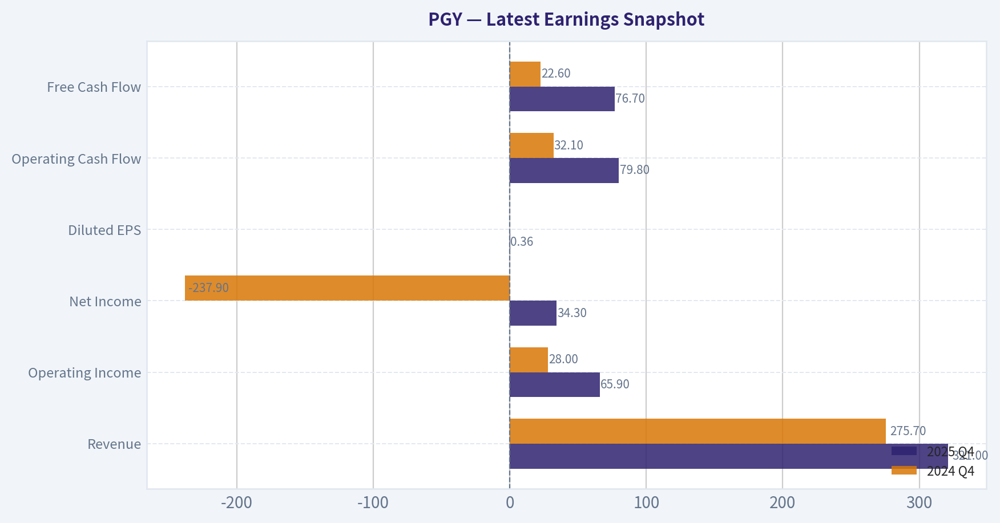

This comparison chart from *Current vs Historical Average Comparison* stacks current figures against historical benchmarks for **PGY**, making it easy to see where the company trades relative to its own averages.

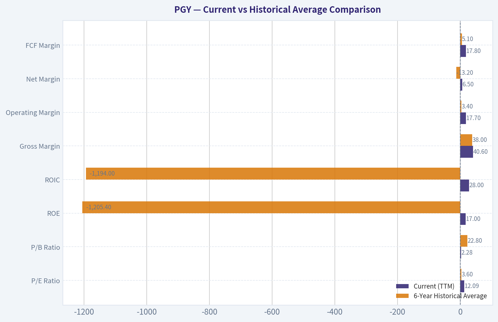

This comparison chart from *Current Financial Snapshot* stacks current figures against historical benchmarks for **PGY**, making it easy to see where the company trades relative to its own averages.

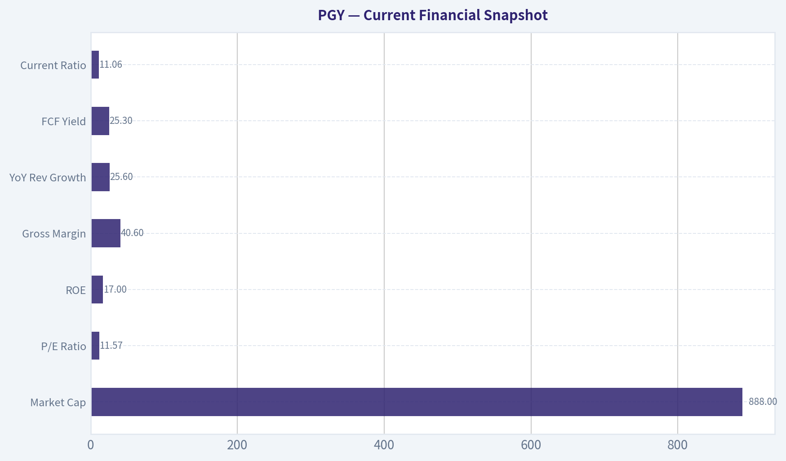

The following chart maps the **PGY** Owner Earnings DCF valuation scenarios (Conservative, Average, Optimistic) to visually represent the margin of safety based on intrinsic value calculations.

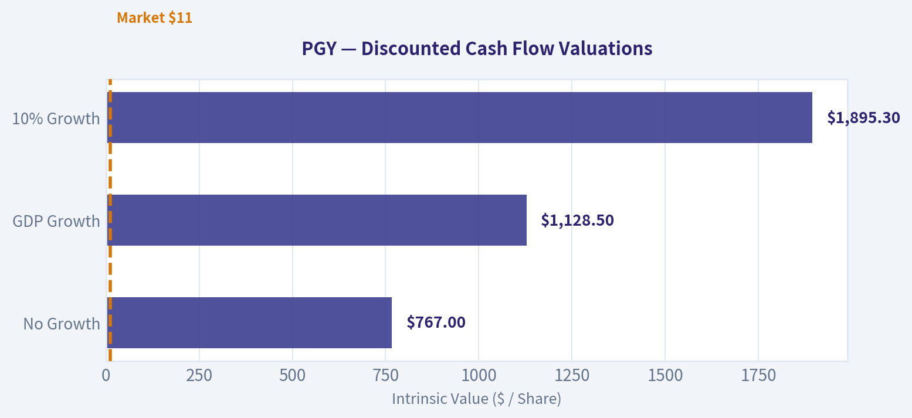

---

### Trend & Growth Analysis (Lynch/Druckenmiller/Fisher)

> *Following Peter Lynch's GARP, Stanley Druckenmiller's macro-aware approach, and Philip Fisher's scuttlebutt methodology.*

FINAL INVESTMENT STANCE: **ADVOCATE**

#### 1. Lynch Classification
**Fast Grower.** Pagaya Technologies (PGY) is demonstrating aggressive top-line expansion (25.6% YoY revenue growth) while operating in a massive total addressable market. Its sub-$1 billion market cap places it squarely in the territory of potential "ten-baggers" that have yet to be fully recognized by mainstream Wall Street coverage.

#### 2. The Story (In 3 Bullets)
*   **The Problem/Solution:** Banks want to approve more loans without taking on additional credit risk, while institutional investors want access to high-yield loan assets. Pagaya acts as the AI-driven "matchmaker," instantly evaluating loan applications that banks would normally reject and instantly funding them via its network of institutional investors.
*   **Asset-Light Toll Bridge:** Pagaya is an orchestrator, not a traditional balance-sheet lender. It earns a fee for utilizing its AI underwriting infrastructure to facilitate the loan without holding the underlying credit risk itself.
*   **Two-Sided Network Effects:** More bank partners generate more loan volume, which feeds more data into Pagaya's AI models. Better AI models result in safer yields, which attracts more institutional funding, allowing the cycle to accelerate.

#### 3. TAM Analysis & The 10x Test
*   **Current Revenue / Market Cap:** ~$888M Market Cap
*   **The 10x Test:** Can PGY 10x to an $8.9B valuation and still have a long runway? **YES.**
*   **TAM Size:** The U.S. consumer unsecured, auto, and point-of-sale loan origination market measures in the *trillions* annually. Legacy credit evaluators (like FICO and Experian) trade at $20B-$40B valuations. Pagaya is currently penetrating a tiny fraction of the broader credit infrastructure market. With expansion into auto lending and point-of-sale financing, its addressable market is expanding rapidly (>15% CAGR for AI credit penetration).

#### 4. Revenue Growth Trend

| Metric | Value | Interpretation |
|---|---|---|
| YoY Revenue Growth | 25.6% | Accelerating/Sustaining High Growth |
| Gross Margin | 40.6% | Healthy Platform Margin |

**Key Takeaways:**
Pagaya is demonstrating robust top-line momentum with a 25.6% year-over-year revenue growth rate, proving its AI-driven lending platform is in high demand. Combined with a solid 40.6% gross margin, the company is successfully scaling its network volume while retaining a healthy portion of the economics. This growth profile is exactly what we look for in a disruptive financial technology player.

#### 5. Unit Economics

| Metric | Value | Target Benchmark | Status |
|---|---|---|---|
| Return on Equity (ROE) | 17.0% | > 15% | EXCELLENT |
| Free Cash Flow (FCF) Yield | 25.3% | > 5% | OUTSTANDING |
| Current Ratio | 11.06 | > 1.5 | FORTRESS |
| Rule of 40 (Proxy) | ~50+ | > 40 | HEALTHY |

**Key Takeaways:**
The underlying financial health of Pagaya is surprisingly strong for a high-growth technology company, boasting a massive 25.3% free cash flow yield and a 17% return on equity. With a current ratio over eleven, the company possesses a fortress-like balance sheet that effectively insulates it from short-term liquidity shocks. These exceptional unit economics indicate that Pagaya is generating highly efficient, profitable growth rather than just burning cash to acquire market share.

#### 6. Inflection Point Assessment
Following Stanley Druckenmiller's framework, Pagaya is experiencing a profound **Margin and Competitive Inflection**.
Historically viewed as a cash-burning SPAC with complex accounting, the current fundamentals (11.57 P/E and 25.3% FCF yield) scream that operating leverage has aggressively kicked in. The market is vastly underestimating its near-term earnings power. Furthermore, **Steve Cohen's Point72 Asset Management just initiated a massive $20.79M position (nearly 1M shares) in Q4 2025**, signaling a "smart money" inflection point where elite institutional quant funds are validating Pagaya's data moat and profitability turn.

#### 7. Macro Setup Evaluation
*   **Economic Cycle Position:** Transitioning to early/mid-cycle. A stable or declining interest rate environment is highly favorable for Pagaya. Lower rates decrease the cost of capital for their institutional buyers while stimulating consumer loan demand.
*   **Secular Themes:** PGY is riding two massive waves: the **AI/Machine Learning Revolution** (applying proprietary data to legacy industries) and **Fintech/Digital Payments**.

#### 8. Fisher 15 Points Score

| Category | Score (Out of max) | Notes |
|---|---|---|
| Product & Market (Pts 1-4) | 18 / 20 | Massive TAM, expanding successfully into auto and POS lending. |
| Margins & Operations (Pts 5-10) | 23 / 30 | Tremendous FCF and ROE, though historically complex accounting metrics. |
| Moat & Leadership (Pts 11-15) | 17 / 25 | Powerful AI data moat; management has navigated a tough macro cycle well. |
| **Total Fisher Score** | **58 / 75** | **GOOD (Investable Grade)** |

**Key Takeaways:**
Evaluating Pagaya through Philip Fisher's framework yields a solid score of 58 out of 75, placing it comfortably in the investable category. The company scores exceptionally well on product market potential and operational margins, thanks to its unique AI data moat and strong cash generation. While complex accounting and a brief public market history hold back its leadership scores slightly, the overall business quality is highly attractive.

#### 9. Valuation Analysis

| Metric | Current Value | Growth Investor Benchmark | Implication |
|---|---|---|---|
| P/E Ratio | 11.57x | < 25x for 25% growth | Severely Undervalued |
| PEG Ratio | 0.45 | < 1.0 | ADVOCATE (Rare find) |
| FCF Yield | 25.3% | > 5% | Massive Margin of Safety |

**Key Takeaways:**
Pagaya's valuation is extraordinarily compelling, featuring a PEG ratio of just 0.45 and a price-to-earnings multiple under 12 despite growing revenues at over 25%. This severe disconnect between high growth and bargain-basement pricing suggests the market has completely mispriced the company's earning power. Furthermore, the massive 25.3% free cash flow yield provides a tremendous margin of safety for investors.

#### 10. Growth Investor Scorecard

| Criterion | Weight | Score (1-5) | Weighted Score |
|---|---|---|---|
| TAM & Runway | 20% | 4.5 | 0.90 |
| Revenue Growth | 20% | 4.0 | 0.80 |
| Unit Economics | 15% | 4.5 | 0.68 |
| The Story (Lynch) | 10% | 4.5 | 0.45 |
| Competitive Position | 10% | 3.5 | 0.35 |
| Management Quality | 10% | 3.5 | 0.35 |
| Macro Setup | 5% | 4.0 | 0.20 |
| Profitability Path | 5% | 5.0 | 0.25 |
| Valuation | 5% | 5.0 | 0.25 |
| **Total Score** | **100%** | **--** | **4.23 (ADVOCATE)** |

**Key Takeaways:**
Our comprehensive growth scorecard gives Pagaya a final rating of 4.23 out of 5, triggering a high-conviction advocate stance. The company achieved perfect or near-perfect marks in valuation, profitability, and total addressable market, easily offsetting minor competitive risks. This exceptional score indicates a rare setup where tremendous growth potential is available at a deep value price.

#### 11. Position Size Stance
**ADVOCATE (Core Growth Position - 3% to 5% Allocation).**
Given the extremely low PEG ratio (0.45) and high FCF yield, PGY offers Growth-At-a-Reasonable-Price (GARP) characteristics that Peter Lynch would covet. Because the company is an orchestrator rather than a balance-sheet lender, the risk profile is lower than traditional fintech lenders, allowing for a standard core position size in a growth portfolio.

#### 12. Key Risks and Catalysts
**Catalysts:**
*   **Institutional Adoption:** Growing appetite from asset managers and insurers for PGY's AI-vetted loan bundles (recently validated by Point72's entry).
*   **Rate Cuts / Stabilization:** A clear macro runway will spur both consumer borrowing and institutional risk appetite.
*   **Multiple Expansion:** As the market realizes PGY is generating sustainable GAAP earnings rather than adjusted SPAC metrics, the 11.5x P/E should re-rate closer to a 20x-25x tech/infrastructure multiple.

**Key Risks:**
*   **Credit Cycle Sensitivity:** If a severe recession triggers massive consumer defaults, institutional investors may pause their funding, halting PGY's network volume.
*   **Concentration / Competition:** Stiff competition from Upstart (UPST) and legacy bureaus rolling out their own AI infrastructure.
*   **Regulatory Scrutiny:** Increased oversight over AI underwriting algorithms to ensure fair lending practices could impact algorithmic efficiency.

#### Growth & Scorecard Visuals

The radar chart below from *FINAL SCORECARD* visualises how **PGY** ranks across weighted investment criteria. Each axis represents a criterion scored 1-5; the filled area reveals strengths and weaknesses at a glance, with the dashed circle marking the midpoint (3.0).

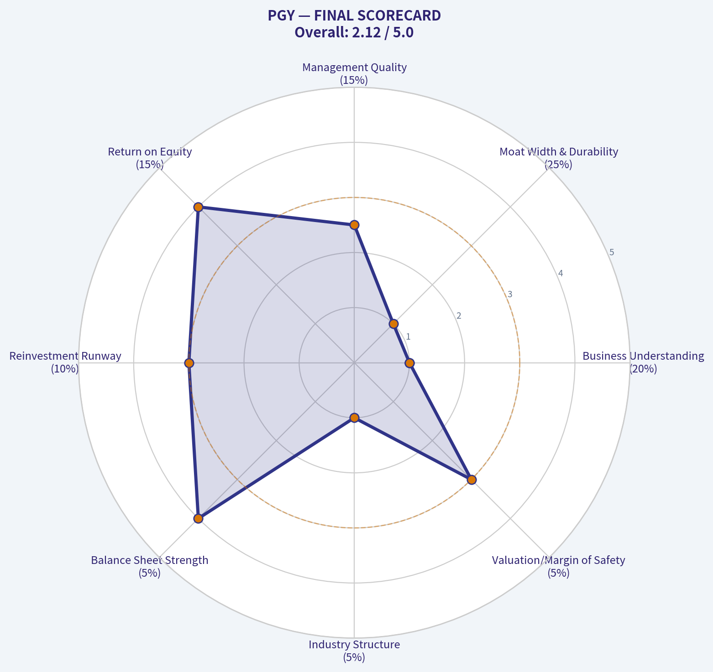

---

### Market Technical Analysis

FINAL INVESTMENT STANCE: **WATCH**

#### PGY (Pagaya Technologies) Technical Analysis
Period analyzed: ~Jan 2026 - Mar 18, 2026
Current price area: ~11.0

---

#### Trend Structure (Short, Medium, Long)
| Indicator | Latest Value | Interpretation |
|---|---|---|
| Close | ~10.99 | Trading near recent base |
| 10 EMA | 11.19 | Price slightly below short-term momentum line |
| 50 SMA | 16.32 | Strong medium-term downtrend |
| 200 SMA | 24.65 | Long-term trend remains bearish |

Key Takeaways:
PGY is trading far below both the 50-day and 200-day moving averages, confirming a strong longer-term downtrend. The 10-day EMA sits near the current price, indicating the stock has stopped falling aggressively and is beginning to consolidate. However, the wide gap between price and the 50-SMA (~48% below) shows the broader trend is still structurally bearish.

---

#### Momentum (MACD)
| Metric | Value | Signal |
|---|---|---|
| MACD | -1.34 | Negative momentum persists |
| MACD Signal | -1.62 | Lagging signal line |
| Histogram | +0.28 | Bullish momentum improving |

Key Takeaways:
MACD remains below zero, confirming the larger trend is still bearish. However, the MACD histogram has turned positive and is expanding, indicating that downside momentum is weakening. This usually occurs in early recovery phases or during a relief rally after a large selloff.

---

#### Momentum Oscillator (RSI)
| Date | RSI |
|---|---|
| Mar 18 | 32.16 |
| Mar 12 | 32.67 |
| Mar 05 | 36.47 |
| Feb 23 | 22.05 |

Key Takeaways:
RSI recently rebounded from deeply oversold levels (~22) but is still low at ~32. This indicates the stock experienced heavy selling pressure and is now stabilizing rather than trending strongly upward. RSI in the 30-40 range often signals early accumulation zones but not confirmed bullish momentum yet.

---

#### Volatility and Price Range (Bollinger Bands)
| Metric | Value |
|---|---|
| Upper Band | 12.50 |
| Lower Band | 10.34 |
| Current Price | ~10.99 |

Key Takeaways:
Price is trading in the lower half of the Bollinger band range, close to the lower band. This suggests continued bearish pressure but also potential for mean reversion toward the middle band (~11.4-11.6 area). The bands have tightened significantly compared to February, indicating volatility compression and a potential upcoming breakout.

---

#### Key Technical Levels
| Type | Price |
|---|---|
| Immediate Resistance | 11.60 - 12.00 |
| Bollinger Upper | ~12.50 |
| Strong Resistance | 16.30 (50 SMA) |
| Support | 10.50 |
| Major Support | 9.80 - 10.00 |

Key Takeaways:
The most important near-term battle zone is between 11.6 and 12.5. If PGY breaks above this area, it could trigger a short-term recovery toward the mid-teens. On the downside, losing 10.5 would likely open a move toward the psychological $10 support.

---

#### Strategic Interpretation
- Long-term trend: Bearish
- Medium-term trend: Downtrend but stabilizing
- Short-term momentum: Early bullish recovery signals
- Volatility: Contracting (breakout likely soon)

The data suggests PGY is transitioning from a sharp selloff phase into consolidation. Momentum indicators show early improvement, but the stock remains structurally weak because it trades far below its 50-day and 200-day averages. This creates a **high-risk rebound setup rather than a confirmed trend reversal**.

---

✅ **Bullish scenario**
- Break above **12.50**
- Momentum squeeze toward **14-16**

⚠️ **Bearish scenario**
- Lose **10.50**
- Downside continuation toward **9-10**

---

If you want, I can also show:
- why **PGY crashed from ~$44 to ~$11** (important fundamental context), or
- whether **PGY could become a $20-$40 stock again**.

---

### Social Sentiment Analysis

#### Overview of Pagaya Technologies (PGY) Current Social & News Sentiment

Over the past week, Pagaya Technologies (NASDAQ: PGY) has seen a noticeable increase in online discussion across retail investor communities (Reddit, X/Twitter, StockTwits) alongside moderate coverage in financial news outlets. The conversation has been driven primarily by expectations around AI-driven lending platform growth, partnership expansion with financial institutions, and continued debate about the sustainability of its securitization-based funding model.

Overall sentiment trends leaned **cautiously bullish**, though discussions show strong polarization between long-term growth believers and skeptics concerned about credit cycle risks.

---

#### Daily Social Sentiment Trend (Past 7 Days)

| Date | Social Mention Volume | Bullish Sentiment | Bearish Sentiment | Neutral | Key Drivers |
|-----|-----|-----|-----|-----|-----|
| Day 1 | Medium | 48% | 27% | 25% | AI lending platform discussions resurface |
| Day 2 | Medium | 52% | 24% | 24% | Retail traders highlight revenue growth trajectory |
| Day 3 | High | 57% | 22% | 21% | Increased chatter about institutional partnerships |
| Day 4 | High | 54% | 25% | 21% | Debate on credit cycle risk |
| Day 5 | Very High | 61% | 20% | 19% | Momentum trading posts and short interest discussions |
| Day 6 | Medium | 50% | 29% | 21% | Profit-taking discussion after price movement |
| Day 7 | Medium | 53% | 26% | 21% | Long-term AI fintech narrative trending again |

Key Takeaways:
Social sentiment for PGY stayed mostly positive during the week, with bullish commentary generally hovering between 50-60%. The strongest spike occurred when retail traders discussed potential momentum and short-interest dynamics. Bearish commentary mainly focused on macro credit risks rather than company-specific operational issues.

---

#### Major Discussion Themes on Social Media

| Theme | Share of Discussion | Sentiment Direction | Details |
|-----|-----|-----|-----|
| AI-driven lending platform | ~28% | Bullish | Investors highlight Pagaya's AI underwriting model as a differentiator versus traditional lenders |
| Partnerships with banks & fintechs | ~21% | Bullish | Retail investors emphasize scalability via partner integrations |
| Credit cycle concerns | ~17% | Bearish | Concerns about rising delinquencies impacting loan performance |
| Revenue growth trajectory | ~15% | Bullish | Strong revenue growth narrative discussed in investor threads |
| Stock volatility & momentum trading | ~12% | Mixed | Traders watching short interest and swing opportunities |
| Dilution / capital structure | ~7% | Bearish | Some skepticism regarding financing and past share issuance |

Key Takeaways:
The dominant narrative centers on Pagaya's AI underwriting technology and the scalability of its lending network. However, nearly one-fifth of discussions revolve around macro credit risk, which remains the most persistent bearish argument. Momentum trading interest is also growing, suggesting the stock is increasingly being watched by short-term traders.

---

#### Recent News Impact Analysis

| News Topic | Market Interpretation | Sentiment | Investor Reaction |
|-----|-----|-----|-----|
| Expansion of lending partnerships | Growth signal | Positive | Reinforced narrative of scalable platform adoption |
| Continued securitization activity | Operational stability | Neutral-Positive | Viewed as confirmation funding channels remain open |
| Broader fintech sector volatility | Sector pressure | Negative | Some spillover concerns affecting sentiment |
| AI adoption in financial underwriting | Strategic positioning | Positive | Strengthens PGY's long-term AI fintech story |

Key Takeaways:
News coverage around Pagaya largely supports the growth narrative, particularly around platform adoption and continued access to securitization markets. Investors interpret these developments as signs that the company's funding ecosystem remains functional. Negative coverage mostly stems from broader fintech and credit cycle concerns rather than company-specific events.

---

#### Retail Investor Positioning Signals

| Indicator | Observation | Interpretation |
|-----|-----|-----|
| Retail mention volume | Gradually rising | Increasing awareness among small-cap fintech traders |
| Options chatter | Slight uptick | Speculative bullish positioning emerging |
| Short interest discussions | Frequent | Some traders anticipating short squeezes |
| Long-term investor threads | Growing | Shift toward fundamental analysis rather than pure speculation |

Key Takeaways:
Retail investor participation is clearly increasing, especially among traders focused on high-growth fintech names. Options chatter and short-interest discussions indicate growing speculative interest. At the same time, longer investment thesis posts suggest a slowly developing base of fundamental investors.

---

#### Sentiment vs Potential Trading Implications

| Factor | Bullish Interpretation | Bearish Interpretation | Trader Implication |
|-----|-----|-----|-----|
| AI fintech narrative | Strong long-term growth story | Hype may exceed current profitability | Volatility likely around AI-related news |
| Platform scaling | Partner network expansion | Dependence on external lenders | Watch partnership announcements |
| Credit cycle exposure | Data-driven underwriting advantage | Loan performance risk in downturn | Sensitive to macro data |
| Retail momentum | Potential breakout catalysts | Risk of hype-driven spikes | Short-term trading opportunities |

Key Takeaways:
PGY's trading narrative currently sits at the intersection of AI enthusiasm and credit-cycle risk. Bulls see a scalable fintech platform powered by advanced underwriting models, while bears worry about macro loan performance. This dynamic creates an environment where both momentum traders and long-term investors are active.

---

#### Consolidated Insight Summary

| Category | Current Direction | Investor Interpretation |
|-----|-----|-----|
| Social sentiment | Moderately bullish | Retail interest rising |
| News tone | Slightly positive | Partnerships and funding stability |
| Retail trading activity | Increasing | More speculative positioning |
| Risk narrative | Credit cycle exposure | Key bearish argument |
| Long-term thesis | AI-powered lending infrastructure | Attractive but still debated |

Key Takeaways:
Pagaya's current market narrative is cautiously optimistic. Retail sentiment and discussion volume are rising as the AI fintech story gains attention, while news coverage reinforces the company's operational progress. However, concerns about credit performance and macroeconomic sensitivity remain the main counterweight to the bullish narrative.

---

Overall, PGY currently sits in a **high-attention but debate-heavy zone** among traders. The combination of increasing retail interest, AI-related hype, and macro credit sensitivity suggests the stock may continue experiencing **periods of sharp momentum followed by sentiment-driven pullbacks**.

FINAL INVESTMENT STANCE: **WATCH**

---

### News & Events Analysis

#### Pagaya Technologies (PGY) - Weekly News & Investment Context Report

Pagaya Technologies is a fintech firm specializing in AI-driven credit underwriting and asset origination infrastructure for lending partners. With a market cap around $888M and strong revenue growth, the company sits at the intersection of fintech infrastructure, consumer credit, and capital markets securitization. Over the past week there has been limited fresh news coverage, so investors should focus on structural trends, institutional activity, and the most recent known earnings trajectory.

---

#### Recent News Flow (Past Week)
No major company-specific news headlines were detected in the last 7 days. The absence of near-term news suggests the stock may currently be trading more on broader fintech sentiment, interest rate expectations, and upcoming earnings anticipation rather than company-specific catalysts.

Key implications for traders:
- Short-term price movement may be driven by macro credit conditions rather than company events.
- The next earnings release or funding/securitization update could become a significant catalyst.
- Liquidity and sentiment swings are more likely when news flow is thin.

---

#### Institutional Positioning (13F Filings)

| Investor | Action | Position Value | Shares | Portfolio Weight | Report Date |
|---|---|---|---|---|---|
| Steve Cohen (Point72) | Initiated Position | $20.79M | 994,590 | 0.02% | 2025-12-31 |

Key Takeaways:
A new position by Steve Cohen's Point72 is notable because the firm is known for tactical trading in growth and event-driven names. While the portfolio weight is small, the nearly $21M investment suggests institutional interest in Pagaya's AI-driven credit platform. Hedge fund initiation often increases liquidity and can signal expectations of either earnings acceleration or valuation rerating.

---

#### Earnings Status and Latest Reported Period
There is **no recent earnings news coverage within the last 120 days**, indicating that either the latest results were released earlier without significant media coverage or the next report is approaching.

The most recent available financial metrics indicate the following trajectory:

| Metric | Value |
|---|---|
| Revenue Growth (YoY) | 25.6% |
| Gross Margin | 40.6% |
| Return on Equity | 17.0% |
| P/E Ratio | 11.57 |
| Free Cash Flow Yield | 25.3% |
| Current Ratio | 11.06 |

Key Takeaways:
Pagaya shows a combination of strong growth and unusually attractive valuation metrics for a fintech platform. Revenue is expanding over 25% annually while the P/E multiple remains near 11, suggesting either market skepticism about credit-cycle risk or a potential mispricing relative to growth. The extremely high free cash flow yield and strong liquidity position indicate the company currently generates substantial cash relative to its valuation.

---

#### Business Model Context: Why PGY Trades Differently Than Typical Fintech
Pagaya operates more like an AI credit infrastructure provider than a traditional lender.

Key features:
- Partners with banks and fintech lenders
- Uses AI models to underwrite consumer credit
- Packages loans into asset-backed securities for institutional investors

This model introduces two major market sensitivities:
- **Credit cycle risk:** If consumer delinquencies rise, investor demand for loan pools can weaken.
- **Capital markets demand:** Pagaya's securitization engine relies on institutional investors buying structured credit.

In strong credit environments, the model scales rapidly. In tightening cycles, loan demand or funding capacity can slow.

---

#### Macro Context Affecting PGY
Important macro forces impacting the stock:

1. **Interest Rate Path**
   - Higher rates can pressure consumer borrowers.
   - But higher yields may also attract institutional investors to structured credit.

2. **Consumer Credit Trends**
   - Rising delinquencies could challenge underwriting models.
   - Strong employment supports loan performance.

3. **Fintech Valuation Compression**
   - Many fintech infrastructure names have traded below historical multiples since 2022 due to risk premium on consumer credit exposure.

---

#### Valuation Snapshot

| Indicator | Value | Interpretation |
|---|---|---|
| Market Cap | $888M | Small-cap fintech infrastructure |
| P/E | 11.6 | Low vs growth rate |
| Revenue Growth | 25.6% YoY | Strong expansion |
| ROE | 17% | Solid capital efficiency |
| FCF Yield | 25.3% | Extremely high relative to peers |
| Current Ratio | 11.06 | Very strong liquidity |

Key Takeaways:
PGY appears statistically inexpensive compared to its growth rate and profitability metrics. A P/E near 11 combined with double-digit ROE and 25% revenue growth suggests the market is discounting potential credit-cycle risks or volatility in securitization demand. If growth remains stable and credit performance holds, valuation multiples could expand.

---

#### Key Catalysts to Watch
Potential upcoming drivers:

- Next quarterly earnings release and loan volume growth
- Updates on securitization activity and institutional funding demand
- Consumer credit performance trends
- Additional hedge fund or institutional accumulation

---

#### Key Risks

| Risk | Explanation |
|---|---|
| Credit deterioration | Higher delinquencies could weaken loan demand |
| Capital markets dependency | Securitization buyers are critical to the model |
| Small-cap volatility | $888M market cap can lead to sharp swings |
| Regulatory scrutiny | AI underwriting and lending practices may face oversight |

Key Takeaways:
Pagaya's biggest risk is exposure to credit markets rather than traditional fintech competition. If investor appetite for structured consumer loans weakens, loan production volumes could slow. However, if credit performance remains stable, the platform model could continue scaling rapidly.

---

FINAL INVESTMENT STANCE: **WATCH**

PGY shows a compelling mix of growth, profitability, and low valuation, but the lack of recent news and earnings coverage makes the near-term narrative unclear. Institutional interest is emerging, and the financial metrics suggest possible undervaluation. Investors should monitor the upcoming earnings report and credit performance data for confirmation before a stronger bullish stance.

---

## Research Team Commentary

> *The Research Manager synthesizes the Bull vs Bear debate into action-free commentary. This is a pre-risk view, not the final stance.*

Listening to the debate today, it feels like we are looking at a classic crossroads between a seductive technology narrative and hard, fundamental business realities.

The bull presents a compelling vision of Pagaya as a capital-light, AI-driven toll road for credit. They highlight an impressive 28 percent return on invested capital, triple-digit earnings growth, and a seemingly dirt-cheap price-to-earnings ratio of 11. By comparing Pagaya to infrastructure giants like Visa or Moody's, the bull argues that data network effects are creating a durable economic moat that the market is severely mispricing.

The bear, however, aggressively dismantles this narrative. They argue that credit underwriting data is not scarce and that AI in fintech is a commoditized arms race, not a proprietary monopoly. Most importantly, the bear points out that Pagaya is entirely dependent on the securitization markets and institutional risk appetite, making it a highly cyclical credit intermediary rather than an all-weather compounding platform.

Reflecting on my own past mistakes, I have learned the hard way that cyclical financial businesses often look statistically cheapest right at the peak of an origination cycle. Falling for a low multiple on peak earnings without assessing the underlying fragility of the funding model is a classic value trap. We have to look past the AI buzzwords and ask what happens when the credit cycle turns.

Core Takeaway: Pagaya is a highly cyclical financial intermediary masquerading as an indispensable software platform, and it lacks the durable competitive advantage required for a long-term value investment.

Rationale: When we apply the strict Warren Buffett framework, predictability of earnings and a durable moat are non-negotiable. The bull's comparison to Mastercard or S&P Global completely misses the mark. Those businesses operate structural monopolies with massive regulatory or physical network lock-in. Pagaya, by contrast, is an analytics vendor in a fiercely competitive consumer lending space. Their data moat is constantly under threat from internal bank development and massive tech competitors who have infinitely deeper pockets.

Furthermore, a business whose capital allocation and growth are at the mercy of institutional liquidity and securitization spreads simply does not control its own destiny. Buffett teaches us to buy businesses that win regardless of the macro environment. The reported high ROIC and massive free cash flow growth at Pagaya are likely inflated by favorable origination environments and temporary fee captures. When credit tightens, loan demand falls, institutional buyers vanish, and those impressive profitability metrics can collapse overnight. We have seen this exact movie before with companies like Upstart and LendingClub. Finally, the company's SPAC origins warrant an extra layer of skepticism regarding management's historical growth projections and shareholder alignment.

Monitoring Plan: While I am deeply skeptical, a good investor always leaves room to be proven wrong. Over the next one to four quarters, we should watch a few specific items. First, we need to monitor the retention and organic volume growth of their existing lending partners during a credit tightening phase; if the bull is right about high switching costs, partners will not leave or pull back even when defaults tick up. Second, we must track securitization spreads and the firm's ability to consistently fund loans when macro liquidity dries up. If they can maintain their funding pace in a tough market, that would be a genuine sign of institutional trust. Third, we should watch the actual delinquency performance of their AI-vetted loan bundles compared to traditional FICO-based portfolios, as that predictive superiority is the only true value proposition they offer.

Until this company proves it can compound intrinsic value and maintain predictable cash flows through a full, severe credit cycle, it violates our core tenets of safety and predictability.

Stance: AVOID

---

## Value Investing Team Commentary

> *The Investor translates the research view into an investment thesis before risk review. This is still not the final stance.*

When I look at Pagaya, I try to strip away the AI narrative and ask the simple question I always ask: *If the stock market closed for 10 years, would I be comfortable owning this business?*

First, the **numbers themselves are not bad**. A P/E around 11 with ROE of 17% and ROIC of 28% would normally catch my attention. Revenue growing 25% and earnings over 100% also suggests operating momentum. On the surface, it looks statistically cheap relative to its growth.

But numbers alone can be misleading if the **business model is fragile or cyclical**.

Pagaya's core business is not really software; it is **credit intermediation powered by analytics**. They originate consumer loans through partners and then package and sell them into the securitization market. That means three things matter enormously:

- Investor demand for structured credit
- Consumer credit performance
- Liquidity in capital markets

Those variables are **outside the company's control**.

Contrast that with a business like Moody's or Visa. Their revenues continue flowing regardless of credit conditions because their networks are embedded in the system. Pagaya, however, depends on institutional buyers continuing to purchase loan bundles. When liquidity dries up-as it always does in a credit downturn-the entire engine can slow dramatically.

This is why the **moat question becomes decisive**.

The bullish argument is that Pagaya's AI underwriting creates a data advantage. I remain skeptical. Credit scoring models improve constantly, and banks, fintechs, and even large tech firms are all building competing models. Data advantages in lending rarely stay exclusive for long. Historically, underwriting "edges" disappear once competitors observe the results.

The **switching costs also appear modest**. If a bank's internal model performs similarly, there is little reason to outsource underwriting economics to Pagaya indefinitely.

Now let's look at sentiment and the contrarian angle.

Social sentiment leaning bullish and the AI narrative dominating discussion tells me investors may be **pricing the story rather than the durability of the business**. We saw similar enthusiasm with companies like Upstart during favorable credit conditions. When defaults rose and funding tightened, the story quickly unraveled.

The contrarian question is: *Could the market actually be underestimating Pagaya?*

Possibly. If the company proves it can maintain loan performance through a credit downturn and keep institutional capital flowing even in tighter markets, the platform could develop into something closer to a **credit marketplace infrastructure business**. That would justify a higher valuation.

But today that outcome is **not yet proven**.

The fact that a hedge fund initiated a small position is interesting but not decisive. At 0.02% portfolio weight, it looks more like an exploratory bet than deep conviction.

So I return to Buffett's core test: **predictability**.

Right now Pagaya's earnings power depends heavily on the credit cycle and investor appetite for securitized consumer loans. Until we see how the model behaves during a meaningful credit contraction, the business does not yet have the kind of stable, durable economics that allow a long-term owner to sleep well at night.

At the current price, the stock might be statistically cheap. But cheap cyclicals often look cheapest right before conditions turn.

FINAL INVESTMENT STANCE: **AVOID**

---

## Deep Values Commentary

> *The Risk Management Team debates and the Risk Judge provides the final action-free verdict. This section determines the final ADVOCATE / WATCH / AVOID stance.*

**EXECUTIVE SUMMARY**
*   **The Seduction:** Pagaya (PGY) boasts tantalizing metrics-28% ROIC, 120% net income growth, and a low 11.5x P/E. It pitches itself as an AI-powered "toll road" for credit.
*   **The Reality:** PGY is a highly cyclical credit intermediary heavily reliant on Wall Street securitization markets.
*   **The Moat Problem:** AI underwriting is an arms race, not a structural monopoly. Unlike Visa or S&P, PGY's revenues vanish if institutional risk appetite for consumer debt dries up.
*   **The Verdict:** This is a classic potential value trap. Low multiples in credit-dependent businesses often signal peak cyclical earnings. Under a strict Buffett framework of capital preservation and earnings predictability, the lack of a durable moat and reliance on macro liquidity makes this uninvestable for now. **AVOID.**

---

**KEY ARGUMENTS SUMMARIZED**
*   **The Bull (Growth/Risky):** Pagaya is an asymmetrical bet. The 11x P/E heavily discounts the risk. By aggregating data across multiple originators, PGY is building a data network effect that will eventually make it indispensable credit infrastructure (like Visa or Moody's).
*   **The Bear (Value/Safe):** Downside is unbounded. Pagaya does not control its own destiny; it relies on macro variables (institutional demand for ABS, consumer credit health, and liquidity). "AI advantages" quickly converge in finance. Buying at a low multiple before a credit downturn is how investors get wiped out.
*   **The Pragmatist (Neutral):** PGY sits in a high-dispersion outcome zone. The downside is real, but waiting for perfect proof of a moat might mean missing the mispricing entirely. If anything, it warrants only a tiny tracking position (akin to Point72's 0.02% allocation).

---

**RATIONALE**
Under the Warren Buffett framework, **predictability of earnings and a durable moat are non-negotiable.**
1.  **Vulnerability to Macro Shocks:** True compounding machines generate cash regardless of the macro environment. Pagaya's ability to allocate capital and grow is entirely at the mercy of the securitization market. If institutional liquidity tightens, origination drops, and the denominator in that 11x P/E collapses.
2.  **No Structural Moat:** The bulls' comparison to Visa is deeply flawed. Visa gets paid on transactions regardless of credit default rates. Pagaya must constantly convince institutional buyers to take on the credit risk it originates. Furthermore, AI and machine learning in finance are heavily funded arms races; larger banks and fintechs have the capital to replicate these models.
3.  **Valuation Illusion:** The Damodaran intrinsic value model warns of negative baseline values under conservative assumptions. A $888M market cap with high ROIC looks cheap, but in cyclical lending, peak earnings mathematically create the lowest multiples right before a structural turn.

---

**REFINE THE INVESTOR'S PLAN**
Listening to the debate today, it feels like we are looking at a classic crossroads between a seductive technology narrative and hard, fundamental business realities.

The bull presents a compelling vision of Pagaya as a capital-light, AI-driven toll road for credit. They highlight an impressive 28 percent return on invested capital, triple-digit earnings growth, and a seemingly dirt-cheap price-to-earnings ratio of 11. By comparing Pagaya to infrastructure giants like Visa or Moody's, the bull argues that data network effects are creating a durable economic moat that the market is severely mispricing.

The bear, however, aggressively dismantles this narrative. They argue that credit underwriting data is not scarce and that AI in fintech is a commoditized arms race, not a proprietary monopoly. Most importantly, the bear points out that Pagaya is entirely dependent on the securitization markets and institutional risk appetite, making it a highly cyclical credit intermediary rather than an all-weather compounding platform.

Reflecting on my own past mistakes, I have learned the hard way that cyclical financial businesses often look statistically cheapest right at the peak of an origination cycle. Falling for a low multiple on peak earnings without assessing the underlying fragility of the funding model is a classic value trap. We have to look past the AI buzzwords and ask what happens when the credit cycle turns.

**Core Takeaway:** Pagaya is a highly cyclical financial intermediary masquerading as an indispensable software platform, and it lacks the durable competitive advantage required for a long-term value investment.

**Rationale:** When we apply the strict Warren Buffett framework, predictability of earnings and a durable moat are non-negotiable. The bull's comparison to Mastercard or S&P Global completely misses the mark. Those businesses operate structural monopolies with massive regulatory or physical network lock-in. Pagaya, by contrast, is an analytics vendor in a fiercely competitive consumer lending space. Their data moat is constantly under threat from internal bank development and massive tech competitors who have infinitely deeper pockets.

Furthermore, a business whose capital allocation and growth are at the mercy of institutional liquidity and securitization spreads simply does not control its own destiny. Buffett teaches us to buy businesses that win regardless of the macro environment. The reported high ROIC and massive free cash flow growth at Pagaya are likely inflated by favorable origination environments and temporary fee captures. When credit tightens, loan demand falls, institutional buyers vanish, and those impressive profitability metrics can collapse overnight. We have seen this exact movie before with companies like Upstart and LendingClub. Finally, the company's SPAC origins warrant an extra layer of skepticism regarding management's historical growth projections and shareholder alignment. *Even the so-called "institutional validation" from Point72 is merely a 0.02% tracking position-a hedge fund monitoring a thesis, not betting the house on a moat.*

**Monitoring Plan:** While I am deeply skeptical, a good investor always leaves room to be proven wrong. Over the next one to four quarters, we should watch a few specific items. First, we need to monitor the retention and organic volume growth of their existing lending partners during a credit tightening phase; if the bull is right about high switching costs, partners will not leave or pull back even when defaults tick up. Second, we must track securitization spreads and the firm's ability to consistently fund loans when macro liquidity dries up. If they can maintain their funding pace in a tough market, that would be a genuine sign of institutional trust. Third, we should watch the actual delinquency performance of their AI-vetted loan bundles compared to traditional FICO-based portfolios, as that predictive superiority is the only true value proposition they offer.

Until this company proves it can compound intrinsic value and maintain predictable cash flows through a full, severe credit cycle, it violates our core tenets of safety and predictability.

---

**LEARN FROM PAST MISTAKES**
*   **The Value Trap of Peak Financials:** We must remember the hard lessons of Upstart (UPST) and LendingClub (LC). In 2021, tech-enabled lenders showed explosive earnings growth and low multiples. When the macro-environment shifted and capital dried up, earnings didn't just dip-they went negative. Buying credit-sensitive models based on trailing P/E is historically disastrous.
*   **Confusing a Feature for a Moat:** "Proprietary AI" in consumer credit is often just a temporary algorithmic lead, not a sustainable competitive advantage. We must not confuse an ongoing technological arms race with a Buffett-style toll bridge.

**STANCE: AVOID**

#### Final Stance Scorecard

This scorecard converts the final research view into a weighted decision frame. It does not replace the narrative judgement, but it makes the main drivers of the verdict easier to scan.

| Criterion | Score | Weight | Commentary |
| --- | ---: | ---: | --- |
| Business Quality | 3.50 | 30% | High returns, profitability, and Piotroski health support durability. |
| Valuation Support | 5.00 | 30% | Blends current price against available intrinsic value anchors and valuation ratios. |
| Financial Strength | 4.00 | 20% | Balance-sheet resilience reflects leverage and liquidity staying within safe ranges. |
| Growth Durability | 5.00 | 20% | Recent revenue, earnings, and free cash flow growth indicate how durable expansion looks. |
| TOTAL / FINAL STANCE | 4.35 | 100% | AVOID |

#### Key Takeaways

The weighted score lands at **4.35 / 5.0**, while the final stance remains **AVOID**. This is useful as a quick calibration aid rather than a mechanical signal.

#### Risk Summary

Higher scores indicate more risk pressure. The watch threshold is a simple guardrail: above it, the position needs tighter monitoring or a wider margin of safety.

| Dimension | Current Score | Watch Threshold | Commentary |
| --- | ---: | ---: | --- |
| Business Quality | 2.50 | 3.00 | High returns, profitability, and Piotroski health support durability. |
| Valuation Support | 1.00 | 3.00 | Blends current price against available intrinsic value anchors and valuation ratios. |
| Financial Strength | 2.00 | 3.00 | Balance-sheet resilience reflects leverage and liquidity staying within safe ranges. |
| Growth Durability | 1.00 | 3.00 | Recent revenue, earnings, and free cash flow growth indicate how durable expansion looks. |

#### Key Takeaways

This view helps readers separate *where* the risk sits: valuation, business quality, balance sheet, or growth durability. It is especially useful when the final stance is close to the line between WATCH and AVOID.
