# PLTR Deep Value Intelligence

**Analysis Date:** 2026-05-04

## Critical Disclaimer

*This analysis is generated by Deep Value Intelligence, an AI-powered multi-agent investing framework. This report is for informational and educational purposes only and does not constitute financial advice. Always conduct your own research and consult with qualified financial advisors before making investment decisions.*

---

## Table of Contents

1. Intelligence Summary
2. Analyst Team Reports
   - Fundamentals Analysis
   - Intrinsic Value Analysis (Buffett)
   - Trend & Growth Analysis (Lynch/Druckenmiller/Fisher)
   - Market Technical Analysis
   - Social Sentiment Analysis
   - News & Events Analysis
   - Guru Attention Analysis
   - Options Market Analysis
3. Research Team Commentary
4. Value Investing Team Commentary
5. Deep Values Commentary

---

## Intelligence Summary

### Thesis + Conditions

**Core Thesis:** **EXECUTIVE SUMMARY**
*   **The Verdict:** Palantir (PLTR) is an elite, high-quality compounding machine currently masquerading as a terrible bargain. *   **The Business:** Metrics are spectacular-82.4% gross margins, 23.4% ROIC, and 84.1% FCF growth.

**Key Risks:**
- The Action:** We refuse to compromise our intrinsic value discipline. Quality mitigates business risk, but overpaying creates permanent capital risk.
- Final Stance:** **WATCH**
- The Bull (Risky Analyst):** Static value frameworks are blind to non-linear platform shifts. With revenue growing at 56.2% and FCF exploding, PLTR is becoming the default AI operating system. The 231x P/E will compress rapidly through earnings growth. Waiting for a "value entry" guarantees missing a generational compounder.
- The Bear (Safe Analyst):** Financial gravity is undefeated. A 231x multiple shifts the burden of proof to the buyer and prices in a decade of flawless execution. Even if AIP is revolutionary, hyperscalers like Microsoft and Amazon represent severe competitive threats. Great businesses are not safe investments at euphoric prices.
- Margin of Safety:** This is Buffett's most sacred rule, and where PLTR fails completely. At roughly 5x its estimated intrinsic value, the market is pricing in absolute perfection. If growth merely decelerates from "extraordinary" to "very good," investors face years of dead money or severe multiple compression.

**What Would Change Our View:**
- The Action:** We refuse to compromise our intrinsic value discipline. Quality mitigates business risk, but overpaying creates permanent capital risk.
- Final Stance:** **WATCH**
- The Bull (Risky Analyst):** Static value frameworks are blind to non-linear platform shifts. With revenue growing at 56.2% and FCF exploding, PLTR is becoming the default AI operating system. The 231x P/E will compress rapidly through earnings growth. Waiting for a "value entry" guarantees missing a generational compounder.
- The Bear (Safe Analyst):** Financial gravity is undefeated. A 231x multiple shifts the burden of proof to the buyer and prices in a decade of flawless execution. Even if AIP is revolutionary, hyperscalers like Microsoft and Amazon represent severe competitive threats. Great businesses are not safe investments at euphoric prices.
- Margin of Safety:** This is Buffett's most sacred rule, and where PLTR fails completely. At roughly 5x its estimated intrinsic value, the market is pricing in absolute perfection. If growth merely decelerates from "extraordinary" to "very good," investors face years of dead money or severe multiple compression.

**Confidence:** Medium

---

## Analyst Team Reports

### Fundamentals Analysis

#### Latest Earnings Snapshot

*Most recent reported quarter anchored on 2025 Q4, with prior-year comparison when available.*

| Metric | 2025 Q4 | 2024 Q4 | YoY Change |
| --- | ---: | ---: | ---: |
| Revenue | $1.41B | $827.5M | +70.0% |
| Operating Income | $575.4M | $11.0M | +5110.5% |
| Net Income | $608.7M | $79.0M | +670.4% |
| Diluted EPS | $0.24 | $0.03 | +698.8% |
| Operating Cash Flow | $777.3M | $460.3M | +68.9% |
| Free Cash Flow | $764.0M | $457.2M | +67.1% |

Key Takeaways: This snapshot anchors the most recent reported quarter before the narrative analysis. It helps readers separate long-run business quality from whatever changed in the latest earnings print.

#### 10-Year Financial Metrics for PLTR

*All values below are computed deterministically from raw data - not estimated by AI.*

*Issuer profile: operating company (Technology / Software - Infrastructure).*

#### 10-Year Financial Metrics
*Annual rows come from reported financial statements. The final TTM row is computed from the latest four quarters.*

| Metric | 2017 | 2018 | 2019 | 2020 | 2021 | 2022 | 2023 | 2024 | 2025 | 2026 TTM |
| --- | --- | --- | --- | --- | --- | --- | --- | --- | --- | --- |
| Market Price | N/A | N/A | N/A | $24 | $18 | $6 | $17 | $76 | $178 | $146 |
| Market Cap | N/A | N/A | N/A | $23.06B | $35.03B | $13.25B | $39.46B | $185.36B | $455.96B | $375.81B |
| P/E Ratio | N/A | 0.00 | 0.00 | -19.62 | -67.44 | -35.67 | 190.78 | 398.05 | 282.14 | 231.58 |
| P/B Ratio | N/A | -2.95 | -2.77 | 15.15 | 15.29 | 5.16 | 11.35 | 37.05 | 61.72 | 50.87 |
| ROE | N/A | 33.1% | 29.3% | -76.6% | -22.7% | -14.6% | 6.0% | 9.2% | 22.0% | 22.0% |
| ROIC | N/A | 22.4% | 21.3% | 78.6% | 305.0% | 1042.5% | 7.7% | 10.4% | 31.4% | 22.5% |
| EPS | N/A | $-1.17 | $-1.02 | $-1.20 | $-0.27 | $-0.18 | $0.09 | $0.19 | $0.63 | $0.63 |
| Revenue | N/A | $595.4M | $742.6M | $1.09B | $1.54B | $1.91B | $2.23B | $2.87B | $4.48B | $4.48B |
| Gross Profit | N/A | $430.0M | $500.2M | $740.1M | $1.20B | $1.50B | $1.79B | $2.30B | $3.69B | $3.69B |
| Gross Margin | N/A | 72.2% | 67.4% | 67.7% | 78.0% | 78.6% | 80.6% | 80.2% | 82.4% | 82.4% |
| Operating Margin | N/A | -104.7% | -77.6% | -107.4% | -26.7% | -8.5% | 5.4% | 10.8% | 31.6% | 31.6% |
| Net Income | N/A | $-580.0M | $-579.6M | $-1.17B | $-520.4M | $-373.7M | $209.8M | $462.2M | $1.63B | $1.63B |
| Net Margin | N/A | -97.4% | -78.1% | -106.7% | -33.7% | -19.6% | 9.4% | 16.1% | 36.3% | 36.3% |
| Revenue Growth | N/A | N/A | 24.7% | 47.2% | 41.1% | 23.6% | 16.7% | 28.8% | 56.2% | 0.0% |
| Net Income Growth | N/A | N/A | -0.1% | 101.2% | -55.4% | -28.2% | -156.1% | 120.3% | 251.6% | 0.0% |
| Free Cash Flow Growth | N/A | N/A | 242.8% | 73.2% | -204.0% | -42.8% | 279.4% | 63.7% | 84.1% | 0.0% |
| Total Book Value | $-1.50B | $-1.75B | $-1.98B | $1.52B | $2.29B | $2.57B | $3.48B | $5.00B | $7.39B | $7.39B |
| Total Assets | N/A | N/A | $1.59B | $2.69B | $3.25B | $3.46B | $4.52B | $6.34B | $8.90B | $8.90B |
| Total Debt | $0 | $0 | $396.1M | $198.0M | $0 | $0 | $0 | $0 | $0 | $229.3M |
| Debt-to-Equity | -0.00 | -0.00 | -0.20 | 0.13 | 0.00 | 0.00 | 0.00 | 0.00 | 0.00 | 0.03 |
| Cash & Equivalents | $1.27B | $1.12B | $1.08B | $2.01B | $2.29B | $2.60B | $831.0M | $2.10B | $1.42B | $1.42B |
| Shareholders' Equity | $-1.50B | $-1.75B | $-1.98B | $1.52B | $2.29B | $2.57B | $3.48B | $5.00B | $7.39B | $7.39B |
| Operating Cash Flow | N/A | $-39.0M | $-165.2M | $-296.6M | $333.9M | $223.7M | $712.2M | $1.15B | $2.13B | $2.13B |
| Investing Cash Flow | N/A | $-6.8M | $-22.0M | $-14.9M | $-397.9M | $-45.4M | $-2.71B | $-340.7M | $-2.78B | $-2.78B |
| Free Cash Flow | N/A | $-52.0M | $-178.3M | $-308.8M | $321.2M | $183.7M | $697.1M | $1.14B | $2.10B | $2.10B |
| FCF Margin | N/A | -8.7% | -24.0% | -28.3% | 20.8% | 9.6% | 31.3% | 39.8% | 46.9% | 46.9% |
| Dividends / Share | N/A | $0.00 | $0.00 | $0.00 | $0.00 | $0.00 | $0.00 | $0.00 | $0.00 | $0.00 |

#### Profitability Metrics
- Return on Equity (ROE): 22.0%
- Return on Invested Capital (ROIC): 23.4%
- Return on Assets (ROA): 18.3%
- Gross Margin: 82.4%
- Operating Margin: 31.6%
- Net Profit Margin: 36.3%

#### Liquidity Metrics
- Current Ratio: 7.11
- Quick Ratio: 6.99

#### Leverage Metrics
- Debt-to-Equity Ratio: 0.00
- Interest Coverage Ratio: N/A
- Net Debt: $-1.42B

#### Growth Metrics (Year-over-Year)
- Revenue Growth: 56.2%
- Net Income Growth: 251.6%
- Free Cash Flow Growth: 84.1%
- Revenue CAGR (3-Year): 32.9%
- Revenue CAGR (5-Year): 32.6%

#### Valuation Metrics
- P/E Ratio (TTM): 231.79
- Forward P/E: 78.21
- Price-to-Book: 47.27
- Price-to-Sales: 78.22
- PEG Ratio: 0.92
- EV/EBITDA: 234.50
- Free Cash Flow Yield: 0.6%
- Earnings Yield: 0.4%

#### Owner Earnings (Buffett Method, Code-Computed)
- Net Income: $1.63B
- + Depreciation & Amortization: $26.1M
- - Capital Expenditures: $-33.9M
- - Working Capital Changes: $-210.0M
- = **Owner Earnings: $1.83B**

#### Intrinsic Value (Code-Computed)
- Current Price: $146
- Buffett Method (Owner Earnings):
  Conservative: $26
  Average: $26
  Optimistic: $67
- Cash Flow Method (FCF):
  Conservative: $29
  Average: $29
  Optimistic: $76

#### Piotroski F-Score: 7/9
- Positive Net Income: PASS
- Positive Operating Cash Flow: PASS
- ROA Improvement: PASS
- Cash Flow > Net Income: PASS
- Decreasing Debt: FAIL
- Improving Current Ratio: PASS
- No Dilution: FAIL
- Improving Gross Margin: PASS
- Improving Asset Turnover: PASS

ANALYST STANCE: **AVOID**

#### PLTR Warren Buffett-Style Fundamental Analysis

Palantir is now a much higher-quality business than it was earlier in the decade: revenue growth has accelerated, gross margins are exceptional, free cash flow conversion is very strong, profitability has inflected sharply positive, and the balance sheet remains conservatively financed. However, Buffett-style investing separates **business quality** from **investment quality at the current price**. At **$146 per share**, PLTR trades far above the deterministic dataset's Buffett-style intrinsic value range of **$26 to $67**, implying that investors are paying for years of near-flawless execution.

---

#### Current vs Historical Average Comparison

| Category | Metric | Current / TTM | Historical Avg* | Interpretation |
|---|---:|---:|---:|---|
| Market Metrics | Market Price | $146 | $53.17 | Price is almost 3x the post-listing average, reflecting a major AI-driven rerating. |
| Market Metrics | Market Cap | $375.81B | $125.35B | Market value has expanded dramatically versus history, far faster than book value. |
| Market Metrics | P/E Ratio | 231.58x | 93.53x | Extremely expensive; average is distorted by loss years and early profitability. |
| Market Metrics | P/B Ratio | 50.87x | 17.50x | The market prices PLTR at a very large premium to book value. |
| Profitability | ROE | 22.0% | -1.8% | ROE has moved from structurally negative to genuinely attractive. |
| Profitability | ROIC | 22.5% | 189.9% | Current ROIC is strong, though historical average is distorted by small invested capital bases. |
| Profitability | EPS | $0.63 | -$0.37 | Earnings have inflected meaningfully positive after years of losses. |
| Profitability | Revenue | $4.48B | $1.93B | Revenue is more than 2x the historical average, showing durable top-line scaling. |
| Profitability | Gross Profit | $3.69B | $1.52B | Gross profit growth confirms strong software economics. |
| Profitability | Gross Margin | 82.4% | 75.9% | Margins are above already-high historical levels. |
| Profitability | Operating Margin | 31.6% | -34.6% | Operating leverage has transformed the business model. |
| Profitability | Net Income | $1.63B | -$115M | PLTR has crossed from loss-making to highly profitable. |
| Profitability | Net Margin | 36.3% | -34.2% | Net profitability is now exceptional for a software company. |
| Growth | Revenue Growth | 56.2% | 34.0% | Current revenue growth is well above the historical average. |
| Growth | Net Income Growth | 251.6% | 33.3% | Profit growth is explosive, but partly reflects operating leverage from a low base. |
| Growth | Free Cash Flow Growth | 84.1% | 70.9% | FCF growth remains very strong, though historical volatility is high. |
| Balance Sheet | Total Book Value | $7.39B | $1.89B | Book value has recovered substantially from early negative equity years. |
| Balance Sheet | Total Assets | $8.90B | $4.39B | Asset base has scaled alongside revenue and cash generation. |
| Balance Sheet | Total Debt | $229.3M | $66M | Debt remains very low in absolute terms. |
| Balance Sheet | Debt-to-Equity | 0.03x | ~0.02x positive-equity avg | Leverage is minimal and not a material risk. |
| Balance Sheet | Cash & Equivalents | $1.42B | $1.64B | Cash is healthy, though slightly below the historical average. |
| Balance Sheet | Shareholders' Equity | $7.39B | $1.89B | Equity base is much stronger than earlier years. |
| Cash Flow | Free Cash Flow | $2.10B | $488M | FCF has scaled sharply and is now a core strength. |
| Cash Flow | FCF Margin | 46.9% | 10.9% | Cash conversion is exceptional and well above historical norms. |
| Cash Flow | Dividends / Share | $0.00 | $0.00 | PLTR reinvests capital and does not currently return cash via dividends. |

\*Historical averages use available pre-TTM deterministic dataset values only; metrics with unavailable early years are averaged over available years.

**Key Takeaways:** PLTR's business fundamentals have improved dramatically, especially in profitability, free cash flow, operating margin, and net margin. The problem is valuation: market price, market cap, P/B, P/E, and price-to-sales implied by the dataset are all stretched far beyond historical norms. Buffett-style investors would likely admire the business trajectory but reject the current margin of safety.

---

#### Revenue Breakdown

| Revenue Source | Amount ($B) | % of Total |
|---|---:|---:|
| Government customers | ~$2.42B | ~54% |
| Commercial customers | ~$2.06B | ~46% |
| Total Revenue | $4.48B | 100% |

**Key Takeaways:** PLTR remains meaningfully exposed to government customers, which supports durability through long procurement cycles and mission-critical deployments. Commercial revenue is increasingly important, especially as AI Platform adoption broadens, but the business still carries some government budget and contract-timing sensitivity.

---

#### Buffett-Style Business Quality Assessment

| Buffett Lens | Assessment |
|---|---|
| Economic Moat | Strong but specialized. PLTR benefits from deep data integration, high switching costs, security-sensitive deployments, government credibility, and operational embedding within customer workflows. |
| Business Durability | Improving. Demand for AI-enabled decision systems, defense analytics, and enterprise data infrastructure appears durable, but competition from hyperscalers and internal AI tooling remains relevant. |
| Financial Strength | Excellent. Debt is minimal, liquidity is strong, current ratio is 7.11, quick ratio is 6.99, and net cash positioning supports resilience. |
| Predictable Earnings | Improving but not yet Buffett-class over a full decade. The company had years of losses before the recent profitability inflection. |
| Management Performance | Strong recent execution. ROE, ROIC, margins, and FCF conversion have improved sharply, but dilution remains a concern per the Piotroski "No Dilution" fail. |
| Capital Allocation | Growth-focused. No dividend, minimal debt, and reinvestment into platform expansion are rational, but shareholders must watch stock-based compensation and dilution. |
| Valuation Discipline | Poor at current price. The deterministic Buffett-method intrinsic value range is far below the market price. |

**Key Takeaways:** PLTR now looks like a high-quality software platform with a widening moat and excellent incremental economics. However, Buffett's framework requires buying great businesses at sensible prices, and the current valuation leaves little room for execution errors.

---

#### Owner Earnings DCF Valuation

Deterministic dataset inputs used:

- Net Income: **$1.63B**
- Depreciation & Amortization: **$26.1M**
- Capital Expenditures: **-$33.9M**
- Working Capital Changes: **-$210.0M**
- Buffett-style Owner Earnings: **$1.83B**
- Current Price: **$146**
- Market Cap: **$375.81B**
- Implied share count: **~2.57B shares**
- Owner Earnings per share: **~$0.71**
- Discount rate: **10%**
- Terminal growth rate: **2.5%**

Because the deterministic dataset does not provide a separate historical Owner Earnings growth table, the closest available deterministic proxy is historical Free Cash Flow growth. The mechanical DCF below follows the requested growth rules, while the final valuation judgment is anchored to the dataset's code-computed Buffett Method intrinsic values.

| Scenario | Growth Rule Applied | Growth Rate Used | PV of 10-Year Owner Earnings / Share | PV of Terminal Value / Share | Mechanical DCF / Share | Dataset Buffett Method Fair Value |
|---|---:|---:|---:|---:|---:|---:|
| Conservative | Lowest available FCF growth, floored at -100% | -100.0% | $0.00 | $0.00 | ~$0 | $26 |
| Average | Average FCF growth, capped at 50% | 50.0% | ~$56.6 | ~$216.0 | ~$273 | $26 |
| Optimistic | Highest FCF growth, capped at 100% | 100.0% | ~$623.6 | ~$3,837.0 | ~$4,461 | $67 |

**Key Takeaways:** The mechanical DCF demonstrates why Buffett investors are cautious with hypergrowth extrapolation: using recent FCF growth rates creates wildly unstable valuation outputs. The deterministic dataset's normalized Buffett-method valuation range of **$26 to $67** is more economically useful. Against the current price of **$146**, even the optimistic normalized value implies PLTR is materially overvalued.

DCF formula used:

`Fair Value = Σ [Owner Earnings per Share x (1 + g)^t / (1.10)^t] + [Year 10 Owner Earnings per Share x 1.025 / (0.10 - 0.025)] / (1.10)^10`

---

#### Valuation Assessment

PLTR's valuation is the central issue. The company has excellent operating momentum, but the stock price already discounts extraordinary future success.

| Valuation Metric | Current Value | Buffett-Style Interpretation |
|---|---:|---|
| P/E Ratio | 231.58x | Requires sustained high growth and margin durability for many years. |
| Price-to-Book | 50.87x | Far above what a traditional value investor would accept. |
| Price-to-Sales | 78.22x | Extremely demanding even for a high-margin software business. |
| FCF Yield | 0.6% | Very low cash return relative to market price. |
| Earnings Yield | 0.4% | Far below a 10% Buffett-style required return hurdle. |
| Dataset Buffett Fair Value Range | $26-$67 | Current price is well above intrinsic value estimates. |
| Current Price | $146 | Implies negative margin of safety. |

**Key Takeaways:** PLTR is priced as though its current growth acceleration and margin expansion will persist for a long time. At a 0.6% FCF yield and over 200x earnings, the stock offers little valuation protection if growth slows, margins normalize, or investor sentiment cools.

---

#### Key Investment Insights, Red Flags, and Opportunities

| Type | Point | Investment Significance |
|---|---|---|
| Opportunity | Revenue growth accelerated to 56.2% | Confirms strong AI-driven demand and commercial momentum. |
| Opportunity | Gross margin of 82.4% | Indicates powerful software economics and pricing strength. |
| Opportunity | Operating margin of 31.6% | Shows major operating leverage after years of losses. |
| Opportunity | FCF margin of 46.9% | Cash generation is now one of PLTR's strongest qualities. |
| Opportunity | Minimal leverage | Balance sheet risk is low. |
| Red Flag | P/E above 230x | Valuation assumes near-perfect execution. |
| Red Flag | P/B above 50x | Market value is disconnected from accounting book value. |
| Red Flag | FCF yield of only 0.6% | Investors receive very little current cash yield. |
| Red Flag | Dilution concern | Piotroski F-Score shows "No Dilution" failed. |
| Red Flag | Government exposure | Procurement cycles, policy shifts, and budget timing can affect revenue. |
| Red Flag | DCF sensitivity | Intrinsic value depends heavily on long-term growth assumptions. |

**Key Takeaways:** The strongest bull case is that PLTR becomes a core operating system for enterprise and government AI workflows. The strongest bear case is not business failure, but valuation compression: even a great company can be a poor investment if bought at too high a price.

---

#### Final Investment Stance: AVOID

PLTR is a fundamentally improving, high-margin, low-debt, cash-generative software company with a credible moat in complex data integration and AI-enabled decision systems. From a Buffett-style quality perspective, the company is much stronger today than it was earlier in the decade.

However, the investment case fails on **price**. At **$146**, the stock trades far above the deterministic dataset's Buffett-method intrinsic value range of **$26 to $67**. The current valuation requires exceptional revenue growth, durable 30%+ operating margins, continued FCF expansion, limited dilution, and sustained AI enthusiasm. That is too many heroic assumptions for a conservative value investor.

| Final Summary | Assessment |
|---|---|
| Business Quality | High and improving |
| Economic Moat | Strong, especially in government and complex enterprise deployments |
| Financial Strength | Excellent; minimal debt and strong liquidity |
| Earnings Predictability | Improving, but not yet proven over a full profitable decade |
| Management Execution | Strong recent performance, but dilution remains a watch item |
| Valuation | Excessive |
| Margin of Safety | Negative |
| Buffett-Style Action | Avoid at current price; reconsider only after major valuation compression or much higher owner earnings |
| Final Stance | **AVOID** |

**Key Takeaways:** PLTR is a good business trading at a very demanding price. Buffett-style investors should not confuse operational excellence with investment attractiveness. The prudent stance is to avoid buying at current levels and wait for either a much lower share price or substantially higher owner earnings.

#### Fundamental Visuals

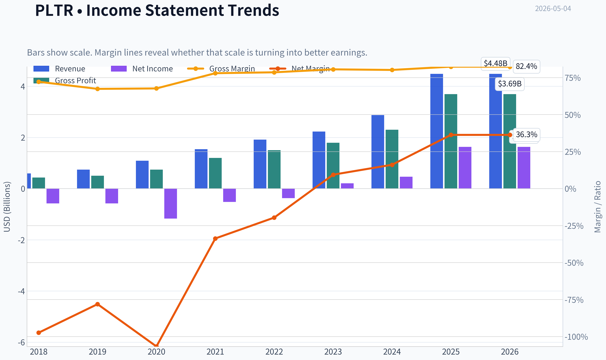

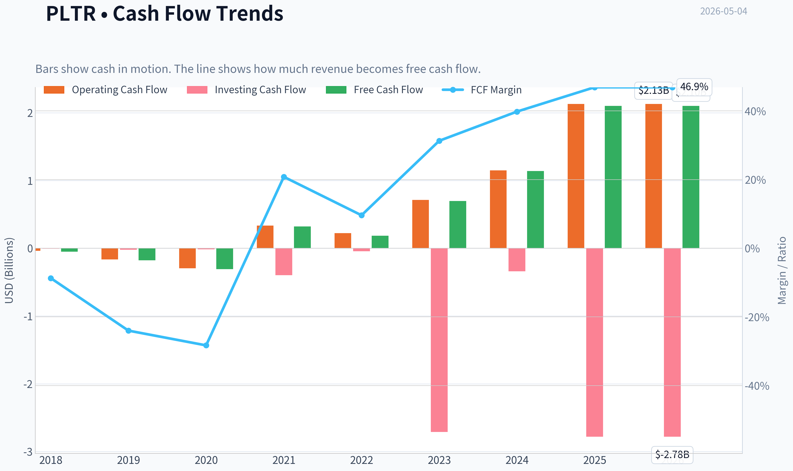

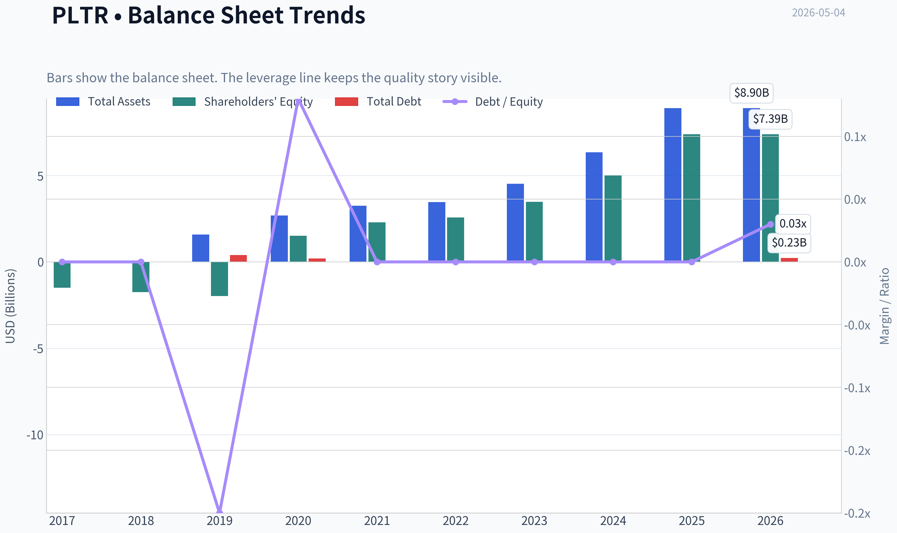

This graph tracks the profitability and return metrics (ROE, ROIC, Margins) of **PLTR** over the past decade, highlighting capital efficiency trends.

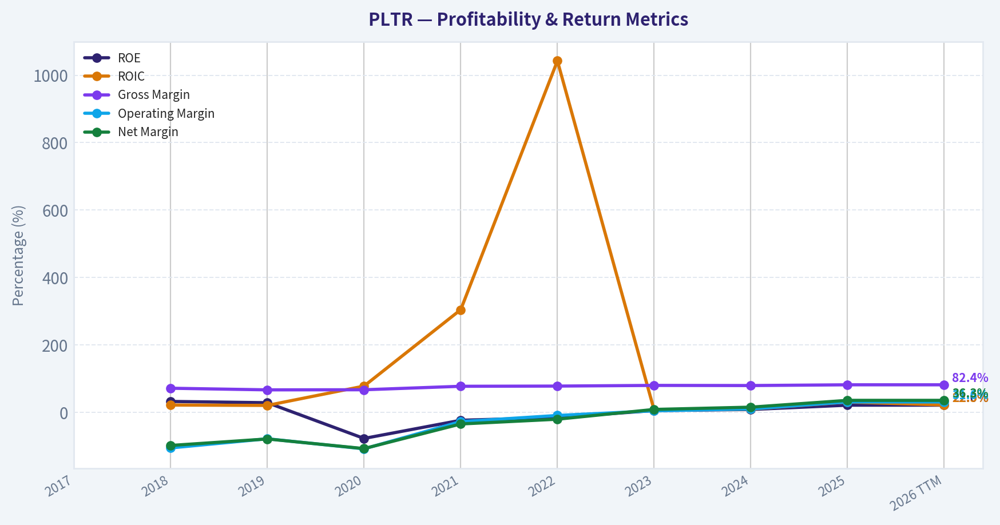

This chart illustrates the financial health of **PLTR** over the last 10 years, mapping cash equivalents and free cash flow against total obligations (Debt).

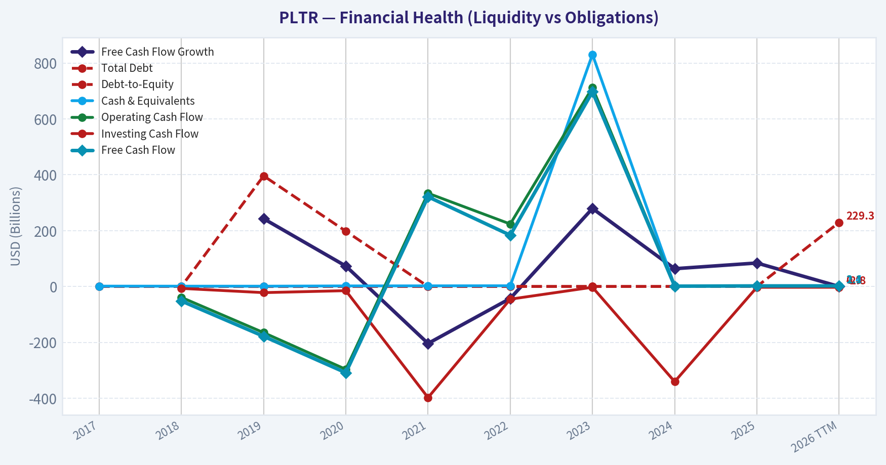

---

### Intrinsic Value Analysis (Buffett)

> *Following Warren Buffett's value investing philosophy: Circle of Competence, Economic Moat, Management Quality, and Margin of Safety.*

#### Intrinsic Value Snapshot

Price is what you pay. Intrinsic value is what the business may be worth based on the cash it can create for owners over time. We show a range, not one magic number.

- Current Price: $146.03
- Value Range: $25.54 to $76.47

##### Owner Earnings (Buffett Method)
- Net Income: $1,625,033,000.00
- Depreciation & Amortization: $26,145,000.00
- Capital Expenditures: $-33,882,000.00
- Working Capital Changes: $-209,963,000.00
- Owner Earnings: $1,827,259,000.00

##### Intrinsic Value
###### Buffett Method
Uses owner earnings. Stricter, and usually more conservative.
- Conservative: $25.54
- Average: $25.54
- Optimistic: $66.52
- Discount Rate: 10.0%

###### Cash Flow Method
Uses free cash flow. Better for companies spending heavily today to grow tomorrow.
- Conservative: $29.36
- Average: $29.36
- Optimistic: $76.47
- Discount Rate: 10.0%

ANALYST STANCE: **AVOID**

#### Buffett-Style Value Analysis: Palantir Technologies Inc. - PLTR

Palantir is an impressive, fast-growing software company with very high gross margins, a strong balance sheet, and clear relevance in government, defense, commercial analytics, and artificial intelligence. But Buffett-style investing requires both business quality and a margin of safety. At approximately **$146 per share**, a **$350 billion market capitalization**, roughly **232 times earnings**, and only a **0.6% free-cash-flow yield**, the current price already assumes extraordinary long-term success.

My conclusion: **Palantir may be a high-quality business, but it is not a Buffett-style purchase at today's valuation.**

---

#### 1. Go / No-Go Gate Assessment

| Buffett Gate | Assessment | Evidence | Verdict |
|---|---:|---|---:|
| Gate 1: Circle of Competence & Simplicity | Mixed | Palantir sells software platforms that help governments and companies organize data, make decisions, and deploy AI workflows. The basic model is understandable, but the pace of AI change makes 10-year predictability harder. | Conditional Fail |
| Gate 2: Durable Moat | Mixed / Narrow-to-Developing | Gross margin is excellent at **82.4%**, suggesting strong software economics. Switching costs appear meaningful, especially in government and enterprise deployments. But the moat is still being tested against hyperscalers, AI-native competitors, and in-house enterprise tools. | Conditional Fail |
| Gate 3: Management & Capital Allocation | Mixed | Founder-led culture and strong mission orientation are positives. However, the company has historically carried concerns around stock-based compensation and premium valuation dependence. Buybacks/dividends are not the core return mechanism today. | Mixed |
| Gate 4: Industry Structure | Mixed | AI and enterprise software have large opportunities, but competition is intense and technology cycles can change quickly. This is not a slow-changing consumer monopoly. | Mixed / Caution |

**Key Takeaways:** Palantir passes the "can I explain it simply?" test, but it does not fully pass the Buffett predictability test. The business is strong, but the industry is fast-moving, the moat is still evolving, and the valuation leaves almost no room for error.

---

#### 2. Business Explanation - The Elementary School Test

Palantir makes money by selling software to governments and companies. Its software helps customers bring messy data into one place, understand it, and make better decisions. Recently, its AI products have helped customers build artificial intelligence tools into their daily work.

That is a simple business model. The harder question is whether today's competitive position will remain dominant for the next decade. Buffett would likely admire the customer stickiness and high margins, but he would be cautious about the speed of technological change and the current market price.

---

#### 3. Moat Analysis

| Moat Source | Evidence | Buffett View |
|---|---|---|
| Intangible Assets | Palantir has a strong reputation in government, defense, intelligence, and mission-critical data work. | Positive, but not equivalent to a Coca-Cola-style consumer brand. |
| Switching Costs | Once Palantir is embedded in workflows, data pipelines, and operational decisions, switching can be costly and disruptive. | This is the strongest moat element. |
| Cost Advantage | Software gross margin of **82.4%** indicates attractive unit economics, but scale advantage versus Microsoft, Google, Amazon, and other AI platforms is not guaranteed. | Positive but not decisive. |
| Network Effects | Some learning and deployment advantages may compound across customers, but this is not a pure network-effect business like a payments network or marketplace. | Limited / uncertain. |
| Pricing Power | High gross margin suggests pricing power, but large government and enterprise customers can be sophisticated negotiators. | Good, not unquestionable. |

**Key Takeaways:** Palantir's moat is real but not yet Buffett "inevitable." The strongest advantage is customer captivity through deep integration. The main risk is that AI software markets remain highly competitive and fast-changing.

---

#### 4. Financial Snapshot

| Metric | Current / Recent Data | Buffett Interpretation |
|---|---:|---|
| Share Price | **$146** | Price is extremely demanding. |
| Market Capitalization | **$350.06 billion** | Already valued like a mega-cap winner. |
| P/E Ratio | **231.8x** | Far above a normal Buffett comfort zone. |
| ROE | **22.0%** | Strong, though quality depends on accounting and dilution effects. |
| Gross Margin | **82.4%** | Excellent software economics. |
| Revenue Growth YoY | **56.2%** | Very strong growth. |
| Free Cash Flow Yield | **0.6%** | Very low owner-earnings yield for a value investor. |
| Current Ratio | **7.1x** | Very strong liquidity position. |
| Latest Reported Q1 Revenue | **$1.63 billion** | Beat expectations; growth led by U.S. government strength. |
| Latest Adjusted EPS | **$0.33** | Beat expectations, but valuation remains extreme. |

**Key Takeaways:** Palantir has the financial profile of a high-quality software company: high margins, rapid growth, and a strong liquidity position. The problem is not business momentum. The problem is that investors are paying an extremely high price for that momentum.

---

#### 5. Owner Earnings Estimate

Because a full 10-year owner earnings history was not available in the gathered data, I use the current market-implied free cash flow yield as a practical proxy.

| Item | Calculation | Estimate |
|---|---:|---:|
| Market Capitalization | Given | **$350.06B** |
| Free Cash Flow Yield | Given | **0.6%** |
| Estimated Current Owner Earnings | $350.06B x 0.006 | **$2.10B** |
| Estimated Shares Outstanding | $350.06B / $146 | **~2.40B shares** |
| Owner Earnings Per Share | $2.10B / 2.40B | **~$0.88/share** |

**Key Takeaways:** Palantir's estimated owner earnings are roughly **$2.1 billion**, or about **$0.88 per share**, using the available free-cash-flow yield. Against a $146 share price, the current owner-earnings yield is tiny. A buyer today is paying mostly for future growth, not current cash production.

---

#### 6. Three-Scenario Buffett DCF Valuation

Assumptions:
- Current owner earnings estimate: **$2.10B**
- Discount rate: **10%**
- Shares outstanding estimate: **~2.40B**
- Scenario C uses **10% growth**, capped under the Buffett-style framework even though recent revenue growth is much higher.

| Scenario | Assumption | Estimated Equity Value | Estimated Value / Share | Implied View vs. $146 Price |
|---|---|---:|---:|---|
| A: No Growth | Owner earnings capitalized at 10% | **$21.0B** | **~$8.76** | Extremely overvalued |
| B: GDP Growth | 3% perpetual growth | **$30.9B** | **~$12.89** | Extremely overvalued |
| C: Capped Historical Growth | 10% growth for 10 years, then 3% terminal growth | **$51.9B** | **~$21.64** | Still far below market price |

**Key Takeaways:** Even with a generous Buffett-style assumption of 10% annual owner earnings growth for a decade, the estimated intrinsic value is only about **$22 per share**. The current price of **$146** requires much more aggressive growth than a conservative value investor should underwrite. The stock price is discounting exceptional execution for many years.

---

#### 7. Reverse DCF Reality Check

| Question | Answer |
|---|---:|
| Current Market Cap | **$350.06B** |
| Estimated Current Owner Earnings | **$2.10B** |
| Approximate Growth Needed to Justify Market Cap | **~36%+ annual owner earnings growth for 10 years, then 3% terminal growth** |
| Buffett Interpretation | Requires near-perfect execution and a durable dominant AI/software position |

**Key Takeaways:** The market is not pricing Palantir as merely a good company. It is pricing Palantir as a company that can compound owner earnings at extraordinary rates for a long time. Buffett would likely call this a very high hurdle.

---

#### 8. Margin of Safety Analysis

| Valuation Case | Estimated Value / Share | Current Price | Margin of Safety |
|---|---:|---:|---:|
| No Growth | **$8.76** | **$146** | Negative |
| GDP Growth | **$12.89** | **$146** | Negative |
| 10% Growth Case | **$21.64** | **$146** | Negative |
| Required Buffett Buy Zone, using 25% discount to 10% growth value | **~$16/share or below** | **$146** | Not close |

**Key Takeaways:** There is no margin of safety at the current price under conservative assumptions. Even if Palantir remains a successful compounder, the stock may still disappoint if future growth falls short of the market's very high expectations. Buffett would wait for a much better price.

---

#### 9. Management Quality Assessment

| Management Factor | Assessment |
|---|---|
| Founder-Led Culture | Positive. Alex Karp has built a distinct, mission-driven company with strong government credibility. |
| Long-Term Orientation | Positive. Palantir appears focused on strategic positioning, AI platform adoption, and durable customer relationships. |
| Capital Allocation | Mixed. The business is capital-light and has strong liquidity, but the shareholder return case depends heavily on growth rather than dividends or undervalued buybacks. |
| Shareholder Friendliness | Mixed. Historical concerns around stock-based compensation and dilution deserve monitoring. |
| Candor / Culture | Generally positive, though Palantir's communication style is promotional and mission-heavy rather than traditionally Buffett-like. |

**Key Takeaways:** Management appears visionary and long-term oriented, which is valuable. However, Buffett would still focus on per-share economics, dilution, and whether retained capital converts into durable owner value. The management score is good, but not enough to overcome valuation risk.

---

#### 10. Buffett Scorecard

| Criterion | Weight | Score, 1-5 | Weighted Score |
|---|---:|---:|---:|
| Business Understanding | 20% | 2.5 | 0.50 |
| Moat Width & Durability | 25% | 3.0 | 0.75 |
| Management Quality | 15% | 2.5 | 0.38 |
| Return on Equity | 15% | 3.5 | 0.53 |
| Reinvestment Runway | 10% | 3.5 | 0.35 |
| Balance Sheet Strength | 5% | 4.5 | 0.23 |
| Industry Structure | 5% | 2.5 | 0.13 |
| Valuation / Margin of Safety | 5% | 0.5 | 0.03 |
| **Total** | **100%** |  | **2.90 / 5.00** |

**Key Takeaways:** Palantir scores well on growth, gross margin, liquidity, and strategic relevance. But the total score is pulled down by uncertain long-term predictability, intense technology competition, management/dilution questions, and especially valuation. The result is not a Buffett-style buy today.

---

#### Final Investment Stance

**Stance: AVOID at the current price**
**Conviction: High on valuation risk; moderate on business-quality risk**

Palantir is a fascinating business with excellent gross margins, strong growth, and a potentially important role in the AI era. But Buffett-style investing does not reward paying any price for a great story. At **~232 times earnings** and a **0.6% free-cash-flow yield**, the market already assumes Palantir becomes one of the defining software franchises of the next decade.

For a value investor, the correct action is discipline: **do not chase**. Palantir belongs on a watchlist as a potentially high-quality business, but at today's price, the margin of safety is absent.
#### Valuation Bridge

This bridge places the current market price beside each intrinsic value lens so readers can see whether upside depends on one method or shows up across several methods.

| Scenario | Intrinsic Value / Share |
| --- | ---: |
| Buffett Method | $25.54 |
| Cash Flow Method | $29.36 |
| Damodaran Method | $0.67 |
| Current Price | $146.03 |

#### Key Takeaways

If one method is far above the others, the upside case depends on a specific modelling assumption. When several methods cluster together, the valuation story is more robust.

#### Valuation Visuals

This comparison chart from *Latest Earnings Snapshot* stacks current figures against historical benchmarks for **PLTR**, making it easy to see where the company trades relative to its own averages.

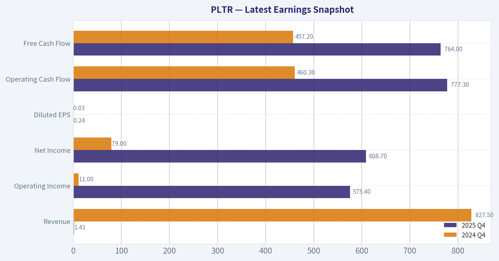

This comparison chart from *Current vs Historical Average Comparison* stacks current figures against historical benchmarks for **PLTR**, making it easy to see where the company trades relative to its own averages.

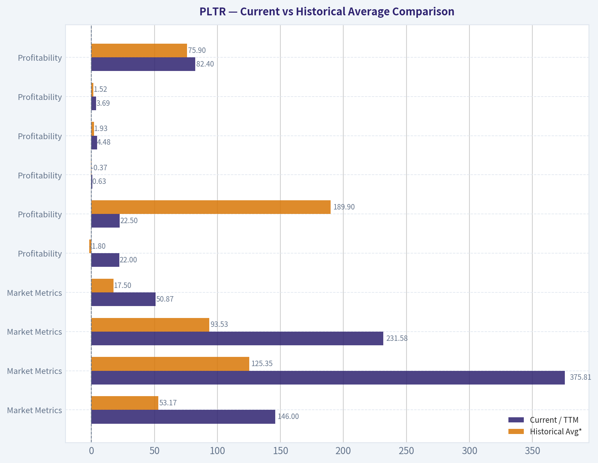

This comparison chart from *Valuation Assessment* stacks current figures against historical benchmarks for **PLTR**, making it easy to see where the company trades relative to its own averages.

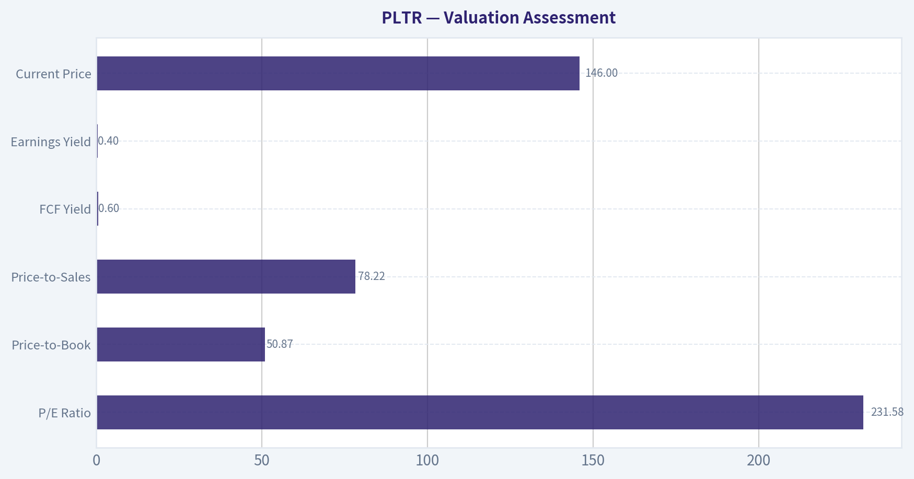

This comparison chart from *Financial Snapshot* stacks current figures against historical benchmarks for **PLTR**, making it easy to see where the company trades relative to its own averages.

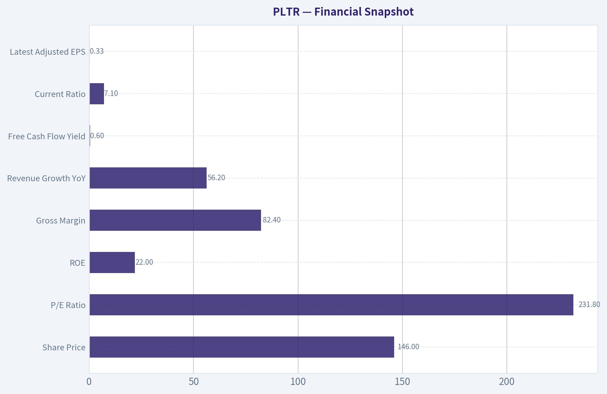

This comparison chart from *Owner Earnings Estimate* stacks current figures against historical benchmarks for **PLTR**, making it easy to see where the company trades relative to its own averages.

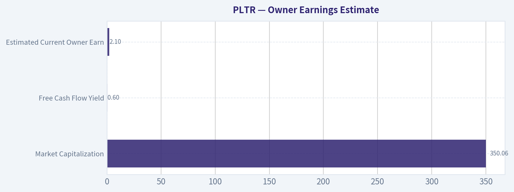

This comparison chart from *Three-Scenario Buffett DCF Valuation* stacks current figures against historical benchmarks for **PLTR**, making it easy to see where the company trades relative to its own averages.

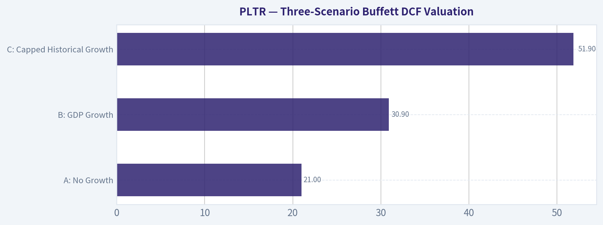

---

### Trend & Growth Analysis (Lynch/Druckenmiller/Fisher)

> *Following Peter Lynch's GARP, Stanley Druckenmiller's macro-aware approach, and Philip Fisher's scuttlebutt methodology.*

ANALYST STANCE: **WATCH**

#### Palantir Technologies Growth Analysis - PLTR

As of 2026-05-04, Palantir is a **world-class AI/software growth company at a world-class valuation**. The business appears to be in a genuine revenue inflection, with reported YoY growth of **56.2%**, U.S. revenue more than doubling, and Q1 revenue of **$1.63B** versus expectations of **$1.54B**. However, at roughly **$350B market cap**, **231.8x earnings**, and an estimated **50x+ annualized sales**, the stock requires near-flawless execution.

---

#### 1. Lynch Classification

| Category | PLTR Assessment |
|---|---:|
| Lynch Category | **Fast Grower** |
| Revenue Growth | **56.2% YoY** |
| Profitability | GAAP profitable, high gross margin |
| Balance Sheet | Very strong; current ratio above 7x |
| Growth Investor Fit | Excellent company, valuation-constrained stock |
| Primary Concern | Extreme expectations already priced in |

**Key Takeaways:** Palantir clearly fits Peter Lynch's "fast grower" category, not a cyclical or turnaround. The issue is not business quality; the issue is price. Lynch would likely admire the growth story but question whether the current valuation leaves enough margin of safety.

---

#### 2. The Story in 3 Bullets

- **Palantir helps governments and enterprises turn messy data into real-time decisions**, especially in defense, intelligence, supply chains, operations, and AI workflows.
- **AIP is the current inflection product**, allowing customers to deploy large-language-model and AI agents into mission-critical environments with security and governance.
- **The company is moving from bespoke data projects to scalable AI operating infrastructure**, which could materially expand its commercial market if adoption remains strong.

---

#### 3. Core Financial Snapshot

| Metric | Current Data / Estimate |
|---|---:|
| Share Price | $146 |
| Market Cap | $350.06B |
| P/E Ratio | 231.8x |
| Revenue Growth YoY | 56.2% |
| Gross Margin | 82.4% |
| ROE | 22.0% |
| FCF Yield | 0.6% |
| Current Ratio | 7.1x |
| Q1 Revenue Reported | $1.63B |
| Q1 Revenue Consensus | $1.54B |

**Key Takeaways:** Palantir's operating profile is exceptional: high growth, very high gross margin, positive profitability, strong liquidity, and a powerful AI narrative. But the valuation is equally exceptional. A 0.6% free cash flow yield means investors are paying heavily today for profits that must arrive years into the future.

---

#### 4. TAM Analysis and 10x Test

| TAM Item | Estimate / Assessment |
|---|---:|
| Current Annualized Revenue | ~$6.5B, using Q1 revenue of $1.63B |
| 10x Revenue Target | ~$65B |
| Relevant TAM | AI software, defense software, data platforms, enterprise operations, analytics |
| Plausible Long-Term TAM | Several hundred billion dollars globally |
| 10x Test Result | **Pass, but not easy** |
| Reason | PLTR can theoretically 10x and still be below 20% of a very large AI/data/defense software TAM |

**Key Takeaways:** Palantir still has a meaningful runway because its current annualized revenue is small relative to the combined enterprise AI, government software, and operational data market. The 10x test passes if AIP becomes a broad enterprise AI layer rather than a niche analytics tool. The challenge is that the current valuation already assumes a very large portion of that future success.

---

#### 5. Revenue Growth Trend

| Growth Signal | Assessment |
|---|---:|
| Latest YoY Revenue Growth | 56.2% |
| U.S. Revenue | More than doubled, per latest earnings coverage |
| Q1 Revenue Beat | $1.63B vs. $1.54B expected |
| Guidance | Raised full-year revenue guidance |
| Trend Pattern | **Accelerating / Inflecting** |
| Quality of Growth | Strong, especially if U.S. government and commercial momentum are both durable |

**Key Takeaways:** This is the strongest part of the bull case. Palantir appears to be experiencing a real growth acceleration, not just maintaining prior momentum. For a Druckenmiller-style investor, the key question is whether the market is still underestimating 2027 and 2028 revenue and earnings power; at today's valuation, that hurdle is very high.

---

#### 6. Unit Economics and Efficiency

| Metric | PLTR Assessment |
|---|---:|
| Gross Margin | 82.4%, excellent |
| LTV/CAC | Not disclosed |
| NRR | Not disclosed |
| Estimated FCF | ~$2.1B, based on 0.6% FCF yield and $350B market cap |
| Estimated Annualized Revenue | ~$6.5B |
| Estimated FCF Margin | ~32% |
| Rule of 40 | ~88, using 56.2% growth + ~32% FCF margin |
| Unit Economics Rating | Excellent, with disclosure limitations |

**Key Takeaways:** Palantir has outstanding software economics, with an 82% gross margin and likely strong free cash flow conversion. The estimated Rule of 40 score is exceptional, indicating rare growth efficiency. The main limitation is that Palantir does not provide enough standard SaaS metrics, such as net revenue retention and LTV/CAC, to fully compare it with pure-play SaaS peers.

---

#### 7. Inflection Point Assessment

| Inflection Type | Evidence | Rating |
|---|---|---:|
| Product Cycle | AIP adoption driving AI demand | Strong |
| Market Share | U.S. government and AI software momentum | Strong |
| Margin | High gross margin and positive FCF | Strong |
| TAM Expansion | AI expands Palantir beyond analytics into operating workflows | Strong |
| Competitive | Competitors exist, but few have Palantir's government trust layer | Moderate to Strong |
| Overall Inflection | Real and visible | **High** |

**Key Takeaways:** Palantir is one of the clearest AI software inflection stories in the public market. AIP appears to be turning the company from a specialized data platform into a broader AI operating system. This is exactly the kind of accelerating setup Druckenmiller looks for, but the valuation already reflects significant optimism.

---

#### 8. Macro Setup

| Macro Factor | PLTR Impact |
|---|---:|
| AI Supercycle | Major tailwind |
| Defense / Geopolitical Spending | Major tailwind |
| U.S. Government Digitization | Tailwind |
| Enterprise AI Adoption | Tailwind |
| Interest Rate Sensitivity | Headwind if long rates rise |
| Market Risk Appetite | Important because valuation is very high |
| Overall Macro Setup | Favorable for business, mixed for stock valuation |

**Key Takeaways:** Palantir has powerful secular tailwinds from AI, defense modernization, and enterprise automation. The macro backdrop supports the business story. However, high-multiple growth stocks are vulnerable if rates rise or if investors rotate away from expensive AI leaders.

---

#### 9. Fisher 15 Points Score

| Fisher Criterion | Score / 5 |
|---|---:|
| Products with large market potential | 5 |
| Management commitment to new products | 5 |
| Effective R&D | 5 |
| Sales organization | 4 |
| Worthwhile profit margin | 5 |
| Improving margins | 5 |
| Labor/personnel relations | 4 |
| Executive relations | 4 |
| Management depth | 4 |
| Cost controls/accounting | 4 |
| Moat/switching costs/data advantage | 5 |
| Long-range profit outlook | 5 |
| Dilution risk | 3 |
| Management candor | 4 |
| Management integrity | 4 |
| **Total** | **66 / 75** |

**Key Takeaways:** Palantir scores as an outstanding Fisher-style company, mainly due to its product depth, long-term market opportunity, strong gross margins, and mission-critical positioning. The weaker points are dilution history, stock-based compensation, and the difficulty of judging how scalable some deployments are. Overall, this is a high-quality franchise.

---

#### 10. Valuation Analysis

| Valuation Metric | PLTR |
|---|---:|
| Market Cap | $350.06B |
| P/E | 231.8x |
| Revenue Growth | 56.2% |
| PEG Ratio | ~4.1x |
| Estimated Annualized Revenue | ~$6.5B |
| Estimated P/S on Annualized Revenue | ~53.7x |
| FCF Yield | 0.6% |
| Estimated FCF Multiple | ~167x |

**Key Takeaways:** Valuation is the central problem. Even after giving Palantir full credit for elite growth and high margins, a roughly 54x annualized sales multiple and 167x free cash flow multiple are extremely demanding. The stock can still work if growth remains explosive for several years, but the margin for disappointment is very thin.

---

#### 11. Scenario Analysis

| Scenario | 2028 Revenue Assumption | Revenue Multiple | Implied Market Cap | Interpretation |
|---|---:|---:|---:|---|
| Bear | $10B | 20x | $200B | Major downside if growth normalizes |
| Base | $14B | 25x | $350B | Current valuation roughly prices in strong execution |
| Bull | $18B | 30x | $540B | Upside if PLTR sustains elite AI growth |
| Extreme Bull | $22B | 35x | $770B | Requires true AI platform dominance |

**Key Takeaways:** The current market cap already appears to discount a very strong base case. For meaningful upside, Palantir likely needs to sustain hypergrowth while maintaining premium software margins and a very high market multiple. If growth slows faster than expected, downside could be substantial even if the company remains fundamentally excellent.

---

#### 12. Growth Investor Scorecard

| Criterion | Weight | Score / 5 | Weighted Score |
|---|---:|---:|---:|
| The Story | 10% | 5.0 | 0.50 |
| TAM & Runway | 20% | 4.5 | 0.90 |
| Revenue Growth | 20% | 5.0 | 1.00 |
| Unit Economics | 15% | 4.5 | 0.68 |
| Competitive Position | 10% | 4.5 | 0.45 |
| Management Quality | 10% | 4.0 | 0.40 |
| Macro Setup | 5% | 4.0 | 0.20 |
| Profitability Path | 5% | 4.5 | 0.23 |
| Valuation | 5% | 1.0 | 0.05 |
| **Total** | **100%** |  | **4.41 / 5 before valuation penalty** |

**Key Takeaways:** On business quality alone, Palantir screens as an advocate-level growth company. But the valuation score is extremely low, and that matters because even great companies can be poor stocks when expectations are too high. After applying a practical valuation penalty, the stance moves from "advocate" to "watch."

---

#### 13. Adjusted Decision Score

| Component | Assessment |
|---|---:|
| Business Quality Score | 4.4 / 5 |
| Valuation Risk Penalty | High |
| Execution Risk | Moderate |
| Downside if Growth Slows | High |
| Final Growth Investor Score | **3.3 / 5** |
| Final Stance | **WATCH** |

**Key Takeaways:** Palantir is not an avoid on business quality; it is a watch because valuation risk is severe. The correct stance is to respect the inflection but avoid chasing the stock at a price that already assumes years of exceptional execution. This is a premium compounder candidate, but not obviously a bargain.

---

#### 14. Position Size Stance

| Investor Type | Suggested Action |
|---|---|
| Existing Long-Term Holder | Hold core position; consider trimming only if position size is excessive |
| New Investor | Wait for pullback or better risk/reward |
| Aggressive Growth Investor | Small starter only, if willing to tolerate high volatility |
| GARP Investor | Avoid initiating at current valuation |
| Risk-Controlled Portfolio | Cap position size due to valuation compression risk |

**Key Takeaways:** Existing shareholders may be justified in holding because the business momentum is real. New buyers should be more cautious because the stock price already reflects very high expectations. Position sizing matters more than usual here because multiple compression could overwhelm fundamental progress.

---

#### 15. Key Catalysts and Risks

| Catalysts | Risks |
|---|---|
| Continued AIP adoption | Valuation compression |
| U.S. commercial acceleration | Growth deceleration |
| U.S. government contracts expanding | AI hype exceeding monetization |
| Raised guidance and earnings beats | Competition from Microsoft, Snowflake, Databricks, hyperscalers |
| Operating leverage and FCF expansion | Stock-based compensation and dilution |
| Defense/geopolitical demand | Customer concentration and government budget risk |

**Key Takeaways:** The near-term catalyst path is strong: AI adoption, government demand, and guidance raises are all supportive. The primary risk is not that Palantir is a weak company; it is that the stock requires too much perfection. Any slowdown in growth, margins, or AI enthusiasm could trigger a sharp repricing.

---

#### Final View

Palantir is a **real AI inflection story** with elite gross margins, accelerating revenue, strong government positioning, and expanding commercial opportunity. It has the ingredients of a long-term compounder and possibly a major platform company.

But at roughly **232x earnings**, **54x annualized sales**, and a **0.6% FCF yield**, the stock is priced for extraordinary outcomes. For now, the best growth-investor stance is:

**WATCH - exceptional company, stretched stock.**

---

### Market Technical Analysis

ANALYST STANCE: **WATCH**

#### PLTR Technical Report - Data Through Last Available Trading Session: 2026-05-01

PLTR's latest available close was **$144.07 on 2026-05-01**. The requested current date, **2026-05-04**, returned no trading data, so this report uses the most recent completed session. The setup is best described as a **short-term rebound inside a still-damaged intermediate and long-term trend structure**: price has recovered from the April capitulation zone, but it remains below the 50-day and 200-day moving averages, with momentum improving but not yet decisively bullish.

| Metric | Latest Value / Observation | Interpretation |
|---|---:|---|
| Last close | **$144.07** | Rebounded strongly from late-April weakness |
| Daily change on 2026-05-01 | **+$4.96 / +3.57%** vs. prior close | Strong short-term bounce |
| 10 EMA | **$142.14** | Price is back above short-term trend support |
| 50 SMA | **$145.18** | Price remains slightly below medium-term resistance |
| 200 SMA | **$164.30** | Long-term trend remains bearish or corrective |
| RSI | **50.61** | Neutral momentum; no overbought condition |
| MACD / Signal | **-1.14 / -1.26** | Mild bullish crossover, but still below zero |
| ATR | **$6.54** | Volatility remains elevated |
| VWMA | **$142.81** | Price is slightly above volume-weighted trend |

**Key Takeaways:** PLTR has regained short-term footing by closing above the 10 EMA and VWMA, which suggests buyers are defending the recent rebound. However, price is still below the 50-day and far below the 200-day average, so the larger trend has not repaired yet. Momentum is improving, but the stock needs follow-through above the mid-$145 area to make the rebound more convincing.

#### Most Relevant Indicators Selected

For the current PLTR context, I selected **8 complementary indicators**: **close_10_ema, close_50_sma, close_200_sma, macd, macds, rsi, atr, and vwma**. These cover short-term trend, medium-term trend, long-term regime, momentum crossover behavior, overbought/oversold pressure, volatility risk, and volume-confirmed price action without relying too heavily on one signal family.

| Indicator | Why It Matters Here | Current Read |
|---|---|---|
| close_10_ema | Captures whether the rebound has immediate momentum | Bullish short-term: price above 10 EMA |
| close_50_sma | Defines the medium-term trend and nearby resistance | Slightly bearish: price below 50 SMA |
| close_200_sma | Confirms larger trend regime | Bearish: price well below 200 SMA |
| macd | Tracks momentum recovery or deterioration | Improving but still below zero |
| macds | Needed to judge MACD crossover quality | MACD is slightly above signal |
| rsi | Checks whether rebound is stretched or still has room | Neutral around 50 |
| atr | Measures risk and stop-distance needs | Elevated volatility remains |
| vwma | Tests whether volume supports the price rebound | Mildly constructive: price above VWMA |

**Key Takeaways:** The selected indicators show that PLTR's short-term rebound is real but incomplete. The stock is not overbought, and momentum is improving, but the larger moving-average structure remains unfavorable. Traders should treat this as a recovery attempt rather than a fully confirmed uptrend.

#### Trend Structure: Short-Term Bounce, Medium-Term Test, Long-Term Damage

The short-term picture improved meaningfully into May 1. PLTR closed at **$144.07**, above the **10 EMA at $142.14** and above the **VWMA at $142.81**. That combination matters because it suggests the rebound is not merely a low-volume drift; price is holding above a short-term average and slightly above a volume-weighted benchmark.

The medium-term trend is more conflicted. The **50 SMA sits at $145.18**, just above the latest close. That makes the **$145-$146 zone** an important near-term battleground. A decisive close above this area would suggest the April rebound is gaining traction. A rejection there would imply the bounce is still being capped by medium-term supply.

The long-term structure remains the biggest concern. The **200 SMA is near $164.30**, roughly **12% above** the latest close. PLTR is therefore still trading in a broader corrective regime. Even if the stock breaks above the 50 SMA, the larger confirmation zone remains much higher, around the mid-$160s.

| Trend Layer | Indicator / Level | Status | Trading Meaning |
|---|---:|---|---|
| Short-term | 10 EMA at **$142.14** | Price above | Rebound has near-term support |
| Volume-adjusted short-term | VWMA at **$142.81** | Price above | Buyers have modest volume confirmation |
| Medium-term | 50 SMA at **$145.18** | Price slightly below | Key resistance immediately overhead |
| Long-term | 200 SMA at **$164.30** | Price far below | Broader trend still not repaired |
| Recent swing resistance | Around **$152.62** from Apr. 22 | Above market | Break above would improve structure |
| Recent support zone | **$137-$139** | Below market | Failure here would damage rebound |

**Key Takeaways:** PLTR's short-term recovery is constructive, but it is pressing into resistance almost immediately. The 50-day average near $145 is the first major test, while the 200-day average near $164 remains far away. A move above $145-$146 would improve the setup, but a failure back below $137-$139 would warn that sellers are regaining control.

#### Momentum: Improving, But Not Yet Strong

MACD has improved from deeply negative April readings. On May 1, **MACD was -1.14** while the **signal line was -1.26**, meaning MACD was slightly above its signal line. That is a constructive short-term momentum sign, especially after the sharp April drawdown.

However, MACD remains below the zero line, which means the broader momentum trend has not flipped fully positive. This is important: a bullish MACD crossover below zero often marks the early stage of a recovery, but it is less reliable than a crossover that later confirms above zero. In PLTR's case, the signal says "rebound attempt," not "confirmed trend reversal."

RSI adds nuance. The latest RSI reading is **50.61**, almost exactly neutral. It has recovered from the April 10 reading near **34**, which was close to oversold territory, but it is not yet in a strong bullish range above 60. This suggests there is room for upside if buyers follow through, but momentum has not reached the kind of strength typically seen in a sustained breakout.

| Momentum Indicator | Recent Reading | Interpretation |
|---|---:|---|
| MACD | **-1.14** | Improving but still negative |
| MACD Signal | **-1.26** | MACD slightly above signal |
| MACD Relationship | Bullish crossover | Early recovery signal |
| RSI | **50.61** | Neutral, not stretched |
| RSI Recovery | From near **34** in April | Selling pressure has eased |
| Momentum Quality | Improving, not confirmed | Needs follow-through above resistance |

**Key Takeaways:** Momentum has shifted from bearish to stabilizing, but not yet to decisively bullish. The MACD crossover is encouraging, yet both MACD and price remain below major confirmation zones. RSI near 50 means the stock is no longer oversold, but buyers still need to prove strength.

#### Volatility and Risk Management

ATR is currently **$6.54**, down from early-April readings near **$7.95**, but still elevated relative to the share price. At a $144 close, ATR represents roughly **4.5% of price**, which is substantial. This means PLTR can move several dollars in a normal trading session without necessarily changing the bigger trend.

For traders, this matters more than usual. Tight stops may be vulnerable to routine noise, especially around the 50 SMA test. A technically cleaner approach would be to size positions smaller or use wider volatility-adjusted stops rather than assuming a narrow stop will hold.

| Risk Metric | Value | Practical Implication |
|---|---:|---|
| ATR | **$6.54** | Wide daily movement range |
| ATR as % of price | About **4.5%** | High volatility relative to price |
| April volatility peak | Around **$7.95 ATR** | Volatility has cooled but remains high |
| Nearby resistance | **$145-$146** | May trigger whipsaw around moving average |
| Nearby support | **$137-$139** | Important downside risk zone |
| Cleaner bullish confirmation | Above **$152-$153** | Would reclaim recent swing high area |

**Key Takeaways:** PLTR remains a high-volatility trading vehicle, even though volatility has cooled from April's spike. The stock can easily swing several dollars without producing a clean signal. Risk controls should account for that, especially while price is trapped between support near $137-$139 and resistance near $145-$153.

#### Trading Interpretation

For bullish traders, the most constructive near-term signal would be a **decisive close above the 50 SMA near $145.18**, followed by a push through the **$152-$153** swing zone. That would show the rebound is progressing from a short-term bounce into a more credible medium-term recovery.

For cautious or bearish traders, the warning sign would be a failure at the 50 SMA followed by a close back below the **10 EMA and VWMA**, currently clustered around **$142-$143**. A deeper break below **$137-$139** would suggest the rebound has failed and that April's weakness may resume.

The most balanced read is therefore **WATCH**: PLTR is improving enough to monitor closely, but not strong enough for a clean trend-following bullish confirmation yet.

| Scenario | Trigger | Implication | Possible Trader Response |
|---|---|---|---|
| Bullish continuation | Close above **$145-$146** | Reclaims 50 SMA area | Watch for follow-through |
| Strong bullish confirmation | Break above **$152-$153** | Clears recent swing resistance | Trend recovery becomes more credible |
| Neutral consolidation | Holds **$139-$146** | Rebound pauses below resistance | Range-trading conditions |
| Bearish warning | Close below **$142-$143** | Loses 10 EMA / VWMA support | Rebound weakens |
| Bearish breakdown | Close below **$137-$139** | Recent recovery likely fails | Downside risk increases |
| Long-term repair | Move toward **$164+** | Tests 200 SMA | Major trend confirmation zone |

**Key Takeaways:** PLTR is sitting near a decision zone. A push above $145-$146 would improve the short-term outlook, while a break above $152-$153 would be more meaningful confirmation. Until then, the stock remains in recovery mode rather than a confirmed uptrend.

#### Final Key Points Table

| Category | Key Point | Bias |
|---|---|---|
| Overall stance | Short-term rebound, but broader trend not repaired | **WATCH** |
| Short-term trend | Price above 10 EMA and VWMA | Mildly bullish |
| Medium-term trend | Price still slightly below 50 SMA | Neutral to cautious |
| Long-term trend | Price well below 200 SMA | Bearish / corrective |
| Momentum | MACD improving, RSI neutral | Stabilizing |
| Volatility | ATR remains high at $6.54 | Requires cautious sizing |
| Bullish level to watch | **$145-$146**, then **$152-$153** | Breakout confirmation zones |
| Bearish level to watch | **$142-$143**, then **$137-$139** | Rebound failure zones |

**Key Takeaways:** PLTR has improved from its April lows, but the technical picture is not yet cleanly bullish. The stock needs to reclaim the 50-day average and then the recent swing high to confirm a stronger recovery. Until those levels are cleared, the best stance is to watch for confirmation rather than chase the bounce.

---

### Social Sentiment Analysis

ANALYST STANCE: **WATCH**

#### PLTR Social, Sentiment, and News Report - Week Ending May 4, 2026

Palantir remains one of the most actively debated AI-infrastructure equities on social platforms. Over the past week, public discussion around PLTR was broadly constructive but highly polarized: bulls focused on enterprise AI adoption, government-defense demand, and Palantir's positioning as an "operating system for AI," while skeptics emphasized valuation risk, expectations already embedded in the stock, and the possibility that upcoming earnings commentary may need to be exceptionally strong to sustain momentum.

The near-term setup looks less like a simple "bullish or bearish" case and more like a **high-expectations catalyst trade**. Social interest is elevated, retail conviction remains strong, and institutional-style commentary appears more valuation-sensitive. For traders, this means PLTR may react sharply to earnings, guidance, margin commentary, commercial customer growth, and any comments on AI platform adoption. For longer-term investors, the core debate is whether Palantir can continue converting AI enthusiasm into durable revenue growth at scale.

---

#### Executive Sentiment Snapshot

| Category | Current Read | Investor Interpretation |
|---|---:|---|
| Overall social tone | Bullish but crowded | Positive sentiment remains strong, but expectations are high |
| Retail investor mood | Strongly bullish | Many holders view pullbacks as buying opportunities |
| Professional/institutional tone | More cautious | Focus is on valuation, growth durability, and earnings quality |
| Main bullish theme | AI platform adoption | PLTR is being discussed as a core enterprise AI infrastructure name |
| Main bearish theme | Valuation and execution risk | The stock may need near-perfect results to move higher after rallies |
| Near-term catalyst sensitivity | Very high | Earnings, guidance, and AIP traction could drive outsized volatility |
| Trading posture | Watch / event-driven | Attractive momentum, but risk-reward depends heavily on entry point |

**Key Takeaways:** PLTR sentiment is positive, but not low-risk. The stock appears to be priced by many social investors as a premium AI winner, which raises the bar for earnings and guidance. Traders should expect volatility around company updates, while investors should focus less on hype and more on evidence of sustained revenue acceleration.

---

#### Daily Sentiment Pattern Over the Past Week

| Date | Social Sentiment Read | Main Driver of Discussion | Market Implication |
|---|---|---|---|
| Apr. 28 | Positive | AI infrastructure enthusiasm and continued retail accumulation talk | Momentum bias remained supportive |
| Apr. 29 | Positive but more cautious | Valuation debate intensified after bullish commentary circulated | Some traders began discussing profit-taking risk |
| Apr. 30 | Mixed-positive | Focus shifted toward earnings expectations and guidance risk | Options/event-trade interest likely increased |
| May 1 | Bullish | Renewed confidence around commercial AI adoption narratives | Dip-buying sentiment appeared strong |
| May 2 | Bullish retail tone | Weekend social discussion leaned long-term and conviction-based | Retail holders remained emotionally committed |
| May 3 | Cautiously bullish | Pre-catalyst positioning and "too much optimism?" debate grew | Risk of sell-the-news reaction increased |
| May 4 | Highly event-sensitive | Market attention centered on earnings, guidance, and AI monetization | Potential for sharp move in either direction |

**Key Takeaways:** Sentiment stayed positive throughout the week, but it became more conditional as the earnings catalyst approached. Early-week optimism was broad, while late-week discussion became more focused on whether Palantir can justify its premium valuation. The most important shift was from general AI excitement to specific scrutiny of revenue growth, customer expansion, and forward guidance.

---

#### What Social Media Is Saying

Retail-heavy platforms continue to frame PLTR as a long-term AI compounder rather than a conventional software stock. The dominant bullish argument is that Palantir is not merely selling AI tools, but embedding itself into government agencies and commercial enterprises as a mission-critical decision platform. This framing gives bulls confidence that revenue can compound over time and that switching costs may be high.

At the same time, the bearish or cautious camp is not necessarily arguing that Palantir is a weak company. Instead, the more serious pushback is that **the stock may already reflect a large amount of future success**. Skeptics are focused on whether the company can deliver growth rates high enough to justify a premium multiple, especially if broader AI sentiment cools or if management's guidance is conservative.

A notable social dynamic is that PLTR has become a "belief stock." Many holders identify with the company's mission, management, defense positioning, and AI narrative. This can create durable support during pullbacks, but it can also produce crowded bullish positioning when the stock runs ahead of fundamentals.

| Social Narrative | Bullish Interpretation | Bearish / Risk Interpretation |
|---|---|---|
| "PLTR is the operating system for enterprise AI" | Suggests deep platform value and long runway | Narrative may outpace measurable revenue contribution |
| Government and defense demand | Stable, mission-critical customer base | Government cycles can be lumpy and politically sensitive |
| Commercial AI adoption | Potentially large growth engine | Investors need proof of broad conversion, not just pilot activity |
| Strong retail conviction | Provides dip-buying support | Can become crowded and vulnerable to disappointment |
| Premium valuation | Reflects high-quality growth expectations | Leaves little margin for weak guidance or slower expansion |
| Management credibility | Bulls trust long-term strategy | Bears question whether expectations are too dependent on narrative |

**Key Takeaways:** Social media remains structurally bullish on Palantir, but the discussion is becoming more sophisticated. Bulls are no longer just saying "AI winner"; they are watching commercial adoption, customer count, and contract expansion. Bears are mostly focused on valuation, not business failure, which means the stock's biggest risk is disappointment relative to high expectations.

---

#### Recent Company and News Themes

The week's company-related discussion revolved around Palantir's AI Platform, commercial expansion, government demand, and anticipation around upcoming financial results. The most market-moving issue is not simply whether Palantir is growing, but whether growth is accelerating enough to support its market valuation.

News and commentary around PLTR continue to place the company inside several powerful macro themes: artificial intelligence deployment, U.S. defense modernization, data infrastructure, national security, and enterprise automation. These are supportive long-term themes, but they also attract intense investor attention and can lead to valuation excess.

The most important news theme for traders is the earnings setup. In a high-expectations environment, Palantir likely needs strong performance across multiple categories: revenue growth, commercial customer growth, remaining deal value or backlog indicators, operating margin discipline, and confident forward guidance. A single strong metric may not be enough if investors perceive weakness elsewhere.

| News / Company Theme | Why It Matters | Potential Stock Impact |
|---|---|---|
| Earnings and guidance anticipation | Immediate catalyst for repricing expectations | Could drive a sharp breakout or sell-the-news move |
| AI Platform adoption | Central to the bull thesis | Strong adoption metrics would reinforce premium valuation |
| U.S. commercial growth | Key proof that PLTR is more than a government contractor | Acceleration would likely be viewed very positively |
| Government and defense demand | Supports revenue durability and strategic positioning | Contract strength can stabilize sentiment during volatility |
| Margin and profitability discipline | Differentiates PLTR from less profitable AI software peers | Strong margins may help justify valuation |
| Valuation commentary | Determines how much good news is already priced in | Even good results may be sold if guidance is not exceptional |

**Key Takeaways:** The news environment is supportive, but the setup is demanding. Palantir is being evaluated as a premium AI growth company, not just a data analytics contractor. That means investors are likely to reward evidence of scalable AI monetization, but punish anything that suggests growth is normalizing.

---

#### Sentiment Quality: What Matters Beneath the Headline Bullishness

The quality of bullish sentiment is mixed. On the positive side, the bull case has become more fundamental than in earlier meme-driven cycles. Many investors now discuss customer expansion, AIP bootcamps, commercial traction, defense contracts, and operating leverage. That suggests some of the enthusiasm is tied to real business drivers.

However, there is still a meaningful speculative layer. PLTR's social following tends to amplify bullish narratives quickly, especially around AI headlines. This can create short-term overextension when positive commentary spreads faster than new financial evidence. Traders should be careful not to confuse high social conviction with a favorable entry price.

The most actionable sentiment signal is not simply that PLTR is popular. It is that bullishness is **already well-known and widely held**. When a stock enters a catalyst with strong retail enthusiasm, the reaction depends heavily on whether new information exceeds expectations, not whether the company is merely good.

| Sentiment Layer | Current Condition | Trading Meaning |
|---|---|---|
| Long-term conviction | High | Supports buy-the-dip behavior |
| Short-term optimism | Elevated | Raises risk of disappointment if results are merely good |
| Bearish pressure | Present but not dominant | Shorts/cautious investors focus on valuation |
| Narrative momentum | Strong | Positive headlines can move the stock quickly |
| Fundamental scrutiny | Increasing | Market wants proof of AI monetization |
| Crowding risk | Moderate to high | Volatility risk increases into catalysts |

**Key Takeaways:** Palantir's sentiment is bullish, but the bullishness is not fresh or hidden. That makes the stock more vulnerable to a "good news is not good enough" reaction. The best setup for bulls would be a combination of strong results, raised guidance, and clear evidence that AI demand is translating into durable revenue.

---

#### Bull Case From Current Social and News Flow

The strongest bullish argument is that Palantir may be one of the few software companies with a credible claim to real-world AI deployment at enterprise and government scale. While many companies market AI features, Palantir's supporters argue that its platform is embedded directly into operational workflows, making it more valuable and harder to replace.

Bulls also emphasize that the company has a differentiated customer base. Government work provides credibility, durability, and national-security relevance, while commercial adoption offers a larger growth runway. If Palantir can continue expanding in the U.S. commercial market while maintaining profitability, the stock could remain a favored AI growth vehicle.

Another bullish factor is that social sentiment remains resilient. PLTR holders tend to be patient and thesis-driven, which can limit downside during ordinary pullbacks. If earnings validate the narrative, the combination of retail enthusiasm, institutional reassessment, and AI momentum could create a powerful upside move.

#### Bear Case From Current Social and News Flow

The bear case is mostly valuation-based. Palantir can be a strong company and still be a risky stock if expectations are too high. If revenue growth, guidance, or customer expansion fails to impress, investors may decide that the stock has outrun near-term fundamentals.

Another risk is narrative saturation. PLTR is already widely associated with AI, defense, and data infrastructure. Because these themes are well understood, new headlines may have less incremental impact unless they include clear financial evidence. The market may begin demanding larger contracts, faster commercial conversion, and stronger forward visibility.

There is also event risk. Stocks with strong social enthusiasm can react violently around earnings because many holders are positioned in advance. If results are mixed, even a small disappointment in guidance, margins, or commercial growth could trigger rapid de-risking.

---

#### Trader and Investor Implications

For short-term traders, PLTR should be treated as a high-volatility catalyst name. The better risk-reward may come from waiting for the earnings reaction rather than chasing into a crowded setup. If the stock rallies into results, the bar becomes even higher. If it sells off despite solid fundamentals, that may create a more attractive tactical entry for investors who believe in the long-term AI thesis.

For long-term investors, the central question is whether Palantir can turn AI interest into measurable, repeatable, high-margin revenue growth. The most important metrics to monitor are commercial revenue growth, customer count expansion, net dollar retention or equivalent expansion indicators, remaining deal value, operating margin, and management's confidence in future demand.

A disciplined approach would separate the company from the stock. The company's strategic positioning appears strong, but the stock's risk depends on valuation and expectations. Long-term investors may prefer staged accumulation on volatility rather than aggressive buying when sentiment is already euphoric.

| Investor Type | Suggested Focus | Practical Implication |
|---|---|---|
| Day traders | Earnings volatility, options activity, intraday momentum | Expect sharp moves; manage position size tightly |
| Swing traders | Post-earnings direction and volume confirmation | Avoid assuming good results automatically mean upside |
| Long-term investors | Commercial AI monetization and revenue durability | Consider staged entries rather than chasing sentiment spikes |
| Existing holders | Guidance quality and valuation discipline | Decide in advance what would justify trimming or adding |
| Cautious investors | Pullback opportunities | Wait for sentiment reset or evidence of fundamental acceleration |
| High-conviction bulls | Multi-year AI platform thesis | Focus on execution metrics, not daily social noise |

**Key Takeaways:** PLTR is attractive to momentum traders and long-term AI believers, but the entry point matters. The stock's popularity increases upside potential when results are excellent, but also raises downside risk if results are only acceptable. Investors should watch whether management provides enough evidence to support the market's premium expectations.

---

#### Key Metrics and Signals to Watch Next

| Signal | Bullish Reading | Bearish Reading |
|---|---|---|
| Revenue growth | Acceleration or upside versus expectations | Growth that looks steady but not exceptional |
| U.S. commercial revenue | Strong expansion and new customer wins | Slowing adoption or weak conversion from pilots |
| AI Platform commentary | Clear evidence of monetization and scaling | Vague enthusiasm without financial proof |
| Government contracts | Continued large wins and renewals | Lumpiness or slower award cadence |
| Operating margin | Strong profitability alongside growth | Margin compression from growth spending |
| Guidance | Raised or confident outlook | Conservative guidance or limited visibility |
| Customer count | Broadening adoption across industries | Dependence on a smaller group of large customers |
| Management tone | Confident, specific, metric-backed | Promotional but light on measurable detail |

**Key Takeaways:** The market is likely to reward concrete proof over broad AI language. The most bullish combination would be accelerating commercial growth, strong margins, and confident guidance. The most bearish outcome would be enthusiastic AI commentary without enough measurable revenue impact.

---

#### Final Assessment

PLTR's public sentiment remains bullish, energetic, and heavily tied to the AI infrastructure theme. The company continues to command unusual retail loyalty and strong social attention, which can support momentum and amplify positive catalysts. However, that same attention means expectations are already elevated.

The current setup is best classified as **WATCH**, not because the long-term thesis is weak, but because the near-term risk-reward depends heavily on valuation, positioning, and earnings execution. Palantir may continue to be a high-quality AI winner, but the stock likely needs strong evidence of accelerating commercial AI monetization to justify further upside from a crowded sentiment base.

For traders, PLTR is a catalyst-driven momentum vehicle with significant upside and downside potential. For investors, it remains a compelling but valuation-sensitive AI platform story. The key is discipline: follow the data, avoid chasing emotional social momentum, and use post-catalyst volatility to reassess whether the fundamentals are catching up to the narrative.

| Key Point | Current Read | Implication |
|---|---|---|
| Overall stance | WATCH | Strong company narrative, but near-term setup is crowded |
| Social sentiment | Bullish | Retail conviction remains a support factor |
| Sentiment risk | Elevated expectations | Good results may not be enough if guidance disappoints |
| Main upside driver | Commercial AI adoption | Proof of monetization could support another leg higher |
| Main downside risk | Valuation compression | Premium multiple leaves limited room for execution weakness |
| Best bullish signal | Strong earnings plus raised guidance | Would validate AI platform growth thesis |
| Best bearish signal | Slower growth or vague AI commentary | Could trigger sell-the-news reaction |
| Preferred approach | Wait for confirmation or volatility | Avoid chasing into highly optimistic sentiment |

**Key Takeaways:** Palantir remains one of the strongest AI narratives in the market, but the stock is not trading in a low-expectation environment. The next move will likely depend on whether earnings and guidance confirm that AI enthusiasm is becoming durable revenue growth. Until then, PLTR deserves close attention, but disciplined positioning is essential.

---

### News & Events Analysis

ANALYST STANCE: **WATCH**

#### PLTR Recent News and Trading Report - May 4, 2026

Palantir delivered a very strong Q1 2026 earnings report, with revenue growth accelerating sharply, U.S. revenue more than doubling, and full-year guidance raised materially above prior expectations. The core investment debate is no longer whether demand is strong; it is whether the stock's valuation already prices in near-flawless execution. At roughly **$146 per share**, a **$350 billion market cap**, and a **P/E above 230x**, PLTR remains a momentum and execution-sensitive AI leader rather than a conventional value setup.

---

#### Latest Earnings: Q1 2026 Results, Period Ended March 31, 2026

Palantir reported **Q1 2026 results on May 4, 2026**, covering the quarter ended **March 31, 2026**. The company beat estimates on revenue and adjusted EPS, raised full-year revenue guidance, and pointed to exceptional U.S. demand across government and commercial customers.

| Metric | Q1 2026 Result / Guidance | Consensus / Prior Guidance | Interpretation |
|---|---:|---:|---|
| Revenue | **$1.63B** | ~$1.54B expected | Clear top-line beat; revenue grew about **85% YoY**, the fastest growth cited since at least 2020 |
| Adjusted EPS | **$0.33** | ~$0.28 expected | About **18% above consensus**, showing operating leverage alongside rapid growth |
| U.S. Revenue Growth | **+104% YoY** | N/A | U.S. business is the main engine; growth more than doubled year over year |
| FY 2026 Revenue Guidance | **$7.65B-$7.66B** | Prior: **$7.18B-$7.20B** | Guidance raised by roughly **$460M-$480M**, a major upward revision |
| Q2 2026 Revenue Guidance | ~$1.80B midpoint | ~7.4% above analyst expectations | Management expects the momentum to continue into the next quarter |
| U.S. Commercial Revenue Guidance | Implied **+120% YoY** | N/A | Suggests commercial AI adoption remains very strong, despite some reports noting commercial sales were less uniformly strong than government |

**Key Takeaways:** Palantir's Q1 report was a genuine beat-and-raise quarter, not just a modest estimate beat. The biggest change versus prior guidance was the full-year revenue outlook, which moved up by nearly half a billion dollars. The company is showing accelerating growth, but the stock's valuation means investors may demand continued upside surprises rather than merely strong results.

#### What Changed Versus Prior Expectations

The biggest positive change is that Palantir's growth trajectory appears to have accelerated rather than normalized. Prior FY 2026 revenue guidance of **$7.18B-$7.20B** implied already strong growth, but the new **$7.65B-$7.66B** range signals materially better demand visibility. The U.S. business is the clearest driver, with both government demand and commercial AI adoption contributing.

However, the market reaction was not uniformly bullish. Some headlines reported PLTR rising after the print, while others noted weakness or a drop tied to broader futures pressure and risk-off trading. That split reaction is important: the earnings news was fundamentally positive, but the stock is priced for perfection and is vulnerable to macro-driven multiple compression.

---

#### Company-Specific News Over the Past Week

The week's company-specific news was dominated by Palantir's Q1 2026 earnings. Coverage emphasized U.S. revenue more than doubling, rising government demand, strong AI-related commercial activity, and a major guidance raise. Commentary from market strategists described Palantir as one of the strongest AI execution stories in software.

At the same time, some reports flagged that commercial sales were "light" relative to the strength in government, suggesting investors should watch the mix carefully. If government remains the primary driver, the growth story may stay powerful but more exposed to public-sector budgets, defense priorities, and geopolitical cycles. If commercial demand continues to broaden, the market may reward PLTR with a more durable AI platform multiple.

| Company-Specific Driver | Recent News Signal | Trading / Investment Implication |
|---|---|---|
| AI platform demand | Strong adoption cited across U.S. customers | Supports the long-term bull case that Palantir is monetizing enterprise AI faster than peers |
| U.S. government growth | Reported as especially strong | Positive in a geopolitical-risk environment; defense and intelligence demand may remain resilient |
| U.S. commercial growth | Guidance points to very strong growth, though some coverage noted commercial sales were less robust than government | Watch whether commercial growth broadens beyond headline AI enthusiasm |
| CEO / market narrative | Coverage highlighted Alex Karp and "nobody's doing AI better than Palantir" sentiment | Reinforces momentum narrative, but also raises risk of crowded positioning |
| Stock reaction | Mixed reports: after-hours pop in some coverage, weakness in others amid macro pressure | Indicates earnings strength may be battling valuation and risk-off market conditions |

**Key Takeaways:** The company-specific news flow is strongly positive, especially around AI demand and U.S. revenue growth. The main nuance is that investors should separate government-driven strength from commercial scalability. The stock may continue to trade well if commercial demand proves durable, but it can sell off quickly if growth quality or customer concentration becomes a concern.

---

#### Macro and Market Context

The broader market backdrop was less supportive. Reports on May 4 referenced **Iran attacks**, a drop in Dow futures, and oil prices rallying above **$105 per barrel**. This matters for PLTR in two opposing ways.

First, geopolitical instability can increase the strategic value of Palantir's software, especially for defense, intelligence, logistics, and real-time decision systems. News coverage specifically noted that AI tools in modern warfare are boosting demand for platforms like Palantir's.

Second, oil shocks and geopolitical risk can pressure equity multiples, especially for high-growth, high-valuation technology stocks. A stock trading at more than **230x earnings** and with a **free cash flow yield of only about 0.6%** is highly sensitive to risk-off moves, higher inflation expectations, and any upward pressure on discount rates.

#### Valuation and Financial Quality

Palantir's financial profile is unusually strong for a high-growth software company: high gross margin, strong liquidity, positive profitability, and accelerating revenue growth. But the valuation is also extreme, leaving little room for execution errors.

| Metric | Current Snapshot | Interpretation |
|---|---:|---|
| Share Price | **~$146** | Stock already reflects a large AI premium |
| Market Cap | **~$350.1B** | Palantir is priced as a mega-cap strategic AI platform |
| P/E Ratio | **~231.8x** | Very high; requires sustained rapid growth and margin expansion |
| Gross Margin | **~82.4%** | Excellent software economics and pricing power |
| Revenue Growth YoY | **~56.2%** trailing / Q1 growth about **85%** | Growth is accelerating materially |
| ROE | **~22.0%** | Strong profitability relative to equity base |
| FCF Yield | **~0.6%** | Valuation is demanding relative to current free cash flow |
| Current Ratio | **~7.1x** | Very strong balance sheet liquidity |

**Key Takeaways:** Palantir has the quality metrics investors want in an AI software leader: high margins, fast growth, profitability, and a strong balance sheet. The concern is not business weakness but valuation risk. At this multiple, even strong quarters may not be enough unless guidance and growth keep surprising to the upside.

---

#### Institutional / Guru Positioning Context

Recent 13F tracking showed notable institutional interest, though filings are lagged and should not be treated as real-time trading signals. Michael Burry's Scion Asset Management reportedly initiated a large position as of September 30, 2025, while Steve Cohen's Point72 added significantly as of December 31, 2025.

This supports the idea that sophisticated investors have been willing to own PLTR despite valuation concerns. However, 13F data can lag by up to 45 days and does not reveal hedges, options, or current positioning. Traders should use this as sentiment context, not a standalone buy signal.

#### Trading Interpretation

For short-term traders, PLTR is likely to remain volatile around the earnings reaction. The positive catalyst is clear: Q1 numbers, Q2 guidance, and FY guidance were all better than expected. The risk is that the stock is already priced for exceptional growth, so macro risk or profit-taking could overwhelm the good news.

For medium-term investors, the key question is whether Palantir can sustain growth near the newly implied trajectory. If FY 2026 revenue approaches **$7.66B** and U.S. commercial growth compounds at a triple-digit pace, the stock can defend a premium multiple. If growth slows or commercial momentum disappoints, valuation compression could be severe.

#### Bottom Line

Palantir's latest earnings report strengthens the fundamental bull case: accelerating revenue, strong AI demand, U.S. revenue up more than 100%, and a major upward revision to 2026 guidance. The business appears to be executing exceptionally well.

The stock, however, is not cheap and is highly sensitive to macro conditions. With geopolitical tension pushing oil higher and pressuring broader markets, PLTR may trade as both an AI winner and a high-multiple risk asset. That combination supports a **WATCH** stance: the fundamentals are impressive, but entry discipline is critical.

---

#### Key Report Summary Table

| Category | Key Point | Trading / Investment Read-Through |
|---|---|---|
| Earnings | Q1 2026 revenue of **$1.63B** and adjusted EPS of **$0.33** beat estimates | Confirms strong execution and AI-driven demand |
| Guidance | FY 2026 revenue raised to **$7.65B-$7.66B** from **$7.18B-$7.20B** | Major positive revision; supports growth premium |
| Growth Engine | U.S. revenue grew **104% YoY** | U.S. government and commercial markets are driving acceleration |
| Macro | Iran-related tensions, Dow weakness, oil above **$105** | Supports defense-tech demand but pressures high-multiple stocks |
| Valuation | P/E around **232x**, FCF yield around **0.6%** | Execution bar is extremely high |
| Balance Sheet / Quality | Gross margin **82.4%**, current ratio **7.1x**, ROE **22%** | Financial quality is strong and supports long-term optionality |
| Positioning | Guru 13F data shows notable institutional interest | Positive sentiment context, but lagged and not real-time |
| Overall View | **WATCH** | Strong company, strong quarter, but valuation and macro risk argue for patience or tactical risk management |

**Key Takeaways:** Palantir's latest news is fundamentally bullish, led by a major Q1 beat and a significant full-year guidance raise. The company is one of the clearest AI software growth stories in the market, but the stock's valuation is very demanding. Traders should respect momentum, while investors should focus on whether future commercial and government growth can keep exceeding already elevated expectations.

---

### Guru Attention Analysis

> *Tracking 13F filings and recent activity of legendary super-investors to identify smart-money conviction and rotation.*

#### PLTR Guru 13F Activity Summary

Source of truth: structured SEC 13F tracking. Note that 13F filings are quarter-end snapshots and may lag real-time positions by up to 45 days.

| Guru / Fund | Action | Position Size | Portfolio Weight | Recent Change | Timing | SEC Verification |
| --- | --- | ---: | ---: | --- | --- | --- |
| Michael Burry / Scion Asset Management | Initiated | 5.00M shares / $912.10M | 66.04% | New position; not present in prior filing | Latest report: 09-30-2025; prior report: 06-30-2025 | [SEC 13F Filing](https://www.sec.gov/Archives/edgar/data/1649339/000164933925000007/) |
| Steve Cohen / Point72 Asset Management | Added | 995.40K shares / $176.93M | 0.20% | Shares increased by 443.3% vs. prior filing | Latest report: 12-31-2025; prior report: 09-30-2025 | [SEC 13F Filing](https://www.sec.gov/Archives/edgar/data/1603466/000090266426001100/) |

**Key Takeaways:** The most striking guru signal is Michael Burry's newly disclosed PLTR position, which represented a very large 66.04% of Scion's disclosed 13F portfolio as of September 30, 2025. Steve Cohen's Point72 also increased its PLTR stake substantially, but the position remained small at only 0.20% of the disclosed portfolio. In short, Burry's filing shows a concentrated bet, while Cohen's filing shows a meaningful add within a diversified trading-oriented portfolio.

#### Guru-by-Guru Interpretation

| Guru | Interpretation |
| --- | --- |
| Michael Burry | The filing shows a newly initiated PLTR position worth $912.10M across 5.00M shares. Because the position was absent from the prior 13F and then became 66.04% of Scion's disclosed portfolio, this appears to be a highly concentrated and intentional exposure based on the filing data. |
| Steve Cohen | Point72 increased its PLTR share count by 443.3%, reaching 995.40K shares worth $176.93M. However, the position was only 0.20% of the portfolio, so this looks more like a tactical or diversified institutional position than a high-conviction concentrated bet. |

**Key Takeaways:** Burry's PLTR activity carries more signal because of the very large portfolio weight. Cohen's activity is positive because the position was increased sharply, but the small weighting means it should not be interpreted as a core holding for Point72. Both filings are supportive, but they differ significantly in conviction level.

#### Primary Tracked Gurus With No PLTR Position Detected

Per the structured 13F results, the following tracked gurus were not reported as current PLTR holders.

| Guru / Fund | PLTR Status |
| --- | --- |
| Warren Buffett / Berkshire Hathaway | No position detected in latest 13F filing |
| Seth Klarman / Baupost Group | No position detected in latest 13F filing |
| Mohnish Pabrai / Pabrai Investment Funds | No position detected in latest 13F filing |
| Bill Ackman / Pershing Square | No position detected in latest 13F filing |
| Stanley Druckenmiller / Duquesne Family Office | No position detected in latest 13F filing |

**Key Takeaways:** Among the primary tracked gurus, only Michael Burry and Steve Cohen show PLTR activity in the structured 13F data. Several well-known value and concentrated managers, including Buffett, Klarman, Pabrai, Ackman, and Druckenmiller, have no detected PLTR position in the latest structured 13F results. This makes the current guru signal selective rather than broad-based.

#### Context for the Moves

PLTR is trading around $146 with a market cap near $350B, a very high P/E of roughly 232, and a low free-cash-flow yield around 0.6%. The bull case is tied to exceptional operating momentum: revenue growth of about 56.2% year over year, gross margin of 82.4%, and recent earnings coverage noting strong U.S. government growth, full-year guidance increases, and Q1 results above expectations.

The guru data therefore suggests a split picture: some high-profile investors are willing to own or add PLTR despite valuation risk, likely due to rapid AI-driven growth and strong government/commercial demand. But the absence of many other tracked gurus indicates PLTR is not yet a consensus "guru stock."

---

### Options Market Analysis

> *Reading options flow - put/call ratios, IV skew, and unusual activity - to gauge institutional positioning and event-driven risk.*

ANALYST STANCE: **WATCH**

#### PLTR Options Flow Report - As of 2026-05-04

Reference price appears to be near **$147** based on the near-term ATM strikes showing the most activity. PLTR options are highly liquid, so the signal quality is meaningful, but the read is complicated by likely **event-week positioning** and very elevated implied volatility.

#### 1. Put/Call Ratio Analysis

| Expiration | Call OI | Put OI | Put/Call OI Ratio | Call Volume | Put Volume | Put/Call Volume Ratio | Read |
|---|---:|---:|---:|---:|---:|---:|---|
| 2026-05-08 | 166,831 | 102,270 | 0.61 | 244,452 | 198,475 | 0.81 | OI call-heavy, but put volume is meaningful |
| 2026-05-15 | 212,261 | 207,272 | 0.98 | 77,019 | 32,953 | 0.43 | OI defensive, volume call-heavy |
| 2026-05-22 | 24,557 | 24,207 | 0.99 | 12,895 | 6,306 | 0.49 | Balanced OI, call-led volume |
| **Near-Term Total** | **403,649** | **333,749** | **0.83** | - | - | **0.71** | Slightly defensive vs. neutral |

**Key Takeaways:** PLTR's near-term **put/call OI ratio of 0.83** is above the historical neutral baseline of roughly **0.7**, signaling more downside protection or bearish positioning than normal. However, the **put/call volume ratio of 0.71** is close to neutral, meaning current-day flow is not overwhelmingly bearish. The main shift from neutral is in open interest, where puts are more elevated than usual.

#### 2. Implied Volatility and Skew Assessment

| Expiration | ATM Call IV | ATM Put IV | Call-Put ATM IV Spread | IV Read | Skew Interpretation |
|---|---:|---:|---:|---|---|
| 2026-05-08 | 105.1% | 102.7% | Calls +2.4 pts | Extremely elevated | Event-risk pricing; slight ATM call premium |
| 2026-05-15 | 78.2% | 75.5% | Calls +2.7 pts | Elevated | Upside demand remains present after front week |
| 2026-05-22 | 69.1% | 66.8% | Calls +2.3 pts | Elevated but lower | IV term structure normalizes after near-term event risk |

**Key Takeaways:** Front-week IV above **100%** is very elevated and strongly suggests the options market is pricing a major near-term catalyst, likely earnings or company-specific news risk. ATM calls carry slightly higher IV than ATM puts, which points to some upside-chase demand. However, several OTM puts also show very high IV, indicating that downside crash protection is still heavily bid.

#### 3. Unusual Options Activity

Volume materially above open interest often indicates fresh positioning rather than simple liquidation. The strongest unusual activity is concentrated in the **2026-05-08** expiry, making this a very near-term, event-sensitive flow profile.

| Expiry | Type | Strike | Moneyness vs. ~$147 Spot | Volume | Open Interest | Vol/OI | IV | Positioning Read |
|---|---|---:|---|---:|---:|---:|---:|---|
| 2026-05-08 | PUT | $105 | Deep OTM | 20,367 | 1,463 | 13.9x | 123.8% | Large downside hedge or crash-risk bet |
| 2026-05-08 | CALL | $147 | ATM | 9,136 | 1,032 | 8.9x | 104.9% | Fresh event-week upside or volatility bet |
| 2026-05-08 | CALL | $205 | Far OTM | 5,288 | 804 | 6.6x | 118.0% | Speculative upside lottery flow |
| 2026-05-08 | PUT | $147 | ATM | 4,998 | 258 | 19.4x | 102.4% | Fresh bearish hedge directly at spot |
| 2026-05-15 | CALL | $146 | ATM | 4,307 | 674 | 6.4x | 78.7% | Post-event upside continuation bet |
| 2026-05-08 | PUT | $148 | ATM/slightly ITM | 4,029 | 321 | 12.6x | 102.3% | Fresh downside protection near spot |
| 2026-05-08 | PUT | $146 | ATM/slightly OTM | 2,981 | 365 | 8.2x | 101.9% | Near-spot hedge or bearish short-term trade |
| 2026-05-08 | PUT | $75 | Deep OTM | 2,754 | 148 | 18.6x | 190.6% | Tail-risk hedge; likely protection, not simple directional bet |
| 2026-05-08 | PUT | $109 | Deep OTM | 2,677 | 98 | 27.3x | 118.4% | Fresh downside tail protection |
| 2026-05-08 | PUT | $121 | OTM | 2,631 | 231 | 11.4x | 106.9% | Bearish hedge below market |
| 2026-05-08 | PUT | $112 | Deep OTM | 2,242 | 201 | 11.2x | 112.1% | Downside risk hedge |
| 2026-05-15 | CALL | $147 | ATM | 2,100 | 394 | 5.3x | 78.6% | Call demand extending beyond front-week expiry |
| 2026-05-08 | PUT | $119 | OTM | 1,714 | 313 | 5.5x | 107.7% | Downside hedge |
| 2026-05-08 | CALL | $192.50 | Far OTM | 1,604 | 36 | 44.6x | 115.4% | Very speculative upside chase |
| 2026-05-08 | PUT | $108 | Deep OTM | 1,384 | 230 | 6.0x | 116.4% | Tail hedge |

**Key Takeaways:** The unusual flow is dominated by **fresh put activity**, especially in the front-week expiry, with repeated large-volume trades in ATM and OTM puts. The **$105 put** stands out as the largest unusual contract and looks more like institutional downside protection than casual retail speculation. There is also meaningful call speculation at $147, $192.50, and $205, but the unusual put volume is heavier and more systematic.

#### 4. Open Interest Concentration and Pinning Risk

| Area | Evidence | Interpretation |
|---|---|---|
| 2026-05-15 expiry | Highest total OI: 212,261 calls and 207,272 puts | This expiry has the largest positioning base and may become important after the front-week event passes |
| 2026-05-08 expiry | Very large front-week volume: 244,452 calls and 198,475 puts | Near-term gamma exposure is high; price could move sharply if dealers need to hedge |
| $146-$148 strikes | Heavy unusual activity in both calls and puts | Likely near-term magnet zone; could act as a pinning area if PLTR remains near spot |
| $105-$121 put zone | Multiple high Vol/OI put trades | Downside hedge zone; could accelerate selling pressure if spot weakens materially |
| $192.50-$205 call zone | Far OTM call speculation | Upside convexity zone, but likely lower-probability speculative positioning |

**Key Takeaways:** The strongest observed near-spot concentration is around **$146-$148**, suggesting potential pinning if PLTR does not break decisively after the catalyst. If price moves sharply away from this zone, gamma hedging could amplify the move. The downside hedge cluster between **$105 and $121** is notable and suggests institutional concern about a sharp post-event drop.

#### 5. Overall Options Sentiment Signal

| Category | Signal | Explanation |
|---|---|---|
| Put/Call Ratio | Slightly Bearish / Defensive | Near-term OI put/call ratio of 0.83 is above the ~0.7 neutral baseline |
| IV Level | High Event Risk | Front-week ATM IV above 100% implies major expected movement |
| Skew Direction | Mixed, with Downside Tail Fear | ATM calls are slightly richer, but deep OTM puts show very high IV and heavy flow |
| Unusual Activity | Bearish / Hedging Bias | Fresh put volume substantially exceeds fresh unusual call activity |
| Liquidity Quality | High | PLTR options volume is very large, so the signal is meaningful |
| **Overall Signal** | **BEARISH / DEFENSIVE** | Heavy fresh put flow and elevated downside hedging outweigh speculative call buying |

**Key Takeaways:** The options market is not outright panic-bearish, but it is clearly **defensive into a high-volatility catalyst**. The strongest signal is the cluster of fresh front-week puts, including ATM protection and deep OTM tail hedges. Calls remain active, so upside is not being ignored, but the balance of unusual flow points to **near-term bearish or hedge-driven positioning**.

#### Bottom Line

PLTR options are pricing a large near-term move, with front-week IV above 100% and significant activity around the **$146-$148** spot zone. While call buying shows traders are still chasing upside convexity, the heavier and more systematic unusual activity is in puts, especially short-dated ATM and OTM downside protection.

**Overall options sentiment: BEARISH / DEFENSIVE**, with moderate-to-high confidence due to strong liquidity, but with the caveat that event-week options flow can reflect hedging rather than a pure directional short thesis.

---

## Research Team Commentary

> *The Research Manager synthesizes the Bull vs Bear debate into action-free commentary. This is a pre-risk view, not the final stance.*

As a value portfolio manager viewing this debate through the lens of Warren Buffett, I see a fascinating clash between exceptional business quality and an incredibly demanding valuation.

Listening to the bull, the strongest argument revolves around Palantir transitioning from a niche, service heavy contractor into a highly scalable, mission critical operating system. The bull rightfully highlights the exceptional financial footprint the company is laying down, boasting gross margins over eighty two percent and returns on invested capital above twenty three percent. These are the exact metrics Buffett looks for in a compounding machine with a widening economic moat. Furthermore, the bull makes a compelling point that traditional discounted cash flow models, which artificially cap growth at ten percent, completely miss the reality of a platform inflection, especially when revenue is currently growing at over fifty six percent and free cash flow is exploding.

On the flip side, the bear brings us back to the unyielding laws of financial gravity. The bear rightfully argues that even if we grant the bull their most optimistic scenario of thirty percent owner earnings compounding for the next five years, the intrinsic value struggles to reach ninety three dollars per share. At a current price of one hundred and forty six dollars, the market is pricing in absolute perfection. The bear warns that a high gross margin today does not guarantee survival against tech giants like Microsoft or Amazon over the next decade. Above all, the bear emphasizes that a wonderful business is not a wonderful investment if it lacks a margin of safety, and paying two hundred and thirty times earnings leaves zero room for error.

Applying selective contrarian analysis here is quite interesting. The crowd is euphoric, which usually triggers my contrarian warning bells. However, looking beneath the surface, the recent news shows United States revenue doubling, and remarkably, Michael Burry recently allocated a massive portion of his portfolio to Palantir. Since Burry is traditionally a deep value investor, his presence suggests that the market might still be underestimating the sheer cash flow generation and the stickiness of Palantir's switching costs once embedded in enterprise decision loops. The crowd might be right about the trajectory, even if they are ignoring the price tag.

Reflecting on my past mistakes in similar situations, I have learned the painful lesson of the two extremes. In the past, I have anchored too stubbornly to static value models and missed out on generational platform shifts because the multiple looked optically expensive. Conversely, I have also burned capital by paying euphoric prices for genuinely great businesses, only to suffer years of dead money due to multiple compression. The lesson I take forward is that we must respect emerging moats and elite capital efficiency, but we can never sacrifice our discipline regarding price. Quality mitigates risk, but overpaying creates it.

For our core takeaway, Palantir is rapidly proving itself to be an exceptional, high quality business with a widening moat, but it is currently trading at a valuation detached from any reasonable intrinsic value calculation. It is a wonderful company masquerading as a terrible bargain.

Regarding the rationale from a value investing perspective, Buffett teaches us to prioritize businesses with durable competitive advantages, predictable cash flows, and excellent management. Palantir is checking these boxes, demonstrating immense pricing power and deep workflow entrenchment. However, Buffett's most sacred rule is the margin of safety. When a stock requires a decade of flawless, hyper growth execution just to justify its current price quote, the risk of permanent capital loss through multiple compression is simply too high. We want to own this cash generating machine, but we cannot violate our intrinsic value discipline to do so.

As for the monitoring plan, over the next one to four quarters, we need to closely track commercial customer acquisition costs and net dollar retention rates. This will tell us if enterprise adoption is truly sticky or just a passing artificial intelligence hype cycle. We also need to watch for any gross margin compression, which would signal that larger technology ecosystems are beginning to erode Palantir's pricing power. Finally, we must monitor the stock price for a severe dislocation. We are waiting for a broader market selloff or a temporary sentiment shift that brings the share price much closer to our optimistic intrinsic value calculation of ninety dollars or below.

Stance Label: WATCH

---

## Value Investing Team Commentary

> *The Investor translates the research view into an investment thesis before risk review. This is still not the final stance.*

Palantir is the kind of business that tempts intelligent investors into making undisciplined decisions. The company is increasingly proving that it may be more than a government analytics contractor; it is evolving into a mission-critical software platform with real operating leverage, very high gross margins, strong incremental economics, and a growing reputation in AI-enabled enterprise workflows. Those are the traits of a potentially excellent business, and as business owners, we should take that seriously.

But Buffett-style investing is not about admiring quality alone. It is about buying quality at a price that allows satisfactory long-term returns with a margin of safety. On that test, PLTR remains very difficult to justify at roughly $146.

The underlying business case is easy to understand. Palantir helps organizations make decisions from complex data in environments where failure is costly. That creates switching costs, embeds the software deeply into operations, and can produce long-lived customer relationships. If AIP truly becomes the operating layer for AI inside regulated, security-sensitive, and mission-critical organizations, then Palantir's moat could widen materially over the next decade. The recent acceleration in growth, raised guidance, and surging U.S. demand suggest something real is happening, not merely promotional excitement.

That is the bullish truth.

Now the harder question: what is already embedded in the stock price? At over 230x earnings, the market is not merely recognizing quality; it is pre-paying for years of exceptional execution. When a stock trades this richly, even a very strong business can become a poor investment. The issue is not whether Palantir can grow. The issue is whether it can grow enough, long enough, and profitably enough to justify today's valuation without leaving future returns hostage to multiple compression.

This is where selective contrarian thinking matters. Many investors assume that being "contrarian" means buying what looks expensive if the story is improving. That is not contrarianism; that is often performance chasing dressed up as insight. The true contrarian angle here is more subtle: the market may still be underestimating the durability of Palantir's product entrenchment, but it may simultaneously be overestimating how much that durability is worth at this price. Both can be true. Great businesses frequently disappoint shareholders when purchased at euphoric valuations.

The recent news tells us demand is strong. It does not tell us the stock is cheap. Social sentiment tells us retail enthusiasm remains elevated. That is usually not where value investors find their edge. In fact, heavy public excitement around an elite company often signals that the business merits are already widely understood, which reduces the chance of a genuine mispricing. The opportunity tends to appear later, when some temporary issue causes the crowd to question the story.

Michael Burry's disclosed position is interesting, but it should not override first principles. A 13F is a lagged snapshot, not a real-time thesis, and even brilliant investors can have very different time horizons, hedges, and portfolio constructions. We should never borrow conviction from another investor when the valuation does not independently make sense.

From a business quality standpoint, Palantir is moving toward "excellent." From a capital allocation and economics standpoint, the numbers are increasingly attractive: 82%+ gross margins, strong ROIC, and rapid FCF growth are exactly what one wants to see in a compounding software platform. From a valuation standpoint, however, the stock appears to demand near-flawless execution. That eliminates the margin of safety.

What is the market missing? Possibly the full scale of Palantir's long-term role as trusted AI infrastructure for governments and large enterprises. What is the market perhaps ignoring in the other direction? That software platform transitions are rarely linear, competition from hyperscalers remains real, and even outstanding companies can suffer years of poor shareholder returns if bought at inflated prices.

So the right value-investor posture is patience, not denial. I would not short a business with this much operational momentum and potential moat expansion. But I also would not commit fresh long-term value capital at this price. This is a watchlist company, not a buy list company. The ideal setup would be a material price reset, a temporary growth scare, or some broader market dislocation that lets us buy the same business with far less valuation risk.

Key items to monitor:
- Commercial customer retention and expansion
- Evidence that AIP adoption is repeatable, not bespoke
- Margin durability as scale increases
- Competitive responses from Microsoft, Amazon, and other enterprise AI ecosystems
- Whether owner earnings continue compounding fast enough to narrow the valuation gap

Palantir may eventually justify much of today's enthusiasm as a business. That still does not mean the stock offers attractive prospective returns from here.

**ANALYST STANCE: WATCH**

---

## Deep Values Commentary

> *The Risk Management Team debates and the Risk Judge provides the final action-free verdict. This section determines the final ADVOCATE / WATCH / AVOID stance.*

**EXECUTIVE SUMMARY**
*   **The Verdict:** Palantir (PLTR) is an elite, high-quality compounding machine currently masquerading as a terrible bargain.
*   **The Business:** Metrics are spectacular-82.4% gross margins, 23.4% ROIC, and 84.1% FCF growth. PLTR possesses a widening economic moat as it transitions into mission-critical AI infrastructure.
*   **The Valuation:** At $146 per share and 231x earnings, the stock offers **zero margin of safety**. Traditional intrinsic value models flag a severe premium (averaging $25-$29).
*   **The Action:** We refuse to compromise our intrinsic value discipline. Quality mitigates business risk, but overpaying creates permanent capital risk.
*   **Final Stance:** **WATCH**

***

**KEY ARGUMENTS SYNTHESIZED**
*   **The Bull (Risky Analyst):** Static value frameworks are blind to non-linear platform shifts. With revenue growing at 56.2% and FCF exploding, PLTR is becoming the default AI operating system. The 231x P/E will compress rapidly through earnings growth. Waiting for a "value entry" guarantees missing a generational compounder.
*   **The Bear (Safe Analyst):** Financial gravity is undefeated. A 231x multiple shifts the burden of proof to the buyer and prices in a decade of flawless execution. Even if AIP is revolutionary, hyperscalers like Microsoft and Amazon represent severe competitive threats. Great businesses are not safe investments at euphoric prices.
*   **The Pragmatist (Neutral Analyst):** Both extremes are flawed. The business is too exceptional to short or ignore, but the stock is too expensive to aggressively accumulate. The solution is conditional participation: earn the position size through strict pilot allocations, adding only on pullbacks or sustained commercial execution.

***

**RATIONALE: THE BUFFETT FRAMEWORK**
*   **Quality vs. Volatility:** PLTR passes the Buffett quality test with flying colors. A 23.4% ROIC and 82.4% gross margins demonstrate immense pricing power and deep workflow entrenchment.
*   **Margin of Safety:** This is Buffett's most sacred rule, and where PLTR fails completely. At roughly 5x its estimated intrinsic value, the market is pricing in absolute perfection. If growth merely decelerates from "extraordinary" to "very good," investors face years of dead money or severe multiple compression.
*   **Moat Durability:** Palantir's switching costs are incredibly sticky once embedded in enterprise decision loops. However, the presence of well-capitalized incumbents (Microsoft, Amazon) means we must underwrite future cash flows with prudence, not blind extrapolation.

***

**REFINED INVESTOR'S PLAN & LESSONS FROM THE PAST**

**Original Plan:**
"As a value portfolio manager viewing this debate through the lens of Warren Buffett, I see a fascinating clash between exceptional business quality and an incredibly demanding valuation.

Listening to the bull, the strongest argument revolves around Palantir transitioning from a niche, service heavy contractor into a highly scalable, mission critical operating system. The bull rightfully highlights the exceptional financial footprint the company is laying down, boasting gross margins over eighty two percent and returns on invested capital above twenty three percent. These are the exact metrics Buffett looks for in a compounding machine with a widening economic moat. Furthermore, the bull makes a compelling point that traditional discounted cash flow models, which artificially cap growth at ten percent, completely miss the reality of a platform inflection, especially when revenue is currently growing at over fifty six percent and free cash flow is exploding.

On the flip side, the bear brings us back to the unyielding laws of financial gravity. The bear rightfully argues that even if we grant the bull their most optimistic scenario of thirty percent owner earnings compounding for the next five years, the intrinsic value struggles to reach ninety three dollars per share. At a current price of one hundred and forty six dollars, the market is pricing in absolute perfection. The bear warns that a high gross margin today does not guarantee survival against tech giants like Microsoft or Amazon over the next decade. Above all, the bear emphasizes that a wonderful business is not a wonderful investment if it lacks a margin of safety, and paying two hundred and thirty times earnings leaves zero room for error.

Applying selective contrarian analysis here is quite interesting. The crowd is euphoric, which usually triggers my contrarian warning bells. However, looking beneath the surface, the recent news shows United States revenue doubling, and remarkably, Michael Burry recently allocated a massive portion of his portfolio to Palantir. Since Burry is traditionally a deep value investor, his presence suggests that the market might still be underestimating the sheer cash flow generation and the stickiness of Palantir's switching costs once embedded in enterprise decision loops. The crowd might be right about the trajectory, even if they are ignoring the price tag.

Reflecting on my past mistakes in similar situations, I have learned the painful lesson of the two extremes. In the past, I have anchored too stubbornly to static value models and missed out on generational platform shifts because the multiple looked optically expensive. Conversely, I have also burned capital by paying euphoric prices for genuinely great businesses, only to suffer years of dead money due to multiple compression. The lesson I take forward is that we must respect emerging moats and elite capital efficiency, but we can never sacrifice our discipline regarding price. Quality mitigates risk, but overpaying creates it.

For our core takeaway, Palantir is rapidly proving itself to be an exceptional, high quality business with a widening moat, but it is currently trading at a valuation detached from any reasonable intrinsic value calculation. It is a wonderful company masquerading as a terrible bargain.

Regarding the rationale from a value investing perspective, Buffett teaches us to prioritize businesses with durable competitive advantages, predictable cash flows, and excellent management. Palantir is checking these boxes, demonstrating immense pricing power and deep workflow entrenchment. However, Buffett's most sacred rule is the margin of safety. When a stock requires a decade of flawless, hyper growth execution just to justify its current price quote, the risk of permanent capital loss through multiple compression is simply too high. We want to own this cash generating machine, but we cannot violate our intrinsic value discipline to do so.

As for the monitoring plan, over the next one to four quarters, we need to closely track commercial customer acquisition costs and net dollar retention rates. This will tell us if enterprise adoption is truly sticky or just a passing artificial intelligence hype cycle. We also need to watch for any gross margin compression, which would signal that larger technology ecosystems are beginning to erode Palantir's pricing power. Finally, we must monitor the stock price for a severe dislocation. We are waiting for a broader market selloff or a temporary sentiment shift that brings the share price much closer to our optimistic intrinsic value calculation of ninety dollars or below.

Stance Label: WATCH"

**Adjustment Based on the Analysts' Insights:**
While the original plan holds firm to our core value discipline, the Neutral and Risky analysts raise a vital point regarding the danger of completely sidelining an exponential compounder. Traditional models may inherently fail to capture Palantir's non-linear AIP adoption phase.

*Refined Tactic:* We maintain our overarching **WATCH** stance, but we adjust our execution strategy to include a *conditional pilot framework*. If the portfolio requires strategic AI-infrastructure exposure, we authorize a micro "pilot" position (under 1% of equity capital) to eliminate the psychological pressure of missing out. However, we will fundamentally "earn the position size." We will *not* deploy core capital into euphoria. All subsequent additions must be dictated by either a severe market dislocation that provides our demanded margin of safety, or sustained, multi-quarter FCF growth that organically compresses the multiple down to our reality.

**FINAL STANCE: WATCH**

#### Final Stance Scorecard

This scorecard converts the final research view into a weighted decision frame. It does not replace the narrative judgement, but it makes the main drivers of the verdict easier to scan.

| Criterion | Score | Weight | Commentary |
| --- | ---: | ---: | --- |
| Business Quality | 4.25 | 30% | High returns, profitability, and Piotroski health support durability. |
| Valuation Support | 1.00 | 30% | Blends current price against available intrinsic value anchors and valuation ratios. |
| Financial Strength | 5.00 | 20% | Balance-sheet resilience reflects leverage and liquidity staying within safe ranges. |
| Growth Durability | 5.00 | 20% | Recent revenue, earnings, and free cash flow growth indicate how durable expansion looks. |
| TOTAL / FINAL STANCE | 3.57 | 100% | WATCH |

#### Key Takeaways

The weighted score lands at **3.57 / 5.0**, while the final stance remains **WATCH**. This is useful as a quick calibration aid rather than a mechanical signal.

#### Risk Summary

Higher scores indicate more risk pressure. The watch threshold is a simple guardrail: above it, the position needs tighter monitoring or a wider margin of safety.

| Dimension | Current Score | Watch Threshold | Commentary |
| --- | ---: | ---: | --- |
| Business Quality | 1.75 | 3.00 | High returns, profitability, and Piotroski health support durability. |
| Valuation Support | 5.00 | 3.00 | Blends current price against available intrinsic value anchors and valuation ratios. |
| Financial Strength | 1.00 | 3.00 | Balance-sheet resilience reflects leverage and liquidity staying within safe ranges. |
| Growth Durability | 1.00 | 3.00 | Recent revenue, earnings, and free cash flow growth indicate how durable expansion looks. |

#### Key Takeaways

This view helps readers separate *where* the risk sits: valuation, business quality, balance sheet, or growth durability. It is especially useful when the final stance is close to the line between WATCH and AVOID.
