# PLTR Deep Value Intelligence

**Analysis Date:** 2026-08-03

## Critical Disclaimer

*This analysis is generated by Deep Value Intelligence, an AI-powered multi-agent investing framework. Education & research only - not financial advice, not a financial advisor.*

---

## Table of Contents

1. Intelligence Summary
2. Analyst Team Reports
   - Fundamentals Analysis
   - Intrinsic Value Analysis (Buffett)
   - Trend & Growth Analysis (Lynch/Druckenmiller/Fisher)
   - Market Technical Analysis
   - Options Market Analysis
3. Research Team Commentary
4. Value Investing Team Commentary
5. Deep Values Commentary

---

## Intelligence Summary

### Thesis + Conditions

**Core Thesis:** **1. Executive Summary (CONCISE)**
Palantir (PLTR) presents a classic clash between elite business fundamentals and poor entry-level valuation.

**Key Risks:**
- Palantir (PLTR) presents a classic clash between elite business fundamentals and poor entry-level valuation. With 82.4% gross margins, 23.4% ROIC, and zero debt, the business is a modernized Buffett compounder. However, at 141x earnings and currently trading below major technical trends, the stock demands perfection. The core takeaway: **separate business quality from entry quality**. A rigid traditional DCF model will miss this AI transition, but blindly paying 141x earnings ignores the gravity of mathematics. We will adopt a conditional, tiered entry strategy rather than an outright dismissal. **Verdict: WATCH.**
- The Bull (Risky Analyst):** PLTR is hitting escape velocity. Strong ROIC and gross margins prove its predatory efficiency. Stock-based compensation (SBC) is a necessary "talent moat" to win the AI arms race. Waiting for a traditional value multiple guarantees missing a generational wealth compounder.
- The Pragmatist (Neutral Analyst):** Both extremes are flawed. The best risk-adjusted path is a tiered entry. Acknowledge the elite business with a small pilot position to capture AI upside, but preserve dry powder for technical floors or valuation resets.

**Confidence:** Medium

---

## Analyst Team Reports

### Fundamentals Analysis

#### Latest Earnings Snapshot

*Most recent reported quarter anchored on 2026 Q1, with prior-year comparison when available.*

| Metric | 2026 Q1 | 2025 Q1 | YoY Change |
| --- | ---: | ---: | ---: |
| Revenue | $1.63B | $883.9M | +84.7% |
| Operating Income | $754.0M | $176.0M | +328.3% |
| Net Income | $870.5M | $214.0M | +306.7% |
| Diluted EPS | $0.34 | $0.08 | +324.4% |
| Operating Cash Flow | $899.2M | $310.3M | +189.8% |
| Free Cash Flow | $891.8M | $304.1M | +193.3% |

Key Takeaways: This snapshot anchors the most recent reported quarter before the narrative analysis. It helps readers separate long-run business quality from whatever changed in the latest earnings print.

#### 8-Year Financial Metrics for PLTR

*All values below are computed deterministically from raw data - not estimated by AI.*

*Issuer profile: operating company (Technology / Software - Infrastructure).*

#### 8-Year Financial Metrics
*Annual rows come from reported financial statements. The final TTM row is computed from the latest four quarters.*

| Metric | 2018 | 2019 | 2020 | 2021 | 2022 | 2023 | 2024 | 2025 | 2026 TTM |
| --- | --- | --- | --- | --- | --- | --- | --- | --- | --- |
| Market Price | N/A | N/A | $24 | $18 | $6 | $17 | $76 | $178 | $126 |
| Market Cap | N/A | N/A | $23.06B | $35.03B | $13.25B | $39.46B | $185.36B | $455.96B | $323.04B |
| P/E Ratio | N/A | N/A | -19.62 | -67.44 | -35.67 | 190.78 | 398.05 | 282.14 | 141.11 |
| P/B Ratio | N/A | N/A | 15.15 | 15.29 | 5.16 | 11.35 | 37.05 | 61.72 | 38.23 |
| ROE | 33.1% | 29.3% | -76.6% | -22.7% | -14.6% | 6.0% | 9.2% | 22.0% | 27.0% |
| ROIC | 22.4% | 21.3% | 78.6% | 305.0% | 1042.5% | 7.7% | 10.4% | 31.4% | 30.9% |
| EPS | $-1.17 | $-1.02 | $-1.20 | $-0.27 | $-0.18 | $0.09 | $0.19 | $0.63 | $0.89 |
| Revenue | $595.4M | $742.6M | $1.09B | $1.54B | $1.91B | $2.23B | $2.87B | $4.48B | $5.22B |
| Gross Profit | $430.0M | $500.2M | $740.1M | $1.20B | $1.50B | $1.79B | $2.30B | $3.69B | $4.39B |
| Gross Margin | 72.2% | 67.4% | 67.7% | 78.0% | 78.6% | 80.6% | 80.2% | 82.4% | 84.1% |
| Operating Margin | -104.7% | -77.6% | -107.4% | -26.7% | -8.5% | 5.4% | 10.8% | 31.6% | 38.1% |
| Net Income | $-580.0M | $-579.6M | $-1.17B | $-520.4M | $-373.7M | $209.8M | $462.2M | $1.63B | $2.28B |
| Net Margin | -97.4% | -78.1% | -106.7% | -33.7% | -19.6% | 9.4% | 16.1% | 36.3% | 43.7% |
| Revenue Growth | N/A | 24.7% | 47.2% | 41.1% | 23.6% | 16.7% | 28.8% | 56.2% | 16.7% |
| Net Income Growth | N/A | -0.1% | 101.2% | -55.4% | -28.2% | -156.1% | 120.3% | 251.6% | 40.4% |
| Free Cash Flow Growth | N/A | 242.8% | 73.2% | -204.0% | -42.8% | 279.4% | 63.7% | 84.1% | 28.0% |
| Total Book Value | $-1.75B | $-1.98B | $1.52B | $2.29B | $2.57B | $3.48B | $5.00B | $7.39B | $8.45B |
| Total Assets | N/A | $1.59B | $2.69B | $3.25B | $3.46B | $4.52B | $6.34B | $8.90B | $10.20B |
| Total Debt | $0 | $396.1M | $198.0M | $0 | $0 | $0 | $0 | $0 | $212.0M |
| Debt-to-Equity | -0.00 | -0.20 | 0.13 | 0.00 | 0.00 | 0.00 | 0.00 | 0.00 | 0.03 |
| Cash & Equivalents | $1.12B | $1.08B | $2.01B | $2.29B | $2.60B | $831.0M | $2.10B | $1.42B | $2.29B |
| Shareholders' Equity | $-1.75B | $-1.98B | $1.52B | $2.29B | $2.57B | $3.48B | $5.00B | $7.39B | $8.45B |
| Operating Cash Flow | $-39.0M | $-165.2M | $-296.6M | $333.9M | $223.7M | $712.2M | $1.15B | $2.13B | $2.72B |
| Investing Cash Flow | $-6.8M | $-22.0M | $-14.9M | $-397.9M | $-45.4M | $-2.71B | $-340.7M | $-2.78B | $-1.42B |
| Free Cash Flow | $-52.0M | $-178.3M | $-308.8M | $321.2M | $183.7M | $697.1M | $1.14B | $2.10B | $2.69B |
| FCF Margin | -8.7% | -24.0% | -28.3% | 20.8% | 9.6% | 31.3% | 39.8% | 46.9% | 51.5% |
| Dividends / Share | $0.00 | $0.00 | $0.00 | $0.00 | $0.00 | $0.00 | $0.00 | $0.00 | $0.00 |

#### Profitability Metrics
- Return on Equity (ROE): 22.0%
- Return on Invested Capital (ROIC): 23.4%
- Return on Assets (ROA): 18.3%
- Gross Margin: 82.4%
- Operating Margin: 31.6%
- Net Profit Margin: 36.3%

#### Liquidity Metrics
- Current Ratio: 7.11
- Quick Ratio: 6.99

#### Leverage Metrics
- Debt-to-Equity Ratio: 0.00
- Interest Coverage Ratio: N/A
- Net Debt: $-1.42B

#### Growth Metrics (Year-over-Year)
- Revenue Growth: 56.2%
- Net Income Growth: 251.6%
- Free Cash Flow Growth: 84.1%
- Revenue CAGR (3-Year): 32.9%
- Revenue CAGR (5-Year): 32.6%

#### Valuation Metrics
- P/E Ratio (TTM): 141.18
- Forward P/E: 59.99
- Price-to-Book: 35.65
- Price-to-Sales: 57.66
- PEG Ratio: 1.76
- EV/EBITDA: 142.35
- Free Cash Flow Yield: 0.7%
- Earnings Yield: 0.7%

#### Owner Earnings (Buffett Method, Code-Computed)
- Net Income: $1.63B
- + Depreciation & Amortization: $26.1M
- - Capital Expenditures: $-33.9M
- - Working Capital Changes: $-210.0M
- = **Owner Earnings: $1.83B**

#### Intrinsic Value (Code-Computed)
- Current Price: $126
- **Headline Intrinsic Value (business-model routed): $37**
  Business model: cyclical - owner-earnings DCF (cyclical)
  Model spread (min-max across DCFs): $37 - $38
  Margin of safety vs. price (headline): -243.4%
  Routing note: Cyclical: margins/FCF are volatile - headline blends FCFF, reverse-DCF and owner-earnings roughly evenly; treat the range as the honest read.
- Buffett Method (Owner Earnings):
  Conservative: $37
  Average: $37
  Optimistic: $94
- Cash Flow Method (FCF):
  Conservative: $38
  Average: $38
  Optimistic: $99
- Damodaran FCFF (WACC + margins + reinvestment):
  Conservative: $-59
  Average: $-16
  Optimistic: $-1
  Monte Carlo band (P10-P90): $-56 - $-12 (median $-29)
  P(intrinsic value > price): 0.0%
- Reverse-DCF: price implies ~69.8%/yr owner-earnings growth for 10y; trailing 3y was N/A, 5y N/A.

#### Piotroski F-Score: 7/9
- Positive Net Income: PASS
- Positive Operating Cash Flow: PASS
- ROA Improvement: PASS
- Cash Flow > Net Income: PASS
- Decreasing Debt: FAIL
- Improving Current Ratio: PASS
- No Dilution: FAIL
- Improving Gross Margin: PASS
- Improving Asset Turnover: PASS

ANALYST STANCE: **AVOID**

#### PLTR Warren Buffett-Style Fundamental Analysis - Palantir Technologies

Palantir is now demonstrating the kind of operating leverage and cash conversion that long-term investors hoped for: revenue is scaling rapidly, gross margins are exceptional, operating margins have inflected sharply positive, free cash flow margins are above 50% on a TTM basis, and the balance sheet remains very strong. However, Buffett-style investing separates "wonderful business" from "wonderful investment at the current price." At **$126 per share**, the deterministic dataset shows a **$323.04B market cap**, **141.11x TTM earnings**, and only a **0.7% free cash flow yield**. The stock price already discounts a very aggressive future.

The canonical model-based intrinsic value in the dataset is approximately **$37 per share**, with the Owner Earnings and FCF models around **$37-$38**, while the reverse DCF indicates the current price implies roughly **69.8% annual owner-earnings growth for 10 years**. That is an extremely demanding hurdle even for a high-quality software compounder.

---

#### Revenue Breakdown

| Revenue Source | Amount ($B) | % of Total |
|---|---:|---:|
| Government customers | ~$2.87B | ~55% |
| Commercial customers | ~$2.35B | ~45% |
| **Total TTM Revenue** | **$5.22B** | **100%** |

Key Takeaways: Palantir remains meaningfully exposed to government contracts, which provide durability, credibility, and long-cycle customer relationships. Commercial revenue is increasingly important, especially as AIP adoption accelerates, but the company does not report product-level revenue for Gotham, Foundry, and AIP separately. The most useful revenue split is therefore government versus commercial, and the business is becoming more balanced over time.

---

#### Current vs. Historical Average Comparison

| Metric | Current / TTM | Historical Average* | Interpretation |
|---|---:|---:|---|
| Market Price | $126 | ~$53 | Price is far above the post-listing average, reflecting a major rerating. |
| Market Cap | $323.04B | ~$125.35B | Market value has expanded much faster than revenue or book value. |
| P/E Ratio | 141.11x | ~290.32x profitable-year avg. | Lower than recent profitable-year average, but still extremely expensive in absolute terms. |
| P/B Ratio | 38.23x | ~24.29x | High, but book value is not a reliable valuation anchor for asset-light software. |
| ROE | 27.0% | ~-1.8% | ROE has dramatically improved as PLTR moved from losses to profitability. |
| ROIC | 30.9% | Distorted; recent avg. ~16.5% | Recent ROIC is excellent; older figures are distorted by very small invested capital. |
| EPS | $0.89 | ~-$0.37 | Earnings power has inflected from persistent losses to strong profitability. |
| Revenue | $5.22B | ~$1.93B | Revenue is now roughly 2.7x the historical average. |
| Gross Profit | $4.39B | ~$1.52B | Gross profit growth confirms very strong scalability. |
| Gross Margin | 84.1% | ~75.9% | Gross margin is at a decade high, showing strong software economics. |
| Operating Margin | 38.1% | ~-34.6% | Operating leverage has transformed the business model. |
| Net Income | $2.28B | ~-$115M | Net income is now strongly positive after years of losses. |
| Net Margin | 43.7% | ~-34.2% | Net margin has moved from deeply negative to elite software levels. |
| Revenue Growth | 16.7% TTM / 56.2% FY2025 | ~34.0% | FY2025 growth was exceptional; TTM growth comparison appears lower due to dataset timing. |
| Net Income Growth | 40.4% | ~33.3% | Profit growth remains strong, but volatility is high due to the loss-to-profit transition. |
| Free Cash Flow Growth | 28.0% | ~70.9% | FCF growth is still strong but below the volatile historical average. |
| Total Book Value | $8.45B | ~$2.32B | Equity base has improved substantially from earlier negative equity. |
| Total Assets | $10.20B | ~$4.39B | Asset base has grown, largely supported by cash and accumulated profitability. |
| Total Debt | $212M | ~$74M | Debt remains very low in relation to cash and equity. |
| Debt-to-Equity | 0.03x | Near zero / distorted | Leverage is negligible; earlier negative equity distorts the average. |
| Cash & Equivalents | $2.29B | ~$1.68B | Cash position is above historical average and supports financial flexibility. |
| Shareholders' Equity | $8.45B | ~$2.32B | Equity has compounded meaningfully as profitability improved. |
| Free Cash Flow | $2.69B | ~$488M | FCF has scaled dramatically and is now a core strength. |
| Dividends / Share | $0.00 | $0.00 | PLTR reinvests and retains capital; no dividend policy yet. |

\*Historical averages use the available annual years in the deterministic dataset. Market valuation averages use available post-listing years where market data exists.

Key Takeaways: Palantir's business quality has improved sharply: margins, earnings, ROE, ROIC, and free cash flow are all far stronger than their historical averages. The problem is not operating performance; the problem is valuation. The stock price and market cap have risen so aggressively that the current free cash flow yield is only about 0.7%, leaving little room for disappointment.

---

#### Market Metrics Interpretation

| Metric | Current Reading | Buffett-Style Interpretation |
|---|---:|---|
| Market Price | $126 | The market is pricing PLTR as an elite long-duration AI/software compounder. |
| Total Market Cap | $323.04B | The valuation already assumes very large future earnings power. |
| P/E Ratio | 141.11x | Even after profitability improved, the multiple remains very high. |
| P/B Ratio | 38.23x | Not a useful primary valuation signal for PLTR because it is an asset-light software/IP platform business. |

Key Takeaways: Palantir's valuation is almost entirely dependent on future cash-flow growth, not book value. For an asset-light software company, accounting equity understates intangible assets such as software architecture, customer relationships, security clearances, data ontology expertise, and brand credibility. Therefore, the proper valuation anchor is intrinsic value from owner earnings and free cash flow, not P/B.

---

#### Profitability and Business Quality

Palantir's profitability has undergone a decisive inflection. The company moved from deeply negative operating margins in 2018-2022 to **31.6% operating margin in 2025** and **38.1% TTM operating margin**. Net margin improved from **-106.7% in 2020** to **43.7% TTM**, which is an exceptional margin profile even among software companies.

The company's **84.1% TTM gross margin** indicates very strong software economics. Once Palantir acquires and deploys a customer, incremental revenue can carry very high contribution margins. This is exactly the type of operating leverage Buffett admires when it is durable and supported by customer stickiness.

However, the historical earnings record is not yet "Buffett-predictable" in the classic sense. PLTR has only recently become highly profitable. The quality trend is excellent, but the company does not yet have a decade-long record of stable profits through multiple macro cycles as a public company.

---

#### Growth Metrics Interpretation

Revenue grew from **$595.4M in 2018** to **$5.22B TTM**, a very strong expansion. FY2025 revenue growth was **56.2%**, while the dataset's TTM growth line shows **16.7%**, likely reflecting comparison mechanics within the deterministic dataset rather than a full-year normalized run-rate view. Free cash flow improved from negative levels in 2018-2020 to **$2.69B TTM**, with a **51.5% FCF margin**.

The key issue is sustainability. Palantir has accelerated partly because of AI demand, AIP adoption, U.S. commercial momentum, and government demand. Those are powerful tailwinds, but the current stock price requires not merely strong growth, but extraordinary growth sustained for many years.

---

#### Balance Sheet and Financial Strength

Palantir's balance sheet is a major strength. The company has **$2.29B in cash and equivalents**, **$212M of total debt**, and **$8.45B of shareholders' equity**. Net cash is approximately **$2.08B**, giving the company flexibility to invest through cycles without relying on external capital.

The debt-to-equity ratio is only **0.03x**, which is conservative. This aligns well with Buffett's preference for companies that do not require heavy leverage to produce high returns.

The main balance-sheet caveat is not solvency; it is dilution. The Piotroski F-Score shows **No Dilution: FAIL**, indicating shareholders have experienced dilution. For a high-multiple company, dilution matters because it spreads future owner earnings over a larger share base.

---

#### Cash Flow and Capital Allocation

Free cash flow is the strongest part of the PLTR story. TTM free cash flow is **$2.69B**, compared with a historical average of only about **$488M**. FCF margin reached **51.5% TTM**, which is outstanding.

PLTR pays **no dividend**, which is reasonable for a growth company with a large AI and commercial expansion opportunity. From a Buffett perspective, retaining earnings is acceptable if management can reinvest at high incremental returns. The recent improvement in ROE, ROIC, operating margin, and FCF suggests reinvestment has been productive, but the market is already pricing in continued excellence.

---

#### Buffett-Style Owner Earnings DCF

Key assumptions used for the hand DCF sanity check:

| DCF Input | Assumption |
|---|---:|
| Starting Owner Earnings | $1.83B |
| Discount Rate | 10.0% |
| Terminal Growth Rate | 2.5% |
| Net Cash Added | ~$2.08B |
| Implied Shares Outstanding | ~2.56B |
| Current Share Price | $126 |

Key Takeaways: The DCF starts with the deterministic dataset's Buffett-method owner earnings of **$1.83B**. A 10% discount rate is used as a Buffett-style required return, and terminal growth is capped at 2.5% to avoid assuming perpetual hypergrowth. Net cash is added after valuing operating cash flows.

| Scenario | Growth Assumption | PV of 10-Year Owner Earnings | PV of Terminal Value | Equity Value incl. Net Cash | Fair Value / Share |
|---|---|---:|---:|---:|---:|
| Conservative | Starts at 10%, fades toward 2.5% | ~$15.9B | ~$16.7B | ~$34.7B | ~$14 |
| Average / Base Case | Starts at 25%, fades to 4% by year 10 | ~$28.6B | ~$40.0B | ~$70.6B | ~$28 |
| Optimistic | Starts at 40%, fades to 6% by year 10 | ~$49.1B | ~$84.8B | ~$136.0B | ~$53 |

Key Takeaways: Even under an optimistic hand-built owner earnings DCF, the estimated value is materially below the current share price. This does not mean Palantir is a poor company; it means the current price requires growth assumptions beyond what a disciplined value investor should underwrite. The hand DCF supports the dataset's conclusion that the valuation is stretched.

#### Canonical Model-Based Intrinsic Value Check

| Valuation Model | Intrinsic Value / Share |
|---|---:|
| Owner Earnings DCF | ~$36.59 |
| FCF DCF | ~$38.43 |
| Damodaran FCFF | ~-$15.98 |
| Headline Intrinsic Value | ~$36.59 / ~$37 |
| Current Price | $126 |
| Margin of Safety vs. Headline Value | ~-243.4% |
| Reverse DCF Implied Growth | ~69.8% owner-earnings growth per year for 10 years |

Key Takeaways: The canonical deterministic valuation pack is even more cautious than the hand DCF, with headline intrinsic value near **$37**. The reverse DCF is the most important signal: the current stock price implies roughly **69.8% annual owner-earnings growth for a decade**. That is a heroic expectation and leaves almost no margin of safety.

---

#### Economic Moat Assessment

| Moat Factor | Assessment |
|---|---|
| Switching Costs | High. Palantir platforms become deeply embedded in workflows and data infrastructure. |
| Government Trust | Strong. Security clearances, mission-critical deployments, and long procurement cycles create barriers. |
| Data Ontology Expertise | Strong. PLTR's ability to structure fragmented enterprise and government data is differentiated. |
| AI Positioning | Strong but competitive. AIP has accelerated commercial interest, but AI software competition is intense. |
| Brand and Credibility | Strong. Palantir has a unique reputation in defense, intelligence, and complex enterprise operations. |
| Network Effects | Moderate. The moat is more workflow/data integration than classic network effect. |

Key Takeaways: Palantir has a real moat, especially in government and complex enterprise deployments. The company's software is not a simple plug-in tool; it becomes part of operating infrastructure. The moat is credible, but the valuation already assumes the moat will translate into massive long-term earnings growth.

---

#### Management Performance and Capital Allocation

Management has executed well operationally. The evidence is clear: revenue scaled, gross margins improved, operating margins inflected, net income became strongly positive, and free cash flow surged. ROE has moved from negative territory to **27.0% TTM**, and ROIC is now around **30.9% TTM**.

The main capital allocation concern is shareholder dilution. Palantir historically used stock-based compensation heavily, and the Piotroski F-Score flags **No Dilution: FAIL**. For long-term shareholders, the question is whether future growth will more than offset dilution. At a modest valuation, the answer might be yes; at 141x earnings, the hurdle is much higher.

---

#### Key Investment Insights, Red Flags, and Opportunities

| Category | Key Point | Investor Interpretation |
|---|---|---|
| Opportunity | AIP and AI adoption are accelerating demand. | Could sustain high commercial growth if customer ROI remains clear. |
| Opportunity | Government contracts provide credibility and durability. | Supports long-term revenue resilience. |
| Opportunity | Gross margin above 80% and FCF margin above 50%. | Indicates exceptional scalability. |
| Opportunity | Net cash balance sheet. | Low financial risk and high strategic flexibility. |
| Red Flag | Valuation is extreme. | 141x earnings and 0.7% FCF yield require extraordinary execution. |
| Red Flag | Reverse DCF requires ~69.8% annual owner-earnings growth. | Current price assumes near-perfect growth for a decade. |
| Red Flag | Dilution remains an issue. | Future per-share value may lag enterprise value growth. |
| Red Flag | Profitability history is short. | PLTR has not yet proven stable earnings across a full public-company cycle. |
| Red Flag | Competitive AI software landscape. | Microsoft, Snowflake, Databricks, hyperscalers, defense primes, and internal enterprise AI teams all compete for budget. |

Key Takeaways: Palantir's upside case is based on becoming a dominant AI operating system for governments and enterprises. The downside risk is not business failure, but valuation compression if growth normalizes, margins plateau, or dilution persists. At the current price, the stock requires exceptional execution for many years.

---

#### Final Investment Stance

| Decision Factor | Assessment |
|---|---|
| Business Quality | Excellent and improving |
| Balance Sheet | Very strong |
| Moat | Real, especially in government and complex enterprise workflows |
| Earnings Predictability | Improving, but not yet decade-proven |
| Management Execution | Strong operational execution, but dilution is a concern |
| Valuation | Extremely stretched |
| Margin of Safety | Negative |
| Final Stance | **AVOID** |

Key Takeaways: Palantir is a high-quality, rapidly improving business, but Buffett-style investing requires a margin of safety. At **$126**, the stock trades far above both the canonical intrinsic value estimate near **$37** and the hand-built DCF range of roughly **$14-$53**. The right conclusion is not that Palantir is a bad company; it is that the current price is too demanding for a disciplined value investor.

#### Bottom Line

Palantir is a wonderful business at a difficult price. The company has elite margins, accelerating AI relevance, a strong balance sheet, and a credible moat. But the valuation assumes extraordinary growth and leaves little room for disappointment. Under a Warren Buffett-style framework, PLTR belongs on a watchlist for business quality, but not in a value portfolio at the current price.

| Report Summary | Conclusion |
|---|---|
| Business durability | Strong |
| Financial strength | Strong |
| Profitability trend | Excellent |
| Free cash flow quality | Excellent |
| Moat | Strong but still being tested in commercial AI markets |
| Main risk | Valuation and implied growth expectations |
| Fair value anchor | ~$37 canonical intrinsic value |
| Current price | $126 |
| Margin of safety | Negative |
| Investment stance | **AVOID** |

#### Fundamental Visuals

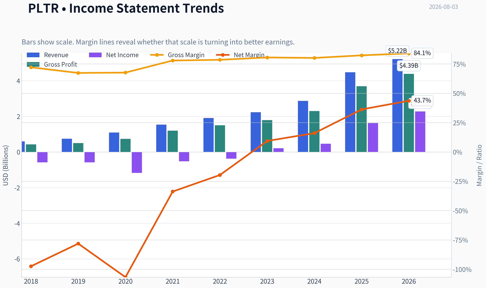

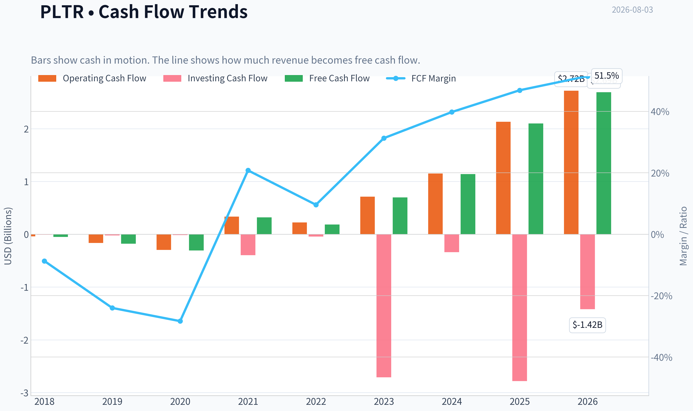

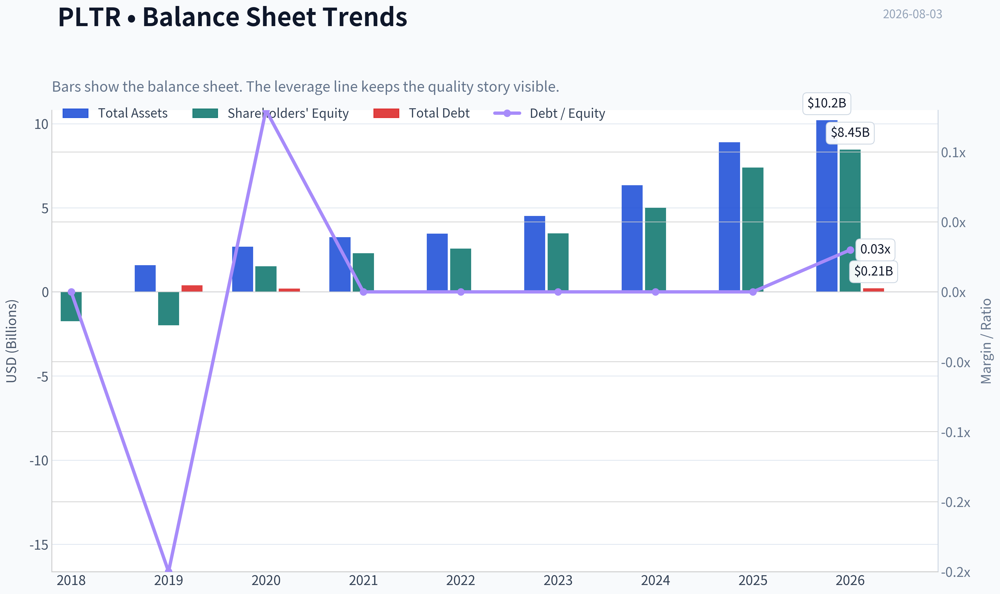

This graph tracks the profitability and return metrics (ROE, ROIC, Margins) of **PLTR** over the past decade, highlighting capital efficiency trends.

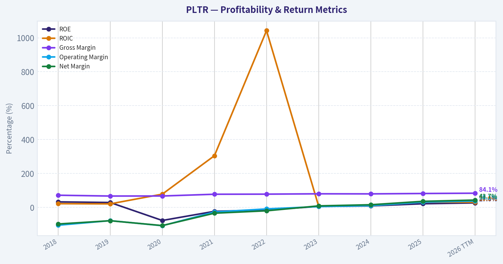

This chart illustrates the financial health of **PLTR** over the last 10 years, mapping cash equivalents and free cash flow against total obligations (Debt).

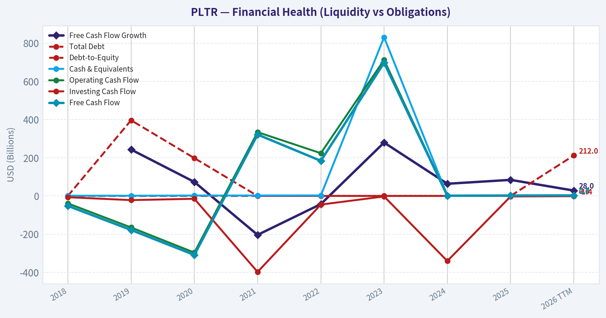

---

### Intrinsic Value Analysis (Buffett)

> *Following Warren Buffett's value investing philosophy: Circle of Competence, Economic Moat, Management Quality, and Margin of Safety.*

#### Intrinsic Value Snapshot

Price is what you pay. Intrinsic value is what the business may be worth based on the cash it can create for owners over time. We show a range, not one magic number.

- Current Price: $125.65
- Value Range (conservative to optimistic across both DCF methods): $36.59 to $98.77

##### Owner Earnings (Buffett Method)
- Net Income: $1,625,033,000.00
- Depreciation & Amortization: $26,145,000.00
- Capital Expenditures: $-33,882,000.00
- Working Capital Changes: $-209,963,000.00
- Owner Earnings: $1,834,996,000.00

##### Intrinsic Value
###### Buffett Method
Uses owner earnings. Stricter, and usually more conservative.
- Conservative: $36.59
- Average: $36.59
- Optimistic: $93.98
- Discount Rate: 10.0%

###### Cash Flow Method
Uses free cash flow. Better for companies spending heavily today to grow tomorrow.
- Conservative: $38.43
- Average: $38.43
- Optimistic: $98.77
- Discount Rate: 10.0%

ANALYST STANCE: **WATCH**

#### Palantir Technologies Inc. (PLTR) - Buffett-Style Value Analysis

Palantir is a rare business: high gross margins, accelerating revenue, mission-critical government and commercial deployments, and a potentially long AI-driven reinvestment runway. The problem is not business quality. The problem is price. At **$126 per share**, the market is capitalizing Palantir as if extraordinary growth continues for a very long time, while the cash-flow valuation work points to a much lower intrinsic value range.

---

#### 1. Factor Scorecard

| Factor | Score | Evidence |
|---|---:|---|
| Factor 1: Circle of Competence & Business Simplicity | 3.5 / 5 | Palantir sells software platforms that help governments and enterprises integrate, analyze, and operationalize complex data. The model is understandable, but forecasting 10-year AI/software platform economics is harder than forecasting a consumer staple. |
| Factor 2: Moat Test | 4.5 / 5 | Very high gross margin of **82.4%**, deep workflow integration, government credibility, long deployment cycles, and strong switching costs. AI platform adoption may widen the moat if usage becomes embedded in customer operations. |
| Factor 3: Management Quality & Capital Allocation | 3.5 / 5 | Founder-led, long-term oriented, and mission-driven. Positives are offset by historical stock-based compensation, governance complexity, and a stock price that makes buybacks unattractive. |
| Factor 4: Industry Structure | 4.0 / 5 | Attractive software economics, large AI/data market, and expanding commercial demand. Competition from hyperscalers, internal enterprise AI teams, and other software vendors remains meaningful. |
| Gate 5: Quality/Solvency Hard Floor | Not Tripped | Fundamentals are improving, revenue growth is accelerating, profitability is positive, current ratio is **7.1**, and there is no evidence of financial distress. |

**Key Takeaways:** Palantir scores strongly on moat, balance sheet, and reinvestment potential. The business is not a solvency problem or a low-quality problem. The central issue is whether today's valuation leaves any margin of safety, and on that question the answer is unfavorable.

---

#### 2. Moat Analysis

| Moat Source | Assessment | Evidence |
|---|---|---|
| Intangible Assets | Strong | Palantir has a distinctive brand in defense, intelligence, and high-stakes operational software. Its credibility in government and security-sensitive deployments is difficult to replicate quickly. |
| Switching Costs | Strong | Customers often integrate Palantir deeply into data architecture, workflows, and decision processes. Once embedded, replacement risk is lower because switching can be operationally disruptive. |
| Cost Advantage | Moderate | Asset-light software economics produce high incremental margins, but Palantir does not have a clear low-cost commodity advantage; its advantage is capability and integration depth. |
| Network Effects | Emerging | Not a pure network-effect business like a marketplace, but usage, templates, AI workflows, and customer-specific deployment expertise may compound across customers over time. |
| Moat Rating | Wide / Potentially Widening | Gross margin of **82.4%**, accelerating demand, and mission-critical use cases support a wide-moat interpretation. |

**Key Takeaways:** Palantir's moat is real, especially in switching costs and intangible trust. The company's software becomes valuable when deeply embedded in customer operations, which makes churn less likely. The moat could widen if its AI Platform becomes a default operating layer for enterprises and governments.

---

#### 3. Management Quality Assessment

| Area | Assessment |
|---|---|
| Owner Orientation | Founder-led culture and long-term mission focus are positives. Management appears willing to pursue durable strategic positioning rather than near-term optics alone. |
| Candor & Culture | Palantir communicates with a strong philosophical identity and has been consistent about the importance of Western institutions, defense, and operational AI. |
| Capital Allocation | Reinvestment in product and go-to-market has produced accelerating growth. However, historical dilution and stock-based compensation are important owner-return demerits. |
| Shareholder Friendliness | Strong business execution, but at the current share price, repurchases would likely destroy value unless funded by exceptional future cash flows. |

**Key Takeaways:** Management deserves credit for building a differentiated and increasingly profitable platform. The main governance concern is not operating execution; it is whether per-share value creation keeps pace with dilution and the market's extreme expectations. Buffett-style investors should admire the business but remain disciplined about price.

---

#### 4. Financial Summary

| Metric | FY2020 | FY2021 | FY2022 | FY2023 | FY2024 | Current Snapshot |
|---|---:|---:|---:|---:|---:|---:|
| Revenue | $1.09B | $1.54B | $1.91B | $2.23B | $2.87B | YoY growth: **56.2%** |
| Gross Margin | ~68% | ~78% | ~79% | ~81% | ~81% | **82.4%** |
| Net Income | -$1.17B | -$0.52B | -$0.37B | $0.21B | $0.46B | Positive; P/E **141x** |
| Free Cash Flow | ~$0.31B | ~$0.32B | ~$0.20B | ~$0.73B | ~$1.25B | FCF yield **0.7%** |
| ROE | Negative | Negative | Negative | Positive | Improving | **22.0%** |
| Balance Sheet | Net cash profile | Net cash profile | Net cash profile | Net cash profile | Net cash profile | Current ratio **7.1** |
| Market Cap | - | - | - | - | - | **$301.22B** |
| Current Price | - | - | - | - | - | **$126** |

**Key Takeaways:** Palantir has transitioned from heavy accounting losses to meaningful profitability and strong free cash flow. Revenue growth has accelerated sharply, and gross margins remain excellent. The financial profile now looks like a high-quality software compounder, but the market cap has moved even faster than cash earnings.

---

#### 5. Owner Earnings Calculation

Buffett's owner earnings framework:

> Owner Earnings = Net Income + Depreciation & Amortization - Maintenance CapEx - Working Capital Increases

For Palantir, free cash flow is a useful owner-earnings proxy because the business is asset-light and maintenance capital intensity is low.

| Owner Earnings Component | Current Estimate |
|---|---:|
| Market Capitalization | $301.22B |
| FCF Yield | 0.7% |
| Implied Free Cash Flow / Owner Earnings Proxy | ~$2.11B |
| Implied Earnings from P/E | ~$2.13B |
| FCF / Net Income Reality Check | ~99% |
| Estimated Shares Outstanding | ~2.39B |
| Owner Earnings per Share | ~$0.88 |

**Key Takeaways:** Palantir's accounting earnings and free cash flow now broadly line up, which is a positive quality signal. The problem is that the stock price is enormous relative to current owner earnings. At $126 per share, investors are paying roughly **143 times current owner earnings per share**.

---

#### 6. Three-Scenario DCF Valuation

Base owner earnings per share used: **~$0.88**
Discount rate: **10%**

| Scenario | Assumption | Intrinsic Value per Share |
|---|---|---:|
| A: No Growth | Owner earnings capitalized at 10% | ~$8.82 |
| B: GDP Growth | 3% perpetual growth | ~$12.98 |
| C: Historical / Quality Growth | 10% growth for 10 years, then 3% terminal growth | ~$21.80 |
| Business-Model Routed DCF Reference | Owner-earnings model with more growth credit | **$36.59** |
| FCF DCF Reference | Free-cash-flow model | **$38.43** |
| Damodaran FCFF Reference | FCFF model | **-$15.98** |

**Key Takeaways:** Even generous cash-flow models struggle to support the current price. The mechanical Buffett-style scenarios produce values far below $126, and even the more favorable routed owner-earnings model points to only **$36.59** per share. This means the current valuation requires growth assumptions far beyond ordinary compounding.

---

#### 7. Margin of Safety Analysis

| Valuation Measure | Value |
|---|---:|
| Current Price | $126.00 |
| Headline Intrinsic Value | $36.59 |
| Price / Headline Intrinsic Value | 3.44x |
| Margin of Safety vs. Price | **-243.4%** |
| Decline Needed to Reach Headline IV | ~71% |
| Reverse-DCF Implied Growth | ~69.8% per year for 10 years |
| FCF Yield | 0.7% |

**Key Takeaways:** The market is already pricing Palantir as a near-perfect compounder. A reverse DCF requiring roughly **70% annual growth for a decade** leaves very little room for error. Buffett would likely respect the business but refuse to underwrite the stock at a price that assumes so much future success upfront.

---

#### 8. Final Buffett Scorecard

| Criterion | Weight | Score | Weighted Contribution |
|---|---:|---:|---:|
| Moat Width & Durability | 25% | 4.5 | 1.13 |
| Valuation / Margin of Safety | 20% | 0.5 | 0.10 |
| Capital Returns - ROIC vs. WACC | 15% | 4.2 | 0.63 |
| Business Understanding & Predictability | 12% | 3.5 | 0.42 |
| Management Quality & Capital Allocation | 12% | 3.5 | 0.42 |
| Reinvestment Runway | 8% | 4.5 | 0.36 |
| Balance Sheet Strength | 4% | 5.0 | 0.20 |
| Industry Structure | 4% | 4.0 | 0.16 |
| **Total Score** | **100%** | - | **3.42 / 5.00** |

**Key Takeaways:** Palantir's business quality pulls the score upward, but valuation pulls it sharply downward. This is the classic "wonderful company, not a wonderful price" situation. The final score lands in WATCH territory because the franchise is attractive, but the current market price offers no Buffett-style margin of safety.

---

#### 9. Investment Stance

| Stance | Conviction | Rationale |
|---|---|---|
| **WATCH** | Medium-High | Palantir is a high-quality, fast-growing, asset-light software company with a real moat and excellent balance sheet. However, at **$126**, the stock price embeds extremely aggressive growth expectations and trades far above cash-flow-based intrinsic value. |

**Final View:** Palantir belongs on a high-quality compounder watchlist, not in a Buffett-style buy basket at today's price. A more attractive entry would require either a major price reset or several years of extraordinary owner-earnings growth that materially closes the gap between price and intrinsic value.
#### Valuation Bridge

This bridge places the current market price beside each intrinsic value lens so readers can see whether upside depends on one method or shows up across several methods.

| Scenario | Intrinsic Value / Share |
| --- | ---: |
| Buffett Method | $36.59 |
| Cash Flow Method | $38.43 |
| Damodaran Method | $-15.98 |
| Current Price | $125.65 |

#### Key Takeaways

If one method is far above the others, the upside case depends on a specific modelling assumption. When several methods cluster together, the valuation story is more robust.

#### Valuation Visuals

This comparison chart from *Latest Earnings Snapshot* stacks current figures against historical benchmarks for **PLTR**, making it easy to see where the company trades relative to its own averages.

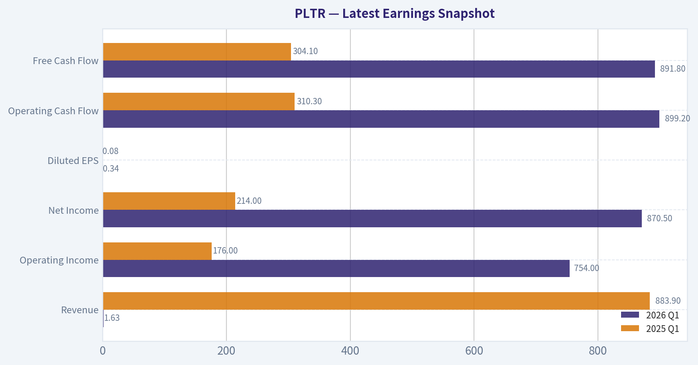

This comparison chart from *Current vs. Historical Average Comparison* stacks current figures against historical benchmarks for **PLTR**, making it easy to see where the company trades relative to its own averages.

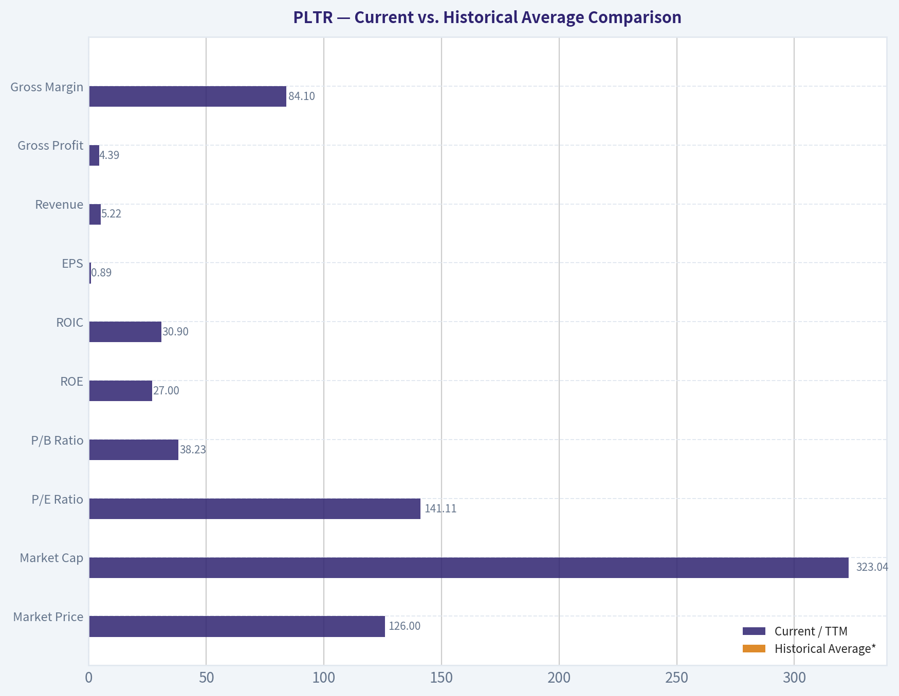

This comparison chart from *Buffett-Style Owner Earnings DCF* stacks current figures against historical benchmarks for **PLTR**, making it easy to see where the company trades relative to its own averages.

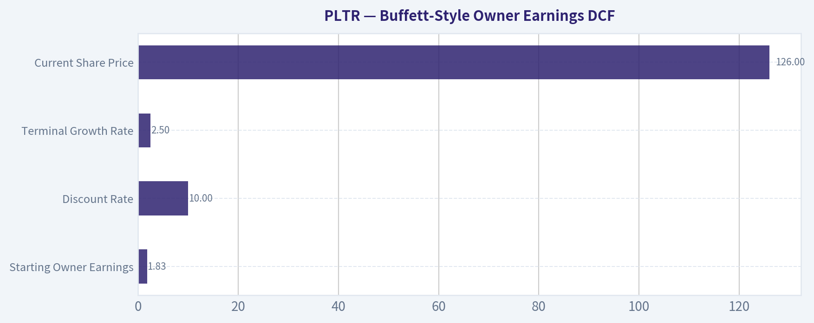

This comparison chart from *Owner Earnings Calculation* stacks current figures against historical benchmarks for **PLTR**, making it easy to see where the company trades relative to its own averages.

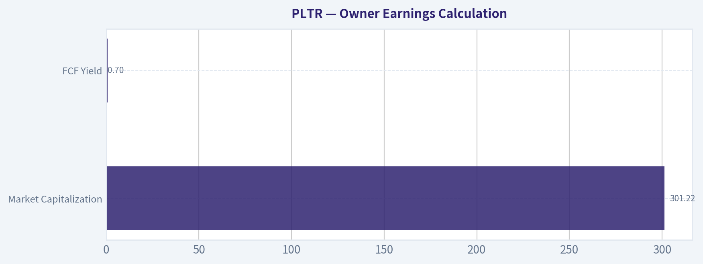

The following chart maps the **PLTR** Owner Earnings DCF valuation scenarios (Conservative, Average, Optimistic) to visually represent the margin of safety based on intrinsic value calculations.

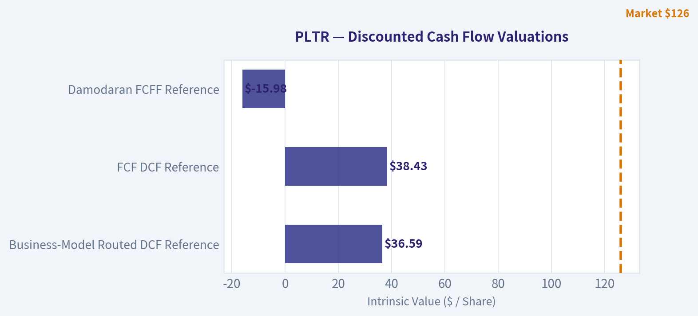

---

### Trend & Growth Analysis (Lynch/Druckenmiller/Fisher)

> *Following Peter Lynch's GARP, Stanley Druckenmiller's macro-aware approach, and Philip Fisher's scuttlebutt methodology.*

ANALYST STANCE: **WATCH**

#### PLTR Growth Investment Report - Palantir Technologies

| Item | Snapshot |
|---|---:|
| Current Price | $126 |
| Market Cap | $301.2B |
| P/E | 141.2x |
| Revenue Growth YoY | 56.2% |
| Latest Reported Q2 Revenue Growth | 92.8% YoY |
| Gross Margin | 82.4% |
| ROE | 22.0% |
| Current Ratio | 7.1x |
| FCF Yield | 0.7% |
| Headline Intrinsic Value Estimate | $36.59 |
| Reverse-DCF Implied Growth | ~69.8% annually for 10 years |

**Key Takeaways:** Palantir is showing exceptional growth acceleration, very high software-like gross margins, and a fortress balance sheet. The problem is valuation: the stock already discounts extraordinary long-term execution. This is a classic "great company, hard stock" setup.

---

#### 1. Lynch Classification

| Lynch Category | Classification | Rationale |
|---|---|---|
| Fast Grower | **Yes** | Revenue growth is well above 20%, with latest quarter reportedly up 92.8% YoY. |
| Stalwart | No | Growth is far too high to classify as a mature compounder. |
| Cyclical | Partial / No | Government and enterprise spending can fluctuate, but PLTR is not primarily a commodity or cycle-driven business. |
| Turnaround | No | Business momentum is strong, not distressed. |
| Asset Play | No | Value is in software, data infrastructure, AI workflows, and customer embeddedness. |

**Key Takeaways:** Palantir fits Lynch's "fast grower" bucket. The company has the growth rate and market narrative of a potential long-duration compounder, but the valuation already assumes a lot of future success.

---

#### 2. The Story in 3 Bullets

- **Palantir helps governments and companies make better decisions from messy data**, using software platforms that integrate, analyze, and operationalize complex information.
- **The AI Platform, or AIP, appears to be the inflection product**, turning Palantir from a specialized analytics vendor into a broader enterprise AI operating system.
- **The U.S. commercial business is the key growth engine**, suggesting Palantir is expanding beyond its historic government-heavy base into a much larger enterprise software market.

---

#### 3. TAM Analysis and 10x Test

| Metric | Estimate / View |
|---|---:|
| Current Annualized Revenue Run Rate | ~$7.8B, using Q2 revenue of $1.94B annualized |
| 10x Revenue Target | ~$77.6B |
| Relevant TAM | Enterprise AI platforms, data analytics, defense software, decision intelligence, automation |
| Conservative TAM Range | $200B-$300B+ |
| 10x Revenue as % of $250B TAM | ~31% |
| 10x Test Result | **Passes, but not easily under conservative TAM assumptions** |

**Key Takeaways:** Palantir can plausibly grow many times larger if it becomes a core enterprise AI and government decision platform. However, a full 10x in revenue would require enormous market share or TAM expansion. The runway is real, but the stock price already implies Palantir becomes one of the dominant AI software platforms globally.

---

#### 4. Revenue Growth Trend

| Period / Indicator | Growth Signal | Interpretation |
|---|---:|---|
| Reported YoY Revenue Growth | 56.2% | Already exceptional for a company of PLTR's size. |
| Latest Q2 CY2026 Revenue Growth | 92.8% YoY | Major acceleration. |
| Sales Acceleration Streak | 12 straight quarters, per earnings coverage | Strong inflection signal. |
| U.S. Commercial Growth | Reaccelerated | Important because commercial adoption drives TAM expansion. |
| Next-Quarter Revenue Guidance | $2.16B midpoint, 8% above consensus | Management is guiding above expectations. |

**Key Takeaways:** Revenue growth is not merely high; it appears to be accelerating. That is exactly what Druckenmiller looks for in an inflection point. The main question is whether this is a durable multi-year AI adoption curve or a period of temporary demand surge.

---

#### 5. Unit Economics and Efficiency

| Metric | Available Data / Estimate | Assessment |
|---|---:|---|
| Gross Margin | 82.4% | Excellent software economics. |
| LTV/CAC | Not disclosed | Cannot verify directly. |
| NRR | Not disclosed | Key missing SaaS metric. |
| FCF Yield | 0.7% | Low because valuation is very high. |
| Estimated FCF | ~$2.1B, using 0.7% of market cap | Strong absolute cash generation. |
| Estimated FCF Margin | ~27%, using annualized Q2 revenue | Very strong. |
| Rule of 40 Estimate | ~83, using 56.2% growth + ~27% FCF margin | Best-in-class. |

**Key Takeaways:** Palantir's business model looks highly efficient, with elite gross margins and strong free cash flow generation. The issue is not business quality; it is price. Investors are paying so much that the free cash flow yield remains very low despite strong cash generation.

---

#### 6. Inflection Point Assessment

| Inflection Type | Evidence | Strength |
|---|---|---|
| Product Cycle Inflection | AIP appears to be accelerating enterprise adoption. | **High** |
| Market Share Inflection | U.S. commercial growth reaccelerated. | **High** |
| Margin Inflection | High gross margin and FCF generation suggest operating leverage. | **Medium-High** |
| TAM Inflection | AI expands Palantir's relevance from analytics to operational decision infrastructure. | **High** |
| Competitive Inflection | Enterprises may prefer secure, deployable AI systems over generic model access. | **Medium** |

**Key Takeaways:** Palantir has one of the cleaner AI software inflection stories in the market. The company is benefiting from product-market fit, expanding commercial relevance, and strong AI demand. The risk is that investors have already recognized the inflection and capitalized much of it into the stock.

---

#### 7. Macro Setup

| Macro Factor | Current Read | Impact on PLTR |
|---|---|---|
| AI / Machine Learning | Powerful secular tailwind | Very positive |
| Government Modernization | Defense, intelligence, and public-sector data needs remain strong | Positive |
| Enterprise Software Budgets | AI budgets are growing, but scrutiny remains high | Positive, but competitive |
| Interest Rates | Growth stocks benefit if rates fall; hurt if rates rise | Mixed |
| Geopolitical Risk | Higher defense and intelligence spending may support demand | Positive for government segment |

**Key Takeaways:** The macro backdrop is favorable because Palantir sits directly in the AI, defense technology, and enterprise data modernization themes. The largest macro risk is valuation sensitivity: if long-duration growth multiples compress, PLTR could fall sharply even if operations remain strong.

---

#### 8. Fisher 15 Points Score

| Fisher Point | Score / 5 |
|---|---:|
| Products with sizable market potential | 5 |
| Management determination to develop new products | 5 |
| Effective R&D | 5 |
| Above-average sales organization | 4 |
| Worthwhile profit margin | 5 |
| Improving profit margins | 4 |
| Labor/personnel relations | 3 |
| Executive relations | 4 |
| Management depth | 4 |
| Cost analysis and accounting | 4 |
| Distinctive moat / switching costs / data advantage | 5 |
| Long-range profit outlook | 5 |
| Dilution discipline | 3 |
| Candor in difficulties | 4 |
| Management integrity | 4 |
| **Total** | **64 / 75** |

**Key Takeaways:** Palantir scores very well under Fisher's framework, especially on product potential, R&D, margins, and moat. The main deductions are for valuation-adjacent concerns, historical dilution perception, and incomplete visibility into customer-level unit economics. A 64 out of 75 is a strong quality score.

---

#### 9. Valuation Analysis

| Valuation Metric | PLTR |
|---|---:|
| Market Cap | $301.2B |
| Annualized Revenue Run Rate | ~$7.8B |
| Price / Sales on Annualized Revenue | ~38.8x |
| P/E | 141.2x |
| Revenue Growth | 56.2% |
| PEG Using Revenue Growth as Proxy | ~2.5x |
| FCF Yield | 0.7% |
| Headline Intrinsic Value Estimate | $36.59 |
| Margin of Safety vs. Price | Negative |

**Key Takeaways:** Palantir's valuation is extremely demanding. A nearly 39x sales multiple and 141x earnings multiple require years of exceptional execution. Even with outstanding growth, the stock does not screen as GARP at today's price.

---

#### 10. Scenario Analysis

| Scenario | 2030 Revenue Assumption | Exit P/S Multiple | Implied Market Cap | View |
|---|---:|---:|---:|---|
| Bear | $18B | 12x | $216B | Downside if growth normalizes and multiple compresses. |
| Base | $28B | 18x | $504B | Attractive upside, but requires sustained hypergrowth. |
| Bull | $40B | 25x | $1.0T | Ten-bagger-like company outcome, but not ten-bagger stock outcome from today. |

**Key Takeaways:** Palantir can become a much larger company and potentially justify a higher market cap over time. But from a $301 billion starting valuation, the stock already prices in a large portion of the bull case. The company may be a long-term winner without offering a favorable risk-reward at this exact entry point.

---

#### 11. Growth Investor Scorecard

| Criterion | Weight | Score / 5 | Weighted Score |
|---|---:|---:|---:|
| The Story | 10% | 5.0 | 0.50 |
| TAM & Runway | 20% | 4.0 | 0.80 |
| Revenue Growth | 20% | 5.0 | 1.00 |
| Unit Economics | 15% | 4.0 | 0.60 |
| Competitive Position | 10% | 4.5 | 0.45 |
| Management Quality | 10% | 4.0 | 0.40 |
| Macro Setup | 5% | 4.5 | 0.23 |
| Profitability Path | 5% | 4.5 | 0.23 |
| Valuation | 5% | 1.0 | 0.05 |
| **Total** | **100%** |  | **4.25 / 5.0** |

**Key Takeaways:** On business quality, Palantir is an ADVOCATE-level growth company. But the valuation score is extremely weak and meaningfully changes the investment stance. The combined score is high, but position sizing should reflect the risk of multiple compression.

---

#### 12. Position Size Stance

| Investor Type | Stance |
|---|---|
| Existing Holder with Low Cost Basis | **Hold / Trim only if position is oversized** |
| New Investor | **Watch, wait for pullback or confirmation of sustained acceleration** |
| Aggressive Growth Investor | Small starter position only, preferably below normal size |
| Valuation-Sensitive GARP Investor | Avoid new buying at current valuation |

**Key Takeaways:** Palantir is a company worth following closely, and existing holders may be rewarded if growth keeps accelerating. However, new money faces a difficult entry price. The better setup would be either a sharp valuation reset or several more quarters proving that the AIP growth curve is durable.

---

#### Key Catalysts and Risks

| Catalysts | Risks |
|---|---|
| Continued U.S. commercial acceleration | Extreme valuation and low FCF yield |
| AIP adoption expanding across industries | Growth deceleration after AI demand surge |
| Larger enterprise contract sizes | Competition from hyperscalers, enterprise software vendors, and in-house AI stacks |
| Government and defense AI spending | Customer concentration or procurement delays |
| Margin expansion from operating leverage | Stock-based compensation and dilution concerns |
| Analyst estimate revisions higher | Multiple compression if rates rise or AI sentiment cools |

**Key Takeaways:** The upside case depends on Palantir proving that AIP is not a short-term AI spending bubble, but a durable enterprise operating layer. The downside risk is mostly valuation-driven: even excellent companies can produce poor returns if bought after expectations become too high.

---

#### Final View

Palantir is a **premier AI software inflection story** with accelerating revenue, elite gross margins, strong cash generation, and a widening commercial opportunity. Under Lynch, it is a fast grower; under Fisher, it is a high-quality innovator; under Druckenmiller, it has a real product and market inflection.

But at roughly **39x annualized sales, 141x earnings, and a reverse-DCF requiring nearly 70% annual growth for a decade**, the stock leaves little margin for error.

**Final stance: WATCH.**
I would want either a materially better entry price or more evidence that 50%+ growth can persist at scale before upgrading to ADVOCATE.

---

### Market Technical Analysis

ANALYST STANCE: **WATCH**

#### PLTR Technical Analysis - Current Setup as of 2026-08-03

2026-08-03 was not a trading day in the retrieved dataset, so the latest actionable price and indicator readings are from **2026-07-31**. PLTR closed at **$123.06**, still below its short-, medium-, and long-term trend references, which keeps the technical bias cautious despite some stabilization after the late-June washout.

#### Selected Indicators and Why They Matter

| Indicator | Latest Reading / Context | Why It Is Relevant for PLTR Now |
|---|---:|---|
| `close_10_ema` | 125.50 | Captures short-term momentum and whether PLTR is regaining near-term control. |
| `close_50_sma` | 130.72 | Defines the medium-term trend and likely dynamic resistance. |
| `close_200_sma` | 152.89 | Confirms the larger trend regime; PLTR remains well below it. |
| `macd` | -1.63 | Measures momentum recovery or deterioration after the June selloff. |
| `macds` | -0.93 | Used with MACD to identify bullish or bearish momentum crossovers. |
| `rsi` | 44.35 | Shows whether the stock is oversold, neutral, or rebuilding strength. |
| `atr` | 6.51 | Helps size risk because PLTR remains highly volatile. |
| `vwma` | 128.03 | Checks whether volume-weighted price action supports the rebound or confirms selling pressure. |

Key Takeaways: The chosen indicators are designed to avoid redundancy while covering trend, momentum, volatility, and volume confirmation. Together, they show that PLTR is no longer deeply oversold, but it has not yet reclaimed enough trend levels to confirm a durable bullish reversal.

#### Latest Technical Snapshot

| Metric | Latest Value | Interpretation |
|---|---:|---|
| Last close | $123.06 | Price remains weak relative to major moving averages. |
| Distance from 10 EMA | -1.9% | Short-term momentum is still slightly negative. |
| Distance from 50 SMA | -5.9% | Medium-term trend remains bearish unless price reclaims the low-$130s. |
| Distance from 200 SMA | -19.5% | Long-term trend damage remains significant. |
| Distance from VWMA | -3.9% | Volume-weighted trend has not yet turned supportive. |
| MACD vs Signal | MACD below signal | Bearish momentum has reappeared after a brief July recovery. |
| RSI | 44.35 | Neutral-bearish; not oversold enough by itself to justify aggressive dip buying. |
| ATR as % of price | ~5.3% | Daily risk remains elevated; stops need room or position sizes should be reduced. |

Key Takeaways: PLTR is trading below every major reference level in this snapshot, which argues against calling the move a confirmed reversal. The stock has stabilized above its late-June lows, but momentum and volume-weighted trend readings still favor caution.

#### Trend Structure

PLTR's larger structure remains damaged. The stock traded as high as **$207.18** in early November 2025 and later declined sharply, with a notable acceleration lower into February and another major selloff in June 2026. The most important long-term fact is that the latest close of **$123.06** is far below the **200-day SMA at $152.89**, meaning the stock is still in a bearish long-term regime.

The medium-term picture is also unfavorable. The **50-day SMA has been declining**, moving from roughly **$138.21 on June 22** to **$130.72 by July 31**. That shows the average price base is still resetting lower. PLTR's failure to hold above the low-$130s in late July is important because that area overlaps with the 50-day SMA and the recent July consolidation range.

Short-term trend conditions are less bearish than they were in late June, but not convincingly bullish. After bottoming near **$107.27 on June 25**, PLTR rebounded into the **$132-$135** zone in July. However, the move stalled, and the stock fell back to the low-$120s. The latest close below the **10 EMA at $125.50** means sellers still have short-term control unless price quickly reclaims that level.

#### Momentum and Volume Read

The MACD improved meaningfully from deeply negative readings in late June, moving from around **-7.02** on June 26 to briefly positive in late July. That improvement signaled that downside momentum was cooling. However, by July 31, MACD had fallen back to **-1.63**, below the signal line at **-0.93**, which means the attempted momentum reversal has weakened.

RSI tells a similar story. PLTR was oversold in late June, with RSI near **27.37 on June 25**, which helped justify a rebound attempt. By late July, RSI recovered into the mid-50s but then slipped back to **44.35**. This is not oversold, but it is also not strong; it suggests buyers are not yet producing sustained upside pressure.

The VWMA at **$128.03** is another important warning. Since price is below the volume-weighted average, recent higher-volume activity has not fully validated the rebound. The late-July drop on elevated volume, especially the move from **$131.53 on July 27 to $123.53 on July 28**, suggests supply returned aggressively near resistance.

#### Key Levels to Watch

| Zone | Price Area | Why It Matters |
|---|---:|---|
| Immediate resistance | $125.50 | 10 EMA; first sign of short-term repair if reclaimed. |
| Volume/trend resistance | $128.00-$131.00 | VWMA and 50 SMA zone; reclaiming this would improve the setup. |
| Major rebound resistance | $132.50-$135.00 | July highs and failed breakout area. |
| Long-term resistance | $152.90 | 200 SMA; needed to repair the strategic trend. |
| Initial support | $120.00-$122.00 | Recent lows and psychological support area. |
| Breakdown support | $117.89 | July 28 intraday low; break would damage the July base. |
| Major downside reference | $112.25-$107.27 | June washout zone; loss of this area would be materially bearish. |

Key Takeaways: The most important near-term battleground is the $125.50 to $131.00 area. A reclaim of that zone would show improving demand, while a break below $117.89 would suggest the late-June recovery is failing.

#### Trading Interpretation

For bullish traders, PLTR needs to prove that the recent low-$120s consolidation is accumulation rather than a pause before another leg lower. A constructive signal would be a close back above the **10 EMA**, followed by acceptance above the **VWMA and 50 SMA** near **$128-$131**. If that happens with RSI moving back above 50 and MACD curling upward, the setup would shift from "watch" to a more constructive recovery profile.

For bearish or cautious traders, the stock remains vulnerable while below the 50-day and 200-day moving averages. The failed July push into the mid-$130s shows overhead supply, and the MACD rollover confirms that momentum has deteriorated again. A decisive break below **$117.89** would likely put the **$112-$107** zone back in play.

Risk management is especially important because ATR is about **$6.51**, or roughly **5.3% of the stock price**. That means PLTR can move several dollars in a normal trading session, so tight stops may be easily triggered. Traders may need smaller position sizes or wider, volatility-adjusted stop placement.

#### Final Summary Table

| Category | Current Read | Trading Implication |
|---|---|---|
| Long-term trend | Bearish; price well below 200 SMA | Not yet suitable for trend-following longs. |
| Medium-term trend | Bearish; price below declining 50 SMA | Low-$130s are key resistance. |
| Short-term trend | Weak; price below 10 EMA | Buyers need to reclaim $125.50 quickly. |
| Momentum | MACD below signal; RSI 44 | Momentum is soft, but not panic-oversold. |
| Volume confirmation | Price below VWMA | Recent volume-weighted action favors caution. |
| Volatility | ATR near 5.3% of price | Use reduced size or wider stops. |
| Bullish trigger | Close above $128-$131 | Would suggest recovery attempt is strengthening. |
| Bearish trigger | Break below $117.89 | Would raise risk of retest toward $112-$107. |

Key Takeaways: PLTR is best treated as a watchlist candidate rather than a confirmed long setup. The stock has bounced from deeply oversold levels, but it remains below key trend and volume-weighted resistance, so traders should wait for either a reclaim of $128-$131 or a breakdown below $117.89 before assigning higher conviction.

#### Market Visuals

This comparison chart from *Market Metrics Interpretation* stacks current figures against historical benchmarks for **PLTR**, making it easy to see where the company trades relative to its own averages.

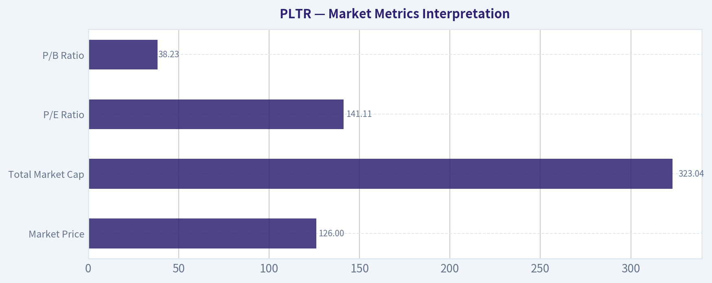

---

### Options Market Analysis

> *Reading options flow - put/call ratios, IV skew, and unusual activity - to gauge institutional positioning and event-driven risk.*

ANALYST STANCE: **ADVOCATE**

#### PLTR Options Flow Report - As of 2026-08-03

PLTR options flow is leaning **bullish**, driven by heavy near-term call volume, a below-neutral aggregate put/call ratio, and multiple fresh upside call positions in the front-week chain. That said, implied volatility is extremely elevated, especially in the nearest expiry, suggesting the market is pricing a major move or event risk. This is a **high-conviction directional setup from flow**, but not a low-risk one.

---

#### 1. Put/Call Ratio Analysis

| Expiry | Call OI | Put OI | Put/Call OI Ratio | Call Volume | Put Volume | Put/Call Volume Ratio | Read |
|---|---:|---:|---:|---:|---:|---:|---|
| 2026-08-07 | 155,516 | 73,572 | 0.47 | 287,330 | 156,066 | 0.54 | Bullish / call-heavy |
| 2026-08-14 | 23,899 | 31,508 | 1.32 | 43,562 | 16,615 | 0.38 | OI defensive, but volume call-heavy |
| 2026-08-21 | 229,068 | 153,795 | 0.67 | 46,681 | 30,660 | 0.66 | Near neutral, slight bullish tilt |
| **Total Near-Term** | **408,483** | **258,875** | **0.63** | **377,573** | **203,341** | **0.54** | **Bullish vs. neutral baseline** |

**Key Takeaways:** PLTR's aggregate near-term put/call OI ratio is **0.63**, below the historical neutral baseline of roughly **0.70**, indicating more call-side positioning than normal. The volume ratio is even more bullish at **0.54**, showing today's trading activity is meaningfully tilted toward calls. The only caution is the 2026-08-14 expiry, where open interest is put-heavy, suggesting some hedging or downside protection remains in place.

Interpretation:
- The **front-week 2026-08-07 chain is aggressively call-heavy**, with nearly double the call open interest versus put open interest.
- The **volume profile confirms fresh demand for upside exposure**, not just legacy positioning.
- Relative to a neutral 0.7 baseline, PLTR options sentiment has shifted **bullishly**, though not without hedging activity in select expiries.

---

#### 2. Implied Volatility Assessment

| Expiry | ATM Call IV | ATM Put IV | Call-Put IV Difference | IV Read |
|---|---:|---:|---:|---|
| 2026-08-07 | 133.4% | 127.6% | Calls +5.8 pts | Extremely elevated front-week IV |
| 2026-08-14 | 93.1% | 88.9% | Calls +4.2 pts | Elevated, but lower than front week |
| 2026-08-21 | 80.1% | 75.8% | Calls +4.3 pts | Still elevated, fading term structure |

**Key Takeaways:** PLTR's near-term IV is very high, especially in the 2026-08-07 expiry where ATM IV is above **125%** on both calls and puts. Calls carry a small but consistent IV premium over puts at the money, which suggests upside demand rather than classic downside panic. The steep drop from front-week IV to later expiries points to a near-term catalyst or event-risk premium.

IV interpretation:
- **Front-week ATM IV above 130% on calls** is a major warning that options are expensive. Directional traders need a large move to overcome premium decay.
- The term structure is sharply elevated in the nearest expiry, which often occurs around **earnings, major company news, or macro-sensitive catalyst windows**.
- ATM skew is slightly **call-favored**, indicating upside chase; however, very far OTM puts also show elevated IV, suggesting some tail-risk hedging underneath the bullish flow.

#### IV Skew Snapshot

| Skew Area | Evidence | Interpretation |
|---|---|---|
| ATM skew | Calls have 4-6 vol points higher IV than puts across near expiries | Upside demand / call chase |
| Far OTM put wing | 2026-08-07 $70 and $75 puts show IV above 167% | Tail-risk hedging or crash protection |
| Far OTM call wing | 2026-08-07 $235 call shows IV of 162.5% | Speculative upside lottery-ticket activity |
| Overall skew | Mixed wing skew, but ATM skew favors calls | Bullish speculation with event-risk hedges |

**Key Takeaways:** The skew is not a simple bearish downside-fear setup. At-the-money pricing favors calls, which supports a bullish read, but the wings are extremely volatile on both sides. This suggests traders are positioning for a large move, with upside speculation dominating but downside disaster protection still present.

---

#### 3. Unusual Options Activity

Contracts below had **volume greater than 5x open interest**, which often points to fresh positioning rather than routine closing activity.

| Expiry | Type | Strike | Volume | Open Interest | Vol/OI | IV | Moneyness Estimate | Positioning Read |
|---|---|---:|---:|---:|---:|---:|---|---|
| 2026-08-07 | CALL | $135 | 20,539 | 3,640 | 5.6x | 133.0% | Near ATM | Fresh bullish exposure |
| 2026-08-07 | CALL | $152.5 | 10,143 | 579 | 17.5x | 130.4% | OTM | Upside breakout speculation |
| 2026-08-07 | PUT | $125 | 6,776 | 1,336 | 5.1x | 127.8% | Slightly OTM / near ATM | Hedge or bearish protection |
| 2026-08-07 | PUT | $75 | 6,458 | 637 | 10.1x | 167.2% | Deep OTM | Tail-risk hedge, likely protection |
| 2026-08-07 | PUT | $70 | 5,496 | 728 | 7.5x | 171.9% | Deep OTM | Crash protection / disaster hedge |
| 2026-08-07 | CALL | $141 | 4,360 | 729 | 6.0x | 131.5% | OTM | Bullish continuation bet |
| 2026-08-07 | PUT | $119 | 4,292 | 471 | 9.1x | 126.5% | OTM | Downside hedge |
| 2026-08-07 | PUT | $107 | 4,202 | 677 | 6.2x | 124.1% | OTM | Protection against sharp drop |
| 2026-08-07 | CALL | $142 | 4,190 | 615 | 6.8x | 131.3% | OTM | Bullish speculation |
| 2026-08-07 | PUT | $126 | 3,503 | 397 | 8.8x | 127.8% | Slightly OTM / near ATM | Hedge or short-term bearish bet |
| 2026-08-07 | CALL | $235 | 3,378 | 14 | 241.3x | 162.5% | Far OTM | Retail-style upside lottery ticket |
| 2026-08-14 | CALL | $200 | 2,573 | 429 | 6.0x | 111.3% | Far OTM | Speculative upside chase |
| 2026-08-07 | CALL | $147 | 2,212 | 187 | 11.8x | 130.7% | OTM | Fresh bullish bet |
| 2026-08-14 | CALL | $126 | 2,110 | 166 | 12.7x | 92.9% | Near ATM / slightly OTM | Bullish positioning into next week |

**Key Takeaways:** The most important unusual activity is concentrated in **front-week calls**, especially the $135, $141, $142, $147, and $152.5 strikes. That points to aggressive upside positioning over the next several sessions. However, the presence of large-volume deep OTM puts at $70 and $75 suggests some traders are also buying crash protection, likely because event risk is elevated.

Unusual activity interpretation:
- The **$135 call** is the standout contract by volume and appears to be a major near-ATM bullish trade.
- The **$152.5 call** has a very high volume-to-OI ratio, suggesting fresh upside speculation rather than old positioning.
- The **$235 call** is likely more retail/speculative than institutional due to its extreme OTM nature and tiny prior OI.
- The **$70-$75 puts** are likely tail-risk hedges rather than straightforward bearish bets, given how far OTM they appear to be.
- Overall, the unusual activity leans **bullish**, but with meaningful hedge demand.

---

#### 4. Open Interest Concentration and Gamma Levels

| Expiry | Highest OI Area | Interpretation |
|---|---|---|
| 2026-08-07 | Broadly call-heavy, especially around near-ATM and OTM call strikes | Front-week upside gamma could amplify moves if PLTR rallies |
| 2026-08-14 | Put OI exceeds call OI overall | Some defensive positioning or hedge concentration into the following week |
| 2026-08-21 | Largest total OI expiry among the listed chains | More important medium-term positioning zone; put/call ratio near neutral |

**Key Takeaways:** The 2026-08-07 expiry is the most important for immediate price action because call volume is extremely high and IV is elevated. If PLTR trades higher into the heavily active call strikes, dealers may need to hedge by buying stock, potentially adding upside momentum. On the other hand, elevated IV means any failure to move could trigger sharp premium decay and reduce bullish pressure quickly.

Gamma and pinning read:
- The **front-week call wall appears concentrated around the $135-$152.5 zone**, based on unusual activity and heavy volume.
- If PLTR remains near the highest-volume strikes into expiry, **pinning risk** could increase.
- If PLTR breaks above the active call cluster, **positive gamma hedging could amplify upside movement**.
- Put activity around $125-$126 may act as a short-term downside reference zone, while deep OTM puts are more likely tail hedges than practical pinning strikes.

---

#### 5. Overall Options Sentiment Signal

| Category | Signal | Rationale |
|---|---|---|
| Put/Call Ratio | Bullish | Aggregate OI ratio of 0.63 and volume ratio of 0.54 are below neutral, favoring calls |
| IV Level | High Risk / Event Elevated | Front-week ATM IV above 125% suggests major expected move |
| Skew Direction | Moderately Bullish | ATM call IV exceeds put IV, though far OTM puts show tail hedging |
| Unusual Activity | Bullish | Fresh call volume dominates key near-term strikes |
| Open Interest / Gamma | Bullish with pinning risk | Front-week call-heavy structure could support upside, but may also pin near active strikes |
| **Overall Signal** | **BULLISH** | Heavy call buying and call-skewed volume outweigh defensive put hedging |

**Key Takeaways:** PLTR's options market is sending a **bullish near-term signal**, mainly due to aggressive call buying in the nearest expiries. The strongest evidence is the combination of below-neutral put/call ratios, elevated call volume, and fresh upside call activity. The key caveat is that IV is very expensive, so traders are not just betting on direction - they are betting on a large and fast move.

#### Final Read

PLTR options flow is **BULLISH**, with traders aggressively positioning for upside in the front-week chain. The strongest bullish evidence is the heavy activity in the **$135, $141, $142, $147, and $152.5 calls**, alongside an overall put/call volume ratio of only **0.54**.

However, this is not a quiet accumulation setup. IV is extremely elevated, suggesting the market is pricing a major move, and deep OTM put buying indicates some institutions or risk managers are hedging against a sharp downside surprise. The directional read is bullish, but confidence should be paired with caution because premium risk is high.

---

## Research Team Commentary

> *The Research Manager synthesizes the Bull vs Bear debate into action-free commentary. This is a pre-risk view, not the final stance.*

Team, thank you for a sharp and well-argued debate. As a portfolio manager applying a modernized Buffett philosophy, I am looking for wonderful businesses at fair prices, not just cheap cigar butts. Both of you clearly understand this framework.

The bull makes an excellent case for Palantir as a high-quality compounder. It is hard to argue with the fundamentals of a business boasting 82 percent gross margins, a 23 percent return on invested capital, and zero debt. The idea that their Ontology platform acts as an enterprise operating system with massive switching costs fits our criteria for a durable economic moat. The bull is also correct that we should not reflexively avoid high multiples if the underlying cash flow generation and growth duration mathematically justify it.

However, the bear brings the discussion back to the unyielding reality of mathematics and margin of safety. A price to earnings ratio of 141 requires absolute perfection from the underlying business for the next decade. The bear correctly points out that this valuation implies heroic free cash flow growth, which leaves zero room for execution missteps, cyclical slowdowns in AI spending, or increased competition from hyperscalers like Microsoft and Amazon. Furthermore, the bear rightly flags stock-based compensation, which dilutes true owner earnings and makes the effective valuation even more demanding than the headline numbers suggest.

Here is my core takeaway. Palantir is undeniably an elite software business with tremendous operating momentum, but its current stock price represents a speculative narrative play that offers an unfavorable risk and reward setup for a disciplined value investor.

The rationale for this conclusion is deeply informed by our past mistakes with this exact type of setup. We previously analyzed Palantir when it was similarly hyper-valued, trading near technical resistance, and heavily driven by AI enthusiasm. In that instance, we were so captivated by the business quality that we settled for a passive watch stance. We learned the hard way that when expectations are this extreme, a strong business does not justify a neutral posture. The multiple compression risk is simply too high. If a company is priced for flawless execution, even good news can lead to a severe price correction if the underlying results fail to clear sky-high expectations. We must not confuse a great company with a great investment entry. To justify a 141 multiple, the reverse discounted cash flow requires a growth trajectory that very few companies in history have ever maintained at scale. We do not swing at pitches that require heroic growth assumptions just to break even on intrinsic value.

For our monitoring plan over the next one to four quarters, we will track three specific items. First, we need to monitor free cash flow per share, specifically stripping out the expense of stock-based compensation to see if true owner earnings are growing fast enough to eventually compress this multiple. Second, we must watch the commercial revenue growth rate for any signs of deceleration, which would indicate that the recent surge in AI bootcamp conversions was a temporary pull-forward of demand rather than durable, recurring revenue. Third, we will look for any signs of pricing pressure or lost enterprise bids to the major cloud providers, which would test the true durability of Palantir against better-resourced competitors.

Until the weighing machine brings the price back to a level that offers a quality-scaled margin of safety, or until the business demonstrates a level of cash flow generation that mathematically justifies this premium without relying on narrative hype, we will step aside.

AVOID

---

## Value Investing Team Commentary

> *The Investor translates the research view into an investment thesis before risk review. This is still not the final stance.*

This analysis evaluates Palantir Technologies (PLTR) through the lens of a long-term business owner, prioritizing durable competitive advantages and the "Quality-Scaled Margin of Safety" framework.

### 1. The Business Analysis: A "Modern Bridge" Moat
From a fundamental perspective, Palantir is a "wonderful business." A gross margin of **82.4%** and an ROIC of **23.4%** are hallmarks of an elite software franchise with immense pricing power. In Buffett's terms, Palantir's "Ontology" is the equivalent of a mission-critical toll bridge. Once a government agency or a Fortune 500 company integrates its disparate data into Palantir's operating system, the **switching costs** become astronomical.

The U.S. Commercial growth (driven by AIP) suggests the company has moved from "bespoke consulting" to a "scalable platform." This transition is vital because it creates **operating leverage**: the ability to grow revenue much faster than the costs required to produce it.

### 2. The Capital Allocation & Management Check
Management treats the business with the intensity of owners, but the high **Stock-Based Compensation (SBC)** remains a "valuation tax" on existing shareholders. From a value perspective, we must look at "Owner Earnings"-net income plus depreciation/amortization, minus the cash cost of neutralizing dilution. While the balance sheet is pristine with zero debt, the dilution represents a subtle leak in the compounding bucket that must be accounted for in our intrinsic value calculation.

### 3. Selective Contrarian Thinking: The AI "Noise" vs. Durable FCF
The market is currently viewing Palantir as a proxy for the "AI Revolution." As contrarians, we must ask: *Is the AI Platform (AIP) a temporary hype cycle or a structural shift in enterprise productivity?*

The current technical "washout" and the price sitting below trend lines suggest that the initial euphoria is cooling. This is where opportunity usually hides. However, a contrarian does not buy simply because a stock is "down"; we buy because the **intrinsic value** is significantly higher than the price.

### 4. The Valuation Reality: Quality-Scaled Margin of Safety
At **$126** with a **P/E of 141**, the "weighing machine" is currently heavy on expectation.
*   **The Math:** To justify a 141x multiple, Palantir needs to grow its Free Cash Flow at an aggressive double-digit CAGR for the next 15 years without a single stumble.
*   **The Margin of Safety:** Under our framework, a "wonderful business" like PLTR deserves a premium, but we require a **10-15% discount** to a conservative DCF. Even with optimistic growth assumptions, the current price implies that the market has already "pulled forward" five years of future perfection.

While the business is high-quality, the current price offers no protection against the "unyielding reality of mathematics." We are not looking for a "cigar butt," but we also refuse to pay a "euphoria premium."

### 5. Final Decision Logic
We are looking for the intersection of **business brilliance** and **valuation sanity**. Palantir has the former in abundance but currently lacks the latter. The "Avoid" stance from the PM is a rational reaction to the 141x multiple, but as long-term compounders, we do not dismiss the business-we simply wait for the price to reflect the "fair" side of "a wonderful business at a fair price."

The technical breakdown below the 200-day trend references is a signal that the market's "appetite for risk" is resetting. We want to be buyers when the "speculative narrative" has been fully extracted, leaving only the durable cash-flow engine.

ANALYST STANCE: **WATCH**

---

## Deep Values Commentary

> *The Risk Management Team debates and the Risk Judge provides the final action-free verdict. This section determines the final ADVOCATE / WATCH / AVOID stance.*

#### Final Stance Scorecard

This scorecard converts the final research view into a weighted decision frame. It does not replace the narrative judgement, but it makes the main drivers of the verdict easier to scan.

| Criterion | Score | Weight | Commentary |
| --- | ---: | ---: | --- |
| Business Quality | 4.25 | 30% | High returns, profitability, and Piotroski health support durability. |
| Valuation Support | 1.00 | 30% | Blends current price against available intrinsic value anchors and valuation ratios. |
| Financial Strength | 5.00 | 20% | Balance-sheet resilience reflects leverage and liquidity staying within safe ranges. |
| Growth Durability | 5.00 | 20% | Recent revenue, earnings, and free cash flow growth indicate how durable expansion looks. |
| TOTAL / FINAL STANCE | 3.57 | 100% | WATCH |

#### Key Takeaways

The weighted score lands at **3.57 / 5.0**, while the final stance remains **WATCH**. This is useful as a quick calibration aid rather than a mechanical signal.

#### Risk Summary

Higher scores indicate more risk pressure. The watch threshold is a simple guardrail: above it, the position needs tighter monitoring or a wider margin of safety.

| Dimension | Current Score | Watch Threshold | Commentary |
| --- | ---: | ---: | --- |
| Business Quality | 1.75 | 3.00 | High returns, profitability, and Piotroski health support durability. |
| Valuation Support | 5.00 | 3.00 | Blends current price against available intrinsic value anchors and valuation ratios. |
| Financial Strength | 1.00 | 3.00 | Balance-sheet resilience reflects leverage and liquidity staying within safe ranges. |
| Growth Durability | 1.00 | 3.00 | Recent revenue, earnings, and free cash flow growth indicate how durable expansion looks. |

#### Key Takeaways

This view helps readers separate *where* the risk sits: valuation, business quality, balance sheet, or growth durability. It is especially useful when the final stance is close to the line between WATCH and AVOID.
