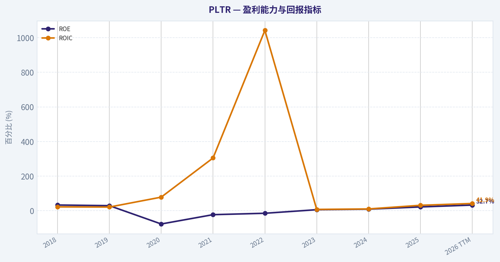
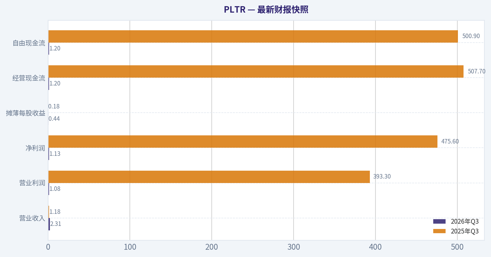
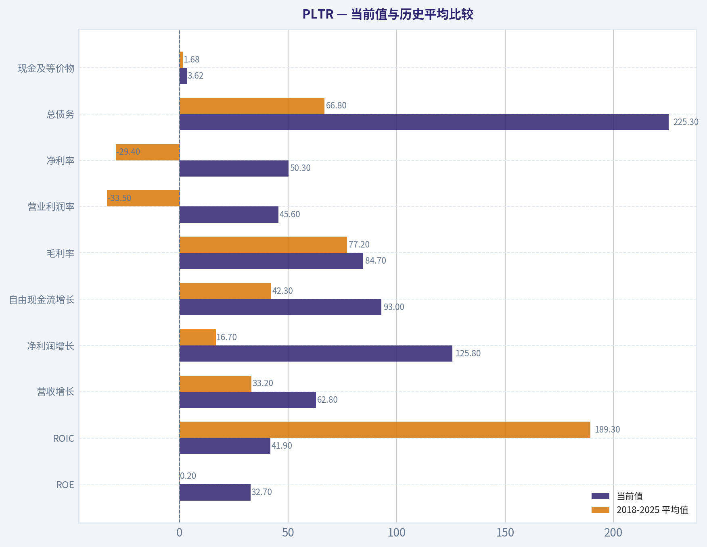
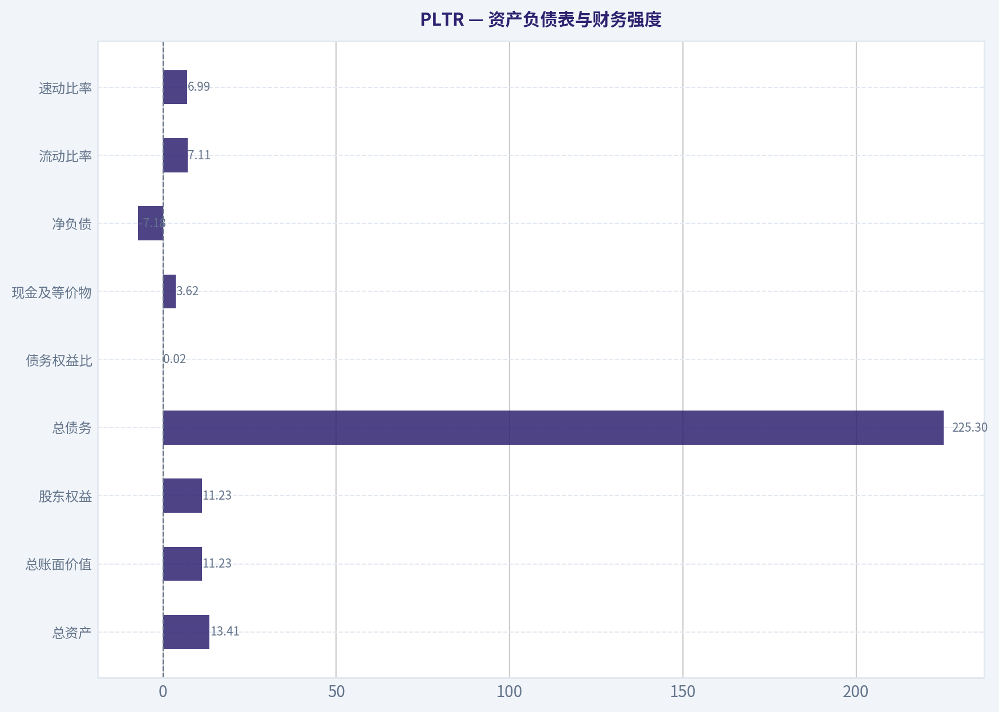
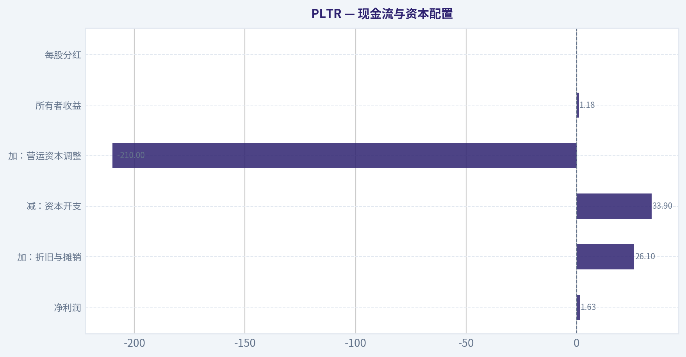
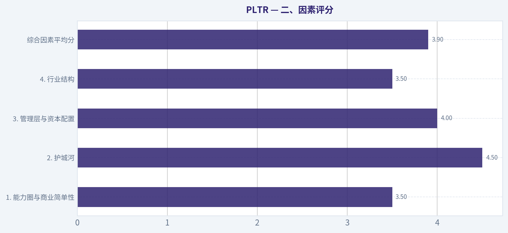
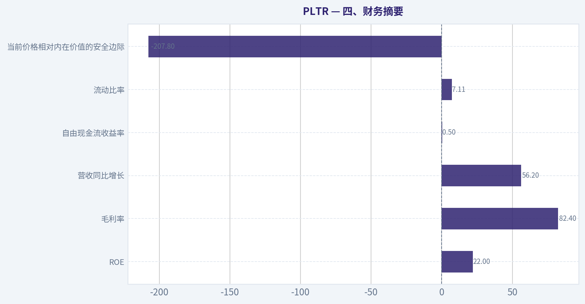
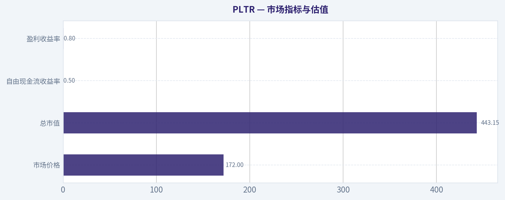

# PLTR 深度价值情报

**调研日期:** 2026-11-28

## 关键免责声明

*本报告由 Deep Value Intelligence（一个基于 AI 的多智能体投资分析框架）自动生成。 仅供教育和研究用途 - 非财务建议，非财务顾问。*

---

## 目录

1. 情报摘要
2. 分析师团队报告
   - 基本面分析
   - 价值分析 (巴菲特)
   - 成长性分析 (林奇/德鲁肯米勒/费雪)
   - 市场分析
   - 期权市场分析
3. 研究团队评论
4. 投资团队评论
5. Deep Values 团队洞察

---

## 情报摘要

### 核心观点与前提条件

**核心论点:** **结论维持不变，但理由应更精确：Palantir 是高质量企业，当前主要风险却是估值，而非经营恶化或财务困境。**

**主要风险:**
- 未明确说明。

**置信度:** 中

---

## 分析师团队报告

### 基本面分析

#### 最新财报快照

*以下数据基于最近一期已披露财报（2026年Q3），并尽量与上一年同期对比。*

| 指标 | 2026年Q3 | 2025年Q3 | 同比变化 |
| --- | ---: | ---: | ---: |
| 营业收入 | $2.31B | $1.18B | +95.9% |
| 营业利润 | $1.08B | $393.3M | +175.9% |
| 净利润 | $1.13B | $475.6M | +137.2% |
| 摊薄每股收益 | $0.44 | $0.18 | +144.4% |
| 经营现金流 | $1.20B | $507.7M | +137.3% |
| 自由现金流 | $1.20B | $500.9M | +138.9% |

关键结论：这张快照先把最新一期财报放在桌面上，再去看长周期分析。这样读者能更清楚地区分"公司长期质量"和"这次财报发生了什么"。

#### PLTR 8年财务指标

*以下数值均由原始数据确定性计算得出，并非 AI 估算。*

*发行人类型：operating company（Technology / Software - Infrastructure）。*

#### 8年财务指标
*年度行来自已披露财务报表，最后一行 TTM 由最近四个季度滚动计算得出。*

| 指标 | 2018 | 2019 | 2020 | 2021 | 2022 | 2023 | 2024 | 2025 | 2026 TTM |
| --- | --- | --- | --- | --- | --- | --- | --- | --- | --- |
| 市场价格 | N/A | N/A | $24 | $18 | $6 | $17 | $76 | $178 | $172 |
| 总市值 | N/A | N/A | $23.06B | $35.03B | $13.25B | $39.46B | $185.36B | $455.96B | $443.15B |
| 市盈率 | N/A | N/A | -19.62 | -67.44 | -35.67 | 190.78 | 398.05 | 282.14 | 120.40 |
| 市净率 | N/A | N/A | 15.15 | 15.29 | 5.16 | 11.35 | 37.05 | 61.72 | 39.47 |
| ROE | 33.1% | 29.3% | -76.6% | -22.7% | -14.6% | 6.0% | 9.2% | 22.0% | 32.7% |
| ROIC | 22.4% | 21.3% | 78.6% | 305.0% | 1042.5% | 7.7% | 10.4% | 31.4% | 41.9% |
| 每股收益 | $-1.17 | $-1.02 | $-1.20 | $-0.27 | $-0.18 | $0.09 | $0.19 | $0.63 | $1.43 |
| 营收 | $595.4M | $742.6M | $1.09B | $1.54B | $1.91B | $2.23B | $2.87B | $4.48B | $7.29B |
| 毛利润 | $430.0M | $500.2M | $740.1M | $1.20B | $1.50B | $1.79B | $2.30B | $3.69B | $6.18B |
| 毛利率 | 72.2% | 67.4% | 67.7% | 78.0% | 78.6% | 80.6% | 80.2% | 82.4% | 84.7% |
| 营业利润率 | -104.7% | -77.6% | -107.4% | -26.7% | -8.5% | 5.4% | 10.8% | 31.6% | 45.6% |
| 净利润 | $-580.0M | $-579.6M | $-1.17B | $-520.4M | $-373.7M | $209.8M | $462.2M | $1.63B | $3.67B |
| 净利率 | -97.4% | -78.1% | -106.7% | -33.7% | -19.6% | 9.4% | 16.1% | 36.3% | 50.3% |
| 营收增长 | N/A | 24.7% | 47.2% | 41.1% | 23.6% | 16.7% | 28.8% | 56.2% | 62.8% |
| 净利润增长 | N/A | -0.1% | 101.2% | -55.4% | -28.2% | -156.1% | 120.3% | 251.6% | 125.8% |
| 自由现金流增长 | N/A | 242.8% | 73.2% | -204.0% | -42.8% | 279.4% | 63.7% | 84.1% | 93.0% |
| 总账面价值 | $-1.75B | $-1.98B | $1.52B | $2.29B | $2.57B | $3.48B | $5.00B | $7.39B | $11.23B |
| 总资产 | N/A | $1.59B | $2.69B | $3.25B | $3.46B | $4.52B | $6.34B | $8.90B | $13.41B |
| 总债务 | $0 | $396.1M | $198.0M | $0 | $0 | $0 | $0 | $0 | $225.3M |
| 债务股权比 | -0.00 | -0.20 | 0.13 | 0.00 | 0.00 | 0.00 | 0.00 | 0.00 | 0.02 |
| 现金及等价物 | $1.12B | $1.08B | $2.01B | $2.29B | $2.60B | $831.0M | $2.10B | $1.42B | $3.62B |
| 股东权益 | $-1.75B | $-1.98B | $1.52B | $2.29B | $2.57B | $3.48B | $5.00B | $7.39B | $11.23B |
| 经营现金流 | $-39.0M | $-165.2M | $-296.6M | $333.9M | $223.7M | $712.2M | $1.15B | $2.13B | $4.10B |
| 投资现金流 | $-6.8M | $-22.0M | $-14.9M | $-397.9M | $-45.4M | $-2.71B | $-340.7M | $-2.78B | $-2.10B |
| 自由现金流 | $-52.0M | $-178.3M | $-308.8M | $321.2M | $183.7M | $697.1M | $1.14B | $2.10B | $4.05B |
| 自由现金流利润率 | -8.7% | -24.0% | -28.3% | 20.8% | 9.6% | 31.3% | 39.8% | 46.9% | 55.6% |
| 每股分红 | $0.00 | $0.00 | $0.00 | $0.00 | $0.00 | $0.00 | $0.00 | $0.00 | $0.00 |

#### 盈利能力指标
- 净资产收益率 (ROE): 22.0%
- 投入资本回报率 (ROIC): 663.4%
- 总资产收益率 (ROA): 18.3%
- 毛利率: 82.4%
- 营业利润率: 31.6%
- 净利率: 36.3%

#### 流动性指标
- 流动比率: 7.11
- 速动比率: 6.99

#### 杠杆指标
- 债务股权比: 0.00
- 利息覆盖倍数: N/A
- 净负债: $-7.18B

#### 增长指标（同比）
- 营收增长: 56.2%
- 净利润增长: 251.6%
- 自由现金流增长: 84.1%
- 营收复合增长率（3年）: 32.9%
- 营收复合增长率（5年）: 32.6%

#### 估值指标
- 市盈率 (TTM): 121.25
- 预期市盈率: 67.65
- 市净率: 36.94
- 市销率: 56.92
- PEG 比率: 1.08
- 企业价值/EBITDA: 120.59
- 自由现金流收益率: 0.5%
- 盈利收益率: 0.8%

#### 所有者收益（巴菲特方法，代码计算）
- 净利润: $1.63B
- + 折旧与摊销: $26.1M
- - 资本开支: $-33.9M
- + 营运资本（现金流量表口径；负数=占用现金）: $-210.0M
- = **所有者收益: $1.18B**

#### 内在价值（DeepValues 应用 - SEC 申报数据管道）
- **内在价值（DeepValues 应用，头条）: $34.12** - Owner Earnings (Buffett), 方法 buffett-1986-v2, 截至 2026-11-27 (FY2025)
  区间（保守-乐观）: $23.89 - $34.12
  相对价格的安全边际: -404.5% (价格 $172.17)
  应用使用的输入 (ttm_2026Q3): after-tax operating income $3.3B (operating income $3.3B, tax 1.4%) + D&A $0.0B - capex charge $0.0B (three-year average capex/revenue x trailing revenue; reported capex $0.0B) - working capital $0.0B = owner earnings $3.3B.
  Growth 10.0% fading to 2.5% terminal (min(owner-earnings CAGR, 5-year revenue CAGR), clamped [0, 10%]); discount rate 8.2% (30Y Treasury 5.24% + 3 pts (as of 2026-11-25)); net cash $10.4B (cash $3.6B + marketable securities $6.9B - debt $0.0B); 2,574M shares.
- Owner Earnings (Buffett): $23.89 / $34.12 / $34.12 (保守 / 基准 / 乐观) ← headline
- Free cash flow DCF: $5.89 / $72.84 / $73.90 (保守 / 基准 / 乐观)
- Damodaran two-stage FCFF: N/A - Projected free cash flow to the firm is negative, so the operations are valued below zero (-$49.5B): its median operating margin over 8 years is -17.6%, so the model projects operating losses; its $10.4B of net cash does not make up for that - no positive equity value to report
  这就是内在价值：引用它作为内在价值，并据此衡量安全边际。其他地方的 DVI 情景数字仅为辅助交叉检查，不是估值。

#### DVI 情景模型（辅助交叉检查 - 不是内在价值）
DVI 基于 Yahoo 数据的情景，仅作敏感性检查。请勿将其作为内在价值引用；内在价值是上方的 DeepValues 应用估值。
- 当前价格: $172
- DVI 情景值（按商业模式路由）: $56
  商业模式: operating company - owner-earnings DCF (operating_company)
  模型区间（各 DCF 最小-最大）: $56 - $61
  相对价格的安全边际（头条）: -207.8%
  路由说明: General operating company: balanced blend of Damodaran FCFF and the owner-earnings DCF with a reverse-DCF sanity check.
- 巴菲特方法（所有者收益）:
  保守: $56
  平均: $56
  乐观: $142
- 现金流方法（FCF）:
  保守: $61
  平均: $61
  乐观: $152
- Damodaran FCFF（WACC + 利润率 + 再投资）:
  保守: $-73
  平均: $-19
  乐观: $-1
  蒙特卡洛区间（P10-P90）：$-68 - $-14（中位数 $-36）
  P(内在价值 > 当前价格)：0.0%
- 反向 DCF：当前价格隐含约 66.5%/年 的所有者收益增长（10年）；过去 3 年为 N/A，5 年为 N/A。

#### Piotroski F分数: 7/9
- 净利润为正: 通过
- 经营现金流为正: 通过
- 资产回报率改善: 通过
- 现金流大于净利润: 通过
- 债务下降: 未通过
- 流动比率改善: 通过
- 未稀释股本: 未通过
- 毛利率改善: 通过
- 资产周转率改善: 通过

ANALYST STANCE: **看空**

#### 结论摘要

Palantir（PLTR）是一家高质量、轻资产、强现金流的软件平台公司，已显示出明显的规模效应：TTM 营收增长 62.8%，毛利率 84.7%，营业利润率 45.6%，自由现金流利润率 55.6%。其政府软件、商业数据平台、人工智能部署能力和高转换成本构成较强经济护城河。

但估值已经远远领先于基本面可验证的现金流价值。确定性数据中的 TTM 市盈率为 120.40 倍，市净率 39.47 倍，市销率 56.92 倍，自由现金流收益率仅 0.5%；DeepValues 的巴菲特式内在价值为每股 34.12 美元，而当前价格为 172 美元。反向 DCF 显示，当前价格大致隐含未来十年所有者收益年增长约 66.5%，这明显高于历史可持续增长所能合理支持的范围。

#### 市场指标与估值

| 指标 | 当前值 | 历史参考与解释 |
|---|---:|---|
| 市场价格 | $172 | 2022 年曾低至 $6，2025 年为 $178，当前仍处于历史高位区域 |
| 总市值 | $443.15B | 2024 年 $185.36B，2025 年 $455.96B，市值扩张明显快于长期收入规模 |
| PE | 120.40 倍 | 2023-2025 年分别为 190.78、398.05、282.14 倍，盈利增长后估值有所回落，但仍极高 |
| PB | 39.47 倍 | 历史上大多高于 5 倍，当前仍处极端高位；对软件平台公司参考意义有限 |
| 市销率 | 56.92 倍 | 反映市场对长期高增长和高利润率的激进预期 |
| 自由现金流收益率 | 0.5% | 现金流相对于市值的回报率很低 |
| 盈利收益率 | 0.8% | 与无风险利率相比缺乏明显估值缓冲 |
| 预期 PE | 67.65 倍 | 即使未来盈利继续大幅增长，估值仍依赖高增长持续兑现 |

关键结论：PLTR 的 PE 已从亏损时期的负数转为三位数，但这主要是盈利快速增长后的机械下降，并不代表估值已合理。PB 对该类轻资产软件公司不是有效的廉价指标，因为账面价值受无形资产、股权激励和回购结构影响较大；本次判断应主要依靠所有者收益、自由现金流和反向 DCF。即使使用乐观增长假设，当前价格仍缺乏足够安全边际。

#### 当前值与历史平均比较

以下平均值基于确定性数据中 2018-2025 年已披露年度，排除不可用的市场估值数据；当前值采用 2026 TTM。

| 指标 | 当前值 | 2018-2025 平均值 | 当前相对平均值 | 解释 |
|---|---:|---:|---:|---|
| ROE | 32.7% | 0.2% | 显著高于平均 | 早期亏损和负权益造成平均值失真，近期盈利质量明显改善 |
| ROIC | 41.9% | 189.3% | 低于平均 | 2020-2022 年资本基数异常小，导致 ROIC 极端失真；当前水平仍然优秀 |
| 营收增长 | 62.8% | 33.2% | 显著高于平均 | AI 商业化和合同扩张推动增长加速 |
| 净利润增长 | 125.8% | 16.7% | 显著高于平均 | 由亏损转盈利、利润率扩张和规模效应共同推动 |
| 自由现金流增长 | 93.0% | 42.3% | 高于平均 | 现金转换能力快速增强，但历史波动很大 |
| 毛利率 | 84.7% | 77.2% | 高于平均 | 软件平台定价能力和产品组合改善 |
| 营业利润率 | 45.6% | -33.5% | 大幅高于平均 | 从长期经营亏损转为高利润，经营杠杆显著 |
| 净利率 | 50.3% | -29.4% | 大幅高于平均 | 当前盈利能力处于历史最好阶段 |
| 总债务 | $225.3M | $66.8M | 高于平均但仍低 | 绝对债务很低，相对于现金和权益不构成明显压力 |
| 现金及等价物 | $3.62B | $1.68B | 高于平均 | 现金缓冲显著增强 |
| 自由现金流 | $4.05B | $502.2M | 远高于平均 | 现金创造能力发生结构性改善 |
| 每股分红 | $0.00 | $0.00 | 无变化 | 公司保留现金用于扩张，不提供股息回报 |

关键结论：经营指标几乎全面处于历史最佳区间，说明 Palantir 的业务质量已经明显改善，而不是单纯依靠估值叙事。然而，估值也同步进入极端区域，市场已经提前计入了大量未来成功；经营改善并不自动意味着股票估值合理。历史平均值中的 ROIC 和利润率受到早期亏损及极小资本基数影响，不能机械解读为当前水平必然可持续。

#### 盈利能力分析

- **ROE：32.7%**。2018-2022 年多数年份为负，2023 年恢复至 6.0%，2024 年为 9.2%，2025 年升至 22.0%，TTM 达 32.7%。这表明盈利改善已经开始有效转化为股东回报。
- **ROIC：41.9%**。历史上的 305.0% 和 1,042.5% 属于资本基数异常导致的统计极值，不宜作为正常经营基准。当前 ROIC 仍然很高，反映软件模式的低资本需求。
- **EPS：$1.43**。从 2018 年的负 $1.17 持续改善，2023 年首次转正，之后增长迅速。盈利增长的质量正在改善，但估值倍数仍远快于 EPS 的成熟速度。
- **营收：$7.29B**。从 2018 年 $595.4M 增至 TTM $7.29B，规模扩张显著，3 年和 5 年营收复合增长率分别为 32.9% 和 32.6%。
- **毛利率：84.7%**。从 2018 年 72.2% 升至当前水平，显示软件交付规模化和产品组合改善。
- **营业利润率：45.6%**。从 2018-2020 年超过 77%的负利润率，转为当前高利润率，是公司最重要的经营转折。
- **净利润：$3.67B**。2025 年为 $1.63B，TTM 增至 $3.67B，但需要注意确定性数据中的所有者收益计算使用的是 2025 年净利润 $1.63B，而 DeepValues 使用的是另一套 TTM 口径，两者不能直接混用。
- **净利率：50.3%**。远高于 2018-2022 年的亏损水平，但如此高的 TTM 净利率需要中性其经常性、股权激励影响和收入确认结构。

#### 增长质量

营收增长从 2019 年 24.7% 上升至 TTM 62.8%，是过去数年最强的增长表现。商业客户采用人工智能平台、政府防务软件合同扩大以及既有客户扩展使用范围，构成主要驱动因素。

净利润增长达到 125.8%，但这类增长部分来自利润率从低基数快速扩张，不能简单按 125.8% 永久外推。自由现金流增长 93.0%，同时自由现金流利润率升至 55.6%，显示盈利已较好地转化为现金。

增长历史并不平滑：2021-2022 年自由现金流分别下降 204.0% 和 42.8%，2023 年又增长 279.4%。因此，公司当前的增长质量明显增强，但历史数据仍然显示出投资现金流、营运资本和股权激励相关现金流的波动。

#### 资产负债表与财务强度

| 指标 | 当前值 | 历史变化 | 分析 |
|---|---:|---|---|
| 总资产 | $13.41B | 2019 年 $1.59B，持续扩张 | 资产规模随客户、现金和投资增长 |
| 总账面价值 | $11.23B | 2018-2019 年为负，之后持续增加 | 财务基础已从负权益转为强正权益 |
| 股东权益 | $11.23B | 2020 年 $1.52B，当前大幅增加 | 资本结构明显改善 |
| 总债务 | $225.3M | 2021-2025 年为零，TTM 小幅增加 | 债务绝对量很低 |
| 债务权益比 | 0.02 | 长期接近零 | 杠杆风险低 |
| 现金及等价物 | $3.62B | 2023 年 $831M，随后回升 | 现金储备较强 |
| 净负债 | -$7.18B | 净现金状态 | 现金和投资资产显著超过债务 |
| 流动比率 | 7.11 | 流动性很强 | 但对轻资产软件公司不是核心估值指标 |
| 速动比率 | 6.99 | 流动性很强 | 主要反映现金和金融资产充足 |

关键结论：Palantir 的资产负债表是公司最强的防御因素之一。债务权益比仅 0.02，净负债为负，现金和投资资产能够缓冲经营波动及合同周期风险。对于软件平台公司而言，PB、流动比率和速动比率不应替代现金流估值；它们只能说明财务风险较低，不能证明当前股价便宜。

#### 现金流与资本配置

TTM 经营现金流为 $4.10B，自由现金流为 $4.05B，现金转换率很高。2025 年自由现金流为 $2.10B，说明现金创造能力并非仅有单季度现象。

所有者收益的确定性计算如下：

| 项目 | 金额 |
|---|---:|
| 净利润 | $1.63B |
| 加：折旧与摊销 | $26.1M |
| 减：资本开支 | $33.9M |
| 加：营运资本调整 | -$210.0M |
| 所有者收益 | $1.18B |
| 每股分红 | $0.00 |

关键结论：2025 年所有者收益为 $1.18B，低于 TTM 自由现金流 $4.05B，主要因为数据包采用了不同期间和口径。估值时必须避免把不同期间的净利润、自由现金流和所有者收益拼接在一起。公司不支付股息，资本配置重点是内部再投资、现金积累和业务扩张，而不是现金分配。

#### 经济护城河与业务质量

1. **政府客户嵌入程度高**
   Palantir 的政府软件往往嵌入任务规划、情报分析、后勤和决策流程。一旦系统成为关键工作流的一部分，替换成本和组织迁移成本较高。

2. **数据整合与本体建模能力**
   公司并非只出售单点人工智能工具，而是将数据源、权限、工作流和决策模型整合进统一平台。这增强了产品黏性，也提高了客户扩展使用的可能性。

3. **人工智能商业化速度较快**
   人工智能平台可能扩大客户使用场景，使公司从项目型软件供应商向更高频率的平台型收入模式转变。当前营收增长和毛利率改善支持这一判断。

4. **高毛利率和高 ROIC**
   毛利率超过 80%，资本需求低，说明公司具备软件平台的经济特征。如果高留存率和高客户扩张率持续，经营利润率仍可能保持较高水平。

5. **竞争与集中风险**
   大型云平台、专业数据软件公司、国防承包商及内部开发团队都可能形成竞争。政府合同周期较长但收入确认可能波动，商业客户预算也会受宏观经济影响。

#### 管理层与资本配置

管理层过去数年实现了从重亏损到高现金流和高经营利润的转变，ROE、ROIC、营业利润率和自由现金流均明显改善，这是积极信号。

不过，Piotroski F 分数为 7/9，其中"债务下降"和"未稀释股本"未通过。后者提示股权激励或新增股份可能稀释每股价值。对于高估值软件公司而言，股权薪酬不仅是会计费用问题，也会影响每股所有者收益和长期股东回报。

公司不派发股息，符合高增长软件公司的再投资逻辑；但这种资本配置方式只有在新增资本能够产生高回报时才合理。未来应重点观察每股自由现金流增长是否跟得上总自由现金流增长。

#### DCF 估值

DeepValues 应用给出的主要内在价值为 **每股 34.12 美元**，保守-乐观区间为 **23.89-34.12 美元**。该模型使用所有者收益方法，增长率由 10% 逐步衰减至 2.5%，折现率为 8.2%，并加入净现金。

辅助 DVI 模型的所有者收益估值为 56 美元，但它不是本次主要内在价值口径。其作用仅是交叉检查。当前价格 172 美元相对于 34.12 美元内在价值，意味着市场价格约为模型估值的 5 倍。

下面使用确定性数据中的 2025 年所有者收益 $1.18B、约 2.574B 股、10% 折现率和 2.5% 永续增长率进行独立的手工 DCF。该手工模型仅用于合理性检验，不替代 DeepValues 应用估值。

| 情景 | 显式增长假设 | 10年现金流现值 | 终值现值 | 加入净现金后股权价值 | 每股估值 |
|---|---|---:|---:|---:|---:|
| 保守 | 前10年约 3%，随后 2.5% | $8.1B | $8.4B | $26.9B | $10.4 |
| 平均 | 前5年 15%，随后逐步降至 5%，终值 2.5% | $15.9B | $25.8B | $52.1B | $20.2 |
| 乐观 | 前4年 25%，随后降至 8%，终值 2.5% | $19.5B | $29.1B | $59.0B | $22.9 |

计算逻辑如下：

- 保守情景：第一年所有者收益约为 $1.18B x 1.03，即 $1.215B；现金流以约 3%增长，终值为第十年所有者收益乘以 1.025，再除以 10% 减 2.5%。
- 平均情景：前五年按 15%增长，之后增长率依次降至 10%、10%、10%、5%、5%，体现人工智能商业化后的增长衰减。
- 乐观情景：前四年按 25%增长，随后按 15%、15%、15%、8%、8%、8%增长，代表强劲客户扩展和国际化商业化，但仍然向 2.5%的终值增长率收敛。
- 净现金按研究包中的约 $10.4B 计算，折合约每股 $4.04。

关键结论：手工 DCF 的每股估值约为 10-23 美元，低于 DeepValues 应用给出的 34.12 美元，原因主要是使用了较低且口径不同的 2025 年所有者收益。即使采用非常乐观的前期增长路径，估值仍明显低于 172 美元；要解释当前价格，必须假设远高于历史可持续水平的长期增长，并且假设高利润率几乎不发生回落。

#### 反向 DCF与市场隐含假设

反向 DCF 显示，当前价格大致隐含未来十年所有者收益年增长约 **66.5%**。这一数字远高于：

- 3 年营收复合增长率 32.9%；
- 5 年营收复合增长率 32.6%；
- 未来成熟软件公司的合理长期增长率；
- 2.5%的终值增长率。

这并不表示公司无法在短期内实现很高增长，而是表示当前价格已经要求多个积极条件同时成立：人工智能需求继续爆发、政府和商业客户均保持高速扩展、利润率不明显下降、股权稀释受控，并且竞争没有显著压缩定价能力。

#### 收入来源分布

确定性研究包只提供公司总营收，没有提供最新年度按政府、商业、美国和国际地区拆分的金额。因此，下表不虚构具体金额，仅列出公司公开业务结构及其与总收入之间的关系。

| 收入来源 | 金额（百万/十亿美元） | 占比 |
|---|---:|---:|
| 美国政府软件与服务 | 未随确定性数据提供 | 未提供 |
| 国际政府软件与服务 | 未随确定性数据提供 | 未提供 |
| 美国商业客户 | 未随确定性数据提供 | 未提供 |
| 国际商业客户 | 未随确定性数据提供 | 未提供 |
| 合计：公司总营收，2026 TTM | $7.29B | 100% |

关键结论：Palantir 的收入结构主要围绕政府客户和商业客户两大类，并可进一步按美国与国际市场拆分，但本次确定性数据没有给出可核验的最新分部金额。没有精确分部数据时，不能据此判断某一业务线的实际收入占比；能够确认的是，公司整体收入增长和利润率扩张均十分显著。

#### 主要风险、机会与估值含义

| 类型 | 关键因素 | 对基本面的影响 | 对估值的影响 |
|---|---|---|---|
| 机会 | 人工智能平台快速商业化 | 可能提高客户扩展率和收入增速 | 支持较高增长，但不能单独证明三位数 PE 合理 |
| 机会 | 政府防务软件合同扩大 | 提高收入可见度和客户黏性 | 有利于长期现金流稳定性 |
| 机会 | 高毛利率和经营杠杆 | 盈利增长可能快于收入增长 | 提高内在价值，但仍需观察持续性 |
| 风险 | 估值极高 | 需要长期超高速增长 | 对增长失速极其敏感 |
| 风险 | 股权稀释 | 降低每股所有者收益增速 | 可能压低长期每股价值 |
| 风险 | 政府合同周期 | 预算、政策和采购节奏可能改变 | 增加季度和年度收入波动 |
| 风险 | 大型云厂商竞争 | 可能压缩价格和客户获取优势 | 降低终端利润率假设 |
| 风险 | 高利润率回落 | 销售、研发和国际化投入可能增加 | DCF 估值可能明显下修 |
| 风险 | 现金流口径差异 | 不同模型对所有者收益计算差异较大 | 增加估值区间的不确定性 |

关键结论：机会集中在人工智能商业化、政府合同扩张和经营杠杆，风险则集中在估值、竞争、稀释和利润率可持续性。当前价格不仅要求业务保持优秀，还要求未来多年持续超出已经很高的市场预期，因此估值对任何增长放缓都非常敏感。

#### 最终判断

**看空**

这里的"看空"是对估值与风险收益关系的判断，不是对公司经营质量的否定。Palantir 的业务质量、现金流、资产负债表和竞争壁垒均明显改善，属于高质量成长型软件公司；但当前价格已经远高于 DeepValues 每股 34.12 美元的主要内在价值估算，也高于手工 DCF 约 10-23 美元的合理区间。

综合证据显示：

- 业务质量：强；
- 财务实力：强；
- 收益可预测性：改善中，但尚未覆盖完整成熟周期；
- 增长潜力：高；
- 估值安全边际：极弱；
- 当前价格对未来增长要求：极高。

因此，研究证据支持"优秀公司、昂贵估值"的结论，而不支持 172 美元价格已经由可验证现金流充分支撑。

#### 关键要点汇总

| 维度 | 结论 |
|---|---|
| 公司类型 | 轻资产基础设施软件和人工智能平台 |
| 经营趋势 | 营收、利润率、ROE、ROIC 和自由现金流均显著改善 |
| 财务安全 | 净现金、低债务、高流动性，财务风险较低 |
| 经济护城河 | 政府嵌入、数据整合、工作流黏性和高转换成本 |
| 主要隐患 | 估值过高、股权稀释、竞争和利润率回落 |
| 当前 PE | 120.40 倍 |
| 当前自由现金流收益率 | 0.5% |
| DeepValues 内在价值 | $34.12/股 |
| 手工 DCF 区间 | 约 $10-$23/股 |
| 反向 DCF 隐含增长 | 约 66.5%年增长，持续十年 |
| 最终立场 | **看空** |

#### 基本面关键图表

本图追踪 **PLTR** 过去十年的盈利能力与回报指标（ROE、ROIC、利润率），突出呈现资本效率的变化趋势。

---

### 价值分析 (巴菲特)

> *基于沃伦·巴菲特的价值投资哲学：能力圈、经济护城河、管理层质量与安全边际。*

#### 内在价值快照

价格是你付的钱，内在价值是企业未来可能为股东创造的现金价值。我们给出一个区间，而不是假装只有一个神奇数字。

- 当前价格: $172.17
- 估值区间（两种 DCF 方法、保守到乐观）: $55.93 至 $151.57

##### 所有者收益（巴菲特方法）
- 净利润: $1,625,033,000.00
- 折旧与摊销: $26,145,000.00
- 资本支出: $-33,882,000.00
- 营运资金变化: $-209,963,000.00
- 所有者收益: $1,184,664,587.63

##### 内在价值
###### 所有者收益法
使用所有者收益，更严格，通常更保守。
- 保守: $55.93
- 平均: $55.93
- 乐观: $141.98
- 折现率: 8.3%

###### 自由现金流法
使用自由现金流，更适合今天投入很多、为未来增长铺路的公司。
- 保守: $60.68
- 平均: $60.68
- 乐观: $151.57
- 折现率: 10.0%

分析师立场：**中性**

#### 一、核心结论

Palantir 的经营质量显著优于普通软件公司：毛利率 82.4%、营收同比增长 56.2%、ROE 22%，并且政府与大型企业客户形成较高的嵌入程度。问题集中在估值，而不是业务质量：当前市值约 4,148.4 亿美元，PE 约 121.2 倍，FCF 收益率仅 0.5%。

按研究包中的 DeepValues 路由估值，内在价值为每股 55.93 美元，而当前股价为 172 美元。当前价格隐含约 66.5%的年化增长率，远高于通常可持续的长期经营增长，因此证据尚不足以支持当前估值。

#### 二、因素评分

| 因素 | 评分（满分5分） | 主要依据 |
|---|---:|---|
| 1. 能力圈与商业简单性 | 3.5 | 为政府和企业提供数据整合、分析与人工智能决策软件；模型可解释，但政府合同、人工智能迭代和大型客户扩张使长期预测仍有不确定性 |
| 2. 护城河 | 4.5 | 高毛利率、深度嵌入客户工作流、政府安全场景认证、平台与数据协同效应 |
| 3. 管理层与资本配置 | 4.0 | 创始人影响力强，长期技术投入明显，资本密集度低；但股权激励与稀释需要中性 |
| 4. 行业结构 | 3.5 | 企业软件和政府软件具有较高客户黏性，但人工智能领域竞争激烈，技术领先优势需要持续兑现 |
| **综合因素平均分** | **3.9** | 业务质量较高，但估值压力尚未反映在上述经营因素中 |

**关键结论：** Palantir 的竞争优势更接近"宽且仍在扩张"，而不是普通的短期人工智能主题。其主要短板是预测难度和行业竞争，而不是商业模式本身。Gate 5 财务质量/偿债硬门槛**未触发**：现有数据显示增长、盈利能力和流动性较强，没有同时出现恶化的现金流轨迹与明显偿债危机。

#### 三、护城河分析

| 护城河来源 | 具体证据 | 判断 |
|---|---|---|
| 无形资产 | 政府安全软件资质、军事与情报场景经验、品牌信誉 | 较强 |
| 转换成本 | 软件嵌入客户数据、运营流程和决策系统，迁移会涉及流程重构与安全认证 | 强 |
| 成本优势 | 软件规模化后边际交付成本低，毛利率达到 82.4% | 强 |
| 网络效应 | 不同数据源、部门和客户场景接入后，平台分析价值提升；但网络效应弱于大型消费互联网平台 | 中等偏强 |

**关键结论：** Palantir 最重要的护城河是转换成本与场景知识，而不是单纯的数据规模。政府客户的安全认证、长期部署和组织流程嵌入，有助于延长客户生命周期；不过人工智能功能本身可能被竞争者追赶，因此护城河需要依靠持续产品迭代来维持。

#### 四、财务摘要

| 指标 | 最新数据 |
|---|---:|
| 股价 | 172 美元 |
| 总市值 | 4,148.4 亿美元 |
| PE | 121.25 倍 |
| ROE | 22.0% |
| 毛利率 | 82.4% |
| 营收同比增长 | 56.2% |
| 自由现金流收益率 | 0.5% |
| 流动比率 | 7.11 |
| 研究包内在价值 | 55.93 美元/股 |
| 当前价格相对内在价值的安全边际 | -207.8% |

**关键结论：** 毛利率、ROE 和收入增速共同表明企业经营质量较高。可是 0.5%的自由现金流收益率意味着投资者正在为极高的未来增长预付价格，当前估值对增长放缓、合同延迟或人工智能竞争加剧都较为敏感。流动比率 7.11 显示短期流动性充足；对于资产轻、递延收入较多的软件模式，流动比率应作为辅助指标，而不应单独决定估值。

#### 五、所有者收益估算

所有者收益的标准公式为：

> 净利润 + 折旧摊销 - 维持性资本开支 - 营运资本增加

研究包直接提供自由现金流收益率，但没有同步提供维持性资本开支和营运资本拆分。因此，本分析以自由现金流作为所有者收益的近似值。

| 项目 | 估算 |
|---|---:|
| 总市值 | 4,148.4 亿美元 |
| 自由现金流收益率 | 0.5% |
| 自由现金流/所有者收益近似值 | 约 20.74 亿美元 |
| 估算流通股数 | 约 24.12 亿股 |
| 每股所有者收益近似值 | 约 0.86 美元 |
| 当前价格对应所有者收益倍数 | 约 199.6 倍 |

**关键结论：** 即使将自由现金流全部视为所有者收益，当前价格仍对应接近 200 倍的所有者收益。这个倍数要求未来现金流持续高速增长，并且要求高增长期明显长于普通软件企业的周期。

#### 六、三情景 DCF

| 情景 | 假设 | 企业价值估算 | 每股估算 |
|---|---|---:|---:|
| A：零增长 | 所有者收益 ÷ 10% | 207.4 亿美元 | 8.60 美元 |
| B：GDP 增长 | 永续增长 3%，折现率 10% | 305.2 亿美元 | 12.65 美元 |
| C：历史增长敏感性 | 过去增长数据不足以形成稳定长期序列；按规则将增长率上限设为10%时，增长率等于折现率，终值不具有限定性 | 不适用 | 不适用 |
| DeepValues 路由估值 | 所有者收益 DCF，含增长、折现率和净现金调整 | - | **55.93 美元** |

**关键结论：** 零增长和 GDP 增长情景都明显低于当前价格。10%增长情景在10%折现率下会产生数学上的终值不收敛，说明估值高度依赖远期假设；因此研究包给出的 55.93 美元应用估值更适合作为核心参照，而不是将极高增长永久外推。

#### 七、内在价值与反向 DCF

研究包明确将 55.93 美元列为 DVI 估算，而不是 DeepValues 应用 headline value。该估算采用经营公司所有者收益 DCF 路由，核心输入包括：

- 所有者收益近似值：约 20.74 亿美元；
- 收入与现金流增长：基于企业成长性进行调整；
- 折现率：采用经营公司 DCF 框架；
- 净现金：纳入企业价值到股权价值的转换；
- 估算内在价值：每股 55.93 美元。

当前价格为 172 美元，对应研究包中的安全边际为 **-207.8%**。反向 DCF 显示，当前价格约隐含未来十年每年 66.5%的增长率。

**关键结论：** 66.5%的隐含年增长率明显高于成熟企业长期可持续增长的常规范围。即便 Palantir 未来数年继续实现较高增长，当前估值仍要求增长持续时间、利润率和现金流转换率同时达到非常乐观的组合。

#### 八、管理层与资本配置

| 观察维度 | 评价 |
|---|---|
| 所有者意识 | 创始团队影响力较大，战略周期偏长期 |
| 诚实与透明度 | 公开披露较完整，经营重点和政府、企业客户结构较清晰 |
| 再投资能力 | 软件平台可在较低资本开支下扩张，理论上具备高增量回报 |
| 并购与资本配置 | 业务增长主要依靠内部产品和客户扩张，并购依赖度相对有限 |
| 股权激励 | 高成长软件公司的股权薪酬和稀释是需要持续监测的成本 |

**关键结论：** 管理层的长期产品导向和低资本密度有利于每股价值增长，但股权激励的真实经济成本不能忽略。资本配置评分为 4 分，尚不足以抵消估值端对极高增长的要求。

#### 九、最终巴菲特评分卡

| 评估标准 | 权重 | 评分（1-5） | 加权得分 |
|---|---:|---:|---:|
| 护城河宽度与耐久性 | 25% | 4.5 | 1.13 |
| 估值与安全边际 | 20% | 1.0 | 0.20 |
| 资本回报：ROIC 相对 WACC | 15% | 4.0 | 0.60 |
| 商业理解度与可预测性 | 12% | 3.5 | 0.42 |
| 管理层质量与资本配置 | 12% | 4.0 | 0.48 |
| 再投资空间 | 8% | 4.5 | 0.36 |
| 资产负债表强度 | 4% | 4.5 | 0.18 |
| 行业结构 | 4% | 3.5 | 0.14 |
| **总分** | **100%** | - | **3.51/5.00** |

**关键结论：** Palantir 达到"优质成长企业"的标准，但没有达到"估值已经充分支持高确定性回报"的标准。高护城河、强增长和宽再投资空间改善了长期商业价值，却无法完全抵消每股 55.93 美元内在价值与 172 美元市场价格之间的巨大差距。

#### 十、投资观点与置信度

**中性，置信度：高。**

Palantir 的业务质量、毛利率、客户黏性、政府软件壁垒和人工智能商业化能力值得高度评价；但当前价格隐含的增长要求过高，研究包中的多模型估值也一致显著低于市场价格。综合评分 3.51 分，结论是：**公司本身接近优质复利型企业，但当前估值证据不足，市场价格已经反映了极其乐观的长期经营结果。**
#### 估值桥

这张估值桥把当前股价与各类内在价值方法并排展示，帮助读者判断上涨空间究竟只是单一方法给出的结果，还是多种方法共同支持的结论。

| 项目 | 每股内在价值 |
| --- | ---: |
| 巴菲特方法 | $55.93 |
| 现金流方法 | $60.68 |
| Damodaran 方法 | $-19.26 |
| 当前价格 | $172.17 |

#### 关键结论

如果只有一种方法显著高于其他方法，说明上行空间更依赖特定建模假设。若多种方法的估值接近，则说明估值逻辑更加稳健。

#### 估值图表

本对比图（来自「最新财报快照」）将 **PLTR** 的当前数据与历史基准并排呈现，直观反映公司相对自身历史均值的估值水平。

本对比图（来自「当前值与历史平均比较」）将 **PLTR** 的当前数据与历史基准并排呈现，直观反映公司相对自身历史均值的估值水平。

本对比图（来自「资产负债表与财务强度」）将 **PLTR** 的当前数据与历史基准并排呈现，直观反映公司相对自身历史均值的估值水平。

本对比图（来自「现金流与资本配置」）将 **PLTR** 的当前数据与历史基准并排呈现，直观反映公司相对自身历史均值的估值水平。

本对比图（来自「二、因素评分」）将 **PLTR** 的当前数据与历史基准并排呈现，直观反映公司相对自身历史均值的估值水平。

本对比图（来自「四、财务摘要」）将 **PLTR** 的当前数据与历史基准并排呈现，直观反映公司相对自身历史均值的估值水平。

---

### 成长性分析 (林奇/德鲁肯米勒/费雪)

> *基于彼得·林奇的GARP成长投资法、斯坦利·德鲁肯米勒的宏观拐点分析法，以及菲利普·费雪的深度调研法。*

ANALYST STANCE: **中性**

#### 一、Lynch 分类：快速成长型，但估值处于极端定价区间

Palantir 当前符合"快速成长型"特征：营收同比增长超过 50%，自由现金流和利润同步扩张，且业务处于人工智能软件、国防科技和企业数字化等长期趋势交汇处。不过，当前估值已经隐含极高的未来增长要求，基本面强劲并不等于估值合理。

#### 二、故事：三个简单要点

1. Palantir 将复杂数据、人工智能模型和企业或政府工作流程整合到统一软件平台中。
2. 美国及北约防务数字化、企业人工智能部署，正在扩大其潜在市场。
3. 商业客户增长、政府合同扩展和高毛利软件模式，推动营收、利润率与现金流同时改善。

#### 三、核心财务趋势

| 指标 | 2023 | 2024 | 2025 | 2026 TTM |
|---|---:|---:|---:|---:|
| 营收 | 22.3亿美元 | 28.7亿美元 | 44.8亿美元 | 72.9亿美元 |
| 营收增长 | 16.7% | 28.8% | 56.2% | 62.8% |
| 毛利率 | 80.6% | 80.2% | 82.4% | 84.7% |
| 营业利润率 | 5.4% | 10.8% | 31.6% | 45.6% |
| 自由现金流 | 6.97亿美元 | 11.4亿美元 | 21.0亿美元 | 40.5亿美元 |
| 自由现金流率 | 31.3% | 39.8% | 46.9% | 55.6% |

**关键结论：** Palantir 的增长并非单纯依靠收入扩张，毛利率、营业利润率和自由现金流率也在同步改善，这是明显的经营杠杆拐点。2026 TTM 数据显示增长仍在加速，但后续维持超过 60%的增长率将面临较高基数压力。

#### 四、TAM 与"10 倍测试"

| 项目 | 估算或观察 |
|---|---:|
| 当前 TTM 营收 | 72.9亿美元 |
| 10 倍营收目标 | 729亿美元 |
| 当前市值 | 约 4,148亿美元 |
| 核心市场 | 政府软件、国防人工智能、企业人工智能、数据运营平台 |
| TAM 结论 | 理论上足够大，但缺乏可验证的统一口径 |
| 10 倍测试 | 取决于企业人工智能和防务软件市场能否持续扩张 |

**关键结论：** Palantir 的潜在市场不局限于传统国防软件，人工智能应用平台使 TAM 具备扩张可能。若未来营收达到约 729亿美元，是否仍低于 20%的潜在市场份额，取决于其能否从政府和少数大型客户扩展到广泛企业客户；目前尚不能确认这一测试已经通过。

#### 五、收入质量与增长趋势

| 观察项 | 判断 |
|---|---|
| 3 年营收复合增长率 | 32.9% |
| 5 年营收复合增长率 | 32.6% |
| 最近增长趋势 | 16.7% -> 28.8% -> 56.2% -> 62.8% |
| 增长形态 | 明显加速 |
| 现金流增长 | 2026 TTM 同比约 93.0% |
| 收购依赖 | 现有数据未显示增长主要依赖大规模收购 |
| 客户集中度 | 需持续关注政府及大型客户权重 |

**关键结论：** 从历史序列看，Palantir 正处于产品与市场渗透的加速阶段，而不是单纯维持高增长。主要不确定性在于近期增长是否包含较低基数、合同集中确认或人工智能需求前置，未来季度需要验证增长的持续性。

#### 六、单位经济与效率

| 指标 | 结果 | 评价 |
|---|---:|---|
| 毛利率 | 82.4%至84.7% | 软件平台属性突出 |
| 自由现金流率 | 55.6% | 极强 |
| 现金及等价物 | 36.2亿美元，另有较多有价证券 | 流动性充足 |
| 流动比率 | 7.11 | 短期偿债能力很强 |
| NRR | 未提供 | 无法完整判断扩张性收入 |
| LTV/CAC | 未提供 | 无法量化客户获取效率 |
| Rule of 40 | 约 118.4 | 显著高于健康标准 |

**关键结论：** 已披露数据表明 Palantir 的盈利质量和现金创造能力非常强，Rule of 40 远超 40 的基准线。由于 NRR、CAC 和客户生命周期价值缺少可靠数据，尚不能确认其商业客户增长完全由高质量、可重复的客户扩张驱动。

#### 七、拐点判断

| 拐点类型 | 当前证据 | 判断 |
|---|---|---|
| 产品周期 | 人工智能平台与 Maven 系统扩展 | 正面 |
| 市场份额 | 政府业务向波兰等北约成员延伸 | 正面 |
| 利润率 | 营业利润率升至45.6% | 强正面 |
| TAM 扩张 | 从国防软件延伸至企业人工智能 | 正面但待验证 |
| 竞争格局 | 具备平台化优势，但大型云厂商竞争强 | 中性偏正面 |
| 增长持续性 | 近期增长超过60% | 需要验证 |

**关键结论：** Palantir 同时出现收入增长、利润率和自由现金流改善，属于较完整的经营拐点。最大问题不是公司是否正在改善，而是市场价格已经提前反映了大量未来改善，后续任何增长减速都可能造成估值重新定价。

#### 八、宏观环境

当前宏观背景对高估值成长股并不完全友好。30 年期美国国债收益率约为 5.24%，较高的无风险利率会提高长期现金流的折现压力。另一方面，人工智能、网络防务和政府数字化属于跨周期或半跨周期主题，对 Palantir 构成结构性顺风。

Druckenmiller 风格下，最重要的观察点是：人工智能支出是否从试点进入规模化部署，以及政府合同能否转化为持续、可预测的商业收入。已有 13F 信息显示 Stanley Druckenmiller 在 2026 年第三季度披露新增 Palantir 持仓，但 13F 具有滞后性，不能单独作为估值依据。

#### 九、Fisher 15 项评分

| Fisher 维度 | 分数（满分5分） | 依据 |
|---|---:|---|
| 市场潜力 | 5 | 防务与企业人工智能市场扩张 |
| 新产品开发决心 | 5 | 持续扩展人工智能平台 |
| 研发效率 | 4 | 产品竞争力较强，但透明度有限 |
| 销售组织 | 4 | 政府与商业客户均有拓展 |
| 利润率水平 | 5 | 毛利率和营业利润率突出 |
| 利润率改善 | 5 | 营业杠杆显著 |
| 员工关系 | 3 | 外部数据有限 |
| 高管关系 | 4 | 创始团队稳定 |
| 管理层深度 | 4 | 具备政府和商业化能力 |
| 成本分析 | 3 | 股权薪酬与费用质量需关注 |
| 特殊竞争优势 | 5 | 数据、流程和系统嵌入形成切换成本 |
| 长期盈利前景 | 5 | 潜在市场广阔 |
| 股权稀释 | 3 | 历史股权薪酬仍需监控 |
| 管理层坦诚度 | 4 | 整体披露较充分 |
| 管理层诚信 | 4 | 尚无重大诚信负面证据 |
| **总分** | **63/75** | **良好，接近优秀区间** |

**关键结论：** Palantir 的产品潜力、利润率改善和竞争壁垒是 Fisher 评分的主要支撑。股权薪酬、客户集中度、商业客户扩张效率和管理层估值叙事，是限制评分达到更高区间的主要因素。

#### 十、估值分析

| 估值指标 | 当前数据 | 含义 |
|---|---:|---|
| 股价 | 172美元左右 | 市场价格 |
| 市值 | 约4,148亿美元 | 极大规模 |
| TTM PE | 121.25倍 | 高估值 |
| Forward PE | 67.65倍 | 仍明显偏高 |
| P/S | 56.92倍 | 远高于多数软件公司区间 |
| PEG | 约1.08 | 表面上接近合理，但受短期高增长影响 |
| FCF收益率 | 0.5% | 现金流对应的市场回报率很低 |
| 反向 DCF 隐含增长 | 约66.5%年增长，持续10年 | 要求极高 |
| DCF模型值区间 | 约56至61美元；另一模型约24至34美元 | 明显低于市场价格 |

**关键结论：** PEG 看起来尚未失控，但 PE、P/S 和自由现金流收益率均显示估值非常昂贵。反向 DCF 表明，当前价格隐含未来多年接近 66.5%的年度所有者收益增长，这明显高于公司历史长期营收复合增速，估值对执行结果几乎没有容错空间。

#### 十一、估值敏感性

| 情景 | 主要假设 | 估值含义 |
|---|---|---|
| 悲观 | 增长向30%以下回落，利润率改善放缓 | 高估值压缩风险显著 |
| 基准 | 中期维持约25%至35%增长，利润率保持高位 | 仍需较长时间消化当前估值 |
| 乐观 | 人工智能平台成为政府与企业核心基础设施，增长长期维持高位 | 当前估值才可能获得基本面支撑 |
| 极乐观隐含情景 | 未来十年所有者收益约66.5%年增长 | 需要极强且持续的超预期执行 |

**关键结论：** 估值结果高度依赖乐观情景，而不是温和的基准情景。即使公司继续保持优秀经营表现，只要收入增速从当前高位逐步回落，市场估值与内在价值之间的差距仍可能维持较长时间。

#### 十二、增长投资评分卡

| 维度 | 权重 | 评分（5分） | 加权结果 |
|---|---:|---:|---:|
| Lynch 故事 | 10% | 4.5 | 0.45 |
| TAM 与增长空间 | 20% | 4.0 | 0.80 |
| 营收增长 | 20% | 5.0 | 1.00 |
| 单位经济 | 15% | 3.5 | 0.53 |
| 竞争地位 | 10% | 4.5 | 0.45 |
| 管理层质量 | 10% | 4.0 | 0.40 |
| 宏观环境 | 5% | 3.0 | 0.15 |
| 盈利路径 | 5% | 5.0 | 0.25 |
| 估值 | 5% | 1.0 | 0.05 |
| **总分** | **100%** | - | **4.08/5.00** |

**关键结论：** 经营质量评分属于高水平，特别是营收加速、现金流和利润率改善十分突出。综合评分被极端估值显著拖累；若估值因素单独提高权重，结论会从"业务优秀"转向"价格对未来要求过高"。

#### 十三、关键催化剂与风险

| 类型 | 关键因素 | 可能影响 |
|---|---|---|
| 催化剂 | 人工智能平台大规模商业化 | 支撑收入加速 |
| 催化剂 | 北约及其他政府合同扩展 | 扩大政府软件 TAM |
| 催化剂 | 商业客户数量和客户扩张率提升 | 降低政府业务集中度 |
| 催化剂 | 毛利率与自由现金流继续改善 | 提升长期盈利能力 |
| 风险 | 增长率从60%附近明显回落 | 高估值重估 |
| 风险 | 大型云厂商和防务软件竞争 | 压低价格或延长销售周期 |
| 风险 | 政府预算、合同确认和地缘政治变化 | 收入波动 |
| 风险 | 股权薪酬与潜在稀释 | 降低每股价值增长 |
| 风险 | 估值隐含增长远高于历史长期增速 | 安全边际不足 |

**关键结论：** 最重要的催化剂是人工智能平台能否从少数成功案例扩展为可重复的企业级部署。最重要的风险则是增长正常化，而不是公司经营突然恶化；在当前估值下，温和减速也可能产生较大的估值影响。

#### 十四、最终判断

Palantir 是一家具备真实产品差异化、快速收入增长、极高毛利率和显著现金流拐点的软件公司，符合 Lynch 的快速成长型特征，也具备 Fisher 所重视的创新和竞争壁垒。

但以约 4,148亿美元市值、约 57倍市销率、约 121倍 PE 和约 0.5%自由现金流收益率衡量，市场价格已经提前反映了极其乐观的长期情景。当前证据支持"公司质量很高"，却不足以支持"估值具有充足安全边际"。因此综合判断为：

**ANALYST STANCE: 中性**

---

### 市场分析

ANALYST STANCE: 中性

#### 结论摘要

PLTR 最新可用交易日为 2026 年 11 月 27 日，收盘价为 172.17 美元；11 月 28 日为非交易日。技术面呈现"长期趋势仍偏强、 中期结构尚未修复、短线出现反弹"的分层特征，因此当前证据不足以形成单方向判断，也不足以支持该价格对应估值已经获得充分技术确认。

长期方面，收盘价仍高于 200 日简单移动平均线 154.48 美元，说明过去约一年的总体趋势尚未转为完整的长期下降结构。不过，收盘价仍低于 50 日简单移动平均线 182.46 美元，且 50 日均线持续下行，表明中期供给压力仍然存在。

#### 价格行为与趋势结构

| 观察维度 | 关键数据 | 技术含义 |
|---|---:|---|
| 最新收盘价 | 172.17 美元 | 较 11 月 20 日低点 143.49 美元反弹约 20.0%，短线修复明显 |
| 近期高点 | 209.05 美元，2026 年 10 月 9 日 | 最新价较高点低约 17.6%，中期回撤尚未完全逆转 |
| 50 日简单移动平均线 | 182.46 美元 | 最新价低于该均线约 5.6%，中期趋势仍偏弱 |
| 200 日简单移动平均线 | 154.48 美元 | 最新价高于该均线约 11.5%，长期趋势仍保留正面基础 |
| 10 日指数移动平均线 | 162.77 美元 | 最新价高于该均线约 5.8%，短线价格动能已改善 |
| 20 日布林中轨 | 165.10 美元 | 最新价重新站上中轨，显示短线从超弱状态修复 |
| 成交量加权移动平均线 | 160.98 美元 | 最新价高于该水平，近期反弹获得一定成交量价格基础支持 |

关键结论：PLTR 已经从 11 月中下旬的快速下跌中出现明显反弹，短线价格重新站上 10 日指数移动平均线、20 日布林中轨和成交量加权移动平均线。但价格仍低于 50 日均线，且距离 10 月高点仍有较大差距，因此更准确的描述是"下跌后的技术性修复"，而不是中期上升趋势已经确认。

#### 动量指标分析

MACD 在 10 月 29 日仍为正值 3.31，随后快速转弱，11 月 2 日降至 0.55，11 月 5 日进一步降至负值 4.62，11 月 20 日达到负值 9.64。到 11 月 27 日，MACD 回升至负值 6.30，说明下行动能已经收窄，但 MACD 仍处于零轴下方，当前更接近"负动能减弱"，而非完整的多头动能建立。

RSI 的变化更能说明市场情绪的急剧切换。11 月 5 日 RSI 为 25.42，11 月 20 日为 26.38，均处于明显超卖区域；随后 RSI 于 11 月 27 日回升至 51.54，已经回到中性水平上方。这意味着此前极度悲观的短线状态已经缓解，但 RSI 尚未进入强势区间，反弹仍缺乏持续性动量的充分证明。

| 动量指标 | 近期低点或转折 | 最新值 | 解释 |
|---|---:|---:|---|
| MACD | 11 月 20 日为 -9.64 | -6.30 | 负值收窄，下跌动能减弱，但仍处于零轴下方 |
| RSI | 11 月 5 日为 25.42；11 月 20 日为 26.38 | 51.54 | 已脱离超卖区，短线情绪恢复至中性偏强 |
| 收盘价与 10 日指数移动平均线 | 11 月 20 日收盘价 143.49 美元 | 收盘价高于均线 9.40 美元 | 短线反弹力度较强，但仍需观察能否延伸至中期均线区域 |
| 收盘价与 50 日简单移动平均线 | 11 月 27 日仍低于 182.46 美元 | 差距约 10.29 美元 | 中期趋势尚未完成修复 |

关键结论：MACD 显示空头动能正在减弱，RSI 则显示市场已经从超卖状态回到中性区域，二者共同支持短线反弹确实存在。不过，MACD 仍为负值，且价格尚未重新站上 50 日均线，因此反弹的趋势级别仍低于此前 10 月形成的中期下行压力。

#### 波动率与成交量价格关系

ATR 从 10 月 29 日的 7.72 美元升至 11 月 27 日的 9.70 美元，说明近期日内波动范围扩大。尤其是 11 月 3 日至 11 月 6 日，以及 11 月 19 日至 11 月 27 日，价格均出现较大幅度的日间波动。ATR 上升意味着趋势信号的噪声增加，单日上涨或下跌对短期指标的影响也更明显。

成交量加权移动平均线从 10 月 29 日的 198.07 美元下降至 11 月 27 日的 160.98 美元，下降幅度明显，反映此前高位成交量集中在下跌过程中。最新收盘价高于成交量加权移动平均线，说明近几日价格已重新回到近期成交量分布的上方，但这更多反映反弹阶段的改善，尚不能抵消 10 月以来成交量重心下移的事实。

8 月 4 日曾出现 1.75 亿股的异常高成交量，并伴随价格大幅跳升；此后价格一度上探至 209.05 美元，但 10 月至 11 月又显著回撤。这说明 PLTR 对事件驱动和情绪变化较为敏感，历史上存在高成交量推动价格快速重估、随后出现较大回撤的特征。

#### 指标组合的选择与互补性

本次采用以下 8 个指标，分别覆盖长期趋势、中期趋势、短期动量、超买超卖、波动率以及成交量价格关系：

| 指标 | 选择理由 | 当前信号 |
|---|---|---|
| close_200_sma | 判断长期趋势基准，避免只依据短线反弹判断大方向 | 收盘价高于 200 日均线，长期结构尚未破坏 |
| close_50_sma | 衡量中期趋势和动态压力 | 收盘价低于 50 日均线，且均线下行 |
| close_10_ema | 捕捉短线趋势转折，弥补长期均线滞后 | 收盘价重新高于 10 日均线，短线改善 |
| macd | 观察趋势动能的方向和变化速度 | 负值收窄，但尚未回到零轴上方 |
| rsi | 衡量超卖修复与市场情绪强弱 | 从超卖区恢复至 51.54，中性偏强 |
| boll | 提供 20 日价格重心，判断价格是否回到近期均衡区域 | 收盘价高于 20 日布林中轨 |
| atr | 衡量价格波动扩大程度，识别信号可靠性所处的波动环境 | ATR 偏高，价格噪声和事件敏感度上升 |
| vwma | 将成交量纳入趋势判断，检验反弹是否位于成交量价格重心之上 | 收盘价高于 VWMA，但中期 VWMA 重心此前明显下移 |

关键结论：这组指标避免重复使用多个同类振荡指标，同时把趋势、动量、波动率和成交量维度结合起来。整体信号并非简单的单边看多或看空：长期均线提供支撑，短线指标支持反弹，但中期均线、MACD 零轴位置和成交量重心仍显示修复尚未完成。

#### 综合研判与估值含义

从技术证据看，PLTR 当前处于三个阶段的交界处：

1. **长期趋势仍有韧性**：收盘价明显高于 200 日简单移动平均线，长期趋势尚未出现明确破坏。
2. **中期趋势仍承压**：50 日简单移动平均线从 186.90 美元附近下降至 182.46 美元，价格仍低于该均线，说明 10 月高点后的回撤结构仍然有效。
3. **短线反弹已经形成**：价格自 143.49 美元反弹至 172.17 美元，涨幅约 20%；RSI 脱离超卖区，MACD 负值收窄，说明抛压边际减弱。
4. **波动与事件风险偏高**：ATR 接近 9.70 美元，约相当于最新收盘价的 5.6%，表明价格日内波动仍然较大，单个交易日的方向变化不能单独视为趋势确认。
5. **估值验证仍不充分**：技术面尚未显示价格重新获得中期趋势和成交量重心的全面支持，因此现有技术证据不足以证明市场价格已经被持续增长预期充分验证，也不足以证明估值压力已经消失。

综合而言，PLTR 的证据状态更接近"长期趋势未坏、短线反弹出现、中期确认不足"。因此给出 中性判断。该判断并非否定公司长期成长叙事，而是指出：截至 2026 年 11 月 27 日，市场价格仍同时受到长期支撑与中期回撤压力影响，技术指标对估值的支持尚未形成一致结论。

#### 关键指标汇总

| 类别 | 指标或事实 | 当前读数 | 研究判断 |
|---|---|---:|---|
| 价格 | 最新收盘价 | 172.17 美元 | 短线反弹后处于中期回撤区间 |
| 长期趋势 | 200 日简单移动平均线 | 154.48 美元 | 长期趋势仍未完全转弱 |
| 中期趋势 | 50 日简单移动平均线 | 182.46 美元 | 价格低于均线，中期仍有压力 |
| 短期趋势 | 10 日指数移动平均线 | 162.77 美元 | 价格高于均线，短线动能改善 |
| 动量 | MACD | -6.30 | 负动能收窄，但尚未转为正动能 |
| 情绪 | RSI | 51.54 | 从超卖区恢复至中性水平 |
| 波动率 | ATR | 9.70 美元 | 波动率较高，信号噪声增加 |
| 量价关系 | VWMA | 160.98 美元 | 价格高于近期成交量价格重心 |
| 综合立场 | 技术证据 | 中性 | 长期支撑、短线修复与中期压力并存，估值缺乏一致技术确认 |

关键结论：PLTR 的长期均线结构仍然提供正面背景，短线指标也显示 11 月下旬的反弹具有一定力度。但价格尚未收复 50 日均线，MACD 仍在零轴下方，ATR 又处于较高水平，因此当前技术证据更支持谨慎观察式的中性判断，而不是单方向估值结论。

#### 市场图表

本对比图（来自「市场指标与估值」）将 **PLTR** 的当前数据与历史基准并排呈现，直观反映公司相对自身历史均值的估值水平。

---

### 期权市场分析

> *解读期权流向--认沽/认购比、隐含波动率偏斜与异常活跃合约--以判断机构定位与事件驱动风险。*

ANALYST STANCE: **看多**

#### PLTR 期权市场概览

数据截至 **2026年11月28日**，覆盖三个近期期权到期日。整体来看，PLTR 的近期期权呈现"成交量偏向看涨、未平仓量仍带有一定保护性"的结构。需要注意，数据未提供现价，因此无法准确判断具体执行价相对于现价属于价内、平值还是价外。

| 到期日 | 距到期日 | 看涨未平仓量 | 看跌未平仓量 | 看涨成交量 | 看跌成交量 | 看跌/看涨未平仓比 | 看跌/看涨成交比 |
|---|---:|---:|---:|---:|---:|---:|---:|
| 2026-12-04 | 6天 | 26,768 | 20,526 | 61,977 | 33,007 | 0.77 | 0.53 |
| 2026-12-11 | 13天 | 10,419 | 5,084 | 8,872 | 4,425 | 0.49 | 0.50 |
| 2026-12-18 | 20天 | 180,914 | 170,401 | 14,272 | 11,936 | 0.94 | 0.84 |
| **合计** | - | **218,101** | **196,011** | **85,121** | **49,368** | **0.90** | **0.58** |

**关键结论：** 总体看跌/看涨未平仓比为 **0.90**，高于约 **0.70** 的中性基准，说明存量合约中保护性看跌需求不算低。可是成交量比仅为 **0.58**，近期新增交易明显偏向看涨合约，短线资金流向比存量结构更乐观。

---

#### 看跌/看涨比例分析

未平仓量比率在不同到期日之间差异较大：

- **12月4日：0.77**，略高于中性基准，保护性看跌需求温和。
- **12月11日：0.49**，显著低于中性基准，短期结构偏向看涨。
- **12月18日：0.94**，接近一比一，显示中期到期日的多空对冲较为均衡。
- 总成交量比为 **0.58**，是本组数据中最明显的看涨信号。

| 指标 | 当前数值 | 相对约0.70中性基准 | 解读 |
|---|---:|---|---|
| 近期期权未平仓量比 | 0.90 | 偏高 | 存量保护需求较明显，也可能包含看跌价差或做市商对冲 |
| 近期期权成交量比 | 0.58 | 偏低 | 新近交易更偏向看涨合约 |
| 最偏看涨到期日 | 12月11日 | 0.49 | 看涨合约明显占优 |
| 最偏中性的到期日 | 12月18日 | 0.94 | 多空未平仓量接近均衡 |

**关键结论：** 期权存量结构并非单纯乐观，因为12月18日的看跌/看涨未平仓比接近一比一。不过，近期成交量明显偏向看涨，说明短线资金正在表达更积极的方向性预期，构成当前看多判断的主要依据。

---

#### 隐含波动率评估

| 到期日 | 看涨平值IV | 看跌平值IV | 看跌IV相对看涨IV | 评价 |
|---|---:|---:|---:|---|
| 2026-12-04 | 59.3% | 58.4% | -0.9个百分点 | 波动率较高，看涨IV略高 |
| 2026-12-11 | 58.0% | 56.5% | -1.5个百分点 | 看涨IV溢价更明显 |
| 2026-12-18 | 57.2% | 55.3% | -1.9个百分点 | 看涨方向波动率溢价最明显 |

**关键结论：** 近期期权平值IV处于 **55%至59%** 区间，对单只股票而言属于偏高水平，但缺少历史IV分位数，无法判断其是否处于极端高位。现有数据中看涨平值IV持续高于看跌平值IV，呈现轻微的看涨波动率偏斜，而不是典型的下行恐慌型看跌偏斜。

---

#### IV偏斜与事件风险

工具仅提供平值IV，没有提供具体的价外看跌和价外看涨IV，因此无法精确计算标准的OTM偏斜。根据平值数据，可以观察到：

| 项目 | 观察结果 | 含义 |
|---|---|---|
| 看涨与看跌平值IV | 看涨IV高于看跌IV | 市场对上行波动的定价略高 |
| 最大IV | 12月4日看涨IV 59.3% | 最临近到期日的事件或短线波动定价较高 |
| IV期限结构 | 59.3%逐步降至57.2% | 短期不确定性高于稍远期限 |
| 已知催化剂 | 数据未提供 | 无法确认是否对应财报、产品发布或宏观事件 |

**关键结论：** IV期限结构显示市场对未来一周的波动定价高于随后两周，且上行波动的定价略占优势。由于没有事件日历和历史IV比较，不能把高IV明确归因于财报或产品催化剂，也不能确认当前波动率是否已经充分反映事件风险。

---

#### 异常期权活动

工具筛选出一笔成交量超过未平仓量五倍、且成交量超过500张的异常合约。

| 到期日 | 类型 | 执行价 | 成交量 | 未平仓量 | 成交量/未平仓量 | IV | 到期剩余 | 相对现价分类 | 方向含义 |
|---|---|---:|---:|---:|---:|---:|---:|---|---|
| 2026-12-04 | 看涨 | 177.5美元 | 6,838 | 783 | 8.7倍 | 57.1% | 6天 | 无现价，无法判断 | 可能是新近看涨押注，也可能包含价差交易 |

**关键结论：** 177.5美元看涨合约的成交量达到未平仓量的 **8.7倍**，更像是新交易流入，而非单纯旧合约平仓。由于缺少买卖方向、成交价和现价，无法确认它是主动买入看涨、看涨价差，还是部分卖方交易；因此可以判定为偏看涨信号，但不能单独视为确定的机构资金行为。

从成交规模和成交量/未平仓量比来看，该合约比普通零散交易更值得关注，但仅凭当前数据无法区分专业资金与散户投机。若要确认"聪明钱"属性，还需要逐笔成交方向、买卖价位置、隐含波动率变化及同一执行价的多腿交易信息。

---

#### 未平仓量集中度与潜在价格磁吸

| 到期日 | 看涨未平仓量 | 看跌未平仓量 | 合计未平仓量 | 结构特征 |
|---|---:|---:|---:|---|
| 2026-12-04 | 26,768 | 20,526 | 47,294 | 临近到期，短线交易活跃 |
| 2026-12-11 | 10,419 | 5,084 | 15,503 | 总量较小，但看涨占比高 |
| 2026-12-18 | 180,914 | 170,401 | 351,315 | 未平仓量高度集中，潜在磁吸效应最强 |
| **合计** | **218,101** | **196,011** | **414,112** | 主要集中在12月18日 |

**关键结论：** 未平仓量绝大部分集中在 **2026年12月18日**，该到期日可能成为价格临近到期时的主要磁吸区域。由于工具未提供各执行价的逐档未平仓量、伽马值和做市商净伽马，无法确认具体的伽马墙位置，也无法判断其会放大还是抑制价格波动。

---

#### 综合期权情绪判断

| 维度 | 判断 | 对总体信号的影响 |
|---|---|---|
| 未平仓量比 | 0.90，偏高 | 中性略偏谨慎 |
| 成交量比 | 0.58，明显偏低 | 明显偏看涨 |
| 平值IV | 55%至59%，偏高 | 代表波动风险较高，方向性需谨慎 |
| IV偏斜 | 看涨IV高于看跌IV | 轻度偏看涨 |
| 异常活动 | 177.5美元看涨成交量为未平仓量8.7倍 | 偏看涨 |
| OI集中度 | 12月18日高度集中 | 可能增强到期日前的价格磁吸 |

**关键结论：** 综合判断为 **BULLISH（看涨）**。主要驱动来自近期期权成交量偏向看涨、177.5美元看涨合约出现明显新交易迹象，以及看涨IV略高于看跌IV。主要风险在于总未平仓量比仍高于中性水平、IV较高且缺少现价与逐档伽马数据，因此该看多信号更适合解释为短期资金流向偏积极，而不是低风险趋势确认。

---

#### 最终摘要

| 项目 | 结论 |
|---|---|
| 看跌/看涨比例 | 未平仓量比0.90，成交量比0.58；存量偏谨慎，新增成交偏看涨 |
| IV水平 | 平值IV约55%至59%，偏高，但缺少历史分位数 |
| 偏斜方向 | 看涨IV高于看跌IV，呈轻度看涨偏斜 |
| 异常活动 | 12月4日、177.5美元看涨合约成交量为未平仓量8.7倍，偏向新近看涨资金流 |
| 未平仓量集中 | 12月18日合计未平仓量约35.1万张，潜在磁吸效应最强 |
| 整体信号 | **BULLISH（看涨）**；高IV、存量保护需求和数据缺失是主要限制因素 |

**关键结论：** PLTR 期权市场当前最清晰的信号是"短线新增成交偏看涨"，而不是全面一致的看涨结构。12月18日的大量未平仓量可能带来明显的到期日前价格磁吸，但具体支撑或压力执行价仍需逐档数据确认。

---

## 研究团队评论

> *研究经理将多空辩论综合为中性评论。此为风险评审前的初步观点，并非最终立场。*

核心结论：

Palantir 很可能是一家高质量、具备真实护城河的软件平台，但现有证据不足以支持股价约172美元、对应约121倍 PE及约3900亿至4000亿美元市值所隐含的预期。问题不在于业务是否优秀，而在于估值要求未来十年的增长、利润率、竞争优势与稀释控制几乎同时维持在理想状态。以巴菲特框架看，这是"好公司"与"好价格"之间的明显错位。

最终判断：看空

这里的看空主要针对估值，而不是认为公司质量低劣或财务状况恶化。

多方最有力的论据：

Palantir 的产品不只是分析工具，而是把数据、权限、AI模型和关键工作流整合进统一平台。客户一旦将其嵌入防务、制造、供应链或医疗等核心流程，迁移需要重新设计数据架构、权限、模型验证与人员培训，因此转换成本可能相当高。

政府与防务市场又增加了安全认证、采购资质、可信度和长期部署经验等进入壁垒。大型云厂商拥有更强的基础设施和渠道，但未必能迅速复制 Palantir 在敏感任务、数据治理及行动闭环方面的经验。

财务特征同样出色：三年收入复合增长约32.9%，毛利率约82.4%，ROE约22%，ROA约18.3%。这是一种轻资产、高毛利且可能释放经营杠杆的模式。若企业AI从试验走向生产，Palantir 可能成为连接模型、专有数据与实际业务流程的重要基础设施。

因此，多方对商业质量的判断基本成立。Palantir 确实有机会成为长期复利型平台，而不是单纯依赖AI概念的普通软件公司。

空方最有力的论据：

估值已经把上述优势高度资本化。以约20.74亿美元所有者收益和约4000亿美元市值计算，当前所有者收益率仅约0.5%。这意味着绝大部分价值来自多年后的现金流，而不是当前可验证的盈利能力。

反向DCF尤其关键。若采用8%折现率、4%永续增长率，并假设所有者收益未来十年保持约30%的复合增长，当前市值才可能得到解释。但这不是保守情景，而是高度乐观的组合：较低折现率、连续十年的超高速增长、长期利润率改善及较低稀释必须共同成立。若折现率提高至10%，或者长期增长逐步回落至高十几或低二十区间，估值支撑会明显减弱。

质量缩放可以降低所需折价，却不能把极端增长假设变成安全边际。对于宽护城河企业，10%至15%的折价或许足够；但现有资料没有显示 Palantir 相对可靠内在价值存在这种折价。相反，安全边际主要依赖公司未来持续超过已经很高的市场预期。

此外，82.4%的毛利率证明软件经济性优良，却不能单独证明长期定价权。复杂部署既能提高黏性，也可能带来较高的售前、实施和支持成本。Microsoft、Amazon、Google、Snowflake、Databricks及大型系统集成商也可能将类似能力整合进现有生态。Palantir 的护城河是真实的，但是否足以支撑如此高的估值倍数，仍未得到充分验证。

股票薪酬是另一个不能弱化的问题。公司层面的自由现金流增长并不等于每股价值增长。如果稀释后股数持续增加，回购仅用于抵销股票薪酬，那么股东获得的每股所有者收益可能显著落后于企业整体现金流。管理层的产品战略值得肯定，但创始人控制、股票薪酬和每股资本配置结果仍需要严格检验。

综合判断：

这轮辩论中，多方更充分地证明了 Palantir 是一家优秀企业；空方则更充分地证明了当前价格缺乏可验证的安全边际。二者并不矛盾。

与 Apple 的类比也需要谨慎。巴菲特投资 Apple 时，面对的是已经大规模验证的消费生态、回购能力、现金流和客户行为，而 Palantir 当前估值更依赖未来十年的规模化结果。高质量可以支持较高倍数，但不能消除现金流久期、竞争和执行风险。

资料中的663.4% ROIC不应作为核心依据。该数字很可能受到投入资本基数、现金调整和无形资产会计处理影响。更有意义的是未来新增研发及销售投入能带来多少增量每股现金流。技术面和期权数据只能反映短期情绪，也无法修复内在价值证据不足的问题。

估值层面的决定性问题是：市场并非只要求 Palantir 保持优秀，而是要求它长期保持异常优秀。只要增长由约30%回落至更常见的软件增长区间，或者稀释、竞争和实施成本高于预期，估值压缩就可能超过经营增长所创造的价值。

未来1至4个季度的监测计划：

第一，观察收入增长的构成。商业收入、美国商业客户数量、现有客户扩展和政府业务应分别分析。若增长更多来自可重复的平台扩展，而不是少数大型合同或一次性部署，商业质量判断会增强。

第二，比较合同指标与实际收入。剩余履约义务、合同总额和订单增长需要最终转化为收入及现金流。订单增长若长期快于收入且回款稳定，是积极证据；若签约宣传强劲但收入转化放缓，则应降低增长可信度。

第三，重点追踪稀释后每股所有者收益，而不是只看总自由现金流。需要关注股票薪酬占收入比例、完全稀释股数增速，以及回购是否真正减少净稀释。每股现金流持续快于股数增长，才能证明企业增长有效转化为每股价值。

第四，检验经营杠杆。毛利率已经很高，后续价值更多取决于销售效率、经营利润率和自由现金流率。若收入增长仍接近高二十或30%左右，同时销售费用增速低于收入，平台标准化论点会更可信；若增长需要同比例增加销售和实施资源，护城河的经济价值应重新评估。

第五，观察竞争与定价权。续约、客户扩展、合同期限和单位经济性比AI相关发布更重要。若客户在更多部门和工作流中扩大使用，说明转换成本正在转化为定价权；若折扣增加、销售周期拉长或客户更多采用云厂商的集成方案，则替代风险上升。

第六，持续更新反向DCF。若所有者收益快速增长、稀释受控且经营杠杆兑现，当前估值隐含的增长要求会逐步下降。反之，若增长回落而市值仍维持高位，估值与内在价值之间的缺口会扩大。

最终而言，Palantir 值得尊重的是平台质量、政府信任壁垒和企业AI应用能力；最需要警惕的是把三年的高速增长机械外推十年。现阶段证据支持"优质企业"，但不支持"当前估值具有足够安全边际"。

看空

---

## 投资团队评论

> *投资经理将研究观点转化为投资论点，等待风险评审。此仍非最终立场。*

### 核心判断

现有资料更充分地证明了 Palantir 是一家高质量、高毛利、具备潜在长期护城河的软件平台；但这些资料尚不足以证明约172美元股价已经包含足够的安全边际。核心矛盾不是企业质量，而是市场对未来增长、利润率、稀释控制和竞争格局的要求过高。

约20.74亿美元所有者收益对应约4000亿美元市值，隐含所有者收益率仅约0.5%。这意味着当前估值的绝大部分依赖未来多年现金流，而非当前已经验证的盈利能力。对于一家仍处于规模化和商业模式深化阶段的企业，这种现金流久期本身就是重要风险。

### 多方论据：护城河可能比传统软件更深

Palantir 的价值并不只是数据分析界面，而是将数据治理、权限管理、人工智能模型和实际业务流程连接在同一平台之中。若系统深入防务、制造、供应链或医疗等关键流程，迁移成本可能包括数据架构重建、权限重新验证、模型再训练、合规审查和员工培训，因此客户黏性可能高于普通软件工具。

政府及防务业务还带来资质、认证、采购关系和长期任务经验等壁垒。大型云厂商拥有基础设施和销售渠道优势，但复制敏感任务中的数据治理、权限控制和行动闭环，并不一定迅速。

财务数据也支持较高质量判断：

- 毛利率约82.4%，说明软件交付具有良好经济性；
- 三年收入复合增长率约32.9%，显示需求扩张仍然强劲；
- ROE约22%、ROA约18.3%，反映经营已经具备一定盈利规模；
- 企业人工智能从试验走向生产，可能扩大平台的使用深度和客户扩展空间。

市场可能低估的一点是，Palantir 的竞争优势未必只来自模型能力，而可能来自将模型嵌入组织流程的能力。模型本身容易迭代，经过验证的数据、权限、工作流和组织习惯则更难替换。这是对单纯"AI概念股"分类的一个重要修正。

### 空方论据：优秀业务不等于当前估值合理

估值已经提前反映了大量成功结果。若采用8%折现率、4%永续增长率，并让所有者收益未来十年维持约30%的复合增速，当前市值才更容易得到解释。但这相当于同时假设：

1. 高增长可以持续近十年；
2. 毛利率和经营利润率继续改善；
3. 商业客户扩张顺利转化为现金流；
4. 政府业务保持强劲；
5. 大型云厂商和数据平台的竞争不会明显压低定价；
6. 股票薪酬带来的稀释受到有效控制。

单个假设并不荒谬，但多个乐观假设必须同时成立，才能支撑当前估值。8%折现率本身也偏向宽松；若采用10%折现率，或者将长期增长率逐步下调至高十几或低二十区间，内在价值对假设的敏感度会显著提高。

这不是说 Palantir 不可能实现高速增长，而是当前价格已经使"高速增长持续实现"从上行惊喜变成了估值基础。未来若只是表现优秀，而不是持续超越市场预期，股东层面的回报表现仍可能受到估值收缩影响。

### 需要特别检验的两个问题

### 1. 总现金流能否转化为每股价值

股票薪酬是关键变量。自由现金流增长并不自动等于每股所有者收益增长。如果完全稀释股数持续扩大，而回购主要用于抵销股票薪酬，那么企业整体规模虽然增长，每股经济利益可能明显滞后。

因此，比单纯观察自由现金流更重要的是：

- 完全稀释股数的年度变化；
- 股票薪酬占收入和自由现金流的比例；
- 回购后净稀释是否真正下降；
- 每股所有者收益是否持续快于股数增长。

资料中的663.4% ROIC不适合作为核心估值依据。该指标可能受到极低投入资本基数、现金处理方式以及无形资产会计处理的影响。更有意义的问题是：新增研发、销售和部署投入，能产生多少增量每股现金流。

### 2. 高毛利率能否转化为更强的经营杠杆

82.4%的毛利率很出色，但软件企业的价值最终仍取决于销售效率、实施成本、研发投入和客户服务费用。若每新增一美元收入都需要相近比例的销售和实施资源，平台的规模效应会弱于表面毛利率所显示的程度。

更有说服力的证据应包括：

- 收入增长继续处于高二十或30%左右；
- 销售费用增速低于收入增速；
- 客户扩展带来的收入占比提升；
- 续约率、合同期限和单位经济性改善；
- 商业客户从单一部门向多个工作流扩展。

### 选择性逆向思考：市场可能错在哪里

市场可能犯的第一个错误，是把 Palantir 简化为依赖人工智能热潮的软件公司。若其平台确实成为大型组织部署人工智能的控制层和工作流基础设施，那么客户黏性、数据网络效应与扩展收入可能比传统分析软件更强。若未来数年商业客户渗透率继续提升，当前盈利能力可能低估长期经营杠杆。

市场可能犯的第二个错误，是过度关注短期技术走势。价格高于长期均线、RSI反弹以及MACD改善，只能说明交易情绪发生变化，不能改变现金流久期和竞争格局。短期反弹不构成内在价值改善的证据；同样，短期回落也不必然意味着业务恶化。

但反向思考不能变成自动看多。市场也可能正确地认识到：AI基础设施正在快速商品化，大型云厂商、数据平台和系统集成商拥有更强的渠道、资本与客户关系。Palantir 的护城河可能真实存在，却未必足以排除竞争，也未必能够长期维持当前市场所要求的增长速度和利润率。

期权结构中不同期限的看涨或对冲倾向，主要反映短期情绪与风险管理需求，对十年期内在价值的解释力有限。类似地，政府合同、剩余履约义务和订单增长只有在持续转化为收入、现金流和每股价值后，才具有估值意义。

### 未来验证框架

未来几个季度，最重要的不是单一季度收入是否超预期，而是观察增长质量：

- 商业收入是否持续快于政府收入；
- 美国商业客户数量和客户扩展是否同步增长；
- 合同额是否稳定转化为收入与现金流；
- 收入增长是否伴随销售效率改善；
- 完全稀释股数是否受控；
- 客户使用范围是否从试点扩展到核心工作流；
- 价格、续约率和合同期限是否显示出实际定价权；
- 大型云厂商和数据平台的替代方案是否造成销售周期延长或折扣增加。

若上述指标同时改善，当前高估值可能逐步由经营增长消化。若增长回落、稀释持续、经营杠杆有限，而市值仍维持极高水平，估值与内在价值之间的缺口就会扩大。

### 结论

Palantir 更接近"优秀但昂贵"的企业，而不是基本面恶化的企业。其政府信任壁垒、复杂工作流嵌入、高毛利模式和人工智能部署机会值得高度重视；但约121倍 PE、约0.5%的所有者收益率，以及对多年30%左右增长的依赖，意味着市场已经提前计入了极高的成功概率。

因此，当前证据支持对企业质量保持尊重，却不足以支持当前估值具有充分安全边际。关键风险不是短期波动，而是未来业务即使继续增长，只要没有持续超越极高预期，估值回归也可能抵消经营增长带来的价值创造。

**ANALYST STANCE: 看空**：看空主要针对估值而非企业质量。现有证据尚不能证明约172美元对应的市场定价，已经充分反映现金流久期、竞争、稀释和长期增长的不确定性。

---

## Deep Values 团队洞察

> *风险管理团队进行辩论，由风险裁判给出最终不含操作建议的裁定。本章节决定最终的「看多 / 中性 / 看空」立场。*

#### 最终立场评分卡

这张评分卡把最终研究结论转成加权决策框架。它不替代文字判断，但能让读者更快看清楚这次结论的核心驱动因素。

| 维度 | 评分 | 权重 | 说明 |
| --- | ---: | ---: | --- |
| 业务质量 | 4.25 | 30% | 高回报率、盈利能力与 Piotroski 评分共同支撑业务韧性。 |
| 估值支撑 | 1.00 | 30% | 综合当前股价相对内在价值锚点以及常用估值比率。 |
| 财务强度 | 5.00 | 20% | 资产负债表韧性主要取决于杠杆与流动性是否处于安全区间。 |
| 成长持续性 | 5.00 | 20% | 近期营收、利润与自由现金流增长共同反映增长是否可持续。 |
| 总分 / 最终立场 | 3.57 | 100% | 看空 |

#### 关键结论

加权总分为 **3.57 / 5.0**，最终立场为 **看空**。它更适合作为快速校准工具，而不是机械买卖信号。

#### 风险摘要

分数越高代表风险压力越大。观察阈值是一个简单的护栏：一旦高于该阈值，该维度对估值判断的影响更大，需要更大的安全边际。

| 维度 | 当前分数 | 观察阈值 | 说明 |
| --- | ---: | ---: | --- |
| 业务质量 | 1.75 | 3.00 | 高回报率、盈利能力与 Piotroski 评分共同支撑业务韧性。 |
| 估值支撑 | 5.00 | 3.00 | 综合当前股价相对内在价值锚点以及常用估值比率。 |
| 财务强度 | 1.00 | 3.00 | 资产负债表韧性主要取决于杠杆与流动性是否处于安全区间。 |
| 成长持续性 | 1.00 | 3.00 | 近期营收、利润与自由现金流增长共同反映增长是否可持续。 |

#### 关键结论

这张图帮助读者区分风险究竟来自哪里：估值、业务质量、资产负债表，还是增长持续性。尤其当最终结论处在「观望」与「回避」边缘时，这种拆解非常有帮助。
