# PLTR Deep Value Intelligence

**Analysis Date:** 2026-11-28

## Critical Disclaimer

*This analysis is generated by Deep Value Intelligence, an AI-powered multi-agent investing framework. Education & research only - not financial advice, not a financial advisor.*

---

## Table of Contents

1. Intelligence Summary
2. Analyst Team Reports
   - Fundamentals Analysis
   - Intrinsic Value Analysis (Buffett)
   - Trend & Growth Analysis (Lynch/Druckenmiller/Fisher)
   - Market Technical Analysis
   - Options Market Analysis
3. Research Team Commentary
4. Value Investing Team Commentary
5. Deep Values Commentary

---

## Intelligence Summary

### Thesis + Conditions

**Core Thesis:** **Original plan:** Palantir is a potentially wide-moat, high-quality software franchise, but the evidence does not support its valuation at **$172 and 121.25x earnings**.

**Key Risks:**
- The central risk is therefore **not financial distress or ordinary stock volatility-it is overpayment**. Even five years of 25%-30% annual EPS growth would leave the current price at approximately **40x or 33x year-five earnings**, respectively. Faster nonlinear growth is possible, but the supplied evidence does not establish the production conversions, deployment efficiency, per-share economics, or competitive durability needed to underwrite that outcome.
- The Risky Analyst correctly argues that trailing earnings may understate Palantir's emerging earnings power. A static P/E can miss a structural transition if AIP deployments are moving from pilot programs into large, recurring production workloads.
- Palantir also need not own foundation models to benefit from AI. If models become cheaper and interchangeable, secure integration, governance, and workflow execution could become the scarcer and more valuable layer. Its model-neutral architecture may therefore be an advantage rather than a weakness.

**Confidence:** Low

---

## Analyst Team Reports

### Fundamentals Analysis

#### Latest Earnings Snapshot

*Most recent reported quarter anchored on 2026 Q3, with prior-year comparison when available.*

| Metric | 2026 Q3 | 2025 Q3 | YoY Change |
| --- | ---: | ---: | ---: |
| Revenue | $2.31B | $1.18B | +95.9% |
| Operating Income | $1.08B | $393.3M | +175.9% |
| Net Income | $1.13B | $475.6M | +137.2% |
| Diluted EPS | $0.44 | $0.18 | +144.4% |
| Operating Cash Flow | $1.20B | $507.7M | +137.3% |
| Free Cash Flow | $1.20B | $500.9M | +138.9% |

Key Takeaways: This snapshot anchors the most recent reported quarter before the narrative analysis. It helps readers separate long-run business quality from whatever changed in the latest earnings print.

#### 8-Year Financial Metrics for PLTR

*All values below are computed deterministically from raw data - not estimated by AI.*

*Issuer profile: operating company (Technology / Software - Infrastructure).*

#### 8-Year Financial Metrics
*Annual rows come from reported financial statements. The final TTM row is computed from the latest four quarters.*

| Metric | 2018 | 2019 | 2020 | 2021 | 2022 | 2023 | 2024 | 2025 | 2026 TTM |
| --- | --- | --- | --- | --- | --- | --- | --- | --- | --- |
| Market Price | N/A | N/A | $24 | $18 | $6 | $17 | $76 | $178 | $172 |
| Market Cap | N/A | N/A | $23.06B | $35.03B | $13.25B | $39.46B | $185.36B | $455.96B | $443.15B |
| P/E Ratio | N/A | N/A | -19.62 | -67.44 | -35.67 | 190.78 | 398.05 | 282.14 | 120.40 |
| P/B Ratio | N/A | N/A | 15.15 | 15.29 | 5.16 | 11.35 | 37.05 | 61.72 | 39.47 |
| ROE | 33.1% | 29.3% | -76.6% | -22.7% | -14.6% | 6.0% | 9.2% | 22.0% | 32.7% |
| ROIC | 22.4% | 21.3% | 78.6% | 305.0% | 1042.5% | 7.7% | 10.4% | 31.4% | 41.9% |
| EPS | $-1.17 | $-1.02 | $-1.20 | $-0.27 | $-0.18 | $0.09 | $0.19 | $0.63 | $1.43 |
| Revenue | $595.4M | $742.6M | $1.09B | $1.54B | $1.91B | $2.23B | $2.87B | $4.48B | $7.29B |
| Gross Profit | $430.0M | $500.2M | $740.1M | $1.20B | $1.50B | $1.79B | $2.30B | $3.69B | $6.18B |
| Gross Margin | 72.2% | 67.4% | 67.7% | 78.0% | 78.6% | 80.6% | 80.2% | 82.4% | 84.7% |
| Operating Margin | -104.7% | -77.6% | -107.4% | -26.7% | -8.5% | 5.4% | 10.8% | 31.6% | 45.6% |
| Net Income | $-580.0M | $-579.6M | $-1.17B | $-520.4M | $-373.7M | $209.8M | $462.2M | $1.63B | $3.67B |
| Net Margin | -97.4% | -78.1% | -106.7% | -33.7% | -19.6% | 9.4% | 16.1% | 36.3% | 50.3% |
| Revenue Growth | N/A | 24.7% | 47.2% | 41.1% | 23.6% | 16.7% | 28.8% | 56.2% | 62.8% |
| Net Income Growth | N/A | -0.1% | 101.2% | -55.4% | -28.2% | -156.1% | 120.3% | 251.6% | 125.8% |
| Free Cash Flow Growth | N/A | 242.8% | 73.2% | -204.0% | -42.8% | 279.4% | 63.7% | 84.1% | 93.0% |
| Total Book Value | $-1.75B | $-1.98B | $1.52B | $2.29B | $2.57B | $3.48B | $5.00B | $7.39B | $11.23B |
| Total Assets | N/A | $1.59B | $2.69B | $3.25B | $3.46B | $4.52B | $6.34B | $8.90B | $13.41B |
| Total Debt | $0 | $396.1M | $198.0M | $0 | $0 | $0 | $0 | $0 | $225.3M |
| Debt-to-Equity | -0.00 | -0.20 | 0.13 | 0.00 | 0.00 | 0.00 | 0.00 | 0.00 | 0.02 |
| Cash & Equivalents | $1.12B | $1.08B | $2.01B | $2.29B | $2.60B | $831.0M | $2.10B | $1.42B | $3.62B |
| Shareholders' Equity | $-1.75B | $-1.98B | $1.52B | $2.29B | $2.57B | $3.48B | $5.00B | $7.39B | $11.23B |
| Operating Cash Flow | $-39.0M | $-165.2M | $-296.6M | $333.9M | $223.7M | $712.2M | $1.15B | $2.13B | $4.10B |
| Investing Cash Flow | $-6.8M | $-22.0M | $-14.9M | $-397.9M | $-45.4M | $-2.71B | $-340.7M | $-2.78B | $-2.10B |
| Free Cash Flow | $-52.0M | $-178.3M | $-308.8M | $321.2M | $183.7M | $697.1M | $1.14B | $2.10B | $4.05B |
| FCF Margin | -8.7% | -24.0% | -28.3% | 20.8% | 9.6% | 31.3% | 39.8% | 46.9% | 55.6% |
| Dividends / Share | $0.00 | $0.00 | $0.00 | $0.00 | $0.00 | $0.00 | $0.00 | $0.00 | $0.00 |

#### Profitability Metrics
- Return on Equity (ROE): 22.0%
- Return on Invested Capital (ROIC): 663.4%
- Return on Assets (ROA): 18.3%
- Gross Margin: 82.4%
- Operating Margin: 31.6%
- Net Profit Margin: 36.3%

#### Liquidity Metrics
- Current Ratio: 7.11
- Quick Ratio: 6.99

#### Leverage Metrics
- Debt-to-Equity Ratio: 0.00
- Interest Coverage Ratio: N/A
- Net Debt: $-7.18B

#### Growth Metrics (Year-over-Year)
- Revenue Growth: 56.2%
- Net Income Growth: 251.6%
- Free Cash Flow Growth: 84.1%
- Revenue CAGR (3-Year): 32.9%
- Revenue CAGR (5-Year): 32.6%

#### Valuation Metrics
- P/E Ratio (TTM): 121.25
- Forward P/E: 67.65
- Price-to-Book: 36.94
- Price-to-Sales: 56.92
- PEG Ratio: 1.08
- EV/EBITDA: 120.59
- Free Cash Flow Yield: 0.5%
- Earnings Yield: 0.8%

#### Owner Earnings (Buffett Method, Code-Computed)
- Net Income: $1.63B
- + Depreciation & Amortization: $26.1M
- - Capital Expenditures: $-33.9M
- + Working Capital (cash-flow statement; negative = cash tied up): $-210.0M
- = **Owner Earnings: $1.18B**

#### Intrinsic Value (DeepValues app - SEC filings pipeline)
- **Intrinsic value (DeepValues app, the headline): $34.12** - Owner Earnings (Buffett), method buffett-1986-v2, as of 2026-11-27 (FY2025)
  Range (conservative - optimistic): $23.89 - $34.12
  Margin of safety vs. price: -404.5% (price $172.17)
  Inputs the app used (ttm_2026Q3): after-tax operating income $3.3B (operating income $3.3B, tax 1.4%) + D&A $0.0B - capex charge $0.0B (three-year average capex/revenue x trailing revenue; reported capex $0.0B) - working capital $0.0B = owner earnings $3.3B.
  Growth 10.0% fading to 2.5% terminal (min(owner-earnings CAGR, 5-year revenue CAGR), clamped [0, 10%]); discount rate 8.2% (30Y Treasury 5.24% + 3 pts (as of 2026-11-25)); net cash $10.4B (cash $3.6B + marketable securities $6.9B - debt $0.0B); 2,574M shares.
- Owner Earnings (Buffett): $23.89 / $34.12 / $34.12 (conservative / base / optimistic) ← headline
- Free cash flow DCF: $5.89 / $72.84 / $73.90 (conservative / base / optimistic)
- Damodaran two-stage FCFF: N/A - Projected free cash flow to the firm is negative, so the operations are valued below zero (-$49.5B): its median operating margin over 8 years is -17.6%, so the model projects operating losses; its $10.4B of net cash does not make up for that - no positive equity value to report
  This is THE intrinsic value: quote it as the intrinsic value and measure margin of safety against it. Any DVI scenario figures elsewhere are a secondary cross-check, not the value.

#### DVI scenario model (secondary cross-check - NOT the intrinsic value)
DVI's own Yahoo-based scenarios, shown only as a sensitivity check. Do not quote these as the intrinsic value; the intrinsic value is the DeepValues app value above.
- Current Price: $172
- DVI scenario value (business-model routed): $56
  Business model: operating company - owner-earnings DCF (operating_company)
  Model spread (min-max across DCFs): $56 - $61
  Margin of safety vs. price (headline): -207.8%
  Routing note: General operating company: balanced blend of Damodaran FCFF and the owner-earnings DCF with a reverse-DCF sanity check.
- Buffett Method (Owner Earnings):
  Conservative: $56
  Average: $56
  Optimistic: $142
- Cash Flow Method (FCF):
  Conservative: $61
  Average: $61
  Optimistic: $152
- Damodaran FCFF (WACC + margins + reinvestment):
  Conservative: $-73
  Average: $-19
  Optimistic: $-1
  Monte Carlo band (P10-P90): $-68 - $-14 (median $-36)
  P(intrinsic value > price): 0.0%
- Reverse-DCF: price implies ~66.5%/yr owner-earnings growth for 10y; trailing 3y was N/A, 5y N/A.

#### Piotroski F-Score: 7/9
- Positive Net Income: PASS
- Positive Operating Cash Flow: PASS
- ROA Improvement: PASS
- Cash Flow > Net Income: PASS
- Decreasing Debt: FAIL
- Improving Current Ratio: PASS
- No Dilution: FAIL
- Improving Gross Margin: PASS
- Improving Asset Turnover: PASS

ANALYST STANCE: **Bearish**

#### Executive Summary

Palantir Technologies is an unusually strong operating business with accelerating growth, exceptional gross margins, rapidly improving profitability, minimal debt, and a large net-cash position. Its software platforms also appear increasingly embedded in government and commercial workflows, supporting a potentially durable economic moat.

However, the valuation is exceptionally demanding. The deterministic dataset reports a 2026 TTM price of approximately **$172**, a market capitalization of **$443.15 billion**, a **120.40 P/E ratio**, and a **0.5% free-cash-flow yield**. The DeepValues Buffett Owner Earnings model gives a headline intrinsic value of **$34.12 per share**, with a conservative-to-optimistic range of **$23.89 to $34.12**. The evidence therefore does not support the valuation currently implied by the market price, even though the underlying business quality is high.

#### Current Metrics Versus Historical Averages

The historical averages below are calculated from the deterministic dataset's reported 2018-2026 TTM observations. P/E averages use only years with positive earnings because negative P/E ratios are not economically interpretable. ROIC is shown with a median as well as an average because the early-period figures are heavily distorted by a very small invested-capital base.

| Metric | Current / 2026 TTM | Historical reference | Interpretation |
|---|---:|---:|---|
| Market Price | $172 | Approx. $70 average for 2020-2026 | Approximately 2.5 times the recent average price |
| Market Capitalization | $443.15B | Approx. $170.75B average for 2020-2026 | Valuation has expanded far faster than the historical business scale |
| P/E Ratio | 120.40 | Approx. 247.8 average for positive-earnings years | Lower than recent peak multiples, but still extremely high |
| P/B Ratio | 39.47 | Approx. 26.46 average | Not meaningful as a generic value signal for an asset-light software company |
| ROE | 32.7% | 2.0% full-period average | Far above the decade average after the business became profitable |
| ROIC | 41.9% | 173.5% average; 31.4% median | Current ROIC is excellent; the average is distorted by 2020-2022 denominator effects |
| Revenue | $7.29B | Approx. $2.53B average | Current revenue is almost three times the historical average |
| Gross Margin | 84.7% | 78.0% average | Structural improvement in software economics |
| Operating Margin | 45.6% | -25.7% full-period average | Major turnaround from sustained historical operating losses |
| Net Margin | 50.3% | -24.8% full-period average | Current profitability is dramatically above the historical norm |
| Revenue Growth | 62.8% | 37.6% average of available years | Current growth is well above the already-strong historical rate |
| Free Cash Flow | $4.05B | Approx. $0.88B average | Cash generation is several times the historical average |
| FCF Margin | 55.6% | 17.9% average | Exceptional current cash conversion |
| Cash and Equivalents | $3.62B | Approx. $1.90B average | Liquidity is substantially stronger than the historical norm |
| Total Debt | $225.3M | Approx. $91M average | Debt remains immaterial relative to cash and equity |
| Debt-to-Equity | 0.02 | Approx. 0.02 excluding negative-equity distortions | Balance-sheet leverage remains very low |
| Shareholders' Equity | $11.23B | Approx. $3.28B average | Equity has expanded substantially since profitability improved |
| Dividends per Share | $0.00 | $0.00 throughout dataset | Cash is retained for reinvestment rather than distributed |

**Key Takeaways:** Palantir's operating metrics are currently far better than its historical averages, especially revenue growth, margins, ROE, and free cash flow. The market valuation has also expanded dramatically, and the improvement in fundamentals has not been sufficient to make the valuation conventionally inexpensive. P/B should not be used as a normal cheap-versus-expensive measure here because Palantir is an asset-light software business with limited tangible-book relevance and a history of equity compensation and dilution.

#### Market Metrics and Valuation

- **Market price:** Approximately **$172** in the deterministic 2026 TTM row.
- **Market capitalization:** **$443.15 billion** in the deterministic dataset. The shared current-market snapshot also reports approximately $414.84 billion; this difference likely reflects timing and share-price changes. The deterministic financial table remains the canonical source.
- **P/E ratio:** **120.40** in the deterministic row and approximately **121.25** in the current snapshot. This means the market is valuing each dollar of current earnings at more than 120 times.
- **P/B ratio:** **39.47** in the deterministic row and approximately **36.94** in the current snapshot. This metric is not a reliable value signal for Palantir. Its value comes primarily from software, data, customer relationships, intellectual property, and future cash flows rather than tangible assets. The analysis should therefore emphasize owner earnings, free cash flow, growth durability, and reinvestment economics.
- **FCF yield:** Approximately **0.5%**, meaning the current market capitalization is roughly 200 times trailing free cash flow.
- **Forward P/E:** Approximately **67.65**, which assumes substantial earnings growth but still leaves the shares priced at a very high multiple.

The valuation requires extraordinary execution. The reverse-DCF cross-check indicates that the current price implies approximately **66.5% annual owner-earnings growth for ten years**, a demanding assumption even for a rapidly expanding software company.

#### Profitability and Operating Performance

Palantir's profitability profile has undergone a major structural transformation:

- Revenue increased from **$595.4 million in 2018** to **$7.29 billion on a TTM basis**, an approximately twelvefold increase.
- Gross profit increased from **$430 million** to **$6.18 billion**.
- Gross margin expanded from the high-60% to low-70% range in the early years to **84.7% TTM**.
- Operating margin improved from **negative margins exceeding 100%** in some early years to **45.6% TTM**.
- Net income improved from losses in every year from 2018 through 2022 to **$3.67 billion TTM**.
- EPS increased from **negative $1.17 in 2018** to **$1.43 TTM**.
- ROE improved from negative levels during the loss-making period to **32.7% TTM**.
- ROIC is reported at **41.9% TTM**, a strong result even after the early extreme values are excluded.

This improvement suggests meaningful operating leverage. Palantir's software infrastructure can support substantial incremental revenue without proportionate increases in direct costs. The principal question is not whether the business has become profitable; it clearly has. The question is how much of the current growth and margin profile is durable enough to justify the current capitalization.

#### Growth Analysis

| Growth measure | Current | Historical pattern | Assessment |
|---|---:|---|---|
| Revenue growth | 62.8% TTM | 16.7% to 56.2% in reported prior years | Current growth is the strongest shown in the dataset |
| Net income growth | 125.8% TTM | Highly volatile because earlier earnings were negative or near break-even | Strong operating leverage, but not a stable long-term forecasting series |
| Free cash flow growth | 93.0% TTM | Very volatile, including negative-growth years during the investment phase | Strong current conversion, but comparisons are affected by a low historical base |
| Three-year revenue CAGR | 32.9% | - | Indicates substantial sustained expansion |
| Five-year revenue CAGR | 32.6% | - | Supports a high-growth base case, though not necessarily a 66.5% perpetual-like rate |

**Key Takeaways:** Revenue growth is both high and increasingly profitable, which is more valuable than growth accompanied by continuing cash losses. Net income and free-cash-flow growth are less predictable than revenue growth because the company moved from losses to scale profitability. The current valuation nevertheless requires growth materially above the five-year revenue CAGR for an extended period.

#### Balance Sheet and Financial Strength

Palantir's balance sheet is a major strength:

- **Cash and equivalents:** **$3.62 billion**
- **Net debt:** Approximately **negative $7.18 billion** in the broader liquidity calculation, reflecting cash and marketable securities exceeding debt.
- **Total debt:** **$225.3 million TTM**
- **Debt-to-equity ratio:** **0.02**
- **Shareholders' equity:** **$11.23 billion**
- **Current ratio:** **7.11**
- **Quick ratio:** **6.99**
- **Total assets:** **$13.41 billion**

The current and quick ratios are very high, but unlike P/B, they are meaningful indicators of short-term liquidity for an operating company. Palantir has ample capacity to fund research, sales expansion, acquisitions, and international growth without relying heavily on external debt.

One caveat is dilution. The Piotroski analysis identifies **no dilution as a failed criterion**, and software companies commonly use stock-based compensation extensively. Strong reported earnings and cash flow should therefore be evaluated alongside per-share growth and changes in the diluted share count.

#### Cash Flow and Capital Allocation

Free cash flow improved from:

- **Negative $52 million in 2018**
- **Negative $308.8 million in 2020**
- **Positive $321.2 million in 2021**
- **$2.10 billion in 2025**
- **$4.05 billion TTM**

The current **55.6% FCF margin** is exceptional. It reflects high gross margins, low capital intensity, and substantial operating leverage. The deterministic Owner Earnings calculation for the reported fiscal-year framework is:

| Owner Earnings Component | Amount |
|---|---:|
| Net income | $1.63B |
| Add: depreciation and amortization | $26.1M |
| Less: capital expenditures | $(33.9M) |
| Less: working-capital investment | $(210.0M) |
| Reported Owner Earnings | **$1.18B** |

**Key Takeaways:** Palantir has transitioned from consuming cash to producing large amounts of free cash flow. Its capital-light model is a central part of the investment case. The difference between the $1.18 billion fiscal-year Owner Earnings calculation and the app's approximately $3.3 billion TTM operating-income-based Owner Earnings estimate reflects different periods and methodologies, so the valuation range should be treated as sensitive to the definition of sustainable owner earnings.

#### Economic Moat and Business Quality

Palantir's potential moat consists of several mutually reinforcing advantages:

1. **Deep workflow integration:** Foundry, Gotham, and related platforms are designed to become embedded in operational decision-making rather than function as easily replaceable standalone tools.
2. **High switching costs:** Once data pipelines, permissions, workflows, and institutional processes are integrated, replacing the platform can be operationally difficult and risky.
3. **Government credibility:** Defense and intelligence deployments can create reference value and regulatory knowledge that newer competitors may struggle to replicate.
4. **Data-operating architecture:** Palantir's differentiation is not simply access to artificial intelligence models; it is the integration of data, permissions, workflows, and actions.
5. **Operating leverage:** The combination of high gross margins and rapidly expanding operating margins indicates that incremental revenue can produce substantial incremental profit.

Recent coverage describes a **$300 million Poland military AI agreement** involving the Maven Smart System. Such contracts may expand Palantir's NATO and defense footprint, although individual contract announcements should not be extrapolated directly into long-term earnings.

The moat is not risk-free. Large cloud providers, defense contractors, enterprise software firms, and internally developed customer systems all represent competitive alternatives. Government procurement can also be lumpy, politically sensitive, and subject to budget cycles.

#### Predictability of Earnings and Management Performance

The historical record has two distinct phases:

- **2018-2022:** Large operating losses, negative net income, negative or inconsistent free cash flow, and negative ROE.
- **2023-2026 TTM:** Positive earnings, sharply expanding margins, strong cash generation, and rapidly improving returns on capital.

The recent phase is highly encouraging, but a five-year record of sustained profitability is not yet available. Management appears to have demonstrated strong operating leverage and effective commercialization, but the full durability of current margins remains unproven across a complete business cycle.

Capital allocation is conservative in leverage terms. The company has no dividend, retains cash, and has considerable financial flexibility. The principal management-related concern is dilution from equity compensation, which can reduce the per-share benefit of corporate growth even when total company earnings increase.

#### Revenue Breakdown

The deterministic dataset does not include Palantir's latest segment-level revenue amounts. The company's most meaningful reported revenue categories are government and commercial customers, further divided between the United States and international markets. Precise amounts and percentages are therefore not populated below rather than inferred from total company revenue.

| Revenue Source | Amount ($M or $B) | % of Total |
|---|---:|---:|
| United States government | Not included in deterministic pack | Not available |
| United States commercial | Not included in deterministic pack | Not available |
| International government | Not included in deterministic pack | Not available |
| International commercial | Not included in deterministic pack | Not available |
| Total company revenue, 2026 TTM | **$7.29B** | **100%** |

**Key Takeaways:** The available data confirms total TTM revenue of $7.29 billion but does not provide the segment amounts needed for a precise mix calculation. The key analytical issue is whether future growth broadens beyond U.S. government demand into commercial and international markets. Greater diversification would generally improve the durability and predictability of the revenue base, while heavy concentration in government contracts could increase budget and procurement-cycle risk.

#### Buffett-Style Owner Earnings DCF

The DeepValues app's headline Buffett valuation is the canonical intrinsic-value estimate:

- **Intrinsic value:** **$34.12 per share**
- **Conservative value:** **$23.89 per share**
- **Optimistic value:** **$34.12 per share**
- **Current reference price:** approximately **$172.17**
- **Margin of safety versus headline intrinsic value:** approximately **negative 404.5%**

The app uses approximately **$3.3 billion of after-tax operating income-based Owner Earnings**, approximately **2.574 billion shares**, a discount rate of **8.2%**, and a terminal growth rate of **2.5%**. It models growth fading from approximately **10%** toward the terminal rate.

A simplified two-stage Owner Earnings calculation is:

\[
PV = \sum_{t=1}^{10}\frac{OE_0(1+g_t)^t}{(1+r)^t}
+
\frac{OE_{10}(1+g_T)}{(r-g_T)(1+r)^{10}}
\]

where:

- \(OE_0\) is normalized Owner Earnings;
- \(g_t\) fades during the explicit forecast period;
- \(r\) is the discount rate;
- \(g_T\) is the terminal growth rate.

| Scenario | Initial growth assumption | Fade / terminal assumption | Discount rate | App-derived value per share | Interpretation |
|---|---:|---:|---:|---:|---|
| Conservative | Low-growth case, approximately 5% or less | Fades to 2.5% | 8.2% | **$23.89** | Assumes significant normalization from current growth |
| Average / base | Approximately 10% initially | Fades to 2.5% | 8.2% | **$34.12** | Reflects strong but slowing long-term compounding |
| Optimistic | Approximately 10% initially | Fades to 2.5% | 8.2% | **$34.12** | App caps the upside under its stated assumptions |

**Key Takeaways:** Even the app's optimistic Owner Earnings scenario is far below the approximately $172 market price. The valuation gap means that excellent business execution is already heavily reflected in the share price. The model is sensitive to normalized Owner Earnings, the discount rate, and the speed at which growth fades, but reasonable changes within the stated framework do not bridge the gap.

A separate free-cash-flow DCF cross-check produces:

- Conservative: **$5.89 per share**
- Base: **$72.84 per share**
- Optimistic: **$73.90 per share**

These are secondary cross-checks rather than the headline intrinsic value. The spread illustrates how strongly valuation depends on whether current cash flow is treated as normalized and sustainable.

The Damodaran FCFF model is not usable as a positive valuation estimate in the supplied dataset because its projected operating cash flows are negative under its historical-margin framework. That result is not necessarily a definitive statement about Palantir's future, but it demonstrates the model risk created by a company whose recent profitability differs sharply from its earlier history.

#### Key Investment Insights, Risks, and Opportunities

| Category | Evidence | Significance |
|---|---|---|
| Major strength | 84.7% gross margin and 45.6% operating margin TTM | Indicates powerful software economics and operating leverage |
| Major strength | $4.05B TTM free cash flow | Provides internal funding for growth and strategic investment |
| Major strength | $3.62B cash, minimal debt, and negative net debt | Substantial financial resilience |
| Major opportunity | 62.8% TTM revenue growth and 32.6% five-year CAGR | Supports continued expansion if customer adoption remains strong |
| Major opportunity | Government AI and defense expansion | Potentially durable contracts and high switching costs |
| Key risk | Approximately 120 times P/E and 0.5% FCF yield | Leaves little room for slower growth, margin pressure, or execution errors |
| Key risk | Reverse DCF implies approximately 66.5% annual owner-earnings growth for ten years | Market expectations appear unusually aggressive |
| Key risk | Historical earnings were negative through 2022 | Recent profitability has not yet been tested through a full cycle |
| Key risk | Stock-based compensation and dilution | Total-company growth may not translate proportionally into per-share growth |
| Key risk | Government concentration and procurement cycles | Revenue timing may be uneven and politically sensitive |
| Valuation issue | P/B near 39 times | Not useful as a standard value metric for this asset-light software issuer |
| Valuation issue | Free-cash-flow DCF and Owner Earnings DCF diverge widely | Normalized cash flow remains a central modeling uncertainty |

**Key Takeaways:** The opportunity is a high-quality, rapidly scaling software platform with unusually strong margins and balance-sheet flexibility. The central red flag is valuation: the market price requires a continuation of exceptional growth and profitability for many years. The main debate is therefore not whether Palantir is a good business, but whether the business can compound quickly enough to justify the current valuation.

#### Final Assessment

Palantir scores well on several Buffett-style qualitative criteria:

- **Economic moat:** Potentially strong, based on workflow integration, switching costs, government credibility, and data-operating capabilities.
- **Financial strength:** Excellent, with minimal debt, substantial liquidity, and negative net debt.
- **Earnings quality:** Improving rapidly, although the profitable history is relatively short.
- **Management execution:** Strong recent evidence through margin expansion, revenue acceleration, and cash-flow growth.
- **Capital allocation:** Conservative balance-sheet policy, but dilution requires monitoring.
- **Valuation:** The principal weakness. The market price is several times above the DeepValues Owner Earnings estimate and implies extraordinary future growth.

**Final stance - Bearish:** This label reflects valuation evidence, not a judgment that Palantir is a poor business. The company has many characteristics of a high-quality compounder, but the current market price is far above the supplied Buffett-style intrinsic value of **$34.12 per share** and above the app's full **$23.89-$34.12** scenario range. The valuation would require unusually long-lasting growth, sustained margins, and limited dilution; the evidence does not currently support that combination at the market price.

#### Report Summary

| Key Point | Assessment |
|---|---|
| Business quality | High and improving |
| Economic moat | Potentially substantial but still evolving |
| Revenue growth | Exceptional, with 62.8% TTM growth |
| Margin profile | Exceptional; 84.7% gross margin and 45.6% operating margin TTM |
| Balance sheet | Very strong and minimally leveraged |
| Cash generation | Excellent; $4.05B TTM free cash flow |
| Earnings predictability | Improving, but limited profitable-cycle history |
| Main risk | Valuation and exceptionally high embedded expectations |
| Headline intrinsic value | $34.12 per share |
| Intrinsic-value range | $23.89-$34.12 per share |
| Market price | Approximately $172 per share |
| Final stance | **Bearish - valuation evidence does not support the current price** |

**Key Takeaways:** Palantir is a financially strong, high-margin, high-growth software company with credible moat characteristics. Its valuation, however, requires an unusually optimistic long-term outcome, and the canonical Buffett-style intrinsic-value estimate is substantially below the market price.

#### Fundamental Visuals

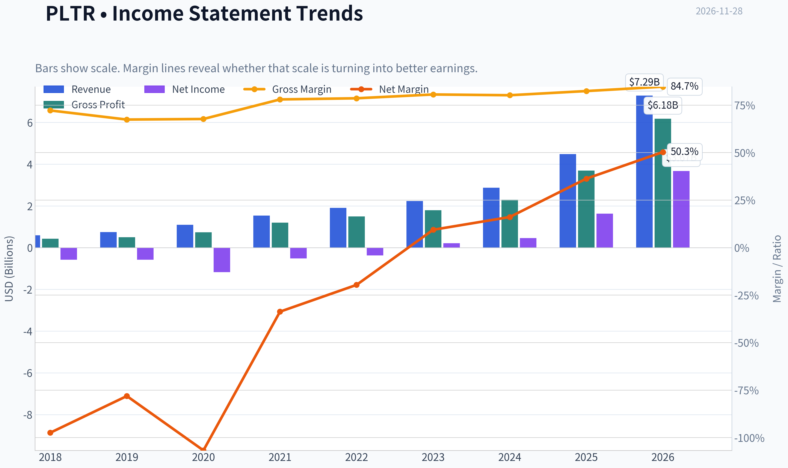

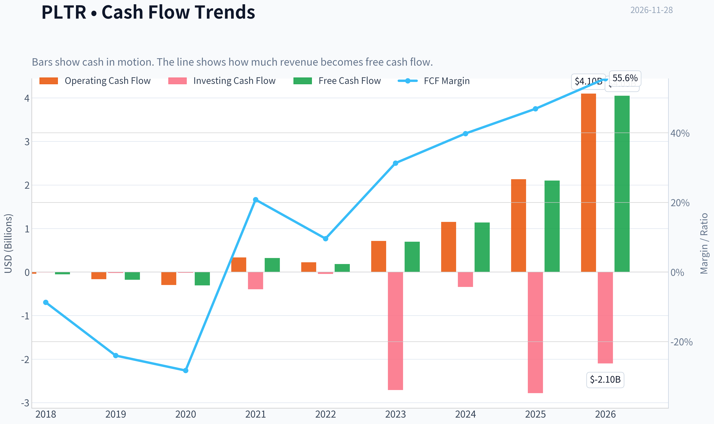

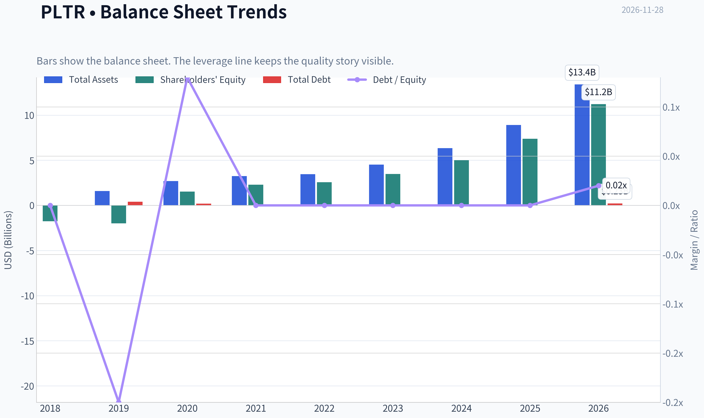

This graph tracks the profitability and return metrics (ROE, ROIC, Margins) of **PLTR** over the past decade, highlighting capital efficiency trends.

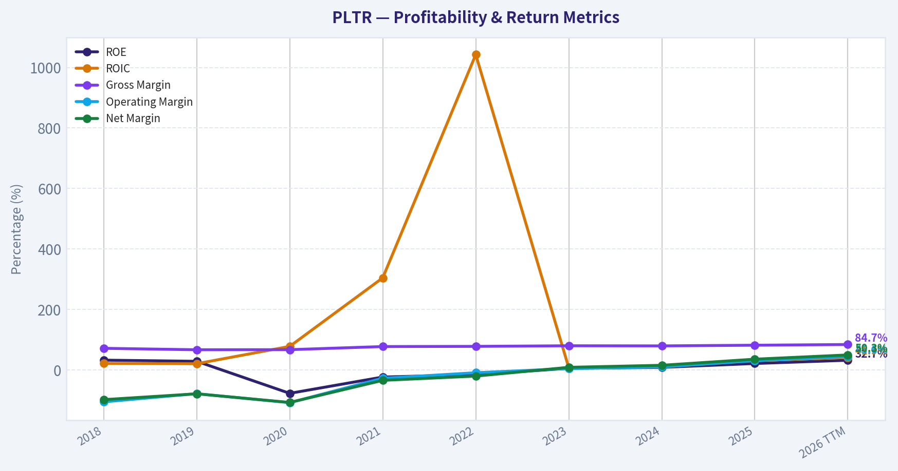

This chart illustrates the financial health of **PLTR** over the last 10 years, mapping cash equivalents and free cash flow against total obligations (Debt).

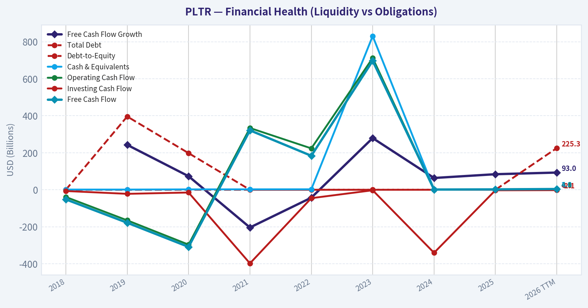

This breakdown chart from <em>Cash Flow and Capital Allocation</em> shows the proportional composition for **PLTR** - useful for understanding what drives or risks the business.

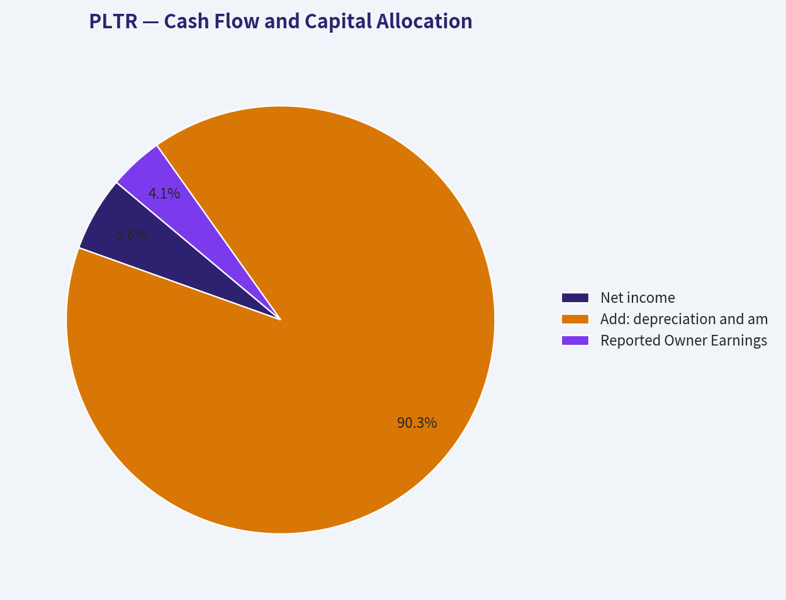

---

### Intrinsic Value Analysis (Buffett)

> *Following Warren Buffett's value investing philosophy: Circle of Competence, Economic Moat, Management Quality, and Margin of Safety.*

#### Intrinsic Value Snapshot

Price is what you pay. Intrinsic value is what the business may be worth based on the cash it can create for owners over time. We show a range, not one magic number.

- Current Price: $172.17
- Value Range (conservative to optimistic across both DCF methods): $55.93 to $151.57

##### Owner Earnings (Buffett Method)
- Net Income: $1,625,033,000.00
- Depreciation & Amortization: $26,145,000.00
- Capital Expenditures: $-33,882,000.00
- Working Capital Changes: $-209,963,000.00
- Owner Earnings: $1,184,664,587.63

##### Intrinsic Value
###### Buffett Method
Uses owner earnings. Stricter, and usually more conservative.
- Conservative: $55.93
- Average: $55.93
- Optimistic: $141.98
- Discount Rate: 8.3%

###### Cash Flow Method
Uses free cash flow. Better for companies spending heavily today to grow tomorrow.
- Conservative: $60.68
- Average: $60.68
- Optimistic: $151.57
- Discount Rate: 10.0%

ANALYST STANCE: **Bearish**

#### Executive Summary

Palantir is an unusually strong software franchise with exceptional gross margins, rapid growth, net cash, and potentially durable government and commercial customer relationships. However, the valuation is disconnected from the company's current owner earnings.

At approximately **$172 per share**, Palantir's market capitalization is about **$415 billion**, compared with DeepValues' headline intrinsic value of **$34.12 per share**. The implied margin of safety is **negative 404.5%**. The business quality is attractive; the valuation does not provide an adequate margin of safety, even under an optimistic growth framework.

#### 1. Factor Scorecard

| Factor | Score | Evidence |
|---|---:|---|
| Circle of competence and simplicity | 3.5/5 | Palantir provides software that integrates data and supports operational decisions. The model is understandable, but long-term outcomes depend on government procurement, AI adoption, and continued technological leadership. |
| Moat | 4.0/5 | Gross margin is 82.4%, switching costs can be high once workflows are embedded, and government deployments may create regulatory and operational barriers. |
| Management and capital allocation | 3.5/5 | Founder-led, mission-oriented management has built a differentiated platform. The score is reduced by valuation sensitivity, substantial equity compensation considerations, and limited evidence that retained earnings have yet compounded per-share value at a mature-company scale. |
| Industry structure | 3.5/5 | Software economics are attractive and scalable, but enterprise AI is attracting intense competition from large technology companies and specialized vendors. |

**Gate 5 hard floor:** **Not tripped.** Palantir has positive operating earnings, substantial net cash, no reported debt in the valuation inputs, and no evidence of simultaneous earnings deterioration and solvency distress.

**Key Takeaways:** Palantir scores well on business quality, particularly its software economics and potential switching costs. The central weakness is not solvency or business viability; it is the extremely demanding valuation relative to current owner earnings.

#### 2. Moat Analysis

| Moat source | Assessment | Supporting evidence |
|---|---|---|
| Intangible assets | Strong | Palantir's software, accumulated implementation expertise, government certifications, and mission-critical use cases are difficult to reproduce quickly. |
| Switching costs | Strong in embedded deployments | Replacing Palantir may require retraining personnel, rebuilding workflows, migrating data structures, and accepting operational disruption. |
| Cost advantage | Moderate | Scale improves software economics, but the principal advantage appears to be product capability and deployment expertise rather than the lowest price. |
| Network effects | Moderate | More deployments can improve product learning and credibility, but this is not a classic open consumer network effect. |
| Brand and trust | Strong in selected markets | Defense and government customers place high value on reliability, security, and institutional trust. |

Palantir's **82.4% gross margin** is consistent with a highly scalable software model. Revenue growth of **56.2% year over year** suggests strong current demand, although sustaining that rate from a much larger base would be difficult.

The moat is best classified as **wide and potentially widening**, but not yet as certain as the strongest mature platforms. Its durability depends on continued product superiority, successful commercial expansion, and the ability to maintain customer trust while competing against much larger technology companies.

#### 3. Management Quality Assessment

Palantir is founder-led and appears to operate with a long-term strategic orientation. The company has emphasized deep customer integration and product development rather than merely maximizing short-term reported revenue.

Positive characteristics include:

- Founder influence and a clear long-term mission.
- Focus on deeply embedded software deployments.
- Strong balance sheet and no debt included in the valuation inputs.
- Willingness to pursue government and commercial use cases that may require long sales cycles.

Important deductions include:

- The valuation assumes substantial future success, leaving little room for execution errors.
- Equity compensation and dilution deserve close monitoring in a high-market-capitalization company.
- The current evidence is stronger for operating execution than for a long record of mature-company capital allocation.

Overall management quality is **good to very good**, but the price requires management to execute exceptionally well for many years.

#### 4. Financial Summary

| Metric | Latest available figure |
|---|---:|
| Share price | $172 |
| Market capitalization | $414.84 billion |
| P/E ratio | 121.2 |
| Revenue growth, year over year | 56.2% |
| Gross margin | 82.4% |
| ROE | 22.0% |
| FCF yield | 0.5% |
| Current ratio | 7.1 |
| Cash and marketable securities | $10.5 billion |
| Debt | $0.0 billion |
| Net cash | $10.4 billion |
| Owner earnings | $3.3 billion |
| Shares used in valuation | 2.574 billion |

**Key Takeaways:** Palantir combines rapid growth, very high gross margins, positive ROE, and a net-cash balance sheet. However, the 0.5% FCF yield and 121 times earnings multiple show that the market price already discounts a very large amount of future growth.

#### 5. Owner Earnings Calculation

The DeepValues owner-earnings framework uses trailing operating results:

| Owner earnings component | Amount |
|---|---:|
| After-tax operating income | $3.3 billion |
| Add: depreciation and amortization | Approximately $0.0 billion |
| Less: capital expenditure charge | Approximately $0.0 billion |
| Less: working-capital investment | Approximately $0.0 billion |
| Estimated owner earnings | **$3.3 billion** |
| Owner earnings per share | **Approximately $1.28** |

The reported owner-earnings calculation is favorable because capital expenditure and working-capital charges are currently minimal. That should not automatically be interpreted as a permanent condition; future infrastructure, research, sales, and customer-support spending may rise as the company scales.

**Key Takeaways:** Current owner earnings are approximately $3.3 billion, or about $1.28 per share. Against a share price near $172, the market is valuing each dollar of current owner earnings at roughly 134 times, before accounting for future dilution.

#### 6. Three-Scenario DCF Valuation

The following scenarios are sensitivity checks. The required intrinsic value remains the DeepValues app headline of **$34.12 per share**.

| Scenario | Key assumptions | Estimated equity value | Estimated value per share |
|---|---|---:|---:|
| A: No growth | $3.3B owner earnings, 10% discount rate, plus net cash | $43.4B | $16.86 |
| B: GDP-like growth | 3% perpetual growth, 10% discount rate, plus net cash | $59.0B | $22.92 |
| C: Historical-growth sensitivity | Approximately 7.5% growth for 10 years, fading to 2.5% terminal growth, plus net cash | Approximately $75B | Approximately $29.10 |
| DeepValues headline intrinsic value | 10% growth fading to 2.5%, 8.2% discount rate, plus net cash | Approximately $87.8B | **$34.12** |

DeepValues' headline assumptions include:

- Owner earnings: approximately $3.3 billion.
- Growth: 10% initially, fading to 2.5%.
- Discount rate: 8.2%.
- Net cash: $10.4 billion.
- Shares: 2.574 billion.

**Key Takeaways:** Even a strong growth case produces an estimated value well below $172 per share. The DeepValues headline value of $34.12 per share is the highest figure that should be treated as the intrinsic value for this analysis, and it remains far below the market price.

#### 7. Margin of Safety Analysis

| Measure | Result |
|---|---:|
| Current price | $172 |
| DeepValues intrinsic value | $34.12 |
| Price premium to intrinsic value | Approximately 404% |
| Margin of safety versus intrinsic value | **-404.5%** |
| FCF yield | 0.5% |
| Approximate price-to-owner-earnings | 52 times based on market capitalization, or about 134 times per-share owner earnings using the supplied earnings figure and current price |

The company's quality could justify a smaller discount than a cyclical or declining business. A wide-moat, high-ROIC compounder might be acceptable with a 10% to 15% margin of safety. Palantir does not merely lack that margin; its market price is several times the stated intrinsic value.

The valuation would require extraordinarily strong and sustained growth, expanding margins, minimal dilution, and continued competitive success. This leaves little room for slower growth, customer concentration, government-budget changes, or AI competition.

#### 8. Final Buffett Scorecard

| Criterion | Weight | Score | Weighted contribution |
|---|---:|---:|---:|
| Moat width and durability | 25% | 4.0 | 1.00 |
| Valuation and margin of safety | 20% | 1.0 | 0.20 |
| Capital returns: ROIC versus WACC | 15% | 4.0 | 0.60 |
| Business understanding and predictability | 12% | 3.5 | 0.42 |
| Management quality and capital allocation | 12% | 3.5 | 0.42 |
| Reinvestment runway | 8% | 4.5 | 0.36 |
| Balance-sheet strength | 4% | 4.5 | 0.18 |
| Industry structure | 4% | 3.5 | 0.14 |
| **Total** | **100%** |  | **3.32/5.00** |

**Key Takeaways:** Palantir's operating quality, reinvestment runway, and balance sheet score strongly. The valuation score is exceptionally weak and pulls the overall result into the Neutral/Bearish boundary; because the price is several times the headline intrinsic value, the final stance is Bearish.

#### 9. Investment Stance

**ANALYST STANCE: Bearish**

**Conviction: High on valuation; moderate on business quality.**

Palantir appears to be a high-quality, strategically differentiated software company with attractive long-term economics. The evidence does not support a market valuation of approximately **$415 billion** against current owner earnings of **$3.3 billion** and a DeepValues intrinsic value of **$34.12 per share**. The business may continue to grow rapidly, but the current valuation requires near-perfect execution and sustained exceptional growth.
#### Valuation Bridge

This bridge places the current market price beside each intrinsic value lens so readers can see whether upside depends on one method or shows up across several methods.

| Scenario | Intrinsic Value / Share |
| --- | ---: |
| Buffett Method | $55.93 |
| Cash Flow Method | $60.68 |
| Damodaran Method | $-19.26 |
| Current Price | $172.17 |

#### Key Takeaways

If one method is far above the others, the upside case depends on a specific modelling assumption. When several methods cluster together, the valuation story is more robust.

#### Valuation Visuals

This comparison chart from *Latest Earnings Snapshot* stacks current figures against historical benchmarks for **PLTR**, making it easy to see where the company trades relative to its own averages.

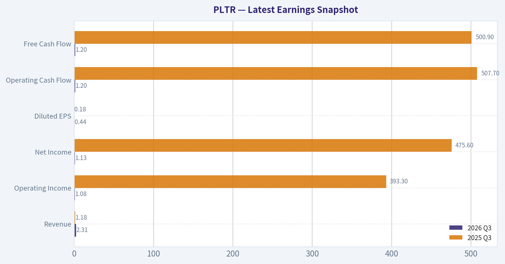

This comparison chart from *Current Metrics Versus Historical Averages* stacks current figures against historical benchmarks for **PLTR**, making it easy to see where the company trades relative to its own averages.

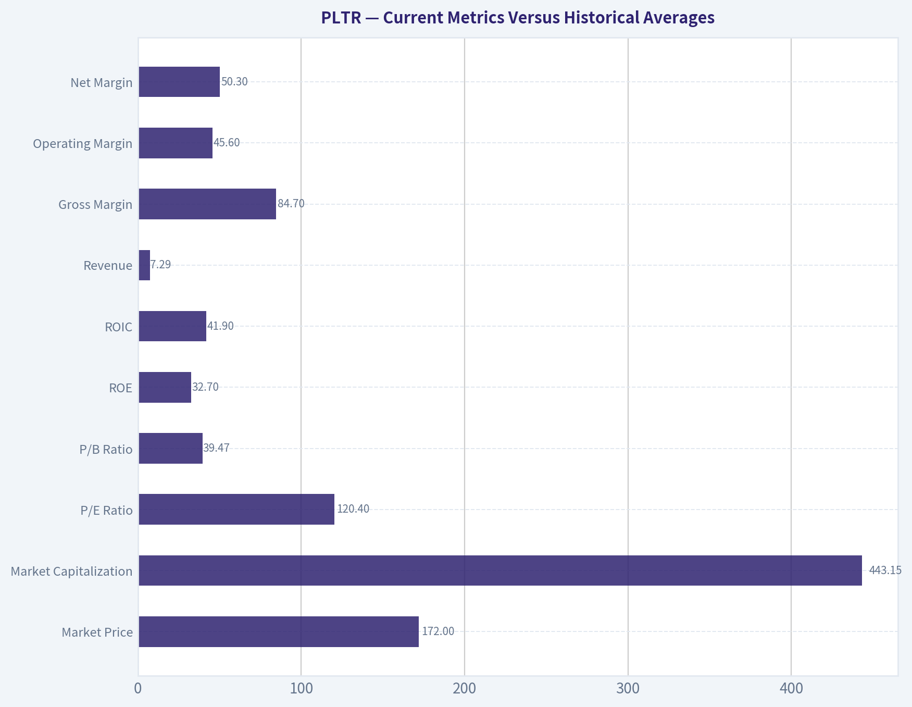

The following chart maps the **PLTR** Owner Earnings DCF valuation scenarios (Conservative, Average, Optimistic) to visually represent the margin of safety based on intrinsic value calculations.

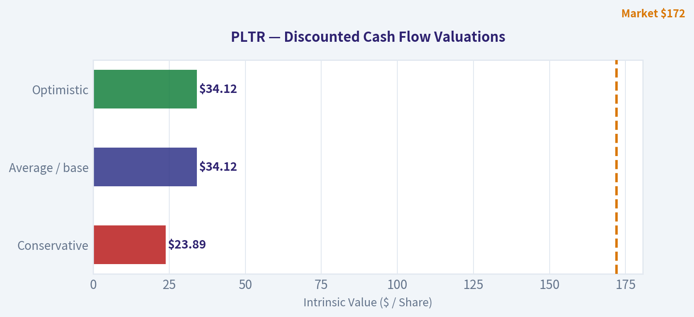

This comparison chart from *Financial Summary* stacks current figures against historical benchmarks for **PLTR**, making it easy to see where the company trades relative to its own averages.

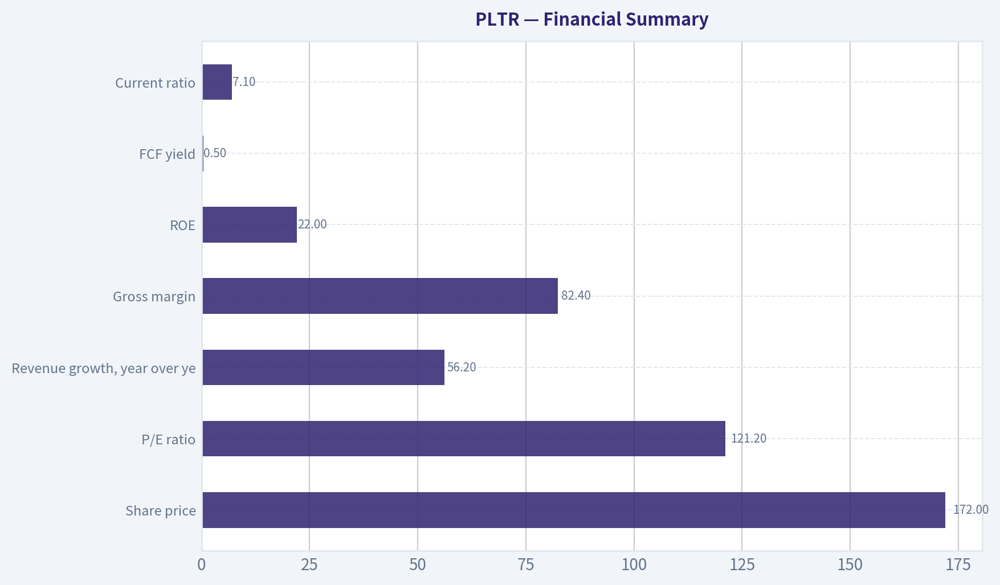

The following chart maps the **PLTR** Owner Earnings DCF valuation scenarios (Conservative, Average, Optimistic) to visually represent the margin of safety based on intrinsic value calculations.

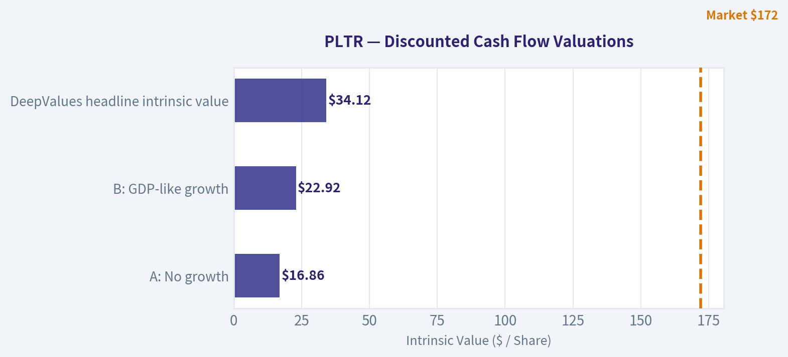

---

### Trend & Growth Analysis (Lynch/Druckenmiller/Fisher)

> *Following Peter Lynch's GARP, Stanley Druckenmiller's macro-aware approach, and Philip Fisher's scuttlebutt methodology.*

ANALYST STANCE: **Neutral**

#### 1. Lynch Classification

**Fast Grower**, with unusually strong recent acceleration. Palantir combines high revenue growth, expanding margins, substantial cash generation, and exposure to AI and defense software. However, its valuation is exceptionally demanding, making execution risk central to the thesis.

#### 2. The Story in Three Bullets

- Palantir sells operating software that helps governments and enterprises analyze data, coordinate decisions, and deploy artificial intelligence.
- Its commercial Artificial Intelligence Platform and government software are expanding into larger deployments, including a reported $300 million Poland defense agreement.
- Revenue and margins are accelerating sharply, but the current valuation requires many years of exceptional growth.

#### 3. TAM and Runway

| Metric | Assessment |
|---|---:|
| Latest TTM revenue | $7.29B |
| Ten-times revenue | $72.9B |
| Relevant markets | AI software, enterprise data platforms, defense technology |
| TAM growth | Likely expanding rapidly, but exact company-specific TAM is not disclosed |
| 10x test | Plausible only if Palantir becomes a major global platform across commercial and government markets |
| Current market share | Difficult to quantify because Palantir participates across several overlapping categories |

**Key Takeaways:** Palantir's potential market is expanding through AI adoption and defense modernization rather than remaining confined to traditional analytics software. A tenfold revenue outcome is mathematically possible within the broader AI and government-software markets, but it would require sustained international expansion, larger commercial contracts, and continued platform adoption.

#### 4. Revenue Growth Trend

| Period | Revenue | Growth |
|---|---:|---:|
| 2022 | $1.91B | 23.6% |
| 2023 | $2.23B | 16.7% |
| 2024 | $2.87B | 28.8% |
| 2025 | $4.48B | 56.2% |
| 2026 TTM | $7.29B | 62.8% |
| 3-year revenue CAGR | - | 32.9% |
| 5-year revenue CAGR | - | 32.6% |

**Key Takeaways:** Revenue growth has moved from a 2023 slowdown into a powerful acceleration, reaching more than 60% on the latest TTM data. This is the strongest part of the investment case and represents a clear growth inflection, although maintaining this rate from a $7 billion revenue base becomes progressively more difficult.

#### 5. Unit Economics and Operating Quality

| Metric | Result | Interpretation |
|---|---:|---|
| Gross margin | 84.7% TTM; 82.4% reported headline | Exceptional software economics |
| Operating margin | 45.6% TTM; 31.6% reported headline | Strong operating leverage |
| Net margin | 50.3% TTM; 36.3% reported headline | Very high profitability |
| Free cash flow | $4.05B TTM | Strong cash conversion |
| FCF margin | 55.6% TTM | Excellent |
| Rule of 40 | Approximately 118% | Far above the healthy-growth threshold |
| NRR | Not provided | Cannot independently assess expansion and churn |
| LTV/CAC | Not provided | Cannot independently assess customer acquisition efficiency |
| Current ratio | 7.11 | Strong liquidity |
| Net debt | Approximately negative $7.2B | Net cash position |

**Key Takeaways:** Palantir's disclosed financial profile is unusually strong for a high-growth software company, with high gross margins, substantial operating leverage, and strong free cash flow. The principal analytical gap is the lack of verified NRR and LTV-to-CAC data, which limits direct measurement of customer retention and sales efficiency.

#### 6. Inflection Point Assessment

| Inflection Type | Evidence | Assessment |
|---|---|---|
| Product cycle | AI Platform adoption and larger AI deployments | Positive |
| Revenue growth | Growth accelerated from 16.7% in 2023 to more than 60% TTM | Strong positive |
| Margin | Operating margin expanded to 45.6% TTM | Strong positive |
| TAM | AI and defense modernization expanding | Positive |
| Competitive position | Proprietary workflow integration and implementation know-how | Positive, but competition is intense |
| Government demand | NATO and defense adoption, including Poland | Positive, though contract timing can be uneven |

**Key Takeaways:** The data shows simultaneous product, revenue, and margin inflections rather than a single isolated improvement. The major question is whether the current acceleration represents a durable platform transition or an unusually strong phase of AI-related demand.

#### 7. Macro Setup

- **Secular tailwinds:** AI adoption, defense digitization, data sovereignty, cybersecurity, and government modernization.
- **Interest-rate environment:** The supplied 30-year Treasury rate is 5.24%, creating a meaningful discount-rate headwind for a company valued primarily on future cash flows.
- **Fiscal and geopolitical backdrop:** Defense software demand may benefit from NATO modernization and increased emphasis on autonomous or data-driven warfare.
- **Macro sensitivity:** Government procurement cycles, election-related budget changes, commercial IT spending, and high long-term bond yields remain important variables.

The macro setup is favorable for Palantir's end markets but less favorable for its valuation multiple.

#### 8. Fisher's 15-Point Assessment

| Fisher factor | Score / 5 | Rationale |
|---|---:|---|
| Market potential | 5 | Large and expanding AI, defense, and enterprise markets |
| New-product determination | 5 | Continued AI platform development |
| R&D effectiveness | 4 | Strong product momentum; detailed R&D efficiency data limited |
| Sales organization | 4 | Evidence of large government and commercial wins |
| Profit margins | 5 | Exceptional reported margins |
| Margin improvement | 5 | Clear operating leverage |
| Labor relations | 3 | Limited public evidence |
| Executive relations | 4 | Founder-led continuity, though governance is concentrated |
| Management depth | 4 | Established leadership and specialized talent base |
| Cost analysis | 4 | Strong cash conversion and operating discipline |
| Outstanding competitive aspects | 5 | Embedded workflows, data integration, and switching friction |
| Long-term profit outlook | 5 | Attractive if AI adoption persists |
| Dilution | 2 | Historical stock-based compensation and dilution remain concerns |
| Management candor | 4 | Generally detailed communication, though promotional risk exists |
| Management integrity | 4 | No specific integrity issue identified in the supplied data |
| **Total** | **59 / 75** | **Good, not outstanding** |

**Key Takeaways:** Palantir scores well on market potential, innovation, margins, and competitive differentiation. The main deductions are limited disclosure on some Fisher factors, concentrated founder influence, and historical dilution from stock-based compensation.

#### 9. Valuation Analysis

| Valuation measure | Result | Interpretation |
|---|---:|---|
| Current price | $172 |
| Market capitalization | $414.84B |
| TTM P/E | 121.25x | Extremely high |
| Forward P/E | 67.65x | Still demanding |
| PEG | 1.08x using 56.2% growth | Appears reasonable mechanically, but sensitive to growth normalization |
| Price-to-sales | 56.92x | Extreme even for high-growth software |
| FCF yield | 0.5% | Very low relative to the valuation |
| DeepValues intrinsic value | $34.12 base; $23.89-$34.12 range | Substantially below market price |
| FCF DCF cross-check | $72.84 base; $5.89-$73.90 range | Also below market price |
| Secondary DVI scenario | Approximately $55.93 | Below market price |

**Key Takeaways:** Every supplied intrinsic-value framework produces a value materially below the $172 market price. The PEG ratio looks less extreme because it uses unusually high current growth, but the P/S ratio, P/E ratio, and FCF yield indicate that the market already discounts years of exceptional execution.

#### 10. Revenue-Multiple Scenario Sensitivity

The following is an illustrative sensitivity framework, not a estimated value. It applies hypothetical future revenue multiples to the current TTM revenue base.

| Scenario | Revenue assumption | Applied P/S | Implied enterprise value |
|---|---:|---:|---:|
| Downside normalization | $14.6B, representing 2x revenue | 15x | $219B |
| Base high-growth outcome | $21.9B, representing 3x revenue | 20x | $438B |
| Strong execution | $36.5B, representing 5x revenue | 25x | $913B |

**Key Takeaways:** Even strong revenue growth does not automatically justify the present valuation because the required sales multiple is already very high. The market capitalization of roughly $415 billion is close to the illustrative base case despite requiring revenue to triple, which shows how much future success is embedded in the current valuation.

#### 11. Growth Investor Scorecard

| Criterion | Weight | Score / 5 | Weighted result |
|---|---:|---:|---:|
| Story | 10% | 4.5 | 0.45 |
| TAM and runway | 20% | 4.5 | 0.90 |
| Revenue growth | 20% | 5.0 | 1.00 |
| Unit economics | 15% | 4.0 | 0.60 |
| Competitive position | 10% | 4.5 | 0.45 |
| Management quality | 10% | 4.0 | 0.40 |
| Macro setup | 5% | 4.0 | 0.20 |
| Profitability path | 5% | 5.0 | 0.25 |
| Valuation | 5% | 1.5 | 0.08 |
| **Total** | **100%** | - | **4.33 / 5.00** |

**Key Takeaways:** On business quality and growth, Palantir scores in the high-conviction range. The valuation score is the decisive weakness, so the combined result is best interpreted as an exceptional company with limited valuation tolerance rather than a broadly attractive valuation.

#### 12. Key Catalysts and Risks

| Catalysts | Risks |
|---|---|
| Continued AI Platform adoption | Growth deceleration from the current very high base |
| Larger commercial contracts | Government procurement delays or cancellations |
| Additional NATO and allied defense agreements | Competition from hyperscalers and enterprise software vendors |
| International expansion | High interest rates compressing growth multiples |
| Sustained operating leverage | Stock-based compensation and dilution |
| New AI products expanding the TAM | Customer concentration or uneven contract timing |
| Commercial revenue reaching a larger share of total revenue | Valuation requiring near-perfect execution |

#### Bottom Line

Palantir exhibits the characteristics of a genuine fast grower: accelerating revenue, expanding margins, high gross margins, strong cash generation, and exposure to durable AI and defense themes. The central issue is valuation. At approximately 121 times trailing earnings, 57 times sales, and a 0.5% free-cash-flow yield, the evidence does not support the current valuation without sustained exceptional growth well beyond the present revenue base. The appropriate research classification is **Neutral**, with future assessment focused on whether revenue acceleration, commercial adoption, and international defense demand remain durable.

---

### Market Technical Analysis

ANALYST STANCE: **Neutral**

#### PLTR technical overview

This analysis covers **Palantir Technologies Inc. (Nasdaq: PLTR)** using daily market data through **November 27, 2026**, the latest trading session available. November 28 was a non-trading day, so indicator values for that date are unavailable.

PLTR closed at **$172.17** on November 27, rebounding sharply from the **$143.49** close on November 20. The rebound has improved short-term momentum, but the broader technical structure remains transitional rather than decisively repaired. The stock is above its long-term 200-day average, yet still materially below its medium-term 50-day average.

#### Selected indicators

The eight indicators selected are:

- **close_10_ema** - captures the recent rebound and short-term direction.
- **close_50_sma** - identifies the medium-term trend and overhead resistance.
- **close_200_sma** - establishes the longer-term trend regime.
- **macd** - measures whether momentum is strengthening or weakening.
- **rsi** - evaluates the shift from oversold conditions toward neutral momentum.
- **boll_ub** and **boll_lb** - define the current volatility envelope and price location within it.
- **atr** - measures the unusually high daily movement range and risk of rapid price changes.

These indicators are complementary: trend is covered by the moving averages, momentum by MACD and RSI, volatility positioning by the Bollinger Bands, and absolute volatility by ATR.

#### Trend structure

| Indicator | Latest value | Recent direction | Interpretation |
|---|---:|---|---|
| Close | $172.17 | Rebounded from $143.49 on Nov. 20 | Strong short-term recovery, but still below the October high near $209 |
| 10 EMA | $162.77 | Turning upward after falling from roughly $198 | Price is above the short-term average, confirming near-term rebound momentum |
| 50 SMA | $182.46 | Declining from approximately $187 | Price remains about $10.29 below the medium-term trend line |
| 200 SMA | $154.48 | Gradually rising | Price remains about $17.69 above the long-term trend benchmark |

**Key Takeaways:** The short-term trend has improved because the closing price is above the 10-day EMA. However, the 50-day SMA is still declining and sits above the market, while the rising 200-day SMA remains below it. This creates a split structure: long-term trend support is constructive, but medium-term recovery is incomplete.

The price path shows a substantial deterioration from the October peak. PLTR reached approximately **$209.05 on October 9**, then entered a sequence of lower highs and lower closes, eventually reaching **$143.49 on November 20**. The subsequent recovery to $172.17 represents a roughly **20% rebound from that low**, but it has not yet reclaimed the declining 50-day SMA or the prior breakdown area around the upper-$170s to low-$180s.

#### Momentum analysis

The MACD reading was **-6.30** on November 27, improved from **-9.64** on November 20, and is substantially better than the deeply negative readings recorded earlier in November. This indicates that downside momentum has eased and the rebound has generated a meaningful short-term improvement. Nevertheless, the MACD remains below zero, so the broader momentum regime has not yet returned to a clearly positive state.

RSI improved to **51.54** from an oversold reading of **26.38** on November 20. The move above 50 indicates that recent gains have restored balance between upward and downward sessions. Importantly, RSI is no longer oversold, but it is also not near the overbought threshold of 70. This suggests neutral-to-improving momentum rather than an extreme condition.

The combination of rising RSI and a less-negative MACD is constructive for the rebound, but both indicators are recovering from depressed levels. They currently describe a momentum repair process, not definitive confirmation of a renewed primary uptrend.

#### Bollinger Band and volatility analysis

On November 27, the Bollinger Upper Band was approximately **$184.62**, while the Lower Band was approximately **$145.58**. The implied middle band was near **$165.10**. With the closing price at $172.17, PLTR was above the middle band but still below the upper band.

This placement has several implications:

1. The price rebound has moved beyond the short-term average embedded in the Bollinger structure.
2. The market is not at the upper band, so the latest close does not represent an extreme upside extension by this measure.
3. The band width remains wide, reflecting substantial recent volatility rather than a stable, compressed trading range.
4. The sharp widening in late October and November reflects the force of the decline and subsequent rebound.

ATR rose to approximately **$9.70** from around **$6.00-$6.50** in early October. At the latest closing price, ATR equaled roughly **5.6% of the share price**, a high daily volatility level. This means that apparently strong directional moves can occur within only a few sessions, and indicator signals may change rapidly.

#### Price and indicator context

| Metric | Earlier reference | Latest reading | Technical significance |
|---|---:|---:|---|
| October peak close | $209.05 on Oct. 9 | $172.17 | About 17.6% below the October closing peak |
| November swing low | $143.49 on Nov. 20 | $172.17 | About 20.0% rebound from the recent low |
| RSI | 26.38 on Nov. 20 | 51.54 | Recovered from oversold to neutral |
| MACD | -9.64 on Nov. 20 | -6.30 | Downside momentum has eased, but MACD remains negative |
| Bollinger middle estimate | Approximately $165.10 | Close at $172.17 | Price is above the 20-day volatility midpoint |
| Bollinger upper band | - | $184.62 | Price remains below the upper volatility boundary |
| Bollinger lower band | - | $145.58 | Recent low was close to the lower volatility region |
| ATR | Approximately $6.0-$6.5 in early October | $9.70 | Volatility remains materially elevated |

**Key Takeaways:** The latest rebound has repaired oversold momentum and lifted price above the Bollinger midpoint. However, MACD is still negative, the price remains below the 50-day SMA, and ATR indicates unusually large daily fluctuations. The evidence therefore supports a recovering but unstable technical structure.

#### Overall interpretation

PLTR currently exhibits three distinct layers of technical information:

- **Long-term:** The stock remains above the rising 200-day SMA, so the long-term trend benchmark is still constructive.
- **Medium-term:** The price is below the declining 50-day SMA, indicating that the October-November decline has not been fully reversed.
- **Short-term:** The close is above the 10-day EMA, RSI has returned to neutral, and MACD is improving from deeply negative levels. These are signs of a substantial rebound in short-term momentum.

The most important unresolved issue is whether the rebound can transition from a short-term recovery into a medium-term trend reversal. The 50-day SMA near **$182.46** is a key reference point in that assessment, while the Bollinger upper band near **$184.62** indicates that the area around the low-$180s is also near the upper portion of the current short-term volatility range. Conversely, the rising 200-day SMA near **$154.48** remains the principal long-term trend benchmark.

From a valuation perspective, the technical evidence does **not yet provide strong confirmation that a premium valuation is being supported by a fully synchronized trend**. The long-term average is constructive, but medium-term trend, MACD positioning, and volatility all point to unresolved risk and an incomplete recovery. The appropriate stance is therefore **Neutral**, with emphasis on whether momentum and trend indicators become aligned rather than relying on the rebound alone.

| Area | Evidence | Implication |
|---|---|---|
| Long-term trend | Close at $172.17 versus 200 SMA at $154.48 | Long-term trend remains above its benchmark |
| Medium-term trend | Close below 50 SMA at $182.46 | Recovery has not yet cleared the declining medium-term trend |
| Short-term trend | Close above 10 EMA at $162.77 | Recent price action is improving |
| Momentum | RSI 51.54; MACD -6.30 | Momentum recovered from oversold conditions but is not decisively bullish |
| Volatility | ATR $9.70 | Daily price swings remain unusually large |
| Bollinger position | Above midpoint near $165.10 and below upper band near $184.62 | Rebound is substantial but not yet at an extreme upper-band reading |
| Market structure | October peak near $209.05, November low near $143.49 | Large decline followed by partial recovery; trend reversal remains unconfirmed |
| Valuation implication | Indicators are not fully synchronized | Technical evidence does not yet strongly validate a premium valuation |

**Key Takeaways:** PLTR's short-term technical picture has improved significantly, while the long-term trend remains above its 200-day benchmark. The medium-term trend is still weaker because price remains below the 50-day SMA, and volatility is elevated. Overall, the evidence supports a watchful stance: the rebound is real, but technical confirmation of a durable trend reversal is still incomplete.

---

### Options Market Analysis

> *Reading options flow - put/call ratios, IV skew, and unusual activity - to gauge institutional positioning and event-driven risk.*

ANALYST STANCE: **BULLISH**

#### Put/Call Ratio Analysis

| Expiration | Call OI | Put OI | Put/Call OI | Call Volume | Put Volume | Put/Call Volume |
|---|---:|---:|---:|---:|---:|---:|
| Dec. 4, 2026 | 26,768 | 20,526 | 0.77 | 61,977 | 33,007 | 0.53 |
| Dec. 11, 2026 | 10,419 | 5,084 | 0.49 | 8,872 | 4,425 | 0.50 |
| Dec. 18, 2026 | 180,914 | 170,401 | 0.94 | 14,272 | 11,936 | 0.84 |
| **Total** | **218,101** | **196,011** | **0.90** | **85,121** | **49,368** | **0.58** |

**Key Takeaways:** The aggregate put/call open-interest ratio of 0.90 is above the historical neutral reference of approximately 0.70, indicating meaningful downside protection or bearish exposure in outstanding contracts. However, the 0.58 volume ratio shows substantially heavier call activity in the current session, producing a near-term bullish flow signal. The contrast suggests an existing hedging layer alongside fresh call demand.

#### Implied Volatility Assessment

| Expiration | Call ATM IV | Put ATM IV | Call-Put IV Difference | Assessment |
|---|---:|---:|---:|---|
| Dec. 4, 2026 | 59.3% | 58.4% | +0.9 percentage points | High near-term volatility; slight call premium |
| Dec. 11, 2026 | 58.0% | 56.5% | +1.5 percentage points | High volatility; modest upside skew |
| Dec. 18, 2026 | 57.2% | 55.3% | +1.9 percentage points | High volatility; call IV premium |

The supplied dataset includes ATM IV but does not provide separate out-of-the-money put and call IV values. Therefore, a formal OTM skew calculation is unavailable. The ATM differences nevertheless lean toward call demand rather than a pronounced downside fear premium.

**Key Takeaways:** Near-term ATM implied volatility is elevated, ranging from roughly 55% to 59%, so the options market is pricing substantial movement. Calls consistently carry slightly higher ATM IV than puts, which is more consistent with upside speculation or demand for upside exposure than with severe downside hedging. The data does not identify a confirmed earnings or product catalyst, so elevated IV should not automatically be attributed to a specific event.

#### Unusual Options Activity

| Expiration | Type | Strike | Volume | Open Interest | Volume/OI | IV | Moneyness |
|---|---|---:|---:|---:|---:|---:|---|
| Dec. 4, 2026 | Call | $177.50 | 6,838 | 783 | 8.7x | 57.1% | Cannot determine without current PLTR price |

The Dec. 4 $177.50 call is the only contract flagged by the data provider as unusual, with volume more than eight times its existing open interest. That ratio is consistent with substantial new activity, although it cannot distinguish opening purchases from opening call sales without trade-level execution data. The large volume and short expiration indicate a concentrated, event-sensitive directional expression; the data is more consistent with bullish speculation if the calls were bought, but covered-call or other short-call activity remains possible.

**Key Takeaways:** The standout flow is a heavily traded Dec. 4 $177.50 call with an 8.7-times volume-to-open-interest ratio. It likely represents fresh activity rather than routine turnover, but the absence of bid-ask execution details prevents definitive classification as call buying. Current PLTR spot price was not included, so the strike cannot be labeled in-the-money, at-the-money, or out-of-the-money.

#### Open Interest Concentration and Gamma Levels

| Expiration | Total Call OI | Total Put OI | Combined OI | Concentration Assessment |
|---|---:|---:|---:|---|
| Dec. 4, 2026 | 26,768 | 20,526 | 47,294 | Active near-term trading |
| Dec. 11, 2026 | 10,419 | 5,084 | 15,503 | Lightest listed concentration |
| Dec. 18, 2026 | 180,914 | 170,401 | 351,315 | Dominant open-interest expiry |

The Dec. 18 expiration contains approximately 88% of total listed open interest in the supplied chains, making it the main potential source of expiration-related price pinning or gamma effects. However, strike-by-strike open interest and dealer gamma data were not provided, so specific gamma walls, max-pain levels, and gravitational strikes cannot be identified.

**Key Takeaways:** Dec. 18 is the dominant expiration by a wide margin and is the most important horizon for potential pinning effects. The Dec. 4 chain has the strongest current trading activity, while Dec. 11 is comparatively thin. Without strike-level open interest and dealer positioning, the direction and location of any gamma wall remain uncertain.

#### Overall Options Sentiment

| Signal Component | Reading | Interpretation |
|---|---|---|
| Put/Call OI ratio | 0.90 | More balanced and defensive than the 0.70 neutral reference |
| Put/Call volume ratio | 0.58 | Clear current-session call-volume bias |
| ATM IV | 55%-59% | Elevated movement expectations |
| IV skew | Slight call-side premium at ATM | Mild upside-demand signal; formal OTM skew unavailable |
| Unusual activity | Dec. 4 $177.50 call, 8.7x volume/OI | Concentrated fresh activity with potentially bullish implications |
| Liquidity | Adequate overall, but uneven by expiry | Dec. 18 is deep; Dec. 11 is relatively light |
| Overall signal | **BULLISH** | Call flow and call IV premium outweigh elevated put OI |

**Key Takeaways:** The overall read is bullish, driven primarily by the 0.58 put/call volume ratio, repeated call-side IV premiums, and concentrated activity in the Dec. 4 $177.50 call. The elevated 0.90 put/call open-interest ratio is an important caveat because it indicates existing downside protection or bearish exposure. Confidence is moderate rather than high because trade direction, current stock price, OTM skew, strike-level OI, and any catalyst calendar were not supplied.

#### Summary

| Category | Conclusion |
|---|---|
| Put/Call Ratio | OI ratio of 0.90 is above the approximately 0.70 neutral baseline, while volume ratio of 0.58 shows strong current call bias |
| IV Level | Elevated; near-term ATM IV ranges from 55.3% to 59.3% |
| Skew Direction | Mild call-side skew based on ATM IV; formal OTM skew unavailable |
| Unusual Activity | Dec. 4 $177.50 call traded at 8.7 times open interest |
| Overall Signal | **BULLISH**, with moderate confidence and meaningful downside-hedging caveats |

**Key Takeaways:** PLTR's options flow leans bullish in the near term, mainly because new trading volume is much more call-heavy than put-heavy. The market still carries substantial put open interest, so the signal reflects upside demand alongside material hedging rather than an unqualified bullish consensus.

---

## Research Team Commentary

> *The Research Manager synthesizes the Bull vs Bear debate into action-free commentary. This is a pre-risk view, not the final stance.*

Core Takeaway: Palantir appears to be a genuinely high-quality, potentially wide-moat software franchise, but the evidence does not support its valuation at $172 with a roughly 121x P/E. The business could perform very well and still generate disappointing valuation outcomes because the price already assumes prolonged exceptional growth, expanding margins, durable competitive insulation, and limited dilution. The decisive distinction is between admiration for the company and confidence in the price. On the supplied evidence, the former is warranted; the latter is not.

The strongest bull argument is that Palantir is becoming embedded operating infrastructure rather than remaining a conventional analytics vendor. Its software connects data, permissions, models, and decision workflows in mission-critical government and commercial environments. Replacing it may require customers to rebuild both technical architecture and operating processes. That creates plausible switching costs supported by security credentials, implementation expertise, institutional trust, and accumulated deployment knowledge.

The economics reinforce this quality case. An 82.4% gross margin, 22% ROE, 18.3% ROA, an asset-light model, and a debt-free balance sheet provide the ingredients for substantial operating leverage. Palantir also has a credible long runway as enterprises move from AI experimentation to governed production deployments. Falling model costs could strengthen its opportunity if the scarce layer becomes secure data integration and workflow orchestration rather than the model itself. Founder influence and a consistent long-term mission are additional advantages.

The reported 663.4% ROIC should not be taken literally as proof of an extraordinary franchise. It is almost certainly distorted by a very small invested-capital denominator. The more defensible conclusion is that Palantir has excellent gross economics and requires little tangible capital, not that it can compound all incremental capital at 663%.

The strongest bear argument is valuation asymmetry. At $172 and 121.25x earnings, trailing EPS is approximately $1.42. If EPS compounded at 25% annually for five years, it would reach roughly $4.33, meaning today's price still represents almost 40 times that future earnings figure. At 30% annual growth, EPS would reach about $5.27, leaving today's price at roughly 33 times year-five earnings. These are simplified illustrations, but they show how demanding the hurdle is: Palantir needs both exceptional growth and a still-premium endpoint valuation.

That is not a conventional margin of safety. Even a wonderful business generally requires either a modest discount to a defensible intrinsic value or reverse-DCF assumptions the franchise can plausibly exceed. No DeepValues intrinsic-value estimate or complete cash-flow model is provided here, so a precise discount or premium cannot be calculated. Nevertheless, the observable multiple suggests the market is already capitalizing much of the optimistic scenario. A good or even very good outcome may be insufficient.

The moat also remains more plausible than conclusively proven. Palantir does not own customers' underlying data, leading foundation models, or a classic network effect. Its advantage rests on ontology, deployment capabilities, security, trust, and workflow integration. Those can be durable, but hyperscale cloud vendors, systems integrators, defense contractors, and internal enterprise teams may reproduce parts of the stack. If deployments remain highly customized and personnel-intensive, Palantir may resemble a services-enabled software company more than a frictionless platform. The gross margin alone cannot resolve that question.

The reported $300 million Poland defense agreement supports Palantir's strategic relevance, but one large agreement does not establish recurring revenue quality or commercial repeatability. Government demand can be durable while remaining exposed to procurement cycles, political priorities, and contract concentration. On the commercial side, the crucial issue is whether AI pilots and "bootcamps" convert into broad, expanding production deployments without proportionate increases in implementation and sales costs.

Stock-based compensation is another important bridge between business success and shareholder value. Free cash flow can look attractive when equity compensation is excluded from economic costs. The relevant test is growth in free cash flow and earnings per diluted share, alongside stabilization of the diluted share count. Founder control is helpful when it supports patient product development, but it also reduces outside accountability over compensation and capital allocation.

This assessment incorporates the central lessons from similar valuation mistakes, although no company-specific past reflections were supplied. The recurring error is to identify a powerful product trend, high gross margins, or rapid growth and then assume those qualities justify almost any price. The opposite error-rejecting an asset-light technology company merely because conventional multiples look high-should also be avoided. Here, the conclusion is not based on P/E in isolation. It reflects the combination of an extreme multiple, uncertain dilution-adjusted economics, an incompletely demonstrated moat at scale, and a valuation dependent on many favorable assumptions occurring simultaneously.

Over the next one to four quarters, the monitoring plan should focus on evidence that either lowers or confirms that execution burden. Commercial revenue growth should remain strong without increasing dependence on a few unusually large contracts. Customer cohorts should show expansion into production workloads, accompanied by stronger retention, remaining deal value, and revenue per customer. Any disclosed net retention or cohort-expansion data would be particularly useful.

Margins should also improve on a GAAP basis, not merely through adjusted measures. Free cash flow per diluted share, stock-based compensation as a percentage of revenue, and the diluted share count deserve more attention than headline cash flow. Stable gross margins alongside falling implementation intensity would support genuine platform scalability; rising deployment costs would weaken that conclusion.

Government results should be assessed across multiple agencies and countries rather than through one headline agreement. Renewal behavior, contract expansion, procurement delays, and customer concentration will indicate whether government relationships are durable and diversified. Finally, evidence of sustained pricing power and renewal strength despite bundled offerings from Microsoft, Amazon, Google, defense contractors, and systems integrators would materially strengthen the moat argument.

Palantir may ultimately become a foundational operating layer for enterprise and government AI. The current evidence supports that possibility but does not show that the company can exceed the extraordinary growth, margin, durability, and dilution assumptions embedded in $172. Financial strength limits distress risk, but it does not create valuation protection. Short-term momentum and bullish options activity do not alter that intrinsic-value conclusion.

Final stance: Bearish

---

## Value Investing Team Commentary

> *The Investor translates the research view into an investment thesis before risk review. This is still not the final stance.*

### Business Quality

Palantir appears to be a high-quality, asset-light software company with unusually strong gross economics. Its platforms connect data, permissions, analytical models, and operational workflows in environments where security, reliability, and institutional trust matter. When the software becomes embedded in mission-critical processes, switching costs can rise substantially.

The moat is therefore credible, but not yet unassailable. Palantir does not control the underlying data, the leading foundation models, or a conventional consumer-style network effect. Its defensibility depends on ontology, deployment expertise, security credentials, workflow integration, and accumulated customer knowledge. Those advantages may be durable, but they must be demonstrated through expanding production use, high retention, and lower implementation intensity.

The 82.4% gross margin supports the view that the company has valuable software economics. However, gross margin does not by itself establish that Palantir is a fully scalable platform. If customer deployments remain labor-intensive, the business may retain characteristics of a software-enabled services company despite its attractive headline margins.

### Growth and Strategic Opportunity

The long-term opportunity is significant. Enterprises and governments are moving from AI experimentation toward governed, production-grade applications. As model costs decline, the scarce asset may increasingly be secure data integration, permissions, workflow orchestration, and reliable deployment rather than access to a model alone. That dynamic could benefit Palantir.

The reported Poland defense agreement reinforces the company's strategic relevance, but a single large contract is not sufficient evidence of recurring, diversified earnings power. Government demand can be durable while still being affected by procurement timing, political priorities, budget cycles, and contract concentration. The more important evidence will be repeatable expansion across agencies, countries, and deployment types.

Commercial execution is equally important. The decisive question is whether pilots and AI-focused customer programs convert into broad production deployments that expand over time without proportional increases in sales and implementation costs. Strong revenue growth accompanied by stable or improving GAAP margins would be more persuasive than growth supported primarily by unusually large contracts or adjusted metrics.

### Financial Quality and Accounting Considerations

The balance sheet appears strong, with no debt included in the supplied valuation inputs. That reduces financial distress risk, but it does not create a margin of safety when the earnings multiple is extreme.

The reported 663.4% ROIC should not be interpreted literally. It is likely inflated by a very small invested-capital denominator, especially in an asset-light software business. The reasonable conclusion is that Palantir requires limited tangible capital to operate, not that every incremental dollar can earn a 663% return indefinitely.

Stock-based compensation remains an important issue. Cash generation can look stronger than per-share economic performance when employee equity awards are substantial. The appropriate test is whether free cash flow and earnings are expanding faster than the diluted share count. Stable or falling dilution would strengthen the shareholder economics; persistent dilution would reduce the value of otherwise excellent operating results.

### Valuation and Reverse-DCF Implications

At $172 and approximately 121 times earnings, the supplied figures imply trailing earnings of roughly $1.42 per share. Even under highly favorable growth assumptions, the valuation remains demanding:

- At 25% annual earnings growth for five years, earnings would reach approximately $4.33 per share, implying nearly 40 times year-five earnings at the current price.
- At 30% annual growth for five years, earnings would reach approximately $5.27 per share, still implying roughly 33 times year-five earnings.

These are simplified calculations, but they identify the central issue. The valuation requires several favorable outcomes simultaneously: prolonged exceptional growth, continued margin expansion, strong customer retention, successful commercial scaling, limited dilution, and a premium earnings multiple remaining intact far into the future.

No complete cash-flow model or DeepValues intrinsic-value estimate is supplied, so a precise premium cannot be quantified. Nevertheless, the observable valuation indicates that much of the optimistic scenario is already reflected in the price. This creates asymmetry: excellent operational results may still produce disappointing valuation outcomes if they fall short of extraordinary expectations.

The contrarian point is that dismissing Palantir solely because its P/E is high would be too simplistic. A rapidly growing software platform can justify a premium to mature-company metrics. The stronger concern is not that Palantir lacks quality, but that the market may already be capitalizing its best-case characteristics. A wonderful business can still represent an unattractive valuation when the price assumes near-perfect execution.

### Sentiment and Market Signals

Bullish options activity and recent momentum may reveal strong enthusiasm for Palantir's AI narrative, but neither signal changes long-term earning power or intrinsic value. Options flows can reflect hedging, speculation, or short-term positioning rather than durable confidence in the business.

The more useful interpretation of sentiment is that the market recognizes Palantir's strategic importance. That recognition is rational to a degree. The risk is that a valid thesis about the company's future becomes conflated with certainty about the current valuation. Strong enthusiasm can reduce the probability that temporary good news will create a valuation gap, because expectations are already elevated.

A selective contrarian view would therefore distinguish between two claims:

1. Palantir could become an important operating layer for enterprise and government AI.
2. The current price provides sufficient compensation for execution, dilution, competitive, and multiple-compression risks.

The first claim is plausible. The supplied evidence does not adequately establish the second.

### Key Evidence to Monitor

The valuation case would become more defensible if future results showed:

- Sustained commercial growth across a broad customer base rather than reliance on a few large agreements.
- Expansion from pilots into recurring, production-scale workloads.
- Strong net retention and customer expansion economics.
- Improving GAAP profitability alongside adjusted profitability.
- Declining stock-based compensation as a percentage of revenue.
- Stable or improving diluted earnings per share after equity compensation.
- Falling implementation intensity relative to revenue.
- More diversified and repeatable government contracts.
- Evidence that bundled offerings from large cloud providers, defense contractors, and systems integrators are not weakening renewal or pricing power.

Conversely, high customer concentration, persistent dilution, rising implementation costs, or slowing conversion from pilots to production would expose weaknesses in the platform thesis.

**ANALYST STANCE: Bearish** - This label reflects a valuation classification, not a trading instruction. Palantir appears to be a strategically important, financially strong, potentially wide-moat software company, but the evidence supplied does not support the earnings growth, durability, margin expansion, and dilution assumptions embedded in a roughly 121-times earnings valuation. The business merits close fundamental attention; the current valuation does not provide an adequate quality-scaled margin of safety.

---

## Deep Values Commentary

> *The Risk Management Team debates and the Risk Judge provides the final action-free verdict. This section determines the final Bullish / Neutral / Bearish stance.*

#### Final Stance Scorecard

This scorecard converts the final research view into a weighted decision frame. It does not replace the narrative judgement, but it makes the main drivers of the verdict easier to scan.

| Criterion | Score | Weight | Commentary |
| --- | ---: | ---: | --- |
| Business Quality | 4.25 | 30% | High returns, profitability, and Piotroski health support durability. |
| Valuation Support | 1.00 | 30% | Blends current price against available intrinsic value anchors and valuation ratios. |
| Financial Strength | 5.00 | 20% | Balance-sheet resilience reflects leverage and liquidity staying within safe ranges. |
| Growth Durability | 5.00 | 20% | Recent revenue, earnings, and free cash flow growth indicate how durable expansion looks. |
| TOTAL / FINAL STANCE | 3.57 | 100% | Bearish |

#### Key Takeaways

The weighted score lands at **3.57 / 5.0**, while the final stance remains **Bearish**. This is useful as a quick calibration aid rather than a mechanical signal.

#### Risk Summary

Higher scores indicate more risk pressure. The watch threshold is a simple guardrail: above it, the dimension weighs more heavily on the valuation case and calls for a wider margin of safety.

| Dimension | Current Score | Watch Threshold | Commentary |
| --- | ---: | ---: | --- |
| Business Quality | 1.75 | 3.00 | High returns, profitability, and Piotroski health support durability. |
| Valuation Support | 5.00 | 3.00 | Blends current price against available intrinsic value anchors and valuation ratios. |
| Financial Strength | 1.00 | 3.00 | Balance-sheet resilience reflects leverage and liquidity staying within safe ranges. |
| Growth Durability | 1.00 | 3.00 | Recent revenue, earnings, and free cash flow growth indicate how durable expansion looks. |

#### Key Takeaways

This view helps readers separate *where* the risk sits: valuation, business quality, balance sheet, or growth durability. It is especially useful when the final stance is close to the line between Neutral and Bearish.
