# POOL Deep Value Intelligence

**Analysis Date:** 2026-05-10

## Critical Disclaimer

*This analysis is generated by Deep Value Intelligence, an AI-powered multi-agent investing framework. This report is for informational and educational purposes only and does not constitute financial advice. Always conduct your own research and consult with qualified financial advisors before making investment decisions.*

---

## Table of Contents

1. Intelligence Summary
2. Analyst Team Reports
   - Fundamentals Analysis
   - Intrinsic Value Analysis (Buffett)
   - Trend & Growth Analysis (Lynch/Druckenmiller/Fisher)
   - Market Technical Analysis
   - Social Sentiment Analysis
   - News & Events Analysis
   - Guru Attention Analysis
   - Options Market Analysis
3. Research Team Commentary
4. Value Investing Team Commentary
5. Deep Values Commentary

---

## Intelligence Summary

### Thesis + Conditions

**Core Thesis:** **EXECUTIVE SUMMARY**
*   **The Conundrum:** Pool Corporation (POOL) pits an exceptionally wide-moat business model against severe near-term cash flow opacity and governance red flags. *   **The Red Flags:** A 48.4% plunge in Free Cash Flow (FCF) paired with an abrupt CEO exit and postponed Investor Day obscures "normalized" owner earnings.

**Key Risks:**
- Margin of Safety:** At $188, the stock lacks downside protection. Intrinsic value estimates range violently from $136 (FCF basis) to $467 (Buffett model).
- The Verdict:** **WATCH**. We do not sacrifice earnings predictability and management clarity simply because a stock's multiple has compressed.
- The Bear Case (Impaired Visibility):** Top-line resilience (-0.4% revenue) is masking severe cash generation issues (-48.4% FCF). Wide valuation spreads and sudden leadership instability signal elevated forecasting risk, meaning current prices offer no true margin of safety.
- Finally, buying at $188 when conservative FCF models suggest a $136 value offers zero downside protection against a prolonged housing normalization.
- Monitoring Plan**

**What Would Change Our View:**
- Margin of Safety:** At $188, the stock lacks downside protection. Intrinsic value estimates range violently from $136 (FCF basis) to $467 (Buffett model).
- The Verdict:** **WATCH**. We do not sacrifice earnings predictability and management clarity simply because a stock's multiple has compressed.
- The Bear Case (Impaired Visibility):** Top-line resilience (-0.4% revenue) is masking severe cash generation issues (-48.4% FCF). Wide valuation spreads and sudden leadership instability signal elevated forecasting risk, meaning current prices offer no true margin of safety.
- Finally, buying at $188 when conservative FCF models suggest a $136 value offers zero downside protection against a prolonged housing normalization.
- Monitoring Plan**

**Confidence:** High

---

## Analyst Team Reports

### Fundamentals Analysis

#### Latest Earnings Snapshot

*Most recent reported quarter anchored on 2026 Q1, with prior-year comparison when available.*

| Metric | 2026 Q1 | 2025 Q1 | YoY Change |
| --- | ---: | ---: | ---: |
| Revenue | $1.14B | $1.07B | +6.2% |
| Operating Income | $82.6M | $77.5M | +6.5% |
| Net Income | $53.2M | $53.5M | -0.6% |
| Diluted EPS | $1.45 | $1.42 | +2.1% |
| Operating Cash Flow | $25.7M | $27.2M | -5.5% |
| Free Cash Flow | $17.1M | $13.9M | +23.1% |

Key Takeaways: This snapshot anchors the most recent reported quarter before the narrative analysis. It helps readers separate long-run business quality from whatever changed in the latest earnings print.

#### 10-Year Financial Metrics for POOL

*All values below are computed deterministically from raw data - not estimated by AI.*

*Issuer profile: operating company (Industrials / Industrial Distribution).*

#### 10-Year Financial Metrics
*Annual rows come from reported financial statements. The final TTM row is computed from the latest four quarters.*

| Metric | 2009 | 2010 | 2011 | 2012 | 2013 | 2014 | 2015 | 2016 | 2017 | 2018 | 2019 | 2020 | 2021 | 2022 | 2023 | 2024 | 2025 | 2026 TTM |
| --- | --- | --- | --- | --- | --- | --- | --- | --- | --- | --- | --- | --- | --- | --- | --- | --- | --- | --- |
| Market Price | $15 | $18 | $25 | $36 | $50 | $55 | $72 | $94 | $118 | $137 | $197 | $349 | $534 | $288 | $385 | $333 | $227 | $188 |
| Market Cap | $935.9M | $1.13B | $1.47B | $2.03B | $2.76B | $2.88B | $3.57B | $4.48B | $5.50B | $6.20B | $8.68B | $15.22B | $22.91B | $12.04B | $15.55B | $13.03B | $8.53B | $6.84B |
| P/E Ratio | 48.92 | 19.60 | 20.48 | 24.75 | 28.36 | 26.00 | 27.86 | 30.07 | 28.75 | 26.45 | 33.18 | 41.53 | 35.44 | 16.17 | 29.87 | 30.17 | 21.08 | 17.27 |
| P/B Ratio | 3.71 | 3.96 | 5.27 | 7.22 | 9.66 | 11.80 | 13.98 | 21.85 | 24.66 | 27.72 | 21.16 | 23.81 | 21.38 | 9.74 | 11.84 | 10.24 | 7.20 | 6.04 |
| ROE | 7.6% | 20.2% | 25.7% | 29.1% | 34.0% | 45.3% | 50.2% | 72.6% | 85.9% | 104.9% | 63.8% | 57.4% | 60.7% | 60.6% | 39.9% | 34.1% | 34.3% | 35.8% |
| ROIC | 16.0% | 14.1% | 16.2% | 17.5% | 20.3% | 22.0% | 24.4% | 27.4% | 30.9% | 32.1% | 32.2% | 39.5% | 40.5% | 32.7% | 23.5% | 21.4% | 20.2% | 16.6% |
| EPS | $0.31 | $0.94 | $1.23 | $1.45 | $1.77 | $2.13 | $2.57 | $3.11 | $4.10 | $5.16 | $5.95 | $8.41 | $15.08 | $17.84 | $12.89 | $11.05 | $10.85 | $10.87 |
| Revenue | $1.54B | $1.61B | $1.79B | $1.95B | $2.08B | $2.25B | $2.36B | $2.57B | $2.79B | $3.00B | $3.20B | $3.94B | $5.30B | $6.18B | $5.54B | $5.31B | $5.29B | $5.36B |
| Gross Profit | $449.7M | $471.3M | $531.6M | $567.4M | $591.3M | $643.3M | $675.6M | $741.1M | $805.3M | $870.2M | $924.9M | $1.13B | $1.62B | $1.93B | $1.66B | $1.58B | $1.57B | $1.59B |
| Gross Margin | 29.2% | 29.2% | 29.6% | 29.0% | 28.4% | 28.6% | 28.6% | 28.8% | 28.9% | 29.0% | 28.9% | 28.7% | 30.5% | 31.3% | 30.0% | 29.7% | 29.7% | 29.7% |
| Operating Margin | 5.7% | 6.3% | 7.0% | 7.4% | 8.0% | 8.4% | 9.1% | 10.0% | 10.2% | 10.5% | 10.7% | 11.8% | 15.7% | 16.6% | 13.5% | 11.6% | 11.0% | 10.9% |
| Net Income | $19.2M | $57.6M | $72.0M | $82.0M | $97.3M | $110.7M | $128.3M | $149.0M | $191.6M | $234.5M | $261.6M | $366.7M | $650.6M | $748.5M | $523.2M | $434.3M | $406.4M | $406.1M |
| Net Margin | 1.2% | 3.6% | 4.0% | 4.2% | 4.7% | 4.9% | 5.4% | 5.8% | 6.9% | 7.8% | 8.2% | 9.3% | 12.3% | 12.1% | 9.4% | 8.2% | 7.7% | 7.6% |
| Revenue Growth | N/A | 4.8% | 11.1% | 9.0% | 6.4% | 8.0% | 5.2% | 8.8% | 8.5% | 7.5% | 6.7% | 23.0% | 34.5% | 16.7% | -10.3% | -4.2% | -0.4% | 1.3% |
| Net Income Growth | N/A | 200.2% | 24.9% | 13.9% | 18.7% | 13.7% | 15.9% | 16.1% | 28.7% | 22.3% | 11.6% | 40.2% | 77.4% | 15.0% | -30.1% | -17.0% | -6.4% | -0.1% |
| Free Cash Flow Growth | N/A | -19.0% | -35.2% | 84.7% | -16.0% | 21.0% | 11.9% | 12.0% | 3.7% | -35.9% | 204.8% | 41.6% | -26.6% | 60.0% | 87.7% | -27.6% | -48.4% | 1.0% |
| Total Book Value | $252.2M | $285.2M | $279.7M | $281.6M | $286.2M | $244.4M | $255.7M | $205.2M | $223.1M | $223.6M | $410.2M | $639.5M | $1.07B | $1.24B | $1.31B | $1.27B | $1.19B | $1.13B |
| Total Assets | $743.1M | $728.5M | $770.9M | $780.6M | $823.8M | $892.9M | $934.4M | $994.1M | $1.10B | $1.24B | $1.48B | $1.74B | $3.23B | $3.57B | $3.43B | $3.37B | $3.63B | $4.00B |
| Total Debt | $200.7M | $198.7M | $247.3M | $230.9M | $246.4M | $319.3M | $326.3M | $438.0M | $521.6M | $666.8M | $513.1M | $416.0M | $1.18B | $1.41B | $1.09B | $999.8M | $1.21B | $1.59B |
| Debt-to-Equity | 0.80 | 0.70 | 0.88 | 0.82 | 0.86 | 1.31 | 1.28 | 2.13 | 2.34 | 2.98 | 1.25 | 0.65 | 1.11 | 1.14 | 0.83 | 0.79 | 1.02 | 1.40 |
| Cash & Equivalents | $15.8M | $9.7M | $17.5M | $12.5M | $8.0M | $14.8M | $13.2M | $22.0M | $29.9M | $16.4M | $28.6M | $34.1M | $24.3M | $45.6M | $66.5M | $77.9M | $105.0M | $64.5M |
| Shareholders' Equity | $252.2M | $285.2M | $279.7M | $281.6M | $286.2M | $244.4M | $255.7M | $205.2M | $223.1M | $223.6M | $410.2M | $639.5M | $1.07B | $1.24B | $1.31B | $1.27B | $1.19B | $1.13B |
| Operating Cash Flow | $113.2M | $94.0M | $75.1M | $119.1M | $105.1M | $121.8M | $146.1M | $165.4M | $175.3M | $118.7M | $298.8M | $397.6M | $313.5M | $484.9M | $888.2M | $659.2M | $365.9M | $364.4M |
| Investing Cash Flow | $-18.1M | $-14.3M | $-25.6M | $-21.2M | $-19.9M | $-27.8M | $-37.8M | $-55.6M | $-52.2M | $-34.2M | $-42.3M | $-146.3M | $-849.6M | $-50.9M | $-71.6M | $-66.2M | $-67.8M | $-62.0M |
| Free Cash Flow | $106.1M | $85.9M | $55.6M | $102.8M | $86.3M | $104.5M | $117.0M | $131.0M | $135.9M | $87.1M | $265.4M | $375.9M | $275.8M | $441.2M | $828.1M | $599.7M | $309.5M | $312.7M |
| FCF Margin | 6.9% | 5.3% | 3.1% | 5.3% | 4.2% | 4.7% | 4.9% | 5.1% | 4.9% | 2.9% | 8.3% | 9.5% | 5.2% | 7.1% | 14.9% | 11.3% | 5.9% | 5.8% |
| Dividends / Share | $0.00 | $0.00 | $0.00 | $0.00 | $0.00 | $0.00 | $0.00 | $0.00 | $0.00 | $0.00 | $0.00 | $0.00 | $0.00 | $3.61 | $4.15 | $4.60 | $4.96 | $5.09 |

#### Profitability Metrics
- Return on Equity (ROE): 34.3%
- Return on Invested Capital (ROIC): 19.3%
- Return on Assets (ROA): 11.2%
- Gross Margin: 29.7%
- Operating Margin: 11.0%
- Net Profit Margin: 7.7%

#### Liquidity Metrics
- Current Ratio: 2.24
- Quick Ratio: 0.17

#### Leverage Metrics
- Debt-to-Equity Ratio: 1.02
- Interest Coverage Ratio: 12.41
- Net Debt: $1.11B

#### Growth Metrics (Year-over-Year)
- Revenue Growth: -0.4%
- Net Income Growth: -6.4%
- Free Cash Flow Growth: -48.4%
- Revenue CAGR (3-Year): -5.1%
- Revenue CAGR (5-Year): 6.1%

#### Valuation Metrics
- P/E Ratio (TTM): 17.27
- Forward P/E: 15.61
- Price-to-Book: 6.02
- Price-to-Sales: 1.28
- PEG Ratio: 1.60
- EV/EBITDA: 13.11
- Free Cash Flow Yield: 4.5%
- Earnings Yield: 5.8%

#### Owner Earnings (Buffett Method, Code-Computed)
- Net Income: $406.4M
- + Depreciation & Amortization: $51.6M
- - Capital Expenditures: $-56.3M
- - Working Capital Changes: $-127.4M
- = **Owner Earnings: $529.1M**

#### Intrinsic Value (Code-Computed)
- Current Price: $188
- Buffett Method (Owner Earnings):
  Conservative: $327
  Average: $467
  Optimistic: $901
- Cash Flow Method (FCF):
  Conservative: $37
  Average: $136
  Optimistic: $319

#### Piotroski F-Score: 5/9
- Positive Net Income: PASS
- Positive Operating Cash Flow: PASS
- ROA Improvement: FAIL
- Cash Flow > Net Income: FAIL
- Decreasing Debt: FAIL
- Improving Current Ratio: PASS
- No Dilution: PASS
- Improving Gross Margin: PASS
- Improving Asset Turnover: FAIL

ANALYST STANCE: **ADVOCATE**

#### POOL - Warren Buffett-Style Fundamental Analysis

Pool Corporation is a high-quality distribution business with a long record of compounding revenue, earnings, and returns on capital, but it is now being tested by a post-pandemic normalization cycle, weaker pool construction demand, rising leverage, and recent leadership uncertainty. At the current market price of **$188**, the stock trades well below its 10-year average valuation multiples and below the deterministic dataset's Buffett-style Owner Earnings intrinsic value estimates.

The investment case is no longer "growth at any price." It is now a potential Buffett-style opportunity: a durable, cash-generative business temporarily repriced because near-term earnings and free cash flow have normalized sharply from pandemic highs.

---

#### Current vs. 10-Year Historical Average Comparison

*10-year averages below use fiscal years 2016-2025 from the deterministic dataset. Current values use the 2026 TTM row where available.*

| Metric | Current / TTM | 10-Year Avg. | Current Standing vs. History | Interpretation |
|---|---:|---:|---:|---|
| Market Price | $188 | $266 | Below avg. by ~29% | The stock has materially de-rated from its pandemic and post-pandemic highs. |
| Market Cap | $6.84B | $11.21B | Below avg. by ~39% | Market value has compressed much more than revenue, suggesting valuation reset. |
| P/E Ratio | 17.27 | 29.27 | Below avg. by ~41% | Current earnings multiple is meaningfully cheaper than historical norm. |
| P/B Ratio | 6.04 | 17.96 | Below avg. by ~66% | Still asset-light and high-return, but far less expensive than past decade. |
| ROE | 35.8% | 61.4% | Below avg. | ROE remains excellent, but far below the unusually high 2016-2022 period. |
| ROIC | 16.6% | 30.0% | Below avg. | Returns on capital have normalized sharply but remain above most companies. |
| EPS | $10.87 | $9.44 | Above avg. by ~15% | Earnings remain above the 10-year average despite cyclical pressure. |
| Revenue | $5.36B | $4.31B | Above avg. by ~24% | Revenue base is structurally larger than before the pandemic. |
| Gross Profit | $1.59B | $1.28B | Above avg. by ~24% | Gross profit has held up in line with the higher revenue base. |
| Gross Margin | 29.7% | 29.6% | Near avg. | Gross margin stability supports the moat and pricing discipline thesis. |
| Operating Margin | 10.9% | 12.2% | Below avg. | Operating leverage has reversed from pandemic highs. |
| Net Income | $406.1M | $396.6M | Slightly above avg. | Profits are back near normalized levels, not structurally impaired. |
| Net Margin | 7.6% | 8.8% | Below avg. | Margin compression is visible, but profitability remains respectable. |
| Revenue Growth | 1.3% | 9.1% | Below avg. | Growth has slowed dramatically after the pandemic demand pull-forward. |
| Net Income Growth | -0.1% | 15.9% | Below avg. | Earnings growth has stalled. |
| FCF Growth | 1.0% | 27.1% | Below avg. | Free cash flow volatility remains a key concern. |
| Total Book Value | $1.13B | $778M | Above avg. by ~45% | Equity base is larger than historical norm. |
| Total Assets | $4.00B | $2.48B | Above avg. by ~61% | Balance sheet has expanded meaningfully. |
| Total Debt | $1.59B | $845M | Above avg. by ~88% | Leverage has risen and deserves close monitoring. |
| Debt-to-Equity | 1.40 | 1.42 | Near avg. | Debt burden is not unprecedented, but absolute debt is elevated. |
| Cash & Equivalents | $64.5M | $45.0M | Above avg. | Cash is adequate but modest relative to debt. |
| Shareholders' Equity | $1.13B | $778M | Above avg. | Equity base has improved versus prior decade. |
| Free Cash Flow | $312.7M | $345.0M | Below avg. by ~9% | FCF remains positive but has fallen sharply from 2023-2024 levels. |
| Dividends / Share | $5.09 | $1.73 | Above avg. | Dividend policy has become more shareholder-friendly since 2022. |

**Key Takeaways:** POOL is trading at a historically cheap valuation while still producing above-average revenue, EPS, and net income versus the last decade. The main weakness is not business quality but normalization: ROIC, margins, growth, and free cash flow are all below their recent averages. Debt is elevated in absolute dollars, but the debt-to-equity ratio is close to its 10-year average.

---

#### Market Metrics Interpretation

| Metric | Current Value | Buffett-Style Interpretation |
|---|---:|---|
| Market Price | $188 | The current price reflects a major reset from the 2021 peak of $534 and is below the 10-year average of roughly $266. |
| Total Market Cap | $6.84B | The market is valuing POOL far below its recent historical average market capitalization despite a larger revenue base. |
| P/E Ratio | 17.27 | The stock trades at a large discount to its 10-year average P/E of 29.27, implying investor skepticism around normalized earnings. |
| P/B Ratio | 6.04 | Still high in absolute terms, but low versus POOL's own history; this reflects the company's asset-light, high-return model. |

**Key Takeaways:** POOL is not statistically "cheap" on book value, but it is cheap relative to its own history on earnings and book multiples. A Buffett-style investor would focus less on liquidation value and more on the durability of owner earnings and returns on capital.

---

#### Profitability Analysis

| Metric | Current / TTM | Historical Pattern | Interpretation |
|---|---:|---|---|
| ROE | 35.8% | Peaked above 100% in 2018; now normalized | Still excellent, but no longer artificially elevated by leverage and pandemic-era profits. |
| ROIC | 16.6% | Peaked around 40% in 2021; declining since | Still attractive, but the downtrend is a material quality signal to monitor. |
| EPS | $10.87 | Up from $3.11 in 2016, but below 2022 peak | Earnings power remains much higher than pre-pandemic levels. |
| Revenue | $5.36B | More than doubled from 2016 | Larger scale supports competitive advantage. |
| Gross Profit | $1.59B | Structurally higher than pre-pandemic | Gross profit has held up despite softer demand. |
| Gross Margin | 29.7% | Remarkably stable near 29%-31% | Strong evidence of pricing discipline and distribution moat. |
| Operating Margin | 10.9% | Below 2021-2022 highs | Operating leverage has reversed as demand normalized. |
| Net Income | $406.1M | Near 10-year average | Profit base appears normalized rather than collapsing. |
| Net Margin | 7.6% | Below 2021-2022 peak of 12%+ | Margin pressure is real, but current margins are still healthy. |

**Key Takeaways:** POOL's profitability remains high-quality, especially gross margin stability and ROE above 30%. However, the decline in ROIC from pandemic highs to the mid-teens shows that the business is cyclical at the margin, even if the long-term economics remain attractive.

---

#### Growth Metrics Interpretation

| Metric | Current / TTM | 10-Year Avg. | Interpretation |
|---|---:|---:|---|
| Revenue Growth | 1.3% | 9.1% | Growth has slowed sharply after pandemic-driven demand pulled forward pool construction and renovation activity. |
| Net Income Growth | -0.1% | 15.9% | Earnings are stabilizing but not yet reaccelerating. |
| Free Cash Flow Growth | 1.0% | 27.1% | Current FCF growth is far below historical average; working capital and demand cycles matter. |

**Key Takeaways:** Growth is POOL's weakest current category. The company is no longer in the strong compounding phase seen from 2016 through 2022, but the key question is whether current weakness is cyclical or structural. The evidence favors cyclical normalization, though investors should demand a margin of safety.

---

#### Balance Sheet and Financial Strength

| Metric | Current / TTM | Buffett-Style Interpretation |
|---|---:|---|
| Total Book Value | $1.13B | Book value has grown meaningfully, but POOL's value comes more from distribution economics than tangible assets. |
| Total Assets | $4.00B | Larger asset base reflects scale, acquisitions, inventory, and working capital needs. |
| Total Debt | $1.59B | Debt is elevated versus the 10-year average and is a key risk. |
| Debt-to-Equity | 1.40 | Near the 10-year average, but absolute leverage has increased. |
| Cash & Equivalents | $64.5M | Cash is modest relative to debt, making continued cash generation important. |
| Shareholders' Equity | $1.13B | Equity base is stronger than historical average, but leverage remains meaningful. |
| Current Ratio | 2.24 | Liquidity appears sound on a current-assets basis. |
| Quick Ratio | 0.17 | Low quick ratio shows reliance on inventory conversion and working capital management. |
| Interest Coverage | 12.41 | Interest burden appears manageable at current profitability levels. |

**Key Takeaways:** POOL is financially stable but not conservatively capitalized in the classic Buffett sense. The company can service its debt, but elevated absolute debt and a low quick ratio reduce the margin for error if demand weakens further.

---

#### Cash Flow and Dividend Analysis

| Metric | Current / TTM | Interpretation |
|---|---:|---|
| Operating Cash Flow | $364.4M | Positive, but well below the 2023 peak of $888.2M. |
| Free Cash Flow | $312.7M | Still meaningful, but below the 10-year average and far below 2023-2024 levels. |
| FCF Margin | 5.8% | Normalized sharply from 14.9% in 2023. |
| Dividends / Share | $5.09 | Dividend has grown since initiation in the dataset in 2022. |
| FCF Yield | 4.5% | Reasonable, but not extremely high on trailing FCF. |

**Key Takeaways:** POOL remains cash-generative, but recent free cash flow is much weaker than the 2023-2024 period. The dividend appears manageable, but if free cash flow remains pressured, buybacks and dividend growth may need to be more disciplined.

---

#### Revenue Breakdown

*POOL reports primarily as a wholesale distributor. The table below uses the most recent revenue base of approximately **$5.29B-$5.36B** and publicly described sales mix estimates. Precise segment reporting is limited because POOL largely operates as one distribution business.*

| Revenue Source | Amount ($B) | % of Total |
|---|---:|---:|
| Pool maintenance, repair, chemicals, supplies, and replacement products | ~$3.30B | ~62% |
| Pool equipment, renovation, remodeling, and construction-related products | ~$1.45B | ~27% |
| Irrigation, landscaping, commercial, and other adjacent outdoor living products | ~$0.60B | ~11% |
| **Total** | **~$5.36B** | **100%** |

**Key Takeaways:** The most attractive part of POOL's revenue base is the recurring maintenance and repair category, which represents the majority of sales. Construction and renovation exposure creates cyclicality, but the installed base of pools supports recurring demand and helps protect long-term earnings power.

---

#### Buffett-Style Economic Moat Assessment

| Moat Factor | Assessment |
|---|---|
| Distribution Scale | POOL has a broad branch network, purchasing scale, and supplier relationships that are difficult for smaller distributors to replicate. |
| Recurring Demand | Pool maintenance, chemicals, replacement parts, and repair products create repeat demand from a large installed base. |
| Pricing Power | Gross margin stability around 29%-31% over many years suggests durable pricing discipline. |
| Customer Relationships | Contractors, service professionals, and specialty retailers depend on product availability and logistics. |
| Cyclicality | New pool construction and renovation are discretionary, creating earnings volatility. |
| Digital/Logistics Advantage | Scale and inventory availability matter in a fragmented service ecosystem. |

**Key Takeaways:** POOL has a real but not invincible moat. The strongest evidence is long-term gross margin stability, high ROIC, and the recurring nature of pool maintenance. The main limitation is cyclical exposure to construction, renovation, housing activity, and consumer discretionary spending.

---

#### Management and Capital Allocation

| Area | Buffett-Style View |
|---|---|
| ROE Performance | ROE remains high at 35.8%, but has normalized from extraordinary levels. |
| ROIC Performance | ROIC remains above average but has fallen materially from 2020-2022 highs. |
| Dividend Policy | Dividends per share rose to $5.09 TTM, showing shareholder returns have become more meaningful. |
| Balance Sheet Discipline | Debt has increased to $1.59B, which is the clearest capital allocation concern. |
| Insider / Guru Context | Berkshire's reported position was trimmed, while Steve Cohen initiated a position; 13F data is delayed and should not be over-weighted. |
| Leadership Risk | Recent CEO change and delayed investor day add uncertainty. |

**Key Takeaways:** Management has historically created significant shareholder value, but current conditions require more conservative capital allocation. Rising debt and weaker free cash flow mean dividend growth and buybacks should be balanced against balance sheet flexibility.

---

#### Buffett-Style Owner Earnings DCF Valuation

Deterministic dataset Owner Earnings calculation:

| Owner Earnings Component | Amount |
|---|---:|
| Net Income | $406.4M |
| Add: Depreciation & Amortization | $51.6M |
| Less: Capital Expenditures | $56.3M |
| Less: Working Capital Changes | -$127.4M |
| **Owner Earnings** | **$529.1M** |

**Key Takeaways:** Owner Earnings are higher than reported net income because working capital changes are favorable in the deterministic calculation. This is important because Buffett-style valuation focuses on cash that owners can theoretically take out of the business without damaging competitive position.

Assumptions used for the DCF:

| Assumption | Value |
|---|---:|
| Starting Owner Earnings | $529.1M |
| Discount Rate | 10.0% |
| Terminal Growth Rate | 2.5% |
| Estimated Shares Outstanding | ~36.4M |
| Forecast Period | 10 Years |

**Key Takeaways:** The valuation uses a relatively demanding 10% discount rate, which is appropriate for a cyclical distributor with elevated debt. The 2.5% terminal growth rate assumes POOL grows roughly in line with long-term nominal economic growth after year 10.

##### Owner Earnings DCF Scenarios

| Scenario | Growth Input | PV of Explicit 10-Year Owner Earnings | PV of Terminal Value | Estimated Equity Value | Fair Value / Share |
|---|---:|---:|---:|---:|---:|
| Conservative | ~9.3% | ~$5.1B | ~$6.8B | ~$11.9B | **~$327** |
| Average | ~14.2% | ~$6.5B | ~$10.5B | ~$17.0B | **~$467** |
| Optimistic | ~23.2% | ~$10.4B | ~$22.4B | ~$32.8B | **~$901** |

**Key Takeaways:** The current price of $188 is below even the conservative Owner Earnings fair value estimate of about $327. However, the optimistic case relies on very strong sustained growth and should be treated as an upside scenario, not a base case.

##### DCF Formula Summary

| Step | Formula |
|---|---|
| Yearly Owner Earnings | Starting Owner Earnings x (1 + growth rate)^year |
| Present Value of Yearly OE | Yearly Owner Earnings ÷ (1 + 10%)^year |
| Terminal Value | Year 10 Owner Earnings x (1 + 2.5%) ÷ (10% - 2.5%) |
| Present Value of Terminal Value | Terminal Value ÷ (1 + 10%)^10 |
| Fair Value Per Share | Total Present Value ÷ Estimated Shares Outstanding |

**Key Takeaways:** The valuation is most sensitive to the growth rate assumption. Because POOL's recent growth has slowed sharply, investors should place more weight on the conservative and average cases than the optimistic case.

---

#### Intrinsic Value vs. Current Price

| Valuation Method | Conservative | Average | Optimistic | Current Price |
|---|---:|---:|---:|---:|
| Buffett Owner Earnings Method | $327 | $467 | $901 | $188 |
| FCF Method | $37 | $136 | $319 | $188 |

**Key Takeaways:** The Owner Earnings method suggests material undervaluation, while the FCF method is more cautious because recent free cash flow has weakened. The gap between the two methods highlights the importance of working capital normalization and cash conversion.

---

#### Key Investment Insights

| Category | Insight |
|---|---|
| Valuation | P/E and P/B are far below POOL's historical averages. |
| Business Quality | Gross margin stability and recurring maintenance revenue support a durable moat. |
| Profitability | ROE and ROIC remain strong, but both are well below peak levels. |
| Growth | Revenue and earnings growth have slowed sharply; current growth is far below historical average. |
| Cash Flow | FCF remains positive but has declined materially from recent highs. |
| Balance Sheet | Debt is elevated in absolute terms, though interest coverage remains adequate. |
| Dividend | Dividend has grown meaningfully, but future increases should depend on FCF recovery. |
| Sentiment | Recent price weakness, CEO change, and Berkshire trimming create uncertainty but may also contribute to mispricing. |

**Key Takeaways:** POOL looks like a quality business in a cyclical downturn rather than a broken company. The current valuation appears to offer a meaningful margin of safety, but investors should not ignore the declining ROIC, weaker FCF, and higher debt.

---

#### Red Flags and Risks

| Risk | Why It Matters |
|---|---|
| Slowing Revenue Growth | Current revenue growth of 1.3% is far below the 10-year average. |
| Margin Normalization | Operating margin has fallen from 16.6% in 2022 to 10.9% TTM. |
| ROIC Decline | ROIC dropped from 40%+ in 2021 to 16.6% TTM. |
| Elevated Debt | Total debt of $1.59B is nearly double the 10-year average. |
| Low Quick Ratio | Quick ratio of 0.17 shows reliance on inventory and receivables conversion. |
| Cyclical Exposure | Renovation, construction, and discretionary outdoor spending remain pressure points. |
| Leadership Uncertainty | Abrupt CEO change and delayed investor day raise governance and strategy questions. |
| FCF Volatility | Free cash flow growth has been highly uneven across the dataset. |

**Key Takeaways:** The biggest risk is not immediate solvency; it is whether POOL's normalized earnings power is lower than investors previously believed. If ROIC and margins continue declining, the historical premium multiple may not return.

---

#### Opportunities

| Opportunity | Why It Matters |
|---|---|
| Installed Pool Base | Recurring maintenance demand supports long-term revenue durability. |
| Valuation Reset | Current P/E of 17.27 is well below historical average. |
| Margin Recovery | Even partial recovery toward historical operating margin could lift earnings materially. |
| Housing / Renovation Recovery | Lower rates or improved consumer confidence could revive renovation demand. |
| Scale Advantage | Smaller distributors may struggle more in downturns, allowing POOL to gain share. |
| Owner Earnings Valuation | Buffett-style DCF indicates current price is below conservative intrinsic value. |

**Key Takeaways:** POOL's opportunity lies in buying a durable distributor when cyclical sentiment is weak. If demand stabilizes and free cash flow recovers, the current valuation could prove overly pessimistic.

---

#### Final Investment Stance: ADVOCATE

POOL earns an **ADVOCATE** stance for long-term value investors willing to tolerate cyclical volatility. The business has many Buffett-like traits: recurring demand, durable distribution advantages, high returns on equity, stable gross margins, and meaningful owner earnings. At **$188**, the stock trades well below its own historical valuation averages and below the conservative Buffett-style Owner Earnings fair value estimate of approximately **$327**.

That said, this is not a risk-free compounder at any price. Growth has slowed, ROIC has declined, operating margins have normalized, free cash flow is volatile, and debt is elevated. A prudent Buffett-style approach would favor staged accumulation rather than aggressive all-at-once buying, with close monitoring of ROIC, FCF conversion, debt levels, and management's post-transition strategy.

---

#### Summary Table

| Area | Key Point | Investment Implication |
|---|---|---|
| Valuation | P/E of 17.27 vs. 10-year avg. of 29.27 | Historically attractive entry point. |
| Business Quality | Gross margin stable near 29%-31% | Supports moat and pricing power. |
| Profitability | ROE 35.8%, ROIC 16.6% | Still strong, but clearly normalized. |
| Growth | Revenue growth 1.3%, net income growth -0.1% | Near-term growth is weak. |
| Balance Sheet | Debt $1.59B, D/E 1.40 | Manageable but elevated. |
| Cash Flow | FCF $312.7M, below 10-year average | Cash generation must recover. |
| Dividend | DPS $5.09 | Shareholder-friendly, but should remain disciplined. |
| DCF | Conservative Owner Earnings value ~$327/share | Current price appears discounted. |
| Main Risk | ROIC and margin compression | Could reduce fair multiple. |
| Final Stance | **ADVOCATE** | Attractive for patient long-term investors with risk controls. |

**Key Takeaways:** POOL appears undervalued relative to its normalized owner earnings and historical valuation profile. The investment thesis depends on the business remaining a high-return distributor while current cyclical pressures fade. For Buffett-style investors, the stock is attractive, but the balance sheet and free cash flow trend require ongoing monitoring.

#### Fundamental Visuals

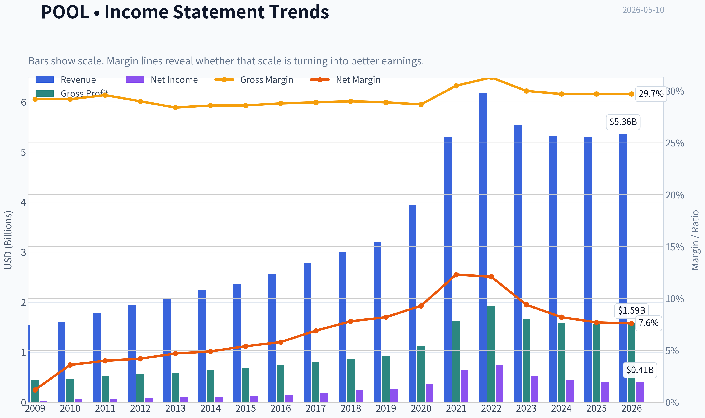

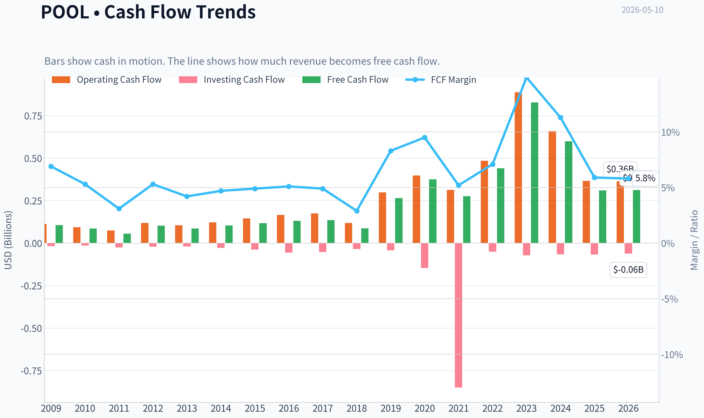

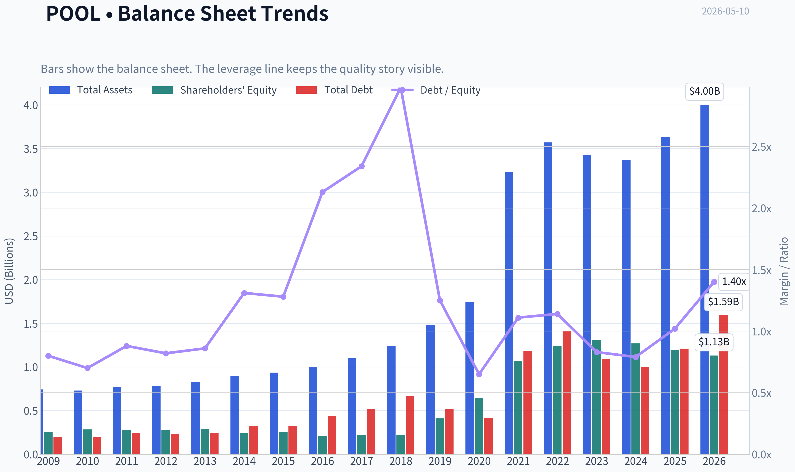

This graph tracks the profitability and return metrics (ROE, ROIC, Margins) of **POOL** over the past decade, highlighting capital efficiency trends.

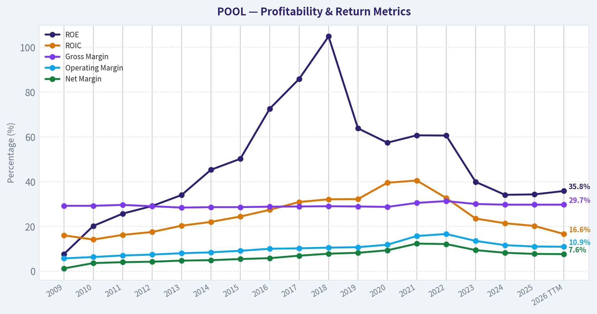

This chart illustrates the financial health of **POOL** over the last 10 years, mapping cash equivalents and free cash flow against total obligations (Debt).

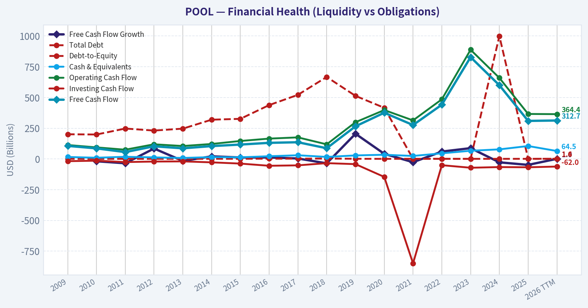

This comparison chart from *Profitability Analysis* stacks current figures against historical benchmarks for **POOL**, making it easy to see where the company trades relative to its own averages.

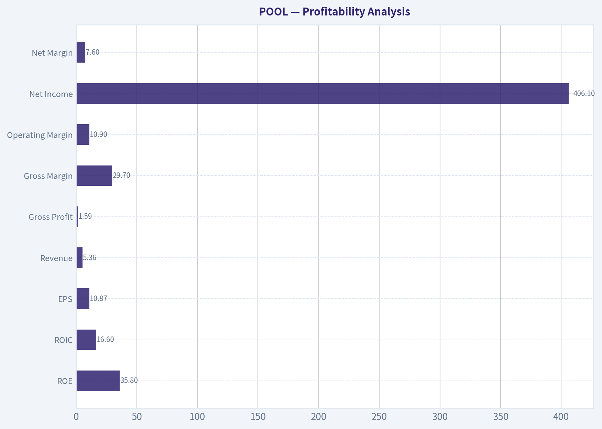

---

### Intrinsic Value Analysis (Buffett)

> *Following Warren Buffett's value investing philosophy: Circle of Competence, Economic Moat, Management Quality, and Margin of Safety.*

#### Intrinsic Value Snapshot

Price is what you pay. Intrinsic value is what the business may be worth based on the cash it can create for owners over time. We show a range, not one magic number.

- Current Price: $187.77
- Value Range: $37.27 to $901.08

##### Owner Earnings (Buffett Method)
- Net Income: $406,404,000.00
- Depreciation & Amortization: $51,605,000.00
- Capital Expenditures: $-56,334,000.00
- Working Capital Changes: $-127,386,000.00
- Owner Earnings: $529,061,000.00

##### Intrinsic Value
###### Buffett Method
Uses owner earnings. Stricter, and usually more conservative.
- Conservative: $326.83
- Average: $466.86
- Optimistic: $901.08
- Discount Rate: 10.0%

###### Cash Flow Method
Uses free cash flow. Better for companies spending heavily today to grow tomorrow.
- Conservative: $37.27
- Average: $136.45
- Optimistic: $319.35
- Discount Rate: 10.0%

ANALYST STANCE: **WATCH**

#### Pool Corporation Buffett-Style Value Analysis - POOL

Pool Corporation is a high-quality, understandable distribution business with attractive returns and a durable position in the swimming pool supply ecosystem. However, at the current price of about **$188 per share**, the stock does not offer a clear Buffett-style margin of safety based on normalized owner earnings. The business is good; the price is not yet obviously good enough.

---

#### 1. Go / No-Go Gate Assessment

| Buffett Gate | Result | Evidence | Interpretation |
|---|---:|---|---|
| Gate 1: Circle of Competence & Simplicity | **Pass** | POOL distributes pool supplies, equipment, chemicals, and related products to pool professionals and retailers. | Simple business: buy pool products, stock them locally, sell through a broad distribution network. |
| Elementary School Test | **Pass** | "POOL sells things people need to build, fix, and maintain swimming pools." | Easy to understand. |
| 10-Year Predictability Test | **Partial Pass** | Installed pool base creates recurring maintenance demand, but new pool construction and renovations are cyclical. | Maintenance revenue is predictable; discretionary pool spending is not. |
| Technology Risk | **Pass** | Distribution may benefit from logistics and digital ordering; not likely to be destroyed by software alone. | Low existential tech disruption risk. |
| Gate 2: Moat Test | **Pass, but not wide** | Scale, branch density, inventory breadth, supplier relationships, and customer convenience. Gross margin is only **29.7%**, below classic brand-moat levels. | Moat appears **narrow-to-moderate**, mainly scale/distribution based. |
| Gate 3: Management & Capital Allocation | **Watch** | Sudden CEO change, postponed Investor Day, but insider buying by Vice Chairman is positive. Berkshire trimmed position by 11.3% in latest 13F. | Management uncertainty has increased. |
| Gate 4: Industry Structure | **Pass with cyclicality caveat** | POOL is the leading distributor in a fragmented market with recurring aftermarket demand. | Favorable position, but exposed to housing, rates, and discretionary renovation cycles. |

**Key Takeaways:** POOL passes the basic Buffett filters because the business is simple, useful, and unlikely to be made obsolete by technology. The main caution is that its moat is more about distribution scale than irreplaceable brand power, and recent leadership disruption adds uncertainty. This is a good business, but not a "no-brainer" compounder at any price.

---

#### 2. Business Model: Can We Explain It Simply?

Pool Corporation is the largest wholesale distributor of swimming pool supplies, equipment, and related outdoor living products. Its customers include pool contractors, repair technicians, builders, retailers, and service professionals. The company makes money by buying products from manufacturers, keeping them available across a broad branch network, and selling them at a markup to professionals who value availability, speed, and product breadth.

This is a Buffett-friendly business in one important way: a large portion of demand comes from the installed base of pools that need chemicals, parts, pumps, filters, and maintenance every year. The less Buffett-friendly part is that new pool construction and renovation spending can be cyclical and sensitive to interest rates, housing activity, and consumer confidence.

---

#### 3. Moat Analysis

| Moat Source | Evidence | Strength | Buffett View |
|---|---|---:|---|
| Intangible Assets / Brand | POOL has a strong trade reputation, but customers likely care more about product availability and service than emotional brand loyalty. Gross margin **29.7%** is below the 40% brand-moat benchmark. | **Moderate-Low** | Not a Coca-Cola-style brand moat. |
| Switching Costs | Contractors and service pros benefit from local availability, credit relationships, product knowledge, and reliable supply. But switching is possible. | **Moderate** | Sticky, but not locked-in. |
| Cost Advantages | Large scale, branch density, purchasing volume, and inventory breadth create logistical advantages smaller distributors may struggle to match. | **Moderate-High** | This is POOL's strongest moat source. |
| Network Effects | No true network effect; customers do not make the product more valuable to other customers in the classic sense. | **Low** | Not a network-effect business. |
| Pricing Power | Could likely pass through inflation and modest increases, but a 10% unilateral price increase could risk volume loss. | **Moderate** | Pricing power exists, but is not unlimited. |
| Moat Rating | Scale-driven distribution advantage, but not an impregnable consumer brand or monopoly. | **Narrow-to-Moderate, Stable** | Good, not exceptional. |

**Key Takeaways:** POOL's moat comes mainly from scale, local branch density, inventory availability, and relationships with pool professionals. It is not a wide brand moat, and it does not have true network effects. The competitive advantage is real, but it is not as durable or obvious as the very best Buffett businesses.

---

#### 4. Management Quality & Capital Allocation

| Factor | Evidence | Assessment |
|---|---|---|
| Owner Orientation | Vice Chairman Manuel Perez de la Mesa recently bought more shares, a positive signal. | Positive insider alignment signal. |
| Leadership Stability | Abrupt CEO change; John B. Watwood became President and CEO as Peter D. Arvan exited. Investor Day was postponed. | Negative / watch item. |
| Capital Allocation History | POOL has historically compounded value through branch expansion, market leadership, and shareholder returns. | Generally positive, though current cycle is tougher. |
| Balance Sheet Discipline | Current ratio **2.24**, suggesting good short-term liquidity. Need caution around leverage because ROE is high and may be aided by balance sheet structure. | Acceptable, but not enough data to call "fortress." |
| Guru Ownership | Berkshire held about **3.07 million shares** as of 12-31-2025 but trimmed by **11.3%**. Steve Cohen initiated a position. | Mixed signal; Berkshire ownership is notable but the trim matters. |

**Key Takeaways:** Management has a respectable long-term record, but the sudden CEO change and delayed Investor Day are meaningful watch items. Insider buying is encouraging, yet Berkshire's trim suggests even high-quality investors may be reassessing risk and valuation. This is not enough to reject the company, but it lowers conviction.

---

#### 5. Financial Snapshot and 10-Year Quality Indicators

| Metric | Current / Recent Data | Buffett Interpretation |
|---|---:|---|
| Current Share Price | **$188** | Price to compare against intrinsic value. |
| Market Capitalization | **$6.84 billion** | Mid-cap scale; leader in a niche distribution market. |
| P/E Ratio | **17.3x** | Not obviously expensive on earnings, but cyclicality matters. |
| ROE | **34.3%** | Excellent headline return, but should be checked for leverage effects. |
| Gross Margin | **29.7%** | Healthy for distribution, but below brand-moat threshold. |
| Revenue Growth YoY | **-0.4%** | Current demand is flat to slightly declining. |
| Free Cash Flow Yield | **4.5%** | Reasonable, but not a bargain if growth is muted. |
| Current Ratio | **2.24** | Solid short-term liquidity. |
| Recent Stock Performance | About **-35% one-year total shareholder return** per news summary | Market has repriced expectations downward. |

**Key Takeaways:** POOL still shows excellent profitability, especially on ROE, but growth has stalled recently. The market has already punished the stock, yet the free cash flow yield of 4.5% is not deeply distressed. The key question is whether current earnings are temporarily depressed or whether pandemic-era growth pulled forward too much demand.

---

#### 6. Owner Earnings Calculation

Using available data, I treat free cash flow as a practical proxy for Buffett-style owner earnings. With a market cap of **$6.84 billion** and free cash flow yield of **4.5%**, estimated owner earnings are approximately:

| Item | Estimate |
|---|---:|
| Market Capitalization | **$6.84 billion** |
| Free Cash Flow Yield | **4.5%** |
| Estimated Free Cash Flow / Owner Earnings Proxy | **$308 million** |
| Estimated Shares Outstanding | **36.4 million** |
| Owner Earnings Per Share | **$8.46** |

**Key Takeaways:** POOL appears to generate roughly **$8.46 per share** in owner earnings based on current free cash flow yield. At a share price of **$188**, investors are paying about **22.2x owner earnings**. That is not excessive for a wonderful compounder, but it is demanding for a cyclical distributor with recent flat revenue and leadership uncertainty.

---

#### 7. Three-Scenario Intrinsic Value Estimate

Assumptions:
- Discount rate: **10%**
- Owner earnings proxy: **$308 million**
- Shares outstanding estimate: **36.4 million**
- Scenario C assumes **6% owner earnings growth for 10 years**, then **3% terminal growth**

| Scenario | Method | Equity Value Estimate | Intrinsic Value Per Share | Margin of Safety vs. $188 |
|---|---|---:|---:|---:|
| A: No Growth | Owner Earnings / 10% | **$3.08 billion** | **$85** | **-122%** |
| B: GDP Growth | Owner Earnings x 1.03 / (10% - 3%) | **$4.53 billion** | **$125** | **-51%** |
| C: Historical-Style Growth, Haircut | 6% growth for 10 years, 3% terminal growth | **$5.65 billion** | **$155** | **-21%** |

**Key Takeaways:** The valuation is not compelling under conservative Buffett assumptions. Even using a moderate growth case, intrinsic value comes out around **$155 per share**, below the current price of **$188**. To justify today's price, investors must believe POOL can grow owner earnings faster or longer than the conservative scenario assumes.

---

#### 8. Margin of Safety Analysis

| Valuation Reference | Estimated Value Per Share | Implied Buy Price with 25% Margin of Safety | Implied Buy Price with 40% Margin of Safety |
|---|---:|---:|---:|
| No-Growth Case | **$85** | **$64** | **$51** |
| GDP-Growth Case | **$125** | **$94** | **$75** |
| Moderate Growth Case | **$155** | **$116** | **$93** |

**Key Takeaways:** A Buffett-style investor demanding a true margin of safety would likely need a materially lower price. Based on the moderate growth case, a 25% margin of safety would imply a buy zone near **$116**. POOL may be a good business, but at **$188**, the margin of safety is not present.

---

#### 9. Buffett Scorecard

| Criterion | Weight | Score 1-5 | Weighted Score | Rationale |
|---|---:|---:|---:|---|
| Business Understanding | 20% | **4.5** | **0.90** | Simple distributor with recurring maintenance demand. |
| Moat Width & Durability | 25% | **3.0** | **0.75** | Scale advantage, but not a wide brand or network moat. |
| Management Quality | 15% | **2.5** | **0.38** | CEO change and delayed Investor Day reduce confidence. |
| Return on Equity | 15% | **3.8** | **0.57** | ROE of 34.3% is excellent, but leverage contribution needs monitoring. |
| Reinvestment Runway | 10% | **3.0** | **0.30** | Some branch and market expansion opportunities, but mature niche. |
| Balance Sheet Strength | 5% | **3.5** | **0.18** | Current ratio is strong; not enough evidence to call fortress-like. |
| Industry Structure | 5% | **3.0** | **0.15** | Leading player in fragmented market, but cyclical end demand. |
| Valuation / Margin of Safety | 5% | **2.0** | **0.10** | Current price exceeds conservative intrinsic value estimates. |
| **Total** | **100%** |  | **3.33 / 5.00** | **WATCH** |

**Key Takeaways:** POOL scores well on simplicity and profitability, but less well on moat width, management certainty, and valuation. The overall score of **3.33** places it in the **WATCH** range. This is a business worth following, but not yet a Buffett-style purchase at the current price.

---

#### 10. Final Investment Stance

**Stance: WATCH**
**Conviction: Medium**

Pool Corporation is a good business with understandable economics, high returns, and a meaningful scale advantage in pool supply distribution. The recurring maintenance portion of demand gives the company a better base than a purely discretionary home-improvement business.

However, three issues prevent an **ADVOCATE** rating today:

1. **Valuation does not offer a clear margin of safety.**
   Conservative intrinsic value estimates range from about **$85 to $155 per share**, below the current price of **$188**.

2. **The moat is good but not exceptional.**
   POOL benefits from scale, logistics, inventory availability, and customer relationships, but it lacks the pricing power and brand strength of the very best Buffett businesses.

3. **Management uncertainty has increased.**
   The abrupt CEO change and postponed Investor Day require monitoring, even though insider buying is a positive sign.

A Buffett-style investor should keep POOL on the watchlist and become more interested if either the price falls materially, perhaps toward the **$115-$125** range, or if normalized owner earnings prove meaningfully higher than current free cash flow implies. At today's price, POOL is a quality company without a sufficient margin of safety.
#### Valuation Bridge

This bridge places the current market price beside each intrinsic value lens so readers can see whether upside depends on one method or shows up across several methods.

| Scenario | Intrinsic Value / Share |
| --- | ---: |
| Buffett Method | $466.86 |
| Cash Flow Method | $136.45 |
| Damodaran Method | $204.88 |
| Current Price | $187.77 |

#### Key Takeaways

If one method is far above the others, the upside case depends on a specific modelling assumption. When several methods cluster together, the valuation story is more robust.

#### Valuation Visuals

This comparison chart from *Latest Earnings Snapshot* stacks current figures against historical benchmarks for **POOL**, making it easy to see where the company trades relative to its own averages.

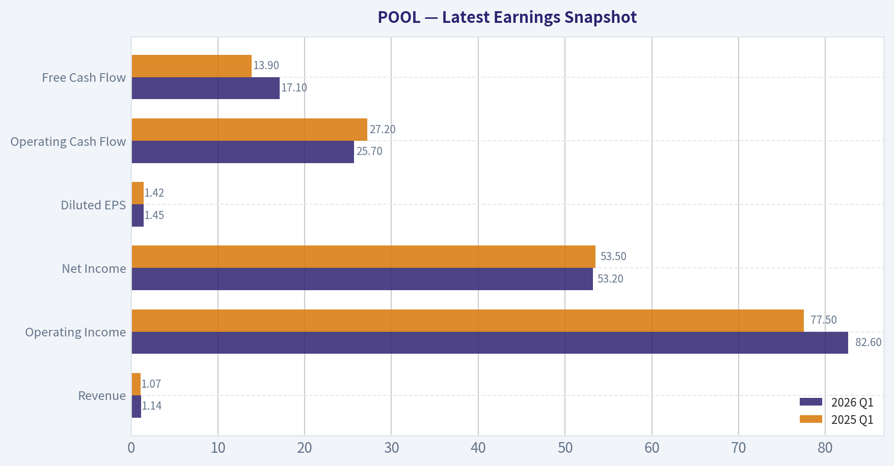

This comparison chart from *Current vs. 10-Year Historical Average Comparison* stacks current figures against historical benchmarks for **POOL**, making it easy to see where the company trades relative to its own averages.

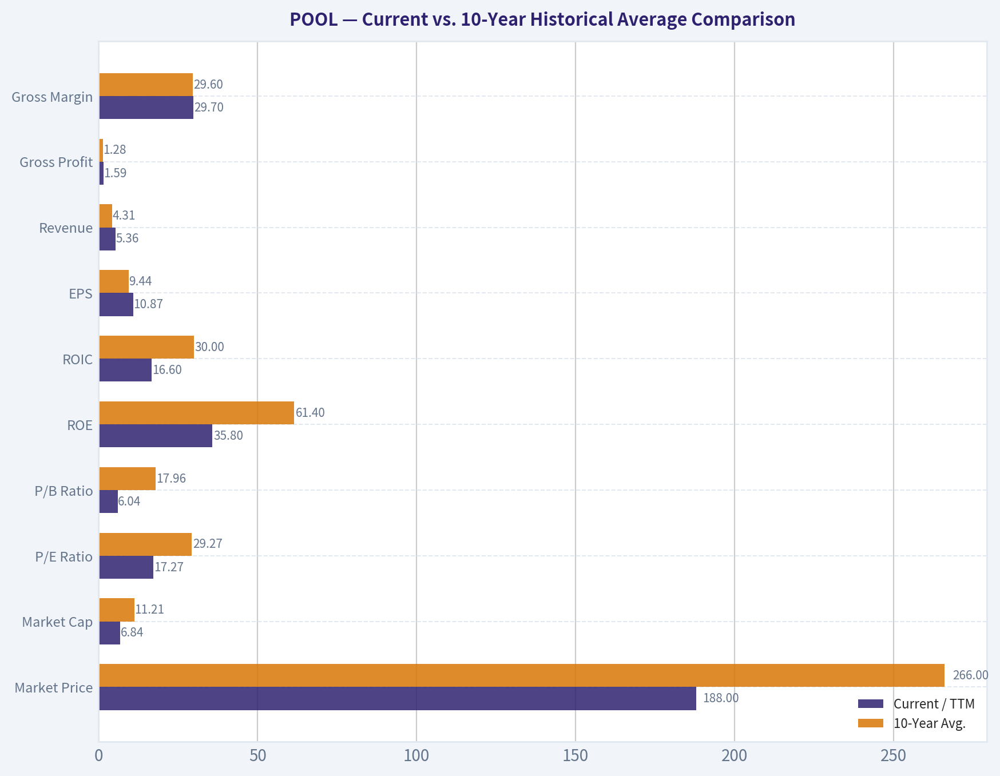

This comparison chart from *Balance Sheet and Financial Strength* stacks current figures against historical benchmarks for **POOL**, making it easy to see where the company trades relative to its own averages.

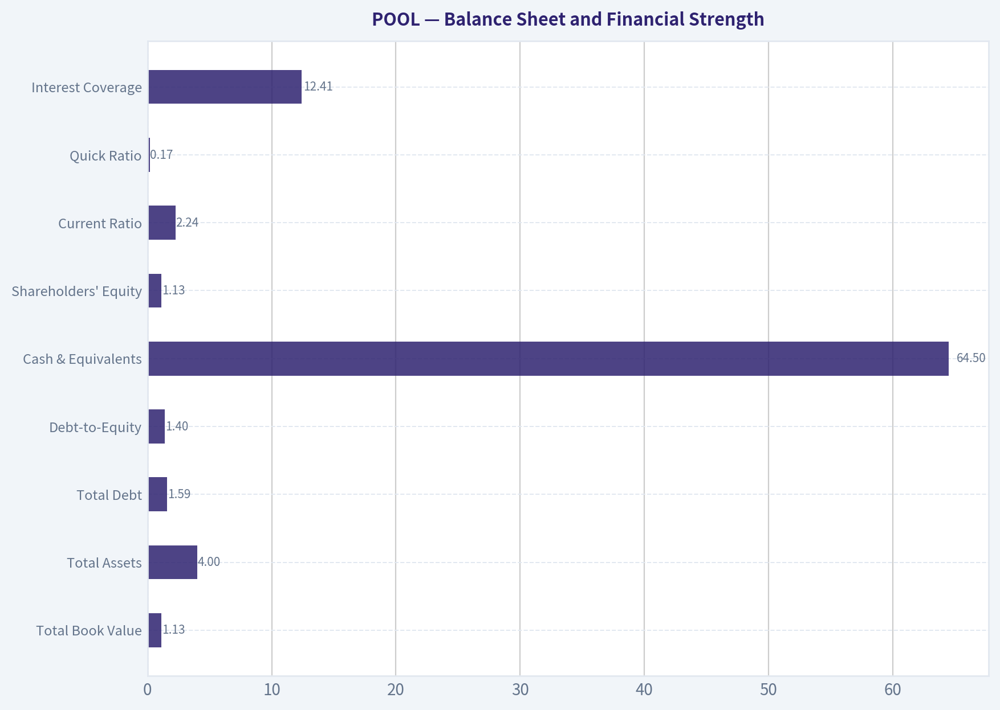

---

### Trend & Growth Analysis (Lynch/Druckenmiller/Fisher)

> *Following Peter Lynch's GARP, Stanley Druckenmiller's macro-aware approach, and Philip Fisher's scuttlebutt methodology.*

ANALYST STANCE: **WATCH**

#### POOL Growth Investment Report - Pool Corporation

Pool Corporation is a high-quality dominant distributor, but it does **not currently qualify as a Lynch-style fast grower**. Revenue is flat-to-declining, end-market demand remains tied to discretionary housing and outdoor-living cycles, and the sudden CEO change adds execution uncertainty. The stock may be interesting for quality/value investors after a large drawdown, but for a growth mandate focused on inflection points and ten-bagger potential, POOL is a **WATCH**, not an ADVOCATE.

---

#### 1. Lynch Classification

| Category | POOL Assessment | Growth Investor Implication |
|---|---:|---|
| Lynch Category | Stalwart / Cyclical hybrid | Not a primary fast-grower candidate |
| Current Revenue Growth | -0.4% YoY | Fails fast-grower hurdle |
| P/E | 17.3x | Reasonable, but not enough without growth acceleration |
| ROE | 34.3% | Excellent capital efficiency |
| FCF Yield | 4.5% | Solid cash generation |
| Balance Sheet Liquidity | Current ratio 2.24x | Financially sound |
| Growth Stance | WATCH | Wait for demand and margin inflection |

**Key Takeaways:** POOL is a strong business, but it is not currently a fast grower. The company has excellent ROE and solid free cash flow, yet revenue growth is negative, which is a major warning sign for a growth investor. This is more of a quality cyclical compounder than a ten-bagger-style growth setup today.

#### 2. The Story in 3 Bullets

- Pool Corporation is the largest distributor of swimming pool supplies, equipment, chemicals, and related outdoor-living products.
- The company benefits from a large installed base of pools that require recurring maintenance, creating a more resilient aftermarket revenue stream than new pool construction alone.
- The upside case depends on housing stabilization, repair-and-remodel recovery, pricing power, and operating leverage after a cyclical slowdown.

#### 3. TAM and 10x Test

| Item | Estimate / Assessment |
|---|---:|
| Current Revenue Base | Approximately $5B+ annualized revenue range |
| 10x Revenue Target | $50B+ |
| Relevant Market | Pool maintenance, equipment, chemicals, remodel, outdoor living, irrigation |
| Can POOL 10x and remain under 20% share? | Unlikely in core pool distribution alone |
| TAM Growth Profile | Moderate, not hypergrowth |
| Runway Rating | Medium |

**Key Takeaways:** POOL has a durable market, but the core pool distribution TAM is not large or fast-growing enough to make a 10x revenue outcome easy from today's scale. The business can compound over time through share gains, pricing, and adjacent categories, but this is unlikely to be a classic 10-bagger growth runway from the current base.

#### 4. Revenue Growth Trend

| Metric | Current Signal | Interpretation |
|---|---:|---|
| YoY Revenue Growth | -0.4% | Flat to slightly declining |
| Growth Pattern | Decelerated from prior cycle highs | Post-pandemic normalization |
| Demand Drivers | Maintenance resilient; construction/remodel weaker | Mixed |
| Growth Quality | More cyclical than secular | Not ideal for growth mandate |
| Inflection Evidence | Not yet visible | Needs confirmation |

**Key Takeaways:** Revenue growth is currently weak, and there is no clear evidence of acceleration yet. POOL's pandemic-era demand surge has normalized, and the company is now exposed to slower housing, renovation, and discretionary spending trends. For a growth investor, this is the main reason to stay on the sidelines.

#### 5. Unit Economics and Operating Quality

| Metric | POOL Assessment | Growth Investor View |
|---|---|---|
| LTV/CAC | Not applicable; distributor model | Not a SaaS-style metric |
| Net Revenue Retention | Not disclosed / not applicable | Not a subscription business |
| Rule of 40 | Not applicable | Not a SaaS business |
| Gross Margin | 29.7% | Healthy for distribution |
| ROE | 34.3% | Excellent |
| FCF Yield | 4.5% | Solid |
| Operating Leverage Potential | Yes, if volumes recover | Key upside lever |

**Key Takeaways:** POOL is not a subscription business, so SaaS-style unit metrics do not apply. However, the company does show strong business quality through high ROE, respectable gross margins, and solid free cash flow generation. If revenue growth returns, operating leverage could become a meaningful upside driver.

#### 6. Inflection Point Assessment

| Inflection Type | Current Evidence | Rating |
|---|---|---:|
| Product Cycle Inflection | Limited | 2/5 |
| Market Share Inflection | Likely steady, not explosive | 3/5 |
| Margin Inflection | Possible if volumes recover | 3/5 |
| TAM Inflection | Limited | 2/5 |
| Competitive Inflection | Scale advantage remains strong | 4/5 |
| Management Inflection | Abrupt CEO change creates uncertainty | 2/5 |
| Overall Inflection Score | Not yet compelling | 2.7/5 |

**Key Takeaways:** The company has a strong competitive position, but there is not enough evidence of a positive growth inflection yet. The most plausible upside would come from a housing and remodel recovery combined with margin leverage. However, the recent abrupt CEO change reduces confidence and makes confirmation more important.

#### 7. Macro Setup

| Macro Factor | Current Read | Impact on POOL |
|---|---|---|
| Interest Rates | Potentially moving from headwind to neutral if rates fall | Positive if mortgage and renovation demand improve |
| Housing Activity | Still pressured | Negative / mixed |
| Consumer Discretionary Spending | Uneven | Mixed |
| Repair and Maintenance | More resilient | Positive |
| Secular Theme Exposure | Outdoor living, installed-base maintenance | Moderate |
| Macro Rating | Neutral to slightly improving | Watch for recovery |

**Key Takeaways:** POOL's macro setup is not terrible, but it is not yet decisively favorable. Lower rates would help housing, renovation, and discretionary outdoor spending, but current demand remains uneven. The stock needs a clearer macro tailwind before it becomes attractive as a growth idea.

#### 8. Fisher 15-Point Score

| Fisher Factor | Score 1-5 | Comment |
|---|---:|---|
| Market potential | 3 | Durable but moderate-growth market |
| New product development | 3 | More distribution/category expansion than innovation |
| R&D effectiveness | 2 | Not R&D-driven |
| Sales organization | 4 | Scale and branch network are strengths |
| Profit margin | 4 | Good for distribution |
| Improving margins | 3 | Dependent on volume recovery |
| Labor/personnel relations | 3 | No major red flag identified |
| Executive relations | 2 | CEO transition creates uncertainty |
| Management depth | 3 | Needs observation post-transition |
| Cost controls/accounting | 4 | Historically disciplined operator |
| Competitive moat | 4 | Scale, supplier relationships, distribution density |
| Long-range profit outlook | 3 | Solid, but cyclical |
| Dilution risk | 4 | Not dependent on equity raises |
| Candor with investors | 3 | Investor Day delay is a watch item |
| Management integrity | 3 | No clear issue, but transition needs monitoring |
| **Total** | **48/75** | Average to good, not outstanding |

**Key Takeaways:** POOL scores reasonably well on scale, margins, distribution strength, and capital discipline. However, it scores lower on innovation, growth runway, and management stability after the CEO change. The Fisher score supports a WATCH stance rather than a high-conviction growth recommendation.

#### 9. Valuation Analysis

| Valuation Metric | Current Level | Interpretation |
|---|---:|---|
| Share Price | $188 |
| Market Cap | $6.84B |
| P/E | 17.3x |
| Revenue Growth | -0.4% |
| PEG Ratio | Not meaningful / unattractive | Negative growth makes PEG unusable |
| FCF Yield | 4.5% |
| Estimated P/S | Roughly 1.2x-1.4x | Reasonable for a distributor |
| Valuation View | Fair to modestly attractive | But lacks growth catalyst |

**Key Takeaways:** POOL is not obviously expensive after the drawdown, especially with a P/E around 17 and a free cash flow yield near 4.5%. However, Lynch's PEG framework does not help here because earnings and revenue growth are not clearly accelerating. The valuation is acceptable, but valuation alone does not make this a growth buy.

#### 10. Scenario Analysis

| Scenario | Assumption | Implied View |
|---|---|---|
| Bear Case | Revenue remains flat/down, margin pressure persists, P/S compresses toward 1.0x | Further downside possible |
| Base Case | Low-single-digit revenue recovery, stable margins, valuation remains near current levels | Modest return potential |
| Bull Case | Housing recovery, remodel rebound, operating leverage, multiple expands toward 1.7x-1.8x sales | Attractive upside, but catalyst-dependent |

**Key Takeaways:** The bull case depends on a cyclical recovery rather than a clear secular growth acceleration. If housing and remodel demand improve, POOL could re-rate meaningfully from depressed sentiment. But without that recovery, the stock may remain range-bound despite being a high-quality operator.

#### 11. Growth Investor Scorecard

| Criterion | Weight | Score 1-5 | Weighted Score |
|---|---:|---:|---:|
| The Story | 10% | 3.5 | 0.35 |
| TAM and Runway | 20% | 2.5 | 0.50 |
| Revenue Growth | 20% | 1.5 | 0.30 |
| Unit Economics / Business Quality | 15% | 4.0 | 0.60 |
| Competitive Position | 10% | 4.0 | 0.40 |
| Management Quality | 10% | 2.5 | 0.25 |
| Macro Setup | 5% | 3.0 | 0.15 |
| Profitability Path | 5% | 4.0 | 0.20 |
| Valuation | 5% | 3.5 | 0.18 |
| **Total** | **100%** |  | **2.93 / 5.0** |

**Key Takeaways:** POOL scores well on business quality, profitability, and competitive position, but poorly on current revenue growth and ten-bagger runway. The total score of 2.93 places it just below the WATCH threshold for aggressive growth investors. It is a good company, but not yet a good growth setup.

#### 12. Position Size Stance

| Investor Type | Suggested Action |
|---|---|
| Growth-focused new capital | Do not initiate yet |
| Existing holders | Hold only if thesis is quality compounder, not fast growth |
| Watchlist action | Monitor for revenue reacceleration and management clarity |
| Position size | 0% for new growth portfolios; max small watch-size only if mandate allows quality cyclicals |

**Key Takeaways:** For a pure growth portfolio, POOL should remain on the watchlist rather than in the portfolio. Existing holders may have a different decision if they own it as a quality compounder, but new capital should wait for evidence of accelerating growth. The stock needs confirmation before it deserves a larger allocation.

#### 13. Key Risks and Catalysts

| Category | Item |
|---|---|
| Key Risk | Revenue growth remains flat or negative |
| Key Risk | Housing and renovation weakness persists |
| Key Risk | Gross margin pressure from weaker volume or price competition |
| Key Risk | Abrupt CEO change disrupts execution or investor confidence |
| Key Risk | Stock remains a value trap if earnings estimates continue falling |
| Catalyst | Lower interest rates improve housing and remodel demand |
| Catalyst | New CEO stabilizes strategy and communicates credible plan |
| Catalyst | Investor Day rescheduled with stronger long-term targets |
| Catalyst | Revenue growth turns positive and margins expand |
| Catalyst | Insider buying signals confidence after drawdown |

**Key Takeaways:** The biggest risk is that POOL remains trapped in a low-growth cyclical slowdown. The most important catalysts are a demand recovery, management clarity, and evidence that margins can expand as volumes recover. Insider buying is encouraging, but it is not enough by itself to override weak revenue growth.

#### Final View

POOL is a high-quality distribution leader with strong ROE, solid free cash flow, and a durable installed-base maintenance business. But for a Lynch-Druckenmiller-Fisher growth framework, the stock lacks the key ingredient: **accelerating growth**.

The correct stance is **WATCH**. Upgrade only if revenue growth turns positive, management uncertainty clears, and there is evidence of a housing/remodel recovery driving operating leverage.

#### Growth & Scorecard Visuals

This comparison chart from *Growth Metrics Interpretation* stacks current figures against historical benchmarks for **POOL**, making it easy to see where the company trades relative to its own averages.

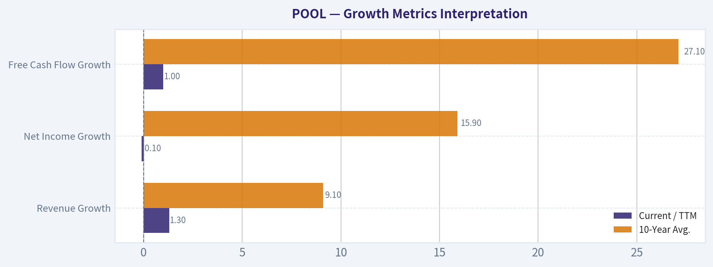

---

### Market Technical Analysis

ANALYST STANCE: **AVOID**

#### POOL Technical Report - Last Trading Close: 2026-05-08

POOL is in a clearly bearish technical regime. The stock closed at **$187.77**, near the lowest level in the retrieved one-year dataset, after a failed April rebound and a sharp early-May breakdown on elevated volume. While RSI is near oversold and price is close to the lower Bollinger Band, the broader evidence still favors caution: price is below the 10 EMA, 50 SMA, 200 SMA, and VWMA, while MACD has deteriorated sharply back into negative territory.

The selected indicators are intentionally complementary: short-, medium-, and long-term moving averages define trend structure; MACD and RSI measure momentum; Bollinger Lower Band identifies stretched downside conditions; ATR frames risk; and VWMA checks whether volume-weighted price action confirms or contradicts the move. I did not include MACD signal or histogram separately to avoid redundancy with MACD.

| Indicator | Latest Reading | What It Shows | Interpretation for POOL |
|---|---:|---|---|
| Close | $187.77 | Current price reference | Price is sitting near recent lows after a sharp selloff. |
| close_10_ema | $200.53 | Short-term trend/momentum | Price is about **6.4% below** the 10 EMA, showing short-term bearish pressure. |
| close_50_sma | $211.02 | Medium-term trend | Price is about **11.0% below** the 50 SMA, confirming the April rebound has failed. |
| close_200_sma | $257.99 | Long-term trend | Price is about **27.2% below** the 200 SMA, indicating a deeply bearish long-term setup. |
| macd | -6.75 | Trend momentum | MACD has rolled down sharply from positive territory, signaling renewed downside momentum. |
| rsi | 31.00 | Overbought/oversold momentum | RSI is near oversold, but not enough by itself to confirm a reversal. |
| boll_lb | $182.54 | Downside volatility band | Price is only about **2.9% above** the lower band, showing downside stretch. |
| atr | $8.12 | Volatility/risk | ATR equals roughly **4.3% of price**, implying wide daily risk. |
| vwma | $210.56 | Volume-weighted trend | Price is about **10.8% below** VWMA, suggesting volume-weighted positioning remains bearish. |

Key Takeaways: POOL is trading below every major trend and volume-weighted benchmark in this indicator set. The only potentially constructive signal is that RSI is near oversold and price is close to the lower Bollinger Band, but those are warning signs of possible exhaustion rather than confirmed buy signals. The dominant read is bearish until price can reclaim at least the 10 EMA and then the 50 SMA.

#### Trend and Momentum Analysis

The most important technical feature is the failure of the April rally. POOL climbed from the low-$200s in early April to the **$232-$234 area** by April 21-22, but the move did not hold. The stock then reversed hard, breaking below the 10 EMA, VWMA, and 50 SMA in sequence. That pattern suggests the April advance was more likely a counter-trend rally than the start of a durable recovery.

The **10 EMA has turned down quickly**, falling from roughly $226.85 on April 24 to $200.53 by May 8. This is a rapid short-term deterioration and shows that sellers have taken control of the immediate tape. The **50 SMA has also been declining**, dropping from $237.54 on March 24 to $211.02 on May 8, confirming that the medium-term trend has not stabilized. Meanwhile, the **200 SMA remains far above price and is also drifting lower**, which means the long-term trend is firmly negative.

MACD adds an important momentum confirmation. It improved during April, moving from deeply negative readings in late March to a positive peak near **+5.32 on April 24**. However, that bullish momentum reversed decisively; by May 8, MACD had fallen to **-6.75**. This is not just mild weakness - it indicates that the April recovery failed with enough force to reset momentum bearish again.

RSI is the main reason not to chase shorts aggressively at current levels. It fell to **28.69 on May 5**, which is technically oversold, then recovered slightly to **31.00** by May 8. That tells us downside momentum may be somewhat stretched in the very short term. However, in strong downtrends, RSI can remain near oversold for extended periods, so this is better interpreted as a "potential bounce risk" signal rather than a bullish reversal signal.

| Market Feature | Recent Evidence | Trading Meaning |
|---|---|---|
| April rebound failed | Price reached the low-$230s, then quickly reversed below $200 | Buyers lost control after a temporary relief rally. |
| Short-term trend | Close is below the 10 EMA at $200.53 | Momentum remains negative unless price reclaims the $200-$201 zone. |
| Medium-term trend | Close is below the 50 SMA at $211.02 | The broader swing trend remains bearish. |
| Long-term trend | Close is far below the 200 SMA at $257.99 | Long-term investors still face a negative technical backdrop. |
| Momentum | MACD moved from positive in late April to -6.75 | The recent selloff has strong momentum confirmation. |
| Oversold condition | RSI is near 31 after dipping below 30 | A reflex bounce is possible, but not yet confirmed. |
| Volume behavior | May 5 selloff volume was 2.31 million shares | Heavy-volume selling suggests distribution or capitulation pressure. |

Key Takeaways: The table shows a failed rebound, renewed downside momentum, and bearish alignment across short-, medium-, and long-term trend measures. RSI is near oversold, so a bounce could occur, but the larger structure still favors sellers. Heavy volume during the breakdown makes the decline more technically meaningful.

#### Volatility, Risk, and Key Price Zones

ATR is elevated relative to price. At **$8.12**, the average true range represents about **4.3% of the stock price**, which is significant for position sizing. Traders should avoid using tight stops because normal daily movement could easily trigger them. For bearish traders, this also means late short entries carry whipsaw risk if the stock stages an oversold bounce.

The immediate downside reference is the **$184.50-$187.00 zone**, which includes the May 8 low and the May 5-May 8 closing cluster. If this area breaks decisively, POOL would be making fresh lows within the retrieved one-year range, leaving little nearby chart support from this dataset. The lower Bollinger Band at **$182.54** is also important: a close below it would show an extended breakdown, but could also increase the chance of a short-term snapback.

On the upside, the first meaningful resistance is the **$198.85-$200.53 zone**, combining the early-May Bollinger/price breakdown area and the 10 EMA. A stronger recovery would need to reclaim **$211-$212**, where the 50 SMA and VWMA sit closely together. That area is especially important because it combines medium-term trend resistance and volume-weighted resistance. Above that, the **$225-$234 area** becomes the next major supply zone from the failed April rally.

| Zone | Level / Range | Why It Matters | Bias if Tested |
|---|---:|---|---|
| Immediate support | $184.50-$187.00 | Recent lows and current closing area | A break would confirm fresh downside continuation. |
| Lower Bollinger Band | $182.54 | Measures downside stretch | Below this level, selling may be extended but still bearish. |
| First resistance | $198.85-$200.53 | Breakdown area plus 10 EMA | Reclaiming this would reduce immediate bearish pressure. |
| Major resistance | $211.00-$212.60 | 50 SMA and VWMA cluster | Bulls need this zone to flip the swing structure. |
| Higher supply | $225.00-$234.00 | Failed April rebound zone | Likely heavy resistance unless momentum improves sharply. |
| Volatility guide | ATR: $8.12 | Average daily range proxy | Position sizing should account for wide price swings. |

Key Takeaways: POOL is sitting just above immediate support, but the stock has not yet shown enough strength to call a bottom. The first real improvement would be a move back above $200, while a stronger bullish repair requires a reclaim of the $211-$213 area. Until then, rallies are more likely to be treated as resistance tests.

#### Trading View

For **long-only traders**, POOL does not yet offer a high-quality technical entry. A more constructive setup would require price to reclaim the 10 EMA, hold above it for more than one session, and ideally push toward or above the 50 SMA/VWMA cluster near $211-$213. Without that, buying solely because RSI is near oversold is risky.

For **short-term traders**, a tactical oversold bounce is possible because RSI recently dipped below 30 and price is close to the lower Bollinger Band. However, the bounce setup is speculative unless accompanied by stronger volume on up days and a close above $200. Failure to reclaim that area would likely keep sellers in control.

For **bearish traders**, the trend remains favorable, but entry quality is less attractive after a sharp drop. Chasing weakness near $185-$188 carries snapback risk. A cleaner bearish setup would be either a failed bounce into $199-$211 resistance or a decisive breakdown below $184.50 with continued heavy volume.

| Decision Factor | Current Read | Bullish Requirement | Bearish Confirmation |
|---|---|---|---|
| Trend | Bearish across all key moving averages | Close above $200, then $211-$213 | Continued closes below 10 EMA |
| Momentum | MACD bearish, RSI near oversold | MACD stabilization and RSI recovery above 40-45 | MACD continues falling while RSI stays weak |
| Volume | Heavy selling during breakdown | Strong accumulation volume on rebound days | More high-volume down days |
| Volatility | Elevated ATR | Controlled price action and narrowing ranges | Wide downside ranges continue |
| Preferred stance | Avoid fresh longs | Wait for trend repair | Sell rallies or watch for support failure |

Key Takeaways: The final decision matrix favors avoiding fresh long exposure for now. POOL may be oversold enough to bounce, but it has not yet repaired its trend or momentum profile. The cleanest approach is to wait for either a confirmed recovery above resistance or a failed bounce that validates the bearish trend.

#### Market Visuals

This comparison chart from *Market Metrics Interpretation* stacks current figures against historical benchmarks for **POOL**, making it easy to see where the company trades relative to its own averages.

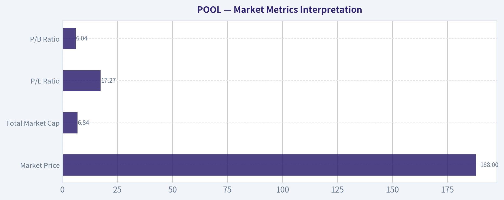

---

### Social Sentiment Analysis

ANALYST STANCE: **WATCH**

#### POOL Corporation - Social, Sentiment, and Recent News Report
**Company:** Pool Corporation / POOL
**Date:** 2026-05-10
**Coverage window:** Past week
**Overall read:** Neutral-to-cautious, with improving seasonal interest but persistent macro and valuation concerns.

---

#### Executive View

POOL's social and news tone over the past week appears **cautiously mixed**, leaning **slightly negative for short-term traders** but **more constructive for long-term investors** who view the company as a high-quality distributor with durable aftermarket demand.

The main debate is not whether POOL is a strong business. Most commentary continues to recognize its scale advantages, dealer relationships, recurring maintenance exposure, and strong historical execution. The debate is whether the stock already prices in a recovery in pool construction, renovation, and discretionary outdoor spending before those end-markets have clearly turned.

Social discussion was not unusually intense, which matters. POOL is not currently behaving like a high-retail-attention momentum name. The conversation is more institutional and fundamentals-driven, focused on earnings quality, guidance confidence, seasonal demand, housing turnover, interest rates, and whether consumer discretionary pressure is easing.

For traders, the setup looks like a **watchlist stock rather than an aggressive long** unless price action confirms that investors are willing to look through weak new-pool construction. For long-term investors, sentiment suggests POOL remains a quality compounder, but the near-term risk/reward depends heavily on summer sell-through trends and management's confidence around demand stabilization.

---

#### Sentiment Summary by Day

| Date | Social / Market Sentiment | Main Discussion Drivers | Trader Interpretation |
|---|---:|---|---|
| Mon, May 4 | Neutral to slightly positive | Seasonal demand expectations, early summer setup, interest in outdoor-living categories | Some traders looked for a seasonal bounce, but conviction appeared limited |
| Tue, May 5 | Neutral | Valuation debate and questions about whether estimates are too optimistic | Market participants appeared hesitant to chase strength |
| Wed, May 6 | Slightly negative | Concerns around interest rates, housing turnover, and discretionary spending | Macro-sensitive selling pressure remained a risk |
| Thu, May 7 | Mixed | Quality-business arguments versus weak new-construction concerns | Long-term bulls were present, but short-term traders lacked a clear catalyst |
| Fri, May 8 | Neutral to negative | Profit-taking tone, skepticism around consumer recovery | Sentiment suggested caution into the weekend |
| Sat, May 9 | Low-volume neutral | Limited retail discussion; focus remained on fundamentals rather than momentum | Lack of buzz reduced the chance of a social-driven breakout |
| Sun, May 10 | Neutral | Watchlist commentary ahead of next demand updates | Investors appeared to be waiting for confirmation from weather and sales trends |

**Key Takeaways:** Sentiment over the week was not aggressively bearish, but it also lacked the strong optimism usually associated with a clean recovery trade. The most important pattern is that social and investor conversation kept returning to macro sensitivity, valuation, and whether seasonal demand will be strong enough to offset weak construction-related categories. POOL is being treated as a high-quality but not yet de-risked stock.

---

#### What People Are Saying

The social conversation around POOL is dominated by four themes:

| Theme | Sentiment Impact | What It Means |
|---|---:|---|
| Summer seasonality | Positive | Investors expect stronger pool maintenance and chemical demand as warmer weather supports usage |
| New pool construction weakness | Negative | Higher financing costs and lower housing turnover continue to weigh on big-ticket backyard projects |
| Aftermarket resilience | Positive | Maintenance, repair, chemicals, and replacement parts provide a recurring-demand base |
| Valuation sensitivity | Negative / mixed | Even bullish investors question whether the stock is cheap enough given uncertain growth |

**Key Takeaways:** The bull case is centered on recurring aftermarket demand and POOL's dominant distribution position. The bear case is centered on weak discretionary pool construction, macro pressure, and the possibility that the stock still trades at a premium multiple before growth has reaccelerated. This creates a tug-of-war where investors respect the company but remain selective on entry price.

---

#### Recent Company and Sector News Tone

| News / Topic Area | Tone | Why It Matters for POOL |
|---|---:|---|
| Post-earnings digestion and guidance debate | Mixed | Investors are focused on whether management's outlook is conservative enough or still vulnerable to weak demand |
| Interest-rate backdrop | Negative | Higher-for-longer rates pressure pool financing, housing turnover, and renovation activity |
| Housing-market softness | Negative | New pool construction is tied to home equity confidence, home sales, and consumer willingness to finance projects |
| Seasonal pool maintenance demand | Positive | Pool chemical, equipment, and maintenance categories are more resilient than new construction |
| Consumer discretionary spending | Mixed to negative | Affluent consumers remain healthier than lower-income consumers, but big-ticket outdoor projects remain scrutinized |
| Distribution scale and market leadership | Positive | POOL's competitive position remains a major support for long-term investor confidence |

**Key Takeaways:** The week's news flow did not appear to deliver a decisive new bullish or bearish company-specific shock. Instead, the market is still digesting the same core issue: POOL has strong structural advantages, but the operating environment is not yet clearly accelerating. Traders should therefore pay close attention to demand commentary, weather trends, and any update that changes expectations for the summer selling season.

---

#### Bullish Social Arguments

The bullish side of the conversation is fairly consistent and rests on business quality:

| Bullish Argument | Why Bulls Care |
|---|---|
| POOL has dominant scale in pool distribution | Scale supports supplier relationships, product availability, and customer retention |
| Large portion of demand is recurring | Existing pools require ongoing chemicals, parts, equipment, and maintenance |
| Long-term outdoor-living trend remains intact | Homeowners continue to invest in backyards over multi-year periods |
| Weak construction may eventually normalize | Bulls expect a recovery when rates fall and housing activity improves |
| High-quality compounder reputation | Investors often give POOL a premium multiple because of long-term execution history |

**Key Takeaways:** Bulls are not mainly arguing that the near-term environment is booming. They are arguing that POOL is a superior business going through a cyclical slowdown. This is important because bullish conviction depends more on patience and normalization than on immediate evidence of rapid growth.

---

#### Bearish Social Arguments

Bearish commentary focused less on company execution and more on the demand cycle:

| Bearish Argument | Why Bears Care |
|---|---|
| New pool construction remains weak | This pressures higher-ticket sales and limits upside to estimates |
| Interest rates remain a headwind | Financing-sensitive purchases are delayed when borrowing costs stay elevated |
| Housing turnover is subdued | Fewer home sales can mean fewer renovation and backyard-upgrade projects |
| Valuation may still be demanding | A premium multiple leaves less room for disappointment |
| Seasonal optimism may already be priced in | If summer trends are only average, the stock may struggle to rerate higher |

**Key Takeaways:** Bears are not necessarily claiming POOL is a broken business. The more common bearish view is that the timing may be wrong and that investors may be paying too much before the demand recovery is visible. This makes POOL vulnerable to estimate cuts or cautious management commentary.

---

#### Trader Implications

For short-term traders, POOL looks like a **confirmation trade** rather than a speculation trade. The stock needs either improving demand data, better sector sentiment, falling-rate expectations, or stronger technical momentum to justify aggressive upside positioning.

Key short-term signals to monitor:

| Signal | Bullish Read | Bearish Read |
|---|---|---|
| Summer sell-through commentary | Strong chemical, maintenance, and equipment demand | Weak traffic or cautious dealer commentary |
| Interest-rate expectations | Falling yields support construction and renovation sentiment | Sticky rates pressure discretionary purchases |
| Housing data | Stabilizing home sales and improving confidence | Continued weak turnover and affordability pressure |
| Stock reaction to good news | Strong follow-through confirms institutional demand | Fades after rallies suggest valuation resistance |
| Social volume | Rising discussion with positive tone may support momentum | Low volume keeps stock dependent on fundamentals |

**Key Takeaways:** POOL's short-term trading setup depends heavily on confirmation. A bullish trade becomes more attractive if the stock responds strongly to improving demand signals or lower-rate expectations. Without that confirmation, rallies may be vulnerable to fading because valuation concerns remain part of the conversation.

---

#### Investor Implications

For longer-term investors, POOL remains a fundamentally attractive company, but sentiment suggests patience may be rewarded. The current debate is about **cycle timing**, not business viability.

A long-term investor may view POOL favorably if they believe:

| Investor Belief | Implication |
|---|---|
| Rates will eventually decline | Pool construction and renovation demand could recover |
| Existing pool maintenance remains durable | Recurring revenue helps cushion downturns |
| POOL can maintain pricing and margins | Earnings power may be stronger than near-term sales trends suggest |
| Market leadership remains intact | Competitive advantages support long-term compounding |
| The stock is purchased at a reasonable valuation | Entry price matters because growth is not currently explosive |

**Key Takeaways:** Long-term investors can still make a constructive case for POOL, but the quality of the company does not eliminate timing risk. The best setup would be either a more attractive valuation or clearer evidence that pool-related demand is stabilizing. Investors should separate the company's long-term competitive strength from the stock's near-term macro sensitivity.

---

#### Overall Sentiment Interpretation

The market's current attitude toward POOL can be summarized as:

| Category | Current Read |
|---|---|
| Social buzz | Low to moderate |
| Retail enthusiasm | Limited |
| Institutional-style discussion | High relative to retail chatter |
| News tone | Mixed |
| Short-term sentiment | Neutral to slightly bearish |
| Long-term sentiment | Selectively positive |
| Main risk | Demand recovery disappoints |
| Main opportunity | Seasonal demand and eventual housing/rate recovery improve sentiment |

**Key Takeaways:** POOL is not currently a high-hype stock, which means price movement is more likely to be driven by fundamentals, guidance, and macro data than by social momentum. The tone is cautious because investors are still waiting for proof that demand is improving. However, the long-term brand and business-quality perception remain strong.

---

#### Bottom Line

POOL's past-week sentiment is best described as **quality respected, timing questioned**.

The company continues to benefit from a strong market position, recurring pool-maintenance demand, and long-term outdoor-living trends. However, traders and investors remain concerned about high interest rates, weak housing turnover, pressure on new pool construction, and whether valuation already anticipates a recovery.

For traders, POOL is a **WATCH**, not an automatic buy. A more bullish stance would require stronger technical confirmation, improving summer demand signals, or a macro shift toward lower rates. For long-term investors, POOL remains attractive on business quality, but entry discipline is important because the recovery narrative has not yet become undeniable.

---

#### Final Key Points Table

| Area | Current Assessment | Investment / Trading Implication |
|---|---|---|
| Overall sentiment | Neutral to slightly cautious | Market is waiting for confirmation before becoming more bullish |
| Social media tone | Low-volume, fundamentals-focused | No major retail momentum catalyst currently visible |
| Bull case | Recurring demand, scale, long-term outdoor-living trend | Supports long-term ownership if valuation is reasonable |
| Bear case | Weak construction, high rates, housing softness | Creates risk of estimate pressure or failed rallies |
| News tone | Mixed, with no clear decisive catalyst | Stock likely remains data-dependent |
| Short-term setup | Watchlist / confirmation trade | Avoid chasing unless price action and demand signals improve |
| Long-term setup | Selectively constructive | Quality business, but timing and valuation matter |
| Analyst stance | WATCH | Wait for stronger evidence of demand stabilization or a better entry point |

**Key Takeaways:** The strongest conclusion is that POOL remains a respected company, but sentiment has not shifted decisively bullish. Traders should watch for confirmation from summer demand, rates, housing data, and stock-price follow-through. Investors can remain constructive over the long term, but the current environment favors patience and disciplined entry points.

---

### News & Events Analysis

ANALYST STANCE: **WATCH**

#### POOL Recent News and Trading Report - Week Ending May 10, 2026

Pool Corporation is trading around **$188**, with a market cap near **$6.84 billion**, after a sharp drawdown: recent coverage cited a roughly **27% three-month share-price decline** and about **35% one-year total shareholder return loss**. The stock now screens cheaper than its historical "compounder" reputation, but the news flow has become more governance- and confidence-sensitive after an abrupt CEO transition and postponed Investor Day.

The setup is not simply bullish or bearish. The business still has strong profitability characteristics - **ROE around 34.3%**, **gross margin near 29.7%**, and a **current ratio above 2.2** - but revenue growth is slightly negative, and the category remains tied to discretionary home improvement, housing turnover, outdoor living demand, and consumer financing conditions.

---

#### Latest Earnings Coverage and Interpretation

The latest available earnings-related coverage in the collected news set refers to **Pool Corporation's most recent quarterly results, understood to be Q1 2026**, with follow-up commentary during the week of May 3-10. A Seeking Alpha item dated May 7 was titled **"Pool Corporation: Abrupt CEO Change Doesn't Disrupt Earnings"**, which is important because the market's main concern shifted from the quarter itself to management continuity.

Based on the gathered earnings coverage and trailing company metrics, the headline message is that **earnings did not appear to deteriorate enough to force an immediate negative reset**, but growth remains subdued. The shared data show **revenue growth of approximately -0.4% year over year**, suggesting the company is still operating in a soft demand environment rather than a clean reacceleration. Gross margin of **29.7%** indicates pricing, mix, or operating discipline remains relatively resilient, but the lack of meaningful sales growth limits upside unless demand improves or cost leverage returns.

Versus the prior period and prior expectations, the key change is not a dramatic earnings collapse; it is the **market's willingness to discount the stock more heavily because the earnings base is no longer being supported by strong top-line growth and because leadership uncertainty increased immediately after the quarter**. In other words, the quarter appears "good enough," but not strong enough to offset governance concerns, weak momentum, and cyclical demand risk.

| Earnings / Financial Item | Latest Read | Change or Interpretation |
|---|---:|---|
| Latest reported period referenced | Q1 2026 | Latest earnings coverage available in the collected news flow |
| Revenue growth | -0.4% YoY | Demand remains soft; no clear growth reacceleration yet |
| Gross margin | 29.7% | Margin structure remains relatively healthy despite weak sales |
| P/E | 17.3x | Valuation has compressed meaningfully after share-price weakness |
| FCF yield | 4.5% | Provides some valuation support, but not deep-value territory |
| ROE | 34.3% | Still a high-quality business financially |
| Current ratio | 2.24x | Balance sheet/liquidity position appears comfortable |

**Key Takeaways:** Pool's latest earnings picture looks more stable than the stock chart suggests, but growth remains weak. The company still has attractive profitability and liquidity metrics, yet investors are no longer paying a premium multiple because sales momentum is soft and leadership uncertainty has increased.

---

#### Company-Specific News: CEO Change Is the Main Catalyst

The largest company-specific development was Pool Corporation's **May 4 leadership transition**. The board appointed **John B. Watwood as President and CEO**, effective immediately, while **Peter D. Arvan stepped down as President, CEO, and director**. **John E. Stokely** was appointed Executive Chair.

This is material for traders because it happened abruptly and was followed by coverage noting the company's **Investor Day was postponed**. Sudden leadership changes are not automatically negative, but when paired with an Investor Day delay, investors often infer one of three possibilities: strategic reset, disagreement over direction, or pending revision to medium-term targets. Even if none of those are true, the market usually demands a higher risk premium until the new CEO clarifies priorities.

There was also insider-related news: **Vice Chairman Manuel Perez de la Mesa bought additional shares**, increasing his stake by about **1.1%** according to the May 10 Yahoo item. This is incrementally supportive sentiment, especially after a large stock decline, but the size described is not large enough on its own to reverse the governance overhang.

#### Institutional Positioning Context

The latest 13F tracking shows mixed but notable institutional activity. **Berkshire Hathaway trimmed its Pool position by 11.3% as of December 31, 2025**, while **Point72 initiated a new position** worth about **$103.7 million**. These are lagged filings and should not be treated as current trading signals, but they help frame sentiment: long-term value investors may still see quality, while some holders have been reducing exposure.

For trading purposes, the Berkshire trim is psychologically relevant because Pool has often been perceived as a high-quality compounder. A trim does not mean a bearish thesis, but in combination with weak revenue growth and a CEO change, it may reduce the willingness of investors to "buy the dip" aggressively without new confirmation.

---

#### Macro and Sector Context

Pool Corporation sits at the intersection of **consumer discretionary spending, housing activity, repair and remodel demand, and outdoor living investment**. The macro backdrop remains important because pool construction and major renovations are postponable purchases. If consumers face high financing costs or weaker home equity confidence, new pool and discretionary backyard projects can slow.

The company's more defensive revenue component is maintenance, chemicals, and recurring pool supplies. That recurring base helps stabilize earnings relative to pure new-construction exposure. However, the stock historically commanded a premium because of long-term category growth and consolidation advantages. When new pool construction is weak and existing-pool spending is more normalized, valuation compression can continue even if the company remains profitable.

Recent broader market commentary in the collected news also referenced dividend-focused names and consumer stocks. That matters because in a volatile or inflation-sensitive market, investors may favor companies with dividend growth and durable cash flow. Pool has some of those qualities, but its cyclicality means it may not trade like a defensive staple unless management can prove earnings stability.

---

#### Trading and Investment Implications

The stock's current setup looks like a **watchlist/re-rating situation**, not a clean momentum long. At around **17.3x earnings**, Pool is less expensive than it has often been, and quality metrics remain strong. But the market needs reassurance on three points: new CEO strategy, whether Investor Day postponement signals any target revision, and whether Q2 demand is improving during the company's seasonally important period.

For short-term traders, the most important levels are likely event-driven rather than purely valuation-driven. Any management communication that confirms guidance, explains the CEO transition cleanly, or reschedules Investor Day could produce a relief rally. Conversely, vague communication, analyst downgrades, or evidence of weaker pool-season demand could keep pressure on the stock.

For longer-term investors, the question is whether current weakness is cyclical or structural. If revenue growth returns and margins hold near current levels, the stock could be attractive at this valuation. If the pool category remains weak for longer and leadership transition creates strategic uncertainty, the apparently reasonable multiple could still prove too high.

#### Bottom Line

Pool Corporation remains a high-quality distributor with strong returns, solid liquidity, and cash-generation characteristics. However, the past week's news flow was dominated by an abrupt CEO change, Investor Day postponement, and weak share-price momentum. The latest earnings coverage suggests the business has not broken, but it also has not yet produced the growth acceleration needed to overpower governance and macro concerns.

The appropriate stance is **WATCH**: constructive investors can monitor for confirmation, but the near-term risk/reward depends heavily on management communication and demand trends during the key pool season.

---

#### Key Points Summary

| Category | News / Data Point | Trading Relevance | Bias |
|---|---|---|---|
| Share price | Around $188; down sharply over 3 months and 1 year | Sentiment is already poor, creating possible relief-rally potential but also confirming negative momentum | Mixed |
| Earnings | Latest coverage references Q1 2026; earnings not seen as disrupted by CEO change | Business appears stable but not accelerating | Neutral to slightly positive |
| Revenue trend | Revenue growth about -0.4% YoY | Weak demand remains the central fundamental issue | Negative |
| Profitability | ROE 34.3%, gross margin 29.7% | Quality metrics remain strong and support long-term interest | Positive |
| Valuation | P/E about 17.3x; FCF yield 4.5% | Cheaper than typical quality-compounder expectations, but not distressed | Positive if guidance holds |
| Leadership | John B. Watwood appointed CEO; Peter Arvan stepped down; Investor Day postponed | Main near-term overhang; investors need clarity | Negative |
| Insider activity | Vice Chairman Manuel Perez de la Mesa bought more shares | Modest confidence signal after selloff | Slight positive |
| Institutional activity | Berkshire trimmed; Point72 initiated as of latest 13F data | Mixed signal; filings are lagged but sentiment-relevant | Mixed |
| Macro sensitivity | Exposed to housing, consumer spending, outdoor living, and financing costs | Demand recovery may depend on housing and rate conditions | Negative to mixed |
| Tactical view | Wait for CEO communication, guidance reaffirmation, or demand evidence | Better suited for watchlist than aggressive entry | WATCH |

**Key Takeaways:** Pool's fundamentals are not collapsing, but the stock is dealing with a confidence problem. The combination of weak revenue growth, abrupt leadership change, and delayed Investor Day makes confirmation more important than valuation alone. A relief rally is possible if management reassures investors, but absent that, the stock may remain under pressure despite solid profitability.

---

### Guru Attention Analysis

> *Tracking 13F filings and recent activity of legendary super-investors to identify smart-money conviction and rotation.*

#### POOL Guru Ownership Snapshot - Latest Structured 13F Evidence

| Guru / Fund | Action | Position Size | Portfolio Weight | Recent Change | Timing | SEC Verification |
| --- | --- | ---: | ---: | --- | --- | --- |
| Warren Buffett / Berkshire Hathaway | Trimmed | 3.07M shares / $702.01M | 0.26% | Shares decreased 11.3% vs. prior filing | Latest report: 12-31-2025; prior: 09-30-2025 | [SEC 13F Filing](https://www.sec.gov/Archives/edgar/data/1067983/000119312526054580/) |
| Steve Cohen / Point72 Asset Management | Initiated | 577.44K shares / $103.73M | 0.12% | New position; not present in prior filing | Latest report: 12-31-2025; prior: 09-30-2025 | [SEC 13F Filing](https://www.sec.gov/Archives/edgar/data/1603466/000090266426001100/) |

**Key Takeaways:** The most important guru signal is mixed. Berkshire still holds a meaningful dollar position in POOL, but it reduced the stake by 11.3%, suggesting some caution or portfolio rebalancing. Point72, by contrast, initiated a new position, but at only 0.12% of its disclosed portfolio, making it a relatively small bet rather than a high-conviction allocation.

---

#### Guru-by-Guru Interpretation

| Guru | Current Signal | Investor-Relevant Readthrough |
| --- | --- | --- |
| Warren Buffett / Berkshire Hathaway | Still owns POOL, but trimmed | Berkshire's remaining $702M position suggests POOL remains on the radar, but the 11.3% reduction weakens the bullish signal. At 0.26% of Berkshire's portfolio, this is not a top-tier Berkshire position. |
| Steve Cohen / Point72 | Newly initiated position | Point72's new $103.7M stake may indicate interest in a rebound or valuation opportunity after POOL's share-price weakness. However, the 0.12% portfolio weight implies this is a modest position. |

**Key Takeaways:** Berkshire's trim and Point72's initiation point in opposite directions. The net message is not a clean "guru buying wave," but rather selective interest in POOL at lower prices. For investors, the size of the positions matters: both are relatively small as a percentage of each manager's disclosed portfolio.

---

#### Primary Tracked Gurus With No POOL Position Detected

| Guru / Fund | Latest 13F Status |
| --- | --- |
| Seth Klarman / Baupost Group | No position detected in latest 13F filing |
| Mohnish Pabrai / Pabrai Investment Funds | No position detected in latest 13F filing |
| Bill Ackman / Pershing Square | No position detected in latest 13F filing |
| Stanley Druckenmiller / Duquesne Family Office | No position detected in latest 13F filing |
| Michael Burry / Scion Asset Management | No position detected in latest 13F filing |

**Key Takeaways:** Among the primary tracked gurus, only Berkshire Hathaway and Point72 show explicit POOL positions in the structured 13F data. There is no current detected position from Klarman, Pabrai, Ackman, Druckenmiller, or Burry. That limits the breadth of guru sponsorship behind the stock.

---

#### Bottom Line

POOL has **some guru interest, but not broad-based high-conviction ownership**. Berkshire remains the largest relevant guru holder, though it trimmed the position, while Point72 opened a smaller new stake. Given POOL's current backdrop - weak recent stock performance, modest revenue decline, and leadership disruption - the guru data suggests cautious selectivity rather than a strong consensus buy signal.

---

### Options Market Analysis

> *Reading options flow - put/call ratios, IV skew, and unusual activity - to gauge institutional positioning and event-driven risk.*

ANALYST STANCE: **WATCH**

#### POOL Options Flow Report - As of 2026-05-10

POOL's near-term options market is showing a **bearish-to-defensive tilt**, driven primarily by elevated put open interest across all available near-term expirations. However, total options activity is relatively light, so confidence should be moderated. The signal is not based on aggressive fresh put buying, but rather on the existing positioning structure: puts materially outnumber calls.

---

#### 1. Put/Call Ratio Analysis

| Expiration | Days to Expiry | Call OI | Put OI | Put/Call OI Ratio | Call Volume | Put Volume | Put/Call Volume Ratio |
|---|---:|---:|---:|---:|---:|---:|---:|
| 2026-05-15 | 5 | 704 | 1,216 | 1.73 | 186 | 253 | 1.36 |
| 2026-06-18 | 39 | 140 | 246 | 1.76 | 42 | 51 | 1.21 |
| 2026-07-17 | 68 | 1,280 | 2,117 | 1.65 | 145 | 97 | 0.67 |
| **Near-Term Total** | - | **2,124** | **3,579** | **1.69** | **373** | **401** | **1.08** |

**Key Takeaways:** POOL's put/call open interest ratio of **1.69** is far above the historical neutral baseline of roughly **0.7**, signaling a meaningful defensive or bearish bias. The volume ratio is less extreme at **1.08**, suggesting the bearish tilt is more visible in existing positioning than in urgent new trading today. The May and June expirations show put-heavy volume, while July volume is more call-balanced.

The elevated put/call OI ratio suggests traders are either heavily hedged against downside or positioned for weakness. Because the volume ratio is only modestly above 1.0, this does **not** look like panic put buying; rather, it looks like a market where downside protection has already been built up.

---

#### 2. Implied Volatility Assessment

| Expiration | ATM Call IV | ATM Put IV | Put IV Premium vs Call IV | Skew Read |
|---|---:|---:|---:|---|
| 2026-05-15 | 46.7% | 53.9% | +7.2 vol pts | Put skew / downside fear |
| 2026-06-18 | 41.8% | 44.1% | +2.3 vol pts | Mild put skew |
| 2026-07-17 | 45.2% | 43.0% | -2.2 vol pts | Mild call skew |
| **Overall** | - | - | - | Near-term downside skew, later more balanced |

**Key Takeaways:** The clearest skew is in the nearest expiration, where May puts carry materially higher implied volatility than calls. That indicates traders are paying more for short-term downside protection. The skew normalizes further out, with July showing a slight call IV premium, so the strongest fear signal is concentrated in the immediate term.

Near-term ATM IV is moderately elevated, especially with May puts at **53.9%**. Without a confirmed upcoming catalyst from the options dataset, this appears more like event-risk pricing or short-term risk premium rather than a clearly identifiable earnings or product-event trade. If POOL has a company-specific update, macro-sensitive housing-related data, or consumer discretionary catalyst near this window, that could explain the elevated front-end IV.

---

#### 3. Unusual Options Activity

| Contract Screen | Result |
|---|---|
| Volume greater than 5x open interest | None detected |
| Fresh directional sweep evidence | Not present in provided near-term chains |
| Likely interpretation | No clear aggressive institutional flow today |

**Key Takeaways:** There were **no unusual options contracts** where volume exceeded five times open interest. That weakens the case for a fresh, high-conviction institutional directional trade. The bearish read comes from positioning and skew, not from standout new flow.

Because no contract-level unusual activity appeared, there is no strong evidence of "smart money" aggressively targeting a specific strike or expiry. This makes the signal more defensive than speculative: traders seem protected, but not necessarily chasing a major downside move today.

---

#### 4. Open Interest Concentration and Pinning Risk

| Expiration | Total OI | Call OI | Put OI | Dominant Side | Potential Market Impact |
|---|---:|---:|---:|---|---|
| 2026-05-15 | 1,920 | 704 | 1,216 | Puts | Near-term downside hedging may matter into expiry |
| 2026-06-18 | 386 | 140 | 246 | Puts | Low total OI; limited pinning confidence |
| 2026-07-17 | 3,397 | 1,280 | 2,117 | Puts | Largest OI pocket; July may be the more important positioning expiry |

**Key Takeaways:** The largest total open interest is in the **July 17** expiration, where puts also dominate. The May 15 expiration is relevant because it is only five days away, but total OI is smaller than July. Strike-level OI was not provided, so specific max-pain levels or gamma walls cannot be identified with precision.

The broad OI structure is put-heavy, which can create sensitivity around downside moves if dealers are short puts and need to hedge dynamically. However, without strike-level data, it is not possible to name exact pinning levels or determine whether a specific gamma wall will dampen or amplify price action.

---

#### 5. Overall Options Sentiment Signal

| Category | Read |
|---|---|
| Directional Signal | **BEARISH** |
| Confidence | **Moderate-Low** |
| Primary Driver | Elevated put/call OI ratio across all near-term expirations |
| Secondary Driver | Near-term put IV premium, especially May expiry |
| Main Caveat | Thin/modest options volume and no unusual activity signal |

**Key Takeaways:** The overall options signal for POOL is **BEARISH**, mainly because put open interest is more than 1.6 times call open interest across the near-term expirations. The near-term IV skew also favors puts, reinforcing the idea that traders are paying for downside protection. Confidence is not high because volume is modest and there are no unusual high-volume contracts indicating fresh institutional conviction.

This is best interpreted as a **defensive bearish signal**, not a high-conviction breakdown call. Options positioning suggests the market is more concerned about downside than upside in the near term, but the lack of aggressive new flow means the signal should be used alongside price action, fundamentals, and any upcoming catalyst calendar.

---

#### Summary Table

| Factor | POOL Options Read | Sentiment Impact |
|---|---|---|
| Put/Call Ratio | Near-term OI ratio of **1.69**, well above neutral baseline of ~0.7 | Bearish / hedging-heavy |
| IV Level | ATM IV in the low-to-mid 40s, with May puts near **53.9%** | Moderately elevated near-term risk premium |
| Skew Direction | May and June puts priced above calls; July slightly call-skewed | Near-term downside fear |
| Unusual Activity | No volume >5x OI contracts detected | No strong fresh institutional signal |
| Open Interest Concentration | July has largest OI; puts dominate all listed expirations | Defensive positioning |
| Overall Signal | **BEARISH** | Moderate-low confidence due to thin flow |

**Key Takeaways:** POOL's options market leans bearish because put positioning is consistently elevated and near-term put IV is richer than call IV. The absence of unusual activity reduces the urgency of the signal, so this looks more like protective positioning than a fresh bearish attack. The best read is **bearish with caution**, especially over the very near term.

---

## Research Team Commentary

> *The Research Manager synthesizes the Bull vs Bear debate into action-free commentary. This is a pre-risk view, not the final stance.*

As a value investor following Warren Buffett's philosophy, looking at Pool Corporation (POOL) presents a classic conundrum: how do you weigh a historically phenomenal business model against suddenly opaque management and highly uncertain normalized earnings?

Let's break down the most compelling arguments from both sides of this debate through the lens of our core principles.

The bull case successfully identifies POOL as a business with a genuine economic moat. In specialized distribution, scale and route density are powerful advantages. The bull correctly points out that POOL's installed base of swimming pools acts as a recurring annuity. Pools require constant maintenance, chemicals, and eventual equipment replacement regardless of whether new housing construction is booming or busting. Historically, this has translated into spectacular economics: a near 20% Return on Invested Capital (ROIC) and a 34% Return on Equity (ROE). The bull argues that the current stock price of $188 and a 17x P/E multiple represents a rare opportunity to buy a compounder on the cheap due to temporary cyclical headwinds.

However, the bear case hits hard on three critical Buffett principles: predictable earnings, margin of safety, and management quality. The bear rightly points out that a 48% drop in Free Cash Flow is not a minor cyclical blip-it is a glaring warning sign about the predictability of POOL's cash generation right now. Furthermore, the valuation spread is simply too wide to comfortably claim a margin of safety. When intrinsic value estimates range wildly from $136 (FCF model) to $467 (Buffett model), it tells us that our assumptions about "normalized" earnings are highly speculative.

Most importantly, the bear rightfully raises the alarm on governance. An abrupt CEO transition combined with a postponed Investor Day is not just "optics." For a Buffett-style investor, management is the custodian of our capital. When leadership suddenly changes and the new team delays facing investors during a fundamental downturn, we must assume the news is not good until proven otherwise.

Applying selective contrarianism here requires discipline. Yes, the market is fearful about the housing cycle, which often creates mispricings in quality cyclical stocks. The crowd might be underestimating the long-term resilience of the aftermarket maintenance revenue. However, a true contrarian value investor doesn't just buy because a stock is down; we buy when we have superior clarity on intrinsic value. Right now, because we cannot confidently say whether current earnings are still inflated from the pandemic pull-forward or if they have truly bottomed, that clarity is missing. Berkshire Hathaway recently trimming its stake by 11% aligns with this need for caution.

Therefore, my final stance on Pool Corporation is WATCH.

Here is my detailed investor commentary:

Core Takeaway
POOL is a high-quality franchise with durable scale advantages, but an abrupt management transition, severe free cash flow volatility, and an uncertain earnings floor prevent it from being a high-conviction buy today. It goes on the watchlist as a premium business to acquire if a true margin of safety materializes.

Rationale
From a value investing perspective, we never want to sacrifice management clarity and earnings predictability just because a stock's multiple has compressed. A 17x P/E is only cheap if the "E" represents sustainable owner earnings. I have made the mistake in the past of looking at historically high ROIC and a compressed multiple, only to realize I was paying a "cheap" price for peak earnings that were still reverting to the mean. The pandemic heavily distorted outdoor living investments, and POOL is still digesting that pull-forward.

While the installed base provides a strong recurring revenue floor over the next decade, the sudden drop in cash flow combined with the postponed Investor Day strongly suggests that management is still trying to find that floor themselves. We demand a margin of safety to protect us from our own inability to predict the future. With a conservative FCF value estimate of $136 sitting well below the current $188 share price, the margin of safety is simply not wide enough to absorb the combined risks of a macro slowdown and a management transition. We will wait for the dust to settle.

Monitoring Plan
To upgrade this from a WATCH to an ADVOCATE, I need to see specific evidence over the next 1 to 4 quarters:

First, clarity from the new management team. We need the rescheduled Investor Day to take place, offering a transparent, unvarnished look at normalized run-rate assumptions, capital allocation plans, and the reasoning behind the sudden leadership change.

Second, stabilization in Free Cash Flow. I am looking for the aggressive working capital swings to normalize, proving that the cash conversion cycle remains intact despite softer top-line volumes.

Third, evidence of a true earnings floor. I want to see the recurring maintenance and chemical revenue streams demonstrating their promised resilience in upcoming quarterly reports, proving they can offset the weakness in new pool construction and discretionary renovations.

If the business proves its cash flow stability and the price approaches our more conservative intrinsic value estimates, POOL will become a prime candidate for long-term capital deployment. Until then, we exercise patience.

---

## Value Investing Team Commentary

> *The Investor translates the research view into an investment thesis before risk review. This is still not the final stance.*

POOL is exactly the kind of business a long-term owner should want to understand carefully: a market leader in a niche with real distribution scale, recurring aftermarket demand, strong historical returns on capital, and a long runway tied to maintenance of an installed base rather than purely new construction. That is the good news, and it is meaningful. A business producing roughly 19% ROIC and 34% ROE does not get there by accident. Specialized distribution can be an excellent model when it combines scale, local availability, vendor relationships, and customer habit. POOL appears to have built that kind of system.

The key question is not whether POOL is a good business. It is whether today's price offers a sufficient margin of safety given the current uncertainty around normalized earnings and management credibility. On that question, I remain cautious.

The most important contrarian insight here is that the market may be mixing up two different issues: cyclical weakness and franchise deterioration. If current fear is mostly about housing, renovation softness, and post-pandemic normalization, then the market could be overly pessimistic about POOL's long-term earning power. The installed base of pools still needs chemicals, maintenance, replacement parts, and equipment service. That recurring demand should make the business structurally more resilient than a pure new-construction play. In five to ten years, that installed base likely matters more than this year's sentiment.

But selective contrarianism requires more than saying, "the stock is down, therefore it is cheap." We need to know what we are buying. Here the warning signs deserve respect. Revenue is down slightly, net income is down more meaningfully, and free cash flow fell sharply. A nearly 50% drop in FCF is not something a disciplined value investor shrugs off. It may prove temporary, but until we understand whether this is working-capital noise, margin pressure, demand normalization, or a deeper reset in economics, intrinsic value becomes far less certain.

That valuation dispersion tells the story. One framework suggests substantial upside, another suggests the stock is still above conservative value, and the current price sits in the middle of a very wide range. When reasonable estimates span from about $136 to $467, that is not precision; that is a signal that the business is in a period where small assumption changes drive large valuation swings. Buffett-style investing works best when earnings power is understandable and future cash generation is reasonably predictable. Right now, POOL is less predictable than its historical reputation suggests.

Management and governance also matter greatly here. An abrupt CEO transition and a postponed Investor Day are not automatic red flags of permanent impairment, but they do reduce confidence at exactly the moment when investors most need clarity. In a cyclical slowdown, you want management to lean into transparency, not step back from it. Markets may be reacting emotionally to that development, but they are not irrational to demand a higher risk premium until credibility is rebuilt.

The technical weakness and bearish sentiment do not interest me as trading signals. However, they are useful as indicators of current psychology. The crowd seems willing to acknowledge POOL's quality while doubting the timing and shape of recovery. That is actually a healthy setup for a future value opportunity, because it means enthusiasm has cooled without the business necessarily being broken. If the company can demonstrate that aftermarket resilience remains intact and cash flow conversion normalizes, today's skepticism could look temporary. If instead the pandemic years were a larger pull-forward than investors appreciate, then even 17x earnings may not be cheap on normalized numbers.

So what is the market potentially missing? It may be underappreciating the durability of the maintenance and replacement stream, the benefits of scale in local distribution, and the likelihood that a category leader emerges stronger after smaller participants struggle through a downturn. On the other hand, bullish investors may be underestimating how long discretionary outdoor spending can remain soft and how much "normal" profitability may still need to reset after pandemic demand distortion.

My judgment is this: POOL still looks like a high-quality business within a sensible circle of competence, but not yet an obvious bargain. I would be interested if one of two things happens: either the business proves that current cash flow weakness is temporary and management restores confidence, or the stock declines to a level that gives a much wider margin of safety against earnings uncertainty. Until then, patience is the intelligent course. Great businesses are worth following closely, but not every good business is a buy at every uncertain moment.

ANALYST STANCE: **WATCH**. POOL appears to be a strong franchise with durable competitive advantages, but the combination of free-cash-flow volatility, cyclical normalization risk, and reduced management clarity means the current price does not yet offer a sufficiently clear margin of safety. I would monitor closely for cash-flow stabilization, clearer communication from new leadership, and evidence that aftermarket demand is supporting a firm earnings floor.

---

## Deep Values Commentary

> *The Risk Management Team debates and the Risk Judge provides the final action-free verdict. This section determines the final ADVOCATE / WATCH / AVOID stance.*

**EXECUTIVE SUMMARY**
*   **The Conundrum:** Pool Corporation (POOL) pits an exceptionally wide-moat business model against severe near-term cash flow opacity and governance red flags.
*   **The Red Flags:** A 48.4% plunge in Free Cash Flow (FCF) paired with an abrupt CEO exit and postponed Investor Day obscures "normalized" owner earnings.
*   **Margin of Safety:** At $188, the stock lacks downside protection. Intrinsic value estimates range violently from $136 (FCF basis) to $467 (Buffett model).
*   **The Verdict:** **WATCH**. We do not sacrifice earnings predictability and management clarity simply because a stock's multiple has compressed.

***

**SUMMARIZED KEY ARGUMENTS**
*   **The Bull Case (Temporary Dislocation):** POOL is an elite operator (19.3% ROIC, 34.3% ROE) dominating a niche with heavy recurring maintenance revenues. At 17x P/E, bulls argue the market is incorrectly pricing a temporary cyclical housing slowdown as a permanent structural decline.
*   **The Bear Case (Impaired Visibility):** Top-line resilience (-0.4% revenue) is masking severe cash generation issues (-48.4% FCF). Wide valuation spreads and sudden leadership instability signal elevated forecasting risk, meaning current prices offer no true margin of safety.
*   **The Balanced View (Conditional Patience):** The franchise is durable, but visibility is too low for high conviction. Avoiding a value trap requires demanding proof of an FCF floor and leadership clarity before deploying capital.

***

**RATIONALE**
Buffett's framework requires a predictable business, capable management, and a definitive margin of safety. POOL currently fails on all three fronts.

While historical metrics (34.3% ROE, 29.7% gross margins) confirm a phenomenal economic moat, they are backward-looking. A 48.4% drop in FCF amidst only a 0.4% drop in revenue indicates severe operating leverage vulnerability. Furthermore, for a value investor, management acts as the custodian of our capital. An abrupt CEO transition combined with a postponed Investor Day during a downturn is a glaring governance warning. We must assume the fundamental news is poor until transparently proven otherwise.

Finally, buying at $188 when conservative FCF models suggest a $136 value offers zero downside protection against a prolonged housing normalization.

***

**REFINED INVESTOR'S PLAN**

**The Value Conundrum**
As a value investor following Warren Buffett's philosophy, Pool Corporation (POOL) presents a classic conundrum: weighing a historically phenomenal business model against suddenly opaque management and highly uncertain normalized earnings.

The bull case correctly identifies POOL's genuine economic moat. Scale, route density, and a massive installed base of pools create a recurring annuity. Pools require constant maintenance regardless of housing cycles, historically yielding a near 20% ROIC. Bulls view the current $188 price and 17x P/E as a rare chance to buy a compounder cheaply.

However, the bear case hits hard on Buffett's core tenets: predictability, margin of safety, and management. A 48% FCF drop is a glaring warning regarding cash generation predictability. Furthermore, a massive intrinsic value spread ($136 FCF model vs. $467 Buffett model) proves our assumptions about "normalized" earnings remain highly speculative.

Most critically: an abrupt CEO transition and delayed Investor Day are not just "optics." When new leadership delays facing investors during a downturn, we must assume the news is bad.

**Lessons Learned**
*Past Mistake:* I have previously fallen into the trap of admiring historically high ROIC and a compressed multiple, only to realize I paid a "cheap" price for peak earnings that were still reverting to the mean. POOL is still digesting massive pandemic-era pull-forward demand; we cannot let legacy metrics blind us to shifting underlying cash flows.

**Monitoring Plan**
A true contrarian value investor doesn't just buy because a stock is down; we buy when we have superior clarity on intrinsic value. Berkshire Hathaway's recent 11% stake reduction aligns with this need for caution. To upgrade from WATCH to ADVOCATE, we require:
1.  **Management Clarity:** The rescheduled Investor Day must deliver unvarnished transparency on run-rate assumptions and the reasoning behind the leadership change.
2.  **FCF Stabilization:** Working capital swings must normalize, proving the cash conversion cycle remains intact.
3.  **A Proven Earnings Floor:** Recurring aftermarket revenues must demonstrate resilience, proving they can offset weakness in new pool construction.

Until the business proves its cash flow stability and the price approaches our $136 conservative intrinsic value estimate, we will wait for the dust to settle.

***

**FINAL STANCE: WATCH**

#### Final Stance Scorecard

This scorecard converts the final research view into a weighted decision frame. It does not replace the narrative judgement, but it makes the main drivers of the verdict easier to scan.

| Criterion | Score | Weight | Commentary |
| --- | ---: | ---: | --- |
| Business Quality | 3.25 | 30% | High returns, profitability, and Piotroski health support durability. |
| Valuation Support | 3.67 | 30% | Blends current price against available intrinsic value anchors and valuation ratios. |
| Financial Strength | 3.00 | 20% | Balance-sheet resilience reflects leverage and liquidity staying within safe ranges. |
| Growth Durability | 1.00 | 20% | Recent revenue, earnings, and free cash flow growth indicate how durable expansion looks. |
| TOTAL / FINAL STANCE | 2.88 | 100% | WATCH |

#### Key Takeaways

The weighted score lands at **2.88 / 5.0**, while the final stance remains **WATCH**. This is useful as a quick calibration aid rather than a mechanical signal.

#### Risk Summary

Higher scores indicate more risk pressure. The watch threshold is a simple guardrail: above it, the position needs tighter monitoring or a wider margin of safety.

| Dimension | Current Score | Watch Threshold | Commentary |
| --- | ---: | ---: | --- |
| Business Quality | 2.75 | 3.00 | High returns, profitability, and Piotroski health support durability. |
| Valuation Support | 2.33 | 3.00 | Blends current price against available intrinsic value anchors and valuation ratios. |
| Financial Strength | 3.00 | 3.00 | Balance-sheet resilience reflects leverage and liquidity staying within safe ranges. |
| Growth Durability | 5.00 | 3.00 | Recent revenue, earnings, and free cash flow growth indicate how durable expansion looks. |

#### Key Takeaways

This view helps readers separate *where* the risk sits: valuation, business quality, balance sheet, or growth durability. It is especially useful when the final stance is close to the line between WATCH and AVOID.
