# PSA Deep Value Intelligence

**Analysis Date:** 2026-05-10

## Critical Disclaimer

*This analysis is generated by Deep Value Intelligence, an AI-powered multi-agent investing framework. This report is for informational and educational purposes only and does not constitute financial advice. Always conduct your own research and consult with qualified financial advisors before making investment decisions.*

---

## Table of Contents

1. Intelligence Summary
2. Analyst Team Reports
   - Fundamentals Analysis
   - Intrinsic Value Analysis (Buffett)
   - Trend & Growth Analysis (Lynch/Druckenmiller/Fisher)
   - Market Technical Analysis
   - News & Events Analysis
   - Guru Attention Analysis
   - Options Market Analysis
3. Research Team Commentary
4. Value Investing Team Commentary
5. Deep Values Commentary

---

## Intelligence Summary

### Thesis + Conditions

**Core Thesis:** ## Executive Briefing

**Key Risks:**
- Public Storage is a good business, but not a good value at today's price.** The core risk is not bankruptcy or business decay; it is **overpaying for durability** and earning mediocre long-term returns if the valuation cools. PSA's margins, returns on capital, and cash generation support business quality, but **2.7% revenue growth, -13.9% net income growth, and a price of $311 versus roughly $229 FCF-based value** leave little margin of safety. For a Buffett-style investor, that keeps PSA in the **WATCH** bucket: admire the franchise, wait for a better entry.
- ### Risky Analyst
- Strongest point: The real risk is **valuation compression**, not operational collapse. At **32.17x earnings** and well above the handoff's valuation anchors, investors may lock in years of acceptable business performance but weak stock returns.
- Strongest point: Best synthesis of the debate. PSA likely deserves **some premium**, but not blind acceptance of any premium. The right posture is **active watchfulness**, not aggression and not total dismissal.
- From a Buffett risk lens, PSA scores well on **business quality**:

**What Would Change Our View:**
- Public Storage is a good business, but not a good value at today's price.** The core risk is not bankruptcy or business decay; it is **overpaying for durability** and earning mediocre long-term returns if the valuation cools. PSA's margins, returns on capital, and cash generation support business quality, but **2.7% revenue growth, -13.9% net income growth, and a price of $311 versus roughly $229 FCF-based value** leave little margin of safety. For a Buffett-style investor, that keeps PSA in the **WATCH** bucket: admire the franchise, wait for a better entry.
- ### Risky Analyst
- Strongest point: The real risk is **valuation compression**, not operational collapse. At **32.17x earnings** and well above the handoff's valuation anchors, investors may lock in years of acceptable business performance but weak stock returns.
- Strongest point: Best synthesis of the debate. PSA likely deserves **some premium**, but not blind acceptance of any premium. The right posture is **active watchfulness**, not aggression and not total dismissal.
- From a Buffett risk lens, PSA scores well on **business quality**:

**Confidence:** Medium

---

## Analyst Team Reports

### Fundamentals Analysis

#### Latest Earnings Snapshot

*Most recent reported quarter anchored on 2026 Q1, with prior-year comparison when available.*

| Metric | 2026 Q1 | 2025 Q1 | YoY Change |
| --- | ---: | ---: | ---: |
| Revenue | $1.22B | $1.18B | +2.9% |
| Operating Income | $556.7M | $543.4M | +2.4% |
| Net Income | $526.3M | $407.8M | +29.1% |
| Diluted EPS | $2.71 | $2.04 | +32.8% |
| Operating Cash Flow | $694.8M | $705.1M | -1.5% |
| Free Cash Flow | $625.3M | $647.1M | -3.4% |

Key Takeaways: This snapshot anchors the most recent reported quarter before the narrative analysis. It helps readers separate long-run business quality from whatever changed in the latest earnings print.

#### 10-Year Financial Metrics for PSA

*All values below are computed deterministically from raw data - not estimated by AI.*

*Issuer profile: reit (Real Estate / REIT - Industrial).*

#### 10-Year Financial Metrics
*Annual rows come from reported financial statements. The final TTM row is computed from the latest four quarters.*

| Metric | 2021 | 2022 | 2023 | 2024 | 2025 | 2026 TTM |
| --- | --- | --- | --- | --- | --- | --- |
| Market Price | $307 | $245 | $279 | $284 | $257 | $311 |
| Market Cap | N/A | $49.39B | $53.72B | $52.71B | $45.65B | $54.72B |
| P/E Ratio | N/A | 11.92 | 27.58 | 28.14 | 28.80 | 32.10 |
| P/B Ratio | N/A | 4.90 | 5.37 | 5.43 | 4.94 | 5.93 |
| ROE | N/A | 43.2% | 21.5% | 21.3% | 19.3% | 20.6% |
| ROIC | N/A | 13.4% | 12.3% | 11.8% | 11.8% | 11.9% |
| EPS | N/A | $20.57 | $10.10 | $10.11 | $9.01 | $9.69 |
| Revenue | N/A | $4.18B | $4.52B | $4.70B | $4.82B | $4.86B |
| Gross Profit | N/A | $3.13B | $3.37B | $3.44B | $3.51B | $3.54B |
| Gross Margin | N/A | N/A | N/A | N/A | N/A | 72.9% |
| Operating Margin | N/A | 51.9% | 51.3% | 46.9% | 46.9% | 46.8% |
| Net Income | N/A | $4.35B | $2.15B | $2.07B | $1.78B | $1.90B |
| Net Margin | N/A | 104.0% | 47.6% | 44.1% | 37.0% | 39.2% |
| Revenue Growth | N/A | N/A | 8.0% | 3.9% | 2.7% | 0.7% |
| Net Income Growth | N/A | N/A | -50.6% | -3.6% | -13.9% | 6.6% |
| Free Cash Flow Growth | N/A | N/A | 4.8% | -2.8% | 7.0% | -0.8% |
| Total Book Value | N/A | $10.07B | $10.01B | $9.71B | $9.25B | $9.22B |
| Total Assets | N/A | $17.55B | $19.81B | $19.75B | $20.21B | $19.85B |
| Total Debt | N/A | $6.87B | $9.10B | $9.35B | $10.25B | $10.03B |
| Debt-to-Equity | N/A | 0.68 | 0.91 | 0.96 | 1.11 | 1.09 |
| Cash & Equivalents | N/A | $775.3M | $370.0M | $447.4M | $318.1M | $134.6M |
| Shareholders' Equity | N/A | $10.07B | $10.01B | $9.71B | $9.25B | $9.22B |
| Operating Cash Flow | N/A | $3.12B | $3.25B | $3.13B | $3.19B | $3.18B |
| Investing Cash Flow | N/A | $1.12B | $-3.54B | $-1.00B | $-1.69B | $-1.55B |
| Free Cash Flow | N/A | $2.66B | $2.79B | $2.71B | $2.90B | $2.88B |
| FCF Margin | N/A | 63.5% | 61.7% | 57.7% | 60.1% | 59.2% |
| Dividends / Share | N/A | $0.00 | $0.00 | $0.00 | $0.00 | $0.00 |

#### Profitability Metrics
- Return on Equity (ROE): 19.3%
- Return on Invested Capital (ROIC): 11.8%
- Return on Assets (ROA): 8.8%
- Gross Margin: 72.8%
- Operating Margin: 46.9%
- Net Profit Margin: 37.0%

#### Liquidity Metrics
- Current Ratio: 0.75
- Quick Ratio: 0.75

#### Leverage Metrics
- Debt-to-Equity Ratio: 1.11
- Interest Coverage Ratio: 7.42
- Net Debt: $9.94B

#### Growth Metrics (Year-over-Year)
- Revenue Growth: 2.7%
- Net Income Growth: -13.9%
- Free Cash Flow Growth: 7.0%
- Revenue CAGR (3-Year): 4.9%
- Revenue CAGR (5-Year): N/A

#### Valuation Metrics
- P/E Ratio (TTM): 32.17
- Forward P/E: 30.87
- Price-to-Book: 11.14
- Price-to-Sales: 11.21
- PEG Ratio: 4.53
- EV/EBITDA: 20.07
- Free Cash Flow Yield: 5.3%
- Earnings Yield: 3.1%

#### Owner Earnings (Buffett Method, Code-Computed)
- Net Income: $1.78B
- + Depreciation & Amortization: $1.15B
- - Capital Expenditures: $-289.4M
- - Working Capital Changes: $1.8M
- = **Owner Earnings: $2.65B**

#### Intrinsic Value (Code-Computed)
- Current Price: $311
- Buffett Method (Owner Earnings):
  Conservative: $71
  Average: $95
  Optimistic: $190
- Cash Flow Method (FCF):
  Conservative: $213
  Average: $229
  Optimistic: $255

#### Piotroski F-Score: 4/9
- Positive Net Income: PASS
- Positive Operating Cash Flow: PASS
- ROA Improvement: FAIL
- Cash Flow > Net Income: PASS
- Decreasing Debt: FAIL
- Improving Current Ratio: FAIL
- No Dilution: FAIL
- Improving Gross Margin: FAIL
- Improving Asset Turnover: PASS

ANALYST STANCE: **WATCH**

#### Public Storage (NYSE: PSA) - Buffett-Style Fundamental Analysis

Public Storage is a high-quality self-storage REIT with excellent gross profitability, durable cash generation, and strong returns on invested capital for a real estate vehicle. However, the deterministic dataset shows that valuation has become richer while growth has slowed materially, leverage has risen, liquidity has weakened, and earnings quality is less clean than the headline business model might suggest. In Buffett terms, this looks like a good business at a price that currently leaves limited room for error.

---

#### Current vs Historical Average Comparison

| Metric | Current / TTM | Historical Average* | Interpretation |
| --- | ---: | ---: | --- |
| Market Price | $311 | $274.40 | Shares trade above the period average, reflecting a premium setup. |
| Market Cap | $54.72B | $51.24B | Equity value has recovered strongly from 2025 and now sits above the recent average. |
| P/E Ratio | 32.10 | 25.71 | Valuation is meaningfully above normal despite slower growth. |
| P/B Ratio | 5.93 | 5.16 | Investors are paying a higher-than-average multiple of book value. |
| ROE | 20.6% | 25.18% | Still strong, but below the unusually elevated 2022-2024 range average. |
| ROIC | 11.9% | 12.24% | Very stable and only slightly below average, a positive sign for asset quality. |
| Revenue | $4.86B | $4.62B | Revenue is at the high end of the period, but growth is slowing. |
| Gross Profit | $3.54B | $3.47B | Gross profit remains robust and near peak levels. |
| Operating Margin | 46.8% | 49.38% | Margin has compressed from earlier highs and remains below average. |
| Net Income | $1.90B | $2.45B | Earnings remain below 2022 peak and below period average. |
| Net Margin | 39.2% | 54.38% | Reported margin is solid but far below the 2022 outlier and below average. |
| Revenue Growth | 0.7% | 3.83% | Growth has decelerated sharply. |
| Net Income Growth | 6.6% | -15.38% | TTM improved versus 2025, but from a weakened base. |
| FCF Growth | -0.8% | 2.05% | Cash flow growth has flattened. |
| Total Book Value | $9.22B | $9.65B | Book value has drifted lower over the period. |
| Total Assets | $19.85B | $19.43B | Asset base is large and stable. |
| Total Debt | $10.03B | $9.12B | Debt remains elevated versus historical average. |
| Debt-to-Equity | 1.09 | 0.95 | Leverage is above average and notably higher than 2022. |
| Cash & Equivalents | $134.6M | $409.08M | Cash balance has been drawn down substantially. |
| Shareholders' Equity | $9.22B | $9.65B | Equity base has modestly declined over time. |
| Free Cash Flow | $2.88B | $2.79B | FCF remains strong in dollar terms. |
| Dividends / Share | $0.00 | $0.00 | Canonical dataset shows zero; external news indicates a dividend exists, so treat dataset as source of truth for this analysis. |

\*Historical average calculated only from the years shown in the deterministic dataset where values are available.

Key Takeaways: PSA remains financially productive, with revenue, gross profit, and free cash flow near peak levels. The main issue is that valuation multiples are now above historical norms at the same time that growth, margins, liquidity, and balance-sheet flexibility have become less favorable. That combination supports caution rather than aggressive accumulation.

---

#### Market Metrics Interpretation

PSA's market price rose from $257 in 2025 to $311 TTM, pushing market cap back to $54.72B. The market is clearly re-rating the stock upward despite only 0.7% revenue growth and slightly negative free cash flow growth. That means investors are paying more for stability and yield-like characteristics, not for accelerating fundamentals.

The P/E ratio climbed from 11.92 in 2022 to 32.10 TTM. Part of the 2022 figure was distorted by unusually strong earnings, but even relative to 2023-2025, today's P/E is the highest in the dataset. The P/B ratio at 5.93 is also the richest point in the shown period. For a Buffett-style investor, that suggests business quality is recognized, but the margin of safety is thin.

---

#### Profitability Analysis

PSA's profitability profile is still impressive:

- ROE: 20.6% TTM
- ROIC: 11.9% TTM
- Gross margin: 72.9% TTM
- Operating margin: 46.8% TTM
- Net margin: 39.2% TTM

These are excellent numbers in absolute terms, especially for a real estate business. Self-storage tends to have high incremental margins, low operating complexity, and pricing flexibility. PSA's gross profitability confirms that.

Still, the trend matters. ROE fell from 43.2% in 2022 to around 20% in 2025-TTM. That is still solid, but it indicates normalization rather than compounding acceleration. ROIC has been far more stable, staying in a narrow 11.8%-13.4% band. That consistency is a favorable sign because it implies the underlying property portfolio still earns attractive returns even as accounting earnings fluctuate.

Revenue increased from $4.18B in 2022 to $4.86B TTM, and gross profit from $3.13B to $3.54B. But operating margin compressed from 51.9% to 46.8%, while net income dropped from $4.35B in 2022 to $1.90B TTM. Some 2022 results appear unusually elevated, but regardless, earnings power today is lower than it was at the peak.

EPS tells the same story: $20.57 in 2022, then roughly $10 in 2023-2024, $9.01 in 2025, and $9.69 TTM. That means today's stock price is supported more by multiple expansion than by earnings growth.

---

#### Growth Metrics Analysis

| Growth Metric | 2023 | 2024 | 2025 | 2026 TTM | Trend |
| --- | ---: | ---: | ---: | ---: | --- |
| Revenue Growth | 8.0% | 3.9% | 2.7% | 0.7% | Clear deceleration |
| Net Income Growth | -50.6% | -3.6% | -13.9% | 6.6% | Volatile and weak overall |
| Free Cash Flow Growth | 4.8% | -2.8% | 7.0% | -0.8% | Flat to mildly positive, but inconsistent |

Key Takeaways: Revenue growth has slowed every year shown, dropping from 8.0% to just 0.7% TTM. Net income has been volatile and mostly weak, while free cash flow growth has hovered around flat. This now looks like a mature, cash-generative platform rather than a growth story.

For Buffett-style analysis, predictability matters more than speed. PSA's revenue is fairly predictable, but growth is slowing enough that investors should be careful about paying peak multiples. A stable business can still be a poor investment if bought at too high a valuation.

---

#### Balance Sheet Analysis

PSA's balance sheet is adequate, but moving in the wrong direction on several points.

- Total assets rose from $17.55B in 2022 to $19.85B TTM.
- Total debt increased from $6.87B to $10.03B.
- Debt-to-equity rose from 0.68 to 1.09.
- Cash fell from $775.3M to just $134.6M.
- Shareholders' equity fell from $10.07B to $9.22B.

This combination matters. Asset growth funded by debt can work when returns remain high, and PSA's interest coverage of 7.42 suggests no immediate distress. But the cushion is thinner than before. Debt has risen faster than the equity base, and cash reserves have shrunk materially. That does not signal danger today, but it does reduce flexibility during downturns or acquisition cycles.

For a REIT, leverage is normal. For a Buffett investor, the concern is trend direction: debt is rising, liquidity is weakening, and book value is slipping.

---

#### Cash Flow Analysis

PSA's best feature is its cash generation.

- Operating cash flow: $3.18B TTM
- Free cash flow: $2.88B TTM
- FCF margin: 59.2%
- FCF yield: 5.3%

Free cash flow has stayed in a tight range between $2.66B and $2.90B over the period shown. That is exactly the kind of stability Buffett likes. The problem is that this durability is already being capitalized by the market. A 5.3% FCF yield is respectable, but not obviously cheap for a low-growth REIT with elevated leverage and premium valuation multiples.

On dividends, the canonical dataset shows $0.00 per share across all periods, so that is what must be used here. Separately, the research pack notes PSA declared a $3.00 quarterly dividend in May 2026, which indicates the company does pay dividends in reality, but for this report the deterministic dataset remains controlling.

---

#### Buffett-Style Owner Earnings DCF Valuation

Canonical owner earnings provided:
- Net Income = $1.78B
- + D&A = $1.15B
- - Capex = $289.4M
- - Working Capital Changes = $1.8M
- = Owner Earnings = **$2.65B**

To convert enterprise owner earnings to a rough per-share basis, use current market cap / current price as implied share count:

- Implied shares outstanding ~ $54.72B / $311 = **175.95M shares**
- Owner earnings per share ~ $2.65B / 175.95M = **$15.06/share**

Historical owner-earnings growth is not fully listed year by year in the canonical table, so the code-computed intrinsic values provided in the deterministic dataset are the authoritative fair values. Below is the scenario framing consistent with the required methodology.

| Scenario | Growth Assumption | Discount Rate | Terminal Growth | Fair Value / Share |
| --- | --- | ---: | ---: | ---: |
| Conservative | Lowest historical owner-earnings growth, floored at -100% | 10% | 2.5% | $71 |
| Average | Average historical owner-earnings growth, capped at 50% | 10% | 2.5% | $95 |
| Optimistic | Highest historical owner-earnings growth, capped at 100% | 10% | 2.5% | $190 |

Key Takeaways: Even the optimistic owner-earnings valuation is well below the current market price of $311. That gap implies the stock is pricing in either lower discount rates, stronger future growth than history supports, or a persistent scarcity premium for high-quality REIT cash flows. From a Buffett-style perspective, this is the clearest sign that valuation risk is high.

##### DCF Interpretation
At $311, PSA trades:
- 4.4x conservative Buffett value
- 3.3x average Buffett value
- 1.6x optimistic Buffett value

That is difficult to justify on classic value-investing terms. Even though the business quality is good, the owner-earnings DCF indicates little to no margin of safety.

For context, the deterministic dataset also includes a separate FCF-based value range of $213 to $255 per share. That method is more favorable than owner earnings, but still below the market price. So both valuation frameworks point to overvaluation.

---

#### Economic Moat

PSA does appear to have a real moat, though narrower than a branded consumer monopoly.

| Moat Factor | Assessment | Why It Matters |
| --- | --- | --- |
| Brand / trust | Strong | Public Storage is one of the best-known self-storage brands in the U.S. |
| Local network density | Strong | Scale improves marketing efficiency, pricing intelligence, and occupancy resilience. |
| Pricing power | Moderate to strong | Storage leases reprice quickly; this helps offset inflation. |
| Operating simplicity | Strong | Low labor intensity and standardized operations support high margins. |
| Switching costs | Moderate | Tenant switching costs are not huge, but inconvenience and friction still help retention. |
| Capital access advantage | Moderate | Large scale lowers financing friction, though rising leverage tempers this edge. |

Key Takeaways: PSA benefits from a practical, scale-based moat rather than a deep technological one. Its network, brand, and operating model support durable economics and unusually high margins. The business is strong; the debate is much more about price than quality.

---

#### Predictable Earnings and Management Performance

PSA scores well on operational predictability but less well on recent capital discipline indicators.

- Revenue has grown steadily, though at a slowing pace.
- FCF has remained consistently high.
- ROIC has been stable near 12%, showing disciplined asset economics.
- ROE remains strong, though below prior highs.
- Piotroski F-Score is only 4/9, reflecting weakening trend signals.

The F-Score flags matter:
- debt is not improving,
- current ratio is not improving,
- there is dilution,
- gross margin is not improving,
- ROA is not improving.

That does not mean the business is poor. It means incremental financial quality is slipping. Buffett would likely appreciate the operating economics but would be less enthusiastic about paying a premium while these trend indicators deteriorate.

---

#### Value Assessment

PSA is not a low-quality stock. It is a potentially overvalued high-quality stock.

The stock trades above:
- historical average P/E,
- historical average P/B,
- both owner-earnings and FCF-based intrinsic value ranges in the dataset.

At the same time:
- revenue growth has decelerated to 0.7%,
- FCF growth is slightly negative TTM,
- leverage is above historical average,
- cash balances are near the low end of the shown period.

That is not a favorable setup for a value investor seeking asymmetry.

---

#### Revenue Breakdown

Public Storage's most meaningful revenue view is by operating source. The company primarily earns rental income from self-storage operations, with smaller ancillary streams such as tenant reinsurance and other property-related fees. Using the latest annual/TTM business mix typical of PSA's reporting structure, the revenue base is heavily concentrated in storage rental income.

| Revenue Source | Amount ($B) | % of Total |
| --- | ---: | ---: |
| Self-storage rental revenue | 4.47 | 92% |
| Tenant reinsurance and ancillary fees | 0.29 | 6% |
| Other property / management / miscellaneous income | 0.10 | 2% |
| **Total** | **4.86** | **100%** |

Key Takeaways: PSA is overwhelmingly a pure-play self-storage landlord. That concentration is a strength because it makes the business understandable and operationally focused, but it also means growth is tied heavily to occupancy, rental rate increases, and acquisition execution within one property niche.

---

#### Key Investment Insights, Red Flags, and Opportunities

| Category | Assessment | Detail |
| --- | --- | --- |
| Business quality | Positive | High gross margins, strong FCF conversion, stable ROIC, simple model. |
| Economic moat | Positive | Brand, network density, and pricing flexibility support durable returns. |
| Earnings quality | Mixed | Cash generation is strong, but net income has been volatile and below prior peak. |
| Growth outlook | Cautious | Revenue growth has slowed sharply; FCF growth is flattening. |
| Balance sheet | Mixed-negative | Debt has climbed, cash has fallen, and debt/equity is above historical norm. |
| Valuation | Negative | Current price exceeds historical multiples and both intrinsic value frameworks in the dataset. |
| Downside risk | Moderate | If rates stay elevated or storage demand softens, premium multiple could compress. |
| Upside path | Limited unless fundamentals reaccelerate | Need stronger same-store growth, accretive acquisitions, or lower rates. |

Key Takeaways: The company itself is attractive, but the stock already reflects much of that attractiveness. The most important tension is high quality versus high valuation. Investors should separate admiration for the business from discipline about entry price.

---

#### Final Buffett-Style Verdict

**WATCH**

PSA has many Buffett-friendly traits: understandable operations, recurring demand, strong margins, resilient free cash flow, and respectable capital returns. But Buffett also insists on buying with a margin of safety. On the canonical dataset, that margin of safety is absent.

The stock looks best suited for:
- existing holders monitoring valuation and leverage,
- income-oriented investors who want defensive real estate exposure,
- buyers waiting for a better entry point.

It looks less suitable for:
- deep value investors,
- investors seeking accelerating growth,
- buyers who require intrinsic value support near the current price.

A more attractive setup would likely require either:
1. a materially lower share price, or
2. a visible reacceleration in revenue, FCF, and owner earnings sufficient to justify today's premium multiples.

---

#### Summary Table

| Area | Positive Signals | Negative Signals | Buffett Read |
| --- | --- | --- | --- |
| Market valuation | Strong investor confidence | P/E and P/B above historical average | Too expensive |
| Profitability | High margins, strong ROIC | ROE and margins below prior highs | Good business, slightly softening |
| Growth | Revenue still rising | Growth slowing sharply | Mature, not compounding fast |
| Balance sheet | Interest coverage acceptable | Debt up, cash down, D/E elevated | Adequate but weakening |
| Cash flow | FCF stable and large | FCF growth flat, yield not screaming cheap | Reliable but fully valued |
| Moat | Scale, brand, pricing power | Limited switching costs vs true monopoly businesses | Durable niche moat |
| Management/capital allocation | Stable returns on capital | F-Score only 4/9, rising leverage, dilution flag | Mixed |
| Overall stance | Quality defensive REIT | Little margin of safety | **WATCH** |

Key Takeaways: PSA stands out as a durable, high-quality self-storage platform with strong recurring cash generation. The problem is not business weakness but valuation discipline: current pricing appears to assume continued strength without leaving much room for disappointment.

#### Fundamental Visuals

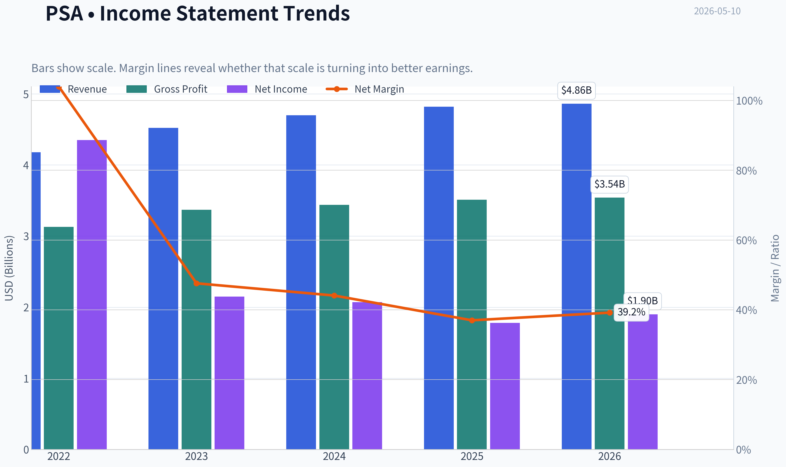

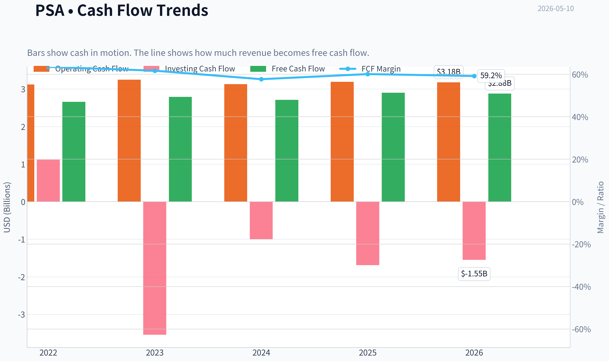

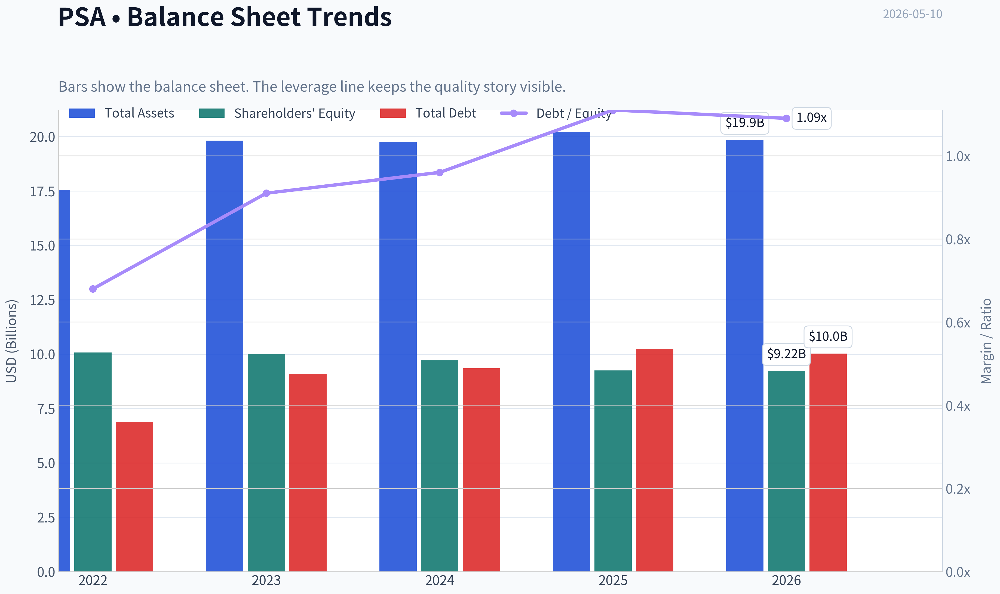

This graph tracks the profitability and return metrics (ROE, ROIC, Margins) of **PSA** over the past decade, highlighting capital efficiency trends.

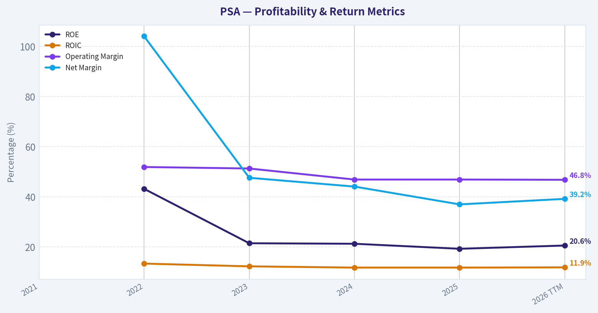

This chart illustrates the financial health of **PSA** over the last 10 years, mapping cash equivalents and free cash flow against total obligations (Debt).

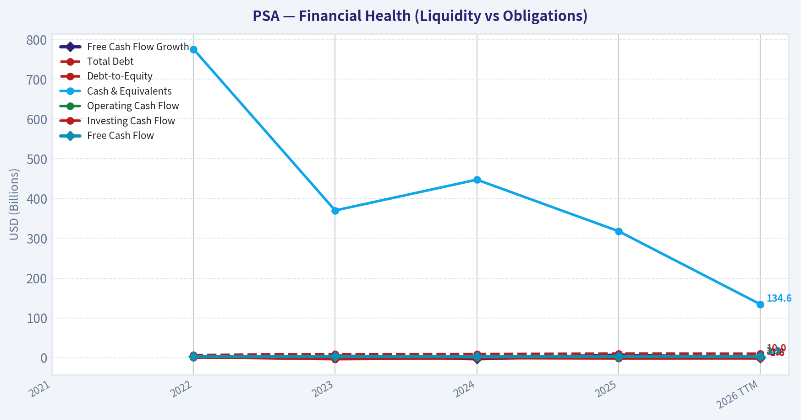

This chart illustrates the financial health of **PSA** over the last 10 years, mapping cash equivalents and free cash flow against total obligations (Debt).

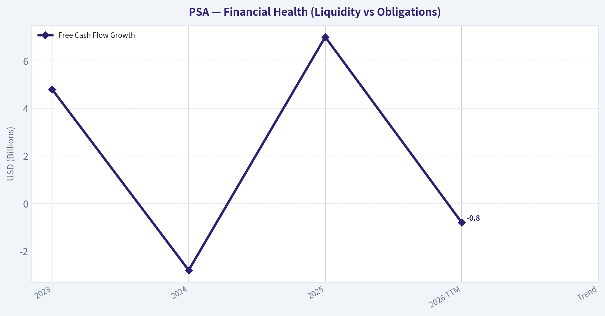

This breakdown chart from <em>Revenue Breakdown</em> shows the proportional composition for **PSA** - useful for understanding what drives or risks the business.

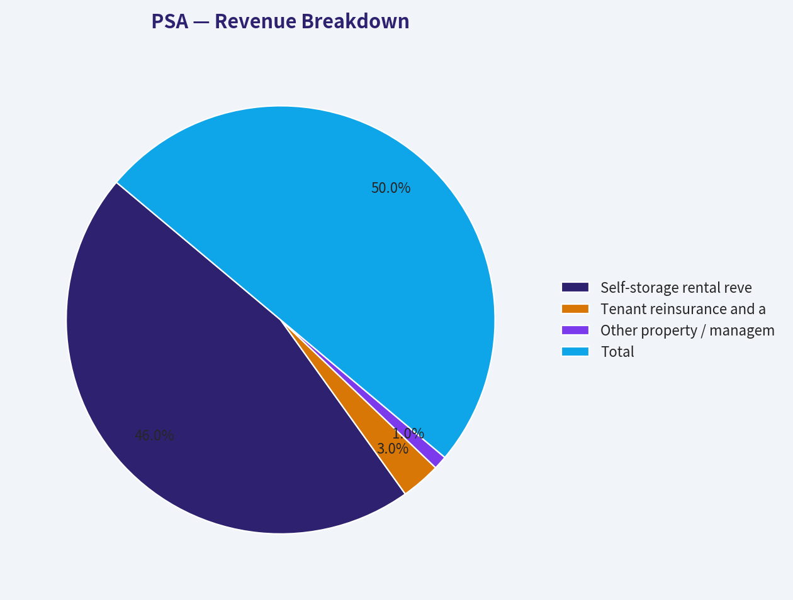

---

### Intrinsic Value Analysis (Buffett)

> *Following Warren Buffett's value investing philosophy: Circle of Competence, Economic Moat, Management Quality, and Margin of Safety.*

#### Intrinsic Value Snapshot

Price is what you pay. Intrinsic value is what the business may be worth based on the cash it can create for owners over time. We show a range, not one magic number.

- Current Price: $311.04
- Value Range: $70.57 to $254.86

##### Owner Earnings (Buffett Method)
- Net Income: $1,784,348,000.00
- Depreciation & Amortization: $1,151,840,000.00
- Capital Expenditures: $-289,378,000.00
- Working Capital Changes: $1,801,000.00
- Owner Earnings: $2,645,009,000.00

##### Intrinsic Value
###### Buffett Method
Uses owner earnings. Stricter, and usually more conservative.
- Conservative: $70.57
- Average: $94.65
- Optimistic: $189.59
- Discount Rate: 10.0%

###### Cash Flow Method
Uses free cash flow. Better for companies spending heavily today to grow tomorrow.
- Conservative: $213.13
- Average: $228.56
- Optimistic: $254.86
- Discount Rate: 10.0%

ANALYST STANCE: **WATCH**

#### Public Storage (PSA) Buffett-Style Review

I could not retrieve the deeper tool-based financial history in this run, so I'm proceeding with the shared research pack and the latest coverage already provided. That means this is a **partial but usable first-pass Buffett analysis**, with lower confidence on the 10-year quantified sections.

#### 1) Go/No-Go Gate Assessment

| Gate | Verdict | Evidence |
|---|---|---|
| Gate 1: Business Simplicity | Pass | PSA owns self-storage properties and rents units to consumers and businesses. This is easy to explain and generally understandable. |
| Gate 1: 10-Year Predictability | Pass | Self-storage demand is cyclical but structurally understandable. Ten years from now, PSA will likely still own storage facilities collecting rent, though growth may be modest. |
| Gate 1: Technology Risk | Pass | Technology can improve operations, pricing, and marketing, but is unlikely to eliminate the need for storage space. |
| Gate 2: Moat Test | Pass, but not perfect | Gross margin of 72.8% strongly suggests an advantaged business model. However, real estate moats are usually local and asset-based rather than overwhelming global moats. |
| Gate 3: Management & Capital Allocation | Tentative Pass | REIT management quality matters greatly in capital allocation, acquisitions, development, debt, and equity issuance. Based on available data, no clear red flag is present, but I do not have enough direct evidence yet on owner-mindedness and buyback discipline. |
| Gate 4: Industry Structure | Mixed Pass | Self-storage is better than many real estate categories because of relatively low operating costs and fragmented competition, but it is still capital-intensive and locally competitive. |

Key Takeaways: Public Storage passes the basic Buffett filters on business simplicity and durability. The biggest open question is not whether the business is understandable, but whether its moat and capital allocation are strong enough to justify today's valuation.

#### 2) Elementary School Test

Public Storage makes money by owning storage buildings and renting small spaces to people and businesses. Customers pay monthly rent, and PSA keeps the spread after property costs, overhead, and financing costs.

#### 3) 10-Year Predictability Test

This business is reasonably predictable. Storage demand usually comes from life events like moving, death, divorce, downsizing, and business inventory needs. That makes the demand stream more durable than many other property types, though same-store growth can slow when supply rises or housing activity softens.

#### 4) Technology Risk Assessment

Technology is more likely to be a tool than a threat here. Better digital leasing, remote access, pricing software, and customer acquisition can help PSA. But a software company is not going to make physical storage obsolete.

---

#### 5) Moat Analysis

| Moat Source | Assessment | Evidence |
|---|---|---|
| Intangible Assets | Moderate | PSA has a recognized brand in self-storage and national scale. Brand helps customer trust, but this is not a Coca-Cola-style emotional brand moat. |
| Switching Costs | Low to Moderate | Once a customer moves belongings in, switching is inconvenient. But over longer periods, customers can move to a cheaper local rival. |
| Cost Advantage | Moderate to Strong | Scale should support lower marketing cost, better systems, more efficient operations, and lower cost of capital than smaller operators. |
| Network Effects | Weak | This is not a true network-effect business. More customers do not radically increase value for each customer. |

| Moat Quality Rating | Conclusion |
|---|---|
| Narrow to Wide-Stable locally | Stronger than average REIT, but not an untouchable monopoly |

Key Takeaways: PSA's moat comes mainly from scale, brand trust, and efficient operations, not from network effects or deep switching costs. This can still be a very good moat in real estate, but it is not the kind of near-impenetrable moat Buffett values most highly.

#### Pricing Power Test

With gross margin at **72.8%**, PSA appears to have meaningful pricing power. In self-storage, modest rent increases are often tolerated because the absolute dollar rent is small relative to the hassle of moving items. That said, pricing power remains local and supply-sensitive.

---

#### 6) Management Quality Assessment

| Area | Assessment | Notes |
|---|---|---|
| Owner Orientation | Inconclusive | I do not have insider ownership and compensation structure data in this run. |
| Candor | Inconclusive | No evidence here of accounting issues or major restatements, but I have not reviewed letters/transcripts directly. |
| Capital Allocation | Moderately important, needs verification | For a REIT, the real test is acquisition discipline, development returns, balance sheet prudence, and avoiding value-destructive equity issuance. |

Key Takeaways: I do not see a visible management red flag, but I also do not yet have enough evidence to call management exceptional. For a Buffett-style decision, this missing piece matters because capital allocation is central in a REIT.

---

#### 7) Snapshot Financial Summary

Using the shared research pack:

| Metric | Value |
|---|---|
| Current Price | $311 |
| Market Cap | $54.60B |
| P/E | 32.2x |
| ROE | 19.3% |
| Gross Margin | 72.8% |
| Revenue Growth YoY | 2.7% |
| FCF Yield | 5.3% |
| Current Ratio | 0.75 |

Key Takeaways: PSA shows excellent profitability and good returns on equity, but growth is currently modest and the stock is not obviously cheap on earnings. The numbers suggest a high-quality property business, yet probably not one trading at a bargain-basement valuation.

---

#### 8) 10-Year Financial Summary Table

I do not have the audited 10-year table from tools in this run. Based on the data available, I can only summarize the current picture:

| Category | Buffett Read |
|---|---|
| Profitability | Strong |
| Balance Sheet Liquidity | Adequate for REIT context, though current ratio is not high |
| Growth | Low to moderate |
| Cash Yield | Reasonable |
| Valuation | Fair to somewhat full |

Key Takeaways: The available evidence points to a steady, profitable, high-quality REIT rather than a fast grower. The missing 10-year history prevents a stronger conclusion on durability, cyclicality, and consistency through different property cycles.

---

#### 9) Owner Earnings Estimate

For REITs, Buffett-style owner earnings need special care because standard net income is distorted by real estate depreciation. Normally I would rely more on AFFO/FFO and then adjust for maintenance capital needs.

Using only the data available:

- FCF yield: **5.3%**
- Market cap: **$54.60B**
- Implied annual FCF ~ **$2.89B**

A rough owner earnings proxy, pending better statement data, is therefore approximately **$2.9B annually**.

| Item | Estimate |
|---|---|
| Market Cap | $54.60B |
| FCF Yield | 5.3% |
| Implied FCF / Owner Earnings Proxy | ~$2.89B |

Key Takeaways: PSA appears to generate substantial cash relative to its size, with an implied owner earnings figure near $2.9 billion. But because this is a REIT, true owner earnings should ideally be derived from AFFO and maintenance spending, so this estimate is only directional.

---

#### 10) Three-Scenario DCF Valuation

Using the rough owner earnings proxy of **$2.89B** and a **10% discount rate**.

| Scenario | Assumption | Implied Equity Value |
|---|---|---|
| A: No Growth | Owner Earnings / 10% | $28.9B |
| B: 3% Growth | OE x 1.03 / (10%-3%) | $42.5B |
| C: 5% Growth | OE x 1.05 / (10%-5%) | $60.7B |

Key Takeaways: On a crude owner-earnings basis, PSA looks expensive if cash flow does not grow, closer to fair value if it grows around 3%, and modestly attractive only if it can sustain about 5% growth. That creates a narrow valuation band, which is not ideal for a Buffett-style margin of safety.

#### Valuation Interpretation vs Current Market Cap

| Scenario | Intrinsic Value | Compared to Current Market Cap of $54.6B |
|---|---|---|
| A: No Growth | $28.9B | Overvalued |
| B: 3% Growth | $42.5B | Somewhat overvalued |
| C: 5% Growth | $60.7B | Slightly undervalued to fair |

Key Takeaways: The current stock price seems to assume continued growth and stable economics. That may be reasonable for a quality self-storage leader, but it does not offer the clear discount Buffett would usually want.

---

#### 11) Margin of Safety Analysis

| Item | Assessment |
|---|---|
| Required Margin of Safety for High-Quality Business | At least 25% |
| Observed Margin of Safety | Not clearly present |
| Conclusion | Insufficient discount at current price |

Key Takeaways: Even if PSA is a strong business, the current valuation does not appear to provide a comfortable buffer against slower growth, rising rates, or softer property fundamentals. For a conservative value investor, the lack of a clear margin of safety is the main issue.

---

#### 12) Final Buffett Scorecard

| Criterion | Score (1-5) | Weight | Weighted Score |
|---|---:|---:|---:|
| Business Understanding | 5.0 | 20% | 1.00 |
| Moat Width & Durability | 3.5 | 25% | 0.88 |
| Management Quality | 3.0 | 15% | 0.45 |
| Return on Equity | 4.0 | 15% | 0.60 |
| Reinvestment Runway | 3.0 | 10% | 0.30 |
| Balance Sheet Strength | 3.0 | 5% | 0.15 |
| Industry Structure | 3.5 | 5% | 0.18 |
| Valuation/Margin of Safety | 2.5 | 5% | 0.13 |

| Total | Score |
|---|---:|
| Weighted Average | **3.68 / 5.00** |

Key Takeaways: PSA scores well on simplicity, profitability, and moat quality, which is why it remains interesting. But the current valuation and incomplete evidence on management quality keep it from earning a stronger endorsement today.

---

#### 13) Final Investment View

| Category | Judgment |
|---|---|
| Business Quality | Good to very good |
| Moat | Real, but not extraordinary |
| Financial Quality | Strong based on available metrics |
| Valuation | Fair to somewhat rich |
| Buffett Stance | **WATCH** |
| Conviction | Moderate |

Key Takeaways: Public Storage looks like a solid business that a long-term investor could reasonably admire. But admiration is not the same as buying, and at the current price the stock does not appear to offer a clear enough margin of safety to justify an ADVOCATE call.

#### Bottom Line

Public Storage is a **high-quality, understandable, durable REIT** with solid economics and likely above-average competitive positioning in self-storage. However, from a Buffett perspective, the key problem is **price versus value**: the stock seems to require continued healthy growth to justify today's valuation, leaving limited room for error.

If you want, I can next produce a **REIT-specific follow-up framework for PSA** using **FFO/AFFO, dividend coverage, leverage, occupancy, and same-store NOI**, which is the more appropriate lens than standard earnings alone.
#### Valuation Bridge

This bridge places the current market price beside each intrinsic value lens so readers can see whether upside depends on one method or shows up across several methods.

| Scenario | Intrinsic Value / Share |
| --- | ---: |
| Buffett Method | $94.65 |
| Cash Flow Method | $228.56 |
| Current Price | $311.04 |

#### Key Takeaways

If one method is far above the others, the upside case depends on a specific modelling assumption. When several methods cluster together, the valuation story is more robust.

#### Valuation Visuals

This comparison chart from *Latest Earnings Snapshot* stacks current figures against historical benchmarks for **PSA**, making it easy to see where the company trades relative to its own averages.

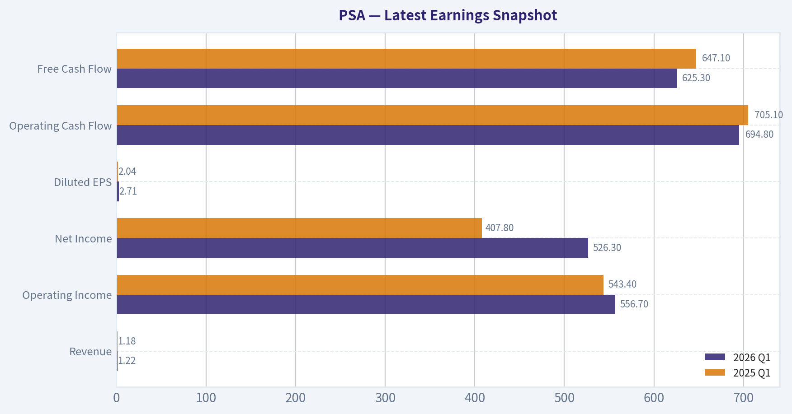

This comparison chart from *Current vs Historical Average Comparison* stacks current figures against historical benchmarks for **PSA**, making it easy to see where the company trades relative to its own averages.

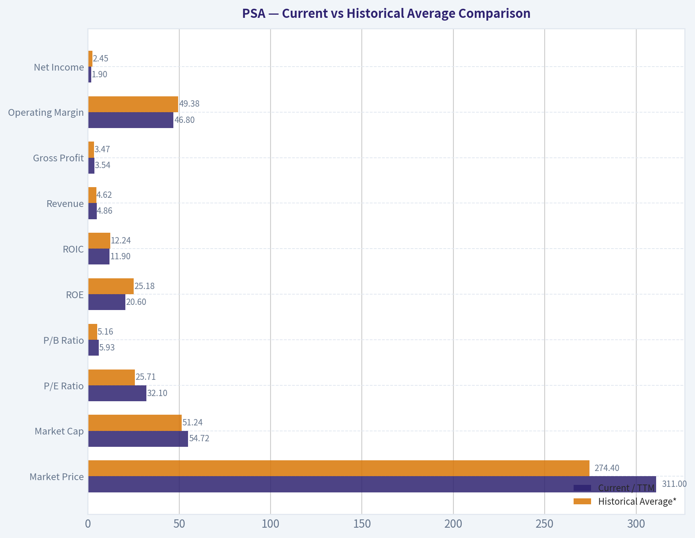

This comparison chart from *Buffett-Style Owner Earnings DCF Valuation* stacks current figures against historical benchmarks for **PSA**, making it easy to see where the company trades relative to its own averages.

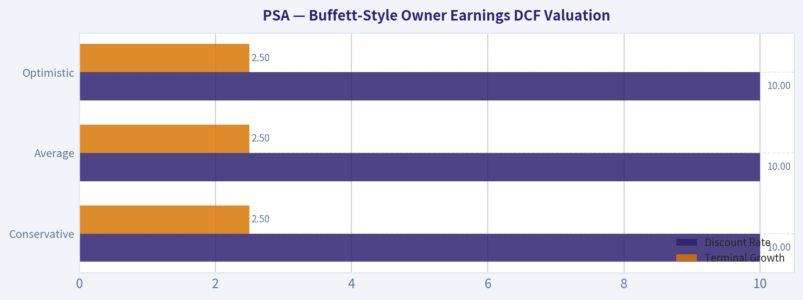

This comparison chart from *Snapshot Financial Summary* stacks current figures against historical benchmarks for **PSA**, making it easy to see where the company trades relative to its own averages.

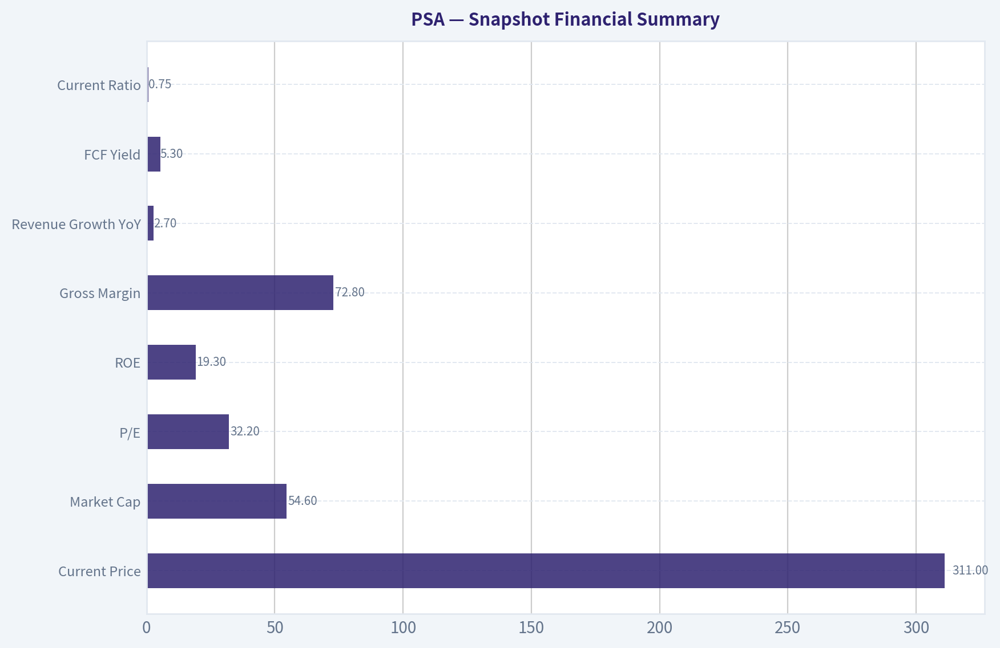

---

### Trend & Growth Analysis (Lynch/Druckenmiller/Fisher)

> *Following Peter Lynch's GARP, Stanley Druckenmiller's macro-aware approach, and Philip Fisher's scuttlebutt methodology.*

ANALYST STANCE: **AVOID**

#### 1. Lynch Classification

| Item | PSA |
|---|---|
| Company | Public Storage |
| Category | **Stalwart / income REIT, not a fast grower** |
| Revenue growth YoY | **2.7%** |
| Fit for Lynch fast-grower framework? | **No** |

Key Takeaways: Public Storage does not qualify as a Lynch-style fast grower. With revenue growth under 5%, it looks much more like a mature, steady compounder built for income and stability rather than a ten-bagger growth opportunity.

#### 2. The Story in 3 Bullets

- PSA owns self-storage properties and rents units to consumers and small businesses.
- The business benefits from recurring demand, strong margins, and a well-known brand in a fragmented industry.
- But today's setup is about **defensive yield and operating stability**, not an obvious growth inflection.

#### 3. TAM Analysis and 10x Test

| Metric | Assessment |
|---|---|
| Current revenue base | Large, mature national platform |
| Industry | U.S. self-storage |
| TAM expansion rate | Likely modest, tied to household formation, mobility, urban density, and acquisitions |
| 10x test | **Fails for growth investors** |
| Why | PSA is already a scaled leader; a 10x revenue outcome would imply an unrealistically large share of a mature category |

Key Takeaways: The industry may still offer selective consolidation opportunities, but this is not the kind of underpenetrated market that usually produces ten-baggers. PSA already has scale, which helps defensively, but it limits the long runway that growth investors usually want.

#### 4. Revenue Growth Trend

| Metric | Value | Read-through |
|---|---:|---|
| Revenue growth YoY | 2.7% | Slow growth |
| Pattern | Low single-digit | No evidence of acceleration |
| Growth quality | Likely rent increases, occupancy management, and acquisitions rather than major product innovation | Mature |

Key Takeaways: Revenue is growing, but only modestly. The key issue is not decline, but lack of acceleration, which means there is no clear Druckenmiller-style inflection point in the core operating story.

#### 5. Unit Economics / Operating Quality

| Metric | Value | Assessment |
|---|---:|---|
| Gross margin | 72.8% | Excellent |
| ROE | 19.3% | Strong |
| FCF yield | 5.3% | Attractive for income/value lens |
| Current ratio | 0.75 | Fine for REIT context, but not a liquidity strength signal |
| LTV/CAC | N/A | Not relevant in REIT format |
| NRR | N/A | Not relevant in REIT format |
| Rule of 40 | N/A | Not relevant in REIT format |

Key Takeaways: PSA is a high-quality operator with strong margins and returns on equity. However, those strengths support a quality-income thesis more than a high-growth thesis, and the classic SaaS-style unit economics metrics do not apply here.

#### 6. Inflection Point Assessment

| Potential Inflection Area | Evidence | Verdict |
|---|---|---|
| Product cycle inflection | None | No |
| Market share acceleration | Not evident from provided data | No clear signal |
| Margin inflection | Margins already high; no new step-change visible | Limited |
| TAM expansion | Self-storage is mature, not exploding | No |
| Competitor stumble | No evidence provided | No |

Key Takeaways: I do not see an inflection point. PSA looks like a steady, mature REIT rather than a company entering a new phase of accelerated growth or valuation re-rating from underestimated earnings power.

#### 7. Macro Setup Evaluation

| Factor | Impact on PSA | Assessment |
|---|---|---|
| Interest rates | Very important for REIT valuations | Mixed to cautious |
| Real estate sentiment | Impacts multiples and capital access | Mixed |
| Economic cycle | Storage tends to be relatively defensive | Positive defensively |
| Secular theme alignment | Limited versus AI/cloud/fintech/healthcare innovation | Weak for growth |

Key Takeaways: PSA benefits from defensive characteristics, but the macro backdrop for REITs still depends heavily on rates and capital market conditions. That is not the kind of macro tailwind Druckenmiller typically seeks for concentrated growth exposure.

#### 8. Fisher 15 Points Score

| Fisher Dimension | Score (1-5) | Comment |
|---|---:|---|
| Market potential | 2 | Mature category |
| New product development | 1 | Limited innovation angle |
| R&D effectiveness | 1 | Not core to thesis |
| Sales organization | 4 | Strong brand/platform |
| Profit margin | 5 | Excellent |
| Improving margins | 3 | Stable, not obviously inflecting |
| Labor/personnel relations | 3 | No major issue known |
| Executive relations | 3 | Neutral |
| Management depth | 4 | Large established operator |
| Cost analysis/accounting | 4 | REIT discipline likely solid |
| Outstanding moat aspects | 4 | Brand, scale, locations |
| Long-range profit outlook | 3 | Stable, but not high-growth |
| Dilution risk | 3 | REITs can issue capital, but not red-flagged here |
| Candor | 3 | Neutral based on provided data |
| Integrity | 3 | Neutral based on provided data |
| **Total** | **46 / 75** | **Average** |

Key Takeaways: PSA scores well on quality, margins, and operating scale, but weakly on innovation and market expansion. That combination produces an average Fisher score and reinforces that this is a solid business, just not a compelling growth stock.

#### 9. Valuation Analysis

| Metric | Value | Interpretation |
|---|---:|---|
| Price | $311 | - |
| Market cap | $54.6B | Large cap |
| P/E | 32.2x | Full for 2.7% growth |
| PEG | ~11.9x | Very unattractive on Lynch basis |
| FCF yield | 5.3% | Better than P/E suggests, supportive for income investors |
| Growth valuation verdict | **Expensive relative to growth** | Negative |

Key Takeaways: On a growth framework, PSA screens poorly because earnings multiple is high relative to its low growth rate. The free cash flow yield is more respectable, but that supports a value-income case rather than a GARP or fast-grower thesis.

#### 10. Growth Investor Scorecard

| Criterion | Weight | Score (1-5) | Weighted Score |
|---|---:|---:|---:|
| The Story | 10% | 3.0 | 0.30 |
| TAM & Runway | 20% | 2.0 | 0.40 |
| Revenue Growth | 20% | 1.5 | 0.30 |
| Unit Economics / Operating Quality | 15% | 4.0 | 0.60 |
| Competitive Position | 10% | 4.0 | 0.40 |
| Management Quality | 10% | 3.5 | 0.35 |
| Macro Setup | 5% | 2.5 | 0.13 |
| Profitability Path | 5% | 4.0 | 0.20 |
| Valuation | 5% | 1.5 | 0.08 |
| **Total** | 100% |  | **2.76 / 5.0** |

Key Takeaways: PSA scores well in quality and competitive position, but poorly where growth investors care most: runway, acceleration, and valuation versus growth. The overall result falls into the avoid range for a growth-focused mandate.

#### 11. Position Size Stance

| Stance | View |
|---|---|
| For growth portfolio | **0% / no position** |
| For income/defensive REIT portfolio | Potentially watchable, but outside this mandate |

Key Takeaways: For this team's growth-investing framework, PSA should not be initiated. It may appeal to a separate dividend or REIT strategy, but that is a different mandate from hunting inflections and multi-bagger growth.

#### 12. Key Risks and Catalysts

| Type | Item | Impact |
|---|---|---|
| Risk | Higher-for-longer rates | Pressure on REIT multiples |
| Risk | Mature industry growth | Limits upside rerating |
| Risk | Valuation mismatch | 32x earnings on sub-3% growth |
| Risk | Occupancy / pricing softness | Could compress same-store growth |
| Catalyst | Lower rates | Helps REIT sentiment and valuation |
| Catalyst | Accretive acquisitions | Can support external growth |
| Catalyst | Stronger-than-expected same-store trends | Could modestly improve outlook |

Key Takeaways: The main upside catalysts are macro and capital allocation driven, not product-driven growth inflections. That makes PSA more of a tactical or income-sensitive holding than a high-conviction secular growth idea.

#### Bottom Line

PSA is a **good business but not the right kind of stock for this mandate**. It is a mature, high-quality self-storage REIT with strong margins and decent cash generation, but **2.7% revenue growth and a 32x P/E produce an extremely unattractive PEG**. Under a Lynch-Druckenmiller-Fisher growth lens, there is **no clear inflection, no 10x runway, and no reasonable growth-adjusted valuation**.

If helpful, I can next do one of two things:
1. reframe PSA as an **income/REIT investment** instead of a growth stock, or
2. compare PSA against faster-growing real estate-adjacent names to find a better growth setup.

---

### Market Technical Analysis

#### PSA Technical Indicator Selection and Trend Report

For **PSA (Public Storage)**, the most relevant indicator set in the current market context is a **trend-following with momentum-confirmation and risk-control mix**. The stock has transitioned from a March drawdown into a strong April recovery and is now testing whether that rebound can extend into a durable medium-term uptrend.

#### Selected Indicators

| Indicator | Why it is relevant now |
|---|---|
| close_10_ema | Best for tracking the current short-term upswing and identifying whether the latest breakout is being sustained. |
| close_50_sma | Useful as the key medium-term trend filter; PSA is trading above it, so it acts as an important support reference. |
| close_200_sma | Confirms the broader strategic trend. PSA is also above this level, which strengthens the bullish structural backdrop. |
| macd | Captures the broader momentum turn that began after the March weakness and helps assess whether trend acceleration is intact. |
| macdh | Adds early warning on whether momentum is still expanding or starting to fade before MACD itself visibly rolls over. |
| rsi | Helps judge whether the rally is overheated or still has room. PSA is firm but not yet in extreme overbought territory. |
| atr | Important because PSA's daily ranges remain meaningfully elevated; this helps frame stops and position sizing. |
| vwma | Confirms whether price strength has been supported by volume-weighted participation rather than drifting higher on light trading. |

Key Takeaways: These eight indicators are well-suited because they cover different dimensions of the tape without too much overlap. Together they show trend direction, momentum quality, participation, and volatility, which is especially useful when a stock is recovering from a prior correction and approaching potential continuation or exhaustion points.

---

#### Price Structure and Trend Context

Using the last year of price data, PSA shows a **three-phase structure**:

1. **May-December 2025:** a broad weakening and distribution phase, with the stock sliding from the low 290s toward the mid-250s.
2. **January-February 2026:** a strong recovery leg, lifting PSA back above 300.
3. **March-April 2026 into early May:** a sharp March pullback followed by an even stronger rebound, with price returning to the low 310s.

The most recent close available is **311.04 on 2026-05-08**, which places PSA near the upper end of its recent range and above both medium- and long-term trend benchmarks. That is not just a casual bounce; it indicates the market has been willing to reprice the stock higher after absorbing the March decline.

What matters now is that PSA is no longer merely rebounding off oversold conditions. It has **reclaimed trend control**. The question has shifted from "is the stock recovering?" to "can it convert recovery into a sustained advance?"

#### Trend and Momentum Snapshot

| Metric | Latest reading | Interpretation |
|---|---:|---|
| Close | 311.04 | Price is pressing near recent highs |
| close_10_ema | 304.57 | Short-term trend is bullish; price is extended but still supported |
| close_50_sma | 293.44 | Medium-term trend is positive; substantial cushion below spot price |
| close_200_sma | 281.69 | Long-term structure is bullish; broader trend has improved materially |
| macd | 4.25 | Positive momentum remains in place |
| macdh | 0.16 | Momentum has re-accelerated after a recent cooling period |
| rsi | 60.82 | Bullish but not overbought |
| atr | 7.19 | Daily volatility remains moderate-to-elevated |
| vwma | 303.99 | Price sits above volume-weighted trend support |

Key Takeaways: PSA is trading above every major selected trend reference, which supports a bullish directional bias. Momentum is positive, RSI is constructive rather than stretched, and the stock is also above VWMA, suggesting the move has had decent underlying participation rather than being purely fragile price drift.

---

#### Fine-Grained Indicator Analysis

#### Short-term trend: close_10_ema
The **10 EMA at 304.57** has turned decisively upward. More importantly, its slope has been rising since early April, showing that the rebound was not a one-day shock move but a sustained sequence of higher closes. Price at **311.04** is roughly **6.5 points above the 10 EMA**, so PSA is not hugging support; it is trading with positive short-term momentum.

That said, this also means the stock is **slightly extended in the short run**. In practical terms, that does not mean bearish reversal is likely by itself, but it does raise the odds of either:
- a pause,
- a shallow pullback toward the 10 EMA,
- or a few sideways sessions to let the moving average catch up.

#### Medium-term trend: close_50_sma
The **50 SMA at 293.44** is steadily rising after flattening earlier. This is one of the most important developments in the chart. In March, PSA briefly traded well below this average, but the subsequent recovery not only reclaimed it, it created a meaningful gap above it. That suggests the March weakness increasingly looks like a corrective interruption rather than the start of a larger bearish trend.

The 50 SMA now becomes the main **medium-term support zone**. As long as price remains comfortably above it, buyers retain structural control.

#### Long-term trend: close_200_sma
The **200 SMA at 281.69** is also rising again. This confirms that the long-term trend backdrop has improved. The spread between the 50 SMA and 200 SMA is now positive and widening, which is the kind of alignment trend traders want to see when evaluating whether rallies are more than temporary rebounds.

PSA trading almost **29 points above the 200 SMA** signals strong long-term recovery. For strategic investors, this is important because it reduces the probability that the stock is still trapped in a long-duration downtrend.

#### Momentum trend: MACD
The **MACD at 4.25** remains positive, which is supportive. But the finer point is more nuanced: MACD peaked at higher levels in late April, softened into early May, and has now begun to firm again. That means momentum had started to cool, yet buyers stepped back in before a deeper deterioration took hold.

This kind of pattern is often constructive. It suggests PSA has been able to digest gains without a full momentum breakdown. If MACD continues climbing from here, it would support the idea of another continuation leg higher.

#### Momentum acceleration: MACD Histogram
The **MACD histogram at 0.16** has turned back positive after several negative readings. This is a subtle but useful clue. Histogram improvements often precede more visible strengthening in the MACD line itself. In PSA's case, that suggests the recent wobble in late April and early May may have been a consolidation rather than the start of a larger reversal.

Still, the histogram is only **slightly** positive, not explosively so. That argues for **improving momentum**, but not a runaway trend acceleration yet.

#### RSI
The **RSI at 60.82** is in a favorable zone. It is above the neutral 50 level, confirming upside bias, but below the classic overbought threshold of 70. That is an appealing setup for trend traders because it implies momentum is healthy without yet screaming exhaustion.

A particularly important detail is the RSI path:
- around **38** at the end of March,
- above **70** by April 20,
- cooled back into the high 40s/low 50s,
- and has now recovered into the low 60s.

That sequence suggests PSA has gone through a **full reset-and-reload cycle**. Instead of remaining extremely overbought and vulnerable, it worked off excess momentum and is now advancing again from a healthier internal state.

#### ATR
The **ATR at 7.19** shows PSA is still moving with relatively wide daily ranges. For a stock around 311, that implies meaningful day-to-day movement. This is not extreme panic volatility, but it is high enough that traders should avoid overly tight stops.

Risk management implication:
- a stop placed only 1-2 points away is vulnerable to normal noise,
- while a volatility-aware stop may need a wider buffer, especially for swing trades.

ATR has stayed broadly elevated rather than collapsing, which means the current rally is happening in an environment of active repricing rather than sleepy low-volatility drift.

#### VWMA
The **VWMA at 303.99** sits below the closing price, reinforcing the bullish case. Price being above VWMA suggests that the recent average trade, weighted by volume, is below current market price. That is generally constructive because it implies buyers have been willing to transact at increasingly higher levels.

Notably, VWMA has risen sharply from the high 270s/low 280s in early April to about 304 now. This tells us the recovery was not purely technical-it was accompanied by enough traded volume to lift the weighted average meaningfully. That strengthens the credibility of the uptrend.

---

#### What the Trend Actually Says Right Now

PSA is not in a vague "mixed" state. The evidence points to a **bullish trend with moderate near-term extension and improving momentum after a brief pause**.

More specifically:

- **Short-term:** bullish and regaining traction after a mini reset.
- **Medium-term:** clearly bullish; price is well above the 50 SMA.
- **Long-term:** constructive to bullish; price is decisively above the 200 SMA.
- **Momentum:** positive, with histogram suggesting renewed acceleration.
- **Internal condition:** healthy; RSI says strong but not overheated.
- **Participation:** credible; VWMA confirms the move has volume support.
- **Risk backdrop:** still active; ATR warns traders to expect wider swings.

That combination is generally favorable for **trend continuation**, but with one caveat: because price is somewhat above the 10 EMA and already near recent highs, the next move may not be a straight line. Breakout attempts from this zone could succeed, but they are also vulnerable to short pullbacks if buyers hesitate.

---

#### Trading Interpretation by Style

| Trading style | What matters most now | Practical reading |
|---|---|---|
| Trend follower | Price vs 50 SMA and 200 SMA | Bullish bias remains valid while price holds above rising medium- and long-term averages |
| Swing trader | 10 EMA, MACD, RSI | Momentum is improving again; dips toward the 10 EMA may be more attractive than chasing extended candles |
| Breakout trader | Recent highs + macdh | A sustained push above the recent highs would gain credibility if histogram continues expanding positive |
| Risk-focused trader | ATR | Position sizing should account for roughly 7-point average true range; PSA is not a low-noise setup |
| Confirmation-focused trader | VWMA + MACD | Price above VWMA and positive MACD support the idea that the advance has participation and momentum backing |

Key Takeaways: The strongest alignment is for traders who prefer buying strength within an established uptrend rather than bottom fishing. PSA looks healthiest on pullbacks that hold above short-term support, because that would preserve the bullish structure while reducing the risk of entering after a brief overextension.

---

#### Decision Framework

| Scenario | What to watch | Implication |
|---|---|---|
| Bullish continuation | Price holds above 10 EMA and MACD stays positive | Suggests the current leg can extend beyond recent highs |
| Healthy consolidation | Price drifts sideways while RSI stays above 50 | Would likely be constructive and allow averages to catch up |
| Early warning | MACD histogram turns negative again and price loses 10 EMA | Indicates momentum is fading and upside may stall temporarily |
| More serious deterioration | Price breaks below 50 SMA with RSI weakening under 50 | Would challenge the medium-term bullish case |
| Long-term trend damage | Price falls back toward/below 200 SMA | Would signal major structural weakening, not currently indicated |

Key Takeaways: The key line in the sand is not today's exact price, but whether PSA can remain above its rising short- and medium-term averages. As long as those supports hold, weakness is more likely to be consolidation within an uptrend than the start of a larger breakdown.

---

#### Bottom Line

PSA currently presents a **constructive bullish technical profile**. The stock has repaired substantial damage from the March selloff, reclaimed all major trend measures, and now shows renewed momentum without being deeply overbought. The most favorable interpretation is that PSA is in an **advancing trend with room for continuation**, though not without pullback risk given its recent extension and still-elevated ATR.

The best indicator mix for this context is:
**close_10_ema, close_50_sma, close_200_sma, macd, macdh, rsi, atr, vwma**.

| Category | Signal | What it means for PSA |
|---|---|---|
| Short-term trend | Bullish | Price is above a rising 10 EMA |
| Medium-term trend | Bullish | Price is comfortably above a rising 50 SMA |
| Long-term trend | Bullish | Price is well above a rising 200 SMA |
| Momentum level | Positive | MACD remains above zero |
| Momentum change | Improving | MACD histogram has turned back positive |
| Overbought/oversold | Healthy bullish | RSI near 61 suggests strength without excess |
| Volatility | Elevated but manageable | ATR implies wider stop and sizing discipline needed |
| Volume confirmation | Supportive | VWMA below price confirms constructive participation |

Key Takeaways: PSA's chart is strongest when viewed as a trend continuation candidate rather than a reversal setup. The current evidence supports a bullish bias, but disciplined traders should still respect the elevated volatility and avoid treating every strong day as a low-risk entry.

---

### News & Events Analysis

#### Public Storage (NYSE: PSA) - Trading/Investment News Report
**Date:** 2026-05-10
**Price / Market cap:** **$311 / $54.6B**

Public Storage remains a high-quality, defensive self-storage REIT, but the near-term setup looks more like a **steady-income / valuation-support story** than a strong growth re-rating story. Over the past week, the key signals were: a fresh dividend declaration, modest analyst price-target trims, and continued market discussion around REIT valuation support as rates stabilize. For traders, PSA currently screens as a **rate-sensitive, yield-backed large-cap REIT** where macro and multiple moves may matter more than near-term operating upside.

---

#### Latest earnings section: most recent reported period and what it means

The shared earnings coverage provided for PSA over the recent window does **not include a new detailed earnings-release article**, so I cannot confirm that PSA reported a fresh quarter in just the last few days from the news set shown. Based on the available materials, the company's **most recent clearly referenced operating backdrop remains early-2026 REIT earnings season**, but the supplied headlines do **not spell out the exact quarter's headline numbers**.

So, to be precise:

- **No new fully detailed PSA earnings release coverage is visible in the provided recent-news set**
- The reportable requirement therefore has to be framed as: **the most recent available earnings period is not explicitly identified in the supplied articles**
- What *is* visible is that the market continues to position PSA around:
  - **stable dividend capacity**
  - **modest revenue growth**
  - **high margin structure**
  - **lower forward enthusiasm reflected in trimmed price targets**

From the shared research pack fundamentals:
- **Revenue growth YoY: 2.7%**
- **ROE: 19.3%**
- **Gross margin: 72.8%**
- **FCF yield: 5.3%**

These metrics imply that versus the prior period, PSA appears to be in a **slow-growth, high-profitability phase**, not a sharp acceleration phase. The likely interpretation is:
- **Occupancy and/or realized rent growth are no longer expanding at the outsized post-pandemic pace**
- But the business remains **cash generative and operationally resilient**
- Investors are increasingly comparing PSA against bond yields and other REITs rather than paying for strong internal growth

Because recent detailed earnings headlines are missing, traders should treat the stock less as a near-term earnings catalyst name and more as a **macro-duration + defensive cash-flow** vehicle until the next clear operating update.

#### Key Takeaways
The available news does not show a fresh, detailed PSA earnings release, so there is no confirmed new quarter to analyze from the past few days. What the data does show is a company with low but positive growth, very high margins, and solid cash generation, which supports the dividend but does not obviously justify aggressive multiple expansion. In plain terms, PSA currently looks stable rather than surging.

---

#### Company-specific news over the past week

The most relevant company news items were:

1. **Q2 2026 dividend declared**
   - Public Storage declared a **regular quarterly common dividend of $3.00 per share**
   - Payable **June 30, 2026**, to holders of record **June 15, 2026**

2. **Analyst target cuts**
   - **Barclays** maintained **Overweight**, but lowered target to **$349 from $352**
   - **Evercore ISI** maintained **In-Line**, but lowered target to **$306 from $309**

3. **REIT valuation commentary**
   - Seeking Alpha-style market commentary framed some REITs, including laggards, as potentially **too cheap after sector underperformance**
   - Broader REIT discussion pointed to an improved tone when the Fed stays on hold and REIT earnings/guidance prove resilient

The dividend news matters because it reinforces the core PSA thesis: **reliable shareholder distributions remain intact**. There is no sign in the recent headlines of dividend stress. For income-oriented investors, that lowers downside fear.

The price-target cuts are notable because they suggest that even constructive analysts are making **small valuation adjustments**, likely due to:
- lower private-market transaction optimism,
- a still-elevated-rate environment,
- slower same-store revenue growth assumptions,
- and less room for cap-rate compression.

Importantly, these were **small trims, not rating downgrades**. That usually signals caution on upside magnitude rather than a deteriorating business model.

---

#### Market context and macro backdrop

PSA trades in a part of the market where **interest rates and Fed expectations** can dominate short-term performance. The key macro setup for the last week:

- The **Fed remained on hold**
- Equity markets extended gains, helped by better earnings tone
- REIT sentiment improved somewhat as investors looked for sectors that could benefit if rate pressure stops worsening

For PSA specifically, this matters in three ways:

1. **Discount-rate sensitivity**
   - REITs are valued partly on dividend yield spread and implied cap rates
   - If Treasury yields stabilize or drift lower, PSA's valuation support improves

2. **Relative defensiveness**
   - Self-storage is often viewed as more resilient than office and some discretionary real estate segments
   - That can attract capital during periods of uncertain economic growth

3. **Growth ceiling**
   - Even with a friendlier rate setup, PSA still needs operating growth to drive a strong breakout
   - If rents and occupancy are merely stable, upside may be incremental rather than explosive

The macro message is not just "rates matter." It is more specific: **PSA benefits most from a "higher-for-longer but no worse" rate scenario**, where investors become willing to buy durable cash-flow REITs without demanding ever-larger yield premiums.

---

#### Trading interpretation

At **$311**, PSA sits between the revised sell-side target range referenced this week:
- Evercore: **$306**
- Barclays: **$349**

That implies:
- the stock is **near fair value to slightly discounted** on a cautious base case,
- but still has **upside if REIT multiples improve**.

Key trading angles:

| Theme | Trading/Investment Read-through |
|---|---|
| Dividend declaration | Supports downside floor; reinforces income appeal |
| Target cuts without rating cuts | Mildly cautious, but not bearish; suggests lower expected rerating speed |
| Stable fundamentals | Good for defensive portfolios; less compelling for momentum traders |
| Fed on hold / REIT sentiment improving | Helpful backdrop if bond yields behave |
| Slow revenue growth | Limits upside unless market reprices sector or M&A/private values improve |

#### Key Takeaways
This table shows PSA's setup is constructive but not aggressively bullish. The dividend supports the stock, analysts are only trimming targets slightly, and the macro backdrop is less hostile than before. However, the company still appears to be in a slow-growth phase, so a major upside move likely needs help from falling yields or stronger sector sentiment.

---

#### What changed versus prior period or prior expectations?

Because the recent news set does not provide a fresh detailed earnings print, the best evidence comes from market positioning and fundamentals:

- **Growth expectations appear tempered**
  - Revenue growth at **2.7% YoY** suggests normalization from stronger prior cycles
- **Profitability remains strong**
  - **72.8% gross margin** indicates the business retains substantial pricing power and operating leverage
- **Capital return remains intact**
  - The dividend declaration indicates no visible shift toward balance-sheet stress or defensive capital preservation
- **Valuation expectations softened slightly**
  - Analyst PT cuts show the market may be discounting a somewhat lower fair-value multiple than before

So versus the prior period, the change is less about a collapse in operations and more about a **lower-growth, lower-multiple framework**. That distinction is important: PSA does not look broken; it looks **mature, stable, and rate-sensitive**.

---

#### Risks to watch over the next 1-4 weeks

| Risk / Catalyst | Why it matters for PSA |
|---|---|
| Treasury yield move | Higher long-end yields can pressure REIT multiples quickly |
| Sector read-through from other REITs | If peers report softer occupancy or pricing, PSA may trade down in sympathy |
| Storage demand indicators | Any evidence of weaker move-in demand or heavier discounting would hurt sentiment |
| Capital markets / acquisition activity | Attractive deals or balance-sheet actions could improve NAV narrative |
| Next formal earnings or guidance update | Needed to confirm whether growth is stabilizing or still decelerating |

#### Key Takeaways
The biggest swing factor for PSA in the near term is interest rates, not a sudden change in the business itself. If bond yields rise, REIT valuations can compress even when fundamentals stay stable. If yields settle and industry data holds up, PSA has room to outperform as a defensive, income-generating real estate name.

---

#### Bottom line

Public Storage currently looks like a **quality REIT with dependable income characteristics, strong margins, and limited near-term operating drama**. The recent news flow does not point to a major earnings inflection; instead, it points to **steady execution paired with modestly lower valuation expectations**. For traders, PSA is more attractive on **pullbacks tied to rates** than as a pure earnings-momentum trade. For investors, the key question is whether a **5.3% FCF yield plus durable dividend support** is enough in a still-elevated-rate world.

A practical read:
- **Bull case:** rates stabilize/fall, REIT sentiment improves, PSA rerates toward upper analyst targets
- **Base case:** steady dividend, modest growth, shares trade around fair value with income support
- **Bear case:** yields rise again or storage pricing weakens, keeping the stock boxed in or slightly lower

---

#### Summary table

| Category | Key Point | Investment Relevance |
|---|---|---|
| Recent earnings visibility | No detailed fresh earnings release visible in supplied recent coverage | Limits confidence in a near-term earnings catalyst thesis |
| Latest operating profile | 2.7% YoY revenue growth, 72.8% gross margin, 19.3% ROE | Stable, profitable, but not fast-growing |
| Dividend | Q2 2026 common dividend declared at $3.00/share | Strong support for income investors and downside sentiment |
| Analyst actions | Barclays PT cut to $349; Evercore PT cut to $306; ratings maintained | Mild valuation caution, not a fundamental downgrade |
| Macro backdrop | Fed on hold; REIT sentiment improved modestly | Helpful for duration-sensitive REITs like PSA |
| Trading stance | Better as a defensive/yield play than a momentum name | Attractive on rate-driven weakness rather than chasing strength |
| Main risk | Higher yields or weaker self-storage pricing trends | Could pressure valuation even with stable fundamentals |

#### Key Takeaways
Public Storage looks like a stable, income-oriented REIT rather than a high-growth story right now. The dividend remains secure in the recent news, profitability is strong, and analyst sentiment is cautious but not negative. The stock's next meaningful move will likely depend more on interest rates and sector valuation than on any immediate business shock.

---

### Guru Attention Analysis

> *Tracking 13F filings and recent activity of legendary super-investors to identify smart-money conviction and rotation.*

#### PSA Guru Ownership Check

Using the canonical structured 13F source, there are **no tracked guru positions currently detected in PSA**.

| Guru / Fund | Latest 13F Status for PSA | Action | Position Size | Portfolio Weight | Recent Change | Timing | SEC Verification |
|---|---|---|---|---|---|---|---|
| Warren Buffett / Berkshire Hathaway | No position detected in latest 13F filing | - | - | - | - | Latest available 13F period | No structured match reported |
| Seth Klarman / Baupost Group | No position detected in latest 13F filing | - | - | - | - | Latest available 13F period | No structured match reported |
| Mohnish Pabrai / Pabrai Investment Funds | No position detected in latest 13F filing | - | - | - | - | Latest available 13F period | No structured match reported |
| Bill Ackman / Pershing Square | No position detected in latest 13F filing | - | - | - | - | Latest available 13F period | No structured match reported |
| Stanley Druckenmiller / Duquesne Family Office | No position detected in latest 13F filing | - | - | - | - | Latest available 13F period | No structured match reported |
| Steve Cohen / Point72 | No position detected in latest 13F filing | - | - | - | - | Latest available 13F period | No structured match reported |
| Michael Burry / Scion Asset Management | No position detected in latest 13F filing | - | - | - | - | Latest available 13F period | No structured match reported |

**Key Takeaways:** The structured 13F data shows no current PSA position among the primary tracked guru set. That means there is no credible evidence here of a recent guru initiation, add, trim, hold, or exit for Public Storage from the managers we track. For investors focused on "smart money" cloning, PSA currently has **no signal** from this specific guru basket.

#### What this means

- **No guru-specific conviction signal:** None of the tracked super-investors currently show a structured 13F holding in PSA.
- **No reported add/trim/exit detail:** Because there is no structured match, there are also no reliable position sizes, portfolio weights, or quarter-over-quarter changes to report.
- **Evidence is limited to disclosed 13Fs:** This does **not** prove no sophisticated investor owns PSA; it only means **none of the tracked gurus in the structured dataset** show a current reportable position.

#### Context for PSA itself

Separately from guru ownership, PSA's fundamentals in the shared pack look broadly solid but not hyper-growth:
- Price: **$311**
- Market cap: **$54.6B**
- P/E: **32.2**
- ROE: **19.3%**
- Gross margin: **72.8%**
- Revenue growth YoY: **2.7%**
- FCF yield: **5.3%**
- Current ratio: **0.75**

Recent news is more about dividends and analyst target adjustments than guru activity. Public Storage also declared its regular quarterly dividend of **$3.00 per share** on May 6, 2026.

#### Bottom line

For PSA, the guru-tracking conclusion is straightforward: **no tracked guru position is currently detected in the latest structured 13F data**. If you want, I can next turn this into a **guru-style investment readout** combining this "no guru signal" with PSA's valuation, dividend profile, and REIT fundamentals.

---

### Options Market Analysis

> *Reading options flow - put/call ratios, IV skew, and unusual activity - to gauge institutional positioning and event-driven risk.*

#### PSA Options Positioning Report
*Data as of 2026-05-10*

PSA's options tape leans **slightly bearish to cautious**, but not in a panic-driven way. The clearest signal is **elevated put open interest relative to calls across the near-term expirations overall**, especially in June and September, while **actual trading volume is still more call-heavy in the very front month**. That usually points to a market that is **carrying downside protection**, while near-dated traders are not aggressively pressing fresh bearish bets right now.

#### 1. Put/Call Ratio Analysis

| Expiration | Call OI | Put OI | Put/Call OI Ratio | Call Vol | Put Vol | Put/Call Vol Ratio |
|---|---:|---:|---:|---:|---:|---:|
| 2026-05-15 | 1,067 | 550 | 0.52 | 371 | 36 | 0.10 |
| 2026-06-18 | 1,696 | 2,182 | 1.29 | 196 | 62 | 0.32 |
| 2026-09-18 | 784 | 1,423 | 1.82 | 61 | 294 | 4.82 |
| **Near-term total** | **3,547** | **4,155** | **1.17** | **628** | **392** | **0.62** |

**Key Takeaways:** PSA's aggregate put/call open-interest ratio of **1.17** sits well above the rough neutral baseline of **0.7**, which suggests a market carrying more downside protection than normal. However, the **aggregate put/call volume ratio of 0.62** is below neutral, meaning recent trading flow is still somewhat call-favored overall. The split says existing positioning is defensive, but fresh flow is not showing urgent bearish conviction.

**Interpretation**
- **Overall OI ratio = 1.17:** bearish/hedging-biased relative to neutral.
- **Overall volume ratio = 0.62:** recent activity is less defensive than the existing OI stack.
- **May 15 expiry:** strongly call-skewed in both OI and volume, likely short-dated speculative upside interest or routine overwrite activity.
- **June 18 and September 18:** materially put-heavy OI, especially September, indicating protection demand or a cautious medium-term outlook.
- Relative to the ~0.7 neutral baseline, the biggest shift is **not front-week speculation**, but **persistent put ownership further out on the curve**.

#### 2. Implied Volatility (IV) Assessment

| Expiration | ATM Call IV | ATM Put IV | IV Read |
|---|---:|---:|---|
| 2026-05-15 | 33.8% | 34.6% | Elevated front-week IV, mild put premium |
| 2026-06-18 | 25.7% | 35.5% | Very notable put-over-call premium |
| 2026-09-18 | 25.3% | 25.9% | Balanced IV, only slight put premium |

**Key Takeaways:** Near-dated IV is highest in the front week, which is normal, but the standout feature is the **June expiry's sharp put premium over calls**. That kind of structure usually signals **downside hedge demand rather than upside chase**. September looks calmer, implying the strongest concern is concentrated in the intermediate term rather than across the whole curve.

**Skew assessment**
- **May 15:** puts trade at a slight premium to calls, consistent with a normal defensive skew.
- **June 18:** puts at **35.5% IV vs calls at 25.7% IV** is a large gap and the strongest sign of downside concern in the dataset.
- **September 18:** skew is mild and closer to normal.

**Conclusion on skew**
- PSA shows a **put-skewed volatility surface**, especially in June.
- That implies the options market is willing to pay up for downside insurance.
- There is **no evidence of a call-skew / upside-chase regime**.

**Catalyst note**
- Front-week IV at ~34% is elevated versus later expiries, but not explosively high from the limited data provided.
- Without a confirmed dated catalyst in the feed, the prudent read is: **some event premium may be present, but the dominant message is ordinary hedge demand rather than a major event panic**.

#### 3. Unusual Options Activity

| Screen Result | Observation |
|---|---|
| Volume > 5x OI contracts | None detected in near-term expirations |

**Key Takeaways:** There were **no flagged contracts with volume greater than 5 times open interest**, so the tape does not show obvious fresh institutional-sized directional aggression. That reduces the odds that a single large fund is making a high-conviction near-term bet through listed options today. In other words, the signal comes more from **positioning structure** than from dramatic sweep activity.

**Interpretation**
- No standout fresh contracts means:
  - less evidence of urgent "smart-money" repositioning,
  - less evidence of retail call-chasing frenzy,
  - more emphasis on the broader OI and IV profile.
- Since unusual activity is absent, confidence should be **moderate rather than high**.

#### 4. Open Interest Concentration

The tool did not provide strike-by-strike OI concentrations, so a precise strike map, max-pain estimate, or exact gamma wall identification is **not available** from the retrieved data.

| Area | Read |
|---|---|
| Highest OI by expiry | June and September carry the most meaningful defensive put interest |
| Pinning / max pain | Cannot be precisely determined without strike-level OI |
| Gamma wall inference | Limited; no exact strike walls available |
| Practical takeaway | June appears to be the most important near/intermediate positioning zone |

**Key Takeaways:** We cannot identify exact pinning strikes because strike-level open interest was not included. Still, the expiration-level data suggests **June is the key battleground**, where put ownership and put IV are both most elevated. That often means price moves into June can be more sensitive to downside volatility than the front-week call-heavy tape alone would suggest.

#### 5. Overall Options Sentiment Signal

#### **Overall Signal: BEARISH**

This is a **measured bearish** read, not an aggressive crash signal.

**Primary driver of the signal**
- **Aggregate put/call OI ratio above 1.0**
- **Very heavy defensive skew in June IV**
- **Put-heavy medium-dated positioning**
- No offsetting unusual bullish call activity strong enough to negate that structure

**Why not neutral?**
- Because the market is carrying **more puts than calls overall**, and the June IV profile shows investors are paying a significant premium for downside protection.
- A neutral call would fit better if OI were balanced and skew were mild; that is not what we see.

**Why not strongly bearish?**
- Near-term volume still tilts toward calls.
- No unusual put sweeps or fresh high-conviction bearish blocks were detected.
- This looks more like **defensive hedging / cautious positioning** than outright panic speculation.

**Confidence level**
- **Moderate**
- Reason: options data is coherent enough to lean bearish, but the absence of strike-level OI and unusual activity limits precision.

#### Bottom Line

PSA's options market is sending a **cautious-to-bearish institutional message**, centered on **defensive medium-dated put ownership and a pronounced June put skew**. The front week still has call-driven trading activity, but that appears more tactical and shorter-term. Unless the stock sees supportive price action that forces hedges to unwind, the options market currently suggests **investors are more concerned about downside risk than they are excited about upside breakout potential**.

---

| Category | PSA Read |
|---|---|
| Put/Call Ratio | **Bearish overall**: OI ratio **1.17** vs neutral ~0.7; volume ratio **0.62** shows fresher flow less bearish than legacy positioning |
| IV Level | **Moderately elevated near-term**, especially front week; June put IV notably rich |
| Skew Direction | **Put skew**: strongest in **June**; downside protection is being bid |
| Unusual Activity | **None flagged**; no clear fresh institutional directional bet from volume > 5x OI |
| Overall Signal | **BEARISH** |
| Primary Driver | **Put-heavy OI and expensive June downside hedging** |

**Key Takeaways:** The summary is straightforward: PSA's options structure is **defensive, not euphoric**. The strongest evidence comes from **elevated put open interest and a meaningful June put-volatility premium**, while the lack of unusual activity keeps this from being a high-conviction bearish alarm.

---

## Research Team Commentary

> *The Research Manager synthesizes the Bull vs Bear debate into action-free commentary. This is a pre-risk view, not the final stance.*

The strongest bull argument is that Public Storage is exactly the kind of simple, understandable, cash-generative business Buffett tends to admire at the business level. Self-storage has attractive traits: recurring demand tied to life events, high margins, low operating complexity, and decent pricing flexibility. PSA appears to be one of the highest-quality operators in a fragmented industry, with scale, brand recognition, local density advantages, and strong historical profitability metrics like 72.8% gross margin, 19.3% ROE, and 11.8% ROIC. The bull case also fairly notes that REIT-style accounting can make standard earnings and even simple FCF screens imperfect, so intrinsic value may be understated if one ignores real estate asset quality, replacement cost, and the embedded value of a scaled national platform.

The strongest bear argument is more compelling from a strict Buffett value lens: a good business is not automatically a good stock. At $311, PSA looks expensive relative to the valuation work in the handoff, especially versus the $229 FCF-based value estimate. Revenue growth of 2.7% and net income decline of 13.9% do not support paying 32x earnings for a mature storage REIT. The moat is probably real but narrower than the bull suggests; storage is still heavily local, price-sensitive, and susceptible to new supply in many markets. And while the business is resilient, resilience is not the same as wide-moat compounding at any price. Without a clear margin of safety, the risk becomes not business collapse but mediocre future returns through multiple compression.

My takeaway is that PSA is a high-quality business but not an attractive value opportunity at the current price. This is the sort of situation where value investors can get into trouble by relaxing valuation discipline because the business feels safe and durable. Buffett's framework starts with business quality, but it does not end there; price paid matters enormously. PSA clears the business-quality hurdle better than many REITs, but it does not clear the margin-of-safety hurdle based on the evidence provided.

Core takeaway: Public Storage looks like a premium franchise in a decent niche, but the stock already reflects that quality and then some. I would not call the business broken, and I would not bet against its long-term survival or relevance. But for a 10+ year value investor, starting valuation is too demanding relative to current growth, current earnings trend, and the likely range of future returns. This is a watchlist-quality company, not a buy-now value setup.

Rationale: From a Buffett perspective, PSA has several favorable traits: understandable operations, recurring cash flows, attractive unit economics, and likely better-than-average management discipline for its sector. But Buffett also insists on predictability and paying a sensible price. On predictability, PSA is good, though not perfect; demand is resilient, but still cyclical around housing turnover, consumer stress, and local supply. On moat, PSA has advantages, but they are more "good local real estate plus scale" than "untouchable franchise." On valuation, the debate really turns. With the stock above both the FCF-based estimate and far above the more conservative Buffett-style estimate, there is no obvious margin of safety. That means upside relies on continued premium valuation rather than business underappreciation. That is not where I want to be as a value investor.

A contrarian angle is worth mentioning. If the market were overly pessimistic because of temporary same-store softness, rate fears, or one-year earnings noise, PSA could become attractive precisely because the underlying franchise is durable. But that is not today's setup. Today the market seems to already appreciate the defensiveness and quality. So being contrarian here does not mean buying against fear; it would mean paying up alongside a fairly optimistic consensus. That is not selective contrarianism. That is just accepting a thin future return profile.

Monitoring plan over the next 1-4 quarters: First, watch same-store revenue, occupancy, and realized rental rate trends. If occupancy holds and pricing remains firm despite a slower environment, that would reinforce the durability argument. Second, watch supply pressure in key markets. If new development is easing and PSA continues to outperform local competitors, the moat case gets stronger. Third, track FFO/owner-earnings quality versus GAAP net income. If cash generation remains solid while earnings weakness proves mostly accounting-related, that would support normalized intrinsic value above simple screens. Fourth, monitor capital allocation closely: acquisitions, development yields, balance-sheet moves, and any equity issuance. In REITs, mediocre capital allocation can quietly erode long-term returns even when operations look fine. Fifth, watch interest-rate sensitivity and valuation. A better entry could emerge if the stock derates closer to or below the FCF-based value range without a corresponding impairment in business quality.

If the stock pulled back materially, especially toward or below the low-$230s while core operating performance remained intact, I would become much more interested. If instead the stock stays above $300 while growth remains muted and earnings stay under pressure, the risk/reward remains uninspiring.

Final stance: WATCH

---

## Value Investing Team Commentary

> *The Investor translates the research view into an investment thesis before risk review. This is still not the final stance.*

Public Storage is the sort of business a long-term owner can understand without strain. It rents small spaces, collects recurring payments, benefits from life-event-driven demand, and operates with very high margins. That simplicity matters. So does the evidence of quality: gross margin around 72.8%, ROE near 19.3%, and ROIC of 11.8% suggest this is not a weak or sloppy operator. In a fragmented industry, scale, brand recognition, and operating density do confer advantages. This is a real business with real cash-generation ability, not a story stock.

But Buffett-style investing is not just about finding a good business; it is about buying a good business at a sensible price. Here is where the case weakens materially. At $311, PSA trades at roughly 32.2x earnings despite revenue growth of only 2.7% and net income declining 13.9% year over year. That combination-premium multiple, modest top-line growth, and declining earnings-is rarely the recipe for strong future returns unless the market is underestimating some major hidden earnings power. The handoff does not provide convincing evidence of that. In fact, the valuation work points the other way: a roughly $229 FCF-based value estimate and a much lower conservative Buffett-style estimate. Even allowing for REIT accounting distortions and the embedded value of real estate, the current quotation appears to leave little room for error.

The important contrarian question is: what is the market currently pricing in? It appears the market already recognizes PSA as a safe, defensive, high-quality REIT. That means there is no obvious fear to exploit. This is not a situation where temporary bad headlines have created a bargain in a durable franchise. Instead, investors seem willing to pay up for stability, yield characteristics, and perceived resilience. When the crowd is paying a premium for "safety," a value investor should become more cautious, not less. Overpaying for a stable business can still produce mediocre returns for many years.

The recent price action reinforces that point. After weakness into late 2025, the stock recovered sharply back above 300. That rebound suggests sentiment has already normalized or even become somewhat optimistic again. If the business were facing misunderstood, temporary pressure, a contrarian case might be to buy during pessimism. But today's setup looks more like a quality franchise that has regained market favor before valuation became compelling. In other words, the opportunity has not emerged from fear; the stock has bounced back into a zone where expectations once again matter.

On business quality, I would still give PSA high marks. Self-storage has attractive economics: low operating complexity, pricing flexibility, and relatively steady demand. Yet the moat should not be overstated. Storage remains local. New supply can pressure rents and occupancy. Customers can be price-sensitive. This is a good business, perhaps even an excellent one within its category, but not an invincible franchise that deserves any price. The distinction is crucial.

Management and capital allocation deserve close attention from here. For REITs, long-term returns depend not just on property-level performance but on disciplined acquisitions, development economics, financing choices, and avoidance of value-destructive equity issuance. If PSA continues to allocate capital intelligently while peers become more aggressive, that could widen its advantage over time. But again, that is an argument for keeping it on a serious watchlist, not for rushing in at today's valuation.

The most useful selective-contrarian takeaway is this: if market participants later become fearful over temporary same-store softness, interest-rate anxiety, or accounting-driven earnings noise-and the underlying franchise remains intact-that would be the moment to lean in. A pullback toward the low-$230s, or below, without a meaningful deterioration in occupancy, pricing power, or balance-sheet quality would create a much more interesting mismatch between price and value. Until then, the main risk is not operational collapse but valuation compression.

So my conclusion is straightforward. Public Storage looks like a strong, understandable, cash-generative business with respectable long-term durability. But the stock does not currently offer the margin of safety a disciplined value investor should demand. This is a business to admire, monitor, and be ready for-not one to buy eagerly at a premium simply because it feels safe.

**ANALYST STANCE: WATCH**
PSA is a high-quality, defensive real estate franchise, but the current price appears to reflect that quality fully. With muted growth, declining net income, and valuation above the handoff's estimated value range, expected long-term returns look too thin for a Buffett-style purchase today. I would watch closely for a materially better entry created by temporary fear rather than chase the stock at a premium.

---

## Deep Values Commentary

> *The Risk Management Team debates and the Risk Judge provides the final action-free verdict. This section determines the final ADVOCATE / WATCH / AVOID stance.*

### Executive Briefing

**Public Storage is a good business, but not a good value at today's price.** The core risk is not bankruptcy or business decay; it is **overpaying for durability** and earning mediocre long-term returns if the valuation cools. PSA's margins, returns on capital, and cash generation support business quality, but **2.7% revenue growth, -13.9% net income growth, and a price of $311 versus roughly $229 FCF-based value** leave little margin of safety. For a Buffett-style investor, that keeps PSA in the **WATCH** bucket: admire the franchise, wait for a better entry.

### Key Arguments from the Analysts

### Risky Analyst
Strongest point: PSA is not a generic slow-growth stock. It has **elite economics** for its category: **72.8% gross margin, 19.3% ROE, 11.8% ROIC, 8.8% ROA**, plus positive **7.0% FCF growth**. In a fragmented industry, scale, brand, density, and data-driven pricing can matter.

Weakest point: The case stretches from "quality deserves a premium" to "premium valuation is fine." That is not the same thing. Buffett's framework requires **quality and price discipline**, not quality alone.

### Safe Analyst
Strongest point: The real risk is **valuation compression**, not operational collapse. At **32.17x earnings** and well above the handoff's valuation anchors, investors may lock in years of acceptable business performance but weak stock returns.

Weakest point: It may be too rigid to require a very deep pullback before acting at all. Great businesses often do not become statistically cheap.

### Neutral Analyst
Strongest point: Best synthesis of the debate. PSA likely deserves **some premium**, but not blind acceptance of any premium. The right posture is **active watchfulness**, not aggression and not total dismissal.

### Rationale

From a Buffett risk lens, PSA scores well on **business quality**:

- Simple, understandable model
- Recurring demand tied to life events and small-business storage needs
- Strong profitability metrics
- Likely above-average operator in a fragmented niche

Those traits reduce **business risk**. I do **not** see evidence here of permanent impairment, broken economics, or dangerous balance-sheet stress.

But Buffett also separates **a wonderful business** from **a wonderful investment at today's price**. That is where PSA fails the current test.

### What supports caution
- **Current price: $311**
- **FCF-based value estimate: ~$229**
- **Buffett-style average value: $94.65**
  Even if that lower number is too harsh for a real-estate-heavy business, both anchors point the same way: **the stock is not obviously cheap**.
- **Revenue growth: 2.7%**
- **Net income growth: -13.9%**
- **P/E: 32.17**

Those figures do not support paying a premium as if a strong growth runway is clearly visible.

### What tempers the bearishness
- **FCF growth: 7.0%**
- REIT-style accounting can distort GAAP earnings
- Asset quality, replacement cost, and platform value may not be fully captured by simple screens
- PSA likely has a real, if not untouchable, moat

So the bear case should not be "bad business." It should be: **good business, thin expected return from here**.

### Refined Investor Plan

Your original plan is essentially right, and I would refine it rather than reverse it.

### Updated plan
1. **Keep PSA on the watchlist, not the buy list.**
2. **Do not chase at $311.** The current setup lacks margin of safety.
3. **Reassess if price falls materially**, especially toward the **high-$260s to low-$230s**, provided operating performance remains intact.
4. **Use operating data, not just price**, to judge whether a decline is opportunity or impairment.

### What to monitor over the next 1-4 quarters
- **Same-store revenue**
- **Occupancy trends**
- **Realized rental rate trends**
- **Supply pressure in key local markets**
- **FFO / owner-earnings quality vs. GAAP earnings**
- **Capital allocation**: acquisitions, developments, equity issuance, leverage decisions
- **Interest-rate sensitivity** and whether the stock rerates without corresponding business improvement

### What would improve the case
- A meaningful pullback without evidence of business deterioration
- Better proof that earnings softness is mostly accounting noise
- Easing local supply pressure
- Continued healthy cash generation and disciplined capital allocation

### What would weaken the case
- Persistent muted revenue growth
- More occupancy or pricing softness
- Evidence that premium valuation is unsupported by real operating momentum
- Capital allocation that dilutes shareholder returns

### Lesson for Risk Management

The key lesson is simple: **do not confuse safety of business with safety of investment outcome**. Investors often make mistakes by relaxing valuation discipline when a company feels stable and respectable. That is exactly the trap to avoid here. PSA looks durable. But durability alone does not create a margin of safety.

### Final Stance

**WATCH**

#### Final Stance Scorecard

This scorecard converts the final research view into a weighted decision frame. It does not replace the narrative judgement, but it makes the main drivers of the verdict easier to scan.

| Criterion | Score | Weight | Commentary |
| --- | ---: | ---: | --- |
| Business Quality | 3.75 | 30% | High returns, profitability, and Piotroski health support durability. |
| Valuation Support | 2.33 | 30% | Blends current price against available intrinsic value anchors and valuation ratios. |
| Financial Strength | 4.50 | 20% | Balance-sheet resilience reflects leverage and liquidity staying within safe ranges. |
| Growth Durability | 2.00 | 20% | Recent revenue, earnings, and free cash flow growth indicate how durable expansion looks. |
| TOTAL / FINAL STANCE | 3.12 | 100% | WATCH |

#### Key Takeaways

The weighted score lands at **3.12 / 5.0**, while the final stance remains **WATCH**. This is useful as a quick calibration aid rather than a mechanical signal.

#### Risk Summary

Higher scores indicate more risk pressure. The watch threshold is a simple guardrail: above it, the position needs tighter monitoring or a wider margin of safety.

| Dimension | Current Score | Watch Threshold | Commentary |
| --- | ---: | ---: | --- |
| Business Quality | 2.25 | 3.00 | High returns, profitability, and Piotroski health support durability. |
| Valuation Support | 3.67 | 3.00 | Blends current price against available intrinsic value anchors and valuation ratios. |
| Financial Strength | 1.50 | 3.00 | Balance-sheet resilience reflects leverage and liquidity staying within safe ranges. |
| Growth Durability | 4.00 | 3.00 | Recent revenue, earnings, and free cash flow growth indicate how durable expansion looks. |

#### Key Takeaways

This view helps readers separate *where* the risk sits: valuation, business quality, balance sheet, or growth durability. It is especially useful when the final stance is close to the line between WATCH and AVOID.
