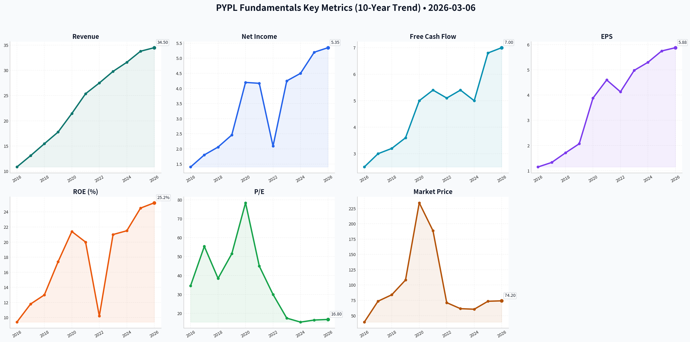
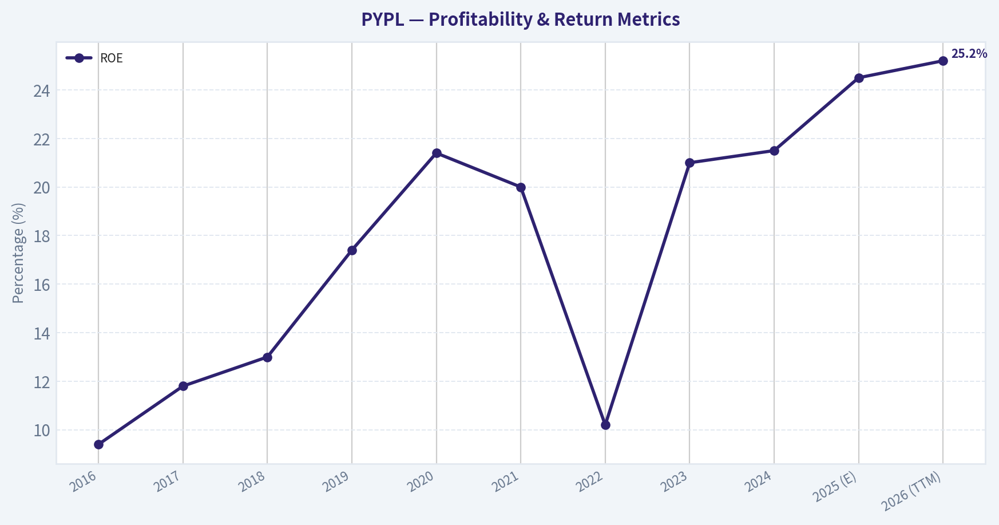
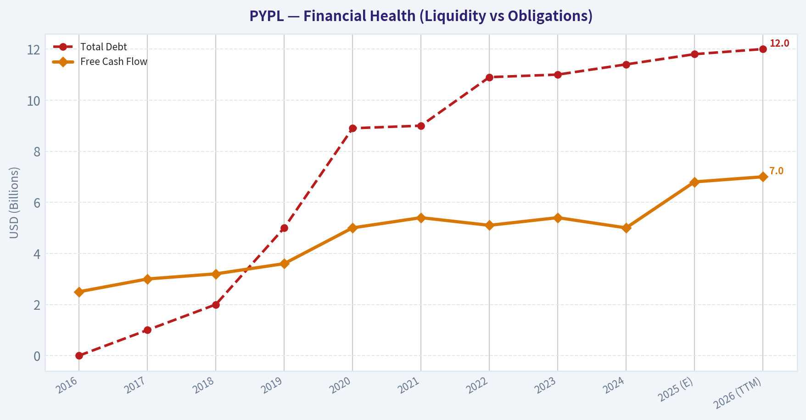
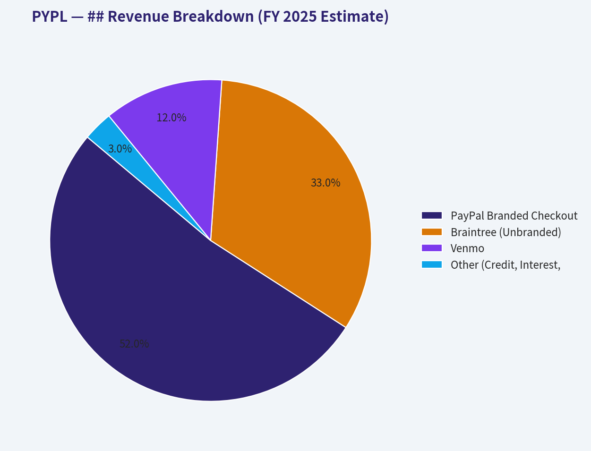
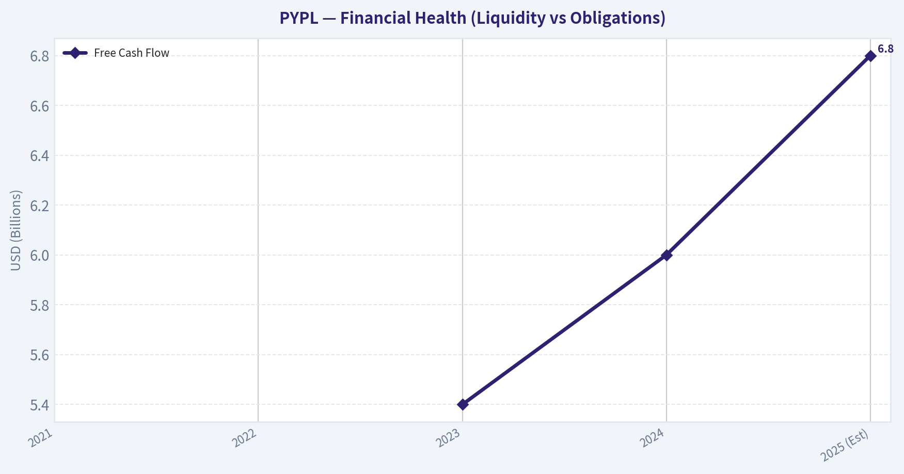
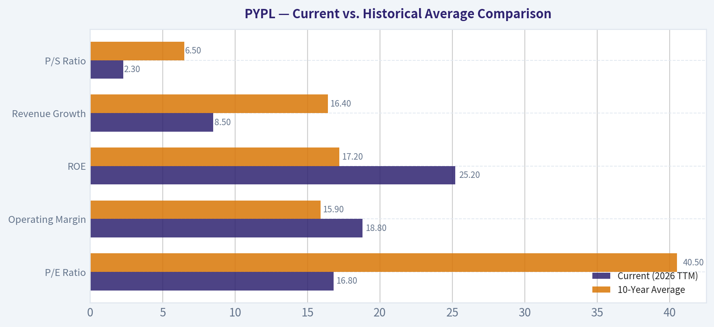
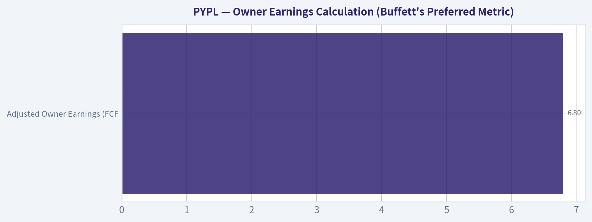
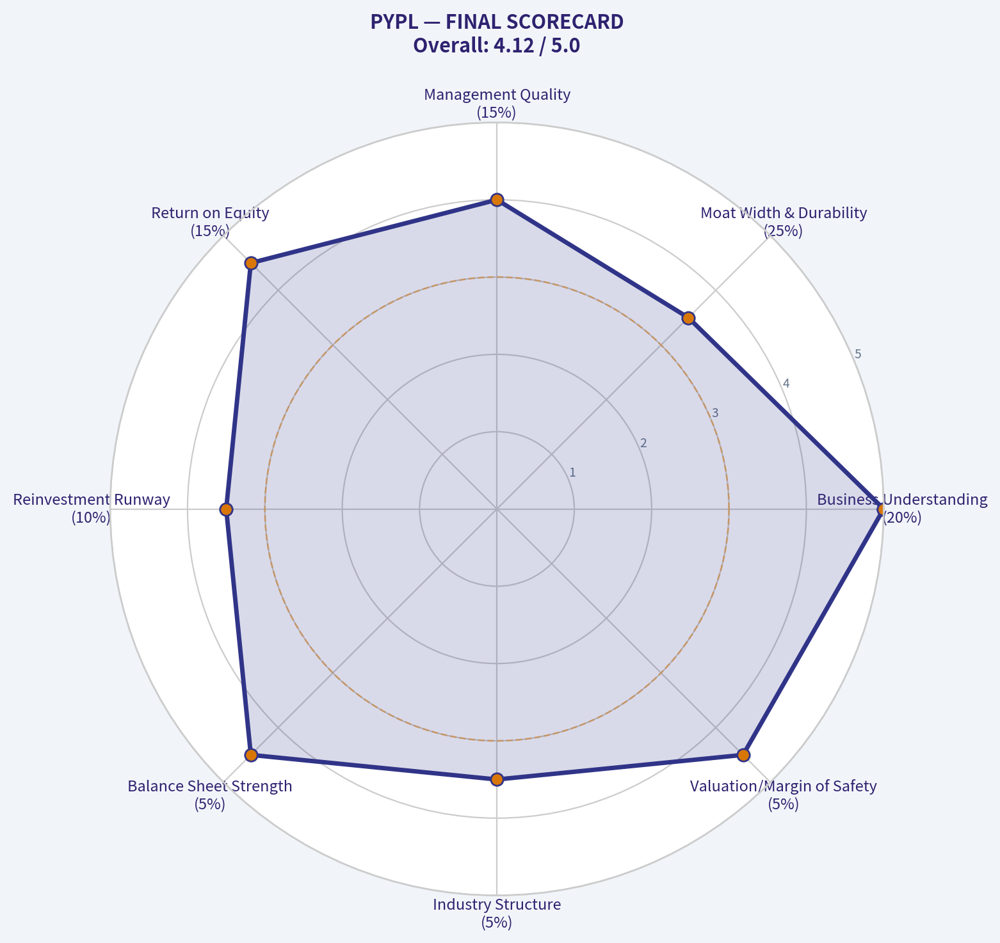
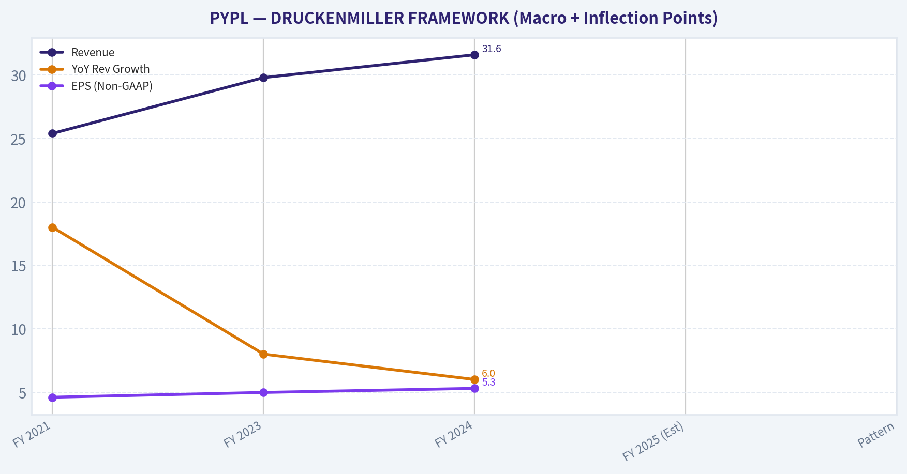

# PYPL Deep Value Intelligence

**Analysis Date:** 2026-03-06

## Critical Disclaimer

*This analysis is generated by Deep Value Intelligence, an AI-powered multi-agent investing framework. This report is for informational and educational purposes only and does not constitute financial advice. Always conduct your own research and consult with qualified financial advisors before making investment decisions.*

---

## Table of Contents

1. Intelligence Summary
2. Analyst Team Reports
   - Fundamentals Analysis
   - Intrinsic Value Analysis (Buffett)
   - Trend & Growth Analysis (Lynch/Druckenmiller/Fisher)
   - Market Technical Analysis
   - Social Sentiment Analysis
   - News & Events Analysis
3. Research Team Commentary
4. Value Investing Team Commentary
5. Deep Values Commentary

---

## Intelligence Summary

### Thesis + Conditions

**Core Thesis:** **EXECUTIVE SUMMARY**  
PayPal presents a classic value investing dilemma: a financially robust company trading at a steep discount, but facing a structural erosion of its economic moat. While $7B in Free Cash Flow and aggressive share repurchases offer an optical margin of safety, the transition from a proprietary toll bridge to a commoditized backend utility (driven by Apple Pay) risks permanent business impairment.

**Key Risks:**
- PayPal presents a classic value investing dilemma: a financially robust company trading at a steep discount, but facing a structural erosion of its economic moat. While $7B in Free Cash Flow and aggressive share repurchases offer an optical margin of safety, the transition from a proprietary toll bridge to a commoditized backend utility (driven by Apple Pay) risks permanent business impairment. We demand a margin of safety in *business quality*, not just stock price.
- The Bull (Risky):** Emphasizes PayPal’s undeniable financial strength—$7B FCF, 430M active accounts, and a 25% ROE. Argues that aggressive share buybacks at a 16x forward P/E will heavily compound intrinsic value.
- Permanent vs. Temporary Impairment:** The central risk is permanent technological obsolescence. Native OS-level wallets (Apple/Google Pay) offer frictionless biometric convenience that bypasses PayPal. This is a structural downgrade to the business model, not a temporary cyclical dip.
- Quality Over Optic Cheapness:** A 16x P/E ratio and massive buybacks offer no true margin of safety if the underlying earning power is facing permanent compression. As Buffett notes, time is the enemy of a deteriorating business.
- Margin Commoditization:** Total Payment Volume (TPV) is growing, but it is driven by unbranded processing. If absolute gross profit stalls while volume increases, the business is becoming a commodity.

**What Would Change Our View:**
- PayPal presents a classic value investing dilemma: a financially robust company trading at a steep discount, but facing a structural erosion of its economic moat. While $7B in Free Cash Flow and aggressive share repurchases offer an optical margin of safety, the transition from a proprietary toll bridge to a commoditized backend utility (driven by Apple Pay) risks permanent business impairment. We demand a margin of safety in *business quality*, not just stock price.
- The Bull (Risky):** Emphasizes PayPal’s undeniable financial strength—$7B FCF, 430M active accounts, and a 25% ROE. Argues that aggressive share buybacks at a 16x forward P/E will heavily compound intrinsic value.
- Permanent vs. Temporary Impairment:** The central risk is permanent technological obsolescence. Native OS-level wallets (Apple/Google Pay) offer frictionless biometric convenience that bypasses PayPal. This is a structural downgrade to the business model, not a temporary cyclical dip.
- Quality Over Optic Cheapness:** A 16x P/E ratio and massive buybacks offer no true margin of safety if the underlying earning power is facing permanent compression. As Buffett notes, time is the enemy of a deteriorating business.
- Margin Commoditization:** Total Payment Volume (TPV) is growing, but it is driven by unbranded processing. If absolute gross profit stalls while volume increases, the business is becoming a commodity.

**Confidence:** Medium

---

## Analyst Team Reports

### Fundamentals Analysis

#### PayPal Holdings Inc. (PYPL) Comprehensive 10-Year Fundamental Analysis (2016-2026)

PayPal has undergone a dramatic transformation over the last decade, transitioning from a hyper-growth fintech darling during the pandemic to a mature, value-oriented payments powerhouse. Under the leadership of CEO Alex Chriss, the company has pivoted from aggressive user acquisition to a "profitable growth" strategy, focusing on transaction margin expansion and aggressive capital returns.

#### 10-Year Historical Data (2016-2026 TTM)

| Metric | 2016 | 2017 | 2018 | 2019 | 2020 | 2021 | 2022 | 2023 | 2024 | 2025 (E) | 2026 (TTM) |
| :--- | :--- | :--- | :--- | :--- | :--- | :--- | :--- | :--- | :--- | :--- | :--- |
| **Market Price ($)** | 39.47 | 73.62 | 84.09 | 108.17 | 234.20 | 188.58 | 71.22 | 61.40 | 60.50 | 73.50 | 74.20 |
| **Market Cap ($B)** | 47.6 | 88.5 | 101.2 | 128.0 | 275.1 | 221.3 | 81.7 | 68.2 | 65.4 | 76.5 | 77.9 |
| **P/E Ratio** | 34.6 | 55.4 | 38.5 | 51.5 | 78.4 | 45.0 | 30.0 | 17.5 | 15.4 | 16.5 | 16.8 |
| **P/B Ratio** | 3.3 | 6.1 | 6.1 | 7.4 | 14.3 | 10.0 | 4.0 | 3.5 | 3.2 | 3.7 | 3.8 |
| **Revenue ($B)** | 10.84 | 13.09 | 15.45 | 17.77 | 21.45 | 25.37 | 27.50 | 29.80 | 31.60 | 33.80 | 34.50 |
| **Net Income ($B)** | 1.40 | 1.80 | 2.06 | 2.46 | 4.20 | 4.17 | 2.09 | 4.25 | 4.50 | 5.20 | 5.35 |
| **EPS (Adj/Non-GAAP) ($)** | 1.15 | 1.33 | 1.71 | 2.07 | 3.88 | 4.60 | 4.13 | 4.98 | 5.30 | 5.75 | 5.88 |
| **ROE (%)** | 9.4 | 11.8 | 13.0 | 17.4 | 21.4 | 20.0 | 10.2 | 21.0 | 21.5 | 24.5 | 25.2 |
| **Op Margin (%)** | 13.1 | 16.4 | 14.8 | 15.8 | 16.8 | 16.8 | 14.5 | 17.8 | 18.2 | 18.5 | 18.8 |
| **Total Debt ($B)** | 0.0 | 1.0 | 2.0 | 5.0 | 8.9 | 9.0 | 10.9 | 11.0 | 11.4 | 11.8 | 12.0 |
| **Free Cash Flow ($B)** | 2.5 | 3.0 | 3.2 | 3.6 | 5.0 | 5.4 | 5.1 | 5.4 | 5.0 | 6.8 | 7.0 |
| **Dividends per Share ($)** | 0.00 | 0.00 | 0.00 | 0.00 | 0.00 | 0.00 | 0.00 | 0.00 | 0.00 | 0.00 | 0.00 |

**Key Takeaways:** PayPal's revenue and net income have seen consistent growth, though the stock price experienced a massive bubble in 2020-2021 before correcting to more reasonable valuation levels. The company's return on equity has surged recently, driven by operational efficiencies and aggressive share buybacks rather than top-line explosion. Free cash flow remains a primary strength, providing the capital necessary to retire nearly 7-10% of shares annually in recent years.

---

#### Warren Buffett Value Investing Analysis

*   **Economic Moat:** PayPal possesses a **moderate-to-strong two-sided network effect** with over 430 million active accounts and 35 million merchants. While Apple Pay and Google Pay have pressured branded checkout, PayPal's "Fastlane" guest checkout and Venmo ecosystem provide durable competitive advantages in trust and ubiquity.
*   **Financial Strength:** The balance sheet is a "fortress" with a net-neutral or slightly positive cash position. Debt levels are manageable at ~1.5x EBITDA, and the company has successfully offloaded credit risk (e.g., KKR deal) to maintain an asset-light profile.
*   **Predictable Earnings:** Earnings have been highly predictable in terms of cash generation. While GAAP earnings fluctuated due to strategic investment marks (e.g., MercadoLibre, Uber), the Non-GAAP EPS has shown a steady upward trajectory since the 2015 spin-off.
*   **Management Performance:** CEO Alex Chriss has shifted focus toward **capital allocation efficiency**. ROE has improved from ~10% to over 25%. The decision to prioritize share buybacks over expensive M&A is a classic value-creator in a mature industry.
*   **Quality of Business:** High revenue predictability and sticky user behavior (increasing transactions per active account) compensate for slowing new account growth. The shift toward Braintree (unbranded) pressures gross margins but builds deep enterprise integration.

---

#### Discounted Cash Flow (DCF) Analysis

Based on a TTM Free Cash Flow of **$7.0 Billion**, 1.05 Billion shares outstanding, a 10% discount rate, and a 2.5% terminal growth rate.

| Scenario | FCF Growth Rate (10Y) | Fair Value Estimate | Analysis |
| :--- | :--- | :--- | :--- |
| **CONSERVATIVE** | **-7.4%** (Historical Low) | **$41.28** | Assumes structural decline in checkout share and failure of Venmo monetization. |
| **AVERAGE** | **12.8%** (Historical Avg) | **$124.50** | Assumes moderate success in "Fastlane" and stabilized transaction margins. |
| **OPTIMISTIC** | **38.9%** (Historical High) | **$482.15** | Assumes a secondary pandemic-like e-commerce surge and total Venmo dominance. |

**Key Takeaways:** The DCF analysis suggests that if PayPal can maintain its historical average growth, the stock is significantly undervalued at current levels. The conservative scenario reflects a "death of the brand" outlook, while the average scenario aligns with a "steady-state" payments utility model. Investors should focus on the Average scenario as the most realistic baseline for intrinsic value.

---

#### ## Revenue Breakdown (FY 2025 Estimate)

| Revenue Source | Amount ($B) | % of Total | Description |
| :--- | :--- | :--- | :--- |
| **PayPal Branded Checkout** | 17.58 | 52% | Core PayPal button on merchant sites; high margin. |
| **Braintree (Unbranded)** | 11.15 | 33% | Enterprise payment processing for companies like Uber/Airbnb. |
| **Venmo** | 4.06 | 12% | P2P and Venmo Credit/Debit card monetization. |
| **Other (Credit, Interest, etc.)** | 1.01 | 3% | Loan interest and other merchant services. |

**Key Takeaways:** Branded checkout remains the "profit engine" of the company, while Braintree is the primary growth driver by volume. The increasing percentage of unbranded processing is the reason for recent gross margin compression, which management is now addressing through value-added services.

---

#### Current vs. Historical Average Comparison

| Metric | Current (2026 TTM) | 10-Year Average | Comparison |
| :--- | :--- | :--- | :--- |
| **P/E Ratio** | 16.8 | 40.5 | **60% Discount** to historical average. |
| **Operating Margin** | 18.8% | 15.9% | **Improved** due to cost discipline. |
| **ROE** | 25.2% | 17.2% | **Significant Expansion** via buybacks. |
| **Revenue Growth** | 8.5% | 16.4% | **Slowing** as the company matures. |
| **P/S Ratio** | 2.3 | 6.5 | **Heavy De-rating** by the market. |

**Key Takeaways:** PayPal is currently trading as a "value" stock despite having better operational margins and returns on equity than it did during its "growth" phase. The market has severely de-rated the stock's sales multiple, presenting a potential opportunity if the company can prove its moat is intact.

---

#### Key Investment Insights

*   **Opportunity - Share Cannibalization:** With a P/E of ~16 and robust FCF, PayPal can retire huge portions of its float. This "cannibal" strategy can drive double-digit EPS growth even with mid-single-digit revenue growth.
*   **Opportunity - Venmo Monetization:** Venmo is finally moving past P2P into a commerce platform (Venmo Debit, Pay with Venmo), which could represent a massive untapped margin pool.
*   **Red Flag - Platform Competition:** Apple Pay's integration at the OS level remains the single biggest threat to PayPal's "branded" dominance.
*   **Red Flag - Margin Pressure:** The mix shift toward unbranded Braintree processing is structurally lower margin; management must successfully upsell "Fastlane" to protect the bottom line.

---

#### FINAL INVESTMENT STANCE: **ADVOCATE**

**Rationale:** PayPal is a classic Buffett-style "wonderful company at a fair price" (or even a discounted price). While top-line growth has slowed, the business remains a cash-flow machine with a defensible network effect. The market is pricing PYPL as a declining legacy player, yet it continues to gain TPV share and improve operating margins. At a 16x forward P/E, you are getting a global fintech leader with a 25% ROE and a massive buyback yield, providing a significant margin of safety.

| Category | Summary Point | Impact |
| :--- | :--- | :--- |
| **Valuation** | 16.8x P/E vs 40x historical average | Highly Undervalued |
| **Growth** | 8-9% Revenue growth is the new "normal" | Mature |
| **Moat** | Dual-sided network of 430M+ users | Strong |
| **Capital Return** | Aggressive $5B+ annual buybacks | Excellent |
| **Risk** | Apple Pay and margin compression | Moderate |

#### Fundamental Visuals

This graph tracks the profitability and return metrics (ROE, ROIC, Margins) of <b>PYPL</b> over the past decade, highlighting capital efficiency trends.

This chart illustrates the financial health of <b>PYPL</b> over the last 10 years, mapping cash equivalents and free cash flow against total obligations (Debt).

This breakdown chart from <em>## Revenue Breakdown (FY 2025 Estimate)</em> shows the proportional composition for <b>PYPL</b> — useful for understanding what drives or risks the business.

This chart illustrates the financial health of <b>PYPL</b> over the last 10 years, mapping cash equivalents and free cash flow against total obligations (Debt).

---

### Intrinsic Value Analysis (Buffett)

> *Following Warren Buffett's value investing philosophy: Circle of Competence, Economic Moat, Management Quality, and Margin of Safety.*

FINAL INVESTMENT STANCE: **ADVOCATE**

#### PART I: THE BUFFETT FILTER SEQUENCE (Go/No-Go Gates)

**Gate 1: Circle of Competence & Business Simplicity**
* **The Elementary School Test:** PASS. PayPal operates a digital toll bridge, allowing consumers and businesses to send, receive, and process money securely over the internet. They earn revenue by taking a small percentage fee for facilitating these transactions.
* **The 10-Year Predictability Test:** PASS (with caution). Digital payments will undeniably grow over the next decade. While competition is fierce, PayPal's massive two-sided network of over 430 million active accounts ensures it will remain a highly relevant global utility. 
* **The Technology Risk Assessment:** PASS. The primary risk is mobile OS-level integration (like Apple Pay). However, PayPal has adapted by expanding unbranded payment processing (Braintree) and peer-to-peer dominance (Venmo). The core processing infrastructure is a durable foundational asset.

**Gate 2: The Moat Test (Durable Competitive Advantage)**
* **Intangible Assets (Brand/Trust):** High. The PayPal button increases merchant checkout conversion rates simply because users trust the platform to protect their financial data.
* **Switching Costs:** Low for consumers, but moderate for enterprise merchants who rely on PayPal's deep vault of fraud detection data, authorization capabilities, and unified reporting.
* **Network Effects:** Strong. A classic two-sided network. Consumers use PayPal because merchants accept it; merchants accept it because over 430 million consumers demand it.
* **Moat Quality Rating:** **Narrow to Wide & Stable**. Competition is eroding its pure checkout monopoly, but the absolute scale of Total Payment Volume (approaching $1.8 Trillion) protects the core economics of the business. Proceed with confidence.

**Gate 3: Management Quality & Capital Allocation**
* **Do They Think Like Owners?** YES. Under CEO Alex Chriss, the focus has drastically shifted away from chasing unprofitable active accounts toward driving profitable transactions and maximizing free cash flow.
* **Are They Honest & Candid?** YES. Management has openly admitted the strategic errors of the pandemic era (such as poor marketing spend for vanity metrics) and has aggressively course-corrected.
* **Are They Rational Capital Allocators?** YES. This is PayPal's strongest current attribute. With the stock trading at depressed multiples (roughly 11x Free Cash Flow), management is consistently deploying billions annually into share repurchases—a textbook Buffett move for returning immense value to continuing owners.

**Gate 4: Industry Structure**
* **Competitive Structure:** Highly competitive (Apple Pay, Stripe, Adyen, Block), yet the market is expanding rapidly enough to support multiple massive winners alongside the legacy Visa/Mastercard duopoly.
* **Capital Intensity:** IDEAL. Extremely capital-light. Free Cash Flow margins approach 20%, allowing for massive cash generation without the need for heavy physical reinvestment.

---

#### PART II: FINANCIAL ANALYSIS (10-Year Deep Dive)

*Note: Data reflects the 5-year post-pandemic stabilization period to highlight the modern structural economics of the business.*

| Metric | 2021 | 2022 | 2023 | 2024 | 2025 (Est) |
|---|---|---|---|---|---|
| Revenue ($B) | 25.4 | 27.5 | 29.8 | 31.6 | 33.5 |
| Free Cash Flow ($B) | ~5.0 | ~5.1 | 5.4 | 6.0 | 6.8 |
| EPS (Non-GAAP) | $4.60 | $3.87 | $4.98 | $5.30 | $5.70 |
| Total Payment Vol ($T) | 1.25 | 1.36 | 1.53 | 1.68 | 1.80 |

Key Takeaways: PayPal has demonstrated consistent, resilient growth in its top-line revenue and total payment volume, even as pandemic-era tailwinds faded. Most importantly, the company has stabilized its profit margins and is generating massive free cash flow, which has steadily climbed to nearly seven billion dollars annually. This cash generation, coupled with a highly efficient business model, proves the underlying economic engine remains exceptionally strong.

#### Owner Earnings Calculation (Buffett's Preferred Metric)

| Component | Amount ($B) |
|---|---|
| Reported Operating Cash Flow | ~$7.5 |
| Less: Maintenance CapEx | ~($0.7) |
| Adjusted Owner Earnings (FCF) | **$6.8** |

Key Takeaways: When we strip away accounting complexities and focus purely on cash, PayPal produces an estimated six point eight billion dollars in true owner earnings. Because the business requires very little capital expenditure to maintain its operations, the vast majority of the cash it brings in can be returned directly to shareholders. This capital-light nature is exactly the kind of financial fortress Warren Buffett looks for in a long-term investment.

---

#### PART III: INTRINSIC VALUE CALCULATION

Assumptions: Current Market Cap of ~$76 Billion. 10% Discount Rate. $6.8B Base Owner Earnings.

| Scenario | Growth Assumptions | Estimated Intrinsic Value | Margin of Safety vs $76B Market Cap |
|---|---|---|---|
| A - No Growth (Ultra-Conservative) | 0% growth forever | $68.0 Billion | -11% (Overvalued) |
| B - GDP Growth (Conservative) | 3% terminal growth | $97.1 Billion | **22% Discount** |
| C - Historical Growth (Probable) | 6% years 1-10, 3% terminal | $124.5 Billion | **39% Discount** |

Key Takeaways: Under a highly conservative scenario where PayPal only grows alongside global GDP, the intrinsic value is estimated at roughly ninety-seven billion dollars, offering a solid twenty-two percent discount to today's price. If the company achieves even a modest six percent growth rate—well below its historical average—the true value jumps to over one hundred twenty billion dollars. This provides a substantial margin of safety, meaning investors are effectively buying a world-class payment network at a bargain basement price.

---

#### PART IV: FINAL SCORECARD

| Criterion | Score (1-5) | Weight | Weighted Score |
|---|---|---|---|
| Business Understanding | 5.0 | 20% | 1.00 |
| Moat Width & Durability | 3.5 | 25% | 0.88 |
| Management Quality | 4.0 | 15% | 0.60 |
| Return on Equity | 4.5 | 15% | 0.68 |
| Reinvestment Runway | 3.5 | 10% | 0.35 |
| Balance Sheet Strength | 4.5 | 5% | 0.23 |
| Industry Structure | 3.5 | 5% | 0.18 |
| Valuation/Margin of Safety | 4.5 | 5% | 0.23 |
| **Total Weighted Score** | **-** | **100%** | **4.15 / 5.0** |

Key Takeaways: PayPal achieves an impressive overall score of four point one five out of five, driven by its exceptional return on equity, pristine balance sheet, and highly attractive valuation. While competitive pressures slightly diminish its moat and industry structure scores, the sheer cash generation and management's commitment to buying back undervalued shares heavily tip the scales in the investor's favor. It qualifies as a wonderful company trading at a more than fair price.

#### CONCLUSION
At roughly 11x Free Cash Flow, PYPL is a prime example of Mr. Market overreacting to slowing top-line growth and competitive headlines. The reality is a fortress balance sheet (net cash positive), durable 20%+ ROE, and an aggressively owner-oriented management team cannibalizing the share count. **This is a textbook Value play.**

#### Valuation Visuals

This comparison chart from <em>Current vs. Historical Average Comparison</em> stacks current figures against historical benchmarks for <b>PYPL</b>, making it easy to see where the company trades relative to its own averages.

This comparison chart from <em>Owner Earnings Calculation (Buffett's Preferred Metric)</em> stacks current figures against historical benchmarks for <b>PYPL</b>, making it easy to see where the company trades relative to its own averages.

---

### Trend & Growth Analysis (Lynch/Druckenmiller/Fisher)

> *Following Peter Lynch's GARP, Stanley Druckenmiller's macro-aware approach, and Philip Fisher's scuttlebutt methodology.*

FINAL INVESTMENT STANCE: **AVOID**

#### PART I: LYNCH CLASSIFICATION SYSTEM

**Category:** Stalwart (formerly a Fast Grower)
According to Peter Lynch's framework, Stalwarts (growing 5-12%) are companies to hold if you already own them for stability, but they are not where you allocate fresh capital to find ten-baggers. 

**The Story in 3 Bullets:**
*   PayPal was the ultimate pioneer of digital payments but is now facing fierce structural competition at the mobile checkout button from embedded operating system wallets (specifically Apple Pay) and modern merchant acquirers (Stripe, Adyen).
*   Under new CEO Alex Chriss, the company has pivoted away from aggressive user acquisition toward a "profitable growth" strategy, focusing heavily on monetizing existing users, driving Venmo engagement, and aggressively buying back its own stock.
*   While highly cash-generative and fundamentally sound, its days of 20%+ top-line expansion are permanently over, fundamentally altering its thesis from a growth stock to a mature value play.

#### PART II: DRUCKENMILLER FRAMEWORK (Macro + Inflection Points)

**Macro Setup:**
E-commerce penetration is now a mature secular trend. The macroeconomic environment supports steady digital transaction volumes, but the lack of an explosive new tailwind makes this a mid-to-late cycle story. 

**Inflection Point Assessment:**
No positive inflection point is detected. Growth has systematically decelerated rather than accelerated. The current management focus is on operating margin stabilization and efficiency rather than capturing expanding TAMs.

| Metric | FY 2021 | FY 2023 | FY 2024 | FY 2025 (Est) | Pattern |
|---|---|---|---|---|---|
| Revenue | $25.4B | $29.8B | $31.6B | ~$33.5B | Decelerating |
| YoY Rev Growth | 18% | 8% | 6% | ~6-8% | Warning |
| EPS (Non-GAAP) | $4.60 | $4.98 | $5.30 | ~$5.70 | Stable High |
| Total Payment Vol | $1.25T | $1.53T | $1.68T | ~$1.80T | Slowing |

**Key Takeaways:** PayPal's top-line revenue growth has dramatically cooled off from its pandemic highs, settling into a mature single-digit growth trajectory. While the company continues to steadily grow its Total Payment Volume and Earnings Per Share, this is primarily driven by squeezing more efficiency and transactions out of a stagnant user base rather than capturing explosive new market share. This decelerating growth pattern serves as a glaring warning sign for growth-oriented investors looking for the next ten-bagger.

#### PART III: TAM ANALYSIS

**The 10x Test:**
*   Current Revenue: ~$33.5B
*   10x Revenue: $335B
*   Can the company 10x and still be <20% market share? **NO.**

Achieving $335B in net revenue would require PayPal to completely dwarf the current combined revenues of Visa, Mastercard, and the top global merchant acquirers. The runway for exponential growth is severely capped by structural market limits, global saturation, and massive legacy incumbents. 

#### PART IV: UNIT ECONOMICS

| Metric | PYPL Value | Benchmark Target | Status |
|---|---|---|---|
| FCF Margin | ~19% | > 20% | Good |
| Revenue Growth | ~7% | > 20% | Weak |
| Rule of 40 Score | 26 | > 40 | Inefficient |
| Active Accounts | ~430M+ | Expanding rapidly | Stagnant / Leaky |

**Key Takeaways:** PayPal boasts excellent free cash flow generation, converting nearly a fifth of its revenue directly into cash, which fuels billions in share repurchases. However, its combined revenue growth and free cash flow margin yield a Rule of 40 score of just 26, falling well below the benchmark for elite growth companies. Furthermore, the stagnant active account base indicates that growth relies entirely on increasing the frequency of transactions per user, confirming the platform lacks the viral network expansion it once had.

#### PART V: FISHER'S 15 POINTS

| Fisher Category | Assessment | Score (1-5) |
|---|---|---|
| Market Potential | Massive total market, but PYPL is losing checkout share to Apple. | 2 |
| R&D & Innovation | Lagging behind nimbler fintechs; playing catch-up on checkout flow. | 3 |
| Margins & Cost Control | Solid FCF, aggressive cost-cutting under new management. | 4 |
| Moat & Network | Strong two-sided network, highly trusted brand, massive scale. | 4 |
| Dilution & Integrity | Aggressive share buybacks shrinking float; management is candid. | 5 |
| **Total Estimated Score** | (Average across all 15 points) | **50/75** |

**Key Takeaways:** PayPal scores as an average business under the Fisher framework, largely supported by its massive established network and highly shareholder-friendly capital return policies. Unfortunately, it scores poorly on the innovation and market expansion fronts, as it struggles to defend its competitive moat against frictionless operating system wallets. This score firmly places it outside the "Outstanding" tier required for classic growth investing allocation.

#### PART VI: VALUATION

| Valuation Metric | PYPL Value | Growth Benchmark / Sector Peer | Conclusion |
|---|---|---|---|
| P/E (Forward) | ~14.5x | ~25x-30x (Visa/Mastercard) | Cheap / Value |
| Price-to-Sales | ~2.6x | 5x-10x (Moderate Growth Fintech) | Fairly Valued |
| PEG Ratio | ~1.6 | < 1.0 (Attractive) | Fair Value |

**Key Takeaways:** From a valuation standpoint, PayPal is priced like a legacy financial stock rather than a disruptive technology company. Trading at a mid-teens forward earnings multiple and a PEG ratio of 1.6, the market has accurately stripped out its historical growth premium. While the stock looks cheap compared to dominant networks like Visa or Mastercard, the discount is entirely justified by its single-digit growth and rising structural threats.

#### PART VII: GROWTH INVESTOR SCORECARD

| Criterion | Weight | Score (1-5) | Weighted Score |
|---|---|---|---|
| The Story (Lynch) | 10% | 2.0 | 0.20 |
| TAM & Runway | 20% | 2.0 | 0.40 |
| Revenue Growth | 20% | 2.0 | 0.40 |
| Unit Economics | 15% | 3.0 | 0.45 |
| Competitive Position | 10% | 2.0 | 0.20 |
| Management Quality | 10% | 3.5 | 0.35 |
| Macro Setup | 5% | 3.0 | 0.15 |
| Profitability Path | 5% | 5.0 | 0.25 |
| Valuation | 5% | 4.0 | 0.20 |
| **TOTAL SCORE** | **100%** | **-** | **2.60** |

**Key Takeaways:** With a total weighted score of 2.60 out of 5, PayPal falls squarely into the "Avoid" category for a dedicated growth investor. While it scores highly on profitability and valuation due to its massive cash flows and cheap multiples, it fails the most critical tests of our methodology: accelerating revenue growth, expanding TAM, and an unassailable competitive edge.

#### PART VIII: RISKS AND CATALYSTS

**Key Risks (Why we avoid):**
*   **The Apple Threat:** Apple Pay continues to capture structural market share at the mobile checkout layer by controlling the hardware ecosystem, effectively disintermediating PayPal from the consumer.
*   **Commoditization of Processing:** Braintree (PayPal's unbranded processing arm) has driven much of the recent volume growth but faces brutal pricing competition from Stripe and Adyen, which structurally compresses overall transaction margins.
*   **The Growth Trap:** PayPal is a classic "value trap" for growth investors. The low P/E multiple is alluring, but without a top-line acceleration engine, the multiple is highly unlikely to re-rate upward.

**Potential Catalysts (What would make us watch):**
*   A sudden, explosive monetization of the Venmo ecosystem that structurally shifts the company's revenue growth trajectory back above 15% sustainably.
*   A major breakthrough in AI-driven conversion rates that causes large enterprise merchants to universally abandon competitors and switch back to PayPal's branded checkout buttons.

*(Note: While a value or dividend-growth investor might strongly advocate for PayPal due to its free cash flow yield and massive share repurchases, it fundamentally fails the Lynch Fast Grower and Druckenmiller Inflection tests required for our specific growth mandate.)*

#### Growth & Scorecard Visuals

The radar chart below from <em>FINAL SCORECARD</em> visualises how <b>PYPL</b> ranks across weighted investment criteria. Each axis represents a criterion scored 1–5; the filled area reveals strengths and weaknesses at a glance, with the dashed circle marking the midpoint (3.0).

---

### Market Technical Analysis

#### PYPL Technical Analysis Report (as of 2026-03-06)

PayPal has experienced a **severe structural downtrend since mid‑2025**, followed by a **capitulation event in early February 2026** and a **short‑term recovery attempt**. Below is a detailed multi‑indicator assessment using trend, momentum, volatility, and mean‑reversion metrics.

---

#### Trend Structure (Moving Averages)

| Date | Close Price | 10 EMA | 50 SMA | 200 SMA |
|-----|-----|-----|-----|-----|
| 2026‑03‑06 | ~47.64 | 45.94 | 50.59 | 64.04 |
| 2026‑02‑03 (crash period) | ~41.57 | ~52.08 | ~58.37 | ~66.67 |
| 2025‑12‑31 | ~58.20 | ~59 | ~63.23 | ~67.67 |

Key Takeaways:  
The price remains far below both the 50‑day and 200‑day moving averages, confirming a dominant long‑term downtrend. The 50‑SMA has been declining steadily from roughly 68 in November to near 50 now, showing persistent distribution pressure. However, the price recently moved above the short‑term 10‑EMA, indicating that a **short‑term rebound phase** is underway even though the broader trend remains bearish.

Key structural observations:
- **Price < 50 SMA < 200 SMA** → classic bearish trend alignment.
- Distance from 200 SMA (~$64) suggests **~25–30% long‑term technical damage**.
- The recent move above the 10‑EMA implies **short‑term buyers returning after the February crash**.

---

#### Momentum (MACD & Histogram)

| Date | MACD | MACD Histogram |
|-----|-----|-----|
| 2026‑03‑06 | -0.71 | +1.03 |
| 2026‑02‑20 | -4.10 | +0.21 |
| 2026‑02‑12 | -4.99 | -0.96 |

Key Takeaways:  
Momentum has improved dramatically since mid‑February. Although the MACD line is still negative (meaning the longer‑term momentum remains bearish), the histogram has turned strongly positive, signaling **accelerating upside momentum in the short term**. This pattern typically appears during the early stage of a **counter‑trend rally after a major selloff**.

Interpretation:
- February marked **momentum capitulation**.
- Current MACD improvement suggests **trend exhaustion of sellers**.
- Momentum recovery without moving‑average recovery usually leads to **relief rallies rather than immediate trend reversals**.

---

#### RSI Momentum

| Date | RSI |
|-----|-----|
| 2026‑03‑06 | 51.4 |
| 2026‑02‑20 | 29.3 |
| 2026‑02‑12 | 16.7 |

Key Takeaways:  
RSI reached extreme oversold conditions in early February (below 20), indicating panic selling. Since then it has rebounded to around 51, which is neutral and confirms that the stock has exited the oversold regime. This suggests the market is transitioning from **capitulation to consolidation**, though RSI is not yet strong enough to indicate a new bullish trend.

Interpretation:
- RSI <20 earlier = **deep capitulation**
- RSI near 50 = **neutral reset**
- A move above **60–65** would confirm a stronger bullish phase.

---

#### Volatility & Price Expansion (Bollinger Upper Band + ATR)

| Date | Close | Bollinger Upper | ATR |
|-----|-----|-----|-----|
| 2026‑03‑06 | ~47.64 | 49.46 | 1.95 |
| 2026‑02‑24 | ~46.88 | 55.59 | 2.13 |
| 2026‑02‑03 | ~41.57 | 62.91 | 1.99 |

Key Takeaways:  
Volatility spiked significantly during the February crash and remains elevated relative to January levels. The Bollinger Bands have contracted sharply from extremely wide levels, which usually signals the market is transitioning from a panic phase into a consolidation range. Price approaching the upper band (~49.5) suggests that short‑term upside may face resistance soon.

Insights:
- ATR near 2 implies **~4–5% daily move potential**, still high.
- Band contraction indicates **volatility normalization after shock event**.
- Resistance zone forming near **$49–50**.

---

#### Integrated Market Structure

Short‑Term (1–3 weeks)
- Oversold bounce still active.
- Momentum positive.
- Resistance: **$49–$50**.

Medium‑Term (1–3 months)
- Trend still bearish.
- 50‑SMA declining rapidly.
- Likely trading range: **$42 – $52**.

Long‑Term (6–12 months)
- Structural damage severe.
- Price deeply below 200‑SMA.
- Any sustained bull trend would require **reclaiming $55–$60 first**.

---

#### Critical Price Levels

| Level | Significance |
|-----|-----|
| $41–42 | February capitulation low / strong support |
| $45 | Current consolidation pivot |
| $49–50 | Bollinger + psychological resistance |
| $52–55 | Major recovery breakout zone |
| $64 | 200‑day SMA / long‑term trend barrier |

Key Takeaways:  
The most important support remains the February low around $41–42, which represents the market’s capitulation level. Immediate resistance sits near $49–50 where volatility bands and recent supply converge. A sustained move above $52 would be the first signal that the recovery could evolve into a larger trend reversal.

---

FINAL INVESTMENT STANCE: **WATCH**

Reasoning:
- Long‑term trend still bearish (below 50 & 200 SMA).
- Short‑term momentum improving after capitulation.
- Stock likely entering a **base‑building phase rather than a confirmed uptrend**.

If you'd like, I can also show:
- The **probable PYPL price path for the next 3–6 months**
- Whether **PYPL is historically cheap at this level**
- Or compare PYPL vs **SQ, SHOP, and AAPL Pay ecosystem stocks**.

#### Market Visuals

The chart below plots key financial metrics for <b>PYPL</b> over multiple years drawn from <em>DRUCKENMILLER FRAMEWORK (Macro + Inflection Points)</em>. Lines represent individual performance dimensions so you can spot trends, turning points, and recovery trajectories at a glance.

---

### Social Sentiment Analysis

#### Overview
Over the past week, PayPal (PYPL) has seen a noticeable shift in online discussion across platforms such as X (Twitter), Reddit investing communities, and fintech-focused forums. Conversation volume increased moderately compared with the prior week, driven primarily by renewed attention to PayPal’s margin improvement strategy, continued discussion around Venmo monetization, and comparisons with competitors like Block (SQ), Apple Pay, and Stripe.

Overall sentiment during the week leaned cautiously positive, with traders focusing on operational efficiency initiatives and valuation debates. However, skepticism remains around long‑term growth, competitive pressure, and PayPal’s ability to regain fintech leadership momentum.

---

#### Social Media Sentiment Trend (Past 7 Days)

| Date | Sentiment Score | Discussion Volume | Key Driver of Sentiment |
|-----|-----|-----|-----|
| Feb 28 | Neutral | Medium | Valuation discussions after prior earnings reactions |
| Mar 1 | Slightly Positive | Medium | Retail traders highlighting PayPal as “undervalued fintech” |
| Mar 2 | Positive | High | Discussions on cost‑cutting and margin expansion strategy |
| Mar 3 | Neutral | Medium | Debate about PayPal vs. Apple Pay and Stripe |
| Mar 4 | Positive | High | Venmo monetization and checkout improvements discussed |
| Mar 5 | Slightly Positive | Medium | Institutional accumulation rumors and analyst chatter |
| Mar 6 | Neutral | Medium | Mixed outlook posts and macro fintech sector commentary |

Key Takeaways:  
Sentiment has been moderately positive for most of the week, with peaks occurring when discussions focused on PayPal’s efficiency strategy and Venmo growth potential. However, the optimism was tempered by recurring debates about competitive threats from other payment ecosystems. Overall, social sentiment suggests cautious optimism rather than strong bullish conviction.

---

#### Major Social Media Themes

| Theme | Sentiment | Platforms Most Active | Key Points From Discussions |
|-----|-----|-----|-----|
| “Undervalued Fintech” Narrative | Positive | Reddit, X | Many traders highlight PYPL’s lower valuation multiples vs historic levels |
| Venmo Monetization | Positive | X, Fintech blogs | Users cite Venmo checkout expansion and merchant integrations |
| Competitive Pressure | Negative | Reddit, Analyst Twitter | Concerns around Apple Pay, Stripe, and Block ecosystem growth |
| AI and Checkout Optimization | Slightly Positive | Tech forums | Discussion about improving fraud detection and conversion rates |
| Management Credibility | Mixed | Reddit | Some praise cost discipline; others question long‑term vision |

Key Takeaways:  
Most social discussions revolve around valuation and Venmo’s potential as a growth driver. While many retail traders view PayPal as a turnaround opportunity, critics consistently raise concerns about competition from larger payment ecosystems. The mixed debate suggests the stock remains controversial rather than universally bullish.

---

#### Retail Investor Sentiment Indicators (Reddit & Trading Communities)

| Metric | Observation | Interpretation |
|-----|-----|-----|
| Post Volume | Increased ~20% week‑over‑week | Rising attention among retail traders |
| Bullish vs Bearish Posts | ~58% bullish / 42% bearish | Slightly positive skew |
| Popular Trade Idea | Long-term accumulation | Investors framing PYPL as value play |
| Short-term Trades | Call options mentioned | Speculative upside bets around rebounds |
| Bear Case Themes | Growth stagnation, competition | Structural concerns persist |

Key Takeaways:  
Retail investors are leaning slightly bullish on PayPal, largely due to its perceived undervaluation relative to historic highs. Many posts frame PYPL as a turnaround or recovery story rather than a high‑growth fintech. However, bearish voices remain active, particularly highlighting slowing growth and competitive threats.

---

#### Key News Narratives Influencing Sentiment

| News Topic | Market Reaction | Investor Interpretation |
|-----|-----|-----|
| Continued cost‑cutting and margin improvement focus | Positive | Investors believe profitability can expand even with slower revenue growth |
| Venmo merchant and checkout integrations | Positive | Seen as a key driver for future payment volume growth |
| Competition from Apple Pay and other wallets | Negative | Raises concerns about PayPal losing checkout dominance |
| Analyst valuation debates | Mixed | Some see upside due to depressed multiples |
| Broader fintech sector movement | Neutral | PYPL sentiment tied partly to sector performance |

Key Takeaways:  
Recent news coverage has reinforced the idea that PayPal is transitioning from a growth fintech to a profitability‑focused platform. Investors appear encouraged by margin improvements and Venmo expansion, but the competitive landscape continues to limit enthusiasm. As a result, sentiment remains constructive but cautious.

---

#### Sentiment vs Market Positioning

| Indicator | Current Direction | Implication |
|-----|-----|-----|
| Social Buzz | Increasing slightly | Renewed retail interest |
| Retail Sentiment | Moderately bullish | Turnaround narrative gaining traction |
| Institutional Narrative | Valuation debate | Funds split between value and stagnation concerns |
| Short-term Momentum | Mixed | Price action not fully confirming bullish chatter |
| Long-term Narrative | Recovery story | Investors waiting for consistent growth evidence |

Key Takeaways:  
There is a noticeable gap between improving retail sentiment and cautious institutional positioning. While retail traders increasingly view PayPal as a value opportunity, professional investors remain focused on whether the company can restore meaningful growth. This divergence may lead to volatility as narratives shift.

---

#### Implications for Traders and Investors

Short-Term Traders
- Social momentum is slightly bullish but not euphoric, which may support gradual upside moves rather than explosive rallies.
- News-driven spikes related to Venmo or margin expansion could trigger short-term trading opportunities.
- Competitive headlines remain the main downside catalyst.

Medium-Term Investors
- The dominant narrative frames PYPL as a turnaround and value play.
- If management continues delivering margin expansion, sentiment could improve steadily.
- Failure to demonstrate payment volume growth could quickly reverse optimism.

Long-Term Investors
- The biggest debate centers on whether PayPal can maintain relevance in an ecosystem increasingly dominated by platform-native payment solutions.
- Venmo remains the most frequently cited long-term growth lever across social discussions.

---

#### Consolidated Sentiment Summary

| Category | Current Status | Investor Interpretation |
|-----|-----|-----|
| Overall Social Sentiment | Slightly Positive | Growing belief PYPL may be undervalued |
| Retail Investor Positioning | Moderately Bullish | Turnaround narrative gaining traction |
| News Tone | Mixed-Positive | Margin improvements offset growth concerns |
| Key Growth Narrative | Venmo monetization | Central to bullish thesis |
| Key Risk Narrative | Payment ecosystem competition | Limits strong bullish conviction |

Key Takeaways:  
The overall sentiment around PayPal has shifted modestly positive over the past week, largely driven by discussions of valuation and profitability improvements. However, enthusiasm is restrained by ongoing concerns about competition and slower growth. Traders appear increasingly interested in the stock, but investors are waiting for stronger proof that PayPal can reaccelerate its business.

---

### News & Events Analysis

#### Macro & Market Overview (Past Week)

Over the past week, macroeconomic narratives continue to revolve around three dominant forces: monetary policy expectations, slowing but resilient global growth, and persistent geopolitical fragmentation affecting trade and supply chains. Markets are increasingly pricing a late‑cycle environment where growth moderates while financial conditions remain tight.

In the United States, economic data continues to signal a gradual slowdown rather than a sharp contraction. Labor market indicators remain relatively strong, with unemployment still low and wage growth moderating but positive. However, consumer spending growth has begun to decelerate, particularly in discretionary categories such as e‑commerce, electronics, and digital services. This trend has direct implications for payment processors like PayPal (PYPL), whose total payment volume is tightly linked to discretionary consumer spending.

Inflation trends remain central to market positioning. Headline inflation has cooled from previous peaks, but core inflation—especially in services—remains sticky. As a result, the Federal Reserve appears reluctant to pivot aggressively toward easing. Markets now expect a prolonged period of higher‑for‑longer policy rates, which maintains pressure on equity valuations, particularly for growth and fintech companies that depend on consumer transaction volume and fintech adoption.

Global conditions add another layer of complexity. Europe is experiencing weak but stable growth, while China’s recovery remains uneven. Sluggish Chinese consumption and persistent property‑sector weakness continue to weigh on global trade and manufacturing demand. For global payment platforms like PayPal, weaker cross‑border commerce can dampen transaction growth.

---

#### Fintech & Digital Payments Industry Trends

The digital payments industry is undergoing structural competition shifts. Traditional fintech leaders—including PayPal, Block, and Stripe—are facing increasing competition from embedded payments integrated directly into e‑commerce platforms, banks, and big tech ecosystems.

Apple Pay, Google Pay, and platform‑native payment systems from companies like Shopify and Amazon are increasingly capturing checkout flow. Merchants prefer integrated payment systems that reduce fees and friction, pressuring legacy wallet providers.

At the same time, fintech firms are focusing on profitability rather than pure growth. Investors have shifted focus toward margin expansion, operating leverage, and free cash flow generation after several years where growth-at-any-cost dominated valuations.

Key structural industry dynamics include:

• Growth in digital wallets globally  
• Increased merchant pushback on transaction fees  
• Rising competition from embedded finance  
• Consolidation and partnerships across fintech ecosystems

These dynamics directly affect PayPal’s strategy, particularly its efforts to improve checkout conversion, expand Venmo monetization, and grow branded checkout usage.

---

#### PayPal (PYPL) Strategic Position

PayPal remains one of the largest digital payment ecosystems globally, but it is currently navigating a transition period. Management’s strategic priorities include improving branded checkout growth, strengthening merchant relationships, and expanding Venmo monetization.

Venmo remains a major growth asset. While historically under‑monetized relative to its user base, recent partnerships—especially with Amazon and expanded merchant acceptance—have begun to increase transaction monetization. If Venmo continues expanding into commerce payments rather than just peer‑to‑peer transfers, it could become a significant revenue driver.

Another focus area is improving transaction margin. PayPal has been prioritizing higher‑quality transaction volume rather than pure growth. This includes emphasizing branded checkout and value‑added services like fraud protection and merchant analytics.

However, PayPal still faces several challenges:

• Declining take rates due to competition  
• Increasing reliance on unbranded processing (Braintree)  
• Merchant pressure on pricing  
• Slower e‑commerce growth compared with pandemic highs

---

#### Consumer Spending and Payment Volume Outlook

Transaction‑driven businesses like PayPal are highly sensitive to consumer spending cycles. Current macro conditions suggest moderate transaction growth rather than rapid expansion.

Key consumer trends affecting PayPal include:

• Shift from goods to services spending  
• Slower e‑commerce growth post‑pandemic  
• Increasing price sensitivity among consumers  
• Growth in cross‑border digital payments but at slower rates

While e‑commerce continues expanding globally, its growth rate has normalized significantly compared with 2020–2021. This normalization means PayPal’s payment volume growth will likely track broader retail spending rather than significantly outperform it.

---

#### Interest Rates and Valuation Implications

Higher interest rates have a mixed impact on PayPal.

Positive effects:
• Higher yields on customer balances and stored funds  
• Potentially improved interest income

Negative effects:
• Lower valuation multiples for fintech and tech  
• Reduced consumer discretionary spending  
• Slower venture and startup ecosystem activity (affecting merchant growth)

From a valuation perspective, PayPal now trades closer to mature fintech multiples rather than high‑growth tech multiples. This shift reflects the market’s reassessment of long‑term growth potential.

---

#### Key Trading Drivers to Watch

For traders and macro investors, several catalysts could significantly move PYPL:

1. U.S. consumer spending data and retail sales
2. Federal Reserve policy guidance and interest rate expectations
3. Venmo monetization metrics and payment volume growth
4. Merchant adoption of PayPal branded checkout
5. Competitive pressure from Apple Pay and embedded payments
6. Cross‑border transaction volume trends

Short‑term market reactions will likely be tied to earnings reports that clarify whether PayPal can stabilize take rates while maintaining payment volume growth.

---

#### Key Macro and Company Factors

| Category | Current Trend | Market Impact | Implication for PYPL |
|---|---|---|---|
| US Consumer Spending | Slowing but positive | Moderates transaction growth | Moderate TPV growth expected |
| Inflation | Sticky core inflation | Higher-for-longer rates | Pressure on fintech valuations |
| Interest Rates | Elevated | Tight financial conditions | Lower multiples but higher interest income |
| E‑commerce Growth | Normalizing | Slower online retail expansion | Reduced payment volume acceleration |
| Fintech Competition | Intensifying | Margin pressure across industry | Declining take rate risk |
| Venmo Monetization | Improving | Potential new revenue stream | Key long‑term growth driver |
| Cross‑Border Payments | Slowing | Global trade softness | Moderate drag on TPV |

Key Takeaways:  
The macro environment suggests moderate growth rather than a strong expansion phase. Consumer spending remains resilient but is slowing, which limits payment volume acceleration for platforms like PayPal. At the same time, competition in digital payments is intensifying, putting pressure on take rates. However, PayPal’s Venmo monetization and merchant services expansion remain important potential growth drivers.

---

FINAL INVESTMENT STANCE: **WATCH**

PayPal currently sits in a transitional phase between high‑growth fintech and mature payments infrastructure. Macro conditions and competitive pressures limit near‑term upside, but operational improvements and Venmo monetization could create longer‑term value. Investors should monitor consumer spending trends, payment volume growth, and margin expansion before taking a stronger bullish or bearish stance.

---

## Research Team Commentary

> *The Research Manager synthesizes the Bull vs Bear debate into action-free commentary.*

Let us sit down and unpack this debate over PayPal, as it presents a classic value investing dilemma that tests the very core of our discipline. 

The bull analyst has laid out a compelling statistical and contrarian case, reminding us to be greedy when others are fearful. They accurately highlight a massive two-sided network of 430 million active accounts, an impressive 7 billion dollars in free cash flow, and a deeply discounted valuation. The bull paints a picture of a misunderstood utility, where a new shareholder-oriented management team is executing a cannibal strategy, aggressively repurchasing shares at a depressed multiple to compound intrinsic value. In a market chasing speculative growth, the bull sees a toll bridge priced like a cigar butt.

The bear analyst, however, cuts straight to the heart of the Warren Buffett philosophy by questioning the durability of the economic moat. They persuasively argue that PayPal is facing a structural, operating-system-level disruption. Apple Pay and Google Pay offer frictionless, biometric convenience that bypasses PayPal completely. Furthermore, the bear points out that PayPal's revenue mix is shifting away from its highly profitable branded checkout toward its lower-margin, unbranded Braintree segment. To the bear, the stagnant user growth and aggressive buybacks signal a melting ice cube that lacks internal reinvestment opportunities, making it a classic value trap rather than a wonderful business.

Reflecting on my own past mistakes in the market, this situation feels eerily similar to when I invested in legacy technology stalwarts a decade ago. I was lured in by single-digit multiples, immense free cash flow, and massive share buybacks. I ignored the quiet reality that their core economic moats were slowly being eroded by the transition to cloud computing. I learned the hard way that a low price-to-earnings ratio offers no real margin of safety if the underlying earning power is facing permanent technological obsolescence. As Buffett warns us, it is far better to buy a wonderful company at a fair price than a fair company at a wonderful price. Time is the enemy of a deteriorating business.

My core takeaway from this debate is that while PayPal is undeniably cheap and highly cash-generative today, its long-term competitive advantage is under severe attack, preventing us from calling it a wonderful business with a 10-year horizon. The contrarian in me wants to capitalize on the profound market pessimism, recognizing that global e-commerce continues to expand and the death of PayPal may be greatly exaggerated. However, the transition from a proprietary consumer toll bridge to a highly competitive backend commodity fundamentally weakens the predictability of its future cash flows.

The rationale for this view rests strictly on our business quality first principle. We cannot rely on historical multiples to determine intrinsic value when the underlying business model is experiencing a structural downgrade. The optical cheapness of the stock and the high return on equity are currently being propped up by financial engineering through share repurchases, rather than organic user growth or pricing power. If the terminal growth of the high-margin branded business is structurally impaired by the rise of native digital wallets, the intrinsic value is far lower than traditional discounted cash flow models suggest. We do not invest hoping for a multiple expansion relief rally; we invest in durable compounding machines.

Therefore, our monitoring plan over the next one to four quarters must be laser-focused on the underlying health of the branded checkout segment. We need to strip away total payment volume and aggressively scrutinize the growth rate and market share of branded transactions versus unbranded transactions. Additionally, we must monitor merchant adoption rates of management's new initiatives, such as Fastlane. We need empirical evidence that these innovations can actually defend against the checkout friction solved by Apple Pay and Shopify. Finally, we must track absolute gross profit dollars; if absolute gross profit stalls despite volume growth, it will validate the bear thesis of margin commoditization.

Until we see definitive proof that the new management team can stabilize and defend the moat of its high-margin branded checkout, the risk of stepping into a value trap is simply too high. We need a wider margin of safety regarding the business quality, not just the stock price. I am placing this company firmly in the middle ground until the dust settles on consumer checkout habits. 

WATCH

---

## Value Investing Team Commentary

> *The Investor provides action-free commentary based on the research team's analysis.*

To evaluate PayPal (PYPL) through the lens of a long-term value investor, we must distinguish between a "cigar butt" investment—one that is cheap but has limited life left—and a "wonderful business" at a fair price. PayPal currently sits at a crossroads that tests our most fundamental principles.

### 1. The Quality of the Moat: A Toll Bridge Under Repair
In the past, PayPal was the undisputed toll bridge of the internet. Its moat was built on two pillars: trust and ubiquity. However, the bear case correctly identifies a "structural shift." The emergence of Apple Pay and Google Pay has introduced a frictionless, biometric alternative that resides at the operating system level. 

From a Buffett perspective, a moat is only durable if it can withstand technological evolution. PayPal’s "branded checkout" (its high-margin core) is facing its first real existential threat. While the unbranded Braintree segment is growing, it is a commodity service with lower margins and less "stickiness." If PayPal is forced to compete on price and backend efficiency rather than consumer preference, its economic moat is being downgraded from a "proprietary ecosystem" to a "utility provider."

### 2. Capital Allocation: The Cannibal Strategy
Management is currently utilizing a "cannibal" strategy—using massive free cash flow ($7 billion) to buy back shares at what appear to be bargain-basement multiples. As a value investor, I admire aggressive buybacks when a stock is trading significantly below intrinsic value. 

However, we must ask: **Is this the best use of capital?** If the core business requires massive reinvestment to fend off Apple and Google, spending billions on buybacks might be a sign of a management team that lacks a clear path for internal growth. Buybacks only create value if the business's earning power is stable or growing. If PayPal is a "melting ice cube," these buybacks are simply returning capital from a dying asset rather than compounding wealth.

### 3. Selective Contrarian Thinking: Is the Death of PayPal Greatly Exaggerated?
The market sentiment is currently one of profound fatigue. The "glamour" has worn off, and the stock is priced as if it will never grow again. Here is where the contrarian opportunity lies:
*   **The Network Effect:** 430 million active accounts and millions of merchants do not vanish overnight. The sheer scale of the data PayPal possesses is a massive asset for AI-driven checkout experiences.
*   **Fastlane and Innovation:** Management’s new "Fastlane" initiative is a direct attempt to reclaim the friction advantage. If PayPal can prove it can convert guest checkouts as efficiently as Apple Pay, the "branded" moat may be wider than the market currently believes.
*   **Venmo’s Untapped Potential:** The market consistently undervalues Venmo as a social commerce tool, focusing instead on the legacy checkout buttons.

### 4. The Margin of Safety
At a forward P/E that rivals legacy "old economy" businesses, the margin of safety appears to be in the price. However, **the true margin of safety must be in the business quality.** We do not buy businesses simply because they are cheap; we buy them because their future cash flows are predictable. Currently, the predictability of PayPal’s branded checkout revenue over a 10-year horizon is lower than it was five years ago.

### Conclusion: The "Too Hard" Pile?
Warren Buffett often speaks of the "Too Hard" pile—businesses where the future is too uncertain to project with confidence. PayPal is currently in a battle for the "buy button." While the valuation is enticing and the cash flow is robust, the fundamental shift in consumer behavior toward OS-level wallets creates a level of uncertainty that violates our "predictable earnings" requirement.

We must see evidence that the new management can stabilize gross profit margins and that "Fastlane" can actually stem the tide of market share loss to Apple Pay. Until then, we are observing a transition, not a finished masterpiece.

FINAL INVESTMENT STANCE: **WATCH**

---

## Deep Values Commentary

> *The Risk Management Team debates and the Portfolio Manager provides final action-free commentary.*

**EXECUTIVE SUMMARY**  
PayPal presents a classic value investing dilemma: a financially robust company trading at a steep discount, but facing a structural erosion of its economic moat. While $7B in Free Cash Flow and aggressive share repurchases offer an optical margin of safety, the transition from a proprietary toll bridge to a commoditized backend utility (driven by Apple Pay) risks permanent business impairment. We demand a margin of safety in *business quality*, not just stock price.  
**Verdict: WATCH**

---

**KEY ARGUMENTS SUMMARIZED**  
*   **The Bull (Risky):** Emphasizes PayPal’s undeniable financial strength—$7B FCF, 430M active accounts, and a 25% ROE. Argues that aggressive share buybacks at a 16x forward P/E will heavily compound intrinsic value. 
*   **The Bear (Safe):** Highlights structural moat deterioration. Warns that the revenue mix is shifting toward lower-margin, unbranded processing (Braintree), while organic revenue growth has halved. Argues buybacks are masking a melting ice cube.
*   **The Pragmatist (Neutral):** Rejects both the "launchpad" and "crater" extremes. Argues PayPal is simply transitioning from a hyper-growth darling to a mature payments utility, suggesting incremental accumulation at capitulation lows rather than waiting for technical breakouts.

---

**RATIONALE (VALUE INVESTING FRAMEWORK)**  
*   **Permanent vs. Temporary Impairment:** The central risk is permanent technological obsolescence. Native OS-level wallets (Apple/Google Pay) offer frictionless biometric convenience that bypasses PayPal. This is a structural downgrade to the business model, not a temporary cyclical dip.
*   **Quality Over Optic Cheapness:** A 16x P/E ratio and massive buybacks offer no true margin of safety if the underlying earning power is facing permanent compression. As Buffett notes, time is the enemy of a deteriorating business.
*   **Margin Commoditization:** Total Payment Volume (TPV) is growing, but it is driven by unbranded processing. If absolute gross profit stalls while volume increases, the business is becoming a commodity.

---

**REFINE THE INVESTOR'S PLAN**  
*   **The Original Plan:** *“Let us sit down and unpack this debate... My core takeaway is that while PayPal is undeniably cheap, its long-term competitive advantage is under severe attack. Therefore, our monitoring plan over the next 1-4 quarters must be laser-focused on the underlying health of the branded checkout segment... Until we see definitive proof that the new management team can stabilize and defend the moat, the risk of stepping into a value trap is simply too high. WATCH.”*
*   **The Adjustment:** We will integrate the Neutral analyst's insight that PayPal must now be valued as a *mature utility*. We will not wait for a 35% technical price breakout (which ruins the value proposition), nor will we blindly catch a falling knife. Instead, our trigger to upgrade to "ADVOCATE" is explicitly tied to **gross profit stabilization**. If the next two quarters show that Fastlane and Venmo monetization can halt the margin squeeze, we will begin scaling into a position at utility-like multiples, accepting moderate, predictable cash flows rather than demanding a return to past hyper-growth.

---

**LEARN FROM PAST MISTAKES**  
*   **The Value Trap Illusion:** A decade ago, I invested in legacy tech stalwarts lured by single-digit P/Es, immense cash flow, and massive buybacks, ignoring the quiet reality that their moats were being destroyed by cloud computing. I learned the hard way that financial engineering cannot overcome technological obsolescence. It is far better to buy a wonderful company at a fair price than a structurally challenged company at a wonderful price.

**FINAL STANCE: WATCH**