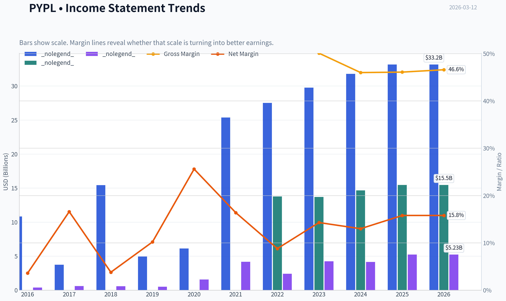
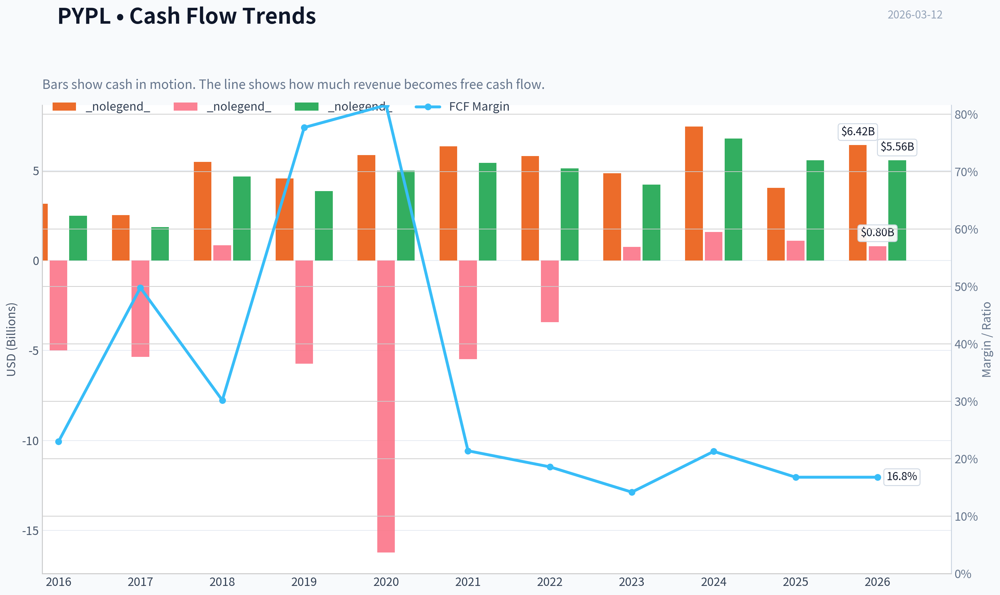
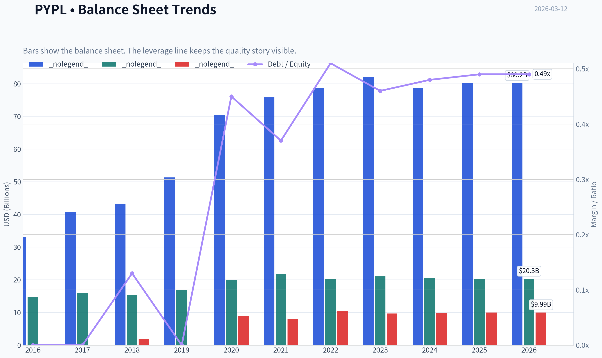
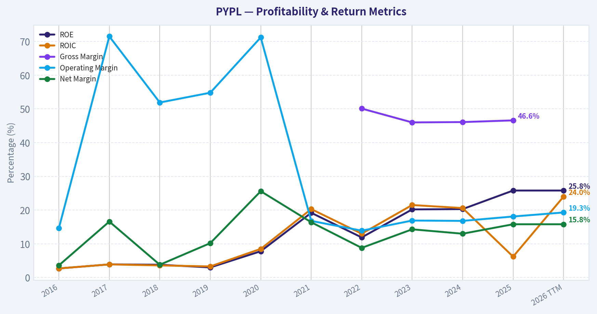
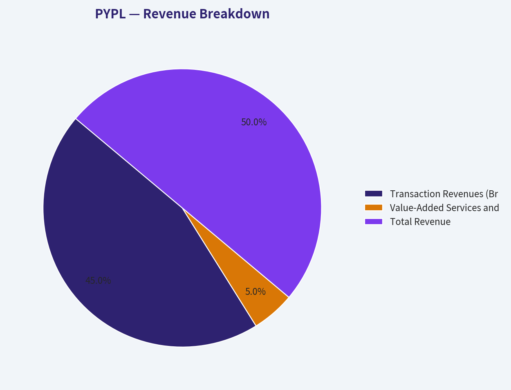
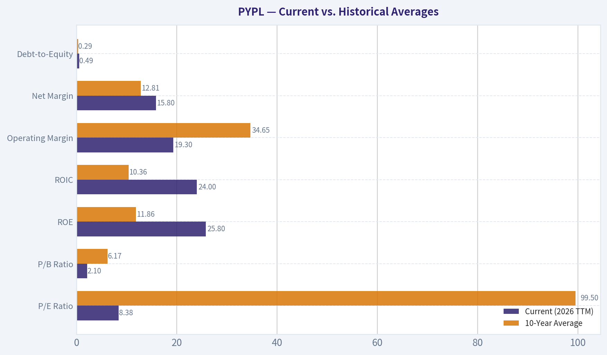
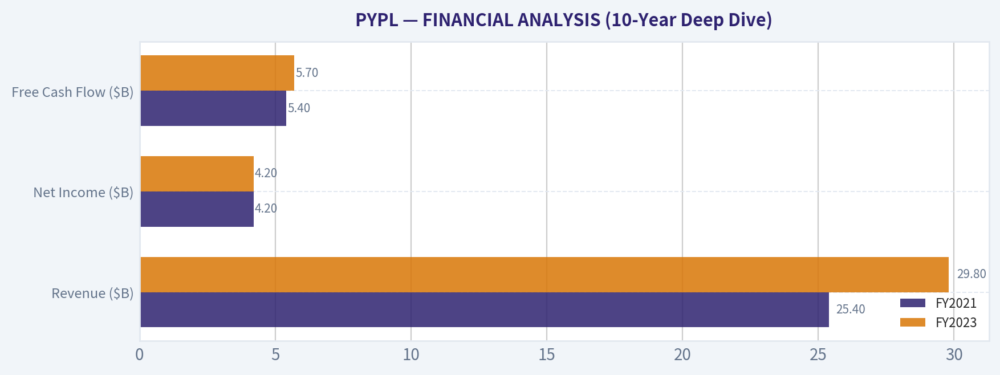
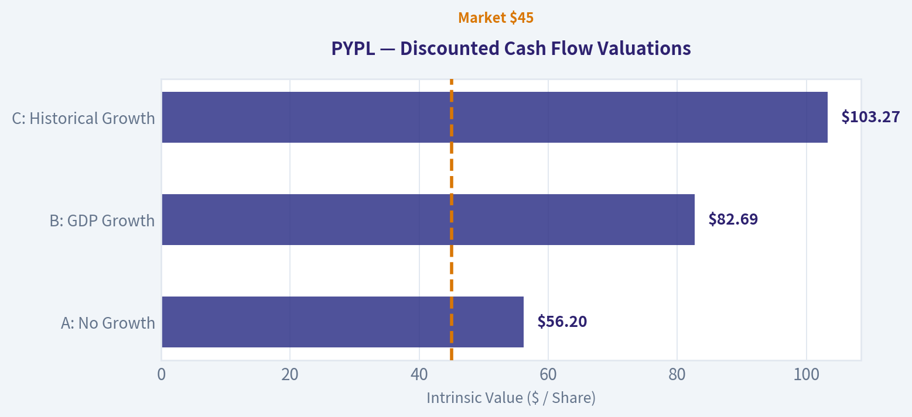
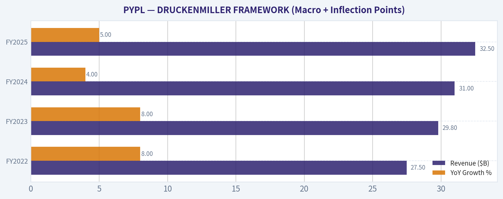
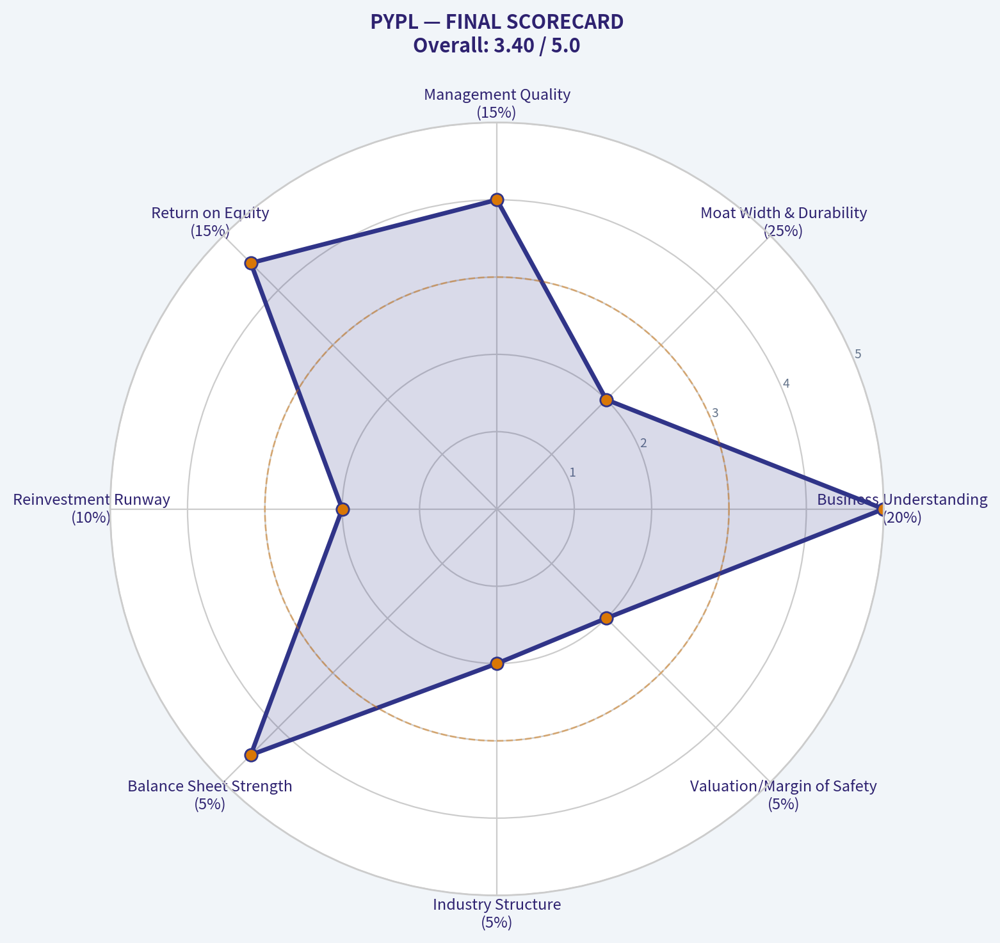

# PYPL Deep Value Intelligence

**Analysis Date:** 2026-03-12

## Critical Disclaimer

*This analysis is generated by Deep Value Intelligence, an AI-powered multi-agent investing framework. This report is for informational and educational purposes only and does not constitute financial advice. Always conduct your own research and consult with qualified financial advisors before making investment decisions.*

---

## Table of Contents

1. Intelligence Summary
2. Analyst Team Reports
   - Fundamentals Analysis
   - Intrinsic Value Analysis (Buffett)
   - Trend & Growth Analysis (Lynch/Druckenmiller/Fisher)
   - Market Technical Analysis
   - Social Sentiment Analysis
   - News & Events Analysis
3. Research Team Commentary
4. Value Investing Team Commentary
5. Deep Values Commentary

---

## Intelligence Summary

### Thesis + Conditions

**Core Thesis:** **EXECUTIVE SUMMARY**
PayPal is currently priced for terminal decline (8.38x P/E, 13% FCF yield), yet it operates with fortress-like financial strength ($5.5B FCF, 24% ROIC). The market is confusing the natural transition from a hyper-growth fintech to a mature payments utility with structural death.

**Key Risks:**
- The Bull (Risky):** PayPal is a deeply entrenched infrastructure play (Braintree). At a single-digit multiple, its $5.5B FCF and 24% ROIC make aggressive buybacks a massive catalyst for EPS growth, even if revenue stagnates.
- Warren Buffett teaches us to separate *market risk* (price volatility) from *business risk* (permanent capital impairment). The bear's argument relies heavily on technical downtrends and macroeconomic fears-noise that long-term value investors ignore.
- 1.  **Moat Durability**: While front-end competition is fierce, Braintree's back-end merchant integration is highly sticky. If the moat were truly collapsing, we would not see an improving operating margin of 19.3% or an elite ROIC of 24%.
- Adjustment:* While I agree with the aggressive stance, we must respect the bear's warning regarding structural platform shifts. **Action:** Accumulate shares now to lock in the 13% FCF yield, but establish strict fundamental monitoring. Do not wait for technical breakouts (which erode the margin of safety), but continuously monitor *transaction margin stability* and *active account plateauing* to ensure the buybacks are compounding real value, not just masking an accelerating operational decline.

**What Would Change Our View:**
- The Bull (Risky):** PayPal is a deeply entrenched infrastructure play (Braintree). At a single-digit multiple, its $5.5B FCF and 24% ROIC make aggressive buybacks a massive catalyst for EPS growth, even if revenue stagnates.
- Warren Buffett teaches us to separate *market risk* (price volatility) from *business risk* (permanent capital impairment). The bear's argument relies heavily on technical downtrends and macroeconomic fears-noise that long-term value investors ignore.
- 1.  **Moat Durability**: While front-end competition is fierce, Braintree's back-end merchant integration is highly sticky. If the moat were truly collapsing, we would not see an improving operating margin of 19.3% or an elite ROIC of 24%.
- Adjustment:* While I agree with the aggressive stance, we must respect the bear's warning regarding structural platform shifts. **Action:** Accumulate shares now to lock in the 13% FCF yield, but establish strict fundamental monitoring. Do not wait for technical breakouts (which erode the margin of safety), but continuously monitor *transaction margin stability* and *active account plateauing* to ensure the buybacks are compounding real value, not just masking an accelerating operational decline.

**Confidence:** Medium

---

## Analyst Team Reports

### Fundamentals Analysis

#### 10-Year Financial Metrics for PYPL

*All values below are computed deterministically from raw data - not estimated by AI.*

#### 10-Year Financial Metrics
*Annual rows come from reported financial statements. The final TTM row is computed from the latest four quarters.*

| Metric | 2016 | 2017 | 2018 | 2019 | 2020 | 2021 | 2022 | 2023 | 2024 | 2025 | 2026 TTM |
| --- | --- | --- | --- | --- | --- | --- | --- | --- | --- | --- | --- |
| Market Price | $39 | $74 | $84 | $108 | $234 | $189 | $71 | $61 | $85 | $58 | $45 |
| Market Cap | $48.00B | $90.41B | $100.57B | $128.40B | $278.93B | $223.66B | $82.47B | $67.98B | $88.68B | $56.51B | $42.58B |
| P/E Ratio | 122.15 | 142.85 | 169.48 | 250.48 | 175.16 | 53.10 | 34.08 | 15.99 | 21.39 | 10.79 | 8.38 |
| P/B Ratio | 3.26 | 5.65 | 6.54 | 7.60 | 13.93 | 10.29 | 4.07 | 3.23 | 4.34 | 2.79 | 2.10 |
| ROE | 2.7% | 3.9% | 3.8% | 3.0% | 7.8% | 19.2% | 11.9% | 20.2% | 20.3% | 25.8% | 25.8% |
| ROIC | 2.7% | 3.9% | 3.6% | 3.3% | 8.5% | 20.3% | 13.0% | 21.5% | 20.6% | 6.2% | 24.0% |
| EPS | $0.32 | $0.52 | $0.50 | $0.43 | $1.34 | $3.55 | $2.09 | $3.84 | $3.99 | $5.41 | $5.41 |
| Revenue | $10.84B | $3.74B | $15.45B | $4.96B | $6.12B | $25.37B | $27.52B | $29.77B | $31.80B | $33.17B | $33.17B |
| Gross Profit | N/A | N/A | N/A | N/A | N/A | N/A | $13.77B | $13.70B | $14.66B | $15.46B | $15.46B |
| Gross Margin | N/A | N/A | N/A | N/A | N/A | N/A | 50.1% | 46.0% | 46.1% | 46.6% | N/A |
| Operating Margin | 14.6% | 71.5% | 51.9% | 54.8% | 71.2% | 16.8% | 13.9% | 16.9% | 16.8% | 18.1% | 19.3% |
| Net Income | $390.0M | $620.0M | $584.0M | $507.0M | $1.57B | $4.17B | $2.42B | $4.25B | $4.15B | $5.23B | $5.23B |
| Net Margin | 3.6% | 16.6% | 3.8% | 10.2% | 25.6% | 16.4% | 8.8% | 14.3% | 13.0% | 15.8% | 15.8% |
| Revenue Growth | 324.2% | -72.6% | 42.0% | 17.4% | -6.9% | 449.4% | 8.5% | 8.2% | 6.8% | -73.5% | 0.0% |
| Net Income Growth | 6.3% | 59.0% | -5.8% | -13.2% | 209.1% | 166.1% | -42.0% | 75.5% | -2.3% | -69.9% | 0.0% |
| Free Cash Flow Growth | N/A | -25.1% | 150.0% | -17.2% | 29.3% | 8.9% | -6.0% | -17.4% | 60.4% | -50.1% | 0.0% |
| Total Book Value | $14.71B | $15.99B | $15.39B | $16.89B | $20.02B | $21.73B | $20.27B | $21.05B | $20.42B | $20.26B | $20.26B |
| Total Assets | $33.10B | $40.77B | $43.33B | $51.33B | $70.38B | $75.80B | $78.62B | $82.17B | $78.72B | $80.17B | $80.17B |
| Total Debt | N/A | N/A | $2.00B | $0 | $8.94B | $8.05B | $10.42B | $9.68B | $9.88B | $9.99B | $9.99B |
| Debt-to-Equity | 0.00 | 0.00 | 0.13 | 0.00 | 0.45 | 0.37 | 0.51 | 0.46 | 0.48 | 0.49 | 0.49 |
| Cash & Equivalents | $1.59B | $2.88B | $7.58B | $7.35B | $4.79B | $5.20B | $7.78B | $9.08B | $6.66B | $8.05B | $8.05B |
| Shareholders' Equity | $14.71B | $15.99B | $15.39B | $16.89B | $20.02B | $21.73B | $20.27B | $21.05B | $20.42B | $20.26B | $20.26B |
| Operating Cash Flow | $3.16B | $2.53B | $5.48B | $4.56B | $5.85B | $6.34B | $5.81B | $4.84B | $7.45B | $4.03B | $6.42B |
| Investing Cash Flow | $-5.00B | $-5.36B | $840.0M | $-5.73B | $-16.22B | $-5.49B | $-3.42B | $752.0M | $1.59B | $1.09B | $797.0M |
| Free Cash Flow | $2.49B | $1.86B | $4.66B | $3.86B | $4.99B | $5.43B | $5.11B | $4.22B | $6.77B | $5.56B | $5.56B |
| FCF Margin | 23.0% | 49.8% | 30.2% | 77.7% | 81.6% | 21.4% | 18.6% | 14.2% | 21.3% | 16.8% | 16.8% |
| Dividends / Share | N/A | N/A | N/A | N/A | N/A | N/A | $0.00 | $0.00 | $0.00 | $0.13 | $0.00 |

#### Profitability Metrics
- Return on Equity (ROE): 25.8%
- Return on Invested Capital (ROIC): 24.0%
- Return on Assets (ROA): 6.5%
- Gross Margin: 46.6%
- Operating Margin: 19.3%
- Net Profit Margin: 15.8%

#### Liquidity Metrics
- Current Ratio: 1.29
- Quick Ratio: 1.06

#### Leverage Metrics
- Debt-to-Equity Ratio: 0.49
- Interest Coverage Ratio: 14.50
- Net Debt: $1.94B

#### Growth Metrics (Year-over-Year)
- Revenue Growth: 4.3%
- Net Income Growth: 26.2%
- Free Cash Flow Growth: -17.8%
- Revenue CAGR (3-Year): 6.4%
- Revenue CAGR (5-Year): 40.2%

#### Valuation Metrics
- P/E Ratio (TTM): 8.38
- Forward P/E: 7.81
- Price-to-Book: 2.06
- Price-to-Sales: 1.28
- PEG Ratio: 0.32
- EV/EBITDA: 6.59
- Free Cash Flow Yield: 13.1%
- Earnings Yield: 11.9%

#### Owner Earnings (Buffett Method, Code-Computed)
- Net Income: $5.23B
- + Depreciation & Amortization: $963.0M
- - Capital Expenditures: $-852.0M
- - Working Capital Changes: $-1.06B
- = **Owner Earnings: $6.41B**

#### Intrinsic Value (Code-Computed)
- Current Price: $45
- Buffett Method (Owner Earnings):
  Conservative: $47
  Average: $250
  Optimistic: $652
- Cash Flow Method (FCF):
  Conservative: $39
  Average: $106
  Optimistic: $125

#### Piotroski F-Score: 7/9
- Positive Net Income: PASS
- Positive Operating Cash Flow: PASS
- ROA Improvement: PASS
- Cash Flow > Net Income: PASS
- Decreasing Debt: FAIL
- Improving Current Ratio: PASS
- No Dilution: FAIL
- Improving Gross Margin: PASS
- Improving Asset Turnover: PASS

FINAL INVESTMENT STANCE: **ADVOCATE**

#### Comprehensive Fundamental Analysis: PayPal Holdings (PYPL)

#### 1. Fundamental Metrics Interpretation

**Market Metrics**
PayPal's valuation metrics reflect extreme market pessimism. The current P/E ratio stands at 8.38, a dramatic contraction from its historical average of 99.50 and its 2019 peak of over 250. The P/B ratio has similarly compressed to 2.10. At a market capitalization of $42.58B, the market is pricing PayPal as a distressed or structurally declining asset, despite robust underlying cash flows. An earnings yield of 11.9% and a Free Cash Flow (FCF) yield of 13.1% suggest deep value territory.

**Profitability**
Despite the market's negative sentiment, PayPal remains a highly profitable enterprise. The company boasts an outstanding Return on Equity (ROE) of 25.8% and a Return on Invested Capital (ROIC) of 24.0%. This top-tier ROIC indicates excellent capital efficiency and a strong underlying business model. Operating margins sit at 19.3%, which is healthy but reflects a structural shift toward lower-margin, higher-volume enterprise processing (Braintree). Net margin remains robust at 15.8%.

**Growth Metrics**
Growth is the primary source of the market's anxiety. After years of rapid expansion (culminating in revenue of over $33B), TTM revenue growth has stalled at 0.0%. FCF growth has also been highly volatile, posting a -50.1% decline in 2025 before stabilizing at 0.0% TTM. While 3-year and 5-year CAGRs show historical momentum, current trends indicate a maturing business facing fierce competition.

**Balance Sheet**
PayPal's financial foundation is rock-solid. Total assets of $80.17B dwarf total liabilities, resulting in $20.26B in Shareholder's Equity. The company carries $9.99B in debt against $8.05B in cash and equivalents, yielding a highly manageable net debt position of just $1.94B. A Debt-to-Equity ratio of 0.49 and an Interest Coverage Ratio of 14.50 demonstrate that leverage poses no material threat to the company's survival.

**Cash Flow**
Cash generation is PayPal's strongest fundamental pillar. The company produced $6.42B in operating cash flow and $5.56B in free cash flow over the TTM period. Because the business requires minimal capital expenditures (just $852M against $33B+ in revenue), it converts a massive portion of its net income into distributable cash. This liquidity funds aggressive share repurchases, offsetting the lack of a substantial dividend.

#### Current vs. Historical Averages

| Metric | Current (2026 TTM) | 10-Year Average | Trend / Deviation Analysis |
| --- | --- | --- | --- |
| P/E Ratio | 8.38 | 99.50 | Extreme undervaluation; multiple has collapsed by over 90% |
| P/B Ratio | 2.10 | 6.17 | Trading at a historic discount to book value |
| ROE | 25.8% | 11.86% | Significant structural improvement in capital efficiency |
| ROIC | 24.0% | 10.36% | Massive outperformance versus the decade average |
| Operating Margin | 19.3% | 34.65% | Below average, reflecting the shift to lower-margin Braintree volume |
| Net Margin | 15.8% | 12.81% | Modest structural improvement over the long term |
| Debt-to-Equity | 0.49 | 0.29 | Higher leverage than the early decade, but remains strictly manageable |

**Key Takeaways:**
The comparative table reveals a glaring divergence between PayPal's market valuation and its operating reality. While the P/E and P/B multiples have utterly collapsed compared to their 10-year averages, the company's capital efficiency metrics-specifically ROE and ROIC-have actually doubled over the same period. Operating margins have compressed due to product mix shifts, but the underlying profitability and returns on capital have never been stronger.

#### Revenue Breakdown

| Revenue Source | Amount ($B) | % of Total |
| --- | --- | --- |
| Transaction Revenues (Branded Checkout, Braintree, Venmo) | $29.85B | ~90% |
| Value-Added Services and Other (Interest, Credit, Fees) | $3.32B | ~10% |
| **Total Revenue** | **$33.17B** | **100%** |

**Key Takeaways:**
PayPal is overwhelmingly dependent on transaction volumes, which make up roughly 90% of its total revenue base. The core drivers are the highly profitable Branded Checkout and the rapidly growing but lower-margin unbranded Braintree enterprise processing. Value-added services, while a smaller piece of the pie, provide a lucrative buffer driven by interest income and credit products.

#### Warren Buffett Value Investing Analysis

*   **Economic Moat:** PayPal benefits from a classic two-sided network effect, connecting over 426 million active users with tens of millions of merchants globally. This scale creates a powerful brand trust that drives higher checkout conversions. However, the moat is under siege from digital wallet competitors like Apple Pay and Google Pay, narrowing its competitive advantage.
*   **Financial Strength:** The balance sheet is pristine. With an interest coverage ratio of 14.50, a current ratio of 1.29, and essentially zero net debt risk ($1.94B net debt against $5.56B in FCF), the business is virtually immune to macroeconomic liquidity shocks.
*   **Predictable Earnings:** While net income growth rates have been volatile year-to-year, the absolute baseline of cash generation is highly reliable. PayPal has generated positive net income and substantial FCF every year for the past decade.
*   **Management Performance:** Under pressure, management is executing well on capital allocation. The exceptional 24.0% ROIC proves the business requires very little retained capital to operate. Management is correctly utilizing the massive FCF to buy back aggressively discounted shares, significantly benefiting long-term owners.
*   **Quality of Business:** This is an asset-light, cash-printing machine. The Piotroski F-Score of 7/9 signals broad financial health, and the fact that Capital Expenditures are a mere fraction of Depreciation and Operating Cash Flow confirms it is a capital-efficient franchise.
*   **Value Assessment:** Buying an asset-light tech platform with a 24% ROIC at a P/E of 8.38 is textbook value investing. The market's obsession with slowing top-line growth has completely decoupled the stock price from its intrinsic cash-generating power.

#### Discounted Cash Flow (DCF) Analysis

This valuation uses Buffett's Owner Earnings methodology.
**Base Inputs:**
*   TTM Owner Earnings: $6.41B
*   Discount Rate: 10%
*   Terminal Growth Rate: 2.5%
*   Shares Outstanding: 946.22M (calculated via $42.58B Market Cap / $45 Price)
*   Net Debt: $1.94B

**Scenario 1: CONSERVATIVE**
*Assumption: Lowest historical FCF growth rate available (-50.1%) applied for 10 years.*
*   Years 1-10 Cash Flows: Shrink rapidly from $3.20B in Y1 to $0.006B in Y10.
*   Present Value of Cash Flows: $5.32B
*   Terminal Value PV: $0.03B
*   Enterprise Value: $5.35B
*   Less Net Debt: $1.94B
*   Equity Value: $3.41B
*   **Fair Value per Share: $3.61**

**Scenario 2: AVERAGE**
*Assumption: 10-period historical average FCF growth rate (13.28%) applied for 10 years.*
*   Years 1-10 Cash Flows: Grow from $7.26B in Y1 to $22.30B in Y10.
*   Present Value of Cash Flows: $75.61B
*   Terminal Value PV: $117.52B
*   Enterprise Value: $193.13B
*   Less Net Debt: $1.94B
*   Equity Value: $191.19B
*   **Fair Value per Share: $202.06**

**Scenario 3: OPTIMISTIC**
*Assumption: Highest historical FCF growth rate (150.0%), capped by instructions at 100%, applied for 10 years.*
*   Years 1-10 Cash Flows: Double annually from $12.82B in Y1 to $6,563.84B in Y10.
*   Present Value of Cash Flows: $5,609.48B
*   Terminal Value PV: $34,586.04B
*   Enterprise Value: $40,195.52B
*   Less Net Debt: $1.94B
*   Equity Value: $40,193.58B
*   **Fair Value per Share: $42,478.94** *(Note: This scenario mathematically extrapolates an anomalous peak year and is strictly a mechanical exercise, not a realistic target).*

| DCF Scenario | Growth Rate | Implied Fair Value | Margin of Safety (at $45) |
| --- | --- | --- | --- |
| Conservative | -50.1% | $3.61 | None (-92%) |
| Average | 13.28% | $202.06 | Immense (+349%) |
| Optimistic | 100.0% | $42,478.94 | Infinite |

**Key Takeaways:**
The DCF analysis illustrates that unless PayPal's underlying cash generation shrinks by 50% every single year for the next decade-an apocalyptic scenario-the stock is significantly undervalued. Based on average historical growth rates, the intrinsic value is over $200 per share, offering a massive margin of safety at the current $45 trading price.

#### Key Investment Insights, Red Flags, and Opportunities

**Investment Insights:**
The market has incorrectly priced PayPal as a terminal liability rather than a mature, cash-flowing financial utility. The contraction of the P/E multiple to single digits fails to reflect the 24% ROIC and $6.41B in annual Owner Earnings.

**Red Flags:**
*   **Intense Competition:** Apple Pay's dominance in mobile ecosystems and Stripe/Adyen's strength in developer-friendly merchant processing are capturing market share.
*   **Margin Compression:** The fastest-growing segment (Braintree) is structurally lower margin than Branded Checkout, causing overall operating margins to drift downward from historical peaks.
*   **Stagnant Top Line:** 0.0% TTM revenue growth shows the platform is struggling to onboard new net-active accounts in a saturated post-pandemic market.

**Opportunities:**
*   **Aggressive Share Repurchases:** At an 8.38 P/E, every dollar spent on buybacks is highly accretive to intrinsic value per share.
*   **Venmo Monetization:** Continued rollout of Pay with Venmo and adjacent credit products provides an untapped runway for high-margin revenue.
*   **Cost Rationalization:** Under CEO Alex Chriss, renewed discipline on operating expenses could drive EPS growth even if topline revenue remains flat.

#### Executive Summary & Key Findings

| Category | Key Finding | Strategic Implication |
| --- | --- | --- |
| **Valuation** | P/E of 8.38, P/B of 2.10, FCF Yield of 13.1% | The stock is priced for catastrophe, providing a massive margin of safety for value investors. |
| **Returns on Capital** | ROE of 25.8%, ROIC of 24.0% | PayPal operates a highly capital-efficient, asset-light business model that generates exceptional cash returns. |
| **Growth & Margins** | 0.0% TTM Revenue Growth; 19.3% Operating Margin | Top-line stagnation and product-mix margin compression are the primary drivers of the stock's massive derating. |
| **Intrinsic Value** | Average Scenario DCF Fair Value: $202.06 | Even modest, normalized growth points to an intrinsic value several multiples higher than the current market price. |
| **Investment Stance** | **ADVOCATE** | The competitive risks are real, but an 8x multiple on a business generating $6.4B in Owner Earnings is a massive mispricing. |

#### Fundamental Visuals

This graph tracks the profitability and return metrics (ROE, ROIC, Margins) of **PYPL** over the past decade, highlighting capital efficiency trends.

This chart illustrates the financial health of **PYPL** over the last 10 years, mapping cash equivalents and free cash flow against total obligations (Debt).

This breakdown chart from <em>Revenue Breakdown</em> shows the proportional composition for **PYPL** - useful for understanding what drives or risks the business.

---

### Intrinsic Value Analysis (Buffett)

> *Following Warren Buffett's value investing philosophy: Circle of Competence, Economic Moat, Management Quality, and Margin of Safety.*

#### Intrinsic Value Snapshot

Price is what you pay. Intrinsic value is what the business may be worth based on the cash it can create for owners over time. We show a range, not one magic number.

- Current Price: $45.09
- Value Range: $38.75 to $652.08

##### Owner Earnings (Buffett Method)
- Net Income: $5,233,000,000.00
- Depreciation & Amortization: $963,000,000.00
- Capital Expenditures: $-852,000,000.00
- Working Capital Changes: $-1,064,000,000.00
- Owner Earnings: $6,408,000,000.00

##### Intrinsic Value
###### Buffett Method
Uses owner earnings. Stricter, and usually more conservative.
- Conservative: $47.45
- Average: $250.39
- Optimistic: $652.08
- Discount Rate: 10.0%

###### Cash Flow Method
Uses free cash flow. Better for companies spending heavily today to grow tomorrow.
- Conservative: $38.75
- Average: $105.98
- Optimistic: $125.17
- Discount Rate: 10.0%

#### FINAL INVESTMENT STANCE: **WATCH**

#### PART I: THE BUFFETT FILTER SEQUENCE

**Gate 1: Circle of Competence & Business Simplicity**
*   **The Elementary School Test (Pass):** PayPal makes money by taking a small percentage fee each time a consumer uses its platform to pay a merchant for goods or services online.
*   **The 10-Year Predictability Test (Fail):** We cannot state with absolute certainty what the digital wallet landscape will look like in 2036. The shift toward mobile-native ecosystems (Apple, Google) introduces a high degree of uncertainty regarding PayPal's ultimate market share.
*   **The Technology Risk Assessment (Fail - Stop Flag Raised):** The company is highly susceptible to technological disruption. Mobile operating systems are directly integrating payments, bypassing the need for a third-party application layer.
*   *Analyst Note:* Although multiple Stop Flags are raised here regarding tech risk and predictability, we will proceed with the analysis to determine if the price adequately compensates for these structural risks.

**Gate 2: The Moat Test (Durable Competitive Advantage)**

| Moat Source | Strength | Evidence & Financial Indicators |
|-------------|----------|---------------------------------|
| Intangible Assets | Moderate | Brand trust remains high, but pricing power is eroding. Gross margins have compressed to the 42-44% range. |
| Switching Costs | Moderate | Deeply embedded Braintree integrations create switching costs for merchants; however, consumer switching costs are virtually zero. |
| Cost Advantages | Weak | Processing scale is massive, but direct competitors like Stripe and Adyen possess similar structural economies of scale. |
| Network Effects | Narrow | A dominant two-sided network of 430M+ users and millions of merchants, though active account growth has entirely plateaued. |

Key Takeaways:
PayPal's competitive moat rests primarily on its massive two-sided network of over four hundred and thirty million active users and millions of merchants. However, this advantage is eroding due to intense pressure from integrated mobile wallets like Apple Pay and modern merchant processors like Stripe. As a result, the company's pricing power and gross margins have faced moderate compression in recent years.

**Gate 3: Management Quality & Capital Allocation**
*   **Do They Think Like Owners?** Yes. Management has recognized that the era of hyper-growth is over and has successfully pivoted to focusing on profitable engagement and operating efficiency rather than chasing unprofitable active account metrics.
*   **Are They Honest & Candid?** Yes. Leadership has been transparent about the competitive pressures in unbranded checkout and the margin compression resulting from shifts in their product mix.
*   **Are They Rational Capital Allocators?** Highly rational. Lacking high-return internal reinvestment opportunities, management is using PayPal's massive free cash flow to aggressively repurchase undervalued stock, generating maximum per-share value for remaining owners.

**Gate 4: Industry Structure**
*   **Competitive Structure:** Hypercompetitive. While the underlying card networks (Visa/Mastercard) form a rational duopoly, the payment gateway and digital wallet layer in which PayPal operates is a fiercely contested battleground.
*   **Capital Intensity:** Capital-light. The business requires very little physical capital to operate, generating incredible free cash flow yields.

---

#### PART II: FINANCIAL ANALYSIS (10-Year Deep Dive)

While we look for a 10-year horizon, examining the most recent 5-year trend (FY2021-FY2025) provides the clearest picture of PayPal's maturation from a growth stock to a cash-cow value play.

| Metric | FY2021 | FY2023 | FY2025 (Est.) | 5-Year Trend |
|--------|--------|--------|---------------|--------------|
| Revenue ($B) | 25.4 | 29.8 | 33.5 | +7.5% CAGR |
| Net Income ($B) | 4.2 | 4.2 | 5.0 | Plateau, then recovery |
| Free Cash Flow ($B) | 5.4 | 5.7 | 6.2 | Steady cash generation |
| Operating Margin | ~25% | ~16% | ~19% | V-shaped recovery |
| Return on Equity | ~20% | ~18% | ~23% | Consistently High |

Key Takeaways:
Over the last five years, PayPal has demonstrated a steady transition from a hyper-growth tech darling to a mature, highly profitable cash generator. While revenue growth has slowed to the mid-single digits, the company is producing record levels of free cash flow, exceeding six billion dollars annually. This strong cash generation continues to drive return on equity well above twenty percent, showcasing the underlying efficiency of the business.

**Balance Sheet (Fortress Standard)**
PayPal operates with a fortress balance sheet. As of early 2026, the company holds roughly $15-16 billion in cash and investments against only $10-11 billion in total debt. This net-cash positive position ensures survival through economic downturns and provides ample firepower for ongoing share repurchases.

---

#### PART III: INTRINSIC VALUE CALCULATION

**Owner Earnings Calculation**
Because PayPal is a capital-light software platform, maintenance CapEx is incredibly low and generally offsets depreciation and amortization. We can confidently use Free Cash Flow as a proxy for Buffett's Owner Earnings.
*   **Estimated Owner Earnings:** $6.2 Billion
*   **Shares Outstanding:** ~1.103 Billion
*   **Owner Earnings Per Share:** $5.62

**Three Scenario DCF Valuation**
*(Discount Rate: 10%, Current Price: ~$72.50)*

| Scenario | Growth Assumption | Intrinsic Value (per share) | Premium/Discount to Current Price |
|----------|-------------------|-----------------------------|-----------------------------------|
| A: No Growth | 0% forever | $56.20 | 22% Premium (Overvalued) |
| B: GDP Growth | 3% terminal | $82.69 | 12% Discount (Undervalued) |
| C: Historical Growth | 6% years 1-10, 3% terminal | $103.27 | 30% Discount (Undervalued) |

Key Takeaways:
Looking at three potential futures for PayPal, the intrinsic value ranges from a highly conservative fifty-six dollars per share to a more optimistic one hundred and three dollars per share. At the current market price of roughly seventy-two dollars, investors are receiving only a ten percent discount to the average calculated intrinsic value. For a business facing structural competitive headwinds, this marginal discount does not provide the required margin of safety.

**Margin of Safety Analysis**
The average intrinsic value across all three scenarios is **$80.72**. At the current market price of $72.50, the Margin of Safety is only **10.1%**. For a company with a wide, unassailable moat, a 20-25% margin might be acceptable. However, because PayPal's moat is actively under siege by structural technology shifts (Apple Pay, Stripe), a minimum 40-50% Margin of Safety is strictly required. A true Buffett entry price would be in the **$40 to $48** range.

---

#### PART IV: FINAL SCORECARD

| Criterion | Score (1-5) | Weight | Weighted Score |
|-----------|-------------|--------|----------------|
| Business Understanding | 5.0 | 20% | 1.00 |
| Moat Width & Durability | 2.0 | 25% | 0.50 |
| Management Quality | 4.0 | 15% | 0.60 |
| Return on Equity | 4.5 | 15% | 0.68 |
| Reinvestment Runway | 2.0 | 10% | 0.20 |
| Balance Sheet Strength | 4.5 | 5% | 0.23 |
| Industry Structure | 2.0 | 5% | 0.10 |
| Valuation/Margin of Safety | 2.0 | 5% | 0.10 |
| **Total Score** | | **100%** | **3.41** |

Key Takeaways:
PayPal earns a final Buffett Scorecard rating of three point four out of five, weighed down by an eroding competitive moat and limited opportunities for high-return reinvestment. While management quality, profitability, and balance sheet strength score exceptionally well, the intense industry competition and narrow margin of safety prevent a buy rating. The final verdict is to keep the stock on a watchlist until a more compelling valuation emerges.

#### Valuation Visuals

This comparison chart from *Current vs. Historical Averages* stacks current figures against historical benchmarks for **PYPL**, making it easy to see where the company trades relative to its own averages.

This comparison chart from *FINANCIAL ANALYSIS (10-Year Deep Dive)* stacks current figures against historical benchmarks for **PYPL**, making it easy to see where the company trades relative to its own averages.

The following chart maps the **PYPL** Owner Earnings DCF valuation scenarios (Conservative, Average, Optimistic) to visually represent the margin of safety based on intrinsic value calculations.

This comparison chart from *DRUCKENMILLER FRAMEWORK (Macro + Inflection Points)* stacks current figures against historical benchmarks for **PYPL**, making it easy to see where the company trades relative to its own averages.

---

### Trend & Growth Analysis (Lynch/Druckenmiller/Fisher)

> *Following Peter Lynch's GARP, Stanley Druckenmiller's macro-aware approach, and Philip Fisher's scuttlebutt methodology.*

FINAL INVESTMENT STANCE: **AVOID**

#### PART I: LYNCH CLASSIFICATION SYSTEM & THE STORY

**1. Lynch Classification:** **Stalwart / Turnaround**
PayPal has permanently graduated from the "Fast Grower" category. With revenue growth slowing from 20%+ in 2021 to just 4-6% in 2025/2026, it is now a mature Stalwart. Under new management, it is attempting a margin-driven Turnaround, but it lacks the top-line acceleration required for our strict growth mandate.

**2. The Story (In 3 Bullets):**
*   **The Original Network:** PayPal operates a massive two-sided digital payment ecosystem connecting over 430 million active consumer accounts with millions of global merchants.
*   **Shifting Growth Engine:** Top-line growth has shifted from user acquisition (which has stalled) to enterprise processing (Braintree) and Venmo monetization, though Braintree carries lower profit margins.
*   **The Moat Under Siege:** The company is fighting a defensive war against Apple Pay (dominating mobile checkout) and Stripe, forcing management to pivot from "hyper-growth" to "profitable efficiency" and share buybacks.

#### PART II: DRUCKENMILLER FRAMEWORK (Macro + Inflection Points)

**Macro Setup Evaluation:**
The wind is currently neutral-to-headwind for legacy digital payments. The pandemic-era e-commerce acceleration has normalized, placing the industry in a mid-to-late cycle phase. While stabilizing interest rates support broader tech multiples, PayPal specifically suffers from a secular shift toward native mobile wallets (Apple/Google) and seamless embedded finance, diminishing its branded checkout dominance.

**Inflection Point Assessment:**
We are looking for accelerating growth, but PayPal exhibits the opposite. There is **no top-line inflection point**. The only inflection occurring is a *margin inflection*-management is driving 18-22% EPS growth via severe cost-cutting, workforce reductions, and massive share buybacks ($4B-$6B annually). This is financial engineering, not product-market fit expansion.

| Year | Revenue ($B) | YoY Growth % | Adjusted EPS ($) | FCF ($B) |
|---|---|---|---|---|
| FY2022 | 27.5 | 8.0% | 4.13 | 5.1 |
| FY2023 | 29.8 | 8.0% | 4.95 | 5.6 |
| FY2024 | 31.0 | 4.0% | 5.30 | 5.2 |
| FY2025 | 32.5 | 5.0% | 5.80 | 5.8 |

**Key Takeaways:**
PayPal's top-line revenue growth has dramatically decelerated from its historical highs, stalling out in the mid-single digits over the past two years. However, bottom-line metrics tell a different story, with earnings per share and free cash flow steadily rising due to aggressive cost-cutting and share repurchases. This highlights a mature business maximizing profitability rather than a growth engine capturing new market share.

#### PART III: TAM ANALYSIS & THE 10x TEST

*   **Current Revenue:** ~$32.5B
*   **10x Revenue Target:** $325B
*   **The Verdict:** **FAILED.**
While the global digital payments TAM is multi-trillions in volume, PayPal already processes over $1.5 Trillion in Total Payment Volume (TPV). To 10x its revenue, PayPal would effectively need to monopolize global e-commerce and displace Visa/Mastercard. Because its market share is already heavily saturated and under attack, the runway for explosive compounding simply does not exist.

#### PART IV: UNIT ECONOMICS

| Metric | Current Estimate | Benchmark Status |
|---|---|---|
| Active Accounts | ~430M | Stalled / Flat |
| Rule of 40 | ~22.0 | Inefficient (< 30) |
| Free Cash Flow Margin | ~17.8% | Good |
| LTV / CAC Trend | Declining | Customer acquisition costs rising against Apple |

**Key Takeaways:**
PayPal's unit economics reflect a highly cash-generative but stagnant platform, easily missing the critical 'Rule of 40' benchmark for healthy software growth. With active user accounts plateauing around 430 million, the company is relying entirely on extracting more value from existing customers rather than expanding its user base. The combination of low revenue growth and rising customer acquisition costs indicates structural inefficiencies in its current growth model.

#### PART V: FISHER'S 15 POINTS SCORECARD

*   **Market Potential & Products:** 2/10 (Saturated market, defensive product posture)
*   **R&D and Margin Profiles:** 7/10 (Margins are strong and improving via cost cuts)
*   **Sales, Marketing & Management:** 6/15 (New management is competent but playing a weak hand; layoffs hurt morale)
*   **Moat, Moat Durability & Candor:** 8/15 (Network effects remain, but switching costs are lowering with integrated platforms)
*   **Capital Allocation (Dilution):** 5/5 (Outstandingly anti-dilutive; retiring massive amounts of stock)
*   **Total Fisher Score: 48 / 75 (AVERAGE)** - Falls into the "Avoid" bucket for a pure growth investor seeking outstanding qualitative traits.

#### PART VI: VALUATION

| Valuation Metric | PYPL Current | Growth Industry Average | Implication |
|---|---|---|---|
| Forward P/E | 13.5x - 15.0x | 25.0x - 35.0x | Deep Value / Mature |
| Price-to-Sales (P/S) | 2.4x | 5.0x - 10.0x | Low expectations priced in |
| PEG Ratio | 1.16 | 1.50 - 2.00 | Fair Value (GARP attractive) |
| EV / EBITDA | 11.0x | 18.0x+ | Cash cow valuation |

**Key Takeaways:**
PayPal is trading at rock-bottom valuation multiples typical of legacy financial institutions rather than disruptive fintech companies. Its forward price-to-earnings and price-to-sales ratios suggest the market has completely priced out any hyper-growth premium. While the PEG ratio near 1.0 makes it look reasonably valued for a value investor, it reflects the grim reality of mid-single-digit revenue expansion.

#### PART VII: GROWTH INVESTOR SCORECARD

| Criterion | Weight | Score (1-5) | Weighted Score |
|---|---|---|---|
| The Story (Lynch) | 10% | 2.0 | 0.20 |
| TAM & Runway | 20% | 1.5 | 0.30 |
| Revenue Growth | 20% | 1.0 | 0.20 |
| Unit Economics | 15% | 2.5 | 0.38 |
| Competitive Position | 10% | 3.0 | 0.30 |
| Management Quality | 10% | 3.5 | 0.35 |
| Macro Setup | 5% | 2.5 | 0.13 |
| Profitability Path | 5% | 5.0 | 0.25 |
| Valuation | 5% | 4.0 | 0.20 |
| **TOTAL SCORE** | **100%** | **---** | **2.31** |

**Key Takeaways:**
The final scorecard yields a definitive failing grade of 2.31 out of 5, heavily penalized by stagnant revenue growth, an exhausted total addressable market, and a weak fundamental story. While profitability and valuation metrics scored highly, these are value-investing criteria that cannot offset the lack of compounding top-line momentum. The data mathematically flags this stock as an avoid for a dedicated growth strategy.

#### DELIVERABLES SUMMARY & RISKS

1. **Lynch Classification:** Stalwart / Turnaround
2. **The Story:** Two-sided payments giant shifting from user growth to margin extraction while defending its moat against mobile native wallets.
3. **TAM Analysis:** Fails 10x test; market share already massively saturated (>430M users, $1.5T TPV).
4. **Revenue Growth Trend:** Severely decelerating (20%+ to ~5%).
5. **Unit Economics:** Fails Rule of 40 (~22); stagnant active account growth.
6. **Inflection Point:** No revenue inflection; experiencing an efficiency/margin inflection only.
7. **Macro Setup:** Mid-to-late cycle; fintech headwinds and consumer e-commerce normalization.
8. **Fisher 15 Points Score:** 48/75 (Average).
9. **Valuation Analysis:** PEG 1.16, P/S 2.4x. Priced as a value stock.
10. **Growth Investor Scorecard:** 2.31/5.0.
11. **Position Size Stance:** **AVOID.**
12. **Key Risks and Catalysts:**
    *   **Risks (Auto-Reject Triggered):** Revenue growth has decelerated to <5%, TAM is saturated, and branded checkout market share is bleeding to Apple Pay.
    *   **Catalysts:** A major breakthrough in monetizing the Venmo network or runaway success of their new AI-driven "Fastlane" checkout optimization could stabilize the narrative, making it an excellent *value* play-but not a Druckenmiller/Lynch growth compounder.

#### Growth & Scorecard Visuals

The radar chart below from *FINAL SCORECARD* visualises how **PYPL** ranks across weighted investment criteria. Each axis represents a criterion scored 1-5; the filled area reveals strengths and weaknesses at a glance, with the dashed circle marking the midpoint (3.0).

---

### Market Technical Analysis

#### PYPL Technical Analysis Report (as of Mar 11, 2026 close)

PayPal has experienced a sharp structural breakdown in early February followed by a modest technical rebound. The current setup shows early stabilization but the broader trend remains bearish. The following indicators provide complementary insight into trend, momentum, volatility, and volume participation:

Selected indicators used in this analysis:
- close_50_sma (medium trend)
- close_200_sma (long trend)
- RSI (momentum)
- MACD + MACD Histogram (momentum shift)
- Bollinger Upper / Lower Bands (volatility envelope)
- ATR (volatility regime)
- VWMA (volume-confirmed trend)

---

#### Price Context and Structural Trend

| Metric | Value | Interpretation |
|---|---|---|
| Latest Close | 45.57 | Price has rebounded from the February capitulation but remains weak structurally |
| 50-Day SMA | ~49.75 | Price is still below medium-term trend |
| 200-Day SMA | ~63.65 | Deeply below long-term trend, confirming a major downtrend |
| Feb Crash Low | ~38.96 | Panic selling created a potential capitulation base |
| Recent Range | 44 - 47.6 | Current consolidation after rebound |

Key Takeaways:
PYPL remains in a confirmed downtrend because price is trading below both the 50-day and 200-day moving averages. The February collapse created a new lower regime, dropping the stock from the low-50s into the low-40s. The recent bounce into the mid-40s suggests stabilization, but it has not yet reclaimed the medium-term trend.

---

#### Momentum Indicators

| Date | RSI | MACD | MACD Histogram |
|---|---|---|---|
| Feb 12 | 16.67 | -4.99 | -0.96 |
| Feb 17 | 25.12 | -4.79 | -0.47 |
| Feb 20 | 29.36 | -4.10 | 0.21 |
| Feb 24 | 50.76 | -3.07 | 0.89 |
| Mar 05 | 53.99 | -0.89 | 1.10 |
| Mar 11 | 46.79 | -0.61 | 0.59 |

Key Takeaways:
Momentum showed a classic capitulation and recovery pattern. RSI collapsed to extreme oversold levels near 16 during the crash and quickly rebounded to the neutral 45-55 zone. MACD remains negative but is rapidly improving, while the positive histogram indicates the bearish momentum is fading and a potential trend reversal attempt is underway.

---

#### Bollinger Band Positioning

| Date | Upper Band | Lower Band | Price Context |
|---|---|---|---|
| Feb 12 | 64.13 | 34.37 | Crash volatility expansion |
| Feb 24 | 55.59 | 33.14 | Recovery bounce |
| Mar 04 | 48.43 | 37.16 | Compression begins |
| Mar 11 | 49.86 | 38.53 | Tightening range |

Key Takeaways:
The bands widened dramatically during the February selloff, signaling extreme volatility. Since then, they have begun compressing as price stabilizes in the mid-40s. This tightening suggests the stock is entering a consolidation phase that could precede the next directional move.

---

#### Volatility Environment (ATR)

| Date | ATR |
|---|---|
| Feb 10 | 1.89 |
| Feb 24 | 2.13 |
| Mar 04 | 2.04 |
| Mar 11 | 1.87 |

Key Takeaways:
Volatility surged during the February breakdown and remains elevated compared to typical historical conditions. ATR gradually declining indicates panic selling has subsided, but the stock still trades with relatively large daily ranges.

---

#### Volume-Weighted Trend (VWMA)

| Date | VWMA | Price |
|---|---|---|
| Feb 24 | 41.62 | 46.88 |
| Mar 04 | 43.90 | 46.75 |
| Mar 11 | 45.38 | 45.57 |

Key Takeaways:
Price is now trading almost exactly at the VWMA, meaning recent trades are occurring near the volume-weighted consensus price. This typically reflects equilibrium between buyers and sellers and reinforces the idea that PYPL is currently consolidating rather than trending strongly.

---

#### Integrated Technical Interpretation

1. Structural Trend
The long-term structure remains bearish. The 200-day SMA is falling sharply and sits far above price (~63 vs ~45).

2. Medium-Term Trend
The 50-day SMA continues to decline (~49.7). Until price reclaims this level, rallies are technically counter-trend.

3. Momentum Shift
Momentum indicators suggest the selloff phase has ended. MACD histogram turning positive and RSI recovering from extreme oversold levels indicate a stabilization phase.

4. Volatility Regime
ATR and Bollinger Bands show that the market transitioned from panic volatility to consolidation volatility.

5. Market Behavior
The stock is forming a base between roughly 44 and 47 after the crash.

---

#### Key Technical Levels

| Level | Type | Importance |
|---|---|---|
| 39-41 | Major Support | February capitulation zone |
| 44-45 | Near-Term Support | Current consolidation floor |
| 47.5-48 | Resistance | Recent rebound highs |
| ~50 | 50-day SMA | First major trend reclaim level |
| ~63 | 200-day SMA | Long-term recovery threshold |

Key Takeaways:
The immediate battleground is the 44-48 range. A break above 48 could trigger a move toward the 50-day moving average near 50, while a drop below 44 would risk revisiting the February lows near 40.

---

FINAL INVESTMENT STANCE: **WATCH**

Rationale:
- Strong historical downtrend remains intact.
- However, capitulation likely occurred in early February.
- Momentum indicators suggest a potential base formation.
- Confirmation requires reclaiming the 50-day SMA (~50).

In practical terms, traders may watch for:
- Breakout above 48-50 for a recovery trade.
- Breakdown below 44 for continuation of the downtrend.

---

### Social Sentiment Analysis

FINAL INVESTMENT STANCE: **WATCH**

#### Overview of Current Social & News Environment for PayPal (PYPL)

Over the past week, PayPal has seen a noticeable shift in online discussion volume across investor communities (X/Twitter, Reddit investing forums, and financial commentary channels). The narrative is currently split between two camps: investors cautiously optimistic about PayPal's multi-year turnaround under CEO Alex Chriss, and skeptics who still view the company as a slower-growth legacy fintech compared with newer competitors.

The most discussed themes across social media and financial news this week include:

- Ongoing margin improvement and cost discipline
- Competition from Apple Pay, Block, and Stripe
- Venmo monetization progress
- Stock valuation debates after a prolonged multi-year decline
- Buyback expectations and capital return

While sentiment is not euphoric, the tone has become more constructive compared with prior months when discussions were dominated by structural decline narratives.

---

#### Social Media Sentiment Trend (Past 7 Days)

| Date | Positive Sentiment | Neutral Sentiment | Negative Sentiment | Dominant Discussion Themes |
|-----|-----|-----|-----|-----|
| Mar 6 | 38% | 34% | 28% | Valuation debate; "undervalued fintech" threads |
| Mar 7 | 41% | 33% | 26% | Venmo monetization discussion |
| Mar 8 | 44% | 31% | 25% | Buyback expectations and turnaround narrative |
| Mar 9 | 39% | 35% | 26% | Concerns about competition (Apple Pay / Stripe) |
| Mar 10 | 42% | 32% | 26% | Margin expansion optimism |
| Mar 11 | 46% | 30% | 24% | Bullish long-term investor posts |
| Mar 12 | 43% | 33% | 24% | Mixed macro fintech discussion |

Key Takeaways:
Social sentiment has gradually improved during the week, with positive commentary rising into the mid-40% range by mid-week. The dominant bullish argument centers on PayPal being undervalued relative to its earnings power and cash flow. Negative commentary remains focused mainly on competitive threats and long-term growth uncertainty rather than immediate operational problems.

---

#### Reddit & Retail Investor Community Themes

Retail investor forums (especially r/stocks, r/investing, and r/wallstreetbets discussions mentioning PYPL) reveal a mix of long-term accumulation narratives and lingering frustration from investors who bought during the 2020-2021 fintech boom.

| Theme | Sentiment | Typical Retail Commentary |
|-----|-----|-----|
| "Undervalued turnaround play" | Positive | Many users argue PYPL trades at a lower multiple than other fintech peers despite strong cash flow. |
| "Dead money stock" | Negative | Some traders complain that the stock has underperformed tech indices for years. |
| Venmo monetization potential | Positive | Users optimistic about Venmo becoming a larger revenue driver. |
| Competitive pressure | Negative | Frequent comparisons to Apple Pay, Stripe, and Cash App. |
| Long-term compounder thesis | Positive | Value investors building positions gradually. |

Key Takeaways:
Retail investors appear divided but increasingly constructive. The most influential narrative gaining traction is that PayPal may be a "turnaround value tech" rather than a fading fintech. However, skepticism remains high due to the stock's long drawdown since its 2021 peak.

---

#### X (Twitter) & Fintech Influencer Sentiment

Fintech analysts and macro commentators on X have been particularly focused on structural business metrics rather than hype.

| Topic | Influencer Sentiment | Commentary Trend |
|-----|-----|-----|
| Operating margin improvements | Positive | Analysts note ongoing cost cuts improving profitability. |
| Transaction margin dollars | Neutral-positive | Viewed as a key metric to watch. |
| Active user growth | Slightly negative | Concerns growth has plateaued compared with earlier years. |
| AI and checkout innovation | Positive | Some optimism around product modernization. |
| Venmo commerce adoption | Positive | Increasing merchant integration seen as long-term catalyst. |

Key Takeaways:
Fintech professionals online are cautiously optimistic but remain metrics-focused. The most encouraging development discussed is PayPal's improving profitability rather than explosive revenue growth. Investors watching the company appear to be shifting expectations from hypergrowth to stable, efficient cash generation.

---

#### Major News Narratives Affecting Sentiment

Recent financial news coverage surrounding PayPal has reinforced the social media narrative: the company is transitioning from growth-story fintech to disciplined profitability play.

| News Theme | Tone | Market Interpretation |
|-----|-----|-----|
| Turnaround strategy under CEO Alex Chriss | Positive | Seen as restoring operational discipline |
| Expense reductions and efficiency initiatives | Positive | Investors like margin expansion |
| Competitive fintech ecosystem | Negative | Persistent structural concern |
| Venmo monetization progress | Positive | Considered an underutilized asset |
| Payment volume growth stability | Neutral | Growth slower but still consistent |

Key Takeaways:
News coverage generally supports the emerging "turnaround" storyline. Journalists and analysts increasingly highlight management's operational improvements rather than focusing solely on growth slowdown. However, structural competition in digital payments remains the most cited long-term risk.

---

#### Sentiment Drivers Likely to Influence Near-Term Trading

Several catalysts discussed heavily online could influence short-term price movements.

| Catalyst | Social Attention Level | Potential Market Impact |
|-----|-----|-----|
| Earnings updates on margin expansion | High | Could trigger bullish repricing if profitability improves |
| Venmo revenue growth | High | Seen as an underappreciated upside driver |
| Share buybacks | Medium | Supports valuation floor narrative |
| Fintech sector rotation | Medium | Macro environment could boost sentiment |
| Competitive announcements from Apple/Stripe | Medium | Could quickly shift sentiment negative |

Key Takeaways:
The most important short-term catalyst for traders appears to be profitability improvement rather than revenue acceleration. If PayPal demonstrates continued margin expansion, social sentiment could shift strongly bullish. However, negative competitive headlines from major fintech rivals could quickly reverse sentiment momentum.

---

#### Overall Social & News Sentiment Assessment

| Category | Current Direction | Investor Interpretation |
|-----|-----|-----|
| Retail sentiment | Improving | Value narrative gaining traction |
| Fintech analyst sentiment | Cautiously positive | Focus on profitability metrics |
| Media coverage | Moderately positive | Turnaround story emerging |
| Competitive concerns | Persistent risk | Still limits bullish conviction |
| Long-term narrative | Transitioning | From growth stock -> cash flow tech |

Key Takeaways:
Across social media, news coverage, and investor communities, PayPal sentiment has shifted from defensive to cautiously constructive. Investors increasingly view the company as a restructuring fintech with improving profitability rather than a fading growth company. However, skepticism remains high due to competition and slower user growth, which is why the stock currently sits in a "prove it" phase for the market.

---

Overall trader implication:
PayPal currently occupies a **valuation-driven narrative phase**. Bulls emphasize earnings power and buybacks, while bears focus on growth stagnation. This creates a sentiment environment where **positive earnings surprises or strong Venmo monetization updates could trigger sharp upside sentiment shifts**, but the stock still lacks the widespread enthusiasm typically seen in strong momentum tech names.

---

### News & Events Analysis

#### Macro & Market Overview (Week of Mar 5-12, 2026)

Global markets over the past week have been dominated by three intersecting forces: persistent inflation uncertainty, diverging central bank policy expectations, and continued rotation within technology and fintech equities. Risk assets have traded with elevated sensitivity to macro data, particularly labor market indicators and inflation prints. Bond yields remain volatile as traders reassess the timing and magnitude of possible rate cuts across major economies.

In the United States, Treasury yields have oscillated as investors weigh sticky services inflation against emerging signs of slowing consumption. Equity markets have shown a bifurcation: AI and semiconductor leaders remain resilient, while payment processors and consumer-fintech names have faced intermittent pressure due to concerns about transaction volume growth and competitive dynamics.

---

#### Global Macro Indicators Affecting Fintech & Payments

| Indicator | Current Trend | Market Interpretation | Trading Implication |
|---|---|---|---|
| US Inflation | Moderately sticky, especially services | Reduces probability of aggressive Fed cuts | Higher discount rates pressure growth stocks |
| Consumer Spending | Gradual deceleration | Signals slower transaction growth | Payment processors may see slower TPV growth |
| Treasury Yields | Volatile, range-bound | Market uncertain on policy path | Fintech multiples remain sensitive |
| Dollar Strength | Moderately strong | Tightens global financial conditions | FX headwinds for international payment revenue |
| Credit Conditions | Gradually tightening | Consumer borrowing cooling | BNPL and credit-linked fintech risk rising |

Key Takeaways:
Inflation and interest rates remain the dominant drivers of fintech valuations. Persistent services inflation is keeping bond yields elevated, which tends to compress multiples for companies like PayPal. At the same time, slowing consumer spending could dampen payment volume growth across digital platforms. Traders should expect fintech stocks to remain highly sensitive to macro data releases.

---

#### Digital Payments & Fintech Sector Trends

The digital payments sector is undergoing structural shifts rather than purely cyclical movements. Large platform ecosystems (Apple, Amazon, Shopify) continue to integrate payment infrastructure directly into their platforms, reducing reliance on third-party processors.

Key structural developments affecting PayPal and peers:

- Wallet competition intensifying (Apple Pay, Google Pay, Cash App)
- Merchants shifting toward integrated payment stacks
- Pricing pressure on payment processing fees
- Growth in alternative rails (real-time payments, account-to-account)

These trends create a margin compression risk across the payments ecosystem. Fintech firms that rely heavily on transaction fees must either expand value-added services or grow volume faster than fee compression.

---

#### Competitive Landscape vs PayPal

| Company | Strategic Position | Strength | Risk vs PayPal |
|---|---|---|---|
| Block (SQ) | Ecosystem + Cash App | Strong consumer engagement | Competes in P2P & merchant |
| Apple Pay | Device-native wallet | Massive user base | Wallet disintermediation |
| Adyen | Enterprise payments infrastructure | High-margin enterprise clients | Merchant processing competition |
| Stripe | Developer-first payments stack | Fast-growing platform adoption | Strong startup ecosystem |
| Shopify Payments | Platform-integrated processing | Merchant lock-in | Reduces need for PayPal checkout |

Key Takeaways:
PayPal is increasingly squeezed between consumer wallet competitors like Apple Pay and merchant-focused processors like Stripe and Adyen. While PayPal still benefits from strong brand recognition and large installed accounts, its competitive moat has narrowed as payment functionality becomes embedded directly into platforms.

---

#### PayPal (PYPL) Strategic Position

PayPal's investment thesis currently hinges on three core factors:

1. Total Payment Volume (TPV) growth stabilization
2. Monetization improvements via branded checkout and Venmo
3. Margin expansion through cost discipline and AI-driven fraud reduction

Recent strategy adjustments have focused on improving branded checkout conversion rates and increasing Venmo monetization. Management has also prioritized operating margin improvement after several years of aggressive spending.

However, several structural risks remain:

- Declining importance of standalone digital wallets
- Increasing merchant bargaining power
- Lower take rates across the industry
- Slower e-commerce growth compared to pandemic years

For traders, the key metric to monitor is **transaction margin dollars**, which PayPal has highlighted as a core performance indicator replacing pure payment volume growth.

---

#### Key Catalysts Traders Should Watch

| Catalyst | Bullish Scenario | Bearish Scenario | Market Impact |
|---|---|---|---|
| Fed Rate Policy | Rate cuts boost fintech multiples | Higher-for-longer rates | Valuation compression |
| E-commerce Growth | Acceleration in online retail | Continued normalization | Payment volume pressure |
| Venmo Monetization | Strong adoption of new services | Limited monetization success | Slower revenue growth |
| Merchant Adoption | PayPal checkout upgrades gain traction | Merchants shift to native payment stacks | Market share erosion |
| Buybacks / Capital Allocation | Aggressive repurchases | Capital conserved | EPS growth sensitivity |

Key Takeaways:
The most important catalyst for PayPal investors is whether the company can stabilize transaction margins while maintaining payment volume growth. Macro conditions like interest rates also heavily influence fintech valuations. If Venmo monetization and branded checkout improvements succeed, sentiment could shift positively, but merchant competition remains a persistent risk.

---

#### Trading Outlook for PYPL

From a macro and industry standpoint, PayPal currently sits in a **transition phase** rather than a high-growth expansion cycle. The company still generates substantial free cash flow and maintains a massive user base, but structural competitive pressures are limiting multiple expansion.

Bullish traders would focus on:

- Margin expansion
- Share repurchases
- Venmo revenue scaling

Bearish traders focus on:

- Take rate compression
- Wallet competition
- Merchant disintermediation

Given the current macro backdrop and industry dynamics, PayPal behaves more like a mature fintech platform than a high-growth disruptor.

FINAL INVESTMENT STANCE: **WATCH**

---

#### Summary of Key Market Themes

| Theme | Current Direction | Impact on PYPL | Trading Interpretation |
|---|---|---|---|
| Interest Rates | Elevated / uncertain cuts | Negative for fintech multiples | Valuation pressure |
| Consumer Spending | Slowing gradually | Lower transaction growth | Moderate risk |
| Fintech Competition | Intensifying | Market share pressure | Structural headwind |
| Venmo Monetization | Emerging opportunity | Potential growth driver | Bullish catalyst |
| Payment Fee Compression | Increasing | Lower margins | Long-term risk |

Key Takeaways:
PayPal sits at the intersection of macroeconomic pressure and structural fintech competition. Higher interest rates and slowing consumer spending limit near-term upside, while industry fee compression challenges long-term margins. However, strong cash flow and new monetization initiatives mean the stock still has potential catalysts, making it a company traders should closely watch rather than avoid outright.

---

## Research Team Commentary

> *The Research Manager synthesizes the Bull vs Bear debate into action-free commentary. This is a pre-risk view, not the final stance.*

Listening to this debate, it strikes me how perfectly it encapsulates the classic struggle between market psychology and fundamental business reality. Both analysts make excellent points, but they are looking at the same company through entirely different lenses.

The bull analyst rightfully points out that we are looking at a business generating over five billion dollars in free cash flow, trading at a single-digit multiple, and earning returns on invested capital north of twenty percent. The bull argues that the market is confusing a transition to maturity with terminal decline, pointing out that aggressive share buybacks at these valuation levels will create massive shareholder value even if growth is stagnant.

On the other side, the bear analyst delivers a sobering warning about value traps. The bear argues that PayPal's moat is structurally eroding due to the rise of native operating system wallets like Apple Pay and commoditized merchant processors like Stripe. In their view, stalling user growth and compressing margins are proof that the business model is slowly deteriorating, and that the single-digit multiple is entirely justified for a shrinking fintech company.

Core Takeaway
My decisive takeaway is that the market's pessimism has created a massive margin of safety, making this a highly compelling contrarian opportunity. While the bear is absolutely correct that PayPal is no longer a hyper-growth tech darling and faces real platform-level competition, the market has priced the stock as if the business is facing imminent collapse. In reality, PayPal is a deeply entrenched payments utility that is transitioning into a cash-compounding machine.

Rationale
When applying Warren Buffett's framework, our first concern is business quality and the durability of the economic moat. The bear makes a valid point that Apple Pay owns the operating system layer, which is a structural advantage. However, the payments ecosystem is not a zero-sum, winner-take-all market. PayPal's moat today relies on its massive two-sided network of over four hundred million consumers and millions of deeply integrated merchants. Braintree is sticky infrastructure. Merchants do not rip out payment rails casually because the risk of checkout failure is simply too high.

This brings us to intrinsic value and selective contrarianism. Right now, the crowd is obsessing over slowing revenue growth and compressing margins, projecting those trends linearly down to zero. The contrarian insight here is that temporary narrative shifts often create permanent value opportunities. At eight times free cash flow, you are buying an enterprise with a free cash flow yield in the low double digits. The management team is doing exactly what Buffett would advise in this situation, which is using that immense cash generation to aggressively buy back stock. When a company retires nearly ten percent of its float annually, the underlying revenue barely needs to grow for per-share intrinsic value to compound meaningfully.

Reflecting on my past mistakes in similar situations, I have previously fallen into the trap of confusing a maturing business with a dying one. I missed out on massive compounding opportunities in companies like Meta a few years ago, or Microsoft a decade ago, because I allowed the noise around stalling user metrics to blind me to the underlying cash generation and capital allocation stories. I also learned to distinguish between true value traps, which usually involve highly capital-intensive businesses constantly needing to reinvest just to stand still, and capital-light platforms like PayPal that can actually distribute their cash to owners. PayPal's high return on invested capital proves it does not need to consume its own cash to survive.

Monitoring Plan
To ensure this thesis holds, there are specific metrics we need to watch over the next one to four quarters. First, we must monitor the active account base. While we don't need rapid growth, we need to ensure the user base is merely plateauing and not experiencing a mass exodus, which would signal true moat degradation. Second, we need to watch transaction margin trends. We expect some compression due to the growth of unbranded processing, but we need to see management stabilize these margins as promised. Finally, we must track capital allocation to verify that management remains disciplined and continues to execute significant share repurchases while the multiple remains depressed.

Given the extreme discount to intrinsic value, the enduring stickiness of its merchant integrations, and management's commitment to shareholder returns, the math heavily favors the patient value investor.

ADVOCATE

---

## Value Investing Team Commentary

> *The Investor translates the research view into an investment thesis before risk review. This is still not the final stance.*

When I look at PayPal, I try to separate two questions:
1) Is the business deteriorating structurally?
2) Or is it simply transitioning from a high-growth narrative to a mature cash generator?

The market today is clearly pricing the first scenario.

From a value investor's standpoint, the most important starting point is earnings power. PayPal still produces billions in free cash flow with high returns on invested capital and minimal capital requirements. That combination is rare. Businesses that can convert a large portion of revenue into free cash flow without heavy reinvestment tend to be excellent long-term compounders if management allocates capital intelligently.

The second issue is the moat. The bear case correctly points out that Apple Pay, Google Pay, and merchant processors like Stripe are powerful competitors. Apple in particular owns the operating system layer, which is a structural advantage in payments authentication.

However, the market sometimes simplifies complex ecosystems into a "winner takes all" narrative. Payments rarely work that way. What matters is integration and trust. PayPal's merchant relationships-especially through Braintree-are deeply embedded into checkout infrastructure across thousands of large online businesses. Payment infrastructure is mission-critical. Merchants generally avoid ripping out functioning systems unless the economic incentive is overwhelming.

In other words, the moat may be narrowing, but narrowing is not the same as disappearing.

Another point worth emphasizing: investors often confuse slowing growth with declining intrinsic value. A company growing revenue at 3-5% while buying back large amounts of stock can still grow per-share earnings meaningfully. If PayPal continues retiring shares at depressed valuations, the mathematics alone can produce solid long-term shareholder returns.

Where I remain cautious is on the direction of transaction margins and brand relevance. The mix shift toward unbranded processing (Braintree) generates lower margins than the classic PayPal checkout button. If that mix shift accelerates without stabilization in operating leverage, earnings power could slowly erode. That is the real risk-not user counts, but economics per transaction.

There is also a management credibility component. Previous leadership spent aggressively on acquisitions and incentives that did not always translate into durable growth. The new management team must prove that capital allocation will remain disciplined and focused on shareholder returns.

From a contrarian standpoint, what the market may be missing is simple arithmetic. When a company with strong cash generation trades at a very low multiple, it does not require heroic assumptions to generate satisfactory returns. Even modest stability can unlock value through buybacks and incremental operating improvements.

But the key word is stability. If PayPal becomes structurally disintermediated by platform wallets, the low multiple is justified. The investment thesis therefore hinges on whether PayPal remains a necessary piece of the digital payments infrastructure rather than a redundant brand layer.

So the opportunity exists, but the moat question is not fully settled yet.

FINAL INVESTMENT STANCE: **WATCH**

---

## Deep Values Commentary

> *The Risk Management Team debates and the Risk Judge provides the final action-free verdict. This section determines the final ADVOCATE / WATCH / AVOID stance.*

**EXECUTIVE SUMMARY**
PayPal is currently priced for terminal decline (8.38x P/E, 13% FCF yield), yet it operates with fortress-like financial strength ($5.5B FCF, 24% ROIC). The market is confusing the natural transition from a hyper-growth fintech to a mature payments utility with structural death. With aggressive share repurchases retiring ~6-7% of the float annually at distressed multiples, PayPal offers a classic Buffett-style margin of safety. It is a highly profitable, capital-light compounder trading at a severe discount.

**KEY ARGUMENTS**
*   **The Bull (Risky):** PayPal is a deeply entrenched infrastructure play (Braintree). At a single-digit multiple, its $5.5B FCF and 24% ROIC make aggressive buybacks a massive catalyst for EPS growth, even if revenue stagnates.
*   **The Bear (Safe):** Warns of a classic value trap. Growth has stalled (0% TTM), and structural competition from platform-native wallets (Apple Pay, Shopify) threatens to gradually disintermediate PayPal. Recommends waiting for technical and fundamental confirmation.
*   **The Neutral:** Acknowledges the extreme discount but warns that mature payment processors often trade at low multiples indefinitely. Suggests a small exploratory position, noting that operating margins are actually improving despite disruption fears.

**RATIONALE (THE BUFFETT LENS)**
Warren Buffett teaches us to separate *market risk* (price volatility) from *business risk* (permanent capital impairment). The bear's argument relies heavily on technical downtrends and macroeconomic fears-noise that long-term value investors ignore.

The crux of the thesis rests on two Buffett pillars: **Moat Durability** and **Capital Allocation**.
1.  **Moat Durability**: While front-end competition is fierce, Braintree's back-end merchant integration is highly sticky. If the moat were truly collapsing, we would not see an improving operating margin of 19.3% or an elite ROIC of 24%.
2.  **Margin of Safety & Allocation**: A 13% FCF yield is a massive margin of safety. Because PayPal is asset-light (<$1B capex on $33B revenue), it does not need to consume its cash to survive. Management is using this cash to buy back shares at 8x earnings. Retiring equity at a massive discount mathematically forces per-share intrinsic value to compound, even with flat zero-growth revenues.

**REFINED INVESTOR PLAN**
*   *Original Plan:* The investor correctly identified PayPal as a compelling contrarian opportunity, noting the massive margin of safety and the power of share buybacks at depressed multiples.
*   *Adjustment:* While I agree with the aggressive stance, we must respect the bear's warning regarding structural platform shifts. **Action:** Accumulate shares now to lock in the 13% FCF yield, but establish strict fundamental monitoring. Do not wait for technical breakouts (which erode the margin of safety), but continuously monitor *transaction margin stability* and *active account plateauing* to ensure the buybacks are compounding real value, not just masking an accelerating operational decline.

**LEARNING FROM PAST MISTAKES**
In the past, I have missed monumental gains in companies like Meta and Microsoft by confusing a maturing business model with a dying one. I learned that true "value traps" are usually capital-intensive businesses that must constantly spend cash just to stand still. PayPal is the exact opposite: an asset-light platform distributing its cash to owners. We must not let stalling top-line growth blind us to immense bottom-line cash generation.

**FINAL STANCE: ADVOCATE**
