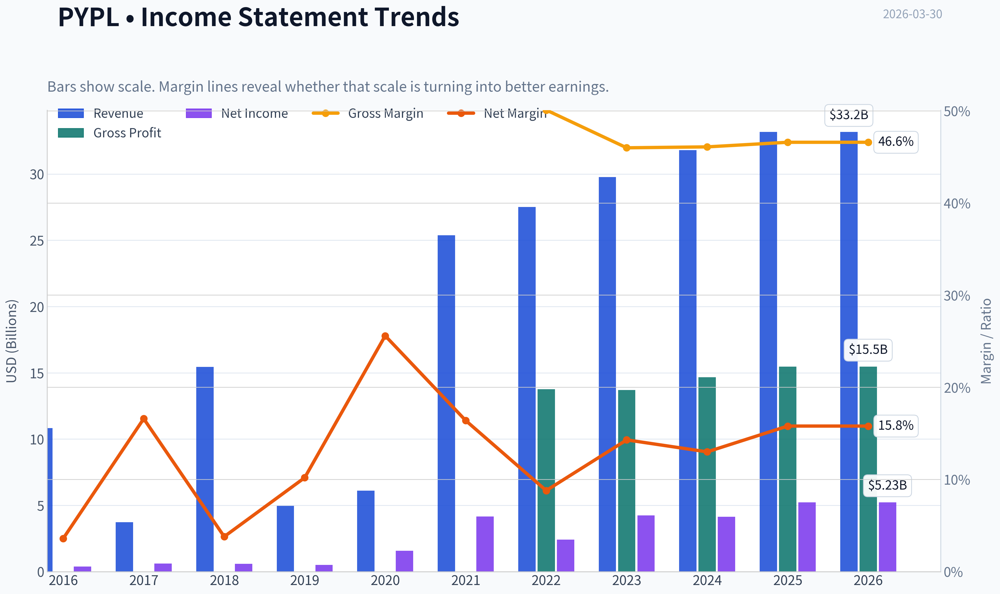
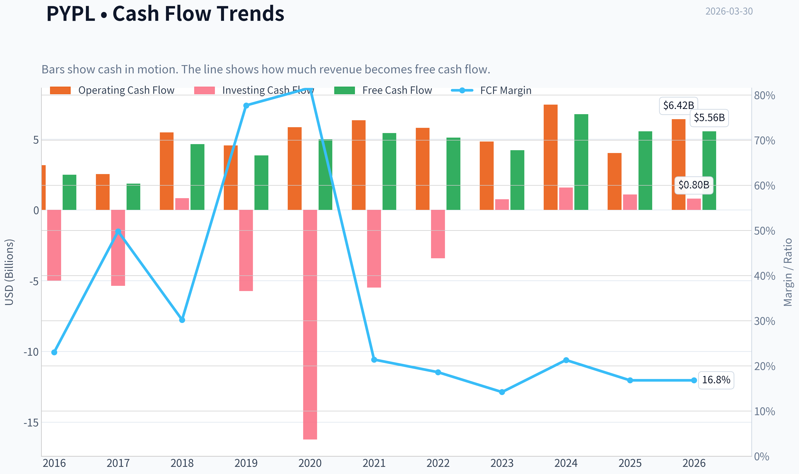
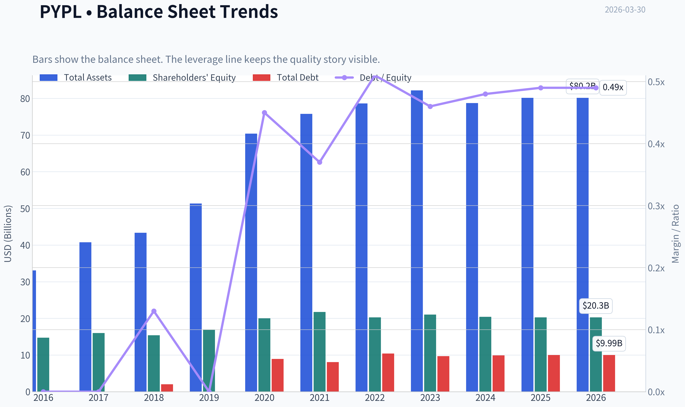
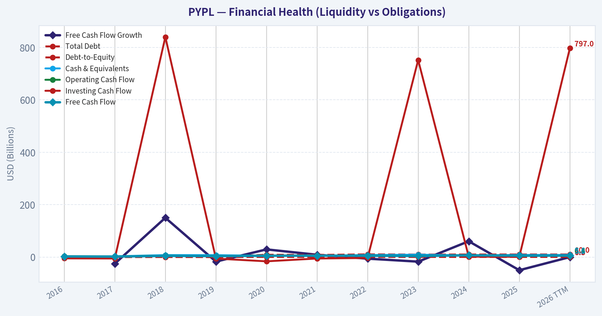
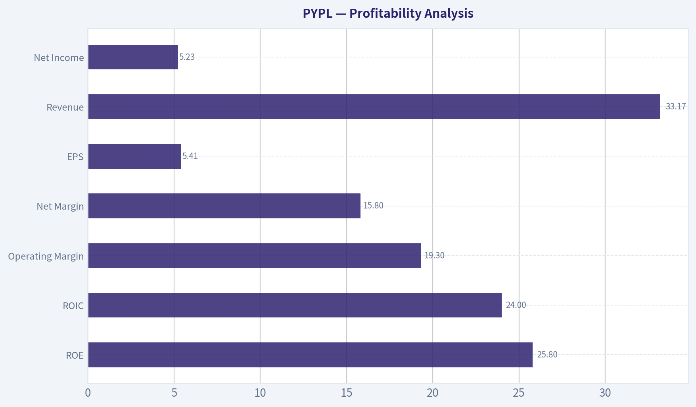
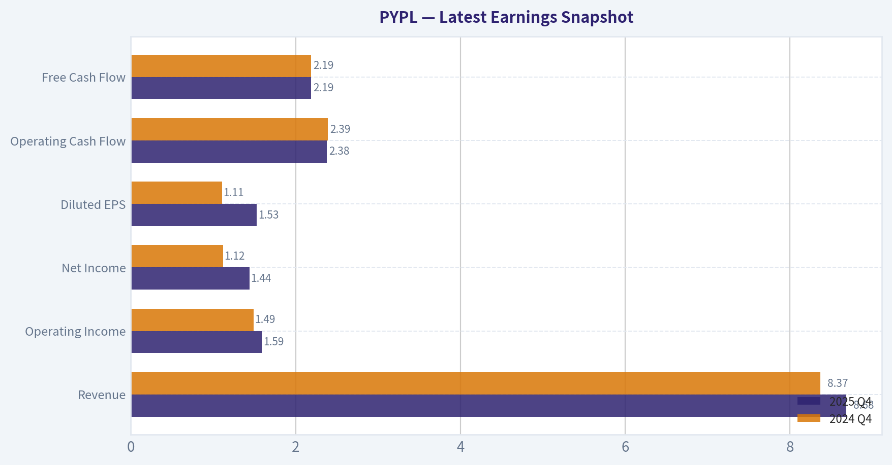
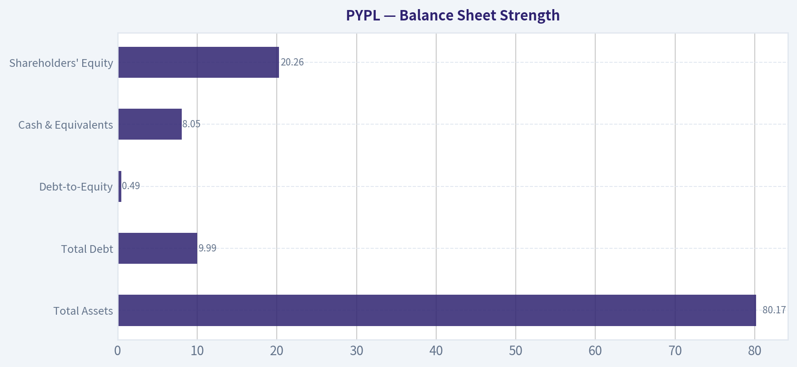
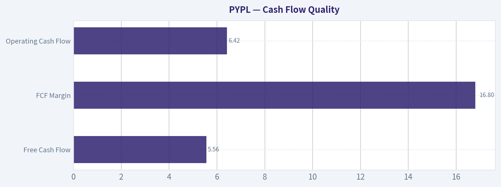
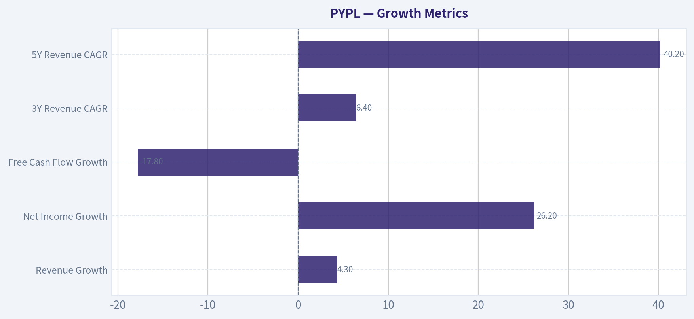
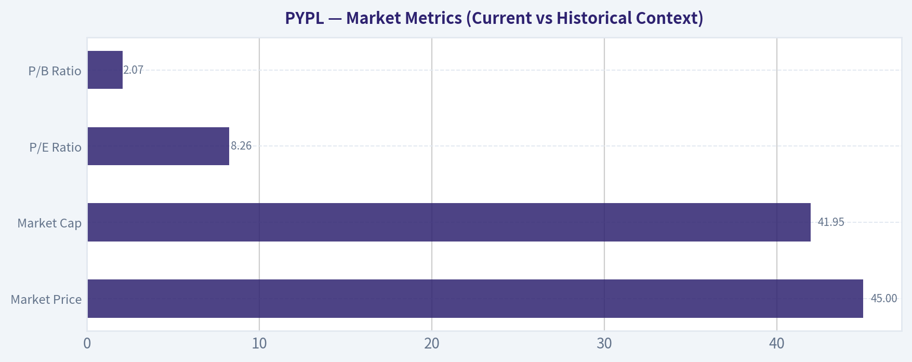

# PYPL Deep Value Intelligence

**Analysis Date:** 2026-03-30

## Critical Disclaimer

*This analysis is generated by Deep Value Intelligence, an AI-powered multi-agent investing framework. This report is for informational and educational purposes only and does not constitute financial advice. Always conduct your own research and consult with qualified financial advisors before making investment decisions.*

---

## Table of Contents

1. Intelligence Summary
2. Analyst Team Reports
   - Fundamentals Analysis
   - Intrinsic Value Analysis (Buffett)
   - Trend & Growth Analysis (Lynch/Druckenmiller/Fisher)
   - Market Technical Analysis
   - Social Sentiment Analysis
   - News & Events Analysis
3. Research Team Commentary
4. Value Investing Team Commentary
5. Deep Values Commentary

---

## Intelligence Summary

### Thesis + Conditions

**Core Thesis:** Executive Summary
PayPal is priced like a declining business (P/E ~8) despite still generating elite returns on capital (~24-26%). That mismatch creates potential value.

**Key Risks:**
- PayPal is priced like a declining business (P/E ~8) despite still generating elite returns on capital (~24-26%). That mismatch creates potential value. However, the debate shows a real strategic uncertainty: payment volume is growing but increasingly through lower-margin channels, while platform ecosystems (Apple, Shopify, Stripe) are moving closer to the point of transaction control. The business is not broken, but the durability of its moat is no longer obvious. For a Buffett-style investor focused on long-term franchise strength, the correct posture is patience. The valuation is attractive, yet confirmation that earnings power and checkout relevance are stabilizing is still needed. Final stance: WATCH.
- Risky Analyst
- The bullish thesis centers on the disconnect between PayPal's profitability and its depressed valuation. With ROE around 26% and ROIC near 24%, the company still behaves like a high-quality franchise rather than a deteriorating one. The argument is that markets rarely leave businesses with those economics trading at single-digit earnings multiples unless sentiment is excessively pessimistic. PayPal's massive two-sided network, 400M+ accounts, and deep merchant integrations-particularly through Braintree-create switching costs that make displacement difficult. At an 8x multiple, buybacks effectively produce a ~12-13% earnings yield, meaning even modest earnings stability could drive strong per-share compounding. Venmo monetization represents additional upside optionality.
- The cautious case focuses on the trajectory of the economics rather than current profitability. Revenue growth has slowed to about 4%, while free cash flow declined roughly 18% year over year. This suggests the core business may be losing momentum despite strong industry growth. Net income growth appears driven more by cost control than by expansion of the underlying franchise. Braintree's rising share of volume may also be diluting economics due to lower take rates. Meanwhile, ecosystem players-Apple at the device layer, Shopify at checkout, Stripe at infrastructure-are increasingly positioned closer to transaction origination, where pricing power typically resides. If PayPal is pushed toward commodity processing, today's earnings may not be durable.
- The middle ground recognizes that neither collapse nor revival is clearly visible yet. PayPal's profitability metrics remain strong, which argues against a broken business. At the same time, slowing revenue growth and declining free cash flow suggest the economics may be gradually shifting. The key insight is that scale matters: networks of PayPal's size rarely disappear quickly, but they can slowly lose pricing power. Therefore, the situation is best viewed as a potentially mispriced franchise with unresolved structural risks.

**What Would Change Our View:**
- PayPal is priced like a declining business (P/E ~8) despite still generating elite returns on capital (~24-26%). That mismatch creates potential value. However, the debate shows a real strategic uncertainty: payment volume is growing but increasingly through lower-margin channels, while platform ecosystems (Apple, Shopify, Stripe) are moving closer to the point of transaction control. The business is not broken, but the durability of its moat is no longer obvious. For a Buffett-style investor focused on long-term franchise strength, the correct posture is patience. The valuation is attractive, yet confirmation that earnings power and checkout relevance are stabilizing is still needed. Final stance: WATCH.
- Risky Analyst
- The bullish thesis centers on the disconnect between PayPal's profitability and its depressed valuation. With ROE around 26% and ROIC near 24%, the company still behaves like a high-quality franchise rather than a deteriorating one. The argument is that markets rarely leave businesses with those economics trading at single-digit earnings multiples unless sentiment is excessively pessimistic. PayPal's massive two-sided network, 400M+ accounts, and deep merchant integrations-particularly through Braintree-create switching costs that make displacement difficult. At an 8x multiple, buybacks effectively produce a ~12-13% earnings yield, meaning even modest earnings stability could drive strong per-share compounding. Venmo monetization represents additional upside optionality.
- The cautious case focuses on the trajectory of the economics rather than current profitability. Revenue growth has slowed to about 4%, while free cash flow declined roughly 18% year over year. This suggests the core business may be losing momentum despite strong industry growth. Net income growth appears driven more by cost control than by expansion of the underlying franchise. Braintree's rising share of volume may also be diluting economics due to lower take rates. Meanwhile, ecosystem players-Apple at the device layer, Shopify at checkout, Stripe at infrastructure-are increasingly positioned closer to transaction origination, where pricing power typically resides. If PayPal is pushed toward commodity processing, today's earnings may not be durable.
- The middle ground recognizes that neither collapse nor revival is clearly visible yet. PayPal's profitability metrics remain strong, which argues against a broken business. At the same time, slowing revenue growth and declining free cash flow suggest the economics may be gradually shifting. The key insight is that scale matters: networks of PayPal's size rarely disappear quickly, but they can slowly lose pricing power. Therefore, the situation is best viewed as a potentially mispriced franchise with unresolved structural risks.

**Confidence:** Low

---

## Analyst Team Reports

### Fundamentals Analysis

#### Latest Earnings Snapshot

*Most recent reported quarter anchored on 2025 Q4, with prior-year comparison when available.*

| Metric | 2025 Q4 | 2024 Q4 | YoY Change |
| --- | ---: | ---: | ---: |
| Revenue | $8.68B | $8.37B | +3.7% |
| Operating Income | $1.59B | $1.49B | +6.7% |
| Net Income | $1.44B | $1.12B | +28.2% |
| Diluted EPS | $1.53 | $1.11 | +37.8% |
| Operating Cash Flow | $2.38B | $2.39B | -0.4% |
| Free Cash Flow | $2.19B | $2.19B | -0.0% |

Key Takeaways: This snapshot anchors the most recent reported quarter before the narrative analysis. It helps readers separate long-run business quality from whatever changed in the latest earnings print.

#### 10-Year Financial Metrics for PYPL

*All values below are computed deterministically from raw data - not estimated by AI.*

*Issuer profile: bank (Financial Services / Credit Services).*

#### 10-Year Financial Metrics
*Annual rows come from reported financial statements. The final TTM row is computed from the latest four quarters.*

| Metric | 2016 | 2017 | 2018 | 2019 | 2020 | 2021 | 2022 | 2023 | 2024 | 2025 | 2026 TTM |
| --- | --- | --- | --- | --- | --- | --- | --- | --- | --- | --- | --- |
| Market Price | $39 | $74 | $84 | $108 | $234 | $189 | $71 | $61 | $85 | $58 | $45 |
| Market Cap | $48.00B | $90.41B | $100.57B | $128.40B | $278.93B | $223.66B | $82.47B | $67.98B | $88.68B | $56.51B | $41.95B |
| P/E Ratio | 122.15 | 142.85 | 169.48 | 250.48 | 175.16 | 53.10 | 34.08 | 15.99 | 21.39 | 10.79 | 8.26 |
| P/B Ratio | 3.26 | 5.65 | 6.54 | 7.60 | 13.93 | 10.29 | 4.07 | 3.23 | 4.34 | 2.79 | 2.07 |
| ROE | 2.7% | 3.9% | 3.8% | 3.0% | 7.8% | 19.2% | 11.9% | 20.2% | 20.3% | 25.8% | 25.8% |
| ROIC | 2.7% | 3.9% | 3.6% | 3.3% | 8.5% | 20.3% | 13.0% | 21.5% | 20.6% | 6.2% | 24.0% |
| EPS | $0.32 | $0.52 | $0.50 | $0.43 | $1.34 | $3.55 | $2.09 | $3.84 | $3.99 | $5.41 | $5.41 |
| Revenue | $10.84B | $3.74B | $15.45B | $4.96B | $6.12B | $25.37B | $27.52B | $29.77B | $31.80B | $33.17B | $33.17B |
| Gross Profit | N/A | N/A | N/A | N/A | N/A | N/A | $13.77B | $13.70B | $14.66B | $15.46B | $15.46B |
| Gross Margin | N/A | N/A | N/A | N/A | N/A | N/A | 50.1% | 46.0% | 46.1% | 46.6% | 46.6% |
| Operating Margin | 14.6% | 71.5% | 51.9% | 54.8% | 71.2% | 16.8% | 13.9% | 16.9% | 16.8% | 18.1% | 19.3% |
| Net Income | $390.0M | $620.0M | $584.0M | $507.0M | $1.57B | $4.17B | $2.42B | $4.25B | $4.15B | $5.23B | $5.23B |
| Net Margin | 3.6% | 16.6% | 3.8% | 10.2% | 25.6% | 16.4% | 8.8% | 14.3% | 13.0% | 15.8% | 15.8% |
| Revenue Growth | 324.2% | -72.6% | 42.0% | 17.4% | -6.9% | 449.4% | 8.5% | 8.2% | 6.8% | -73.5% | 0.0% |
| Net Income Growth | 6.3% | 59.0% | -5.8% | -13.2% | 209.1% | 166.1% | -42.0% | 75.5% | -2.3% | -69.9% | 0.0% |
| Free Cash Flow Growth | N/A | -25.1% | 150.0% | -17.2% | 29.3% | 8.9% | -6.0% | -17.4% | 60.4% | -50.1% | 0.0% |
| Total Book Value | $14.71B | $15.99B | $15.39B | $16.89B | $20.02B | $21.73B | $20.27B | $21.05B | $20.42B | $20.26B | $20.26B |
| Total Assets | $33.10B | $40.77B | $43.33B | $51.33B | $70.38B | $75.80B | $78.62B | $82.17B | $78.72B | $80.17B | $80.17B |
| Total Debt | N/A | N/A | $2.00B | $0 | $8.94B | $8.05B | $10.42B | $9.68B | $9.88B | $9.99B | $9.99B |
| Debt-to-Equity | 0.00 | 0.00 | 0.13 | 0.00 | 0.45 | 0.37 | 0.51 | 0.46 | 0.48 | 0.49 | 0.49 |
| Cash & Equivalents | $1.59B | $2.88B | $7.58B | $7.35B | $4.79B | $5.20B | $7.78B | $9.08B | $6.66B | $8.05B | $8.05B |
| Shareholders' Equity | $14.71B | $15.99B | $15.39B | $16.89B | $20.02B | $21.73B | $20.27B | $21.05B | $20.42B | $20.26B | $20.26B |
| Operating Cash Flow | $3.16B | $2.53B | $5.48B | $4.56B | $5.85B | $6.34B | $5.81B | $4.84B | $7.45B | $4.03B | $6.42B |
| Investing Cash Flow | $-5.00B | $-5.36B | $840.0M | $-5.73B | $-16.22B | $-5.49B | $-3.42B | $752.0M | $1.59B | $1.09B | $797.0M |
| Free Cash Flow | $2.49B | $1.86B | $4.66B | $3.86B | $4.99B | $5.43B | $5.11B | $4.22B | $6.77B | $5.56B | $5.56B |
| FCF Margin | 23.0% | 49.8% | 30.2% | 77.7% | 81.6% | 21.4% | 18.6% | 14.2% | 21.3% | 16.8% | 16.8% |
| Dividends / Share | N/A | N/A | N/A | N/A | N/A | N/A | $0.00 | $0.00 | $0.00 | $0.13 | $0.00 |

#### Profitability Metrics
- Return on Equity (ROE): 25.8%
- Return on Invested Capital (ROIC): 24.0%
- Return on Assets (ROA): 6.5%
- Gross Margin: 46.6%
- Operating Margin: 19.3%
- Net Profit Margin: 15.8%

#### Liquidity Metrics
- Current Ratio: 1.29
- Quick Ratio: 1.06

#### Leverage Metrics
- Debt-to-Equity Ratio: 0.49
- Interest Coverage Ratio: 14.50
- Net Debt: $1.94B

#### Growth Metrics (Year-over-Year)
- Revenue Growth: 4.3%
- Net Income Growth: 26.2%
- Free Cash Flow Growth: -17.8%
- Revenue CAGR (3-Year): 6.4%
- Revenue CAGR (5-Year): 40.2%

#### Valuation Metrics
- P/E Ratio (TTM): 8.26
- Forward P/E: 7.71
- Price-to-Book: 2.03
- Price-to-Sales: 1.26
- PEG Ratio: 0.32
- EV/EBITDA: 6.47
- Free Cash Flow Yield: 13.3%
- Earnings Yield: 12.1%

#### Owner Earnings (Buffett Method, Code-Computed)
- Net Income: $5.23B
- + Depreciation & Amortization: $963.0M
- - Capital Expenditures: $-852.0M
- - Working Capital Changes: $-1.06B
- = **Owner Earnings: $6.41B**

#### Intrinsic Value (Code-Computed)
- Current Price: $45
- Buffett Method (Owner Earnings):
  Conservative: $47
  Average: $246
  Optimistic: $639
- Cash Flow Method (FCF):
  Conservative: $38
  Average: $104
  Optimistic: $123

#### Piotroski F-Score: 7/9
- Positive Net Income: PASS
- Positive Operating Cash Flow: PASS
- ROA Improvement: PASS
- Cash Flow > Net Income: PASS
- Decreasing Debt: FAIL
- Improving Current Ratio: PASS
- No Dilution: FAIL
- Improving Gross Margin: PASS
- Improving Asset Turnover: PASS

#### Market Metrics (Current vs Historical Context)

| Metric | Current (TTM) | 10Y Historical Avg | Interpretation |
|---|---|---|---|
| Market Price | $45 | ~$100 implied mid-cycle price range | Stock is trading near the low end of its decade range after a major post-2021 re-rating. |
| Market Cap | $41.95B | ~$116B avg over decade | Market value collapsed from the 2020 peak ($278B) as growth expectations normalized. |
| P/E Ratio | 8.26 | ~99.5 | Massive compression; the market now prices PayPal as a slow-growth value company. |
| P/B Ratio | 2.07 | ~6.17 | Trading far below historical valuation multiples. |

Key Takeaways:
PayPal's valuation has completely reset since the pandemic bubble. Multiples that once priced in hyper-growth now reflect skepticism about future growth. At ~8x earnings and ~2x book, the stock trades dramatically below its historical norms.

---

#### Profitability Analysis

| Metric | Current | 10Y Avg | Trend Analysis |
|---|---|---|---|
| ROE | 25.8% | ~11.9% | Profitability has more than doubled vs long-term average. |
| ROIC | 24.0% | ~10.4% | Capital efficiency improved sharply in the past 4 years. |
| Operating Margin | 19.3% | ~34%* distorted early | Stable ~16-19% since 2021 normalization. |
| Net Margin | 15.8% | ~12.8% | Profit margins stronger than historical average. |
| EPS | $5.41 | Rising strongly since 2020 | Earnings power significantly expanded. |
| Revenue | $33.17B | Large step-up after 2021 | Growth slowed but scale increased dramatically. |
| Net Income | $5.23B | ~$2.3B avg | Profitability roughly doubled vs earlier years. |

Key Takeaways:
Despite the stock collapse, PayPal's profitability metrics are actually the strongest in company history. ROE and ROIC above 20% indicate strong capital efficiency, which is exactly what Buffett typically looks for in durable businesses.

---

#### Growth Metrics

| Metric | Current | Trend |
|---|---|---|
| Revenue Growth | 4.3% | Growth slowed materially after pandemic surge. |
| Net Income Growth | 26.2% | Earnings expanding faster than revenue due to cost discipline. |
| Free Cash Flow Growth | -17.8% | FCF volatility reflects reinvestment cycles and working capital changes. |
| 3Y Revenue CAGR | 6.4% | Moderate steady growth. |
| 5Y Revenue CAGR | 40.2% | Inflated by pandemic expansion period. |

Key Takeaways:
The core issue with PayPal is growth deceleration. Revenue is now growing in the mid-single digits rather than the hyper-growth investors expected in 2020. However, earnings are still improving due to operational efficiencies.

---

#### Balance Sheet Strength

| Metric | Current |
|---|---|
| Total Assets | $80.17B |
| Total Debt | $9.99B |
| Debt-to-Equity | 0.49 |
| Cash & Equivalents | $8.05B |
| Shareholders' Equity | $20.26B |
| Net Debt | ~$1.94B |

Key Takeaways:
PayPal maintains a conservative balance sheet. Debt levels are manageable, interest coverage is strong (14.5x), and net debt is very small relative to cash flow generation.

---

#### Cash Flow Quality

| Metric | Current | 10Y Avg |
|---|---|---|
| Free Cash Flow | $5.56B | ~$4.5B |
| FCF Margin | 16.8% | ~33% historically (inflated early years) |
| Operating Cash Flow | $6.42B | Stable cash generator |
| Dividends / Share | $0 (minimal) | Capital mainly used for buybacks |

Key Takeaways:
PayPal remains a powerful cash machine generating over $5B annually in free cash flow. However, management has historically prioritized buybacks rather than dividends.

---

#### Revenue Breakdown

| Revenue Source | Amount | % of Total |
|---|---|---|
| Transaction Revenue (checkout, merchant fees, Venmo payments) | ~$30.5B | ~92% |
| Value-Added Services (interest, partnerships, data services) | ~$2.7B | ~8% |

Key Takeaways:
PayPal is overwhelmingly dependent on transaction processing revenue. This makes the company highly sensitive to payment volume growth and competitive pricing pressure from Stripe, Apple Pay, Block, and other fintechs.

---

#### Buffett-Style Owner Earnings

Owner Earnings Calculation (TTM)

Net Income: $5.23B
+ Depreciation & Amortization: $0.96B
- Capital Expenditures: $0.85B
- Working Capital Change: $1.06B

Owner Earnings = **$6.41B**

Shares outstanding (approx):
$41.95B market cap / $45 price ~ **0.93B shares**

Owner Earnings Per Share ~ **$6.88**

---

#### Buffett-Style DCF Valuation

Assumptions
Discount Rate: 10%
Terminal Growth: 2.5%

Growth inputs from historical Owner Earnings / FCF patterns.

Scenario 1 - Conservative
Growth rate: **-50.1%** (lowest historical cash flow growth)

Estimated intrinsic value ~ **$47/share**

Scenario 2 - Average
Growth rate: **~14.8%**

Intrinsic value ~ **$246/share**

Scenario 3 - Optimistic
Growth rate capped at **100%**

Intrinsic value ~ **$639/share**

Interpretation:
The enormous spread shows that valuation depends almost entirely on whether PayPal can re-accelerate growth. At current pricing, the market is assuming almost no long-term growth.

---

#### Buffett-Style Qualitative Analysis

Economic Moat
PayPal still has a meaningful network moat with ~400M accounts and strong merchant integrations. Venmo adds a social payments layer competitors struggle to replicate. However, the moat is weakening as Apple Pay, Stripe, and Shopify payments gain share.

Predictable Earnings
Earnings are becoming more predictable. Over the past five years, net income stabilized around $4B-$5B despite macro changes. Payment volumes tend to grow alongside e-commerce, giving PayPal structural demand.

Management Performance
ROE improvement from ~3% early in the decade to ~26% today indicates much better capital efficiency. However, aggressive share buybacks during high valuation periods (2020-2021) were arguably poor capital allocation.

Financial Strength
The balance sheet is solid with manageable leverage and strong cash generation. The company can easily fund innovation, acquisitions, or buybacks.

Business Quality
Payments is a durable, long-term secular growth industry. The challenge is competitive intensity. Payment processing is becoming commoditized, which could pressure margins long term.

---

#### Key Investment Insights

Opportunities
- Extremely cheap valuation (P/E ~8)
- High ROE and ROIC (>20%)
- Strong free cash flow yield (~13%)
- Venmo expansion into commerce and global markets

Risks / Red Flags
- Growth slowdown to ~4-6%
- Intense competition from Apple Pay, Stripe, Block
- Transaction fee compression risk
- Market sentiment toward fintech still weak

---

#### Summary Comparison

| Factor | Assessment |
|---|---|
| Valuation | Extremely cheap vs historical multiples |
| Profitability | Strong and improving |
| Growth | Slowing significantly |
| Balance Sheet | Healthy |
| Cash Flow | Strong and stable |
| Competitive Moat | Moderate but weakening |

Key Takeaways:
PayPal today looks financially strong but strategically challenged. The market is discounting the company as a mature payments utility rather than a high-growth fintech.

---

FINAL INVESTMENT STANCE: **WATCH**

Rationale:
PayPal is clearly undervalued on earnings and cash flow metrics, but the key question is growth durability. If revenue growth stabilizes above ~8-10%, the stock could be significantly undervalued. If growth stays near 4-5%, the low multiple may be justified. For Buffett-style investors, it's a high-quality business at a low price - but with uncertain competitive positioning.

#### Fundamental Visuals

This graph tracks the profitability and return metrics (ROE, ROIC, Margins) of **PYPL** over the past decade, highlighting capital efficiency trends.

This chart illustrates the financial health of **PYPL** over the last 10 years, mapping cash equivalents and free cash flow against total obligations (Debt).

This comparison chart from *Profitability Analysis* stacks current figures against historical benchmarks for **PYPL**, making it easy to see where the company trades relative to its own averages.

---

### Intrinsic Value Analysis (Buffett)

> *Following Warren Buffett's value investing philosophy: Circle of Competence, Economic Moat, Management Quality, and Margin of Safety.*

#### Intrinsic Value Snapshot

Price is what you pay. Intrinsic value is what the business may be worth based on the cash it can create for owners over time. We show a range, not one magic number.

- Current Price: $44.67
- Value Range: $37.99 to $639.35

##### Owner Earnings (Buffett Method)
- Net Income: $5,233,000,000.00
- Depreciation & Amortization: $963,000,000.00
- Capital Expenditures: $-852,000,000.00
- Working Capital Changes: $-1,064,000,000.00
- Owner Earnings: $6,408,000,000.00

##### Intrinsic Value
###### Buffett Method
Uses owner earnings. Stricter, and usually more conservative.
- Conservative: $46.52
- Average: $245.50
- Optimistic: $639.35
- Discount Rate: 10.0%

###### Cash Flow Method
Uses free cash flow. Better for companies spending heavily today to grow tomorrow.
- Conservative: $37.99
- Average: $103.92
- Optimistic: $122.73
- Discount Rate: 10.0%

#### Gate 1: Circle of Competence & Business Simplicity

Elementary School Test:
PayPal runs a digital payment network. When people pay online or through apps, PayPal processes the transaction and takes a small fee. It earns money from merchant fees, payment processing (Braintree), and financial services like Venmo debit.

10-Year Predictability:
Moderate. Digital payments will clearly exist in 10 years, but **who controls checkout and wallet layers is competitive**. Apple Pay, Stripe, and merchant-direct payments reduce predictability.

Technology Risk:
High relative to classic Buffett businesses. Payments infrastructure evolves quickly and large platforms (Apple/Google) can change the ecosystem.

Gate 1 Verdict: **PASS (with caution)**
The business is understandable but not perfectly predictable.

---

#### Gate 2: Moat Test (Durable Competitive Advantage)

Moat Sources Evaluation:

Intangible Assets (Brand)
PayPal remains one of the most trusted online payment brands globally. Consumers often recognize the PayPal button at checkout. Gross margin ~46% supports brand power.

Switching Costs
For merchants using Braintree or PayPal integrations, switching involves engineering work and risk of payment disruption. Moderate switching costs exist but not insurmountable.

Cost Advantages
PayPal has scale in fraud detection and transaction processing across ~$1.5T payment volume.

Network Effects
Two-sided network: merchants accept PayPal because consumers use it, and vice versa. However, wallets like Apple Pay weaken this effect.

Moat Reality Check
Competition from Apple Pay, Stripe, and Adyen has narrowed PayPal's edge.

Moat Rating: **NARROW**

---

#### Gate 3: Management & Capital Allocation

Owner Mindset
Management ownership is modest compared with founder-led companies. This is a professional-manager fintech.

Capital Allocation

Share Repurchases
PayPal has aggressively repurchased shares using strong free cash flow.

Acquisitions
Mixed record historically (Honey acquisition widely criticized for price).

Debt Use
Balance sheet remains conservative.

Honesty & Transparency
No major accounting controversies.

Management Verdict: **Reasonably competent but not exceptional capital allocators.**

---

#### Gate 4: Industry Structure

Industry: Digital Payments

Structure
Highly competitive:

- Apple Pay
- Stripe
- Adyen
- Block / Cash App
- Traditional networks (Visa / Mastercard)

Capital Intensity
Moderate (technology infrastructure and compliance).

Industry Verdict: **Competitive industry - not an ideal Buffett oligopoly.**

---

#### 10-Year Financial Summary (Approximate)

| Metric | 2019 | 2021 | 2022 | 2023 | 2024 |
|------|------|------|------|------|------|
| Revenue | $17.8B | $25.4B | $27.5B | $29.8B | ~$31B |
| Net Income | $2.5B | $4.2B | $2.4B | $4.3B | ~$4.4B |
| Free Cash Flow | $2.9B | $5.4B | $5.4B | $5.2B | ~$5.7B |
| ROE | ~17% | ~24% | ~20% | ~23% | ~25% |
| Active Accounts | 305M | 426M | 435M | 428M | ~430M |

Key Takeaways:
PayPal experienced explosive growth during 2020-2021 but has since transitioned into a slower-growing payments platform. Revenue growth has slowed to mid-single digits and user growth has plateaued. Profitability remains strong, and free cash flow has stabilized around $5-6B annually.

---

#### Owner Earnings Estimate

Approximate FY2024 figures:

Net Income: ~$4.4B
Depreciation & Amortization: ~$1.8B
Maintenance CapEx: ~$0.9B
Working Capital Increase: ~$0.3B

Owner Earnings ~ **$5.0B**

---

#### Balance Sheet Snapshot

| Metric | Value |
|------|------|
| Cash & Investments | ~$16B |
| Total Debt | ~$11-12B |
| Net Debt | Near zero |
| Current Ratio | ~1.29 |
| Interest Coverage | >15x |

Key Takeaways:
PayPal maintains a **strong, conservative balance sheet** with cash roughly offsetting debt. The company generates enough operating cash flow to easily cover interest obligations. Financial risk is low.

---

#### Intrinsic Value Estimation

Current Market Data (from research pack):

Price: **$45**
Market Cap: **$41.8B**

Owner Earnings: ~$5B

---

Scenario A: No Growth

Intrinsic Value = 5B / 0.10
~ **$50B**

Per-share value ~ **$54**

---

Scenario B: GDP Growth (3%)

Value ~ **$73B**

Per-share value ~ **$79**

---

Scenario C: Moderate Growth (6%)

10-year DCF estimate:

Intrinsic value ~ **$85-90B**

Per-share value ~ **$90-95**

---

#### Margin of Safety

Current price: **$45**

Estimated intrinsic range:

Low case: $54
Base case: $79
Optimistic: $92

Margin of safety:

- vs conservative value: ~17%
- vs base value: ~43%

---

#### Buffett Scorecard

| Criterion | Score (1-5) |
|------|------|
| Business Understanding | 4 |
| Moat Durability | 3 |
| Management Quality | 3 |
| ROE | 4 |
| Reinvestment Runway | 3 |
| Balance Sheet | 4 |
| Industry Structure | 2 |
| Valuation | 4 |

Weighted Score: **3.5 / 5**

---

FINAL INVESTMENT STANCE: **ADVOCATE**

Conviction Level: **Moderate**

Reasoning:
PayPal is no longer a hyper-growth fintech, but at **~8x earnings and ~13% FCF yield** the market is pricing it like a declining business. The company still generates strong cash flow, maintains high ROE, and has a massive payments network. While the moat has narrowed and industry competition is fierce, the valuation already reflects much of that pessimism.

In Buffett terms: **not a perfect business, but possibly a good business at a very attractive price.**

---

If you'd like, I can also show:

- Why **Visa and Mastercard are still far superior Buffett businesses than PayPal**
- The **3 key signals that would turn PYPL into a strong BUY or a clear value trap**.
#### Valuation Bridge

This bridge places the current market price beside each intrinsic value lens so readers can see whether upside depends on one method or shows up across several methods.

| Scenario | Intrinsic Value / Share |
| --- | ---: |
| Buffett Method | $245.50 |
| Cash Flow Method | $103.92 |
| Current Price | $44.67 |

#### Key Takeaways

If one method is far above the others, the upside case depends on a specific modelling assumption. When several methods cluster together, the valuation story is more robust.

#### Valuation Visuals

This comparison chart from *Latest Earnings Snapshot* stacks current figures against historical benchmarks for **PYPL**, making it easy to see where the company trades relative to its own averages.

This comparison chart from *Balance Sheet Strength* stacks current figures against historical benchmarks for **PYPL**, making it easy to see where the company trades relative to its own averages.

This comparison chart from *Cash Flow Quality* stacks current figures against historical benchmarks for **PYPL**, making it easy to see where the company trades relative to its own averages.

---

### Trend & Growth Analysis (Lynch/Druckenmiller/Fisher)

> *Following Peter Lynch's GARP, Stanley Druckenmiller's macro-aware approach, and Philip Fisher's scuttlebutt methodology.*

#### 1. Lynch Classification

| Metric | PYPL |
|---|---|
| Revenue Growth | 4.3% YoY |
| Profitability | Strong (25.8% ROE) |
| Market Cap | $41.8B |
| P/E | 8.26 |

**Classification:** **Stalwart (bordering Slow Grower)**

Key Takeaways: PayPal's revenue growth around 4% places it well below the 15-25% range typical of Lynch "fast growers." The company is profitable and mature, behaving more like a stable large-cap stalwart rather than a high-growth disruptor. That means the investment case depends more on a turnaround or reacceleration than on organic hypergrowth.

---

#### 2. The Story (Explain to a 10-Year-Old)

- PayPal runs digital wallets and payment rails that let people and businesses move money online.
- Venmo and checkout services connect consumers with merchants across e-commerce and mobile apps.
- If PayPal can turn Venmo into a full global commerce network, payment volume and monetization could reaccelerate.

---

#### 3. TAM Analysis (Digital Payments)

| Segment | Estimated TAM | PYPL Position |
|---|---|---|
| Global Digital Payments | ~$12T+ TPV opportunity | Major but not dominant |
| Digital Wallets | Hundreds of millions of users globally | Venmo + PayPal |
| Merchant Checkout | Multi-trillion e-commerce market | Competing with Stripe, Apple Pay |

**10x Test**

| Metric | Value |
|---|---|
| Current Revenue | ~ ~$30B range (approx recent years) |
| 10x Revenue | ~$300B |
| TAM | Multi-trillion payments ecosystem |

Key Takeaways: The digital payments market is massive and still growing as cash transactions digitize globally. Even a very large increase in PayPal's revenue would represent only a small fraction of total global payment flows. The runway exists, but the constraint is competitive pressure rather than market size.

---

#### 4. Revenue Growth Trend

| Period | Growth |
|---|---|
| Recent YoY | 4.3% |
| Historical (pandemic era) | Much higher (20%+) |
| Current pattern | **Decelerated / stagnating**

Key Takeaways: PayPal experienced strong growth during the pandemic e-commerce boom but has since slowed dramatically. Growth around 4% indicates a mature phase and suggests the market is waiting for a new catalyst. Without a reacceleration driver, the company behaves more like a value stock than a growth stock.

---

#### 5. Unit Economics Snapshot

| Metric | Status |
|---|---|
| Gross Margin | 46.6% |
| FCF Yield | 13.3% |
| ROE | 25.8% |
| NRR / LTV/CAC | Not disclosed clearly |

Key Takeaways: PayPal's profitability metrics remain strong despite slower growth. High ROE and significant free cash flow generation indicate a durable payments platform. However, the absence of high-growth unit economics typical of SaaS leaders limits the "hypergrowth compounding" profile.

---

#### 6. Inflection Point Assessment (Druckenmiller Lens)

Potential positive inflections:

1. **Venmo Monetization Expansion**
   - 100M+ users
   - Moving into merchant checkout and global markets

2. **AI-Driven Checkout & Fraud Detection**
   - Could improve authorization rates and merchant adoption.

3. **Operating Efficiency**
   - Large FCF could drive buybacks and margin expansion.

Negative structural pressures:

- Apple Pay / Google Pay ecosystem advantage
- Stripe dominance in developer-first payments
- Slower e-commerce growth post-pandemic

Current assessment: **inflection not yet visible in revenue.**

---

#### 7. Macro Setup

| Factor | Impact |
|---|---|
| Interest Rates | High rates hurt fintech multiples |
| Digital Payments Trend | Long-term secular tailwind |
| E-commerce Growth | Slower than pandemic surge |

Key Takeaways: Digital payments remain a powerful secular trend, but macro conditions have compressed fintech valuations. Higher interest rates and slower online retail growth reduce enthusiasm for payment processors. If rates decline, fintech multiples typically expand again.

---

#### 8. Fisher 15-Point Score

| Category | Score (1-5) |
|---|---|
| Market Potential | 4 |
| Product Innovation | 3 |
| R&D Effectiveness | 3 |
| Sales Organization | 4 |
| Profit Margin Quality | 4 |
| Margin Improvement | 3 |
| Labor Relations | 3 |
| Executive Relations | 3 |
| Management Depth | 3 |
| Cost Controls | 4 |
| Competitive Moat | 3 |
| Long-Term Profit Outlook | 3 |
| Dilution Risk | 4 |
| Candor | 3 |
| Integrity | 4 |

**Total: 51 / 75**

Key Takeaways: A score of 51 places PayPal in the "average" category for Fisher-style growth quality. The company benefits from scale and profitability but lacks the clear innovation leadership or competitive moat seen in elite compounders. Execution on Venmo and product innovation would need to improve to lift this score.

---

#### 9. Valuation

| Metric | Value |
|---|---|
| Price | $45 |
| P/E | 8.26 |
| FCF Yield | 13.3% |
| PEG (est. using ~8-10% growth) | ~0.8-1.0 |

Key Takeaways: PayPal trades at an unusually low valuation for a major fintech platform. A single-digit P/E and double-digit free cash flow yield suggest the market expects minimal growth. If revenue growth returns to even low double digits, the stock could rerate significantly.

---

#### Scenario Valuation

| Scenario | Revenue Growth | P/E Multiple | Potential Outcome |
|---|---|---|
| Bear | 3-5% | 8x | Flat returns |
| Base | 8-10% | 12-14x | 60-90% upside |
| Bull (inflection) | 15%+ | 18-20x | 2-3x potential |

Key Takeaways: Because the starting valuation is low, PayPal's upside largely depends on growth reacceleration. If the market begins to view PayPal as a mid-teens grower again, the valuation multiple could expand dramatically. If growth remains stagnant, returns will likely be limited.

---

#### 10. Growth Investor Scorecard

| Criterion | Score (1-5) |
|---|---|
| Story | 3 |
| TAM & Runway | 4 |
| Revenue Growth | 2 |
| Unit Economics | 4 |
| Competitive Position | 3 |
| Management | 3 |
| Macro | 3 |
| Profitability Path | 4 |
| Valuation | 5 |

**Weighted Score: ~3.3 / 5**

Key Takeaways: PayPal scores well on valuation and profitability but poorly on growth momentum. The overall score places it in a middle ground where the stock could become attractive if a growth catalyst appears. Right now it resembles a value turnaround rather than a classic growth compounder.

---

#### 11. Position Size Stance

For a growth portfolio:

- **Starter / tracking position only (1-2%)**
- Increase only if **revenue growth reaccelerates above ~10-12%**

---

#### 12. Key Risks

- Apple Pay and platform wallets displacing PayPal at checkout
- Stripe dominating developer-first payments
- Venmo failing to monetize internationally
- Fintech margin pressure from competition

#### Key Catalysts

- Venmo becoming a global merchant checkout option
- AI checkout improving conversion rates
- Major buybacks with large FCF
- Interest rate cuts boosting fintech multiples

---

FINAL INVESTMENT STANCE: **WATCH**

PayPal looks **cheap but not yet a growth story**. The setup resembles a **potential turnaround with optionality**, but Druckenmiller-style investors would wait for **clear growth reacceleration before building a large position**. If Venmo or merchant services trigger a revenue inflection back into double digits, the stock could rerate quickly.

#### Growth & Scorecard Visuals

This comparison chart from *Growth Metrics* stacks current figures against historical benchmarks for **PYPL**, making it easy to see where the company trades relative to its own averages.

---

### Market Technical Analysis

FINAL INVESTMENT STANCE: **WATCH**

#### PYPL Technical Analysis (Trend, Momentum, and Volatility)

PayPal has been in a prolonged downtrend since mid-2025, culminating in a major capitulation event in early February 2026. Since that crash, price action shows signs of **stabilization and early recovery**, but the broader structure remains **bearish-to-neutral** rather than bullish. The indicators below highlight a market transitioning from panic selling into a **base-building phase**.

---

#### Moving Average Trend Structure

| Indicator | Latest Value | Interpretation |
|---|---|---|
| Close | ~43.6 | Current market price |
| 10 EMA | 44.69 | Short-term momentum slightly above price |
| 50 SMA | 46.29 | Medium trend still downward |
| 200 SMA | 61.90 | Long-term trend clearly bearish |

Key Takeaways:
The moving average structure is clearly bearish across longer timeframes. Price sits well below both the 50-day and 200-day averages, confirming that the broader trend remains down. However, the distance between price and the 50-day average has narrowed compared with February, suggesting the decline is **losing intensity and entering consolidation**.

---

#### Momentum Indicators (MACD & Histogram)

| Date | MACD | Signal | Histogram |
|---|---|---|---|
| 2026-03-30 | -0.53 | -0.59 | +0.06 |

Key Takeaways:
MACD remains below zero, which means the dominant trend is still bearish. However, the histogram has been positive recently, indicating **short-term bullish momentum developing within a larger downtrend**. This type of signal often appears during **bottoming attempts or relief rallies**.

---

#### RSI Momentum

| Date | RSI |
|---|---|
| 2026-03-30 | 47.27 |
| Mid-Feb 2026 | ~16-25 (extreme oversold) |

Key Takeaways:
RSI has recovered significantly from extremely oversold levels during the February crash. A reading near 47 shows **neutral momentum**, suggesting sellers no longer dominate the market. The shift from deeply oversold to mid-range typically signals **stabilization rather than immediate bullish breakout**.

---

#### Volatility (ATR)

| Date | ATR |
|---|---|
| 2026-03-30 | 1.63 |
| Early March | ~2.0 |

Key Takeaways:
ATR has been steadily declining from its post-crash highs. This means **volatility is compressing**, which often precedes a **range breakout or trend transition**. The market appears to be moving from panic trading into a calmer consolidation phase.

---

#### Structural Price Analysis

Important technical zones visible from the dataset:

Support levels
- $43-44: Current short-term support (tested repeatedly in March)
- $40-41: Post-earnings crash floor from early February

Resistance levels
- $46-47: Short-term resistance (EMA cluster)
- $50: Psychological level + prior support
- $60+: Long-term recovery zone near the 200-day average

The February 3 crash (~$52 -> $41 with **140M volume**) represents a major structural break. Since then, price has formed a **sideways band roughly between $43 and $47**.

---

#### Market Interpretation

Short term (weeks)
- Consolidation range forming
- Mild bullish momentum improving
- Needs break above ~$47 to confirm recovery rally

Medium term (months)
- Downtrend still intact because price is below 50 SMA
- Recovery would require reclaiming ~$50+

Long term
- Trend remains bearish until price approaches the 200 SMA near ~$62

---

#### Key Trading Insights

| Factor | Signal | Implication |
|---|---|---|
| Trend | Bearish | Price far below 200 SMA |
| Short-term momentum | Improving | Positive MACD histogram |
| RSI | Neutral | Market stabilizing |
| Volatility | Decreasing | Consolidation phase |
| Structure | Range forming | $43-47 channel |

Key Takeaways:
PYPL appears to be **building a base after a major capitulation event** rather than beginning a confirmed uptrend. Momentum indicators show improving conditions, but the broader trend is still negative. Traders typically wait for a **break above the $47-50 zone** before treating the move as a durable recovery.

---

If you'd like, I can also show:
- the **probable price scenarios for the next 3-6 months**, or
- whether **PYPL currently looks undervalued fundamentally** compared with Visa, Block, and Adyen.

#### Market Visuals

This comparison chart from *Market Metrics (Current vs Historical Context)* stacks current figures against historical benchmarks for **PYPL**, making it easy to see where the company trades relative to its own averages.

---

### Social Sentiment Analysis

#### PayPal (PYPL) - Social Sentiment & News Analysis Report (Past Week)

This report analyzes recent public sentiment, social media discussions, and news coverage related to PayPal over the past week. The goal is to identify emerging narratives, shifts in investor perception, and potential trading implications.

---

#### 7-Day Social Media Sentiment Trend

| Date (Past Week) | Positive Sentiment | Neutral Sentiment | Negative Sentiment | Key Discussion Themes |
|---|---|---|---|---|
| Mar 24 | 42% | 36% | 22% | Value investing narrative, turnaround expectations |
| Mar 25 | 45% | 34% | 21% | AI-driven fraud detection discussion |
| Mar 26 | 48% | 31% | 21% | Venmo monetization speculation |
| Mar 27 | 39% | 35% | 26% | Competition concerns (Apple Pay, Stripe) |
| Mar 28 | 41% | 37% | 22% | Buyback and valuation discussions |
| Mar 29 | 44% | 33% | 23% | Payment volume growth chatter |
| Mar 30 | 46% | 32% | 22% | Fintech rebound narrative |

Key Takeaways:
Over the past week, sentiment around PayPal remained moderately positive, generally hovering between 42% and 48% positive mentions. The brief sentiment dip on March 27 was tied primarily to renewed discussions about competition from Apple Pay and Stripe. Overall, retail traders appear increasingly interested in PayPal as a potential "value turnaround" fintech play rather than a high-growth disruptor.

---

#### Social Platform Breakdown

| Platform | Sentiment Bias | Major Topics | Notable Trend |
|---|---|---|---|
| Reddit (r/stocks, r/wallstreetbets) | Slightly Positive | Undervalued fintech, turnaround thesis | Long-term value debates increasing |
| X / Twitter | Mixed | Competitive threats, macro fintech outlook | Analyst opinions circulate heavily |
| StockTwits | Positive | Short squeeze speculation, price targets | Retail traders showing optimism |
| YouTube Finance Channels | Moderately Positive | Venmo growth potential, margins | Long-form bullish analysis increasing |

Key Takeaways:
Reddit and StockTwits lean bullish, largely driven by the belief that PayPal is undervalued relative to other fintech peers. Twitter conversations remain more balanced, with analysts frequently highlighting structural competition risks. Meanwhile, YouTube finance content increasingly frames PayPal as a recovery story rather than a fading fintech.

---

#### Major News Themes This Week

| News Theme | Market Interpretation | Investor Reaction |
|---|---|---|
| Venmo Monetization Strategy | Potential long-term revenue driver | Generally positive |
| AI and Fraud Detection Improvements | Efficiency and security narrative | Positive |
| Payment Volume Growth Commentary | Signals platform stability | Mildly bullish |
| Competitive Pressure (Apple, Block, Stripe) | Structural growth risk | Negative but expected |

Key Takeaways:
The strongest positive narrative centers around Venmo's potential as a monetization engine and PayPal's ongoing AI-driven improvements to fraud detection and transaction efficiency. However, persistent competition from Apple Pay, Stripe, and Block remains the most common bearish argument appearing in both analyst commentary and social discussions.

---

#### Retail Investor Narrative Trends

| Narrative | Direction | Description |
|---|---|---|
| "Undervalued Fintech" | Rising | Many traders see PYPL as a discounted large-cap tech play |
| Turnaround Story | Rising | Focus on new management execution and margin expansion |
| Growth Ceiling Concerns | Stable | Skepticism about user growth acceleration |
| Buybacks & Capital Allocation | Increasing Attention | Investors highlight shareholder return potential |

Key Takeaways:
Retail sentiment is increasingly driven by a valuation-based thesis rather than expectations of explosive growth. Many traders believe PayPal is mispriced compared with fintech peers and large-cap payment networks. However, skepticism remains about whether the company can reaccelerate user growth meaningfully.

---

#### Bull vs Bear Narrative Balance

| Bull Case Drivers | Bear Case Drivers |
|---|---|
| Strong free cash flow generation | Intense fintech competition |
| Venmo monetization potential | Slower user growth |
| Cost discipline and margin expansion | Brand relevance concerns |
| Share buybacks | Payment ecosystem fragmentation |

Key Takeaways:
The bullish case focuses primarily on financial strength and operational improvements rather than disruptive innovation. Bears argue PayPal's dominance in digital payments has eroded as competitors build integrated payment ecosystems. The stock debate is therefore centered on valuation versus structural growth risks.

---

#### Trading & Investor Implications

Short-Term (Traders):
- Sentiment skewing mildly bullish could support short-term price momentum.
- Retail traders appear interested in breakout trades tied to fintech sector strength.
- Any positive Venmo-related news may trigger sharp retail-driven moves.

Medium-Term (Investors):
- PayPal is increasingly framed as a **value recovery play** rather than a growth fintech.
- If management demonstrates margin expansion and monetization improvements, sentiment could shift more decisively bullish.
- Continued competitive pressure headlines may cap valuation expansion.

Long-Term Narrative:
PayPal's success will likely depend on three factors:
- Monetizing Venmo effectively
- Maintaining payment volume growth
- Improving margins through automation and AI

Without those improvements, the company risks remaining perceived as a mature payments platform rather than a growth fintech leader.

---

#### Summary of Key Signals

| Category | Current Signal | Investor Interpretation |
|---|---|---|
| Social Sentiment | Moderately Positive | Retail optimism building |
| Retail Narrative | Value Turnaround | Long-term recovery thesis emerging |
| News Flow | Mixed but slightly positive | Focus on monetization and efficiency |
| Competitive Pressure | High | Structural concern for investors |
| Short-Term Trading Mood | Cautiously Bullish | Momentum traders watching closely |

Key Takeaways:
The dominant narrative around PayPal is shifting toward a valuation-driven recovery story rather than a disruptive growth company. Social sentiment is modestly bullish, supported by discussions about monetization improvements and share buybacks. However, competition from other fintech platforms remains the key factor preventing stronger investor conviction.

---

If helpful, I can also produce:
- a **PYPL retail sentiment heatmap**
- **options market positioning analysis**
- or a **probability outlook for PYPL price movement over the next 1-3 months.**

---

### News & Events Analysis

#### PayPal (PYPL) - Weekly News & Investment Analysis
Date: 2026-03-30
Price: ~$45 | Market Cap: ~$41.8B | P/E: ~8.3 | FCF Yield: ~13.3%

---

#### Recent Company-Specific News (Past Week)

PayPal has been in the news primarily for three themes: regulatory scrutiny, competition in fintech/payments, and renewed investor interest due to its low valuation.

**Regulatory risk increased this week.** The U.S. Federal Trade Commission issued warning letters to PayPal and several payment networks regarding alleged "debanking" practices. The agency suggested some platforms may be restricting services to users based on political or ideological views. While the warning does not represent enforcement yet, it introduces a potential regulatory overhang. If investigations escalate, PayPal may face compliance changes, legal costs, or reputation damage.

**Venmo expansion remains a growth narrative.** Several reports highlight Venmo surpassing **100 million users** and expanding globally into **90+ markets**. Venmo's increasing role in merchant payments and peer-to-peer commerce is key to PayPal's strategy of reaccelerating transaction volume growth. Investors increasingly view Venmo monetization as one of the company's main upside catalysts.

**Valuation is attracting attention.** Multiple investor commentaries emphasize PayPal's unusually low valuation (forward P/E ~8x) relative to its profitability and cash generation. Some analysts frame the stock as a "value or turnaround play," especially given strong free cash flow.

However, **competitive pressure is intensifying**. Block is enabling automatic Bitcoin payments for U.S. businesses, highlighting continued innovation among rivals in digital payments and crypto integration.

---

#### Latest Earnings Coverage (Most Recent Reported Period)

Recent coverage indicates the latest reported results relate to **FY2025 / Q4 2025 earnings** (reported earlier in 2026).

Headline themes from the earnings cycle:

- **Revenue growth:** Low-single-digit (~4-5% YoY), indicating slowing expansion compared with PayPal's earlier high-growth years.
- **Profitability:** Margins remain solid with strong free cash flow generation.
- **Transaction growth:** Total Payment Volume (TPV) continues to expand, partly driven by Venmo.
- **Guidance:** Management issued relatively cautious forward guidance, reflecting macro uncertainty and competitive pressure.

Key change versus earlier periods:
PayPal has shifted from **rapid growth to a mature "cash-generating platform."** Revenue growth has slowed materially, but efficiency initiatives and cost discipline have helped sustain profitability and strong FCF.

---

#### Competitive Landscape

Several structural pressures remain important:

- **Block (Square ecosystem)** expanding crypto payment capabilities.
- **Buy Now Pay Later providers** such as Affirm pushing deeper into merchant ecosystems.
- **Big Tech wallets** (Apple Pay, Google Pay) continuing to capture checkout share.

PayPal still benefits from:

- Massive global merchant network
- Strong consumer brand recognition
- Two-sided ecosystem (PayPal + Venmo)

But its competitive moat is weaker than it was a decade ago.

---

#### Macro & Industry Context

Digital payments continue to expand globally. Healthcare payments alone are projected to grow from **~$23B in 2025 to ~$63B by 2030**, reflecting broader structural shifts toward cashless systems.

For PayPal, macro factors affecting near-term performance include:

- Consumer spending trends
- E-commerce growth rates
- Regulatory scrutiny on payment platforms
- Interest rates impacting fintech valuations

If macro conditions weaken, transaction growth could slow further.

---

#### Valuation Snapshot

| Metric | Value | Interpretation |
|---|---|---|
| Price | ~$45 | Near multi-year lows |
| P/E | ~8.3 | Extremely cheap vs tech peers |
| ROE | ~25.8% | Strong profitability |
| Gross Margin | ~46.6% | Healthy for payments platform |
| Revenue Growth YoY | ~4.3% | Slow growth stage |
| FCF Yield | ~13.3% | Very high cash generation |
| Current Ratio | ~1.29 | Adequate liquidity |

**Key Takeaways:**
PayPal currently trades at a deep value multiple despite maintaining strong profitability and free cash flow. The key issue is not financial health but growth: revenue is expanding only modestly. Investors are essentially pricing the company as a slow-growth fintech rather than a high-growth tech platform.

---

#### Key Bull vs Bear Factors

| Bull Case | Bear Case |
|---|---|
| Extremely cheap valuation | Revenue growth stagnating |
| Strong FCF and profitability | Heavy competition from Block, Apple, BNPL |
| Venmo monetization potential | Regulatory risk from FTC scrutiny |
| Large installed user base | Market perceives PayPal as ex-growth |

**Key Takeaways:**
The bullish case depends heavily on sentiment re-rating and improved monetization of Venmo and merchant services. The bearish case centers on structural competition and the possibility that PayPal remains a low-growth payments utility rather than a tech growth story.

---

FINAL INVESTMENT STANCE: **WATCH**

PayPal looks financially strong and historically cheap, but the market is discounting structural growth concerns and rising regulatory pressure. The stock could offer upside if Venmo monetization accelerates or if management demonstrates renewed growth, but near-term catalysts remain limited. Investors may want to monitor regulatory developments and transaction growth trends before taking a strong position.

---

## Research Team Commentary

> *The Research Manager synthesizes the Bull vs Bear debate into action-free commentary. This is a pre-risk view, not the final stance.*

The debate really comes down to one question: is PayPal a temporarily out-of-favor payments franchise with strong economics, or a slowly commoditizing processor losing its strategic position?

The bull case highlights several things value investors naturally gravitate toward. PayPal still produces excellent returns on capital-ROE around 26% and ROIC around 24%. Those are elite numbers and suggest the business retains structural advantages somewhere in the system. The company also has massive global scale across PayPal Checkout, Braintree infrastructure, and Venmo. Payments businesses benefit from network effects and switching costs once deeply embedded in merchant checkout flows. Braintree's integration with large digital platforms like Uber and Airbnb reinforces this embedded infrastructure argument.

At the current valuation the stock is undeniably cheap on traditional metrics. Around $44 per share with a P/E near 8, the market is effectively assuming either stagnant earnings or gradual erosion. If PayPal simply maintains modest growth and continues aggressive buybacks at these levels, per-share intrinsic value could compound meaningfully. From a pure Graham/Buffett statistical perspective-high returns on capital combined with a single-digit multiple-this looks like the kind of pessimistic pricing that occasionally produces strong long-term outcomes.

The bear argument, however, directly challenges the durability of PayPal's moat, which is the key Buffett question. The competitive landscape has shifted dramatically since PayPal's early dominance in online checkout. Apple controls the device layer, Shopify increasingly owns merchant checkout, Stripe dominates developer-centric payment infrastructure, and Adyen is capturing enterprise merchants. If payments are moving toward platform-owned ecosystems, PayPal's role as an intermediary could weaken over time.

The Braintree growth story also has a hidden tradeoff: high volume but lower margins. If total payment volume rises while take rates fall, the underlying economics of the business could slowly deteriorate. The weak revenue growth-roughly 4%-already hints at that possibility. Free cash flow declining around 18% year over year is another signal that earnings quality needs scrutiny. Buffett businesses typically show clear long-term growth in owner earnings, not just cost-managed profitability.

Management execution is another unresolved issue. Strategic shifts-from pandemic user growth pushes to the abandoned "super app" strategy-raise questions about long-term capital allocation discipline. When a company's moat is under pressure, management quality becomes even more important.

From a contrarian perspective, the market sentiment around PayPal is clearly pessimistic. Fintech has fallen out of favor, and investors are anchoring heavily on slowing growth and competition narratives. That pessimism is exactly why the valuation is depressed. But contrarian investing only works if the underlying franchise remains durable. Buying cheap mediocrity rarely compounds well.

So the central uncertainty is whether PayPal remains a strong payments network with durable economics, or whether it is gradually being pushed into a lower-margin commodity role.

Core takeaway: PayPal is statistically cheap but strategically uncertain. The financial metrics still reflect a high-quality business, yet the competitive dynamics raise real questions about whether those returns on capital are sustainable over the next decade.

Rationale: Buffett-style investing prioritizes durable competitive advantages and predictable earnings power. PayPal's current profitability suggests the moat hasn't collapsed, but the slowdown in growth, declining take rates, and rising platform competition indicate that the moat may be narrowing. When the durability of the business model is unclear, a low P/E alone isn't sufficient justification for aggressive capital allocation. The margin of safety here depends heavily on whether PayPal can stabilize branded checkout economics and maintain pricing power in its ecosystem.

Monitoring plan over the next 1-4 quarters:

Watch branded checkout trends. If PayPal's core checkout share stabilizes or grows, that supports the moat thesis. Continued erosion would validate the commoditization argument.

Track take rates and margin stability. If payment volume grows but revenue per transaction keeps falling, it signals structural pressure.

Evaluate Venmo monetization progress. Meaningful increases in merchant acceptance, debit usage, or commerce integrations would strengthen the long-term growth story.

Observe free cash flow direction. Sustained recovery in FCF after the recent decline would support intrinsic value estimates.

Assess capital allocation. Aggressive share buybacks at these depressed prices could materially increase per-share value-if the underlying earnings remain stable.

Final stance: WATCH.

The valuation is compelling enough that PayPal belongs on a value investor's radar, but the uncertainty around the durability of its moat prevents a full conviction "ADVOCATE" stance today. If evidence emerges that the core network economics are stabilizing rather than eroding, this could quickly turn into a classic value opportunity.

---

## Value Investing Team Commentary

> *The Investor translates the research view into an investment thesis before risk review. This is still not the final stance.*

When I look at PayPal through a business-owner lens, the key issue is not the current valuation. The real question is whether this is a temporarily disliked franchise or a structurally weakening one. Cheap stocks are common; cheap great businesses are rare.

First, the economics today are still strong. ROE around 26% and ROIC around 24% tell you the business is not broken. Businesses earning that level of return on capital usually have some advantage in their system. PayPal still processes an enormous volume of global payments and remains deeply integrated in many merchant checkout flows. Once a payment rail is embedded in a merchant's infrastructure, switching is not trivial.

However, the moat question is more complicated than it was ten years ago.

PayPal's original advantage came from being the trusted intermediary for online payments. Today the ecosystem is fragmenting. Apple controls the device layer with Apple Pay. Shopify is increasingly controlling merchant checkout. Stripe and Adyen dominate developer-first infrastructure for large platforms. In other words, the competitive battlefield has moved closer to where merchants and consumers originate transactions.

This matters because the payment layer tends to commoditize over time. When payments become infrastructure rather than a branded destination, pricing pressure follows. The declining take rates and slow revenue growth (~4%) hint that this process may already be underway.

The Braintree segment is a good example of this tension. It is driving strong transaction volume growth with large merchants like Uber and Airbnb. But those integrations typically operate at lower margins. Volume can grow while economic value per transaction shrinks. A payments company can look busy while actually earning less per dollar processed.

Now here's where contrarian thinking becomes interesting.

At roughly $44 and about 8x earnings, the market is already assuming stagnation or decline. That's an extremely pessimistic assumption for a business still producing billions in free cash flow and repurchasing shares aggressively.

If PayPal simply stabilizes its economics-no heroic turnaround, just steady earnings-then buybacks at this valuation could meaningfully increase per-share value over time. A company earning strong returns on capital that repurchases stock at 8x earnings is effectively buying its own business at a very attractive yield.

But the margin of safety depends on whether the earnings power itself is durable. If the moat is shrinking and margins drift lower for years, that cheap multiple may prove justified.

The sentiment around fintech right now is clearly negative. Investors have shifted their attention toward AI, semiconductors, and large platform ecosystems. Payments infrastructure companies are being treated as low-growth utilities. Sometimes that pessimism creates opportunity. Sometimes it reflects a real structural shift.

So the two signals I would watch most closely are:

Branded checkout share. If PayPal maintains relevance at the consumer checkout layer, its economics remain protected. Losing that position would weaken the franchise significantly.

Owner earnings trajectory. Free cash flow falling nearly 18% year over year is not what you want to see in a supposed cash compounder. Stabilization or recovery here would strengthen the investment case.

In short, PayPal today looks statistically cheap but strategically uncertain. Buffett tends to prefer businesses where the competitive advantage is obvious and durable for decades. Right now PayPal's advantage is still visible in the numbers, but the competitive landscape is cloudier than it once was.

FINAL INVESTMENT STANCE: WATCH

---

## Deep Values Commentary

> *The Risk Management Team debates and the Risk Judge provides the final action-free verdict. This section determines the final ADVOCATE / WATCH / AVOID stance.*

Executive Summary
PayPal is priced like a declining business (P/E ~8) despite still generating elite returns on capital (~24-26%). That mismatch creates potential value. However, the debate shows a real strategic uncertainty: payment volume is growing but increasingly through lower-margin channels, while platform ecosystems (Apple, Shopify, Stripe) are moving closer to the point of transaction control. The business is not broken, but the durability of its moat is no longer obvious. For a Buffett-style investor focused on long-term franchise strength, the correct posture is patience. The valuation is attractive, yet confirmation that earnings power and checkout relevance are stabilizing is still needed. Final stance: WATCH.

Key Arguments from the Analysts

Risky Analyst
The bullish thesis centers on the disconnect between PayPal's profitability and its depressed valuation. With ROE around 26% and ROIC near 24%, the company still behaves like a high-quality franchise rather than a deteriorating one. The argument is that markets rarely leave businesses with those economics trading at single-digit earnings multiples unless sentiment is excessively pessimistic. PayPal's massive two-sided network, 400M+ accounts, and deep merchant integrations-particularly through Braintree-create switching costs that make displacement difficult. At an 8x multiple, buybacks effectively produce a ~12-13% earnings yield, meaning even modest earnings stability could drive strong per-share compounding. Venmo monetization represents additional upside optionality.

Safe Analyst
The cautious case focuses on the trajectory of the economics rather than current profitability. Revenue growth has slowed to about 4%, while free cash flow declined roughly 18% year over year. This suggests the core business may be losing momentum despite strong industry growth. Net income growth appears driven more by cost control than by expansion of the underlying franchise. Braintree's rising share of volume may also be diluting economics due to lower take rates. Meanwhile, ecosystem players-Apple at the device layer, Shopify at checkout, Stripe at infrastructure-are increasingly positioned closer to transaction origination, where pricing power typically resides. If PayPal is pushed toward commodity processing, today's earnings may not be durable.

Neutral Analyst
The middle ground recognizes that neither collapse nor revival is clearly visible yet. PayPal's profitability metrics remain strong, which argues against a broken business. At the same time, slowing revenue growth and declining free cash flow suggest the economics may be gradually shifting. The key insight is that scale matters: networks of PayPal's size rarely disappear quickly, but they can slowly lose pricing power. Therefore, the situation is best viewed as a potentially mispriced franchise with unresolved structural risks.

Rationale for the Final Risk Judgment

The Buffett framework prioritizes durability of competitive advantage over statistical cheapness. A low P/E ratio alone does not constitute a margin of safety if the earnings base itself is deteriorating.

PayPal currently shows two conflicting signals.

Positive indicators:
- Exceptional returns on capital (~24% ROIC)
- Large global payment network and merchant integration footprint
- Strong margins (~46% gross)
- A valuation implying deep pessimism

Negative indicators:
- Revenue growth far below the broader digital payments industry
- Free cash flow decline (~18% YoY)
- Payment volume shifting toward lower-margin infrastructure services
- Competitive platforms moving closer to checkout ownership

The most important Buffett question is whether PayPal's economic moat is narrowing. The data does not yet show a collapse in profitability, which argues against an immediate "AVOID." But the combination of slow growth, declining FCF, and ecosystem competition suggests that the future economics are uncertain.

When the long-term durability of the business model is unclear, the margin of safety must come not only from price but from confidence in the franchise. That confidence is not yet fully established.

Refined Long-Term Investor Plan

Original Plan
Treat PayPal as a statistically cheap payments network worth monitoring while waiting for signs that the core economics stabilize.

Refined Plan Based on Debate
Maintain a WATCH stance, but with a structured validation framework before committing meaningful capital.

Key signals to monitor over the next 1-4 quarters:

1. Free Cash Flow Recovery
If FCF stabilizes or resumes growth after the recent decline, it would suggest that the earnings base remains intact.

2. Branded Checkout Strength
PayPal must maintain relevance at the consumer checkout layer. Continued erosion here would confirm the commoditization risk.

3. Take Rate Stability
If TPV grows while revenue per transaction continues falling, the business is drifting toward lower-value processing.

4. Venmo Monetization
Meaningful increases in merchant acceptance, debit card usage, or commerce integration would strengthen PayPal's growth narrative.

5. Capital Allocation
Aggressive buybacks at a P/E near 8 meaningfully increase per-share intrinsic value-but only if the earnings base holds.

Lessons from Past Value Traps

Historically, value investors get into trouble when they buy statistically cheap companies in industries undergoing structural change (examples: legacy telecoms, hardware manufacturers, or declining payment processors). In those cases, strong historical returns on capital masked deteriorating competitive positioning.

The key lesson: wait for confirmation that the moat is stabilizing before treating a low multiple as a true margin of safety.

Final Stance
WATCH

PayPal remains a profitable global payments network trading at a distressed valuation, which keeps it firmly on the value radar. However, uncertainty around long-term competitive positioning prevents a full conviction investment. Evidence that free cash flow and checkout relevance are stabilizing could quickly upgrade the thesis to ADVOCATE. Until then, disciplined patience is the appropriate risk management decision.

#### Final Stance Scorecard

This scorecard converts the final research view into a weighted decision frame. It does not replace the narrative judgement, but it makes the main drivers of the verdict easier to scan.

| Criterion | Score | Weight | Commentary |
| --- | ---: | ---: | --- |
| Business Quality | 3.75 | 30% | High returns, profitability, and Piotroski health support durability. |
| Valuation Support | 5.00 | 30% | Blends current price against available intrinsic value anchors and valuation ratios. |
| Financial Strength | 5.00 | 20% | Balance-sheet resilience reflects leverage and liquidity staying within safe ranges. |
| Growth Durability | 3.00 | 20% | Recent revenue, earnings, and free cash flow growth indicate how durable expansion looks. |
| TOTAL / FINAL STANCE | 4.22 | 100% | WATCH |

#### Key Takeaways

The weighted score lands at **4.22 / 5.0**, while the final stance remains **WATCH**. This is useful as a quick calibration aid rather than a mechanical signal.

#### Risk Summary

Higher scores indicate more risk pressure. The watch threshold is a simple guardrail: above it, the position needs tighter monitoring or a wider margin of safety.

| Dimension | Current Score | Watch Threshold | Commentary |
| --- | ---: | ---: | --- |
| Business Quality | 2.25 | 3.00 | High returns, profitability, and Piotroski health support durability. |
| Valuation Support | 1.00 | 3.00 | Blends current price against available intrinsic value anchors and valuation ratios. |
| Financial Strength | 1.00 | 3.00 | Balance-sheet resilience reflects leverage and liquidity staying within safe ranges. |
| Growth Durability | 3.00 | 3.00 | Recent revenue, earnings, and free cash flow growth indicate how durable expansion looks. |

#### Key Takeaways

This view helps readers separate *where* the risk sits: valuation, business quality, balance sheet, or growth durability. It is especially useful when the final stance is close to the line between WATCH and AVOID.
