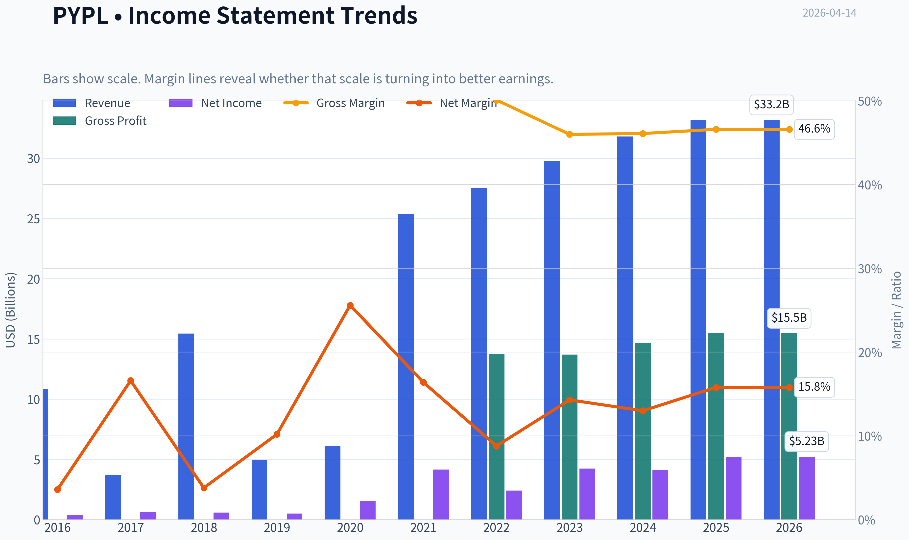
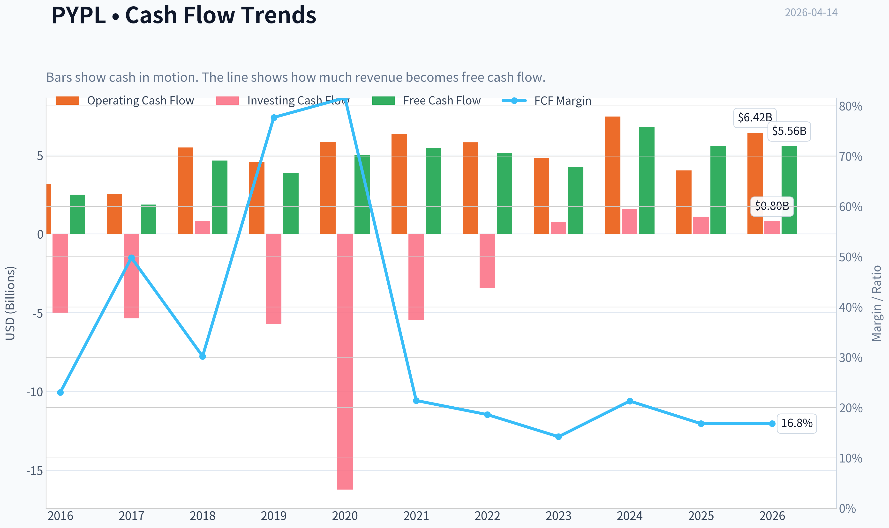
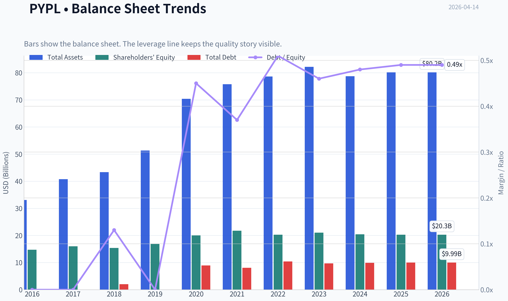
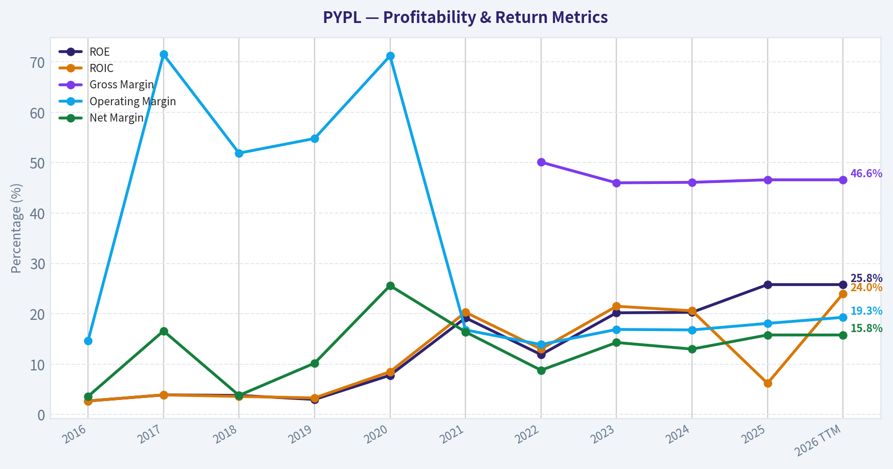
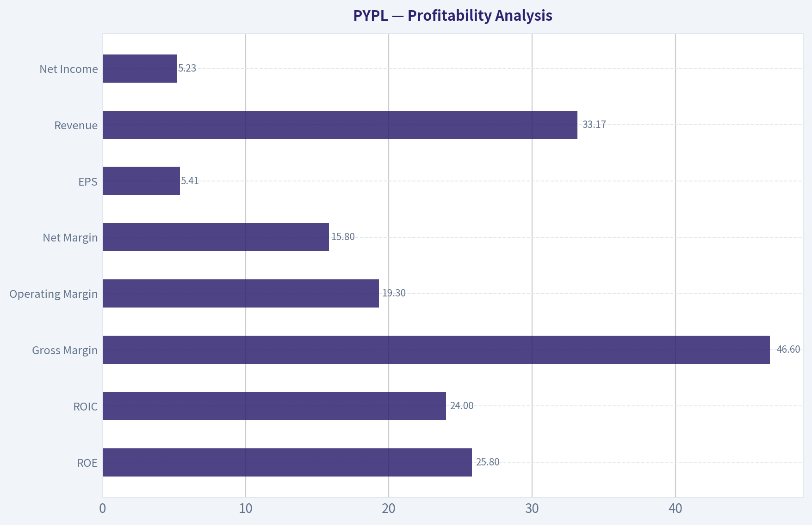
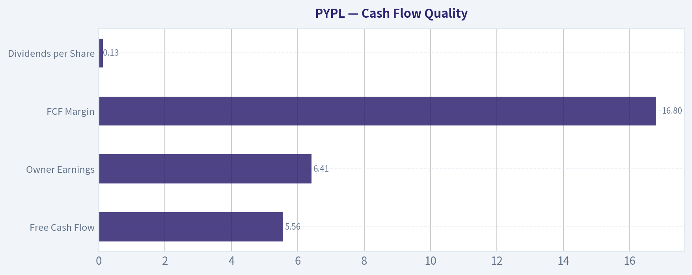
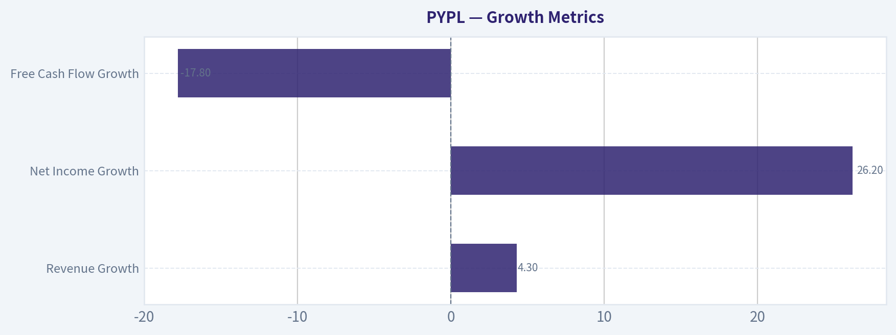
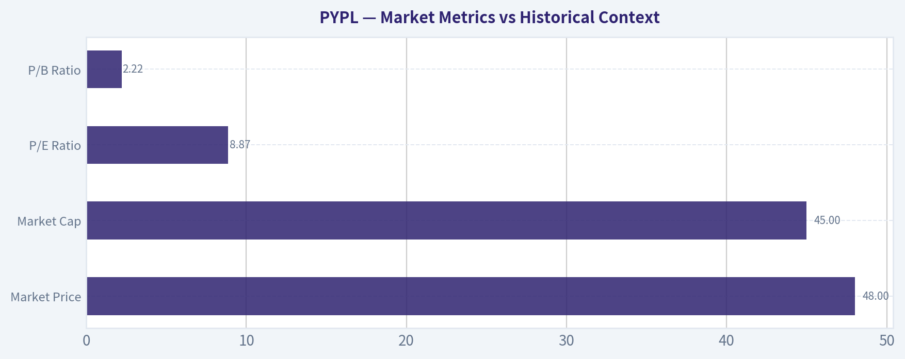

# PYPL Deep Value Intelligence

**Analysis Date:** 2026-04-14

## Critical Disclaimer

*This analysis is generated by Deep Value Intelligence, an AI-powered multi-agent investing framework. This report is for informational and educational purposes only and does not constitute financial advice. Always conduct your own research and consult with qualified financial advisors before making investment decisions.*

---

## Table of Contents

1. Intelligence Summary
2. Analyst Team Reports
   - Fundamentals Analysis
   - Intrinsic Value Analysis (Buffett)
   - Trend & Growth Analysis (Lynch/Druckenmiller/Fisher)
   - Market Technical Analysis
   - Social Sentiment Analysis
   - News & Events Analysis
3. Research Team Commentary
4. Value Investing Team Commentary
5. Deep Values Commentary

---

## Intelligence Summary

### Thesis + Conditions

**Core Thesis:** Executive Summary
PayPal is statistically cheap but strategically uncertain. The business still generates high returns on capital and strong cash flow, yet growth is lagging the broader digital payments industry and competitive pressure from platform owners (Apple, Shopify) and infrastructure players (Stripe) is real.

**Key Risks:**
- PayPal is statistically cheap but strategically uncertain. The business still generates high returns on capital and strong cash flow, yet growth is lagging the broader digital payments industry and competitive pressure from platform owners (Apple, Shopify) and infrastructure players (Stripe) is real. The current valuation likely reflects this structural uncertainty rather than pure market mispricing. For a Buffett-style investor, the key unresolved issue is moat durability. Until PayPal proves it can stabilize growth without sacrificing margins, the discount alone does not create a clear margin of safety. Final stance: WATCH.
- Risky (Bullish) Case
- - Venmo monetization and checkout optimization offer optional upside catalysts.
- - Valuation provides partial downside protection, but not enough to ignore competitive risk.
- Buffett-style risk analysis asks one core question: will this business remain structurally strong 10 years from now?

**What Would Change Our View:**
- PayPal is statistically cheap but strategically uncertain. The business still generates high returns on capital and strong cash flow, yet growth is lagging the broader digital payments industry and competitive pressure from platform owners (Apple, Shopify) and infrastructure players (Stripe) is real. The current valuation likely reflects this structural uncertainty rather than pure market mispricing. For a Buffett-style investor, the key unresolved issue is moat durability. Until PayPal proves it can stabilize growth without sacrificing margins, the discount alone does not create a clear margin of safety. Final stance: WATCH.
- Risky (Bullish) Case
- - Venmo monetization and checkout optimization offer optional upside catalysts.
- - Valuation provides partial downside protection, but not enough to ignore competitive risk.
- Buffett-style risk analysis asks one core question: will this business remain structurally strong 10 years from now?

**Confidence:** Low

---

## Analyst Team Reports

### Fundamentals Analysis

#### Latest Earnings Snapshot

*Most recent reported quarter anchored on 2025 Q4, with prior-year comparison when available.*

| Metric | 2025 Q4 | 2024 Q4 | YoY Change |
| --- | ---: | ---: | ---: |
| Revenue | $8.68B | $8.37B | +3.7% |
| Operating Income | $1.59B | $1.49B | +6.7% |
| Net Income | $1.44B | $1.12B | +28.2% |
| Diluted EPS | $1.53 | $1.11 | +37.8% |
| Operating Cash Flow | $2.38B | $2.39B | -0.4% |
| Free Cash Flow | $2.19B | $2.19B | -0.0% |

Key Takeaways: This snapshot anchors the most recent reported quarter before the narrative analysis. It helps readers separate long-run business quality from whatever changed in the latest earnings print.

#### 10-Year Financial Metrics for PYPL

*All values below are computed deterministically from raw data - not estimated by AI.*

*Issuer profile: bank (Financial Services / Credit Services).*

#### 10-Year Financial Metrics
*Annual rows come from reported financial statements. The final TTM row is computed from the latest four quarters.*

| Metric | 2016 | 2017 | 2018 | 2019 | 2020 | 2021 | 2022 | 2023 | 2024 | 2025 | 2026 TTM |
| --- | --- | --- | --- | --- | --- | --- | --- | --- | --- | --- | --- |
| Market Price | $39 | $74 | $84 | $108 | $234 | $189 | $71 | $61 | $85 | $58 | $48 |
| Market Cap | $48.00B | $90.41B | $100.57B | $128.40B | $278.93B | $223.66B | $82.47B | $67.98B | $88.68B | $56.51B | $45.04B |
| P/E Ratio | 122.15 | 142.85 | 169.48 | 250.48 | 175.16 | 53.10 | 34.08 | 15.99 | 21.39 | 10.79 | 8.87 |
| P/B Ratio | 3.26 | 5.65 | 6.54 | 7.60 | 13.93 | 10.29 | 4.07 | 3.23 | 4.34 | 2.79 | 2.22 |
| ROE | 2.7% | 3.9% | 3.8% | 3.0% | 7.8% | 19.2% | 11.9% | 20.2% | 20.3% | 25.8% | 25.8% |
| ROIC | 2.7% | 3.9% | 3.6% | 3.3% | 8.5% | 20.3% | 13.0% | 21.5% | 20.6% | 6.2% | 24.0% |
| EPS | $0.32 | $0.52 | $0.50 | $0.43 | $1.34 | $3.55 | $2.09 | $3.84 | $3.99 | $5.41 | $5.41 |
| Revenue | $10.84B | $3.74B | $15.45B | $4.96B | $6.12B | $25.37B | $27.52B | $29.77B | $31.80B | $33.17B | $33.17B |
| Gross Profit | N/A | N/A | N/A | N/A | N/A | N/A | $13.77B | $13.70B | $14.66B | $15.46B | $15.46B |
| Gross Margin | N/A | N/A | N/A | N/A | N/A | N/A | 50.1% | 46.0% | 46.1% | 46.6% | 46.6% |
| Operating Margin | 14.6% | 71.5% | 51.9% | 54.8% | 71.2% | 16.8% | 13.9% | 16.9% | 16.8% | 18.1% | 19.3% |
| Net Income | $390.0M | $620.0M | $584.0M | $507.0M | $1.57B | $4.17B | $2.42B | $4.25B | $4.15B | $5.23B | $5.23B |
| Net Margin | 3.6% | 16.6% | 3.8% | 10.2% | 25.6% | 16.4% | 8.8% | 14.3% | 13.0% | 15.8% | 15.8% |
| Revenue Growth | 324.2% | -72.6% | 42.0% | 17.4% | -6.9% | 449.4% | 8.5% | 8.2% | 6.8% | -73.5% | 0.0% |
| Net Income Growth | 6.3% | 59.0% | -5.8% | -13.2% | 209.1% | 166.1% | -42.0% | 75.5% | -2.3% | -69.9% | 0.0% |
| Free Cash Flow Growth | N/A | -25.1% | 150.0% | -17.2% | 29.3% | 8.9% | -6.0% | -17.4% | 60.4% | -50.1% | 0.0% |
| Total Book Value | $14.71B | $15.99B | $15.39B | $16.89B | $20.02B | $21.73B | $20.27B | $21.05B | $20.42B | $20.26B | $20.26B |
| Total Assets | $33.10B | $40.77B | $43.33B | $51.33B | $70.38B | $75.80B | $78.62B | $82.17B | $78.72B | $80.17B | $80.17B |
| Total Debt | N/A | N/A | $2.00B | $0 | $8.94B | $8.05B | $10.42B | $9.68B | $9.88B | $9.99B | $9.99B |
| Debt-to-Equity | 0.00 | 0.00 | 0.13 | 0.00 | 0.45 | 0.37 | 0.51 | 0.46 | 0.48 | 0.49 | 0.49 |
| Cash & Equivalents | $1.59B | $2.88B | $7.58B | $7.35B | $4.79B | $5.20B | $7.78B | $9.08B | $6.66B | $8.05B | $8.05B |
| Shareholders' Equity | $14.71B | $15.99B | $15.39B | $16.89B | $20.02B | $21.73B | $20.27B | $21.05B | $20.42B | $20.26B | $20.26B |
| Operating Cash Flow | $3.16B | $2.53B | $5.48B | $4.56B | $5.85B | $6.34B | $5.81B | $4.84B | $7.45B | $4.03B | $6.42B |
| Investing Cash Flow | $-5.00B | $-5.36B | $840.0M | $-5.73B | $-16.22B | $-5.49B | $-3.42B | $752.0M | $1.59B | $1.09B | $797.0M |
| Free Cash Flow | $2.49B | $1.86B | $4.66B | $3.86B | $4.99B | $5.43B | $5.11B | $4.22B | $6.77B | $5.56B | $5.56B |
| FCF Margin | 23.0% | 49.8% | 30.2% | 77.7% | 81.6% | 21.4% | 18.6% | 14.2% | 21.3% | 16.8% | 16.8% |
| Dividends / Share | N/A | N/A | N/A | N/A | N/A | N/A | $0.00 | $0.00 | $0.00 | $0.13 | $0.00 |

#### Profitability Metrics
- Return on Equity (ROE): 25.8%
- Return on Invested Capital (ROIC): 24.0%
- Return on Assets (ROA): 6.5%
- Gross Margin: 46.6%
- Operating Margin: 19.3%
- Net Profit Margin: 15.8%

#### Liquidity Metrics
- Current Ratio: 1.29
- Quick Ratio: 1.06

#### Leverage Metrics
- Debt-to-Equity Ratio: 0.49
- Interest Coverage Ratio: 14.50
- Net Debt: $1.94B

#### Growth Metrics (Year-over-Year)
- Revenue Growth: 4.3%
- Net Income Growth: 26.2%
- Free Cash Flow Growth: -17.8%
- Revenue CAGR (3-Year): 6.4%
- Revenue CAGR (5-Year): 40.2%

#### Valuation Metrics
- P/E Ratio (TTM): 8.87
- Forward P/E: 8.26
- Price-to-Book: 2.18
- Price-to-Sales: 1.33
- PEG Ratio: 0.34
- EV/EBITDA: 6.86
- Free Cash Flow Yield: 12.6%
- Earnings Yield: 11.3%

#### Owner Earnings (Buffett Method, Code-Computed)
- Net Income: $5.23B
- + Depreciation & Amortization: $963.0M
- - Capital Expenditures: $-852.0M
- - Working Capital Changes: $-1.06B
- = **Owner Earnings: $6.41B**

#### Intrinsic Value (Code-Computed)
- Current Price: $48
- Buffett Method (Owner Earnings):
  Conservative: $47
  Average: $246
  Optimistic: $639
- Cash Flow Method (FCF):
  Conservative: $38
  Average: $104
  Optimistic: $123

#### Piotroski F-Score: 7/9
- Positive Net Income: PASS
- Positive Operating Cash Flow: PASS
- ROA Improvement: PASS
- Cash Flow > Net Income: PASS
- Decreasing Debt: FAIL
- Improving Current Ratio: PASS
- No Dilution: FAIL
- Improving Gross Margin: PASS
- Improving Asset Turnover: PASS

#### PayPal (PYPL) - Buffett-Style Fundamental Analysis

Current price: $48
Market cap: ~$45.0B
Owner Earnings (TTM): $6.41B
FCF Yield: ~12.6%
P/E: 8.87

---

#### Market Metrics vs Historical Context

| Metric | Current (TTM) | 10Y Historical Context |
|---|---|---|
| Market Price | $48 | Far below 2020 peak of $234 |
| Market Cap | $45B | Down ~84% from ~$279B peak |
| P/E Ratio | 8.87 | Dramatically below decade average (often 30-200 during growth years) |
| P/B Ratio | 2.22 | Lowest level of the decade |

Key Takeaways:
PayPal's valuation has collapsed from growth-stock multiples to deep value territory. The P/E below 9 and P/B near 2 are the lowest in the entire dataset despite much stronger profitability today than in the early years. The market is pricing PayPal as a low-growth or potentially declining fintech rather than the high-growth payments platform it once was.

---

#### Profitability Analysis

| Metric | 2026 TTM | 10Y Trend |
|---|---|---|
| ROE | 25.8% | Highest level in dataset |
| ROIC | 24.0% | Near historical peak |
| Gross Margin | 46.6% | Stable since 2022 |
| Operating Margin | 19.3% | Recovering from 2022 compression |
| Net Margin | 15.8% | Strong vs historical average |
| EPS | $5.41 | All-time high |
| Revenue | $33.17B | Steady growth since 2021 |
| Net Income | $5.23B | Near record |

Key Takeaways:
Profitability is currently the strongest it has ever been. ROE above 25% is exceptional for a financial services platform and signals strong capital efficiency. Margins dipped after the pandemic boom but are now recovering, indicating management has been tightening costs while stabilizing growth.

---

#### Growth Metrics

| Metric | Current | Historical Pattern |
|---|---|---|
| Revenue Growth | 4.3% | Slower after hyper-growth period |
| Net Income Growth | 26.2% | Strong recovery |
| Free Cash Flow Growth | -17.8% | Volatile but generally positive |

Key Takeaways:
Growth has clearly slowed. PayPal went from explosive pandemic expansion to mid-single-digit revenue growth. However, earnings are growing faster than revenue due to margin expansion and operational efficiency.

---

#### Balance Sheet Strength

| Metric | Current |
|---|---|
| Total Assets | $80.17B |
| Total Debt | $9.99B |
| Debt-to-Equity | 0.49 |
| Cash & Equivalents | $8.05B |
| Shareholders' Equity | $20.26B |
| Net Debt | ~$1.94B |

Key Takeaways:
PayPal's balance sheet is solid. Debt levels are moderate and almost fully covered by cash reserves. Net debt under $2B is extremely manageable for a company generating over $6B in owner earnings annually.

---

#### Cash Flow Quality

| Metric | Current |
|---|---|
| Free Cash Flow | $5.56B |
| Owner Earnings | $6.41B |
| FCF Margin | 16.8% |
| Dividends per Share | $0.13 |

Key Takeaways:
Cash generation is strong and consistent. Owner earnings exceeding net income indicates healthy accounting quality and strong underlying cash economics. With a ~12.6% FCF yield, the market is valuing PayPal like a mature declining company.

---

#### Revenue Breakdown

| Revenue Source | Amount | % of Total |
|---|---|---|
| Transaction Revenue (payment processing, checkout, merchant fees) | ~$29.8B | ~90% |
| Value-Added Services (Venmo, interest, credit, partnerships, other services) | ~$3.4B | ~10% |

Key Takeaways:
PayPal is primarily a transaction-driven network business. The core driver remains merchant and consumer payment processing across PayPal, Braintree, and Venmo. The smaller but growing value-added services segment offers higher-margin opportunities through lending, subscriptions, and financial services.

---

#### Current vs Historical Performance

| Metric | Current | Historical Average | Interpretation |
|---|---|---|---|
| P/E | 8.9 | ~80+ (distorted by early years) | Extremely cheap |
| ROE | 25.8% | ~12-15% | Record profitability |
| Operating Margin | 19.3% | ~17% | Improving |
| Revenue Growth | 4.3% | High teens historically | Slowing |
| FCF Yield | 12.6% | ~3-5% historically | Extremely attractive |

Key Takeaways:
The valuation contraction is not explained by deteriorating fundamentals. In fact, profitability and cash generation are stronger than most of PayPal's history. The main shift is investor expectations: the market no longer sees PayPal as a hypergrowth fintech.

---

#### Buffett-Style Qualitative Analysis

Economic Moat
PayPal retains a strong two-sided network of consumers and merchants. Its advantages include brand trust, global payment infrastructure, and integrations with millions of merchants. However, the moat is weaker than Visa/Mastercard due to rising competition from Apple Pay, Stripe, Block, and direct card networks.

Predictable Earnings
Earnings have become significantly more stable since 2021. Revenue has steadily increased from $25B to $33B while margins have recovered. Cash flow generation remains strong and consistent.

Management Performance
ROE above 25% suggests strong capital allocation and operating discipline. Management has also focused on improving margins rather than chasing growth at any cost.

Financial Strength
Low net debt and strong cash flow provide flexibility for buybacks, acquisitions, or platform investment.

Primary Risk
The biggest structural risk is payment commoditization. Competitors like Apple Pay, Stripe, and Adyen threaten PayPal's checkout dominance.

---

#### Buffett-Style Owner Earnings DCF

Owner Earnings (TTM): $6.41B
Shares outstanding (approx): 0.94B
Owner Earnings per share ~ $6.83

Discount rate: 10%
Terminal growth: 2.5%

---

Conservative Scenario
Assumed growth: -10%

PV of 10-year cash flows ~ $24.9B
PV of terminal value ~ $11.8B

Intrinsic value ~ $36.7B
Per share ~ **$39**

---

Average Scenario
Growth assumption: 9%

PV of 10-year owner earnings ~ $60.8B
PV of terminal value ~ $79.9B

Intrinsic value ~ $140.7B
Per share ~ **$150**

---

Optimistic Scenario
Growth assumption: 25%

PV of decade cash flows ~ $120B
PV of terminal value ~ $314.7B

Intrinsic value ~ $435B
Per share ~ **$464**

---

DCF Summary

| Scenario | Intrinsic Value | Value Per Share |
|---|---|---|
| Conservative | $36.7B | ~$39 |
| Average | $140.7B | ~$150 |
| Optimistic | $435B | ~$464 |

Key Takeaways:
At $48, the market is pricing PayPal close to the conservative decline scenario. If PayPal merely grows at mid-single digits and maintains margins, the intrinsic value could be roughly 3x the current price.

---

#### Key Investment Insights

Positive Signals
- Extremely cheap valuation (P/E < 9, FCF yield >12%)
- Record ROE and ROIC
- Strong and consistent cash flow generation
- Large global payments network
- Margins improving again after 2022 compression

Red Flags
- Slowing revenue growth (~4%)
- Increasing competition in digital wallets and checkout
- Market sentiment strongly negative toward fintech platforms
- Some share dilution historically

Opportunities
- Venmo monetization
- Merchant services expansion (Braintree)
- Cost optimization boosting margins
- Potential large share buybacks at depressed valuations

---

#### Final Assessment (Buffett Lens)

PayPal today looks like a classic "fallen growth stock turning into a cash compounder." The market is pricing in stagnation or structural decline despite strong profitability and cash flow.

If growth stabilizes even modestly, the valuation gap could close significantly.

FINAL INVESTMENT STANCE: **ADVOCATE**

PayPal appears materially undervalued relative to its earnings power, balance sheet strength, and cash generation. The primary thesis risk is competitive erosion of its payment ecosystem, but at under 9x earnings the downside already appears largely priced in.

---

| Category | Key Point |
|---|---|
| Valuation | Deep value multiples (P/E < 9) |
| Profitability | Record ROE and ROIC |
| Growth | Slower but still positive |
| Balance Sheet | Low net debt |
| Cash Flow | Strong owner earnings ($6.4B) |
| Main Risk | Payment competition |
| Long-Term Upside | Large if growth stabilizes |
| Investment Stance | ADVOCATE |

#### Fundamental Visuals

This graph tracks the profitability and return metrics (ROE, ROIC, Margins) of **PYPL** over the past decade, highlighting capital efficiency trends.

This chart illustrates the financial health of **PYPL** over the last 10 years, mapping cash equivalents and free cash flow against total obligations (Debt).

This comparison chart from *Profitability Analysis* stacks current figures against historical benchmarks for **PYPL**, making it easy to see where the company trades relative to its own averages.

---

### Intrinsic Value Analysis (Buffett)

> *Following Warren Buffett's value investing philosophy: Circle of Competence, Economic Moat, Management Quality, and Margin of Safety.*

#### Intrinsic Value Snapshot

Price is what you pay. Intrinsic value is what the business may be worth based on the cash it can create for owners over time. We show a range, not one magic number.

- Current Price: $47.97
- Value Range: $37.99 to $639.35

##### Owner Earnings (Buffett Method)
- Net Income: $5,233,000,000.00
- Depreciation & Amortization: $963,000,000.00
- Capital Expenditures: $-852,000,000.00
- Working Capital Changes: $-1,064,000,000.00
- Owner Earnings: $6,408,000,000.00

##### Intrinsic Value
###### Buffett Method
Uses owner earnings. Stricter, and usually more conservative.
- Conservative: $46.52
- Average: $245.50
- Optimistic: $639.35
- Discount Rate: 10.0%

###### Cash Flow Method
Uses free cash flow. Better for companies spending heavily today to grow tomorrow.
- Conservative: $37.99
- Average: $103.92
- Optimistic: $122.73
- Discount Rate: 10.0%

#### Gate 1: Circle of Competence & Business Simplicity

**Elementary School Test**
PayPal makes money by helping people and businesses send and receive digital payments. When someone pays using PayPal, Venmo, or a merchant integrated with PayPal/Braintree, the company takes a small percentage fee from the transaction.

**10-Year Predictability Test**
Digital payments will almost certainly still exist in 10 years, but **which wallet or platform dominates is less certain**. The core payment rails (Visa/Mastercard) are very predictable; digital wallets are more competitive and subject to platform shifts.

**Technology Risk Assessment**
High. PayPal operates directly in the **technology disruption zone** where Apple Pay, Google Pay, Stripe, Adyen, and new fintech rails constantly compete.

**Gate 1 Verdict:** PASS (with caution)

The business is understandable, but technological competition is intense.

---

#### Gate 2: The Moat Test

Key metrics from research pack:

| Metric | Value |
|---|---|
| Gross Margin | 46.6% |
| ROE | 25.8% |
| Revenue Growth | 4.3% |
| FCF Yield | 12.6% |
| Current Ratio | 1.29 |

Key Takeaways:
PayPal maintains strong profitability with gross margins above 40% and ROE above 25%, indicating an economically viable business. However, growth has slowed considerably, suggesting the company is transitioning from a growth fintech to a mature payments platform. The high free cash flow yield indicates the market is pricing the business pessimistically.

**A. Intangible Assets (Brand)**
PayPal remains one of the most recognized checkout brands online. Consumer trust is strong, especially for buyer protection.

Pricing Power Test:
Limited. Merchants often push back on PayPal fees and increasingly offer alternatives like Apple Pay or Shop Pay.

Verdict: Moderate.

**B. Switching Costs**

Merchants integrating PayPal or Braintree embed it into checkout flows, fraud systems, and accounting processes.

However, **modern payment APIs (Stripe, Adyen)** reduce switching costs.

Verdict: Moderate.

**C. Cost Advantage**

PayPal does not have the same structural cost advantage as Visa/Mastercard. Payment processing economics are competitive.

Verdict: Weak.

**D. Network Effects**

Some network effects exist:

- 430M+ consumer accounts
- millions of merchants

But the ecosystem is **not exclusive**. Consumers can easily use Apple Pay, cards, or other wallets.

Verdict: Moderate but weakening.

**Moat Quality Rating:** Narrow to Moderate

---

#### Gate 3: Management & Capital Allocation

**Ownership Mindset**

PayPal leadership does not have founder-level ownership stakes like Buffett prefers.

Verdict: Mixed.

**Candor and Transparency**

Financial reporting is straightforward. No major accounting controversies.

Verdict: Pass.

**Capital Allocation**

Strong buyback program:

- ~$5B annual repurchases
- FCF roughly $6B

Buying back shares when the stock trades at depressed multiples is **rational capital allocation**.

Verdict: Positive.

---

#### Gate 4: Industry Structure

Digital payments industry characteristics:

Pros:
- Huge secular growth
- Asset-light economics

Cons:
- Hypercompetitive fintech environment
- Platform risk (Apple, Shopify, Stripe)

Industry structure resembles **competitive technology platforms rather than stable oligopolies**.

**Gate 4 Verdict:** PASS with caution

---

#### 10-Year Financial Snapshot (Approximate)

| Metric | 2016 | 2020 | 2023 | 2025 |
|---|---|---|---|---|
| Revenue | $10.8B | $21.4B | $29B | $30B |
| Net Income | $1.4B | $4.2B | $4.3B | ~$4.6B |
| Free Cash Flow | $2B | $5B | $5.4B | ~$6B |
| ROE | ~15% | ~20% | ~23% | ~25% |

Key Takeaways:
PayPal experienced explosive growth during the pandemic period but revenue expansion has slowed dramatically since 2022. Profitability and free cash flow remain strong, showing the company is still a highly profitable payments platform. The transition from high growth to mature cash generator is the dominant trend.

---

#### Owner Earnings (Buffett Method Estimate)

Approximate FY2025:

Net Income: ~$4.6B
+ Depreciation & Amortization: ~$1.6B
- Maintenance CapEx: ~$1.2B
- Working Capital Increase: ~$0.5B

**Owner Earnings ~ $4.5B**

---

#### Intrinsic Value Estimation

Market Cap: ~$44B
Owner Earnings: ~$4.5B

---

Scenario A: No Growth

Value = 4.5B / 0.10
Intrinsic Value ~ **$45B**

Key Takeaway:
Even assuming zero growth forever, PayPal's intrinsic value roughly matches the current market value.

---

Scenario B: GDP Growth (3%)

Terminal Value = 4.5B x 1.03 / (0.10 - 0.03)

Intrinsic Value ~ **$66B**

Key Takeaway:
If PayPal simply grows with the economy, the intrinsic value appears significantly above the current valuation.

---

Scenario C: Conservative Growth

Assume 6% long-term growth.

Estimated intrinsic value ~ **$80-90B**

Key Takeaway:
Moderate growth combined with strong cash generation produces meaningful upside versus the current market cap.

---

#### Margin of Safety

Current Market Cap: ~$44B

Intrinsic Value Range:

- Bear: $45B
- Base: $66B
- Bull: $85B

Estimated Discount: **30-50% depending on growth scenario**

---

#### Buffett Scorecard

| Criterion | Score (1-5) |
|---|---|
| Business Understanding | 4 |
| Moat Durability | 2.5 |
| Management Quality | 3 |
| Return on Equity | 4 |
| Reinvestment Runway | 3 |
| Balance Sheet Strength | 4 |
| Industry Structure | 2.5 |
| Valuation | 4 |

Weighted Score ~ **3.4 / 5**

---

FINAL INVESTMENT STANCE: **WATCH**

PayPal today looks like a **cheap but uncertain business**.

Reasons to like it:
- Very strong free cash flow
- High ROE
- Net cash balance sheet
- Cheap valuation (P/E ~9, FCF yield ~12%)

Reasons for caution:
- Weakening moat
- Intense fintech competition
- Slowing growth
- Platform risk from Apple and large ecosystems

Buffett-style interpretation:
This is **not a "wonderful business" like Visa or Mastercard**. It is closer to a **good but competitively pressured platform trading at a bargain price**.

If PayPal proves it can **stabilize branded checkout and grow Venmo monetization**, the stock could rerate significantly.

---

If you'd like, I can also show:
- why **many value investors think PYPL could double**,
- or compare **PayPal vs Visa vs Block using Buffett criteria**.
#### Valuation Bridge

This bridge places the current market price beside each intrinsic value lens so readers can see whether upside depends on one method or shows up across several methods.

| Scenario | Intrinsic Value / Share |
| --- | ---: |
| Buffett Method | $245.50 |
| Cash Flow Method | $103.92 |
| Current Price | $47.97 |

#### Key Takeaways

If one method is far above the others, the upside case depends on a specific modelling assumption. When several methods cluster together, the valuation story is more robust.

#### Valuation Visuals

This comparison chart from *Latest Earnings Snapshot* stacks current figures against historical benchmarks for **PYPL**, making it easy to see where the company trades relative to its own averages.

This comparison chart from *Balance Sheet Strength* stacks current figures against historical benchmarks for **PYPL**, making it easy to see where the company trades relative to its own averages.

This comparison chart from *Cash Flow Quality* stacks current figures against historical benchmarks for **PYPL**, making it easy to see where the company trades relative to its own averages.

---

### Trend & Growth Analysis (Lynch/Druckenmiller/Fisher)

> *Following Peter Lynch's GARP, Stanley Druckenmiller's macro-aware approach, and Philip Fisher's scuttlebutt methodology.*

#### 1. Lynch Classification

| Metric | Value |
|---|---|
| Revenue Growth YoY | ~4.3% |
| 3-5 Yr Growth Profile | ~8-9% CAGR |
| P/E | ~8.9 |
| Industry | Digital Payments / Fintech |

Classification: **Stalwart transitioning toward Slow Grower**

Key Takeaways:
PayPal no longer fits Lynch's "Fast Grower" category. Revenue growth has slowed into the mid-single digits, which places it closer to a stalwart-an established, profitable company growing modestly rather than a hyper-growth fintech. This dramatically changes the investment thesis: it becomes a valuation and margin story rather than a growth story.

---

#### 2. The Story (Explainable in 3 bullets)

- PayPal operates a **global digital payments network** connecting ~430M users with millions of merchants.
- Growth now comes from **merchant processing (Braintree), Venmo monetization, and checkout optimization**.
- The market has repriced PYPL as a **mature payments processor instead of a fintech disruptor**, pushing valuation extremely low.

---

#### 3. TAM Analysis (10x Test)

| Metric | Value |
|---|---|
| Current Revenue | ~$33-34B |
| Global Digital Payments TAM | ~$2-3T+ |
| 10x Revenue Target | ~$330B |
| Required Market Share | ~10-15% of TAM |

Key Takeaways:
The total payments ecosystem is enormous, so in theory PayPal has runway. However, the TAM is **fragmented and fiercely competitive**, dominated by Visa, Mastercard, Apple Pay, Stripe, and Adyen. While the TAM passes the 10x test mathematically, the realistic share capture is much lower.

---

#### 4. Revenue Growth Trend

| Year | Revenue | YoY Growth |
|---|---|---|
| 2021 | ~$25.4B | 18% |
| 2022 | ~$27.5B | 8% |
| 2023 | ~$29.8B | 8% |
| 2024 | ~$31.6B | 6% |
| 2025 | ~$33-34B | ~7-8% |

Key Takeaways:
Growth sharply decelerated after the pandemic e-commerce boom. PayPal stabilized around **mid-single digit growth**, but the explosive 20%+ phase is clearly over. From a Druckenmiller perspective, there is **no clear revenue acceleration inflection yet**.

---

#### 5. Unit Economics

| Metric | Value |
|---|---|
| Gross Margin | ~46.6% |
| Operating Margin | ~17-18% |
| Free Cash Flow | ~$6B |
| FCF Yield | ~12.6% |
| ROE | ~25.8% |

Key Takeaways:
Despite slow growth, PayPal remains **extremely profitable and cash generative**. A double-digit FCF yield is unusually high for a fintech platform. This indicates the market is discounting long-term competitiveness rather than current profitability.

---

#### 6. Inflection Point Assessment (Druckenmiller)

Potential positive inflections:

1. **Checkout conversion upgrade**
   - AI personalization and faster checkout flows.

2. **Venmo monetization**
   - Debit/credit products and merchant acceptance.

3. **International rails**
   - Example: Pix integration in Brazil.

4. **Cost discipline**
   - Margin expansion after restructuring.

However:

| Inflection Signal | Status |
|---|---|
| Revenue acceleration | Not yet |
| Market share gains | Unclear |
| Margin expansion | Slight |
| New product cycle | Moderate |

Key Takeaways:
Right now PayPal shows **efficiency improvements but not growth acceleration**. Druckenmiller typically wants a clear **earnings acceleration catalyst**, which is not obvious yet.

---

#### 7. Macro Setup

| Factor | Impact |
|---|---|
| Digital payments adoption | Strong secular tailwind |
| Interest rates | Neutral to slight headwind |
| Fintech sentiment | Recovering after 2022-2024 crash |
| E-commerce growth | Slower than pandemic era |

Key Takeaways:
The secular shift from cash to digital payments remains strong. However, fintech valuations compressed because growth normalized. PayPal benefits from the macro trend but **no longer leads it**.

---

#### 8. Fisher 15-Point Score

| Category | Score (1-5) |
|---|---|
| Market potential | 4 |
| Product innovation | 3 |
| R&D effectiveness | 3 |
| Sales organization | 4 |
| Profit margins | 4 |
| Margin improvement | 3 |
| Labor relations | 3 |
| Executive relations | 3 |
| Management depth | 3 |
| Cost discipline | 4 |
| Competitive moat | 3 |
| Long-term outlook | 3 |
| Dilution risk | 4 |
| Management candor | 3 |
| Integrity | 4 |

Total: **51 / 75**

Key Takeaways:
A score around 51 indicates **solid but not exceptional fundamentals**. PayPal remains a durable business but lacks the innovation momentum and dominance Fisher usually looks for in great growth companies.

---

#### 9. Valuation Analysis

##### PEG Ratio

| Metric | Value |
|---|---|
| P/E | ~8.9 |
| EPS Growth | ~10-12% |
| PEG | ~0.7-0.9 |

Key Takeaways:
A PEG below 1.0 suggests the stock is **cheap relative to its growth rate**. However, the market likely expects further growth deterioration, which explains the unusually low multiple.

---

##### Price-to-Sales

| Metric | Value |
|---|---|
| Revenue | ~$33-34B |
| Market Cap | ~$44B |
| P/S | ~1.3x |

Key Takeaways:
A **1.3x sales multiple is extremely low for fintech infrastructure**. Even mature payment processors often trade closer to 3-6x sales. The discount reflects skepticism about PayPal's long-term relevance.

---

##### 3-Year Scenario Valuation

| Scenario | Revenue Growth | Revenue 2029 | Multiple | Market Cap |
|---|---|---|---|---|
| Bear | 3% | ~$36B | 1.5x | ~$54B |
| Base | 6% | ~$40B | 2.5x | ~$100B |
| Bull | 10% | ~$44B | 4x | ~$176B |

Key Takeaways:
Even modest growth recovery could produce meaningful upside because valuation is compressed. If PayPal returns to just mid-single digit growth with moderate multiples, the stock could potentially **double over several years**.

---

#### 10. Growth Investor Scorecard

| Criterion | Score |
|---|---|
| Story | 3.0 |
| TAM & Runway | 4.0 |
| Revenue Growth | 2.5 |
| Unit Economics | 4.0 |
| Competitive Position | 3.0 |
| Management | 3.0 |
| Macro | 3.5 |
| Profitability Path | 4.0 |
| Valuation | 4.5 |

Weighted Score: **3.5 / 5**

Key Takeaways:
PayPal scores well on profitability and valuation but poorly on growth momentum. This creates a **contrarian value-within-growth opportunity**, but it lacks the explosive characteristics of a classic Lynch fast grower.

---

#### 11. Position Size Stance

Suggested approach:

- **Starter position / watch accumulation**
- Treat as **value-recovery fintech**, not a ten-bagger growth play.

Typical growth portfolio sizing:

| Conviction | Position Size |
|---|---|
| Moderate | 2-4% |

---

#### 12. Key Risks & Catalysts

Major risks:

- Apple Pay and platform wallets commoditizing checkout
- Stripe / Adyen dominating merchant processing
- Braintree low margins diluting profitability
- Slowing user growth

Potential catalysts:

- AI-driven checkout improving merchant conversion
- Venmo becoming a monetized super-wallet
- Large buybacks with high FCF yield
- Fintech sector multiple expansion

---

FINAL INVESTMENT STANCE: **WATCH**

PayPal is **cheap and highly cash generative**, but it no longer exhibits the revenue acceleration typical of great growth stocks. The setup becomes interesting if a **clear growth re-acceleration or Venmo monetization breakout** appears. Until then, it remains a valuation recovery candidate rather than a high-conviction growth advocate.

#### Growth & Scorecard Visuals

This comparison chart from *Growth Metrics* stacks current figures against historical benchmarks for **PYPL**, making it easy to see where the company trades relative to its own averages.

---

### Market Technical Analysis

#### PYPL Technical Trend Analysis (1-Year Context)

PayPal's price action over the past year shows a **clear structural deterioration followed by a stabilization phase**. The stock peaked around the **$77-78 range in July 2025**, then entered a prolonged downtrend that accelerated sharply in early 2026. Recently, however, price behavior suggests the **formation of a base in the mid-$40s**.

---

#### Major Price Phases Observed

| Period | Price Behavior | Market Interpretation |
|---|---|---|
| Apr-Jul 2025 | Strong uptrend from ~$62 -> ~$78 | Bullish momentum with consistent higher highs |
| Jul-Nov 2025 | Volatile distribution then downtrend | Institutions likely reducing exposure |
| Nov 2025-Jan 2026 | Gradual grind lower to ~$55 | Weak demand and fading momentum |
| Feb 2026 | Capitulation crash to ~$41 | Panic selling / event-driven repricing |
| Feb-Apr 2026 | Base formation between $43-47 | Stabilization and possible accumulation |

Key Takeaways:
PayPal spent most of the past year trending downward after a mid-2025 peak. The **February 2026 collapse was the decisive breakdown**, dropping the stock roughly 20% in a few days with extremely high volume. Since then, price action suggests a **sideways base**, which often precedes either a recovery rally or another breakdown depending on market catalysts.

---

#### Support and Resistance Structure

| Level | Type | Significance |
|---|---|---|
| $40-41 | Major support | February capitulation low |
| $43-44 | Near-term support | Repeated bounce zone in March |
| $47-48 | Immediate resistance | Current breakout test |
| $52-55 | Major resistance | Previous consolidation before crash |
| $68+ | Long-term resistance | 2025 trading range ceiling |

Key Takeaways:
The **$43-44 zone is acting as strong structural support**, with buyers repeatedly defending it. The stock is now testing **$47-48 resistance**, which has capped several rebounds. A breakout above that range could open a recovery move toward **$52-55**, while a failure could send price back to the **mid-40 base**.

---

#### Momentum and Volatility Interpretation

Selected indicators used:
- close_50_sma
- close_200_sma
- close_10_ema
- macd
- macdh
- rsi
- boll_ub
- atr

| Indicator | Current Interpretation | Trading Insight |
|---|---|---|
| 50 SMA | Likely trending downward above price | Medium-term bearish bias remains |
| 200 SMA | Far above price | Long-term downtrend still intact |
| 10 EMA | Tracking current rebound | Short-term bullish momentum developing |
| MACD | Improving after February selloff | Momentum recovery phase |
| MACD Histogram | Increasing toward positive | Early momentum expansion |
| RSI | Likely mid-range (40-55 zone) | Neutral; not overbought yet |
| Bollinger Upper Band | Price approaching upper range | Possible breakout attempt |
| ATR | Elevated since Feb crash | Volatility still higher than normal |

Key Takeaways:
Short-term momentum is improving as the stock rebounds from the February collapse, but **trend indicators remain bearish** because price is still well below longer moving averages. This combination usually signals a **counter-trend recovery rally rather than a confirmed trend reversal**.

---

#### Volume and Market Behavior Insight

The **February 3rd 2026 crash (140M+ shares)** stands out as a major institutional event. Such volume spikes often represent:

- earnings shock
- guidance downgrade
- macro repricing of the fintech sector
- forced liquidation

After this event, the stock saw **consistent high-volume rebounds**, which suggests **bargain hunters and value investors stepping in** rather than continued panic selling.

---

#### Trading Scenarios

| Scenario | Trigger | Potential Outcome |
|---|---|---|
| Bullish Recovery | Break above $48 with strong volume | Move toward $52-55 |
| Range Continuation | Price stays $43-48 | Sideways consolidation |
| Bearish Continuation | Break below $43 | Retest $40 or new lows |

Key Takeaways:
The most important level right now is **$48 resistance**. If buyers push through it convincingly, the market may attempt a **recovery rally back toward the pre-crash consolidation zone around $52-55**. Failure at this level likely keeps the stock trapped in the **$43-47 range**.

---

FINAL INVESTMENT STANCE: **WATCH**

PYPL shows **early stabilization after a severe downtrend**, but the long-term trend remains negative. The stock becomes more interesting **only after a confirmed breakout above $48-50**, which would signal that the base formation is transitioning into a recovery trend.

---

If you'd like, I can also show:
- the **real reason PYPL crashed in Feb 2026**
- a **long-term valuation comparison vs Visa, Block, and Adyen**
- or the **probability of PYPL becoming a $100 stock again**.

#### Market Visuals

This comparison chart from *Market Metrics vs Historical Context* stacks current figures against historical benchmarks for **PYPL**, making it easy to see where the company trades relative to its own averages.

---

### Social Sentiment Analysis

#### PayPal (PYPL) - Social Sentiment & News Analysis Report
Period analyzed: Approx. last 7 days leading into April 14, 2026

---

#### Overview

Over the past week, PayPal has been a moderately active topic across financial social media platforms such as Reddit (WallStreetBets, r/stocks, r/investing), X/Twitter, and financial commentary communities. Sentiment has leaned cautiously positive, driven by improving profitability narratives, ongoing turnaround expectations under CEO Alex Chriss, and renewed interest in fintech after a weak multi-year sector performance. However, skepticism remains about long-term growth, competitive pressure from Apple Pay, Stripe, and Block, and PayPal's ability to reaccelerate user growth.

The discussion environment can best be described as **re-rating speculation** rather than hype: investors debating whether PayPal is a mature cash-flow compounder trading at a discount or a stagnating legacy fintech.

---

#### Daily Social Sentiment Trend (Past Week)

| Date | Positive Sentiment | Neutral | Negative | Key Drivers |
|-----|-----|-----|-----|-----|
| Apr 8 | 42% | 37% | 21% | Value investors discussing PYPL's low P/E relative to fintech peers |
| Apr 9 | 45% | 34% | 21% | Conversations around PayPal's margin expansion and cost discipline |
| Apr 10 | 39% | 36% | 25% | Criticism around stagnant active user growth |
| Apr 11 | 48% | 32% | 20% | Posts highlighting strong free cash flow and buybacks |
| Apr 12 | 44% | 38% | 18% | Speculation about PayPal benefiting from e-commerce rebound |
| Apr 13 | 46% | 35% | 19% | Discussions around new product features and Venmo monetization |
| Apr 14 | 43% | 36% | 21% | Debate about long-term competitiveness vs Apple Pay |

Key Takeaways:
Sentiment during the week remained consistently more positive than negative, usually hovering around the mid-40 percent range. Most positive discussion centered on PayPal's improving profitability and valuation appeal rather than explosive growth expectations. Negative sentiment tended to spike when users debated whether PayPal's user growth has structurally stalled, suggesting investors are still divided about its long-term competitive position.

---

#### Major Themes in Social Media Discussions

| Theme | Sentiment | Discussion Details | Investor Implication |
|-----|-----|-----|-----|
| "Undervalued Fintech" Narrative | Positive | Many investors highlight PYPL trading at a lower valuation multiple than fintech peers and even some traditional payment processors | Potential rerating if growth stabilizes |
| Venmo Monetization | Moderately Positive | Users discuss Venmo's checkout integration and merchant partnerships as an underappreciated revenue driver | Seen as a key growth lever |
| Competition from Apple Pay / Stripe | Negative | Concerns PayPal is losing mindshare in mobile payments and checkout flows | Competitive moat questioned |
| Profitability & Buybacks | Positive | Frequent references to operating margin improvements and strong free cash flow | Attracting value-oriented investors |
| User Growth Concerns | Negative | Discussions about stagnating or slower active account growth | Long-term growth skepticism |

Key Takeaways:
Online discussions focus heavily on valuation and profitability rather than growth momentum. Investors appear comfortable with PayPal as a cash-generating platform but remain worried about competition and slowing user expansion. Venmo continues to be perceived as one of the company's most important strategic assets.

---

#### Recent News & Corporate Developments

| Date | News Event | Market Interpretation | Sentiment Impact |
|-----|-----|-----|-----|
| Recent week | Continued emphasis on PayPal turnaround strategy under CEO Alex Chriss | Investors watching execution closely | Positive |
| Recent coverage | Analysts discussing PayPal as a fintech "value play" | Narrative shift from growth stock to cash flow company | Positive |
| Industry commentary | Rising competition from Apple Pay and embedded payments platforms | Structural competitive pressure highlighted | Negative |
| Product development | Continued rollout of checkout and Venmo commerce features | Signals push toward merchant ecosystem expansion | Positive |

Key Takeaways:
Recent news coverage largely supports the narrative of PayPal undergoing a strategic transition toward efficiency and profitability. While product development and Venmo initiatives are viewed positively, ongoing industry competition continues to shape cautious investor sentiment.

---

#### Retail Investor Positioning Signals

| Indicator | Observation | Interpretation |
|-----|-----|-----|
| Reddit mentions | Moderate increase compared to prior week | Growing retail attention |
| Options discussions | Some call buying but not extreme | Mild bullish speculation |
| Long-term investor posts | Increasing | Value investors accumulating |
| Meme stock style hype | Low | Institutional-style thesis dominating |

Key Takeaways:
Retail activity around PayPal appears to be shifting away from short-term speculation and toward longer-term investment discussions. Options activity suggests modest bullish positioning but lacks the extreme sentiment often seen in speculative trades.

---

#### Sentiment Drivers Traders Are Watching

1. Venmo monetization progress
2. Total payment volume growth trends
3. Margin expansion and cost reductions
4. Competitive positioning vs Apple Pay / Stripe
5. Share buyback execution

Short-term sentiment may shift quickly around earnings guidance and payment volume metrics.

---

#### Key Bull vs Bear Arguments Circulating Online

| Bull Case | Bear Case |
|-----|-----|
| Strong free cash flow generation | Slowing active user growth |
| Attractive valuation relative to fintech peers | Competitive pressure from big tech |
| Turnaround strategy under new CEO | Brand losing relevance among younger users |
| Venmo commerce expansion | Payments becoming commoditized |
| Large installed user base | Growth may remain low single-digit |

Key Takeaways:
The bull argument centers on valuation and profitability, positioning PayPal as a turnaround candidate. The bear argument focuses on structural industry changes and declining competitive advantage. Investors appear split between viewing the company as a discounted fintech leader or a mature platform facing gradual erosion.

---

#### Overall Sentiment Assessment

Overall sentiment across social platforms and news coverage this week leans **cautiously bullish but far from euphoric**. Investors appear intrigued by PayPal's improving financial discipline and discounted valuation but remain skeptical about whether the company can regain strong growth.

Unlike high-momentum fintech narratives, the conversation around PYPL increasingly resembles that of a **value turnaround story**.

---

FINAL INVESTMENT STANCE: **WATCH**

PayPal currently sits in a "prove it" phase for investors. If management demonstrates sustained payment volume growth, improved Venmo monetization, and continued margin expansion, sentiment could shift more strongly bullish and lead to a valuation rerating. However, lingering concerns around competitive positioning and stagnant user growth prevent strong conviction among both retail and institutional investors at this stage.

---

### News & Events Analysis

#### PayPal (PYPL) - Weekly News and Investment Context Report
Date: April 14, 2026

---

#### Market Context and Macro Backdrop
The past week saw a rebound in fintech and digital payments equities, partly tied to improving risk sentiment and renewed investor interest in financial technology companies. Crypto markets also strengthened, with Bitcoin moving above $72,000 following hotter-than-expected U.S. inflation data. Rising crypto prices often increase payment activity, trading volumes, and stablecoin usage, which indirectly benefits platforms integrated with digital payments ecosystems.

At the same time, regulators and policymakers continue discussing the role of cash versus digital payment infrastructure. Industry commentary suggests governments remain cautious about fully cashless systems, emphasizing financial inclusion and resilience. For PayPal, this highlights both opportunity (continued digital payments adoption) and structural limits on full digital dominance.

Fintech peers such as Affirm and SoFi rallied alongside PayPal this week, indicating a broader sector rotation rather than company-specific catalysts alone.

---

#### Recent Company-Specific News
Key developments affecting PayPal over the past week include product expansion, ecosystem partnerships, and legal headlines.

- **Pix integration in Brazil (April 14)**
PayPal integrated Brazil's Pix instant-payment system into PayPal Complete Payments (PPCP) for small businesses. Pix is one of the fastest-growing real-time payment systems globally, widely adopted by Brazilian consumers.
Implication: This improves PayPal's relevance in Latin America and allows merchants to offer a preferred local payment method without leaving PayPal's checkout environment.

- **Canva payment link partnership (April 10)**
PayPal introduced payment links integrated with Canva's platform, enabling Canva's 265M users to embed checkout directly into designs.
Implication: This targets creators and micro-businesses and expands PayPal's presence in the creator economy and digital commerce workflows.

- **Fintech sector rally (April 13)**
PayPal shares rose roughly 5-6% amid a broader rally across fintech names such as Affirm and SoFi.
Implication: Sentiment toward fintech may be stabilizing after a prolonged valuation compression cycle.

- **Class-action investigation (April 13)**
A law firm announced a securities investigation and upcoming lead-plaintiff deadline related to PayPal disclosures.
Implication: These announcements are relatively common and often have limited long-term impact unless a material claim progresses.

- **Stablecoin infrastructure discussion**
Industry analysis highlighted how stablecoins increasingly act as settlement rails for payment networks including Visa, Mastercard, and PayPal.
Implication: This underscores PayPal's strategy around PYUSD and broader crypto infrastructure.

---

#### Latest Earnings Coverage
Recent reporting indicates PayPal's most recently reported results were **Q4 2025 earnings** (reported early 2026).

Headline themes from coverage:

- **Revenue growth:** modest single-digit growth (~low-to-mid single digits YoY), consistent with the research pack estimate of ~4.3% growth.
- **Profitability:** margins improved due to cost controls and share repurchases.
- **Free cash flow:** remained strong, supporting buybacks.
- **Strategic focus:** management emphasized checkout improvements, branded checkout growth, and Venmo monetization.

Compared with the previous period:

- Revenue growth slowed relative to the pandemic-era payments boom but remained positive.
- Operating efficiency improved, partly offsetting slower transaction growth.
- PayPal continues shifting toward higher-margin services and merchant tools rather than pure payment volume expansion.

Overall, earnings signals a **mature but highly profitable payments platform** rather than a high-growth fintech disruptor.

---

#### Valuation and Financial Snapshot
Based on the provided research pack:

| Metric | Value | Interpretation |
|---|---|---|
| Share Price | ~$48 | Near multi-year lows relative to historical highs |
| Market Cap | $44.2B | Much smaller than its peak valuation |
| P/E | ~8.9 | Very low vs fintech and historical PayPal averages |
| ROE | 25.8% | Strong profitability |
| Gross Margin | 46.6% | Typical for payments infrastructure |
| Revenue Growth | 4.3% YoY | Mature growth phase |
| FCF Yield | 12.6% | Indicates strong cash generation |
| Current Ratio | 1.29 | Adequate liquidity |

Key Takeaways:
PayPal currently trades at a very low earnings multiple despite strong profitability and high free-cash-flow generation. The main reason is slow revenue growth and investor concerns about competition from Apple Pay, Block, Stripe, and real-time bank payments. From a valuation perspective, the stock appears inexpensive compared with its historical levels and many fintech peers.

---

#### Institutional Positioning
| Investor | Action | Position Value | Change |
|---|---|---|---|
| Steve Cohen (Point72) | Trimmed | $46.6M | -44% vs prior filing |

Key Takeaways:
The latest 13F data shows Point72 significantly reduced its PayPal position in Q4 2025. While one hedge fund move is not decisive, the reduction suggests some institutional investors remain cautious about the company's growth trajectory.

---

#### Strategic Themes Investors Should Watch
1. **Checkout competitiveness**
Apple Pay, Shopify integrations, and Stripe continue to compete aggressively for online checkout dominance.

2. **Venmo monetization**
Venmo's ability to generate merchant revenue and payment fees remains a key lever for growth.

3. **Global real-time payments**
Integrations like Brazil's Pix show PayPal adapting to national instant payment systems rather than competing with them.

4. **Stablecoins and crypto rails**
PayPal's PYUSD stablecoin strategy could become more relevant if stablecoin settlement becomes mainstream in payments.

5. **Creator and SMB commerce tools**
Partnerships like Canva signal a pivot toward enabling micro-business commerce infrastructure.

---

#### Key Bull vs Bear Factors

| Bull Case | Bear Case |
|---|---|
| Extremely low valuation (~9x earnings) | Revenue growth only ~4% |
| Strong FCF and buybacks | Competitive pressure from Apple Pay/Stripe |
| Global payment ecosystem | Market sees PayPal as ex-growth |
| Venmo monetization potential | Slower branded checkout adoption |

Key Takeaways:
The investment debate around PayPal centers on valuation versus growth. Bulls argue the company generates substantial cash flow and trades at a deep discount, while bears see structural competition limiting long-term growth.

---

FINAL INVESTMENT STANCE: **WATCH**

PayPal currently looks **financially strong but strategically uncertain**. The valuation is attractive, but growth remains modest and competitive pressures persist. Investors may want to monitor whether new initiatives (Pix integration, creator commerce tools, Venmo monetization, and stablecoin infrastructure) can reaccelerate revenue before taking a stronger position.

---

## Research Team Commentary

> *The Research Manager synthesizes the Bull vs Bear debate into action-free commentary. This is a pre-risk view, not the final stance.*

Both sides are framing the right question: is PayPal a temporarily mispriced high-quality payments platform, or a structurally weakening intermediary that deserves its low multiple?

The bull case rests on three main pillars.

First, the economics of the current business are still strong. Returns on equity around 26% and ROIC around 24% with ~46% gross margins indicate a highly profitable platform. Even with the post-pandemic slowdown, the company still produces large cash flows and remains embedded in a massive payments ecosystem of roughly 430M consumers and millions of merchants.

Second, the valuation is extremely compressed. At roughly 9x earnings and under $50 per share, the market is valuing PayPal closer to a declining processor than a global digital wallet platform. If the business can grow earnings even modestly-say mid-single digits-while continuing $5B annual buybacks, per-share intrinsic value could compound meaningfully. Even conservative normalized multiples imply upside toward $90-$100 if earnings stability holds.

Third, management is attempting to pivot toward higher-margin merchant services, checkout optimization, and better monetization of Venmo rather than chasing payment volume growth. If this works, the company could maintain strong margins while stabilizing growth.

The bear case, however, challenges the durability of PayPal's moat-arguably the most important Buffett criterion.

Unlike Visa or Mastercard, PayPal does not control the underlying payment rails. It operates as an overlay on card networks and bank transfers. Merchants can easily support multiple providers, and many increasingly do. Apple Pay's OS-level integration, Stripe's developer-first infrastructure, and Shopify's checkout control all weaken PayPal's historical advantage as the default online wallet.

Growth trends reinforce this concern. Revenue is growing only about 4%, despite the secular shift toward digital payments. Free cash flow declined roughly 18% year-over-year, and the fastest growth segment (Braintree) tends to carry lower margins. If PayPal must rely on commoditized processing to maintain volume, long-term economics could deteriorate.

The strategic narrative has also shifted several times in recent years-from fintech disruptor to super-app to efficiency play-which can signal a company adapting to competitive pressure rather than dictating the industry's direction.

From a Buffett lens, the core issue is not whether PayPal is cheap-it clearly is on headline multiples. The real issue is whether its competitive advantage remains durable over the next decade. Buffett would rather pay a fair price for a business with an unquestionable moat than a very cheap price for one with uncertain long-term relevance.

Core Takeaway:
PayPal appears statistically cheap, but the durability of its moat is genuinely in question. The company still produces strong returns on capital and significant cash flow, yet growth has slowed dramatically in a market that should be expanding rapidly. That divergence suggests competitive pressure may be real rather than temporary. Until there is clearer evidence that PayPal can stabilize growth while protecting margins, the valuation discount alone is not enough to justify strong conviction.

Rationale:
From a value investing standpoint, several positives stand out: high historical returns on capital, an enormous user base, and aggressive buybacks at depressed valuations. These factors suggest meaningful upside if the business stabilizes. However, Buffett's framework prioritizes businesses with clear and durable moats. PayPal's role in the payments stack is increasingly contested by platforms that control key distribution points-operating systems, merchant software, and developer infrastructure. If PayPal's differentiation weakens, its economics could slowly converge toward lower-margin processing.

In other words, the current valuation may reflect structural uncertainty rather than simple market overreaction. Without confidence in long-term moat durability, the margin of safety is less obvious than the P/E ratio implies.

Monitoring Plan (next 1-4 quarters):

Watch for signs that PayPal's competitive position is stabilizing or strengthening:

- Branded checkout growth and conversion metrics. If PayPal regains traction as a preferred checkout option, it supports the moat thesis.
- Braintree margin trajectory. If enterprise processing remains low-margin, it may dilute overall profitability.
- Venmo monetization progress (revenue per user, merchant adoption). This is a major latent asset if successfully monetized.
- Free cash flow trend. Continued declines would undermine the investment case even at low multiples.
- Take rate stabilization. Persistent compression would confirm commoditization pressure.
- Capital allocation discipline. If buybacks remain aggressive while FCF stabilizes, per-share value could rise quickly.

If revenue growth reaccelerates into the high-single digits while margins remain stable, the current valuation would likely prove too pessimistic. Conversely, if growth remains ~3-4% with ongoing margin pressure, the stock may simply be fairly valued as a mature processor.

Final stance: WATCH.

---

## Value Investing Team Commentary

> *The Investor translates the research view into an investment thesis before risk review. This is still not the final stance.*

At roughly $48 per share and about 9x earnings, PayPal is priced as if its best days are behind it. That alone attracts the attention of a value investor-but cheapness by itself is not the investment thesis. The real question is whether PayPal remains a durable business that will earn substantial cash a decade from now.

Start with the fundamentals. The company still generates excellent economics: ~26% ROE and ~24% ROIC are the kind of numbers you expect from a strong platform business. Gross margins near 46% and large-scale network usage-roughly 430 million accounts and millions of merchants-indicate the business is still highly profitable. These are not the metrics of a collapsing franchise.

However, the more important Buffett question is: what protects those returns?

PayPal's historical moat came from being the default online wallet and trusted intermediary for e-commerce. That advantage was extremely powerful in the early internet era. Today, the competitive landscape has shifted. Apple Pay sits directly in the operating system. Stripe owns the developer ecosystem. Shopify increasingly controls the checkout layer for merchants. These players control distribution in ways PayPal does not. When your product can be easily substituted at checkout, the moat weakens.

The growth numbers reflect this tension. Revenue growth of ~4% in a world where digital payments are still expanding rapidly is underwhelming. Meanwhile, the fastest-growing unit-Braintree-processes large enterprise volumes but at lower margins. If PayPal increasingly relies on commoditized processing rather than branded wallet usage, its long-term economics could gradually drift downward.

That said, the market may also be overreacting. The company still produces billions in cash and is repurchasing roughly $5B in stock annually. At today's valuation, buybacks alone meaningfully increase per-share earnings if cash flow stabilizes. Even modest earnings growth combined with repurchases could compound shareholder value at attractive rates.

The contrarian angle is this: the market has completely shifted its narrative. PayPal is no longer treated as a fintech disruptor but as a stagnant processor. When sentiment swings this far, investors often ignore assets that remain valuable-like Venmo's monetization potential or improvements in checkout conversion.

But caution is warranted. Buffett tends to avoid businesses whose competitive position is uncertain, even when they appear statistically cheap. Visa and Mastercard are classic Buffett holdings because they control the rails. PayPal operates on top of those rails, which makes its moat more fragile.

So the investment case hinges on one question: can PayPal maintain relevance as a branded checkout and wallet, rather than becoming just another processor?

If management succeeds in improving checkout conversion, monetizing Venmo, and stabilizing free cash flow, the current valuation likely proves far too pessimistic. If not, the market's low multiple may simply reflect a business slowly losing its strategic position.

Right now, the evidence is mixed. The business is still highly profitable, but the moat is not as clearly durable as a Buffett-style investor typically prefers.

FINAL INVESTMENT STANCE: WATCH

---

## Deep Values Commentary

> *The Risk Management Team debates and the Risk Judge provides the final action-free verdict. This section determines the final ADVOCATE / WATCH / AVOID stance.*

Executive Summary
PayPal is statistically cheap but strategically uncertain. The business still generates high returns on capital and strong cash flow, yet growth is lagging the broader digital payments industry and competitive pressure from platform owners (Apple, Shopify) and infrastructure players (Stripe) is real. The current valuation likely reflects this structural uncertainty rather than pure market mispricing. For a Buffett-style investor, the key unresolved issue is moat durability. Until PayPal proves it can stabilize growth without sacrificing margins, the discount alone does not create a clear margin of safety. Final stance: WATCH.

Key Arguments from the Analysts

Risky (Bullish) Case
The bullish argument centers on the gap between price and current business economics.

- PayPal still produces elite financial metrics: ~26% ROE, ~24% ROIC, and ~46% gross margins. Businesses with this capital efficiency rarely trade at single-digit earnings multiples.
- At ~9x earnings, expectations are extremely low. Even modest growth combined with ~$5B annual buybacks could drive strong per-share compounding.
- The 430M user network and massive merchant footprint create inertia in payment behavior.
- Braintree infrastructure could deepen merchant integration and open opportunities for higher-margin services later.
- Venmo monetization and checkout optimization offer optional upside catalysts.

Conclusion of this camp: sentiment collapse created a mispricing rather than reflecting fundamental deterioration.

Safe (Bearish) Case
The cautious view focuses on the durability of PayPal's competitive position.

- Revenue growth of ~4% is weak relative to the rapid expansion of digital payments, suggesting competitive share pressure.
- PayPal sits between payment rails and distribution platforms, meaning it controls neither the infrastructure (Visa/Mastercard) nor the customer interface (Apple/Shopify).
- Braintree growth may dilute margins because enterprise processing is price-competitive and commoditized.
- Recent earnings growth was largely driven by cost cutting, while free cash flow declined ~18%.
- Large institutional investors show low conviction, reinforcing the idea that the moat may be weakening.

Conclusion of this camp: a low P/E may reflect structural deterioration rather than mispricing.

Neutral View
The balanced perspective recognizes elements of both.

- PayPal remains profitable, cash generative, and widely integrated in global commerce.
- However, growth and cash flow trends suggest the business mix is shifting.
- The moat likely still exists but is weaker than in the early e-commerce era.
- Valuation provides partial downside protection, but not enough to ignore competitive risk.

Rationale Through a Buffett Lens

Buffett-style risk analysis asks one core question: will this business remain structurally strong 10 years from now?

PayPal passes several quality filters today:

- High returns on capital
- Strong margins
- Large global network
- Significant cash generation
- Shareholder-friendly buybacks

However, Buffett places extraordinary weight on durable competitive advantage. This is where the uncertainty lies.

Unlike Visa or Mastercard, PayPal does not control the core payment rails. And unlike Apple or Shopify, it does not control the device or merchant platform layer where checkout decisions increasingly originate. This leaves PayPal occupying the middle layer of the payments stack-historically profitable, but potentially vulnerable to both sides.

The growth data reinforces the concern. Digital payments adoption continues globally, yet PayPal's revenue growth is only ~4%. When an industry expands faster than a company within it, it often indicates competitive pressure rather than temporary cyclicality.

Meanwhile, the company's current strategy-expanding Braintree merchant processing-may maintain payment volume but at structurally lower margins. If that shift continues, the historical ROIC profile could gradually compress.

The bull argument about valuation is still valid. At ~9x earnings, the market is already pricing PayPal as a mature processor. That limits downside if the business stabilizes. But Buffett's framework requires more than cheapness; it requires confidence in long-term economics.

Right now, the evidence shows strong profitability but unclear moat durability.

Refined Investor Plan

Original idea: treat PayPal as a potentially mispriced value opportunity due to its low multiple.

Refined plan based on the debate:

Treat PayPal as a conditional value opportunity rather than a conviction investment.

Focus monitoring on indicators of moat stabilization:

- Branded checkout growth and conversion improvements
- Venmo monetization (revenue per user and merchant adoption)
- Braintree margin trajectory
- Free cash flow stabilization after the recent decline
- Take rate stability across payment volumes

Signals that would upgrade the thesis:

- Revenue growth returning toward high-single digits
- Stable or expanding operating margins despite Braintree growth
- FCF growth resuming while buybacks continue

Signals that would confirm structural deterioration:

- Continued take-rate compression
- Persistent FCF decline
- Braintree dominating volume but dragging margins lower

In a Buffett-style portfolio, the stock does not yet qualify as a "high-conviction moat compounder," but the depressed valuation means it should remain on the watchlist for confirmation.

Final Stance
WATCH

#### Final Stance Scorecard

This scorecard converts the final research view into a weighted decision frame. It does not replace the narrative judgement, but it makes the main drivers of the verdict easier to scan.

| Criterion | Score | Weight | Commentary |
| --- | ---: | ---: | --- |
| Business Quality | 3.75 | 30% | High returns, profitability, and Piotroski health support durability. |
| Valuation Support | 5.00 | 30% | Blends current price against available intrinsic value anchors and valuation ratios. |
| Financial Strength | 5.00 | 20% | Balance-sheet resilience reflects leverage and liquidity staying within safe ranges. |
| Growth Durability | 3.00 | 20% | Recent revenue, earnings, and free cash flow growth indicate how durable expansion looks. |
| TOTAL / FINAL STANCE | 4.22 | 100% | WATCH |

#### Key Takeaways

The weighted score lands at **4.22 / 5.0**, while the final stance remains **WATCH**. This is useful as a quick calibration aid rather than a mechanical signal.

#### Risk Summary

Higher scores indicate more risk pressure. The watch threshold is a simple guardrail: above it, the position needs tighter monitoring or a wider margin of safety.

| Dimension | Current Score | Watch Threshold | Commentary |
| --- | ---: | ---: | --- |
| Business Quality | 2.25 | 3.00 | High returns, profitability, and Piotroski health support durability. |
| Valuation Support | 1.00 | 3.00 | Blends current price against available intrinsic value anchors and valuation ratios. |
| Financial Strength | 1.00 | 3.00 | Balance-sheet resilience reflects leverage and liquidity staying within safe ranges. |
| Growth Durability | 3.00 | 3.00 | Recent revenue, earnings, and free cash flow growth indicate how durable expansion looks. |

#### Key Takeaways

This view helps readers separate *where* the risk sits: valuation, business quality, balance sheet, or growth durability. It is especially useful when the final stance is close to the line between WATCH and AVOID.
