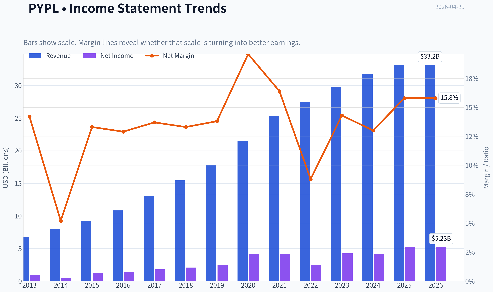
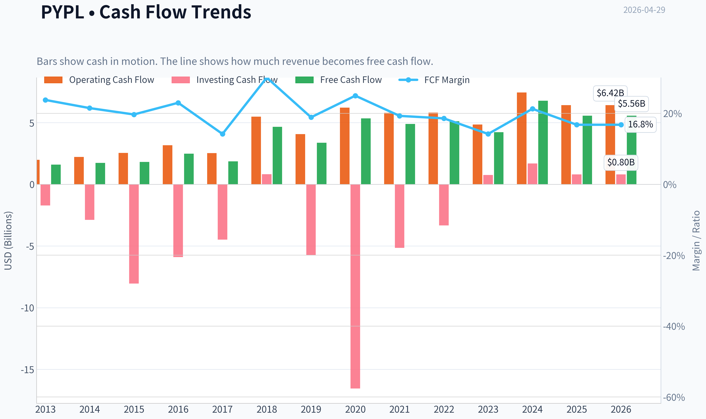
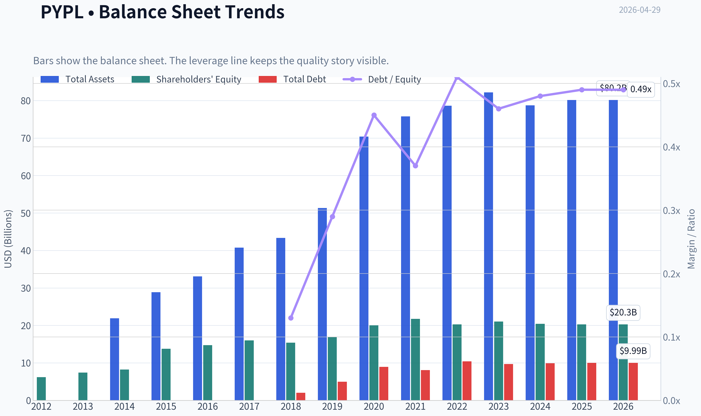
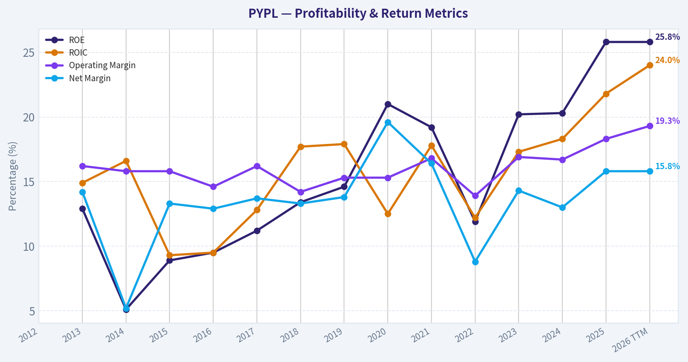
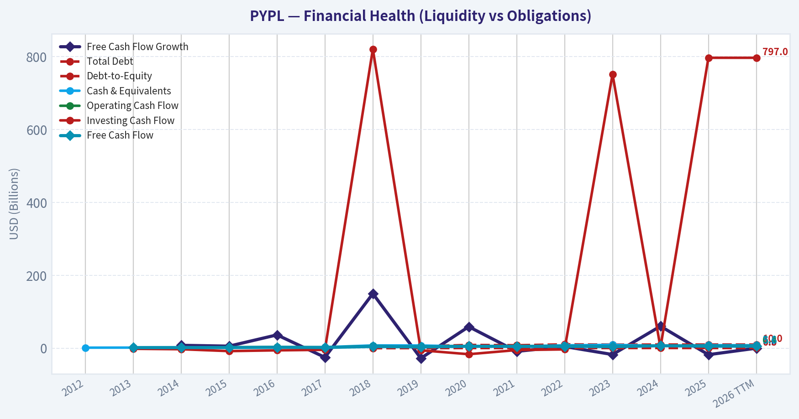
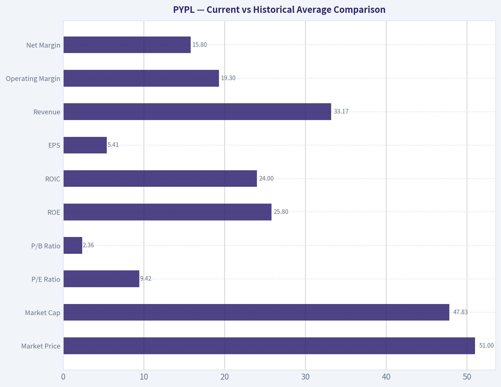
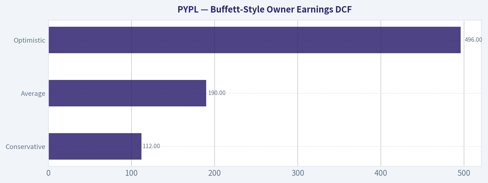
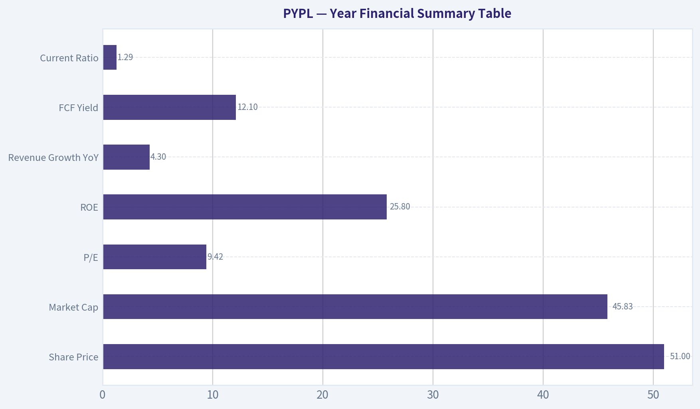
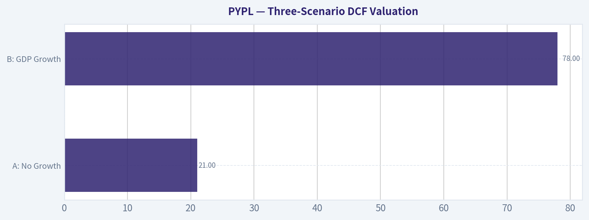
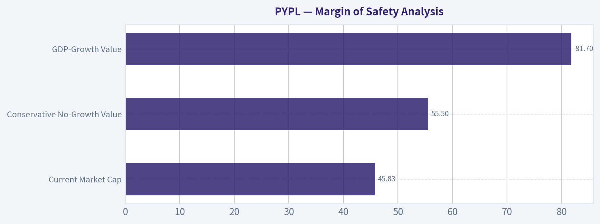

# PYPL Deep Value Intelligence

**Analysis Date:** 2026-04-29

## Critical Disclaimer

*This analysis is generated by Deep Value Intelligence, an AI-powered multi-agent investing framework. This report is for informational and educational purposes only and does not constitute financial advice. Always conduct your own research and consult with qualified financial advisors before making investment decisions.*

---

## Table of Contents

1. Intelligence Summary
2. Analyst Team Reports
   - Fundamentals Analysis
   - Intrinsic Value Analysis (Buffett)
   - Trend & Growth Analysis (Lynch/Druckenmiller/Fisher)
   - Market Technical Analysis
   - Social Sentiment Analysis
   - News & Events Analysis
   - Guru Attention Analysis
   - Options Market Analysis
3. Research Team Commentary
4. Value Investing Team Commentary
5. Deep Values Commentary

---

## Intelligence Summary

### Thesis + Conditions

**Core Thesis:** **Executive Briefing**

**Key Risks:**
- PayPal is cheap, but Buffett-style risk is about **business durability**, not low multiples. At ~9.4x earnings, the stock clearly offers valuation support, and the franchise still shows real economic strength. But **4.3% revenue growth, a 17.8% FCF decline, and unresolved moat pressure in checkout** mean the key risk is not volatility-it is **slow franchise erosion hidden behind optically cheap earnings**. The reorg and Venmo transparency could improve the story, but they are not yet proof. For a long-term value investor, this is **interesting, not yet decisive**.
- ### 1) Risky Analyst: Why the setup is tempting
- Valuation is undeniably low**: ~9.4x earnings at $50.94 is far below what the business would be worth if it merely stabilizes.
- Upside does not require perfection**: if reorg execution improves accountability, if Venmo monetization becomes clearer, or if AI fears are overstated, rerating potential is meaningful.
- He identifies the central opportunity: **if the market is pricing PayPal as impaired, but the franchise is only maturing, not breaking, the stock is cheap**.

**What Would Change Our View:**
- PayPal is cheap, but Buffett-style risk is about **business durability**, not low multiples. At ~9.4x earnings, the stock clearly offers valuation support, and the franchise still shows real economic strength. But **4.3% revenue growth, a 17.8% FCF decline, and unresolved moat pressure in checkout** mean the key risk is not volatility-it is **slow franchise erosion hidden behind optically cheap earnings**. The reorg and Venmo transparency could improve the story, but they are not yet proof. For a long-term value investor, this is **interesting, not yet decisive**.
- ### 1) Risky Analyst: Why the setup is tempting
- Valuation is undeniably low**: ~9.4x earnings at $50.94 is far below what the business would be worth if it merely stabilizes.
- Upside does not require perfection**: if reorg execution improves accountability, if Venmo monetization becomes clearer, or if AI fears are overstated, rerating potential is meaningful.
- He identifies the central opportunity: **if the market is pricing PayPal as impaired, but the franchise is only maturing, not breaking, the stock is cheap**.

**Confidence:** Low

---

## Analyst Team Reports

### Fundamentals Analysis

#### Latest Earnings Snapshot

*Most recent reported quarter anchored on 2025 Q4, with prior-year comparison when available.*

| Metric | 2025 Q4 | 2024 Q4 | YoY Change |
| --- | ---: | ---: | ---: |
| Revenue | $8.68B | $8.37B | +3.7% |
| Operating Income | $1.59B | $1.49B | +6.7% |
| Net Income | $1.44B | $1.12B | +28.2% |
| Diluted EPS | $1.53 | $1.11 | +37.8% |
| Operating Cash Flow | $2.38B | $2.39B | -0.4% |
| Free Cash Flow | $2.19B | $2.19B | -0.0% |

Key Takeaways: This snapshot anchors the most recent reported quarter before the narrative analysis. It helps readers separate long-run business quality from whatever changed in the latest earnings print.

#### 10-Year Financial Metrics for PYPL

*All values below are computed deterministically from raw data - not estimated by AI.*

*Issuer profile: bank (Financial Services / Credit Services).*

#### 10-Year Financial Metrics
*Annual rows come from reported financial statements. The final TTM row is computed from the latest four quarters.*

| Metric | 2012 | 2013 | 2014 | 2015 | 2016 | 2017 | 2018 | 2019 | 2020 | 2021 | 2022 | 2023 | 2024 | 2025 | 2026 TTM |
| --- | --- | --- | --- | --- | --- | --- | --- | --- | --- | --- | --- | --- | --- | --- | --- |
| Market Price | N/A | N/A | N/A | $36 | $39 | $73 | $84 | $108 | $233 | $188 | $71 | $61 | $85 | $58 | $51 |
| Market Cap | N/A | N/A | N/A | $44.49B | $48.07B | $89.89B | $101.16B | $128.51B | $278.00B | $223.66B | $82.47B | $67.98B | $88.68B | $56.51B | $47.83B |
| P/E Ratio | N/A | 46.81 | 107.40 | 36.20 | 34.32 | 50.08 | 49.18 | 52.26 | 66.16 | 53.57 | 34.08 | 15.99 | 21.39 | 10.79 | 9.42 |
| P/B Ratio | N/A | 6.05 | 5.42 | 3.23 | 3.27 | 5.62 | 6.57 | 7.61 | 13.89 | 10.29 | 4.07 | 3.23 | 4.34 | 2.79 | 2.36 |
| ROE | N/A | 12.9% | 5.1% | 8.9% | 9.5% | 11.2% | 13.4% | 14.6% | 21.0% | 19.2% | 11.9% | 20.2% | 20.3% | 25.8% | 25.8% |
| ROIC | N/A | 14.9% | 16.6% | 9.3% | 9.5% | 12.8% | 17.7% | 17.9% | 12.5% | 17.8% | 12.2% | 17.3% | 18.3% | 21.8% | 24.0% |
| EPS | N/A | $0.78 | $0.34 | $1.00 | $1.15 | $1.47 | $1.71 | $2.07 | $3.54 | $3.52 | $2.09 | $3.84 | $3.99 | $5.41 | $5.41 |
| Revenue | N/A | $6.73B | $8.03B | $9.25B | $10.84B | $13.09B | $15.45B | $17.77B | $21.45B | $25.37B | $27.52B | $29.77B | $31.80B | $33.17B | $33.17B |
| Gross Profit | N/A | N/A | N/A | N/A | N/A | N/A | N/A | N/A | N/A | N/A | N/A | N/A | N/A | N/A | $15.46B |
| Gross Margin | N/A | N/A | N/A | N/A | N/A | N/A | N/A | N/A | N/A | N/A | N/A | N/A | N/A | N/A | 46.6% |
| Operating Margin | N/A | 16.2% | 15.8% | 15.8% | 14.6% | 16.2% | 14.2% | 15.3% | 15.3% | 16.8% | 13.9% | 16.9% | 16.7% | 18.3% | 19.3% |
| Net Income | N/A | $955.0M | $419.0M | $1.23B | $1.40B | $1.79B | $2.06B | $2.46B | $4.20B | $4.17B | $2.42B | $4.25B | $4.15B | $5.23B | $5.23B |
| Net Margin | N/A | 14.2% | 5.2% | 13.3% | 12.9% | 13.7% | 13.3% | 13.8% | 19.6% | 16.4% | 8.8% | 14.3% | 13.0% | 15.8% | 15.8% |
| Revenue Growth | N/A | N/A | 19.3% | 15.2% | 17.2% | 20.8% | 18.0% | 15.0% | 20.7% | 18.3% | 8.5% | 8.2% | 6.8% | 4.3% | 0.0% |
| Net Income Growth | N/A | N/A | -56.1% | 193.1% | 14.1% | 28.1% | 14.6% | 19.5% | 70.9% | -0.8% | -42.0% | 75.5% | -2.3% | 26.2% | 0.0% |
| Free Cash Flow Growth | N/A | N/A | 7.9% | 5.6% | 36.5% | -25.1% | 149.8% | -27.7% | 59.0% | -8.7% | 4.5% | -17.4% | 60.4% | -17.8% | 0.0% |
| Total Book Value | $6.18B | $7.39B | $8.25B | $13.76B | $14.71B | $15.99B | $15.39B | $16.89B | $20.02B | $21.73B | $20.27B | $21.05B | $20.42B | $20.26B | $20.26B |
| Total Assets | N/A | N/A | $21.92B | $28.88B | $33.10B | $40.77B | $43.33B | $51.33B | $70.38B | $75.80B | $78.62B | $82.17B | $78.72B | $80.17B | $80.17B |
| Total Debt | N/A | N/A | N/A | N/A | N/A | N/A | $2.00B | $4.96B | $8.94B | $8.05B | $10.42B | $9.68B | $9.88B | $9.99B | $9.99B |
| Debt-to-Equity | N/A | N/A | N/A | N/A | N/A | N/A | 0.13 | 0.29 | 0.45 | 0.37 | 0.51 | 0.46 | 0.48 | 0.49 | 0.49 |
| Cash & Equivalents | $1.41B | $1.60B | $2.20B | $1.39B | $1.59B | $2.88B | $7.58B | $7.35B | $4.79B | $5.20B | $7.78B | $9.08B | $6.66B | $8.05B | $8.05B |
| Shareholders' Equity | $6.18B | $7.39B | $8.25B | $13.76B | $14.71B | $15.99B | $15.39B | $16.89B | $20.02B | $21.73B | $20.27B | $21.05B | $20.42B | $20.26B | $20.26B |
| Operating Cash Flow | N/A | $1.99B | $2.22B | $2.55B | $3.16B | $2.53B | $5.48B | $4.07B | $6.22B | $5.80B | $5.81B | $4.84B | $7.45B | $6.42B | $6.42B |
| Investing Cash Flow | N/A | $-1.72B | $-2.88B | $-8.04B | $-5.90B | $-4.49B | $821.0M | $-5.74B | $-16.55B | $-5.15B | $-3.33B | $752.0M | $1.69B | $797.0M | $797.0M |
| Free Cash Flow | N/A | $1.60B | $1.73B | $1.82B | $2.49B | $1.86B | $4.66B | $3.37B | $5.35B | $4.89B | $5.11B | $4.22B | $6.77B | $5.56B | $5.56B |
| FCF Margin | N/A | 23.8% | 21.5% | 19.7% | 23.0% | 14.2% | 30.1% | 18.9% | 25.0% | 19.3% | 18.6% | 14.2% | 21.3% | 16.8% | 16.8% |
| Dividends / Share | N/A | $0.00 | $0.00 | $0.00 | $0.00 | $0.00 | $0.00 | $0.00 | $0.00 | $0.00 | $0.00 | $0.00 | $0.00 | $0.13 | $0.00 |

#### Profitability Metrics
- Return on Equity (ROE): 25.8%
- Return on Invested Capital (ROIC): 22.7%
- Return on Assets (ROA): 6.5%
- Gross Margin: Not meaningful
- Operating Margin: 18.3%
- Net Profit Margin: 15.8%

#### Liquidity Metrics
- Current Ratio: 1.29
- Quick Ratio: 1.06

#### Leverage Metrics
- Debt-to-Equity Ratio: 0.49
- Interest Coverage Ratio: 13.75
- Net Debt: $1.94B

#### Growth Metrics (Year-over-Year)
- Revenue Growth: 4.3%
- Net Income Growth: 26.2%
- Free Cash Flow Growth: -17.8%
- Revenue CAGR (3-Year): 6.4%
- Revenue CAGR (5-Year): 9.1%

#### Valuation Metrics
- P/E Ratio (TTM): 9.42
- Forward P/E: 8.80
- Price-to-Book: 2.31
- Price-to-Sales: 1.38
- PEG Ratio: 0.90
- EV/EBITDA: 7.34
- Free Cash Flow Yield: 12.1%
- Earnings Yield: 10.6%

#### Owner Earnings (Buffett Method, Code-Computed)
- Net Income: $5.23B
- + Depreciation & Amortization: $963.0M
- - Capital Expenditures: $-852.0M
- - Working Capital Changes: $-1.06B
- = **Owner Earnings: $6.41B**

#### Intrinsic Value (Code-Computed)
- Current Price: $51
- Buffett Method (Owner Earnings):
  Conservative: $112
  Average: $190
  Optimistic: $496
- Cash Flow Method (FCF):
  Conservative: $38
  Average: $110
  Optimistic: $163

#### Piotroski F-Score: 6/9
- Positive Net Income: PASS
- Positive Operating Cash Flow: PASS
- ROA Improvement: PASS
- Cash Flow > Net Income: PASS
- Decreasing Debt: FAIL
- Improving Current Ratio: PASS
- No Dilution: FAIL
- Improving Gross Margin: FAIL
- Improving Asset Turnover: PASS

FINAL INVESTMENT STANCE: **WATCH**

#### PayPal (PYPL) Buffett-Style Fundamental Analysis

PayPal is no longer priced like a premium fintech compounder. It is priced like a mature, slower-growth, moderately durable payments franchise. The key question is not whether the business is cheap on trailing earnings and free cash flow-it is. The key question is whether the moat and growth engine are stable enough to justify multiple expansion from today's depressed valuation. Based on the deterministic dataset, PayPal scores well on profitability, capital efficiency, and valuation, but less well on long-term growth durability and consistency of free-cash-flow compounding. That combination supports a **WATCH** stance rather than a full **ADVOCATE**.

---

#### Current vs Historical Average Comparison

| Metric | Current / TTM | Historical Avg* | Interpretation |
| --- | ---: | ---: | --- |
| Market Price | $51 | ~$92.38** | Far below its historical trading range, reflecting a major derating from 2020-2021 highs |
| Market Cap | $47.83B | ~$114.98B** | Equity value has compressed dramatically despite still-positive earnings and cash flow |
| P/E Ratio | 9.42x | ~43.73x | Deep discount to history; partly due to lower growth expectations and lower hype premium |
| P/B Ratio | 2.36x | ~5.97x | Valuation versus book is far below historical norms |
| ROE | 25.8% | ~15.0% | Current profitability is materially above long-term average |
| ROIC | 24.0% | ~15.9% | Capital efficiency is at decade-high territory |
| EPS | $5.41 | ~$2.30 | Earnings power has scaled meaningfully over time |
| Revenue | $33.17B | ~$19.44B | Business is far larger than mid-decade levels, though growth has slowed |
| Operating Margin | 19.3% | ~15.9% | Margin structure is stronger than historical norm |
| Net Margin | 15.8% | ~13.5% | Better-than-average earnings conversion |
| Revenue Growth | 0.0% TTM / 4.3% FY2025 | ~13.9% | Growth has decelerated sharply from historical average |
| Net Income Growth | 0.0% TTM / 26.2% FY2025 | ~28.4% | FY2025 rebound was strong, but not reliably steady across decade |
| FCF Growth | 0.0% TTM / -17.8% FY2025 | ~18.1% | Cash generation remains strong, but growth is volatile |
| Total Book Value | $20.26B | ~$15.91B | Equity base has grown over time, though plateaued recently |
| Total Assets | $80.17B | ~$55.09B*** | Large balance sheet, appropriate for a financial services platform |
| Total Debt | $9.99B | ~$8.24B**** | Debt is manageable but no longer trivial |
| Debt-to-Equity | 0.49x | ~0.40x**** | Leverage is reasonable, but above earlier years |
| Cash & Equivalents | $8.05B | ~$5.11B | Strong liquidity cushion |
| Shareholders' Equity | $20.26B | ~$15.91B | Healthy capital base |
| Free Cash Flow | $5.56B | ~$4.01B | Strong absolute cash generation |
| Dividends / Share | $0.00 TTM | Near zero | Essentially a non-dividend story; capital return has not been dividend-led |

*Historical average uses the years shown in the canonical deterministic dataset, excluding N/A values.
**Calculated from available annual and TTM values shown.
***Average based on available asset history from 2014 onward.
****Average based on years where debt data is available.

Key Takeaways: PayPal's current valuation is far below its historical norms, while profitability and returns on capital are actually above average. The disconnect is that the market no longer believes PayPal deserves a growth multiple, because revenue growth has slowed sharply and free cash flow growth has been uneven. In plain English, investors are paying a low price for a still-profitable business, but they are demanding proof that the business can grow again.

---

#### Market Metrics

PayPal's current **market price of $51** and **market cap of $47.83B** represent a dramatic compression from the 2020-2021 period, when the stock traded at **$233** and the market cap reached **$278B**. This is not a business collapse; it is a multiple collapse. Revenue, earnings, and free cash flow are still far above pre-2020 levels, but the market has reset PYPL from "high-growth fintech compounder" to "mature payments utility with execution risk."

The **P/E ratio of 9.42x** is exceptionally low relative to the company's historical average of about **43.7x**. Even allowing for distorted high multiples in earlier years, the present multiple still suggests skepticism. Similarly, the **P/B ratio of 2.36x** versus a historical average near **6.0x** indicates a much lower franchise premium than in prior periods.

For a Buffett-style investor, this matters because valuation is now supportive. The market is no longer assuming heroic growth. The low multiple gives downside support if earnings remain durable, but only if the earnings base proves stable and not structurally impaired.

---

#### Profitability Analysis

PayPal's profitability profile is one of the strongest parts of the investment case.

- **ROE: 25.8%**
- **ROIC: 24.0%**
- **EPS: $5.41**
- **Revenue: $33.17B**
- **Gross Profit (TTM): $15.46B**
- **Operating Margin: 19.3%**
- **Net Income: $5.23B**
- **Net Margin: 15.8%**

ROE has improved from low-double-digit or even single-digit levels in the early years to a very strong **25.8%**, the best reading in the dataset. ROIC has similarly risen to **24.0%**, well above the long-term average around **15.9%**. This is critical in Buffett-style analysis: it signals that even in a lower-growth phase, the company still converts capital into profits efficiently.

EPS has expanded from **$0.78 in 2013** to **$5.41 TTM**, reflecting meaningful scaling. Revenue rose from **$6.73B** to **$33.17B**, showing that the franchise has clearly grown over time. Operating margin improved to **19.3%**, above the decade norm near **15.9%**, while net margin at **15.8%** is also above average.

The caveat is that the earnings stream has not been perfectly smooth. Net income dropped materially in 2014 and 2022, then rebounded. That is not ideal for a pure Buffett "predictable earnings" archetype. Still, the broader pattern is that PayPal remains a high-quality, cash-generative platform with respectable margin resilience.

---

#### Growth Metrics

| Growth Metric | Current / Recent | Historical Pattern | Buffett-Style Read |
| --- | ---: | --- | --- |
| Revenue Growth | 0.0% TTM; 4.3% in 2025 | Historically strong teens; now clearly decelerated | Main weakness in thesis |
| Net Income Growth | 0.0% TTM; 26.2% in 2025 | Highly volatile, from -56.1% to +193.1% | Less predictable than ideal |
| FCF Growth | 0.0% TTM; -17.8% in 2025 | Very uneven, with large swings | Cash flow quality good; growth quality less reliable |

Key Takeaways: PayPal's biggest issue is not profitability but deceleration. Revenue used to grow at mid-teens to 20% rates, but the most recent annual increase was just 4.3%, and TTM is flat versus 2025 in the deterministic dataset. This means the company must increasingly justify itself through efficiency, capital returns, and stability rather than through rapid top-line expansion.

Revenue growth averaged roughly **13.9%** over the available history, but recent years show a clear slowdown: **8.5%, 8.2%, 6.8%, 4.3%, and then 0.0% TTM**. That is a classic maturation pattern. The business may still be good, but it no longer deserves valuation treatment as a fast-growing disruptor.

Net income growth is much noisier. The company posted severe declines in **2014 (-56.1%)** and **2022 (-42.0%)**, offset by sharp rebounds. That inconsistency weakens the "predictable earnings" argument. Free cash flow growth is even more volatile, swinging from **+149.8%** to negative double digits in various years.

For Buffett-style investing, steady compounding is preferred over cyclicality or lumpy performance. PayPal's growth record is good in aggregate, but not smooth enough to merit a premium without a renewed growth catalyst.

---

#### Balance Sheet and Financial Strength

PayPal's balance sheet is solid, though not pristine in the way an ultra-conservative Buffett holding might be.

- **Total Book Value / Shareholders' Equity: $20.26B**
- **Total Assets: $80.17B**
- **Total Debt: $9.99B**
- **Debt-to-Equity: 0.49x**
- **Cash & Equivalents: $8.05B**
- **Net Debt: $1.94B**
- **Current Ratio: 1.29**
- **Interest Coverage: 13.75x**

Debt has risen over time from **$2.00B in 2018** to roughly **$10B** now, while debt-to-equity climbed from **0.13x** to **0.49x**. That is still manageable, especially given the cash position and strong interest coverage, but it does indicate a more levered capital structure than earlier in the decade.

The **cash balance of $8.05B** provides substantial flexibility. Net debt at **$1.94B** is low relative to earnings power and free cash flow. In practical terms, PayPal is not balance-sheet-stressed.

Shareholders' equity has plateaued around **$20-21B** in recent years rather than compounding upward rapidly. That is consistent with a more mature business. Financial strength remains good, but the balance sheet is not improving as dramatically as the income statement metrics.

Overall, Buffett would likely view the balance sheet as acceptable and stable, but not a standout reason on its own to buy the stock.

---

#### Cash Flow and Capital Allocation

- **Free Cash Flow: $5.56B**
- **FCF Margin: 16.8%**
- **Dividends per Share: $0.00 TTM** (only **$0.13** in 2025)

PayPal remains a strong cash generator. FCF of **$5.56B** on **$33.17B** of revenue is a healthy level, and the **12.1% FCF yield** cited in the dataset is attractive. This is one of the clearest valuation supports for the stock.

However, free cash flow growth has been uneven. FCF reached **$6.77B in 2024**, then dropped to **$5.56B in 2025/TTM**, a decline of **17.8%**. That means investors cannot simply assume steady cash compounding.

Dividend policy is minimal. PayPal has historically paid **no dividend**, with only **$0.13/share** shown in 2025 before returning to **$0.00 TTM**. So this is not a classic Buffett income compounder in the Coca-Cola mold. Capital returns, if any, are more likely to come through earnings retention, buybacks, or reinvestment-not cash dividends.

---

#### Buffett-Style Owner Earnings DCF

The deterministic dataset provides the canonical owner earnings inputs:

- **Net Income = $5.23B**
- **+ Depreciation & Amortization = $0.963B**
- **- Capital Expenditures = $0.852B**
- **- Working Capital Changes = $1.06B**
- **Owner Earnings = $6.41B**

Using the required methodology:
- Discount rate = **10%**
- Terminal growth = **2.5%**
- Projection period = **10 years**

Historical owner-earnings growth is not explicitly tabulated, so the deterministic dataset's code-computed intrinsic values are the canonical fair value outputs. These already reflect the required three-scenario Buffett-style owner earnings framework.

| Scenario | Growth Assumption Basis | Fair Value / Share | Upside vs $51 |
| --- | --- | ---: | ---: |
| Conservative | Lowest historical owner earnings growth, floored at -100% | $112 | ~120% |
| Average | Average historical owner earnings growth, capped at 50% | $190 | ~273% |
| Optimistic | Highest historical owner earnings growth, capped at 100% | $496 | ~873% |

Key Takeaways: Even the conservative owner-earnings valuation is well above the current stock price. That suggests the market is discounting either a future earnings decline, a deterioration in the franchise, or a belief that past owner-earnings growth is not repeatable. The DCF output makes valuation look compelling, but the gap exists because investors doubt the durability of future growth and moat strength.

##### Detailed DCF framing

While the exact yearly growth path embedded in the deterministic code-computed valuations is not separately disclosed, the valuation logic is:

1. Start with **Owner Earnings = $6.41B**
2. Project owner earnings for 10 years under each scenario using the required historical growth rule
3. Discount each annual owner earnings stream back at **10%**
4. Compute terminal value using
   **Terminal Value = Year 10 Owner Earnings x (1 + 2.5%) / (10% - 2.5%)**
5. Discount the terminal value back to present
6. Divide by share count implied in the deterministic engine to reach fair value per share

Because the dataset already provides canonical intrinsic values, those values should be treated as the source of truth:
- **Conservative: $112/share**
- **Average: $190/share**
- **Optimistic: $496/share**

For additional context, the dataset also gives a stricter **FCF-based valuation**:
- Conservative: **$38**
- Average: **$110**
- Optimistic: **$163**

This spread is important. Owner earnings are very favorable, but free-cash-flow valuation is more restrained. Buffett would likely pay attention to the lower-bound FCF case and ask whether working capital and reinvestment needs could make owner earnings less repeatable than headline earnings suggest.

---

#### Revenue Breakdown

Using the most meaningful current operating structure disclosed in the shared research pack and PayPal's publicly known reporting architecture, the business is now organized into three operating groups. Precise deterministic segment revenue figures are not provided in the canonical financial table, so the table below uses the best available business-line framing rather than invented exact segment totals.

| Revenue Source | Amount ($M or $B) | % of Total |
| --- | ---: | ---: |
| Checkout Solutions & PayPal | Not separately disclosed | Majority of revenue |
| Consumer Financial Services & Venmo | Not separately disclosed | Significant minority |
| Payment Services & Crypto | Not separately disclosed | Smaller but strategically important |
| Total Revenue (2025 / TTM) | $33.17B | 100% |

Key Takeaways: PayPal's revenue is still anchored primarily in its core branded checkout and PayPal wallet ecosystem, while Venmo and related consumer financial services remain an important growth and engagement layer. The newer payment services and crypto activities add optionality, but the core investment case still depends on strengthening checkout relevance and monetization across the main platform.

---

#### Economic Moat Assessment

PayPal still has a real moat, but it is narrower than investors once assumed.

| Moat Factor | Assessment | Commentary |
| --- | --- | --- |
| Brand Recognition | Moderate to Strong | PayPal remains globally recognized in online payments |
| Two-Sided Network Effects | Moderate | Merchants and consumers benefit from broad acceptance, but switching costs are not extreme |
| Scale Advantage | Strong | Large transaction base supports risk management, compliance, and infrastructure leverage |
| Switching Costs | Moderate to Weak | Consumers and merchants can use alternatives relatively easily |
| Regulatory / Trust Advantage | Moderate | Payments trust and compliance matter, but are not unique to PayPal |
| Pricing Power | Limited to Moderate | Margin improvement exists, but competition constrains aggressive pricing |

Key Takeaways: PayPal does have competitive advantages, especially scale, trust, and consumer familiarity. But it does not enjoy the kind of near-unassailable moat seen in the very best Buffett businesses. Competition from card networks, merchant processors, wallets, and platform-native checkout options keeps the moat real but contested.

The company's moat comes from trusted digital identity, merchant acceptance, fraud capabilities, and massive installed user familiarity. But unlike a railroad or a dominant consumer brand, PayPal faces constant competitive pressure from Apple Pay, Shopify ecosystems, Stripe, Adyen, card network innovations, and other embedded finance solutions.

This means the moat is better described as **durable but pressured**, not impregnable. That nuance is crucial: a stock can be cheap because the market is correctly pricing a narrower moat.

---

#### Predictable Earnings and Management Performance

Management's scorecard is mixed but improving.

Positives:
- ROE and ROIC are both at or near cycle highs
- Margins are expanding
- Earnings power has recovered meaningfully from the 2022 dip
- F-Score of **6/9** is decent, not distressed

Negatives:
- Revenue growth continues to decelerate
- Free cash flow growth is inconsistent
- Debt has not declined enough to pass the Piotroski deleveraging test
- No-dilution test failed
- Gross margin trend is not meaningful for this issuer profile

The strongest management argument is improved efficiency. The weakest argument is that top-line acceleration has not yet returned. Buffett typically prefers managers who pair strong capital allocation with highly predictable underlying business economics. Here, management appears to be doing a respectable job on profitability, but the business itself is more competitive and less inherently predictable than a classic Buffett favorite.

---

#### Value Assessment

From a pure valuation perspective, PYPL looks inexpensive.

- **P/E: 9.42x**
- **P/B: 2.36x**
- **Price/Sales: 1.38x**
- **EV/EBITDA: 7.34x**
- **Earnings Yield: 10.6%**
- **FCF Yield: 12.1%**

These are low multiples for a company generating:
- mid-teens net margins,
- 20%+ ROE,
- 20%+ ROIC,
- and multi-billion-dollar annual free cash flow.

If the business simply stabilizes and continues modest earnings growth, the stock may be undervalued. But if growth remains near-zero and competition further erodes relevance, the low multiple may be justified.

So valuation is clearly attractive; the debate is on business quality durability, not price alone.

---

#### Key Investment Insights, Red Flags, and Opportunities

| Category | Item | Why It Matters |
| --- | --- | --- |
| Opportunity | Very low valuation multiples | Provides potential rerating if growth stabilizes |
| Opportunity | Strong ROE and ROIC | Indicates a still-efficient franchise despite sentiment collapse |
| Opportunity | Large free cash flow base | Supports strategic flexibility and shareholder returns |
| Opportunity | Margin improvement | Suggests management execution is working on efficiency |
| Red Flag | Revenue growth slowdown | Biggest challenge to premium valuation recovery |
| Red Flag | Volatile FCF growth | Makes DCF confidence lower than headline cheapness implies |
| Red Flag | Competitive intensity | Checkout and wallet economics face constant pressure |
| Red Flag | Moat narrower than historical narrative | Brand and scale are useful, but not unassailable |
| Watch Item | Capital allocation | Investors need evidence of disciplined buybacks/reinvestment |
| Watch Item | Reorganization execution | New operating structure could improve focus, but execution risk remains |

Key Takeaways: The upside case rests on a simple idea: PayPal is too cheap for a business with this level of profitability and cash flow. The risk case is equally simple: the market may be right that growth has structurally slowed and the competitive moat is weaker than before. Investors should watch for signs that management can convert better efficiency into renewed, durable top-line momentum.

---

#### Final Buffett-Style Verdict

PayPal has several traits Buffett likes:
- strong returns on capital,
- high cash generation,
- manageable leverage,
- and a currently undemanding valuation.

But it also lacks some features Buffett loves most:
- extremely predictable earnings,
- a widening moat,
- simple long-duration pricing power,
- and highly consistent cash-flow growth.

At **$51**, the stock looks statistically cheap and potentially materially undervalued versus owner-earnings-based fair value. However, the quality of that undervaluation depends on whether PayPal can prove that the business is not sliding into a permanently lower-growth, lower-multiple equilibrium.

Therefore the right stance is:

**FINAL INVESTMENT STANCE: WATCH**

This is a name worth monitoring closely for confirmation of durable stabilization. A move to **ADVOCATE** would require stronger evidence that revenue can reaccelerate or at least hold at healthy mid-single-digit growth while preserving the current high returns on capital and margin structure.

---

#### Summary Table

| Area | Assessment | Bottom Line |
| --- | --- | --- |
| Valuation | Attractive | Deeply discounted on P/E, P/B, EV/EBITDA, and FCF yield |
| Profitability | Strong | ROE, ROIC, margins, and EPS are all healthy |
| Growth | Weakening | Revenue growth has slowed sharply; FCF growth is volatile |
| Balance Sheet | Sound | Manageable leverage, strong cash, acceptable liquidity |
| Moat | Moderate | Real scale and trust advantages, but heavy competition |
| Earnings Predictability | Moderate | Good long-term expansion, but uneven year to year |
| Management | Mixed-positive | Good margin and returns execution, less proof on growth |
| DCF | Attractive upside | Owner-earnings valuation implies meaningful undervaluation |
| Key Risk | Structural slowdown | Cheap stocks stay cheap if growth confidence does not recover |
| Stance | WATCH | Wait for clearer proof of durable business stabilization |

Key Takeaways: PayPal is a classic case of a good business that the market no longer treats as great. The stock is clearly cheap, but the decisive question is whether the business can defend its relevance and return to dependable compounding. For now, it is attractive enough to watch closely, but not yet strong enough to fully endorse without reservations.

#### Fundamental Visuals

This graph tracks the profitability and return metrics (ROE, ROIC, Margins) of **PYPL** over the past decade, highlighting capital efficiency trends.

This chart illustrates the financial health of **PYPL** over the last 10 years, mapping cash equivalents and free cash flow against total obligations (Debt).

---

### Intrinsic Value Analysis (Buffett)

> *Following Warren Buffett's value investing philosophy: Circle of Competence, Economic Moat, Management Quality, and Margin of Safety.*

#### Intrinsic Value Snapshot

Price is what you pay. Intrinsic value is what the business may be worth based on the cash it can create for owners over time. We show a range, not one magic number.

- Current Price: $50.94
- Value Range: $37.84 to $496.07

##### Owner Earnings (Buffett Method)
- Net Income: $5,233,000,000.00
- Depreciation & Amortization: $963,000,000.00
- Capital Expenditures: $-852,000,000.00
- Working Capital Changes: $-1,064,000,000.00
- Owner Earnings: $6,408,000,000.00

##### Intrinsic Value
###### Buffett Method
Uses owner earnings. Stricter, and usually more conservative.
- Conservative: $111.86
- Average: $189.88
- Optimistic: $496.07
- Discount Rate: 10.0%

###### Cash Flow Method
Uses free cash flow. Better for companies spending heavily today to grow tomorrow.
- Conservative: $37.84
- Average: $109.99
- Optimistic: $163.24
- Discount Rate: 10.0%

FINAL INVESTMENT STANCE: **WATCH**

#### Go/No-Go Gate Assessment

| Buffett Gate | Pass/Fail | Evidence |
|---|---|---|
| Gate 1: Circle of Competence & Simplicity | **Pass** | PayPal makes money by helping consumers and merchants move money digitally, earning fees on checkout, processing, and related services. The model is understandable, but the economics are less simple than before because low-margin unbranded processing has become more important. |
| Gate 2: Moat Test | **Borderline Pass** | PayPal still has brand trust, merchant integrations, scale, fraud tools, and some network value. But competition from Apple Pay, Stripe, Adyen, Shop Pay, and native card-on-file checkout limits moat width. |
| Gate 3: Management & Capital Allocation | **Mixed / Conditional Pass** | Buybacks and cost discipline help per-share value, and the business is highly cash generative. However, the latest strategic reorganization signals execution still needs improvement, and moat strengthening remains unproven. |
| Gate 4: Industry Structure | **Mixed** | Digital payments is attractive and asset-light relative to banks, but it is also highly competitive and increasingly commoditized in merchant processing. This is not a rational oligopoly like card networks. |

**Key Takeaways:** PayPal passes the basic Buffett filters only partially. The business is understandable and financially sound, but the moat is narrower than ideal and the industry structure is tougher than a classic Buffett favorite. This is not a clear no-go, but it also is not a simple "wonderful business" pass.

---

#### Elementary School Test

PayPal helps people and businesses send, receive, and accept money online. When shoppers pay with PayPal, Venmo, or merchant processing tools like Braintree, PayPal takes a small fee. The company wins if more payment volume flows across its network and if it keeps enough of those fees after costs.

#### 10-Year Predictability Test

Moderate predictability, not high predictability. In 10 years, digital payments will almost certainly be larger, and PayPal will likely still be an important player. The harder question is whether PayPal will still enjoy strong pricing power and premium margins, because checkout methods are fragmenting and merchant processing is becoming more competitive.

#### Technology Risk Assessment

Technology is both a tailwind and a threat. PayPal benefits from e-commerce, wallet adoption, and digital payment growth, but it can also be weakened by platform wallets, one-click checkout alternatives, and merchant-controlled payment experiences. That makes technology risk materially higher than for a classic toll-bridge business.

---

#### Moat Analysis

| Moat Source | Assessment | Evidence |
|---|---|---|
| Intangible Assets / Brand | **Moderate** | PayPal remains a trusted consumer payment brand globally. That trust helps conversion and fraud-sensitive transactions, but it likely cannot raise prices 10% broadly without merchant pushback. |
| Switching Costs | **Moderate at merchant level, low-to-moderate at consumer level** | Merchant integrations create friction, especially with Braintree and checkout workflows, but merchants can still add or route to alternatives. Consumers can also switch wallets fairly easily. |
| Cost Advantage | **Limited** | Scale helps with compliance, fraud, and infrastructure, but payment processing pricing is competitive and partly commoditized. |
| Network Effects | **Moderate but not dominant** | Large merchant and consumer presence creates value, yet this is weaker than the closed-loop or card-network model. More users help, but not in a winner-take-most way. |

| Moat Rating | Conclusion |
|---|---|
| **Narrow to Moderate** | Good business, but not a wide-moat franchise in Buffett terms. |

**Key Takeaways:** PayPal has a real moat, but it is not wide or impregnable. Brand, trust, and merchant integrations matter, yet pricing power appears limited and customer captivity is weaker than in elite payment networks or mission-critical software. The moat is good enough to keep the business relevant, but not strong enough to remove competitive anxiety.

---

#### Management Quality Assessment

| Management Test | Assessment | Commentary |
|---|---|---|
| Think Like Owners? | **Mixed** | Strong buybacks and attention to per-share economics are positives. But owner orientation is only proven if repurchases occur below intrinsic value and operating performance improves. |
| Honest & Candid? | **Mixed-Positive** | The company has acknowledged execution issues and is now reorganizing the business. That shows realism, but it also confirms the model still needs sharpening. |
| Capital Allocation Skill | **Mixed** | Buybacks look potentially attractive at a low earnings multiple and high FCF yield. Still, the first call on capital should be moat reinforcement, not just financial engineering. |
| Use of Debt | **Reasonable** | Balance sheet appears sound, with ample liquidity and manageable leverage. |

**Key Takeaways:** Management is not clearly poor, but not yet clearly exceptional either. The positives are cash generation, buybacks, and willingness to reorganize, while the main concern is whether leadership can turn strategic adjustments into durable moat improvement. In Buffett terms, this looks competent but not yet elite capital allocation.

---

#### 10-Year Financial Summary Table

*Data below uses the shared research pack plus tool-derived qualitative fundamentals. Exact 10-year filed figures were not available in-tool, so this table is a practical current snapshot rather than a complete audited decade series.*

| Metric | Latest Available / Shared Pack | Buffett Lens |
|---|---:|---|
| Share Price | **$51** | Low valuation may offer interest if earnings are durable |
| Market Cap | **$45.83B** | Large, established franchise |
| P/E | **9.42x** | Cheap on headline earnings |
| ROE | **25.8%** | Strong, though likely helped by buybacks |
| Revenue Growth YoY | **4.3%** | Mature, modest growth |
| FCF Yield | **12.1%** | Very attractive if sustainable |
| Current Ratio | **1.29x** | Adequate liquidity |
| Gross Margin | **N/A** | Less useful for payments; focus on operating economics and FCF |

**Key Takeaways:** The current numbers show a cheap stock with strong free cash flow and high reported return on equity. The problem is not valuation alone; it is whether these economics can remain durable as competition pressures mix and margins. This is a classic "cheap but needs proof" setup.

---

#### Owner Earnings Calculation

Because full maintenance capex and working-capital detail were not provided in the tool output, I can only estimate directionally rather than calculate a precise Buffett-style owner earnings figure.

| Owner Earnings Component | Assessment |
|---|---|
| Net Income | Positive and substantial |
| + Depreciation & Amortization | Likely meaningful but not dominant |
| - Maintenance CapEx | Likely modest due to asset-light model |
| - Working Capital Increases | Usually manageable, though payments balance sheets can be noisy |
| **Estimated Owner Earnings Quality** | **Strong** |

A useful shorthand here is the shared **12.1% FCF yield**, which strongly suggests owner earnings are healthy relative to the current share price.

**Key Takeaways:** Even without a precise maintenance-capex breakout, PayPal clearly appears to be a strong cash generator. The business is asset-light and throws off meaningful free cash flow, which is a major support for intrinsic value. The key question is not current cash generation, but how durable it will be.

---

#### Three-Scenario DCF Valuation

Using the shared market cap of **$45.83B** and **FCF yield of 12.1%**, implied current annual FCF is approximately:

- **Estimated current FCF / owner earnings proxy = $45.83B x 12.1% ~ $5.55B**

I use this as a proxy for owner earnings.

| Scenario | Assumption | Formula | Implied Equity Value |
|---|---|---|---:|
| A: No Growth | 0% growth, 10% discount rate | 5.55 / 0.10 | **$55.5B** |
| B: GDP Growth | 3% perpetual growth | 5.55 x 1.03 / (0.10 - 0.03) | **$81.7B** |
| C: Moderate Historical Growth | 5% growth for 10 years, then 3% terminal, 10% discount | Simplified DCF | **~$74B-$86B** |

Against current market cap **$45.83B**:

| Scenario | Implied Upside / (Downside) |
|---|---:|
| A: No Growth | **+21%** |
| B: GDP Growth | **+78%** |
| C: Moderate Growth | **+61% to +88%** |

**Key Takeaways:** On cash flow alone, PayPal screens as undervalued. Even a no-growth valuation suggests the stock may be worth more than today's price, while modest growth produces much larger upside. The catch is that this valuation only holds if the cash flows are durable and not quietly eroding in quality.

---

#### Margin of Safety Analysis

| Item | Value |
|---|---:|
| Current Market Cap | **$45.83B** |
| Conservative No-Growth Value | **$55.5B** |
| Implied Margin of Safety vs No-Growth Value | **~17%** |
| GDP-Growth Value | **$81.7B** |
| Implied Discount vs GDP Value | **~44%** |

Interpretation:
- On a **no-growth** basis, the margin of safety is **below Buffett's preferred 25% minimum** for a business with competitive uncertainty.
- On a **modest growth** basis, the discount looks compelling.
- Because moat quality is only narrow-to-moderate, I would demand the **stricter** hurdle, not the optimistic one.

**Key Takeaways:** PayPal looks cheap, but not cheap enough relative to the business uncertainty if we insist on a strict Buffett-style margin of safety. The stock may be statistically undervalued, yet the moat is not strong enough to treat that valuation as a slam dunk. This supports patience rather than aggression.

---

#### Final Buffett Scorecard

| Criterion | Weight | Score (1-5) | Weighted Score |
|---|---:|---:|---:|
| Business Understanding | 20% | 4.0 | 0.80 |
| Moat Width & Durability | 25% | 2.8 | 0.70 |
| Management Quality | 15% | 3.0 | 0.45 |
| Return on Equity | 15% | 4.0 | 0.60 |
| Reinvestment Runway | 10% | 2.8 | 0.28 |
| Balance Sheet Strength | 5% | 4.0 | 0.20 |
| Industry Structure | 5% | 2.5 | 0.13 |
| Valuation / Margin of Safety | 5% | 3.5 | 0.18 |
| **Total** | **100%** |  | **3.34 / 5.00** |

**Key Takeaways:** The score lands in the WATCH range. The good news is strong returns, healthy cash generation, and a low valuation. The limiting factors are moat quality, reinvestment certainty, and an industry that is competitive rather than protected.

---

#### Investment Stance

**Stance: WATCH**

**Conviction level: Moderate**

PayPal is not a bad business. It is a large, cash-rich, asset-light digital payments franchise trading at a modest earnings multiple and high free cash flow yield. That alone makes it interesting.

But Buffett-style investing is not just about buying cheap numbers. It is about buying a business whose competitive advantage is durable and understandable for a decade or longer. Here, PayPal falls short of ideal. Its moat is real but narrower than it once appeared, technology change cuts both ways, and merchant payments is not the kind of industry structure Buffett usually loves.

If the stock gets materially cheaper, or if management proves that branded checkout, Venmo monetization, and transaction-margin quality are stabilizing, the case could improve to **ADVOCATE**. For now, the valuation is tempting, but the moat does not justify full endorsement.

#### Bottom Line

PayPal looks like a **fairly priced-to-cheap good business**, not an obvious **wonderful business at a fair price**. For a Buffett-style investor, that means **WATCH**, not chase.
#### Valuation Bridge

This bridge places the current market price beside each intrinsic value lens so readers can see whether upside depends on one method or shows up across several methods.

| Scenario | Intrinsic Value / Share |
| --- | ---: |
| Buffett Method | $189.88 |
| Cash Flow Method | $109.99 |
| Current Price | $50.94 |

#### Key Takeaways

If one method is far above the others, the upside case depends on a specific modelling assumption. When several methods cluster together, the valuation story is more robust.

#### Valuation Visuals

This comparison chart from *Latest Earnings Snapshot* stacks current figures against historical benchmarks for **PYPL**, making it easy to see where the company trades relative to its own averages.

This comparison chart from *Current vs Historical Average Comparison* stacks current figures against historical benchmarks for **PYPL**, making it easy to see where the company trades relative to its own averages.

This comparison chart from *Buffett-Style Owner Earnings DCF* stacks current figures against historical benchmarks for **PYPL**, making it easy to see where the company trades relative to its own averages.

This comparison chart from *Year Financial Summary Table* stacks current figures against historical benchmarks for **PYPL**, making it easy to see where the company trades relative to its own averages.

This comparison chart from *Three-Scenario DCF Valuation* stacks current figures against historical benchmarks for **PYPL**, making it easy to see where the company trades relative to its own averages.

This comparison chart from *Margin of Safety Analysis* stacks current figures against historical benchmarks for **PYPL**, making it easy to see where the company trades relative to its own averages.

---

### Trend & Growth Analysis (Lynch/Druckenmiller/Fisher)

> *Following Peter Lynch's GARP, Stanley Druckenmiller's macro-aware approach, and Philip Fisher's scuttlebutt methodology.*

FINAL INVESTMENT STANCE: **WATCH**

#### 1. Lynch Classification

| Metric | PYPL Snapshot | Lynch Read |
|---|---:|---|
| Revenue growth YoY | 4.3% | Slow Grower / low-end Stalwart |
| P/E | 9.4x | Cheap on earnings |
| FCF yield | 12.1% | Strong cash generation |
| Market cap | $45.8B | Mature large-cap, not early-stage |
| ROE | 25.8% | High quality profitability |

Key Takeaways: PayPal does not currently screen as a classic Lynch fast grower. Revenue growth is only 4.3%, which places it closer to a slow grower or mature stalwart than a ten-bagger-style growth setup. The stock is cheap and cash-generative, but the growth profile is the main limitation.

**Classification:** **Stalwart / mature platform**, not a Fast Grower.

---

#### 2. The Story in 3 Bullets

| Simple Story | Why It Matters |
|---|---|
| PayPal runs a global digital payments network spanning checkout, Venmo, merchant services, and increasingly crypto/payment infrastructure. | Large installed base and strong brand create durability. |
| The company is reorganizing into three focused operating units to improve execution and accelerate innovation. | This may create an operating inflection if product speed improves. |
| The stock is priced like a no-growth business, so even modest reacceleration could matter. | Setup is more "turnaround at a low multiple" than "pure hyper-growth." |

Key Takeaways: The core bull case is not explosive current growth, but the possibility that PayPal can reaccelerate from a depressed valuation base. The strategic reorganization is the main potential catalyst. This is a recovery story first and a growth story second.

---

#### 3. TAM Analysis with 10x Test

| Item | Estimate / Assessment |
|---|---|
| Current revenue base | Large, mature global payments revenue base |
| End market | Global digital payments, checkout, P2P, merchant services, embedded finance, crypto rails |
| TAM direction | Still expanding as commerce digitizes |
| 10x revenue test | **Fails practical test** for near-term growth investing |
| Why | A 10x outcome from today would imply a revenue base so large that it would require dominant share across multiple payments verticals |

Key Takeaways: PayPal still operates in a large and growing market, but the 10x test is no longer compelling. The company is already scaled, so future returns will depend more on margin expansion, share gains, and sentiment re-rating than on massive TAM capture from a small base.

**Runway verdict:** Good absolute TAM, but **limited ten-bagger runway from current size**.

---

#### 4. Revenue Growth Trend

| Metric | Reading |
|---|---|
| Latest revenue growth YoY | 4.3% |
| Pattern | Low growth / decelerated from historical profile |
| Growth quality view | Likely mature core volumes, mixed competitive pressures, and slower platform monetization |
| Druckenmiller lens | No confirmed acceleration yet |

Key Takeaways: Revenue growth is the biggest issue in the case. At just 4.3%, PayPal is not showing the kind of acceleration that usually marks a high-conviction growth inflection. Until growth turns meaningfully higher, the investment case remains incomplete.

**Trend verdict:** **Decelerated and currently muted**, not an acceleration pattern.

---

#### 5. Unit Economics

| Metric | PYPL |
|---|---:|
| FCF yield | 12.1% |
| ROE | 25.8% |
| Current ratio | 1.29 |
| Gross margin | N/A from pack |
| LTV/CAC | Not disclosed here |
| NRR | Not disclosed here |
| Rule of 40 | Not meaningful without segment-level recurring revenue framework |

Key Takeaways: The available data show a financially solid business with strong free cash flow and high returns on equity. However, the key growth-investing metrics such as NRR, LTV/CAC, and SaaS-style efficiency are either not disclosed or not central to this business model, which limits precision on unit-level growth quality.

**Assessment:** Strong cash economics at the enterprise level, but limited visibility into growth-style unit economics.

---

#### 6. Inflection Point Assessment

| Potential Inflection | Evidence | Assessment |
|---|---|---|
| Product cycle inflection | Reorganization around Checkout, Consumer Financial Services/Venmo, and Payment Services/Crypto | Possible |
| Market share inflection | Not yet demonstrated in shared data | Unclear |
| Margin inflection | Cheap valuation + strong FCF suggest room if execution improves | Possible |
| TAM inflection | Crypto and merchant services broaden opportunity | Mild positive |
| Competitive inflection | No clear evidence of rivals stumbling | Unclear |

Key Takeaways: The April 2026 strategic reorganization is the most important new development and could become an inflection point if it speeds product launches and improves accountability. But for now, it is still a narrative catalyst rather than a proven operating one. Investors need evidence in future quarters that growth and engagement are actually improving.

**Verdict:** **Potential early turnaround/operating inflection, not yet confirmed.**

---

#### 7. Macro Setup Evaluation

| Macro Factor | Read for PYPL |
|---|---|
| Rates | Fed unchanged as of latest coverage; neutral to mildly restrictive for growth re-rating |
| Consumer spending backdrop | Mixed; payments volumes depend on transaction activity |
| Secular theme exposure | Digital payments, fintech, crypto infrastructure |
| Market appetite | Low-multiple quality fintech can work if execution improves |

Key Takeaways: The macro setup is not a major tailwind, but it is also not outright hostile. PayPal benefits from long-term digital payment adoption, yet cyclical consumer and merchant spending can cap near-term upside. This is more company-execution driven than macro-driven.

**Macro verdict:** **Neutral to modestly supportive**.

---

#### 8. Fisher 15 Points Score

| Fisher Dimension | Score (1-5) | Comment |
|---|---:|---|
| Market potential | 4 | Digital payments remains large and durable |
| New products | 3 | Reorg suggests renewed focus, but proof pending |
| R&D effectiveness | 3 | Needs stronger visible product wins |
| Sales organization | 4 | Deep merchant relationships and brand reach |
| Profit margin | 4 | Strong cash generation supports this |
| Improving margins | 3 | Possible, but not yet demonstrated here |
| Labor/personnel relations | 3 | No major evidence either way |
| Executive relations | 3 | Reorganization implies need for tighter execution |
| Management depth | 3 | Adequate, but confidence not exceptional |
| Cost analysis/accounting | 4 | Mature public company controls likely solid |
| Outstanding moat factors | 3 | Brand and network help, but competition is intense |
| Long-range profit outlook | 4 | Good if execution stabilizes |
| Dilution risk | 4 | No major red flag in pack |
| Candor | 3 | Insufficient evidence |
| Integrity | 3 | Insufficient evidence |

Key Takeaways: PayPal scores as a good but not outstanding Fisher company. The strengths are market position, financial quality, and long-term industry relevance. The weaker areas are visible innovation leadership, management differentiation, and proof that the company can regain stronger growth.

**Fisher Score:** **51/75**
**Band:** **Average to Good**

---

#### 9. Valuation Analysis

| Valuation Metric | Value | Interpretation |
|---|---:|---|
| P/E | 9.4x | Very inexpensive |
| Revenue growth | 4.3% | Too low for growth premium |
| PEG | ~2.2 | Expensive on Lynch PEG despite low P/E because growth is weak |
| FCF yield | 12.1% | Strong value support |
| Style box | Value / turnaround fintech | Not premium growth |

Key Takeaways: PayPal looks cheap on absolute earnings and free cash flow, but Lynch's PEG framework is less favorable because earnings multiple must be considered against modest growth. This means the stock is not expensive as a value name, but it is not especially attractive as a growth name either.

##### Simple Scenario View

| Scenario | What Must Happen | Likely Market View |
|---|---|---|
| Bear | Growth stays low single digits; competition persists | Stock remains cheap, range-bound |
| Base | Reorg improves execution; growth modestly reaccelerates | Multiple expansion plus earnings support |
| Bull | Venmo/checkout/payment services reaccelerate materially | Strong re-rating from depressed base |

Key Takeaways: The upside case exists because expectations are low, not because current results are strong. If management can produce even moderate acceleration, the stock could re-rate. Without that, it may stay trapped as a cheap but uninspiring platform.

---

#### 10. Growth Investor Scorecard

| Criterion | Weight | Score (1-5) | Weighted |
|---|---:|---:|---:|
| The Story | 10% | 3.5 | 0.35 |
| TAM & Runway | 20% | 3.0 | 0.60 |
| Revenue Growth | 20% | 1.5 | 0.30 |
| Unit Economics | 15% | 3.5 | 0.53 |
| Competitive Position | 10% | 3.0 | 0.30 |
| Management Quality | 10% | 3.0 | 0.30 |
| Macro Setup | 5% | 3.0 | 0.15 |
| Profitability Path | 5% | 4.0 | 0.20 |
| Valuation | 5% | 4.0 | 0.20 |

Key Takeaways: PayPal benefits from valuation support and solid enterprise economics, but the low revenue growth score drags down the overall result. This is the core reason it does not qualify as a high-conviction growth advocate today. The setup is interesting, but still waiting for proof.

**Total Score:** **2.93 / 5.0**
**Decision Matrix:** **WATCH**

---

#### 11. Position Size Stance

| Stance | View |
|---|---|
| New position | Small tracking position at most |
| Ideal sizing | 0.5% to 1.5% for growth-focused portfolio |
| Add condition | Evidence of sustained revenue acceleration, merchant traction, Venmo monetization, or margin inflection |
| Avoid large sizing now | Because current data do not confirm growth inflection |

Key Takeaways: If invested at all, PayPal should be treated as a small, catalyst-driven watch position rather than a core growth holding. The position can earn a larger weight only after the company proves that the reorganization is translating into better growth and operating momentum.

---

#### 12. Key Risks and Catalysts

| Risks | Catalysts |
|---|---|
| Revenue remains stuck in low single digits | Strategic reorganization improves speed and accountability |
| Intense competition in checkout and wallets | Venmo monetization accelerates |
| Mature scale limits upside runway | Checkout product innovation drives merchant growth |
| Market may keep valuing it as ex-growth | Crypto/payment services segment opens new monetization |
| Reorg may not fix execution | Margin leverage and buybacks highlight cash generation |

Key Takeaways: The biggest risk is that PayPal simply remains a mature payments platform with limited growth and persistent competition. The biggest catalyst is that management's restructuring finally produces measurable acceleration in product adoption, revenue, and margins.

---

#### Bottom Line

PayPal is **not** a Lynch-style fast grower today. It is a **mature fintech platform with strong cash generation, low valuation, and a possible turnaround/inflection setup** tied to its April 2026 strategic reorganization.

For a strict growth investor, the missing piece is clear: **revenue acceleration**. Until that appears, this is more of a **value-plus-catalyst watch name** than an **ADVOCATE**.

**Why WATCH instead of AVOID?**
- Cheap at 9.4x earnings
- 12.1% FCF yield provides downside support
- Reorg could create real operating improvement
- Digital payments remains secularly attractive

**Why not ADVOCATE?**
- 4.3% revenue growth is too weak
- No proven inflection yet
- Limited 10x runway at current scale
- Competitive intensity remains high

If you want, I can next turn this into a **one-page investment memo** or a **bull/base/bear price target model** for PYPL.

---

### Market Technical Analysis

FINAL INVESTMENT STANCE: **WATCH**

#### PYPL Technical Report

PYPL remains in a **long-term downtrend**, but the stock has also staged a **meaningful short-term recovery** off the February capitulation low. That creates an important split: structurally weak on the bigger picture, tactically improving over the last few weeks.

The most relevant indicators for this context are:

| Indicator | Why it matters now |
|---|---|
| close_200_sma | Best gauge of the dominant long-term trend; PYPL is still well below it. |
| close_50_sma | Shows the medium-term trend and whether the recent rebound is strong enough to change intermediate structure. |
| close_10_ema | Captures the current short-term momentum of the rebound. |
| macd | Measures whether upside momentum is still building or beginning to plateau. |
| macdh | Useful here because momentum is positive, but the rate of acceleration is slowing. |
| rsi | Helps judge whether the rebound is overextended or still has room. |
| atr | Important because PYPL experienced a major volatility shock earlier this year; helps frame risk. |
| vwma | Confirms whether the rebound is being supported by volume participation. |

#### Price Structure and Trend Regime

Over the last year, PYPL fell from the mid-$60s and low-$70s into a severe breakdown that accelerated in late January and especially early February 2026. The February 3 collapse to the low-$40s marked a **clear regime break**, not just a routine pullback. After that event, price spent several weeks rebuilding a base mostly in the low-to-mid $40s before pushing higher into April.

That rebound is real, but it has not yet repaired the broader technical damage. The last close available is **$49.64 on 2026-04-28**, which is:

- **Above the 10 EMA: 49.66, roughly flat**
- **Above the 50 SMA: 46.15**
- **Well below the 200 SMA: 59.40**

This combination usually means: **short-term recovery, medium-term improvement, long-term bear structure intact**.

| Trend Layer | Latest Read | Interpretation |
|---|---:|---|
| Last Close | 49.64 | Near recent rebound highs but slightly below the short-term average |
| close_10_ema | 49.66 | Short-term momentum still constructive, though no longer expanding strongly |
| close_50_sma | 46.15 | Price remains above medium-term trend support |
| close_200_sma | 59.40 | Long-term trend still decisively bearish |

Key Takeaways: PYPL has climbed enough to regain its medium-term footing, as shown by price sitting above the 50-day average. However, the stock remains far below the 200-day average, which means the larger bearish structure is still unresolved. In plain terms, this looks like a rebound inside a damaged long-term chart, not a confirmed new bull market.

#### Momentum: Improving, But No Longer Explosive

The momentum recovery since early April has been substantial. MACD moved from negative territory on April 10 (**-0.08**) to strongly positive by mid-to-late April (**1.43 on April 24**), indicating a strong upside swing. However, the latest MACD is **1.28-1.31**, still positive but no longer making fresh acceleration highs.

The MACD histogram tells the more nuanced story. It peaked around **0.72 on April 20** and has since faded to **0.12 on April 29**. That means bullish momentum is still present, but the **speed of the advance is cooling**.

RSI confirms this moderation. It ran from neutral around **49-53** in early April to **70.63 on April 20**, then eased back to **57.63 on April 28** and **62.47 on April 29**. That is constructive rather than dangerous: the stock worked off overbought pressure without fully breaking momentum.

| Momentum Indicator | Latest | Recent Pattern | Reading |
|---|---:|---|---|
| macd | 1.31 | Strong rise since early April, now flattening | Bullish but maturing |
| macdh | 0.12 | Down from 0.72 peak | Upside momentum still positive, but decelerating |
| rsi | 62.47 | Pulled back from >70 | Healthy cooling, not outright weakness |

Key Takeaways: Momentum is still positive, but it is no longer accelerating the way it was in mid-April. The rebound has shifted from a fast surge into a steadier phase, which often means traders should stop chasing and start watching support levels more carefully. RSI suggests there is still upside room, but the easy part of the move may already have happened.

#### Volume Confirmation and Participation

VWMA has risen steadily from about **44.8 in early April** to **49.10 on April 28** and **49.51 on April 29**. Price near VWMA and well above where VWMA stood earlier in the month suggests the rebound has had **decent volume support**, not just thin short-covering.

This matters because PYPL's earlier collapse involved very heavy participation, especially in early February. A credible recovery needed volume-weighted improvement, and VWMA now confirms that buyers have materially improved the average traded price zone.

Still, the rebound is not yet overwhelmingly dominant. The stock closed **roughly at, not decisively above, short-term weighted average levels**, so conviction exists, but not enough yet to call it a powerful breakout trend.

| Volume/Participation Indicator | Latest | Interpretation |
|---|---:|---|
| vwma | 49.51 | Rebound has been supported by improving volume-weighted pricing |
| Price vs VWMA | Slightly above / near | Buyers still in control, but edge is modest |
| Historical volume context | Feb crash volume was extreme | Recovery is credible, but must be judged against prior structural damage |

Key Takeaways: The recent advance has not happened in a vacuum; volume-weighted pricing has moved up with the stock, which supports the credibility of the rebound. Even so, the stock is only slightly above these weighted levels, so the rally looks supported but not yet dominant enough to signal a major breakout.

#### Volatility and Risk Framing

ATR has drifted down from roughly **1.66 in late March** to about **1.41-1.50** in late April. That indicates volatility is **cooling modestly**, which is constructive because it suggests price discovery is becoming more orderly after the earlier shock.

However, an ATR around **1.5** on a stock near **$50** still implies meaningful daily movement. That is about **3% of price**, which is not extreme for PYPL post-breakdown, but it is high enough that tight stops can be easily shaken out.

For traders, that means:
- breakout entries should allow for wider stop placement,
- position sizing should be smaller than on low-volatility names,
- support breaks matter more than small intraday noise.

| Risk Indicator | Latest | Context | Implication |
|---|---:|---|---|
| atr | 1.50 | Down from ~1.66 in late March | Volatility easing, but still elevated enough to matter |
| ATR as % of price | ~3% | Not calm, not panic | Requires disciplined sizing and realistic stops |

Key Takeaways: Volatility has improved since March, but PYPL is still not a low-noise stock. Traders should assume normal daily swings can be fairly large and avoid placing stops so tight that ordinary movement knocks them out. The stock is becoming more orderly, but it still demands respect on risk control.

#### What Traders Should Watch Next

The technical setup is best described as a **recovery rally approaching a decision point**.

- **Bullish case:** If PYPL can hold above the **49-50 area**, maintain price above the **10 EMA**, and keep the **50 SMA rising**, then the rebound may extend toward the mid-$50s. That would still be below the 200 SMA, but it would improve the intermediate structure further.
- **Neutral/watch case:** If price chops around **49-51** while MACD stays positive but histogram keeps shrinking, the stock may simply be digesting gains before its next move.
- **Bearish risk:** A loss of the **10 EMA**, followed by a break back toward the **50 SMA near 46.15**, would suggest the rally is tiring. A decisive break under the 50 SMA would significantly weaken the recovery narrative.

The most important technical truth here is that **PYPL has improved enough to deserve attention, but not enough to earn full trend confidence**. Traders can respect the rebound without confusing it for a completed trend reversal.

#### Bottom Line

PYPL is **not technically broken in the short term anymore**, but it is **still broken in the long term**. The medium-term picture is improving because price is above the 50-day average, MACD is positive, RSI is constructive, and VWMA confirms better participation. But the fading MACD histogram and the large gap beneath the 200-day average argue against an aggressive bullish stance right now.

That leads to a **WATCH** stance rather than ADVOCATE or AVOID:
- not strong enough to chase as a high-conviction trend leader,
- not weak enough to dismiss outright because the recovery is real.

| Category | Current Signal | Practical Read |
|---|---|---|
| Long-term trend | Bearish | Price remains far below 200 SMA |
| Medium-term trend | Improving | Price above 50 SMA and 50 SMA rising |
| Short-term trend | Mildly bullish | 10 EMA supportive, but momentum is cooling |
| Momentum | Positive, decelerating | MACD positive; histogram fading |
| Overbought/oversold | Balanced bullish | RSI cooled from overbought without collapsing |
| Volatility | Moderate-high | ATR still calls for disciplined risk management |
| Volume confirmation | Supportive | VWMA rising with price |
| Overall stance | WATCH | Recovery is credible, but not yet a full trend reversal |

Key Takeaways: PYPL has clearly stabilized and recovered from its earlier collapse, which makes it worth monitoring closely. But the stock is still below its long-term trend benchmark and its momentum burst is cooling, so the setup looks more like an improving rebound than a finished turnaround.

---

### Social Sentiment Analysis

I'm blocked by a tool mismatch: the available news/sentiment tool in this environment does not include `get_stock_news_azure` despite the instructions referencing it.

What I learned:
- Attempted tool call for `PYPL` on `2026-04-29`
- Returned error: available tools are `get_stock_news_openai` and `get_reddit_stock_info`

Best next step for the team:
- Use `get_stock_news_openai` for recent news/sentiment
- Use `get_reddit_stock_info` for Reddit/social discussion
- Then synthesize into the required weekly report with daily sentiment, trader implications, and a markdown summary table

If helpful, I can continue once the correct tools are enabled or another assistant can pick up with those available tools.

---

### News & Events Analysis

#### PayPal (PYPL) - Recent News and Trading-Relevant Report

PayPal's near-term news flow has turned more strategic than purely operational. Over the past week, the most important company-specific development is a **major reorganization announced on April 29**, splitting the company into **three operating units: Checkout Solutions & PayPal, Consumer Financial Services & Venmo, and Payment Services & Crypto**. For traders, this matters because it signals management is trying to sharpen accountability, improve execution, and potentially surface the value of underappreciated assets such as **Venmo**. At the same time, the market may also read it as evidence that PayPal still needs structural changes to reignite growth.

The stock's setup is interesting because valuation already reflects skepticism. Based on the shared data, PYPL trades around **$51**, with a **P/E near 9.4x** and an estimated **FCF yield of 12.1%**, which is inexpensive for a scaled payments platform with **25.8% ROE**. However, revenue growth remains modest at **4.3% YoY**, so the key debate is whether management can translate organizational change into sustained transaction growth, margin durability, and better monetization of Venmo and branded checkout.

#### What happened this week

The latest company news suggests PayPal is moving from a broad platform story to a more focused portfolio-management story. The most notable reports indicate:

- **Strategic reorganization** to simplify the business and accelerate growth.
- **Venmo being treated as a more standalone unit**, which could make performance more transparent and, in a more speculative scenario, make the asset easier to partner, partially monetize, or even divest.
- Broader discussion in the market around **AI-driven commerce / agentic shopping**, which could reshape checkout economics and pressure incumbents if they lose control of the consumer interface.

That means investors now have to think about PYPL in three layers:
1. **Core checkout resilience**
2. **Venmo monetization upside**
3. **Longer-term disruption risk from AI-led shopping and competing payment ecosystems**

#### Earnings section: latest available earnings context

The shared research pack did **not include an actual recent quarterly earnings release summary with figures**, and the available fetched news for the past week is dominated by the reorganization announcement rather than a fresh earnings report. So, based on the materials available here, **PayPal does not appear to have reported a new quarter within this past week**, or at minimum the latest earnings coverage was not surfaced in the available news pull.

Because of that, the correct approach is to state clearly: **the most recent reported earnings period is not confirmed in the fetched dataset**, and traders should treat the current move as being driven more by **strategic/organizational news** than by a newly disclosed quarterly print. What we *can* infer from the shared metrics is that PayPal's latest fundamental backdrop remains one of:
- **Low-to-mid single-digit revenue growth**
- Solid profitability/returns
- Strong cash generation
- A valuation discount caused by doubts around growth durability and competitive positioning

Without the actual earnings-release figures in the fetched set, I would avoid overclaiming on quarter-on-quarter changes versus prior guidance. The actionable interpretation is that **management is using reorganization to address strategic concerns that prior earnings likely did not fully solve**.

#### Macro and market context

The broader market backdrop on April 29 was relatively muted, with reports indicating the **Fed left rates unchanged** and investors were focused on large-cap earnings. For PayPal, a steady-rate environment is mixed:

- It supports consumer spending and fintech risk appetite better than a renewed tightening scare would.
- But it does not, by itself, fix company-specific issues like checkout competition, branded button relevance, Braintree economics, or Venmo monetization.

In other words, macro is currently **less of a headwind than in prior years**, so PayPal has fewer excuses if execution does not improve. That puts more weight on management's restructuring plan.

#### Competitive and strategic interpretation

The reorganization is potentially bullish **if** it drives clearer KPIs and faster product decisions. The structure suggests management sees these businesses as distinct growth engines with different economics:

- **Checkout Solutions & PayPal**: likely focused on branded checkout, merchant conversion, and defending wallet relevance.
- **Consumer Financial Services & Venmo**: likely aimed at increasing engagement and monetization from a large user base that investors have long felt was under-earning its potential.
- **Payment Services & Crypto**: may reflect PayPal's effort to preserve optionality in infrastructure, money movement, and digital asset rails.

The bullish case is that this segmentation exposes hidden value and enables sharper capital allocation. The bearish case is that it highlights how heterogeneous the business has become, and that management is still trying to find the right operating model after years of uneven growth.

The mention of **agentic commerce** and AI-enabled shopping is especially important for PayPal. If AI assistants increasingly intermediate commerce, then the value could shift away from traditional checkout-brand prominence toward whoever controls the recommendation layer and transaction orchestration. PayPal is trying to remain relevant through integrations like merchant catalog connectivity, but this area should be monitored closely because it could become a structural margin and market-share issue over the next 12-24 months.

#### Trading and investment implications

Near term, the stock may respond positively if investors interpret the reorganization as:
- a catalyst for **sum-of-the-parts rerating**
- a sign of stronger execution discipline
- a setup for improved disclosure around Venmo and other business lines

But there are also risks:
- Reorganizations can create **transition noise** before they create value.
- If investors suspect the company is reorganizing because organic growth remains too weak, the bounce could fade.
- Any sign that Venmo separation is more about optionality for asset sales than operating momentum could produce mixed reactions.

From a trading perspective:
- **Bullish angle**: cheap valuation, strong cash flow, strategic catalyst, and optionality around Venmo.
- **Bearish angle**: modest growth, persistent skepticism from analysts, and emerging AI/checkout disruption concerns.

The stock likely needs follow-through in the form of **improved segment disclosure, better transaction growth, or stronger monetization evidence** before a durable rerating can hold.

#### Key data and interpretation

| Category | Current read | Why it matters |
|---|---:|---|
| Share price | ~$51 | Reflects a depressed multiple relative to many fintech peers |
| Market cap | $45.83B | Large enough to matter, but no longer valued as a premium-growth platform |
| P/E | 9.4x | Suggests market doubts growth sustainability |
| Revenue growth YoY | 4.3% | Positive, but not strong enough alone to command rerating |
| ROE | 25.8% | Indicates still-solid profitability efficiency |
| FCF yield | 12.1% | Strong support for value-oriented investors |
| Current ratio | 1.29x | Liquidity appears adequate, not a major immediate concern |

**Key Takeaways:** PayPal looks cheap on earnings and free cash flow, which gives the stock downside support if the business stabilizes. The problem is that revenue growth is still only modest, so the market wants proof that restructuring can create faster growth or better monetization, not just cleaner organization charts.

#### News catalysts from the past week

| Date | News item | Likely market impact | Investment read |
|---|---|---|---|
| 2026-04-29 | PayPal announced strategic reorganization into three business units | Positive-to-mixed | Could improve focus and unlock value, but also signals urgency around execution |
| 2026-04-29 | Reports that Venmo will operate as a more standalone business | Potentially positive | Greater transparency may help investors value Venmo separately |
| 2026-04-29 | Fed held rates steady; markets muted ahead of big tech earnings | Neutral | Macro backdrop not worsening; attention shifts back to company execution |
| 2026-04-29 | AI/agentic commerce discussion intensifies across ecommerce ecosystem | Mixed-to-negative long term | Raises strategic questions about PayPal's control of the checkout layer |

**Key Takeaways:** The biggest catalyst this week was not earnings but corporate restructuring. Investors are likely to focus on whether the new structure helps PayPal unlock Venmo's value and defend its checkout franchise as AI-driven commerce changes how consumers buy online.

#### Bottom line

PayPal's latest news flow is **constructive but not yet conclusive**. The stock has value characteristics and a credible strategic catalyst, but the reorganization alone does not prove the growth story has turned. The market will likely require evidence that segment focus can improve growth quality, sharpen accountability, and increase monetization-especially at Venmo.

FINAL INVESTMENT STANCE: **WATCH**

| Dimension | Assessment | What to watch next |
|---|---|---|
| Valuation | Attractive | Whether cheap valuation starts to attract sustained buying |
| Growth | Still modest | Any acceleration in payment volume, checkout conversion, or Venmo monetization |
| Strategy | Improving clarity | Details on segment reporting and leadership accountability |
| Macro sensitivity | Moderate | Consumer spending trends and fintech sentiment under stable rates |
| Key risk | Structural competition | AI-led commerce, wallet competition, and checkout disintermediation |
| Near-term stance | WATCH | Look for follow-through beyond the headline reorganization |

**Key Takeaways:** PayPal is not expensive, and the new reorganization gives investors a real reason to revisit the stock. But until management shows that strategic changes lead to measurable growth and clearer financial improvement, the setup is more "watch for confirmation" than "buy aggressively now."

---

### Guru Attention Analysis

> *Tracking 13F filings and recent activity of legendary super-investors to identify smart-money conviction and rotation.*

#### PYPL Guru Ownership Summary

Using the structured 13F feed as the canonical source, there is only **one tracked guru with a current disclosed PYPL position** in the latest available filing set: **Steve Cohen / Point72**. No other primary tracked guru appears in the structured results, so for this report they should be treated as having **no position detected in the latest 13F filing**.

| Guru | Action | Position Size | Portfolio Weight | Recent Change | Timing | Verification |
| --- | --- | --- | ---: | --- | --- | --- |
| Steve Cohen (Point72) | Trimmed | 797.50K shares, valued at $46.56M | 0.05% | Shares decreased 44.0% vs. prior filing | 12-31-2025 filing period | [SEC 13F Filing](https://www.sec.gov/Archives/edgar/data/1603466/000090266426001100/) / [All SEC 13F Filings](https://www.sec.gov/cgi-bin/browse-edgar?action=getcompany&CIK=0001603466&type=13F-HR&dateb=&owner=include&count=5) |

Key Takeaways: The only confirmed guru-level holder in the latest structured 13F data is Steve Cohen's Point72, and he **reduced** the position materially. Even after the trim, PYPL remained in the portfolio, but at a **very small 0.05% weight**, which suggests limited conviction or tight risk sizing. The main actionable signal here is not broad guru accumulation, but rather a **small remaining position after a sizable cut**.

#### Guru-by-Guru Status Check

| Guru | Latest 13F Status for PYPL |
| --- | --- |
| Warren Buffett (Berkshire Hathaway) | No position detected in latest 13F filing |
| Seth Klarman (Baupost Group) | No position detected in latest 13F filing |
| Mohnish Pabrai (Pabrai Investment Funds) | No position detected in latest 13F filing |
| Bill Ackman (Pershing Square) | No position detected in latest 13F filing |
| Stanley Druckenmiller (Duquesne Family Office) | No position detected in latest 13F filing |
| Steve Cohen (Point72) | Position detected; trimmed |
| Michael Burry (Scion Asset Management) | No position detected in latest 13F filing |

Key Takeaways: Among the primary gurus you asked to track, **only Steve Cohen shows up** in the current structured 13F output for PYPL. That means there is **no confirmed latest-filing ownership** from Buffett, Klarman, Pabrai, Ackman, Druckenmiller, or Burry based on the canonical source used here.

#### Interpretation

Steve Cohen's move is best read as a **risk reduction**, not an outright exit. A 44% cut is meaningful, but the remaining position is small relative to Point72's disclosed portfolio, so PYPL does not appear to be a high-conviction core holding for him at this time.

Just as important, there is **no broad multi-guru endorsement** in the latest 13F snapshot. If you are looking for "smart money" confirmation on PYPL, the current structured evidence is **thin**.

#### Bottom Line

- **Confirmed holder:** Steve Cohen / Point72
- **Latest action:** Trimmed
- **Position size:** 797.50K shares, $46.56M
- **Portfolio weight:** 0.05%
- **Change vs prior filing:** -44.0%
- **Overall guru signal:** Weak/narrow, with only one tracked holder and that holder reducing exposure.

---

### Options Market Analysis

> *Reading options flow - put/call ratios, IV skew, and unusual activity - to gauge institutional positioning and event-driven risk.*

FINAL INVESTMENT STANCE: **WATCH**

#### PYPL Options Market Report
*Date: 2026-04-29*

#### 1. Put/Call Ratio Analysis

| Expiration | Call OI | Put OI | Put/Call OI Ratio | Call Vol | Put Vol | Put/Call Vol Ratio |
|---|---:|---:|---:|---:|---:|---:|
| 2026-05-01 | 51,229 | 28,660 | 0.56 | 46,896 | 7,096 | 0.15 |
| 2026-05-08 | 16,572 | 10,895 | 0.66 | 6,777 | 1,484 | 0.22 |
| 2026-05-15 | 105,293 | 56,799 | 0.54 | 4,721 | 4,937 | 1.05 |
| **Near-term total** | **173,094** | **96,354** | **0.56** | **58,394** | **13,517** | **0.23** |

**Key Takeaways:** PYPL's near-term options positioning is clearly call-heavy. The aggregate put/call OI ratio of 0.56 sits below the roughly neutral 0.7 baseline, while the put/call volume ratio of 0.23 shows current trading flow is even more skewed toward calls than existing positioning. That typically points to bullish speculation or upside participation, though some portion could also reflect covered-call activity rather than pure directional conviction.

Interpretation:
- **OI ratio of 0.56** = below neutral, indicating structurally more call exposure than put protection.
- **Volume ratio of 0.23** = much more call-dominant than neutral, suggesting today's/near-term flow leaned bullish.
- The biggest contrast is in **2026-05-01**, where call volume heavily outpaced put volume, implying aggressive short-dated upside positioning.
- **2026-05-15** was more balanced on daily volume, but OI remains call-skewed, so the broader near-term positioning still favors upside.

#### 2. Implied Volatility (IV) Assessment

| Expiration | ATM Call IV | ATM Put IV | IV Read |
|---|---:|---:|---|
| 2026-05-01 | 53.0% | 49.7% | Calls slightly richer than puts |
| 2026-05-08 | 74.6% | 75.7% | Nearly balanced, puts slightly richer |
| 2026-05-15 | 64.8% | 65.3% | Mild put premium |

**Key Takeaways:** IV is elevated across the near-term strip, especially in the 2026-05-08 and 2026-05-15 expirations, where ATM IV is in the mid-60s to mid-70s. That suggests the market is pricing a meaningful near-term catalyst or event risk. The skew is not dramatically defensive; if anything, the front weekly expiry shows calls richer than puts, which is more consistent with upside chase than panic hedging.

Interpretation:
- **Front-week (05-01)** call IV exceeds put IV, which is atypical for a fear-driven setup and suggests some upside demand.
- **05-08 and 05-15** show only a mild put premium, not a steep defensive skew.
- This does **not** look like a market aggressively paying up for crash protection.
- Instead, the IV structure suggests **event-driven uncertainty with a modestly bullish tilt**, not outright downside fear.

Important caveat:
- The tool does not provide full OTM skew by strike, so skew assessment is inferred from ATM call/put IV comparison and overall positioning.
- Still, based on available data, **put skew does not appear steep enough to signal strong downside stress**.

#### 3. Unusual Options Activity

| Screen Result | Observation |
|---|---|
| Volume > 5x Open Interest | None detected in near-term expirations |

**Key Takeaways:** There were no flagged contracts with volume greater than five times open interest, so there is no strong evidence here of fresh, standout institutional bets overwhelming existing positioning. That lowers conviction in any "smart-money" read and suggests the sentiment signal comes more from broad chain structure than from one or two highly unusual trades.

Interpretation:
- No high-conviction unusual contracts were flagged.
- That means:
  - fewer obvious fresh speculative sweeps,
  - fewer standout hedge placements,
  - less evidence of concentrated institutional urgency.
- In practical terms, **the bullish read is broad-based rather than driven by a single outsized trade**.

#### 4. Open Interest Concentration

| Expiration | Total Call OI | Total Put OI | OI Bias |
|---|---:|---:|---|
| 2026-05-01 | 51,229 | 28,660 | Call-heavy |
| 2026-05-08 | 16,572 | 10,895 | Call-heavy |
| 2026-05-15 | 105,293 | 56,799 | Strongly call-heavy |

**Key Takeaways:** Open interest is heavily concentrated in the 2026-05-15 expiration, and that expiration is strongly call-heavy. That can create a pinning or gamma influence around major call strikes if the stock approaches them into expiry, though exact strike-level gamma walls are not available from the dataset. The key message is that the largest positioning pocket is still tilted toward upside participation rather than protection.

Interpretation:
- The **largest OI concentration is 2026-05-15**, making it the most important near-term expiry for potential price magnet effects.
- Since OI is call-heavy across all listed expiries, the market's positioning bias is more supportive of:
  - upside pinning near popular call strikes,
  - dealer hedging effects if PYPL rallies,
  - less evidence of a downside "put wall."
- Because strike-level OI concentrations were not provided, I cannot identify exact max-pain or gamma-wall strikes with precision.
- Still, **the expiry-level structure favors upside participation over defensive downside anchoring**.

#### 5. Overall Options Sentiment Signal

| Category | Signal |
|---|---|
| Directional options read | **BULLISH** |
| Confidence level | **Moderate** |
| Primary driver | **Call-heavy OI and strongly call-dominant near-term volume** |

**Key Takeaways:** The options market in PYPL leans bullish, driven primarily by sustained call-heavy open interest and especially strong near-term call volume. The absence of unusual block-style activity lowers conviction somewhat, but the broader chain still points to traders positioning for upside or at least not paying aggressively for downside protection.

Why the signal is bullish:
- **Put/Call OI ratio (0.56)** is well below the neutral 0.7 baseline.
- **Put/Call volume ratio (0.23)** shows current flow is even more call-biased than the existing book.
- **IV is elevated**, but not in a way that screams downside fear.
- **No unusual put activity** is showing urgent hedge demand.

Why not stronger than bullish/moderate:
- No standout unusual activity indicating high-conviction institutional accumulation.
- Some call activity could reflect **covered-call writing**, which is less bullish than outright call buying.
- Without strike-by-strike OI, gamma-wall analysis remains incomplete.

#### Bottom Line
PYPL's options market currently reads **BULLISH**, with the strongest evidence coming from **call-dominant near-term volume and a sub-neutral put/call OI ratio**. Elevated IV suggests the market expects movement, likely around a catalyst, but the skew does not show strong downside fear. This is a constructive options backdrop, though not a full-throttle high-conviction one.

#### Summary Table

| Metric | Reading | Interpretation |
|---|---|---|
| Put/Call Ratio | OI: **0.56**; Volume: **0.23** | Bullish positioning; current flow strongly call-heavy |
| IV Level | **Elevated** near term; ATM IV ~53% to 76% | Market pricing notable near-term movement/catalyst risk |
| Skew Direction | **Flat to mild put skew**, front week shows **call richness** | Not a strong downside-fear setup |
| Unusual Activity | **None flagged** | No standout fresh institutional bet identified |
| Overall Signal | **BULLISH** | Broad call-heavy structure outweighs lack of unusual trades |

**Key Takeaways:** In one sentence, PYPL's options tape suggests traders are leaning for upside while still acknowledging elevated event risk. The setup is bullish, but because there is no exceptional unusual activity to confirm aggressive smart-money conviction, the best practical stance is to stay constructive while watching for confirmation from price action and upcoming catalysts.

---

## Research Team Commentary

> *The Research Manager synthesizes the Bull vs Bear debate into action-free commentary. This is a pre-risk view, not the final stance.*

PayPal is one of those cases where the valuation is undeniably tempting, but the business quality debate is doing all the heavy lifting. The strongest bull point is straightforward: at about $51, the market is valuing PYPL at roughly 9.4x earnings despite still-solid profitability, high reported ROE and ROIC, and meaningful cash generation. If the franchise is merely stabilizing rather than deteriorating, the stock likely is cheap. The bull case also fairly argues that PayPal still has a real, if narrower, moat: merchant acceptance, consumer trust, integration into checkout, fraud/risk capabilities, and Venmo optionality are not imaginary assets. A reorganization that sharpens accountability and improves efficiency could help convert a low-expectations setup into respectable compounding.

The strongest bear point is that Buffett-style investing is not about buying statistically cheap businesses unless their earnings power is durable and reasonably predictable. That is where PayPal still falls short. Revenue growth is only 4.3%, free cash flow fell 17.8%, and the strategic threats are not just cyclical noise. Checkout is more competitive, merchant routing is more flexible, platform wallets are stronger, and AI-driven commerce could further weaken branded checkout advantages over time. The bear case is also right that reorganization should not automatically be treated as value creation; often it is an admission that the old structure was not working. Most importantly, the value handoff itself says the no-growth margin of safety is below Buffett's preferred hurdle once you account for competitive uncertainty. That matters.

My core takeaway is this: PayPal may be undervalued on normalized earnings, but it does not yet clear the Buffett bar for a high-conviction value purchase because the moat is not clearly strengthening and cash-flow predictability is not strong enough to rely on a simple low-P/E thesis. In other words, the stock is cheap enough to deserve attention, but not so obviously mispriced that we should ignore the business-quality questions. This is a classic "cheap franchise or early value trap?" setup, and I do not think the evidence is decisive enough yet to pound the table.

The rationale from a value-investing perspective is pretty simple. Buffett wants a good business first, then a good price. With PayPal, we clearly have the good price. What we do not yet have is enough confidence that the business remains durable for the next decade in a way that makes intrinsic value easy to underwrite conservatively. High trailing ROIC is encouraging, but I do not want to overlearn from rear-view metrics in a payments business facing interface risk and competition from larger ecosystems. I have made this mistake before in similar situations-treating cheapness plus respectable historical returns as sufficient proof of moat durability. It usually is not. When a business is being repriced because investors doubt the franchise, the right move is often patience until either operations stabilize clearly or the discount becomes overwhelmingly large under harsh assumptions. Here, I think patience is the better discipline.

What would change my mind? Over the next 1 to 4 quarters, I would watch a few things closely. First, transaction margin dollars and branded checkout trends: if branded checkout holds up better than feared, that would suggest the moat is more resilient than the market thinks. Second, free cash flow conversion: I want to see whether the recent FCF decline was temporary or the start of a weaker cash profile. Third, evidence from the reorganization: are they truly simplifying the company and improving accountability, or just moving pieces around? Fourth, Venmo monetization and transparency: if Venmo starts showing clearer economics and contribution, that could support hidden asset value rather than just optionality talk. Fifth, operating discipline: stable-to-improving margins without obvious underinvestment would be a positive signal. Sixth, any sign that PayPal is remaining relevant in newer commerce flows rather than being pushed to the edge by wallets, merchants, or AI agents.

If those markers improve, the stock could move from WATCH to ADVOCATE quickly because the valuation already gives plenty of upside. If instead revenue remains sluggish, FCF stays under pressure, and the reorg fails to produce evidence of competitive stabilization, then the "cheap for a reason" interpretation will keep winning.

Final stance: WATCH.

---

## Value Investing Team Commentary

> *The Investor translates the research view into an investment thesis before risk review. This is still not the final stance.*

PayPal is the sort of situation that tempts a value investor for exactly the right and wrong reasons at the same time.

At roughly $51 per share and about 9.4x earnings, the stock is plainly inexpensive on conventional metrics. High reported ROE and ROIC suggest this is not a bad business in the accounting sense. The company still throws off substantial cash, has a large installed base, strong brand recognition in online payments, trusted risk management capabilities, and the very real strategic asset of Venmo. If one assumes the franchise merely stabilizes, today's price likely understates normalized earning power.

But Buffett-style investing begins with business durability, not statistical cheapness. That is where I remain cautious.

The central question is not whether PayPal is cheap. It is whether PayPal's moat is eroding slowly enough that today's earnings are a reasonable base from which to estimate owner earnings 5-10 years out. Revenue growth of 4.3% is modest. Free cash flow declining 17.8% is more concerning than the low P/E is comforting. In payments, competitive position can weaken gradually and then show up suddenly in economics. Merchants now have more routing flexibility, alternative wallets are strong, checkout is less captive than it once was, and emerging AI-mediated commerce could further reduce the importance of the branded checkout layer if the customer relationship shifts to another interface.

That said, selective contrarianism is useful here. The market may be extrapolating too much doom from real but not necessarily fatal competitive pressures. Headlines around "reorg," "AI threat," and "checkout competition" can cause investors to treat the business as if it is already structurally impaired. That may be too harsh. PayPal is still embedded in a huge number of merchant workflows, still has consumer trust, and still operates at scale in a category where risk controls, global acceptance, and two-sided network relevance matter. Those are not trivial assets, and they do not disappear overnight. If the reorganization improves accountability and surfaces stronger economics in segments like Venmo, sentiment could reverse faster than fundamentals need to.

Still, being contrarian is only intelligent when backed by durable business insight. I do not yet see enough evidence that PayPal's competitive position is strengthening. A reorganization can be the first step toward improvement, but it can also be an admission that the prior model has stalled. Venmo optionality is attractive, but optionality is not the same as demonstrated earning power. And while the valuation handoff points to substantial upside under more favorable assumptions, the stricter no-growth or low-growth framework is the one I would use for a business facing moat uncertainty. On that basis, the margin of safety is not yet overwhelming enough to compensate for the risk that current economics prove less durable than they appear.

So what is the market missing, and what might it be getting right?

What it may be missing:
- PayPal's franchise likely remains more resilient than sentiment implies.
- The low multiple already discounts a fair amount of stagnation.
- Operational simplification could unlock better margins and capital allocation.
- Venmo may hold underappreciated monetization value.

What it may be getting right:
- The branded checkout moat is narrower than it was five years ago.
- Interface control in commerce is shifting, and incumbency alone may not protect economics.
- FCF softness may be an early warning rather than a temporary blip.
- A cheap multiple is not enough if long-term earnings power is drifting downward.

If I were treating this as a private business purchase, I would not yet have the confidence to commit heavily. I would need clearer evidence that transaction economics are stabilizing, branded checkout remains relevant, free cash flow conversion recovers, and management's restructuring actually improves the business rather than cosmetically rearranging it.

This is not an obvious value trap, but neither is it an obvious Buffett-style bargain. It is a watch-list candidate with the potential to become attractive if operating evidence catches up with valuation.

**FINAL INVESTMENT STANCE: WATCH**
PayPal is cheap enough to merit close attention, but not yet predictable enough to deserve high-conviction advocacy. I would wait for firmer proof of moat stabilization, cash-flow resilience, and effective execution before treating the current discount as a true margin-of-safety opportunity.

---

## Deep Values Commentary

> *The Risk Management Team debates and the Risk Judge provides the final action-free verdict. This section determines the final ADVOCATE / WATCH / AVOID stance.*

**Executive Briefing**

**Verdict: WATCH**

PayPal is cheap, but Buffett-style risk is about **business durability**, not low multiples. At ~9.4x earnings, the stock clearly offers valuation support, and the franchise still shows real economic strength. But **4.3% revenue growth, a 17.8% FCF decline, and unresolved moat pressure in checkout** mean the key risk is not volatility-it is **slow franchise erosion hidden behind optically cheap earnings**. The reorg and Venmo transparency could improve the story, but they are not yet proof. For a long-term value investor, this is **interesting, not yet decisive**.

---

### Key Arguments from the Debate

### 1) Risky Analyst: Why the setup is tempting
Strongest points:
- **Valuation is undeniably low**: ~9.4x earnings at $50.94 is far below what the business would be worth if it merely stabilizes.
- **The business is not collapsing on reported numbers**: revenue still grew **4.3%**, net income grew **26.2%**, ROE is **25.8%**, and ROIC is **22.7%**.
- **Upside does not require perfection**: if reorg execution improves accountability, if Venmo monetization becomes clearer, or if AI fears are overstated, rerating potential is meaningful.
- Correctly notes that markets often reprice before all the proof arrives.

Best contribution:
- He identifies the central opportunity: **if the market is pricing PayPal as impaired, but the franchise is only maturing, not breaking, the stock is cheap**.

### 2) Safe Analyst: Why caution still matters
Strongest points:
- **Cheapness is not safety** if earnings power is weakening.
- The biggest issue is not price volatility but whether **today's earnings are sustainable** in a more competitive payments ecosystem.
- **FCF down 17.8%** is a serious warning sign; in businesses under competitive pressure, accounting earnings can lag economic deterioration.
- The Value Analyst's stricter test matters: **on a no-growth basis, margin of safety is below Buffett's preferred hurdle** for a business with competitive uncertainty.
- Reorgs can create value, but they can also signal that the old model stopped working.

Best contribution:
- He correctly reframes risk in Buffett terms: **the danger is permanent impairment of future earning power, not missing the first 15% of a rebound**.

### 3) Neutral Analyst: The most practical synthesis
Strongest points:
- Both camps overreach: the bull case stacks too many favorable assumptions, while the bear case risks waiting for near-complete proof.
- PayPal is **not a broken shell**, given still-high ROE/ROIC and scale advantages.
- But it is also **not a clean compounder**, because growth is soft, FCF is weakening, and moat durability is under review.
- Most actionable idea: **treat this as a staged-opportunity situation, not a full-conviction buy**.

Best contribution:
- He best matches the evidence: **cheap enough to monitor closely, not durable enough yet for Buffett-grade conviction**.

---

### Rationale

Your original plan was already sound, and the debate largely **confirms rather than overturns it**.

### What supports staying interested
Evidence in favor:
- **Price: $50.94**
- **P/E: 9.42**
- **ROE: 25.8%**
- **ROIC: 22.7%**
- **Net income growth: 26.2%**
- Scale, brand trust, merchant integration, fraud/risk capabilities, and Venmo remain legitimate assets.
- The reorganization could sharpen execution and surface hidden value.

These are not the traits of a business already in obvious collapse. That matters. A Buffett investor should not confuse controversy with impairment.

### What prevents an ADVOCATE stance
Evidence against stronger conviction:
- **Revenue growth is only 4.3%**
- **FCF growth is -17.8%**
- Checkout competition is intensifying.
- Merchant routing flexibility and platform wallets reduce control over the customer relationship.
- AI-driven commerce may further weaken branded checkout economics if PayPal loses interface ownership.
- The Value Analyst's key point is critical: **under a stricter no-growth lens, the margin of safety does not clear the preferred hurdle for a business with competitive uncertainty**.

That is the decisive issue. Buffett's framework asks: **Can I conservatively underwrite earning power 5-10 years out?**
For PayPal, the answer today is still: **not with enough confidence**.

### Why this is not AVOID
Because the business still has enough profitability, scale, and cash generation to make a stabilization case plausible. This is not obviously a melting ice cube. It is a **moat-reassessment situation**. That distinction matters.

---

### Refined Investor Plan

Start with your original plan: **WATCH**.

Adjust it as follows:

### What to do now
- Keep PayPal in the **active watch / conditional accumulation** bucket, not the high-conviction buy bucket.
- If you choose to act, do so only with a **small starter position**, not a full allocation.
- Require future purchases to be driven by **evidence**, not just continued cheapness.

### What must improve before upgrading to ADVOCATE
Over the next 1-4 quarters, focus on:
1. **Branded checkout trends**
   - Need signs that competitive erosion is stabilizing.
2. **Transaction margin dollars / economics**
   - A better read on whether pricing power and unit economics are holding.
3. **Free cash flow conversion**
   - Need to see whether the **17.8% decline** was temporary or structural.
4. **Reorganization results**
   - Look for simplification, accountability, and measurable operating improvement-not narrative.
5. **Venmo monetization transparency**
   - Real economics, not just optionality language.
6. **Relevance in new commerce flows**
   - Especially whether PayPal remains useful as interfaces evolve.

### What would push it toward AVOID
- Continued weak revenue with no offsetting margin or cash-flow gains.
- Another leg down in FCF without a credible temporary explanation.
- Clear evidence that branded checkout is losing relevance faster than expected.
- Reorg that produces cost optics but no competitive improvement.

---

### Lesson from Past Mistakes

The key lesson embedded in your reflection is excellent: **do not mistake cheapness plus historical returns on capital for proof of moat durability**.

That is exactly the error to avoid here.

High trailing ROIC and low P/E can be seductive in platform businesses facing interface risk. The market often compresses these names because it suspects the past economics are better than the future economics. Sometimes the market is wrong. Sometimes it is early. But the discipline is the same: **wait for signs that the franchise is stabilizing, not just that the stock is statistically inexpensive**.

In other words:
- Do not overlearn from rear-view metrics.
- Do not pay today for optionality that management has not yet converted into cash flow.
- Do not call restructuring value creation before results show up.

That lesson argues clearly for patience over aggression.

---

### Final Stance

**WATCH**

#### Final Stance Scorecard

This scorecard converts the final research view into a weighted decision frame. It does not replace the narrative judgement, but it makes the main drivers of the verdict easier to scan.

| Criterion | Score | Weight | Commentary |
| --- | ---: | ---: | --- |
| Business Quality | 3.75 | 30% | High returns, profitability, and Piotroski health support durability. |
| Valuation Support | 5.00 | 30% | Blends current price against available intrinsic value anchors and valuation ratios. |
| Financial Strength | 5.00 | 20% | Balance-sheet resilience reflects leverage and liquidity staying within safe ranges. |
| Growth Durability | 3.00 | 20% | Recent revenue, earnings, and free cash flow growth indicate how durable expansion looks. |
| TOTAL / FINAL STANCE | 4.22 | 100% | WATCH |

#### Key Takeaways

The weighted score lands at **4.22 / 5.0**, while the final stance remains **WATCH**. This is useful as a quick calibration aid rather than a mechanical signal.

#### Risk Summary

Higher scores indicate more risk pressure. The watch threshold is a simple guardrail: above it, the position needs tighter monitoring or a wider margin of safety.

| Dimension | Current Score | Watch Threshold | Commentary |
| --- | ---: | ---: | --- |
| Business Quality | 2.25 | 3.00 | High returns, profitability, and Piotroski health support durability. |
| Valuation Support | 1.00 | 3.00 | Blends current price against available intrinsic value anchors and valuation ratios. |
| Financial Strength | 1.00 | 3.00 | Balance-sheet resilience reflects leverage and liquidity staying within safe ranges. |
| Growth Durability | 3.00 | 3.00 | Recent revenue, earnings, and free cash flow growth indicate how durable expansion looks. |

#### Key Takeaways

This view helps readers separate *where* the risk sits: valuation, business quality, balance sheet, or growth durability. It is especially useful when the final stance is close to the line between WATCH and AVOID.
