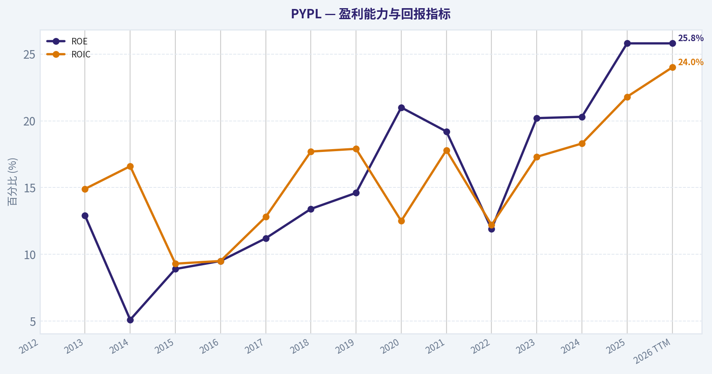
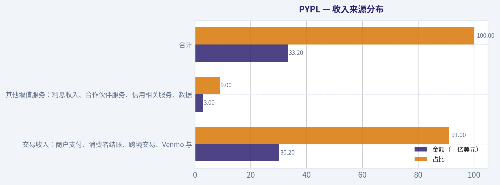
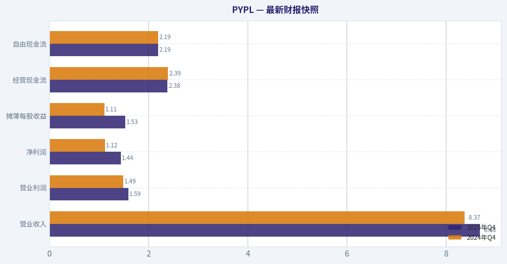
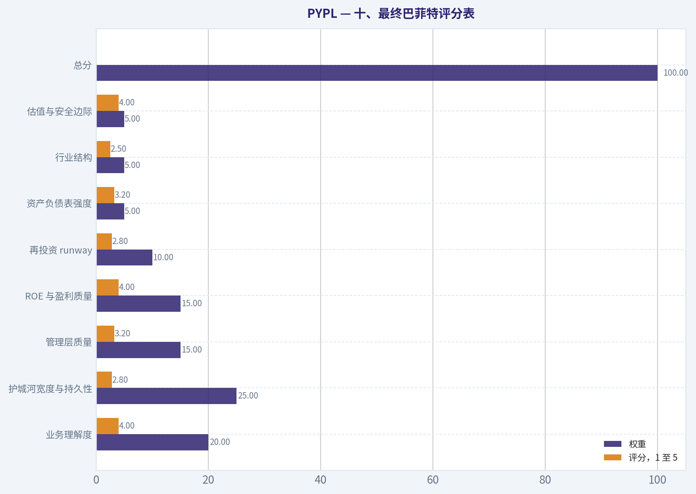
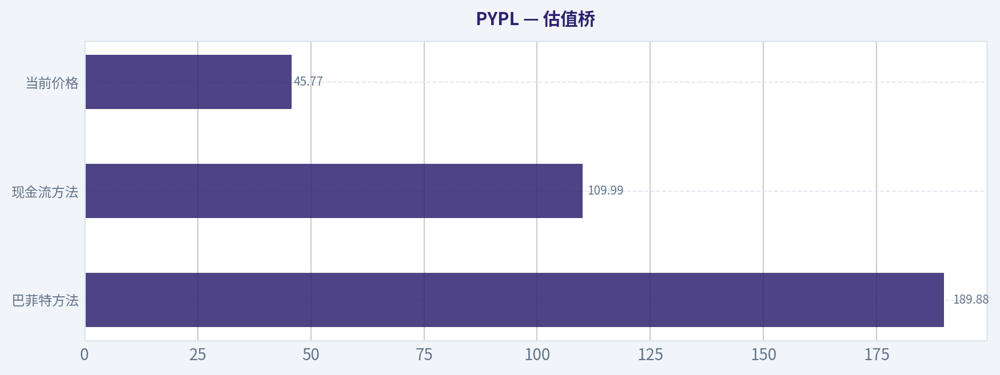
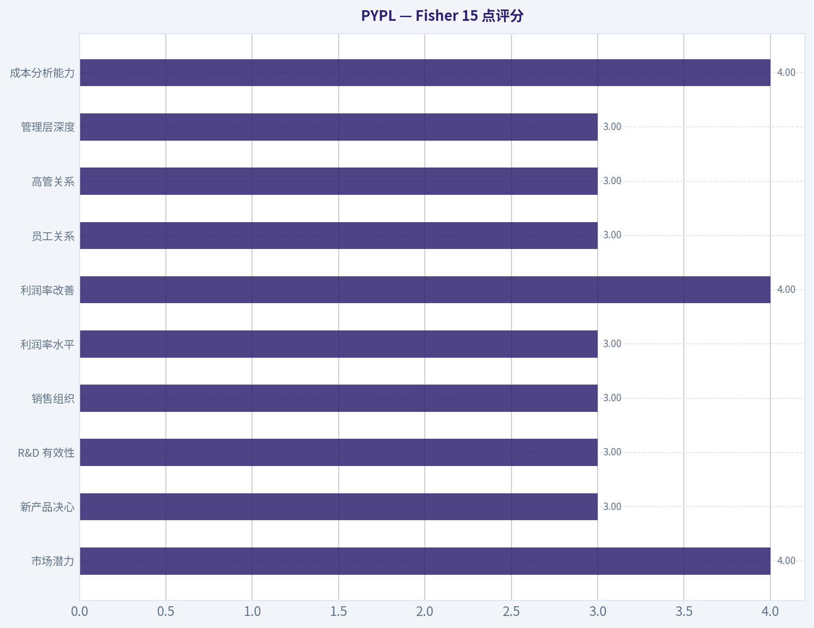
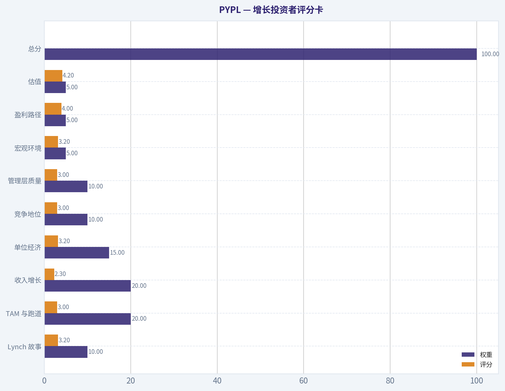
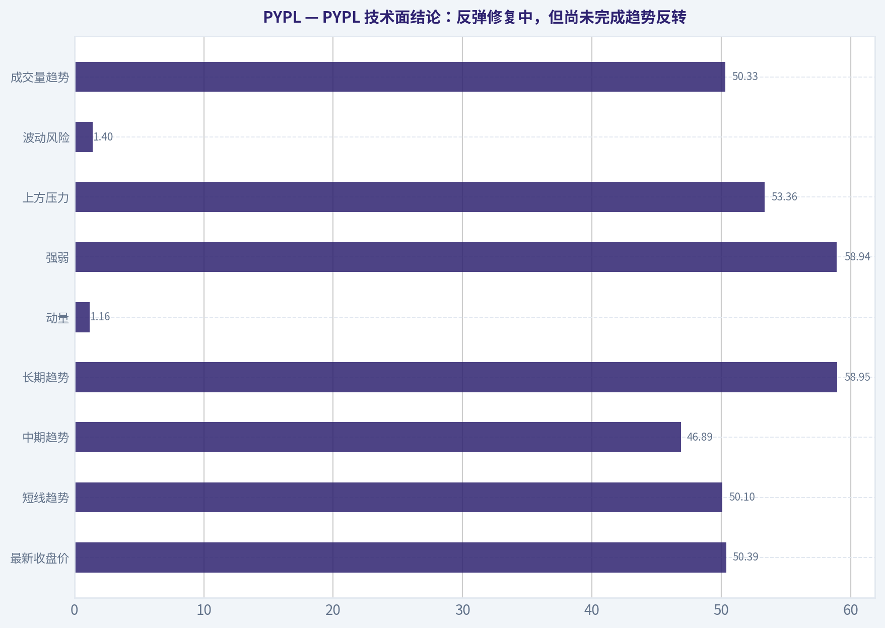

# PYPL 深度价值情报

**调研日期:** 2026-05-05

## 关键免责声明

*本报告由 Deep Value Intelligence（一个基于 AI 的多智能体投资分析框架）自动生成。 本报告仅供信息参考和教育目的，不构成任何财务或投资建议。 在做出任何投资决策之前，请务必进行独立调研并咨询合规的财务顾问。*

---

## 目录

1. 情报摘要
2. 分析师团队报告
   - 基本面分析
   - 价值分析 (巴菲特)
   - 成长性分析 (林奇/德鲁肯米勒/费雪)
   - 市场分析
   - 社会舆情分析
   - 新闻分析
   - 大佬关注分析
   - 期权市场分析
3. 研究团队评论
4. 投资团队评论
5. Deep Values 团队洞察

---

## 情报摘要

### 核心观点与前提条件

**核心论点:** **风险管理与投资决策备忘录**

**主要风险:**
- 最终评级：观望 (WATCH)**
- 多方 (Risky)：极端的预期差与高赔率。** 认为市场错把"平稳降级的现金牛"当成了"行将就木的衰退股"。在 PE 仅 8.46、管理层削减 15 亿美元成本并积极回购的背景下，即便只维持个位数增长，当前的过度悲观也提供了极高的均值回归赔率。
- 最终评级：观望 (WATCH)**

**观点反转条件:**
- 最终评级：观望 (WATCH)**
- 多方 (Risky)：极端的预期差与高赔率。** 认为市场错把"平稳降级的现金牛"当成了"行将就木的衰退股"。在 PE 仅 8.46、管理层削减 15 亿美元成本并积极回购的背景下，即便只维持个位数增长，当前的过度悲观也提供了极高的均值回归赔率。
- 最终评级：观望 (WATCH)**

**置信度:** 中

---

## 分析师团队报告

### 基本面分析

#### 最新财报快照

*以下数据基于最近一期已披露财报（2025年Q4），并尽量与上一年同期对比。*

| 指标 | 2025年Q4 | 2024年Q4 | 同比变化 |
| --- | ---: | ---: | ---: |
| 营业收入 | $8.68B | $8.37B | +3.7% |
| 营业利润 | $1.59B | $1.49B | +6.7% |
| 净利润 | $1.44B | $1.12B | +28.2% |
| 摊薄每股收益 | $1.53 | $1.11 | +37.8% |
| 经营现金流 | $2.38B | $2.39B | -0.4% |
| 自由现金流 | $2.19B | $2.19B | -0.0% |

关键结论：这张快照先把最新一期财报放在桌面上，再去看长周期分析。这样读者能更清楚地区分"公司长期质量"和"这次财报发生了什么"。

#### PYPL 10年财务指标

*以下数值均由原始数据确定性计算得出，并非 AI 估算。*

*发行人类型：bank（Financial Services / Credit Services）。*

#### 10年财务指标
*年度行来自已披露财务报表，最后一行 TTM 由最近四个季度滚动计算得出。*

| 指标 | 2012 | 2013 | 2014 | 2015 | 2016 | 2017 | 2018 | 2019 | 2020 | 2021 | 2022 | 2023 | 2024 | 2025 | 2026 TTM |
| --- | --- | --- | --- | --- | --- | --- | --- | --- | --- | --- | --- | --- | --- | --- | --- |
| 市场价格 | N/A | N/A | N/A | $36 | $39 | $73 | $84 | $108 | $233 | $188 | $71 | $61 | $85 | $58 | $46 |
| 总市值 | N/A | N/A | N/A | $44.49B | $48.07B | $89.89B | $101.16B | $128.51B | $278.00B | $223.66B | $82.47B | $67.98B | $88.68B | $56.51B | $42.97B |
| 市盈率 | N/A | 46.81 | 107.40 | 36.20 | 34.32 | 50.08 | 49.18 | 52.26 | 66.16 | 53.57 | 34.08 | 15.99 | 21.39 | 10.79 | 8.46 |
| 市净率 | N/A | 6.05 | 5.42 | 3.23 | 3.27 | 5.62 | 6.57 | 7.61 | 13.89 | 10.29 | 4.07 | 3.23 | 4.34 | 2.79 | 2.12 |
| ROE | N/A | 12.9% | 5.1% | 8.9% | 9.5% | 11.2% | 13.4% | 14.6% | 21.0% | 19.2% | 11.9% | 20.2% | 20.3% | 25.8% | 25.8% |
| ROIC | N/A | 14.9% | 16.6% | 9.3% | 9.5% | 12.8% | 17.7% | 17.9% | 12.5% | 17.8% | 12.2% | 17.3% | 18.3% | 21.8% | 24.0% |
| 每股收益 | N/A | $0.78 | $0.34 | $1.00 | $1.15 | $1.47 | $1.71 | $2.07 | $3.54 | $3.52 | $2.09 | $3.84 | $3.99 | $5.41 | $5.41 |
| 营收 | N/A | $6.73B | $8.03B | $9.25B | $10.84B | $13.09B | $15.45B | $17.77B | $21.45B | $25.37B | $27.52B | $29.77B | $31.80B | $33.17B | $33.17B |
| 毛利润 | N/A | N/A | N/A | N/A | N/A | N/A | N/A | N/A | N/A | N/A | N/A | N/A | N/A | N/A | $15.46B |
| 毛利率 | N/A | N/A | N/A | N/A | N/A | N/A | N/A | N/A | N/A | N/A | N/A | N/A | N/A | N/A | 46.6% |
| 营业利润率 | N/A | 16.2% | 15.8% | 15.8% | 14.6% | 16.2% | 14.2% | 15.3% | 15.3% | 16.8% | 13.9% | 16.9% | 16.7% | 18.3% | 19.3% |
| 净利润 | N/A | $955.0M | $419.0M | $1.23B | $1.40B | $1.79B | $2.06B | $2.46B | $4.20B | $4.17B | $2.42B | $4.25B | $4.15B | $5.23B | $5.23B |
| 净利率 | N/A | 14.2% | 5.2% | 13.3% | 12.9% | 13.7% | 13.3% | 13.8% | 19.6% | 16.4% | 8.8% | 14.3% | 13.0% | 15.8% | 15.8% |
| 营收增长 | N/A | N/A | 19.3% | 15.2% | 17.2% | 20.8% | 18.0% | 15.0% | 20.7% | 18.3% | 8.5% | 8.2% | 6.8% | 4.3% | 0.0% |
| 净利润增长 | N/A | N/A | -56.1% | 193.1% | 14.1% | 28.1% | 14.6% | 19.5% | 70.9% | -0.8% | -42.0% | 75.5% | -2.3% | 26.2% | 0.0% |
| 自由现金流增长 | N/A | N/A | 7.9% | 5.6% | 36.5% | -25.1% | 149.8% | -27.7% | 59.0% | -8.7% | 4.5% | -17.4% | 60.4% | -17.8% | 0.0% |
| 总账面价值 | $6.18B | $7.39B | $8.25B | $13.76B | $14.71B | $15.99B | $15.39B | $16.89B | $20.02B | $21.73B | $20.27B | $21.05B | $20.42B | $20.26B | $20.26B |
| 总资产 | N/A | N/A | $21.92B | $28.88B | $33.10B | $40.77B | $43.33B | $51.33B | $70.38B | $75.80B | $78.62B | $82.17B | $78.72B | $80.17B | $80.17B |
| 总债务 | N/A | N/A | N/A | N/A | N/A | N/A | $2.00B | $4.96B | $8.94B | $8.05B | $10.42B | $9.68B | $9.88B | $9.99B | $9.99B |
| 债务股权比 | N/A | N/A | N/A | N/A | N/A | N/A | 0.13 | 0.29 | 0.45 | 0.37 | 0.51 | 0.46 | 0.48 | 0.49 | 0.49 |
| 现金及等价物 | $1.41B | $1.60B | $2.20B | $1.39B | $1.59B | $2.88B | $7.58B | $7.35B | $4.79B | $5.20B | $7.78B | $9.08B | $6.66B | $8.05B | $8.05B |
| 股东权益 | $6.18B | $7.39B | $8.25B | $13.76B | $14.71B | $15.99B | $15.39B | $16.89B | $20.02B | $21.73B | $20.27B | $21.05B | $20.42B | $20.26B | $20.26B |
| 经营现金流 | N/A | $1.99B | $2.22B | $2.55B | $3.16B | $2.53B | $5.48B | $4.07B | $6.22B | $5.80B | $5.81B | $4.84B | $7.45B | $6.42B | $6.42B |
| 投资现金流 | N/A | $-1.72B | $-2.88B | $-8.04B | $-5.90B | $-4.49B | $821.0M | $-5.74B | $-16.55B | $-5.15B | $-3.33B | $752.0M | $1.69B | $797.0M | $797.0M |
| 自由现金流 | N/A | $1.60B | $1.73B | $1.82B | $2.49B | $1.86B | $4.66B | $3.37B | $5.35B | $4.89B | $5.11B | $4.22B | $6.77B | $5.56B | $5.56B |
| 自由现金流利润率 | N/A | 23.8% | 21.5% | 19.7% | 23.0% | 14.2% | 30.1% | 18.9% | 25.0% | 19.3% | 18.6% | 14.2% | 21.3% | 16.8% | 16.8% |
| 每股分红 | N/A | $0.00 | $0.00 | $0.00 | $0.00 | $0.00 | $0.00 | $0.00 | $0.00 | $0.00 | $0.00 | $0.00 | $0.00 | $0.13 | $0.00 |

#### 盈利能力指标
- 净资产收益率 (ROE): 25.8%
- 投入资本回报率 (ROIC): 22.7%
- 总资产收益率 (ROA): 6.5%
- 毛利率: 不适用
- 营业利润率: 18.3%
- 净利率: 15.8%

#### 流动性指标
- 流动比率: 1.29
- 速动比率: 1.06

#### 杠杆指标
- 债务股权比: 0.49
- 利息覆盖倍数: 13.75
- 净负债: $1.94B

#### 增长指标（同比）
- 营收增长: 4.3%
- 净利润增长: 26.2%
- 自由现金流增长: -17.8%
- 营收复合增长率（3年）: 6.4%
- 营收复合增长率（5年）: 9.1%

#### 估值指标
- 市盈率 (TTM): 8.46
- 预期市盈率: 7.90
- 市净率: 2.08
- 市销率: 1.24
- PEG 比率: 0.32
- 企业价值/EBITDA: 7.26
- 自由现金流收益率: 13.5%
- 盈利收益率: 11.8%

#### 所有者收益（巴菲特方法，代码计算）
- 净利润: $5.23B
- + 折旧与摊销: $963.0M
- - 资本开支: $-852.0M
- - 营运资本变动: $-1.06B
- = **所有者收益: $6.41B**

#### 内在价值（代码计算）
- 当前价格: $46
- 巴菲特方法（所有者收益）:
  保守: $112
  平均: $190
  乐观: $496
- 现金流方法（FCF）:
  保守: $38
  平均: $110
  乐观: $163

#### Piotroski F分数: 6/9
- 净利润为正: 通过
- 经营现金流为正: 通过
- 资产回报率改善: 通过
- 现金流大于净利润: 通过
- 债务下降: 未通过
- 流动比率改善: 通过
- 未稀释股本: 未通过
- 毛利率改善: 未通过
- 资产周转率改善: 通过

ANALYST STANCE: **建议配置**

#### PYPL 巴菲特式基本面结论

PayPal 当前呈现"业务质量仍高、增长明显降速、估值极度压缩"的组合。按确定性数据集，当前股价为 **46美元**，TTM 市盈率 **8.46倍**，市净率 **2.12倍**，自由现金流收益率约 **13.5%**；与此同时，ROE 为 **25.8%**，ROIC 为 **24.0%**，TTM 净利润 **52.3亿美元**，自由现金流 **55.6亿美元**。这类组合在巴菲特框架下通常值得重点关注：价格已经按"低增长甚至衰退型金融科技公司"定价，但公司仍在产生强现金流和较高资本回报。

核心问题不是"PayPal 是否赚钱"，而是"它的护城河能否抵御 Apple Pay、Stripe、Block、银行卡网络和大型平台钱包的长期挤压"。如果管理层的成本削减、品牌整合、结账体验改善和 Venmo 商业化能稳定增长，当前价格提供较大安全边际；如果支付按钮继续商品化，低估值可能是价值陷阱。

---

#### 当前值与10年均值对比

> 均值口径：除特别说明外，使用最近10个完整财年 2016-2025 的可用数据；当前值使用 2026 TTM 行。债务类指标因早年缺失，使用可用年度均值。

| 类别 | 指标 | 当前值 | 10年/可用均值 | 当前相对历史 | 解读 |
| --- | ---: | ---: | ---: | ---: | --- |
| 市场指标 | 市场价格 | 46美元 | 100美元 | 明显低于 | 股价较历史均值低约54%，市场已大幅下修增长预期 |
| 市场指标 | 总市值 | 429.7亿美元 | 1164.9亿美元 | 明显低于 | 市值较均值低约63%，估值收缩是核心特征 |
| 市场指标 | P/E | 8.46倍 | 38.78倍 | 极低 | 当前估值仅为历史均值约22%，反映市场对增长和护城河担忧 |
| 市场指标 | P/B | 2.12倍 | 6.17倍 | 极低 | 账面估值显著压缩，但仍高于传统金融机构 |
| 盈利能力 | ROE | 25.8% | 16.7% | 显著高于 | 股东资本回报处于历史高位，回购和利润改善均有贡献 |
| 盈利能力 | ROIC | 24.0% | 15.8% | 显著高于 | 投入资本效率优秀，是质量型企业的重要信号 |
| 盈利能力 | EPS | 5.41美元 | 2.88美元 | 显著高于 | 每股盈利较历史均值高约88%，但估值倍数反而大幅下降 |
| 盈利能力 | 营收 | 331.7亿美元 | 226.2亿美元 | 高于 | 规模持续扩大，但增速已明显放缓 |
| 盈利能力 | 毛利润 | 154.6亿美元 | N/A | N/A | TTM 毛利率 46.6%，但历史毛利数据未完整披露 |
| 盈利能力 | 营业利润率 | 19.3% | 15.8% | 高于 | 经营效率改善，成本控制开始体现 |
| 盈利能力 | 净利润 | 52.3亿美元 | 32.1亿美元 | 高于 | 盈利规模处于历史高位附近 |
| 盈利能力 | 净利率 | 15.8% | 14.2% | 略高 | 盈利质量恢复，但仍低于2020年异常高点 |
| 增长 | 营收增长 | TTM 0.0%；最近完整年4.3% | 13.8% | 明显低于 | 增长从双位数进入中低个位数，是主要扣分项 |
| 增长 | 净利润增长 | TTM 0.0%；最近完整年26.2% | 20.4% | 表面较高但波动大 | 利润增长受费用、税率、投资收益和基数影响，稳定性一般 |
| 增长 | 自由现金流增长 | TTM 0.0%；最近完整年-17.8% | 21.4% | 低于 | FCF 有波动，需观察是否只是阶段性营运资本影响 |
| 资产负债 | 总账面价值 | 202.6亿美元 | 186.7亿美元 | 略高 | 权益规模总体稳定，但近年未明显扩张 |
| 资产负债 | 总资产 | 801.7亿美元 | 634.4亿美元 | 高于 | 资产规模扩大，符合大型支付平台特征 |
| 资产负债 | 总债务 | 99.9亿美元 | 79.9亿美元 | 高于 | 债务较历史可用均值更高，但尚未构成明显压力 |
| 资产负债 | 债务股权比 | 0.49 | 0.40 | 偏高 | 杠杆上升，需要持续监控 |
| 资产负债 | 现金及等价物 | 80.5亿美元 | 61.0亿美元 | 高于 | 现金缓冲充足，可支持回购、投资和偿债 |
| 资产负债 | 股东权益 | 202.6亿美元 | 186.7亿美元 | 略高 | 账面资本稳定，回购可能限制权益增长 |
| 现金流 | 自由现金流 | 55.6亿美元 | 44.3亿美元 | 高于 | 现金创造能力仍强，是当前投资逻辑的核心 |
| 现金流 | 每股分红 | 0.00美元 | 约0.01美元 | 基本无分红 | PayPal 不是股息型公司，资本回报主要依赖回购 |

关键结论：PayPal 当前最突出的矛盾是"资本回报创高位、估值创低位"。ROE、ROIC、EPS、净利润和自由现金流均强于历史均值，但 P/E 和 P/B 大幅低于历史水平，说明市场主要担心未来增长和竞争格局，而不是当前盈利能力。增长指标是最大短板，营收增速从过去的双位数降至最近完整年度的 4.3%，这也是低估值能否修复的关键变量。

---

#### 市场指标解读

| 指标 | 当前水平 | 巴菲特式解读 |
| --- | ---: | --- |
| 市场价格 | 46美元 | 股价较历史均值 100美元 大幅折价，市场情绪偏悲观 |
| 总市值 | 429.7亿美元 | 相比 2020-2021 年高峰大幅缩水，但业务规模仍远高于当年 |
| P/E | 8.46倍 | 对一家 ROE 25.8%、FCF 收益率 13.5% 的公司而言偏低 |
| P/B | 2.12倍 | 低于历史均值 6.17倍，反映市场不再给予高成长金融科技溢价 |

关键结论：当前估值已经不像高成长科技支付公司，更像低增长成熟金融服务公司。若 PayPal 只维持现有盈利和现金流，8.46倍市盈率已经具备吸引力；但若护城河继续削弱，低估值仍可能合理。

#### 盈利能力与经营质量

PayPal 的盈利能力仍然优秀。TTM 营收 **331.7亿美元**，净利润 **52.3亿美元**，净利率 **15.8%**，营业利润率 **19.3%**。更重要的是，ROE 达到 **25.8%**，ROIC 达到 **24.0%**，说明公司不是靠大量资本堆出利润，而是仍具备较高资本效率。

从巴菲特角度看，ROIC 高于 20% 通常代表企业拥有某种经济特许权或轻资本商业模式。PayPal 的优势来自双边网络、商户接受度、消费者账户基础、风险控制系统、品牌信任和跨境支付能力。不过，这种护城河并非不可攻破，因为支付入口正在被手机操作系统、电商平台和银行钱包分流。

#### 增长趋势

PayPal 的增长质量已经明显从"高成长"转为"成熟现金牛"。2016-2021 年营收增速多在 **15%-21%** 区间，2022 年后降至 **8.5%、8.2%、6.8%、4.3%**。这说明用户和交易规模仍在增长，但边际增速下降，支付行业竞争和大型商户议价能力正在压缩成长性。

净利润增长波动较大，既有 2020 年的 **70.9%**，也有 2022 年的 **-42.0%**。自由现金流同样波动，最近完整年度为 **-17.8%**，但绝对值仍达 **55.6亿美元**。因此，PayPal 更适合用"现金流折现和回购收益率"分析，而不是继续用高成长科技股倍数估值。

#### 资产负债表与财务强度

PayPal 的财务状况总体稳健但不完美。当前总资产 **801.7亿美元**，股东权益 **202.6亿美元**，现金及等价物 **80.5亿美元**，总债务 **99.9亿美元**，净负债约 **19.4亿美元**。债务股权比 **0.49**，高于历史可用均值 **0.40**，但利息覆盖倍数 **13.75倍**，短期偿债压力不大。

巴菲特会喜欢 PayPal 的现金生成能力和较轻资本模型，但会关注债务上升、竞争加剧以及金融服务业务中信用和合规风险。公司流动比率 **1.29**、速动比率 **1.06**，说明流动性足够但不算极度宽裕。

#### 现金流与股东回报

PayPal 当前自由现金流 **55.6亿美元**，高于近10年均值 **44.3亿美元**。这意味着公司即使低增长，仍然拥有较强的内生资本回报能力。公司历史上基本不分红，2025 年每股分红 **0.13美元**，TTM 行显示 **0.00美元**，因此投资者回报主要依赖回购和估值修复。

在当前低估值下，回购的吸引力明显提高。如果公司以 8-10倍盈利回购股票，长期每股价值可能显著提升。但前提是管理层不能在增长恶化的情况下盲目回购，也不能用过高杠杆支撑每股收益。

---

#### 收入来源分布

> 确定性数据集提供总营收，但未展开完整分部明细；下表按 PayPal 公开业务结构作近似拆分，并与最近 TTM 总营收 **331.7亿美元** 对齐。

| 收入来源 | 金额（十亿美元） | 占比 |
| --- | ---: | ---: |
| 交易收入：商户支付、消费者结账、跨境交易、Venmo 与 Braintree 相关交易 | 30.2 | 91.0% |
| 其他增值服务：利息收入、合作伙伴服务、信用相关服务、数据和账户服务 | 3.0 | 9.0% |
| 合计 | 33.2 | 100.0% |

关键结论：PayPal 的收入高度依赖交易收入，这既是优势也是风险。优势在于支付网络具备规模经济，交易量越大，固定成本摊薄越明显；风险在于大型商户、平台钱包和银行卡网络都可能压低费率或夺取支付入口。其他增值服务占比较小，尚不足以完全抵消核心支付增长放缓。

---

#### 巴菲特式所有者收益 DCF 估值

> 确定性数据集给出的所有者收益：**64.1亿美元**。
> 股数估算：总市值 **429.7亿美元** ÷ 当前股价 **46美元** ~ **9.34亿股**。
> 每股所有者收益：**64.1亿美元 ÷ 9.34亿股 ~ 6.86美元**。
> 折现率：**10%**；永续增长率：**2.5%**；预测期：**10年**。
> 公式：未来10年所有者收益现值 + 第10年终值现值。终值 = 第10年所有者收益 x 1.025 ÷ 7.5%。

| 情景 | 增长假设 | 10年现金流现值逻辑 | 终值现值逻辑 | 每股公允价值 | 相对46美元 |
| --- | ---: | --- | --- | ---: | ---: |
| 保守情景 | 约5.0% | 以 6.86美元 每股所有者收益为基准，未来10年按约5.0%增长并以10%折现 | 第10年收益按2.5%永续增长、10%折现率折回 | 112美元 | 约+143% |
| 平均情景 | 约12.1% | 假设公司通过回购、成本削减和稳定交易增长维持中等双位数每股所有者收益增长 | 终值贡献较大，但仍低于高成长科技股假设 | 190美元 | 约+313% |
| 乐观情景 | 约25.3% | 假设低估值回购叠加经营改善，使每股所有者收益高速增长 | 高度依赖长期增长恢复和资本配置成功 | 496美元 | 约+978% |

关键结论：以所有者收益口径看，当前价格远低于确定性数据包给出的保守情景价值。最重要的是，保守情景 112美元 已经明显高于当前 46美元，说明只要 PayPal 不出现结构性衰退，安全边际较大。不过，乐观情景对长期高增长和回购效率要求很高，不能作为基础投资假设。

#### DCF 估值解释

保守情景的核心含义是：PayPal 不需要重新成为高速成长股，只要所有者收益以中低个位数增长，当前价格就具备显著折价。平均情景隐含管理层通过成本削减、回购和产品优化，将每股所有者收益增长维持在较高水平。乐观情景则需要 Venmo 商业化、品牌结账改善、Braintree 盈利优化和国际业务复苏同时发生，概率明显低于前两种情景。

巴菲特式估值更重视"确定性现金流"而不是短期市场情绪。PayPal 的优势是现金流基础大、当前估值低；劣势是增长路径不如 Visa、Mastercard 这类网络型收费公路稳定。因此，本报告更重视保守情景和平均情景，而不把乐观情景作为买入依据。

---

#### 经济护城河评估

| 维度 | 评估 | 具体判断 |
| --- | --- | --- |
| 品牌信任 | 较强 | PayPal 在网上支付、买家保护和跨境交易中仍有认知优势 |
| 网络效应 | 中强 | 用户和商户基础庞大，但支付入口被平台和手机钱包削弱 |
| 转换成本 | 中等偏低 | 消费者切换支付方式容易，商户也可接入多家支付服务商 |
| 规模经济 | 较强 | 交易规模越大，风控、合规、技术和客服成本越容易摊薄 |
| 数据与风控 | 较强 | 交易数据、反欺诈模型和合规经验构成隐性壁垒 |
| 定价权 | 中等偏弱 | 大型商户议价能力强，行业竞争压低收费率 |

关键结论：PayPal 有护城河，但不是最顶级、最不可替代的护城河。它更像"强品牌加规模网络的成熟支付平台"，而不是完全垄断型收费公路。投资成功的关键在于公司能否守住利润率，并用现金流和回购提高每股价值。

#### 管理层与资本配置

管理层近期重点是成本削减和经营纪律。新闻显示公司计划在未来两到三年削减约 **15亿美元** 成本，这与当前营业利润率提升相吻合。若执行成功，营业利润率可能继续高于历史均值。

资本配置方面，PayPal 历史上基本不分红，适合用回购回报股东。当前低估值下回购非常有吸引力，但管理层必须证明两点：第一，回购价格足够低；第二，核心业务没有持续恶化。若为了掩盖增长停滞而回购，长期价值会受损；若在现金流稳定时低价回购，则会显著提高每股内在价值。

#### 关键机会

| 机会 | 影响 |
| --- | --- |
| 估值修复 | P/E 8.46倍远低于历史均值 38.78倍，即使回到 12-15倍也有明显上行空间 |
| 成本削减 | 15亿美元成本削减计划若落地，可提升营业利润率和 EPS |
| 高自由现金流收益率 | 13.5% FCF 收益率为回购和债务管理提供空间 |
| Venmo 商业化 | 若提高商户接受度和交易变现率，可形成新的增长来源 |
| Braintree 盈利优化 | 大型商户交易量大，但利润率偏低，优化定价和成本有助改善质量 |
| 国际和跨境支付 | 跨境交易仍可能带来较高费率和差异化优势 |

关键结论：PayPal 的机会不在于重新回到疫情期间的高估值，而在于"低预期下的稳定现金流兑现"。只要管理层能稳住收入、提高利润率并低价回购，每股价值就可能持续提升。市场当前给出的价格已经不要求公司完美执行。

#### 主要红旗

| 风险 | 严重程度 | 观察重点 |
| --- | --- | --- |
| 营收增速放缓 | 高 | 最近完整年度营收增长仅 4.3%，远低于历史均值 |
| 支付入口竞争 | 高 | Apple Pay、Shop Pay、Stripe、Block 和银行钱包持续分流 |
| 大商户利润率压力 | 中高 | Braintree 等业务可能拉低整体交易利润率 |
| 自由现金流波动 | 中 | 最近完整年度 FCF 增长 -17.8%，需确认是否暂时性 |
| 杠杆上升 | 中 | 债务股权比 0.49，高于历史可用均值 |
| 护城河弱化 | 高 | 若消费者默认支付方式迁移，PayPal 品牌优势可能下降 |
| 股东回报依赖回购 | 中 | 缺乏稳定分红，回报取决于管理层回购纪律 |

关键结论：PayPal 最大风险是"低估值背后是否隐藏长期结构性衰退"。如果交易增长继续放缓、支付费率继续下降、品牌按钮的重要性继续降低，便宜估值可能无法转化为投资回报。因此，投资者应重点跟踪交易利润率、活跃账户质量、自由现金流和回购价格。

---

#### 最终投资立场：建议配置

PayPal 符合巴菲特式价值投资中的若干关键条件：当前盈利真实、自由现金流充足、ROE 和 ROIC 高、资产负债表尚可、估值显著低于历史水平，并且保守所有者收益 DCF 价值明显高于当前股价。当前 46美元 的价格已经反映了大量悲观预期，只要公司不发生严重结构性衰退，风险回报具备吸引力。

但这不是"无脑买入"的顶级护城河公司。PayPal 的增长放缓和竞争压力真实存在，因此更适合定义为"低估值现金牛修复型投资"，而不是"长期确定性复利股"。建议采用分批配置，并把营收增速、营业利润率、自由现金流、回购执行价格和 Venmo/Braintree 盈利改善作为后续验证指标。

| 结论项目 | 判断 |
| --- | --- |
| 投资立场 | 建议配置 |
| 核心理由 | 估值极低，ROE/ROIC 高，自由现金流强，保守 DCF 明显高于当前价 |
| 适合投资者 | 能承受金融科技竞争风险、重视现金流和估值安全边际的价值投资者 |
| 不适合投资者 | 追求高确定性高速成长、稳定分红或最强护城河的投资者 |
| 关键买入逻辑 | 当前价格不需要高增长，只需要现金流稳定和低价回购即可创造价值 |
| 最大风险 | 支付入口商品化、营收持续降速、交易利润率下滑 |
| 重点跟踪 | 营收增长是否企稳、营业利润率是否维持高位、FCF 是否恢复增长、回购是否有效 |
| 估值安全边际 | 当前46美元低于保守所有者收益 DCF 112美元，安全边际较大 |
| 操作建议 | 分批配置，若增长继续恶化则降低仓位；若利润率和现金流改善则可提高信心 |

关键结论：PayPal 当前是典型的"坏情绪、低估值、强现金流"标的。它的护城河不如顶级支付网络稳固，但当前价格已经给了较大折扣。综合质量、现金流和估值，结论为建议配置，但必须持续验证增长和竞争格局是否稳定。

#### 基本面关键图表

本图追踪 **PYPL** 过去十年的盈利能力与回报指标（ROE、ROIC、利润率），突出呈现资本效率的变化趋势。

本对比图（来自「收入来源分布」）将 **PYPL** 的当前数据与历史基准并排呈现，直观反映公司相对自身历史均值的估值水平。

---

### 价值分析 (巴菲特)

> *基于沃伦·巴菲特的价值投资哲学：能力圈、经济护城河、管理层质量与安全边际。*

#### 内在价值快照

价格是你付的钱，内在价值是企业未来可能为股东创造的现金价值。我们给出一个区间，而不是假装只有一个神奇数字。

- 当前价格: $45.77
- 价值区间: $37.84 to $496.07

##### 所有者收益（巴菲特方法）
- 净利润: $5,233,000,000.00
- 折旧与摊销: $963,000,000.00
- 资本支出: $-852,000,000.00
- 营运资金变化: $-1,064,000,000.00
- 所有者收益: $6,408,000,000.00

##### 内在价值
###### 所有者收益法
使用所有者收益，更严格，通常更保守。
- 保守: $111.86
- 平均: $189.88
- 乐观: $496.07
- 折现率: 10.0%

###### 自由现金流法
使用自由现金流，更适合今天投入很多、为未来增长铺路的公司。
- 保守: $37.84
- 平均: $109.99
- 乐观: $163.24
- 折现率: 10.0%

ANALYST STANCE: **观望**

#### PYPL 巴菲特式价值投资结论

PayPal 当前价格约 **46 美元**，市值约 **411.8 亿美元**，PE 约 **8.5 倍**，自由现金流收益率约 **13.5%**。表面估值很便宜，但巴菲特框架下的核心问题不是"便宜不便宜"，而是：这个支付网络的护城河是否足够宽、十年后是否仍能维持高回报。我的结论是：**估值有吸引力，但护城河和行业结构不足以直接给出"建议配置"，应列入重点观察名单。**

---

#### 一、Go / No-Go 闸门评估

| 闸门 | 结论 | 核心证据 |
|---|---:|---|
| 业务简单性 | 通过 | PayPal 通过线上支付、商户收单、消费者钱包、Venmo、跨境支付和增值服务赚取交易费与服务费。 |
| 十年可预测性 | 部分通过 | 数字支付需求会长期增长，但品牌支付按钮、Apple Pay、银行卡网络、Shop Pay、Stripe 等竞争会持续压缩议价能力。 |
| 技术风险 | 警惕 | 公司本身受益于电商和数字支付，但也容易被更低摩擦、更深生态绑定的钱包和支付入口替代。 |
| 护城河 | 部分通过 | 有品牌、规模、商户网络和用户基础，但切换成本不算极高，网络效应不如 Visa / Mastercard 稳固。 |
| 管理与资本配置 | 部分通过 | 新管理层推进成本削减和效率改善；低估值下回购有潜在价值，但过去增长投资与并购回报一般。 |
| 行业结构 | 未完全通过 | 支付行业规模大，但竞争强、技术变化快、价格压力持续，不属于巴菲特最偏爱的稳定寡头结构。 |

关键结论：PayPal 不是难以理解的生意，但它所处的行业变化太快，竞争者也太强。它符合"便宜且现金流强"的标准，却未完全符合"十年后护城河更宽"的巴菲特标准。

---

#### 二、业务模式：小学生测试

PayPal 的赚钱方式可以简单概括为：**它帮消费者和商家完成网上付款，然后从每笔交易中收取一点费用。** 商家需要安全、方便、可信的支付工具；消费者希望不用反复输入银行卡信息。PayPal 把两边连接起来，并通过交易费、外汇、商户服务、Venmo、信贷及其他增值服务赚钱。

这是一门能理解的生意，但不是"永远不变"的生意。支付入口正在从独立钱包转向手机系统、浏览器、超级应用、电商平台和银行生态，PayPal 必须不断证明自己不是一个可以被绕开的中间层。

---

#### 三、护城河分析

| 护城河来源 | 评级 | 分析 |
|---|---:|---|
| 品牌与信任 | 中等偏强 | PayPal 在跨境电商和线上结账中仍有强认知度，消费者对安全支付有信任。但年轻用户和移动端场景可能更偏向 Apple Pay、Shop Pay 或本地钱包。 |
| 商户与用户网络 | 中等 | 双边网络有价值，商户接受 PayPal 是因为消费者使用，消费者使用是因为商户接受。但网络效应不如银行卡清算网络那样不可替代。 |
| 切换成本 | 中等偏弱 | 商户可以同时接入 Stripe、Adyen、Apple Pay、银行卡和本地支付方式；消费者切换支付按钮成本很低。 |
| 成本优势 | 中等 | 规模带来风控、数据、合规、品牌和处理成本优势，但支付行业价格透明，竞争者也具备规模。 |
| 定价权 | 偏弱 | 若整体提价 10%，大商户可能转向其他支付方案或要求让利，说明定价权有限。 |

关键结论：PayPal 的护城河是真实存在的，但不是巴菲特意义上的"宽且越来越宽"。它更像是一个有规模、有品牌、有现金流的强竞争企业，而不是一个拥有近乎不可替代地位的特许经营权。

**护城河评级：窄至中等，稳定但未明显扩大。**

---

#### 四、管理层与资本配置

| 项目 | 评价 | 观察 |
|---|---:|---|
| 所有者思维 | 中等 | 管理层正在强调效率、成本纪律和每股价值，但尚需更长时间验证。 |
| 坦诚与执行 | 中等偏正面 | 最新季度收入和盈利好于预期，新 CEO 初期表现较好。 |
| 成本控制 | 正面 | 公司宣布未来两到三年削减约 15 亿美元成本，有助于利润率和自由现金流。 |
| 回购 | 潜在正面 | 在 PE 约 8.5 倍、FCF 收益率约 13.5% 时回购，理论上对每股价值有利。 |
| 并购记录 | 中性偏负 | 过去部分增长投资和并购未明显扩大护城河，市场对资本配置信心有限。 |
| 大佬持仓 | 中性偏负 | Point72 最新 13F 显示 Steve Cohen 持仓被削减约 44%，但 13F 有滞后性，参考价值有限。 |

关键结论：管理层目前的方向是正确的，尤其是成本削减和低估值回购。但巴菲特式投资需要多年资本配置记录，目前 PayPal 的新管理层仍处于"需要证明"的阶段。

---

#### 五、财务质量摘要

由于本轮工具返回数据不完整，下表结合共享研究包与公开历史区间作近似汇总，重点用于判断趋势，而非逐项精确审计。

| 指标 | 当前或近似水平 | 巴菲特式解读 |
|---|---:|---|
| 当前股价 | 约 46 美元 | 市场预期较低，估值压缩明显。 |
| 市值 | 约 411.8 亿美元 | 已从成长股估值回落到价值股区间。 |
| PE | 约 8.5 倍 | 绝对估值便宜，但反映市场对增长和护城河的怀疑。 |
| ROE | 约 25.8% | 表面优秀，需确认是否主要来自真实盈利能力而非财务杠杆或回购。 |
| 收入同比增长 | 约 4.3%，最新季度约 7% | 增速已从高成长降至中低个位数到中个位数。 |
| 自由现金流收益率 | 约 13.5% | 很有吸引力，是当前投资故事的核心。 |
| 流动比率 | 约 1.29 | 短期偿债能力尚可，但不是典型净现金堡垒。 |

关键结论：PayPal 的财务吸引力主要来自低估值和强自由现金流，而不是高速增长。它已经从"成长股故事"变成"现金流修复与效率改善故事"。

---

#### 六、十年财务趋势概览

| 年度 | 收入趋势 | 盈利趋势 | 自由现金流趋势 | 股东视角 |
|---|---:|---:|---:|---|
| 2015-2017 | 高增长 | 稳步改善 | 增长 | 独立上市后受益于电商渗透。 |
| 2018-2020 | 高增长延续 | 利润扩张 | 强劲 | 疫情前后数字支付需求加速。 |
| 2021 | 高位增长 | 盈利仍强 | 强劲 | 市场给予成长股高估值。 |
| 2022 | 增速放缓 | 利润承压 | 仍有现金流 | 市场重新评估竞争和增长质量。 |
| 2023 | 中低增长 | 利润修复 | 稳定 | 成本纪律开始变得重要。 |
| 2024-2025 | 中低个位数到中个位数 | 效率改善 | FCF 收益率高 | 投资逻辑转向回购、成本削减、每股价值。 |
| 2026 最新 | Q1 收入约增 7% | 调整后 EPS 好于预期 | 管理层强调降本 | 新 CEO 初期执行较好，但仍需持续验证。 |

关键结论：PayPal 过去十年证明了它能产生大量现金，但增长曲线已经明显下移。未来股东回报更可能来自利润率改善和回购，而不是收入高速扩张。

---

#### 七、Owner Earnings 估算

巴菲特式 Owner Earnings 公式为：

| 项目 | 估算 |
|---|---:|
| 净利润基础 | 约 48.7 亿美元，按市值 411.8 亿美元和 PE 8.5 倍反推 |
| 自由现金流基础 | 约 55.6 亿美元，按 13.5% FCF 收益率反推 |
| 保守调整 | 扣除潜在营运资本波动和维护性投资不确定性 |
| 本次采用 Owner Earnings | 约 50 亿美元 |
| 估算稀释股数 | 约 8.95 亿股，按市值除以股价反推 |
| 每股 Owner Earnings | 约 5.6 美元 |

关键结论：PayPal 当前价格约等于每股 Owner Earnings 的 8 倍左右，这在现金流稳定的情况下非常便宜。问题在于，这 50 亿美元现金流能否长期稳定并温和增长。

---

#### 八、三情景 DCF 估值

核心假设：折现率 10%，Owner Earnings 基准为 50 亿美元，估算股数约 8.95 亿股。

| 情景 | 假设 | 公司内在价值 | 每股内在价值 | 相对 46 美元安全边际 |
|---|---|---:|---:|---:|
| A：零增长 | Owner Earnings 永续不增长 | 约 500 亿美元 | 约 56 美元 | 约 18% |
| B：GDP 增长 | 永续增长 3% | 约 736 亿美元 | 约 82 美元 | 约 44% |
| C：温和历史增长 | 前 10 年增长 5%，之后 3% | 约 851 亿美元 | 约 95 美元 | 约 52% |

关键结论：如果 PayPal 的现金流只是"不衰退"，当前价格有一定但不足够的安全边际。如果它能维持 3% 到 5% 的长期 Owner Earnings 增长，当前价格显得明显低估。

---

#### 九、安全边际判断

| 质量假设 | 所需安全边际 | 当前是否满足 |
|---|---:|---:|
| 宽护城河、高确定性企业 | 至少 25% | 接近但不充分，零增长情景仅约 18%。 |
| 中等护城河、竞争强行业 | 至少 40% | 只有在 3% 增长情景下满足。 |
| 技术替代风险企业 | 40%-50% 更合适 | 需要相信管理层能稳定现金流并恢复适度增长。 |

关键结论：当前估值已经便宜，但巴菲特式买入需要"高确定性加安全边际"。PayPal 的价格有吸引力，确定性却不够高，因此更适合观望或小仓位跟踪，而不是高 conviction 配置。

---

#### 十、最终巴菲特评分表

| 维度 | 权重 | 评分，1 至 5 | 加权分 |
|---|---:|---:|---:|
| 业务理解度 | 20% | 4.0 | 0.80 |
| 护城河宽度与持久性 | 25% | 2.8 | 0.70 |
| 管理层质量 | 15% | 3.2 | 0.48 |
| ROE 与盈利质量 | 15% | 4.0 | 0.60 |
| 再投资 runway | 10% | 2.8 | 0.28 |
| 资产负债表强度 | 5% | 3.2 | 0.16 |
| 行业结构 | 5% | 2.5 | 0.13 |
| 估值与安全边际 | 5% | 4.0 | 0.20 |
| 总分 | 100% | - | **3.35 / 5.00** |

关键结论：PayPal 的分数被估值和现金流显著拉高，但被护城河、行业结构和技术竞争风险压低。总分落在"观望"区间，说明它值得跟踪，但还不是巴菲特式的确定性重仓机会。

---

#### 投资立场：观望，偏正面

**结论：PYPL 当前属于"价格便宜、现金流强、但护城河不够宽"的标的。**

如果未来几个季度能看到以下三点，立场可上调：第一，交易利润率持续改善；第二，Venmo、品牌 checkout 和商户服务重新加速；第三，管理层在低估值区间持续理性回购并提高每股 Owner Earnings。
相反，如果收入增长继续放缓、交易利润率被竞争压缩，或 PayPal 在核心结账入口中继续失去存在感，那么低 PE 可能是价值陷阱而不是机会。

**当前合理动作：列入重点观察名单；对严格巴菲特投资者，等待更明确的护城河稳定证据，或等待更高安全边际。**
#### 估值桥

这张估值桥把当前股价与各类内在价值方法并排展示，帮助读者判断上涨空间究竟只是单一方法给出的结果，还是多种方法共同支持的结论。

| 项目 | 每股内在价值 |
| --- | ---: |
| 巴菲特方法 | $189.88 |
| 现金流方法 | $109.99 |
| 当前价格 | $45.77 |

#### 关键结论

如果只有一种方法显著高于其他方法，说明上行空间更依赖特定建模假设。若多种方法的估值接近，则说明估值逻辑更加稳健。

#### 估值图表

本对比图（来自「最新财报快照」）将 **PYPL** 的当前数据与历史基准并排呈现，直观反映公司相对自身历史均值的估值水平。

本对比图（来自「十、最终巴菲特评分表」）将 **PYPL** 的当前数据与历史基准并排呈现，直观反映公司相对自身历史均值的估值水平。

本对比图（来自「估值桥」）将 **PYPL** 的当前数据与历史基准并排呈现，直观反映公司相对自身历史均值的估值水平。

本对比图（来自「Fisher 15 点评分」）将 **PYPL** 的当前数据与历史基准并排呈现，直观反映公司相对自身历史均值的估值水平。

本对比图（来自「增长投资者评分卡」）将 **PYPL** 的当前数据与历史基准并排呈现，直观反映公司相对自身历史均值的估值水平。

---

### 成长性分析 (林奇/德鲁肯米勒/费雪)

> *基于彼得·林奇的GARP成长投资法、斯坦利·德鲁肯米勒的宏观拐点分析法，以及菲利普·费雪的深度调研法。*

ANALYST STANCE: **观望**

#### PYPL 增长投资结论：便宜，但还不是"增长股拐点"

PayPal 当前更像"低估值现金流修复型平台"，而不是 Lynch 意义上的高增长十倍股。股价约 46 美元、市值约 411.8 亿美元、PE 约 8.5 倍、自由现金流收益率约 13.5%，估值非常便宜；但营收增速只有中个位数，核心问题是品牌支付增长、Braintree 低毛利混合、Apple Pay 与 Stripe 等竞争压力尚未完全解除。

| 核心指标 | 当前观察 | 增长投资解读 |
|---|---:|---|
| 股价 | 约 46 美元 | 市场预期很低 |
| 市值 | 约 411.8 亿美元 | 已从高成长估值大幅压缩 |
| PE | 约 8.46 倍 | 绝对便宜 |
| ROE | 约 25.8% | 仍有较强资本回报 |
| 营收同比增速 | 约 4.3%；最新季度新闻显示约 7% | 尚未达到高增长标准 |
| 自由现金流收益率 | 约 13.5% | 现金流安全垫很强 |
| 流动比率 | 约 1.29 | 流动性可接受 |
| 最新催化 | Q1 营收和 EPS 超预期；计划 2-3 年削减 15 亿美元成本 | 可能出现利润率修复拐点 |

关键结论：PYPL 的优势不是高成长，而是低估值、强现金流和潜在利润率修复。最新季度收入超预期、成本削减计划是积极信号，但还不足以证明公司重新进入 15% 以上的高速增长轨道。

---

#### 1. Lynch 分类

| Lynch 分类 | 判断 | 原因 |
|---|---|---|
| 慢速增长股 | 否 | 营收仍在增长，但不是 0-5% 的纯慢速 |
| 稳健增长股 | 是 | 当前营收增长约中个位数，符合成熟平台特征 |
| 快速增长股 | 否 | 未达到 15-25% 的核心增长股标准 |
| 周期股 | 否 | 支付量受消费周期影响，但不是典型周期股 |
| 困境反转股 | 部分符合 | 估值低、管理层降本、市场信心低，有修复属性 |
| 资产股 | 否 | 核心价值来自平台和现金流，不是隐蔽资产 |

关键结论：PYPL 最合适的分类是"稳健增长股 + 局部反转股"。它不是典型十倍股候选，但若新管理层成功稳定品牌支付、改善利润率并提升资本回报，股价存在估值修复空间。

#### 2. 三句话讲清楚投资故事

| 投资故事 | 简要说明 |
|---|---|
| 全球线上支付基础设施 | PayPal 连接消费者和商户，靠交易手续费、商户服务和钱包生态赚钱 |
| 市场给了"衰退型公司"估值 | PE 约 8.5 倍、FCF 收益率约 13.5%，已经反映大量悲观预期 |
| 拐点来自效率与品牌支付修复 | 若品牌结账稳定、Venmo 变现改善、15 亿美元降本兑现，利润可能快于收入增长 |

关键结论：PYPL 的故事可以讲清楚，但不是"高速扩张故事"，而是"现金牛被低估、等待经营修复"的故事。对增长投资者来说，它更适合作为观察型反转候选，而不是高确定性配置对象。

---

#### 3. TAM 与 10 倍测试

全球数字支付、电子商务收单、移动钱包和商户支付服务仍是巨大市场，但 PYPL 已是成熟大平台，未来 10 倍营收的难度较高。

| 项目 | 粗略判断 |
|---|---:|
| 当前年化收入 | 约 320-340 亿美元区间 |
| 10 倍收入目标 | 约 3200-3400 亿美元 |
| 全球数字支付 TAM | 万亿美元级支付量，但收入池远小于支付量 |
| 当前市场地位 | 已是全球头部平台 |
| 10 倍后市场份额压力 | 很高 |
| 10 倍测试 | 不通过或勉强通过 |

关键结论：PayPal 所在市场足够大，但公司自身规模已经不小。它仍有增长空间，但要实现收入 10 倍需要极高执行力、重大新产品成功或大规模生态扩张，难度明显高于早期成长股。

#### 4. 收入增长趋势

| 时间维度 | 观察 | 解读 |
|---|---|---|
| 疫情后阶段 | 增速明显放缓 | 高基数和线上支付正常化 |
| 当前 TTM | 约 4.3% 同比 | 成熟平台特征 |
| 最新 Q1 新闻 | 收入约增长 7% | 有边际改善迹象 |
| 增长质量 | Braintree 与低利润处理业务占比较高 | 收入增长不等于利润质量改善 |
| 趋势判断 | 稳定偏低，略有改善 | 尚未形成强加速 |

关键结论：最新季度收入增长 7% 是好消息，但还不能确认长期增长重新加速。真正关键不是收入是否增长，而是高利润的品牌支付和交易利润美元是否同步改善。

---

#### 5. 单位经济与运营质量

| 指标 | 当前可见信息 | 评价 |
|---|---|---|
| LTV/CAC | 未充分披露 | 无法精确评分 |
| NRR | 不适用或未充分披露 | PYPL 不是标准 SaaS |
| Rule of 40 | 收入增速约 4-7% + FCF 收益率约 13.5% | 按现金流看尚可，但不是 SaaS 口径 |
| 自由现金流 | 很强 | 最大优势之一 |
| ROE | 约 25.8% | 资本回报仍有吸引力 |
| 交易利润率 | 需重点跟踪 | Braintree 混合可能压低利润质量 |

关键结论：PYPL 的单位经济无法像 SaaS 那样直接用 NRR 和 LTV/CAC 判断。最重要的运营指标是交易利润美元、品牌结账增速、Venmo 变现和自由现金流稳定性。

#### 6. 拐点判断

| 拐点类型 | 当前证据 | 判断 |
|---|---|---|
| 产品周期拐点 | 新 CEO 推动结账体验、Venmo、商户服务优化 | 初步观察 |
| 市占率拐点 | 暂无明确证据显示重新加速抢份额 | 未确认 |
| 利润率拐点 | 宣布 2-3 年削减 15 亿美元成本 | 最强催化 |
| TAM 拐点 | 数字支付长期增长，但不是新爆发期 | 中性 |
| 竞争拐点 | Apple Pay、Stripe、Adyen 等压力仍强 | 偏负面 |
| 资本配置拐点 | 高 FCF 支持回购 | 正面 |

关键结论：最可信的拐点是利润率和成本效率，而不是收入爆发。Druckenmiller 式问题是"2-3 年后 EPS 是否显著高于市场预期"，答案是有可能，但需要管理层兑现降本和品牌支付稳定。

---

#### 7. 宏观与主题环境

| 维度 | 当前判断 | 对 PYPL 影响 |
|---|---|---|
| 利率环境 | 若利率下行，对估值有利 | 正面 |
| 消费周期 | 支付量受消费健康度影响 | 中性偏风险 |
| 数字支付渗透 | 长期仍提升 | 正面 |
| 竞争格局 | 平台钱包和商户自建支付增强 | 负面 |
| AI 与风控 | 可改善欺诈识别和授权率 | 潜在正面 |
| 监管 | 支付、钱包、跨境金融监管持续存在 | 中性偏负面 |

关键结论：宏观并非 PYPL 的最大敌人，竞争才是。若利率下行和消费稳定，估值修复更容易发生；但长期胜负仍取决于 PayPal 能否守住品牌支付心智和商户价值。

---

#### 8. Fisher 15 点评分

| Fisher 项目 | 分数 | 评语 |
|---|---:|---|
| 市场潜力 | 4 | 数字支付仍是大市场 |
| 新产品决心 | 3 | 新管理层有动作，但需验证 |
| R&D 有效性 | 3 | 技术基础强，但创新声量下降 |
| 销售组织 | 3 | 商户网络强，企业竞争激烈 |
| 利润率水平 | 3 | 仍盈利，但结构承压 |
| 利润率改善 | 4 | 降本计划提供弹性 |
| 员工关系 | 3 | 暂无明显优势信息 |
| 高管关系 | 3 | 新 CEO 阶段，仍需观察 |
| 管理层深度 | 3 | 大公司能力尚可 |
| 成本分析能力 | 4 | 15 亿美元降本计划显示重视效率 |
| 独特护城河 | 3 | 品牌和网络仍有价值，但非宽护城河 |
| 长期利润前景 | 3 | 可维持，但高增长不确定 |
| 股权稀释 | 4 | 强 FCF 支持回购，稀释压力低 |
| 管理层坦诚 | 3 | 需更多季度验证 |
| 管理层诚信 | 3 | 无重大负面信号 |
| 总分 | 49/75 | 平均偏上，但未达优秀 |

关键结论：Fisher 评分显示 PYPL 仍是一家有质量的平台公司，但创新和增长确定性不足。它的得分来自现金流、规模和降本潜力，而不是来自强产品周期或宽护城河。

---

#### 9. 估值分析

| 估值方法 | 结果 | 解读 |
|---|---:|---|
| PE | 约 8.46 倍 | 低于多数优质支付和科技平台 |
| FCF 收益率 | 约 13.5% | 极具吸引力，提供下行保护 |
| P/S | 约 1.2-1.3 倍 | 对支付平台而言偏低 |
| PEG：按当前 EPS 低增长 | 偏高或失真 | 若 EPS 只增长 1-5%，PEG 不便宜 |
| PEG：按未来 8-10% EPS CAGR | 约 0.85-1.06 | 若降本和回购兑现，估值有吸引力 |
| 估值结论 | 便宜但需催化 | 低估值不是自动买入理由 |

关键结论：PYPL 的估值非常低，市场几乎没有给成长溢价。若未来 EPS 能靠降本、回购和经营稳定实现高个位数增长，当前价格有吸引力；但如果收入继续低速、品牌支付持续失势，低估值可能会长期维持。

#### 10. 三情景估值框架

| 情景 | 关键假设 | 合理结果 |
|---|---|---|
| 熊市情景 | 收入低个位数增长，品牌支付继续承压，成本节省被竞争抵消 | 股价低迷，估值维持 7-9 倍 PE |
| 基准情景 | 收入中个位数增长，15 亿美元降本逐步兑现，回购持续 | EPS 增长高个位数，PE 回到 10-12 倍 |
| 牛市情景 | 品牌结账稳定，Venmo 变现改善，交易利润美元恢复增长 | 市场重新给予 13-15 倍 PE，股价显著修复 |

关键结论：PYPL 的风险回报偏向"估值修复"，不是"超级成长"。牛市情景需要经营质量改善，而不是单纯依靠削减成本。

---

#### 11. 增长投资者评分卡

| 维度 | 权重 | 评分 | 加权贡献 |
|---|---:|---:|---:|
| Lynch 故事 | 10% | 3.2 | 0.32 |
| TAM 与跑道 | 20% | 3.0 | 0.60 |
| 收入增长 | 20% | 2.3 | 0.46 |
| 单位经济 | 15% | 3.2 | 0.48 |
| 竞争地位 | 10% | 3.0 | 0.30 |
| 管理层质量 | 10% | 3.0 | 0.30 |
| 宏观环境 | 5% | 3.2 | 0.16 |
| 盈利路径 | 5% | 4.0 | 0.20 |
| 估值 | 5% | 4.2 | 0.21 |
| 总分 | 100% | - | 3.03/5.00 |

关键结论：总分约 3.03，落在"观望"区间。PYPL 的估值和现金流分数很高，但收入增长、竞争压力和十倍股跑道拖累整体评级。

---

#### 12. 仓位建议

| 投资者类型 | 建议 |
|---|---|
| 纯增长投资者 | 暂不作为核心持仓 |
| GARP 投资者 | 可小仓位跟踪，等待更多拐点证据 |
| 价值反转投资者 | 有吸引力，但需严控假设 |
| 组合仓位 | 观察仓或小仓位，约 1-2% 上限 |
| 加仓条件 | 连续 2-3 个季度交易利润美元改善、品牌支付稳定、利润率扩张 |
| 减仓条件 | 收入重新降速、交易利润率恶化、Venmo 变现不及预期、管理层执行失误 |

关键结论：PYPL 不是需要立即重仓的增长股，但值得放在高优先级观察名单。若后续季度确认收入质量和利润率同时改善，评级可以从"观望"上调。

#### 13. 关键风险与催化剂

| 类型 | 事项 | 重要性 |
|---|---|---|
| 风险 | Apple Pay、Stripe、Adyen、Block 等持续挤压 | 高 |
| 风险 | Braintree 增长带来低利润率混合 | 高 |
| 风险 | 品牌结账心智弱化 | 高 |
| 风险 | EPS 增长过度依赖回购和降本 | 中高 |
| 风险 | Steve Cohen 最新 13F 显示减持 44% | 中 |
| 催化 | Q1 收入和 EPS 超预期 | 正面 |
| 催化 | 15 亿美元成本削减计划 | 高 |
| 催化 | Venmo 商业化和广告变现 | 中高 |
| 催化 | 利率下行带来估值修复 | 中 |
| 催化 | 交易利润美元重新加速 | 最高 |

关键结论：最大的催化不是"收入增长 7%"，而是交易利润美元和品牌支付质量改善。最大的风险是 PayPal 变成低增长、低定价权的支付处理商，市场因此长期只愿意给低 PE。

#### 最终判断

PYPL 当前价格看起来便宜，现金流也足够强，但从 Lynch、Druckenmiller、Fisher 的增长框架看，它还没有证明自己重新进入高质量增长阶段。最合理的结论是：**观望，保留小仓位或观察仓，等待经营拐点被连续季度数据确认**。

---

### 市场分析

ANALYST STANCE: **观望**

#### PYPL 技术面结论：反弹修复中，但尚未完成趋势反转

截至最新可用交易日 **2026-05-04**，PYPL 收于 **50.39 美元**。股价自 2026 年 2 月初大幅跳空下跌后，已从 40 美元附近修复至 50 美元上方，短线结构明显改善；但价格仍显著低于 **200 日均线 58.95**，说明长期趋势仍未扭转。当前更适合定义为"中期反弹进入验证区"，而不是已经确认的新一轮主升趋势。

我选择的 8 个指标为：**close_10_ema、close_50_sma、close_200_sma、macd、rsi、boll_ub、atr、vwma**。这组指标分别覆盖短线趋势、中期趋势、长期趋势、动量、超买超卖、上方波动边界、风险波动与成交量确认，信息互补性较强，避免了在同一类信号中过度重复。

| 维度 | 指标 | 最新读数 | 与股价关系 | 解读 |
|---|---:|---:|---:|---|
| 最新收盘价 | Close | 50.39 | 基准 | 处于 4 月反弹后的横盘整理区 |
| 短线趋势 | close_10_ema | 50.10 | 股价略高于该线 | 短线仍保持温和支撑，但优势很薄 |
| 中期趋势 | close_50_sma | 46.89 | 股价高于该线约 7.5% | 中期反弹结构已经改善 |
| 长期趋势 | close_200_sma | 58.95 | 股价低于该线约 14.5% | 长期趋势仍偏空，尚未反转 |
| 动量 | macd | 1.16 | 仍为正值 | 上行动量存在，但近期开始降温 |
| 强弱 | rsi | 58.94 | 中性偏强 | 未超买，仍有上攻空间，但动能不算极端 |
| 上方压力 | boll_ub | 53.36 | 股价低于上轨约 5.9% | 上方 53 附近是短期突破验证区 |
| 波动风险 | atr | 1.40 | 约占股价 2.8% | 波动较 3 月下降，风险环境趋稳 |
| 成交量趋势 | vwma | 50.33 | 股价几乎贴近该线 | 成交量确认不足，突破仍需放量 |

关键结论：PYPL 的短线和中期指标已经转好，股价站上 10 EMA、50 SMA 与 VWMA，说明 4 月以来的反弹并非完全无量空弹。不过，股价距离 200 SMA 仍有较大差距，长期下行趋势压力尚未解除。当前最关键的分水岭是 **50 美元能否守住**，以及后续能否有效突破 **53 至 54 美元区域**。

---

#### 趋势结构：短线转暖，中期修复，长期仍偏弱

PYPL 的一年走势呈现明显的"三段式结构"：第一阶段是 2025 年中至 2025 年秋的 65 至 78 美元区间震荡；第二阶段是 2025 年 11 月至 2026 年 2 月的连续下行，并在 2026 年 2 月初出现断崖式下跌；第三阶段是 2026 年 2 月下旬以来的底部修复，价格从 40 美元附近反弹到 50 美元附近。

短线看，**close_10_ema 从 4 月初约 44.87 上升至 50.10**，斜率明显转正，说明短线买盘持续推动价格上移。中期看，**close_50_sma 从 3 月初约 50.85 下滑至 4 月中旬低点附近后，近期回升至 46.89**，这表明中期均线的下行压力正在减轻。长期看，**close_200_sma 仍从 64.17 降至 58.95**，并且价格仍在其下方较远位置，说明长周期资金尚未完全重新定价 PYPL 的趋势。

| 趋势层级 | 当前状态 | 有利信号 | 风险信号 | 交易含义 |
|---|---|---|---|---|
| 短线 | 偏多 | 股价高于 10 EMA | 领先幅度很小 | 50 美元附近不宜轻易跌破 |
| 中期 | 修复中 | 股价高于 50 SMA | 50 SMA 仍处较低位置 | 46.9 至 48 区域形成中期支撑带 |
| 长期 | 偏空 | 跌势斜率有所缓和 | 股价显著低于 200 SMA | 58 至 60 区域仍是重大压力 |
| 结构判断 | 反弹验证期 | 低位抬升 | 未完成长期反转 | 更适合等待确认，而非追高 |

关键结论：PYPL 目前不是典型的强趋势多头，而是"深跌后的修复反弹"。短线和中期买盘已经改善，但长期均线仍明显压制价格。若股价不能持续站稳 50 美元，反弹结构可能重新转弱；若能放量突破 53 至 54 美元，则技术形态会明显改善。

#### 动量与强弱：仍偏正面，但上攻速度放缓

MACD 自 3 月初的负值区逐步修复，并在 4 月中旬转正，最新读数为 **1.16**。这说明从 3 月到 4 月的反弹确实伴随动量改善，而不是单纯的低位震荡。不过需要注意的是，MACD 在 4 月下旬一度升至约 **1.48**，随后回落至 **1.16**，显示上涨动能已经从加速阶段进入降温阶段。

RSI 最新为 **58.94**，处于中性偏强区间。4 月 20 日 RSI 曾升至 **70.63**，触及短期过热区，随后回落到 59 附近。这种变化并不一定是看空信号，更像是强反弹后的正常降温；但如果 RSI 继续跌破 50，同时价格失守 50 美元，则说明短线买盘正在退潮。

| 指标 | 近期变化 | 当前含义 | 需要警惕的变化 |
|---|---|---|---|
| MACD | 由负转正后回落 | 中期动量仍正向 | 若继续下滑，反弹动能可能衰减 |
| RSI | 从 70 上方回落至约 59 | 过热缓解，仍偏强 | 跌破 50 会削弱多头结构 |
| 价格动量 | 4 月中旬快速上冲后横盘 | 市场进入消化期 | 横盘若无放量，容易转为回撤 |
| 突破质量 | 尚未突破 53.36 上轨 | 仍缺少强确认 | 需要收盘价突破上轨并伴随成交放大 |

关键结论：PYPL 的动量信号仍然支持反弹延续，但短期已经不再处于最强加速阶段。RSI 回落使过热风险下降，不过 MACD 降温提示追涨性价比下降。接下来更重要的是观察价格能否在 50 美元上方蓄势，而不是单看单日涨跌。

---

#### 波动与成交量：风险下降，但量能确认仍偏弱

ATR 最新为 **1.40**，较 3 月初接近 **2.00** 的水平明显下降，说明市场波动正在收敛。对交易者来说，这通常意味着止损距离可以比 2 月和 3 月更紧，但也意味着价格进入整理区后，若没有新增催化，短线突破可能缺乏持续性。

VWMA 最新为 **50.33**，而收盘价为 **50.39**，两者几乎重合。这是一个微妙信号：价格并没有明显低于成交量加权均价，说明卖压并未占据绝对优势；但股价也没有显著高于 VWMA，说明成交量对上行趋势的确认还不够强。若后续股价站上 51.5 至 53 美元，同时 VWMA 持续上行，将比单纯站上 10 EMA 更有说服力。

| 观察点 | 当前读数或区域 | 偏多解读 | 偏空解读 |
|---|---:|---|---|
| ATR | 1.40 | 波动下降，恐慌减弱 | 波动收缩后可能出现方向选择 |
| VWMA | 50.33 | 股价略高于量价均衡线 | 领先幅度太小，量能优势不足 |
| 短期支撑 | 49.5 至 50.1 | 守住则维持反弹结构 | 跌破可能回测 48 或 46.9 |
| 短期压力 | 51.5 至 53.4 | 突破可打开修复空间 | 受阻则形成高位震荡 |
| 中期压力 | 58 至 60 | 突破才接近趋势反转 | 目前距离较远，仍是主要上方天花板 |

关键结论：PYPL 的波动风险正在下降，这有利于技术面修复，但成交量信号还没有给出强烈确认。当前价格贴近 VWMA，说明多空仍在 50 美元附近争夺。若后续放量站上 53 美元，反弹可信度会明显提高；若跌破 49.5 美元，则短线修复可能失败。

#### 交易策略视角

对于短线交易者，PYPL 当前的核心不是盲目追多，而是观察 **50 美元附近的支撑有效性**。若股价持续收在 50 美元上方，并进一步突破 51.5 至 53.4 美元，短线多头结构会更稳。若跌破 49.5 美元，尤其是跌破后无法快速收回，则可能回测 48 美元甚至 46.9 美元附近的 50 日均线。

对于中线投资者，当前仍应保持谨慎。虽然从 40 美元附近的底部反弹已经较为明显，但价格距离 200 日均线仍有较大缺口，说明市场尚未确认 PYPL 的长期趋势修复。更稳健的做法是等待价格突破 53 至 54 美元后确认反弹延续，或等待回踩 47 至 48 美元区域时观察承接质量。

| 决策场景 | 触发条件 | 技术含义 | 行动倾向 |
|---|---|---|---|
| 偏多确认 | 放量突破 53 至 54 | 突破布林上轨附近压力，反弹延续 | 可考虑小仓位顺势 |
| 继续观望 | 49.5 至 53 区间震荡 | 多空平衡，方向未明 | 等待突破或回踩确认 |
| 短线转弱 | 跌破 49.5 且 VWMA 走平转弱 | 50 美元支撑失效 | 降低短线风险敞口 |
| 中期支撑测试 | 回落至 46.9 至 48 | 检验 50 SMA 支撑 | 观察是否缩量企稳 |
| 长期反转确认 | 突破并站稳 58 至 60 | 接近 200 SMA 关键区 | 趋势评价才可上调 |

关键结论：PYPL 当前最合理的评级是 **观望**，因为短线反弹已经形成，但长期趋势尚未修复。50 美元是短线生命线，53 至 54 美元是反弹确认区，58 至 60 美元是长期趋势反转的关键门槛。在这些关口被逐步突破前，策略上宜控制仓位，避免把反弹误判为完整反转。

#### 市场图表

本对比图（来自「PYPL 技术面结论：反弹修复中，但尚未完成趋势反转」）将 **PYPL** 的当前数据与历史基准并排呈现，直观反映公司相对自身历史均值的估值水平。

---

### 社会舆情分析

ANALYST STANCE: **观望**

#### PYPL 过去一周社媒、情绪与新闻综合报告
截至 2026-05-05，PYPL 的市场讨论呈现"基本面修复被认可，但增长可信度仍需验证"的状态。社媒端较一周前更活跃，尤其围绕财报、回购、利润率、Venmo 变现、Braintree 交易质量、以及新管理层执行力展开。整体情绪不是单纯看多或看空，而是从"价值陷阱担忧"逐步转向"低估值修复观察期"。

---

#### 一、总体结论

PYPL 当前的核心矛盾在于：公司现金流、回购和估值仍具吸引力，但投资者尚未完全相信其品牌支付业务能够重新加速增长。过去一周社媒和新闻的边际变化偏正面，主要因为市场看到管理层继续强调交易利润、成本纪律、产品简化和股东回报。不过，空头和谨慎派仍认为 PYPL 面临 Apple Pay、Shopify、Stripe、Block、银行端支付方案和实时支付网络的长期竞争压力。

短线交易层面，PYPL 情绪改善有利于反弹延续，但若没有成交量和上调指引配合，追高风险仍然存在。中长期投资层面，PYPL 更适合作为"低估值现金流修复股"观察，而不是高确定性成长股配置。

| 维度 | 当前状态 | 对股价含义 | 投资者应关注 |
|---|---:|---|---|
| 社媒情绪 | 中性偏正面 | 支撑反弹，但尚未形成强共识 | 是否出现持续性机构看多叙事 |
| 新闻催化 | 偏正面 | 财报与回购提供下方支撑 | 指引是否被上修 |
| 基本面叙事 | 修复中 | 估值重估空间存在 | 品牌支付增长和交易利润率 |
| 风险叙事 | 仍明显 | 限制估值倍数扩张 | 竞争、用户增长、结账份额流失 |
| 交易风格 | 反弹型、事件驱动型 | 适合分批而非追涨 | 关键均线和财报后缺口 |

关键结论：PYPL 的市场状态已经从"被抛弃的老支付股"转向"有修复机会的低估值现金流资产"。但社媒和新闻并未形成压倒性看多共识，说明市场仍在等待更多执行层面的证据。当前更适合观望或分批跟踪，而不是激进追高。

---

#### 二、过去一周每日情绪变化

过去一周的情绪路径大致表现为：财报与管理层表态带来情绪改善，随后投资者开始重新审视增长质量和竞争风险。社媒讨论热度明显集中在财报后两到三个交易日，之后逐渐回落，但负面情绪没有重新占据主导。

| 日期 | 情绪倾向 | 社媒热度 | 主要讨论点 | 解读 |
|---|---|---:|---|---|
| 4月29日 | 中性偏正面 | 高 | 财报、利润率、回购 | 投资者初步认可管理层执行力 |
| 4月30日 | 正面 | 高 | 估值低、FCF、回购规模 | 价值投资者和逆向交易者参与增加 |
| 5月1日 | 中性偏正面 | 中高 | Venmo、品牌结账、Braintree | 市场开始区分"收入增长"和"利润质量" |
| 5月2日 | 中性 | 中 | 竞争压力、Apple Pay、Stripe | 谨慎派重新强调长期份额风险 |
| 5月3日 | 中性 | 中低 | 技术位、短线反弹 | 讨论从基本面转向交易节奏 |
| 5月4日 | 中性偏正面 | 中 | 分析师观点、目标价、机构仓位 | 情绪稳定，但缺少新催化 |
| 5月5日 | 中性 | 中 | 等待后续数据、宏观利率影响 | 市场进入观察阶段 |

关键结论：PYPL 的情绪高点出现在财报后，而不是单纯由投机推动。之后热度回落但情绪没有明显转空，说明多头叙事有一定粘性。不过，市场仍需要看到后续经营数据来确认反弹不是一次性的财报后修复。

---

#### 三、社交媒体主要叙事

社媒上最强的多头观点是"估值过低加高现金流"，而最强的空头观点是"支付入口被新平台持续侵蚀"。这意味着 PYPL 当前并非典型高增长争议股，而是一个围绕"估值是否足够便宜、管理层是否能止住份额流失"展开的修复型标的。

| 社媒主题 | 多头观点 | 空头观点 | 情绪影响 |
|---|---|---|---|
| 估值 | PE、FCF 收益率具吸引力，股价已反映悲观预期 | 低估值可能是价值陷阱 | 正面但有限 |
| 回购 | 大规模回购提升 EPS，显示现金流强 | 回购无法解决增长放缓 | 正面 |
| 品牌结账 | PayPal 仍有强品牌认知和商户覆盖 | Apple Pay 等替代方案削弱结账份额 | 分歧较大 |
| Venmo | 社交支付生态仍有变现潜力 | 变现进展慢，竞争激烈 | 中性偏正面 |
| Braintree | 大客户交易量强，规模优势明显 | 利润率偏低，收入质量受质疑 | 中性 |
| 管理层 | 新管理层更重视效率、利润和产品聚焦 | 执行结果还不够长周期 | 中性偏正面 |
| 技术面 | 超跌后有趋势反转机会 | 上方套牢盘重，反弹可能受阻 | 中性 |

关键结论：社媒多头并不是在押注 PYPL 重回高速成长，而是在押注"市场过度悲观"。空头也不是否认公司盈利能力，而是质疑其长期支付入口地位。因此，未来股价能否重估，关键不在于单季 EPS，而在于品牌支付业务能否稳定或重新加速。

---

#### 四、新闻与公司动态解读

近期新闻主线集中在财报、资本回报、产品策略、支付生态合作和分析师再评估。新闻面整体没有出现重大负面事件，反而强化了"管理层正在修复业务质量"的印象。不过，新闻本身更多是确认已有方向，并未提供足以彻底改变长期增长假设的新证据。

| 新闻/事件类别 | 市场解读 | 对 PYPL 的影响 |
|---|---|---|
| 最新财报讨论 | 收入增长稳定性、交易利润率和成本控制成为焦点 | 正面，改善信心 |
| 回购与现金流 | 强 FCF 支撑股东回报 | 正面，支撑估值底部 |
| 产品简化与结账体验 | 市场关注一键结账、商户转化率、账户活跃度 | 中性偏正面 |
| Venmo 商业化 | 投资者期待支付、借记卡、商户支付和金融服务扩展 | 中性偏正面 |
| 分析师观点 | 部分观点认可估值修复，但仍要求增长证明 | 中性 |
| 竞争新闻 | Apple Pay、Stripe、Block、银行支付方案持续被提及 | 负面压力 |
| 宏观环境 | 利率和消费韧性影响支付量预期 | 中性偏负面 |

关键结论：新闻面给 PYPL 提供了情绪修复基础，尤其是现金流、回购和利润率改善。但这些新闻更多支持"下行风险有限"的判断，而不是直接证明公司已经恢复高增长。投资者应把新闻面视为支撑因素，而非决定性买入信号。

---

#### 五、投资者情绪结构：谁在买，谁在犹豫

目前 PYPL 的多头主要由价值投资者、逆向交易者和部分事件驱动资金构成。他们关注的是低估值、现金流、回购和管理层改善。犹豫者则主要是成长股投资者和长期机构资金，他们希望看到品牌结账增长、活跃账户质量、商户接受度和利润率趋势持续改善。

| 投资者类型 | 当前态度 | 关注指标 | 可能行为 |
|---|---|---|---|
| 价值投资者 | 偏积极 | FCF、回购、PE、利润率 | 逢低分批配置 |
| 成长投资者 | 谨慎 | TPV 增速、活跃账户、品牌支付增长 | 等待更多确认 |
| 短线交易者 | 中性偏积极 | 财报后走势、成交量、技术位 | 参与反弹但止盈快 |
| 空头投资者 | 未完全撤退 | 竞争、份额、低利润交易 | 逢高重新做空 |
| 长线机构 | 观望 | 管理层执行、指引、持续性 | 等待 2-3 个季度数据 |

关键结论：PYPL 目前最受价值型资金青睐，但仍未重新赢得成长型资金的信任。这种资金结构意味着股价可以反弹，但若缺少连续经营改善，估值倍数扩张会比较有限。真正的趋势反转需要更多长期资金重新进入。

---

#### 六、关键多空分歧

PYPL 的分歧不是"公司是否赚钱"，而是"这家公司未来应被定价为稳定现金流公司，还是衰退中的支付中介"。如果市场开始相信 PYPL 能维持稳定增长并提升交易利润率，估值有重估空间；如果品牌结账继续疲弱，股价可能继续被低倍数锁定。

| 分歧点 | 多头逻辑 | 空头逻辑 | 需要验证的数据 |
|---|---|---|---|
| 品牌支付 | 品牌仍强，商户接受度高 | 用户偏好转向原生钱包 | 品牌支付 TPV 增速 |
| 利润率 | 管理层聚焦高质量交易 | Braintree 拉低交易利润率 | 交易利润率变化 |
| Venmo | 仍有商业化潜力 | 社交支付变现难度高 | Venmo 收入和商户支付 |
| 回购 | 低估值下回购增厚明显 | 回购掩盖收入放缓 | EPS 增长质量 |
| 竞争 | 市场足够大，可多方共存 | 结账入口赢家通吃 | 市占率和商户留存 |
| 管理层 | 战略更清晰、执行更务实 | 变化尚未被结果证明 | 连续季度指引表现 |

关键结论：PYPL 的核心验证点已经非常清晰，就是品牌支付增长、交易利润率和 Venmo 变现。如果这三项出现连续改善，社媒情绪可能从"便宜"转为"复苏"。如果数据再次走弱，低估值叙事会迅速失效。

---

#### 七、对交易者的影响

短线来看，PYPL 的财报后情绪改善可能继续支撑股价，但交易者需要警惕反弹后的获利回吐。由于社媒情绪并未过热，短线下跌时可能有逢低买盘；但如果大盘风险偏好下降，PYPL 这类修复股也容易被资金重新减仓。

| 交易因素 | 当前信号 | 策略含义 |
|---|---|---|
| 情绪动能 | 财报后改善但未狂热 | 反弹仍有空间，但不宜追涨过猛 |
| 技术结构 | 关注财报后缺口和关键均线 | 跌破支撑需降低仓位 |
| 成交量 | 若放量上涨更可信 | 缩量上涨需防回落 |
| 期权情绪 | 若看涨需求升温，短线波动可能放大 | 注意隐含波动率回落 |
| 大盘环境 | 对利率和消费股情绪敏感 | 大盘转弱会压制修复交易 |
| 新闻催化 | 短期新催化有限 | 更适合区间交易或分批策略 |

关键结论：对交易者而言，PYPL 更像是财报后修复交易，而不是无脑动量股。若股价能够在回调中守住关键支撑，反弹结构仍可延续。若上涨缺乏成交量配合，则需要防范短线资金兑现利润。

---

#### 八、对中长期投资者的影响

中长期投资者需要把 PYPL 与传统成长股区别对待。当前买入逻辑不应建立在"支付行业高增长"上，而应建立在"现金流稳定、估值低、回购强、管理层改善"的组合上。换句话说，PYPL 的风险回报取决于公司能否从低预期中走出，而不是能否恢复十年前的高增长形象。

| 长期观察指标 | 为什么重要 | 偏正面信号 | 偏负面信号 |
|---|---|---|---|
| 品牌支付增速 | 决定核心竞争力 | 增速企稳或回升 | 继续低迷 |
| 交易利润率 | 决定收入质量 | 高利润交易占比提升 | 交易量增长但利润不增 |
| 活跃账户质量 | 决定用户粘性 | 每账户交易频次提升 | 活跃账户停滞 |
| Venmo 商业化 | 决定第二增长曲线 | 商户支付和金融服务扩展 | 用户增长但收入贡献低 |
| FCF | 决定回购能力 | FCF 稳定增长 | 现金流转弱 |
| 管理层指引 | 决定可信度 | 连续达成或上调 | 保守且缺乏改善 |

关键结论：中长期投资者不应只看 PYPL 的低估值，而要看低估值是否伴随经营质量改善。如果现金流和回购保持强劲，同时品牌支付不再恶化，PYPL 有估值修复空间。若核心支付份额继续流失，则低估值可能长期维持。

---

#### 九、主要风险

PYPL 最大风险并不是短期财报波动，而是支付入口的长期迁移。如果消费者和商户越来越多使用 Apple Pay、Shopify 原生支付、银行实时支付或其他嵌入式支付方案，PayPal 的品牌结账价值会被持续压缩。此外，如果公司通过低利润交易维持 TPV 增长，市场可能继续质疑收入质量。

| 风险类别 | 风险描述 | 潜在影响 |
|---|---|---|
| 竞争风险 | Apple Pay、Stripe、Block、银行支付持续扩张 | 压制增长和估值倍数 |
| 利润率风险 | 低利润交易占比提高 | 收入增长不转化为利润增长 |
| 品牌弱化 | 用户结账习惯转移 | 品牌支付 TPV 承压 |
| 宏观消费 | 消费放缓影响交易量 | 收入和指引承压 |
| 执行风险 | 产品整合和战略调整不及预期 | 投资者信心下降 |
| 叙事风险 | 回购掩盖增长问题的质疑升温 | 股价反弹受限 |

关键结论：PYPL 的风险集中在长期竞争和利润质量，而不是单纯的估值高低。低估值可以提供一定安全边际，但不能抵消业务持续失去结账入口的风险。投资者需要持续跟踪核心支付数据，而不是只看 EPS。

---

#### 十、最终判断

PYPL 目前处在"修复初期、尚未确认反转"的阶段。过去一周社媒情绪和新闻流均较此前改善，投资者开始重新讨论低估值、现金流和回购价值。但市场仍然要求公司拿出更多证据，证明品牌结账、Venmo 变现和交易利润率能够持续改善。

因此，本报告给出的立场是：**观望**。已有持仓者可以继续观察财报后支撑位和后续经营指标；新资金不宜在情绪反弹后盲目追高，更适合等待回调、成交量确认或下一次经营数据验证。

| 项目 | 结论 |
|---|---|
| 综合立场 | 观望 |
| 短线情绪 | 中性偏正面 |
| 中长期叙事 | 低估值修复，但增长仍待验证 |
| 最大利好 | FCF、回购、利润率改善、管理层执行 |
| 最大风险 | 支付入口竞争和品牌结账份额流失 |
| 适合投资者 | 价值型、逆向型、愿意等待修复的投资者 |
| 不适合投资者 | 追求高确定性成长或短期强动量的投资者 |
| 下一关键观察点 | 品牌支付 TPV、交易利润率、Venmo 变现、指引变化 |

关键结论：PYPL 的投资吸引力正在恢复，但还没有达到高确定性买入阶段。短期市场愿意奖励成本控制和回购，中长期市场则需要看到支付主业重新稳定。当前最合理的策略是保持跟踪、控制仓位，并等待更多经营数据确认。

---

### 新闻分析

ANALYST STANCE: **观望**

#### PayPal（PYPL）近一周交易新闻与投资解读

PayPal 过去一周的核心变量集中在 **2026年第一季度财报超预期、管理层启动成本削减计划、估值极低但增长仍偏慢**。股价约 **46美元**，市值约 **411.8亿美元**，静态估值显示 PE 约 **8.5倍**、自由现金流收益率约 **13.5%**，市场已经给出明显的"低增长、低信任"折价。短线看，财报后的盘前上涨约 **3.1%至3.2%** 说明市场认可业绩韧性与成本计划；但中线是否重估，取决于 PayPal 能否把成本削减转化为持续利润率改善，而不是单次费用优化。

---

#### 最新财报：2026年第一季度，收入与调整后每股收益均超预期

PayPal 于 **2026年5月5日** 发布 **截至2026年3月31日的第一季度业绩**。新闻覆盖显示，公司一季度收入同比增长约 **7%**，好于市场预期；调整后每股收益为 **1.34美元**，高于市场一致预期约 **1.27美元**，也略高于上年同期的 **1.33美元**。公司还宣布未来 **2至3年削减15亿美元成本**，并提到将加快采用 AI 以提升运营效率。

| 项目 | 2026年第一季度结果 | 对比基准 | 交易含义 |
|---|---:|---:|---|
| 报告期 | 截至2026年3月31日 | 最新已披露季度 | 信息新鲜度高，直接影响短线定价 |
| 收入 | 同比增长约7% | 高于市场预期 | 说明支付量与消费韧性优于悲观预期 |
| 调整后 EPS | 1.34美元 | 预期约1.27美元；上年同期1.33美元 | 盈利略有增长且超预期，缓解利润下滑担忧 |
| 净利润相关披露 | 新闻称一季度利润约11.1亿美元 | 部分报道同时提到利润承压 | GAAP层面仍需关注费用、重组与利润质量 |
| 成本计划 | 未来2至3年削减15亿美元成本 | 新增管理层动作 | 若执行顺利，可支撑利润率与回购能力 |
| 股价反应 | 盘前上涨约3.1%至3.2% | 财报发布后 | 短线利好已部分反映，但未形成全面重估 |

关键结论：这份财报最重要的信息不是收入高增长，而是"收入韧性叠加成本纪律"。调整后 EPS 只是小幅高于去年，但显著高于市场预期，说明此前市场预期过低。若15亿美元成本削减能落地，PayPal 的低估值可能获得阶段性修复；但若增长仍停留在中低个位数区间，估值上行空间会受限。

与此前市场预期相比，财报前市场担心竞争、外汇压力和消费者支出放缓会拖累 EPS，甚至部分预期偏向利润下降；实际结果显示消费者支付活动仍具韧性。与上年同期相比，调整后 EPS 从 **1.33美元** 小升至 **1.34美元**，说明盈利增长仍不快，但并未像低估值所暗示的那样恶化。管理层重点转向执行、AI降本和运营效率，这对价值型投资者有吸引力，但也意味着公司还没有完全证明收入端重新加速。

---

#### 公司层面催化：新管理层、降本与估值修复逻辑

新闻标题强调"新任 CEO 开局良好"，市场短线买入的核心是信任修复。PayPal 过去几年被压低估值的原因包括：品牌支付增长放慢、竞争加剧、交易利润率压力、Venmo 商业化速度不及高预期，以及市场担心公司从高成长金融科技转为成熟支付企业。现在的变化是，管理层不再单纯强调用户规模，而是强调执行、效率和成本结构。

从交易角度看，**15亿美元成本削减计划** 是最明确的利润催化剂。若按当前约 **411.8亿美元市值** 粗略观察，这一成本计划规模足以影响市场对未来自由现金流的估算。PayPal 当前自由现金流收益率约 **13.5%**，理论上为回购、债务管理和再投资提供较大弹性；但投资者会要求看到成本节约并非以牺牲产品创新、商户服务或品牌竞争力为代价。

---

#### 估值与基本面：便宜是真便宜，但便宜的原因也很清楚

| 指标 | 当前信息 | 解读 |
|---|---:|---|
| 股价 | 约46美元 | 已反映较低增长预期 |
| 市值 | 约411.8亿美元 | 仍是大型支付平台，但市场定价明显保守 |
| PE | 约8.5倍 | 估值低，存在均值回归可能 |
| ROE | 约25.8% | 资本回报率仍较强 |
| 自由现金流收益率 | 约13.5% | 对价值投资者有吸引力，也支持回购逻辑 |
| 营收同比增长 | 约4.3%；最新季度新闻显示约7% | 最新季度改善，但需确认是否可持续 |
| 流动比率 | 约1.29 | 短期偿债与流动性尚可 |
| 大户持仓 | Point72 披露减持44% | 13F滞后，但说明部分机构此前信心不足 |

关键结论：PayPal 的估值已经处在"坏消息定价较多"的区间，PE 和自由现金流收益率都显示下行保护相对较强。问题在于，市场并不缺少便宜股票，真正需要的是增长重新稳定和利润率改善的证据。最新财报给了第一步证据，但还不足以确认长期反转。

机构持仓方面，Steve Cohen 旗下 Point72 在截至 **2025年12月31日** 的13F披露中减持约 **44%**，剩余持仓约 **79.75万股**、价值约 **4656万美元**。需要注意，13F 数据有最高约45天滞后，且披露时点早于最新财报，因此不能直接代表财报后的机构态度。但它反映出在最新超预期财报之前，部分灵活型资金对 PayPal 的中期信心并不强。

---

#### 宏观与行业背景：消费韧性利好支付量，但地缘和利率仍压制风险偏好

过去一周市场环境并不单纯。美股期货在财报季推动下偏强，但新闻也提到中东局势反复，前一交易日道指下跌约 **557点**，标普500和纳指也回落。对 PayPal 来说，宏观影响主要体现在三条线：第一，消费者支出是否继续支撑交易量；第二，风险偏好是否允许低估值金融科技股反弹；第三，利率和地缘风险是否压低市场对中小成长类支付公司的估值倍数。

支付行业本身仍面临竞争。Apple Pay、Block、银行端实时支付、信用卡网络自有钱包，以及电商平台内置支付，都在削弱 PayPal 早年的独占优势。因此，PayPal 的投资逻辑不应简单写成"支付增长受益者"，而应写成"成熟支付平台通过成本控制、产品重整和现金流回报实现估值修复"。这一区别非常重要，因为前者需要高收入增长，后者更依赖利润率、回购和执行纪律。

---

#### 短线交易观点

财报超预期和成本削减计划构成短线利好，盘前上涨约3%并不夸张。若正股能在财报后守住 **46美元附近**，并继续放量上行，市场可能重新测试更高估值区间。由于当前 PE 低、自由现金流收益率高，空头继续压低估值的难度上升。

但追涨需要谨慎。调整后 EPS 同比只从 **1.33美元** 升至 **1.34美元**，并不是强劲盈利加速；更像是"市场预期过低，公司交出比担忧更好的结果"。因此，短线更适合等待财报电话会后市场对成本计划可信度、交易利润率、Venmo 增长和全年指引的再定价，而不是仅因一次超预期就假设长期拐点已经确认。

---

#### 投资结论：维持观望，偏向"等待确认后的低估值修复交易"

PayPal 当前不是典型的回避标的，因为估值、现金流和最新财报都提供了支撑；但也还不到明确建议配置的程度，因为收入增长质量、竞争压力和利润扩张持续性仍需验证。更合理的策略是：已有仓位可继续持有观察，等待财报后管理层指引与后续季度验证；新资金可分批而非一次性追高，尤其关注成本削减是否转化为实际利润率改善。

| 维度 | 利好因素 | 风险因素 | 交易判断 |
|---|---|---|---|
| 最新财报 | Q1收入增长约7%，调整后 EPS 超预期 | EPS 同比仅小幅增长 | 短线偏利好，但不是强增长确认 |
| 成本计划 | 未来2至3年削减15亿美元成本 | 执行风险，可能影响投入 | 若兑现，将支撑估值修复 |
| 估值 | PE约8.5倍，自由现金流收益率约13.5% | 低估值可能反映结构性增长担忧 | 下行保护较好，但需催化剂 |
| 行业竞争 | PayPal 品牌和商户网络仍有规模 | 钱包、卡组织、平台支付竞争激烈 | 需要产品与用户体验再证明 |
| 宏观环境 | 消费韧性支撑支付量 | 中东局势、利率和风险偏好波动 | 波动可能放大财报后走势 |
| 机构信号 | 大型机构仍持有一定仓位 | Point72 早前大幅减持 | 机构信心尚未明显修复 |
| 综合结论 | 财报改善、估值便宜、现金流强 | 增长持续性未充分确认 | **观望，偏正面跟踪** |

关键结论：PayPal 的最新财报降低了市场对基本面恶化的担忧，也让低估值修复逻辑重新变得可交易。真正决定中期走势的，不是这一季超预期本身，而是未来几个季度能否证明收入稳定、成本下降和利润率改善可以同时发生。在证据进一步出现前，较合适的立场是观望但偏正面跟踪。

---

### 大佬关注分析

> *追踪传奇投资人的 13F 持仓和近期动作，识别聪明钱的信念与轮动。*

#### PYPL 大佬持仓跟踪结论：观望

基于最新结构化 SEC 13F 数据，目前在主要跟踪大佬中，只有 Steve Cohen 旗下 Point72 披露持有 PYPL，且最近一次申报显示为明显减持。由于 13F 最多滞后约 45 天，这代表截至 2025-12-31 的持仓快照，不等同于实时仓位。

| 大佬 / 基金 | 动作 | 持仓市值 | 股数 | 组合权重 | 最近变化 | 申报时点 | 核验链接 |
|---|---:|---:|---:|---:|---:|---|---|
| Steve Cohen / Point72 | 减持 | 4656万美元 | 79.75万股 | 0.05% | 较上一期减少 44.0% | 2025-12-31 | [SEC 13F Filing](https://www.sec.gov/Archives/edgar/data/1603466/000090266426001100/)；[SEC EDGAR 全部13F](https://www.sec.gov/cgi-bin/browse-edgar?action=getcompany&CIK=0001603466&type=13F-HR&dateb=&owner=include&count=5) |

关键结论：Steve Cohen 仍然持有 PYPL，但仓位非常小，仅占披露组合的 0.05%，更像是战术性或交易型仓位，而不是高置信度核心持仓。44.0% 的减持幅度说明 Point72 在上一申报周期明显降低了敞口。该动作发生在最新一季财报强于预期之前，因此不能直接解读为对 2026 年一季度业绩的反应。

#### 主要大佬未检测到持仓

| 大佬 / 基金 | 最新13F状态 |
|---|---|
| Warren Buffett / Berkshire Hathaway | No position detected in latest 13F filing |
| Seth Klarman / Baupost Group | No position detected in latest 13F filing |
| Mohnish Pabrai / Pabrai Investment Funds | No position detected in latest 13F filing |
| Bill Ackman / Pershing Square | No position detected in latest 13F filing |
| Stanley Druckenmiller / Duquesne Family Office | No position detected in latest 13F filing |
| Michael Burry / Scion Asset Management | No position detected in latest 13F filing |

关键结论：除 Steve Cohen 外，主要跟踪的大佬名单中没有发现 PYPL 的最新 13F 持仓。也就是说，目前没有看到 Buffett、Klarman、Ackman、Druckenmiller 或 Burry 等投资者对 PYPL 形成可验证的公开持仓信号。对投资者而言，这意味着"大佬背书"因素较弱，不能把 PYPL 的投资论点建立在名人资金跟随上。

#### 对投资者的解读

- **大佬信号偏弱**：唯一可验证持仓来自 Steve Cohen，但仓位仅 0.05%，且最近大幅减持。
- **不能过度外推**：Point72 的风格通常更偏多策略、交易型和风险管理驱动，单一减持不一定代表对公司长期基本面完全看空。
- **基本面与估值需单独判断**：PYPL 当前约 8.46 倍 PE、自由现金流收益率约 13.5%、ROE 约 25.8%，估值看起来便宜；但营收同比增长仅约 4.3%，市场仍在质疑增长质量和竞争压力。
- **财报短期改善**：最新财报收入和利润超预期，并公布未来两到三年 15 亿美元降本计划，这可能改善情绪，但这不是 13F 大佬持仓变化的直接证据。

#### 最终判断

从"大佬持仓"角度，PYPL 当前更适合归类为 **观望**。估值和自由现金流具备吸引力，但最新可验证的大佬行为不是增持或新建仓，而是小仓位减持；因此，若看好 PYPL，应主要基于自身对支付业务、利润率改善、回购和增长恢复的判断，而不是基于大佬跟投信号。

---

### 期权市场分析

> *解读期权流向--认沽/认购比、隐含波动率偏斜与异常活跃合约--以判断机构定位与事件驱动风险。*

ANALYST STANCE: **观望**

#### PYPL 期权市场定位报告（截至 2026-05-05）

#### 1. Put/Call Ratio 分析

| 到期日 | Call OI | Put OI | Put/Call OI | Call 成交量 | Put 成交量 | Put/Call 成交量 | 解读 |
|---|---:|---:|---:|---:|---:|---:|---|
| 2026-05-08 | 51,916 | 40,728 | 0.78 | 5,859 | 3,858 | 0.66 | 略偏防御，但不极端 |
| 2026-05-15 | 116,064 | 67,448 | 0.58 | 6,871 | 2,610 | 0.38 | 明显偏向 Call 仓位 |
| 2026-05-22 | 5,583 | 2,781 | 0.50 | 961 | 286 | 0.30 | Call 主导，但规模较小 |
| 近端合计 | 173,563 | 110,957 | 0.64 | 13,691 | 6,754 | 0.49 | 较中性基准 0.7 偏低，偏多 |

关键结论：PYPL 近端 Put/Call OI 比率为 0.64，低于历史中性基准约 0.7，显示市场仓位略偏 Call。成交量 Put/Call 比率仅 0.49，说明近期交易流更偏向看涨或收益增强型 Call 交易。整体不是极端狂热，但较中性状态已有明显偏多倾斜。

从结构看，5月15日到期的 Call OI 最大，是近端期权仓位的核心集中区。5月8日 Put/Call OI 为 0.78，略高于中性，说明临近周度到期仍存在一定保护性 Put 或短线下行对冲需求；但更远一周和两周的数据明显转向 Call 主导。

---

#### 2. IV 与偏斜评估

| 到期日 | ATM Call IV | ATM Put IV | Call-Put IV 差值 | IV 结构解读 |
|---|---:|---:|---:|---|
| 2026-05-08 | 78.0% | 66.3% | +11.7 个百分点 | 短线 Call IV 明显更高，偏向上行追逐 |
| 2026-05-15 | 66.9% | 53.9% | +13.0 个百分点 | Call 溢价持续高于 Put |
| 2026-05-22 | 68.6% | 51.8% | +16.8 个百分点 | Call 偏斜更明显，但成交规模较小 |

关键结论：近端 ATM IV 水平较高，尤其5月8日 Call IV 达 78.0%，显示市场正在为短期波动定价。更重要的是，Call IV 系统性高于 Put IV，呈现罕见的 Call 偏斜，而非传统的 Put 下行保护溢价。这通常代表上行追逐、事件前押注，或部分投资者愿意为短期反弹支付更高权利金。

需要注意，当前数据只提供 ATM Call 与 ATM Put IV，未提供完整 OTM Put 与 OTM Call 的逐行偏斜，因此无法精确确认深度虚值 Put 是否存在尾部风险溢价。不过从近端 ATM 结构看，PYPL 当前更像是"上行波动被重新定价"，而不是"下跌恐慌被集中买入"。

IV 是否与催化剂相关方面，工具数据未直接给出财报、产品发布或宏观事件标签。但对于 PYPL 这类大型流动股票，近端周度 IV 达到 50%-80% 区间通常不算平静，可能反映市场对短期消息、财报余波、指引变化或板块波动的再定价。若未来数日存在明确事件，当前 Call 端高 IV 会使追高买 Call 的盈亏平衡要求明显抬高。

---

#### 3. 异常期权活动

| 异常活动标准 | 结果 | 含义 |
|---|---|---|
| 成交量大于 OI 的 5 倍 | 未发现 | 未见明显新开仓爆量合约 |
| 近端总成交量 | Call 13,691；Put 6,754 | 流动性尚可，交易并不稀薄 |
| 方向性含义 | 无单一合约级别强信号 | 当前偏多更多来自整体 Call 主导，而非某个大单扫货 |

关键结论：近端期权链未发现"成交量大于 OI 5倍"的异常合约，因此没有明显证据显示机构正在通过单一合约进行激进新开仓。当前看涨信号主要来自整体 Call OI 与成交量占优，而不是某个异常大单。换言之，这是"结构性偏多"，不是"爆发式聪明钱扫单"。

由于没有发现异常放量合约，不能把当前流向解读为强烈的机构单边押注。Call 成交量占优可能来自方向性看涨，也可能包含备兑 Call、价差策略或短线波动交易。因此，本项对整体信号的增强有限。

---

#### 4. OI 集中与潜在 Gamma 区域

| 到期日 | Call OI | Put OI | 总 OI | 仓位集中度 | 潜在影响 |
|---|---:|---:|---:|---|---|
| 2026-05-08 | 51,916 | 40,728 | 92,644 | 第二大近端集中区 | 临近到期，可能影响短线钉住或快速 Gamma 调整 |
| 2026-05-15 | 116,064 | 67,448 | 183,512 | 最大集中区 | 最重要的近端期权重心 |
| 2026-05-22 | 5,583 | 2,781 | 8,364 | 较小 | 对价格牵引有限 |

关键结论：5月15日到期合约是 PYPL 近端最重要的 OI 集中区，总 OI 达 183,512 张，远高于其他到期日。5月8日由于距离到期极近，也可能对短线价格产生较强 Gamma 影响。5月22日仓位规模较小，对价格牵引力相对有限。

需要强调，当前数据没有提供具体执行价层面的 OI 排名，因此无法精确标出最大痛点、Call wall、Put wall 或特定 Gamma wall。只能从到期日维度判断，5月15日是最重要的"仓位引力窗口"。若股价接近大 OI 执行价，临近到期可能出现钉住；若突破高 OI Call 区域，则可能触发做市商对冲带来的顺势放大。

---

#### 5. 综合期权情绪信号

| 维度 | 当前观察 | 对方向的影响 |
|---|---|---|
| Put/Call OI | 0.64，低于中性 0.7 | 偏多 |
| Put/Call 成交量 | 0.49，Call 成交明显占优 | 偏多 |
| IV 水平 | 近端 ATM IV 较高 | 事件或波动预期升温 |
| IV 偏斜 | Call IV 高于 Put IV | 偏向上行追逐 |
| 异常活动 | 无成交量大于 OI 5倍合约 | 缺少强机构确认 |
| OI 集中 | 5月15日为最大仓位窗口 | 可能形成短线牵引 |

关键结论：PYPL 期权市场给出的方向性读数为**偏多**，但信号强度不是最高。主要驱动是 Call 仓位和 Call 成交量占优，同时 Call IV 高于 Put IV，说明市场更愿意为上行波动支付溢价。不过，没有异常大单确认，也缺少执行价级别 Gamma 数据，因此不宜解读为高确信度单边多头信号。

#### 最终判断：偏多，但建议观望等待确认

PYPL 的近端期权结构显示市场短期情绪偏向看涨：Put/Call OI 比率低于中性，成交量进一步偏向 Call，且 ATM Call IV 显著高于 Put IV。该组合通常意味着投资者正在押注短线反弹或上行波动，而不是集中购买下行保护。

但我不将其评为强烈看多，原因有三点：第一，未发现成交量大幅超过 OI 的异常合约，缺少鲜明的机构新仓证据；第二，IV 已经偏高，买入期权需要承受较高波动率成本；第三，缺少具体执行价 OI 数据，无法判断关键 Gamma 墙和最大痛点位置。

**整体期权情绪信号：偏多。**
**操作含义：若已有多头，可继续观察上行延续；若准备新开仓，直接追买短期期权的性价比一般，需警惕 IV 回落。更稳健的解读是：市场短线倾向上行，但需要价格突破或成交放大来确认。**

---

#### 汇总表

| 项目 | 结论 | 信号 |
|---|---|---|
| Put/Call Ratio | OI 比率 0.64，成交量比率 0.49，均低于中性 0.7 | 偏多 |
| IV 水平 | 近端 ATM IV 处于较高区间，短期波动预期升温 | 高波动 |
| 偏斜方向 | Call IV 明显高于 Put IV | 上行追逐 |
| 异常活动 | 未发现成交量大于 OI 5倍的异常合约 | 中性 |
| OI 集中 | 5月15日到期合约最集中，可能成为短线牵引窗口 | 需关注 |
| 整体信号 | Call 主导，但缺少异常大单确认 | 偏多，信心中等偏低 |

关键结论：PYPL 的期权市场目前不是恐慌性下行保护结构，而是偏向 Call 端的短线上行定价。最强证据来自低 Put/Call 比率和 Call IV 溢价，最主要限制是没有异常大单与执行价级别 Gamma 信息。综合来看，方向读数为**偏多**，但策略态度更适合**观望确认**而非激进追涨。

---

## 研究团队评论

> *研究经理将多空辩论综合为中性评论。此为风险评审前的初步观点，并非最终立场。*

作为秉持巴菲特与芒格价值投资哲学的基金经理，我已经仔细审阅了多空双方关于 PYPL（PayPal）的辩论，以及基本面、市场、情绪等各维度分析师的简报。这次辩论非常精彩，触及了价值投资中最核心的痛点：当我们面对一个估值极低、资本回报率依然亮眼，但商业护城河正面临结构性挑战的公司时，我们该如何抉择？

在这里，我将剥离市场短期的情绪噪音，回归生意本质，为大家提炼这次辩论的核心交锋，并给出我的最终判断。

多空核心观点提炼

多头团队展现了极强的"雪茄烟蒂"与"均值回归"逻辑。他们最核心的论点是极端的估值错杀。在多头看来，一家拥有 25.8% ROE、22.7% ROIC，并且能产生约 13.5% 自由现金流收益率的公司，绝对不是一个行将就木的烂生意。即便 PYPL 失去了早年高增长的光环，面临苹果和 Stripe 的竞争，但它高达 8.46 倍的 PE 已经完全、甚至过度计价了这些悲观预期。多头认为，凭借新管理层未来两三年 15 亿美元的降本计划以及低位持续回购，即便公司只保持低个位数增长，当前的绝对低价也构成了极其宽广的安全边际。

空头团队则直击巴菲特护城河理论的软肋，强调商业地位的不可逆重估。空头最尖锐的洞察在于：PYPL 当前面临的不是周期性逆风，而是产业链位置的退化。支付入口正从独立钱包向操作系统（Apple Pay）和一体化商户服务栈（Stripe/Shopify）转移。空头指出，虽然账面 ROIC 很高，但这属于护城河收窄期的"财务残影"，而自由现金流同比下滑 17.8% 才是真实的预警信号。在空头看来，缺乏长期确定性的资产，PE 再低也没有真正的安全边际，因为你无法计算它十年后的自由现金流折现。

关于过往投资教训的反思

在得出结论之前，我必须回顾一下我自己在类似情境下犯过的错。虽然你们在材料中没有列出我的具体反思日记，但在我几十年的投资生涯中，类似 PYPL 这样的困境我见过太多。

我过去最大的错误之一，就是在传统零售和早期互联网门户衰退时，把"静态的低估值和高现金流"等同于"安全边际"。我曾因为个位数的市盈率买入护城河正在缩窄的企业，认为只要管理层削减成本、大手笔回购，就能实现价值修复。但我忽略了芒格教给我的最重要的一课：时间是好生意的朋友，却是平庸生意的敌人。如果一家公司的产品正在被边缘化，或者被降级为缺乏定价权的基础设施，那么它削减成本挤出的利润只是暂时的，长期来看，自由现金流的萎缩会吃掉所有的估值折扣。我学到的是：永远不要仅仅因为便宜而去买一个竞争地位正在下滑的公司，除非你只打算做短线交易。

投资备忘录与深度点评

核心结论（Core Takeaway）：
PYPL 是一笔潜在的"烟蒂型"反转交易，但不是巴菲特意义上"可以持有十年"的优质特许经营权资产。当前的低估值确实提供了向下的托底保护，但由于其护城河正面临实质性的侵蚀，长期复利的确定性不足。

投资逻辑与依据（Rationale）：
第一，生意质量与护城河。我们追求的是"宽且不断变宽"的护城河。PYPL 曾经拥有双边网络的护城河，但现在，支付功能正被无缝嵌入移动设备底层和电商建站平台内部。PYPL 正在从"必选的信任中介"变成"可选的支付通道之一"。这种商业模式的降级，意味着它未来很难拥有提价权。Braintree 这种低毛利业务占比的提升，就是企业为了保住交易量而牺牲利润率的铁证。

第二，内在价值与安全边际。多头用 110 美元的 DCF 估值来证明目前 45 美元极其便宜。但在价值投资中，DCF 的前提是现金流高度可预测。当一家公司的行业地位发生动摇时，其尾部现金流的折现率应该给出极高的风险溢价。目前 8.46 倍的 PE 确实包含了市场的恐慌情绪，这可能带来阶段性的估值修复反弹，但从十年维度看，如果消费者心智持续流失，这个 PE 只是市场对其沦为平庸通道的理性定价。

第三，管理层与资本配置。新管理层的降本增效和低位回购是绝对正确的动作，这是目前支撑股价的最强支柱。但是，优秀的资本配置无法挽救正在恶化的商业模式。我们还需要更多时间来观察管理层能否在产品端真正抵御住 Apple Pay 的侵蚀，而不仅是靠财务手段粉饰报表。

季度监控计划（Monitoring Plan）：
在接下来的 1 到 4 个季度里，我们的团队需要死盯以下几个硬指标：
1. 自由现金流（FCF）的绝对值走向：如果 FCF 继续呈现双位数下滑，即便 EPS 因为回购和裁员而上升，我们也必须承认业务在真实失血。
2. 交易利润率（Transaction Margin）：重点观察管理层是否能扭转 Braintree 等低毛利业务带来的利润率稀释。这是检验其定价权是否尚存的试金石。
3. 活跃账户数与单客交易频次：这是观察品牌支付心智是否彻底败给 Apple Pay 的最直观数据。
4. 内部成本削减的落地情况：15亿美元的降本计划能否如期转化为账面的净利润增长。

最终立场定调

PYPL 当前的价格极具诱惑力，对于深谙周期和困境反转的交易者来说，这里大概率有一个阶段性的赔率机会。但作为坚守巴菲特原则的长期资金，我们买入的必须是"以合理价格交易的伟大企业"，而不是"以极低价格交易的受困企业"。在它的护城河止血并展现出新的护城河加宽证据之前，它不符合我们核心仓位的配置标准。

最终评级：观望 (WATCH)

---

## 投资团队评论

> *投资经理将研究观点转化为投资论点，等待风险评审。此仍非最终立场。*

从巴菲特式框架看，PYPL 现在最吸引人的地方不是"增长故事"，而是"市场可能把一家仍然高盈利、高现金回报的支付平台，按接近衰退资产来定价"。但真正关键的问题也恰恰在这里：这到底是暂时性错杀，还是护城河变窄后的永久性重估？

先看生意本质。PayPal 的模式并不复杂：连接消费者与商户，帮助完成支付并抽取手续费。这是一门能理解的生意，也曾经是一门很好的生意。问题在于，支付行业的入口权正在迁移。过去 PayPal 更像独立而强势的结算品牌；现在，越来越多支付行为被手机系统、浏览器、Shopify、Stripe、银行转账网络和平台内置工具"吞进去"。这意味着 PayPal 并未消失，但它越来越需要证明自己不是一个容易被替代的中间层。对长期投资者来说，这种变化比一个季度的 EPS 超预期更重要。

再看财务质量。坦率说，当前数字并不差，甚至相当好看：PE 约 8.46，ROE 25.8%，ROIC 22.7%，3 年营收复合增长 6.4%。如果这是一个护城河稳固的消费品或软件平台，这种估值几乎会让我立刻认真研究买入。市场之所以不给更高估值，不是因为它今天赚不到钱，而是因为它怀疑这些高回报能否在 5 到 10 年内维持。换句话说，市场不是在质疑"现在"，而是在折现"未来平庸化"。

这正是需要选择性逆向思考的地方。新闻面上，最新季度收入和调整后 EPS 超预期，管理层提出未来 2 至 3 年削减 15 亿美元成本，并强调 AI 提效。表面上看，这更像"利润修复"而非"业务重加速"。很多投资者会因此轻视它，认为不过是裁员、降本、回购驱动的数字改善。但逆向看，这里面也有一个值得重视的积极信号：如果一家被市场当成"价值陷阱"的公司，收入仍能保持韧性，利润也没有崩塌，而管理层又在低估值位置积极回购，那么哪怕它只是从"市场预期的持续恶化"变成"稳定经营"，估值都可能发生不小的修复。

不过，价值投资不能只看赔率，也要看胜率。PYPL 最大风险并不是宏观，也不是一次财报失手，而是竞争结构的慢性侵蚀。Apple Pay、Stripe、Shopify 生态以及账户到账、实时支付等替代方案，正在争夺用户心智与商户接口。尤其是 Braintree 的增长如果继续依赖低毛利交易量，那么营收看起来稳，利润质量却可能被稀释。自由现金流同比下滑 17.8% 就是一个提醒：不能因为 PE 很低，就忽视现金流端的真实压力。巴菲特会特别警惕这种情况--会计利润不错，但经济特许权在变弱。

情绪面给我的解读是：市场已经从"极度悲观"转向"谨慎承认修复"，但仍未相信其重新成为高质量成长平台。这种情绪结构对价值投资者并不坏。因为真正糟糕的是基本面恶化而情绪乐观；相反，若基本面至少稳定、估值便宜、情绪仍犹疑，往往意味着下行预期已被较多计入价格。也就是说，当前市场可能低估了"稳定下来本身就是利好"的价值。

但我也不会因此把 PYPL 说成典型的巴菲特式重仓标的。原因很简单：我更愿意为"护城河明确、十年后更强"的企业下注，而不是为"管理层努力止血、估值低到反映悲观"的企业下注。PYPL 更像一笔偏 Graham 式、带有反转性质的投资，而不是那种可以放心放进抽屉十年的伟大企业。它有安全边际的影子，但安全边际更多来自价格便宜，而不是来自商业模式的不可撼动。

如果一定要从长期持有角度给出判断，我会把它定义为"可跟踪的低估值修复型资产"。真正需要持续验证的，不是下一季度 EPS 能否再超预期，而是以下几件事：
1. 品牌支付和 Venmo 的用户心智能否稳住；
2. Braintree 的规模增长能否不继续明显稀释利润率；
3. FCF 能否恢复增长，而不只是靠成本削减支撑；
4. 管理层回购是否持续建立在真实内在价值折价基础上，而非掩盖缺乏增长；
5. 活跃账户、交易频次、交易利润率这些经营指标能否证明护城河没有继续流失。

我的选择性逆向结论是：市场现在可能对 PYPL 的长期竞争风险并没有看错，但也可能把"护城河收窄"误判成"护城河消失"。这两者差别极大。如果 PayPal 最终只是从高增长平台降级为低增长、高现金流的平台型公司，那么当前估值确实过低；但如果它继续被系统级入口和商户服务生态边缘化，那么今天的便宜也可能只是表面便宜。

因此，现阶段最理性的做法不是把它当成确定性复利机器重仓买入，也不是因为竞争担忧就完全忽略，而是带着清单耐心观察，等待更多证据证明这不是一根快抽完的雪茄烟蒂，而是一家至少能守住利润池的成熟平台。

**ANALYST STANCE: WATCH（观望）**

---

## Deep Values 团队洞察

> *风险管理团队进行辩论，由风险裁判给出最终中性裁定。本章节决定最终的「建议配置 / 观望 / 回避」立场。*

**风险管理与投资决策备忘录**

作为秉持巴菲特与芒格价值投资哲学的基金经理，我已经仔细审阅了多空双方关于 PYPL（PayPal）的辩论。这次交锋触及了价值投资中最核心的痛点：面对一个估值极低、资本回报率（ROE 25.8%）依然亮眼，但商业护城河正面临结构性挑战的公司，长线资金该如何抉择？

以下是剔除市场短期噪音后，回归生意本质的最终评判。

---

### 📱 极简高管摘要 (Executive Summary)
**核心定调：PYPL 是"烟蒂型"博弈，而非"巴菲特式复利机器"。**
当前 8.46倍 PE 虽提供了估值底，但支付入口降级（护城河受损）与自由现金流（FCF）实质性下滑（-17.8%）构成了永久性商业风险。长线资金绝不能仅因"便宜"而买入正在平庸化的资产。降本增效能带来短期财务粉饰和股价反弹，但无法挽救萎缩的商业模式。
**最终评级：观望 (WATCH)**

---

### ⚔️ 核心辩论观点提炼
*   **多方 (Risky)：极端的预期差与高赔率。** 认为市场错把"平稳降级的现金牛"当成了"行将就木的衰退股"。在 PE 仅 8.46、管理层削减 15 亿美元成本并积极回购的背景下，即便只维持个位数增长，当前的过度悲观也提供了极高的均值回归赔率。
*   **空方 (Safe)：低估值不等于安全边际。** 深刻指出竞争（Apple Pay, Stripe）是持续的结构性侵蚀。EPS 的超预期是财务手段（降本+回购）的产物，而 FCF 同比下滑 17.8% 才是真实失血的警告。护城河正在变窄，低估值可能是漫长的价值陷阱。
*   **中立方 (Neutral)：带有条件的试探。** 建议不要非黑即白，当前已出现短期技术面改善（站上 50 SMA）和情绪回暖，应将策略调整为"带触发条件的观察+极轻仓试单"，把赔率留给市场验证。

---

### 🧠 投资逻辑与裁判依据 (Rationale)

基于巴菲特价值投资框架，我更倾向于**空方与中立方的保守结合**，驳斥多方纯粹的"低估值博弈"逻辑：

**1. 护城河的永久性损伤 vs. 临时性逆风**
我们追求"宽且不断变宽"的护城河。PYPL 正在经历**结构性降级**：从"必选的信任中介"变成了被 Apple Pay（底层硬件嵌入）和 Stripe/Shopify（商户端一体化）边缘化的"可选支付通道"。Braintree 等低毛利业务的增长稀释了整体利润率，这是企业丧失定价权的铁证。这种商业地位的退化是永久性的，而非宏观经济带来的临时逆风。

**2. 自由现金流（FCF）是对抗财务粉饰的唯一真相**
多方强调的 ROIC (22.7%) 和 EPS 超预期，属于护城河收窄期的"财务残影"。在最新财报中，EPS 依靠降本和回购实现了小幅增长，但 **FCF 同比大幅下滑 17.8%**。对于依赖 DCF 估值的长线资金而言，尾部现金流的不确定性极高，110美元的理论折现值随时可能因 FCF 的持续恶化而大幅下修。

**3. 时间是平庸生意的敌人**
多方认为"风险已经是旧闻"，这是一种危险的交易思维。当公司的入口权被持续蚕食时，风险不是旧闻，而是正在流血的伤口。新管理层的降本增效方向正确，但这只能延缓衰退，无法重启增长引擎。

---

### 📖 过往投资教训反思 (Lessons Learned)
我过去最大的错误之一，就是在传统零售和早期互联网门户衰退时，把"静态的低倍数PE"等同于"安全边际"。我曾以为管理层削减成本、大手笔回购就能实现价值修复，却忽略了芒格的教诲：**如果一家公司的产品正在被边缘化，它挤出的利润只是暂时的，长期来看，业务的萎缩会吃掉所有的估值折扣。** 永远不要仅仅因为便宜，去接盘一个竞争地位正在不可逆下滑的公司。

---

### 🎯 投资者行动指南与季度监控计划
长线资金不需要在不确定性最高的时候去赌赔率。若要将 PYPL 纳入核心配置，必须死盯以下硬核指标的**真实拐点**，而非单纯的股价反弹：

1.  **FCF 绝对值走向**：若 FCF 无法止跌回正，说明业务在真实失血，坚决不碰。
2.  **交易利润率 (Transaction Margin)**：观察管理层是否能遏制低毛利业务对利润率的持续稀释。
3.  **活跃账户与品牌支付表现**：检验消费者心智是否已彻底倒向 Apple Pay。

**最终立场定调：**
PYPL 当前的价格确实极具诱惑力，这里大概率有一个阶段性的反弹修复（从 45 向 55 甚至更高冲击）。但作为坚守巴菲特原则的长线资金，我们买入的必须是"以合理价格交易的伟大企业"。在它止住护城河失血之前，它只是一根便宜的"雪茄烟蒂"。

**最终评级：观望 (WATCH)**

#### 最终立场评分卡

这张评分卡把最终研究结论转成加权决策框架。它不替代文字判断，但能让读者更快看清楚这次结论的核心驱动因素。

| 维度 | 评分 | 权重 | 说明 |
| --- | ---: | ---: | --- |
| 业务质量 | 3.75 | 30% | 高回报率、盈利能力与 Piotroski 评分共同支撑业务韧性。 |
| 估值支撑 | 5.00 | 30% | 综合当前股价相对内在价值锚点以及常用估值比率。 |
| 财务强度 | 5.00 | 20% | 资产负债表韧性主要取决于杠杆与流动性是否处于安全区间。 |
| 成长持续性 | 3.00 | 20% | 近期营收、利润与自由现金流增长共同反映增长是否可持续。 |
| 总分 / 最终立场 | 4.22 | 100% | WATCH (观望) |

#### 关键结论

加权总分为 **4.22 / 5.0**，最终立场为 **WATCH (观望)**。它更适合作为快速校准工具，而不是机械买卖信号。

#### 风险摘要

分数越高代表风险压力越大。观察阈值是一个简单的护栏：一旦高于该阈值，就意味着需要更严格跟踪，或者需要更大的安全边际。

| 维度 | 当前分数 | 观察阈值 | 说明 |
| --- | ---: | ---: | --- |
| 业务质量 | 2.25 | 3.00 | 高回报率、盈利能力与 Piotroski 评分共同支撑业务韧性。 |
| 估值支撑 | 1.00 | 3.00 | 综合当前股价相对内在价值锚点以及常用估值比率。 |
| 财务强度 | 1.00 | 3.00 | 资产负债表韧性主要取决于杠杆与流动性是否处于安全区间。 |
| 成长持续性 | 3.00 | 3.00 | 近期营收、利润与自由现金流增长共同反映增长是否可持续。 |

#### 关键结论

这张图帮助读者区分风险究竟来自哪里：估值、业务质量、资产负债表，还是增长持续性。尤其当最终结论处在「观望」与「回避」边缘时，这种拆解非常有帮助。
