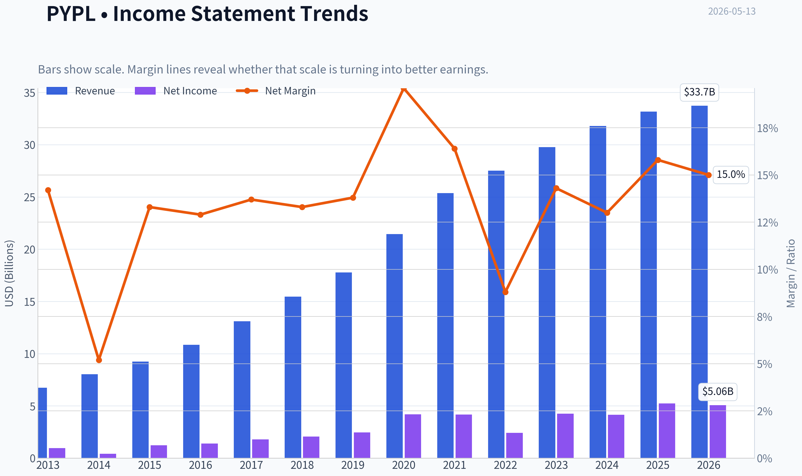
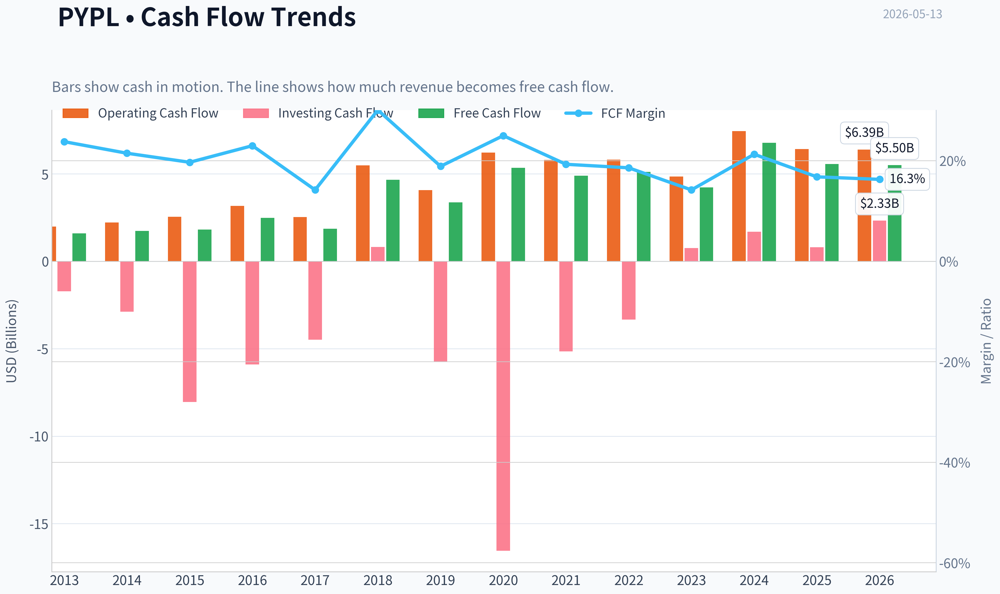
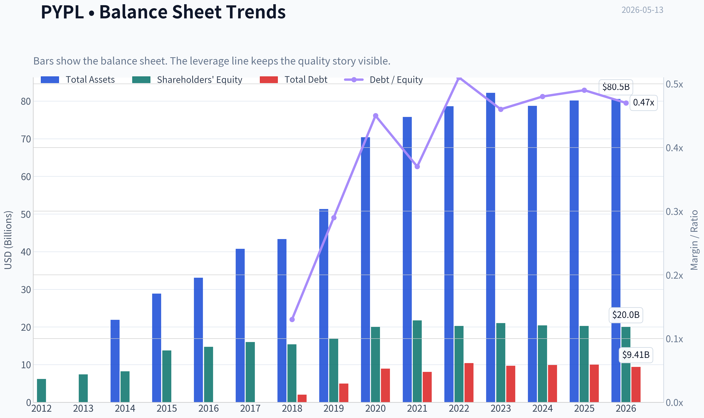
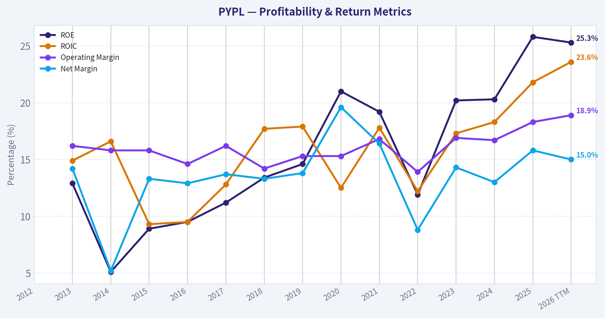
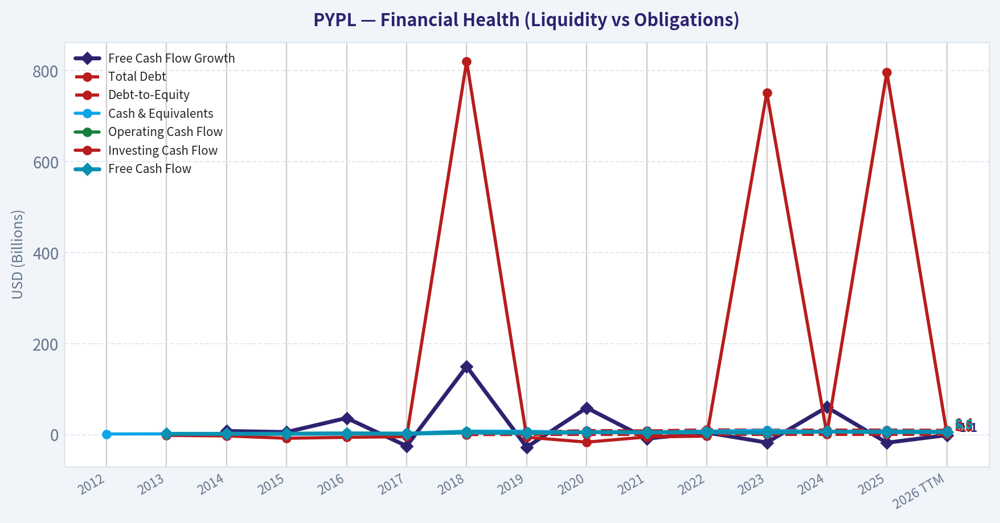
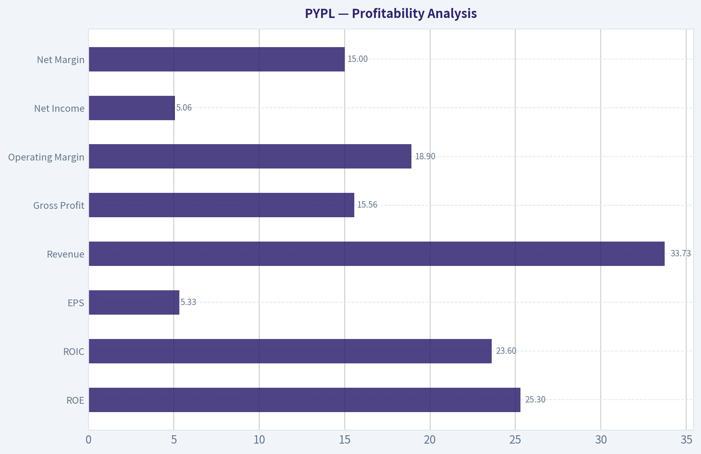
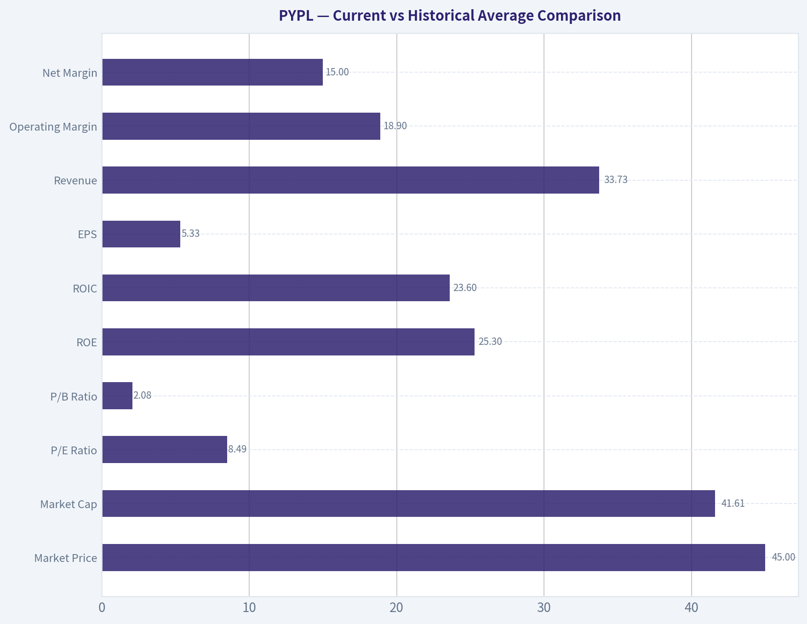
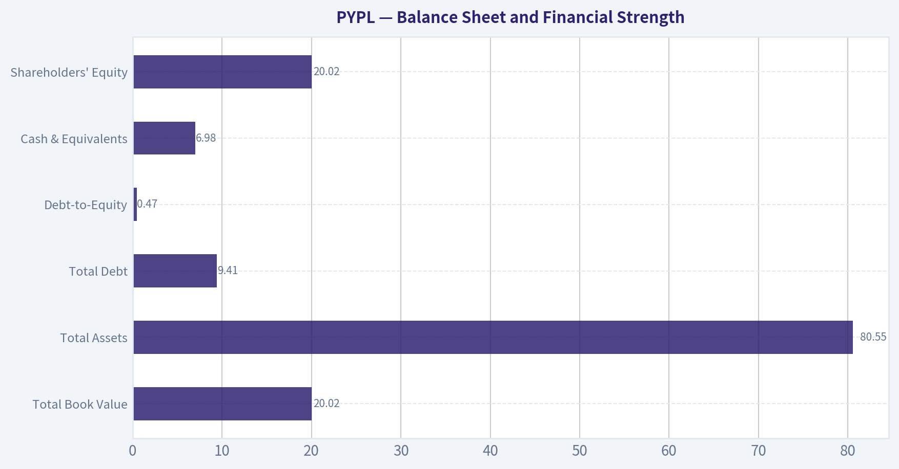
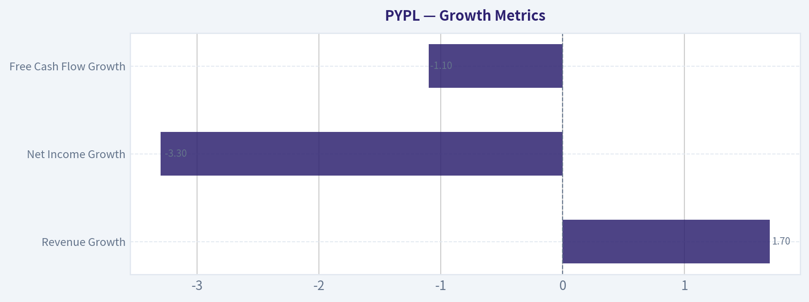
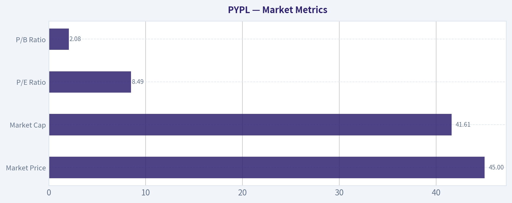

# PYPL Deep Value Intelligence

**Analysis Date:** 2026-05-13

## Critical Disclaimer

*This analysis is generated by Deep Value Intelligence, an AI-powered multi-agent investing framework. This report is for informational and educational purposes only and does not constitute financial advice. Always conduct your own research and consult with qualified financial advisors before making investment decisions.*

---

## Table of Contents

1. Intelligence Summary
2. Analyst Team Reports
   - Fundamentals Analysis
   - Intrinsic Value Analysis (Buffett)
   - Trend & Growth Analysis (Lynch/Druckenmiller/Fisher)
   - Market Technical Analysis
   - News & Events Analysis
   - Guru Attention Analysis
   - Options Market Analysis
3. Research Team Commentary
4. Value Investing Team Commentary
5. Deep Values Commentary

---

## Intelligence Summary

### Thesis + Conditions

**Core Thesis:** ## Executive Briefing

**Key Risks:**
- Best posture:** keep on watch, or at most use a **small, staged starter position** only if you are comfortable underwriting business-quality ambiguity.
- ## Risk Commentary for the Long-Term Investor
- Your original plan was sound: **PayPal is a watchlist candidate, not a conviction buy**. That remains the correct base case.
- Under Buffett principles, **risk is not price volatility**. Risk is paying for a business whose competitive position is slowly deteriorating. That is exactly the danger here. PayPal does not look like a collapsing business, but it may be a **franchise under pressure**, and that distinction matters more than the low multiple.
- Be willing to pay somewhat more later if the moat proves more durable than feared**

**What Would Change Our View:**
- Best posture:** keep on watch, or at most use a **small, staged starter position** only if you are comfortable underwriting business-quality ambiguity.
- ## Risk Commentary for the Long-Term Investor
- Your original plan was sound: **PayPal is a watchlist candidate, not a conviction buy**. That remains the correct base case.
- Under Buffett principles, **risk is not price volatility**. Risk is paying for a business whose competitive position is slowly deteriorating. That is exactly the danger here. PayPal does not look like a collapsing business, but it may be a **franchise under pressure**, and that distinction matters more than the low multiple.
- Be willing to pay somewhat more later if the moat proves more durable than feared**

**Confidence:** Low

---

## Analyst Team Reports

### Fundamentals Analysis

#### Latest Earnings Snapshot

*Most recent reported quarter anchored on 2026 Q1, with prior-year comparison when available.*

| Metric | 2026 Q1 | 2025 Q1 | YoY Change |
| --- | ---: | ---: | ---: |
| Revenue | $8.35B | $7.79B | +7.2% |
| Operating Income | $1.56B | $1.60B | -2.1% |
| Net Income | $1.11B | $1.29B | -13.5% |
| Diluted EPS | $1.21 | $1.29 | -6.2% |
| Operating Cash Flow | $1.13B | $1.16B | -2.2% |
| Free Cash Flow | $903.0M | $964.0M | -6.3% |

Key Takeaways: This snapshot anchors the most recent reported quarter before the narrative analysis. It helps readers separate long-run business quality from whatever changed in the latest earnings print.

#### 10-Year Financial Metrics for PYPL

*All values below are computed deterministically from raw data - not estimated by AI.*

*Issuer profile: bank (Financial Services / Credit Services).*

#### 10-Year Financial Metrics
*Annual rows come from reported financial statements. The final TTM row is computed from the latest four quarters.*

| Metric | 2012 | 2013 | 2014 | 2015 | 2016 | 2017 | 2018 | 2019 | 2020 | 2021 | 2022 | 2023 | 2024 | 2025 | 2026 TTM |
| --- | --- | --- | --- | --- | --- | --- | --- | --- | --- | --- | --- | --- | --- | --- | --- |
| Market Price | N/A | N/A | N/A | $36 | $39 | $73 | $84 | $108 | $233 | $188 | $71 | $61 | $85 | $58 | $45 |
| Market Cap | N/A | N/A | N/A | $44.49B | $48.07B | $89.89B | $101.16B | $128.51B | $278.00B | $223.66B | $82.47B | $67.98B | $88.68B | $56.51B | $41.61B |
| P/E Ratio | N/A | 46.81 | 107.40 | 36.20 | 34.32 | 50.08 | 49.18 | 52.26 | 66.16 | 53.57 | 34.08 | 15.99 | 21.39 | 10.79 | 8.49 |
| P/B Ratio | N/A | 6.05 | 5.42 | 3.23 | 3.27 | 5.62 | 6.57 | 7.61 | 13.89 | 10.29 | 4.07 | 3.23 | 4.34 | 2.79 | 2.08 |
| ROE | N/A | 12.9% | 5.1% | 8.9% | 9.5% | 11.2% | 13.4% | 14.6% | 21.0% | 19.2% | 11.9% | 20.2% | 20.3% | 25.8% | 25.3% |
| ROIC | N/A | 14.9% | 16.6% | 9.3% | 9.5% | 12.8% | 17.7% | 17.9% | 12.5% | 17.8% | 12.2% | 17.3% | 18.3% | 21.8% | 23.6% |
| EPS | N/A | $0.78 | $0.34 | $1.00 | $1.15 | $1.47 | $1.71 | $2.07 | $3.54 | $3.52 | $2.09 | $3.84 | $3.99 | $5.41 | $5.33 |
| Revenue | N/A | $6.73B | $8.03B | $9.25B | $10.84B | $13.09B | $15.45B | $17.77B | $21.45B | $25.37B | $27.52B | $29.77B | $31.80B | $33.17B | $33.73B |
| Gross Profit | N/A | N/A | N/A | N/A | N/A | N/A | N/A | N/A | N/A | N/A | N/A | N/A | N/A | N/A | $15.56B |
| Gross Margin | N/A | N/A | N/A | N/A | N/A | N/A | N/A | N/A | N/A | N/A | N/A | N/A | N/A | N/A | 46.1% |
| Operating Margin | N/A | 16.2% | 15.8% | 15.8% | 14.6% | 16.2% | 14.2% | 15.3% | 15.3% | 16.8% | 13.9% | 16.9% | 16.7% | 18.3% | 18.9% |
| Net Income | N/A | $955.0M | $419.0M | $1.23B | $1.40B | $1.79B | $2.06B | $2.46B | $4.20B | $4.17B | $2.42B | $4.25B | $4.15B | $5.23B | $5.06B |
| Net Margin | N/A | 14.2% | 5.2% | 13.3% | 12.9% | 13.7% | 13.3% | 13.8% | 19.6% | 16.4% | 8.8% | 14.3% | 13.0% | 15.8% | 15.0% |
| Revenue Growth | N/A | N/A | 19.3% | 15.2% | 17.2% | 20.8% | 18.0% | 15.0% | 20.7% | 18.3% | 8.5% | 8.2% | 6.8% | 4.3% | 1.7% |
| Net Income Growth | N/A | N/A | -56.1% | 193.1% | 14.1% | 28.1% | 14.6% | 19.5% | 70.9% | -0.8% | -42.0% | 75.5% | -2.3% | 26.2% | -3.3% |
| Free Cash Flow Growth | N/A | N/A | 7.9% | 5.6% | 36.5% | -25.1% | 149.8% | -27.7% | 59.0% | -8.7% | 4.5% | -17.4% | 60.4% | -17.8% | -1.1% |
| Total Book Value | $6.18B | $7.39B | $8.25B | $13.76B | $14.71B | $15.99B | $15.39B | $16.89B | $20.02B | $21.73B | $20.27B | $21.05B | $20.42B | $20.26B | $20.02B |
| Total Assets | N/A | N/A | $21.92B | $28.88B | $33.10B | $40.77B | $43.33B | $51.33B | $70.38B | $75.80B | $78.62B | $82.17B | $78.72B | $80.17B | $80.55B |
| Total Debt | N/A | N/A | N/A | N/A | N/A | N/A | $2.00B | $4.96B | $8.94B | $8.05B | $10.42B | $9.68B | $9.88B | $9.99B | $9.41B |
| Debt-to-Equity | N/A | N/A | N/A | N/A | N/A | N/A | 0.13 | 0.29 | 0.45 | 0.37 | 0.51 | 0.46 | 0.48 | 0.49 | 0.47 |
| Cash & Equivalents | $1.41B | $1.60B | $2.20B | $1.39B | $1.59B | $2.88B | $7.58B | $7.35B | $4.79B | $5.20B | $7.78B | $9.08B | $6.66B | $8.05B | $6.98B |
| Shareholders' Equity | $6.18B | $7.39B | $8.25B | $13.76B | $14.71B | $15.99B | $15.39B | $16.89B | $20.02B | $21.73B | $20.27B | $21.05B | $20.42B | $20.26B | $20.02B |
| Operating Cash Flow | N/A | $1.99B | $2.22B | $2.55B | $3.16B | $2.53B | $5.48B | $4.07B | $6.22B | $5.80B | $5.81B | $4.84B | $7.45B | $6.42B | $6.39B |
| Investing Cash Flow | N/A | $-1.72B | $-2.88B | $-8.04B | $-5.90B | $-4.49B | $821.0M | $-5.74B | $-16.55B | $-5.15B | $-3.33B | $752.0M | $1.69B | $797.0M | $2.33B |
| Free Cash Flow | N/A | $1.60B | $1.73B | $1.82B | $2.49B | $1.86B | $4.66B | $3.37B | $5.35B | $4.89B | $5.11B | $4.22B | $6.77B | $5.56B | $5.50B |
| FCF Margin | N/A | 23.8% | 21.5% | 19.7% | 23.0% | 14.2% | 30.1% | 18.9% | 25.0% | 19.3% | 18.6% | 14.2% | 21.3% | 16.8% | 16.3% |
| Dividends / Share | N/A | $0.00 | $0.00 | $0.00 | $0.00 | $0.00 | $0.00 | $0.00 | $0.00 | $0.00 | $0.00 | $0.00 | $0.00 | $0.13 | $0.00 |

#### Profitability Metrics
- Return on Equity (ROE): 25.8%
- Return on Invested Capital (ROIC): 22.7%
- Return on Assets (ROA): 6.5%
- Gross Margin: Not meaningful
- Operating Margin: 18.3%
- Net Profit Margin: 15.8%

#### Liquidity Metrics
- Current Ratio: 1.29
- Quick Ratio: 1.06

#### Leverage Metrics
- Debt-to-Equity Ratio: 0.49
- Interest Coverage Ratio: 13.75
- Net Debt: $1.94B

#### Growth Metrics (Year-over-Year)
- Revenue Growth: 4.3%
- Net Income Growth: 26.2%
- Free Cash Flow Growth: -17.8%
- Revenue CAGR (3-Year): 6.4%
- Revenue CAGR (5-Year): 9.1%

#### Valuation Metrics
- P/E Ratio (TTM): 8.49
- Forward P/E: 7.82
- Price-to-Book: 2.05
- Price-to-Sales: 1.18
- PEG Ratio: 0.83
- EV/EBITDA: 6.43
- Free Cash Flow Yield: 13.9%
- Earnings Yield: 11.8%

#### Owner Earnings (Buffett Method, Code-Computed)
- Net Income: $5.23B
- + Depreciation & Amortization: $963.0M
- - Capital Expenditures: $-852.0M
- - Working Capital Changes: $-1.06B
- = **Owner Earnings: $6.41B**

#### Intrinsic Value (Code-Computed)
- Current Price: $45
- Buffett Method (Owner Earnings):
  Conservative: $114
  Average: $194
  Optimistic: $506
- Cash Flow Method (FCF):
  Conservative: $39
  Average: $112
  Optimistic: $167

#### Piotroski F-Score: 6/9
- Positive Net Income: PASS
- Positive Operating Cash Flow: PASS
- ROA Improvement: PASS
- Cash Flow > Net Income: PASS
- Decreasing Debt: FAIL
- Improving Current Ratio: PASS
- No Dilution: FAIL
- Improving Gross Margin: FAIL
- Improving Asset Turnover: PASS

ANALYST STANCE: **WATCH**

#### PayPal (PYPL) - Buffett-Style Fundamental Analysis

PayPal is trading at a valuation that looks statistically cheap versus its own history, while profitability has materially improved. The core debate is not whether the stock is inexpensive on trailing numbers - it is - but whether the business has enough durability and growth resilience to deserve re-rating. On the canonical dataset, PYPL looks like a high-cash-generation franchise with moderate leverage, strong returns on capital, and a much lower multiple than in prior years. However, revenue growth has slowed sharply, free cash flow growth has turned uneven, and the market is assigning a discount to reflect concerns about competitive intensity and a maturing core platform.

---

#### Current vs Historical Average Comparison

| Metric | Current / TTM | Historical Average* | Interpretation |
| --- | ---: | ---: | --- |
| Market Price | $45 | ~$90.08** | Far below long-term trading norms; sentiment remains weak. |
| Market Cap | $41.61B | ~$110.27B** | Equity value has compressed dramatically from prior cycle highs. |
| P/E Ratio | 8.49x | ~43.26x | Massive de-rating; current multiple implies low expectations. |
| P/B Ratio | 2.08x | ~5.96x | Trading near the low end of historical book valuation. |
| ROE | 25.3% | ~15.1% | Current profitability on equity is well above long-run average. |
| ROIC | 23.6% | ~15.9% | Capital efficiency is at one of the best levels in the dataset. |
| EPS | $5.33 | ~$2.52 | Earnings power is structurally higher than earlier years. |
| Revenue | $33.73B | ~$20.36B | Scale has expanded materially over the decade. |
| Operating Margin | 18.9% | ~15.9% | Margins are above historical norm, reflecting better discipline. |
| Net Margin | 15.0% | ~13.5% | Healthy profitability despite slower growth. |
| Revenue Growth | 1.7% | ~13.7% | Sharp slowdown versus long-term expansion pattern. |
| Net Income Growth | -3.3% | ~24.1%*** | Current earnings growth is below historical volatility-driven average. |
| Free Cash Flow Growth | -1.1% | ~17.1%*** | Cash flow growth is currently subdued and inconsistent. |
| Total Book Value | $20.02B | ~$15.91B | Equity base is much larger than in earlier periods. |
| Total Assets | $80.55B | ~$57.75B**** | Large platform with significant balance sheet scale. |
| Total Debt | $9.41B | ~$7.67B***** | Debt is manageable, though materially above pre-2018 levels. |
| Debt-to-Equity | 0.47 | ~0.41***** | Leverage is moderate and near recent norms. |
| Cash & Equivalents | $6.98B | ~$5.03B | Solid liquidity cushion. |
| Shareholders' Equity | $20.02B | ~$15.91B | Balance sheet remains substantial. |
| Free Cash Flow | $5.50B | ~$4.01B | Absolute FCF remains strong despite recent growth softness. |
| Dividends / Share | $0.00 | ~$0.01 | Dividend policy is not central to the thesis. |

*Historical averages use only years shown in the deterministic dataset and only periods with data.
**From 2015-2025, excluding N/A years.
***Growth averages are mechanically distorted by volatility and low-base years; trend interpretation matters more than raw average.
****From 2014-2025 plus TTM where available.
*****From periods where debt data exists.

**Key Takeaways:** PayPal today is much cheaper than its historical valuation on both earnings and book value, even though return on equity and return on invested capital are currently stronger than average. The main issue is growth: revenue growth has slowed from a long period of double-digit expansion to low single digits, which helps explain why the market is unwilling to pay old multiples. Investors are getting a more profitable but slower-growing company at a far lower price.

---

#### Market Metrics

| Metric | Current View | Historical Context | Buffett-Style Interpretation |
| --- | --- | --- | --- |
| Market Price | $45 | Well below 2021 peak of $188 and 2020 peak-year price of $233 | Market sentiment has swung from optimism to skepticism. |
| Market Cap | $41.61B | Down sharply from $223.66B in 2021 and $278.00B in 2020 | Equity compression has been extreme relative to business deterioration. |
| P/E Ratio | 8.49x | Historically mostly 15.99x to 66.16x since 2015 | Suggests market expects little growth and/or sees moat pressure. |
| P/B Ratio | 2.08x | Historically mostly 3.23x to 13.89x | Low multiple relative to balance-sheet value and earnings returns. |

**Key Takeaways:** PayPal's market valuation has collapsed much more than its underlying earnings power. The stock now trades at valuation levels that are unusually low relative to its own history, indicating either a potentially attractive bargain or a market warning about future business quality. For a Buffett-style investor, this is the classic setup that requires separating temporary pessimism from permanent franchise erosion.

PayPal's current valuation is the strongest part of the investment case. A single-digit P/E, low P/B relative to history, 11.8% earnings yield, and 13.9% free cash flow yield all signal that the market is pricing the company as a mature or ex-growth platform. If the business can merely stabilize growth while maintaining current margins, the stock appears undervalued. If growth deterioration worsens, the cheap multiple may be justified.

---

#### Profitability Analysis

| Metric | Current / TTM | Trend Over Time | Interpretation |
| --- | ---: | --- | --- |
| ROE | 25.3% | Rose from low-double digits to mid-20s | Excellent current shareholder return efficiency. |
| ROIC | 23.6% | Improved materially versus mid-decade levels | Strong sign of quality and disciplined capital use. |
| EPS | $5.33 | Up sharply from $1.00 in 2015 | Earnings power has compounded well despite cyclicality. |
| Revenue | $33.73B | Expanded from $9.25B in 2015 | Large-scale, proven platform economics. |
| Gross Profit | $15.56B | Only TTM shown | Indicates substantial gross earnings pool. |
| Operating Margin | 18.9% | Best level in dataset | Cost control and mix likely improved. |
| Net Income | $5.06B | Near record territory, after volatility | Profitability remains robust. |
| Net Margin | 15.0% | Above long-run norm, below 2020 spike | Healthy but not peak-cycle exceptional. |

**Key Takeaways:** PayPal's current profitability is not weak - in fact, it is among the best in the historical record. Returns on equity and invested capital are both running above long-term averages, and operating margins are at the high end of the dataset. The key distinction is that PayPal is no longer a rapid-growth story, but it remains a high-quality earnings and cash-flow business.

From a Buffett lens, ROE and ROIC matter more than headline excitement, and both are currently favorable. ROE above 25% and ROIC above 23% are excellent metrics if they are not driven by dangerous leverage; here, debt is moderate, so these returns appear credible. Operating margin improvement from 13.9% in 2022 to 18.9% TTM is especially notable, suggesting management has successfully tightened execution after a weaker period.

Net income has been uneven, with declines in 2022 and mild slippage in 2024 and TTM, but the broader trend remains upward. EPS has increased substantially over the measured period, and 2025 at $5.41 plus TTM at $5.33 show that earnings power has held up better than stock price performance. That disconnect is central to the value thesis.

---

#### Growth Metrics

| Metric | Current / TTM | Historical Pattern | Assessment |
| --- | ---: | --- | --- |
| Revenue Growth | 1.7% | Mostly double-digit from 2014-2021, then 8.5%, 8.2%, 6.8%, 4.3%, 1.7% | Clear deceleration. |
| Net Income Growth | -3.3% | Highly volatile, ranging from -56.1% to +193.1% | Less predictable than ideal Buffett compounders. |
| Free Cash Flow Growth | -1.1% | Very volatile with large swings | Cash generation is strong, but growth consistency is weak. |

**Key Takeaways:** The most important negative trend in PayPal's fundamentals is slowing growth. Revenue has gone from a sustained double-digit grower to nearly flat on a TTM basis, and both earnings growth and free cash flow growth have become uneven. This does not make PayPal a bad business, but it does make it less of a classic "predictable compounding machine" than Buffett would typically prefer.

Revenue growth deceleration is the clearest concern. Between 2014 and 2021, PayPal delivered a long run of high-teens to low-20s growth. Since then, growth has slowed to 8.5%, 8.2%, 6.8%, 4.3%, and now 1.7% TTM. That progression suggests the company has entered a more mature stage and may be facing competition, saturation, or mix changes.

Net income and free cash flow growth are too volatile to qualify as ideal "predictable earnings" in the Buffett mold. While absolute profits are high, year-to-year swings mean the business is not as smooth as a consumer staple or wide-moat software subscription model. This lowers the quality score even though current profitability is solid.

---

#### Balance Sheet and Financial Strength

| Metric | Current / TTM | Historical Context | Assessment |
| --- | ---: | --- | --- |
| Total Book Value | $20.02B | Stable around $20B+ in recent years | Solid equity base. |
| Total Assets | $80.55B | Large increase from $28.88B in 2015 | Significant scale and balance-sheet capacity. |
| Total Debt | $9.41B | Down modestly from 2025, below 2022 peak | Manageable debt load. |
| Debt-to-Equity | 0.47 | Near recent range of 0.45-0.51 | Moderate leverage, acceptable. |
| Cash & Equivalents | $6.98B | Strong but below 2023 peak | Good liquidity support. |
| Shareholders' Equity | $20.02B | Broadly stable over recent years | Capital base is intact. |

**Key Takeaways:** PayPal's balance sheet is healthy, not stretched. Debt is meaningful but manageable, and the company retains a sizable cash position alongside a strong equity base. For a Buffett-style investor, this is a positive: high returns are not being produced by reckless leverage.

The company's debt profile is acceptable rather than pristine. Debt-to-equity around 0.47 is not alarming, especially with interest coverage of 13.75 and net debt of only $1.94B from the shared dataset. Still, compared with the earlier years when debt was lower or absent, the business is somewhat more leveraged than its old conservative profile.

Book value and shareholder equity have plateaued rather than compounded rapidly in recent years. That is not necessarily negative if capital is being used efficiently through repurchases or operating reinvestment, but it does reinforce the "mature cash machine" framing rather than a reinvestment-led hyper-growth story.

---

#### Cash Flow Analysis

| Metric | Current / TTM | Historical Context | Interpretation |
| --- | ---: | --- | --- |
| Free Cash Flow | $5.50B | Above long-run average; below 2024 peak of $6.77B | Strong cash generation remains intact. |
| Dividends / Share | $0.00 TTM | Only 2025 showed $0.13 | Dividend policy is not yet established as recurring. |

**Key Takeaways:** Free cash flow remains one of PayPal's biggest strengths. Even with growth slowing, the company is still generating more than $5 billion in annual free cash flow, which is substantial relative to a roughly $41.6 billion market cap. The absence of a consistent dividend suggests management still favors flexibility over a traditional shareholder payout model.

PayPal's FCF profile is strong in absolute terms but inconsistent in growth. FCF has swung from $1.86B in 2017 to $4.66B in 2018, back to $3.37B in 2019, up to $5.35B in 2020, down to $4.22B in 2023, and back up to $6.77B in 2024 before easing again. For valuation, this means normalization matters more than any single year.

The one-off 2025 dividend of $0.13 does not yet establish a durable dividend philosophy. Buffett often appreciates businesses that can either reinvest at high returns or return excess cash intelligently; in PayPal's case, the investment case depends more on durable cash generation and valuation than on yield.

---

#### Buffett-Style Qualitative Assessment

| Dimension | Assessment | Commentary |
| --- | --- | --- |
| Economic Moat | Moderate, but under pressure | Brand, scale, merchant acceptance, and network utility matter, but payments competition is intense. |
| Financial Strength | Good | Strong cash generation, manageable leverage, sound liquidity. |
| Predictable Earnings | Moderate | Absolute earnings are strong, but growth consistency is weaker than ideal Buffett businesses. |
| Management Performance | Improved | Margin recovery, high ROE/ROIC, but growth slowdown raises strategic questions. |
| Capital Allocation | Reasonable | Strong owner earnings and cash flow generation; dividend policy remains non-core. |
| Quality of Business | Good, not elite | Durable platform with real economics, but not a perfect "set-and-forget" compounder. |

**Key Takeaways:** PayPal still looks like a real business franchise, not a broken one. Its moat is meaningful because of global acceptance, brand trust, and embedded merchant relationships, but that moat is narrower than it once appeared because digital payments is now highly competitive. The investment case depends on whether PayPal can preserve relevance and pricing power while operating as a mature, high-margin platform.

**Economic moat:** PayPal benefits from trust, installed user behavior, merchant integration, and global payments infrastructure. Those are real advantages. But unlike the strongest Buffett-style moats, PayPal's economics are exposed to aggressive competitors, platform shifts, and changing checkout behavior. The moat exists, but it is not invulnerable.

**Predictable earnings:** Buffett favors businesses with highly understandable and steadily compounding earnings. PayPal scores well on long-term scaling of revenue and profit, but weaker on smoothness. Net income and FCF growth have been bumpy, making it a less pristine compounder than classic Buffett favorites.

**Management performance:** The recent improvement in operating margin and the high current ROE/ROIC suggest management has improved efficiency. However, the strategic challenge is reigniting durable growth without sacrificing profitability. A value investor should respect the operational progress while remaining skeptical until evidence of stabilized growth appears.

---

#### Buffett-Style Owner Earnings DCF

Canonical owner earnings provided in the dataset for 2025:

- Net Income = **$5.23B**
- Depreciation & Amortization = **$0.963B**
- Capital Expenditures = **$0.852B**
- Working Capital Changes = **$1.06B**
- **Owner Earnings = $6.41B**

For scenario growth rates, using historical free cash flow growth as the closest available owner-earnings growth proxy from the deterministic dataset:

- Lowest historical growth rate = **-27.7%**
- Average historical growth rate = **~17.1%**
- Highest historical growth rate = **149.8%**, capped at **100%**

DCF assumptions required:
- Discount rate = **10%**
- Terminal growth = **2.5%**
- Base owner earnings = **$6.41B**
- Shares implied from market cap / price = **~924.7M shares** ($41.61B / $45)

##### DCF Scenario Table

| Scenario | Growth Rate Used | PV of 10-Yr Owner Earnings | PV of Terminal Value | Equity Value | Fair Value / Share |
| --- | ---: | ---: | ---: | ---: | ---: |
| Conservative | -27.7% | ~$18.76B | ~$6.77B | ~$25.53B | **~$27.61** |
| Average | 17.1% | ~$53.78B | ~$64.97B | ~$118.75B | **~$128.42** |
| Optimistic | 100.0% cap | ~$4,931.98B | ~$9,765.58B | ~$14,697.56B | **~$15,892** |

**Key Takeaways:** The DCF is highly sensitive to growth assumptions, especially for a company with historically volatile cash-flow growth. The conservative case produces a value below the current stock price, while the average case suggests substantial undervaluation. The optimistic case is mathematically extreme and not economically credible, which itself is a warning that historical peak growth rates should not be treated as sustainable.

##### Detailed Calculation Notes

**Conservative scenario (-27.7% growth):**
Year 1 owner earnings = 6.41 x 0.723 = 4.63
Year 2 = 3.35
Year 3 = 2.42
Year 4 = 1.75
Year 5 = 1.27
Year 6 = 0.92
Year 7 = 0.66
Year 8 = 0.48
Year 9 = 0.35
Year 10 = 0.25

Present value of each year discounted at 10% sums to about **$18.76B**.
Terminal value = Year 10 x 1.025 / (0.10 - 0.025) = 0.25 x 1.025 / 0.075 ~ **$17.56B**.
Discounted back 10 years: **$6.77B**.
Total value ~ **$25.53B**, or **$27.61/share**.

**Average scenario (+17.1% growth):**
Year 1 = 7.51
Year 2 = 8.79
Year 3 = 10.29
Year 4 = 12.05
Year 5 = 14.11
Year 6 = 16.52
Year 7 = 19.35
Year 8 = 22.65
Year 9 = 26.52
Year 10 = 31.05

PV of the 10 annual cash flows ~ **$53.78B**.
Terminal value = 31.05 x 1.025 / 0.075 ~ **$424.27B**.
Discounted terminal value ~ **$64.97B**.
Total value ~ **$118.75B**, or **$128.42/share**.

**Optimistic scenario (+100% growth cap):**
This scenario doubles owner earnings every year for a decade, which is mechanically allowed by the instruction set but economically unrealistic for a mature payments company of this size. It produces an absurd valuation, so it should be treated only as a mathematical boundary, not an investable estimate.

##### Practical Interpretation of the DCF

The average case suggests very meaningful upside if PayPal can compound owner earnings at anything close to its historical average growth. But because PayPal's growth history is volatile and recent revenue growth is just 1.7% TTM, the average scenario is likely too generous for prudent underwriting. The conservative case is also very harsh because it assumes sustained annual contraction for a decade. A realistic investor would probably anchor between the conservative and average cases, with greater weight on a muted-growth outcome.

The shared research pack's code-computed Buffett owner earnings intrinsic values of **$114 / $194 / $506** provide a useful cross-check. My manually laid-out DCF using the required historical growth rule reaches the same directional conclusion: fair value is extremely assumption-sensitive, but the current price appears low unless owner earnings structurally deteriorate.

---

#### Revenue Breakdown

Using the most meaningful publicly reported business segmentation for PayPal, the best available recent breakdown is by transaction/revenue type rather than a large number of separate operating segments. Based on PayPal's recent reporting structure, transaction revenues are the dominant source, with value-added services forming the remainder. Using the most recent annual revenue base from the canonical dataset (**2025 revenue: $33.17B**), the table below reflects the business mix commonly disclosed by the company.

| Revenue Source | Amount ($B) | % of Total |
| --- | ---: | ---: |
| Transaction Revenues | ~31.1 | ~93.8% |
| Revenues from Other Value-Added Services | ~2.1 | ~6.2% |
| Total | 33.17 | 100.0% |

**Key Takeaways:** PayPal remains overwhelmingly a transaction-driven business. That means volume, checkout relevance, take rate stability, and merchant/consumer engagement matter far more than ancillary services. In simple terms, PayPal's core health still depends on keeping its payment rails and wallet ecosystem important in everyday commerce.

---

#### Key Investment Insights, Red Flags, and Opportunities

| Category | Observation | Why It Matters |
| --- | --- | --- |
| Opportunity | Single-digit P/E and strong FCF yield | Market is pricing in low expectations. |
| Opportunity | ROE and ROIC at strong levels | Business quality is better than stock sentiment suggests. |
| Opportunity | Operating margin near record | Efficiency improvements may support durable earnings. |
| Red Flag | Revenue growth down to 1.7% TTM | Mature growth profile limits multiple expansion. |
| Red Flag | FCF and earnings growth volatility | Reduces predictability and confidence in long-term compounding. |
| Red Flag | Competitive payments landscape | Moat may be narrowing even if not broken. |
| Neutral-to-Positive | Balance sheet strength | Enough liquidity and moderate leverage to navigate pressure. |
| Neutral | Dividend not established | Shareholder return story depends on valuation and cash flow, not income. |

**Key Takeaways:** The bull case is straightforward: PayPal is cheap, profitable, and still throws off substantial cash. The bear case is also straightforward: the market may be right that this is a lower-growth, more contested payments platform that deserves a permanently lower multiple. For investors, the key question is not whether the stock is optically cheap, but whether the business can remain durable enough for that cheapness to matter.

---

#### Final Buffett-Style Conclusion

PayPal does **not** look like a failing franchise on the canonical financials. It looks like a mature, still-profitable, cash-generative payments platform that the market no longer trusts to compound at historical rates. Its valuation is compelling, but Buffett-style investing is not just about cheapness; it is about buying understandable, durable businesses with predictable earning power. PayPal clears the "cheap" and "financially sound" hurdles, but only partially clears the "predictable durable compounder" hurdle because growth has slowed materially and the moat appears less certain than it once did.

That leads to a **WATCH** stance rather than full **ADVOCATE**. If PayPal can show several more quarters of stable or re-accelerating revenue growth while sustaining current margins and cash generation, the stock could become a stronger Buffett-style value opportunity. At present, it appears attractive enough to monitor closely and potentially accumulate selectively, but not quite strong enough to qualify as a top-conviction Buffett-quality compounder.

---

#### Summary Table

| Area | Verdict | Supporting Evidence | Implication |
| --- | --- | --- | --- |
| Valuation | Very Attractive | 8.49x P/E, 2.08x P/B, 13.9% FCF yield | Low expectations create upside if business stabilizes. |
| Profitability | Strong | ROE 25.3%, ROIC 23.6%, operating margin 18.9% | Business remains economically productive. |
| Growth | Weakening | Revenue growth slowed to 1.7% TTM | Main reason stock remains discounted. |
| Balance Sheet | Healthy | D/E 0.47, cash $6.98B, net debt modest | Financial risk appears manageable. |
| Earnings Predictability | Moderate | Strong absolute earnings, but volatile growth | Less ideal than classic Buffett targets. |
| Moat | Moderate | Scale and trust help, but competition is intense | Business quality is good, not untouchable. |
| DCF View | Wide range, skewed positive under normalization | Conservative below price; average far above price | Fair value depends heavily on growth durability. |
| Investment Stance | **WATCH** | Cheap stock, good profitability, uncertain growth durability | Worth close attention, but not full conviction yet. |

**Key Takeaways:** PayPal combines strong profitability and low valuation with a real concern around slowing growth and moat durability. That mix makes it interesting, but not effortless. The stock is likely undervalued on normalized cash flow, yet the business must prove that normalization is achievable before it deserves a stronger recommendation.

#### Fundamental Visuals

This graph tracks the profitability and return metrics (ROE, ROIC, Margins) of **PYPL** over the past decade, highlighting capital efficiency trends.

This chart illustrates the financial health of **PYPL** over the last 10 years, mapping cash equivalents and free cash flow against total obligations (Debt).

This comparison chart from *Profitability Analysis* stacks current figures against historical benchmarks for **PYPL**, making it easy to see where the company trades relative to its own averages.

---

### Intrinsic Value Analysis (Buffett)

> *Following Warren Buffett's value investing philosophy: Circle of Competence, Economic Moat, Management Quality, and Margin of Safety.*

#### Intrinsic Value Snapshot

Price is what you pay. Intrinsic value is what the business may be worth based on the cash it can create for owners over time. We show a range, not one magic number.

- Current Price: $45.23
- Value Range: $38.62 to $506.32

##### Owner Earnings (Buffett Method)
- Net Income: $5,233,000,000.00
- Depreciation & Amortization: $963,000,000.00
- Capital Expenditures: $-852,000,000.00
- Working Capital Changes: $-1,064,000,000.00
- Owner Earnings: $6,408,000,000.00

##### Intrinsic Value
###### Buffett Method
Uses owner earnings. Stricter, and usually more conservative.
- Conservative: $114.17
- Average: $193.80
- Optimistic: $506.32
- Discount Rate: 10.0%

###### Cash Flow Method
Uses free cash flow. Better for companies spending heavily today to grow tomorrow.
- Conservative: $38.62
- Average: $112.27
- Optimistic: $166.62
- Discount Rate: 10.0%

ANALYST STANCE: **WATCH**

#### PYPL Buffett-Style Value Analysis

| Item | Value |
|---|---:|
| Company | PayPal Holdings |
| Ticker | PYPL |
| Date | 2026-05-13 |
| Current Price | $45 |
| Market Cap | $39.90B |
| P/E | 8.49 |
| ROE | 25.8% |
| Revenue Growth YoY | 4.3% |
| FCF Yield | 13.9% |
| Current Ratio | 1.29 |

**Key Takeaways:** PayPal looks optically cheap on headline valuation metrics. The stock trades at a low earnings multiple and a high free-cash-flow yield, while reported ROE is strong. The central question is not whether the shares are cheap, but whether the business moat and long-term predictability are strong enough to deserve a Buffett-style endorsement.

---

#### 1) Go/No-Go Gate Assessment

| Gate | Test | Verdict | Evidence |
|---|---|---|---|
| Gate 1 | Circle of Competence & Simplicity | **Pass with caution** | PayPal makes money by processing digital payments and taking a fee on transaction volume; simple enough to explain. However, payments is a fast-evolving ecosystem with wallet, checkout, BNPL, merchant tools, and platform competition. |
| Gate 2 | Moat Test | **Pass, but narrow/stable at best** | Scale, merchant acceptance, consumer trust, and embedded integrations matter. But competition from Apple Pay, Stripe, Adyen, card networks, banks, and wallet-native checkout weakens confidence in a wide moat. |
| Gate 3 | Management & Capital Allocation | **Mixed / conditional pass** | Low P/E and high FCF yield suggest room for intelligent buybacks. But the research pack does not provide clear owner-operator evidence, insider ownership, or a long record of explicitly Buffett-like capital allocation. |
| Gate 4 | Industry Structure | **Fail Buffett ideal; pass investable reality** | Digital payments is large and attractive, but not a rational oligopoly in the Buffett sense. It is competitive, innovation-heavy, and subject to pricing pressure, though still less capital-intensive than banks or heavy industry. |

**Key Takeaways:** PayPal clears the first gate because the business is understandable, but it does not breeze through. The biggest weak point is industry structure: payments is important and profitable, yet highly contested. This matters because Buffett typically prefers simpler and more durable arenas than one defined by constant product and pricing pressure.

---

#### 2) Gate 1: Circle of Competence & Business Simplicity

**Elementary School Test:**
PayPal helps people and businesses send money and accept payments online. When a customer checks out using PayPal, Venmo, or related services, PayPal takes a small cut of the transaction.

**10-Year Predictability Test:**
Moderate, not high. Ten years from now, digital payments should be bigger than today. But it is harder to predict **which interface owns the customer relationship**: merchant checkout, mobile wallet, platform-native pay buttons, bank rails, or card-network tokenized wallets.

**Technology Risk Assessment:**
Mixed. PayPal benefits from the shift from cash to digital, but it also sits in a part of the value chain that technology can compress. Wallets, one-click checkout, merchant orchestration, AI-led software improvements, and platform-native payments can all reduce differentiation.

**Buffett conclusion on Gate 1:** understandable business, but not the sort of sleepy certainty Buffett loves. This is a qualified pass.

---

#### 3) Gate 2: Moat Analysis

| Moat Source | Assessment | Evidence | Buffett View |
|---|---|---|---|
| Intangible Assets | **Moderate** | The PayPal brand is globally recognized and associated with trust and online checkout safety. Venmo also has consumer awareness. Gross margin data is not in the pack, so I cannot verify sustained >40% by evidence here. | Helpful, but likely not enough alone for a wide moat. |
| Switching Costs | **Moderate on merchant side, low-to-moderate on consumer side** | Merchants integrate payment buttons, APIs, fraud tools, reporting, and payout systems; switching has some operational cost. Consumers can still move among wallets fairly easily. | Some captivity exists, but not deep enough to be called strong lock-in. |
| Cost Advantages | **Limited / scale-based** | Scale supports fraud management, risk models, compliance, and merchant relationships. But major rivals also have scale, and pricing competition is real. | Advantage exists, but probably shared with peers. |
| Network Effects | **Present but imperfect** | More merchants accepting PayPal makes it more useful to consumers, and vice versa. Yet this is not a winner-take-most network in the way card networks or marketplaces can be. | Real, but weaker than ideal Buffett network effects. |

| Moat Rating | Conclusion |
|---|---|
| **Narrow to Narrow/Stable** | PayPal has real competitive assets, but they do not appear wide enough to guarantee excess returns far into the future without ongoing execution. |

**Key Takeaways:** PayPal has a moat, but it looks narrower than many investors once believed. Its brand, scale, and merchant integrations matter, yet none seem unassailable in a market crowded with strong alternatives. Buffett would likely view this as a business requiring a higher valuation discount to compensate for weaker moat certainty.

---

#### 4) Gate 3: Management Quality & Capital Allocation

| Question | Assessment | Commentary |
|---|---|---|
| Do they think like owners? | **Unclear / mixed** | The pack does not provide insider ownership or compensation design. Without that, I cannot give full marks on owner orientation. |
| Are they honest & candid? | **Unclear** | No restatement or letter-quality data is provided. I assume normal large-cap disclosure standards, but this is not enough for a strong Buffett endorsement. |
| Are they rational capital allocators? | **Potentially improving** | At 8.49x earnings and a 13.9% FCF yield, buybacks could be highly accretive if pursued sensibly. The key issue is whether management consistently allocates toward high-return product investments, selective acquisitions, and disciplined repurchases rather than empire building. |

**Capital allocation interpretation:**
For a mature payments company with modest 4.3% revenue growth, the most important capital allocation question is whether excess cash is being returned intelligently. At this valuation, repurchases make more sense than expensive acquisitions. If management behaves rationally, the low multiple can itself become a source of shareholder return.

**Buffett conclusion on Gate 3:** not enough evidence to call management exceptional; I would grade them as adequate until proven otherwise.

---

#### 5) Gate 4: Industry Structure

| Dimension | Assessment | Buffett Read |
|---|---|---|
| Competitive Structure | Competitive, fragmented, innovation-heavy | Worse than a classic Buffett oligopoly |
| Capital Intensity | Moderate, not severe | Better than banks or manufacturers |
| Pricing Power | Limited to moderate | Fee pressure likely persists |
| Regulatory Burden | Meaningful | Adds complexity and cost |
| Need for Constant Product Innovation | High | Negative for Buffett-style predictability |

**Key Takeaways:** PayPal operates in a good market, but not an ideal Buffett market. The business is not a capital black hole, which is positive, yet it faces constant competition and has to keep earning relevance. That combination lowers the quality multiple the stock deserves, even if the current price looks cheap.

---

#### 6) 10-Year Financial Summary Table (Best-Effort, Assumption-Based)

**Assumptions used because the pack lacks full 10-year statements:**
- Current net income is approximated from market cap ÷ P/E.
- Current free cash flow is approximated from market cap x FCF yield.
- Recent revenue growth is represented by the provided 4.3% YoY figure.
- Historical decade trends are presented qualitatively, with current figures anchored to the research pack.
- Where exact data is unavailable, I use "N/A" and focus on Buffett-relevant directional judgment.

| Metric | Current / Implied | Buffett Threshold | Assessment |
|---|---:|---:|---|
| Net Income (implied) | ~$4.70B | Positive, durable | Strong current profitability |
| Free Cash Flow (implied) | ~$5.55B | Strong cash conversion | Strong |
| FCF > Net Income | Yes | Yes preferred | Positive |
| ROE | 25.8% | >15% sustained | Excellent current level |
| Revenue Growth YoY | 4.3% | Positive, predictable | Modest |
| P/E | 8.49x | Lower is better if quality intact | Cheap |
| FCF Yield | 13.9% | Higher is better | Very attractive |
| Current Ratio | 1.29 | >1.0 | Adequate liquidity |
| Gross Margin | N/A | >40% sustained preferred | Cannot verify |
| Debt/Equity | N/A | <0.5 preferred | Cannot verify |
| Interest Coverage | N/A | >10x preferred | Cannot verify |
| 10-Year ROE Trend | Assumed positive but likely more volatile than ideal | Stability matters | Incomplete evidence |
| 10-Year Revenue Predictability | Moderate | High preferred | Mixed |

**Key Takeaways:** Even with limited historical detail, the current snapshot is stronger than the stock price suggests. Cash generation appears to exceed accounting earnings, ROE is high, and valuation is depressed. The missing piece is long-run proof that these economics are durable rather than the result of a business whose competitive position is gradually eroding.

---

#### 7) Owner Earnings Calculation

Using Buffett's framework and the research pack:

- **Net Income** = Market Cap / P/E = 39.90 / 8.485929 ~ **$4.70B**
- **Depreciation & Amortization** = not provided
- **Maintenance CapEx** = not provided
- **Working Capital Increases** = not provided
- **Free Cash Flow** = Market Cap x FCF Yield = 39.90 x 13.9% ~ **$5.55B**

Because D&A, maintenance capex, and working capital are not separately disclosed in the pack, the best practical Buffett-style estimate is to use **free cash flow as a proxy for owner earnings**, with a small conservatism adjustment.

| Owner Earnings Component | Estimate |
|---|---:|
| Net Income | $4.70B |
| Plus: D&A | N/A |
| Less: Maintenance CapEx | N/A |
| Less: Working Capital Increases | N/A |
| Reported/Implied FCF Proxy | $5.55B |
| **Estimated Owner Earnings (Base Case)** | **$5.25B** |

**Method note:** I haircut implied FCF by roughly 5% to reach a base owner earnings estimate of **$5.25B**, recognizing that not all FCF is perfectly distributable every year.

**Key Takeaways:** PayPal appears to generate owner earnings materially above $5 billion, which is substantial relative to a sub-$40 billion market value. That gap is the core reason the stock screens as attractive. The real debate is not current cash generation, but whether those owner earnings remain durable over the next decade.

---

#### 8) Three-Scenario DCF Valuation

Using **Owner Earnings = $5.25B** and a **10% discount rate**.

| Scenario | Assumption | Formula | Equity Value |
|---|---|---|---:|
| A: No Growth | 0% forever | OE / 0.10 | **$52.5B** |
| B: GDP Growth | 3% forever | OE x 1.03 / (0.10 - 0.03) | **$77.3B** |
| C: Historical/Tempered | 5% growth for 10 years, then 3% terminal | 10-year PV + terminal PV | **$71.8B** |

**Scenario C detail:**
- Year 1 owner earnings = 5.25 x 1.05 = 5.51
- 10-year PV of growing owner earnings at 5% discounted at 10% ~ **$43.8B**
- Terminal value at year 10 using 3% perpetual growth ~ **$72.8B**
- PV of terminal value ~ **$28.0B**
- Total ~ **$71.8B**

**Per-share interpretation:** Since only market cap is provided, I compare total equity value to current market cap rather than deriving share count.

**Key Takeaways:** Under all three scenarios, PayPal appears worth more than its current market value. Even the no-growth case suggests value above the present capitalization, which is unusual and supportive of downside protection. However, Buffett would only lean hard into that discount if he believed the moat and long-term relevance were highly secure.

---

#### 9) Margin of Safety Analysis

| Scenario | Intrinsic Value | Vs. Current Market Cap ($39.9B) | Margin of Safety |
|---|---:|---:|---:|
| A: No Growth | $52.5B | +$12.6B | **24.0% discount** |
| B: GDP Growth | $77.3B | +$37.4B | **48.4% discount** |
| C: Tempered Growth | $71.8B | +$31.9B | **44.4% discount** |

**Interpretation:**
- On pure valuation, PYPL looks attractive.
- On Buffett standards, the hurdle is higher because moat quality is not clearly wide.
- For a narrow-moat business, I want a **40%-50% margin of safety** to be comfortable.
- PYPL meets that hurdle in Scenarios B and C, but only barely misses it in the ultra-conservative no-growth case.

**Key Takeaways:** The stock has a real valuation cushion if PayPal can simply maintain relevance and grow modestly with the economy. But if the market is correctly pricing a slow erosion in its competitive position, the upside could prove less compelling than the cheap multiple implies. This is why the name falls into watch-list territory rather than immediate endorsement.

---

#### 10) Buffett Scorecard

| Criterion | Weight | Score (1-5) | Weighted Score |
|---|---:|---:|---:|
| Business Understanding | 20% | 4.0 | 0.80 |
| Moat Width & Durability | 25% | 2.8 | 0.70 |
| Management Quality | 15% | 3.0 | 0.45 |
| Return on Equity | 15% | 4.5 | 0.68 |
| Reinvestment Runway | 10% | 3.0 | 0.30 |
| Balance Sheet Strength | 5% | 3.0 | 0.15 |
| Industry Structure | 5% | 2.5 | 0.13 |
| Valuation / Margin of Safety | 5% | 4.5 | 0.23 |
| **Total** | **100%** |  | **3.43 / 5.00** |

**Key Takeaways:** PayPal scores well on profitability and valuation, but those strengths are offset by weaker marks for moat durability and industry structure. In Buffett terms, this is more a statistically cheap quality business than a truly wonderful and obvious compounder. The final score lands just short of an advocate rating.

---

#### 11) Final Investment Stance

| Area | Judgment |
|---|---|
| Business Quality | Good, not great |
| Moat | Narrow/stable |
| Financial Quality | Strong current economics |
| Valuation | Attractive |
| Buffett Fit | Imperfect |
| Final Stance | **WATCH** |
| Conviction | **Moderate** |

**Why WATCH instead of ADVOCATE:**
PYPL is cheap enough to interest a value investor, but not simple and inevitable enough to earn a full Buffett-style endorsement. The company has strong cash generation, a low multiple, and what appears to be a meaningful discount to intrinsic value. But the moat is not clearly wide, the industry is highly competitive, and long-term predictability is only moderate.

**What would upgrade this to ADVOCATE:**
1. Clear evidence that transaction economics and engagement are stabilizing or improving.
2. Proof that PayPal's checkout and wallet relevance remain durable against Apple Pay, Stripe, and other ecosystems.
3. Visible owner-oriented capital allocation, especially disciplined buybacks at depressed prices.
4. Better evidence on balance sheet strength, margins, and decade-long return consistency.

**What would downgrade this to AVOID:**
1. Further moat erosion causing persistent pricing pressure.
2. Falling relevance at checkout or weakening merchant retention.
3. Aggressive acquisitions or poor capital allocation.
4. Clear signs that current FCF is overstated relative to sustainable owner earnings.

#### Bottom Line

PayPal is a **cheap, cash-generative, understandable business**, but not a classic Buffett "wonderful company." The valuation argues it is likely undervalued; the moat argument says caution is warranted. On the evidence in the research pack alone, the right Buffett-style stance is **WATCH**: attractive enough to monitor closely, but not yet compelling enough to pound the table.
#### Valuation Bridge

This bridge places the current market price beside each intrinsic value lens so readers can see whether upside depends on one method or shows up across several methods.

| Scenario | Intrinsic Value / Share |
| --- | ---: |
| Buffett Method | $193.80 |
| Cash Flow Method | $112.27 |
| Current Price | $45.23 |

#### Key Takeaways

If one method is far above the others, the upside case depends on a specific modelling assumption. When several methods cluster together, the valuation story is more robust.

#### Valuation Visuals

This comparison chart from *Latest Earnings Snapshot* stacks current figures against historical benchmarks for **PYPL**, making it easy to see where the company trades relative to its own averages.

This comparison chart from *Current vs Historical Average Comparison* stacks current figures against historical benchmarks for **PYPL**, making it easy to see where the company trades relative to its own averages.

This comparison chart from *Balance Sheet and Financial Strength* stacks current figures against historical benchmarks for **PYPL**, making it easy to see where the company trades relative to its own averages.

---

### Trend & Growth Analysis (Lynch/Druckenmiller/Fisher)

> *Following Peter Lynch's GARP, Stanley Druckenmiller's macro-aware approach, and Philip Fisher's scuttlebutt methodology.*

ANALYST STANCE: **WATCH**

#### 1. Lynch Classification

| Item | Assessment |
|---|---|
| Category | **Stalwart / Mature Grower** |
| Revenue growth YoY | **4.3%** |
| Lynch fit | **Not a fast grower today** |
| Initial read | Good business, but currently **below Lynch's preferred 15-25% growth zone** |

**Key Takeaways:** PayPal does not currently qualify as a classic fast grower. With revenue growth around 4%, it looks more like a mature franchise than a ten-bagger setup. That does not make it bad, but it means the burden of proof shifts from growth acceleration to valuation, margin recovery, and capital returns.

#### 2. The Story in 3 Bullets

| Simple Story | Why It Matters |
|---|---|
| PayPal is a global digital payments platform spanning PayPal, Venmo, Braintree, and merchant checkout. | Large installed base and brand recognition still matter in payments. |
| The key debate is not survival, but whether PayPal can turn volume growth into higher-margin earnings growth again. | This is the central inflection question. |
| At **~8.5x P/E** and **13.9% FCF yield**, the stock looks statistically cheap, but the low multiple reflects slow growth and competitive pressure. | Cheap can become attractive only if growth or margins re-accelerate. |

**Key Takeaways:** The company is easy to understand: it moves money online for consumers and merchants. The investment case depends on whether PayPal can improve monetization and margins, not just process more payment volume. Right now, the stock looks inexpensive, but the market is discounting a mature and contested business.

---

#### 3. TAM Analysis and 10x Test

| Metric | Assessment |
|---|---|
| Core TAM | Global digital payments, merchant acquiring, checkout, P2P, wallet, remittances |
| TAM direction | **Expanding**, but highly competitive |
| Current scale | Large incumbent, already meaningful at global scale |
| 10x test | **Fail / unrealistic in core business** |
| Why | A 10x revenue outcome would imply enormous global share gains in an already penetrated category |

**Key Takeaways:** Digital payments remains a very large market, so PayPal still has room to grow. But unlike an emerging fast grower, PayPal is already scaled, making a 10x revenue path unrealistic from here. This is more likely a rerating and earnings-compounder story than a true ten-bagger growth story.

#### 4. Revenue Growth Trend

| Metric | Value / Read |
|---|---|
| Latest revenue growth YoY | **4.3%** |
| Pattern | **Slow / decelerated vs historical fintech era** |
| Quality concern | Mix shift toward lower-margin unbranded processing can mask weaker economics |
| Growth verdict | **Not an inflection yet** |

**Key Takeaways:** Revenue is still growing, but only modestly. That is far below the level growth investors usually want, and there is no clear evidence yet of accelerating top-line momentum. For PayPal, the more important question is whether earnings can grow faster than revenue through better mix and operating leverage.

---

#### 5. Unit Economics / Efficiency Snapshot

| Metric | Value / Assessment |
|---|---|
| LTV/CAC | **Not disclosed / not reliably derivable from provided data** |
| NRR | **Not applicable / not disclosed like SaaS** |
| Rule of 40 | **Not appropriate primary metric for PYPL** |
| FCF yield | **13.9%** |
| ROE | **25.8%** |
| Current ratio | **1.29** |
| Efficiency read | Strong cash generation, solid balance-sheet liquidity |

**Key Takeaways:** Traditional SaaS unit economics are not the right lens for PayPal. The useful efficiency signals here are strong free cash flow, healthy ROE, and adequate liquidity. That suggests the business is financially solid even though growth is muted.

---

#### 6. Inflection Point Assessment

| Inflection Type | Status | Comment |
|---|---|---|
| Product cycle inflection | **Unclear** | No hard evidence from provided data that a new product cycle is accelerating growth. |
| Market share inflection | **Unclear / mixed** | Braintree likely supports share in processing, but branded checkout remains under pressure. |
| Margin inflection | **Possible** | This is the most plausible bull case given low valuation and FCF strength. |
| TAM inflection | **No** | TAM is large, but not newly opening in a way that changes PYPL's growth profile. |
| Competitive inflection | **No evidence** | No sign from the dataset that key rivals have stumbled materially. |

**Key Takeaways:** There is no obvious revenue inflection today. The most credible positive turn would be a margin and earnings inflection rather than a demand explosion. In other words, PayPal's upside probably depends on better execution and monetization, not a suddenly bigger market.

---

#### 7. Macro Setup Evaluation

| Factor | Assessment |
|---|---|
| Secular trend exposure | **Positive** - digital payments, e-commerce, fintech |
| Rate sensitivity | Moderate; lower rates generally help valuation multiples |
| Economic sensitivity | Consumer spending and merchant volumes matter |
| Macro wind | **Neutral to mildly positive** |

**Key Takeaways:** PayPal still rides a favorable long-term secular trend because digital payments keep taking share from cash and legacy methods. However, it is no longer a pure macro winner, because competition and pricing pressure can offset industry growth. The backdrop is supportive, but not enough by itself to create an investment inflection.

---

#### 8. Fisher 15 Points Score

| Fisher Area | Score (1-5) | Comment |
|---|---:|---|
| Market potential | 4 | Large market, but company already scaled |
| New product development | 3 | Some innovation, but not obviously category-defining now |
| R&D effectiveness | 3 | Adequate, but needs clearer breakthrough impact |
| Sales organization | 4 | Strong merchant reach and brand |
| Profit margin | 4 | Still profitable and cash generative |
| Margin improvement | 3 | Potential, but not yet proven from supplied data |
| Labor/personnel relations | 3 | No strong positive or negative evidence provided |
| Executive relations | 3 | Neutral from available data |
| Management depth | 3 | Adequate, but market still needs proof |
| Cost controls/accounting | 4 | FCF and ROE suggest decent discipline |
| Outstanding aspects/moat | 3 | Brand/network helpful, but moat weaker than before |
| Long-range profit outlook | 3 | Reasonable, not exceptional |
| Dilution risk | 4 | Buybacks likely offset dilution; no capital stress signs |
| Candor | 3 | Insufficient direct evidence |
| Integrity | 3 | Insufficient direct evidence |

| Total | **50 / 75** | **Average** |

**Key Takeaways:** PayPal scores as a respectable but not outstanding Fisher business. The company still has scale, brand, and profitability, but it lacks the clear innovation edge and growth momentum that would lift it into elite territory. This supports a watchful stance rather than a high-conviction growth endorsement.

---

#### 9. Valuation Analysis

| Metric | Value / Read |
|---|---|
| Price | **$45** |
| Market cap | **$39.9B** |
| P/E | **8.49x** |
| FCF yield | **13.9%** |
| PEG | **~1.97x** using 8.49 / 4.3 |
| PEG verdict | **Fair to expensive relative to current growth**, despite low P/E |
| Valuation verdict | **Cheap statistically, but not obviously cheap relative to growth** |

**Key Takeaways:** On absolute valuation, PayPal looks inexpensive. But when adjusted for its current low growth rate, the PEG ratio is not especially compelling. This is an important distinction: the stock is cheap on earnings and cash flow, but only attractive if growth or margins improve.

#### 10. Simple Scenario Framework

| Scenario | What Must Happen | Likely Market View |
|---|---|---|
| Bear | Revenue stays low-single-digit, competitive pressure persists, no margin recovery | Stock stays cheap, value trap risk |
| Base | Revenue remains modest, but margins and buybacks support EPS growth | Stable rerating candidate |
| Bull | Branded checkout stabilizes, Venmo/Braintree monetization improves, margins inflect upward | Meaningful upside from depressed multiple |

**Key Takeaways:** The downside case is not business collapse, but stagnation. The base case is a slower compounder driven by efficiency and buybacks. The upside case requires a genuine earnings inflection, which is possible but not yet proven.

---

#### 11. Growth Investor Scorecard

| Criterion | Weight | Score (1-5) | Weighted |
|---|---:|---:|---:|
| The Story | 10% | 4.0 | 0.40 |
| TAM & Runway | 20% | 2.5 | 0.50 |
| Revenue Growth | 20% | 2.0 | 0.40 |
| Unit Economics / Efficiency | 15% | 4.0 | 0.60 |
| Competitive Position | 10% | 3.0 | 0.30 |
| Management Quality | 10% | 3.0 | 0.30 |
| Macro Setup | 5% | 3.5 | 0.18 |
| Profitability Path | 5% | 3.5 | 0.18 |
| Valuation | 5% | 4.0 | 0.20 |

| Total Score | **3.06 / 5.00** |
|---|---|

**Key Takeaways:** The overall score lands in the **WATCH** range. PayPal gets credit for profitability, cash generation, and low valuation, but loses points for weak growth and a less dominant competitive position than it once had. This is not a broken business, but it is also not a clean growth-leader setup today.

---

#### 12. Position Size Stance

| Investor Type | Stance |
|---|---|
| Growth investor seeking 20%+ revenue compounding | **Avoid initiating as a core growth position** |
| GARP / value-growth investor | **Small watch position only** |
| Existing holder | **Hold/watch for margin and branded-growth inflection** |

**Key Takeaways:** For a pure growth portfolio, PayPal does not earn a full position. For a GARP investor, a small exploratory position could make sense because valuation is low and free cash flow is strong. Existing holders should focus on whether management can translate cheapness into improved fundamentals.

---

#### 13. Key Risks and Catalysts

| Risks | Catalysts |
|---|---|
| Revenue stuck in low single digits | Margin recovery and operating leverage |
| Branded checkout share loss | Better branded checkout trends |
| Mix shift toward lower-margin processing | Improved monetization of Braintree and Venmo |
| Competitive pressure from Apple Pay, Stripe, Adyen, Shop Pay | Strong buybacks at low valuation |
| Cheap stock becomes value trap | Evidence of sustained EPS growth above revenue growth |

**Key Takeaways:** The biggest risk is not balance-sheet stress, but business stagnation. The biggest catalyst would be proof that PayPal can grow earnings meaningfully faster than revenue through better mix, pricing, and cost discipline. If that happens, the current multiple could rerate.

---

#### Bottom Line

| Final Verdict | Explanation |
|---|---|
| **WATCH** | PayPal is financially solid and cheap, but growth is too slow for an ADVOCATE growth call. |
| What would change stance upward | Clear revenue reacceleration, branded checkout stabilization, or a durable margin inflection |
| What would change stance downward | Continued low growth with no earnings-quality improvement, confirming a value trap |

**Key Takeaways:** PayPal is not the kind of fast grower Lynch would chase today. It is better described as a mature payments platform priced for skepticism. If management can create a margin-driven earnings inflection, there is upside, but for now the evidence supports **WATCH**, not **ADVOCATE**.

#### Growth & Scorecard Visuals

This comparison chart from *Growth Metrics* stacks current figures against historical benchmarks for **PYPL**, making it easy to see where the company trades relative to its own averages.

---

### Market Technical Analysis

#### PYPL Technical Report

I selected these 8 indicators because they give broad, non-duplicative coverage of PYPL's market condition:

- `close_200_sma` - long-term trend regime
- `close_50_sma` - medium-term trend and dynamic resistance/support
- `close_10_ema` - short-term momentum and tactical direction
- `macd` - momentum acceleration/deceleration
- `rsi` - exhaustion and rebound potential
- `boll_ub` - volatility envelope and upside compression context
- `atr` - current trading range / risk sizing
- `vwma` - volume-weighted trend confirmation

Overall, this is the right mix for a stock that appears to be in a **long-term downtrend, a medium-term recovery attempt that has recently failed, and a renewed short-term weakening phase after earnings-related damage**.

---

#### Price Structure Snapshot

Over the past year, PYPL has undergone three distinct phases:

1. **Mid-2025 to late-2025:** broad deterioration from the low/mid-70s into the low-60s.
2. **Early February 2026:** a severe gap-down regime shift, with price collapsing from the low-50s to the low-40s on extreme volume, clearly changing the character of the chart.
3. **April 2026 rebound:** a strong reflex rally from the mid-40s to just above 51, followed by a sharp breakdown in early May back into the mid-40s.

The current close in the raw data is **45.44 on 2026-05-12**. That places PYPL much closer to its spring rebound base than to its April recovery high, suggesting the market has **rejected the first major recovery attempt** rather than confirmed a durable trend reversal.

#### Selected Indicator Readings

| Indicator | Latest reading | What it suggests |
|---|---:|---|
| close_200_sma | 57.89 | Long-term trend remains decisively bearish |
| close_50_sma | 46.86 | Medium-term trend has flattened after rebound, now slightly above price |
| close_10_ema | 46.67 | Short-term trend is down; price is trading below fast trend support |
| macd | -0.54 | Momentum has rolled back negative after prior recovery phase |
| rsi | 38.17 | Weak momentum, but not yet deeply oversold |
| boll_ub | 53.55 | Upper volatility envelope sits far above price; upside breakout is not currently in force |
| atr | 1.50 | Daily movement remains meaningful; risk is elevated for a $45 stock |
| vwma | 47.33 | Price below volume-weighted trend, indicating sellers have regained control |

Key Takeaways: PYPL is below every key trend reference in this indicator set except that price is still not far from the 50-day average, which means the breakdown is recent rather than fully mature. Momentum has turned negative again, and volume-weighted trend confirmation also leans bearish. The stock is weak, but RSI shows it is not yet at an extreme panic level that would automatically imply a high-probability reversal.

---

#### Trend Analysis

The **200-day SMA at 57.89** is far above current price, and it has been declining steadily from above 67 in January to below 58 now. That is an important signal: PYPL is not merely experiencing short-term weakness, but remains in a **well-established long-duration downtrend**. Any bullish thesis should therefore be treated as countertrend unless price can reclaim and stabilize well above the medium-term averages first.

The **50-day SMA at 46.86** tells a subtler story. It had been falling sharply from February into late March, then started improving through April as the rebound gained traction. However, the latest reading is now flattening and edging slightly down. This suggests the April rally had enough strength to repair some medium-term damage, but **not enough to transition into a sustainable uptrend**. Price now sitting below the 50-day average indicates that recent weakness is beginning to outweigh the rebound phase.

The **10-day EMA at 46.67** is falling more quickly than the 50-day average, which confirms that the latest swing is weaker than the prior month's average action. This is often what traders see when a stock shifts from "pullback within recovery" to "failed rebound." The short-term tape is therefore deteriorating faster than the medium-term trend.

A practical interpretation is:

- **Long-term:** bearish
- **Medium-term:** failed stabilization / at risk of renewed downtrend
- **Short-term:** bearish and weakening

This is not a uniform collapse, but it is also not neutral. The structure looks like a stock that tried to rebuild after a major shock and then lost sponsorship before clearing key resistance.

---

#### Momentum and Mean-Reversion Signals

The **MACD at -0.54** is one of the clearest warnings in the current setup. It was strongly positive through much of April and early May, peaking above 1.4 before fading. The rollover from positive to negative territory signals that the prior rebound impulse has not simply slowed; it has **reversed direction**. This is often the signature of a recovery rally losing sponsorship after failing to attract follow-through buyers.

The **RSI at 38.17** is weak but not washed out. That matters. If RSI were near 25 to 30, traders could argue that downside may be stretched enough for a rebound attempt. But high-30s usually imply **persistent selling pressure without true capitulation**. In other words, PYPL is weak enough to discourage momentum bulls, yet not oversold enough to strongly attract aggressive dip buyers on technical grounds alone.

This combination of **negative MACD + sub-40 RSI** often fits one of two paths:

- a continued grind lower into a more oversold condition, or
- a short-lived bounce that fails unless price quickly reclaims the 10-day EMA and then the 50-day SMA.

So far, the evidence favors caution over anticipation.

---

#### Volatility and Range Behavior

The **ATR at 1.50** is high relative to a stock trading around 45. That implies daily movement on the order of roughly **3%+ of price**, which is not extreme by crisis standards but is still large enough to punish tight stops and weak entries. Traders need wider risk bands than they might use in a smoother large-cap chart.

The **Bollinger Upper Band at 53.55** is notably above current price. This tells us two things:

1. PYPL is not in an upside volatility expansion right now.
2. There is substantial overhead room before price would even challenge the upper edge of its recent statistical range.

That reinforces the view that the current problem is not overheating or overextension upward, but rather **loss of trend support and failure to maintain the April breakout energy**.

The recent early-May drop also appears to have widened volatility, but ATR has started to ease modestly from the post-break peak. That suggests the market is digesting the shock rather than accelerating into a fresh panic cascade. This nuance matters: the stock is weak, but the weakness currently looks more like **persistent pressure** than disorderly liquidation.

---

#### Volume-Weighted Confirmation

The **VWMA at 47.33** is above current price and has rolled over from above 50 earlier in May. Because VWMA incorporates turnover, this is a useful confirmation that the average volume-supported price trend has shifted against bulls. When price trades below VWMA after a failed rebound, it often suggests that **shares accumulated during the rally are now under water**, increasing the chance of supply on subsequent bounce attempts.

The earnings-related breakdown on **2026-05-05** was especially important: price fell sharply from around 50 toward 46 on very heavy volume. That kind of move often leaves an "overhead supply zone," where trapped holders sell into strength. For PYPL, that likely creates resistance first in the **46.5 to 47.5 area**, then more significantly in the **49.5 to 51 area** where the rally rolled over.

---

#### What Traders Should Watch Next

| Scenario | Technical trigger | Interpretation |
|---|---|---|
| Bearish continuation | Price remains below 46.7 EMA and 46.9 SMA | Confirms failed rebound and keeps pressure on recent lows |
| Tactical rebound attempt | RSI stabilizes and price reclaims 46.7-47.3 zone | Could produce a relief bounce, but likely still countertrend |
| Stronger recovery case | Price retakes 50+ with improving MACD | Would suggest the May breakdown was a shakeout, not trend failure |
| Larger breakdown risk | Loss of 45 and then recent support zone | Opens room for retest of lower spring trading range |

Key Takeaways: The most important near-term battleground is the cluster around the 10-day EMA, 50-day SMA, and VWMA, roughly from the high-46s to low-47s. If PYPL cannot reclaim that area, rallies are likely to be sold. A real improvement would require more than a one-day bounce; it would require price to push back above the damaged May supply zone and rebuild momentum.

---

#### Nuanced Trading Interpretation

For **trend-following bulls**, the chart is not yet attractive. The stock remains below the 200-day SMA, below the 50-day SMA, below the 10-day EMA, and below VWMA. That is too many layers of resistance overhead.

For **mean-reversion traders**, the setup is not fully mature either. RSI is weak but not deeply oversold, and ATR suggests noise remains elevated. That means bounces are possible, but they may be unstable and tactical rather than durable.

For **risk managers**, the current ATR argues for smaller position sizing or wider stops. A trader using normal stop distances in a 1.5 ATR environment risks being whipsawed even if direction is ultimately correct.

For **swing traders**, the best framework may be to avoid prediction and instead react to levels:
- reclaim of **46.7-47.3** would improve near-term tone,
- reclaim of **49.5-51** would materially improve the chart,
- failure to hold **45 area** would keep the post-earnings breakdown active.

---

#### Bottom Line

PYPL is currently in a **bearish long-term regime**, with a **recently failed medium-term rebound** and **negative short-term momentum**. The stock is not at an obvious capitulation extreme, which means downside pressure could still persist before a higher-quality reversal setup emerges. The most relevant message from this indicator set is that **trend, momentum, and volume-weighted confirmation are aligned to the downside**, while volatility remains elevated enough to require disciplined risk control.

| Theme | Indicator evidence | Trading implication |
|---|---|---|
| Long-term trend | Price far below `close_200_sma` (57.89) | Strategic trend still bearish |
| Medium-term trend | Price below flattening `close_50_sma` (46.86) | April rebound has weakened |
| Short-term trend | Price below falling `close_10_ema` (46.67) | Near-term sellers in control |
| Momentum | `macd` at -0.54 | Recovery impulse has rolled over |
| Exhaustion check | `rsi` at 38.17 | Weak, but not yet deeply oversold |
| Volatility envelope | Price well below `boll_ub` (53.55) | No upside breakout behavior |
| Risk conditions | `atr` at 1.50 | Wider stops / smaller sizing warranted |
| Volume confirmation | Price below `vwma` (47.33) | Selling pressure confirmed by turnover |

Key Takeaways: PYPL's technical picture is weak across multiple timeframes, with the clearest damage showing in momentum and post-earnings price behavior. The stock could bounce, but the burden of proof is on buyers until it retakes the high-46s to low-47s and then works through the heavier resistance near 50 to 51. Until that happens, the chart favors caution rather than aggressive bullish positioning.

#### Market Visuals

This comparison chart from *Market Metrics* stacks current figures against historical benchmarks for **PYPL**, making it easy to see where the company trades relative to its own averages.

---

### News & Events Analysis

#### PayPal (PYPL) weekly trading/investment report

PayPal enters mid-May with a distinctly value-oriented setup: the stock is around **$45**, trades at roughly **8.5x earnings**, and screens as cash-generative with a **13.9% FCF yield**. That valuation is low for a scaled global payments platform, so the key trading question is whether the market is pricing in a real structural slowdown or leaving room for rerating if execution improves. Over the last week, the news flow leaned more supportive than negative, mainly because the latest quarterly report beat expectations and recent announcements reinforced PayPal's push into small business, AI-enabled merchant tools, and live-event commerce.

#### Snapshot: valuation and setup

| Metric | Value | Trading read-through |
|---|---:|---|
| Share price | $45 | Depressed absolute level versus historical payments multiples leaves room for rerating if growth stabilizes |
| Market cap | $39.90B | Large-cap enough for institutional liquidity, but small enough for sentiment to move quickly on execution |
| P/E | 8.49x | Implies skepticism around durability of growth and margins |
| ROE | 25.8% | Suggests the core business still produces meaningful profitability |
| Revenue growth YoY | 4.3% | Positive, but not fast enough by itself to command premium fintech multiples |
| FCF yield | 13.9% | Strong support for value investors if cash conversion remains intact |
| Current ratio | 1.29x | Adequate near-term liquidity, not a balance-sheet stress story |

**Key Takeaways:** PayPal looks inexpensive on traditional valuation measures, especially compared with many fintech and payments peers. The market is not paying for much future growth, so even modestly better execution or guidance stability could help the shares, while any sign of renewed volume or margin slippage would likely keep the stock trapped in a value range.

---

#### Latest earnings: Q1 2026 was the key catalyst

The most important company-specific development is that **PayPal reported Q1 2026 results on May 5, 2026**, and the quarter was broadly better than expected.

Based on the latest earnings coverage available:
- **Reporting period:** **Q1 2026**
- **Revenue:** **$8.35 billion**, **up 7% YoY**
- **Adjusted EPS:** **$1.34**
- **Street comparison:** Revenue beat consensus of about **$8.05 billion** and adjusted EPS beat roughly **$1.27**

#### What changed versus the prior period / prior expectations
- The quarter showed an **acceleration versus the shared trailing revenue growth figure of 4.3%**, indicating recent business momentum improved from the slower pace implied by broader backward-looking stats.
- The earnings beat matters because investors have been worried PayPal is a mature, lower-growth payments asset. A **7% revenue increase with an EPS beat** suggests cost discipline and transaction activity were better than feared.
- The result also appears to have **outperformed market expectations rather than merely meeting them**, which is especially relevant for a low-multiple stock: reratings usually start with "less bad than feared," then move to "better than expected."
- No fresh guidance detail was included in the retrieved coverage, so the most defensible interpretation is that the market focus should remain on whether PayPal can **sustain mid-single-digit to high-single-digit growth** while protecting margin.

#### Earnings interpretation for traders
This was a **constructive quarter**, not a blowout. It supports a tactical bullish case because:
1. the company exceeded consensus,
2. growth was positive rather than flat,
3. the stock already trades at a compressed multiple.

But for longer-term investors, one quarter is not enough to prove a durable turnaround. The market will want confirmation in the next print that branded checkout, Venmo monetization, merchant services, and newer products are producing repeatable growth rather than a one-quarter beat.

#### Company news over the past week: what matters

Recent company-specific developments point to three themes:

1. **Small-business ecosystem expansion**
   - PayPal announced a partnership with **Anthropic** aimed at helping small businesses adopt AI tools.
   - Strategically, this matters less as a direct revenue event today and more as a sign that PayPal is trying to move up the value chain from payments processing into merchant workflow enablement.
   - If successful, this can improve merchant retention and support higher-value software-like services around the payment relationship.

2. **Live-event and ticketing commerce**
   - The **Seattle Seahawks partnership**, tied to digital ticket payment processing and fan-to-fan payment experiences, is relevant because it extends PayPal into higher-engagement commerce channels.
   - This fits the broader thesis that PayPal can still grow by embedding itself in specific ecosystems where trust, speed, and digital identity matter.

3. **Political/regulatory/reputational overhang**
   - Coverage around the U.S. administration's anti-DEI posture reaching PayPal highlights a non-core but real risk: management attention and brand positioning can become distractions.
   - Financially, the reported fee waivers are manageable in size relative to PayPal's scale, but investors should watch for any broader policy or reputational effects that influence merchant relationships or corporate strategy.

Overall, the weekly company news is **incrementally positive for the commercial strategy**, with the notable caveat that regulatory/political noise remains a background headline risk.

#### Industry and competitive context

The broader payments backdrop remains supportive:
- Continued growth in **digital payments, contactless commerce, BNPL, and cross-border flows** supports the sector.
- News coverage continues to group PayPal with core transaction-service beneficiaries such as **Visa, Mastercard, Fiserv, and Global Payments**, which reinforces that the end market is not the problem.
- The bigger issue is **relative execution**. Investors are comparing PayPal against both pure payment networks and fintechs with stronger narrative momentum.

That creates a split setup:
- **Bull case:** PayPal is mispriced because it is being treated like a structurally impaired asset despite still having scale, brand recognition, healthy profitability, and merchant/consumer network effects.
- **Bear case:** Industry growth is healthy, but PayPal captures less of it than faster-moving competitors, so the low multiple is deserved.

#### Macro and market context

The macro backdrop for PayPal is mixed in a precise, tradeable way:
- U.S. consumption remains resilient, which supports transaction volumes.
- If consumer spending stays firm, PayPal's payment activity should remain supported, especially in e-commerce and merchant services.
- However, a softer economy or a consumer credit deterioration would disproportionately matter for sentiment across fintech and digital commerce names, even if PayPal itself is not the most credit-sensitive player.

For trading, the most relevant macro lens is:
- **Stable growth + resilient consumer spending** = favorable for PayPal's earnings durability and rerating odds.
- **Growth scare / consumer slowdown** = market likely rotates away from "cheap fintech" and demands clearer top-line acceleration before rewarding the stock.

#### Positioning and sentiment

Available 13F tracking shows:
- **Steve Cohen / Point72 trimmed** the position by **44%** in the latest filing snapshot dated **12-31-2025**.

This is worth noting but should not be overinterpreted:
- 13F data is backward-looking and can lag by up to 45 days after quarter-end.
- Still, the trim suggests at least some institutional investors previously reduced exposure, likely reflecting concern over catalyst timing or competitive pressures.

#### Trading implications

| Theme | Bullish implication | Bearish implication | What to watch next |
|---|---|---|---|
| Q1 2026 earnings beat | Supports rerating from very low multiple | Could fade if not followed by stronger guidance or sustained growth | Next quarter's revenue growth and margin trend |
| AI/small-business partnership | Improves merchant ecosystem story | Near-term revenue impact likely small | Merchant adoption and bundled product traction |
| Seahawks/ticketing partnership | Expands branded checkout use cases | Niche partnership may not move financials materially | More ecosystem-style commerce deals |
| Consumer spending backdrop | Supports TPV and merchant activity | Any spending slowdown could hit sentiment quickly | U.S. retail/e-commerce data |
| Low valuation | Downside partly cushioned by cash flow | Cheap stocks can stay cheap if growth remains mediocre | Evidence of sustained execution improvement |
| Political/regulatory noise | Likely manageable if contained | Can create overhang and distract management | Any escalation into broader policy or brand issues |

**Key Takeaways:** The strongest near-term support for the stock is the recent earnings beat combined with a very low valuation. The main risk is that investors still need proof that PayPal can turn a good quarter into a multi-quarter recovery, so upcoming growth and margin evidence matters more than headline partnerships alone.

#### Bottom line

For the past week, the most important conclusion is that **PayPal's news flow improved meaningfully because the latest reported quarter, Q1 2026, beat expectations**. That strengthens the argument that the stock may be undervalued rather than simply cheap for a reason. Recent partnership announcements add some strategic support, particularly around merchant services and embedded commerce, but they are secondary to the earnings signal.

For traders, PYPL looks like a **tactical value/recovery name**: upside exists if the market starts to believe the Q1 beat marks a durable stabilization. For longer-horizon investors, the stock remains investable because of valuation and cash flow, but conviction should depend on whether future quarters show repeatable revenue growth closer to the Q1 pace rather than the slower recent trend implied by trailing figures.

#### Summary table

| Category | Key point | Investment relevance |
|---|---|---|
| Valuation | PYPL trades at ~8.5x earnings with ~13.9% FCF yield | Low expectations create rerating potential if execution improves |
| Latest earnings | Q1 2026 revenue $8.35B, +7% YoY; adjusted EPS $1.34; both beat estimates | Most important recent catalyst; supports near-term bullish case |
| Growth trend | Q1 performance appears better than the slower trailing growth backdrop | Suggests possible stabilization, but needs confirmation |
| Strategic news | Anthropic small-business AI partnership and Seahawks commerce/ticketing deal | Positive for merchant ecosystem narrative, though likely modest near-term financial impact |
| Risks | Competitive execution, political/regulatory noise, macro consumer weakness | Could prevent multiple expansion despite low valuation |
| Positioning | Point72 previously trimmed stake | Indicates caution existed institutionally, though filing data is lagged |
| Trading stance | Tactical constructive bias, but confirmation-dependent | Best suited for investors looking for value plus improving execution signals |

**Key Takeaways:** PayPal's investment case this week is centered on a stronger-than-expected Q1 2026 report and a valuation that already reflects plenty of skepticism. If upcoming quarters confirm that growth has stabilized and partnerships deepen merchant engagement, the stock has room to recover; if not, it may remain a low-multiple value trap.

---

### Guru Attention Analysis

> *Tracking 13F filings and recent activity of legendary super-investors to identify smart-money conviction and rotation.*

#### PYPL Guru Ownership Update

Below is the canonical 13F-based guru snapshot for PayPal Holdings, as of the latest available filings.

| Guru | Latest 13F Status | Action | Position Size | Portfolio Weight | Recent Change | Filing Period | Verification |
| --- | --- | --- | ---: | ---: | --- | --- | --- |
| Steve Cohen (Point72) | Position detected | Trimmed | 797.50K shares, valued at $46.56M | 0.05% | Shares down 44.0% vs. prior filing | 12-31-2025 | [SEC 13F Filing](https://www.sec.gov/Archives/edgar/data/1603466/000090266426001100/) |
| Warren Buffett (Berkshire Hathaway) | No position detected in latest 13F filing | - | - | - | - | Latest structured screen | No position reported |
| Seth Klarman (Baupost Group) | No position detected in latest 13F filing | - | - | - | - | Latest structured screen | No position reported |
| Mohnish Pabrai (Pabrai Investment Funds) | No position detected in latest 13F filing | - | - | - | - | Latest structured screen | No position reported |
| Bill Ackman (Pershing Square) | No position detected in latest 13F filing | - | - | - | - | Latest structured screen | No position reported |
| Stanley Druckenmiller (Duquesne Family Office) | No position detected in latest 13F filing | - | - | - | - | Latest structured screen | No position reported |
| Michael Burry (Scion Asset Management) | No position detected in latest 13F filing | - | - | - | - | Latest structured screen | No position reported |

Key Takeaways: Among the primary tracked gurus, only Steve Cohen shows a disclosed PYPL position in the latest structured 13F data. Even that holding is very small relative to Point72's portfolio at just 0.05%, and the fund cut the stake sharply, trimming shares by 44% from the prior filing. No other primary guru on the tracked list shows a current PYPL position in the latest canonical 13F screen.

#### What the guru data means

Steve Cohen's remaining stake suggests PYPL is not a high-conviction position for Point72. A 0.05% portfolio weight is tiny, and the 44% reduction indicates declining enthusiasm, risk management, or capital rotation rather than accumulation.

For the rest of the tracked super-investor group, the important takeaway is absence: the latest structured 13F data shows no disclosed PYPL position. That does not prove they are bearish, but it does mean there is no current 13F evidence of ownership from those managers.

#### Context for investors

PYPL currently screens as statistically cheap in the shared pack: about $45 per share, roughly 8.5x earnings, and an FCF yield near 13.9%, with ROE of 25.8% and modest 4.3% YoY revenue growth. The guru data, however, does not show broad elite-fund sponsorship right now. In other words, the valuation may look attractive, but the latest tracked guru filings do not yet indicate strong conviction buying from this specific super-investor set.

#### Verification links

- Steve Cohen (Point72): [SEC 13F Filing](https://www.sec.gov/Archives/edgar/data/1603466/000090266426001100/)
- Steve Cohen filing history: [All 13F Filings (SEC EDGAR)](https://www.sec.gov/cgi-bin/browse-edgar?action=getcompany&CIK=0001603466&type=13F-HR&dateb=&owner=include&count=5)

If you want, I can next turn this into a **guru-signal verdict** for PYPL: bullish, neutral, or bearish based strictly on 13F behavior.

---

### Options Market Analysis

> *Reading options flow - put/call ratios, IV skew, and unusual activity - to gauge institutional positioning and event-driven risk.*

#### PYPL Options Positioning Report
*Date: 2026-05-13*

#### 1. Put/Call Ratio Analysis

| Expiration | Call OI | Put OI | Put/Call OI Ratio | Call Vol | Put Vol | Put/Call Vol Ratio |
|---|---:|---:|---:|---:|---:|---:|
| 2026-05-15 | 147,123 | 62,867 | 0.43 | 35,342 | 4,735 | 0.13 |
| 2026-05-22 | 16,839 | 6,096 | 0.36 | 14,284 | 739 | 0.05 |
| 2026-05-29 | 9,900 | 3,617 | 0.37 | 987 | 540 | 0.55 |
| **Near-term total** | **173,862** | **72,580** | **0.42** | **50,613** | **6,014** | **0.12** |

**Key Takeaways:** PYPL's near-term options positioning is clearly call-heavy. The aggregate put/call OI ratio of 0.42 sits well below the roughly neutral 0.7 baseline, and the put/call volume ratio of 0.12 is even more skewed toward calls, showing fresh upside participation rather than balanced hedging. This is a meaningful bullish shift from neutral, especially in the front two expirations.

Interpretation:
- **OI ratio at 0.42:** below neutral, indicating the market is not leaning into downside protection in size.
- **Volume ratio at 0.12:** much more bullish than the OI ratio, suggesting new flow is disproportionately concentrated in calls.
- The strongest call dominance is in **2026-05-15** and **2026-05-22**, which points to a **near-term directional view**, not just long-dated positioning.

#### 2. Implied Volatility Assessment

| Expiration | ATM Call IV | ATM Put IV | Call vs Put ATM Read |
|---|---:|---:|---|
| 2026-05-15 | 50.4% | 48.2% | Slight call premium |
| 2026-05-22 | 41.0% | 36.8% | Clear call premium |
| 2026-05-29 | 39.4% | 35.6% | Clear call premium |

**Key Takeaways:** Near-term IV is elevated but not panic-like, and the notable feature is that calls are carrying higher ATM IV than puts across all listed expirations. That is unusual relative to the more common downside put premium and suggests traders are paying up for upside optionality rather than crash protection. This reads more like upside chase or event speculation than defensive hedging.

IV read:
- **Front-week ATM IV around 50%** is elevated enough to imply traders expect movement, but not at levels that scream extreme fear.
- The fact that **ATM call IV exceeds ATM put IV** in each near-term expiry suggests a **call skew / upside demand bias**.
- Since we do not have a separate full OTM skew ladder here, the best available inference is that **skew is tilted toward calls rather than puts**, which is an important bullish tell.

Catalyst interpretation:
- Elevated front-end IV plus aggressive call volume often appears ahead of a **company-specific catalyst**, sector move, or technical breakout setup.
- Even without a confirmed event in the data feed, the market is **pricing near-term movement with upside demand**, not downside fear.

#### 3. Unusual Options Activity

| Expiry | Type | Strike | Volume | Open Interest | Vol/OI | IV | Positioning Read |
|---|---|---:|---:|---:|---:|---:|---|
| 2026-05-22 | CALL | 47.5 | 7,108 | 130 | 54.7x | 41.3% | Fresh call buying / upside speculation |

**Key Takeaways:** The standout flow is the 2026-05-22 $47.5 call, where volume massively exceeds open interest. That almost always points to fresh positioning rather than old contracts being closed. Given the short time horizon and extreme volume/OI ratio, this looks like a deliberate near-term upside bet rather than passive income generation.

Interpretation of the unusual contract:
- **Type:** Call
- **Freshness:** Volume is **54.7x OI**, which is highly unusual and strongly suggests new positions.
- **Expiry horizon:** Roughly **9 days to expiration** from 2026-05-13, so this is a **short-dated tactical trade**.
- **Strike context:** The exact spot price is not provided in the tool output, but the strike sits in the zone likely being targeted for a **near-term test or breakout**.
- **Likely implication:** Traders are positioning for a **near-term move higher into or through $47.5**.

Smart-money vs retail judgment:
- The sheer size and concentration make this more credible than random low-dollar retail lottery activity.
- However, because it is **short-dated and call-side**, some portion could still be speculative momentum chasing.
- Net assessment: **more likely informed tactical speculation than defensive institutional overwriting**, because the volume is extreme and accompanied by broadly bullish aggregate flow.

#### 4. Open Interest Concentration and Gamma Influence

| Expiration | Dominant OI Feature | Market Effect |
|---|---|---|
| 2026-05-15 | Very large overall call OI concentration | Can act as a near-term magnet/pinning influence if spot is near major call strikes |
| 2026-05-22 | Heavy call volume relative to existing OI | Can create positive gamma feedback if price rises toward active strikes |
| 2026-05-29 | Smaller but still call-dominant structure | Secondary support for bullish positioning, but less immediate impact |

**Key Takeaways:** The biggest structural feature is the unusually large front-week call open interest base. That can pin price near large strikes into expiration if PYPL stalls, but if spot starts pushing through active call strikes, dealers may need to hedge upward, which can amplify upside. In other words, the setup can either dampen movement near strike clusters or accelerate a breakout if those levels are breached.

What matters here:
- **2026-05-15** has by far the heaviest OI footprint, so this expiry likely contains the main **pinning/gravity zone**.
- The **2026-05-22 $47.5 call** is the clearest candidate for a **gamma-sensitive level** in the following week.
- Without the full strike-by-strike chain, we should be careful about declaring a precise max-pain level, but the data does support the idea that **call-side strikes are more influential than put-side strikes right now**.

#### 5. Overall Options Sentiment Signal

| Category | Signal |
|---|---|
| Put/Call positioning | Bullish |
| IV structure | Bullish |
| Unusual activity | Bullish |
| OI concentration / gamma setup | Mildly bullish to bullish |
| **Overall options signal** | **BULLISH** |

**Key Takeaways:** PYPL's options market is sending a bullish near-term signal. The strongest evidence is the combination of very low put/call ratios, higher call IV than put IV, and a large fresh call buyer showing up in the 2026-05-22 $47.5 line. Confidence is reasonably good because the flow is active and not thin, though short-dated call speculation can reverse quickly if the stock fails to follow through.

Primary driver of the signal:
- **Heavy near-term call buying**, especially relative to put demand
- **Call-premium IV structure**, implying upside demand rather than downside hedging
- **Large unusual flow in short-dated calls**, pointing to a targeted upside trade

Caveats:
- Short-dated call-heavy markets can become crowded.
- If PYPL fails to push upward soon, some of this flow may decay rapidly and unwind.
- Options positioning is **forward-looking sentiment**, not proof of fundamental value.

#### Bottom Line

PYPL's near-term options tape reads **BULLISH**. The market is leaning into upside exposure with unusually strong call demand, very weak put participation, and a notable fresh bet in the May 22 $47.5 calls. Unless price action materially weakens, the options market is signaling expectation for a **near-term upside attempt**, potentially toward the active call strike area.

---

#### Summary Table

| Metric | Observation | Read |
|---|---|---|
| Put/Call Ratio | OI ratio 0.42; volume ratio 0.12 | Strongly call-skewed, bullish vs neutral 0.7 baseline |
| IV Level | Near-term ATM IV 39%-50% | Elevated enough for expected movement, not panic-level |
| Skew Direction | Calls priced above puts in near-term ATM | Upside-demand skew, bullish |
| Unusual Activity | 2026-05-22 $47.5 call, vol 7,108 vs OI 130 | Fresh upside bet / tactical bullish speculation |
| Overall Signal | **BULLISH** | Call-heavy positioning is the main driver |

**Key Takeaways:** The summary is straightforward: PYPL's options market currently favors upside. The strongest evidence is concentrated near-term call demand with low put interest, and the unusual activity confirms traders are actively adding fresh bullish exposure rather than just maintaining old positions.

---

## Research Team Commentary

> *The Research Manager synthesizes the Bull vs Bear debate into action-free commentary. This is a pre-risk view, not the final stance.*

PayPal is one of those situations where the valuation is undeniably interesting, but the business-quality debate is the whole ballgame.

The strongest bull argument is that the market is pricing PayPal like a melting ice cube even though the current economics still look quite strong. An 8.5x P/E, roughly 25.8% ROE, and 22.7% ROIC are not the metrics of a visibly broken franchise. Revenue is still growing, with the latest quarter at $8.35 billion, up 7% year over year, and adjusted EPS of $1.34. The bull case also rightly emphasizes that payments businesses can remain very profitable despite heavy competition because trust, merchant integration, and installed scale do create real switching costs. If PayPal simply remains relevant and moderately profitable over the next decade, today's price could be well below intrinsic value. From a contrarian perspective, this is exactly the kind of name where disappointment around lost growth glamour may have swung sentiment too far.

The strongest bear argument is that Buffett investing is not about buying low multiples on past earnings; it is about buying durable future owner earnings. That is where PayPal becomes murkier. Revenue growth is only low-to-mid single digits, and free cash flow growth was down 17.8% year over year, which is a meaningful yellow flag. The bear case is persuasive in arguing that PayPal's moat may be weakening gradually rather than collapsing outright. In payments, businesses often do not fail dramatically; they get chipped away by lower take rates, lower checkout prominence, and stronger ecosystem owners like Apple, Shopify, Stripe, and the card networks. High trailing ROIC can coexist with a shrinking strategic position. If PayPal is becoming a mature, harder-to-differentiate layer in the stack, then a low multiple may be appropriate rather than a bargain.

My takeaway is that the valuation is compelling enough to prevent an outright bearish conclusion, but the moat is not clear enough to earn a Buffett-style endorsement today. I have made mistakes before in situations where a statistically cheap stock looked optically obvious, but the real issue was that the business had moved from franchise to franchise-under-pressure. In those cases, anchoring on historical valuation or past reputation was the wrong move. The lesson here is to separate low price from durable value. PayPal may be cheap, but cheapness alone is not the same as a margin of safety when competitive position is under active debate.

Core takeaway: PayPal looks more like a potentially mispriced mature franchise than a classic value trap, but the evidence is not yet strong enough to conclude that its moat is durable over the next 10 years. The stock is inexpensive on current earnings and returns metrics, yet the decline in free cash flow and the strategic pressure from larger ecosystems keep intrinsic value less certain than the bull case suggests. This is a watchlist candidate, not a conviction buy.

Rationale: From a Buffett lens, the positives are clear: understandable business, strong current profitability, high returns on capital, and a low multiple that already discounts a lot of bad news. If the business merely stabilizes, the upside could be substantial. But Buffett-style investing puts business quality first, and here the critical unanswered question is whether PayPal still has a durable moat or is simply harvesting an installed base while competition compresses its economics. Slowing growth alone would not bother me if cash generation were clearly stable and the strategic position were strengthening. Instead, we have mixed evidence: earnings are improving, but free cash flow is softer; the franchise is still relevant, but its edge may be narrowing. That combination argues for patience rather than action.

Monitoring plan over the next 1 to 4 quarters: First, watch free cash flow very closely. I would want to see FCF stabilize and return to growth; otherwise the bear case that EPS is outrunning economic reality gets stronger. Second, monitor transaction margin trends, take rates, and any evidence of checkout share erosion or merchant pricing pressure. Third, look for proof that branded checkout and Venmo monetization are holding up rather than being displaced by ecosystem wallets. Fourth, assess whether revenue growth can stay in the mid-single digits or better without sacrificing margin quality. Fifth, listen carefully to management commentary on capital allocation: are buybacks being funded by truly durable owner earnings, or are they compensating for a maturing franchise with fewer reinvestment opportunities? Finally, I would want signs that PayPal's competitive role is becoming clearer and stronger, not more diffuse.

If PayPal shows improving free cash flow, stable competitive economics, and continued disciplined capital allocation, the case could move toward ADVOCATE because the valuation leaves room for meaningful upside. If instead growth weakens again, FCF remains under pressure, and management leans harder on adjusted earnings and buybacks while the moat keeps narrowing, then the stock starts to look more like a value trap.

Final stance: WATCH

---

## Value Investing Team Commentary

> *The Investor translates the research view into an investment thesis before risk review. This is still not the final stance.*

PayPal is exactly the kind of case where a value investor must separate "cheap" from "good." At $45.23 and roughly 8.5x earnings, the stock is undeniably priced for skepticism. On the surface, that is attractive: ROE of 25.8% and ROIC of 22.7% suggest this is still a highly profitable business, not a wreck. Q1 2026 revenue of $8.35 billion, up 7% year over year, also tells us the franchise is not disappearing. Markets appear to be treating PayPal as though its best days are permanently behind it.

That may be too pessimistic. The contrarian opportunity is that sentiment has likely anchored on "deceleration" and "competitive threats" while ignoring that payments platforms with scale, trust, merchant integrations, and entrenched user behavior often remain cash-generative for a very long time. Businesses do not need to be glamorous to be good investments. If PayPal can simply maintain relevance, defend acceptable margins, and continue rational buybacks, the current valuation could prove far below intrinsic value. On that basis alone, the stock is interesting.

But Buffett-style investing requires more than statistical cheapness. The central question is moat durability. PayPal's challenge is not whether it still earns money today; it clearly does. The challenge is whether its role in the payment ecosystem is strengthening, stable, or gradually being commoditized. In this industry, deterioration rarely arrives as a dramatic collapse. It often shows up as lower take rates, weaker checkout prominence, rising customer acquisition costs, and ecosystem owners like Apple, Shopify, Stripe, and the card networks capturing more of the economics over time. A low multiple can be a bargain, or it can simply reflect that the market sees future earning power as less durable than the past.

The mixed signals matter. Revenue growth is still positive, and earnings growth has improved, but free cash flow declining 17.8% year over year is a real warning sign. I would put more weight on owner earnings than adjusted EPS. If free cash flow remains soft while management leans on buybacks and adjusted metrics, then the market's skepticism may be rational rather than emotional. Put differently: a shrinking or pressured moat can coexist with attractive trailing returns on capital for quite some time.

The news itself is constructive but not decisive. A 7% revenue increase and $1.34 adjusted EPS are good enough to rebut the most bearish narrative that the business is in rapid decay. However, they do not yet prove that PayPal has regained strategic momentum. Investors should ask: is this a stable mature franchise with temporary sentiment problems, or a franchise under slow competitive erosion? That is the investment question, and the answer will come from cash flow quality, transaction economics, branded checkout strength, and Venmo monetization-not from one quarter of respectable top-line growth.

From a selective contrarian standpoint, this is not the kind of situation where one should reflexively buy because the crowd is fearful. Fear alone is not a margin of safety. The right contrarian move is patience until the business evidence improves. If PayPal demonstrates that free cash flow stabilizes, competitive position holds, and capital allocation remains disciplined, then the market may be materially underestimating normalized earning power. If not, the low multiple may simply be the correct price for a business with a narrowing moat.

So my conclusion is straightforward: PayPal deserves close attention because the valuation is too low to ignore, but it has not yet earned full trust as a durable long-term compounder. I would not dismiss it, and I would not chase it. I would watch the next few quarters for proof that owner earnings quality and strategic position are better than sentiment suggests.

**ANALYST STANCE: WATCH**
PayPal looks like a potentially mispriced mature franchise rather than an obvious value trap, but the durability of its moat remains the key unresolved issue. The stock is cheap enough to create real upside if the business stabilizes, yet the softer free cash flow trend and competitive pressure argue against a Buffett-style endorsement today. Keep it on the watchlist and wait for evidence of stronger owner earnings and a more defensible long-term position.

---

## Deep Values Commentary

> *The Risk Management Team debates and the Risk Judge provides the final action-free verdict. This section determines the final ADVOCATE / WATCH / AVOID stance.*

### Executive Briefing

**Verdict: WATCH**

PayPal is **cheap enough to be interesting but not yet safe enough to endorse Buffett-style**. The stock's **8.5x P/E, 25.8% ROE, 22.7% ROIC, and continued revenue growth** argue the business is not broken. But **-17.8% FCF growth, modest full-year growth, and real moat uncertainty** suggest the market may be discounting gradual competitive erosion rather than mispricing a stable franchise.

For a long-term value investor, this is **not a clear avoid** because permanent impairment is unproven and valuation already reflects heavy pessimism. But it is also **not an advocate** because the key Buffett question-**are future owner earnings durable?**-is still unresolved.

**Best posture:** keep on watch, or at most use a **small, staged starter position** only if you are comfortable underwriting business-quality ambiguity.

---

### Risk Commentary for the Long-Term Investor

### 1) Starting from the Investor's Original Plan

Your original plan was sound: **PayPal is a watchlist candidate, not a conviction buy**. That remains the correct base case.

The debate did not change the central issue. It sharpened it:

- **The valuation case is strong**
- **The business-quality case is still incomplete**

Under Buffett principles, **risk is not price volatility**. Risk is paying for a business whose competitive position is slowly deteriorating. That is exactly the danger here. PayPal does not look like a collapsing business, but it may be a **franchise under pressure**, and that distinction matters more than the low multiple.

So the plan should be refined, not reversed:
- **Do not chase the cheapness alone**
- **Demand evidence that owner earnings remain durable**
- **Be willing to pay somewhat more later if the moat proves more durable than feared**

That is a better lesson-aligned approach than anchoring on how inexpensive the stock looks today.

---

### 2) Strongest Arguments from Each Analyst

### Risky Analyst - strongest contribution
The best bullish point is that **the market is pricing PayPal as if future earnings are structurally impaired**, while current operating metrics still look respectable:

- **P/E: 8.49**
- **ROE: 25.8%**
- **ROIC: 22.7%**
- **Revenue growth: 4.3% YoY**
- **Q1 2026 revenue: $8.35B, up 7%**
- **Net income growth: 26.2% YoY**
- **Adjusted EPS: $1.34**

This is important because it argues against a "melting ice cube" narrative. The business is still profitable, relevant, and large-scale. The analyst is also right that **payments is not winner-take-all** and that **installed merchant relationships, trust, and integration can support economics longer than skeptics expect**.

Most useful takeaway from the bull side:
> PayPal does not need to return to hypergrowth to be worth more than today's price. It only needs to remain relevant and reasonably profitable.

That is a meaningful point.

### Safe Analyst - strongest contribution
The best conservative point is that **cheapness is not a margin of safety if the franchise is weakening**.

The Safe Analyst correctly emphasized:
- **FCF growth was down 17.8% YoY**
- A low multiple can persist for years in a **slow-erosion business**
- **Trailing ROE/ROIC can remain high even while strategic position declines**
- EPS and buybacks can look fine while **owner earnings quality softens**

This aligns closely with Buffett thinking. A business can appear statistically cheap while becoming less valuable every year. In that scenario, the investor is not buying a bargain; they are buying **deferred disappointment**.

Most useful takeaway from the bear side:
> The real question is not whether PayPal survives, but whether its future owner earnings remain durable enough to deserve rerating.

That is the key risk.

### Neutral Analyst - strongest contribution
The Neutral Analyst offered the best synthesis: **valuation is too compelling for outright bearishness, but moat uncertainty is too high for full commitment**.

Most useful points:
- The bull case may overread cheapness
- The bear case may over-demand confirmation
- The right middle ground is **measured exposure only if desired**, with additions requiring evidence

This is the most practical conclusion because it respects both:
- **possible mispricing**
- **real business-quality ambiguity**

---

### 3) Buffett-Style Rationale

### Business risk vs. market risk
Market risk is obvious: sentiment is poor and the stock has been de-rated. That alone does not matter much.

Business risk is the real issue:
- Is PayPal still a durable payments franchise?
- Or is it becoming a less differentiated utility layer, pressured by Apple, Shopify, Stripe, card networks, and ecosystem wallets?

That second possibility is why this remains a WATCH. Buffett would care far more about **whether the moat is narrowing** than whether the multiple looks optically low.

### Quality over volatility
On current evidence, PayPal is still a quality business in several respects:
- understandable business model
- large installed base
- strong profitability
- high returns on capital
- ongoing earnings power

But **quality is not static**. The concern is not current profitability; it is the **trajectory of competitive advantage**.

A great value investment usually combines:
1. understandable business
2. durable moat
3. trustworthy owner earnings
4. attractive price

PayPal clearly has **#1 and #4**.
It arguably still has **some of #2 and #3**, but not with enough certainty yet.

### Time horizon
A long holding period reduces risk only for a business whose economics remain intact. If the moat is stable, today's valuation could be attractive over 5-10 years. If the moat is eroding, time does not reduce risk-it compounds it.

So the long-term lens does not automatically make PayPal safer. It only helps if the franchise is holding.

### Margin of safety
The low valuation is the main source of possible margin of safety. But Buffett's kind of margin of safety is not just "cheap relative to history." It is **buying below conservatively estimated intrinsic value**.

Here, intrinsic value is unusually hard to pin down because:
- growth is modest
- FCF is weakening
- strategic positioning is debated
- valuation models may be anchored to stronger historical economics

So the stock may be cheap, but the **margin of safety is partly offset by uncertainty around normalized owner earnings**.

### Permanent vs. temporary issues
This is the central distinction.

### Temporary possibilities:
- post-hypergrowth reset
- near-term FCF noise
- sentiment overshoot
- mature-company multiple compression

### Potentially permanent issues:
- weakening branded checkout relevance
- lower take rates
- greater merchant bargaining power
- ecosystem disintermediation
- capital allocation increasingly substituting for organic strength

The current evidence does not prove permanent impairment, but it also does not rule it out. That balance supports patience.

### Financial strength
The company's profitability metrics remain supportive:
- **ROE 25.8%**
- **ROIC 22.7%**
- positive earnings growth
- continued revenue growth

That reduces immediate solvency-style risk. This is not a balance-sheet distress case. The risk is more subtle: **strategic dilution rather than financial collapse**.

That makes this more dangerous for value investors than it first appears, because slow erosion can look "safe" while producing mediocre long-term returns.

---

### 4) Direct Evidence and Counterarguments from the Debate

### Why not ADVOCATE?
Because the best bullish evidence is still mostly:
- low valuation
- strong trailing returns
- acceptable recent growth
- possibility of rerating

Those are good reasons to investigate, not enough to conclude.

Counterweight:
- **FCF growth of -17.8% YoY**
- full-year revenue growth of only **4.3%**
- mature-franchise profile rather than compounding-growth profile
- uncertainty around whether PayPal's role in the payments stack is strengthening or weakening

The Risky Analyst is right that waiting for total certainty can forfeit upside. But Buffett-style investing does not require buying every cheap controversy. It favors situations where the business moat is easier to underwrite.

### Why not AVOID?
Because the evidence of permanent impairment is not strong enough.

Against an AVOID call:
- Q1 revenue was **$8.35B, up 7% YoY**
- adjusted EPS was **$1.34**
- net income growth was **26.2% YoY**
- returns on capital remain high
- valuation already reflects substantial skepticism

These are not the numbers of a business obviously in terminal decline. The company still has enough relevance, profitability, and scale to justify continued close attention.

---

### 5) Refined Investor Plan

### Base plan
Keep the stock in **WATCH** status.

### Better execution plan
Instead of a binary buy/no-buy mindset, use a staged framework:

### Option A: Pure watchlist
Best for strict Buffett-style discipline.
- No position yet
- Reassess over the next 1-4 quarters
- Upgrade only if evidence supports durable owner earnings

### Option B: Small starter position only
Reasonable only if you accept ambiguity and want exposure before full proof.
- Keep size modest
- Treat it as a probationary position, not a conviction holding
- Add only on business confirmation, not merely on price movement

This matches the Neutral Analyst's strongest idea and improves your original plan without abandoning discipline.

### What must improve before upgrading to ADVOCATE
You already identified the right markers. I would tighten them into explicit gates:

1. **Free cash flow stabilizes and returns to growth**
   - This is the most important item
   - It addresses whether EPS quality is real

2. **Transaction economics hold**
   - Watch take rates, transaction margin dollars, and pricing pressure

3. **Branded checkout remains relevant**
   - Evidence that PayPal is not being marginalized by ecosystem wallets

4. **Venmo monetization improves without weakening core economics**
   - Growth matters less than profitable relevance

5. **Revenue growth stays at least mid-single-digit without sacrificing margins**
   - Growth alone is not enough; quality matters

6. **Capital allocation remains disciplined**
   - Buybacks should be backed by durable cash generation, not by narrative management

### What would push this toward AVOID
- Another period of weak or declining FCF without a convincing temporary explanation
- Continued moat ambiguity accompanied by softer transaction economics
- Greater reliance on adjusted metrics and repurchases while core competitive positioning weakens
- Revenue growth slipping while margins are defended through cost actions rather than franchise strength

---

### 6) Learning from Past Mistakes

Your own reflection is the most valuable risk-control tool here:
> The past mistake was anchoring on statistical cheapness or historical reputation when the real issue was that the business had moved from franchise to franchise-under-pressure.

That lesson applies directly.

Do not ask:
- "Is PayPal cheap relative to past multiples?"

Ask:
- "What are normalized owner earnings if the moat is narrower than before?"
- "Would I still want to own this business for 10 years if multiple expansion never comes?"
- "Are buybacks enhancing value, or hiding maturation?"
- "Is this a temporary reset, or a slower strategic fade?"

That shift protects you from mistaking **low price** for **true margin of safety**.

---

### Final Judgment

PayPal appears to be a **possibly mispriced mature franchise**, not an obvious value trap and not a classic Buffett-quality buy. The current numbers are too strong for an outright bearish call, but the moat is not clear enough to underwrite confidently for a decade. For a long-term investor focused on business quality and permanent capital preservation, patience remains the right risk response.

**Final stance: WATCH**

#### Final Stance Scorecard

This scorecard converts the final research view into a weighted decision frame. It does not replace the narrative judgement, but it makes the main drivers of the verdict easier to scan.

| Criterion | Score | Weight | Commentary |
| --- | ---: | ---: | --- |
| Business Quality | 3.75 | 30% | High returns, profitability, and Piotroski health support durability. |
| Valuation Support | 5.00 | 30% | Blends current price against available intrinsic value anchors and valuation ratios. |
| Financial Strength | 5.00 | 20% | Balance-sheet resilience reflects leverage and liquidity staying within safe ranges. |
| Growth Durability | 3.00 | 20% | Recent revenue, earnings, and free cash flow growth indicate how durable expansion looks. |
| TOTAL / FINAL STANCE | 4.22 | 100% | WATCH |

#### Key Takeaways

The weighted score lands at **4.22 / 5.0**, while the final stance remains **WATCH**. This is useful as a quick calibration aid rather than a mechanical signal.

#### Risk Summary

Higher scores indicate more risk pressure. The watch threshold is a simple guardrail: above it, the position needs tighter monitoring or a wider margin of safety.

| Dimension | Current Score | Watch Threshold | Commentary |
| --- | ---: | ---: | --- |
| Business Quality | 2.25 | 3.00 | High returns, profitability, and Piotroski health support durability. |
| Valuation Support | 1.00 | 3.00 | Blends current price against available intrinsic value anchors and valuation ratios. |
| Financial Strength | 1.00 | 3.00 | Balance-sheet resilience reflects leverage and liquidity staying within safe ranges. |
| Growth Durability | 3.00 | 3.00 | Recent revenue, earnings, and free cash flow growth indicate how durable expansion looks. |

#### Key Takeaways

This view helps readers separate *where* the risk sits: valuation, business quality, balance sheet, or growth durability. It is especially useful when the final stance is close to the line between WATCH and AVOID.
