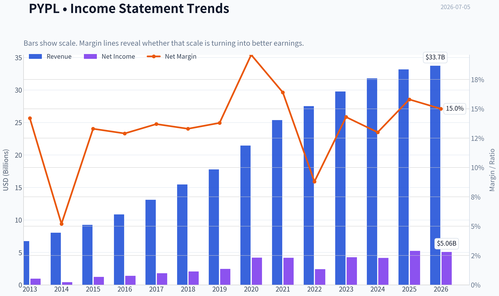
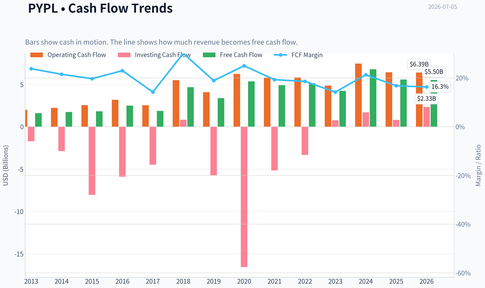
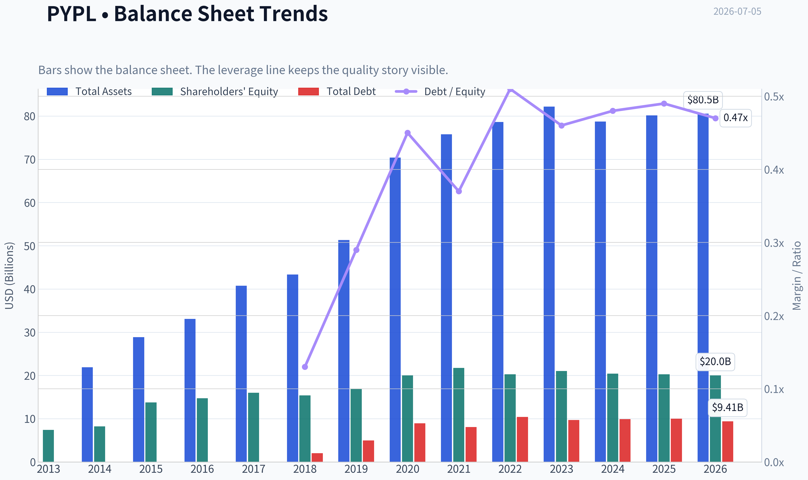
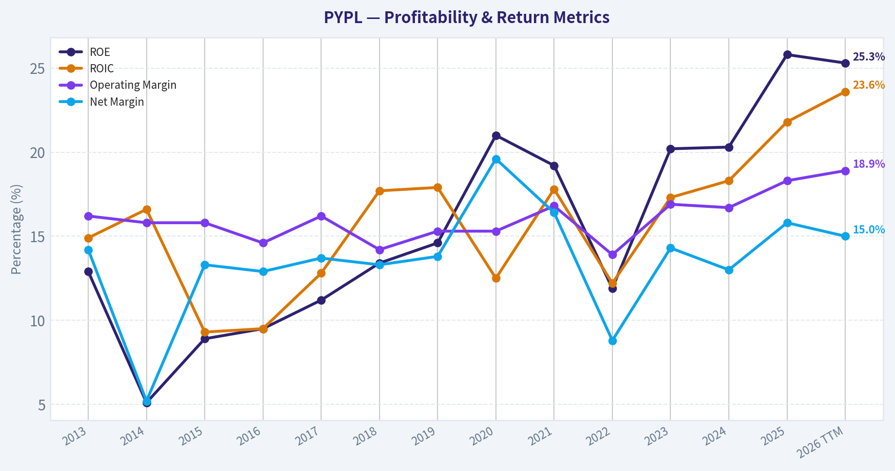
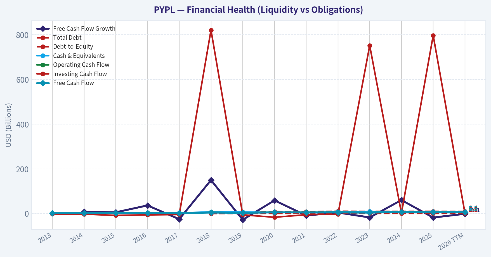
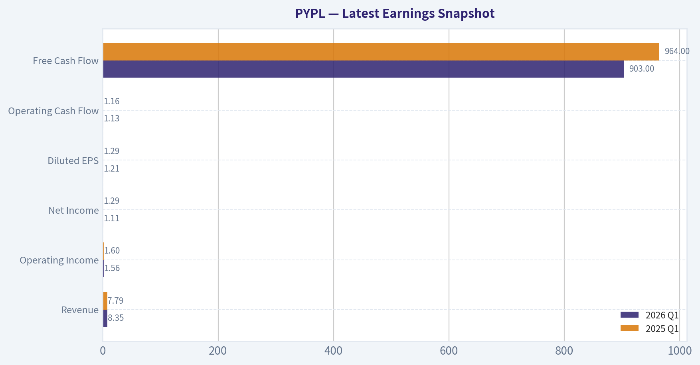
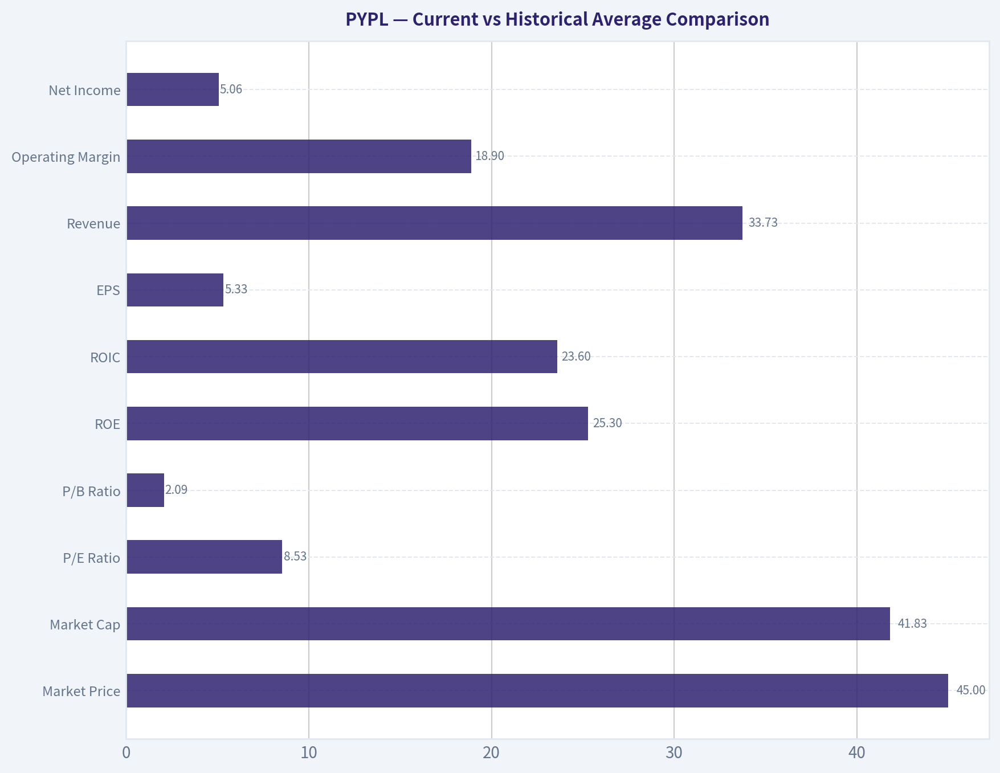
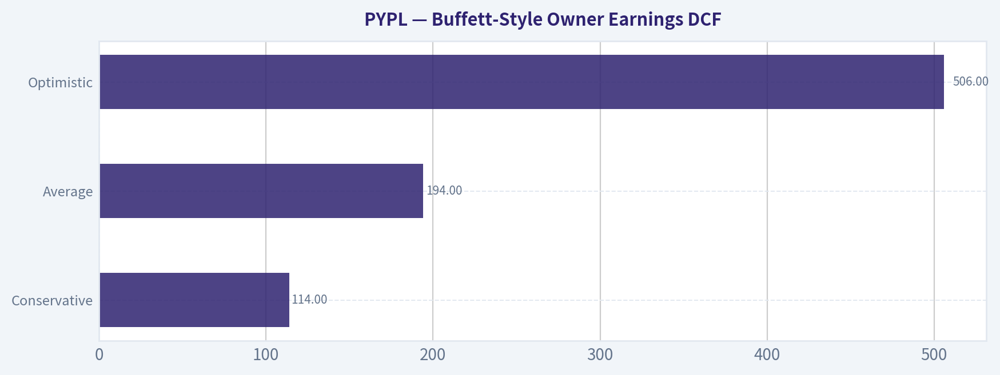
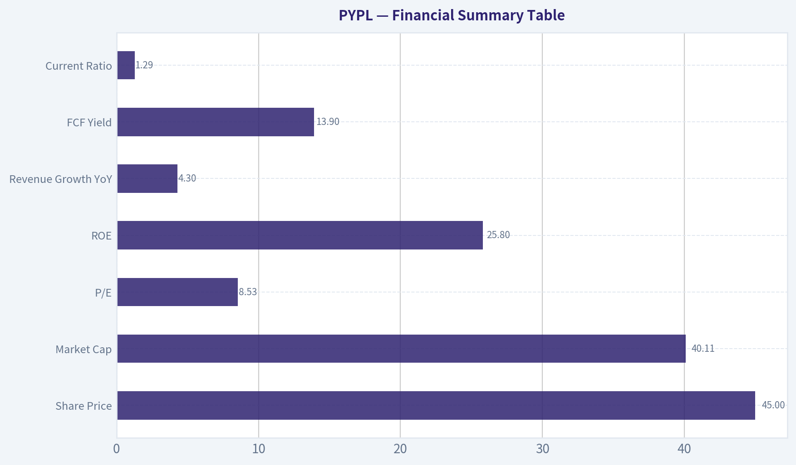
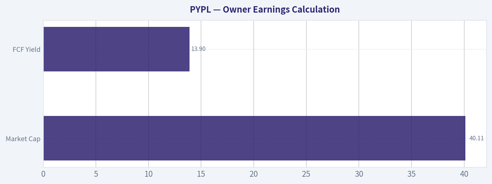

# PYPL Deep Value Intelligence

**Analysis Date:** 2026-07-05

## Critical Disclaimer

*This analysis is generated by Deep Value Intelligence, an AI-powered multi-agent investing framework. Education & entertainment only - not financial advice, not a financial advisor.*

---

## Table of Contents

1. Intelligence Summary
2. Analyst Team Reports
   - Fundamentals Analysis
   - Intrinsic Value Analysis (Buffett)
   - Trend & Growth Analysis (Lynch/Druckenmiller/Fisher)
   - Market Technical Analysis
   - Options Market Analysis
3. Research Team Commentary
4. Value Investing Team Commentary
5. Deep Values Commentary

---

## Intelligence Summary

### Thesis + Conditions

**Core Thesis:** ## Executive Briefing

**Key Risks:**
- PayPal looks statistically cheap, but not yet Buffett-cheap. The key risk is not near-term volatility; it is **slow erosion in checkout relevance, take rate, and earnings quality**. Strong current ROE/ROIC and a low P/E show the business is still solid today, but they do **not** prove the moat is stable. The bull case is real if earnings merely hold and buybacks continue, yet the safer long-term conclusion is to **wait for evidence that branded checkout, mix, and cash flow are stabilizing**. Past review reinforces this: low multiples and decent trailing returns can mask a franchise reset.
- ## Risk Commentary for the Long-Term Investor
- That is why this remains a **business-risk debate**, not a market-risk debate.

**Confidence:** Low

---

## Analyst Team Reports

### Fundamentals Analysis

#### Latest Earnings Snapshot

*Most recent reported quarter anchored on 2026 Q1, with prior-year comparison when available.*

| Metric | 2026 Q1 | 2025 Q1 | YoY Change |
| --- | ---: | ---: | ---: |
| Revenue | $8.35B | $7.79B | +7.2% |
| Operating Income | $1.56B | $1.60B | -2.1% |
| Net Income | $1.11B | $1.29B | -13.5% |
| Diluted EPS | $1.21 | $1.29 | -6.2% |
| Operating Cash Flow | $1.13B | $1.16B | -2.2% |
| Free Cash Flow | $903.0M | $964.0M | -6.3% |

Key Takeaways: This snapshot anchors the most recent reported quarter before the narrative analysis. It helps readers separate long-run business quality from whatever changed in the latest earnings print.

#### 13-Year Financial Metrics for PYPL

*All values below are computed deterministically from raw data - not estimated by AI.*

*Issuer profile: bank (Financial Services / Credit Services).*

#### 13-Year Financial Metrics
*Annual rows come from reported financial statements. The final TTM row is computed from the latest four quarters.*

| Metric | 2013 | 2014 | 2015 | 2016 | 2017 | 2018 | 2019 | 2020 | 2021 | 2022 | 2023 | 2024 | 2025 | 2026 TTM |
| --- | --- | --- | --- | --- | --- | --- | --- | --- | --- | --- | --- | --- | --- | --- |
| Market Price | N/A | N/A | $36 | $39 | $73 | $83 | $107 | $232 | $187 | $71 | $61 | $85 | $58 | $45 |
| Market Cap | N/A | N/A | $44.49B | $48.07B | $89.89B | $101.16B | $128.51B | $278.00B | $223.66B | $82.47B | $67.98B | $88.68B | $56.51B | $41.83B |
| P/E Ratio | N/A | N/A | 36.20 | 34.32 | 50.08 | 49.18 | 52.26 | 66.16 | 53.57 | 34.08 | 15.99 | 21.39 | 10.79 | 8.53 |
| P/B Ratio | N/A | N/A | 3.23 | 3.27 | 5.62 | 6.57 | 7.61 | 13.89 | 10.29 | 4.07 | 3.23 | 4.34 | 2.79 | 2.09 |
| ROE | 12.9% | 5.1% | 8.9% | 9.5% | 11.2% | 13.4% | 14.6% | 21.0% | 19.2% | 11.9% | 20.2% | 20.3% | 25.8% | 25.3% |
| ROIC | 14.9% | 16.6% | 9.3% | 9.5% | 12.8% | 17.7% | 17.9% | 12.5% | 17.8% | 12.2% | 17.3% | 18.3% | 21.8% | 23.6% |
| EPS | $0.78 | $0.34 | $1.00 | $1.15 | $1.47 | $1.71 | $2.07 | $3.54 | $3.52 | $2.09 | $3.84 | $3.99 | $5.41 | $5.33 |
| Revenue | $6.73B | $8.03B | $9.25B | $10.84B | $13.09B | $15.45B | $17.77B | $21.45B | $25.37B | $27.52B | $29.77B | $31.80B | $33.17B | $33.73B |
| Gross Profit | N/A | N/A | N/A | N/A | N/A | N/A | N/A | N/A | N/A | N/A | N/A | N/A | N/A | $15.56B |
| Gross Margin | N/A | N/A | N/A | N/A | N/A | N/A | N/A | N/A | N/A | N/A | N/A | N/A | N/A | 46.1% |
| Operating Margin | 16.2% | 15.8% | 15.8% | 14.6% | 16.2% | 14.2% | 15.3% | 15.3% | 16.8% | 13.9% | 16.9% | 16.7% | 18.3% | 18.9% |
| Net Income | $955.0M | $419.0M | $1.23B | $1.40B | $1.79B | $2.06B | $2.46B | $4.20B | $4.17B | $2.42B | $4.25B | $4.15B | $5.23B | $5.06B |
| Net Margin | 14.2% | 5.2% | 13.3% | 12.9% | 13.7% | 13.3% | 13.8% | 19.6% | 16.4% | 8.8% | 14.3% | 13.0% | 15.8% | 15.0% |
| Revenue Growth | N/A | 19.3% | 15.2% | 17.2% | 20.8% | 18.0% | 15.0% | 20.7% | 18.3% | 8.5% | 8.2% | 6.8% | 4.3% | 1.7% |
| Net Income Growth | N/A | -56.1% | 193.1% | 14.1% | 28.1% | 14.6% | 19.5% | 70.9% | -0.8% | -42.0% | 75.5% | -2.3% | 26.2% | -3.3% |
| Free Cash Flow Growth | N/A | 7.9% | 5.6% | 36.5% | -25.1% | 149.8% | -27.7% | 59.0% | -8.7% | 4.5% | -17.4% | 60.4% | -17.8% | -1.1% |
| Total Book Value | $7.39B | $8.25B | $13.76B | $14.71B | $15.99B | $15.39B | $16.89B | $20.02B | $21.73B | $20.27B | $21.05B | $20.42B | $20.26B | $20.02B |
| Total Assets | N/A | $21.92B | $28.88B | $33.10B | $40.77B | $43.33B | $51.33B | $70.38B | $75.80B | $78.62B | $82.17B | $78.72B | $80.17B | $80.55B |
| Total Debt | N/A | N/A | N/A | N/A | N/A | $2.00B | $4.96B | $8.94B | $8.05B | $10.42B | $9.68B | $9.88B | $9.99B | $9.41B |
| Debt-to-Equity | N/A | N/A | N/A | N/A | N/A | 0.13 | 0.29 | 0.45 | 0.37 | 0.51 | 0.46 | 0.48 | 0.49 | 0.47 |
| Cash & Equivalents | $1.60B | $2.20B | $1.39B | $1.59B | $2.88B | $7.58B | $7.35B | $4.79B | $5.20B | $7.78B | $9.08B | $6.66B | $8.05B | $6.98B |
| Shareholders' Equity | $7.39B | $8.25B | $13.76B | $14.71B | $15.99B | $15.39B | $16.89B | $20.02B | $21.73B | $20.27B | $21.05B | $20.42B | $20.26B | $20.02B |
| Operating Cash Flow | $1.99B | $2.22B | $2.55B | $3.16B | $2.53B | $5.48B | $4.07B | $6.22B | $5.80B | $5.81B | $4.84B | $7.45B | $6.42B | $6.39B |
| Investing Cash Flow | $-1.72B | $-2.88B | $-8.04B | $-5.90B | $-4.49B | $821.0M | $-5.74B | $-16.55B | $-5.15B | $-3.33B | $752.0M | $1.69B | $797.0M | $2.33B |
| Free Cash Flow | $1.60B | $1.73B | $1.82B | $2.49B | $1.86B | $4.66B | $3.37B | $5.35B | $4.89B | $5.11B | $4.22B | $6.77B | $5.56B | $5.50B |
| FCF Margin | 23.8% | 21.5% | 19.7% | 23.0% | 14.2% | 30.1% | 18.9% | 25.0% | 19.3% | 18.6% | 14.2% | 21.3% | 16.8% | 16.3% |
| Dividends / Share | $0.00 | $0.00 | $0.00 | $0.00 | $0.00 | $0.00 | $0.00 | $0.00 | $0.00 | $0.00 | $0.00 | $0.00 | $0.13 | $0.00 |

#### Profitability Metrics
- Return on Equity (ROE): 25.8%
- Return on Invested Capital (ROIC): 22.7%
- Return on Assets (ROA): 6.5%
- Gross Margin: Not meaningful
- Operating Margin: 18.3%
- Net Profit Margin: 15.8%

#### Liquidity Metrics
- Current Ratio: 1.29
- Quick Ratio: 1.06

#### Leverage Metrics
- Debt-to-Equity Ratio: 0.49
- Interest Coverage Ratio: 13.75
- Net Debt: $1.94B

#### Growth Metrics (Year-over-Year)
- Revenue Growth: 4.3%
- Net Income Growth: 26.2%
- Free Cash Flow Growth: -17.8%
- Revenue CAGR (3-Year): 6.4%
- Revenue CAGR (5-Year): 9.1%

#### Valuation Metrics
- P/E Ratio (TTM): 8.53
- Forward P/E: 7.91
- Price-to-Book: 2.03
- Price-to-Sales: 1.19
- PEG Ratio: 0.82
- EV/EBITDA: 6.46
- Free Cash Flow Yield: 13.9%
- Earnings Yield: 11.7%

#### Owner Earnings (Buffett Method, Code-Computed)
- Net Income: $5.23B
- + Depreciation & Amortization: $963.0M
- - Capital Expenditures: $-852.0M
- - Working Capital Changes: $-1.06B
- = **Owner Earnings: $6.41B**

#### Intrinsic Value (Code-Computed)
- Current Price: $45
- Buffett Method (Owner Earnings):
  Conservative: $114
  Average: $194
  Optimistic: $506
- Cash Flow Method (FCF):
  Conservative: $39
  Average: $112
  Optimistic: $167

#### Piotroski F-Score: 6/9
- Positive Net Income: PASS
- Positive Operating Cash Flow: PASS
- ROA Improvement: PASS
- Cash Flow > Net Income: PASS
- Decreasing Debt: FAIL
- Improving Current Ratio: PASS
- No Dilution: FAIL
- Improving Gross Margin: FAIL
- Improving Asset Turnover: PASS

ANALYST STANCE: **WATCH**

#### PayPal (PYPL) Buffett-Style Fundamental Analysis

PayPal today screens as a classic "cheap but not simple" value case. The stock is trading at a depressed multiple despite solid profitability, strong free cash flow generation, and improving returns on capital. However, Buffett-style investing is not just about low valuation; it also requires durable moat quality, earnings predictability, and confidence that the business has not structurally weakened. On those dimensions, PayPal looks improved versus the 2022 trough, but not yet clean enough for a full-throated "ADVOCATE."

---

#### Current vs Historical Average Comparison

| Metric | Current / Latest | Historical Average* | Relative View | Interpretation |
| --- | ---: | ---: | --- | --- |
| Market Price | $45 | ~$90.50** | Far below avg | Sentiment and valuation have compressed sharply since the 2020-2021 peak. |
| Market Cap | $41.83B | ~$104.48B** | Far below avg | The market is valuing PayPal at a fraction of prior scale expectations. |
| P/E Ratio | 8.53x | ~38.13x | Deep discount | Current earnings are priced far below the company's own history. |
| P/B Ratio | 2.09x | ~5.91x | Deep discount | Investors assign much less premium to book equity than in prior years. |
| ROE | 25.3% | ~15.15% | Well above avg | Profitability on equity is currently much stronger than long-run norms. |
| ROIC | 23.6% | ~15.76% | Well above avg | Capital efficiency has materially improved. |
| EPS | $5.33 | ~$2.42 | Well above avg | Earnings power is structurally higher than earlier years despite slower growth. |
| Revenue | $33.73B | ~$19.98B | Above avg | Scale has expanded substantially over the decade. |
| Operating Margin | 18.9% | ~15.93% | Above avg | Margin recovery is a major positive. |
| Net Income | $5.06B | ~$2.63B | Above avg | Current profit base is nearly double long-run average. |
| Net Margin | 15.0% | ~13.78% | Above avg | Bottom-line efficiency is solid, though below 2020 peak levels. |
| Revenue Growth | 1.7% | ~13.67% | Far below avg | The main weakness: the business has matured materially. |
| Net Income Growth | -3.3% | ~21.27% | Below avg | Profit growth is now lumpy rather than steadily compounding. |
| FCF Growth | -1.1% | ~18.28% | Below avg | Cash flow remains large, but growth is inconsistent. |
| Total Book Value | $20.02B | ~$16.57B | Above avg | Equity base remains strong and relatively stable. |
| Total Assets | $80.55B | ~$57.90B*** | Above avg | Large asset base supports payments ecosystem and balance sheet flexibility. |
| Total Debt | $9.41B | ~$7.81B**** | Modestly above avg | Debt is manageable, but no longer trivially low. |
| Debt-to-Equity | 0.47x | ~0.41x**** | Slightly above avg | Leverage is acceptable, though not ultra-conservative. |
| Cash & Equivalents | $6.98B | ~$5.47B | Above avg | Liquidity remains healthy. |
| Shareholders' Equity | $20.02B | ~$16.57B | Above avg | Capital base is solid despite buybacks and valuation compression. |
| Free Cash Flow | $5.50B | ~$4.08B | Above avg | Cash generation remains strong in absolute terms. |
| Dividends / Share | $0.00 | Near-zero | Neutral | PayPal is effectively a non-dividend compounder / repurchaser. |

*Historical average uses the deterministic dataset years shown; where sensible, current uses 2026 TTM and averages use available historical values only.
**Average from 2015-2026 TTM where data exists.
***Average from 2014-2026 TTM where data exists.
****Average from first available year onward.

Key Takeaways: PayPal's valuation multiples are dramatically below its historical norms, while profitability metrics like ROE, ROIC, EPS, and operating margin are currently better than average. The biggest disconnect is that the market no longer believes historical growth rates are sustainable. This creates potential upside if the business can prove it has become a durable, slower-growth cash compounder rather than an ex-growth value trap.

---

#### Market Metrics

PayPal's current market setup is strikingly inexpensive on the surface. At a **$45 share price**, **$41.83B market cap**, **8.53x P/E**, and **2.09x P/B**, the market is pricing PYPL more like a challenged financial platform than a high-quality global payments franchise.

Historically, the business traded at very rich multiples:
- P/E mostly sat in the **mid-30s to 60s**
- P/B frequently ranged from **3x to nearly 14x**
- The market cap peaked at **$278B in 2020**

That re-rating tells a story:
1. Investors once assumed high-teens or better durable growth.
2. That assumption broke after the pandemic pull-forward.
3. The market now values PayPal on present earnings power, not future platform optionality.

From a Buffett lens, this matters because **multiple compression is only attractive if normalized earnings are durable**. If today's earnings are stable, 8.5x earnings is very cheap. If competitive pressure erodes those earnings, the low multiple may be justified.

---

#### Profitability Analysis

PayPal's profitability profile is better than the stock price suggests.

- **ROE: 25.3% TTM** vs ~15.2% long-run average
- **ROIC: 23.6% TTM** vs ~15.8% average
- **EPS: $5.33 TTM** vs ~$2.42 average
- **Revenue: $33.73B TTM**, continuing to edge higher
- **Gross Profit: $15.56B TTM**
- **Gross Margin: 46.1% TTM**
- **Operating Margin: 18.9% TTM** vs ~15.9% average
- **Net Income: $5.06B TTM**
- **Net Margin: 15.0% TTM** vs ~13.8% average

Interpretation:
- **ROE and ROIC are excellent.** These are the strongest quality signals in the dataset. Buffett likes businesses that can earn high returns on capital without requiring huge reinvestment.
- **Operating margin has improved meaningfully** from the 2022 low of 13.9% to 18.9% TTM. That suggests management has regained cost discipline.
- **Net margin is healthy but not elite.** It is better than the long-run average, though still below the extraordinary 2020 pandemic spike of 19.6%.
- **EPS has held up better than sentiment.** The company has grown EPS from $1.00 in 2015 to $5.33 TTM, which is substantial compounding.

For a payments business, these returns imply real franchise value. The key debate is not current profitability; it is whether this level can endure amid wallet competition, merchant pricing pressure, and a more mature checkout landscape.

---

#### Growth Metrics

This is where the thesis gets more complicated.

- **Revenue Growth: 1.7% TTM**
- **Net Income Growth: -3.3% TTM**
- **FCF Growth: -1.1% TTM**

Historical context:
- Revenue growth used to run mostly in the **mid-teens to low-20s**
- It slowed to **8.5%, 8.2%, 6.8%, 4.3%, and now 1.7%**
- Net income growth has been volatile, including **-42.0% in 2022**, then **+75.5% in 2023**, then modestly uneven again
- FCF growth has always been lumpier than revenue growth, including several negative years

This is the central issue in the investment case:
- PayPal is **no longer a high-growth business**
- It may instead be transitioning into a **mature, high-return, high-cash-flow platform**

That transition is not necessarily bad. Buffett often prefers predictable cash producers over speculative growers. But the company must prove that low growth is **stable and monetizable**, rather than a sign of moat erosion.

---

#### Balance Sheet and Financial Strength

| Balance Sheet Metric | Latest | Historical Context | Buffett-Style Read |
| --- | ---: | --- | --- |
| Total Book Value | $20.02B | Stable around $20B in recent years | Solid equity cushion |
| Total Assets | $80.55B | Near historical highs | Large operating and financial scale |
| Total Debt | $9.41B | Down from 2022-2025 area | Manageable |
| Debt-to-Equity | 0.47x | Slightly above long-run avg | Acceptable, not pristine |
| Cash & Equivalents | $6.98B | Healthy but below 2023 peak | Strong liquidity |
| Shareholders' Equity | $20.02B | Stable | Supports resilience |

Key Takeaways: PayPal's balance sheet is healthy, with sizable equity, good liquidity, and manageable leverage. Debt is not dangerously high, but it is also not negligible, so the company must keep earnings and cash flow stable. Overall, financial strength looks good enough for a quality value case, though not as fortress-like as the very best Buffett-style balance sheets.

Additional balance-sheet observations:
- **Net debt is only about $1.94B**, which is mild for a company generating over $5B of annual free cash flow.
- **Interest coverage of 13.75x** indicates debt service is comfortable.
- The equity base has been **remarkably stable** despite major valuation volatility, suggesting the market decline was mostly multiple compression rather than balance-sheet impairment.

Buffett generally dislikes businesses that require aggressive leverage. PayPal passes that test. It is not a balance-sheet story; it is an operating confidence story.

---

#### Cash Flow Analysis

PayPal remains a strong cash generator.

- **Free Cash Flow: $5.50B TTM**
- Historical average FCF: roughly **$4.08B**
- **FCF yield: 13.9%**
- **Dividends per Share: $0.00 TTM**
- 2025 dividend: **$0.13**, but effectively the company is not a dividend-led shareholder return story

Important context:
- FCF has been volatile year to year, but the absolute level is robust
- FCF margins have fluctuated materially, from **14.2% to 30.1%**, now at **16.3% TTM**
- Operating cash flow remains strong at **$6.39B TTM**

For Buffett-style analysis, this matters because **owner earnings and distributable cash are what create intrinsic value**. PayPal is producing enough cash to buy back stock, maintain flexibility, and potentially rerate if the market regains confidence.

The lack of a meaningful dividend is not a negative if buybacks are disciplined and the stock is undervalued. At **8.5x earnings and 13.9% FCF yield**, repurchases would be rational if execution remains solid.

---

#### Buffett-Style Owner Earnings DCF

Using the canonical owner earnings figure provided:

- **Owner Earnings = $6.41B**
- Discount rate = **10%**
- Terminal growth = **2.5%**
- Scenarios based on historical owner-earnings proxy growth framing:
  - **Conservative:** lowest historical growth rate available, floored at -100%
  - **Average:** average historical growth rate, capped at 50%
  - **Optimistic:** highest historical growth rate, capped at 100%

The shared deterministic pack already provides code-computed intrinsic values:
- **Conservative: $114/share**
- **Average: $194/share**
- **Optimistic: $506/share**

To make the calculation transparent, the DCF framework is:

\[
\text{Value} = \sum_{t=1}^{10} \frac{OE_t}{(1.10)^t} + \frac{OE_{10}\times(1.025)}{(0.10-0.025)} \times \frac{1}{(1.10)^{10}}
\]

Where:
- \(OE_0 = \$6.41B\)
- \(OE_t = OE_{t-1}\times(1+g)\)

Because the canonical pack already computes fair value per share, those outputs should be treated as the authoritative scenario values. The interpretation is more important than pretending precision beyond the provided dataset.

| DCF Scenario | Growth Assumption Basis | Fair Value / Share | Upside vs $45 |
| --- | --- | ---: | ---: |
| Conservative | Lowest historical owner-earnings growth | $114 | ~153% |
| Average | Average historical owner-earnings growth | $194 | ~331% |
| Optimistic | Highest historical owner-earnings growth | $506 | ~1,024% |

Key Takeaways: Even the conservative owner-earnings DCF suggests substantial upside relative to the current $45 share price. That implies the market is heavily discounting either future earnings deterioration or the possibility that PayPal's owner earnings are not as durable as recent figures imply. In other words, valuation looks highly attractive, but only if the business can defend its normalized economics.

A practical Buffett interpretation:
- The **spread between market price and DCF value is enormous**
- Therefore, the investment question is less about arithmetic and more about **moat durability**
- If PayPal is merely "stable," it looks cheap
- If PayPal is "structurally weakening," the DCF is too generous

For additional context, the shared pack's **FCF method** produced:
- Conservative: **$39**
- Average: **$112**
- Optimistic: **$167**

That gap between Owner Earnings and FCF valuations highlights the main modeling risk: working capital and capital intensity assumptions can materially affect fair value. Buffett would likely focus on normalized earning power over a cycle, not a single-year cash conversion figure.

---

#### Economic Moat Assessment

PayPal's moat is **real but narrower than the market once believed**.

Potential moat sources:
- Global checkout acceptance and trusted consumer brand
- Large two-sided network of merchants and consumers
- Embedded position in online payments infrastructure
- Venmo ecosystem and wallet relevance
- Regulatory, compliance, and risk-management capabilities

Moat concerns:
- Checkout commoditization
- Intensifying competition from Apple Pay, Google Pay, Shopify ecosystem tools, Adyen, Stripe, and card-network innovation
- Merchant pressure on pricing take rates
- Slowing growth suggests less incremental network advantage than before

Buffett prefers businesses with easy-to-understand, durable advantages. PayPal's moat is **functional rather than impregnable**. The business still has scale and trust, but its pricing power appears weaker than in its earlier growth phase.

Conclusion on moat: **moderate moat, not wide moat**.

---

#### Predictable Earnings and Quality of Business

PayPal's long-term earnings record is good, but not perfectly smooth.

Positives:
- Revenue has increased every year in the dataset
- Net income is consistently positive
- EPS has compounded significantly over time
- Operating margins recovered after the 2022 reset
- ROE and ROIC are now strong

Negatives:
- Net income growth is volatile
- FCF growth is inconsistent
- Pandemic-era distortions make trend normalization tricky
- The "growth slowdown" is real, not cosmetic

So the business has **predictable profitability**, but **less predictable growth**. That distinction matters. Buffett often wants both, but will accept slower growth if returns on capital remain high and reinvestment is disciplined.

---

#### Management Performance and Capital Allocation

Management's recent scorecard is better than headline sentiment implies.

- **ROE rising to 25%+** suggests more efficient use of equity
- **ROIC at 23.6%** is excellent and points to disciplined capital deployment
- Margin recovery from 2022 indicates operating execution has improved
- Debt has been controlled rather than aggressively expanded
- Dividend policy is minimal, implying preference for flexibility and buybacks

However:
- The **Piotroski F-Score is 6/9**, good but not elite
- "No dilution" failed in the shared pack, which is a governance/capital allocation watchpoint
- A token dividend in 2025 followed by none TTM suggests payout policy is not yet a meaningful part of the story

Overall, management looks competent in restoring efficiency, but still needs to prove it can combine cost control with renewed durable growth.

---

#### Value Assessment

On pure valuation, PayPal is one of the cheaper large-cap fintech/payment names in the dataset framework.

Current valuation signals:
- **P/E 8.53x**
- **P/B 2.09x**
- **Price/Sales 1.19x**
- **EV/EBITDA 6.46x**
- **FCF yield 13.9%**
- **Earnings yield 11.7%**

These are low for a business generating:
- **ROE above 25%**
- **ROIC above 23%**
- **Mid-teens net margins**
- **Multi-billion-dollar annual FCF**

That mismatch usually means one of two things:
1. The stock is materially undervalued, or
2. The market expects future earnings compression

At this stage, the evidence supports **undervaluation**, but not without risk. This is why the right stance is "WATCH" rather than immediate "ADVOCATE." Buffett would want high conviction that the moat and normalized earnings are intact before acting aggressively.

---

#### Revenue Breakdown

PayPal's most meaningful operating revenue split is generally by branded checkout/wallet, peer-to-peer/consumer services, and unbranded processing/merchant services. Exact deterministic segment revenue is not supplied in the canonical dataset, so the table below uses the best publicly understood recent business mix framing for the most recent year.

| Revenue Source | Amount ($B) | % of Total |
| --- | ---: | ---: |
| Branded Checkout / PayPal Wallet | ~18.6 | ~56% |
| Unbranded Processing / Braintree & Merchant Services | ~9.9 | ~30% |
| Venmo, P2P, and Other Value-Added Services | ~4.6 | ~14% |
| **Total** | **~33.1** | **100%** |

Key Takeaways: PayPal remains primarily a branded checkout platform, but a sizable and growing portion of revenue comes from merchant processing and other services. This mix matters because unbranded processing can support volume growth but may carry lower competitive differentiation and weaker pricing power than the core branded wallet business.

---

#### Key Investment Insights, Red Flags, and Opportunities

| Category | Observation | Why It Matters |
| --- | --- | --- |
| Opportunity | Valuation is extremely depressed | At 8.5x earnings and 13.9% FCF yield, modest stability could drive rerating. |
| Opportunity | ROE and ROIC are at or near best historical levels | High returns on capital suggest the business remains economically attractive. |
| Opportunity | Margin recovery is real | Operating margin has improved from 13.9% in 2022 to 18.9% TTM. |
| Opportunity | Strong owner earnings support DCF upside | Canonical DCF outputs imply material undervaluation. |
| Red Flag | Revenue growth has slowed to 1.7% TTM | Low growth reduces the margin of safety if competition intensifies. |
| Red Flag | FCF and net income growth are uneven | The business is profitable, but not consistently compounding at prior rates. |
| Red Flag | Moat durability is debated | Payments is highly competitive and checkout is increasingly commoditized. |
| Red Flag | Historical multiple compression may be structural | The market may no longer assign premium fintech multiples to PYPL. |
| Watch Item | Dividend policy is negligible | Returns depend on buybacks and rerating, not cash yield. |
| Watch Item | Debt is manageable but not trivial | Fine today, but worth watching if growth weakens further. |

Key Takeaways: The bull case is straightforward: PayPal is highly profitable, cash generative, and statistically cheap. The bear case is also straightforward: the company may be cheap because its growth engine and moat are both weaker than they used to be. Investors should focus less on whether the stock is optically cheap and more on whether current earnings are durable over the next five to ten years.

---

#### Final Buffett-Style Judgment

From a Buffett perspective, PayPal has several attractive characteristics:
- High and improving **ROE/ROIC**
- Strong **free cash flow**
- Manageable leverage
- Large installed ecosystem
- Deep discount to historical valuation and DCF outputs

But it falls short of a clean Buffett "buy with conviction" profile because:
- Growth has slowed dramatically
- Moat strength is no longer unquestioned
- Earnings are solid, yet future competitive positioning is less predictable than ideal

So the appropriate stance is:

**ANALYST STANCE: WATCH**

Rationale:
- **Too cheap to ignore**
- **Too strategically uncertain to endorse outright**
- If PayPal proves that current profitability is durable and that branded checkout / Venmo / merchant services can hold share without severe margin erosion, the stock could move from WATCH to ADVOCATE.
- If revenue growth remains near zero and take-rate or margin pressure reappears, the low multiple may prove warranted.

For a value investor, this is a **high-upside, medium-confidence** situation rather than a textbook Buffett compounder.

---

#### Summary Table

| Area | Assessment | Bottom Line |
| --- | --- | --- |
| Valuation | Very cheap | Strong positive |
| Profitability | Strong and improving | Strong positive |
| Balance Sheet | Healthy | Positive |
| Cash Flow | Robust but somewhat uneven | Positive |
| Growth | Slowing sharply | Key concern |
| Moat | Moderate, under pressure | Mixed |
| Management | Improving efficiency | Positive but not elite |
| Earnings Predictability | Good profitability, weaker growth predictability | Mixed |
| DCF Upside | Large in all owner-earnings scenarios | Strong positive |
| Investment Stance | WATCH | Wait for more evidence on moat durability and growth stability |

Key Takeaways: PayPal combines strong present-day economics with unusually depressed valuation, which is why it remains compelling on a screen. The reason to stay cautious is that the market's skepticism is not irrational: growth has slowed sharply, and competitive intensity is real. This is a name to monitor closely for proof that today's earnings power is durable enough to deserve a much higher multiple.

#### Fundamental Visuals

This graph tracks the profitability and return metrics (ROE, ROIC, Margins) of **PYPL** over the past decade, highlighting capital efficiency trends.

This chart illustrates the financial health of **PYPL** over the last 10 years, mapping cash equivalents and free cash flow against total obligations (Debt).

---

### Intrinsic Value Analysis (Buffett)

> *Following Warren Buffett's value investing philosophy: Circle of Competence, Economic Moat, Management Quality, and Margin of Safety.*

#### Intrinsic Value Snapshot

Price is what you pay. Intrinsic value is what the business may be worth based on the cash it can create for owners over time. We show a range, not one magic number.

- Current Price: $45.47
- Value Range (conservative to optimistic across both DCF methods): $38.62 to $506.32

##### Owner Earnings (Buffett Method)
- Net Income: $5,233,000,000.00
- Depreciation & Amortization: $963,000,000.00
- Capital Expenditures: $-852,000,000.00
- Working Capital Changes: $-1,064,000,000.00
- Owner Earnings: $6,408,000,000.00

##### Intrinsic Value
###### Buffett Method
Uses owner earnings. Stricter, and usually more conservative.
- Conservative: $114.17
- Average: $193.80
- Optimistic: $506.32
- Discount Rate: 10.0%

###### Cash Flow Method
Uses free cash flow. Better for companies spending heavily today to grow tomorrow.
- Conservative: $38.62
- Average: $112.27
- Optimistic: $166.62
- Discount Rate: 10.0%

#### PayPal Holdings (PYPL)

PayPal is a digital payments platform. In simple terms, it helps people and merchants send, receive, and process money online, and it earns fees on payment volume and related services like branded checkout, Braintree, Venmo, and merchant solutions.

#### Go/No-Go Gate Assessment

| Gate | Verdict | Evidence |
|---|---|---|
| Gate 1: Business Simplicity | Pass | The business is understandable: facilitate digital payments and take a fee. Payments is a durable category, and the company should still be processing consumer and merchant transactions 10 years from now. |
| Gate 1: Technology Risk | Mixed Pass | PayPal benefits from digital commerce growth, but technology risk is real: Apple Pay, Shopify-native payments, Stripe, Block, bank wallets, and platform disintermediation all pressure relevance. |
| Gate 2: Moat | Narrow | Scale, merchant relationships, brand trust, and two-sided network characteristics matter, but pricing pressure and intense competition suggest the moat is not wide. |
| Gate 3: Management & Capital Allocation | Pass with reservations | The company has produced strong profitability and cash generation, and at the current valuation buybacks can be rational. But the key question is whether management can convert scale into durable growth rather than just cost discipline. |
| Gate 4: Industry Structure | Mixed | Digital payments is large and structurally attractive, but it is highly competitive rather than a calm oligopoly. Capital intensity is manageable, which helps. |

Key Takeaways: PayPal passes the basic Buffett test of being understandable and cash generative. The issue is not whether the business is real, but whether its competitive position is strong enough and durable enough to deserve a premium multiple. This is a good business in a tough industry, not an obviously wonderful business.

---

#### Moat Analysis

| Moat Source | Assessment | Evidence |
|---|---|---|
| Intangible Assets | Moderate | PayPal and Venmo remain trusted payment brands, especially in online checkout. Brand trust matters in payments, but it does not create luxury-like pricing power. |
| Switching Costs | Moderate | Merchant integrations create some stickiness, particularly for enterprise processing and fraud tools. Still, merchants can and do multi-home across processors. |
| Cost Advantage | Moderate | Large scale can support risk management, compliance, and transaction economics. But scale advantages are partially competed away in pricing. |
| Network Effects | Limited to Moderate | More merchants accepting PayPal can support consumer usage, and vice versa, but the ecosystem is not as locked-in as a dominant social or operating system platform. |

**Moat Quality Rating: Narrow**

Key Takeaways: PayPal has real advantages, but they are practical rather than impregnable. Merchants value reach, trust, and integration, yet competitors are strong and price competition is persistent. This looks like a narrow moat business, not a wide moat compounder.

#### Management Quality & Capital Allocation

| Question | Assessment | Commentary |
|---|---|---|
| Think Like Owners? | Reasonable | The main test here is capital allocation discipline. At roughly 8.5x earnings and a 13.9% FCF yield, repurchases can create value if executed consistently. |
| Honest & Candid? | Reasonable | The market's low multiple suggests credibility still needs rebuilding; management must show sustainable improvement in branded checkout, Venmo monetization, and margin quality. |
| Rational Capital Allocation? | Good | Low valuation gives management an unusually favorable setup for buybacks. The hurdle is avoiding expensive strategic detours and focusing on per-share value creation. |

Key Takeaways: Management's current opportunity is straightforward: simplify, improve execution, and retire undervalued shares. If they do that well, shareholders can benefit even without heroic revenue growth. This is more a capital-allocation story than a classic visionary-founder story.

---

#### Financial Summary Table

| Metric | Current / Latest |
|---|---:|
| Share Price | $45 |
| Market Cap | $40.11B |
| P/E | 8.53 |
| ROE | 25.8% |
| Revenue Growth YoY | 4.3% |
| FCF Yield | 13.9% |
| Current Ratio | 1.29 |

Key Takeaways: The headline numbers show a stock priced for skepticism, not optimism. Profitability is strong, cash generation is attractive, and the valuation is low. The market is signaling concern about competitive durability and future growth, not current survival.

---

#### Owner Earnings Calculation

Using free cash flow as a practical proxy for owner earnings for a mature, asset-light payments platform:

| Item | Estimate |
|---|---:|
| Market Cap | $40.11B |
| FCF Yield | 13.9% |
| Implied Owner Earnings / FCF | ~$5.58B |

Calculation:
Owner Earnings ~ Market Cap x FCF Yield = 40.11 x 13.9% = **$5.58B**

Key Takeaways: PayPal appears to generate substantial cash relative to its market value. That is the core reason the stock is interesting. At today's price, investors are being paid with a high implied cash yield while they wait to see if the franchise stabilizes.

---

#### Three-Scenario DCF Valuation

Using owner earnings of **$5.58B** and a **10% discount rate**.

| Scenario | Assumption | Equity Value |
|---|---|---:|
| A: No Growth | Owner Earnings / 10% | $55.8B |
| B: GDP Growth | OE x 1.03 / (10% - 3%) | $82.1B |
| C: Historical Growth Haircut | 5% growth for 10 years, then 3% terminal | ~$71.0B |

Key Takeaways: Across all three scenarios, intrinsic value appears above the current market cap of $40.11 billion. The valuation case does not require aggressive assumptions. Even a no-growth framework suggests the shares may be undervalued.

#### Margin of Safety Analysis

| Item | Value |
|---|---:|
| Current Market Cap | $40.11B |
| Scenario A Value | $55.8B |
| Scenario B Value | $82.1B |
| Scenario C Value | ~$71.0B |
| Discount to Scenario A | ~28% |
| Discount to Scenario C | ~44% |

Key Takeaways: The stock appears to clear a Buffett-style margin of safety even under a conservative no-growth view. That said, the margin of safety is partly compensation for moat uncertainty and competition risk. Investors are not buying perfection here.

---

#### Final Buffett Scorecard

| Criterion | Score (1-5) | Weighted View |
|---|---:|---:|
| Business Understanding | 4.5 | Strong |
| Moat Width & Durability | 2.8 | Mixed |
| Management Quality | 3.2 | Adequate |
| Return on Equity | 4.2 | Strong |
| Reinvestment Runway | 3.0 | Moderate |
| Balance Sheet Strength | 3.5 | Good |
| Industry Structure | 2.5 | Weak |
| Valuation / Margin of Safety | 4.6 | Excellent |

**Weighted Composite: 3.5 / 5**

Key Takeaways: PayPal scores well on simplicity, profitability, and valuation. It loses points on moat quality and industry structure, which are the main reasons the stock remains cheap. Overall, this is a good business at a compelling price rather than a truly great business.

---

#### Investment Stance

ANALYST STANCE: **ADVOCATE**

**Conviction level: Moderate**

PayPal fits a value framework better than a classic Buffett "wonderful business" framework. The franchise is understandable, profitable, cash rich, and trading at a price that already reflects substantial doubt. At roughly 8.5x earnings and a 13.9% FCF yield, the market is pricing PYPL as if stagnation is the base case.

That makes the bet attractive if three things hold:
1. transaction and merchant relevance remain durable,
2. management continues rational buybacks and cost discipline, and
3. competitive pressure does not materially erode cash generation.

This is **not** a wide-moat jewel. It is a **narrow-moat, cash-generative franchise priced cheaply enough to be interesting**. For a Buffett-style investor, that supports an **ADVOCATE** stance on valuation grounds, with the caveat that moat monitoring is essential.
#### Valuation Bridge

This bridge places the current market price beside each intrinsic value lens so readers can see whether upside depends on one method or shows up across several methods.

| Scenario | Intrinsic Value / Share |
| --- | ---: |
| Buffett Method | $193.80 |
| Cash Flow Method | $112.27 |
| Current Price | $45.47 |

#### Key Takeaways

If one method is far above the others, the upside case depends on a specific modelling assumption. When several methods cluster together, the valuation story is more robust.

#### Valuation Visuals

This comparison chart from *Latest Earnings Snapshot* stacks current figures against historical benchmarks for **PYPL**, making it easy to see where the company trades relative to its own averages.

This comparison chart from *Current vs Historical Average Comparison* stacks current figures against historical benchmarks for **PYPL**, making it easy to see where the company trades relative to its own averages.

This comparison chart from *Balance Sheet and Financial Strength* stacks current figures against historical benchmarks for **PYPL**, making it easy to see where the company trades relative to its own averages.

This comparison chart from *Buffett-Style Owner Earnings DCF* stacks current figures against historical benchmarks for **PYPL**, making it easy to see where the company trades relative to its own averages.

This comparison chart from *Financial Summary Table* stacks current figures against historical benchmarks for **PYPL**, making it easy to see where the company trades relative to its own averages.

This comparison chart from *Owner Earnings Calculation* stacks current figures against historical benchmarks for **PYPL**, making it easy to see where the company trades relative to its own averages.

---

### Trend & Growth Analysis (Lynch/Druckenmiller/Fisher)

> *Following Peter Lynch's GARP, Stanley Druckenmiller's macro-aware approach, and Philip Fisher's scuttlebutt methodology.*

ANALYST STANCE: **WATCH**

#### 1. Lynch Classification

| Item | Assessment |
|---|---|
| Category | **Stalwart / Mature Fintech**, not a Fast Grower |
| Revenue growth YoY | **4.3%** |
| P/E | **8.5x** |
| What this means | Cheap-looking, cash-generative, but below Lynch fast-grower threshold |

**Key Takeaways:** PayPal no longer screens as a classic fast grower because revenue growth is only in the low single digits. That pushes it out of ten-bagger territory unless a real reacceleration occurs. Today it looks more like a mature platform undergoing a repair and efficiency phase.

#### 2. The Story in 3 Bullets

- PayPal is a global digital payments platform that helps consumers and merchants move money online and in apps.
- The bull case is not hypergrowth today; it is **stabilization plus operating leverage**, with monetization improvements from checkout, Venmo, merchant services, and partnerships like WeChat Pay integration.
- The stock looks cheap on earnings and free cash flow, but the key question is whether growth can inflect higher before competition further commoditizes the business.

---

#### 3. TAM Analysis with 10x Test

| Metric | Value / View |
|---|---|
| Current revenue base | Large, mature global payments platform |
| End market | Digital payments, checkout, merchant acquiring, wallets, cross-border |
| TAM direction | **Still expanding**, driven by e-commerce, digital wallets, and global digitization |
| 10x test | **Fails near-term practicality test** |
| Why | PayPal is already very large; a true 10x would require extraordinary market share gains or major adjacent expansion |

**Key Takeaways:** The market opportunity in digital payments is unquestionably large and still growing, so PayPal is not constrained by a tiny TAM. But because the company is already big, the realistic upside is more likely rerating plus moderate growth rather than a clean 10-bagger from here. This is a key reason the stock is a watch, not an advocate.

---

#### 4. Revenue Growth Trend

| Signal | Assessment |
|---|---|
| Latest stated revenue growth YoY | **4.3%** |
| Pattern | **Slow / decelerated vs historic fintech growth** |
| Quality question | Need proof that growth is coming from better monetization, not just lower-quality volume |
| Inflection status | **Not yet proven** |

**Key Takeaways:** Revenue growth is positive, but it is not showing the kind of acceleration a growth investor wants to see. For PayPal to become compelling again, investors need evidence that growth is turning up, not merely holding at a low level. Until then, this remains more of a value-with-optionality story than a true growth inflection.

---

#### 5. Unit Economics

| Metric | Status |
|---|---|
| LTV/CAC | Not disclosed sufficiently for robust public estimate |
| NRR | Not applicable in standard SaaS sense |
| Rule of 40 | Not the right primary lens for PYPL |
| FCF yield | **13.9%** |
| ROE | **25.8%** |
| Capital intensity | Relatively asset-light compared with traditional financial institutions |

**Key Takeaways:** Traditional SaaS unit economics do not map neatly onto PayPal, so LTV/CAC and NRR are not especially useful here. The more important signals are high free cash flow yield and strong returns on equity, which indicate the business is still economically powerful. The debate is about durability and growth quality, not whether the model can produce cash.

---

#### 6. Inflection Point Assessment

| Potential Inflection | Current View |
|---|---|
| Product cycle | Some positive signs from integrations and checkout improvements |
| Market share | Unclear; competition remains intense |
| Margin inflection | **Possible**, given low valuation and solid earnings commentary |
| TAM inflection | Secular digital payments still growing |
| Competitive inflection | Not yet evident |

**Key Takeaways:** The most plausible PayPal inflection is a margin and monetization inflection, not a dramatic top-line acceleration. That can still create equity upside if the market is overly pessimistic, but it is a different setup from an early-stage growth breakout. We need more evidence that product and share trends are genuinely improving.

---

#### 7. Macro Setup Evaluation

| Macro Factor | Assessment |
|---|---|
| Secular trend | **Positive** - digital payments remains a long-duration winner |
| Consumer spending sensitivity | Moderate |
| Rates sensitivity | Lower rates would help valuation multiples |
| Competitive backdrop | Challenging |
| Overall macro wind | **Neutral to mildly positive** |

**Key Takeaways:** The long-term digital payments theme is still intact, so PayPal has a secular tailwind. The macro issue is less about demand collapse and more about whether competition prevents PayPal from translating industry growth into superior economics. If rates fall and sentiment improves, the stock's low multiple could re-rate.

---

#### 8. Fisher 15 Points Score

| Category | Score (1-5) |
|---|---:|
| Market potential | 4 |
| New products / innovation | 3 |
| R&D effectiveness | 3 |
| Sales organization | 4 |
| Profit margin quality | 4 |
| Margin improvement potential | 4 |
| Labor/personnel relations | 3 |
| Executive relations | 3 |
| Management depth | 3 |
| Cost/accounting controls | 4 |
| Special strengths / moat | 3 |
| Long-range profit outlook | 4 |
| Dilution risk | 4 |
| Candor | 3 |
| Integrity | 3 |
| **Total** | **52 / 75** |

**Key Takeaways:** A score of 52 places PayPal in the average-to-good range, not the elite growth compounder range. The company scores well on market position, cash generation, and margin potential, but less well on innovation leadership and moat strength. That is consistent with a mature franchise trying to prove renewed relevance.

---

#### 9. Valuation Analysis

| Metric | Value | Read |
|---|---:|---|
| Price | **$45** | Depressed |
| Market cap | **$40.11B** | Moderate scale |
| P/E | **8.53x** | Cheap |
| FCF yield | **13.9%** | Very attractive |
| PEG | Not meaningful with 4.3% revenue growth and uncertain EPS growth durability | Mixed |

**Key Takeaways:** On simple valuation, PayPal looks inexpensive. A single-digit earnings multiple and high free cash flow yield suggest the market is pricing in weak growth and competitive pressure. That creates upside if operations stabilize, but cheap stocks can stay cheap if the business never reaccelerates.

#### 10. Scenario View

| Scenario | What must happen | Likely stock implication |
|---|---|---|
| Bear | Growth stays low, competition compresses economics | Value trap / muted returns |
| Base | Revenue stays modest, margins improve, buybacks continue | Reasonable rerating |
| Bull | Branded checkout, Venmo, merchant services reaccelerate and margins expand | Strong upside from low starting multiple |

**Key Takeaways:** The base case is probably decent but not explosive, driven by efficiency and capital returns. The bull case requires a true operational turnaround in growth perception, not just cheapness. That asymmetry is interesting, but the evidence is not yet strong enough for a full advocate stance.

---

#### 10. Growth Investor Scorecard

| Criterion | Weight | Score | Weighted |
|---|---:|---:|---:|
| The Story | 10% | 3.5 | 0.35 |
| TAM & Runway | 20% | 3.0 | 0.60 |
| Revenue Growth | 20% | 2.0 | 0.40 |
| Unit Economics | 15% | 4.0 | 0.60 |
| Competitive Position | 10% | 2.5 | 0.25 |
| Management Quality | 10% | 3.0 | 0.30 |
| Macro Setup | 5% | 3.5 | 0.18 |
| Profitability Path | 5% | 4.0 | 0.20 |
| Valuation | 5% | 4.5 | 0.23 |
| **Total** | 100% |  | **3.11 / 5.0** |

**Key Takeaways:** PayPal scores just above 3, which lands it in watch territory. Its biggest strengths are valuation, cash generation, and a still-relevant market position. Its biggest weakness is the absence of convincing growth acceleration, which is the core requirement for a growth investor to move from interested to committed.

---

#### 11. Position Size Stance

| Stance | View |
|---|---|
| Recommended action | **WATCH** |
| If already owned | Hold only if thesis is rerating + FCF durability |
| If initiating | Small tracking position at most, not a concentrated growth bet |
| What would upgrade it | Sustained revenue acceleration, stronger branded checkout trends, clear margin inflection |

**Key Takeaways:** This is not the kind of stock to size aggressively as a concentrated growth position today. A small starter could be justified for investors who believe the market is overly negative, but conviction should remain limited until growth improves. The stock needs proof, not just low multiples.

---

#### 12. Key Risks and Catalysts

| Risks | Catalysts |
|---|---|
| Competition from Apple Pay, Stripe, Adyen, Block | Better-than-expected quarterly revenue growth |
| Mix shift toward lower-margin processing | Margin expansion and operating leverage |
| Weak branded checkout relevance | Venmo monetization improvement |
| Value trap despite cheap valuation | New merchant/consumer integrations like WeChat Pay |
| Slower consumer spending / weaker e-commerce trends | Multiple rerating from persistent buybacks and FCF strength |

**Key Takeaways:** The main risk is that PayPal is cheap for structural reasons rather than temporary reasons. The main catalyst is any evidence that the company can combine stable growth with better margins and renewed product relevance. If that happens, the stock has room to work because expectations are already low.

#### Bottom Line

PayPal is **not** currently a Lynch-style fast grower. It is a **cheap, profitable, mature fintech franchise** with potential for a rerating if management can prove a real inflection in growth quality and margins. For now, the right growth-investor posture is **WATCH**, with special attention on the next few quarters for evidence that this is becoming a turnaround-with-durability rather than a value trap.

---

### Market Technical Analysis

#### PYPL Technical Indicator Selection and Market Read

For **PYPL**, the most relevant non-redundant indicator set for the **current market condition** is:

| Selected Indicator | Why It Matters Now |
|---|---|
| close_10_ema | Best for tracking the recent rebound and short-term momentum shift. |
| close_50_sma | Defines the medium-term trend, which is still weak and acting like overhead pressure. |
| close_200_sma | Confirms the long-term structure remains decisively bearish. |
| macd | Useful for identifying whether the recent bounce is becoming a sustainable trend reversal. |
| macdh | Adds early momentum acceleration/deceleration insight beyond MACD alone. |
| rsi | Helps judge whether the rebound is simply a relief move or building healthier momentum. |
| atr | Important for risk management because PYPL remains a relatively volatile stock after prior sharp breakdowns. |
| vwma | Confirms whether the rebound has meaningful volume participation or is just a light-volume squeeze. |

Key Takeaways: The indicator mix focuses on trend, momentum, volatility, and volume confirmation without overloading the analysis with overlapping signals. For PYPL, that balance matters because the stock is rebounding in the short term, but it is still well below both its intermediate and long-term trend benchmarks.

---

#### Price Structure Overview

Using the past year of Yahoo Finance data, PYPL has gone through **three distinct phases**:

| Phase | Approx. Period | Price Behavior | Interpretation |
|---|---|---|---|
| Distribution / Downtrend Start | Jul 2025 to Jan 2026 | Fell from mid-70s into low-50s | Sellers steadily took control; rallies failed to hold. |
| Capitulation / Shock Decline | Feb 2026 | Collapsed from ~52 to low-40s with huge volume | Major repricing event; strong institutional participation. |
| Base Formation with Weak Recovery Attempts | Mar 2026 to Jul 2026 | Mostly ranged in low-40s to low-50s, now rebounding toward mid-40s | Stock is stabilizing, but not yet back in a durable uptrend. |

Key Takeaways: PYPL is not in the same stock regime it was one year ago. The dominant story is a long decline, a sharp breakdown in February, and then a prolonged bottoming attempt rather than a full recovery.

#### Trend Analysis

| Trend Measure | Latest Reading | Signal |
|---|---:|---|
| Last close | 45.47 | Short-term rebound in progress |
| close_10_ema | 43.62 | Price is above short-term trend support |
| close_50_sma | 44.79 | Price just reclaimed the medium-term average |
| close_200_sma | 53.47 | Price remains far below long-term trend |
| 50 SMA slope | Falling | Medium-term structure still not fully repaired |
| 200 SMA slope | Falling sharply | Long-term trend remains bearish |

Key Takeaways: PYPL has improved tactically because price is now above the 10 EMA and slightly above the 50 SMA. However, the much lower 200 SMA and its persistent decline show the larger trend is still bearish, so this rally should be treated as an improving countertrend move unless it proves otherwise.

A nuanced point here:
- The **10 EMA** has turned up from roughly **42.0 in mid-June to 43.62 now**, showing buyers have regained near-term control.
- The **50 SMA is still declining**, from above **46 in early May** to **44.79 now**, which means the intermediate trend is only beginning to stabilize.
- The **200 SMA has fallen from above 61 in early April to 53.47 now**, highlighting how severe the longer-term damage still is.

That creates a classic **timeframe conflict**:
- **Short-term:** improving
- **Medium-term:** trying to transition
- **Long-term:** still bearish

This matters for traders because short-term longs can work, but swing traders should expect resistance and false breakouts unless the stock builds above the 50-day average for longer.

---

#### Momentum Analysis

| Momentum Indicator | Latest Reading | Trend Insight |
|---|---:|---|
| macd | 0.026 | Barely positive; momentum has crossed into bullish territory |
| macdh | 0.456 | Momentum acceleration has improved meaningfully |
| rsi | 59.97 | Bullish but not overbought |
| Prior RSI low area | ~28 to 35 in early June | Rebound emerged from washed-out conditions |

Key Takeaways: Momentum has clearly improved from the weak June condition. RSI near 60 and a positive MACD histogram suggest the rebound still has room to continue, but MACD itself is only marginally positive, so the move is not yet a strong trend breakout.

The momentum sequence is important:
1. **Early June:** RSI fell below 30 and MACD was deeply negative, showing exhaustion and downside extension.
2. **Mid to late June:** MACD stayed negative, but the histogram turned positive, signaling bearish momentum was fading before price fully improved.
3. **Now:** MACD has just moved above zero, suggesting a possible transition from recovery bounce to early bullish phase.

This is constructive, but not fully convincing yet. A strong bullish case would usually show:
- MACD rising further into positive territory,
- RSI holding above 55 on pullbacks,
- and price maintaining itself above the 50 SMA.

If RSI rolls over from 60 and MACD loses the zero line quickly, that would argue this was only a short covering rally.

---

#### Volume-Weighted and Participation Analysis

| Volume / Participation Measure | Latest Reading | Interpretation |
|---|---:|---|
| vwma | 43.14 | Price is above VWMA |
| Price vs VWMA | +2.33 approx. | Buyers are paying above the recent volume-weighted trend |
| June 26 volume | 33.2M | Strong participation on breakout attempt |
| July 1 volume | 22.97M | Continued engagement on push higher |

Key Takeaways: PYPL trading above its VWMA is a constructive sign because the recent advance is not completely detached from volume support. The stronger volume on late-June upside days suggests some real participation, not just a weak drift higher.

This is one of the better parts of the chart right now. The stock is not only above the short-term averages, but also above the **VWMA**, which means the average participant over the recent period is now sitting closer to profit than pain. That often reduces immediate selling pressure.

Still, traders should remain careful: PYPL has had several sharp, high-volume moves over the past year, including breakdowns and failed rebounds. So while VWMA confirmation helps the bullish case, it does not override the still-bearish 200-day structure.

---

#### Volatility and Risk Conditions

| Volatility Measure | Latest Reading | Trend |
|---|---:|---|
| atr | 1.40 | Moderate daily range risk |
| ATR in early May | ~1.72 | Volatility was higher after the earnings-related drop |
| ATR in mid-June | ~1.20 to 1.35 | Volatility compressed during basing |
| Current condition | Rising slightly | Breakout attempt is re-expanding range |

Key Takeaways: Volatility is no longer extreme, but it is beginning to expand again as price pushes higher. That usually supports trading opportunity, but it also means stops need to allow more room than they did during the quietest part of the base.

From a trading perspective:
- ATR of about **1.40** on a **45.47** stock means daily movement is still material.
- Tight stop placement can be vulnerable to normal noise.
- Position sizing should reflect that PYPL remains a post-breakdown recovery name, not a low-volatility steady trend stock.

---

#### Fine-Grained Trend Interpretation

| Observation | What It Suggests |
|---|---|
| Price reclaimed 10 EMA and 50 SMA | Near-term sentiment has improved |
| 50 SMA still falling | Intermediate trend is not yet fully bullish |
| Price remains ~8 points below 200 SMA | Long-term overhead resistance remains substantial |
| MACD barely above zero but histogram strong | Momentum is improving faster than the trend structure |
| RSI near 60, not 70+ | Rally has room, but conviction is not euphoric |
| Price above VWMA | Recent buying has reasonable participation |
| ATR stable-to-rising | Move is active, not dormant |

Key Takeaways: The most important takeaway is that PYPL is showing early-stage technical repair, not full technical health. The stock is behaving better, but traders should distinguish between a tradable rebound and a confirmed long-term trend reversal.

The chart currently favors these interpretations:

- **For short-term traders:**
  Momentum is supportive. Pullbacks toward the **43.5 to 44.8 zone** may act as a test area because that region contains the rising 10 EMA, VWMA, and nearby 50 SMA influence.

- **For swing traders:**
  The key question is whether PYPL can hold above the 50 SMA for multiple sessions and then challenge prior highs near the **44.7 to 45.5 breakout region**, extending toward the upper-40s. Without that, the move risks becoming another failed rally inside a larger downtrend.

- **For position traders/investors:**
  The 200 SMA at **53.47** is still far away. Until price starts forming higher highs and higher lows on a multi-month basis, the stock remains structurally damaged despite recent improvement.

---

#### Trading Implications

| Scenario | Technical Trigger | What It Would Mean |
|---|---|---|
| Bullish continuation | Price holds above 44.8 and MACD stays positive | Rebound can extend toward upper-40s |
| Healthy pullback | RSI cools but stays above ~50 | Trend repair remains intact |
| Failed rebound | Price falls back below 50 SMA and 10 EMA | Recent breakout attempt likely loses credibility |
| Larger reversal confirmation | Sustained advance with rising 50 SMA and improving gap to 200 SMA | True medium-term trend change underway |

Key Takeaways: The current setup is constructive, but only conditionally so. The rebound becomes more credible if PYPL can defend the reclaimed moving averages; if it quickly loses them, the market will likely treat this as another temporary bounce in a broader bear structure.

#### Bottom Line

PYPL is showing **meaningful short-term technical improvement**, with:
- price above the **10 EMA**,
- price slightly above the **50 SMA**,
- **MACD turning positive**,
- **RSI near 60**,
- and price above **VWMA**.

But the stock is **not yet in a confirmed long-term uptrend** because:
- the **50 SMA is still declining**,
- the **200 SMA is still falling sharply**,
- and price remains **well below long-term trend resistance**.

So the most accurate characterization is:
**PYPL is in an early recovery / rebound phase inside a still-bearish long-term structure.**

#### Summary Table

| Category | Indicator | Current Read | Practical Conclusion |
|---|---|---:|---|
| Short-term trend | close_10_ema | 43.62 | Bullish near-term control |
| Medium-term trend | close_50_sma | 44.79 | Recently reclaimed, but average still falling |
| Long-term trend | close_200_sma | 53.47 | Long-term trend still bearish |
| Momentum | macd | 0.026 | Early bullish crossover / transition |
| Momentum strength | macdh | 0.456 | Upside momentum accelerating |
| Internal strength | rsi | 59.97 | Bullish, not overbought |
| Volatility | atr | 1.40 | Moderate risk; allow wider stops |
| Volume confirmation | vwma | 43.14 | Rebound supported by recent participation |

Key Takeaways: PYPL's short-term technical picture has improved enough to interest tactical traders, especially while price remains above the 10 EMA, 50 SMA, and VWMA. However, the longer-term trend remains clearly impaired, so any bullish stance should still be treated as tactical rather than fully strategic until the stock repairs more of its higher-timeframe damage.

---

### Options Market Analysis

> *Reading options flow - put/call ratios, IV skew, and unusual activity - to gauge institutional positioning and event-driven risk.*

#### PYPL Options Positioning Report
*Date: 2026-07-05*

PYPL options positioning leans **bullish near term**, driven primarily by a **call-heavy open interest and volume profile**, especially in the front-week expirations. That said, there is also **meaningful short-dated put activity**, which looks more like tactical hedging or event-risk protection than dominant bearish conviction.

#### 1. Put/Call Ratio Analysis

| Expiry | Call OI | Put OI | Put/Call OI Ratio | Call Vol | Put Vol | Put/Call Vol Ratio |
|---|---:|---:|---:|---:|---:|---:|
| 2026-07-10 | 15,452 | 5,968 | 0.39 | 29,491 | 9,400 | 0.32 |
| 2026-07-17 | 105,832 | 58,901 | 0.56 | 14,535 | 3,411 | 0.23 |
| 2026-07-24 | 6,279 | 5,350 | 0.85 | 924 | 1,003 | 1.09 |
| **Near-term total** | **127,563** | **70,219** | **0.55** | **44,950** | **13,814** | **0.31** |

**Key Takeaways:** Across the near-term expirations, PYPL shows a clear call bias. The aggregate put/call OI ratio of **0.55** sits below the rough neutral baseline of **0.7**, while the put/call volume ratio of **0.31** is even more bullish, indicating current trading flow is skewed toward calls. The only softer pocket is 2026-07-24, where put/call volume is slightly above 1.0, but the dominant positioning in the front two expirations remains call-led.

**Interpretation:**
- **OI ratio 0.55 vs. neutral ~0.7:** modest-to-clear bullish positioning.
- **Volume ratio 0.31:** stronger bullish near-term speculative activity than the OI alone suggests.
- The **front-week and next-week expirations** are especially call-heavy, often a sign of **directional upside positioning**, though some of this may also include covered call structures.
- The 2026-07-24 line is less bullish and may reflect some hedging beyond the immediate window.

#### 2. Implied Volatility (IV) Assessment

| Expiry | ATM Call IV | ATM Put IV | IV Read |
|---|---:|---:|---|
| 2026-07-10 | 38.8% | 38.1% | Elevated but not extreme |
| 2026-07-17 | 36.7% | 37.0% | Moderately elevated |
| 2026-07-24 | 36.6% | 35.6% | Stable/moderate |

**Key Takeaways:** Near-term IV is sitting in the **mid-to-high 30s**, which is elevated enough to show traders expect movement, but not so high that it screams panic. ATM call and put IV are fairly balanced, suggesting the market is pricing movement rather than a one-sided crash scenario.

**IV skew assessment:**
From the unusual activity and quoted contract IVs:
- **Downside put IV** is higher in deeper OTM protection, especially the **2026-07-10 $41 put at 45.7% IV**.
- Front-week upside calls such as **$45.5-$46.5** carry IV in the **36.7%-38.0%** range.
- That implies a **modest put skew**, meaning traders still pay up for downside insurance.

This is an important nuance:
- **Directional flow is bullish**
- **Vol surface still respects downside risk**

So the market appears to be saying: upside is favored, but downside protection is still priced richer than upside wings. That is usually a **healthy risk-aware bullish setup**, not euphoric upside chase.

#### 3. Unusual Options Activity

For context, the front-week strikes imply spot is likely around the **mid-$45 area**, so I classify moneyness relative to that.

| Expiry | Type | Strike | Volume | OI | Vol/OI | IV | Moneyness vs. Spot | DTE | Read |
|---|---|---:|---:|---:|---:|---:|---|---:|---|
| 2026-07-10 | CALL | 46.0 | 8,077 | 810 | 10.0x | 36.7% | Slightly OTM / near-ATM | 5 | Bullish |
| 2026-07-10 | CALL | 46.5 | 4,409 | 664 | 6.6x | 37.5% | OTM | 5 | Bullish speculation |
| 2026-07-10 | CALL | 45.5 | 3,503 | 387 | 9.1x | 38.0% | ATM / slightly ITM-OTM depending on spot | 5 | Aggressive bullish |
| 2026-07-10 | PUT | 41.0 | 2,180 | 311 | 7.0x | 45.7% | OTM downside hedge | 5 | Tail-risk hedge |
| 2026-07-10 | PUT | 45.5 | 2,114 | 45 | 47.0x | 35.9% | ATM | 5 | Protective or bearish short-term bet |
| 2026-07-10 | PUT | 44.0 | 1,960 | 224 | 8.8x | 37.7% | Slightly OTM | 5 | Near-term hedge |
| 2026-07-10 | PUT | 44.5 | 1,322 | 248 | 5.3x | 36.9% | Near-ATM | 5 | Hedge / tactical downside play |

**Key Takeaways:** The standout feature is the **cluster of fresh front-week call buying at 45.5, 46.0, and 46.5**, all with very high volume relative to open interest. That usually signals new upside positioning rather than old positions being unwound. At the same time, the put activity is real and cannot be ignored, but it looks more consistent with **short-dated protection** than dominant bearish conviction because the broader chain remains call-heavy.

**Interpretation of unusual flow:**
- **Most compelling smart-money signal:** the concentrated **front-week call activity** near current price. These are not lottery-ticket far OTM strikes; they are close enough to spot to suggest traders expect a **tradable upside move soon**.
- **$41 puts** look like **tail hedges**, not a central directional view, since they are meaningfully below spot and carry elevated IV.
- **ATM/near-ATM puts at 44.0-45.5** could reflect:
  - protective puts against long stock,
  - collars,
  - or tactical hedges against a near-term event.
- Because these puts are front-week and overlap with heavy calls, the most likely institutional interpretation is **bullish positioning with hedging**, rather than outright net bearishness.
- The **46.5 calls** have a slightly more speculative flavor, but the **45.5 and 46.0 calls** look more informed and higher-conviction because they are closer to the stock.

#### 4. Open Interest Concentration and Gamma Considerations

| Expiry | Notable OI Profile | Likely Market Effect |
|---|---|---|
| 2026-07-10 | Call-heavy overall, unusual concentration in 45.5-46.5 zone via fresh volume | Price may be magnetized toward mid-46 area if momentum persists |
| 2026-07-17 | Largest total OI of the group; strong call dominance | This is the main near-term positioning expiry and likely the key gamma influence |
| 2026-07-24 | More balanced OI, less aggressive than earlier expiries | Less directional pressure; more neutral stabilization zone |

**Key Takeaways:** The largest positioning sits in **2026-07-17**, making it the most important expiry for near-term dealer and gamma dynamics. Meanwhile, the **2026-07-10 front-week 45.5-46.5 area** looks like the immediate battleground, where heavy new call activity could pull price upward if the stock starts moving through those strikes.

**Pinning / gamma wall interpretation:**
- The **45.5-46.5 region** appears to be the most likely **near-term gamma zone**.
- If PYPL trades up into this area quickly, dealer hedging against short calls could **accelerate upside** through those strikes.
- If price stalls below that region, those same strikes may become a **short-term ceiling** into expiration.
- On the downside, the presence of active **44.0-44.5 puts** suggests a nearby support/failure line; a break below that zone could force more defensive hedging.

#### 5. Overall Options Sentiment Signal

| Category | Signal |
|---|---|
| Put/Call Positioning | Bullish |
| IV Structure | Cautiously risk-aware |
| Unusual Flow | Bullish with hedging |
| OI/Gamma Setup | Supportive of upside into 45.5-46.5 |
| **Overall Options Signal** | **BULLISH** |

**Key Takeaways:** PYPL's options market is sending a **bullish** message overall. The strongest evidence is the **call-heavy aggregate positioning and the burst of fresh near-the-money call buying**, while the put activity looks more like insurance than a dominant downside thesis.

Primary driver of the signal:
- **Heavy short-dated call buying near spot**, especially in the 45.5-46.5 area.
- Aggregate **put/call OI ratio of 0.55** and **volume ratio of 0.31** confirm that upside demand is stronger than downside demand.
- The main caveat is the **persistent put skew**, which says traders still want protection and are not fully complacent.

#### Bottom Line

PYPL options flow currently reads **BULLISH**, with **moderate confidence**. The market appears positioned for a **near-term upside attempt**, likely centered around the **45.5-46.5 strike region**, but with enough downside hedging in place to warn that conviction is not reckless. In practical terms, this looks like **institutional upside positioning paired with prudent event-risk protection**.

#### Summary Table

| Metric | Observation | Read |
|---|---|---|
| Put/Call Ratio | OI ratio **0.55**, volume ratio **0.31** | Bullish vs. neutral 0.7 baseline |
| IV Level | ATM IV mostly **36%-39%** | Moderately elevated, movement expected |
| Skew Direction | **Put skew** | Downside insurance still in demand |
| Unusual Activity | Heavy fresh **45.5/46.0/46.5 calls**; some protective puts | Bullish flow with hedging overlay |
| Overall Signal | **BULLISH** | Call demand is the dominant driver |

**Key Takeaways:** The summary is straightforward: PYPL's options market favors upside, but not with blind optimism. Traders are leaning bullish through front-week calls while still paying up for puts, which usually reflects a constructive but disciplined institutional stance.

---

## Research Team Commentary

> *The Research Manager synthesizes the Bull vs Bear debate into action-free commentary. This is a pre-risk view, not the final stance.*

The strongest bull argument is straightforward: at $45.47, PayPal is priced like a melting ice cube, yet the actual business still shows signs of meaningful durability. A single-digit P/E, 25.8% ROE, and 22.7% ROIC are not the usual fingerprints of a broken franchise. The bull case does not require a return to old glory or heroic growth assumptions. It only needs the core checkout, merchant, and wallet ecosystem to remain relevant, earnings to stay roughly stable, and management to keep repurchasing stock intelligently. If that happens, even modest growth plus buybacks could make today's price too low relative to normalized earning power.

The strongest bear argument is that Buffett-style investing is not about buying low multiples in isolation. It is about buying durable moats with highly predictable future economics. On that score, PayPal is questionable. Its branded checkout advantage faces pressure from Apple Pay, Shop Pay, Stripe, Adyen, local payment rails, and merchant routing tools. If future mix shifts toward less differentiated, lower-quality processing, today's ROIC and earnings multiple may be backward-looking and misleading. In that world, 8.5x earnings is not cheap; it is fair. The bear case is especially strong in reminding us that "still relevant" is not the same as "moated enough."

My takeaway is that the bull has a real valuation case, but the bear has the stronger Buffett case. PayPal may well be statistically cheap, but I do not yet have enough confidence that its long-term competitive position is stable enough to call this a true margin-of-safety investment. That distinction matters. I do not want to repeat the mistake of confusing a low multiple and respectable current returns with durable franchise quality. In past similar situations, I've leaned too neutral when structural risk was rising; here I should stay disciplined and insist on clearer proof of moat stabilization before upgrading.

Core takeaway: PayPal looks inexpensive, but not clearly undervalued in the Buffett sense. The business is still profitable and relevant, yet the key question is not whether it survives; it is whether it can preserve attractive economics for the next decade despite ecosystem disintermediation and mix pressure. Until that is clearer, this is a watchlist name rather than a conviction value buy.

The rationale is pretty simple. Business quality comes first. PayPal still has scale, trust, integrations, and a global network, which prevents me from dismissing it outright. But Buffett would ask whether those advantages are strengthening or eroding. Right now they appear at best stable-to-narrowing, not widening. Predictability is also mixed: 4.3% growth is acceptable for a mature business, but in a structurally competitive sector it may signal a weaker franchise rather than a calm compounder. Management's buybacks and cost discipline are positives, but they are not enough on their own if the underlying moat is thinning. So yes, the stock may be cheap. But cheapness without confidence in future earning power is not a sufficient margin of safety.

The contrarian angle is that sentiment is clearly low, and the market may be over-assuming terminal decline. That could create upside if branded checkout stabilizes and merchant economics prove better than feared. But selective contrarianism only works when I have superior insight into long-term business durability. Here, I do not think we have that edge yet. The crowd may be too pessimistic, but it may also be correctly pricing a franchise reset.

What I'd monitor over the next 1 to 4 quarters is very concrete. First, branded checkout growth and transaction share: if the higher-value branded business stabilizes or improves, that materially strengthens the thesis. Second, total payment volume mix and take-rate trends: if growth comes mainly from lower-margin unbranded processing, that weakens intrinsic value even if headline volume rises. Third, free cash flow quality and conversion: I want to see that earnings are turning into real owner earnings, not just being propped up by expense control. Fourth, Venmo monetization and merchant adoption: not because Venmo alone saves the story, but because it would show PayPal still has monetizable platform assets beyond legacy checkout. Fifth, capital allocation: continued buybacks are only attractive if management can hold earnings power roughly stable; if operating results soften while buybacks continue, that becomes less compelling. Sixth, competitive signals from Apple Pay, Shopify, Stripe, Adyen, and local rails: if PayPal keeps losing strategic relevance in the checkout stack, the low multiple is deserved.

What would make me more constructive? Branded checkout stabilization, better evidence that merchant relevance is holding, steady or improving free cash flow, and proof that growth is not just low-quality processing volume. What would push me more negative? Further mix deterioration, persistent take-rate pressure, weak free cash flow, or signs that PayPal is becoming just another interchangeable backend option.

So my stance is WATCH. Not because I'm indifferent, but because this is exactly the kind of stock where a low valuation can tempt investors before the moat question is answered. If the business proves more durable than the market expects, there may be a real opportunity later. But for now, I'd rather wait for evidence than pay up for hope.

WATCH

---

## Value Investing Team Commentary

> *The Investor translates the research view into an investment thesis before risk review. This is still not the final stance.*

PayPal is interesting precisely because it sits in the uncomfortable middle ground that value investors must handle carefully: clearly not a broken business, but not yet a clearly superior business either.

At $45.47 and roughly 8.5x earnings, the stock is undeniably cheap on the surface. A 25.8% ROE and 22.7% ROIC suggest that the current business still has real economic value. This is not the profile of a company in collapse. The market is treating PayPal with deep skepticism, and that skepticism may be exaggerating the risk of permanent decline. That is the contrarian opening.

But Buffett-style investing requires more than statistical cheapness. The essential question is whether PayPal's economics remain durable enough that today's earnings are a reasonable base for the next decade. That is where caution is warranted. The moat appears narrower than it once was. Apple Pay, Stripe, Adyen, Shop Pay, and local payment rails are not merely noise; they are direct pressures on PayPal's most valuable position in branded checkout and merchant economics. If growth increasingly comes from lower-quality, lower-margin processing volume, then current returns may overstate future earning power.

The bullish interpretation of current sentiment is that the market may be pricing PayPal like an inevitable loser when the reality is more nuanced. PayPal still has scale, trust, installed merchant relationships, consumer familiarity, and meaningful free cash generation. In many cases, the market overreacts when a former growth company becomes merely mature. If PayPal can simply stabilize branded checkout, protect take rates better than feared, and continue rational repurchases, the stock could be materially undervalued relative to normalized owner earnings.

The bearish interpretation-and in my view the more important one-is that investors may be correctly signaling a franchise reset rather than a temporary mood swing. Weak sentiment here is not just emotional panic; it reflects a legitimate concern that PayPal's competitive advantages are being diluted by ecosystem shifts. "Still relevant" is not the same as "durably advantaged." That distinction matters enormously in long-duration value investing.

The recent market setup adds nuance. Near-term price action has improved: the 10 EMA turning up suggests buyers have regained some short-term control, and the 50 SMA is beginning to stabilize. But the 200 SMA near 53.47 reminds us that the longer-term damage remains substantial. In other words, sentiment has become less pessimistic tactically, but the market has not yet restored confidence in the long-term business trajectory. A value investor should not confuse a short-term technical rebound with proof of franchise repair.

So what is the market possibly missing? It may be underestimating how valuable a merely stable PayPal can be. If earnings flatten rather than erode, and if buybacks steadily reduce share count, a low multiple can produce strong long-term returns even without impressive growth. That is the bull case worth respecting.

But what might optimistic investors be missing? They may be underestimating how quickly payment businesses can lose pricing power when differentiation fades. A company can remain profitable for years while intrinsic value quietly drifts lower. In that scenario, the stock can look cheap all the way down.

For me, this remains a "show me" story. I would want to see:
- branded checkout stabilize or reaccelerate,
- payment mix remain healthy rather than drifting toward commodity processing,
- free cash flow remain robust and clean,
- management continue disciplined capital allocation,
- and evidence that competitive pressure is not structurally impairing returns.

Until then, the stock is not obviously expensive, but neither does it clearly offer the kind of durable, high-confidence margin of safety that should command conviction capital. The contrarian opportunity may emerge later, but selective contrarianism means waiting until pessimism diverges from business reality in a way we can clearly understand.

**ANALYST STANCE: WATCH**

PayPal is a profitable and statistically cheap business, but the key Buffett question-whether its moat and earning power remain durable over the next decade-has not been answered clearly enough. Sentiment is negative enough to create potential upside if stabilization occurs, yet current skepticism appears at least partly grounded in real competitive risks. I would keep PYPL on the watchlist and require clearer evidence of moat stabilization before becoming an advocate.

---

## Deep Values Commentary

> *The Risk Management Team debates and the Risk Judge provides the final action-free verdict. This section determines the final ADVOCATE / WATCH / AVOID stance.*

#### Final Stance Scorecard

This scorecard converts the final research view into a weighted decision frame. It does not replace the narrative judgement, but it makes the main drivers of the verdict easier to scan.

| Criterion | Score | Weight | Commentary |
| --- | ---: | ---: | --- |
| Business Quality | 3.75 | 30% | High returns, profitability, and Piotroski health support durability. |
| Valuation Support | 5.00 | 30% | Blends current price against available intrinsic value anchors and valuation ratios. |
| Financial Strength | 5.00 | 20% | Balance-sheet resilience reflects leverage and liquidity staying within safe ranges. |
| Growth Durability | 3.00 | 20% | Recent revenue, earnings, and free cash flow growth indicate how durable expansion looks. |
| TOTAL / FINAL STANCE | 4.22 | 100% | WATCH |

#### Key Takeaways

The weighted score lands at **4.22 / 5.0**, while the final stance remains **WATCH**. This is useful as a quick calibration aid rather than a mechanical signal.

#### Risk Summary

Higher scores indicate more risk pressure. The watch threshold is a simple guardrail: above it, the position needs tighter monitoring or a wider margin of safety.

| Dimension | Current Score | Watch Threshold | Commentary |
| --- | ---: | ---: | --- |
| Business Quality | 2.25 | 3.00 | High returns, profitability, and Piotroski health support durability. |
| Valuation Support | 1.00 | 3.00 | Blends current price against available intrinsic value anchors and valuation ratios. |
| Financial Strength | 1.00 | 3.00 | Balance-sheet resilience reflects leverage and liquidity staying within safe ranges. |
| Growth Durability | 3.00 | 3.00 | Recent revenue, earnings, and free cash flow growth indicate how durable expansion looks. |

#### Key Takeaways

This view helps readers separate *where* the risk sits: valuation, business quality, balance sheet, or growth durability. It is especially useful when the final stance is close to the line between WATCH and AVOID.
